# 泡泡玛特2020年港股招股书（简体中文）

> 披露日期：2020-12-01。来源：[泡泡玛特官方投资者关系](https://popwebsite.paquapp.com/pdf/招股书.pdf)。
> [原始PDF](../2020年港股招股书.pdf) · [历年财报索引](../泡泡玛特历年财报索引.md)
> 转换说明：保留中文正文、数字、单位和注释，仅做繁简转换及重复英文去除。外文专名、代码和网址照录；复杂表格用等宽文本保留列位置，插图保留原图。


###### 原PDF第1页

[对照原PDF第1页](../2020年港股招股书.pdf#page=1)

泡泡玛特国际集团有限公司

( 于开曼群岛注册成立的有限公司 )

股份代号 : 9992

全球发售

联席保荐人：

联席全球协调人、联席账簿管理人及联席牵头经办人：


###### 原PDF第2页

[对照原PDF第2页](../2020年港股招股书.pdf#page=2)

## 重要提示

阁下如对本招股章程的内容有任何疑问，应获得独立专业意见。

泡泡玛特国际集团有限公司（于开曼群岛注册成立的有限公司）全球发售全球发售的发售股份数目 ： 135,715,200 股股份（视乎超额配股权行使与否而定）香港公开发售股份数目 ： 16,286,000 股股份（可予重新分配）国际发售股份数目 ： 119,429,200 股股份（可予重新分配及视乎超额配股权行使与否而定）最高发售价 ： 每股发售股份 38.50 港元，另加 1% 经纪佣金、0.0027% 证监会交易征费及0.005% 联交所交易费（须于申请时以港元缴足，多缴款项可予退还）面值 ： 每股股份 0.0001 美元股份代号 ： 9992

联席保荐人

联席全球协调人、联席账簿管理人及联席牵头经办人

香港交易及结算所有限公司、香港联合交易所有限公司及香港中央结算有限公司对本招股章程的内容概不负责，对其准确性或完整性亦不发表任何声明，并表明概不就因本招股章程全部或任何部分内容而产生或因依赖该等内容而引致的任何损失承担任何责任。本招股章程连同本招股章程附录五「送呈公司注册处处长及备查文件」一节所述的文件，已根据香港法例第 32 章公司（清盘及杂项条文）条例第 342C 条的规定，送呈香港公司注册处处长登记。证券及期货事务监察委员会及香港公司注册处处长对本招股章程或上述任何其他文件的内容概不负责。预期发售价将由联席全球协调人（为其本身及代表包销商）与本公司于定价日协商厘定。预期定价日将为 2020 年 12 月 4 日（星期五）或前后，并无论如何不迟于 2020 年 12 月 9 日（星期三）。除另行公布者外，发售价将不会超过38.50港元，且现时预期不会低于31.50港元。倘联席全球协调人（为其本身及代表包销商）与本公司因任何理由未能于 2020 年 12 月 9 日（星期三）之前就发售价达成协议，则全球发售将不会进行并将告失效。联席全球协调人（代表包销商）可经我们同意后于递交香港公开发售申请截止日期上午或之前任何时间，将根据全球发售提呈发售的发售股份数目及╱或指示性发售价范围调至低于本招股章程所述者。在此情况下，我们将在不迟于递交香港公开发售申请截止日期上午，在联交所网站 www.hkexnews.hk 及本公司网站 www.popmart.com 刊发公布。进一步资料，请参阅本招股章程「全球发售的架构」及「如何申请香港发售股份」数节。倘于上市日期上午八时正前出现若干理由，联席全球协调人（代表包销商）可终止香港包销商于香港包销协议项下的责任。请参阅本招股章程「包销－包销协议及开支－香港公开发售－终止理由」一节。有意投资者在作出任何投资决定前，应仔细考虑本招股章程所载的全部资料，包括本招股章程「风险因素」一节所载的风险因素。发售股份并无亦不会根据美国证券法或美国任何州的证券法登记，且不得在美国境内或向美国人士（定义见 S 规例），或以其名义或为其利益提呈发售、出售、质押或转让，惟获豁免或毋须遵守美国证券法的登记规定的交易则除外。发售股份(i)仅向豁免遵守美国证券法登记规定的合资格机构买家（定义见第 144A 条）及 (ii) 在美国境外根据 S 规例以离岸交易方式提呈发售及出售。

重要通知我们已就香港公开发售采用全电子化申请程序。我们不会就香港公开发售向公众人士提供本文件或任何申请表格的印刷本。本招股章程已于联交所网站（www.hkexnews.hk）及本公司网站（www.popmart.com）刊发。倘  阁下需要本文件印刷本，可从上述网址下载并打印。

2020 年 12 月 1 日


###### 原PDF第3页

[对照原PDF第3页](../2020年港股招股书.pdf#page=3)

###### 重要提示

致投资者的重要通知：

全电子化申请程序

我们已就香港公开发售采用全电子化申请程序。我们不会就香港公开发售向公众人士提供本招股章程或任何申请表格的印刷本。

本招股章程已于联交所网站（www.hkexnews.hk）  「披露易 \> 新上市 \> 新上市资料 」及我们的网站（www.popmart.com）刊发。倘阁下需要本招股章程印刷本，可从上述网址下载并打印。

阁下可透过以下其中一种方法申请香港发售股份：

```text
(1)  在网上透过白表 eIPO 服务于 www.eipo.com.hk 提出申请；或
(2)  透过中央结算系统 eIPO 服务以电子化方式促使香港结算代理人代表         阁下
```

申请，包括透过：

(i)  指示阁下的经纪或托管商 （须为中央结算系统结算参与者或中央结算系统托管商参与者）通过中央结算系统终端机发出电子认购指示，代表阁下申请香港发售股份；或

(ii)  （倘阁下为现有中央结算系统投资者户口持有人）透过中央结算系统互联网系统 (https://ip.ccass.com) 或致电 +852 2979 7888 透过「结算通」电话系统（根据香港结算不时生效的「投资者户口操作简介」所载程序）发出电子认购指示。香港结算亦可以通过香港结算客户服务中心完成发出请求的方式，为中央结算系统投资者户口持有人发出电子认购指示。

倘阁下对申请香港发售股份有任何疑问， 阁下可于下列时间致电我们的香港股份过户登记处及白表 eIPO 服务供应商香港中央证券登记有限公司的电话查询热线 +852 2862 8600：

2020 年 12 月 1 日（星期二）－上午九时正至下午九时正2020 年 12 月 2 日（星期三）－上午九时正至下午九时正2020 年 12 月 3 日（星期四）－上午九时正至下午九时正2020 年 12 月 4 日（星期五）－上午九时正至中午十二时正

我们不会提供任何实体渠道以接收公众人士的香港发售股份的任何认购申请。本招股章程电子版本的内容，与按照公司（清盘及杂项条文）条例第 342C 条向香港公司注册处处长登记的文件印刷本相同。

倘阁下为中介公司、经纪或代理，务请提示阁下的顾客、客户或主事人（视情况而定）注意，本招股章程于上述网址可供网上阅览。

关于阁下可通过电子方式申请认购香港发售股份的程序详情，请参阅「如何申请香港发售股份」。


###### 原PDF第4页

[对照原PDF第4页](../2020年港股招股书.pdf#page=4)

###### 重要提示

阁下透过白表 eIPO 服务或向香港结算发出电子认购指示申请认购的股数须至少为200 股香港发售股份，并为下表所列的其中一个数目。 阁下应按照选择的数目旁载明的金额付款。

泡泡玛特国际集团有限公司（每股香港发售股份38.50港元）

```text
                                                 可供申请认购香港发售股份数目及应缴款项
申请认购的                          申请认购的                           申请认购的                          申请认购的
 香港发售           申请时            香港发售           申请时           香港发售           申请时            香港发售            申请时
 股份数目          应缴款项           股份数目          应缴款项          股份数目          应缴款项           股份数目           应缴款项
                     港元                                 港元                                港元                                  港元
    200             7,777.60           4,000           155,551.86          60,000          2,333,277.87        800,000          31,110,371.60
    400            15,555.19           5,000           194,439.83          70,000          2,722,157.52        900,000          34,999,168.05
    600            23,332.78           6,000           233,327.79          80,000          3,111,037.16       1,000,000         38,887,964.50
    800            31,110.37           7,000           272,215.76          90,000          3,499,916.81       1,500,000         58,331,946.75
   1,000           38,887.97           8,000           311,103.72          100,000         3,888,796.45       2,000,000         77,775,929.00
   1,200           46,665.56           9,000           349,991.69          200,000         7,777,592.90       2,500,000         97,219,911.25
   1,400           54,443.16           10,000          388,879.65          300,000        11,666,389.35       3,000,000        116,663,893.50
   1,600           62,220.74           20,000          777,759.29          400,000        15,555,185.80       4,000,000        155,551,858.00
   1,800           69,998.34           30,000         1,166,638.94         500,000        19,443,982.25       5,000,000        194,439,822.50
   2,000           77,775.93           40,000         1,555,518.58         600,000        23,332,778.70       6,000,000        233,327,787.00
   3,000           116,663.90          50,000         1,944,398.23         700,000        27,221,575.15       8,143,000 (1)    316,664,694.93
```

(1) 阁下可申请认购的香港发售股份最高数目。

申请认购任何其他数目的香港发售股份将不予考虑，且任何有关申请将不获受理。


###### 原PDF第5页

[对照原PDF第5页](../2020年港股招股书.pdf#page=5)

预期时间表 (1)

倘以下预期时间表有任何变更， 本公司将分别于联交所网站www.hkexnews.hk 及本公司网站 www.popmart.com 刊发公布。

香港公开发售开始 . . . . . . . . . . . . . . . . . . . . . . . . . . . . 2020 年 12 月 1 日（星期二）上午九时正

透过指定网站 www.eipo.com.hk 根据白表 eIPO 服务完成电子申请的截止时间 (2) . . . . . . . . . . . . . . . . . . . 2020 年 12 月 4 日（星期五）上午十一时三十分

开始办理申请登记时间 (3) . . . . . . . . . . . . . . . . . . . . . . . 2020 年 12 月 4 日（星期五）上午十一时四十五分

(a) 透过网上银行转账或缴费灵付款转账完成白表 eIPO 申请付款及

(b) 向香港结算发出电子认购指示的截止时间 (4) . . . . . . . . . . . . . . . . . . . . . . . . . . . . . . 2020 年 12 月 4 日（星期五）中午十二时正

倘阁下指示经纪或托管商 （须为中央结算系统结算参与者或中央结算系统托管商参与者）通过中央结算系统终端机发出电子认购指示，代表阁下申请香港发售股份，建议阁下联系经纪或托管商以了解发出上述指示的截止时间，该截止时间可能与上文所述截止时间不同。

截止办理申请登记时间 (3) . . . . . . . . . . . . . . . . . . . . . . . 2020 年 12 月 4 日（星期五）中午十二时正

预期定价日 (5) . . . . . . . . . . . . . . . . . . . . . . . . . . . . . . . . 2020 年 12 月 4 日（星期五）

在联交所网站 www.hkexnews.hk及本公司网站 www.popmart.com 刊登有关发售价、香港公开发售申请结果、国际发售的踊跃程度及香港公开发售下香港发售股份的分配基准的公布 . . . . . . . . . . . . . . . . . . . . . . . . . . . 2020 年 12 月 10 日（星期四）或之前

– i –


###### 原PDF第6页

[对照原PDF第6页](../2020年港股招股书.pdf#page=6)

预期时间表 (1)

通过多种渠道公布香港公开发售的分配结果（连同成功申请人的身份证明文件号码或香港商业登记号码），包括下列渠道：

(1)  在联交所网站 www.hkexnews.hk 及本公司网站 www.popmart.com 刊登公布全文 (6) . . . . . . . . . . . . . . . . . . . . . . . . . 2020 年 12 月 10 日（星期四）起

(2)  于指定分配结果网站 www.iporesults.com.hk（或英文网站：https://www.eipo.com.hk/en/Allotment；中文网站：https://www.eipo.com.hk/zh-hk/Allotment）使用「按身份证号码搜索」功能查询. . . . . . . 2020 年 12 月 10 日（星期四）上午八时正至 2020 年 12 月 16 日（星期三）午夜十二时正

(3)  致电分配结果电话查询热线（+852 2862 8555）查询 . . . . . . . . . . . . . . . 2020 年 12 月 10 日（星期四）、2020 年 12 月 11 日（星期五）、2020 年 12 月 14 日（星期一）及2020 年 12 月 15 日（星期二）（每日上午九时正至下午六时正）

根据香港公开发售就全部或部分获接纳申请（如适用）及全部或部分未获接纳申请寄发╱领取白表电子退款指示╱退款支票 (7)(8)(10) . . . . . . . . . . . . 2020 年 12 月 10 日（星期四）或之前

根据香港公开发售就全部或部分获接纳申请寄发╱领取股票或将股票存入中央结算系统 (8)(9)(10) . . . . . . . . . . . . . 2020 年 12 月 10 日（星期四）或之前

预期股份于联交所开始买卖 (10) . . . . . . . . . . . . . . . . . 2020 年 12 月 11 日（星期五）上午九时正

– ii –


###### 原PDF第7页

[对照原PDF第7页](../2020年港股招股书.pdf#page=7)

预期时间表 (1)

```text
附注：
(1)   除另有指明外，所有日期及时间均指香港日期及时间。
(2)   于递交申请截止当日上午十一时三十分后， 阁下不得透过指定网站 www.eipo.com.hk
      向白表 eIPO 服务供应商提交申请。倘阁下于上午十一时三十分前已经递交申请并已从
```

指定网站取得申请参考编号， 阁下将获准继续办理申请手续（完成支付申请股款），直至递交申请截止当日中午十二时正（即截止办理申请登记时间）。

(3)  倘于 2020 年 12 月 4 日（星期五）上午九时正至中午十二时正期间的任何时间悬挂「黑色」暴雨警告信号或八号或以上热带气旋警告信号及╱或发生极端情况，则当日不会开始办理申请登记。有关进一步详情，请参阅本招股章程「如何申请香港发售股份－10. 恶劣天气对开始办理申请登记的影响」一节。倘于 2020 年 12 月 4 日（星期五）并未开始及截止办理

```text
      申请登记，本节所提及的日期可能会受影响。于此情况下，本公司将会发布新闻公布。
(4)   透过中央结算系统向香港结算发出电子认购指示或指示阁下的经纪或托管商代为透
      过中央结算系统申请香港发售股份的申请人，应参阅本招股章程「如何申请香港发售股份－
      6. 透过中央结算系统向香港结算发出电子认购指示提出申请」一节。
(5)   定价日预期为 2020 年 12 月 4 日（星期五）或前后，且无论如何不迟于 2020 年 12 月 9 日（星期
      三）。倘联席全球协调人（为其本身及代表其他包销商）与本公司因任何理由未能于 2020
      年 12 月 9 日（星期三）之前协定发售价，则全球发售将不会进行并将告失效。
(6)   本公司网站及本公司网站所载任何资料均不构成本招股章程一部分。
(7)   对于全部或部分未获接纳的香港公开发售申请，以及最终发售价低于申请时应付的每
      股发售股份价格的全部或部分获接纳申请，将获发出电子退款指示╱退款支票。申请人
```

提供的其香港身份证号码或护照号码的一部分，或倘属联名申请人，则排名首位的申请人的香港身份证号码或护照号码的一部分，或会列印于退款支票（如有）上。该等资料亦会转交第三方用于办理退款。银行于兑付退款支票前，可能会要求核证申请人的香港身份证号码或护照号码。如申请人的香港身份证号码或护照号码填写有误，可能会导致退款支票延迟兑付或无效。

(8)  透过中央结算系统 eIPO 服务申请香港发售股份的申请人，应参阅本招股章程「如何申请香港发售股份 — 14. 寄发╱领取股票及退回股款 — 亲身领取 — (ii) 倘阁下透过向香港结算发出电子认购指示提出申请」一节了解详情。

透过白表 eIPO 服务根据香港公开发售申请认购 1,000,000 股或以上香港发售股份的申请人，可于 2020 年 12 月 10 日（星期四）上午九时正至下午一时正，亲临香港股份过户登记处香港中央证券登记有限公司领取其股票（如有），领取地址为香港湾仔皇后大道东 183 号合和中心 17 楼 1712-1716 号舖。对于透过白表 eIPO 服务提出申请并以单一银行账户缴付申请股款的申请人，电子退款指示（如有）将于 2020 年 12 月 10 日（星期四）发送至其申请缴付银行账户。对于透过白表eIPO服务提出申请并以多个银行账户缴付申请股款的申请人，退款支票（如有）将于 2020 年 12 月 10 日（星期四）或之前寄往其向白表 eIPO 服务供应商发出的电子认购指示所示地址，邮误风险概由彼等自行承担。

– iii –


###### 原PDF第8页

[对照原PDF第8页](../2020年港股招股书.pdf#page=8)

预期时间表 (1)

透过白表 eIPO 服务并且透过单一银行账户缴付申请股款的申请人，退回股款（如有）将以电子退款指示形式发送至该银行账户。透过白表 eIPO 服务并且透过多个银行账户缴付股款的申请人，退回股款（如有）会以普通邮递方式寄往其申请指示所示地址，邮误风险由彼等自行承担。

申请不足 1,000,000 股香港发售股份的申请人，其股票及╱或退款支票与其他未获领取的股票及╱或退款支票，会以普通邮递方式寄往相关申请所示地址，邮误风险由彼等自行承担。

进一步资料载于本招股章程「如何申请香港发售股份－13. 退回申请股款」及「如何申请香港发售股份－14. 寄发╱领取股票及退回股款」等节。

(9)  发售股份的股票仅于 2020 年 12 月 11 日（星期五）上午八时正方会成为有效所有权凭证，前提为 (i) 全球发售于所有方面均成为无条件及 (ii) 概无包销协议根据其条款已予终止。于收到股票之前或股票成为有效所有权凭证之前，根据公开所得的分配资料进行股份交易的投资者自行承担所有风险。

(10)  倘于 2020 年 12 月 4 日（星期五）上午九时正至中午十二时正期间任何日子悬挂八号或以上台风警告信号或黑色暴雨警告信号及╱或发生极端情况，则(i)公布香港公开发售分配结果；

(ii) 寄发股票及退款支票╱发出白表电子退款指示；及 (iii) 股份在联交所买卖的日期将予延后，于此情况下将会刊发公布。

以上预期时间表仅为概要。全球发售架构的进一步详情及资料，包括其条件及香港发售股份的申请程序，载于本招股章程「全球发售的架构」及「如何申请香港发售股份」等节。

倘全球发售并未成为无条件或根据其条款予以终止，全球发售将不会进行。于此情况下，本公司将于其后尽快刊发公布。

– iv –


###### 原PDF第9页

[对照原PDF第9页](../2020年港股招股书.pdf#page=9)

目  录

致有意投资者的重要提示

我们仅就香港公开发售及香港公开发售股份而刊发本招股章程，而除了根据香港公开发售以本招股章程提呈的香港公开发售股份外，本招股章程并不构成出售任何证券的要约或游说购买任何证券的要约。本招股章程不得用作亦不构成在任何其他司法权区或任何其他情况下的要约或邀请。本公司概无采取任何行动以获准在香港以外的任何司法权区公开发售香港公开发售股份，亦无采取任何行动以获准在香港以外的任何司法权区派发本招股章程。在其他司法权区派发本招股章程以进行公开发售，以及提呈发售及出售香港公开发售股份，均受到限制，除非根据相关证券监管机构的登记或授权，获该等司法权区的适用证券法例准许或获豁免遵守相关证券法例，否则不得进行。

阁下应仅依赖本招股章程及申请表格所载资料作出投资决定。香港公开发售仅根据本招股章程所载资料及所作声明进行。我们并无授权任何人士向阁下提供与本招股章程所载者不同的资料。 阁下不应将并非载于本招股章程及申请表格的任何资料或并无于本招股章程及申请表格中作出的声明视为已获我们、联席保荐人、联席全球协调人、联席账簿管理人、联席牵头经办人、任何包销商、我们或彼等各自的任何董事、高级职员、雇员、代理或任何彼等的代表或参与全球发售的任何其他各方授权而加以依赖。

页次

预期时间表 . . . . . . . . . . . . . . . . . . . . . . . . . . . . . . . . . . . . . . . . . . . . . . . . .  i

目录 . . . . . . . . . . . . . . . . . . . . . . . . . . . . . . . . . . . . . . . . . . . . . . . . . . . . . . .  v

| 概要 . . . . . . . . . . . . . . . . . . . . . . . . . . . . . . . . . . . . . . . . . . . . . . . . . . . . . . . | 1 |
| --- | ---: |
| 释义 . . . . . . . . . . . . . . . . . . . . . . . . . . . . . . . . . . . . . . . . . . . . . . . . . . . . . . . | 27 |
| 技术词汇表 . . . . . . . . . . . . . . . . . . . . . . . . . . . . . . . . . . . . . . . . . . . . . . . . . | 40 |
| 前瞻性陈述 . . . . . . . . . . . . . . . . . . . . . . . . . . . . . . . . . . . . . . . . . . . . . . . . . | 42 |
| 风险因素 . . . . . . . . . . . . . . . . . . . . . . . . . . . . . . . . . . . . . . . . . . . . . . . . . . . | 44 |
| 豁免严格遵守上市规则 . . . . . . . . . . . . . . . . . . . . . . . . . . . . . . . . . . . . . . . . | 86 |

– v –


###### 原PDF第10页

[对照原PDF第10页](../2020年港股招股书.pdf#page=10)

```text
                                           目     录
有关本招股章程及全球发售的资料 . . . . . . . . . . . . . . . . . . . . . . . . . . . . . .    96
```

董事及参与全球发售的各方 . . . . . . . . . . . . . . . . . . . . . . . . . . . . . . . . . . . . 101

公司资料 . . . . . . . . . . . . . . . . . . . . . . . . . . . . . . . . . . . . . . . . . . . . . . . . . . . 106

法规 . . . . . . . . . . . . . . . . . . . . . . . . . . . . . . . . . . . . . . . . . . . . . . . . . . . . . . . 108

行业概览 . . . . . . . . . . . . . . . . . . . . . . . . . . . . . . . . . . . . . . . . . . . . . . . . . . . 145

历史、重组及公司架构 . . . . . . . . . . . . . . . . . . . . . . . . . . . . . . . . . . . . . . . . 160

业务 . . . . . . . . . . . . . . . . . . . . . . . . . . . . . . . . . . . . . . . . . . . . . . . . . . . . . . . 197

合约安排 . . . . . . . . . . . . . . . . . . . . . . . . . . . . . . . . . . . . . . . . . . . . . . . . . . . 296

与控股股东的关系 . . . . . . . . . . . . . . . . . . . . . . . . . . . . . . . . . . . . . . . . . . . 314

关连交易 . . . . . . . . . . . . . . . . . . . . . . . . . . . . . . . . . . . . . . . . . . . . . . . . . . . 318

董事及高级管理层 . . . . . . . . . . . . . . . . . . . . . . . . . . . . . . . . . . . . . . . . . . . 324

主要股东 . . . . . . . . . . . . . . . . . . . . . . . . . . . . . . . . . . . . . . . . . . . . . . . . . . . 336

股本 . . . . . . . . . . . . . . . . . . . . . . . . . . . . . . . . . . . . . . . . . . . . . . . . . . . . . . . 338

财务资料 . . . . . . . . . . . . . . . . . . . . . . . . . . . . . . . . . . . . . . . . . . . . . . . . . . . 341

未来计划及所得款项用途 . . . . . . . . . . . . . . . . . . . . . . . . . . . . . . . . . . . . . . 415

包销 . . . . . . . . . . . . . . . . . . . . . . . . . . . . . . . . . . . . . . . . . . . . . . . . . . . . . . . 426

全球发售的架构 . . . . . . . . . . . . . . . . . . . . . . . . . . . . . . . . . . . . . . . . . . . . . 438

如何申请香港发售股份 . . . . . . . . . . . . . . . . . . . . . . . . . . . . . . . . . . . . . . . 449

```text
附录一      －   会计师报告 . . . . . . . . . . . . . . . . . . . . . . . . . . . . . . . . . . . . . . .  I-1
附录二      －   未经审核备考财务资料 . . . . . . . . . . . . . . . . . . . . . . . . . . . . .   II-1
附录三      －   本公司组织章程及开曼公司法概要 . . . . . . . . . . . . . . . . . . . III-1
附录四      －   法定及一般资料 . . . . . . . . . . . . . . . . . . . . . . . . . . . . . . . . . . . IV-1
附录五      －   送呈公司注册处处长及备查文件 . . . . . . . . . . . . . . . . . . . . .          V-1
```

– vi –


###### 原PDF第11页

[对照原PDF第11页](../2020年港股招股书.pdf#page=11)

## 概  要

本概要旨在向阁下提供本招股章程所载资料的概览。由于本节属概要，故并无载列对阁下可能属重要的所有资料。 阁下在决定投资于发售股份前，务请阅读整份招股章程。

任何投资均涉及风险。有关投资于发售股份的部分具体风险载于本招股章程「风险因素」一节。 阁下在决定投资于发售股份前，务请细阅该节。

本节所用各项词汇于本招股章程「释义」及「技术词汇表」章节内界定。

本公司

根据弗若斯特沙利文报告，分别以 2019 年的零售价值（市场份额为 8.5%）及 2017 年至 2019 年的收益增长计，我们是中国最大且增长最快的潮流玩具公司。IP 是我们业务的核心。我们建立了覆盖潮流玩具全产业链的一体化平台，包括艺术家发掘、IP 运营、消费者触达及潮流玩具文化的推广，通过该平台我们得以激发粉丝对潮流的热情，给他们带来快乐和美好。

```text
                  ，
               理                                            IP 创
             管   运营
          家    和                                                作
        术   权                                                      和
      艺   授                                                          商
一顶级   的
     IP                                                                 业
   流                                                                     化
                                                          IP
                                                            运
                                                              营
```

互动

```text
                                                                                                               丝
                                                                                                            的粉
建立推广                                                                                            及达，
                                                                                                          时
    潮潮流                                                                                     高者触   即
        流
          玩  具                                                                             费     效
          玩     粉                                                                         消
             具丝                                                                     道频、  的
               文社                                                               渠
                  化区，                                                       全          高
                                                                                        来
                                                                                  划带
                                                                           员计
```

会

作为中国潮流玩具文化的开拓者及主要推广者，我们激起人们对潮流文化及玩具的热情，并引领中国潮流玩具迅猛发展及大规模商业化。潮流玩具（按弗若斯特沙利文报告的行业术语）指巧妙融合了潮流文化及内容的玩具。我们基于 IP 开发各种潮流玩具产品。我们将由我们开发的所有潮流玩具产品

– 1 –


###### 原PDF第12页

[对照原PDF第12页](../2020年港股招股书.pdf#page=12)

###### 概  要

归类在「泡泡玛特」品牌旗下，分类为泡泡玛特品牌产品。根据弗若斯特沙利文报告，「泡泡玛特」已成为中国最受欢迎的潮流玩具品牌。根据弗若斯特沙利文报告，按参观人次计，我们凭借我们的行业影响力及资源发起并举办了中国最大的潮流玩具展。凭借我们的会员计划、线上潮流玩具社区及我们举办的各种潮流玩具文化活动，我们形成了一个庞大且活跃的粉丝社区。

凭借我们的一体化平台及市场领先地位，我们通过与我们的艺术家、知名 IP 提供商及内部设计团队合作，在潮流玩具行业吸引并维持了一批优质 IP资源。截至 2020 年 6 月 30 日，我们运营 93 个 IP，包括 12 个自有 IP、25 个独家 IP及 56 个非独家 IP。

我们强大的 IP 运营能力对我们 IP 库的成功商业化至关重要，并让我们得以保持竞争优势。我们根据我们的 IP 源源不断地创作原创、独特和有趣的潮流玩具产品，从而提升其知名度并增加其商业价值。得益于我们 IP 的广泛知名度，我们能够通过 IP 授权与各行各业的知名公司合作，探索其他变现机会，并进一步推广我们的 IP。

我们已建立全面而广泛的销售和经销网络来触及消费者。截至 2020 年 6月 30 日，我们的销售和经销网络包括 (i) 主要位于中国 33 个一二线城市主流商圈的 136 间零售店；(ii) 位于中国 62 个城市的 1,001 间创新机器人商店，这些商店如售货机般运作并帮助我们扩大消费者触达范围，为粉丝提供交互式的有趣购物体验；(iii) 我们的天猫旗舰店、泡泡抽盒机、葩趣（我们自主开发的线上潮流玩具社区移动应用程序）和其他中国主流电商平台等增长迅猛的线上渠道；(iv) 我们的北京国际潮玩展和上海国际潮玩展；及 (v) 批发渠道，主要包括中国的 25 家经销商及韩国、日本、新加坡和美国等 21 个海外国家及地区的 22家经销商。

我们致力于推广潮流玩具文化，借以提升我们的品牌知名度，巩固行业领先地位及加强我们的商业化能力。通过不懈的努力，我们吸引并建立了年轻、热情并快速增长的粉丝群。我们制定了多渠道会员计划，以建立我们的粉丝社区、加强其黏性及增加重复购买。我们的粉丝可以通过线上渠道（可于包括微信及支付宝在内的多个平台接入）及线下渠道（如零售店）免费注册为会员。我们有四个会员等级，不同的会员等级提供不同的权益，如积分兑换、生日促销活动等。透过我们的会员计划，我们亦能够频繁、高效及实时地与我们的粉丝进行沟通。截至 2020 年 6 月 30 日，我们有合共 3.6 百万名注册会员。

– 2 –


###### 原PDF第13页

[对照原PDF第13页](../2020年港股招股书.pdf#page=13)

###### 概  要

凭借覆盖潮流玩具全产业链的一体化平台，我们的业务于往绩记录期间实现快速增长。我们的总收益由 2017 年的人民币 158.1 百万元增加 225.4% 至2018 年的人民币 514.5 百万元，并进一步增加 227.2% 至 2019 年的人民币 1,683.4百万元。 我们的总收益由截至 2019 年 6 月 30 日止六个月的人民币 543.4 百万元增加 50.5% 至截至 2020 年 6 月 30 日止六个月的人民币 817.8 百万元。我们于2017 年、2018 年及 2019 年以及截至 2019 年及 2020 年 6 月 30 日止六个月分别录得纯利人民币 1.6 百万元、人民币 99.5 百万元、人民币 451.1 百万元、人民币113.6 百万元及人民币 141.3 百万元。

我们的优势

我们认为以下优势使我们从竞争对手中脱颖而出：(i) 中国潮流玩具文化的开拓者；(ii) 强大的 IP 创作及运营能力；(iii) 全渠道销售及经销网络形成全面且覆盖广泛的消费者触达；(iv) 黏性极高的活跃粉丝群；(v) 凭借绝佳的全球运营能力把握全球市场增长的机遇；及 (vi) 富有远见的管理团队。

我们的策略

为达成我们创造潮流、传递美好的使命，实现我们成为全球领先的潮流文化娱乐公司的愿景及进一步巩固我们的领导地位，我们拟推行以下战略：(i)进一步提升艺术家发掘及 IP 创作和运营能力；(ii) 扩展消费者触达渠道和海外市场；(iii) 拓宽产品和服务；(iv) 扩大粉丝群并提升粉丝体验；(v) 吸引、培养及保留人才；及 (vi) 精挑细选寻求战略联盟、收购和投资。

我们的 IP 及产品组合

IP 库

IP 是我们业务的核心。凭借我们的一体化平台及市场领先地位，我们吸引并维持了潮流玩具行业的优质 IP 资源。截至 2020 年 6 月 30 日，我们运营 93个 IP，包括 (i) 自有 IP，我们享有完全知识产权，包括开发及销售潮流玩具及授权以获得额外变现机会的权利；(ii) 独家 IP，我们一般获授在中国及（视情况而定）其他指定地区开发及销售基于该等 IP 的潮流玩具产品的独家权利。根据大部分独家授权协议，我们亦获授权将独家 IP 再授权予我们的 IP 授权合作伙伴，以扩大变现机会；及 (iii) 非独家 IP，我们一般获授在中国及（视情况而定）其他指定地区开发及销售基于该等 IP 的潮流玩具产品的非独家权利。

– 3 –


###### 原PDF第14页

[对照原PDF第14页](../2020年港股招股书.pdf#page=14)

###### 概  要

我们的非独家 IP 一般为知名 IP 提供商拥有的世界著名 IP，例如迪士尼及环球影业。我们的独家 IP 一般由个人艺术家开发，较非独家 IP 相对小众，但仍拥有牢固且忠实的粉丝群及╱或对一定人群具有吸引力的高艺术价值。我们的自有 IP 与独家 IP 特点相似，或由我们内部设计团队开发，或为自我们的艺术家收购的代表性 IP。

除泡泡玛特品牌产品外，我们亦销售选定第三方供应商提供的第三方产品，如主要来自选定第三方品牌拥有人的盲盒、手办、拼图、毛绒玩具、电动玩具和配件。我们通过部分零售店及天猫旗舰店销售第三方产品。例如，我们采购及销售基于人气日本卡通角色、哈利波特、冰雪奇缘及米奇老鼠开发的手办，基于淘奇多奇角色及阿狸开发的盲盒。

下表载列我们于所示期间按产品及 IP 类别划分的收益明细：

```text
                     截至12月31日止年度                                  截至6月30日止六个月
      2017年               2018年               2019年               2019年               2020年
人民币元         % 人民币元           % 人民币元           % 人民币元           % 人民币元           %
                                                                   （未经审核）
```

（千元，百分比除外）

| 泡泡玛特品牌产品 |  |  |  |  |  |  |  |  |  |  |
| --- | ---: | ---: | ---: | ---: | ---: | ---: | ---: | ---: | ---: | ---: |
| 自有IP |  |  |  |  |  |  |  |  |  |  |
| Molly | 41,019 | 25.9 | 213,893 | 41.6 | 456,018 | 27.1 | 175,692 | 32.3 | 112,064 | 13.7 |
| Dimoo | – | – | – | – | 100,085 | 5.9 | – | – | 117,466 | 14.4 |
| BOBO&COCO | – | – | – | – | 25,454 | 1.5 | 8,195 | 1.5 | 32,939 | 4.0 |
| Yuki | – | – | 746 | 0.1 | 23,076 | 1.4 | 7,443 | 1.4 | 15,174 | 1.9 |
| 其他 | 2 | 0.0 | 1,075 | 0.2 | 22,394 | 1.3 | 1,860 | 0.3 | 3,147 | 0.4 |
| 小计 | 41,021 | 25.9 | 215,714 | 41.9 | 627,027 | 37.2 | 193,190 | 35.5 | 280,790 | 34.4 |
| 独家IP |  |  |  |  |  |  |  |  |  |  |
| PUCKY | – | – | 75,075 | 14.6 | 315,318 | 18.7 | 70,532 | 13.0 | 119,134 | 14.6 |
| The Monsters | – | – | – | – | 107,846 | 6.4 | 27,542 | 5.1 | 70,052 | 8.6 |
| SATYR RORY | – | – | 6,893 | 1.3 | 63,086 | 3.7 | 21,220 | 3.9 | 15,923 | 1.9 |
| 其他 | 4,843 | 3.1 | 24,254 | 4.7 | 111,112 | 6.6 | 45,535 | 8.4 | 67,770 | 8.3 |
| 小计 | 4,843 | 3.1 | 106,222 | 20.6 | 597,362 | 35.4 | 164,829 | 30.4 | 272,879 | 33.4 |
| 非独家IP | – | – | 18,213 | 3.5 | 159,820 | 9.5 | 37,149 | 6.8 | 133,246 | 16.3 |

– 4 –


###### 原PDF第15页

[对照原PDF第15页](../2020年港股招股书.pdf#page=15)

###### 概       要

```text
                     截至12月31日止年度                                  截至6月30日止六个月
      2017年               2018年               2019年               2019年               2020年
人民币元         % 人民币元           % 人民币元           % 人民币元           % 人民币元           %
                                                                   （未经审核）
```

（千元，百分比除外）

```text
泡泡玛特品牌产品
  合计                 45,864        29.0    340,149       66.0 1,384,209         82.1    395,168        72.7    686,915        84.1
第三方产品            110,262        69.8    162,277       31.5     279,986       16.6    138,743        25.5    130,876        15.9
其他 (1)                1,948         1.2     12,085         2.5     19,239        1.3       9,485        1.8          –           –
合计                  158,074       100.0    514,511      100.0 1,683,434        100.0    543,396         100    817,791         100
```

附注：

(1)  其他主要指自 (i) 就我们并不承担存货风险的第三方产品于展会上的总销售所得款项收取的佣金；(ii) 向展会上的艺术家及潮流玩具品牌收取的展位费；及 (iii) 展会门票销售产生的收益。

于往绩记录期间，我们的泡泡玛特品牌产品产生的收益占我们收益的比例不断上升，与我们专注于泡泡玛特品牌产品而精简第三方产品的业务策略相符。

我们基于 Molly 形象的泡泡玛特品牌产品的销售额分别占我们于 2017 年、2018 年及 2019 年以及截至 2019 年及 2020 年 6 月 30 日止六个月泡泡玛特品牌产品所得总收益的约 89.4%、62.9%、32.9%、44.5% 及 16.3%。2017 年至 2019 年的销售额占比下降乃主要由于我们的 IP 库扩大及其他 IP 所得收益快速增长。2019 年上半年至 2020 年上半年 Molly 所得收益减少主要由于受 COVID-19 疫情爆发影响，我们调整于 2020 年发布 Molly 形象潮流玩具产品系列的时间表。我们基于其他 IP 的泡泡玛特品牌产品的销售额分别占我们于 2017 年、2018 年及2019 年以及截至 2019 年及 2020 年 6 月 30 日止六个月泡泡玛特品牌产品所得总收益的约 10.6%、37.1%、67.1%、55.5% 及 83.7%。有关减少主要由于 (a) 我们主要 IP 的受欢迎程度提升；(b) 我们就各主要 IP 发布更多产品系列；及 (c)IP 库扩大。

– 5 –


###### 原PDF第16页

[对照原PDF第16页](../2020年港股招股书.pdf#page=16)

###### 概  要

下表载列所示期间按产品及 IP 类别划分的毛利及毛利率的明细：

```text
                     截至12月31日止年度                                 截至6月30日止六个月
      2017年               2018年               2019年               2019年               2020年
    毛利     毛利率      毛利     毛利率      毛利     毛利率      毛利    毛利率       毛利    毛利率
人民币元         % 人民币元           % 人民币元          % 人民币元           % 人民币元           %
```

（未经审核）

（千元，百分比除外）

| 泡泡玛特品牌产品 |  |  |  |  |  |  |  |  |  |  |
| --- | ---: | ---: | ---: | ---: | ---: | ---: | ---: | ---: | ---: | ---: |
| 自有IP | 26,038 | 63.5 | 156,722 | 72.7 | 462,458 | 73.8 | 136,593 | 70.7 | 205,966 | 73.4 |
| 独家IP | 3,325 | 68.7 | 73,870 | 69.5 | 415,197 | 69.5 | 118,533 | 71.9 | 191,830 | 70.3 |
| 非独家IP | – | – | 11,038 | 60.6 | 108,591 | 67.9 | 26,788 | 72.1 | 90,401 | 67.8 |
| 泡泡玛特品牌产品 |  |  |  |  |  |  |  |  |  |  |
| 合计 | 29,363 | 64.0 | 241,630 | 71.0 | 986,246 | 71.2 | 281,914 | 71.3 | 488,197 | 71.1 |
| 第三方产品 | 46,303 | 42.0 | 56,578 | 34.9 | 103,756 | 37.1 | 49,120 | 35.4 | 45,242 | 34.6 |
| 其他 | (412) | (21.2) | (183) | (1.5) | 332 | 1.7 | (442) | (4.7) | – | – |
| 合计 | 75,254 | 47.6 | 298,025 |  | 57.9 1,090,334 | 64.8 | 330,592 | 60.8 | 533,439 | 65.2 |

就呈列于往绩记录期间按 IP 类别划分的泡泡玛特品牌产品的收益、毛利及毛利率明细而言，IP 分类的依据为其截至最后实际可行日期的状况。

作为中国潮流玩具文化的开拓者及主要推广者，我们已发现中国潮流玩具市场的机遇。因此，我们致力于开发泡泡玛特品牌产品，而非仅作为第三方产品的销售渠道。我们建立了覆盖潮流玩具全产业链的一体化平台，通过该平台我们得以激发粉丝对潮流的热情，给他们带来快乐和美好。在此背景下，于往绩记录期间，我们有策略地将资源转向我们的泡泡玛特品牌产品，主要由于 (i) 我们的泡泡玛特品牌知名度上升、(ii) 我们的泡泡玛特品牌产品受欢迎程度上升及 (iii) 我们的泡泡玛特品牌产品的毛利率较高。

IP 运营

我们致力于提高我们 IP 的商业价值并提升我们 IP 的品牌知名度及变现能力。我们的卓越 IP 运营、专业团队及对整个运营周期的有效管理对于成功IP 商业化及保持我们的竞争优势至关重要。

– 6 –


###### 原PDF第17页

[对照原PDF第17页](../2020年港股招股书.pdf#page=17)

###### 概  要

产品设计及开发

我们基于 IP 开发各种原创、独特及有趣的潮流玩具产品。我们的艺术性及收藏性产品能吸引成年人以及儿童。我们泡泡玛特品牌产品主要分为盲盒、手办、BJD 及衍生品。

下表载列我们泡泡玛特品牌产品主要类别的图片：

泡泡玛特品牌

产品

```text
盲盒            手办           BJD                         衍生品
```

IP 授权

凭借我们 IP 的广泛普及，我们与 IP 授权合作伙伴（主要包括伊利等各行业的知名公司）合作，探索多样化的变现机会，并进一步推广我们的 IP。具体而言，我们可能会授权我们的自有 IP 及再授权我们的独家 IP 予我们的 IP 授权合作伙伴，从而拓宽变现渠道。再授权我们的独家 IP 时，我们将根据艺术家与我们订立的相关独家授权协议与我们的艺术家分享 IP 授权合作伙伴支付的授权费。于 2017 年、2018 年及 2019 年以及截至 2019 年及 2020 年 6 月 30 日止六个月，我们的授权费收入分别为人民币 0.7 百万元、人民币 2.9 百万元、人民币12.1 百万元、人民币 2.1 百万元及人民币 8.2 百万元。

IP 创作

我们的IP由我们的艺术家、成熟的IP提供商及我们的内部设计团队开发。我们合作的艺术家是我们 IP 的主要创作者。为物色具商业价值的艺术家，我们的内部艺术家发掘团队积极主动地在全球寻找人才。就此而言，我们致力于邀请全球艺术家参与我们的潮流玩具展、组织设计比赛以及与顶级艺术学院合作开设讲座及课程等。我们的艺术家发掘能力使我们能够广泛接触全球各地的艺术家。我们在与艺术家签订合约之前对艺术家进行全面评估。根据来自展会、展览及葩趣的一手市场反馈，其粉丝群及我们的专业判断，我们有选择地与开创性及新进艺术家合作。我们与我们的艺术家或订立知识产权转让协议，抑或订立独家授权协议。有关我们与艺术家的协议详情，请参阅「业务－我们的 IP－IP 创作－我们的艺术家」。

我们亦吸引到并与全球众多知名 IP 提供商建立了稳固的授权关系。我们选择适合创作潮流玩具的 IP，并与 IP 提供商签订非独家授权协议。有关我们与 IP 提供商的协议详情，请参阅「业务－我们的 IP－IP 创作－成熟的 IP 提供商」。此外，于 2020 年 6 月 30 日，我们亦拥有一支由 111 名拥有丰富艺术及设计相关行业经验的设计师组成的内部创意设计团队。

– 7 –

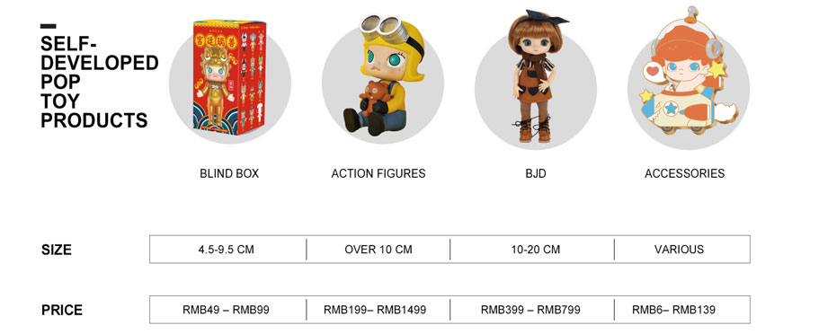


###### 原PDF第18页

[对照原PDF第18页](../2020年港股招股书.pdf#page=18)

###### 概             要

```text
                   毛利率  %                                61.1    70.4    72.9    46.5    44.2    58.2    12.2             65.2
                   毛利     人民币元                        38.3 191,388  40.9 235,505  12.9 76,904  7.8 29,496  6.6 23,601  1.3 5,895  146  100.0 533,439
         2020年
                  %                                                                                         0.1
截至6月30日止六个月
                   收益    % 人民币元                       57.2 313,296  71.2 334,303  71.7 105,496  33.4 63,500  29.2 53,374  55.8 10,126  33.9 1,196  60.8 817,791
```

毛利率

```text
毛利     人民币元                        42.9 133,317  30.1 116,481  15.2 59,150  7.3 13,320  6.1 9,805  1.2 3,515  4.5 8,324  100.0 330,592
                  （未经审核）
```

2019年

%

```text
收益    % 人民币元                       65.6 232,954  68.9 163,545  70.7 82,473  36.7 39,887  37.6 33,591  31.9 6,296  36.8 24,537  64.8 543,396
```

毛利率

```text
毛利                     （千元，百分比除外）  43.9 485,514  32.0 371,719  14.8 175,778  6.6 40,559  5.6 35,184  1.0 5,375  2.7 16,764  100.0 1,090,334
         人民币元
```

2019年

%

```text
下表载列所示期间按销售及经销渠道划分的收益明细：
                                   收益    % 人民币元                      739,690  539,201  248,554  110,467  93,601  16,866  45,522        57.9 1,683,434
                                   毛利率                                  61.2    62.8    71.5    25.6    22.2    49.1    25.3
                截至12月31日止年度  毛利                                   48.3 152,024  20.0 64,639  16.8 61,757  10.0 13,120  8.7 10,000  1.2 3,120  5.0 6,485  100.0 298,025
                                            人民币元
```

2018年

%

```text
收益    % 人民币元                       55.0 248,257  56.1 102,886  63.2 86,431  19.7 51,329  19.5 44,972  22.2 6,357  29.9 25,608  47.6 514,511
```

包括来自短期快闪店的销售毛利率

```text
                                         毛利   人民币元                  55,504  8,326  3,517  5,888  5,417  471  2,019       75,254
                                2017年
                                        %                                 63.9  9.4    3.5   18.9   17.6  1.3    4.3           100.0
销售及经销渠道
                                         收益   人民币元                  101,005  14,854  5,568  29,884  27,759  2,125  6,763  158,074
```

```text
                                                                                  (1)
                                        －批量采购
                机器人商店      －经销商
零售店 (1)  线上渠道
                                                                  总收益
                        批发                    展会
```

– 8 –


###### 原PDF第19页

[对照原PDF第19页](../2020年港股招股书.pdf#page=19)

###### 概  要

于往绩记录期间，我们来自零售店收益的增加主要是由于 (i) 我们零售店网络的持续扩大，由截至 2017 年 12 月 31 日的 32 间扩大至截至 2018 年 12 月 31日的 63 间及截至 2019 年 12 月 31 日的 114 间，并进一步扩大至截至 2020 年 6 月30 日的 136 间及 (ii) 同店销售增长。于往绩记录期间，按绝对金额及占我们总收益的百分比计算的我们来自线上渠道的收益大幅增加主要是由于 (i) 我们的线上营销努力所带来的我们的品牌及产品的知名度及受欢迎程度的提升及 (ii)透过该等线上渠道获得的用户数量的增加。按绝对金额计算的我们来自机器人商店的收益自 2017 年推出以来经历快速增长，主要是由于我们的机器人商店数量大幅增加，由截至 2017 年 12 月 31 日的 43 间增加至截至 2018 年 12 月 31日的 260 间及截至 2019 年 12 月 31 日的 825 间，并进一步增加至截至 2020 年 6 月30 日的 1,001 间，且机器人商店所覆盖的位置亦大幅增加。

除直接销售外，我们亦通过我们的经销商销售产品，经销商通过彼等经营的零售店或向零售商转售我们的产品。截至 2020 年 6 月 30 日，我们有 25 名中国经销商及 22 名海外经销商，并建立了覆盖中国 16 个省级地区及 21 个海外国家及地区的广泛经销网络。

下表载列所示期间按地理位置划分的收益及毛利明细：

```text
                                      截至12月31日止年度                                                               截至6月30日止六个月
            2017年                          2018年                           2019年                          2019年                           2020年
    收益       毛利     毛利率       收益       毛利    毛利率       收益       毛利     毛利率       收益       毛利    毛利率       收益       毛利     毛利率
人民币元人民币元            % 人民币元人民币元              % 人民币元人民币元               % 人民币元人民币元              % 人民币元人民币元               %
```

（未经审核）

（千元，百分比除外）

```text
中国                     157,414      74,878        47.6     510,149     295,654        58.0 1,656,544 1,078,264            65.1     536,854     327,017        60.9    797,119     523,482         65.7
海外                         660         376        57.0       4,362       2,371        54.4      26,890      12,070        44.9       6,542       3,575        54.6      20,672       9,957        48.2
总计                     158,074      75,254        47.6     514,511     298,025        57.9 1,683,434 1,090,334            64.8     543,396     330,592        60.8    817,791     533,439         65.2
```

我们的客户

我们的客户主要包括粉丝及经销商，其次包括我们的批量采购公司客户。我们拥有多元化的客户基础。于 2017 年、2018 年及 2019 年以及截至 2020 年 6月 30 日止六个月，来自我们五大客户（包括我们的经销商及批量采购公司客户）的总收益分别占我们收益的约 17.8%、8.2%、4.3% 及 4.7%，以及来自我们最大客户南京金鹰泡泡玛特的总收益分别占我们收益的约 16.6%、6.9%、3.3%及 3.0%。

– 9 –


###### 原PDF第20页

[对照原PDF第20页](../2020年港股招股书.pdf#page=20)

###### 概  要

销售及市场推广

我们有专责的市场推广团队负责制定及协调市场推广活动及促销活动。截至 2020 年 6 月 30 日，我们的市场推广团队由 26 名成员组成，彼等与其他团队及╱或我们的艺术家及 IP 提供商密切合作以执行市场推广策略。于 2017 年、2018 年及 2019 年以及截至 2019 年及 2020 年 6 月 30 日止六个月，我们的广告及市场推广开支分别为人民币2.6百万元、人民币10.7百万元、人民币53.8百万元、人民币 14.3 百万元及人民币 30.4 百万元。

制造

目前，我们的产品由中国境内专门生产玩具的选定第三方制造商制造。我们根据质量、产能、价格、声誉及对适用法律法规的遵守情况等因素选择第三方制造商。我们的大多数第三方制造商具备丰富的行业经验，并与中国及全球其他主要玩具品牌合作。

我们的供应商

目前，我们的供应商主要包括选定中国第三方制造商。其次，我们的供应商亦包括第三方品牌拥有人，我们购买并通过我们的网络销售彼等的产品。于 2017 年、2018 年及 2019 年以及截至 2020 年 6 月 30 日止六个月，我们向五大供应商（ 为制造商 ）作出的采购额分别约占我们总采购额的 43.8%、41.3%、40.8% 及 50.8%，以及我们向最大供应商作出的采购额分别约占我们总采购额的 19.7%、18.8%、15.0% 及 15.8%。

法律诉讼

董事确认，于往绩记录期间及直至最后实际可行日期，我们并未涉及任何针对我们或任何董事的诉讼、仲裁或行政诉讼以致可能对我们的业务、财务状况或经营业绩造成重大不利影响。

于 2020 年 8 月 28 日，本公司接获一份日期为 2020 年 8 月 19 日的法院传票，内容有关金鹰国际（作为股东）代表南京金鹰泡泡玛特于江苏省南京市中级人民法院向北京泡泡玛特提起的申索，指称（其中包括）北京泡泡玛特违反投资合作协议，自行而非通过南京金鹰泡泡玛特于专属地区（「专属地区」，定义见投资合作协议）开设 19 间零售店及 191 间机器人商店（「申索店舖」）。根据申索，金鹰国际要求 (i) 北京泡泡玛特应停止于专属地区经营申索店舖；及 (ii) 北京泡泡玛特应向南京金鹰泡泡玛特返还为数约人民币 117.2 百万元的款项，即北京泡泡玛特于截至 2019 年 12 月 31 日止年度自于专属地区经营申索店舖获得

– 10 –


###### 原PDF第21页

[对照原PDF第21页](../2020年港股招股书.pdf#page=21)

###### 概  要

的所指称毛利。中国法律顾问告知我们，金鹰国际提出的有关申索并无理据，申索获判金鹰国际胜诉的可能性极低，本公司面临的来自申索的风险极低，申索将不会对我们的营运及财务表现造成重大不利影响。我们计划在中国法律顾问的协助下于法院坚决为我们辩护。有关申索的详情，请参阅本招股章程「业务－法律诉讼及合规事宜－法律诉讼－金鹰国际诉讼」一节。

竞争

根据弗若斯特沙利文报告，于 2019 年，中国潮流玩具零售市场按零售价值计为人民币 207 亿元，占 2019 年按零售价值计的中国泛娱乐市场市场规模的 2.3%。中国的潮流玩具零售市场分散且充满竞争。根据弗若斯特沙利文报告，于 2019 年，按零售价值计，前五大市场营运商分别占中国潮流玩具零售市场份额的 8.5%、7.7%、3.3%、1.7% 及 1.6%。我们的竞争对手包括国际品牌及本土品牌。我们就多项因素竞争，其中包括品牌认知度、粉丝群、产品受欢迎程度及质量、价格、市场推广的有效性以及于中国的销售及经销网络等。根据弗若斯特沙利文报告，于 2019 年，按零售价值计，我们于中国潮流玩具零售市场排名第一，市场份额为 8.5%。更多详情，请参阅「业务－竞争」。

财务资料概要

下列表格概述我们于往绩记录期间的综合财务业绩，并应与本招股章程「财务资料」章节以及本招股章程附录一所载的会计师报告及随附的附注一并阅读。

综合收益表概要

```text
                       截至12月31日止年度                                        截至6月30日止六个月
      2017年                 2018年                  2019年                 2019年                 2020年
人民币元          %    人民币元          %    人民币元          %     人民币元          %    人民币元          %
```

（未经审核）

（千元，百分比除外）

```text
收益                     158,074        100.0      514,511        100.0 1,683,434           100.0     543,396        100.0      817,791        100.0
销售成本                  (82,820)       (52.4)   (216,486)       (42.1) (593,100)          (35.2)   (212,804)        (39.2)   (284,352)       (34.8)
毛利                      75,254         47.6      298,025         57.9    1,090,334         64.8     330,592         60.8      533,439         65.2
```

– 11 –


###### 原PDF第22页

[对照原PDF第22页](../2020年港股招股书.pdf#page=22)

###### 概         要

|  |  |  |  | 截至12月31日止年度 |  |  |  |  | 截至6月30日止六个月 |  |
| --- | ---: | ---: | ---: | ---: | ---: | ---: | ---: | ---: | ---: | ---: |
|  | 2017年 |  | 2018年 |  | 2019年 |  | 2019年 |  | 2020年 |  |
|  | 人民币元 | % | 人民币元 | % | 人民币元 | % | 人民币元 | % | 人民币元 | % |
|  |  |  |  |  |  |  | （未经审核） |  |  |  |
|  |  |  |  |  |  | （千元，百分比除外） |  |  |  |  |
| 经销及销售开支 | (51,047) | (32.3) | (125,721) |  | (24.4) (363,819) | (21.6) | (118,731) | (21.8) | (223,030) | (27.3) |
| 一般及行政开支 | (20,897) | (13.2) | (43,599) |  | (8.5) (142,468) | (8.5) | (64,132) | (11.8) | (125,397) | (15.3) |
| 金融资产减值亏损 |  |  |  |  |  |  |  |  |  |  |
| 净额 | (344) | (0.2) | (270) | (0.1) | (3,086) | (0.2) | (901) | (0.2) | 977 | 0.1 |
| 其他收入 | 1,362 | 0.9 | 5,484 | 1.1 | 17,013 | 1.0 | 2,781 | 0.5 | 31,369 | 3.8 |
| 其他收益╱（亏损） |  |  |  |  |  |  |  |  |  |  |
| －净额 | 51 | – | (305) | (0.1) | 820 | – | 1,387 | 0.3 | (8,990) | (1.1) |
| 经营溢利 | 4,379 | 2.8 | 133,614 | 26.0 | 598,794 | 35.6 | 150,996 | 27.8 | 208,368 | 25.5 |
| 财务收入 | 9 | – | 142 | – | 424 | – | 84 | 0.0 | 699 | 0.1 |
| 财务开支 | (1,764) | (1.1) | (2,455) | (0.5) | (5,813) | (0.3) | (2,010) | (0.4) | (4,624) | (0.6) |
| 财务开支－净额 | (1,755) | (1.1) | (2,313) | (0.4) | (5,389) | (0.3) | (1,926) | (0.4) | (3,925) | (0.5) |
| 可转换可赎回优先股 |  |  |  |  |  |  |  |  |  |  |
| 的公平值变动 | – | – | – | – | – | – | – | – | (6,436) | (0.8) |
| 应占以权益法 |  |  |  |  |  |  |  |  |  |  |
| 入账的投资 |  |  |  |  |  |  |  |  |  |  |
| （亏损）╱溢利 | (351) | (0.2) | 959 | 0.2 | 4,970 | 0.3 | 1,974 | 0.4 | (1,125) | (0.1) |
| 除所得税前溢利 | 2,273 | 1.4 | 132,260 | 25.7 | 598,375 | 35.5 | 151,044 | 27.8 | 196,882 | 24.1 |
| 所得税开支 | (704) | (0.4) | (32,739) | (6.4) | (147,257) | (8.7) | (37,431) | (6.9) | (55,598) | (6.8) |
| 年╱期内溢利 | 1,569 | 1.0 | 99,521 | 19.3 | 451,118 | 26.8 | 113,613 | 20.9 | 141,284 | 17.3 |

以下应占年╱期内

```text
溢利╱（亏损）：
－本公司拥有人             1,569           1.0        99,521          19.3       451,118          26.8       113,613          20.9       141,358           17.3
－非控股权益                   –             –             –             –             –             –             –             –           (74)          (0.0)
                           1,569           1.0        99,521          19.3       451,118          26.8       113,613          20.9       141,284           17.3
```

– 12 –


###### 原PDF第23页

[对照原PDF第23页](../2020年港股招股书.pdf#page=23)

###### 概  要

我们的溢利由 2017 年的人民币 1.6 百万元大幅增至 2018 年的人民币 99.5百万元，并进一步增至 2019 年的人民币 451.1 百万元。我们的溢利由截至 2019年 6 月 30 日止六个月的人民币 113.6 百万元增加 23.2% 至截至 2020 年 6 月 30 日止六个月的人民币 141.3 百万元。有关增加主要由相应期间收益大幅增长所带动，及被相应期间我们的销售成本、经销及销售开支及一般及行政开支增加所抵销。于往绩记录期间的收益增加主要是由于 (i) 销售泡泡玛特品牌产品所产生的收益增加，及 (ii) 我们的销售及经销网络扩张。于往绩记录期间的销售成本增加主要是由于我们的产品销量增加导致商品成本增加。于往绩记录期间的经销及销售开支增加主要是由于雇员福利开支、使用权资产折旧以及与短期租赁及可变租赁有关的开支增加。于往绩记录期间的一般及行政开支增加主要是由于雇员福利开支增加。更多详情，请参阅「财务资料－经营业绩主要组成部分说明」。

综合资产负债表概要

|  |  |  |  | 截至 |
| --- | ---: | ---: | ---: | ---: |
|  |  | 截至 12 月 31 日 |  | 6 月 30 日 |
|  | 2017 年 | 2018 年 | 2019 年 | 2020 年 |
|  |  |  | （人民币千元） |  |
| 物业、厂房及设备 | 12,096 | 35,874 | 103,559 | 135,222 |
| 无形资产 | 2,580 | 17,641 | 18,620 | 85,271 |
| 使用权资产 | 35,078 | 70,816 | 178,938 | 209,420 |
| 贸易应收款项 | 5,489 | 14,295 | 45,636 | 41,374 |
| 其他应收款项 | 11,279 | 23,759 | 59,696 | 69,014 |
| 存货 | 15,540 | 29,061 | 96,302 | 224,050 |
| 预付款项及 |  |  |  |  |
| 其他流动资产 | 19,901 | 40,777 | 140,353 | 117,569 |
| 现金及现金等价物 | 13,592 | 96,802 | 324,614 | 821,686 |
| 其他资产 | 26,724 | 73,770 | 98,763 | 85,568 |
| 总资产 | 142,279 | 402,795 | 1,066,481 | 1,789,174 |
| 贸易应付款项 | 6,359 | 29,256 | 49,406 | 77,191 |
| 应付授权费 | 773 | 7,181 | 16,495 | 58,831 |
| 其他应付款项 | 16,599 | 49,746 | 122,050 | 105,982 |
| 合约负债 | 695 | 10,039 | 35,167 | 58,343 |
| 租赁负债 | 38,732 | 75,298 | 183,398 | 211,186 |
| 即期所得税负债 | 297 | 12,445 | 67,184 | 35,862 |
| 总负债 | 63,455 | 183,965 | 473,700 | 547,395 |

– 13 –


###### 原PDF第24页

[对照原PDF第24页](../2020年港股招股书.pdf#page=24)

###### 概  要

|  |  |  |  | 截至 |
| --- | ---: | ---: | ---: | ---: |
|  |  | 截至 12 月 31 日 |  | 6 月 30 日 |
|  | 2017 年 | 2018 年 | 2019 年 | 2020 年 |
|  |  |  | （人民币千元） |  |
| 本公司拥有人应占权益 | 78,824 | 218,830 | 592,781 | 1,239,951 |
| 非控股权益 | – | – | – | 1,828 |
| 总权益 | 78,824 | 218,830 | 592,781 | 1,241,779 |
| 总权益及负债 | 142,279 | 402,795 | 1,066,481 | 1,789,174 |
| 流动资产净值 | 21,782 | 110,123 | 335,031 | 866,112 |

我们的流动资产净值由截至 2017 年 12 月 31 日的人民币 21.8 百万元增至截至 2018 年 12 月 31 日的人民币 110.1 百万元，并进一步增至截至 2019 年 12 月31 日的人民币 335.0 百万元以及截至 2020 年 6 月 30 日的人民币 866.1 百万元。有关增加主要由于现金及现金等价物增加，主要乃由于业务增长所致，惟部分被其他应付款项增加所抵销，而其他应付款项增加主要乃由于雇员人数增加导致应付雇员款项增加。更多详情，请参阅「财务资料－综合资产负债表的若干主要项目讨论－流动资产及流动负债」。

我们的非流动资产由截至 2017 年 12 月 31 日的人民币 76.5 百万元增至截至 2018 年 12 月 31 日的人民币 147.8 百万元，并进一步增至截至 2019 年 12 月 31日的人民币 349.9 百万元以及截至 2020 年 6 月 30 日的人民币 511.9 百万元。有关增加主要由于相应期间物业、厂房及设备、使用权资产及无形资产增加。更多详情，请参阅「财务资料－综合资产负债表的若干主要项目讨论」。

我们的非流动负债由截至 2017 年 12 月 31 日的人民币 19.4 百万元增至截至 2018 年 12 月 31 日的人民币 39.1 百万元， 并进一步增至截至 2019 年 12 月 31日的人民币 92.1 百万元以及截至 2020 年 6 月 30 日的人民币 136.3 百万元。有关增加主要由于我们的非即期租赁负债增加。更多详情，请参阅「财务资料－债务－租赁负债」。

– 14 –


###### 原PDF第25页

[对照原PDF第25页](../2020年港股招股书.pdf#page=25)

###### 概  要

综合现金流量表概要

```text
    截至 12 月 31 日止年度         截至 6 月 30 日止六个月
2017 年      2018 年     2019 年      2019 年      2020 年
```

（未经审核）

（人民币千元）

| 经营活动所得现金净额 | 15,507 | 175,000 | 502,889 | 145,388 | 122,190 |
| --- | ---: | ---: | ---: | ---: | ---: |
| 投资活动（所用）╱所得 |  |  |  |  |  |
| 现金净额 | (8,884) | (100,510) | (118,267) | 12,553 | (48,258) |
| 融资活动所得╱（所用） |  |  |  |  |  |
| 现金净额 | (17,602) | 8,718 | (155,584) | (106,273) | 423,756 |
| 现金及现金等价物 |  |  |  |  |  |
| （减少）╱增加净额 | (10,979) | 83,208 | 229,038 | 51,668 | 497,688 |
| 年╱期初的现金及现金 |  |  |  |  |  |
| 等价物 | 24,571 | 13,592 | 96,802 | 96,802 | 324,614 |
| 现金及现金等价物的汇 |  |  |  |  |  |
| 兑收益╱（亏损） | – | 2 | (1,226) | (10) | (616) |
| 年╱期末的现金及现金 |  |  |  |  |  |
| 等价物 | 13,592 | 96,802 | 324,614 | 148,460 | 821,686 |

于往绩记录期间及直至最后实际可行日期，我们过往主要以经营活动所得现金及股东注资满足营运资金及其他资金需求。

我们的现金及现金等价物由截至 2017 年 12 月 31 日的人民币 13.6 百万元增至截至 2018 年 12 月 31 日的人民币 96.8 百万元，并进一步增至截至 2019 年 12月 31 日的人民币 324.6 百万元以及截至 2020 年 6 月 30 日的人民币 821.7 百万元。有关增加主要由于经营活动所得现金净额所致，惟部分被 2018 年、2019 年及截至 2020 年 6 月 30 日止六个月的投资活动所用现金净额及 2017 年、2019 年及截至 2020 年 6 月 30 日止六个月的融资活动所用现金净额所抵销。更多详情，请参阅「财务资料－流动资金及资本来源」。

非国际财务报告准则计量

为补充我们根据国际财务报告准则呈列的财务资料，我们采用并非国际财务报告准则要求或并非按国际财务报告准则呈列的非国际财务报告准则经调整纯利，作为额外财务计量。我们认为该非国际财务报告准则计量通过免除管理层认为对我们经营表现没有指标作用的项目的潜在影响，有助于比较不同期间及不同公司的经营业绩。我们认为，该计量为投资者及其他人士提

– 15 –


###### 原PDF第26页

[对照原PDF第26页](../2020年港股招股书.pdf#page=26)

###### 概  要

供了有用的资料，帮助彼等按其帮助管理层相同的方式了解及评估我们的综合经营表现。然而，我们对非国际财务报告准则经调整纯利的呈列可能与其他公司呈列的类似名称的财务计量不具有可比性。使用该非国际财务报告准则计量作为分析工具具有局限性， 阁下不应单独考虑，或作为根据国际财务报告准则呈报的经营业绩或财务状况分析的替代。

下表载列于所示期间的非国际财务报告准则经调整纯利以及年╱期内溢利与非国际财务报告准则经调整纯利的对账。

```text
    截至 12 月 31 日止年度         截至 6 月 30 日止六个月
2017 年      2018 年     2019 年      2019 年      2020 年
```

（未经审核）（人民币千元，非国际财务报告准则经调整纯利率除外）

年╱期内溢利与非国际

财务报告准则经调整

```text
  纯利的对账
年╱期内溢利                  1,569      99,521     451,118     113,613     141,284
调整项目：
以股份为基础的
  付款报酬                     102         782       1,467        297            –
上市开支                         –           –      16,538      10,192      13,637
重新指定普通股为优先
  股有关开支                     –           –           –           –      16,910
可转换可赎回优先股的
  公平值变动                     –           –           –           –       6,436
非国际财务报告准则
  经调整纯利                 1,671     100,303     469,123     124,102     178,267
```

```text
非国际财务报告准则
  经调整纯利率               1.1%       19.5%       27.9%       22.8%       21.8%
```

非国际财务报告准则经调整纯利从 2017 年的人民币 1.7 百万元增加至2018 年的人民币 100.3 百万元，进一步增加至 2019 年的人民币 469.1 百万元，并由截至 2019 年 6 月 30 日止六个月的人民币 124.1 百万元增加至截至 2020 年 6月 30 日止六个月的人民币 178.3 百万元，与年╱期内溢利增长一致。

我们的管理层认为，上市开支、重新指定普通股为优先股有关开支及可转换可赎回优先股的公平值变动属于与上市及首次公开发售前程序有关的一次性性质且将不会于上市后再产生。此外，以股份为基础的付款开支、重新

– 16 –


###### 原PDF第27页

[对照原PDF第27页](../2020年港股招股书.pdf#page=27)

###### 概  要

指定普通股为优先股有关开支及可转换可赎回优先股的公平值变动属于非现金项目且并无直接反映我们的业务营运。由于上述项目的非经常性及╱或非现金性质，我们的管理层在检讨表现时不会将该等项目作为运营或财务的关键指标进行内部追踪，因为该等项目与我们的日常运营无关。因此，通过撇除该等项目对计算非国际财务报告准则经调整纯利影响的举措，可更好地反映我们的相关经营表现，并更加便于比较逐年的经营表现。

主要财务比率

下表载列我们于所示日期或期间的若干主要财务比率。

```text
                             截至 12 月 31 日止年度       截至 6 月 30 日止六个月
                          2017 年    2018 年     2019 年     2019 年     2020 年
收益增长率                     –     225.4%      227.2%           –       50.5%
零售店同店销售增长 (1)         –      59.6%       63.1%           –     (23.1)%
毛利率                    47.6%       57.9%       64.8%       60.8%       65.2%
纯利率                     1.0%       19.3%       26.8%       20.9%       17.3%
贸易应收款项
  周转天数                   8 天       7 天        6 天     不适用        10 天
贸易应付款项
  周转天数                  21 天      36 天       29 天     不适用        50 天
存货周转天数                49 天      45 天       46 天     不适用       126 天
                                                                          截至
                                      截至 12 月 31 日                 6 月 30 日
                              2017 年       2018 年       2019 年       2020 年
流动比率                          1.5           1.8           1.9           3.1
资产回报率                      1.1%         24.7%         42.3%        不适用
权益回报率                      2.0%         45.5%         76.1%        不适用
附注：
(1)   指相同零售店相较上一期间的收益增长。相同零售店指于所比较的上一期初前已
      开始营业及于本期期末后仍开业的零售店。
```

我们分别于 2018 年及 2019 年实现 59.6% 及 63.1% 的零售店同店销售增长，主要由于 (i) 我们的品牌及产品的知名度及受欢迎程度飙升；(ii) 我们的产品组合扩大及 (iii) 我们产品的设计及质量的提升。于 2020 年上半年，我们的零售店的同店销售额下降 23.1%，这是因为由于 COVID-19 疫情的影响，我们的 88 间零售店于 2020 年上半年暂时关闭。

– 17 –


###### 原PDF第28页

[对照原PDF第28页](../2020年港股招股书.pdf#page=28)

###### 概  要

我们的纯利率由截至 2019 年 6 月 30 日止六个月的 20.9% 减少至截至 2020年 6 月 30 日止六个月的 17.3%， 主要是由于 (i) 经销及销售开支增加 87.9%，主要原因是零售店及机器人商店数量增加，(ii) 一般及行政开支增加 95.6%，主要原因是我们的行政人员及创意设计和工业开发人员的人数增加以支持IP 组合扩张及业务增长以及与重新指定普通股为优先股有关的一次性费用（与 2020 年的 A 系列首次公开发售前投资有关），及 (iii) 我们于 2020 年上半年因COVID-19 疫情而面临零售店及机器人商店的同店销售下滑。

我们的存货周转天数由 2019 年的 46 天增加至 2020 年上半年的 126 天，主要是因为由于 COVID-19 疫情爆发，我们将已经生产的若干产品系列的发布推迟至 2020 年下半年。

我们的流动比率由截至 2017 年 12 月 31 日的 1.5 增至截至 2018 年 12 月 31 日的 1.8，并进一步增至截至 2019 年 12 月 31 日的 1.9 及截至 2020 年 6 月 30 日的 3.1，主要由于我们的流动资产增加，而我们的流动资产增加的主要原因是我们的现金及现金等价物、预付款项以及其他流动资产及存货增加。

我们的资产回报率由截至 2017 年 12 月 31 日的 1.1% 增至截至 2018 年 12 月31 日的 24.7%， 并进一步增至截至 2019 年 12 月 31 日的 42.3%， 主要由于我们的纯利大幅增长。

我们的权益回报率由截至 2017 年 12 月 31 日的 2.0% 增至截至 2018 年 12 月31 日的 45.5%， 并进一步增至截至 2019 年 12 月 31 日的 76.1%， 主要由于我们的纯利大幅增长。

重大风险因素概要

我们的业务及全球发售涉及若干风险，该等风险载于「风险因素」一节。于决定投资于我们的股份前， 阁下应仔细阅读整个章节。我们面临的部分主要风险乃关于：(i) 作为潮流文化娱乐公司，我们无法向阁下保证，我们将能够设计及开发受消费者欢迎的产品，或我们将能够保持成功产品的受欢迎程度；(ii) 倘我们获授权的 IP 的市场吸引力低于预期，或使用该等 IP 的产品的销售额不足以满足最低保证特许权使用费，我们可能无法实现授权的全部利益；(iii) 我们面临有关 IP 授权协议及授权方的多项风险，这可能对我们的业务及经营业绩造成不利影响；(iv) 我们的业务在很大程度上取决于我们「泡泡玛特」品牌的市场认知度，且对我们的品牌、商标或声誉的任何损害，或未能有效推广我们的品牌，均可能对我们的业务及经营业绩造成重大不利影响；及(v)我们过往的增长率未必为我们未来业绩的指标，我们的成功取决于我们执行业务策略的能力。

– 18 –


###### 原PDF第29页

[对照原PDF第29页](../2020年港股招股书.pdf#page=29)

###### 概  要

近期发展

董事确认，截至本招股章程日期，我们的财务或经营状况、债务、按揭、或然负债、担保或本集团的前景自 2020 年 6 月 30 日（即本招股章程附录一所载会计师报告所报告期间的截止日期）以来并无重大不利变动。

自 2019 年 12 月底以来，COVID-19 疫情对全球经济造成重大不利影响。中国政府及全球其他政府已实施严格措施防控有关疫情。根据弗若斯特沙利文报告，COVID-19 疫情对全球潮流玩具零售业的影响已强化于 COVID-19 疫情前已经形成的行业趋势，主要为数字化转型。于 2020 年，预计家庭娱乐及在线购买将呈增长趋势。一方面，由于 COVID-19 疫情，全球潮流玩具零售业面临可支配收入减少、实体店关闭及产品获取渠道有限所带来的挑战。另一方面，由于在 COVID-19 疫情期间实体店关闭及线上购物活动增加，电子商务已经历快速增长。根据弗若斯特沙利文报告，按零售价值计，2020 年全球潮流玩具零售市场的市场规模与 2019 年相比预计将增加约 3%，该增加源于电商渠道大幅增长惟部分被线下实体店渠道的预期减少抵销。

自 2020 年 1 月起及直至最后实际可行日期，我们临时关闭合共 88 间零售店及 279 间机器人商店，主要介乎一周至一个月。因此，于截至 2020 年 6 月 30日止六个月，我们零售店及机器人商店的同店销售分别减少 23.1% 及 52.8%。我们的每间零售店年化收益由截至 2019 年 6 月 30 日止六个月的人民币 6.3 百万元减至截至 2020 年 6 月 30 日止六个月的人民币 5.0 百万元，而我们的每间机器人商店年化收益由截至 2019 年 6 月 30 日止六个月的人民币 0.5 百万元减至截至 2020 年 6 月 30 日止六个月的人民币 0.2 百万元。此外，COVID-19 疫情亦导致我们推迟部分 IP 的产品发布时间表。例如，我们因 COVID-19 疫情而调整了于 2020 年发布 Molly 形象潮流玩具产品系列的时间表，因此来自 Molly 形象的收益由截至 2019 年 6 月 30 日止六个月的人民币 175.7 百万元减少 36.2% 至截至2020 年 6 月 30 日止六个月的人民币 112.1 百万元。尽管爆发 COVID-19 疫情，我们来自零售店的收益由截至 2019 年 6 月 30 日止六个月的人民币 233.0 百万元增加 34.5% 至截至 2020 年 6 月 30 日止六个月的人民币 313.3 百万元，我们来自机器人商店的收益由截至 2019 年 6 月 30 日止六个月的人民币 82.5 百万元增加27.9% 至截至 2020 年 6 月 30 日止六个月的人民币 105.5 百万元，主要由于我们的零售店及机器人商店数量增加，以支持我们的业务增长及满足对我们产品的需求增加。由于 COVID-19 疫情爆发，我们 2020 年的上海国际潮玩展已推迟并于 2020 年 11 月举办，且我们原定于 2020 年举办的北京国际潮玩展已取消。然而，由于线上购物活动于 COVID-19 疫情期间有所增加，尽管由于物流及经销方面暂时遭遇困难，我们线上渠道的销售额仍于 COVID-19 疫情期间录得增长。截至最后实际可行日期，我们所有零售店及 279 间临时关闭的机器人商

– 19 –


###### 原PDF第30页

[对照原PDF第30页](../2020年港股招股书.pdf#page=30)

###### 概  要

店中的 265 间已重新开业，对物流及经销方面的限制亦已逐渐解除。我们来自经销商的收益由截至 2019 年 6 月 30 日止六个月的人民币 33.6 百万元增至截至 2020 年 6 月 30 日止六个月的人民币 53.4 百万元。预期 COVID-19 疫情对我们产品销售的不利影响将逐渐减退。

截至 2020 年 6 月 30 日，我们的现金及现金等价物为人民币 821.7 百万元。经计及我们可得的财务资源（包括手头现金及现金等价物及估计全球发售所得款项净额），董事认为，我们拥有充足营运资金，以满足当前及自本文件日期起未来 12 个月的需求。

倘在最坏的情况下，我们因 COVID-19 疫情而须完全暂停全部业务营运，且因此于 2020 年 6 月 30 日后并无产生任何收益，基于以下假设，我们估计截至 2020 年 6 月 30 日的现有财务资源以及将用于补充营运资金的全球发售预期所得款项净额（假设按发售价的下限）的 10% 足以应付必要营运且可支持我们的财务可行性约 3.1 年。我们的关键假设包括：

•  概不会扩张零售店及机器人商店，因此不会产生任何资本开支；

•  我们将产生必要成本及经营开支以维持最低营运（根据截至 2020 年6 月 30 日止六个月的成本及开支），包括销售及行政人员的薪资以及零售店、机器人商店、办公室及仓库的租金开支；

•  我们将向 IP 提供商及艺术家支付特许权使用费；

•  概无来自股东或金融机构的任何内部或外部融资活动；

•  概无任何股息分派；及

•  经参考我们的历史结算模式，我们估计按审慎基准结算截至 2020年 6 月 30 日的贸易应收款项及假设悉数结算截至 2020 年 6 月 30 日的贸易应付款项。

上述分析仅供说明用途，董事估计该等情况出现的可能性甚微。

基于目前可得资料，董事认为，COVID-19 疫情不会对我们截至 2020 年12 月 31 日止十二个月的经营业绩及我们的长期业务发展产生重大不利影响。有关详情，请参阅「财务资料－近期发展－COVID-19疫情及对我们业务的影响」。

– 20 –


###### 原PDF第31页

[对照原PDF第31页](../2020年港股招股书.pdf#page=31)

###### 概  要

我们的收益由截至 2019 年 9 月 30 日止九个月的人民币 1,034.0 百万元增加49.3% 至截至 2020 年 9 月 30 日止九个月的人民币 1,544.1 百万元，主要由于 (a)我们IP的受欢迎程度提高、(b)产品组合扩大及(c)我们的销售及经销网络扩张。我们的毛利由截至 2019 年 9 月 30 日止九个月的人民币 659.0 百万元增加 50.0%至截至 2020 年 9 月 30 日止九个月的人民币 988.3 百万元，与我们的收益增长一致。我们的毛利率保持相对稳定，于截至 2019 年 9 月 30 日止九个月为 63.7% 及于截至 2020 年 9 月 30 日止九个月为 64.0%。上文所载我们截至 2020 年 9 月 30 日止九个月的收益及毛利乃摘录自我们于 2020 年 9 月 30 日及截至该日止九个月的未经审核中期简明综合财务资料，其已经我们的申报会计师根据国际审计与鉴证准则理事会颁布的国际审阅工作准则第 2410 号「由实体的独立核数师执行中期财务资料审阅」进行审阅。

我们的盲盒产品销量由截至 2019 年 9 月 30 日止九个月的 16.1 百万个增加70.8% 至截至 2020 年 9 月 30 日止九个月的 27.5 百万个，并由截至 2019 年 9 月 30日止三个月的 7.8 百万个增加 70.5% 至截至 2020 年 9 月 30 日止三个月的 13.3 百万个，主要由于我们 IP 的受欢迎程度提高及我们的销售及经销网络扩张。我们的盲盒产品的平均售价由截至 2019 年 9 月 30 日止九个月的人民币 49 元下降6.1% 至截至 2020 年 9 月 30 日止九个月的人民币 46 元，主要乃由于我们于截至2020 年 9 月 30 日止三个月的销售推广力度加大，包括参与销售推广活动以促进线上销售及提供若干折扣以期吸引更多会员；并由截至 2019 年 9 月 30 日止三个月的人民币49元下降12.2%至截至2020年9月30日止三个月的人民币43元，主要乃由于我们于截至 2020 年 9 月 30 日止三个月的销售推广力度加大，包括参与销售推广活动以促进线上销售及提供若干折扣以期吸引更多会员。

我们于 2020 年下半年一直扩充零售店及机器人商店网络。我们的零售店数目由截至 2020 年 6 月 30 日的 136 间增加至截至最后实际可行日期的 170 间，机器人商店数目由截至 2020 年 6 月 30 日的 1,001 间增加至截至最后实际可行日期的 1,301 间。

于 2020 年 7 月 28 日，本公司向 Pop Mart Partner Limited （受限制股份单位计划受托人全资拥有公司）配发及发行 2,442,873 股股份（占本公司于本招股章程日期股本的 1.96%）。该等股份将以信托方式由受限制股份单位计划受托人持有，以满足根据首次公开发售后股份奖励计划日后授出奖励。有关首次公开发售后股份奖励计划的详情，请参阅「附录四－法定及一般资料－D. 首次公开发售后股份奖励计划」。

所得款项用途

我们预期将自全球发售收取的所得款项净额合共（经扣除全球发售的包销费用及预计开支，并假设发售价为每股股份 35.00 港元（即指示性发售价范围每股股份 31.50 港元至 38.50 港元的中位数））将约为 4,568.8 百万港元。我们

– 21 –


###### 原PDF第32页

[对照原PDF第32页](../2020年港股招股书.pdf#page=32)

###### 概  要

将承担我们就发行新股份应付的包销佣金、证监会交易征费及联交所交易费，以及与全球发售有关的任何适用费用。我们计划将就以下用途动用将自本次发售收取的所得款项净额：

•  约 1,370.6 百万港元（占所得款项净额的 30%）预期将用于为我们的消费者触达渠道及海外市场扩展计划拨付部分资金；

•  约1,233.6百万港元（占所得款项净额的27%）预期将用于为潜在投资、收购本行业价值链上下游公司及及与该等公司建立战略联盟拨资；

•  约685.3百万港元（占所得款项净额的15%）预期将用于投资技术举措，以增强我们的营销及粉丝参与力度及提升业务的数字化程度；

•  约 822.4 百万港元（占所得款项净额的 18%）预期将用于扩大我们的IP 库；及

•  余下约 456.9 百万港元（占所得款项净额约 10%）预期将用作营运资金及一般公司用途。

进一步详情，请参阅「未来计划及所得款项用途」。

合约安排

我们推出葩趣互娱作为旗舰平台，以向我们的粉丝及社区提供线上文化服务以及互联网信息服务。提供该等服务受到与增值电信服务及线上文化服务相关的现有中国法律法规之外商投资限制规限。根据受外商投资限制及禁止规限的中国行业惯例，透过北京泡泡玛特（作为一方）与葩趣互娱及其相关股东（作为另一方）之间的合约安排，我们将获得对葩趣互娱目前经营的业务的有效控制并取得葩趣互娱目前经营业务所产生的所有经济利益。合约安排允许葩趣互娱的经营业绩、资产及负债及现金流量根据国际财务报告准则第10 号综合入账至我们的财务报表，犹如其为我们的附属公司。进一步资料载于本招股章程「合约安排」一节。

葩趣互娱于 2020 年之前并未开展任何实际业务，因此截至 2017 年、2018年及2019年12月31日止三个年度并无任何收益。截至2020年6月30日止六个月，葩趣互娱产生收益约人民币 422,000 元，占同期本集团总收益的约 0.05%。

– 22 –


###### 原PDF第33页

[对照原PDF第33页](../2020年港股招股书.pdf#page=33)

###### 概  要

下列简化图表说明于完成重组后，根据合约安排所订明的葩趣互娱对本集团的经济利益流向：

```text
                    (2)
北京泡泡玛特                   相关股东 (3)
(1)        (1)                      100%
```

葩趣互娱

「\_\_\_」指于股权中的法定和实益所有权

```text
                  「......」指合约安排
(1)   北京泡泡玛特提供软件开发及其他技术咨询服务，以自葩趣互娱换取服务费。请
      参阅「合约安排摘录 — 独家咨询和服务协议」。
(2)   相关股东以北京泡泡玛特为受益人订立独家购买权协议，以收购葩趣互娱 100%
      股权及╱或资产。请参阅「合约安排摘录 — 独家购买权协议」。
```

相关股东向北京泡泡玛特质押（作为第一押记）彼等各自于葩趣互娱的全部股权，作为彼等支付结欠北京泡泡玛特的任何或所有款项及确保彼等履行于独家咨询和服务协议、独家购买权协议、股东表决权委托协议及授权书项下责任的抵押品。请参阅「合约安排摘录一股权质押协议」。

相关股东以北京泡泡玛特为受益人订立股东表决权委托协议及授权书。请参阅「合约安排摘录 — 配偶承诺函」。

(3)  截至最后实际可行日期，王先生持有葩趣互娱的 91.56% 股份，27 名其他股东合共持有葩趣互娱的 8.44% 股份。王先生及 27 名其他股东统称为「相关股东」。

与合约安排有关的风险，请参阅本招股章程「风险因素－与我们的合约安排有关的风险」分节。

我们的控股股东及股东资料

紧随资本化发行及全球发售完成后（假设超额配股权未获行使且概无根据首次公开发售后股份奖励计划发行额外股份），创立人及执行董事王先生可透过 (i) GWF Holding （一家于英属维京群岛注册成立的有限公司，由 UBS Trustees (B.V.I.) Ltd. 全资拥有，乃王先生以其自身的利益所设立，持有本公司已发行股本总数的 41.40%）；及 (ii) Tianjin Paqu Holding Limited （一家于英属维京群岛注册成立的有限公司，持有本公司已发行股本总数的 2.18%）行使本公司约 43.58% 的投票权。因此，根据上市规则，王先生、GWF Holding 及 Tianjin

– 23 –


###### 原PDF第34页

[对照原PDF第34页](../2020年港股招股书.pdf#page=34)

###### 概  要

Paqu Holding Limited 被视为本公司的控股股东。有关控股股东的详情，请参阅「与控股股东的关系」及「主要股东」。

我们的首次公开发售前投资者

我们亦已完成私募股权基金及投资控股公司的一系列首次公开发售前投资，包括 (i) SCC GROWTH V HOLDCO F, LTD.，一家于开曼群岛注册成立的有限公司，由一家投资基金及独立第三方Sequoia Capital China Growth Fund V,L.P. 全资拥有；(ii) GWF Holding，由控股股东及执行董事王先生控制；(iii) Pop Mart Hehuo Holding Limited，一家于英属维京群岛注册成立的获豁免投资控股公司，由执行董事王先生 (43.99%)、杨涛女士 (15.11%)、司德先生 (2.02%)、刘冉女士 (9.23%) 及本公司 12 名其他雇员共同拥有；(iv) Sidsi Holding Limited，一家根据英属维京群岛法律注册成立的获豁免投资控股公司，由 TMF (Cayman)Ltd. （ 作为由我们的执行董事司德先生（作为委托人）以其本身为受益人设立的XM Family Trust 的受托人）全资拥有；(v) Justin Moon Holding Limited，一家根据英属维京群岛法律注册成立的获豁免投资控股公司，并由我们的副总裁文德一先生全资拥有；(vi) 百润国际集团有限公司，一家于香港注册成立的投资控股有限公司，由一名独立第三方控制；(vii) LVC Amusement LP，一家由Loyal Valley Capital （一家私募股权公司）于 2020 年成立的投资工具，并由一名独立第三方控制；(viii) Saturn Group Business Limited，一家根据英属维京群岛法律注册成立的投资控股公司，并由独立第三方Vision Knight Capital (China)Fund II 控制；(ix) Huaxing Growth Capital III, L.P.，一家于开曼群岛成立的有限合伙，从事投资控股，并由华兴资本控股有限公司（一家于香港联交所上市的公司（股份代号：1911））最终控制；(x) Lead Accomplish Limited，一家根据英属维京群岛法律注册成立的投资控股有限公司，由独立第三方 Yuan Lingyun女士全资拥有；(xi) How2work Holding Limited，一家于香港注册成立的投资控股有限公司，由独立第三方 Lee Howard 先生全资拥有；及 (xii) BA Capital Fund III, L.P.，一家根据开曼群岛法律成立、从事投资控股的有限合伙，并由我们的非执行董事何愚先生间接拥有 40%。有关首次公开发售前投资者身份及背景的详情，请参阅「历史、重组及公司架构－首次公开发售前投资－有关首次公开发售前投资者的资料」。

涉及发行本公司股份的首次公开发售前投资所得款项总额约为 68.3 百万美元。

过往于新三板上市及退市

于 2016 年 6 月 18 日，北京泡泡玛特由有限公司改制为股份有限公司。于2017 年 1 月 25 日，北京泡泡玛特的股份于新三板上市，股票代号为 870578。于 2019 年 3 月 21 日，在股东大会上通过有关北京泡泡玛特自愿从新三板退市的股东决议案。于 2019 年 3 月 29 日，北京泡泡玛特就退市取得新三板的监管批准，退市于 2019 年 4 月 2 日完成。

– 24 –


###### 原PDF第35页

[对照原PDF第35页](../2020年港股招股书.pdf#page=35)

###### 概  要

新三板退市乃北京泡泡玛特董事根据公司的业务发展计划作出的商业及战略决策，且北京泡泡玛特董事希望通过本公司于联交所进行该建议发售及上市获得更多机会接触国际投资者及市场。由于香港作为中国与国际市场之间的门户，将为本集团提供更多机会接触国际投资者及全球市场，故董事认为新三板退市及于联交所上市将符合本集团及股东的整体利益。

股息政策

于 2019 年，北京泡泡玛特向其股东宣派股息约人民币 80.0 百万元，有关股息已于 2019 年 5 月及 6 月以现金派付。于 2020 年 7 月，本公司向其股东宣派股息 55.0 百万美元，其中 53.2 百万美元已于 2020 年 7 月及 8 月以现金派付。我们拟每年向股东派付股息，数额不少于我们可分派纯利的 20%，惟须经董事酌情决定。经股东于股东大会上批准后，董事会可指示通过分派任何类型的特定资产全部或部分偿付股息。任何股息的宣派和派付以及金额将须遵守我们的章程文件及开曼公司法。我们的股东可在股东大会上批准任何股息的宣派，但不得超过董事会推荐的金额。股息只能从本公司可合法作分派用途的溢利及储备（包括股份溢价）中宣派或派付。本公司不会就股息支付利息。

上市开支

假设超额配股权并无获行使，则按发售价中位数 35.0 港元（即发售价范围每股发售股份 31.5 港元至 38.5 港元的中位数）计算，本公司应付的上市开支总额（包括包销佣金）估计约为 216.4 百万港元（相等于约人民币 183.5 百万元）。该等上市开支主要包括已付及应付予专业人士的专业费用及应付予包销商的佣金，作为彼等就上市及全球发售所提供服务的报酬。

截至2020年6月30日，我们已就全球发售产生上市开支人民币33.3百万元，其中人民币 30.2 百万元自我们的综合全面收益表扣除，而人民币 3.1 百万元于综合资产负债表列作预付款项，并将于上市后作为自权益扣减入账。我们估计本集团将进一步产生额外上市开支人民币 150.2 百万元（包括包销佣金人民币 132.0 百万元，假设超额配股权并无获行使且按发售价每股发售股份 35.0 港元计算），占我们所得款项总额的 3.7%，其中人民币 16.9 百万元预期自我们的综合全面收益表扣除，而人民币 133.3 百万元预期于上市后自权益扣除。

– 25 –


###### 原PDF第36页

[对照原PDF第36页](../2020年港股招股书.pdf#page=36)

###### 概  要

发售统计数据

```text
发售规模：                 初步合共为本公司经扩大已发行股本的 9.8% （视乎
                           超额配股权行使与否而定）
发售架构：                 初步为香港公开发售占 12% （可予调整）及国际发售
                           占 88% （可予调整及视乎超额配股权行使与否而定）
超额配股权：               不超过根据全球发售初步可供认购的发售股份数目
                           的 15%
每股发售价：               每股发售股份 31.50 港元至 38.50 港元
                                                   按发售价             按发售价
                                              每股发售股份         每股发售股份
                                              31.50 港元计算      38.50 港元计算
     本公司于全球发售完成时
        的市值 (1)                        43,519.8 百万港元    53,190.8 百万港元
     未经审核备考经调整
        每股综合有形资产净值 (2)                    4.03 港元            4.71 港元
     附注：
     (1)   表中所有统计数据乃基于假设超额配股权未获行使得出。市值基于紧随资本化发
           行及全球发售完成后预期已发行及流通在外的 1,381,580,350 股股份计算。
     (2)   未经审核备考经调整每股综合有形资产净值乃假设全球发售已于 2020 年 6 月 30 日
           完成，并经作出本招股章程附录二附注 2 所述调整后，基于 1,357,151,620 股已发行
```

股份（就未经审核备考财务资料而言，不包括为满足根据首次公开发售后股份奖励计划日后授出奖励而于 2020 年 7 月 28 日发行的 24,428,730 股股份（经资本化发行后调整））厘定，但并无计及因超额配股权获行使而可能发行的任何股份或本公司根据授予本公司董事的一般授权而可能发行或购回的任何股份。

本集团的未经审核备考经调整有形资产净值并无计及于 2020 年 7 月 24 日宣派的股息 55 百万美元。经计及股息的宣派及派付后，按发售价 31.50 港元及 38.5 港元（即低位数及高位数）计算的未经审核备考经调整每股有形资产净值将分别为每股 3.69港元（相当于人民币 3.13 元）及 4.38 港元（相当于人民币 3.71 元）。

– 26 –


###### 原PDF第37页

[对照原PDF第37页](../2020年港股招股书.pdf#page=37)

## 释  义

于本招股章程内，除文义另有所指外，下列词汇具有以下涵义。若干技术词汇的解释载于本招股章程「技术词汇表」一节。

```text
「%」                          指   百分比
「联属人士」                   指   就任何特定人士而言，直接或间接控制该特
```

定人士或受该特定人士控制， 或与该特定人士受到直接或间接共同控制的任何其他人士

```text
「申请表格」或                 指   将由本公司指定的白表 eIPO 服务供应商香
  「绿色申请表格」                  港中央证券登记有限公司填写的申请表格
「细则」或                     指   本公司股东透过于 2020 年 11 月 23 日通过的
  「组织章程细则」                  特别决议案有条件采纳并将自上市日期起
```

生效的经修订及重列的本公司组织章程细则，其概要载于本招股章程附录三「本公司组织章程及开曼公司法概要」一节

```text
「联系人」                     指   具有上市规则所赋予的涵义
「审核委员会」                 指   董事会审核委员会
「经审核财务报表」             指   载于本招股章程附录一「会计师报告」一节
                                    的本集团截至 2017 年、2018 年及 2019 年 12
```

月 31 日止财政年度的经审核综合财务报表

```text
「北京泡泡玛特」               指   北京泡泡玛特文化创意有限公司， 一家于
                                    2010 年 9 月 27 日根据中国法律成立的有限公
```

司，为我们的间接全资附属公司

```text
「董事会」                     指   本公司董事会
「北京国际潮玩展」             指   北京国际潮玩展， 本公司自 2017 年起在北
```

京举办的潮流玩具展

– 27 –


###### 原PDF第38页

[对照原PDF第38页](../2020年港股招股书.pdf#page=38)

###### 释    义

```text
「营业日」                     指   香港银行一般开门办理正常银行业务的任
```

何日子（星期六、星期日或香港公众假期除外）

```text
「英属维京群岛」               指   英属维京群岛
「资本化发行」                 指   于上市日期透过将本公司股份溢价账的若
```

干进账额拨作资本而向于上市日期前一个营业日营业时间结束时名列本公司股东名册的股份持有人按彼等各自当时的持股比例发行股份

```text
「开曼公司法」或               指   开曼群岛法例第 22 章公司法（1961 年第 3 号
  「公司法」                        法例，经综合及修订）
「开曼注册处处长」             指   开曼群岛公司注册处处长
「中央结算系统结算             指   获准以直接结算参与者或全面结算参与者
   参与者」                         身份参与中央结算系统的人士
「中央结算系统托管商           指   获准以托管商参与者身份参与中央结算系
   参与者」                         统的人士
「中央结算系统投资者           指   获准以投资者户口持有人身份参与中央结
   户口持有人」                     算系统的人士，彼可为个人或联名个人或法
                                    团
「中央结算系统参与者」         指   中央结算系统结算参与者、中央结算系统托
```

管商参与者或中央结算系统投资者户口持有人

```text
「中央结算系统」               指   由香港结算设立及运营的中央结算及交收
                                    系统
「中国」                       指   中华人民共和国，除文义另有所指外及仅就
                                    本招股章程而言，不包括香港、澳门及台湾
「公司（清盘及杂项             指   香港法例第 32 章公司（ 清盘及杂项条文 ）条
   条文）条例」                     例（经不时修订、补充或以其他方式修改）
```

– 28 –


###### 原PDF第39页

[对照原PDF第39页](../2020年港股招股书.pdf#page=39)

###### 释    义

```text
「公司条例」                   指    香港法例第 622 章公司条例（经不时修订、补
                                    充或以其他方式修改）
「本公司」                     指   泡泡玛特国际集团有限公司， 一家于 2019
```

年 5 月 9 日根据开曼群岛法律注册成立的获豁免有限公司

```text
「关连人士」                   指   具有上市规则所赋予的涵义
「关连交易」                   指   具有上市规则所赋予的涵义
「合约安排」                   指   由（其中包括）北京泡泡玛特及葩趣互娱订立
```

的一系列合约安排，详情载于本招股章程「合约安排」一节

```text
「控股股东」                   指   具有上市规则所赋予的涵义， 除文义另有
                                    所指外， 指王先生、GWF Holding 及 Tianjin
```

Paqu Holding Limited。请参阅本招股章程「与控股股东的关系」一节

```text
「核心关连人士」               指   具有上市规则所赋予的涵义
「企业管治守则」               指   上市规则附录十四所载的企业管治守则
「中国证监会」                 指   中国证券监督管理委员会
「董事」                       指   本公司董事
「极端情况」                   指   香港政府宣布由超级台风造成的极端情况
「弗若斯特沙利文」             指   弗若斯特沙利文（北京）咨询有限公司上海分
                                    公司，为行业顾问
「弗若斯特沙利文报告」         指   弗若斯特沙利文就全球潮流玩具行业编制
                                    的报告
「公认会计原则」               指   公认会计原则
```

– 29 –


###### 原PDF第40页

[对照原PDF第40页](../2020年港股招股书.pdf#page=40)

###### 释    义

```text
「国内生产总值╱                指   国内生产总值╱地方生产总值
   地方生产总值」
「建筑面积」                   指   建筑面积
「全球发售」                   指   香港公开发售及国际发售
「政府部门」                   指   任何政府、 监管机构或行政委员会、 董事
```

会、团体、权力机构或代理机构或任何证券交易所、 自律组织或其他非政府监管机构或任何法院、司法机构、法庭或仲裁员，无论属国家、中央、联邦、省级、州、地区、市级、地方、国内、国外或超国家性质

```text
「本集团」或「我们」           指   本公司及其不时的附属公司， 或如文义所
```

指，于本公司成为其现有附属公司及综合联属实体的控股公司之前的期间，则指于相关时间被视为本公司附属公司及综合联属实体的附属公司及综合联属实体

```text
「GWF Holding」                指   GWF Holding Limited，一家于 2019 年 5 月 6 日
```

于英属维京群岛注册成立的投资控股有限公司， 前称 Grant Wang Holding Limited， 由UBS Trustees (B.V.I.) Ltd. 全资拥有，作为由王先生（作为委托人）为其本身利益设立的信托的受托人

```text
「香港结算代理人」             指   香港中央结算（代理人）有限公司，为香港结
                                    算的全资附属公司
「香港结算」                   指   香港中央结算有限公司，为香港交易及结算
                                    所有限公司的全资附属公司
「港元」                       指   香港的法定货币港元
```

– 30 –


###### 原PDF第41页

[对照原PDF第41页](../2020年港股招股书.pdf#page=41)

###### 释    义

```text
「香港公开发售股份」           指   香港公开发售中初步提呈发售以供认购的
                                    16,286,000 股股份（可按本招股章程「全球发
```

售的架构」一节所述者重新分配）

```text
「香港公开发售文件」           指   本招股章程及申请表格
「香港公开发售」               指   根据本招股章程及申请表格所述条款并在
```

其条件规限下，按发售价（另加1%经纪佣金、0.0027% 证监会交易征费及 0.005% 联交所交易费）提呈发售香港公开发售股份以供香港公众人士认购，进一步详情载于本招股章程「全球发售的架构－香港公开发售」一节

```text
「香港股份过户登记处」         指   香港中央证券登记有限公司
「香港收购守则」或             指   证监会颁布的公司收购、合并及股份回购守
  「收购守则」                      则（经不时修订、补充或以其他方式修改）
「香港包销商」                 指   本招股章程「 包销 － 香港包销商 」一节所列
                                    香港公开发售的包销商
「香港包销协议」               指   由摩根士丹利亚洲有限公司、 中信里昂证
                                    券资本市场有限公司、Morgan Stanley & Co.
```

International plc、中信里昂证券有限公司、华兴证券（ 香港 ）有限公司、 香港包销商、GWF Holding Limited、Tianjin Paqu Holding Limited 及王先生就香港公开发售所订立日期为 2020 年 11 月 30 日的包销协议， 进一步详情载于本招股章程「包销－包销协议及开支－香港公开发售」一节

```text
「香港」                       指   中华人民共和国香港特别行政区
「ICB 许可证」                 指    网络文化经营许可证
```

– 31 –


###### 原PDF第42页

[对照原PDF第42页](../2020年港股招股书.pdf#page=42)

###### 释    义

```text
「ICP 许可证」                 指   互联网信息服务的增值电信业务经营许可
                                    证
「ICP」                        指   互联网内容供应商
「国际财务报告准则」           指   由国际会计准则理事会不时颁布的国际财
                                    务报告准则、修订及诠释
「独立第三方」                 指   并非本公司关连人士（定义见上市规则）或任
                                    何有关人士的联系人的任何实体或人士
「国际发售股份」               指   根据国际发售初步提呈发售以供认购的
                                    119,429,200 股股份，连同（倘相关）因超额配
```

股权获行使而可能由本公司发行的任何额外股份（可根据本招股章程「全球发售的架构」一节所述者调整及重新分配）

```text
「国际发售」                   指   根据 S 规例以离岸交易方式于美国境外以发
```

售价有条件配售国际发售股份，及于美国境内根据第 144A 条或美国证券法项下任何其他可获得获豁免登记要求仅向合资格机构买家以发售价有条件配售国际发售股份，进一步详情载于本招股章程「全球发售的架构」一节

```text
「国际包销商」                 指   国际发售的包销商
「国际包销协议」               指   与国际发售有关并预期由（ 其中包括 ）本公
```

司、控股股东、联席全球协调人及国际包销商于 2020 年 12 月 4 日或前后订立的国际包销协议，进一步详情载于本招股章程「包销－国际发售」一节

```text
「联席账簿管理人」             指   摩根士丹利亚洲有限公司（仅就香港公开发
                                    售而言）、Morgan Stanley & Co. International
```

plc （仅就国际发售而言）、中信里昂证券有限公司及华兴证券（香港）有限公司

– 32 –


###### 原PDF第43页

[对照原PDF第43页](../2020年港股招股书.pdf#page=43)

###### 释    义

```text
「联席全球协调人」             指   摩根士丹利亚洲有限公司、中信里昂证券有
                                    限公司及华兴证券（香港）有限公司
「联席牵头经办人」             指   摩根士丹利亚洲有限公司（仅就香港公开发
                                    售而言）、Morgan Stanley & Co. International
```

plc （仅就国际发售而言）、中信里昂证券有限公司及华兴证券（香港）有限公司

```text
「联席保荐人」                 指   摩根士丹利亚洲有限公司及中信里昂证券
                                    资本市场有限公司
「最后实际可行日期」           指   2020 年 11 月 23 日， 即本招股章程付印前用
```

以确定当中所载若干资料的最后实际可行日期

```text
「法律」                       指   所有相关司法权区内任何政府机构（包括但
```

不限于联交所及证监会）的所有法律、法令、立法、 条例、 规则、 法规、 指引、 意见、 通告、通函、命令、判决、判令或裁定

```text
「上市委员会」                 指   联交所上市委员会
「上市日期」                   指   股份于联交所上市及首次获准进行买卖的
                                    日期，预期为 2020 年 12 月 11 日或前后
「上市规则」                   指   香港联合交易所有限公司证券上市规则（经
                                    不时修订、补充或以其他方式修改）
「上市」                       指   股份于联交所主板上市
「主板」                       指   联交所运营的证券交易所（ 不包括期权市
                                    场），独立于联交所 GEM 并与之平行运营
「大纲」或                     指   本公司股东透过于 2020 年 11 月 23 日通过的
  「组织章程大纲」                  特别决议案有条件采纳并将自上市日期起
```

生效的本公司组织章程大纲

– 33 –


###### 原PDF第44页

[对照原PDF第44页](../2020年港股招股书.pdf#page=44)

###### 释    义

```text
「工信部」                     指   中华人民共和国工业和信息化部（前称信息
                                    产业部）
「商务部」                     指   中华人民共和国商务部
「摩根士丹利」                 指   摩根士丹利亚洲有限公司
「王信明先生」                 指   王信明先生，设计 Molly 形象的香港艺术家，
                                    为独立第三方
「王先生」                     指   王宁先生，董事会主席、执行董事、行政总
                                    裁及本公司控股股东
「南京金鹰泡泡玛特」           指   南京金鹰泡泡玛特商贸有限公司， 一家于
                                    2014 年 4 月 25 日根据中国法律成立的有限
```

公司，为本公司（持有 52% 股权）与独立第三方金鹰国际商贸集团（中国）有限公司（持有48% 股权）的合营企业

```text
「新三板」                     指   全国中小企业股份转让系统，一个中国境内
```

的全国证券交易市场，以供未于深圳或上海证券交易所上市的公众公司进行股份交易

```text
「国家发改委」                 指   中华人民共和国国家发展和改革委员会
「提名委员会」                 指   董事会提名委员会
「发售价」                     指   以港元计值的每股发售股份的最终发售价（不
```

包括经纪佣金、证监会交易征费及联交所交易费），香港公开发售股份将按该价根据香港公开发售予以认购，而国际发售股份将按该价根据国际发售提呈发售，最终发售价将按本招股章程「全球发售的架构－定价及分配」一节所述者厘定

– 34 –


###### 原PDF第45页

[对照原PDF第45页](../2020年港股招股书.pdf#page=45)

###### 释    义

```text
「发售文件」                   指   香港公开发售文件、财务资料披露方案、初
```

步发售通函、最终发售通函及就拟发售及销售发售股份而刊发、发出或使用或以其他方式有关全球发售的任何其他文件，包括但不限于任何有关发售股份的路演资料以及各情况下的所有有关修订及补充

```text
「发售股份」                   指   香港公开发售股份及国际发售股份，连同（倘
```

相关）本公司因超额配股权获行使而将予出售的任何额外股份

```text
「超额配股权」                 指   预期将由本公司向国际包销商授出的购股
```

权，可由联席全球协调人（代表国际包销商）在递交香港公开发售申请截止日期起计最多 30 日内行使， 要求本公司最多向国际包销商配发及发行 20,357,200 股股份（ 合共相当于初步发售股份约 15%），以补足国际发售的超额分配（如有），其详情载于本招股章程「全球发售的架构－国际发售－超额配股权」一节

```text
「葩趣」或「葩趣平台」         指   我们自主开发的线上社区移动应用程序，供
```

粉丝了解潮流玩具文化资讯及最新动态、买卖潮流玩具及与其他志趣相投的粉丝进行社交互动

```text
「葩趣互娱」                   指   北京葩趣互娱科技有限公司， 一家于 2016
```

年 2 月 17 日根据中国法律成立的有限公司，于 2017 年 11 月 9 日由王先生收购。葩趣互娱由本公司透过合约安排控制，其详情载于本招股章程「合约安排」一节

```text
「中国人民银行」               指   中国人民银行
```

– 35 –


###### 原PDF第46页

[对照原PDF第46页](../2020年港股招股书.pdf#page=46)

###### 释    义

```text
「泡泡抽盒机」                 指   我们推出的一款微信小程序，其契合盲盒的
                                    特点并嵌入互动功能，营造一种好玩有趣的
```

购物体验

```text
「泡泡玛特品牌产品」           指   我们根据我们的自有、独家或非独家 IP 而开
```

发的潮流玩具产品，且所有泡泡玛特品牌产品均贴上我们的「泡泡玛特」品牌

```text
「Pop Mart (BVI) Holding       指   一家于 2019 年 5 月 10 日根据英属维京群岛法
   Limited」                        律成立的有限公司，为本公司直接全资附属
```

公司

```text
「Pop Mart (Hong Kong)         指   一家于 2019 年 5 月 27 日根据香港法例成立的
   Holding Limited」                有限公司，为本公司间接全资附属公司 Pop
```

Mart (BVI) Holding Limited 的全资附属公司

```text
「首次公开发售后               指   本公司于 2020 年 7 月 24 日采纳的首次公开发
   股份奖励计划」                   售后股份奖励计划，主要条款载于本招股章
                                    程「附录四 — 法定及一般资料」一节
「中国法律顾问」               指   竞天公诚律师事务所
「优先股」                     指   于 2020 年 6 月 20 日发行予 LVC Amusement LP
                                    并由 LVC Amusement LP 选择转换为 4,275,028
```

股普通股的本公司股本中每股面值 0.0001 美元的 4,275,028 股 A 系列优先股

```text
「首次公开发售前投资」         指   首次公开发售前投资者根据相关票据购买
                                    协议、股份认购协议及股份购买协议对本公
```

司作出的投资

```text
「首次公开发售前               指   SCC GROWTH V HOLDCO F, LTD.、GWF
   投资者」                         Holding、Pop Mart Hehuo Holding Limited、
```

Sidsi Holding Limited、Justin Moon Holding Limited、 百润国际集团有限公司、LVC AmusementLP、SaturnGroupBusiness Limited、Huaxing Growth Capital III, L.P.、Lead Accomplish Limited、 How2work Holding Limited 及 BA Capital Fund III, L.P.

– 36 –


###### 原PDF第47页

[对照原PDF第47页](../2020年港股招股书.pdf#page=47)

###### 释    义

```text
「定价协议」                   指   本公司与联席全球协调人（为其本身及代表
```

包销商）将于定价日或前后订立协议以记录及厘定发售价

```text
「定价日」                     指   根据本公司与联席全球协调人（为其本身及
```

代表包销商）之间的协议将厘定发售价的日期， 预期为 2020 年 12 月 4 日或前后， 惟无论如何不迟于 2020 年 12 月 9 日

```text
「股份过户登记总处」           指   Maples Fund Services (Cayman) Limited
「招股章程」                   指   就香港公开发售而刊发的本招股章程
「合资格机构买家」             指   合资格机构买家（定义见第 144A 条）
「S 规例」                     指   美国证券法项下的 S 规例
「相关股东」                   指   王先生、宋泉先生、吴忠福先生、赵建宜先
```

生、 周丽霞女士、 肖杨先生、 麦刚先生、 杨镜冰先生、李双双女士、王培先生、于春晓女士、陈华先生、杨桂芳女士、马红红女士、尹巍先生、司德先生、杨涛女士、周立峰先生、 程富先生、 张超先生、 吴毅先生、 邢宗宇先生、杨积敢先生、于晶女士、胡健先生、蔡晓东先生、宣毅郎先生及刘冉女士

```text
「薪酬委员会」                 指   董事会薪酬委员会
「重组」                       指   本集团为筹备上市而进行的重组安排，其详
```

情载于本招股章程「历史、重组及公司架构－重组」一节

```text
「人民币」                     指   中国法定货币人民币
```

– 37 –


###### 原PDF第48页

[对照原PDF第48页](../2020年港股招股书.pdf#page=48)

###### 释    义

```text
「受限制股份单位计划           指   恒泰信托（香港）有限公司，于 2020 年 7 月 24
   受托人」                         日获委任为首次公开发售后股份奖励计划
                                    受托人
「第 144A 条」                 指   美国证券法项下的第 144A 条
「国家外汇管理局」             指   中华人民共和国国家外汇管理局
「国家市场监督管理             指   中华人民共和国国家市场监督管理总局
   总局」
「《证券及期货条例》」         指   香港法例第 571 章《证券及期货条例》，经不
                                    时修订、补充或以其他方式修改
「证监会」                     指   香港证券及期货事务监察委员会
「股东」                       指   股份持有人
「股东协议」                   指   由（ 其中包括 ）本公司、GWF Holding、
                                    Justin Moon Holding Limited、Sidsi Holding
```

Limited、Pop Mart Hehuo Holding Limited、Kenny Wong Holding limited 及 LVC Amusement LP 所订立日期为 2020 年 1 月 31日的股东协议

```text
「股份」                       指   本公司股本中当前每股面值 0.0001 美元的
                                    普通股
「稳定价格操作人」             指   摩根士丹利亚洲有限公司
「国务院」                     指   中华人民共和国国务院
「借股协议」                   指   可能由 GWF Holding 与稳定价格操作人或其
                                    联属人士于定价日或前后订立的借股协议
「上海国际潮玩展」             指   上海国际潮玩展， 本公司自 2018 年起每年
                                    在上海举办的潮流玩具展
「附属公司」                   指   具有公司条例第 15 条所赋予的涵义
「主要股东」                   指   具有上市规则所赋予的涵义
「香港联交所」或               指   香港联合交易所有限公司
  「联交所」
```

– 38 –


###### 原PDF第49页

[对照原PDF第49页](../2020年港股招股书.pdf#page=49)

###### 释    义

```text
「往绩记录期间」               指   包括截至 2017 年、2018 年及 2019 年 12 月 31
```

日止三个财政年度及截至 2020 年 6 月 30 日止六个月的期间

```text
「美国证券法」                 指   1933 年美国证券法（ 经修订 ）及据此颁布的
                                    规则及规例
「包销商」                     指   香港包销商及国际包销商
「包销协议」                   指   香港包销协议及国际包销协议
「美国」                       指   美利坚合众国，包括其领土、属地及受其司
                                    法管辖的所有地区
「美元」                       指   美国的法定货币美元
「增值税」                     指   增值税
「白表 eIPO 服务供应商」       指   香港中央证券登记有限公司
「白表 eIPO」                  指   透过白表 eIPO 服务供应商的指定网站
```

www.eipo.com.hk 在线提交申请并以申请人本身名义发行的香港公开发售股份申请

除非另有指明，否则凡提述本公司于资本化发行及全球发售完成后的任何股权均假设超额配股权未获行使且概无根据首次公开发售后股份奖励计划发行额外股份。

本招股章程提述的中国实体、中国法律或法规，以及中国政府机关的英文名称均为其中文名称的翻译，仅供识别用途。倘出现任何歧义，概以中文名称为准。

本招股章程所载若干金额及百分比数字已作四舍五入调整。因此，若干列表总计一栏所示的数字未必为前述数字的算术总和。

– 39 –


###### 原PDF第50页

[对照原PDF第50页](../2020年港股招股书.pdf#page=50)

技术词汇表

本词汇表载有本招股章程所用与本公司及其业务有关的若干词汇的释义。

该等词汇及其释义未必与任何行业标准释义一致，且未必能与本公司所在行业内的其他公司所采纳的类似名称词汇直接比较。

```text
「ABS」                    指     丙烯腈 - 丁二烯 - 苯乙烯共聚物
「手办」                   指     手办玩具娃娃
「BJD」                    指     球形关节娃娃，任何用球窝关节铰接的娃娃，
                                  头部及眼睛相对较大
「复合年增长率」           指     复合年增长率
「ERP」                    指     企业资源规划，为主要业务运作的综合管理体
```

系，由集成软件应用程式构成，有助于管理业务，以及实现与技术、服务及人力资源有关的多个后勤办公职能的自动化

```text
「GB 标准」                指     中华人民共和国国家标准，即中国国家标准化
```

管理委员会颁布的中国国家标准。GB 为国标的拼音首字母缩写，代表「国家标准」。国家制定的标准均冠以「GB」开首。推荐标准则冠以「GB/T」  （ T 为推荐的拼音首字母，代表「推荐」）。GB 标准包含各类产品及服务的特定规定

```text
「GB 38507-2020」          指     有关油墨中可挥发性有机化合物 (VOCs) 含量
                                  的限值的国家标准
「GB 6675-2014」           指     有关玩具安全的国家标准
「GB/T 16716.1-2018」      指     包装与环境范畴一般应用 ISO 标准规定的建议
                                  国家标准
「GB/T 26701–2011」        指     有关模型产品通用技术要求的建议国家标准
```

– 40 –


###### 原PDF第51页

[对照原PDF第51页](../2020年港股招股书.pdf#page=51)

技术词汇表

```text
「IP」                     指     单一或一系列形象的设计及相关知识产权
「IP 提供商」              指     IP 提供商，授权本公司开发及销售与有关 IP 相
                                  关的潮流玩具的人士
「模具」                   指     一个缕空的块，其中填充液体或柔性材料。液
                                  体硬化或凝固在模具内部，获得其形状
「聚乙烯薄膜」             指     聚乙烯薄膜
「PVC」                    指     聚氯乙烯
「重复购买率」             指     在一段时间内购买我们产品两次或以上的注
                                  册会员百分比
「零售店同店销售增长」 指         我们的相同零售店较先前期间的收益增长。相
```

同零售店指于进行比较的先前期间开始前已开始营业并于当前期间结束后保持开业的零售店

```text
「天猫」                   指     天猫，中国的一家企业对消费者线上零售网站
```

– 41 –


###### 原PDF第52页

[对照原PDF第52页](../2020年港股招股书.pdf#page=52)

前瞻性陈述

本招股章程中若干陈述为前瞻性陈述，因其性质使然，涉及重大风险及不确定因素。任何表达或涉及讨论预期、相信、计划、目标、假设、未来事件或表现（一般会透过使用如「将会」、「预期」、「预计」、「估计」、「相信」、「今后」、「必须」、「或会」、「寻求」、「应该」、「有意」、「计划」、「预测」、「可能」、「愿景」、「目的」、「打算」、「力求」、「指标」、「目标」、「时间表」及「展望」等词汇，但非必然如此）的陈述并非历史事实，而是具有前瞻性且可能涉及估计及假设，以及受风险（包括但不限于本招股章程所详述的风险因素）、不确定因素及其他因素影响，其中若干因素并非本公司所能控制及难以预料。因此，该等因素可能导致实际业绩或结果与前瞻性陈述所述者有重大差异。

我们的前瞻性陈述乃依据有关未来事件的假设及因素，有关假设及因素可能被证实为不正确。该等假设及因素乃基于我们现时所获关于所经营业务的资料。可能影响实际业绩的风险、不确定因素及其他因素（其中多项非我们所能控制）包括但不限于：

•  我们的未来业务发展、财务状况及经营业绩；

•  我们的业务策略以及实现该等策略的计划；

•  我们识别及满足用户需求及喜好的能力；

•  我们与业务合作伙伴维持良好关系的能力；

•  我们营运所在行业及市场的整体经济、政治及商业形势；

•  与我们的行业、业务及公司架构有关的相关政府政策及法规；

•  我们的竞争对手的行动及发展；及

•  本招股章程「风险因素」一节所述的所有其他风险及不确定因素。

因其性质使然，有关该等及其他风险的若干披露事项仅为估计，且倘其中一项或多项该等不确定因素或风险（其中包括）实现，则实际业绩可能与该等估计、预计或预测情况以及过往结果存在重大差异。具体而言（但并非以此为限），销售额可能减少、费用可能增加、资本成本可能上涨、资本投资可能延迟及预计表现改善或不能完全实现。

– 42 –


###### 原PDF第53页

[对照原PDF第53页](../2020年港股招股书.pdf#page=53)

前瞻性陈述

由于实际业绩或结果可能与任何前瞻性陈述所述者有重大差异，故我们强烈建议投资者不应过分倚赖任何该等前瞻性陈述。任何前瞻性陈述仅止于作出陈述当日，除上市规则规定者外，我们并无责任更新任何前瞻性陈述，以反映有关陈述作出当日之后所发生的事件或情况或反映所发生的不可预料事件。就我们或任何董事的意向所作出的陈述或提述仅止于本招股章程日期。任何该等意向可能因未来发展而出现变动。

本招股章程中所有前瞻性陈述均受本警告声明的明文限制。

– 43 –


###### 原PDF第54页

[对照原PDF第54页](../2020年港股招股书.pdf#page=54)

## 风险因素

投资我们的股份涉及重大风险。 阁下于投资我们的股份前，应审慎考虑本招股章程内的所有资料，包括下述风险及不明朗因素。下文描述我们认为属重大的风险。任何以下风险均可能对我们的业务、财务状况及经营业绩造成重大不利影响。在任何有关情况下，我们股份的市价可能会下跌，而阁下或会损失全部或部分投资。

该等因素为未必会发生的或然事件，且我们概不能就任何或然事件发生的可能性发表任何意见。除非另有指明，否则已提供的资料均为截至最后实际可行日期的资料，不会于本文件日期后更新，并受限于本招股章程「前瞻性陈述」一节的警示声明。

与我们的业务及行业有关的风险

作为潮流文化娱乐公司，我们无法向阁下保证，我们将能够设计及开发受消费者欢迎的产品，或我们将能够保持成功产品的受欢迎程度。

消费者的兴趣发展非常迅速，且不时发生巨大变化。为了取得成功，我们须预测吸引消费者的 IP 及产品，并快速开发及推出能够赢得消费者有限时间、关注及消费的产品。不断变化的消费者品味及不断变化的利益，加上消费者感兴趣及所接受消费品（内容的不断变化及扩大，使得若干产品及内容无法被消费者接受，而其他产品及内容可能会在一段时间内受欢迎，然后迅速被取代。因此，消费品（尤其是像我们这样的潮流文化产品）的生命周期可能相对较短。此外，鉴于数字产品市场不断增长以及潮流文化的数字化程度越来越高，消费者对实体产品的需求亦可能随著时间的推移而降低。消费者对潮流文化产品的需求可以且确实在没有任何警示的情况下变化。即使我们的产品组合最初成功，亦无法保证我们能够保持其在消费者中的受欢迎程度。因此，我们的成功将部分取决于我们不断创作及推出消费者感兴趣的新产品的能力。倘我们无法实现，我们的销量及盈利能力将受到不利影响。倘我们投入时间及资源开发及营销该等对于消费者没有足够吸引力或根本没有吸引力的产品以满足我们的销售目标，则我们的销量及溢利可能会下降且我们的业务表现可能会受到损害。

于往绩记录期间，我们从 Molly 获得很大一部分收益。基于 Molly 形象的泡泡玛特品牌产品的销售额分别占泡泡玛特品牌产品于 2017 年、2018 年及 2019年以及截至 2019 年及 2020 年 6 月 30 日止六个月所产生总收益的约 89.4%、62.9%、32.9%、44.5% 及 16.3%。因此，Molly 对我们的销售表现至关重要。我们无法确保 Molly 的受欢迎程度及市场接受程度可以保持在其现有水平，甚或根本无法保持。因此，我们无法保证未来可持续从销售 Molly 潮流玩具产品

– 44 –


###### 原PDF第55页

[对照原PDF第55页](../2020年港股招股书.pdf#page=55)

###### 风险因素

产生收益。倘 Molly 受损害或未能保持其目前对消费者的吸引力，则无法保证我们可以开发或物色可资比较的 IP 作为替代品，或新 IP 玩具的销量足以弥补Molly 潮流玩具产品销量的减少。因此，Molly 潮流玩具产品销量的任何减少均可能对我们的收益及经营业绩产生不利影响。

此外，随著我们海外扩张的进行，我们在全球市场面临著口味及偏好不同的多元化客户群。因此，我们的成功取决于我们成功预测及适应各市场及地区不断变化的消费者口味及偏好的能力，以及设计能够受全球广泛及各种消费者群体欢迎的产品。无法保证我们能够成功开发及推广具有全球吸引力的产品。

倘我们获授权的 IP 的市场吸引力低于预期，或使用该等 IP 的产品的销售额不足以满足最低保证特许权使用费，我们可能无法实现授权的全部利益。

我们通过设计及销售若干基于第三方拥有的及我们获授权的 IP 的产品来满足消费者的偏好及兴趣。我们获授权的 IP 的受欢迎程度会显著影响我们的销量及盈利能力。倘我们根据特定内容（如电影、电视节目或视频游戏）制作产品，有关内容的成功对消费者对我们提供的相关产品的兴趣程度产生重大影响。开发及发布的时间，以及消费者对该内容的最终兴趣及该内容的成功一般取决于该等第三方的努力，以及媒体及整个娱乐行业的状况。倘一个或多个该等 IP 的表现未能达到预期，或者消费者的品味普遍偏离该等 IP，我们的经营业绩可能会受到不利影响。此外，我们行业对获取授权 IP 的竞争可能会对我们以商业合理的条款（如有）获得、维持及续期现有授权的能力构成挑战。

我们的若干授权协议要求我们支付最低特许权使用费保证金，若干情况下，该保证金可能比我们最终能够从实际销售中获得的金额更高。例如，于往绩记录期间，该最低特许权使用费保证金与基于实际销售额所得之特许权使用费之间的差额于 2017 年、2018 年及 2019 年以及截至 2020 年 6 月 30 日止六个月分别为人民币0.1百万元、人民币0.4百万元、人民币0.2百万元及人民币0.5百万元。获取或续期授权可能需要支付我们认为太高而无法获利的最低保证特许权使用费，这可能导致我们现时持有的授权在可续期时失去授权，或失去新授权的商机。此外，我们无法保证，我们获授权的任何特定 IP 将转化为

– 45 –


###### 原PDF第56页

[对照原PDF第56页](../2020年港股招股书.pdf#page=56)

###### 风险因素

成功的产品。与特定内容发布相关的产品可能在获知相关内容需求之前获开发及发布。任何该等产品的表现不佳可能导致我们的销量及经营溢利减少。

我们面临有关 IP 授权协议及授权方的多项风险，这可能对我们的业务及经营业绩造成不利影响。

我们的部分产品乃根据授权协议开发，该等协议授予我们使用若干知识产权的权利。该等授权协议的期限通常为一至四年，部分不会自动续期，且授予授权方因严重违反或不履行该等授权协议等若干缘由而终止授权协议的权利。我们可能无法重续任何或部分现有授权协议。根据我们的授权协议，我们及我们的授权方（包括艺术家及 IP 提供商）通常共同拥有我们根据授权设计及销售的产品的知识产权，因此，于授权终止后，未经授权方批准，我们将不再有权出售该等产品。我们相信，我们保留授权协议的能力在很大程度上取决于我们与授权方的关系。任何对该等关系产生不利影响的事件或发展均可能对我们以类似条款维持及续订授权协议的能力产生不利影响，或使我们根本无法维持及续订授权协议。我们的一份或多份授权协议的终止或不再续期，或以不利条款续期授权协议，可能对我们的业务、财务状况及经营业绩造成重大不利影响。虽然我们将来可能订立其他授权协议，但该等授权协议的条款可能逊于我们现有授权协议的条款。

倘我们违反任何授权协议中所载的任何义务，我们可能会面临索赔，而我们于该等授权协议项下的权利可能会被终止，任何一种情况均可能对我们的业务、财务状况及经营业绩产生重大不利影响。

我们的成功亦部分取决于我们的授权方及其 IP 的声誉，以及我们的授权方保护及维持我们就产品使用的相关知识产权的能力，所有该等方面均可能受到我们无法控制的因素（包括可能会对我们的声誉及经营业绩产生不利影响的有关我们、我们的艺术家或我们的 IP 提供商的不利报道或负面新闻）的损害。亦请参阅「 — 倘我们无法获取、维持及保护我们的知识产权，尤其是商

标及版权，或倘我们的授权方无法维持及保护我们就产品使用的相关知识产权，我们的竞争能力可能会受到负面影响。」

我们的业务在很大程度上取决于我们「泡泡玛特」品牌的市场认知度，且对我们的品牌、商标或声誉的任何损害，或未能有效推广我们的品牌，均可能对我们的业务及经营业绩造成重大不利影响。

品牌形象是消费者购买决策的关键因素。我们相信，我们的成功在很大程度上取决于我们「泡泡玛特」品牌的受欢迎程度以及我们受欢迎及优质潮

– 46 –


###### 原PDF第57页

[对照原PDF第57页](../2020年港股招股书.pdf#page=57)

###### 风险因素

流玩具产品的声誉。因此，维持及提升我们品牌的认知度及形象对于我们使产品脱颖而出以及有效竞争的能力至关重要。任何实际或感知的瑕疵、损坏或其他产品商标错误或篡改都可能损害我们的品牌和品牌价值，无论其优点如何。

我们在整个销售及经销网络中就高品质及受欢迎产品投入了大量资源。我们的品牌亦取决于我们应对竞争压力的能力。倘我们未能如此，我们的品牌价值或声誉可能会降低，且我们的业务及经营业绩可能会受到重大不利影响。此外，随著我们的规模不断扩大、扩大我们的产品范围及扩大我们的地理覆盖范围，保持产品质量及一致性可能会更加困难，且我们无法向阁下保证我们可以保持客户对我们品牌名称的信心。倘消费者认为或体验到我们的产品或服务质量下降，或以任何方式认为我们未能提供始终如一的高质量产品，我们的品牌价值可能会受到影响，从而可能对我们的业务产生重大不利影响。此外，任何关于我们的产品（包括泡泡玛特品牌产品及第三方产品）、服务、本集团或管理层的负面宣传或争议亦可能严重损害我们的品牌形象。

我们认为我们的商标及品牌名称对我们的业务至关重要。倘我们无法充分保护该等知识产权，我们可能会失去该等权利、我们的品牌形象可能会受到损害，及我们的竞争地位及业务可能会受到影响。请参阅下文「 — 倘我们

无法获取、维持及保护我们的知识产权，尤其是商标及版权，或倘我们的授权方无法维持及保护我们就产品使用的相关知识产权，我们的竞争能力可能会受到负面影响。」。

我们过往的增长率未必为我们未来业绩的指标，我们的成功取决于我们执行业务策略的能力。

近期我们的销售额及盈利能力迅速增长；然而，有关增长不应被视为我们未来业绩的指标。我们未来的增长、盈利能力及现金流量取决于我们成功执行业务策略的能力，这取决于多种因素，包括我们以下方面的能力：

•  预测、衡量及应对快速变化的消费者偏好及潮流文化趋势；

•  物色、吸引艺术家及全球 IP 提供商并与之合作；

•  开发或获得新 IP；

•  扩大我们在现有销售渠道的市场占有率并进入其他销售渠道；

•  继续提高现有雇员的工作效率，并根据需要在不影响我们的企业文化的情况下聘用、培训及管理新雇员；

– 47 –


###### 原PDF第58页

[对照原PDF第58页](../2020年港股招股书.pdf#page=58)

###### 风险因素

•  改进我们的产品开发、供应链、财务及管理控制以及我们的申报流程及程序，并实施更广泛及综合的财务及业务信息系统；

•  扩大我们的地理覆盖范围，以把握中国以外的机会；

•  提升并保持本公司及我们的产品组合的良好品牌认知度；

•  增强并维持与各电子商务平台的关系；

•  通过营销投入打造及维持优质热情的粉丝社区；

•  通过销售增长及效率计划维持及扩大溢利；

•  有效管理我们与第三方制造商的关系；

•  有效管理我们的债务、营运资金及资本投资，以维持及改善现金流量的产生；及

•  快速有效地执行任何收购并成功整合业务。

无法保证我们能够以我们期望的方式或时间段成功执行我们的业务策略。此外，实现该等目标将需要投资，可能产生短期成本且不会产生任何当前销售额或抵销成本节约，因此，至少在短期内可能会稀释我们的盈利。此外，我们可能会决定剥离或终止若干产品或简化经营并就此产生其他费用或特殊费用。我们亦可能决定根据预期战略利益中止若干计划或向若干经销商销售。未能实现我们业务策略的预期收益可能对我们的前景、业务、财务状况及经营业绩造成重大不利影响。

COVID-19 疫情或会对我们的财务状况及经营业绩产生重大不利影响。

自 2019 年 12 月底以来，COVID-19 疫情对全球经济造成重大不利影响。各类消费品的需求大受影响。根据国家统计局的资料，2020 年第一季度的中国消费品零售销售总额较 2019 年同期下跌 19.0%。中国政府及全球其他国家政府已采取严格措施控制疫情爆发。在 COVID-19 疫情期间，潮流玩具产品的

– 48 –


###### 原PDF第59页

[对照原PDF第59页](../2020年港股招股书.pdf#page=59)

###### 风险因素

需求受到不利影响，主要是因为消费者出行受到限制、部分实体店关闭及线上销售渠道的经销能力受限。COVID-19 疫情对我们业绩的影响程度将取决于未来发展，而这是高度不确定且无法预测的，包括可能会出现有关 COVID-19疫情严重程度的新信息以及（其中包括）为遏制 COVID-19 疫情传播或针对其影响而采取的措施。因此，我们未必能够实现预计的未来收益及溢利增长，COVID-19 疫情或会对我们的财务状况、经营业绩及前景产生重大不利影响。有关详情，请参阅「概要 — 近期发展」及「财务资料 — 近期发展 — COVID-19

疫情及对我们业务的影响」。

倘我们无法获取、维持及保护我们的知识产权，尤其是商标及版权，或倘我们的授权方无法维持及保护我们就产品使用的相关知识产权，我们的竞争能力可能会受到负面影响。

我们的知识产权是我们业务的宝贵财富。我们产品的市场在很大程度上取决于与我们的产品设计及我们授权的知识产权相关的价值。虽然我们的若干知识产权在中国、香港及我们经营所在若干其他国家注册，但无法保证与该等国家的该等知识产权相关的权利，包括我们注册、使用、维持或维护关键商标及版权的能力。于可能范围内，我们依赖商标、商业包装、版权、专利及商业机密法律以及保密程序或其他具相同或类似性质的合同限制，以建立及保护我们的知识产权或其他专有权利。然而，该等法律、程序及限制可能仅提供有限及不确定的保护，且我们的任何知识产权都可能受造假者质疑、推翻、规避、侵犯或侵占。此外，我们在许多其他国家的知识产权组合不如我们在中国的组合广泛，且外国的法律，包括我们的产品销售所在的新兴市场，可能无法像中国法律一样保护我们的知识产权。保护我们的商标及版权所需的费用可能很高。

此外，我们可能无法申请或无法获得对我们业务中使用或对我们业务有益的知识产权的若干方面的保护。此外，我们无法保证，我们对商标、版权等知识产权的申请将被授予，或倘授予，将提供稳健及有效的保护。此外，第三方过去及可能在将来对我们当前的任何商标及版权以及其他知识产权，或我们将来可能寻求获得的任何商标或版权或其他知识产权提起侵权、失效或类似申索。任何该等申索，无论是否成功，都可能产生极高的辩护成本、转移管理层的注意力及资源、损害我们的声誉及品牌，并严重损害我们的业务及经营业绩。我们提起的任何诉讼或法律程序都可能耗费大量资金、时间并分散管理层在其他业务问题上的注意力。诉讼及其他法律程序亦使我们的知识产权面临失效的风险，或倘未失效，可能会导致我们的知识产权范围缩小。此外，

– 49 –


###### 原PDF第60页

[对照原PDF第60页](../2020年港股招股书.pdf#page=60)

###### 风险因素

我们保护及捍卫我们的商标及版权以及其他知识产权的努力可能无效。此外，我们可能会引起第三方针对我们提起申索。我们可能不会在我们提起的任何诉讼或其他法律程序中胜诉，且获得的损害赔偿或其他补救（如有）可能不具有商业价值。任何该等事件的发生可能对我们的业务、财务状况及经营业绩造成重大不利影响。

再者，我们的大多数产品都拥有我们授权方的商标及其他知识产权，且我们产品的价值受该等权利的价值影响。我们的授权方维持及保护彼等的商标及其他知识产权的能力受到与上述与我们的知识产权相关风险相似的风险。我们并无控制对我们授权方的商标及其他知识产权的保护，亦不能确保我们授权方能够获得或保护彼等的商标及其他知识产权。失去我们拥有的或获授权的任何重要商标、版权或其他知识产权可能对我们的业务、财务状况及经营业绩产生重大不利影响。此外，我们的授权方可能会从事可能损害彼等的声誉并损害我们获彼等授权的知识产权价值的活动或其他受到负面宣传的活动，从而可能降低消费者对我们产品的需求并对我们的业务、财务状况及经营业绩产生不利影响。

我们的行业竞争激烈。倘我们无法与现有或新的竞争对手有效竞争，我们的销量、市场份额及盈利能力可能下降。

我们的行业现在并将继续保持激烈竞争。我们主要与潮流玩具公司竞争。我们亦与国内外众多较小收藏品设计商及制造商竞争。我们的竞争对手可能比我们拥有更多的财务、技术、营销及其他资源，并且可能会投入更多的资源来开发、推广及支持彼等的产品。此外，彼等可能比我们拥有更广泛的行业关系、更久的运营历史及更大的品牌知名度。因此，该等竞争对手可能会对消费者的品味及趋势、寻求吸引消费者的创意、推出与我们竞争的新产品为消费者所接受、购买新技术、规管要求及消费者需求方面作出更快的回应。

除现有竞争对手之外，越来越多地使用数字技术、社交媒体及互联网吸引消费者的兴趣进一步提高了新参与者进入我们市场的能力并扩大了与我们竞争的公司阵容。新参与者可以在很短的时间内获得消费者的青睐，并成为我们产品竞争的重要源头。

此外，基于与 IP 提供商所订立非独家授权协议项下 IP 开发的产品销售所得收益占总收益的百分比，由 2018 年的 3.5% 增加至 2019 年的 9.5%，进一步增加至截至 2020 年 6 月 30 日止六个月的 16.3%。我们与 IP 提供商的合作通常并非独家，彼等可能会与我们的竞争对手及╱或市场上的新参与者合作以争取最大回报及减低风险。这导致出现市场参与者自 IP 提供商取得 IP 授权以及设

– 50 –


###### 原PDF第61页

[对照原PDF第61页](../2020年港股招股书.pdf#page=61)

###### 风险因素

计及销售基于相同非独家 IP 所开发产品的准入门槛相对较低的情况，加剧了市场竞争。IP 提供商亦可保留制造、经销及销售与我们根据授权协议设计及销售产品相类似产品的权利，这将直接与我们的产品构成竞争。因此，我们的竞争对手可能以更具竞争力的价格出售类似我们的产品，对我们造成价格压力，并对我们的盈利能力及竞争优势产生不利影响。此外，我们的竞争对手可能推出设计更佳及对潮流玩具粉丝更具吸引力的产品，而这可能对我们的业务、财务状况及经营业绩产生重大不利影响。

我们可能无法有效管理零售店及机器人商店网络的增长。

由于我们主要通过零售店及机器人商店网络营销及销售我们的产品，因此我们的增长在很大程度上取决于我们增加该等商店数量以及维持及提升其业绩的能力。我们于往绩记录期间不断扩展我们的零售店及机器人商店网络。截至 2017 年、2018 年及 2019 年 12 月 31 日以及 2020 年 6 月 30 日，我们的零售店数目分别为 32 家、63 家、114 家及 136 家。截至 2017 年、2018 年及 2019 年 12 月31 日以及 2020 年 6 月 30 日，我们的机器人商店数目分别为 43 家、260 家、825家及 1,001 家。于 2017 年、2018 年及 2019 年以及截至 2019 年及 2020 年 6 月 30 日止六个月，我们零售店贡献的收益分别为人民币 101.0 百万元、人民币 248.3百万元、人民币 739.7 百万元、人民币 233.0 百万元及人民币 313.3 百万元，分别占我们同期总收益的约 63.9%、48.3%、43.9%、42.9% 及 38.3%。于 2017 年、2018 年及 2019 年以及截至 2019 年及 2020 年 6 月 30 日止六个月，我们机器人商店贡献的收益分别为人民币 5.6 百万元、人民币 86.4 百万元、人民币 248.6 百万元、人民币 82.5 百万元及人民币 105.5 百万元，分别占我们同期总收益的约3.5%、16.8%、14.8%、15.2% 及 12.9%。

开设新零售店及机器人商店的延迟或失败可能对我们的增长策略及我们的预期业绩产生重大不利影响。许多因素会影响我们开设新零售店及机器人商店的能力。该等因素亦可能影响新开设的商店实现与我们现有零售店及机器人商店相当的销量及盈利水平的能力或根本无法实现盈利。该等因素包括：

•  我们为零售店及机器人商店物色合适地点及租赁的能力。无法保证我们能够物色到合适的位置或按我们商业上可接受的条款租赁该等物业或在租约到期时，我们将能够以可接受的条款续订租约。我们亦可能就目标市场的新店舖位置面临竞争，并因而产生较高的租赁成本；

•  我们及时向主管部门获得审批、授权及牌照以营运我们的零售店及机器人商店的能力；

– 51 –


###### 原PDF第62页

[对照原PDF第62页](../2020年港股招股书.pdf#page=62)

###### 风险因素

•  我们就该等零售店及机器人商店协商可接受的租赁条款的能力。由于我们租赁所有零售店及机器人商店的场所，我们面临来自中国零售租赁市场的重大风险；

•  我们维持与机器人商店相关第三方供应商的关系的能力。我们依赖第三方供应商制造机器人商店及提供技术支持及维护。倘我们无法维持与供应商的关系，有关供应商停止制造机器人商店，或有关供应商无法按计划及磋商好的价格有效交付订单，或我们无法联系到替代供应商，则我们可能无法制造新的机器人商店或继续运营现有机器人商店，我们的财务状况及经营业绩或受到不利影响；

•  我们维持高效及具成本效益经营（包括充足的管理及财务资源）的能力；

•  我们与其他销售潮流玩具的店舖展开有力竞争的能力；

•  我们雇用、培训及留住技术人员以及有效管理员工成本及开支的能力；及

•  我们维持足够的库存水平以满足客户需求的能力。

我们管理未来增长的能力将取决于我们是否能够继续及时实施及改进经营、财务及管理信息系统，以及扩展、培训、激励及管理我们的员工队伍。我们无法向阁下保证，我们的人员、程序、系统及控制措施将得到有效管理，以支持其未来的发展。倘我们未能有效管理其增长，我们的财务状况及经营业绩可能会受到不利影响。

于往绩记录期间，我们的零售店及机器人商店的单店年化平均收益出现下降，录得亏损店舖数目占平均店舖数目的百分比有所上升。就我们的零售店而言，每间零售店的年化平均收益由 2019 年上半年的人民币 6.3 百万元减至 2020 年上半年的人民币 5.0 百万元，而录得亏损零售店数目占零售店平均数的百分比由 2019 年上半年的 5.4% 增至 2020 年上半年的 11.2%。就我们的机器人商店而言，每间机器人商店的年化平均收益由 2018 年的人民币 0.7 百万元减至 2019 年的人民币 0.5 百万元，并由 2019 年上半年的人民币 0.5 百万元减至 2020 年上半年的人民币 0.2 百万元，而录得亏损机器人商店数目占机器人商店平均数的百分比由 2018 年的 4.6% 增至 2019 年的 13.3%，并由 2019 年上半年的 7.5% 增至 2020 年上半年的 16.0%。有关详情，请参阅「业务－销售及经销渠道－零售店」及「业务－销售及经销渠道－机器人商店」。未能改善零售店或机器人商店的表现将会对我们的业务及经营业绩造成重大不利影响。

– 52 –


###### 原PDF第63页

[对照原PDF第63页](../2020年港股招股书.pdf#page=63)

###### 风险因素

使用社交媒体可能会对我们的声誉产生重大不利影响。

我们在很大程度上依赖于我们的线上业务，以吸引新消费者并使用第三方社交媒体平台作为营销工具。随著电子商务及社交媒体平台的不断快速发展，我们必须继续保持在该等平台上的业务，并在新的或新兴的潮流社交媒体平台上建立业务。倘我们无法以具有成本效益的方式使用社交媒体平台作为营销工具，我们获得新消费者的能力及我们的财务状况可能会受到影响。我们的媒体曝光度较高。有关我们、我们的艺术家或我们的 IP 提供商的不利报道或负面新闻会对我们的声誉及经营业绩产生不利影响。此外，我们的葩趣平台面向公众开放，用户可以自由发布内容。我们或未能发现及预防发布违法或不适当的内容，而这可能招致监管调查、法律责任，甚至被从应用商店移除。

我们的成功取决于我们在不侵犯、侵占或以其他方式侵犯其他方的商标、版权及专有权的情况下经营业务的能力。

我们的商业成功至少部分取决于我们在不侵害、侵占或以其他方式侵犯其他方的商标、版权及其他专有权情况下的经营能力。然而，我们无法确定，我们的业务经营并无且将不会侵害、侵占或以其他方式侵犯该等权利。许多公司已将知识产权诉讼作为获取竞争优势的一种方式，且在我们作为上市公司获得更大知名度及市场曝光度的情况下，我们亦可能面临更大风险，成为该等诉讼的主体。由于该等及其他原因，第三方可能指称，我们的产品或活动侵害、侵占或以其他方式侵犯彼等的商标、版权或其他专有权。对指控及诉讼进行辩护可能耗费大量资金、时间并分散管理层在其他业务问题上的注意力，并推迟将产品推向市场。此外，倘发现我们侵害、侵占或以其他方式侵犯第三方商标、版权或其他专有权，我们可能被要求支付大额损害赔偿或被下达法院命令，禁止我们销售若干产品或从事若干活动，或甚至更糟的情况是没收或销毁若干产品及其收益，吊销营业执照或处以若干行政罚款或刑事责任。任何侵犯他人知识产权的申索，即使是没有法律依据的申索，均可能损害我们的声誉及品牌形象。此外，我们或仅可有限使用具争议的知识产权，这将严重影响我们的运营。倘任何上述情况发生，可能会对我们的业务、财务状况及经营业绩产生重大不利影响。

通过第三方制造商生产产品会给我们的业务带来风险。未能控制产品质量可能会对我们的业务造成不利影响。

我们通过第三方制造商生产我们所有的泡泡玛特品牌产品，且以往依赖少量制造商及工厂生产我们的大部分产品。因此，一家主要制造商或工厂失

– 53 –


###### 原PDF第64页

[对照原PDF第64页](../2020年港股招股书.pdf#page=64)

###### 风险因素

去或不可用，即使是临时的，亦可能对我们的业务、财务状况及经营业绩产生负面影响。虽然我们相信我们有能力在必要时更换我们的制造商，但任何这样的举动可能都是耗时且昂贵的。我们相信我们的制造业务通常会占与我们合作的各工厂总产能的很大一部分，所以与新制造商建立关系并让彼等以类似条款及匹配质量生产可能是具有挑战性的。我们亦可能需要寻找其他制造商以应对我们产品的需求增加，因为我们目前的制造商可能没有能力增加产量。倘我们未能获得我们制造商生产的大部分产品，或我们未能更换制造商，我们的销售额及盈利能力可能大大降低。

我们将产品的生产外包给供应商，而我们在整个生产过程中实施质量控制。我们实施了与原材料、生产工艺及成品相关的质量控制系统，并要求负责生产工艺的供应商满足我们的选择标准。有关进一步详情请参阅「业务 —我们的供应商」及「业务 — 质量控制」。然而，我们或无法有效控制我们供应

商是否将严格遵守我们的规格及说明，例如生产产品所用的原材料。我们的一家或多家第三方制造商不符合我们规定的风险始终存在，且我们未必能即时甚至不会发现该等不合规行为。因此，使用第三方制造商可能会使我们面临产品责任申索、行政处罚、没收或销毁若干产品及其收益，吊销营业执照或处以其他行政或刑事责任。倘制造及销售有缺陷的产品，将会损害我们的声誉，导致产品召回、消费者诉讼及其他可能对我们的业务造成重大不利影响的行为。

我们须遵守环境保护法律及法规，且现有法律及法规变动或会导致我们产生额外合规成本。

由于我们产品所用原材料及包装材料（例如塑料、颜料、油墨及纸张等），我们的业务营运须遵守多项中国环境法律及法规，有关法律及法规对（其中包括）向土壤、水或大气层排放或释放污染物或废弃物进行监管。政府机关或会不时修订有关法律及法规，以颁布更高水平的环境保护标准，并对潮流玩具的原材料、生产过程及最终产品施加更严格的限制，从而可能对我们的日常营运造成影响，并导致我们产生额外合规成本。此外，倘我们的制造商未能遵守该等环境保护法律及法规，则可能会对我们造成严重后果，例如生产能力不足、产品供应延迟、替代制造商的额外成本及对我们声誉的损害，从而对我们的业务、财务状况、经营业绩及前景造成不利影响。

– 54 –


###### 原PDF第65页

[对照原PDF第65页](../2020年港股招股书.pdf#page=65)

###### 风险因素

因展会业务的性质所致，我们面临潜在的责任、法律申索费用及对业务的损害。

根据弗若斯特沙利文报告，就参观人次而言，我们举办中国最大的潮流玩具展，即北京国际潮玩展及上海国际潮玩展，吸引了全世界数百名艺术家及潮流玩具品牌所有者。有关更多详情，请参阅「业务 — 粉丝及潮流玩具文化推广 — 展会」。于 2017 年、2018 年及 2019 年以及截至 2020 年 6 月 30 日止六个月，我们从北京国际潮玩展及上海国际潮玩展获得的收益分别为人民币 6.8百万元、人民币25.6百万元、人民币45.5百万元、人民币24.5百万元及人民币1.2百万元，分别约占我们同期总收益的 4.3%、5.0%、2.7%、4.5% 及 0.1%。

我们须遵守与我们展会有关的法律、法规及其他义务。我们可能为遵守适用法律法规产生大量开支。我们须就展会或活动获得多个级别公共安全及商务政府机关的批准、许可及备案，且我们或会在获得主办有关展会或活动的必要批准、许可及备案时遭受延误或阻碍。我们在获得主办有关展会或活动的必要批准、许可及备案时一经遭受延误或未能获得相关必要批准、许可及备案，我们的销售及经营业绩或会遭受不利影响。此外，我们亦面临与展会业务相关的潜在责任及法律申索费用，包括指称由我们、创作者、服务提供商、合作伙伴或无关第三方在活动中造成的伤害相关的潜在申索。例如，第三方可以就展会或其他活动期间发生相关的人身伤害向我们提起法律申索。即使我们的人员并无参与该等事件，我们可能面临法律申索，且仍需支付大量费用解决此类申索。

我们部分依赖经销商向市场经销我们的产品，而我们可能无法掌控经销商。

为补充我们的自营销售网络，我们亦聘用经销商销售我们的产品。截至2020 年 6 月 30 日，我们的经销网络由 25 名中国经销商及 22 名海外经销商组成，覆盖 21 个海外国家及地区。 于 2017 年、2018 年及 2019 年以及截至 2019 年及2020 年 6 月 30 日止六个月，我们向经销商的销售额分别为人民币 27.7 百万元、人民币 44.9 百万元、人民币 93.6 百万元、人民币 33.6 百万元及人民币 53.4 百万元，分别约占我们同期总收益的 17.6%、8.7%、5.6%、6.1% 及 6.6%。我们经销商的表现受到许多因素及风险的影响，其中一些可能不受我们的控制。下述任何事件均可能造成我们的收益波动或下滑，并可能对我们的财务状况及经营业绩造成不利影响：

•  一名或多名经销商的订单减少、延迟或取消；

•  我们的经销商选择或加大力度销售我们竞争对手的产品；

•  未能续订与现有经销商的经销协议及维持与现有经销商的关系；

– 55 –


###### 原PDF第66页

[对照原PDF第66页](../2020年港股招股书.pdf#page=66)

###### 风险因素

•  未能按有利条款与新经销商建立关系；及

•  在现有经销商流失时无法及时物色及委聘新的经销商。

我们可能无法针对当前或未来部分竞争对手的销售及营销活动成功展开竞争，尤其是在该等竞争对手向其经销商提供更有利安排的情况下。我们可能无法维持与若干经销商的部分或全部有利安排，亦可能无法与我们的经销商续签经销协议。此外，我们未必能成功管理我们的经销商，且我们经销及销售网络的任何整合或进一步扩张的成本可能会超出整合或扩张所产生的收益。无法保证我们能成功发现我们的经销商违反经销协议条文的行为。经销商的不合规行为可能会对我们的品牌声誉产生负面影响并破坏我们的销售。此外，倘我们售予消费者的产品的销量没有维持在理想的水平，或我们的经销订单不能反映消费者需求，我们的经销商可能不会再向我们下达任何新订单、削减惯常订单的数量或要求提供折扣价。此外，我们的大多数经销商销售由其他制造商生产、可能与我们直接竞争的产品，这在若干情况下可能会妨碍或影响我们的经销商尽可能销售我们产品的能力或动力。上述任何因素的出现均可能导致我们产品的销量大幅下降，进而对我们的财务状况及经营业绩造成不利影响。

此外，我们的经销商可能无法或不愿向我们及时提供有关其对我们产品的库存水平及销售的资料。由于我们并无掌控属于经销商的库存及销售数据，我们依赖经销商向我们提供的资料。因此，我们准确追踪经销商对我们产品的销售及库存水平的能力有限。我们对经销商的销售未必能反映对消费者的实际销售趋势，且我们可能无法及时收集有关我们产品市场需求及消费者喜好的充足资料及数据。无法准确追踪经销商的销售及库存水平并及时收集市场资料，可能会导致我们误判销售趋势并妨碍我们因应市场变化快速调整市场营销及产品策略。

我们面临有关销售第三方产品的多项风险，这可能对我们的业务及经营业绩造成不利影响。

于2017年、2018年及2019年以及截至2019年及2020年6月30日止六个月，我们第三方产品产生的收益分别为人民币 110.3 百万元、人民币 162.3 百万元、人民币 280.0 百万元、人民币 138.7 百万元及人民币 130.9 百万元，分别占我们

– 56 –


###### 原PDF第67页

[对照原PDF第67页](../2020年港股招股书.pdf#page=67)

###### 风险因素

同期总收益的 69.8%、31.5%、16.6%、25.5% 及 15.9%。 我们面临有关销售第三方产品的多项风险，这可能对我们的业务及经营业绩造成不利影响。

我们业务的成功及增长取决于我们与第三方品牌拥有人的关系，我们向该等第三方品牌拥有人采购第三方产品。我们与该等第三方品牌关系的任何负面发展或会对我们的业务及增长前景产生重大不利影响。例如，倘我们无法与该等第三方品牌拥有人维持良好关系，我们可能无法通过彼等获得具有竞争力的条款（包括定价条款），而我们的收益、溢利及利润率可能会受到重大不利影响。

此外，我们维持现有协议以及与第三方品牌拥有人订立新协议的能力亦可能对我们的业务及经营业绩造成影响。截至 2020 年 6 月 30 日，我们有关采购及销售第三方产品的 19 份协议已生效，其中 16 份协议将于 2021 年年底前到期。概不保证我们将能够以对我们有利的条款与品牌公司维持及重续现有经销协议，或根本无法续订协议。

第三方品牌拥有人的营销及产品能力亦可能对我们的业务及经营业绩造成影响。倘品牌拥有人未能及时迎合不断变化的客户需求，我们所销售的第三方产品需求可能会降低，且我们的销售或会受到重大不利影响。

我们面临与向海外市场销售相关的风险，并在扩大国际业务时面临挑战。

扩大海外销售是我们长期业务策略的一部分。 截至 2020 年 6 月 30 日，我们覆盖 21 个海外国家及地区，例如韩国、日本、新加坡及美国。于 2017 年、2018 年及 2019 年以及截至 2019 年及 2020 年 6 月 30 日止六个月，我们自海外市场产生的收益分别为人民币0.7百万元、人民币4.4百万元、人民币26.9百万元、人民币 6.5 百万元及人民币 20.7 百万元，而我们自海外市场产生的毛利分别为人民币 0.4 百万元、人民币 2.4 百万元、人民币 12.1 百万元、人民币 3.6 百万元及人民币 10.0 百万元。我们计划继续将我们的销售及业务扩展到全球市场。

然而，我们可能面临与扩大市场相关的风险，在该等市场中，我们的经验有限或没有经验，且本公司可能不太知名。我们可能无法吸引足够数量的客户、无法预测竞争状况或在该等新市场中有效经营时遇到困难。我们的海外销售及扩张面临各种风险，包括：

•  特定国家或地区的政治动荡及整体经济或政治状况；

•  不同境外国家实施的进出口许可规定；

– 57 –


###### 原PDF第68页

[对照原PDF第68页](../2020年港股招股书.pdf#page=68)

###### 风险因素

•  保护知识产权及个人数据安全的成本增加；

•  与遵守各类复杂国内及国际法律、条约及法规及根据有关法律、条约及法规强制执行救济措施有关的困难及成本；

•  不同的监管架构及监管环境的突然变化；

•  经销成本、航运中断或可获得货运服务减少；

•  管理国际及跨境业务及为其配备人手及管理跨越多个司法权区的组织所涉及的挑战及新增开支；

•  无法招聘国际人才及因应与国内不同的经营环境复制或调整公司政策及程序的挑战；

•  汇率波动；及

•  境外销售售价及溢利率波动。

随著我们进一步扩展到新的区域及市场，该等风险可能会加剧。与该等风险及不确定性相关的负面后果可能会危及或限制我们的海外销售及扩张。因此，我们扩展海外销售及经营的努力可能不会成功，这可能对我们的业务、财务状况、经营业绩及前景造成重大不利影响。

我们拟在营销方面投入大量成本，而若干营销活动可能无法实现我们的预期结果。

我们在竞争激烈的行业中经营，且我们拟投入大量广告及营销支出以及其他资源，以维持及提高我们的品牌认知度。我们的营销活动可能不会受到市场欢迎，亦可能不会达到我们预期的销售水平。我们亦可能无法留住或招聘足够数量的经验丰富的销售及营销人员，或培训新雇用的销售及营销人员，我们认为这对于以具有成本效益的方式实施我们的销售及营销策略至关重要。此外，中国潮流玩具市场的销售及营销方法及工具迅速发展。这要求我们不断改进我们的销售及营销策略，并尝试新策略以跟上行业发展及消费者偏好。未能以具成本效益的方式进行销售及营销活动以及未能实现我们销售及营销活动的预期结果可能会降低我们的市场份额，导致我们的收益下降，对我们的盈利能力产生负面影响，并对我们的业务、财务状况及经营业绩造成重大损害。

– 58 –


###### 原PDF第69页

[对照原PDF第69页](../2020年港股招股书.pdf#page=69)

###### 风险因素

此外，中国有多项法律法规规管产品的广告内容，其中包括中华人民共和国广告法及中华人民共和国消费者权益保护法。违反该等法律或法规或会受到处罚，其中包括罚款、被勒令停止散播广告内容及被勒令消除该等广告的影响等。

我们的无形资产减值可能会对财务状况及经营业绩造成负面影响。

截至 2017 年、2018 年及 2019 年 12 月 31 日以及 2020 年 6 月 30 日，我们录得无形资产分别人民币 2.6 百万元、人民币 17.6 百万元、人民币 18.6 百万元及人民币 85.3 百万元。我们的无形资产主要包括 (i) 授权 IP、(ii) 知识产权（包括我们的自有 IP）及 (iii) 软件。随著我们获得并授权更多 IP，预计我们的无形资产在未来将继续增加。倘发生事件或情况变化表明账面值可能已无法收回，则有关无形资产将接受减值测试。我们于 2019 年录得无形资产减值亏损人民币 0.3百万元，而于 2017 年、2018 年及截至 2020 年 6 月 30 日止六个月则并无录得无形资产减值亏损。然而，我们不能保证将来不会录得更大的无形资产减值亏损。无形资产的重大减值可能会对我们的财务状况及经营业绩产生负面影响。

我们可能因客户违约而面临信贷风险。

我们一般向批发客户提供 30 至 90 天的信贷期。信贷历史良好且保持长期关系的若干批发客户可享受最多 180 天的优惠信贷期。截至 2017 年、2018年及 2019 年 12 月 31 日以及 2020 年 6 月 30 日，我们的贸易应收款项分别为人民币 5.5 百万元、人民币 14.3 百万元、人民币 45.6 百万元及人民币 41.4 百万元。于 2017 年、2018 年、2019 年及截至 2020 年 6 月 30 日止六个月， 我们的贸易应收款项周转天数分别为 8 天、7 天、6 天及 10 天。 截至 2017 年、2018 年及 2019年 12 月 31 日以及 2020 年 6 月 30 日，我们录得贸易应收款项减值拨备分别人民币 0.04 百万元、人民币 0.2 百万元、人民币 2.9 百万元及人民币 1.9 百万元。我们的管理层利用预期信贷亏损模式定期审阅贸易应收款项的可回收性。请参阅本招股章程附录一会计师报告附注 3.1(b)。我们无法向阁下保证，我们的所有客户日后将不会对我们违约，尽管我们已尽力对其进行信用评估。

我们可能面临存货过期的风险。

我们截至 2017 年、2018 年及 2019 年 12 月 31 日以及 2020 年 6 月 30 日的存货分别为人民币 15.5 百万元、人民币 29.1 百万元、人民币 96.3 百万元及人民币224.1 百万元。我们于 2017 年、2018 年及 2019 年的存货周转天数分别为 49 天、45 天及 46 天。我们的存货周转天数由 2019 年的 46 天增至截至 2020 年 6 月 30 日

– 59 –


###### 原PDF第70页

[对照原PDF第70页](../2020年港股招股书.pdf#page=70)

###### 风险因素

止六个月的 126 天，主要是由于因 COVID-19 疫情我们推迟至 2020 年下半年推出已制造的若干产品系列。请参阅「财务资料－综合资产负债表的若干主要项目讨论－流动资产及流动负债－存货」。我们的业务依赖消费者对我们产品的需求。倘消费者对我们产品的需求发生任何改变，或出现灾难性事件，则我们的产品销售会受到不利影响，从而导致出现存货过期、存货价值下跌或库存冲销。

我们的预付款项可能涉及重大不确定性。

于往绩记录期间，我们主要为存货及设计费用作出预付款项。截至 2017年、2018 年及 2019 年 12 月 31 日以及 2020 年 6 月 30 日，我们存货的预付款项分别为人民币 13.5 百万元、人民币 25.7 百万元、人民币 98.2 百万元及人民币 70.1百万元，以及我们设计费用的预付款项分别为人民币 1.5 百万元、人民币 6.6百万元、人民币 20.5 百万元及人民币 25.1 百万元。倘我们的库存供应商或艺术家无法向我们提供相关商品或服务，则我们的业务可能受到重大不利影响。此外，该等供应商及艺术家的营运、财务业绩或财务状况的任何重大不利变化均可能对我们造成重大不利影响。

我们按公平值计入损益的金融资产或有公平值变动，且公平值计量本身有不确定因素。

于2017年、2018年及2019年以及截至2019年及2020年6月30日止六个月，我们分别录得按公平值计入损益的金融资产的收益净额人民币 0.3 百万元、人民币 0.8 百万元、人民币 1.7 百万元、人民币 1.2 百万元及人民币 1.1 百万元。此等工具的公平值乃按假设（观察可得市价或利率并不支持有关假设）利用估值方法厘定。请参阅本招股章程附录一会计师报告附注 3.3。因此，有关厘定规定我们作重大估计，而重大估计可能有重大变动，故厘定本身涉及一定程度的不确定因素。鉴于有关计量方式附带的既有不确定因素，此等工具的公平值面临不同变动、调整及修改，以及受市况及其他因素所影响。倘我们按公平值计入损益的金融资产的价值有任何重大不利变动，或会对我们的财务状况及经营业绩有重大不利影响。

倘我们不再享有优惠税收待遇，我们的经营业绩可能受到不利影响。

于往绩记录期间，我们根据相关税务优惠政策享有优惠税收待遇。我们无法向阁下保证我们日后将继续享有类似优惠税收待遇。我们的中国附属公司通常根据企业所得税法按 25% 的法定税率缴纳企业所得税，惟若干享有优惠税收待遇的附属公司除外。截至 2020 年 6 月 30 日，我们的 15 家附属公司被视为符合微利企业资格，有权享受 5% 或 10% （如适用）的优惠企业所得税率。于 2017 年、2018 年、2019 年以及截至 2020 年 6 月 30 日止六个月， 享受优惠企业所得税率的附属公司产生的收益分别占我们同期总收益的 1.5%、12.7%、

– 60 –


###### 原PDF第71页

[对照原PDF第71页](../2020年港股招股书.pdf#page=71)

###### 风险因素

3.0% 及 7.9%。此类税收优惠福利基于应课税溢利，并每年重新授予。倘我们不再拥有享有优惠税收待遇的资格，我们的所得税开支或会增加，这可能对我们的经营业绩产生不利影响。

我们的成功部分取决于我们成功管理库存的能力。

我们必须保持足够的库存水平以成功经营我们的业务，但我们亦须避免累积过剩库存，这会增加营运资金需求并降低毛利率。我们从第三方制造商处获得几乎所有库存，且通常须在将该等产品出售予我们的客户之前提前订购产品。因此，可能难以应对消费者偏好及市场状况（对于潮流文化产品而言变化很快）的变化。倘我们未能准确预测若干产品的受欢迎程度，我们可能没有足够的库存满足需求。或者，倘需求或未来销售未达到预测水平，我们可能会长期持有超出需求的库存、进行撇减、以低于预期的价格出售或丢弃。倘我们未能成功管理库存，我们的业务、财务状况及经营业绩可能会受到不利影响。

我们亦可能受到经销商库存政策及做法变化的负面影响。我们的经销商对向我们的采购量并无具有约束力的长期承诺，并通过提交采购订单进行所有采购。因此，任何经销商都可以自由减少对我们产品的整体购买量，并减少其经销产品的数量及种类以及为我们的产品分配的货架空间。倘需求或未来销售未达到预测水平，我们可能会持有超额库存。倘我们未能成功管理库存，我们的业务、财务状况及经营业绩可能会受到不利影响。

我们面临与我们销售的产品仓储相关的若干风险。

我们的其中一个主要仓储物流设施位于北京，北京亦为总部所在地。我们亦在南京设有一个额外中央仓库。我们亦于嘉兴及东莞配备有两个外包仓库服务提供商。在将产品交付至我们的批发客户指定的零售点或交货点之前，我们将产品存放在我们的仓库中。我们就我们可能因仓库事故（包括火灾）而遭受的经济损失投购保险。然而，倘发生该等事故（包括火灾）对我们销售的产品或我们的仓库造成损害，我们按时向我们的零售及批发渠道供应产品的能力可能会受到不利影响，从而导致我们的市场声誉、财务状况、经营业绩或业务受到重大不利影响。发生任何该等事件亦可能要求我们作出重大意外资本支出并延迟我们的产品交付。倘上述任何一项或多项风险落实，我们的财务状况及经营业绩可能会受到不利影响。

我们依靠第三方物流公司交付我们的产品。

我们主要聘请第三方物流公司运输产品。与我们的一家或多家物流公司发生的合同关系的争议或终止可能导致产品交付延迟或成本增加。无法保证

– 61 –


###### 原PDF第72页

[对照原PDF第72页](../2020年港股招股书.pdf#page=72)

###### 风险因素

我们能够按照我们可接受的条款继续或扩展与现有物流公司的关系，或者我们能够与新的物流公司建立关系或加强与现有物流公司的关系以确保准确、及时及具有成本效益的交付服务。若未能得偿所愿，则可能会妨碍我们及时提供足够数量的产品或以我们的消费者可接受的价格提供产品的能力。此外，由于我们对该等物流公司并无任何直接控制权，我们无法保证其服务质量。倘交付延迟、产品损坏或存在任何其他问题，我们的销售及品牌形象可能会受到影响。

我们的业务在很大程度上取决于第三方，包括我们的供应商及外包商，我们的声誉及有效经营业务的能力可能会受到我们无法控制的第三方采取的行动的损害。

就制造、运输、物流及信息技术等服务及系统而言，我们非常依赖供应商及与第三方的外包关系。我们任何供应商或外包商的任何缺点，尤其是影响该等服务或系统质量的缺点，可能会被客户归咎于我们，从而损害我们的声誉及品牌价值，并可能影响我们的经营业绩。此外，将该等服务及系统的问题转移至该等供应商及外包商或该等供应商及外包商经营失败可能导致产品销售延迟、降低我们的经营效率并需要大量资本投资进行补救。

我们的成功在很大程度上取决于我们的高级职员及其他雇员的努力及奉献，而任何一名或多名关键雇员的流失，或我们无法吸引及留住合格人员以及维持我们的企业文化，可能对我们的业务产生负面影响。

我们的成功在很大程度上取决于我们的高级管理团队的持续服务及表现。尤其，我们的董事会主席及行政总裁王宁先生及我们高级管理团队的其他成员（包括我们的首席财务官杨镜冰先生、我们的执行董事兼首席营运官司德先生、我们的执行董事兼副总裁（产品开发）杨涛女士、我们的执行董事兼副总裁（线下业务）刘冉女士及我们的副总裁（海外业务）文德一先生）对我们的业务营运至关重要。我们依赖其才能，并相信其为我们与艺术家、IP 提供商及其他业务合作伙伴之间的关系所不可或缺。我们的高级管理团队的任何成员或任何其他关键雇员的流失可能会削弱我们执行业务计划的能力，因此可能对我们的业务、财务状况及经营业绩产生重大不利影响。

此外，对合资格人员的竞争很激烈。我们与许多其他潜在雇主竞争招聘、雇用及留住我们的高级管理团队及我们于中国的许多其他技术熟练高级职员及其他雇员。对该等人士的竞争可能会导致我们提供更高的薪酬及其他福利，以吸引及留住他们，从而增加我们的经营成本。

– 62 –


###### 原PDF第73页

[对照原PDF第73页](../2020年港股招股书.pdf#page=73)

###### 风险因素

此外，随著我们不断发展业务并雇用新雇员，雇用维护我们企业文化的人员可能会变得越来越具有挑战性。我们相信，培养速度、团队合作及创造力的企业文化是我们的主要竞争优势之一。随著我们不断发展，我们可能无法物色、雇用或留住足够的人员来维护我们的企业文化，包括管理层及其他关键职位。我们的企业文化亦可能受到劳动力日益多元化以及技能组合日益多样化的不利影响。倘我们无法保持企业文化的优势，我们的竞争能力及业务可能会受到不利影响。

未能成功运行我们的信息系统并有效实施新技术可能会扰乱我们的业务或降低我们的销量或盈利能力。

我们广泛依赖各种信息技术系统及软件应用程序来管理我们业务的许多方面，包括产品开发、供应链管理、产品销售及交付、财务报告以及各种其他流程及交易。我们严重依赖于该等系统及相关备用系统的完整性、安全性及一致性运行。该等系统可能因停电、计算机及电信故障、计算机病毒、恶意软件及其他安全漏洞、飓风、火灾、洪水、地震、龙卷风、战争或恐怖主义等灾难性事件以及我们雇员的使用错误而受到损坏或中断。我们业务的有效经营及成功发展取决于该等信息系统，包括我们有效运行该等信息系统以及成功选择及实施适当的灾难恢复系统的能力。该等信息系统未能按设计执行、我们未能有效运行该等系统，或安全漏洞或我们的信息系统运行中断可能会扰乱我们的业务、需要大量资本投资来解决问题或使我们承担责任。

此外，我们可能不时实施、修改及升级我们的信息技术系统及程序，以支持我们的发展及电商业务的发展。该等修改及升级可能需要大量投资，且可能无法将我们的盈利能力提升至超过其成本的水平，或者根本不会提升盈利能力。此外，实施任何新技术系统的过程涉及固有成本及风险，包括潜在延迟及系统故障、我们的内部控制结构的潜在中断、转移管理层的时间及注意力，以及需要重新培训或雇用新雇员，其中任何一项均可能扰乱我们的业务经营，并对我们的业务、财务状况及经营业绩造成重大不利影响。

倘我们的电子数据受到损害，我们的业务可能会受到严重损害。

我们以电子方式保存大量数据。该等数据涉及我们业务的所有方面，包括当前及正在开发的未来产品，亦包含若干客户、供应商、合作伙伴及员工的数据。我们维护旨在保护我们控制范围内的数据的系统及流程，但尽管采取了该等保护措施，仍存在入侵或篡改的风险，这可能会损害数据的完整性

– 63 –


###### 原PDF第74页

[对照原PDF第74页](../2020年港股招股书.pdf#page=74)

###### 风险因素

及隐私性。此外，在若干情况下，我们会向第三方业务合作伙伴提供机密及专有资料（对于我们经营业务属必要或适当）。虽然我们获得该等各方保证，彼等拥有保护数据的系统及流程，且在适用的情况下，彼等将采取措施确保第三方保护该等数据，但该等合作伙伴亦可能受到数据侵入或以其他方式损害对该等数据的保护。对我们的客户、供应商、合作伙伴、雇员或我们自有机密数据的损害，或未能防止或减轻因我们的信息技术系统漏洞或其他方式对该等数据造成的丢失或损坏，可能会严重中断我们的经营、损害我们的客户及其他业务合作伙伴、损害我们的声誉、违反适用法律法规，并使我们承担可能属重大的额外成本及责任以及业务损失。

未能遵守与隐私及保护个人数据相关的法律法规可能导致负面宣传、申索、调查及诉讼，并对我们的财务表现产生不利影响。

我们受中国及其他国家及地区有关个人资料及数据的收集、使用、传输、存储及安全的法律、规则及法规的约束。该等数据隐私法律、法规及其他义务可能要求我们改变我们的业务实践，并可能对我们扩展业务及寻求商机的能力产生负面影响。我们可能会因遵守适用于我们的法律、法规及其他义务而产生重大费用。

此外，适用于我们的隐私及数据保护相关法律、规则及法规亦会发生重大变化。该等法律法规亦可能随著时间的推移及在各司法权区之间存在不一致的解释及执行。例如，《中华人民共和国网络安全法》  （「《中华人民共和国网络安全法》」）于 2017 年 6 月生效，但该法律的解释及应用存在很大不确定性。该等法规要求可能会以与我们的惯例不一致的方式进行解释及应用。此外，中央网络安全和信息化委员会办公室、工业和信息化部或工信部、公安部及国家市场监督管理总局于 2019 年 1 月 23 日联合发布公告，内容有关针对违反适用法律法规的收集及使用个人信息的移动互联网应用程序开展特别运动，禁止业务运营商收集与其服务无关的个人信息，或者禁止要求用户以变相方式进行授权。

除政府监管外，隐私权倡导者及行业团体可以提出新的及不同的自我监管标准，该等标准可能依法或在不同方面适用于我们。任何实际或感知无法遵守适用隐私或数据保护法律、法规或其他义务均可能导致重大成本及责任、诉讼或政府调查、损害我们的声誉，并对我们的业务产生不利影响。

– 64 –


###### 原PDF第75页

[对照原PDF第75页](../2020年港股招股书.pdf#page=75)

###### 风险因素

未按照劳动合同法为雇员缴纳社保及住房公积金或遵守中国其他法规可能对我们的财务状况及经营业绩产生不利影响。

中国法律法规要求我们为雇员支付若干法定社会福利金，包括养老保险、失业保险、医疗保险、工伤保险、生育保险及住房公积金。我们根据该等福利计划为雇员缴纳的款项乃根据薪金（包括奖金及津贴）的一定百分比计算，最高不超过我们经营所在地当地政府不时规定的最高金额。

于往绩记录期间及直至最后实际可行日期，我们并无根据相关法律法规规定按部分雇员实际工资水平向社保计划及住房公积金作出全额供款。截至最后实际可行日期，我们并未收到地方机构的任何通知或相关雇员的任何申索或请求，要求我们就不足供款作出付款或对我们处以行政罚款。于 2017 年、2018 年及 2019 年以及截至 2020 年 6 月 30 日止六个月，我们已就社会保险及住房公积金欠缴金额分别作出拨备人民币0.2百万元、人民币0.9百万元、人民币4.4百万元及人民币 0.9 百万元。截至最后实际可行日期，我们因上文所述未能全额缴付社会保险费和住房公积金而可能被处以的罚款总金额最高估计为人民币 21.7 百万元。更多资料请参阅「业务 — 法律诉讼及合规事宜 — 法律合规」。

我们无法向阁下保证，有关政府机构不会要求我们在指定时间内支付未付金额及要求支付滞纳费用或罚款，继而可能对我们的业务、财务状况及经营业绩造成重大不利影响。

我们部分租赁物业有业权瑕疵，无法在相关机构办妥登记手续。

我们就业务经营租赁所有物业。截至最后实际可行日期，就我们在中国的 1,359 项租赁物业中的 994 项物业而言，出租人并无提供有效的产权证、作商业用途的有效业权证或相关的授权文件证明彼等有权租赁物业。有关详情，请参阅「业务 — 物业」。因此，我们不能向阁下保证，我们不会因所租赁物

业的相关出租人未持有有效产权证而面临针对我们的任何质疑、诉讼或其他行动。倘任何该等物业被成功质疑，租赁或会无效且不再具约束力，我们可能须被迫将我们位于受影响物业上的业务搬迁，且倘我们面对有关物业的质疑，可能被迫停止该等活动。倘我们不能按我们接纳的条款为受影响业务找到合适的替代物业，或倘我们因我们或出租人未持有有效产权证的物业的租

– 65 –


###### 原PDF第76页

[对照原PDF第76页](../2020年港股招股书.pdf#page=76)

###### 风险因素

赁情况遭到第三方质疑而面临任何重大责任，我们的业务、财务状况及经营业绩可能会受到重大不利影响。

此外，根据中国相关法律，所有租赁协议须于相关土地及房地产管理局进行登记。然而，截至最后实际可行日期，有关我们 1,335 项租赁物业的租赁协议并无于中国相关土地及房地产管理局登记及备案，因为相关出租人未能向我们提供必要文件以在地方政府机构登记该等租约。据我们的中国法律顾问告知，未能办妥租赁协议的登记及备案不会影响租赁协议的有效性，或导致我们须迁离租赁物业。然而，相关中国机构可能会就每项有关租赁协议处以人民币 1,000 元至人民币 10,000 元的罚款。请参阅「业务 — 物业」。

此外，就我们建筑面积为 4,133.14 平方米的北京总部的其中一项租赁物业而言，截至最后实际可行日期，我们的消防设计及竣工验收登记仍未完成。根据中华人民共和国消防法，建设工程须由住房和城乡建设主管部门进行消防设计评估并须进行竣工审核。据我们的中国法律顾问告知，我们可能会被处以人民币30,000元至人民币300,000元的罚款，或被责令暂停使用租赁物业。上述业权瑕疵的最高潜在罚款合共达人民币 13,660,000 元。请参阅「业务 —

物业」。

我们需要多项批文、执照及许可证方可经营业务，而未能取得或更新任何该等批文、执照及许可证均可能对我们的业务及经营业绩造成重大不利影响。

根据中国法律法规，我们须持有多项批文、执照及许可证，方可在中国经营业务。该等批文、执照及许可证在妥善遵守（其中包括）适用法律及法规后即可获得。该等批文、执照及许可证须接受有关部门的检查或核查，且仅于固定期限内有效并须予续期及认证。

遵守政府法规可能需要大额费用，及任何违规行为均可能使我们承担责任。倘有任何违规，我们或须产生大额费用及花费管理层大量时间及资源来解决相关问题。相关店舖可能须暂时停业，直至符合所有法律及监管要求。我们亦可能因该等问题招致负面报导，从而可能会对我们的业务及财务表现产生重大不利影响。

– 66 –


###### 原PDF第77页

[对照原PDF第77页](../2020年港股招股书.pdf#page=77)

###### 风险因素

我们在为新店舖及新加工设施获取必要的批文、执照及许可证方面可能会遇到困难、延迟或失败。此外，我们无法保证未来能及时甚至无法取得或更新现有业务经营所需的所有批文、执照及许可证。倘我们未能获得及╱或延续所需批文、执照或许可证，则我们正在行的业务可能会中断及扩张计划可能会延误。

未来的扩张计划面临不确定因素及风险。

我们已在本招股章程「未来计划及所得款项用途」一节载列我们的未来计划。我们的未来计划能否成功实施可能超出我们的控制之外，且部分未来事件可能影响扩张计划的平稳运行，如法律、条例及法规合规变动相关的成本变动及自政府取得必要的许可证及批文遭延误。

我们未来可能决定进入新的地区或市场或有选择性地在新市场寻求战略收购或投资。我们在文化和习俗、法律和监管架构、竞争格局及客户偏好与现有市场不同的新地区或市场经营经验可能有限或并无经验。我们可能不熟悉新市场当地的业务及监管环境，因此，我们可能未能遵守新监管规定或吸引足够数量的客户实现盈利。

概不能保证我们的扩张计划将会成功。倘我们未能准确预测实施扩张计划所需的时间、劳工及成本，或倘我们在扩张后未能遵守新地区或市场的新监管规定或取得足够数量的销售订单，甚至根本无法取得销售订单，我们的业务及经营业绩可能受到不利影响。

我们对潜在损失及索偿的投保有限。

我们已投购我们认为合乎我们业务规模及类型和符合所在行业标准商业常规的有限法定保险。有关我们保单的更多详情，请参阅「业务 — 保险」。

倘我们被追究未投保的损失，则我们的业务及经营业绩可能会受到重大不利影响。

我们或会遭受自然灾害、战事或恐怖袭击或面临其他我们无法控制的因素。

自然灾害、战事或恐怖袭击或其他我们无法控制的因素可能对我们开展业务地区的经济、基础设施及民生产生不利影响。我们的业务经营可能受到洪水、地震、沙尘暴、暴风雪、火灾或旱灾、电力、水量或燃料短缺、信息管理系统的故障、失灵及崩溃、意外的维修或技术问题，或可能易受潜在战事

– 67 –


###### 原PDF第78页

[对照原PDF第78页](../2020年港股招股书.pdf#page=78)

###### 风险因素

或恐怖袭击的影响。严重的自然灾害可能造成人员伤亡、伤害、资产受损以及我们业务及经营的中断。战事或恐怖袭击亦会造成员工伤残、人员伤亡、业务网中断并破坏我们的市场。任意该等因素及其他我们无法控制的因素均会对总体商业氛围及环境产生不利影响，为我们开展业务的地区带来不确定因素，使我们的业务蒙受我们无法预测的损失，以及对我们的业务、财务状况及经营业绩造成重大不利影响。

我们无法保证在日常业务过程中不会被卷入索赔、争议或法律程序。

我们不时会于日常业务过程中被卷入申索、争议或法律程序。其可能涉及（其中包括）有关泡泡玛特品牌产品及我们销售的第三方产品的产品质量事件、环境问题、违约、雇佣或劳工争议及侵犯知识产权。截至最后实际可行日期，我们并未被卷入任何可能会对我们的业务及经营业绩造成重大影响的诉讼及法律程序。任何由我们发起或以我们为对象提出的申索、争议或法律程序（无论是否有理）都可能导致大量费用及资源转移，且倘若我们败诉，其可能会严重损害我们的声誉。此外，针对我们的申索、争议或法律程序可能是由于我们的供应商向我们出售的缺陷产品而引起，且他们可能无法及时或根本无法全额赔偿我们因该等申索、争议及法律程序而招致的任何成本。例如，于 2020 年 8 月 28 日，我们接获一份日期为 2020 年 8 月 19 日的法院传票，内容有关金鹰国际商贸集团（中国）有限公司（作为股东）代表南京金鹰泡泡玛特于江苏省南京市中级人民法院向北京泡泡玛特提起的申索。亦请参阅本招股章程「业务 — 法律诉讼及合规事宜 — 法律诉讼 — 金鹰国际诉讼」一节。

与我们的合约安排有关的风险

倘中国政府发现我们借以在中国建立业务经营架构的协议不符合适用中国法律法规的规定，或该等法规或其诠释日后出现变更，我们或须承受严重后果，包括合约安排失效及放弃在葩趣互娱的权益。

现有中国法律法规对外资拥有从事提供互联网信息等互联网及其他相关业务的公司施加若干限制及禁止。

我们是根据开曼群岛法律注册成立的公司，而我们的中国附属公司北京泡泡玛特被视为外商投资企业。为遵守中国法律法规，我们基于合约安排通过葩趣互娱在中国开展部分业务，这可使我们 (i) 有权管理有关活动，从而最

– 68 –


###### 原PDF第79页

[对照原PDF第79页](../2020年港股招股书.pdf#page=79)

###### 风险因素

大程度影响葩趣互娱的经济表现；(ii) 分别从葩趣互娱收取大部分经济利益作为北京泡泡玛特提供服务的代价；及 (iii) 在中国法律允许的情况下拥有独家购买权购买所有或部分葩趣互娱的股权，或要求葩趣互娱的任何现有股东根据相关法律按我们的指示在任何时间将葩趣互娱的任何或部分股权转让予我们指定的其他中国人士或实体。由于该等合约安排，我们是葩趣互娱的主要受益人，故将其经营业绩综合入账。葩趣互娱持有对我们的业务营运至关重要的若干牌照、批文及主要资产。

倘中国政府发现我们的合约安排未遵守外商投资业务限制或倘中国政府另外发现我们或葩趣互娱违反中国法律或法规或缺少经营业务所必需的许可证或牌照，包括商务部、工信部及文化旅游部在内的相关中国监管机构对处理该触犯或违反行为有极大自由裁量权，包括但不限于：

•  吊销我们的业务经营牌照；

•  终止或限制我们的经营；

•  处以罚款或没收彼等认为通过非法经营获得的任何收入；

•  施加我们或我们的中国附属公司及葩趣互娱可能无法履行的条件或规定；

•  要求我们或我们的中国附属公司及葩趣互娱重组相关拥有权架构或经营；

•  限制或禁止我们使用首次公开发售或其他融资活动所得款项来为葩趣互娱的业务及营运提供资金；或

•  采取可能会损害我们业务的其他监管或执法行动。

任何该等行动均会对我们的业务经营构成重大干扰，并会对我们的业务、财务状况及经营业绩造成重大不利影响。此外，倘中国政府部门发现我们的法律架构及合约安排违反中国法律、规定及法规，尚不明确中国政府采取的行动将会对我们及我们将葩趣互娱的财务业绩综合入账至我们综合财务报表的能力产生何种影响。倘任何处罚导致我们无法管理葩趣互娱的活动，从而极大影响彼等的经济表现及╱或我们不能从葩趣互娱收取经济利益，我们未必能根据国际财务报告准则将葩趣互娱综合入账至我们的综合财务报表。

– 69 –


###### 原PDF第80页

[对照原PDF第80页](../2020年港股招股书.pdf#page=80)

###### 风险因素

我们的合约安排未必会在提供经营控制权方面如直接拥有权一样有效。葩趣互娱或其相关股东可能未能履行彼等于合约安排下的责任。

由于中国限制或禁止外资在中国拥有互联网及其他相关业务，我们通过我们并无拥有权权益的葩趣互娱在中国经营一部分业务。我们依赖与葩趣互娱及其相关股东之间的一系列合约安排来控制及经营其业务。该等合约安排旨在使我们有效控制葩趣互娱，并使我们可自其获得经济利益。有关该等合约安排的更多详情，请参阅「合约安排」。

尽管我们的中国法律顾问向我们表示，我们与葩趣互娱之间的合约安排构成有效且具约束力的责任，可根据协议条款对协议各方强制执行，但该等合约安排未必在控制葩趣互娱时如直接拥有权一样有效。倘葩趣互娱或其相关股东未能履行彼等各自于合约安排下的责任，我们可能承担巨额费用及耗费巨大资源来执行我们的权利。所有该等合约安排受中国法律规管并据此诠释，而因该等合约安排产生的争议将在中国通过仲裁或诉讼解决。然而，中国的法律制度仍在不断演进且不如其他司法权区那般成熟。对于有关可变利益实体的合约安排应如何根据中国法律诠释或执行鲜有先例及官方意见可寻。有关仲裁或诉讼的结果仍存在重大不确定性。该等不确定性可能限制我们执行该等合约安排的能力。倘我们无法执行该等合约安排或我们在执行该等合约安排过程中遭遇重大延误或其他障碍，则我们未必能够有效控制联属公司并可能会失去对葩趣互娱所拥有资产的控制权。因此，我们可能无法将葩趣互娱综合入账至我们的综合财务报表，而我们开展业务的能力可能会受到负面影响。

倘葩趣互娱宣布破产或牵涉解散或清盘程序，我们可能无法使用葩趣互娱所持有对我们的业务经营属重大的资产。

我们未必会对葩趣互娱的资产拥有优先抵押及留置权。倘葩趣互娱遭受非自愿清盘程序，第三方债权人可能申索部分或全部资产，而我们未必就葩趣互娱的资产对第三方债权人享有优先权。倘葩趣互娱清盘，我们可能根据中国企业破产法作为普通债权人参与清盘程序并根据适用服务协议收回我们欠付的任何未偿还负债。

倘葩趣互娱的相关股东试图未经我们事先同意而将葩趣互娱自愿清盘，为有效预防该未授权自愿清盘，我们可能根据与葩趣互娱相关股东之间的独

– 70 –


###### 原PDF第81页

[对照原PDF第81页](../2020年港股招股书.pdf#page=81)

###### 风险因素

家购买权协议行使权利要求葩趣互娱相关股东暂缓有关自愿清盘及╱或将彼等各自的全部股权转让予我们指定的中国实体或个人。此外，根据葩趣互娱及其相关股东签订的合约安排，葩趣互娱相关股东未经我们同意无权向彼等自身派付股息或以其他方式分派葩趣互娱的保留盈利或其他资产。倘葩趣互娱相关股东未经我们授权而发起自愿清盘程序或未经我们事先同意而试图分派葩趣互娱的保留盈利或资产，我们可能需诉诸法律程序来执行合约安排的条款。任何相关法律程序可能费用高昂，并分散管理层时间及精力而无法专注于业务营运中，且相关法律程序的结果将存在不确定性。

葩趣互娱的相关股东可能与我们存在利益冲突，从而对我们的业务产生重大不利影响。

葩趣互娱的相关股东可能与我们存在潜在利益冲突，倘彼等认为会促进自身利益，或者在其他方面恶意行事，彼等可能会违反与我们签订的合约安排。我们无法向阁下保证，当我们与葩趣互娱之间出现利益冲突时，葩趣互娱的相关股东将按照我们的利益行事，亦无法保证利益冲突将按有利于我们的方式得以解决。

此外，葩趣互娱的相关股东可能违反或促使葩趣互娱违反合约安排。倘葩趣互娱或其相关股东违反彼等与我们订立的合约安排或与我们发生争议，我们可能须提起法律诉讼，而有关诉讼涉及重大不确定性。该等争议和诉讼或会严重干扰我们的业务营运，对我们控制葩趣互娱的能力产生不利影响，进而导致负面宣传。我们无法向阁下保证，任何该等争议或诉讼的结果将会对我们有利。

倘我们行使选择权收购葩趣互娱的股权及资产，所有权或资产转让可能使我们受到若干限制及承担巨额成本。

根据合约安排，北京泡泡玛特或其指定人士有独家权利以名义价格从葩趣互娱相关股东购买其全部或任何部分的股权。

股权转让可能须经商务部、工信部、国家市场监督管理总局及其他主管政府机关及╱或彼等地方职能分支机构审批及备案。此外，股权转让价可能须由相关税务或商务机关审查并作税项调整。葩趣互娱相关股东将根据合约安排向葩趣互娱支付彼等收取的股权转让价。葩趣互娱将收取的金额亦可能须缴纳企业所得税。该税款可能高昂。

– 71 –


###### 原PDF第82页

[对照原PDF第82页](../2020年港股招股书.pdf#page=82)

###### 风险因素

《外商投资法》的诠释及实施及其可能对我们当前的公司架构、公司管治及业务营运的可行性造成的影响存在巨大不确定性。

于 2019 年 3 月 15 日，全国人民代表大会批准《外商投资法》，自 2020 年 1 月1 日起生效。《外商投资法》将取代《中外合资经营企业法》、《中外合作经营企业法》及《外资企业法》，为中国外商投资的法律基础。《外商投资法》将外商投资定义为一名或多名外国的自然人、企业或其他组织（「外国投资者」）直接或间接在中国境内进行的投资活动，具体将四种形式的投资活动界定为外商投资，主要为：(a) 外国投资者单独或者与其他投资者共同在中国境内设立外商投资企业；(b) 外国投资者取得中国境内企业的股份、股权、财产份额或其他类似权益；(c) 外国投资者单独或者与其他投资者共同在中国境内投资新建项目；及 (d) 法律、行政法规或者国务院规定的其他方式的投资。

包括我们在内，诸多中国公司通过合约安排开展营运，以取得及维持必要牌照及许可，从而进入现时受中国外商投资限制或禁止的行业。《外商投资法》将四种形式的投资活动界定为外商投资，但并未明确规定合约安排为外商投资的形式之一。

尽管有上述情况，但《外商投资法》规定外商投资包括「法律、行政法规或者国务院规定的其他方式的投资」。因此，未来的法律、行政法规或国务院的规定条文可能将若干合约安排视为一种外商投资方式，而此举可能影响我们的合约安排是否将被认定为外商投资、合约安排是否将被视为违反外商投资准入规定，有鉴于此，合约安排将如何处理存在不确定性。

在最坏情况下，我们可能须解除合约安排及╱或出售葩趣互娱，这可能会对我们的业务、财务状况及经营业绩造成重大不利影响。倘我们于上述解除合约安排或出售后不再拥有持续经营业务或倘未能遵守有关规定，联交所或会对我们采取法律行动，这会对我们的股份交易造成重大不利影响甚至导致本公司被除牌。有关《外商投资法》及其可能对本公司产生的影响的详情，请参阅「法规 — 关于外商投资的法规 — 《中华人民共和国外商投资法》」。

– 72 –


###### 原PDF第83页

[对照原PDF第83页](../2020年港股招股书.pdf#page=83)

###### 风险因素

因此，无法保证合约安排及葩趣互娱的业务未来将不会受到重大不利影响。

我们的合约安排可能受中国税务机关审查，而若发现我们欠缴额外税款，则我们的综合净收入及阁下的投资价值可能大幅减少。

根据中国法律法规，关联方之间的安排及交易可能受中国税务机关审查或质疑。倘中国税务机关确定中国附属公司与葩趣互娱之间的合约安排并不代表公平价格并以转移定价调整的方式调整葩趣互娱的收入，我们可能面临重大不利税务后果。就中国税务而言，转移定价调整可能导致（其中包括）葩趣互娱入账的开支扣除额减少，从而增加彼等的税项负债。此外，中国税务机关可能按欠缴税款对中国可变利益实体征收滞纳金及处以其他处罚。倘我们的税项负债增加或倘我们须缴纳滞纳金或其他罚款，则我们的经营业绩可能受到重大不利影响。

与在中国经营业务有关的风险

中国法律法规的诠释及执行方面存在不确定因素，或会限制  阁下及我们获得的法律保障。

中国的法律体系以成文法为基础。司法案例在此体系中的先例价值有限，这有别于普通法体系。二十世纪七十年代末，中国政府开始颁布一套规管一般经济事务的综合法律法规体系。过去三十年立法的整体影响已大幅增加中国各类外商或私营部门投资可获得的保障。我们的中国附属公司及葩趣互娱须遵守整体适用于中国公司的各项中国法律法规。然而，由于该等法律法规相对较新，加上中国法律体系不断迅速演变，不少法律、法规及规则的诠释未必保持一致，且该等法律、法规及规则的执行涉及不确定因素。

我们或须不时诉诸行政及诉讼程序以行使合法权利。然而，由于中国行政及司法机关在诠释和执行法定及合约条款方面或有不同酌情权，故可能更难以评估行政及诉讼程序的结果及我们相较发达法律体系中所享法律保障的水平。此外，中国法律体系部分依据可能具追溯效力的政府政策及内部规则（部分并无及时公布或不曾公布）制定。因此，我们可能在不知情情况下触犯该等政策及规则。该等不确定因素，包括我们合约、财产（包括知识产权）及诉讼权利的范围及效力所涉不确定因素以及未能应对中国监管环境变动，可能会对我们的业务造成重大不利影响，并阻碍我们持续经营的能力。

– 73 –


###### 原PDF第84页

[对照原PDF第84页](../2020年港股招股书.pdf#page=84)

###### 风险因素

中国的经济、政治及社会状况以及政府政策或会对我们的业务及前景造成不利影响。

我们绝大部分业务位于中国。因此，我们的业务、前景、财务状况及经营业绩或会在很大程度上受中国整体政治、经济及社会状况以及中国整体持续经济增长所影响。

中国经济在政府干预程度、发展水平、增长率、外汇管控及资源分配等众多方面有别于大多数发达国家。尽管中国政府已实行措施著重利用市场力量进行经济改革，同时减少国家对生产性资产的所有权及加强企业的企业管治，中国相当大部分生产性资产仍由政府控制。此外，中国政府通过落实行业政策持续在规管行业发展方面发挥重要作用。中国政府亦通过调配资源、控制以外币计值负债的付款、制订货币政策及向特定行业或公司提供优惠待遇，大力管控中国经济增长。

中国经济于过往数十年显著增长，但各地区及不同行业的增长不平衡。中国政府已实行多项措施鼓励经济增长及指导资源分配。部分该等措施或有利于中国整体经济，但可能对我们有负面影响。例如，我们的财务状况及经营业绩或会因政府管控资本投资或税务法规变动而受到不利影响。此外，中国政府曾实行加息等若干措施，控制经济增长速度。该等措施或会导致中国经济活动减少。自 2012 年起，中国经济增长放缓。中国经济持续低迷或会导致对我们服务的需求缩减，并对我们的业务及经营业绩造成重大不利影响。

并购规定及若干其他中国法规就外国投资者进行部分中国公司收购事项制订复杂程序，可能令我们更难以在中国通过收购实现增长。

中国六个监管机构于 2006 年采纳及于 2009 年修订的《关于外国投资者并购境内企业的规定》（或并购规定）以及若干其他关于并购的法规及规则订定了额外程序及规定，使外国投资者的并购活动更加费时及复杂，包括规定在若干情况下外国投资者取得中国境内企业控制权的任何控制权变动交易，必

– 74 –


###### 原PDF第85页

[对照原PDF第85页](../2020年港股招股书.pdf#page=85)

###### 风险因素

须事先向商务部申报以获批准。此外，反垄断法规定，经营者集中达到规定申报标准的，应事先取得国家市场监督管理总局反垄断局批准。此外，商务部发布及于 2011 年 9 月生效的安全审查规定订明，外国投资者进行会产生「国家防卫及安全」问题的并购及外国投资者可据此取得境内企业实际控制权从而产生「国家安全」问题的并购，须经由商务部严格审查，并须遵守禁止任何意图绕过安全审查活动（包括通过代表委任或合约控制安排订立交易）的规则。日后，我们可能会通过收购互补性业务扩大我们的业务。遵照上述法规及其他相关规定的要求完成该等交易可能费时，且所需的任何审批程序（包括自商务部或其地方主管部门取得审批）可能会延迟或约束我们完成该等交易的能力，从而可能影响我们扩大业务或保持市场份额的能力。

就中国企业所得税而言，我们可能被分类为「中国居民企业」，这可能对我们及我们的股东产生不利税务后果并对我们的经营业绩及阁下投资价值产生重大不利影响。

根据中国企业所得税法及其实施条例，在中国境外成立但「实际管理机构」在中国的企业被视为居民企业，须就其全球所得按 25% 的税率缴纳企业所得税。实施条例对「实际管理机构」的定义为对企业的业务、生产经营、人员、账务、财产等实施实质性全面管理和控制的机构。2009 年 4 月，国家税务总局发布一份通知，称为 82 号文，订明了认定境外注册成立的中国控制企业的「实际管理机构」是否位于中国境内的若干标准。尽管该通知仅适用于中国企业或中国企业集团而非中国个人或境外人士（如我们）所控制的境外企业，但该通知所载标准可反映出国家税务总局关于「实际管理机构」测试如何应用于认定所有境外企业税务居民身份的一般立场。根据 82 号文，中国企业或中国企业集团控制的境外注册成立企业将依据其「实际管理机构」位于中国而被视为中国居民企业并须就其全球所得缴纳中国企业所得税，惟须符合以下所有条件：(i) 日常经营管理场所主要位于中国境内；(ii) 企业的财务决策和人事决策由位于中国境内的机构或人员决定，或需要得到位于中国境内的机构或人员批准；(iii) 企业的主要财产、会计账簿、公司印章、董事会议纪要档案等位于或存放于中国境内；及 (iv) 企业 50% （含 50%）以上有投票权的董事或高层管理人员经常居住于中国境内。

– 75 –


###### 原PDF第86页

[对照原PDF第86页](../2020年港股招股书.pdf#page=86)

###### 风险因素

我们认为就中国税务而言，我们的中国境外实体概非中国居民企业。然而，企业的税收居民身份须由中国税务机构认定，有关「实际管理机构」一词的解释存在不确定性。由于我们几乎所有管理层成员均位于中国，税收居民身份规定如何应用于我们的情况尚不明确。倘中国税务机构就中国企业所得税而言将我们或我们位于中国境外的任何附属公司认定为中国居民企业，则我们或有关附属公司可能须就其全球收入按 25% 的税率缴纳中国税项，这可能大大减少我们的净收入。此外，我们亦将须履行中国企业所得税申报责任。此外，倘中国税务机构就企业所得税而言认定我们属中国居民企业，对于我们派付的股息及出售或以其他方式处置我们普通股变现的收入，则将及可能须缴纳中国税项，非中国企业的适用税率为 10% 而非中国个人的适用税率为20% （在各情况下须遵守任何适用税收协定的条文），且就股息而言，倘该股息或收入被视为源自中国，则中国税项将于源头预扣。倘我们被认为是中国居民企业，并不明确本公司的非中国股东能否申索彼等税务居民国家与中国之间任何税收协定的利益。任何该等税收可能减少阁下投资于我们股份的回报。

汇率波动可能导致外汇亏损。

人民币兑港元、美元及其他货币的价值波动，且可能会由于中国政府的政策而发生改变，并在很大程度上取决于国内及国际经济及政治发展，以及当地市场的供需状况。目前难以预测未来市场力量或政府政策会如何影响人民币与港元、美元或其他货币之间的汇率。此外，中国人民银行会定期对外汇市场进行干预以限制人民币汇率波动及实现政策目标。

全球发售所得款项将以港元收取。因此，人民币兑港元升值可能导致我们的全球发售所得款项的价值减少。相反，人民币贬值可能对外币计值股份的价值及就外币计值股份应付的任何股息产生不利影响。此外，可供我们以合理的成本降低外币风险的工具有限。另外，目前我们将大额外币兑换为人民币前亦须取得国家外汇管理局的批准。所有该等因素均可能会对我们的业务、财务状况、经营业绩及前景产生重大不利影响，并可能减少外币计值股份的价值及就外币计值股份应付的股息。

– 76 –


###### 原PDF第87页

[对照原PDF第87页](../2020年港股招股书.pdf#page=87)

###### 风险因素

中国政府管制外币兑换或会限制我们的外汇交易，包括有关股份的股息支付。

中国政府对人民币兑换成外币（以及在若干情况下向中国境外汇款）实施管制。我们以人民币收取绝大部分收入净额。根据我们目前的企业架构，于开曼群岛的本公司依赖来自中国附属公司的股息付款来满足我们可能出现的任何现金及融资需求。根据现行中国外汇法规，经常项目付款（如盈利分配以及贸易及服务相关外汇交易）可不必取得国家外汇管理局事先批准以外币进行，惟需符合若干程序规定。因此，我们的中国附属公司能以外币向我们支付股息，而毋须取得国家外汇管理局的事先批准，惟条件是向中国境外汇出该等股息必须符合中国外汇监管的若干程序，如身为中国居民的本公司实益拥有人须进行海外投资登记。然而，人民币兑换成外币并汇出中国以支付资本开支（如偿还外币计值贷款）的情况则必须向有关政府机构或其指定机构（如商业银行）申请批准或登记。

鉴于人民币走弱导致 2016 年中国资金大量外流，中国政府已实施更加严格的外汇政策并增强对重大资金向外流动的审查。国家外汇管理局就监管资本项目下的跨境交易实施更多限制及重大审核程序。中国政府未来可能酌情进一步制约我们取得外汇进行经常项目交易。倘外汇管制制度使我们不能取得充足的外币以满足我们的外汇需求，我们未必能以外币向股东支付股息。

关于境外控股公司向中国实体发放贷款及直接投资的中国法规可能会延误或阻碍我们使用全球发售所得款项向我们的中国附属公司发放贷款或提供额外出资，这可能对我们的流动资金以及我们筹资及扩充业务的能力造成重大不利影响。

我们以股东贷款或增加注册资本的形式转至我们的中国附属公司的任何资金须取得中国有关政府机构或其指定机构（如商业银行）的批准或登记。根据关于中国外商投资企业的有关中国法规，向我们的中国附属公司提供出资须遵守向外商投资综合管理信息系统 (FICMIS) 进行必要备案及向中国其他政府机构或指定商业银行登记的规定。此外，(i) 我们的中国附属公司取得的任何境外贷款必须向国家外汇管理局或其地方分支机构或指定商业银行登记，及 (ii) 我们的各个中国附属公司所取得贷款不得超过 FICMIS 所备案其注册资

– 77 –


###### 原PDF第88页

[对照原PDF第88页](../2020年港股招股书.pdf#page=88)

###### 风险因素

本与其投资总额之间的差额或有关适用中国附属公司资产净值的两倍。我们向葩趣互娱提供的任何超过一年的中期或长期贷款必须向国家发展和改革委员会及国家外汇管理局或其地方分支机构备案及登记。倘未来我们果真直接向我们的中国附属公司提供出资或境外贷款，我们未必能够就此及时办理该等备案或登记。倘我们未能办理该等备案或登记，我们动用本次发售所得款项及资本化中国经营业务的能力或会受到负面影响，这可能对我们的流动资金以及我们筹资及扩充业务的能力产生不利影响。

2015 年 3 月 30 日，国家外汇管理局颁布《国家外汇管理局关于改革外商投资企业外汇资本金结汇管理方式的通知》  （「国家外汇管理局第 19 号文」）。国家外汇管理局第 19 号文于 2015 年 6 月 1 日起生效。国家外汇管理局第 19 号文在全国掀起对外商投资企业外汇资本金结汇管理的改革，容许外商投资企业按意愿选择结汇其外汇资本金，但外商投资企业从其外汇资本金所转换人民币资金仍不得用于其业务范围以外的支出及其项下的其他禁止用途。2016 年 6月 9 日，国家外汇管理局颁布《国家外汇管理局关于改革和规范资本项目结汇管理政策的通知》  （「国家外汇管理局第 16 号文」）。国家外汇管理局第 19 号文及国家外汇管理局第 16 号文仍然禁止符合国家外汇管理局第 19 号文的外商投资企业（其中包括）将从其外汇资本金所转换人民币资金用于其业务范围以外的支出、证券投资或非保本型银行产品的投资及融资、向非关联企业发放贷款（业务范围内获批准者除外）或建设、购买非自用房地产。国家外汇管理局第 19 号文及国家外汇管理局第 16 号文或会严重限制我们将本次发售所得款项净额汇至中国及在中国使用的能力，这可能对我们的业务、财务状况及经营业绩造成不利影响。

中国税务机关对收购交易的更为严格审查可能对我们的业务经营、收购或重组战略或阁下对我们所作投资的价值产生负面影响。

根据国家税务总局发布的《国家税务总局关于加强非居民企业股权转让所得企业所得税管理的通知》（「698 号文」，自 2008 年 1 月 1 日起追溯生效并于2017 年 12 月 1 日废止及失效），倘非居民企业投资者通过出售于海外控股公司的股权间接转让于中国居民企业的股权，且该间接转让被视为无合理商业目的之滥用公司架构行为，则该非居民企业投资者（即转让人）或须缴纳中国企业所得税。因此，该间接转让所得收入或须按最高10%的税率缴纳中国预扣税。此外，中国居民企业或须提供必要协助以支持 698 号文的强制执行。

– 78 –


###### 原PDF第89页

[对照原PDF第89页](../2020年港股招股书.pdf#page=89)

###### 风险因素

2015 年 2 月 3 日，国家税务总局发布《国家税务总局关于非居民企业间接转让财产企业所得税若干问题的公告》  （「7 号公告」）。7 号公告引入新税制，与698 号文下的税制有显著不同。7 号公告将其税收管辖权不仅延伸至 698 号文所载间接转让，亦延伸至通过离岸转让海外中介控股公司而转让其他中国应课税资产的交易。此外，7 号公告就如何评估合理商业目的较 698 号文订有更清晰标准，并就内部集团重组及通过公开证券市场买卖股权引入安全港。7号公告亦为应课税资产海外转让人及受让人（或有责任就转让付款的其他人士）带来挑战。倘非居民企业通过出售海外控股公司的股权间接转让应课税资产而进行「间接转让」，则非居民企业（即转让人）或受让人或直接拥有应课税资产的中国实体或须向相关税务机关报告该间接转让。根据「实质大于形式」原则，中国税务机关可将该间接转让重新描述为直接转让中国税收居民企业股权及中国境内其他财产。因此，有关间接转让所得收入或须缴纳中国企业所得税，而受让人或有责任就转让付款的其他人士有责任就转让中国居民企业股权预扣适用税项（目前税率最高为 10%）。倘受让人未能及时预扣税项及转让人未能及时缴纳税项，则转让人及受让人均或会受到中国税法规定的滞纳金及罚款。

我们就私募股权融资交易、股份交换或涉及非中国居民企业投资者转让本公司股份的其他交易或我们买卖其他非中国居民公司股份或其他应课税资产的申报及结果面临不确定性。根据 7 号公告，倘本公司及我们其他非居民企业在有关交易中为转让人，则本公司及我们其他非居民企业或须申报责任或缴纳税项，而倘本公司及我们其他非居民企业在有关交易中为受让人，则我们可能需要承担预扣责任。就非中国居民企业投资者转让本公司股份而言，根据 7 号公告，我们中国附属公司或会被要求协助申报。因此，我们或须花费有价值资源以遵守 7 号公告，或要求我们向其购买应课税资产的相关转让人遵守该等公告，或确定本公司及我们其他非居民企业根据该等公告毋须缴税。根据 7 号公告，中国税务机关可酌情根据所转让应课税资产公平值与投资成本之间的差额，对应课税资本收入作出调整。倘中国税务机关根据 7 号公告对交易应课税收入作出调整，则我们与该等交易有关的所得税成本可能会增

– 79 –


###### 原PDF第90页

[对照原PDF第90页](../2020年港股招股书.pdf#page=90)

###### 风险因素

加，这或会对我们的财务状况及经营业绩产生不利影响。我们过去曾作出收购且未来可能进行其他收购。我们无法向阁下保证中国税务机关不会酌情调整任何资本收入及对我们施加纳税申报义务或要求我们就我们参与的任何交易的调查向其提供协助。中国税务机关对收购交易的更为严格审查或会对我们日后可能寻求的潜在收购产生负面影响。

倘我们中国居民股东或实益拥有人未能遵守中国相关外汇法规，则我们或会面临处罚，包括限制我们向中国附属公司注资的能力及中国附属公司向我们分派溢利的能力。

国家外汇管理局已颁布若干法规，规定中国居民及中国企业实体须就其直接或间接境外投资活动向国家外汇管理局地方分支机构及╱或其指定商业银行进行登记并取得批准。国家外汇管理局于 2014 年 7 月发布《国家外汇管理局关于境内居民通过特殊目的公司境外投融资及返程投资外汇管理有关问题的通知》  （「国家外汇管理局 37 号文」），规定中国居民或实体须就其为进行海外投资或融资而设立或控制离岸实体，向国家外汇管理局或其地方分支机构或其指定商业银行进行登记。该等规定适用于我们身为中国居民的股东，并可能适用于我们日后作出的任何境外收购。

根据该等外汇法规，中国居民若对境外公司直接或间接进行投资，或早于该等外汇法规实施前已进行有关投资，则须就该等投资办理登记。此外，任何中国居民若身为境外公司的直接或间接股东，则须向国家外汇管理局地方分支机构或商业银行更新有关该境外公司先前已备案的登记资料，以反映涉及其返程投资、股本变更（如增加或减少股本）、转让或置换股份、合并或拆细的任何重大变动。倘若任何中国股东未有办理所规定之登记或更新先前已备案的登记资料，则该境外母公司的中国附属公司可能被限制向其境外母公司分派溢利及源于任何减资、转股或清算的所得款项，而境外母公司亦可能被限制向其中国附属公司增资。此外，未能遵守上述各项外汇登记规定可能导致逃避适用外汇限制而按中国法律承担责任，包括 (i) 国家外汇管理局规定于国家外汇管理局指定的时间内调回汇至海外的外汇，处汇至海外并被视为已逃汇或违法的外汇总额最多 30% 的罚款，及 (ii) 在严重违规的情况下，处被视为逃汇或违法的已汇出外汇总额不少于 30% 至最多为其等值的罚款。

我们已要求据我们所知在本公司持有直接或间接权益的中国居民按适用外汇法规的规定作出必要申请、备案及更改。此外，我们未必可一直监督该等股东遵循国家外汇管理局 37 号文或其他相关条例。任何该等股东未能遵

– 80 –


###### 原PDF第91页

[对照原PDF第91页](../2020年港股招股书.pdf#page=91)

###### 风险因素

循国家外汇管理局 37 号文或其他相关条例，则可能令我们遭受罚款或法律制裁、限制我们的国内投资活动及海外或跨境投资活动、限制我们附属公司向我们作出分派、支付股息或其他付款的能力或影响我们的股权架构，从而对我们的业务及前景造成不利影响。截至最后实际可行日期，我们无法向阁下保证我们属中国居民的个人股东已根据国家外汇管理局 37 号文完成登记。

由于该等外汇法规与其他批准规定的一致性存在不确定性，尚不清楚相关政府机构将会如何诠释、修订及实施该等法规及未来有关离岸或跨境交易的任何法规。我们无法预计该等法规会如何影响我们的业务经营或未来战略。例如，我们可能就外汇活动（如汇出股息及外币计值借款）面临更为严格的审批程序，这可能对我们的经营业绩及财务状况产生不利影响。此外，倘我们决定收购一家中国国内公司，我们无法向阁下保证我们或该公司拥有人（视情况而定）将能按外汇法规的规定取得必要批文或办妥必要备案及登记。这或会限制我们实施收购战略的能力并可能对我们的业务及前景产生不利影响。

未能遵守有关首次公开发售后股份奖励计划登记规定的中国法规，可能使中国计划参与者或我们面临罚款及其他法律或行政制裁。

2012 年 2 月，国家外汇管理局发布《国家外汇管理局关于境内个人参与境外上市公司股权激励计划外汇管理有关问题的通知》  （「国家外汇管理局 7 号文」），取代国家外汇管理局于 2007 年 3 月颁布的先前规定。根据国家外汇管理局 7 号文以及其他相关法规及规定，参与境外上市公司股权激励计划的中国居民须向国家外汇管理局或其地方分支机构或商业银行进行登记并办理若干其他手续。身为中国居民的股权激励计划参与者须保有一名合资格中国代理（可为该境外上市公司的中国附属公司或中国附属公司选定的其他合资格机构），以就股权激励计划代表其参与者办理国家外汇管理局登记及其他手续。参与者亦须保有一家境外委托机构，以处理有关购股权行使、相关股票买卖或权益及资金转让等事宜。此外，倘股权激励计划、中国代理或境外委托机构发生任何重大变动或出现其他重大变动，中国代理须就股权激励计划向国家外汇管理局办理登记变更。另外，国家外汇管理局 37 号文规定，参与境外非上市特殊目的公司股权激励计划的中国居民于彼等股份奖励归属前可向国家外汇管理局或其地方分支机构或商业银行登记。我们以及我们获授股份奖励的中国雇员于本次发售完成后将须遵守该等规定。未能向国家外汇管理局

– 81 –


###### 原PDF第92页

[对照原PDF第92页](../2020年港股招股书.pdf#page=92)

###### 风险因素

办理登记可能使该等中国居民面临最高人民币 300,000 元（如为实体）及最高人民币 50,000 元（如为个人）的罚款及法律制裁，亦可能限制我们向中国附属公司额外出资的能力、限制中国附属公司向我们分派股息的能力，或以其他方式对我们的业务产生重大不利影响。

国家税务总局亦已颁布有关雇员股份奖励的相关法规及规定。根据该等法规及规定，我们在中国工作的雇员将须因获授股份奖励而缴纳中国个人所得税。我们中国附属公司有义务就已授出股份奖励向相关税务机关提交文件，并于授出股份奖励时为其雇员预扣个人所得税。倘我们雇员未能根据相关法规及规定缴纳或我们未能预扣其个人所得税，则我们可能面临政府主管部门施加的制裁。

我们股东取得的针对我们的若干判决未必可强制执行。

我们是在开曼群岛注册成立的公司，而我们绝大部分资产位于中国，且我们目前绝大部分经营亦在中国进行。此外，我们大多数现有董事及高级职员为中国公民及居民，且该等人士的绝大部分资产位于中国。因此，倘阁下根据适用证券法或其他法律认为权利遭侵犯， 阁下可能难以或不能在香港向我们或该等人士送达法律程序文件或在香港对我们或该等人士提起诉讼。此外，由于中国法院对于根据境外证券法提起之案件的管辖权（中华人民共和国证券法、中国刑法及其相应的程序法或法律冲突所订明者除外）并无特定法定及司法解释或指引， 阁下可能难以根据非中国证券法的责任规定在中国法院对我们或我们中国居民高级职员及董事提起原诉讼。即使阁下成功提起此类诉讼，开曼群岛及中国法律或会使阁下无法强制执行针对我们资产或我们董事及高级职员资产的判决。

与全球发售有关的风险

我们的股份过往并未在公开市场流通，且股份的流通性及市价可能发生波动。

在全球发售完成前，我们的股份并未在任何公开股票市场流通。我们概不保证我们的股份将在全球发售完成后形成或维持活跃的交易市场。发售价乃由本公司与联席全球协调人（为其自身及代表包销商）磋商后厘定，未必能

– 82 –


###### 原PDF第93页

[对照原PDF第93页](../2020年港股招股书.pdf#page=93)

###### 风险因素

代表我们股份于全球发售完成后的交易价格。我们股份的市价可能会于全球发售完成后任何时间下跌至低于发售价。

我们股份的交易价格可能波动，从而可能令  阁下遭受重大损失。

我们股份的交易价格可能波动，且可能受到我们控制范围之外的因素影响而大幅波动，包括香港、中国、美国及全球其他地区证券市场的整体市场状况。尤其是，其他业务营运主要位于中国且其证券在香港上市的公司的股份表现及市价波动，可能影响我们股份价格及交易量的波动性。众多总部位于中国的公司已将其证券在香港上市，部分公司正在准备将其证券在香港上市。部分该等公司的股价曾经历剧烈波动，包括首次公开发售后价格大幅下跌。该等公司证券于其发售之时或之后的交易表现可能影响整体投资者对总部位于中国但在香港上市的公司的信心，因此可能影响我们股份的交易表现。该等广泛的市场及行业因素可能严重影响我们股份的市价及波动性，而不论我们的实际营运表现如何。

股份定价及交易之间存在数天的时间差，而我们股份的价格在交易开始时可能会低于发售价。

股份在全球发售中向公众发售的初始价格预计将于定价日厘定。然而，股份在交付前将不会在联交所开始买卖，预计股份将于定价日后五个营业日交付。因此，在此期间内投资者可能无法售出或以其他方式买卖股份。故此，我们股份的持有人将面临以下风险，即股份在交易开始时的价格可能会因股份出售至交易开始期间的不利市况或其他不利的事态发展而低于发售价。

阁下的投资将被立即及大幅摊薄，且未来亦有可能进一步被摊薄。

由于我们股份的发售价高于我们股份在紧接全球发售之前的每股股份有形账面净值，因此，于全球发售中购买我们股份的买家将立即遭到摊薄。如未来我们发行更多股份，全球发售股份的买家的股权比例可能被进一步摊薄。

– 83 –


###### 原PDF第94页

[对照原PDF第94页](../2020年港股招股书.pdf#page=94)

###### 风险因素

实际或被视为出售大量股份或有大量股份可供出售，尤其是由董事、行政人员及控股股东作出时，可能会对我们股份的市价产生不利影响。

于未来出售大量我们的股份，尤其是由董事、行政人员及控股股东作出时，或被认为或预期将作出该等出售时，可能会对我们股份在香港的市价以及我们在未来于我们认为合适的时机以我们认为合适的价格筹集股本的能力产生负面影响。

由控股股东持有的股份须遵守若干禁售期。尽管我们目前并不知悉控股股东有意于禁售期届满后出售大量其持有的股份，但概不保证彼不会出售任何其目前或未来可能拥有的股份。

我们为一家开曼群岛公司，由于在开曼群岛法例下有关股东权利的司法先例较其他司法权区为有限，故阁下于保障股东权利方面可能会遇到困难。

我们的公司事务受大纲及细则、开曼公司法及开曼群岛普通法规管。根据开曼群岛法例，股东对董事及我们采取法律行动的权利、少数股东采取的行动及董事对我们的受信责任很大程度受开曼群岛普通法规管。开曼群岛普通法部分源自开曼群岛比较有限的司法先例，以及对开曼群岛法院具有说服力但不具有约束力的英国普通法。开曼群岛有关保障少数股东权益的法例于若干方面有别于少数股东可能所处的司法权区的成文法及现有司法先例所制定的规定。请参阅本招股章程「附录三 — 本公司组织章程及开曼公司法概要」。

由于上述各项，少数股东透过对我们的管理层、董事或控股股东提起诉讼以保障开曼群岛法例赋予彼等的权益可能会遇到困难，相较于该等股东所在司法权区的法例，开曼群岛法例授予少数股东的补救措施可能会有所不同。

概无法保证本招股章程所载从不同独立第三方来源（包括行业专家报告）获得的若干事实、预测及其他统计数据的准确性或完整性。

本招股章程，尤其是「业务」及「行业概览」等节，包含与潮流玩具市场有关的资料及统计数据。该等资料及统计数据是从我们委托的第三方报告及公开可得资料来源获得。我们认为该等资料来源为相关资料的适当来源，且我

– 84 –


###### 原PDF第95页

[对照原PDF第95页](../2020年港股招股书.pdf#page=95)

###### 风险因素

们在摘录及复制该等资料时已采取合理谨慎态度。然而，我们无法保证该等资料来源的质量或可靠性。我们、联席全球协调人、联席保荐人、联席账簿管理人、联席牵头经办人、包销商或参与全球发售的任何其他人士并未对该等资料进行独立查验，且概不就其准确性作出任何声明。该等资料的收集方法可能存在瑕疵或缺陷，或发布的资料与市场惯例间可能存在差异，这可能会导致本招股章程所载统计数据失实或不可与其他经济组织编制的统计数据进行比较。因此， 阁下不应过度依赖该等资料。此外，概无法保证该等资料的呈列或编纂方法或准确程度与其他来源的类似统计数据相仿。 阁下应审慎考虑对该等资料或统计数据的重视程度。

我们根据适用规则及法规曾在中国新三板公布定期财务资料， 阁下谨请注意，不得依赖本招股章程所披露者以外的任何财务资料。

我们于 2017 年在新三板上市及其后于 2019 年摘牌。根据适用的中国规则及法规，我们需公布定期财务资料。我们在中国刊发的中期财务资料通常来自其管理账目，并未经独立核数师审核或审阅。本招股章程中未包含的若干历史财务资料可能无法与本招股章程所载我们的综合财务资料进行直接比较。因此，潜在投资者不应依赖我们在中国刊发的财务资料，以提供与任何本招股章程所载的综合财务资料相关的相同质量的资料。

阁下应仔细阅读整份文件，不应依赖新闻报导或其他媒体所载与我们及全球发售有关的任何资料。

我们强烈提醒阁下不可依赖新闻报导或其他媒体所载与我们及全球发售有关的任何资料。于本招股章程刊发之前，已有关于我们及全球发售的新闻及媒体报导。该等新闻及媒体报导可能包括对本招股章程未刊载的若干资料的引述，包括若干经营及财务资料及预测、估值及其他资料。我们并未授权在新闻或媒体中披露任何有关资料，亦不就任何该等新闻或媒体报导或任何该等资料或刊物的准确性或完整性承担任何责任。我们概不就任何该等资料或刊物的适宜性、准确性、完整性或可靠性作出任何声明。倘任何该等资料与本招股章程所载资料不一致或有所冲突，我们概不为此承担责任， 阁下亦不应依赖该等资料。

– 85 –


###### 原PDF第96页

[对照原PDF第96页](../2020年港股招股书.pdf#page=96)

## 豁免严格遵守上市规则

为筹备全球发售，我们已寻求有关严格遵守上市规则相关条文的下列豁免：

管理层留驻香港

根据上市规则第8.12条的规定，发行人须有足够的管理层人员留驻香港，在正常情况下，新申请人至少须有两名执行董事常居香港。

由于我们的总部及本集团大部分业务经营在香港以外地区管理及进行，而本公司所有执行董事常居香港以外，本公司认为，不论是通过调派现有执行董事或额外委任执行董事的方式安排两名执行董事常居香港，均有实际操作困难且在商业上为不合理亦不理想。本公司并无且在可见将来预期我们亦不会有足够管理人员留驻香港以符合上市规则第 8.12 条之规定。因此，我们已向联交所申请豁免遵守上市规则第 8.12 条之规定，而联交所已授出该项豁免。为确保与联交所的有效沟通，我们将作出以下安排：

(a)  根据上市规则第 3.05 条的规定，我们已委任我们的执行董事王先生及我们的一名联席公司秘书李菁怡女士为本公司的授权代表，作为本公司与联交所的主要沟通渠道。彼等均各自确认其可随时藉电话、传真及电邮联络，以即时处理联交所的查询，且可在短时间内与联交所会晤以商讨任何事宜。当联交所希望就任何事项联络董事，每名授权代表有途径可随时迅速联络全体董事。本公司亦会及时就授权代表的任何变动知会联交所；

(b)  除委任授权代表外，为方便与联交所沟通，各董事已向各授权代表、联席公司秘书及合规顾问（定义见下文）提供其各自的联络方式（包括手机号码、办公室电话号码、传真号码及电邮地址）。当联交所欲就任何事宜联络董事时，各授权代表、联席公司秘书及合规顾问均有途径可随时迅速联络全体董事。此外，非常居于香港的董事拥有或能够申请前往香港的有效旅行证件，并能够在合理时间内前来香港与联交所会面（如需要）；

– 86 –


###### 原PDF第97页

[对照原PDF第97页](../2020年港股招股书.pdf#page=97)

###### 豁免严格遵守上市规则

(c)  根据上市规则第 3A.19 条的规定，本公司已委任国泰君安融资有限公司担任我们的合规顾问（「合规顾问」），任期为自上市日期起至本公司于上市日期后就首个完整财政年度公布财务业绩及刊发年度报告止期间。合规顾问将作为本公司与联交所之间的额外及替代沟通渠道，其代表将随时准备解答联交所的查询。本公司将确保我们、我们的授权代表、董事及其他高级职员与合规顾问之间有足够而有效的联系途径，并会将我们与联交所的一切通讯及接触通知合规顾问。本公司亦将迅速告知联交所有关合规顾问的任何变更。与联交所及董事的会晤可透过本公司的授权代表或合规顾问作出安排，或直接向董事发出合理通知作出安排；及

(d)  除上市后合规顾问的以下角色及责任外：(i) 及时通知本公司有关上市规则的任何修订或补充及任何适用于本公司的新增或修订的香港法律、规例或守则；及 (ii) 就上市规则及适用法律及规例的持续要求向本公司提供意见，于上市后，本公司将留聘一名香港法律顾问，就符合上市规则及其他有关证券的适用香港法律及规例向本公司提供意见。

有关联席公司秘书的豁免

根据上市规则第 3.28 及 8.17 条的规定，公司秘书须为联交所认为在学术或专业资格或有关经验方面足以履行公司秘书职责的人士。

本公司已委任李鸿轩先生（「李先生」）及李菁怡女士（「李女士」）担任我们的联席公司秘书。李女士为英国特许秘书及行政人员学会及香港特许秘书公会会员，因而符合上市规则第3.28条附注1下的资格规定及符合上市规则第8.17条的规定。

李先生自 2019 年 4 月以来一直负责本公司投资者关系。彼于董事会及公司管理事务方面拥有丰富的经验，惟现时并不具有上市规则第 3.28 及 8.17 条所载的任何资格。尽管李先生无法单独遵从上市规则的规定，但因其对本集

– 87 –


###### 原PDF第98页

[对照原PDF第98页](../2020年港股招股书.pdf#page=98)

###### 豁免严格遵守上市规则

团内部行政及业务营运的充分了解，本公司相信委任李先生为本公司的联席公司秘书符合本公司的最佳利益及本公司的企业管治。

因此，尽管李先生并不具有上市规则第 3.28 条项下要求的公司秘书正式资格，但我们已向联交所申请豁免遵守上市规则第 3.28 及 8.17 条项下之规定，且联交所已授出该项豁免，故李先生可被委任为本公司的联席公司秘书。

此获授的豁免为期三年，条件为李女士作为本公司联席公司秘书，将就李先生履行其作为联席公司秘书的职责以及取得上市规则第 3.28 条项下要求的有关公司秘书经验及熟悉上市规则和其他香港适用法律及法规规定方面与李先生紧密合作，并向其提供协助。鉴于李女士的专业资格及经验，彼将可向李先生及本公司解释上市规则项下的相关规定。彼亦将协助李先生组织本公司董事会会议及股东会议，以及公司秘书职责所附带的本公司其他事宜。李女士预期将与李先生紧密合作，并将与李先生以及本公司董事及高级管理层保持定期联络。倘李女士于上市后的三年期间不再作为联席公司秘书向李先生提供协助，豁免将立刻撤销。此外，自上市日期起计三年期间内，李先生将遵从上市规则第 3.29 条项下的年度专业培训规定，并将提升其对上市规则的认识。豁免已授出，惟条件为倘本公司严重违反上市规则，则豁免可被撤回。

于筹备上市申请的过程中，李先生参加由达维律师事务所（本公司香港法律顾问）提供有关董事及高级管理层及本公司各自在相关香港法例及上市规则下的责任的培训课程，并已获得相关培训资料。本公司将进一步确保李先生可获得相关培训及支援，从而提升其对上市规则及联交所上市发行人公司秘书职责的理解，并获得适用香港法律法规及上市规则最新变动的最新资料。此外，李先生及李女士于需要时将寻求及获得本公司香港法律顾问及其他专业顾问的意见。本公司已根据上市规则第 3A.19 条委任国泰君安融资有限公司为本公司上市后的合规顾问，其亦将充当本公司与联交所的额外沟通渠道，并就符合上市规则及所有其他相关法律法规向本公司及其联席公司秘书提供专业指引及意见。于三年期间结束前，本公司将进一步评估李先生的资格及经验以及是否需要李女士的持续协助。我们将与联交所联络，以让其评估李先生于此三年获得李女士的协助后是否已取得上市规则第 3.28 条附注2 所指对执行公司秘书职责而言属必要的技能及「有关经验」，如是，则毋须作出进一步的豁免。

– 88 –


###### 原PDF第99页

[对照原PDF第99页](../2020年港股招股书.pdf#page=99)

###### 豁免严格遵守上市规则

有关李先生及李女士资格的进一步资料，请参阅本招股章程「董事及高级管理层」一节。

有关不获豁免持续关连交易的豁免

本公司已订立且预期于上市后将继续若干有关合约安排的交易，该等交易将构成上市规则所定义之不获豁免持续关连交易。我们已向联交所申请，且联交所已批准于股份在联交所上市期间 (i) 就合约安排项下的关连交易根据上市规则第 14A.105 条豁免严格遵守上市规则第十四 A 章项下有关公告、通函及独立股东批准的规定，(ii) 豁免严格遵守上市规则第 14A.53 条项下有关对合约安排项下拟进行交易订立年度上限的规定，及 (iii) 豁免严格遵守上市规则第 14A.52 条项下有关将合约安排期限限制在三年或以下的规定，惟须受限于若干条件。有关豁免的详情请参阅本招股章程「关连交易」一节。

有关于往绩记录期间后收购的公司的豁免

根据上市规则第 4.04(2) 及 (4) 条的规定，新申请人须于其会计师报告载入自其编制最近期经审核账目当日以来所收购、同意或建议收购的任何业务或附属公司于紧接刊发上市文件前三个财政年度各年的业绩及资产负债表。

根据上市规则第 4.04(4) 条附注 (4)，经计及以下因素后，联交所或会考虑批准豁免上市规则第 4.04(2) 及 (4) 条的申请。

(a)  经参考新申请人交易记录期间最近期经审核财政年度，所有百分比率（定义见上市规则第 14.04(9) 条）均低于 5%；

(b)  若收购事项将由公开发售筹得的所得款项支付，新申请人须获得证监会发出豁免证明书，毋须遵守公司（清盘及杂项条文）条例附表三第 32 及 33 段的有关规定；及

(c)  (i)  新申请人的主营业务涉及收购股本证券（若所收购的是非上市证券，联交所或会索取进一步资料），而该新申请人无法对与上市规则第 4.04(2) 及 4.04(4) 条有关的相关公司或业务行使任何控制权且并无重大影响力，并已在其上市文件中披露了收

– 89 –


###### 原PDF第100页

[对照原PDF第100页](../2020年港股招股书.pdf#page=100)

###### 豁免严格遵守上市规则

购的原因，以及确认交易对手方与其各自的最终实益拥有人均独立于新申请人及其关连人士。就此而言，「控制权」指在股东大会上行使或控制行使 30% （或触发根据《香港公司收购及合并守则》须进行强制性公开要约的数额）或以上的投票权的能力；或有能力控制相关公司或业务的董事会大部分成员的组成；或

(ii)  就新申请人收购业务（包括收购联营公司以及收购任何公司股本权益而非上文第 (a) 分段所述情况）或附属公司而言，新申请人无法获得有关业务或附属公司的历史财务资料，且要获取或编制有关财务资料会导致过份沉重的负担；及新申请人已在上市文件中就每项收购披露了上市规则第 14.58 及 14.60 条有关公布须予披露交易所需的资料。就此而言，新申请人是否承受「过份沉重的负担」，会根据每名新申请人的具体实况而评定（例如为何无法获得收购目标的财务资料，以及新申请人或其控股股东对卖方是否有足够控制权及影响力可让其取得收购目标的账册记录，以遵守上市规则第 4.04(2) 及 4.04(4)条的披露规定）。

收购事项的背景

于 2020 年 7 月 24 日，北京泡泡玛特与独立第三方 Huang Xufu 先生订立股份转让协议（「木睦艺术股份转让协议」），据此，北京泡泡玛特同意自 Huang Xufu 先生购买木睦（北京）艺术顾问有限公司（「木睦艺术」，一家于中国注册成立的公司）的注册资本人民币 18,750 元（相当于紧随下文所述注册资本增加后约 3.00% 股权）  （「木睦艺术股份购买」）。

另外，于 2020 年 7 月 27 日，北京泡泡玛特与木睦艺术、木睦艺术的若干附属公司及木睦艺术当时的股东订立投资协议（「木睦艺术投资协议」），据此，北京泡泡玛特同意认购木睦艺术增加的注册资本人民币 48,611.11 元（相当于紧随注册资本增加后约 7.00% 股权）  （「木睦艺术股份认购」，及连同木睦艺术股份购买，统称「木睦艺术收购事项」）。木睦艺术及其最终实益拥有人为独立第三方。

– 90 –


###### 原PDF第101页

[对照原PDF第101页](../2020年港股招股书.pdf#page=101)

###### 豁免严格遵守上市规则

木睦艺术收购事项的代价总额为人民币 16,900,000 元。木睦艺术股份购买的代价乃经计及木睦艺术的财务表现及其业务的潜在增长与 Huang Xufu 先生经公平磋商后厘定。此外，木睦艺术股份认购的代价乃经计及多种因素与木睦艺术经公平磋商后厘定，包括木睦艺术的估值，而该估值乃参考 (i) 其他投资者于 2018 年 2 月于木睦艺术的前一轮投资中对木睦艺术的估值；(ii) 鉴于其业务发展，木睦艺术自 2018 年 2 月起的估值增加；及 (iii) 木睦艺术的财务表现及潜在增长后厘定。北京泡泡玛特使用本集团的现有营运资金以现金支付相关代价。

董事认为，木睦艺术股份购买及木睦艺术股份认购均按正常商业条款进行，属公平合理且符合本公司及股东的整体利益。据我们的中国法律顾问告知，木睦艺术股份购买及木睦艺术股份认购均符合中国所有适用的相关法律法规。

根据木睦艺术股份转让协议及木睦艺术投资协议的条款，木睦艺术收购事项已于 2020 年 9 月完成，而北京泡泡玛特于最后实际可行日期持有木睦艺术约 10.00% 股权。

木睦艺术成立于 2014 年，在中国北京拥有及经营两个博物馆，包括坐落于 798 艺术区旧时军用工厂内的木木美术馆 798 馆及位于东城区木木艺术社区内的木木胡同，透过与艺术家及文化机构合作展示与当代艺术有关的展览、表演、音乐、教育、现场活动及讲座。本公司相信，收购木睦艺术的少数股权将促进及加强本集团与木睦艺术在当代艺术领域的合作，并补充本公司的现有业务。

根据木睦艺术的未经审核管理账目，(i) 其于 2018 年及 2019 年 12 月 31 日的总资产分别约为人民币 26.8 百万元及人民币 29.6 百万元，(ii) 其于截至 2018年及 2019 年 12 月 31 日止年度的除税前纯利分别为人民币 1.3 百万元及人民币3.4 百万元，及 (iii) 其于截至 2018 年及 2019 年 12 月 31 日止年度的除税后纯利分别为人民币 1.1 百万元及人民币 3.4 百万元。

根据木睦艺术投资协议，于完成木睦艺术收购事项后，我们有权委任一名董事进入木睦艺术董事会（包括合共七名董事），并同意维持木睦艺术的现有组织架构及运作。

– 91 –


###### 原PDF第102页

[对照原PDF第102页](../2020年港股招股书.pdf#page=102)

###### 豁免严格遵守上市规则

联交所授出豁免的条件

基于下述原因，我们已就木睦艺术收购事项向联交所申请，且联交所已批准豁免严格遵守上市规则第 4.04(2) 及 4.04(4) 条：

(a)  于日常及一般业务过程进行及与独立第三方合作

诚如上文所述，木睦艺术从事与本公司现有业务互补并密切相关的业务活动。因此，我们认为订立木睦艺术收购事项乃于本公司日常及一般业务过程中进行。此外，据我们所深知，木睦艺术收购事项的对手方及其最终实益拥有人为独立于本公司及其关连人士（定义见上市规则第十四 A 章）的第三方。

(b)  非重大性

根据上市规则第 14.04(9) 条，经参考往绩记录期间的最近期经审核财政年度，所有与木睦艺术收购事项有关的适用百分比率合计低于 5%。我们认为木睦艺术收购事项对本公司的整体营运影响不大，因此，豁免严格遵守上市规则第 4.04(2) 及 4.04(4) 条将不会影响潜在投资者于考虑投资本公司时对我们的业务及未来前景的评估。

(c)  仅收购少数权益，并不涉及控制权

诚如上文所述，我们仅收购木睦艺术约 10.00% 的股权。作为典型的少数权益投资，我们将有权委任一名董事进入木睦艺术的董事会，但无法控制木睦艺术董事会的多数董事（如上文所述）。我们所委任进入木睦艺术的董事亦不会参与木睦艺术的日常管理。木睦艺术的创办人（为独立于本公司及其关连人士（定义见上市规则第十四 A 章）的第三方）有权委任木睦艺术董事会的多数董事。此外，木睦艺术有独立管理及经营团队，而我们并无参与其中。于木睦艺术收购事项完成后，木睦艺术将不会被视为本公司的附属公司，原因为我们将不会控制木睦艺术。由于木睦艺术将不会成为本公司的附属公司，其财务资料将不会于本公司的财务资料综合入账。我们预期于木睦艺术的权益将使用会计权益法入账，且将于我们的资产负债表中录为长期权益投资。

– 92 –


###### 原PDF第103页

[对照原PDF第103页](../2020年港股招股书.pdf#page=103)

###### 豁免严格遵守上市规则

(d)  不可行及过度繁重

由于(i)我们仅持有木睦艺术少数股东权益且不会控制木睦艺术，及(ii)木睦艺术将不会于我们的财务资料综合入账，我们无法令申报会计师完全索阅木睦艺术的财务记录，借以完全了解木睦艺术的会计政策，并收集及编制必要财务资料及支持文件，以严格遵守上市规则第 4.04(2) 及4.04(4) 条的规定编制木睦艺术的财务资料。因此，我们于招股章程严格遵守上市规则第 4.04(2) 及 4.04(4) 条的规定披露木睦艺术的财务资料将不可行及过度繁重。

(e)  替代披露

为让潜在投资者得以更详细了解于木睦艺术的投资，我们已于本节载列与木睦艺术收购事项有关的替代披露，有关披露与上市规则第十四章项下就须予披露交易所要求的资料相若，其中包括 (i) 木睦艺术主要业务活动的说明；(ii) 确认木睦艺术收购事项对手方及对手方的最终实益拥有人均为独立第三方；(iii) 木睦艺术收购事项的代价及支付方式；

(iv) 木睦艺术收购事项的代价的厘定基准；(v) 木睦艺术收购事项标的资产的账面值；(vi) 木睦艺术收购事项标的资产于紧接交易前两个财政年度应占的纯利（除税前及除税后）；(vii) 订立木睦艺术收购事项的理由及预期木睦艺术收购事项为本公司带来的裨益；及 (viii) 就木睦艺术收购事项给予或所需的任何担保及╱或其他保证的详情。

有关招股章程印刷本的豁免

根据上市规则第 12.04(3)、12.07 及 12.11 条，我们招股章程的形式必须包括印刷本。

我们无意就香港公开发售向公众提供招股章程或白色及黄色申请表格的印刷本。提议豁免遵守提供招股章程印刷本的规定与上市规则近期有关环境、社会及管治（「ESG」）事宜的修订一致。正如联交所于其日期为 2019 年 12月的《检讨〈环境、社会及管治报告指引〉及相关〈上市规则〉条文的咨询总结》第1 页所指出，有关 ESG 事宜的该等修订「呼应国际社会对气候变化及其对商业的影响的日益关注」。电子化（取代印刷本）招股章程及申请表格将会有助减轻印刷对环境的影响，包括开采树木及水等宝贵自然资源、处理及处置危险物

– 93 –


###### 原PDF第104页

[对照原PDF第104页](../2020年港股招股书.pdf#page=104)

###### 豁免严格遵守上市规则

料、空气污染等。于 2020 年 7 月，联交所亦刊发有关无纸化上市及认购机制指引的咨询文件。

我们亦注意到，鉴于 COVID-19 疫情持续肆虐的严重性，提供招股章程印刷本以及白色及黄色申请表格印刷本将会提高病毒通过印刷物料传染的风险。截至最后实际可行日期，香港政府实施社交距离措施以限制公众聚集。尽管香港政府可能随著本地 COVID-19 情况改善而放宽有关限制，如该地区感染个案数急剧上升，其后可能需要实施更严格的社交距离措施。在任何情况下，截至最后实际可行日期，仍很难准确预测 COVID-19 疫情的发展趋势。于此不明朗环境下，采取无纸化招股章程的电子申请程序将会减少有意投资者因香港公开发售而在公共场所（包括于收款银行分行及其他指定领取点）聚集的需要。

我们就香港公开发售采纳全电子化申请程序，且我们将不会就香港公开发售向公众提供本招股章程的印刷本或任何申请表格的印刷本。我们的香港股份过户登记处已实施用以支持白表 eIPO 服务的加强措施，包括提升其服务器容量及设立解答投资者对全电子化申请程序查询的电话热线。有关热线及申请程序详情，请参阅「如何申请香港发售股份」。

我们将于联交所官方网站及本公司官方网站以及选定当地英文及中文报章刊载全球发售的正式通告，详述有关香港公开发售的全电子化申请程序（包括股份认购的可用渠道）及香港股份过户登记处提供的更多支持，并提醒投资者我们将不会提供招股章程或申请表格的印刷本。我们亦将发布新闻稿对于股份认购的可用电子渠道进行重点提示。

基于我们的特定及现行情况，我们已申请并已获联交所批准豁免严格遵守香港上市规则第 12.04(3)、12.07 及 12.11 条有关招股章程的形式必须包括印刷本的规定。

回补机制

上市规则第 18 项应用指引第 4.2 段规定设立回补机制，其效用为在股份认购达到若干订明的总需求水平时，将香港公开发售的发售股份数目增加至根据全球发售提呈发售的发售股份总数的一定百分比。我们已向联交所申请而联交所已向我们授出豁免严格遵守上市规则第18项应用指引第4.2段的规定，

– 94 –


###### 原PDF第105页

[对照原PDF第105页](../2020年港股招股书.pdf#page=105)

###### 豁免严格遵守上市规则

据此，根据香港公开发售初步分配的发售股份将约为全球发售的 12%，而倘香港公开发售出现超额认购，联席全球协调人（为其本身及代表其他包销商）将于「全球发售的架构－香港公开发售－重新分配」所披露截止办理申请登记后根据上市规则第 18 项应用指引第 4.2 段条文运用替代回补机制。

– 95 –


###### 原PDF第106页

[对照原PDF第106页](../2020年港股招股书.pdf#page=106)

## 有关本招股章程及全球发售的资料

董事就本招股章程内容须承担的责任

本招股章程（我们的董事就此共同及个别地承担全部责任）载有遵照公司（清盘及杂项条文）条例、香港法例第 571V 章证券及期货（在证券市场上市）规则及上市规则而提供的有关本集团的资料。董事在作出一切合理查询后确认，就其所深知及确信，本招股章程所载资料在各重大方面均属准确完整，并无误导或欺诈成分，且无遗漏任何其他事宜致使本招股章程所载任何陈述或本招股章程产生误导。

包销及有关全球发售的资料

本招股章程仅就香港公开发售（构成全球发售的一部分）而刊发。全球发售包括以香港公开发售形式初步提呈发售 16,286,000 股发售股份及以国际发售形式初步提呈发售119,429,200股发售股份。就香港公开发售的申请人而言，本招股章程及申请表格载有香港公开发售的条款及条件。

上市乃由联席保荐人保荐，而全球发售则由联席全球协调人经办。根据香港包销协议，香港公开发售由香港包销商根据香港包销协议条款悉数包销，惟须待联席全球协调人（为其本身及代表包销商）与本公司于定价日厘定发售价后方可进行。国际发售预期将由国际包销商悉数包销，惟须受国际包销协议条款及条件的规限，该协议预计于定价日或前后订立。

香港公开发售股份仅基于本招股章程及申请表格所载资料及所作声明提呈发售，并根据本招股章程及申请表格的条款及受其所载条件的规限。概无任何人士获授权就全球发售提供任何资料或作出任何并无载于本招股章程及相关申请表格的声明，且任何并无载于本招股章程及申请表格的资料或声明不可视为已由 (i) 本公司、联席保荐人、联席全球协调人、联席账簿管理人、联席牵头经办人及任何包销商，(ii) 任何彼等各自的董事、代理、雇员或顾问，或 (iii) 任何其他参与全球发售的各方授权而加以倚赖。

于任何情况下，交付本招股章程或就股份作出的任何发售、销售或交付概不表示自本招股章程日期起，并无发生可能会合理导致我们事务变动的变动或发展，亦非暗示本招股章程所载资料于本招股章程日期之后的任何日期仍属正确。

– 96 –


###### 原PDF第107页

[对照原PDF第107页](../2020年港股招股书.pdf#page=107)

###### 有关本招股章程及全球发售的资料

有关全球发售的架构（包括其条件）的进一步资料载于本招股章程「全球发售的架构」一节，而申请我们股份的程序载于本招股章程「如何申请香港发售股份」一节及相关申请表格。有关包销商及包销安排的进一步资料载于本招股章程「包销」一节。

厘定发售价

发售价预期将由联席全球协调人（为其本身及代表包销商）与本公司于定价日厘定。定价日预期为 2020 年 12 月 4 日（星期五）或前后，且无论如何不迟于2020 年 12 月 9 日（星期三）  （联席全球协调人（为其本身及代表包销商）与本公司另行厘定则除外）。倘联席全球协调人与本公司因任何原因未能于 2020 年 12月 9 日（星期三）或之前协定发售价，则全球发售将不会成为无条件，并将立即失效。

指示性发售价范围为 31.50 港元至 38.50 港元。

申请香港公开发售股份的程序

申请香港公开发售股份的程序载于本招股章程「如何申请香港发售股份」一节及相关申请表格。

全球发售的架构及条件

有关全球发售的架构（包括其条件）的详情载于本招股章程「全球发售的架构」一节。

提呈发售及销售股份的销售限制

根据香港公开发售购买香港公开发售股份的每名人士将须确认，或因其购买发售股份而被视为确认，知悉本招股章程及相关申请表格所述发售股份的发售限制。

我们并未采取任何行动准许在香港境外的任何司法权区公开发售发售股份或在香港境外的任何司法权区派发本招股章程及╱或申请表格。因此，在任何不准提呈发售或提出发售邀请的司法权区，或向任何人士提呈发售或提出发售邀请即属违法的情况下，本招股章程不得用作亦不构成提呈发售或

– 97 –


###### 原PDF第108页

[对照原PDF第108页](../2020年港股招股书.pdf#page=108)

###### 有关本招股章程及全球发售的资料

发售邀请。在其他司法权区派发本招股章程以及提呈发售及销售发售股份均须受到限制或可能无法进行，惟已根据该等司法权区的适用证券法向相关证券监管机构登记或获其授权或就此获其豁免而获准进行者除外。

申请于联交所上市

我们已向上市委员会申请已发行股份及根据资本化发行、全球发售（包括因超额配股权获行使而可能发行的所有额外股份）和首次公开发售后股份奖励计划将予发行的股份上市及买卖。

根据公司（清盘及杂项条文）条例第 44B(1) 条，倘于全球发售截止日期起三个星期或联交所或其代表于上述三个星期内知会我们的较长期间（不超过六个星期）届满前，根据本招股章程提出的股份未能获准于联交所上市，则就根据本招股章程提出的申请而进行的任何配发（无论何时进行）将告无效。

股份开始买卖

预期股份将于 2020 年 12 月 11 日（星期五）开始在联交所买卖。我们的股份并无于任何其他证券交易所上市或买卖，且现时并无寻求亦不拟寻求该等上市或批准上市。所有发售股份将于本公司的香港股份过户登记处登记，确保其可于联交所买卖。

超额配股权及稳定价格行动

有关超额配股权及稳定价格行动的安排详情载于本招股章程「全球发售的架构」一节。假设超额配股权获全面行使，本公司或须配发及发行合共最多 20,357,200 股额外新股份。

股份将合资格纳入中央结算系统

倘股份获准于联交所上市及买卖，且本公司符合香港结算的股份收纳规定，则股份将获香港结算接纳为合资格证券，可于上市日期或香港结算厘定的任何其他日期起于中央结算系统寄存、结算及交收。联交所参与者之间的交易须于任何交易日后的第二个营业日于中央结算系统交收。所有中央结算系统内的活动均须遵守不时生效的中央结算系统一般规则及中央结算系统运作程序规则。

– 98 –


###### 原PDF第109页

[对照原PDF第109页](../2020年港股招股书.pdf#page=109)

###### 有关本招股章程及全球发售的资料

我们已作出一切必要安排，以使股份获纳入中央结算系统。投资者应向其股票经纪或其他专业顾问咨询交收安排的详情以及有关交收安排会对其权利及权益产生的影响。

股东名册及印花税

我们的股东名册总册将由我们的开曼群岛股份过户登记总处 Maples Fund Services (Cayman) Limited 存置于开曼群岛，而我们的香港股东名册分册将由香港股份过户登记处香港中央证券登记有限公司存置于香港。

所有根据香港公开发售及国际发售的申请发行的发售股份均将于本公司在香港的香港股东名册登记。买卖在香港股东名册中登记的股份须缴纳香港印花税。有关香港印花税的进一步详情，请咨询专业税务意见。

股份认购、购买及转让登记

我们已指示香港股份过户登记处，且其已同意不会以任何特定持有人的名义登记任何股份的认购、购买或转让，除非及直至该持有人就有关股份向香港股份过户登记处交付载有使持有人以下行为生效的声明的经签署表格：

•  与我们及各股东协定，且我们与各股东协定遵守及遵从开曼公司法及我们的细则；

•  与我们及各股东协定持有人可自由转让股份；及

•  授权我们代其与各董事、经理及高级职员订立合约，据此，有关董事、经理及高级职员承诺遵守及遵从我们的细则所规定其对股东的责任。

建议咨询专业税务意见

全球发售的有意投资者如对认购、持有及买卖股份或行使其所附权利的税务影响有任何疑问，应咨询其专业顾问。谨此强调，我们、联席保荐人、联席全球协调人、联席账簿管理人、联席牵头经办人、包销商、我们╱彼等各自的任何联属人士、董事、监事、雇员、代理、顾问或参与全球发售的任何其他各方概不就因认购、购买、持有或出售股份或行使其任何所附权利而对股份持有人造成的任何税务影响或负债承担任何责任。

– 99 –


###### 原PDF第110页

[对照原PDF第110页](../2020年港股招股书.pdf#page=110)

###### 有关本招股章程及全球发售的资料

汇率换算

仅为方便阁下，本招股章程载有以人民币、港元及美元计值的若干款项之间的换算。本公司对任何金额能否按所示汇率实际兑换为以另一种货币计值的金额或是否根本无法兑换概不发表任何声明。除另有指明外：(i) 人民币与港元按人民币 1.00 元兑 1.1797 港元的汇率换算，该汇率是中国人民银行于最后实际可行日期就外汇交易公布的现行汇率，及 (ii) 美元与港元按 1.00 美元兑 7.7525 港元的汇率换算，该汇率是美国联邦储备委员会于最后实际可行日期的 H.10 统计数据所订的中午买入汇率。

翻译

本招股章程的英文版与本招股章程的中文版如有任何歧义，概以英文版为准（除非另有说明）。然而，本招股章程的英文版中所述任何实体的非英文名称与其英文译名如有任何歧义，概以其各自原本语言的名称为准。

约整

本招股章程内任何表格所列总额与数额总和如有任何差异，皆为约整所致。

– 100 –


###### 原PDF第111页

[对照原PDF第111页](../2020年港股招股书.pdf#page=111)

## 董事及参与全球发售的各方

董事

```text
姓名                       地址                        国籍
执行董事
王宁先生                   中国                        中国
                           北京市
```

朝阳区

融科橄榄城 9 号楼

```text
                           6 单元 601 室
杨涛女士                   中国                        中国
                           北京市
```

朝阳区

融科橄榄城 9 号楼

```text
                           6 单元 601 室
刘冉女士                   中国                        中国
                           北京市
```

朝阳区

宏泰东街

宝星园 107 号楼

```text
                           4 单元 20C 号
司德先生                   中国                        中国
                           北京市
```

朝阳区

阜荣街 8 号3 号楼 11 层 4 单元 1205 号

```text
非执行董事
屠铮先生                   中国                        中国
                           浙江省
```

湖州市

吴兴区

飞英街道

余家漾韵海苑

```text
                           11 幢 102 室
何愚先生                   中国                        中国
                           上海市
```

浦东新区

耀华路87 弄 4 号 101 室

```text
独立非执行董事
张建君先生                 中国                        中国
                           北京市
```

海淀区

智学苑

14-1605 号

– 101 –


###### 原PDF第112页

[对照原PDF第112页](../2020年港股招股书.pdf#page=112)

###### 董事及参与全球发售的各方

```text
姓名                       地址                        国籍
吴联生先生                 中国                        中国
                           北京市
```

海淀区

展春园西路

五道口嘉园3 号楼 3 单元 1304 号

```text
颜劲良先生                 香港                        中国（香港）
                           半山区
```

梅道一号

The Mayfair

30 楼 A 室

更多资料披露于本招股章程「董事及高级管理层」一节。

参与全球发售的各方

联席保荐人  摩根士丹利亚洲有限公司香港

九龙

柯士甸道西 1 号

环球贸易广场 46 楼

中信里昂证券资本市场有限公司香港

金钟道 88 号

太古广场一期 18 楼

联席全球协调人  摩根士丹利亚洲有限公司香港

九龙

柯士甸道西 1 号

环球贸易广场 46 楼

中信里昂证券有限公司

香港

金钟道 88 号

太古广场一期 18 楼

华兴证券（香港）有限公司香港

九龙柯士甸道西 1 号

环球贸易广场81 楼 8107-08

– 102 –


###### 原PDF第113页

[对照原PDF第113页](../2020年港股招股书.pdf#page=113)

###### 董事及参与全球发售的各方

联席账簿管理人  摩根士丹利亚洲有限公司（仅就香港公开发售而言）香港

九龙

柯士甸道西 1 号

环球贸易广场 46 楼

Morgan Stanley & Co. International plc（仅就国际发售而言）25 Cabot Square Canary Wharf London E14 4QA United Kingdom

中信里昂证券有限公司

香港

金钟道 88 号

太古广场一期 18 楼

华兴证券（香港）有限公司香港

九龙柯士甸道西 1 号

环球贸易广场81 楼 8107-08

联席牵头经办人  摩根士丹利亚洲有限公司（仅就香港公开发售而言）香港

九龙

柯士甸道西 1 号

环球贸易广场 46 楼

Morgan Stanley & Co. International plc（仅就国际发售而言）25 Cabot Square Canary Wharf London E14 4QA United Kingdom

中信里昂证券有限公司

香港

金钟道 88 号

太古广场一期 18 楼

– 103 –


###### 原PDF第114页

[对照原PDF第114页](../2020年港股招股书.pdf#page=114)

###### 董事及参与全球发售的各方

华兴证券（香港）有限公司香港

九龙柯士甸道西 1 号

环球贸易广场81 楼 8107-08

本公司法律顾问  有关香港及美国法律达维律师事务所

香港

中环

遮打道 3A 号

香港会所大厦 18 楼

有关中国法律

竞天公诚律师事务所

中国

上海市

徐汇区

淮海中路 1010 号

嘉华中心 45 层

邮政编码：200031

有关开曼群岛法律迈普达律师事务所（香港）有限法律责任合伙香港

湾仔港湾道 18 号

中环广场 26 楼

```text
联席保荐人及               有关香港及美国法律
  包销商的法律顾问         盛信律师事务所
                           香港
```

中环

花园道 3 号中国工商银行大厦 35 楼

有关中国法律

金杜律师事务所

中国

北京市

朝阳区

东三环中路 1 号环球金融中心办公楼东楼 18 层邮政编码：100020

– 104 –


###### 原PDF第115页

[对照原PDF第115页](../2020年港股招股书.pdf#page=115)

###### 董事及参与全球发售的各方

核数师及申报会计师  罗兵咸永道会计师事务所执业会计师

注册公众利益实体核数师

香港

中环

太子大厦 22 楼

合规顾问  国泰君安融资有限公司香港

皇后大道中 181 号

新纪元广场

低座 27 楼

收款银行  中国银行（香港）有限公司香港

花园道 1 号

行业顾问  弗若斯特沙利文（北京）咨询有限公司上海分公司中国

上海市

徐汇区

云锦路 500 号

B 栋 1018 室

邮政编码：200232

– 105 –


###### 原PDF第116页

[对照原PDF第116页](../2020年港股招股书.pdf#page=116)

## 公司资料

于开曼群岛的注册办事处  AMS Corporate Services (Cayman) Limited 3-212 Governors Square, 23 Lime Tree Bay Avenue P.O. Box 30746, Seven Mile Beach Grand Cayman, KY1-1203,Cayman Islands

总部及中国主要营业地点  中国北京市

朝阳区

大望京科技商务园区

宏泰东街

浦项中心A 座 36 及 37 楼

香港主要营业地点  香港德辅道中 188 号

金龙中心 14 楼

公司网站  www.popmart.com（该网站所载资料不构成本招股章程的一部分）

联席公司秘书  李鸿轩先生中国北京市

朝阳区

大望京科技商务园区

宏泰东街

浦项中心A 座 36 及 37 楼

李菁怡女士 (ACIS、ACS)香港

德辅道中 188 号

金龙中心 14 楼

授权代表  王宁先生

中国北京市

朝阳区

融科橄榄城 9 号楼

6 单元 601 室

李菁怡女士 (ACIS、ACS)香港

德辅道中 188 号

金龙中心 14 楼

– 106 –


###### 原PDF第117页

[对照原PDF第117页](../2020年港股招股书.pdf#page=117)

###### 公司资料

审核委员会  吴联生先生（主席）\
颜劲良先生

屠铮先生

薪酬委员会  张建君先生（主席）\
吴联生先生

王宁先生

提名委员会  王宁先生（主席）\
张建君先生

吴联生先生

股份过户登记总处  Maples Fund Services (Cayman) Limited PO Box 1093 Boundary Hall Cricket Square Grand Cayman KY1-1102 Cayman Islands

香港股份过户登记处  香港中央证券登记有限公司香港

湾仔

皇后大道东 183 号

合和中心 17 楼1712-1716 号舖

合规顾问  国泰君安融资有限公司香港

皇后大道中 181 号

新纪元广场

低座 27 楼

主要往来银行  中国工商银行股份有限公司（珠市口支行）

北京市崇文区

珠市口东大街 15 号

交通银行股份有限公司

（望京支行）

北京市朝阳区望京街 9 号望京国际商业中心

中国民生银行股份有限公司（望京支行）

北京市朝阳区

广顺北大街南湖东园一区122 号楼博泰国际 B 座

– 107 –


###### 原PDF第118页

[对照原PDF第118页](../2020年港股招股书.pdf#page=118)

法  规

本节载列影响我们在中国的业务及营运所在行业的最重要法律及法规的概要。

关于线下业务的法规

关于玩具零售的法规

关于采购合同的法规

根据《中华人民共和国合同法》（全国人民代表大会（「全国人大」）于 1999年 3 月 15 日采纳并以主席令第 15 号颁布及于 1999 年 10 月 1 日生效），若合同目的因为标的物的质量未符合质量要求而无法实现，买方可拒绝接受标的物或终止合同。倘买方根据中国适用法律要求退还标的物或终止合同，卖方须就标的物承担向买方支付退还相关费用及补偿相关损失的风险。卖方须根据协定的质量要求交付标的物。若卖方制定有关标的物的质量规范，所交付的标的物须符合相关规范中的质量要求。倘未达到有关质量的条款，卖方须根据双方订立的协议承担违约责任。

关于定价的法规

根据《中华人民共和国价格法》（全国人大常委会（「全国人大常委会」）于1997 年 12 月 29 日颁布并于 1998 年 5 月 1 日生效），经营者定价应遵循公平、合法及诚实信用的原则。经营者不得有下列不正当价格行为：相互串通，操纵市场价格，损害其他经营者或消费者的合法权益；在依法降价处理鲜活商品、季节性商品、积压商品等商品外，为了排挤竞争对手或者独占市场，以低于成本的价格倾销，扰乱正常的生产经营秩序，损害国家利益或者其他经营者的合法权益；捏造、散布涨价信息，哄抬价格，推动商品价格过高上涨；利用虚假的或者使人误解的价格手段，诱骗消费者或者其他经营者与其进行交易；提供相同商品或者服务，对具有同等交易条件的其他经营者实行价格歧视；采取抬高等级或者压低等级等手段收购、销售商品或者提供服务，变相提高或者压低价格；违反法律、法规的规定牟取暴利；或法律、行政法规禁止的其他不正当价格行为。经营者有任何不正当价格行为的，责令改正，没收其违

– 108 –


###### 原PDF第119页

[对照原PDF第119页](../2020年港股招股书.pdf#page=119)

法  规

法所得，处相当于违法所得五倍以下罚款；若无违法所得，处以警告并可以并处罚款；情节严重的，责令暂停营业进行整顿，或工商行政部门吊销营业执照；或根据其他相关中国适用法律须给予相关不正当价格行为处分或处罚令的，相关法律同样适用，经营者须遵守相关法律。

关于消费者保护的法规

《中华人民共和国消费者权益保护法》  （「《中华人民共和国消费者保护法》」，全国人大常委会于 1993 年 10 月 31 日通过并于 2013 年 10 月 25 日最新修订）载有经营者与消费者进行交易的行为守则，包括但不限于：(i) 商品及服务应符合《中华人民共和国产品质量法》及其他相关法律法规；(ii) 关于商品及服务以及该等商品及服务的质量及使用的准确信息；(iii) 根据相关国家法规、商业惯例或应消费者要求向消费者出具购物发票凭证或服务单据；(iv) 保证商品或服务的实际质量及功能与广告数据、产品说明、实物样品或其他方式表明的商品或服务质量状况相符；(v) 承担维修、更换、退款责任或根据国家法规或与消费者的任何协议规定的其他责任；及 (vi) 不设定对消费者不合理或不公平的条件，或免除其损害消费者合法权益时的民事责任的条件。

关于产品质量与责任的法规

《中华人民共和国产品质量法》（2018 修正）  （「 《中华人民共和国产品质量法》 」）订明规管产品责任的主要法律条文，该法律由全国人大常委会于 1993年 2 月 22 日颁布，于 1993 年 9 月 1 日生效并于 2018 年 12 月 29 日最新修订及生效。《中华人民共和国产品质量法》适用于中国境内的所有产品生产及销售活动，生产者及销售者须根据《中华人民共和国产品质量法》承担产品质量责任。生产者及销售者违反《中华人民共和国产品质量法》的任何法律条文，可处以罚款，暂停营业，没收非法生产或销售的任何产品及所得收入，或吊销营业执照；情节严重的，须承担刑事责任。消费者或者其他受害人因产品缺陷造成人身、财产损害的，可以向销售者要求赔偿，也可以向生产者要求赔偿。属于生产者责任的，销售者赔偿后，有权向生产者追偿。属于销售者责任的，生产者赔偿后，有权向销售者追偿。

根据《中华人民共和国侵权责任法》（全国人大常委会于 2009 年 12 月 26 日颁布并于 2010 年 7 月 1 日生效），因产品存在缺陷造成他人人身、财产损害的，

– 109 –


###### 原PDF第120页

[对照原PDF第120页](../2020年港股招股书.pdf#page=120)

法  规

生产者应当承担责任赔偿损失。因销售者的过错使产品存在缺陷，造成财产损害、他人人身损害的，销售者应承担责任赔偿损失。销售者不能指明缺陷产品的生产者也不能指明缺陷产品的供货者的，销售者应承担侵权责任。被侵权人可以向产品的生产者请求赔偿，也可以向产品的销售者请求赔偿。产品缺陷由生产者造成的，销售者赔偿后，有权向生产者追偿。因销售者的过错使产品存在缺陷的，生产者赔偿后，有权向销售者追偿。产品投入流通后发现存在缺陷的，生产者、销售者应当及时采取警示、召回等补救措施。未及时采取补救措施或者补救措施不力造成损害的，生产者或销售者应当承担侵权责任。生产者或销售者明知产品存在缺陷但拒绝停止经营活动，造成他人死亡或者健康严重损害的，被侵权人或其继承人有权在法律允许范围内请求相应的惩罚性赔偿或其他补偿。

本公司亦须遵守与业务有关的国家标准，如 GB/T 26701-2011、GB6675-2014、GB/T 16716.1-2018、GB 38507-2020 等。国家市场监督管理局（原中华人民共和国国家品质监督检验检疫总局）下属国家标准委员会发布了一系列通则。于 2011 年 5 月 6 日发布并于 2016 年 1 月 1 日实施的《玩具国家标准－GB6675-2014》是对玩具行业的强制规定。于 2020 年 3 月 4 日发布并于 2021 年 4 月 1 日实施的 GB 38507-2020 《油墨中可挥发性有机化合物 (VOCs) 含量的限值》是对有关经营者的强制规定。此外，其他推荐规定包括于 2011 年 6 月 16 日发布并于2011 年 12 月 1 日实施的 GB/T 26701-2011 《模型产品通用技术要求》以及于 2018年 12 月 28 日发布并于 2018 年 12 月 28 日实施的 GB/T 16716.1-2018 《包装与环境第 1 部分：通则》。

关于不正当竞争的法规

《中华人民共和国反不正当竞争法》（2019 修正）  （「《中华人民共和国反不正当竞争法》」，全国人大常委会于 1993 年 9 月 2 日颁布并于 2019 年 4 月 23 日最新修订并生效）制止经营者的不正当竞争行为。根据《中华人民共和国反不正当竞争法》，经营者不得实施下列混淆行为，引人误认为是他人商品或者与他人存在特定联系：擅自使用与他人有一定影响的商品名称、包装、装潢等相同或者近似的标识；擅自使用他人有一定影响的企业名称（包括简称、字号等）、社会组织名称（包括简称等）、姓名（包括笔名、艺名、译名等）；擅自使用

– 110 –


###### 原PDF第121页

[对照原PDF第121页](../2020年港股招股书.pdf#page=121)

法  规

他人有一定影响的域名主体部分、网站名称、网页等；及其他足以引人误认为是他人商品或者与他人存在特定联系的混淆行为。经营者实施混淆行为的，由监督检查部门责令停止违法行为，没收违法商品。违法经营额超过人民币50,000 元的，可以并处违法经营额五倍以下的罚款；没有违法经营额或违法经营额不足人民币 50,000 元的，可以并处人民币 250,000 元以下的罚款；情节严重的，吊销营业执照。

经营者不得对其商品的性能、功能、质量、销售状况、用户评价、曾获荣誉等作虚假或者引人误解的商业宣传，欺骗、误导消费者。经营者对其商品作虚假或者引人误解的商业宣传，或者通过组织虚假交易等方式帮助其他经营者进行虚假或者引人误解的商业宣传的，由主管监督检查部门责令停止违法行为，处人民币200,000元以上人民币1,000,000元以下的罚款；情节严重的，处人民币1,000,000元以上人民币2,000,000元以下的罚款，可以吊销营业执照。经营者属于发布虚假广告的，依照《中华人民共和国广告法》的规定处罚。

关于广告的法规

根据《中华人民共和国广告法》（2018 修正）  （全国人大常委会于 1994 年 10月 27 日颁布并于 2018 年 10 月 26 日最新修订并生效），广告不得含有虚假或者引人误解的内容，不得欺骗、误导消费者。发布虚假广告的，责令广告主停止发布广告，在相应范围内消除不利影响，处广告费用三倍以上五倍以下的罚款，广告费用无法计算或者明显偏低的，处人民币 200,000 元以上人民币1,000,000 元以下的罚款；两年内有三次以上违法行为或者其他严重情节的，处广告费用五倍以上十倍以下的罚款，广告费用无法计算或者明显偏低的，处人民币1,000,000元以上人民币2,000,000元以下的罚款，可以吊销营业执照，并撤销广告审查批准文件、一(1)年内不受理其广告审查申请。发布虚假广告，欺骗、误导消费者，使购买商品或者接受服务的消费者的合法权益受到损害

– 111 –


###### 原PDF第122页

[对照原PDF第122页](../2020年港股招股书.pdf#page=122)

法  规

的，由广告主依法承担民事责任。广告经营者、广告发布者不能提供广告主的真实名称、地址及有效联系方式的，消费者可以要求广告经营者、广告发布者先行赔偿。关系消费者生命健康的商品或者服务的虚假广告，造成消费者损害的，其广告经营者、广告发布者、广告代言人应当与广告主承担连带责任。并非上文所述广告的广告经营者、广告发布者、广告代言人明知或者应知广告虚假仍设计、制作、代理、发布或者作推荐、证明的，应当与广告主承担连带责任。

关于货物进出口的法规

全国人大常委会于1994年5月12日颁布《中华人民共和国对外贸易法》  （ 2016修正）  （「《中华人民共和国对外贸易法》」），于 2016 年 11 月 7 日最新修订并于同日生效。根据《中华人民共和国对外贸易法》，国家准许货物与技术的自由进出口，但法律、行政法规另有规定的除外。根据《中华人民共和国对外贸易法》的规定，国家基于任何特定原因，可限制或者禁止有关货物、技术的进口或者出口。进出口属于禁止进出口的货物的，或者未经许可擅自进出口属于限制进出口的货物的，由海关依照有关法律、行政法规的规定处理、处罚；构成犯罪的，依法追究刑事责任。

《对外贸易经营者备案登记办法》（2019 修正）  （中国商务部（「商务部」）于2004 年 6 月 25 日颁布并于 2019 年 11 月 30 日修订及生效）规定，从事货物进出口或者技术进出口的企业应向国务院主管对外贸易的相关部门办理备案登记，但法律、行政法规或国务院主管对外贸易的相关部门规定不需要备案登记的除外。未按规定办理备案登记的，主管海关部门不予办理货物或技术进出口的报关验放手续。

根据《中华人民共和国海关法》  （2017 修正）  （全国人大常委会于 1987 年 1 月22 日颁布，于 2017 年 11 月 4 日最新修订并于 2017 年 11 月 5 日生效），从事货物进出口的企业在办理报关手续时，可自行办理报关登记手续，也可委托报关企业办理报关手续。

– 112 –


###### 原PDF第123页

[对照原PDF第123页](../2020年港股招股书.pdf#page=123)

法  规

关于玩具进出口的法规

《进出口玩具检验监督管理办法》  （2018 修订）由中华人民共和国国家质量监督检验检疫总局于 2009 年 3 月 2 日颁布，海关总署分别于 2018 年 4 月 28 日、2018 年 5 月 29 日及 2018 年 11 月 23 日修订，并分别于修订当日生效。进口玩具按照中国国家技术规范的强制要求实施检验。出口玩具按照输入国家或者地区的技术法规及标准实施检验，如贸易双方约定的技术要求高于技术法规及标准的，按照约定要求实施检验。输入国家或者地区的技术法规及标准无法明确规定的，按照中国国家技术规范的强制性要求实施检验。政府间以签订协议的，应当按照协议规定的要求实施检验。进口玩具报检时，除按照《出入境检验检疫报检规定》提供相关材料外，还需提供产品质量安全符合性声明。出口玩具首次报检时，还应当提供玩具实验室出具的检测报告以及海关总署规定的其他材料。

关于出版物零售的法规

根据《出版物市场管理规定》（国家新闻出版广电总局及商务部于 2016 年5 月 31 日颁布并于 2016 年 6 月 1 日生效），国家对出版物批发、零售依法实行许可制度。「出版物」指图书、报纸、期刊、音像制品、电子出版物，「零售」指经营者直接向消费者销售出版物。从事出版物批发、零售活动的单位及个人凭出版物经营许可证开展出版物批发、零售活动；未经许可，任何单位及个人不得从事出版物批发、零售活动。

关于门店的法规

关于物业租赁的法规

根据《商品房屋租赁管理办法》  （住房和城乡建设部于 2010 年 12 月 1 日颁布并于 2011 年 2 月 1 日生效），房屋租赁合同订立三十日内，房屋租赁当事人应当到租赁房屋所在地直辖市、市、县人民政府建设（房地产）主管部门办理房屋租赁登记备案。房屋租赁登记备案内容发生变化、续租或者租赁终止的，

– 113 –


###### 原PDF第124页

[对照原PDF第124页](../2020年港股招股书.pdf#page=124)

法  规

当事人应当在三十日内，到原租赁登记备案的部门办理房屋租赁登记备案的变更、延续或者注销手续。未根据规定按时办理登记备案的，由中国直辖市、市、县人民政府建设（房地产）主管部门责令期限改正；个人逾期不改正的，可处以人民币 1,000 元以下罚款；单位逾期不改正的，处以人民币 1,000 元以上人民币 10,000 元以下罚款；根据《最高人民法院关于审理城镇房屋租赁合同纠纷案件具体应用法律若干问题的解释》，有关租赁仍具效力及约束力。

有关消防的法规

《中华人民共和国消防法》  （2019 修正）  （「 《中华人民共和国消防法》 」）由全国人大常委会于 1998 年 4 月 29 日颁布，随后于 2008 年 10 月 28 日修订，于 2019年 4 月 23 日最新修订并生效。根据《中华人民共和国消防法》及中国其他相关法律法规，县级以上地方人民政府应急管理部门对行政区域内的消防工作实施监督管理，并由本级人民政府消防救援机构负责实施。公众聚集场所在揉入使用、营业前，建设单位或者使用单位应当向场所所在地的县级以上地方人民政府消防救援机构申请消防安全检查；未经消防安全检查或者经检查不符合消防安全要求的，不得投入使用、营业。违反上述规定的，由住房和城乡建设主管部门或消防部门根据其各自的权力责令停止施工或使用或中止生产或经营，并处人民币 30,000 元以上人民币 300,000 元以下罚款。

举办大型群众性活动，承办人应当依法向公安机关申请安全许可，制定灭火和应计疏散预案，明确消防安全责任分工，确定消防安全管理人员，保持消防设施及消防器材配置齐全、完好有效，保证疏散通道、安全出口、疏散指示标志、应急照明及消防车通道符合技术标准及消防管理规定。

– 114 –


###### 原PDF第125页

[对照原PDF第125页](../2020年港股招股书.pdf#page=125)

法  规

有关公众聚集场所卫生的法规

《公共场所卫生管理条例》  （2019 修正）由国务院于 1987 年 4 月 1 日颁布，于2019年4月23日最新修订并生效。《公共场所卫生管理条例实施细则》  （ 2017修正）由卫生部于 2011 年 3 月 10 日颁布，国家卫生和计划生育委员会于 2017 年 12 月26 日最新修订并于该日生效。上述条例对除公园、体育场（馆）及公共交通工具外的所有公共场所实行「卫生许可证」制度，商场（店）及饭馆申请营业执照后，须向县级以上地方卫生行政部门取得公众聚集场所卫生许可证，方可营业。

关于拍卖的法规

根据《中华人民共和国拍卖法》  （2015 修正）  （「 《中华人民共和国拍卖法》 」，全国人大常委会于 1996 年 7 月 5 日颁布，于 2015 年 4 月 24 日最新修订）、商务部于 2015 年 10 月 28 日颁布及于 2019 年 11 月 30 日最新修订的《拍卖管理办法》  （ 2015修正），中国拍卖相关法律批准的从事非文物拍卖的企业应当具备有人民币 1百万元以上的注册资本及有足够数量的专业人员（至少一名拍卖师）等条件。拍卖活动应当由持有合资格证书的拍卖师主持。国内拍卖企业申请从事拍卖业务，应当先经所在地省、自治区或直辖市拍卖主管部门审查；业务不涉及文物拍卖的外商投资企业可直接向国家市场监督管理总局地方机构注册登记，后凭注册登记批准证书向商务部地方机构申请颁发拍卖经营许可证书，方可从事拍卖业务。未经审批及注册从事拍卖业务的企业，由工商行政部门予以取缔，没收违法所得，并可以处违法所得一倍以上五倍以下的罚款。

关于知识产权的法规

关于著作权及计算机软件的法规

中国是一些主要国际著作权保护公约的缔约国，并于 1992 年 10 月签署《保护文学艺术作品的伯尔尼公约》、1992 年 10 月签署《世界版权公约》及 2001 年12 月加入世界贸易组织时签署《与贸易有关的知识产权协议》。《中华人民共

– 115 –


###### 原PDF第126页

[对照原PDF第126页](../2020年港股招股书.pdf#page=126)

法  规

和国著作权法》（2020 修订）  （「 《中华人民共和国著作权法》 」，全国人大常委会于1990年9月7日颁布，于2001年10月27日修订，于2020年11月11日最新修订，并将于 2021 年 6 月 1 日生效）订明，中国公民、法人或其他组织应当在其作品（不论是否发表）中享有著作权，其中包括文学、艺术、自然科学、社会科学、工程技术及计算机软件等作品。《中华人民共和国著作权法》旨在鼓励创作及传播有利于社会主义精神文明及物质文明建设的作品，促进中国文化的发展与繁荣。使用他人作品应当同著作权人订立授权使用合同，《中华人民共和国著作权法》规定可以不经授权的除外。授权使用合同包括下列主要内容：授权使用的权利种类；授权使用的权利是专有使用权或者非专有使用权；授权使用的地域范围、期间；付酬标准及办法；违约责任；及双方认为必要的其他内容。根据《中华人民共和国著作权法实施条例》  （2013 修订）  （由国务院于 2002 年 8 月2 日颁布，于 2013 年 1 月 30 日最新修订，并于 2013 年 5 月 1 日生效），授权使用的权利是专有使用权的，应当采取书面形式，但是报社、期刊社刊登作品除外。与著作权人订立专有授权使用合同、转让合同的，可向著作权行政管理部门备案。

国家版权局于2002年2月20日颁布并生效的《计算机软件著作权登记办法》（「 《软件著作权办法》 」）规管软件著作权登记、软件著作权专有授权合同及转让合同登记。国家版权局为主管全国软件著作权登记工作的政府部门，认定中国版权保护中心（「中国版权保护中心」）为软件登记机构，中国版权保护中心向同时符合《软件著作权办法》及《计算机软件保护条例》（2013 修订）规定的计算机软件著作权申请人授出登记证书。

于 2013 年 1 月 1 日生效的《最高人民法院关于审理侵害信息网络传播权民事纠纷案件适用法律若干问题的规定》订明，网络用户或网络服务提供者未经授权，提供权利人享有信息网络传播权的作品、表演、录音录像制品，除法律、行政法规另有规定外，人民法院应当认定该网络用户或网络服务提供者构成侵害信息网络传播行为。

– 116 –


###### 原PDF第127页

[对照原PDF第127页](../2020年港股招股书.pdf#page=127)

法  规

关于商标的法规

商标受《中华人民共和国商标法》  （ 2019修正）  （「 《中华人民共和国商标法》 」，由全国人大常委会于 1982 年 8 月 23 日颁布，随后分别于 1993 年 2 月 22 日、2001年 10 月 27 日及 2013 年 8 月 30 日修订， 于 2019 年 4 月 23 日最新修订， 并于 2019年 11 月 1 日实施）及《中华人民共和国商标法实施条例》（2014 修订）  （国务院于2002 年 8 月 3 日采纳，随后于 2014 年 4 月 29 日修订，于 2014 年 5 月 1 日生效）保护。在中国，注册商标包括商品商标、服务商标、集体商标及证明商标。

商标注册由国家知识产权局商标局处理，所授出的注册商标自注册之日起为期十年。如注册商标在有效期限届满后需要使用，商标每十年可予重续一次。注册重续申请应在有关期限届满前 12 个月内提出。商标注册人可以通过签订商标使用授权合同将其注册商标授权给另一方。商标授权协议必须在商标局备案予以记录。授权人应当监督使用其商标的商品的质量，而被授权人应当保证商品的质量。被授权人应当在使用该注册商标的商品上表明授权人的名称及商品产地。就商标而言，《中华人民共和国商标法》在商标注册方面采取「先到先得」的原则。如已提交注册申请的商标与已经注册或经初步审批的其他商标相同或者近似并用于同类商品或服务，其注册申请商标可能会被拒绝。任何申请商标注册的人士不得损害他人首先获得的现有权利，也不得提前注册已经被另一方使用且通过该另一方的使用已经获得「足够程度声誉」的商标。

关于专利的法规

根据《中华人民共和国专利法》  （2020 修订）  （「 《中华人民共和国专利法》 」，全国人大常委会于 1984 年 5 月 12 日颁布，于 2020 年 10 月 17 日最新修订，并将于 2021 年 6 月 1 日生效）及《中华人民共和国专利法实施细则》  （2010 修订）  （国务院于2001年6月15日颁布，于2010年1月9日最新修订，并于2010年2月1日生效），国务院专利行政部门负责管理全国的专利事宜。省、自治区或直辖市的专利行政部门负责其管辖区内的专利管理工作。《中华人民共和国专利法》及其实施细则订明「发明」、「实用新型」及「设计」三类专利。自申请之日起，发明专

– 117 –


###### 原PDF第128页

[对照原PDF第128页](../2020年港股招股书.pdf#page=128)

法  规

利有效期为二十年，而设计专利及实用新型专利的有效期则为十年。专利权人应当自被授予专利权的当年开始缴纳年费。中国专利制度采用「先到先得」原则，即多于一人为同一项发明申请专利时，专利将授予首先提交申请者。任何第三方用户必须取得专利所有人的同意或适当授权才能使用该专利。否则，使用构成侵犯专利权的行为。

关于域名的法规

工业和信息化部（「工业和信息化部」）于 2017 年 8 月 24 日颁布《互联网域名管理办法》（「 《域名管理办法》 」），其于 2017 年 11 月 1 日生效。根据《域名管理办法》，在境内设立域名根服务器及域名根服务器运行机构、域名注册管理机构和域名注册服务机构的，应当取得工业和信息化部或者省、自治区、直辖市通信管理局的许可。域名服务遵循「先申请先注册」的原则。域名注册申请者应当提供域名持有者真实、准确、完整的身份信息等域名注册信息。从事网络信息服务的任何人应当按照法律法规及通信管理局的相关规定使用域名，不得使用域名开展任何违法行为。

关于商业秘密的法规

《中华人民共和国反不正当竞争法》设立规定保护商业秘密。经营者不得实施下列侵犯商业秘密的行为：以盗窃、贿赂、欺诈、胁迫、电子侵入或者其他不正当手段获取权利人的商业秘密；披露、使用或者允许他人使用以前项手段获取的权利人的商业秘密；违反保密义务或者违反权利人有关保守商业秘密的要求，披露、使用或者允许他人使用其所掌握的商业秘密；或教唆、引诱、帮助他人违反保密义务或者违反权利人有关保守商业秘密的要求，获取、披露、使用或者允许他人使用权利人的商业秘密。经营者侵犯商业秘密的，由监督检查部门责令停止违法行为，没收违法所得，处人民币 100,000 元以上人民币 1 百万元以下的罚款；情节严重的，处人民币 500,000 元以上人民币 5 百万元以下的罚款。

– 118 –


###### 原PDF第129页

[对照原PDF第129页](../2020年港股招股书.pdf#page=129)

法  规

关于互联网业务的法规

关于增值电信服务的法规

《中华人民共和国电信条例》  （2016 修订）  （「 《电信条例》 」，国务院于 2000 年9 月 25 日颁布，于 2014 年 7 月 29 日修订，于 2016 年 2 月 6 日最新修订并生效）订明监管中国电信服务提供者的框架。《电信条例》将电信服务分类为基本电信服务及增值电信服务。《电信条例》规定电信服务提供者须于开始营业前取得经营许可证。根据《电信业务分类目录》  （ 2015年版）  （由信息产业部「信息产业部」（为工业和信息化部前身）于 2015 年 12 月 28 日颁布，工业和信息化部于 2019 年6 月 6 日修订），通过网络服务及电子数据交换服务提供信息属于增值电信服务类别。

《互联网信息服务管理办法》  （2011 修订）  （「《互联网管理办法》」，国务院于2000 年 9 月 25 日颁布，于 2011 年 1 月 8 日修订并生效）列明提供有关互联网信息服务的指引。互联网管理办法将互联网信息服务分类为商业互联网信息服务及非商业互联网信息服务。商业互联网信息服务提供者须自有关电信主管部门获得 ICP 许可证。

根据《电信业务经营许可管理办法》  （2017 修订）  （「电信管理办法」，工业和信息化部于 2017 年 7 月 3 日颁布，于 2017 年 9 月 1 日生效），增值电信服务的经营者必须自工业和信息化部或其省级机构取得增值电信业务经营许可证。电信经营者应当按照经营许可证所载明的电信业务种类，在规定的业务范围内，按照经营许可证的规定经营电信业务。此外，持有电信业务经营许可证的电信经营者应当在每年的第一季度通过官方平台向原发证机关报送相关年检资料。电信经营者未经批准从事电信业务及业务范围以外的业务的，由国务院信息产业主管部门或省、自治区、直辖市电信管理机构没收违法所得，处违法所得三倍以上五倍以下罚款；没有违法所得或者违法所得不足人民币

– 119 –


###### 原PDF第130页

[对照原PDF第130页](../2020年港股招股书.pdf#page=130)

法  规

50,000 元的，处人民币 100,000 元以上人民币 1 百万元以下罚款；情节严重的，责令停业整顿。

互联网文化活动法规

2011 年 2 月 17 日，文化部（文化旅游部的前身）公布《互联网文化管理暂行规定》  （「互联网文化管理规定」），该规定于 2017 年 12 月最新修订。互联网文化管理规定要求从事「互联网文化活动」的 ICP 提供者取得文化旅游部颁发的网络文化经营许可证。「互联网文化活动」一词主要包括在线传播互联网文化产品（如艺术品及动漫、音像产品、游戏产品、演出剧（节）目等）以及制作、复制、进口、出版和广播互联网文化产品。

2013 年 8 月 12 日，文化部公布《关于实施〈网络文化经营单位内容自审管理办法〉的通知》。根据该通知，文化产品或服务的提供者在向公众提供前，应当事先审核，审核程序应当由取得相关内容审核证书的人员实施。

于 2019 年 5 月，文化旅游部办公厅发布《关于调整〈网络文化经营许可证〉审批范围进一步规范审批工作的通知》（「调整审批范围通知」），当中引述《文化和旅游部职能配置、内设机构和人员编制规定》，并重申文化旅游部不再承担网络游戏行业的管理及监督责任，而经调整的网络文化经营许可证审批范围包括网络音乐、网络游戏及节目、网络表演、网络艺术品、网络动漫和展览、比赛活动。在上述产品中，网络艺术品指艺术创作者通过数字化手段创作，通过网络传播，具有一定艺术价值和审美意义的互联网文化产品。网络动漫指通过网络传播的闪客动画（Flash 动画）、在线漫画等互联网文化产品。

关于网络交易及电子商务的法规

全国人大常委会于 2018 年 8 月 31 日颁布《中华人民共和国电子商务法》  （「中华人民共和国电子商务法」），该法律于 2019 年 1 月 1 日生效。根据《中华人民共和国电子商务法》，电子商务指通过互联网等信息网络销售商品或者提供服务的经营活动。《中华人民共和国电子商务法》适用于：(i)电子商务平台经营者，即在电子商务中为交易双方或者多方提供网络经营场所、交易撮合、信息发布等服务，供交易双方或者多方独立开展交易活动的法人或者非法人组织；

(ii) 平台内经营者，即通过电子商务平台销售商品或者提供服务的电子商务经

– 120 –


###### 原PDF第131页

[对照原PDF第131页](../2020年港股招股书.pdf#page=131)

法  规

营者；及 (iii) 通过自建网站、其他网络服务销售商品或者提供服务的电子商务经营者。《中华人民共和国电子商务法》也订明有关电子商务合同、纠纷解决、电子商务发展以及电子商务法律责任的规定。电子商务经营者应当依法办理市场主体登记并取得相关行政许可。

根据国家市场监督管理总局于 2014 年 1 月 26 日颁布并于 2014 年 3 月 15 日生效的《网络交易管理办法》（「网络交易管理办法」），在中国境内透过互联网销售商品或提供服务，应当遵守中国法律、法规及《网络交易管理办法》的规定。从事网络交易的经营者（「网络交易经营者」），应当依法办理工商登记。网络交易经营者向消费者销售商品或者提供服务，应当遵守《中华人民共和国消费者保护法》和《中华人民共和国产品质量法》等法律、法规、规章的规定。网络交易经营者不得以不正当竞争方式损害其他经营者的合法权益或扰乱社会经济秩序，或不得利用网络技术手段、媒体或其他方式，从事下列不正当竞争行为：

(1)  擅自使用知名网站特有的域名、名称及╱或标识或者使用与知名网站近似的域名、名称及╱或标识，将其自身网站与他人知名网站相混淆，造成消费者误认；

```text
(2)  擅自使用、伪造政府部门或者社会团体电子标识，进行引人误解的
     虚假宣传；
(3)  以虚拟物品为奖品进行抽奖式的有奖销售，虚拟物品在网络市场
     约定金额超过法律法规允许的限额；
(4)  以虚构交易、删除不利评价等形式，为自己或他人提升商业信誉或
     信用地位；
(5)  以交易达成后违背事实的恶意评价损害竞争对手的商业信誉或信
     用地位；及
(6)  法律、法规界定的其他不正当竞争行为。
```

– 121 –


###### 原PDF第132页

[对照原PDF第132页](../2020年港股招股书.pdf#page=132)

法  规

根据《网络交易管理办法》，网络交易经营者向消费者销售商品或者提供服务，应当向消费者提供经营地址、联系方式、商品或者服务的数量和质量、价款或者费用、履行期限及方式、支付形式、退换货方式、安全注意事项及风险警示、民事责任等信息。网络交易经营者亦须采取安全保障措施确保交易安全可靠，并按照承诺提供商品或者服务。网络交易经营者销售商品，消费者有权自收到商品之日起七日内无理由退货，但下列商品除外：

```text
(1)  消费者定作的；
(2)  鲜活易腐的；
(3)  在线下载或者消费者拆封的音像制品、计算机软件等数字化商品；
     及
(4)  交付的报纸、期刊。
```

除前段所列商品外，其他根据商品性质并经消费者在购买时确认不宜退货的商品，不适用无理由在特定时间内退货。

消费者退货的商品应当完好。网络交易经营者应当自收到退回商品之日起七日内返还消费者支付的商品价款。退回商品的运费由消费者承担；网络商品经营者与消费者另有约定的，按照约定执行。

关于移动互联网应用程序信息服务的法规

除上述《电信条例》及其他法规外，移动互联网应用程序（「应用程序」）及互联网应用商店受国家互联网信息办公室（「国家互联网信息办公室」）于 2016年 6 月 28 日颁布并于 2016 年 8 月 1 日生效的《移动互联网应用程序信息服务管理规定》（「 《应用程序规定》 」）专门规管。根据《应用程序规定》，应用程序信息服务提供者应当严格落实信息安全管理责任，履行特定义务，包括但不限于按照「后台实名，前台自愿」的原则对注册用户进行基于移动电话号码等真实身份信息认证，建立健全用户信息安全保护机制，保障用户在安装或使用过程中的知情权及选择权，尊重及保护知识产权以及记录用户日志信息并保存六十日。

– 122 –


###### 原PDF第133页

[对照原PDF第133页](../2020年港股招股书.pdf#page=133)

法  规

此外，工业和信息化部于 2016 年 12 月 16 日颁布《移动智能终端应用软件预置和分发管理暂行规定》  （「 《移动应用暂行规定》 」），该规定于 2017 年 7 月 1 日生效。《移动应用暂行规定》订明（其中包括），互联网信息服务提供者应确保除基本功能软件（即保障移动智能终端硬件及操作系统正常运行的应用软件）之外的移动应用程序及附属资源文件、配置文件及用户数据文件也应能够被方便卸载。

关于信息安全及隐私保护的法规

《计算机信息网络国际联网安全保护管理办法》（2011 修订）  （公安部于1997 年 12 月 16 日颁布，国务院于 2011 年 1 月 8 日修订并生效）禁止利用互联网危害国家安全、泄露国家秘密，侵犯国家的、社会的、集体的利益及公民的合法权益，从事违法犯罪活动。互联网业务经营者未履行办法所载明的责任，可以吊销相关电信业务经营许可证，关闭网站，处以人民币15,000元以下罚款。

于 2016 年 11 月 7 日，全国人大常委会颁布《网络安全法》，该法于 2017 年 6月 1 日生效。根据《中华人民共和国网络安全法》，网络运营者开展经营及服务活动，必须遵守法律、法规，履行网络安全保护义务。通过网络提供服务，应当依照法律、法规的规定及国家标准的强制性要求，采取技术措施及其他必要措施，保障网络安全、稳定运行，有效应对网络安全事件，防范网络违法犯罪活动，维护网络资料的完整性、保密性及可用性，网络运营者不得收集与其提供的服务无关的个人信息，不得违反法律的规定及双方的约定收集、使用个人信息，关键信息基础设施的运营者在中国境内运营中收集及产生的个人信息及重要数据应当在境内存储。关键信息基础设施的运营者采购网络产品和服务，可能影响国家安全的，应当通过国家安全审查。网路运营者违反上述规定，由有关主管部门责令改正，给予警告，或处以不同罚款。

于 2012 年 12 月 28 日，全国人大常委会颁布《关于加强网络信息保护的决定》，以加强对互联网上信息安全及私隐的法律保护。网络服务提供者应当加强对其用户发布的信息的管理，发现法律、法规禁止发布或者传输的信息的，应当立即停止传输该信息，采取消除等处置措施，保存有关记录，并向有关

– 123 –


###### 原PDF第134页

[对照原PDF第134页](../2020年港股招股书.pdf#page=134)

法  规

主管部门报告。于 2013 年 7 月 16 日，工业和信息化部颁布《电信和互联网用户个人信息保护规定》，该规定于 2013 年 9 月 1 日生效，以规管在中国境内提供电信服务及互联网信息服务过程中收集、使用用户个人信息的活动。电信业务经营者、互联网信息服务提供者及其工作人员对在提供服务过程中收集、使用的用户个人信息应当严格保密，不得泄露、篡改或者毁损，不得出售或者非法向他人提供。

于2011年12月29日，工信部颁布《规范互联网信息服务市场秩序若干规定》（「 《互联网信息服务市场规定》 」），该规定于 2012 年 3 月 15 日生效。《互联网信息服务市场规定》规定，未经用户同意，互联网信息服务提供者不得收集与用户相关、能够单独或者与其他信息结合识别用户的信息（以下简称「用户个人信息」），不得将用户个人信息提供给他人，但是法律、行政法规另有规定的除外。《互联网信息服务市场规定》亦规定，互联网信息服务提供者应当妥善保管用户个人信息。互联网信息服务提供者违反上述法规，由电信管理机构依据职权处以警告，可以并处人民币10,000元以上人民币30,000元以下的罚款，向社会公告。

关于展会的法规

国务院于 2007 年 9 月 14 日颁布《大型群众性活动安全管理条例》，该条例于 2007 年 10 月 1 日生效。法人或者其他组织（「承办者」）面向社会公众举办参加人数预计达到 1,000 人或以上的展览、展销活动，承办者应当制定安全工作方案。大型群众性活动安全工作方案包括下列内容：活动的时间、地点、内容及组织方式；安全工作人员的数量、任务分配及识别标志；活动场所消防安全措施；活动场所可容纳的人员数量以及活动预计参加人数；治安缓冲区域的设定及其标识；入场人员的票证查验及安全检查措施；车辆停放及疏导措施；现场秩序维护、人员疏导措施；以及应急救援预案。

展览或展销活动的预计参加人数在 1,000 人以上 5,000 人以下的，由活动所在地县级人民政府公安机关实施安全许可；预计参加人数在5,000人以上的，由活动所在地设区的市级人民政府公安机关或者直辖市人民政府公安机关实施安全许可；跨省、自治区、直辖市举办展览或展销活动的，由国务院公安部

– 124 –


###### 原PDF第135页

[对照原PDF第135页](../2020年港股招股书.pdf#page=135)

法  规

门实施安全许可。承办者应当在活动举办日的 20 日前提出安全许可申请，申请时，应当提交下列材料：承办者合法成立的证明以及安全责任人的身份证明；大型群众性活动方案及其说明，两个或者两个以上承办者共同承办大型群众性活动的，还应当提交联合承办的协议；大型群众性活动安全工作方案；以及活动场所管理者同意提供活动场所的证明。按照法律、行政法规的规定，有关主管部门对大型群众性活动的承办者有资质、资格要求的，还应当提交有关资质、资格证明。

承办者未经许可擅自变更大型群众性活动的时间、地点、内容或者扩大大型群众性活动的举办规模的，处人民币 10,000 元以上人民币 50,000 元以下罚款；有违法所得的，没收违法所得。未经公安机关安全许可的大型群众性活动由公安机关予以取缔，对承办者处人民币 100,000 元以上人民币 300,000元以下罚款。

根据《展会知识产权保护办法》  （商务部、国家市场监督管理总局、国家版权局、国家知识产权局于 2006 年 1 月 13 日联合颁布，于 2006 年 3 月 1 日生效），展会主办方应当依法维护知识产权权利人的合法权益，其中包括专利、商标及著作权。主办方对展会知识产权保护不力的，展会管理部门应对主办方给予警告，并视情节依法对其再次举办相关展会的申请不予批准。

根据于 1997 年 7 月 31 日生效的《国务院办公厅关于对在我国境内举办对外经济技术展览会加强管理的通知》、于 1998 年 10 月 1 日生效的《在境内举办对外经济技术展览会管理暂行办法》、海关总署与商务部于 2004 年 2 月 19 日联合发布的《关于在我国境内举办对外经济技术展览会有关管理事宜的通知》及其他适用规定，就展览场地超过 1,000 平方米的对外经济技术展览会引进分级审批程序。以国务院或省级部门的名义举办的涉外经济技术展览会须经国务院批准。以国务院隶属单位或境外实体名义举办的涉外经济技术展览会须经商务部批准（在北京以外地区举办的展览会，须经地方外经贸主管部门审批）。就科研及技术交流举办的涉外经济技术展览会须经科学技术部批准。中国国际贸易促进委员会下属单位举办的涉外经济技术展览会须经中国国际贸易促进委员会批准，并报商务部备案。展览场地少于 1,000 平方米的展览会，

– 125 –


###### 原PDF第136页

[对照原PDF第136页](../2020年港股招股书.pdf#page=136)

法  规

主办方须报相关主管部门备案。根据国务院于 2019 年 2 月 27 日发布的《国务院关于取消和下放一批行政许可事项的决定》，对于四种涉外经济技术展览会（再次举办已获批准冠名「中国」等字样的；首次举办冠名「中国」等字样的、国务院部门所属单位、中央企业或全国性行业协会主办的；展期超过六个月的；港澳台地区机构参与主办的（包括海峡两岸经济技术展览会）），建立备案制度；两种涉外经济技术展览会（首次举办冠名「中国」等字样的、外国机构参与主办的）仍然由相关主管部门审批。

关于环境保护的法规

根据《 中华人民共和国环境保护法 》（ 于 1989 年 12 月 26 日颁布， 随后于2014 年 4 月 24 日修订并于 2015 年 1 月 1 日生效）、《建设项目环境保护管理条例》（于 1998 年 11 月 29 日颁布，随后于 2003 年 2 月 27 日及 2017 年 7 月 16 日修订并于2017 年 10 月 1 日生效）及《中华人民共和国环境影响评价法》（于 2002 年 10 月 28日颁布并于 2016 年 7 月 2 日及 2018 年 12 月 29 日修订），造成环境污染及排放其他污染物以致危害公众的企业，须于经营业务中实行环境保护方法及程序。倘企业未有申报及╱或登记其所造成的环境污染，其将被警告或处罚，倘其未能于指定时限内修复环境或就污染的影响进行补救，将被终止生产及营运或遭受处罚。此外，倘企业污染及危害环境，须负责补救污染造成的危害及影响，并就因环境污染所造成的任何损失或损害作出赔偿。

根据《排污许可管理办法（试行）》  （于 2018 年 1 月 10 日颁布及生效并于 2019年 8 月 22 日修订），排污实体须根据许可条例依法持有排污许可证及排放污染物。对已于 2015 年 1 月 1 日及其后就建筑项目的环境影响评估获得批准意见的排污单位而言，有关环境影响评估的污染物排放主要部分及批准意见应当纳

– 126 –


###### 原PDF第137页

[对照原PDF第137页](../2020年港股招股书.pdf#page=137)

法  规

入排污许可证。对于《固定污染源排污许可分类管理名录（2019 年版）》所规定的时限前已成立及实际排污的排污单位而言，相关排污许可证须于时限内申请及获取。于时限后成立的排污单位须于启用生产设备或实际排污前申请及获取排污许可证。

此外，于生产及营运过程当中，我们的第三方制造商及本集团亦须遵守特定范畴的相关环境保护法律及法规。该等法律包括《中华人民共和国水污染防治法（2017 修正）》（有关控制水污染的总规定）、《中华人民共和国大气污染防治法（2018 修正）》（防治大气污染）、《中华人民共和国固体废物污染环境防治法（2020 修正）》（规定所有实体及个人应采取措施降低固体废物产生量、促进固体废物的综合利用及降低固体废物的有害性）、《中华人民共和国环境噪声污染防治法（2018 修正）》（厘清不同情况下噪声污染的标准，如工业噪声污染、建筑施工噪声污染、社会生活噪声污染及交通运输噪声污染）及《中华人民共和国环境保护税法（2018 修正）》（据此，在中华人民共和国领域和中华人民共和国管辖的其他海域，直接向环境排放应税污染物的企业事业单位和其他生产经营者为环境保护税的纳税人）。

关于外商投资的法规

关于外商投资的法规

零售行业

根据《鼓励外商投资产业目录》  （2019 年版）  （「 《目录》 」）及《外商投资准入特别管理措施（负面清单）  （ 2020 年版）》  （「《负面清单》 」，由商务部及国家发展和改革委员会（「国家发改委」）于 2019 年 6 月 30 日及 2020 年 6 月 23 日联合发布，并分别于 2019 年 7 月 30 日及 2020 年 7 月 30 日生效），外资允许进入零售、出版及玩具行业。

– 127 –


###### 原PDF第138页

[对照原PDF第138页](../2020年港股招股书.pdf#page=138)

法  规

增值电信服务

根据由信息产业部于 2006 年 7 月 13 日颁布的《信息产业部关于加强外商投资经营增值电信业务管理的通知》  （「《信息产业部通知》 」），境内增值电信企业禁止以任何形式向外国投资者租借、转让、倒卖增值电信业务经营许可证，或以任何形式为外国投资者在中国境内非法经营任何增值电信业务提供任何资源、场地、设施及其他协助。此外，根据《信息产业部通知》，外商投资增值电信服务经营者所使用的互联网域名及注册商标应为该经营者或其股东依法持有。

根据《负面清单》及《目录》，增值电信业务的外资股比不得超过 50% （电子商务、国内多方通信、存储转发类、呼叫中心除外）。

由国务院于 2001 年 12 月 11 日颁布并于 2008 年 9 月 10 日及 2016 年 2 月 6 日修订的《外商投资电信企业管理规定》（2016 修订）要求外国投资者须设立中外合资企业在中国提供增值电信服务，惟外方投资者在中外合资企业中的出资比例，最终不得超过 50%。在中国经营增值电信业务的外商投资电信企业的外方主要投资者应当具有经营增值电信业务的良好业绩及运营经验。符合上述要求的外国投资者必须向具有重大酌情权的工业和信息化部及商务部或其地方主管部门取得批准，方可在中国开始提供增值电信业务。根据工业和信息化部于 2015 年 6 月 19 日发布、于同日生效的《关于放开在线数据处理与交易处理业务（经营类电子商务）外资股比限制的通告》，外国投资者于在线数据处理与交易处理业务（经营类电子商务）的持股比例可至 100%。境内企业拟改制成为中外合资企业或外商独资企业，应更新其电信业务经营许可证。

互联网文化活动

根据《互联网文化管理暂行规定》  （2017 修订）  （文化部于 2011 年 2 月 11 日颁布，于 2017 年 12 月 15 日最新修订并生效）及于 2010 年 7 月 30 日生效的《文化部办公厅关于下放经营性互联网文化单位行政许可审批工作的通知》，省、自治

– 128 –


###### 原PDF第139页

[对照原PDF第139页](../2020年港股招股书.pdf#page=139)

法  规

区、直辖市人民政府文化行政部门对申请从事经营性互联网文化活动的单位进行审批，对从事非经营性互联网文化活动的单位进行备案。互联网文化产品的制作、复制、进口、发行、播放、展示及竞争等活动属于「互联网文化活动」。经营性互联网文化活动指以营利为目的，通过向上网用户收费或者以电子商务、广告、赞助等方式获取利益，提供互联网文化产品及其服务的活动。互联网文化单位提供的文化产品，使公民、法人或者其他组织的合法利益受到侵害的，互联网文化单位应当依法承担民事责任。未经批准，擅自从事经营性互联网文化活动的，责令停止经营性互联网文化活动，予以警告，并处人民币 30,000 元以下罚款；拒不停止经营活动的，依法列入文化市场黑名单，予以信用惩戒。

根据《负面清单》及《目录》，外国投资者禁止投资于互联网文化活动（音乐除外）。

《中华人民共和国外商投资法》

中国外商投资企业的主要法律及法规包括《中华人民共和国外资企业法》（2016 修正）  （「《中华人民共和国外资企业法》」）及《中华人民共和国外资企业法实施细则》  （ 2014修订）、《中华人民共和国中外合资经营企业法》  （ 2016修正）  （「 《中华人民共和国中外合资经营企业法》 」）及《中华人民共和国中外合资经营企业法实施条例》  （2019 修正）、《中华人民共和国中外合作经营企业法》  （2017 修正）（「 《中华人民共和国中外合作经营企业法》 」）及《中华人民共和国中外合作经营企业法实施细则》  （ 2017 修正）。上述所有法律及法规已于 2020 年 1 月 1 日废除，并由《中华人民共和国外商投资法》  （「 《中华人民共和国外商投资法》 」）及《中华人民共和国外商投资法实施条例》  （全国人大及国务院根据主席令第 26 号及国务院令第 723 号分别于 2019 年 3 月 15 日及 2019 年 12 月 26 日采纳并颁布，将于2020 年 1 月 1 日生效），外商投资指外国的自然人、企业或者其他组织（「外国投资者」）直接或者间接在中国境内进行的投资活动，包括下列情形：外国投资者取得中国境内企业的股份、股权、财产份额或者其他类似权益。国家对外商投资实行准入前国民待遇加《负面清单》管理制度。外国投资者投资负面清单规定禁止投资的领域的，由有关主管部门责令停止投资活动，限期处分股份、资产或者采取其他必要措施，恢复到实施投资前的状态；有违法所得的，

– 129 –


###### 原PDF第140页

[对照原PDF第140页](../2020年港股招股书.pdf#page=140)

法  规

没收违法所得。外国投资者的投资活动违反《负面清单》规定的限制性准入特别管理措施的，由有关主管部门责令限期改正，采取必要措施满足准入特别管理措施的要求。外国投资者的投资活动违反《负面清单》规定的，还应当依法承担相应的法律责任。

根据商务部及国家市场监督管理总局于 2019 年 12 月 30 日颁布及于 2020年 1 月 1 日生效的《外商投资信息报告办法》，外国投资者或者外商投资企业应当通过企业登记系统以及国家企业信用资讯公示系统向商务主管部门报送投资资讯。市场监管部门应当及时将外国投资者、外商投资企业报送的上述投资资讯推送至商务主管部门。外国投资者提交初始报告，应当报送企业基本资讯、投资者及其实际控制人资讯、投资交易资讯等资讯。初始报告的资讯发生变更，外商投资企业应于通过企业登记系统提交变更报告。外国投资者或者外商投资企业未按照要求报送投资资讯，且在商务主管部门通知后未予以补报或更正的，由商务主管部门责令其于 20 个工作日内改正；逾期不改正的，处人民币 100,000 元以上人民币 300,000 元以下罚款。

关于并购及海外上市的法规

根据《关于外国投资者并购境内企业的规定》  （2009 修订）  （「《并购规定》 」，商务部于 2006 年 8 月 8 日颁布，于 2006 年 9 月 8 日生效，于 2009 年 6 月 22 日最新修订并生效），外国投资者购买境内公司股权或认购境内公司增资，从而将境内公司性质变为外商投资企业；或外国投资者在中国成立外商投资企业、购买境内公司资产并经营有关资产；或外国投资者购买境内公司资产、透过注入该等资产成立外商投资企业，并经营有关资产时，必须遵守《并购规定》。《并购规定》要求，境内公司或个人以其在境外合法设立或控制的公司名义收购与其有关联关系的任何其他境内公司的股权或资产，应报商务部审批。《并购规定》亦订明，由中国公司或个人直接或间接控制，为在海外上市而透过收购

– 130 –


###### 原PDF第141页

[对照原PDF第141页](../2020年港股招股书.pdf#page=141)

法  规

中国境内公司成立的公司，于海外证券交易所公开上市及买卖其证券前须取得中国证券监督管理委员会（「中国证监会」）批准。

关于外汇的法规

根据《中华人民共和国外汇管理条例》  （ 2008 修订）  （国务院于 1996 年 1 月 29日颁布，于 2008 年 8 月 5 日最新修订并生效）及《结汇、售汇及付汇管理规定》  （中国人民银行于 1996 年 6 月 20 日颁布，于 1996 年 7 月 1 日生效），人民币可通过外汇银行账户兑换其他货币，用于贸易收支以及支付利息及股息等经常账项目。人民币兑换为其他货币、所兑换货币汇出中国境外用于直接股本投资、贷款及撤资等资本账项目，须经国家外汇管理局或其地方分局事先批准。资本账户下的外汇收入经国家外汇管理局批准后才可保留或出售予从事结汇、售汇的金融机构，根据中国相关法律法规毋须取得有关批准则除外。一般而言，在下列两种情况下，外商投资企业可将人民币兑换为外币并汇出中国境外，而毋须经国家外汇管理局批准：(a) 企业需要以外币结付经常账项目；及 (b) 企业需要向其境外股东派发股息。

根据《国家外汇管理局关于进一步改进和调整直接投资外汇管理政策的通知》（2015 修订）  （「《国家外汇管理局 59 号通知》 」，国家外汇管理局于 2012 年11 月 19 日颁布，于 2012 年 12 月 17 日生效，于 2015 年 5 月 4 日最新修订并生效），外汇账户开立与入账以及用于直接投资的境内外汇转拨，毋须事先批准。《国家外汇管理局 59 号通知》简化外商投资企业的资本验证及确认手续、外国投资者收购中方股权所须的境外资本及外汇登记手续，并进一步改善外商投资企业外汇资本的结汇管理。

于 2015 年 2 月 13 日，国家外汇管理局颁布《国家外汇管理局关于进一步简化和改进直接投资外汇管理政策的通知》  （「《国家外汇管理局 13 号通知》 」），自2015 年 6 月 1 日起生效，该通知取消境内直接投资和境外直接投资的外汇登记

– 131 –


###### 原PDF第142页

[对照原PDF第142页](../2020年港股招股书.pdf#page=142)

法  规

核准。此外，《国家外汇管理局 13 号通知》简化外汇登记程序，投资者须直接到银行办理境内直接投资和境外直接投资的相关外汇登记。

根据国家外汇管理局于 2015 年 3 月 30 日颁布并自 2015 年 6 月 1 日生效的《国家外汇管理局 19 号通知》及国家外汇管理局颁布并自 2016 年 6 月 9 日生效的《国家外汇管理局 16 号通知》，外商投资企业的外汇资本金结汇所得人民币资金应当用于相关政府部门或授权商业银行批准的业务范围内的用途。除外商投资房地产企业外，外商投资企业不得将外汇资本金结汇所得人民币资金用于购买境内任何其他用途的房地产（自用房地产除外）。外汇资本金结汇所得人民币资金不得用于任何证券投资，除非另有明确规定，不得直接或间接用于发放人民币委托贷款（属业务范围内的用途则除外）、偿还企业间借贷（包括第三方垫款）或分贷予第三方的人民币银行贷款。在中国注册的企业亦可自行酌情将其外债由外币转换为人民币。《国家外汇管理局 16 号通知》就自行酌情转换资本账项目下的外汇（包括但不限于外汇资本金及外债）提供统一标准，适用于所有中国注册的企业。《国家外汇管理局 16 号通知》重申的原则为，公司兑换自外币计值资本金的人民币资金不得直接或间接用于经营范围以外的用途，且不得用于中国境内的证券投资或除银行保本型金融产品之外的其他投资，除非另有明确规定。此外，所兑换成的人民币不得用于向关联企业发放贷款，惟属于经营范围内除外，亦不得用于建设或购买非自用房地产（房地产企业除外）。

国家外汇管理局于 2014 年 7 月 4 日颁布并于同日生效的《国家外汇管理局37 号通知》规定，国家外汇管理局及其地方分局对境内居民成立特殊目的公司实施登记管理。除须遵守《国家外汇管理局 13 号通知》之外，境内居民以境内外合法资产或权益向特殊目的公司出资前，应向外汇局或授权银行申请办理境外投资外汇登记手续。境内居民以境内外合法资产或权益出资的，应向注册地外汇局或授权银行、境内企业资产或权益所在地外汇局或授权银行申请办理境外投资外汇登记手续；境内居民以境外合法资产或权益出资的，应向注册地外汇局或授权银行、户籍所在地外汇局或授权银行申请办理外汇登记手续。

– 132 –


###### 原PDF第143页

[对照原PDF第143页](../2020年港股招股书.pdf#page=143)

法  规

于 2006 年 12 月 25 日，中国人民银行颁布《个人外汇管理办法》，自 2007 年2 月 1 日生效。于 2012 年 2 月 15 日，国家外汇管理局颁布《国家外汇管理局 7 号通知》，自发布当日生效。根据股权规定及其他适用规定，获境外证券交易所上市公司按照股权激励计划授予股份或购股权的中国居民须向国家外汇管理局或其地方分局办理登记，参与境外上市公司股权激励计划的中国居民须通过境内合资格代理机构（可以为有关境外上市公司的中国附属公司或该中国附属公司选聘的其他合资格机构）代其完成股权激励计划的国家外汇管理局登记及其他手续。参与者亦须聘请境外委托机构处理有关行使购股权、买卖相关股票或权益及资金转移的事宜。此外，倘股权激励计划、中国代理机构或境外委托机构有任何重大变更或出现其他重大变化，境内代理机构须修改国家外汇管理局有关该股权激励计划的登记。境内代理机构应代表有权行使雇员股份奖励的中国居民向国家外汇管理局或其地方分局申请支付外汇的全年限额，以便该中国居民可行使雇员股份奖励。中国居民因出售根据股权激励计划获授股份及就境外上市公司股息而收取的外汇收入，于分派予该中国居民之前，必须存入境内代理机构于中国开设的银行户口。此外，境内代理机构应于每季度向国家外汇管理局或其地方分局报送《境内个人参与境外上市公司股权激励计划情况备案表》。

关于境外直接投资登记的法规

根据国家外汇管理局于 2009 年 7 月 15 日发布及于 2009 年 8 月 1 日生效的《境内机构境外直接投资外汇管理规定》，经批准在境外投资的中国企业，须办理境外直接投资外汇登记。根据《国家外汇管理局 13 号通知》，境外直接投资项下外汇登记核准行政审批事项被取消，改由银行直接审核办理境外直接投资项下外汇登记。根据国家发改委发布的《企业境外投资管理办法》  （于 2017 年 12月 26 日颁布及于 2018 年 3 月 1 日生效），境内企业的投资活动（通过投入资产及权益、提供融资及担保收购境外股权、控制权、经营管理权及其他相关权益，直接或间接控制境外公司）应根据境外投资项目的相关情况报国家发改委审批或备案。涉及敏感国家及地区、敏感行业的境外投资项目，由国家发改委核准；对非敏感类境外投资项目实行备案管理。中国境内企业投资或其控制

– 133 –


###### 原PDF第144页

[对照原PDF第144页](../2020年港股招股书.pdf#page=144)

法  规

的境外企业开展投资额 3 亿美元或以上的非敏感类项目的，投资主体应向国家发改委申报备案；境内投资主体投资额低于 3 亿美元（不含 3 亿美元）的非敏感类境外投资项目应向国家发改委省级机构申报备案。

关于就业及社会福利的法规

关于就业的法规

根据《中华人民共和国劳动法》  （2018 修正）  （全国人大常委会于 1994 年 7 月5 日颁布，于 1995 年 1 月 1 日生效，于 2018 年 12 月 29 日最新修订及生效），劳动者享有平等就业及选择职业的权利、取得劳动报酬的权利、休息休假的权利、获得劳动安全卫生保护的权利、享受社会保险及福利的权利以及若干其他权利。劳动者每日工作时间不超过八小时，平均每周工作时间不超过 44 小时。用人单位须建立、健全劳动安全卫生制度、对劳动者进行安全卫生教育以及为劳动者提供符合国家劳动安全卫生标准的工作环境。企事业单位必须建立健全安全卫生制度，严格执行国家劳动安全卫生规程与标准，对劳动者进行中国劳动安全卫生教育。劳动安全卫生设施必须符合中国政府规定的标准。

根据《中华人民共和国劳动合同法》  （2012 修正）  （「 《劳动合同法》 」，全国人大常委会于 2007 年 6 月 29 日颁布，于 2012 年 12 月 28 日修订，于 2013 年 7 月 1 日生效），如果企事业与劳动者之间将要或已经建立起劳动关系，应以书面形式订立劳动合同。禁止企事业单位强迫劳动者超时工作，用人单位应当按照法律法规向劳动者支付加班费。此外，劳动工资不得低于当地最低工资标准，并应按时支付给劳动者。

根据《劳动合同法》，非全日制劳动者平均每天工作时长不超过四小时，每周工作时长不超过 24 小时。非全日制劳动者的时薪不得低于用人单位所在地地方人民政府制定的最低时薪标准。非全日制劳动者的劳动报酬结算及支付周期不得超过 15 日。非全日制劳动关系的任何一方可随时通知另一方终止劳动关系。终止非全日制劳动关系时，用人单位无需向非全日制劳动者支付任何经济赔偿。根据于 2003 年 5 月 30 日发布的《劳动和社会保障部关于非全日制用工若干问题的意见》，用人单位招用劳动者从事非全日制工作，应当在录用后到当地劳动保障行政部门办理录用备案手续；用人单位应当按照国家有关规定为非全日制劳动者缴纳工伤保险费。

– 134 –


###### 原PDF第145页

[对照原PDF第145页](../2020年港股招股书.pdf#page=145)

法  规

根据《劳动合同法》及中华人民共和国人力资源和社会保障部于 2014 年 1月 24 日颁布并于 2014 年 3 月 1 日实施的《劳务派遣暂行规定》，用工单位只能在临时性、辅助性或者替代性的工作岗位上使用被派遣劳动者；尽管暂行规定生效前对现已派遣劳动者数量授予两年的过渡期，但使用的被派遣劳动者数量不得超过其用工总量的 10%。用工单位在暂行规定施行前使用被派遣劳动者数量超过其用工总量 10% 的，应当制定调整用工方案，将被派遣劳动者数量降至规定比例，并将制定的调整用工方案报当地人力资源社会保障行政部门备案。用工单位未将本规定施行前使用的被派遣劳动者数量降至符合规定比例之前，不得新用被派遣劳动者。

《中华人民共和国就业促进法》  （ 2015 修正）  （全国人大常委会于 2007 年 8 月30 日颁布、于 2015 年 4 月 24 日修订并生效）规定，个人享有平等就业及自主择业的权利，不因民族、种族、性别、宗教信仰、传染病或居籍而受歧视。根据此法例，企业亦须为劳动者提供职业培训。县级或以上的行政部门负责实施政策以促进就业。

社会保险及住房公积金

根据《中华人民共和国社会保险法》  （2018 修正）  （「 《社会保险法》 」，全国人大常委会于 2010 年 10 月 28 日颁布， 于 2011 年 7 月 1 日实施， 于 2018 年 12 月 29日修订并生效）、《工伤保险条例》  （ 2010 修订）  （国务院于 2003 年 4 月 27 日颁布并于 2004 年 1 月 1 日实施，于 2010 年 12 月 20 日修订，于 2011 年 1 月 1 日生效）、《企业职工生育保险试行办法》  （劳动部于 1994 年 12 月 14 日颁布，于 1995 年 1 月 1 日生效）、《国务院关于建立统一的企业职工基本养老保险制度的决定》（于 1997年7月16日发布并生效）、《国务院关于建立城镇职工基本医疗保险制度的决定》（于 1998 年 12 月 14 日颁布并生效）、《失业保险条例》  （国务院于 1999 年 1 月 22 日颁布并生效）所规定，在中国企业有责任为其雇员提供涵盖养老保险、失业保险、生育保险、工伤保险及医疗保险的福利计划。在中国的用人单位必须向相关社会保险部门办理登记，向养老保险金、基本医疗保险金、失业保险金、

– 135 –


###### 原PDF第146页

[对照原PDF第146页](../2020年港股招股书.pdf#page=146)

法  规

生育保险金及工伤保险金供款。根据《社会保险法》，养老保险、基本医疗保险及失业保险由用人单位与职工共同缴纳，工伤保险及生育保险由用人单位缴纳。用人单位必须按时申报、足额缴纳社会保险费。职工应当缴纳的社会保险费由用人单位代扣代缴。用人单位不办理社会保险登记的，责令限期改正；逾期不改正的，对用人单位处应缴社会保险费数额一倍以上三倍以下的罚款。用人单位未按时足额缴纳社会保险费的，由社会保险费征收机构责令限期缴纳或者补足，并自欠缴之日起，按日加收 0.05% 的滞纳金；逾期仍不缴纳的，由有关行政部门处欠缴数额一倍以上三倍以下的罚款。缴款由地方行政部门征收；未按规定缴纳的企业，处以罚款，责令限期补足。

根据国务院于1999年4月3日颁布及于2019年3月24日最新修订并生效的《住房公积金管理条例》  （ 2019 修订），企业应当到住房公积金管理中心办理登记，经住房公积金管理中心审核后，企业应到相关银行办理开户手续，以存入职工的住房公积金。企业亦须为职工按时足额缴存住房公积金。单位不办理住房公积金缴存登记或者不为本单位职工办理住房公积金账户设立手续的，由住房公积金管理中心责令限期办理；逾期不办理的，处人民币 10,000 元以上50,000 元以下的罚款。单位逾期不缴或者少缴住房公积金的，由住房公积金管理中心责令限期缴存；逾期仍不缴存的，可以申请人民法院强制执行。

关于税项的法规

关于所得税的法规

于 2007 年 3 月 16 日，全国人大常委会颁布《中华人民共和国企业所得税法》（2018 修正），该法于 2018 年 12 月 29 日最新修订并生效；于 2007 年 12 月 6 日，国务院颁布《中华人民共和国企业所得税法实施条例》（2019 修订），于 2019 年4 月 23 日最新修订及生效（统称「《企业所得税法》 」）。根据《企业所得税法》，纳税人分为居民企业及非居民企业。居民企业定义为根据中国法律于中国成立或根据外国法律成立但其实际或实质控制实体位于中国的企业。非居民企业定义为根据外国法律成立且其实际行政于中国以外地区进行，但其于中国拥

– 136 –


###### 原PDF第147页

[对照原PDF第147页](../2020年港股招股书.pdf#page=147)

法  规

有机构或场所，或并无设立该等机构或场所，但于中国境内产生收入的企业。根据《企业所得税法》及相关实施条例，企业适用的统一所得税税率为 25%。然而，非居民企业在中国未设立永久机构、场所的，或者虽于中国设立永久机构、场所但取得的所得与其所设机构、场所没有实际联系的，企业所得税须按其来自中国的收入的 10% 缴纳。企业所得税法规定，对于向「非居民企业」投资者支付的股息，倘该投资者 (i) 在中国未设立机构或营业地点或 (ii) 在中国设立机构或营业地点，但相关收入与有关机构或营业地点并无实际联系，而相关股息及收入源自中国，则一般须按适用税率 10% 缴纳所得税。适用于股息的所得税可根据中国与非中国股东所在的司法权区所订立的税务条约而予以扣减。

根据于 2006 年 8 月 21 日签署及生效的《内地和香港特别行政区关于对所得避免双重征税和防止偷漏税的安排》  （「《税收协定》 」），一方居民公司支付给另一方居民的股息，可以在该另一方征税。然而，这些股息也可以在支付股息的公司是其居民的一方，按照该一方法律征税。但是，如果股息受益所有人是另一方的居民，则所征税款不应超过：(1) 如果受益人是直接拥有支付股息公司至少 25% 资本的公司，为股息总额的 5%；(2) 在其它情况下，为股息总额的 10%。

根据《非居民纳税人享受税收协定待遇管理办法》（国家税务总局（「国家税务总局 」）于 2015 年 8 月 27 日颁布， 于 2015 年 11 月 1 日生效， 于 2019 年 10 月14 日最新修订，于 2020 年 1 月 1 日生效），非居民纳税人符合享受协定待遇条件的，可在纳税申报时，或通过扣缴义务人在扣缴申报时，自行享受协定待遇，并接受税务机关的后续管理。「非居民纳税人」，是指根据税务协定中有关居民条款的规定为其他订约方的税务居民的纳税人。

– 137 –


###### 原PDF第148页

[对照原PDF第148页](../2020年港股招股书.pdf#page=148)

法  规

然而，根据国家税务总局于 2009 年 2 月 20 日发布并生效的《关于执行税收协定股息条款有关问题的通知》  （「《81 号通知》 」），倘相关中国税务机关酌情认定公司因主要旨在获取税收优惠的架构或安排而自有关减免所得税税率中获益，该等中国税务机关可调整优惠税收待遇。

关于增值税的法规

《中华人民共和国增值税暂行条例》（2017 修订）由国务院于 1993 年 12 月13 日颁布，于 1994 年 1 月 1 日生效，于 2017 年 11 月 19 日最新修订并生效；《中华人民共和国增值税暂行条例实施细则》（2011 修订）由财政部及国家税务总局于 2009 年 1 月 1 日颁布并生效，于 2011 年 10 月 28 日修订，于 2011 年 11 月 1 日生效（统称「《增值税法》 」）。根据《增值税法》，所有在中国境内销售货物、提供加工、修理修配劳务、销售服务、无形资产或房地产以及进口货物的企业及个人均须缴纳增值税。对于《增值税法》所列以外销售货物、提供劳务或有形个人房屋租赁服务或进口货物的一般增值税纳税人，适用增值税率为 13%。

韩国法律及法规

入口法

我们于韩国的销售经营须遵守若干入口相关法规，如关税法及对外贸易法。向南韩入口货品的人士须根据关税法（2016 年第 13548 号法令（经修订））呈交入口申报表以及缴交关税和入口增值税。

根据对外贸易法（2014年第12285号法令（经修订）），产品须标明原产国家，其可能于清关时由韩国关税厅审查。倘 (i) 入口商或出口商知悉并有意进行 (a)具有错误或误导性原产地标识、(b) 具有损坏或经修改原产地标识、或 (c) 无所须原产地标识的货品的贸易，或 (ii) 入口商或出口商有意不遵从相关部门的更正命令，则该入口商或出口商须被监禁最高五年或被刑事罚款最高 100 百万韩圜。

– 138 –


###### 原PDF第149页

[对照原PDF第149页](../2020年港股招股书.pdf#page=149)

法  规

公平贸易法规

我们于韩国的销售经营须遵守垄断法及公平贸易法（「 公平贸易法 」，2016 年第 14137 号法令（经修订））。根据公平贸易法，下列若干不公平贸易行为均被禁止：(i) 无任何理由下拒绝与某一方交易或与其终止交易、(ii) 就价格及其他条款及条件对某一方进行歧视、(iii) 掠夺式定价、(iv) 向客户提供不合理的过份经济利益，如溢价或以欺诈手法诱骗、(v) 进行强迫交易、(vi) 滥用市场支配地位与他人进行交易、(vii) 限制对方交易（如就地区或客户范围而言）、

(viii) 干涉其他公司的业务活动（如不恰当地使用伙伴的技术或不恰当地怂恿另一公司的雇员离职）、及 (ix) 不公正地协助特别关联人士。进行上述任何不公平贸易行为的人士可能须受以下刑罚：(i) 更正命令（即终止及停止命令及就该违反进行公告）、(ii) 相关销售金额最高 2% 的行政罚款，或在难以厘定该销售金额的情况下罚款最高 500 百万韩圜、及╱或 (iii) 监禁最高 2 年或刑事罚款最高 150 百万韩圜（前提为就刑事罚款而言，除负责人外，一家公司亦可能须承担替代责任）。

此外，公平贸易法禁止维持转售价格，触犯者须接受上述段落所列相同刑罚。然而，公平贸易法允许就满足若干条件的消费者产品维持转售价格（如容易辨识、划一品质及于市场上存在自由竞争并拥有韩国公平交易委员会事先同意的产品）。此外，在合理基础下，维持价格上限亦被允许。

根据公平标记和广告法（「公平标记和广告法」，2014 年第 12380 号法令（经修订）），(i) 可能阻碍市场公平贸易的具欺骗或误导性广告、(ii) 错误或夸张标记或广告、(iii) 具欺骗性的标记或广告、(iv) 不当比较标记或广告、或 (v) 诽谤标记或广告均被禁止。触犯上述规定者可能须接受以下刑罚：(i) 更正命令、(ii)行政罚款最高 500 百万韩圜、及╱或 (iii) 监禁最高 2 年或刑事罚款最高 150 百万韩圜（前提为就刑事罚款而言，除负责人外，一家公司亦可能须承担替代责任）。

消费者保护法

我们于韩国的销售经营须遵守韩国若干消费者保护法。其引进产品责任法（「产品责任法」，2013 年第 11813 号法令（经修订））并向生产商采取无过失或严格责任的原则以便更易于弥补损失，并因此减轻消费者的举证责任。根据产品责任法，如因生产商的瑕疵产品而出现危及生命、身体及╱或财产（不包括对产品自身的损坏）的情况，除非生产商拥有下列责任豁免，则生产商须在不论其属故意或过失的情况下赔偿损失。

– 139 –


###### 原PDF第150页

[对照原PDF第150页](../2020年港股招股书.pdf#page=150)

法  规

生产商可在以下情况获豁免产品责任：(i) 倘生产商并无供应该产品；(ii)倘在供应该产品之时该声称瑕疵并不能以可用的科学或技术标准被发现；或(iii)倘该声称瑕疵乃因生产商为遵守供应该产品时生效法律所规定的标准而导致。倘该声称瑕疵乃因生产商就设计或生产而发出的指示所致，则声称瑕疵产品的原材料、零件、或组件的供应商可能获豁免产品负任。

此外，消费者基本法（「消费者基本法」，2011 年第 10678 号法令（经修订））规定召回系统。倘对一个业务经营者有司法权力的中央行政机关认为有需要保护消费者免受该产品带来的危险，则其可建议或命令该业务经营者（包括入口商或经销商）进行消费者基本法订明的必要措施。倘该业务经营者拒绝进行该建议而无任何合理理由，则中央行政机关可公开该事实。倘该业务经营者拒绝进行该机关就补救措施而发出的命令，则该机关可命令该业务经营者移除、销毁及╱或维修该产品或停止供应该产品。此外，该公司的雇员可能须被监禁最高 3 年或刑事罚款最高 50 百万韩圜，而除负责雇员外，该公司亦可能须承担刑事罚款的替代责任。

知识产权法

我们的销售经营须遵守若干知识产权法及规定。根据专利法（2016 年第14112 号法令（经修订）），于向韩国知识产权厅注册后，可于韩国使用该经注册专利权。专利权的有效期为自注册日期起直至专利申请的第 20 周年为止的期间。

根据商标法（2016 年第 13848 号法令（经修订）），商标包括所有可在视觉上被识别及用以区分一名人士与其他实体的业务的产品或服务的标记。自注册日期起（在支付相关费用后），商标注册的有效期为十年。就续展另一个十年的商标注册，注册人须在原注册有效期届满前的一年内期间递交商标续展申请。根据商标法注册商标的人士必须使用该商标作商业用途以避免第三方作出任何不使用撤销行动。根据商标法，未使用超过三年或以上（而无任何合理理由）的注册商标可构成撤销行动的理由。

– 140 –


###### 原PDF第151页

[对照原PDF第151页](../2020年港股招股书.pdf#page=151)

法  规

日本法律及法规

消费者保障法规

我们在日本的销售经营业务须遵守各项日本消费者保障法规，包括但不限于防止不合理溢价及误导陈述法（1962 年第 134 号法令（经修订））及消费者合约法（2000 年第 61 号法令（经修订））。

防止不合理溢价及误导陈述法之目的，旨在防止以不合理溢价及误导陈述招徕客户。根据该法，我们为销售产品而进行广告宣传时，对有关产品在品质、标准或任何其他特点或价格或任何其他交易条款方面作出的陈述，不得优于实际产品或交易条款，或不得作出缺乏合理理据的陈述。自 2016 年4 月 1 日起，该法引入行政罚款制度。行政罚款制度规定违反者应就行政罚款付费，金额乃违例行动涉及销售额的 3%。

产品责任法

产品责任法（1994 年第 85 号法令（经修订））规定制造商须为其产品缺陷引致的损害而承担严厉的赔偿责任。我们制造及销售潮流玩具，倘若其中一名消费者因我们的产品缺陷而蒙受损害，即使我们并无疏忽，也可能须为有关损害承担责任。

知识产权

我们拥有多项有关制造及销售潮流玩具的专利、商标及其他知识产权，受到专利法（1959 年第 121 号法令（经修订））、商标法（1959 年第 127 号法令（经修订））、实用新型法（1959 年第 123 号法令（经修订））及日本设计法（1959 年第125 号法令（经修订））的保护。

出口与进口

我们的业务为制造及销售潮流玩具，须遵守日本的外汇管制法规，包括外汇及对外贸易法（1949 年第 228 号法令）、出口与进口交易法（1952 年第 299号法令）及海关法（1954 年第 61 号法令）。

– 141 –


###### 原PDF第152页

[对照原PDF第152页](../2020年港股招股书.pdf#page=152)

法  规

新加坡法律及法规

消费者保护法

新加坡消费者保障（商品说明及安全规定）法（第 53 章）

新加坡消费者保障（商品说明及安全规定）法（第 53 章）  （「消费者保障（商品说明及安全规定）法」）禁止贸易或营运中使用虚假产品说明，亦禁止供应任何使用虚假商品说明的货品。尤其虚报所供应商品或所采用方法是由某方（包括任何政府或政府部门或代理机构或任何国际组织或代理机构，不论是在新加坡或海外）提供或获其认可，或与此归于一类，即属违法。

本集团必定作出对应措施，以确保其所有供应予消费者的产品获准确说明。「商品说明」的诠释非常广泛，亦包括计量货品、产品组成、生产方法及生产地点等的细节。

消费者保障（商品说明及安全规定）法一般订明被裁定任何违反并无明确规定罚则的新加坡消费者保障（商品说明及安全规定）法的人士将被处以不超过 10,000 新加坡元的罚款或监禁不超过两年或两者同时执行。

新加坡货品售卖法案（第 393 章）

新加坡货品售卖法案（第 393 章）  （「货品售卖法案」）于新加坡为有关货品售卖的主要规管法律。货品售卖法案适用于任何货品售卖合约。货品售卖合约为卖家为换取称为货价的金钱代价而将货品产权转让或同意将货品产权转让给买家的合约。货品售卖法案因此适用于所有由本集团出售的消费品。

货品售卖法案第14条规定凡卖家于业务运作中售货，存在一项隐含条件：根据合约供应的货品须质素良好，但在以下情况该项条件不适用：(i) 在合约订立前曾明确地促请买家注意存在瑕疵；(ii) 如买家在合约订立前验货，而该次验货应揭露存在瑕疵；或 (iii) 如合约是凭样本售货的合约，则在对样本进行合理检验时会显现的瑕疵。就货品售卖法案而言，倘货品达到合理人士经考虑产品的任何说明、价格及所有其他有关事项后认为良好的标准，则属质素良好的货品。

倘卖家违反此隐含规定，而其亦为合约条件，买家有权终止协议及就任何所承受的损失向卖家提出控诉。

– 142 –


###### 原PDF第153页

[对照原PDF第153页](../2020年港股招股书.pdf#page=153)

法  规

新加坡消费者保障（公平交易）法（第 52A 章）

新加坡消费者保障（公平交易）法（第 52A 章）  （「消费者保障（公平交易）法」）保障消费者免受害于不公平行为及就并不符合合约的货品给予消费者额外权利。新加坡竞争及消费者委员会为消费者保障（公平交易）法的行政机构及将有调查及执法权对不合作的零售商及时提出控诉。

消费者保障（公平交易）法第二部规定进行涉及不公平行为的消费者交易的消费者可对供应商提出控诉。

根据消费者保障（公平交易）法，供应商若作出以下行为，而该行为与消费者交易有关，则被视为不公平行为：

(i)  作出某行为或言辞，或未能作出某行为或言辞，而导致消费者可能合理被骗或误导；

(ii)  作虚假声称；

(iii)  倘供应商知道或应合理知道消费者 (a) 未能保障自身利益：或 (b) 未能合理理解有关交易的特点、性质、用语或该交易或与该交易有关之任何事宜的影响，而借此从消费者取利；或

(iv)  进行任何消费者保障（公平交易）法附表二所定义的不公平行为。

消费者保障（公平交易）法第三部为于交付时未能符合合约的货品提供补救方法。倘消费者保障（公平交易）法第三部适用，根据消费者保障（公平交易）法，消费者有权要求卖家于合理时间内及不会为消费者带来不便的情况下修理或更换不合规货品，费用由卖家承担。于某些情况中，除修理或更换外，消费者保障（公平交易）法容许消费者要求卖家降低货品价格或撤销该等货品的合约。该等情况包括无法修理或更换、修理或更换的费用远高于降低价格或合约撤销的费用，以及消费者已要求修理或更换，但卖家并无于合理时间内及在不会为消费者带来明显不便的情况下提供补救办法。

– 143 –


###### 原PDF第154页

[对照原PDF第154页](../2020年港股招股书.pdf#page=154)

法  规

知识产权法

版权

新加坡版权受新加坡版权法（第 63 章）所规管。在新加坡，版权自创造后立即存在。新加坡并无登记版权的系统且并无就版权存续而须采取的正式步骤。一般立场认为创造所提述作品的人士为版权的所有人，而倘作品是在雇用过程中创造而得，则版权属于雇主。

商标

新加坡商标注册的正式系统由新加坡商标法（第332章）规管。根据商标法，所涉商标须于新加坡商标注册处注册。注册后，注册人将拥有在新加坡使用该商标的独家权利，有效期为十年，另可续期十年。

– 144 –


###### 原PDF第155页

[对照原PDF第155页](../2020年港股招股书.pdf#page=155)

## 行业概览

本节及本招股章程其他章节所载资料及统计数据乃摘录自不同政府官方刊物、可供查阅的公开市场调查资料来源及其他独立供应商的资料来源。此外，我们委聘弗若斯特沙利文就全球发售编制独立行业报告，即弗若斯特沙利文报告。我们认为，本节及本招股章程其他章节所载资料的资料来源属恰当的资料来源，且我们已合理谨慎摘录及转载有关资料。我们并无理由认为，该等资料属虚假或有所误导，或任何事实有所遗漏，致使该等资料属虚假或有所误导。来自官方及非官方来源的资料并未经我们、联席全球协调人、联席保荐人、联席账簿管理人、联席牵头经办人、任何包销商、彼等各自的任何董事及顾问或参与全球发售的任何其他人士或各方（不包括弗若斯特沙利文）独立核实，且概无就其准确性发表任何声明。因此，本节所载来自官方及非官方来源的资料未必准确，且不应过份依赖。我们的董事经作出合理查询后确认，自弗若斯特沙利文报告日期起，市场资料概无出现可能使本节披露的资料存有保留意见、相抵触或对本节资料造成重大影响的不利变动。

行业资料来源

我们委托弗若斯特沙利文（一家主要从事提供市场研究咨询服务的独立市场研究咨询公司）对中国的潮流玩具市场进行详细分析。在编制弗若斯特沙利文报告期间，弗若斯特沙利文进行一级及二级研究，并取得有关中国潮流玩具市场行业趋势的知识、统计数据、资料及行业见解。一级研究涉及与领先的行业参与者及行业专家讨论行业状况。二级研究涉及审查公司的年度报告、独立研究报告及弗若斯特沙利文的专有数据库。弗若斯特沙利文报告乃基于以下假设编制：(1) 中国的社会、经济及政治环境在预测期间内很可能保持稳定；及 (2) 相关行业的主要驱动因素很可能在预测期间内带动市场。作为编制弗若斯特沙利文报告的一环，我们亦委托弗若斯特沙利文对中国 1,200名随机挑选的参与者进行街访及数据问卷调查以及面对面访谈，以便从消费者的角度更好地了解产品偏好及潮流玩具市场（「该调查」）。

弗若斯特沙利文为一家独立的全球咨询公司，于 1961 年在纽约成立。其提供行业研究及市场策略，并提供增长咨询及企业培训。我们已订约就编制弗若斯特沙利文报告向弗若斯特沙利文支付人民币 600,000 元的费用。我们已在本节以及本文件「概要」、「风险因素」、「业务」、「财务资料」及其他章节中从弗若斯特沙利文报告摘录若干资料，以便为潜在投资者就我们经营所在行业提供更全面的介绍。

– 145 –


###### 原PDF第156页

[对照原PDF第156页](../2020年港股招股书.pdf#page=156)

###### 行业概览

中国泛娱乐市场的概览及展望

中国泛娱乐市场目前包括三个分部：(i) 数字娱乐、(ii) 实物商品（其中包括潮流玩具（定义见下文））及 (iii) 线下活动。根据弗若斯特沙利文报告，近年来中国泛娱乐市场发展迅速。中国泛娱乐行业的市场规模（按零售价值计）自2015 年的人民币 5,277 亿元增长至 2019 年的人民币 9,166 亿元，复合年增长率为 14.8%。此外，中国泛娱乐市场仍有进一步增长的巨大潜力。在可支配收入及消费意欲上升、优质潮流内容增加及泛娱乐产品及服务需求增长的驱动下，中国泛娱乐行业的市场规模预期将于2024年进一步增长至人民币17,807亿元，自 2019 年起的复合年增长率为 14.2%。

潮流文化（囊括人们可能热衷的各种事物）在日常生活中已变得越来越重要。潮流文化或内容所背书的实物商品为粉丝表达其对有关文化及内容的喜爱及亲和的便捷途径。根据弗若斯特沙利文报告，实物商品领域为中国蓬勃发展的泛娱乐行业中增长最快的板块。实物商品的市场规模从 2015 年的人民币 146 亿元增加至 2019 年的人民币 325 亿元，复合年增长率为 22.1%，并预计进一步增长至 2024 年的人民币 926 亿元，自 2019 年起的复合年增长率为23.3%。

下图阐明按零售价值计量的中国泛娱乐行业的过往及预期市场规模：

```text
                    2015年至2024年（估计）中国泛娱乐行业的市场规模（按零售价值计）
人民币十亿元       数字娱乐           实物商品           线下活动
                               2015年至2019年的     2019年至2024年（估计）的
                                  复合年增长率            复合年增长率                                             1,780.7
                    总计              14.8%                  14.2%                                    1,584.6
                  数字娱乐            16.3%                  15.0%
                                                                                          1,391.5
                  实物商品            22.1%                  23.3%
                  线下活动            10.3%                  10.0%           1,204.8
                                                                                                                   1,320.0
                                                                  964.8
                                                     916.6                                             1,183.1
                                         799.8                                            1,050.3
                             716.5
                                                                               919.3
                615.4
    527.7                                             655.6       795.0
                                         569.4
                             503.8
                 423.3                                                                                              92.6
    358.5                                                                                               77.3
                                                                                           62.9
                                          24.9        32.5                     49.7
       14.6      17.3         20.8                                                                     324.2        368.1
                                                      228.5          35.1      235.8       278.3
   154.6         174.8       191.9       205.5                   134.7
   2015年      2016年       2017年      2018年       2019年      2020年       2021年      2022年       2023年      2024年
                                                                 （估计）    （估计）    （估计）     （估计）    （估计）
   附注：
   (1)      数字娱乐主要包括数字游戏、在线电影、在线动漫及直播等。
   (2)      实物商品主要包括潮流玩具及休闲书籍。
   (3)      线下活动主要包括电影、网咖及主题公园。
```

资料来源： 弗若斯特沙利文、 中国游戏产业监管委员会 (China Game Industry Governance Committee)、中国互联网上网服务行业协会、国家电影局

– 146 –


###### 原PDF第157页

[对照原PDF第157页](../2020年港股招股书.pdf#page=157)

###### 行业概览

潮流玩具市场

概览

潮流玩具（按弗若斯特沙利文报告的行业术语）指巧妙融合了潮流文化及内容的玩具。潮流玩具涵盖产品种类繁多，其中包括盲盒、手办、GK 手办及成人拼装玩具。潮流玩具在多个方面有别于传统玩具：(i) 传统玩具根据鸟、车及花等常见形象设计，并作协调训练及感官刺激等功能性用途，而潮流玩具通常具有独特的设计及美学特征，且在多数情况下源于授权潮流内容，如电影、动漫、卡通及游戏角色，令其适合用于展示及收藏，而不仅局限于功能性用途；(ii) 传统玩具通常供儿童玩耍，而潮流玩具则以整体介于 15 至 40 岁，追求从表达个性和态度以及和他人分享挚爱获得情感价值的年轻人为目标受众及 (iii) 传统玩具主要以大规模出售，收藏价值有限或为零，而潮流玩具偶尔以限量版出售，具有一定收藏价值。

潮流玩具通常根据文化与娱乐 IP 设计，可为消费者带来围绕原始内容与图稿的沉浸式体验。潮流玩具 IP 可由杰出的艺术家打造，亦可由电影、动漫、游戏或其他内容来源授权而得。多种 IP 间的跨界合作对潮流玩具 IP 发掘亦举足轻重。IP 的受欢迎程度及嵌入潮流玩具的引人入胜的设计同时吸引成人及儿童，故而为收藏带来满足感并偶尔带来较高的转售价值（尤其就限量版而言）。艺术家可以通过彼等的潮流玩具作品表达感情和态度，并向粉丝转达。作为内容及艺术表现的载体，潮流玩具通常与粉丝建立强烈情感联系。根据该调查，53.3% 的现有及潜在客户认为创意造型是购买或考虑购买潮流玩具的主因。

– 147 –


###### 原PDF第158页

[对照原PDF第158页](../2020年港股招股书.pdf#page=158)

###### 行业概览

全球潮流玩具零售市场

根据弗若斯特沙利文报告，在可支配收入增加、潮流文化产业迅速发展，尤其是市场成功孵化出越来越多优质潮流玩具 IP 等因素的驱动下，全球潮流玩具零售市场规模自 2015 年的 87 亿美元增长至 2019 年的 198 亿美元，复合年增长率为 22.8%，并预期将于 2024 年达到 418 亿美元，自 2019 年起的复合年增长率为 16.1%。下图阐述按零售价值计量的全球潮流玩具市场的过往和预期市场规模：

2015年至2024年（估计）全球潮流玩具市场的市场规模（按零售价值计）

```text
十亿美元
              2015年至2019年     2019年至2024年（估计）                                       41.8
                   22.8%                 16.1%                                      36.6
                                                                          31.2
                                                                 25.9
                                              19.8      20.3
                                    15.0
```

11.9

10.0

8.7

```text
2015年   2016年  2017年   2018年  2019年   2020年 2021年 2022年 2023年 2024年
                                          （估计） （估计） （估计） （估计） （估计）
```

资料来源： 弗若斯特沙利文、玩具协会（The Toy Association）、国际授权业协会

中国的潮流玩具零售市场

根据弗若斯特沙利文报告，中国的潮流玩具零售市场仍处于早期阶段，并在过去数年见证了快速增长。中国潮流玩具零售的市场规模由 2015 年的人民币 63 亿元增加至 2019 年的人民币 207 亿元， 复合年增长率为 34.6%。 受中国潮流玩具的受欢迎程度不断上升所推动，潮流玩具零售的市场规模预期于2024 年将达人民币 763 亿元，自 2019 年起的复合年增长率为 29.8%。根据弗若斯特沙利文报告，按零售价值计，中国潮流玩具零售市场的市场规模占中国泛娱乐市场市场规模的百分比由 2015 年的 1.2% 增长至 2019 年的 2.3%，且预计于 2024 年将进一步增长至 4.3%。下图阐明按零售价值计量的中国潮流玩具市场的过往及预期市场规模：

2015年至2024年（估计）中国潮流玩具市场的市场规模（按零售价值计）人民币十亿元2015年至2019年  2019年至2024年（估计）76.3 34.6%  29.8%62.1

48.7

36.6

```text
                                              22.9
                                     20.7
                            14.0
                   10.8
  6.3      8.2
2015年   2016年   2017年   2018年   2019年   2020年   2021年   2022年   2023年   2024年
                                            （估计） （估计） （估计） （估计） （估计）
```

资料来源： 弗若斯特沙利文、玩具协会（The Toy Association）、国际授权业协会

– 148 –


###### 原PDF第159页

[对照原PDF第159页](../2020年港股招股书.pdf#page=159)

###### 行业概览

根据弗若斯特沙利文报告，中国潮流玩具零售的市场规模预期将于 2019年至 2024 年按 29.8% 的复合年增长率增长，依据如下：

•  目标客户的人口结构特征 ：年龄在 15 至 40 岁之间的年轻一代是潮流玩具的目标客户，占总人口超过 35%。他们对自我表达及个性展现出强烈的渴望，并愿意消费以取得精神上的满足。

•  低线城市崛起 ：有利的人口结构、快速增长的收入、便捷的接触渠道及低渗透率正在释放中国低线城市的潜在需求。与直播、电商及网游等新兴行业类似，低线城市的消费升级将是中国潮流玩具市场的关键驱动力。

•  领先参与者乐观的未来计划及预测 ：根据弗若斯特沙利文的市场采访， 预期未来五年主要领先潮流玩具市场参与者将增长超过40%。这些参与者积极利用 IP 内容打造潮流玩具线，潮流玩具占其中国产品线的比例不断上升。

•  行业处于早期阶段 ：中国潮流玩具市场仍处于早期阶段，按零售价值计，于 2015 年至 2019 年实现复合年增长率 34.6% 的高增长。随著潮流玩具需求的不断增长，预期潮流玩具市场将继续保持增长势头。此外，根据弗若斯特沙利文报告，从行业周期角度看，新兴市场一般保持超过十年的增长势头。

中国潮流玩具零售市场的价值链包括 IP 采购、IP 运营、生产及消费者触达。潮流玩具公司寻求与艺术家及成熟的 IP 提供商合作以获得高质量 IP 来源。领先潮流玩具公司通常具有可将IP商业化的强大IP运营及产品开发能力。因此，领先潮流玩具零售参与者更有可能自艺术家及 IP 提供商获得高质量 IP，以提高曝光度及将其 IP 的商业价值最大化。消费者触达指各类销售及分销渠道，包括线上及线下渠道。相较第三方分销渠道，领先参与者致力于建立自营渠

– 149 –


###### 原PDF第160页

[对照原PDF第160页](../2020年港股招股书.pdf#page=160)

###### 行业概览

道以提升品牌形象、增加品牌曝光度、加强管控及提升运营效率。下图阐明中国潮流玩具零售市场的价值链：

```text
                                                   产业价值链
   IP采购                     IP运营                      生产                    消费者触达
 个人艺术家               产品设计及开发                工业设计                   线下平台
                                                                               • 零售店
                                                          建模                 • 自动售货机
IP设计工作室
                              IP授权                                           • 展会
                                                          制造                     线上平台
知名IP提供商                  IP创作                                           • PC零售平台
                                                          包装                 • 手机App
```

艺术家经纪╱IP代理

早些年已发布并获得市场认可的成功及流行 IP 已呈现出 30 年左右的较长生命周期。 例如， 由日本公司 MediCom Toy Incorporated 设计及生产的Bearbrick (呈现为Be@rbrick)于2001年5月首次发布，至今已成功发布40个系列。再如 KAWS 于 1999 年生产首款玩具 Companion （有著大眼睛的搪胶米奇老鼠玩偶），并于过去 20 年与其他时尚公司发布多款联名产品。

中国的潮流玩具粉丝

年龄介乎 15 至 40 岁、受过良好文化教育的年轻一代是潮流玩具行业的主要受众。在瞬息万变的中国社会中，年轻一代更多地接触多元文化、现代的生活方式及海量信息。彼等对自我表达及个性展现出强烈的渴望，并愿意将其消费能力导流至情感满足上。作为具有相同兴趣爱好的人群社区中的一部分，潮流玩具粉丝亦热衷于透过社交媒体分享情感及喜好。根据该调查，超过95%的潮流玩具消费者年龄介乎15至40岁，其中63%持有学士或以上学位。

随著时间流逝，众多潮流玩具消费者已从偶然的买家演变为常规买家，并被认为是发烧友或粉丝。彼等借由重复购买对潮流玩具表现出很高的忠诚度，且能够接受较高的零售价。根据该调查，68.5% 的潮流玩具客户于 2019 年购买超过一次，其中 19.8% 购买超过五次；68.9% 的潮流玩具客户在该调查前六个月曾购买潮流玩具，而 27.6% 的潮流玩具客户愿意为其喜爱的潮流玩具支付高于人民币 500 元。

– 150 –


###### 原PDF第161页

[对照原PDF第161页](../2020年港股招股书.pdf#page=161)

###### 行业概览

中国潮流玩具零售市场的主要增长驱动力

根据弗若斯特沙利文报告，中国潮流玩具零售市场的主要增长驱动力包括：

•  专注且日益壮大的粉丝群 。潮流玩具中注入了消费者耳熟能详的潮流文化内容。潮流玩具拥有著时尚设计及审美价值，可持作展示、收藏或交换之用。潮流玩具往往会带来愉悦感及陪伴感，令消费者感到慰藉及舒适，而粉丝可通过购买不同的潮流玩具表达其独特的生活方式及社会地位。随著忠实粉丝群体的不断扩大，中国的潮流玩具零售亦在快速壮大。

•  从小众市场到主流市场 。过去，由于文化接受度和关注度有限及价格高企，潮流玩具市场具有小众市场特征。近年来，在鼓励多元化及个性化的背景下，世界各地的人对各式各样以往属于小众的潮流文化抱持更加开放及热情的态度。同时，社交媒体推动了有关趋势，原因为人们越来越多参与内容互动及投身彼等的社交社区，以表现对有关内容的亲切感。此外，「盲盒」等产品设计及业界在开拓的经销网络使潮流玩具对粉丝而言更加合宜、 实惠及更易获得，从而进一步带领潮流玩具市场跻身主流市场。

•  重磅 IP 的持续发布 。随著中国泛娱乐市场的发展，已经发布及宣传的重磅 IP 数量不断增加，继而导致对基于此类重磅 IP 开发的潮流玩具的更高需求。高质量内容及 IP 亦为跨界合作创作创造机会，以吸引更多粉丝。

•  日益增长的可支配收入及消费力 。可支配收入及生活标准在数十年间持续上升，在日积月累中，已导致中国整体消费模式发生了天翻地覆的变化。中国的消费者正追求更精致的生活方式及愈加注重货品质量及其所带来的情感满足，从而增加了潮流玩具的购买量。

中国潮流玩具零售市场的竞争格局

于 2019 年，根据弗若斯特沙利文报告，中国潮流玩具零售市场有数百名参与者。于 2019 年，按零售价值计，五大市场参与者于中国潮流玩具零售市场所占的市场份额分别为 8.5%、7.7%、3.3%、1.7% 及 1.6%。潮流玩具零售行业的参与者同时包括将其产品范围扩大至潮流玩具的传统玩具公司，及一直专注于潮流玩具产品线的新兴潮流玩具公司。泡泡玛特以外的几大潮流玩具

– 151 –


###### 原PDF第162页

[对照原PDF第162页](../2020年港股招股书.pdf#page=162)

###### 行业概览

零售市场参与者主要为专注于 IP 发掘及授权的跨国玩具制造公司。下图载列2019 年中国五大潮流玩具零售市场参与者（按零售价值计）：

```text
                                                     2019年中国潮流玩具公司的竞争格局（按零售价值计）
                                                         复合年增长率
排名            人民币百万元                          （2017年至2019年）                          背景                                        运营的IP
  1        泡泡玛特                               1,757     226.3%        一家总部位于中国的潮流玩具公司，拥有覆盖潮流玩具全产     93个IP，包括12个自有IP、25个独
                                                                          业链的一体化平台，包括艺术家发掘、IP运营、消费者触达     家IP及56个非独家IP
                                                                          及潮流玩具文化的推广。
  2        公司A                               1,602        47.6%         一家总部位于欧洲的跨国玩具生产公司，其特色玩具主要包     约28个授权IP
                                                                          括联锁塑料积木，亦于全球经营数个游乐园及众多零售店。
  3        公司B                  675                       33.1%         一家总部位于香港的跨国生产公司，设计、开发及制造面向     约80个授权IP
                                                                          全球市场的工艺精细收藏玩具或手办。
  4        公司C             359                            13.4%         一家总部位于日本的领先上市娱乐公司，在玩具的开发、生     约18个自有IP及一个授权IP
                                                                          产及销售方面拥有雄厚的实力，并拥有众多流行的卡通及视
                                                                          频游戏IP。
  5        公司D            338                             -12.6%        一家总部位于美国的跨国玩具及棋盘游戏上市公司，拥有许     约90个自有IP及九个授权IP
                                                                          多基于电影及动漫IP的知名玩具及其他产品品牌。
```

资料来源：弗若斯特沙利文

于 2019 年，按零售价值计，泡泡玛特是中国最大的潮流玩具品牌，市场份额为 8.5%，并录得迅速增长，2017 年至 2019 年的复合年增长率为 226.3%，超过所有其他主要参与者。泡泡玛特的增长率超过其他主要参与者的原因包括：(i) 泡泡玛特于 2017 年的零售价值远低于其他运营时间更长及规模更大的主要参与者于 2017 年的零售价值，根据弗若斯特沙利文报告，泡泡玛特及其他四大主要参与者于 2017 年的零售价值分别为人民币 165 百万元、人民币 736百万元、人民币 381 百万元、人民币 279 百万元及人民币 442 百万元、(ii) 盲盒是泡泡玛特的主要产品类别，由于其互动式购买体验及日益提升的知名度，其增长率（2015 年至 2019 年的复合年增长率为 143.2%）远高于其他潮流玩具产品类别的增长率（同期复合年增长率为 29.7%）、(iii) 泡泡玛特所运营 IP 的知名度迅速提升及 (iv) 其通过举办潮流玩具展及其他潮流玩具活动提高了品牌知名度。于天猫 2019 年及 2020 年「双十一」购物节，按零售价值计，泡泡玛特在天猫玩具品牌旗舰店中排名第一。在中国潮流玩具行业的顶尖参与者中，泡泡玛特是拥有覆盖全产业链（包括 IP 运营、OEM 生产、消费者触达及潮流玩具文化推广）的一体化平台的唯一参与者。值得注意的是，泡泡玛特基于与 IP提供商所订立非独家授权协议项下 IP 开发的产品销售所得收益占总收益的百分比，由 2018 年的 3.5% 增加至 2019 年的 9.5%，进一步增加至截至 2020 年 6 月30 日止六个月的 16.3%。根据弗若斯特沙利文报告，成熟 IP 提供商可按非独家基准授权其知名 IP 予多名市场参与者，以争取回报及降低风险，这导致出现市场参与者取得 IP 授权以及设计及销售基于相同非独家 IP 所开发产品的准入门槛相对较低的情况，加剧了中国潮流玩具零售市场的竞争。

– 152 –


###### 原PDF第163页

[对照原PDF第163页](../2020年港股招股书.pdf#page=163)

###### 行业概览

中国潮流玩具零售市场的入行门槛

根据弗若斯特沙利文报告，中国潮流玩具零售市场的入行门槛包括：

•  顶级的潮流内容资源 。潮流玩具公司需要定期推出新的别致产品以把握不断演变的消费者需求。因此，把握高质量潮流内容（通常有限）的能力对成功至关重要。凭借广泛的行业联动、既有的发行渠道以及强大的 IP 发掘及运营能力，领先的市场参与者拥有更有利的条件以获取一流的潮流内容，并在此过程中拥有更强大的议价能力。

•  强大的 IP 发掘及运营能力 。一家成功的潮流玩具公司应该充当内容供应商及零售消费者之间的连结。一方面，其能够物色或培育杰出的艺术家及高质量的潮流内容，而这方面的先决条件是拥有庞大的数据库及粉丝群。另一方面，其需要准确了解及预测消费者的喜好，并有能力将原 IP 配以最佳定价及市场推广策略定制以作商业化。

•  具有卓越营运能力的全渠道网络 。由于消费渠道日益分散，潮流玩具公司需要建立具规模的全渠道销售及经销网络并确保供应链管理行之有效，同时充分考虑产品特性、消费者需求及与业务合作伙伴的协调，以提供一致、顺畅及充满趣味的购物体验。

•  备受认可的品牌名称 。声誉良好的品牌形象对于吸引消费者及业务伙伴至关重要。建立品牌名称及执行有效的推广需要坚实的往绩记录、消费者洞察力及营销投资。

日本、新加坡及韩国潮流玩具零售市场的竞争格局

日本、韩国及新加坡为亚洲（中国除外）的主要潮流玩具零售市场。鉴于热门 IP 多为动漫角色、电影角色或 K-pop 衍生产品，因此日本的动漫文化、韩国的 K-pop 文化及新加坡的多文化环境加快了潮流文化于该等市场的普及。潮流玩具的主要粉丝群体介于 15 至 40 岁之间。以独特、限量及时尚生活方式为特征的潮流玩具吸引著他们。因此，根据弗若斯特沙利文报告，该等国家的潮流玩具零售市场具有庞大的增长潜力。

– 153 –


###### 原PDF第164页

[对照原PDF第164页](../2020年港股招股书.pdf#page=164)

###### 行业概览

日本

日本潮流玩具零售市场相对成熟。根据弗若斯特沙利文报告，于 2019 年年底前，该市场有逾 2,500 名参与者。根据弗若斯特沙利文报告，按零售价值计，日本的潮流玩具零售市场规模于 2019 年为 15 亿美元，预期将于 2024 年达到 35 亿美元，复合年增长率为 18.5%。下图载列日本潮流玩具零售市场的主要参与者，乃基于按 2019 年的零售价值计算的市场份额挑选：

```text
公司      市场份额           背景                                  营运的 IP
公司 C    25.5%              一家总部位于日本的领先上市娱乐        约 18 个自有 IP 及
                               公司，在玩具的开发、生产及销售        一个授权 IP
```

方面拥有雄厚的实力，并拥有众多流行的卡通及视频游戏 IP。

```text
公司 E    17.3%              一家总部设于日本的玩具制造商，       约 23 个自有 IP 及
                               并为世界最大的玩具公司之一。         四个授权 IP
公司 A    5.2%               一家总部位于欧洲的跨国玩具生产       约 28 个授权 IP
```

公司，其特色玩具主要包括联锁塑料积木，亦于全球经营数个游乐园及众多零售店。

资料来源： 弗若斯特沙利文

– 154 –


###### 原PDF第165页

[对照原PDF第165页](../2020年港股招股书.pdf#page=165)

###### 行业概览

韩国

韩国潮流玩具零售市场相对成熟。根据弗若斯特沙利文报告，于 2019 年年底前，该市场有逾 3,500 名参与者。根据弗若斯特沙利文报告，按零售价值计，韩国的潮流玩具零售市场规模于 2019 年为 5 亿美元，预期将于 2024 年达到 13 亿美元，复合年增长率为 21.1%。下图载列韩国潮流玩具零售市场的主要参与者，乃基于按 2019 年的零售价值计算的市场份额挑选：

```text
公司      市场份额          背景                                 营运的 IP
公司 F    8.9%              韩国首家开发自有本土玩具及动漫的     约 19 个自有 IP 及
                              玩具公司。                           三个授权 IP
公司 A    7.6%              一家总部位于欧洲的跨国玩具生产公约 28 个授权 IP
```

司，其特色玩具主要包括联锁塑料积木，亦于全球经营数个游乐园及众多零售店。

```text
公司 D    4.4%              一家总部位于美国的跨国玩具及棋盘约 90 个自有 IP 及
                              游戏上市公司，拥有许多基于电影及   九个授权 IP
```

动漫 IP 的知名玩具及其他产品品牌。

资料来源： 弗若斯特沙利文

– 155 –


###### 原PDF第166页

[对照原PDF第166页](../2020年港股招股书.pdf#page=166)

###### 行业概览

新加坡

新加坡潮流玩具零售市场相对成熟。根据弗若斯特沙利文报告，于 2019年年底前，该市场有逾 3,800 名参与者。根据弗若斯特沙利文报告，按零售价值计，新加坡的潮流玩具零售市场规模于 2019 年为 0.7 亿美元，预期将于 2024年达到 1.7 亿美元，复合年增长率为 19.4%。下图载列新加坡潮流玩具零售市场的主要参与者，乃基于按 2019 年的零售价值计算的市场份额挑选：

```text
公司      市场份额            背景                                  营运的 IP
公司 A    20.4%               一家总部位于欧洲的跨国玩具生产        约 28 个授权 IP
```

公司，其特色玩具主要包括联锁塑料积木，亦于全球经营数个游乐园及众多零售店。

```text
公司 D    11.4%             一家总部位于美国的跨国玩具及棋盘约 90 个自有 IP 及
                              游戏上市公司，拥有许多基于电影及   九个授权 IP
                              动漫 IP 的知名玩具及其他产品品牌。
公司 G    4.1%              一家总部位于加利福尼亚的全球领先约 218 个自有 IP 及
```

玩具制造公司，因其系列娃娃而闻名。 16 个授权 IP

资料来源： 弗若斯特沙利文

潮流玩具 IP 的变现机会

潮流玩具零售现为潮流玩具 IP 的主要变现方式。随著领先的潮流玩具 IP在粉丝中大受欢迎，授权及改编提供额外变现机会，以将潮流玩具 IP 的价值扩展至广泛领域，如授权商品（玩具除外）、广告、视频游戏、电影、漫画书等。

成功的 IP 具有远远超过其原始形式的重大商业价值。根据弗若斯特沙利文报告，于 2019 年，按累计商业价值计量，全球前三大 IP 的市场价值分别为950 亿美元、860 亿美元及 760 亿美元。该等 IP 源于卡通或视频游戏，分别于1996 年、1974 年及 1924 年初始推出。

– 156 –


###### 原PDF第167页

[对照原PDF第167页](../2020年港股招股书.pdf#page=167)

###### 行业概览

IP 授权

IP 授权主要包括两类，商品授权及空间授权。商品授权是指 IP 拥有人允许被授权人（通常于限定时期内）基于受欢迎的 IP 开发及销售品牌产品的安排。空间授权指使用 IP 及相关概念进行主题活动或空间装饰（如展会、展览、主题店及主题公园），旨在提供沉浸式体验以及销售 IP 相关产品。

根据弗若斯特沙利文报告，IP 授权行业在中国拥有巨大的增长机会。受持续增长的需求所推动，中国 IP 授权行业的市场规模预测在 2024 年将达人民币 1,561 亿元，自 2019 年起的复合年增长率为 13.1%。下表说明中国 IP 授权市场的过往及预期市场规模（按零售价值计）：

2015年至2024年（估计）中国IP授权行业的市场规模（按零售价值计）人民币十亿元2015年至2019年  2019年至2024年（估计）14.9%  13.1%156.1

135.7

115.7

96.4

84.4

73.2  77.3

65.6

55.5

48.5

```text
2015年   2016年   2017年   2018年    2019年   2020年   2021年   2022年   2023年   2024年
                                             （估计）  （估计）  （估计）  （估计）  （估计）
```

资料来源： 弗若斯特沙利文、AECOM 及英敏特集团刊发的研究报告

IP 改编娱乐内容

潮流玩具 IP 营运商可能授权其他公司在数字游戏、 电影、 剧集及电视节目及动画片中改编其 IP 以进行商业应用。按收益计，中国 IP 改编娱乐市场于 2015 年至 2019 年按复合年增长率 21.8% 增长， 于 2019 年达人民币 3,080 亿元，且预期于 2024 年将达人民币 5,867 亿元，自 2019 年起的复合年增长率为13.8%。下图阐明按收益计量中国 IP 改编娱乐市场的过往及预期市场规模：

```text
                    2015年至2024年（估计）中国IP改编娱乐市场的市场规模（按收益计）
人民币十亿元
                                                                                                     复合年 2015年至 2019年至
     数字游戏                                                                               586.7
                                                                                                     增长率 2019年 2024年（估计）
     电影                                                                         524.3
     剧集及电视节目                                                                                  数字游戏 19.1%
                                                                        463.4                                            11.2%
     动画片                                                                                 256.1
                                                              403.9
                                                                                  233.8
                                                                                                       电影     22.6%    16.1%
                                                    330.4               211.4
                                          308.0
                                                              190.4                                    剧集及
                                263.9                                                        90.0               25.0%    17.2%
                      226.1                                                       79.1                电视节目
                                          150.5     183.4
                                                                        68.6
           178.5                131.6
                                                              56.0                                    动画片 26.6%
 140.0                117.6                                                                 162.8                        13.5%
            94.5                          42.7      12.6                          141.4
  74.9                          35.7                          102.9     121.1
                      30.1                          86.8
            21.7                61.6      73.5                                                         总计     21.8%    13.8%
 18.9       40.6      50.4
    30.1                                                      54.6      62.3      70.0       77.8
            21.7      28.0      35.0      41.3      47.6
 16.1
2015年    2016年    2017年    2018年    2019年     2020年 2021年 2022年 2023年 2024年
```

（估计） （估计） （估计） （估计） （估计）资料来源： 弗若斯特沙利文、中国音像与数字出版协会

– 157 –


###### 原PDF第168页

[对照原PDF第168页](../2020年港股招股书.pdf#page=168)

###### 行业概览

该调查

于 2019 年 12 月，我们委托弗若斯特沙利文在中国不同城市内对 1,200 名随机挑选的参与者进行街头拦访、数字问卷调查及面对面访谈，以便从消费者的角度更好地了解产品偏好及潮流玩具市场。下文载列弗若斯特沙利文进行的该调查的详情。 1

•  消费群 。逾 95% 的潮流玩具消费者的年龄介乎 15 至 40 岁，而 63% 持有学士或以上学位。

•  购买力 。超过 45% 的潮流玩具消费者每年在潮流玩具上的花费超过人民币 500 元，其中 19.8% 在 2019 年购买潮流玩具超过五次。

•  粉丝社区 。几乎一半的潮流玩具消费者为潮流玩具社区的成员。会员活动及促销活动为会员加入社区的主要原因。

•  影响购买决定的因素 。创意设计为消费者购买潮流玩具时考虑的最重要因素。

•  零售渠道 。电子商务、线下商店及自动售货机为购买潮流玩具的三大渠道。

•  盲盒 。约 70% 的潮流玩具消费者会就彼等渴望的某一特定玩具设计购买盲盒玩具三次或以上。

•  品牌知名度及商店人气 。泡泡玛特是中国潮流玩具消费者心目中最知名的潮流玩具品牌之一，亦是最受欢迎的潮流玩具商店之一。

•  产品人气 。Molly 为市场上各种潮流玩具 IP 中最受欢迎的产品之一。

```text
1     该调查合共含有 33 个问题。与各项调查结果直接相关的问题如下：
      •    消费群。  阁下的年龄、最高教育背景是什么？
      •    购买力 。(i) 阁下每年花费在潮流玩具上的开支是多少？ (ii)  阁下于过往三年内
           每年购买潮流玩具的频率是多高？
      •    粉丝社区 。(i) 阁下曾否加入任何潮流玩具社区？ (ii) 吸引  阁下加入潮流玩具社
           区的特色是什么？
      •    影响购买决定的因素。  阁下于购买潮流玩具时考虑的主要因素是什么？
      •    零售渠道。  阁下通常透过什么渠道购买潮流玩具？
      •    盲盒。  阁下就某一特定玩具设计重复购买一系列「盲盒」的频次是多少？
      •    品牌知名度及商店人气 。(i) 阁下耳熟能详的潮流玩具店舖品牌是什么？ (ii)  阁
           下光顾最频繁的潮流玩具店舖品牌是什么？
      •    产品人气。  阁下已购买的潮流玩具有哪些？
```

– 158 –


###### 原PDF第169页

[对照原PDF第169页](../2020年港股招股书.pdf#page=169)

###### 行业概览

根据弗若斯特沙利文报告，该调查中的问题旨在有效筛选出 (i) 近期内购买或计划购买潮流玩具或 (ii) 听说过潮流玩具的参与者（被认为是潮流玩具的代表性客户）。该调查通过多种渠道进行，包括街头访谈及在线问卷调查，并随机选择参与者，以确保调查覆盖范围公平及广泛。此调查进展受严密监察，以确保收集足够的有效样本。根据弗若斯特沙利文报告，1,200 名参与者全部为有效样本，足以从消费者角度更好地了解产品偏好及潮流玩具市场，并与其他零售行业的类似调查具有可比性。

董事确认

截至最后实际可行日期，董事合理审慎地确认，就彼等所深知，自本招股章程所载数据各自采集日期以来，市场资料并无发生会对本节资料构成限定、形成抵触或造成影响的不利变动。

– 159 –


###### 原PDF第170页

[对照原PDF第170页](../2020年港股招股书.pdf#page=170)

## 历史、重组及公司架构

概览

根据弗若斯特沙利文报告，分别以 2019 年的零售价值（市场份额为 8.5%）及 2017 年至 2019 年的收益增长计，我们是中国最大且增长最快的潮流玩具公司。IP 是我们业务的核心。我们建立了覆盖潮流玩具全产业链的一体化平台，包括艺术家发掘、IP 运营、消费者触达及潮流玩具文化的推广，通过该平台我们得以激发粉丝热情，给他们带来快乐。

业务里程碑

以下为本集团主要业务发展里程碑概要：

| 年份 | 事件 |
| --- | --- |
| 2010 年 | 北京泡泡玛特成立，第一间零售店在中国北京欧 |
|  | 美汇购物中心开业。 |
| 2014 年 | 我们在中国北京 APM 购物中心推出第一家 |
|  | lifestyle 概念旗舰店。 |
| 2016 年 | 我们在天猫的旗舰店开始营业。 |

我们推出「葩趣」移动应用程序，我们的自有线上潮流玩具社区平台。

我们推出「Molly 星座 」盲盒系列， 这是我们的第一个自主潮流玩具产品系列。

2017 年  我们推出创新无人收银机器人商店。

我们举办北京国际潮玩展，中国首届大型潮流玩具展。

2018 年  我们举办上海国际潮玩展，根据弗若斯特沙利文报告，按参观人次计，这是亚洲规模最大的潮流玩具展。

2019 年  我们天猫旗舰店「双十一」当日销量在天猫「模玩」类别排名第一。

我们的零售店数量达到 100 间。

我们的机器人商店数量达到 800 间。

– 160 –


###### 原PDF第171页

[对照原PDF第171页](../2020年港股招股书.pdf#page=171)

###### 历史、重组及公司架构

我们的主要附属公司及经营实体

于往绩记录期间，对我们的经营业绩作出重大贡献的本集团各成员公司的主要业务活动、成立日期及开业日期如下所示：

```text
公司名称                    主要业务活动                成立及开业日期
北京泡泡玛特                设计及销售潮流玩具          2010 年 10 月 20 日
葩趣互娱                    互联网技术服务              2016 年 3 月 8 日
天津泡泡玛特文化传播        销售潮流玩具                2016 年 11 月 29 日
  有限公司
泡泡玛特香港有限公司        海外营运及                  2017 年 1 月 27 日
                              销售潮流玩具
上海葩趣贸易有限公司        销售潮流玩具                2017 年 9 月 21 日
```

本集团其他成员公司的主要业务活动、成立日期及开业日期如下所示：

```text
公司名称                    主要业务活动                成立及开业日期
北京葩趣科技有限公司        技术开发                    2016 年 4 月 21 日
北京泡泡玛特商贸            销售潮流玩具                2017 年 10 月 11 日
  有限公司
北京泡泡玛特国际            海外营运及                  2005 年 4 月 26 日
  贸易有限公司                销售潮流玩具
```

– 161 –


###### 原PDF第172页

[对照原PDF第172页](../2020年港股招股书.pdf#page=172)

###### 历史、重组及公司架构

```text
公司名称                    主要业务活动                成立及开业日期
重庆葩趣贸易有限公司        销售潮流玩具                2017 年 11 月 23 日
北京葩趣贸易有限公司        销售潮流玩具                2017 年 12 月 29 日
青岛泡泡玛特贸易            销售潮流玩具                2018 年 4 月 17 日
  有限公司
成都泡泡玛特贸易            销售潮流玩具                2017 年 11 月 22 日
  有限公司
沈阳葩趣商贸有限公司        销售潮流玩具                2018 年 3 月 1 日
郑州泡泡玛特贸易            销售潮流玩具                2018 年 4 月 4 日
  有限公司
深圳泡泡玛特贸易            销售潮流玩具                2017 年 10 月 31 日
  有限公司
山东葩趣贸易有限公司        销售潮流玩具                2019 年 10 月 24 日
西安泡泡玛特贸易            销售潮流玩具                2019 年 12 月 25 日
  有限公司
武汉泡泡玛特贸易            销售潮流玩具                2019 年 12 月 17 日
  有限公司
大连泡泡玛特贸易            销售潮流玩具                2020 年 4 月 13 日
  有限公司
广州泡泡玛特贸易            销售潮流玩具                2020 年 5 月 6 日
  有限公司
贵阳泡泡玛特贸易            销售潮流玩具                2020 年 1 月 10 日
  有限公司
太原泡泡玛特贸易            销售潮流玩具                2020 年 3 月 23 日
```

有限公司

– 162 –


###### 原PDF第173页

[对照原PDF第173页](../2020年港股招股书.pdf#page=173)

###### 历史、重组及公司架构

```text
公司名称                    主要业务活动                成立及开业日期
长春泡泡玛特贸易            销售潮流玩具                2020 年 4 月 15 日
  有限公司
厦门葩趣贸易有限公司        销售潮流玩具                2020 年 4 月 14 日
长沙葩趣贸易有限公司        销售潮流玩具                2020 年 1 月 2 日
云南葩趣贸易有限公司        销售潮流玩具                2020 年 9 月 4 日
哈尔滨葩趣商贸              销售潮流玩具                2020 年 4 月 10 日
  有限公司
福州葩趣商贸有限公司        销售潮流玩具                2020 年 3 月 25 日
江西葩趣贸易有限公司        销售潮流玩具                2020 年 5 月 21 日
天津葩趣文化传播有限        推广潮流玩具文化            2020 年 3 月 27 日
```

公司

本集团的成立及发展

1.  成立北京泡泡玛特

于 2010 年 10 月 20 日，北京泡泡玛特（我们于中国的主要经营实体及本集团于重组前的控股公司）由王先生（本公司董事会主度及行政总裁）以个人储蓄于中国成立为一家有限公司。由于对商业及艺术持有浓厚的兴趣，王先生一直有意通过成立一个可为消费者带来欢乐的品牌将商业和艺术合而为一。基于这一愿景，王先生于大学毕业后决定创办北京泡泡玛特。有关王先生履历的详情，请参阅本招股章程「董事及高级管理层－董事会－执行董事」一节。于注册成立后，北京泡泡玛特的初始注册资本为人民币 500,000 元，由王先生作为唯一股东持有。

– 163 –


###### 原PDF第174页

[对照原PDF第174页](../2020年港股招股书.pdf#page=174)

###### 历史、重组及公司架构

北京泡泡玛特最初专注于时尚流行的潮流玩具产品的连锁经营及零售业务，为城市潮流青年创造一种新的生活方式。于 2010 年，北京泡泡玛特第一家业务零售店在中国北京欧美汇购物中心开业。自其于 2010 年成立至 2016年，北京泡泡玛特稳步发展业务。在首五年开设及发展多间实体零售店后，北京泡泡玛特透过在天猫开设旗舰店进军网络销售市场并于2016年推出「葩趣」移动应用程序。

2.  北京泡泡玛特改制为股份有限公司

于 2016 年 6 月 18 日，为筹备于新三板上市，北京泡泡玛特由有限公司改制为股份有限公司。

3.  北京泡泡玛特在新三板上市前的股权架构

于北京泡泡玛特成立后及其在新三板上市前，北京泡泡玛特进行了一系列注资及股权转让，因此紧接北京泡泡玛特于2017年1月25日在新三板上市前，本公司的股权架构如下表所载：

已认购的

```text
                                                  注册资本
股东姓名╱名称                                  （人民币元）        股权比例
王先生                                           12,128,000          47.57%
金鹰国际商贸集团（中国）有限公司 (1)              4,646,667          18.23%
麦刚先生 (2)                                      1,570,000           6.16%
北京墨池山创业投资管理中心
  （有限合伙） (3)                                1,200,600           4.71%
北京泡泡玛特投资企业（有限合伙） (4)              1,178,947           4.62%
北京启赋创业投资中心（有限合伙） (5)              1,121,400           4.40%
上海华强投资有限公司 (6)                            589,600           2.31%
浙江中赢股权投资基金管理有限公司 (7)                589,600           2.31%
```

– 164 –


###### 原PDF第175页

[对照原PDF第175页](../2020年港股招股书.pdf#page=175)

###### 历史、重组及公司架构

已认购的

```text
                                                  注册资本
股东姓名╱名称                                  （人民币元）        股权比例
北京金慧丰倍盈投资企业（有限合伙） (8)              533,333           2.09%
广州市启赋聚通创业投资合伙企业
  （有限合伙） (9)                                  333,333           1.31%
宁波金慧丰泰盈投资合伙企业（有限合伙） (10)         294,800           1.16%
北京中青合睿创业投资合伙企业
  （有限合伙） (11)                                 266,667           1.05%
北京凤博汇鑫投资中心（有限合伙） (12)               266,667           1.05%
珠海横琴合享创新投资合伙企业
  （有限合伙） (13)                                 265,300           1.04%
深圳市精舍科技投资合伙企业
  （有限合伙） (14)                                 200,000           0.78%
宁波梅山保税港区愿创投资合伙企业
  （有限合伙） (15)                                 176,800           0.69%
北京国睿中青创业投资管理有限公司 (11)               133,333           0.52%
总计                                             25,495,047            100%
```

附注：

(1)  金鹰国际商贸集团（中国）有限公司（前称南京金鹰国际购物集团有限公司）为一家在中国注册成立的零售公司。金鹰国际商贸集团（中国）有限公司为金鹰商贸集团有限公司（股份代号：3308）的间接全资附属公司。金鹰商贸集团有限公司的控股股东为独立第三方王恒先生。金鹰商贸集团有限公司间接持有南京金鹰泡泡玛特的 48% 股份。

(2)  麦刚先生为北京泡泡玛特的前董事，已于 2018 年 11 月因个人原因提出辞呈，此后不再于本集团担任任何职务。

– 165 –


###### 原PDF第176页

[对照原PDF第176页](../2020年港股招股书.pdf#page=176)

###### 历史、重组及公司架构

```text
(3)   北京墨池山创业投资管理中心（有限合伙）为一家在中国注册成立的投资管理及咨
      询有限合伙企业。北京墨池山创业投资管理中心（有限合伙）的普通合伙人为独立
      第三方程富先生。
(4)   北京泡泡玛特投资企业（有限合伙）为于中国成立的有限合伙企业，受王先生控制。
(5)   北京启赋创业投资中心（有限合伙）为一家在中国注册成立的投资控股有限合伙企
      业。北京启赋创业投资中心（有限合伙）的普通合伙人为北京启赋投资咨询中心（有
```

限合伙），北京启赋投资咨询中心（有限合伙）由独立第三方傅哲宽先生控制并拥

```text
      有 41.95%。
(6)   上海华强投资有限公司为一家在中国注册成立的投资控股公司。该公司由独立第
      三方金惠明先生及金玲女士分别拥有 70% 及 30%。
(7)   浙江中赢股权投资基金管理有限公司为一家在中国注册成立的投资控股公司。该
      公司由独立第三方吴忠福先生及杨桂芳女士分别拥有 70% 及 30%。
(8)   北京金慧丰倍盈投资企业（有限合伙）为一家在中国注册成立的投资控股有限合
      伙企业。北京金慧丰倍盈投资企业（有限合伙）的普通合伙人为北京金慧丰投资管
```

理有限公司，北京金慧丰投资管理有限公司由独立第三方周丽霞女士控制并拥有65%。

(9)  广州市启赋聚通创业投资合伙企业（有限合伙）为一家在中国注册成立的投资控股有限合伙企业。广州市启赋聚通创业投资合伙企业（有限合伙）的普通合伙人为深圳市启赋资本管理有限公司，深圳市启赋资本管理有限公司由独立第三方傅哲宽先生控制并拥有 41.3%。

(10)  宁波金慧丰泰盈投资合伙企业（有限合伙）为一家在中国注册成立的投资控股有限合伙企业。宁波金慧丰泰盈投资合伙企业（有限合伙）的普通合伙人为北京金慧丰投资管理有限公司，北京金慧丰投资管理有限公司由独立第三方周丽霞女士控制并拥有 65%。

(11)  北京中青合睿创业投资合伙企业（有限合伙）为一家在中国注册成立的投资控股有限合伙企业。北京中青合睿创业投资合伙企业（有限合伙）的普通合伙人为北京国睿中青创业投资管理有限公司，北京国睿中青创业投资管理有限公司由郭平先生及张淑琴女士分别控制 50% 及 50%。郭平先生及张淑琴女士均为独立第三方。

(12)  北京凤博汇鑫投资中心（有限合伙）为一家在中国注册成立的投资控股有限合伙企业。北京凤博汇鑫投资中心（有限合伙）的普通合伙人为北京凤博汇富投资管理有限公司，北京凤博汇富投资管理有限公司由常军先生及姚飞先生分别控制 32% 及32%。常军先生及姚飞先生均为独立第三方。

(13)  珠海横琴合享创新投资合伙企业（有限合伙）为一家在中国注册成立的投资控股有限合伙企业。珠海横琴合享创新投资合伙企业（有限合伙）的普通合伙人为广东合享投资管理有限公司，广东合享投资管理有限公司由独立第三方杨孟衡先生控制及拥有 90%。

(14)  深圳市精舍科技投资合伙企业（有限合伙）为一家在中国注册成立的投资控股有限合伙企业。深圳市精舍科技投资合伙企业（有限合伙）的普通合伙人为独立第三方轻舟先生。

– 166 –


###### 原PDF第177页

[对照原PDF第177页](../2020年港股招股书.pdf#page=177)

###### 历史、重组及公司架构

(15)  宁波梅山保税港区愿创投资合伙企业（有限合伙）为一家在中国注册成立的投资控股有限合伙企业。宁波梅山保税港区愿创投资合伙企业（有限合伙）的普通合伙人为上海愿驰投资管理有限公司，上海愿驰投资管理有限公司由王培先生及翁怡莹女士分别拥有 50% 及 50%。王培先生及翁怡莹女士均为独立第三方。

4.  北京泡泡玛特于新三板上市及退市

北京泡泡玛特于新三板上市

于 2017 年 1 月 25 日，北京泡泡玛特的股份于新三板上市，股票代号为 870578。

于新三板上市期间的合规情况

我们的董事确认且联席保荐人及中国法律顾问（经考虑其进行的尽职审查工作后）同意：

(a)  在北京泡泡玛特于新三板上市期间，

(i)  北京泡泡玛特及其董事于所有重大方面均遵守所有适用证券法律，包括全国中小企业股份转让系统业务规则（试行）；

(ii)  北京泡泡玛特及其董事并无受到任何相关执法机构或监管机构的任何纪律处分；及

(b)  概无有关北京泡泡玛特之前于新三板上市的其他事宜需提请联交所或股东注意。

北京泡泡玛特从新三板退市

于 2019 年 3 月 21 日， 在股东大会上合共持有北京泡泡玛特115,456,278 股股份（相当于北京泡泡玛特当时已发行股本的 100%）的股东集体通过有关北京泡泡玛特自愿从新三板退市（「新三板退市」）的股东决议案。

于 2019 年 3 月 29 日，北京泡泡玛特就新三板退市取得新三板的监管批准。

– 167 –


###### 原PDF第178页

[对照原PDF第178页](../2020年港股招股书.pdf#page=178)

###### 历史、重组及公司架构

于 2019 年 4 月 2 日，新三板退市完成。紧接新三板退市完成前，北京泡泡玛特的市值为人民币 20.0 亿元（相等于 21.9 亿港元）  （基于紧接其自新三板退市前一日的股份最后成交价每股人民币 17.32 元及其当时发行在外的已发行股份数目 115,456,278 股计算）。

假设发售价为每股股份 35.0 港元（ 即指示性发售价范围每股股份31.5 港元至 38.5 港元的中位数 ）， 紧随上市后本公司的预计市值约为48,355.3 百万港元（相等于约人民币 44,236.85 百万元）  （假设超额配股权未获行使）。全球发售项下的市值主要按照本公司截至 2017 年、2018 年及 2019 年 12 月 31 日止三个年度以及截至 2020 年 6 月 30 日止六个月的表现和增长情况、本公司的业务前景并经参考在联交所及其他海外证券交易所上市的同行的当前估值后厘定。我们的市值自紧接新三板退市前之日起有所增加，主要是因为自此以来我们的业务发展迅速。尤其是于2018年12月31日（即我们在新三板上市的最后一个财政年度结束）之后，(i)与截至 2018 年 12 月 31 日相比，截至最后实际可行日期我们的零售店及机器人商店数量增加一倍以上，从而大大扩展了零售店及机器人商店网络，拓宽了我们的销售渠道及收入来源，及 (ii) 我们于 2018 年 12 月 31 日之后推出了基于新收购及授权 IP 的产品并从中产生收益，包括 Dimoo、BOBO&COCO 及 The Monsters。截至 2019 年 12 月 31 日止年度，我们的业务取得明显增长，收益为人民币 1,683.4 百万元及毛利为人民币 1,090.3百万元，而截至 2018 年 12 月 31 日止年度收益为人民币 514.5 百万元及毛利为人民币 298.0 百万元。

北京泡泡玛特从新三板退市及于联交所上市的理由

新三板退市乃北京泡泡玛特董事根据公司的业务发展计划作出的商业及战略决策，且北京泡泡玛特董事希望通过于联交所进行该建议发售及上市获得更多接触国际投资者及市场的机会。

由于香港作为中国与国际市场之间的门户，将为本集团提供更多接触国际投资者及全球市场的机会，故董事认为新三板退市及于联交所上市将符合本集团及股东的整体利益。

– 168 –


###### 原PDF第179页

[对照原PDF第179页](../2020年港股招股书.pdf#page=179)

###### 历史、重组及公司架构

5.  成立南京金鹰泡泡玛特

于2014年4月29日，王先生、麦刚先生及北京墨池山创业投资管理中心（有限合伙）  （北京泡泡玛特当时的股东）与金鹰国际商贸集团（中国）有限公司（「金鹰国际集团」，一家中国领先的零售链营运商，为一家联交所上市公司金鹰商贸集团有限公司（股份代号：3308）的全资附属公司）订立投资合作协议（「投资合作协议」）。根据投资合作协议，王先生、麦刚先生、北京墨池山创业投资管理中心（有限合伙）及金鹰国际集团同意北京泡泡玛特与金鹰国际集团联合成立南京金鹰泡泡玛特（一家于中国注册成立的合资公司）。南京金鹰泡泡玛特旨在开展北京泡泡玛特与金鹰国际集团所协定领域及有关北京泡泡玛特产品批发与零售业务的独家合作。

根据投资合作协议， 南京金鹰泡泡玛特的总资本承担为人民币10,000,000 元，其中金鹰国际集团投资人民币 8,010,000 元（相当于南京金鹰泡泡玛特的总资本承担的 80.1%），而北京泡泡玛特投资人民币 1,990,000 元（相当于南京金鹰泡泡玛特的总资本承担的 19.9%）。于 2015 年 8 月 2 日，北京泡泡玛特与金鹰国际集团订立股份转让协议，据此，金鹰国际集团同意按代价人民币 6,936,500 元向北京泡泡玛特转让南京金鹰泡泡玛特的 32.1% 股份。于股份转让完成后，北京泡泡玛特与金鹰国际集团分别持有南京金鹰泡泡玛特的52% 及 48% 股份。于 2015 年 8 月 20 日，北京泡泡玛特与金鹰国际集团于南京金鹰泡泡玛特的股东大会上通过一项决议案，将南京金鹰泡泡玛特的资本承担增至人民币 20,000,000 元，其中北京泡泡玛特与金鹰国际集团分别持有 52%及 48% 股份。

– 169 –


###### 原PDF第180页

[对照原PDF第180页](../2020年港股招股书.pdf#page=180)

###### 历史、重组及公司架构

从历史上看，我们的业务经营乃通过我们拥有及控制的附属公司及实体进行。下图所示为紧随新三板退市后及1.00%投资合伙企业  （有限合伙） (4)宁波梅山  保税港区  榕凯股权

1.04%金慧丰泰盈  投资合伙企业  （有限合伙）  (5)宁波

1.16%创业投资中心  （有限合伙） (5)北京启赋

1.42%投资合伙企业  （有限合伙） (3)杭州黑蚁

1.48%未来科技股份  有限公司 (5)北京新创

100%郑州泡泡玛特  贸易有限公司1.78%

尹巍先生 (8)

```text
                                 1.88%
    金慧丰倍盈  （有限合伙） (5)                                           100%
        投资企业                                                                           香港有限公司
北京                                                                                   泡泡玛特  （香港）                100%
                                                                                                                                       深圳泡泡玛特  贸易有限公司
```

2.08%

境内  境外浙江中赢  股权投资  基金管理  有限公司 (5)

```text
                                                           2.08%
                                     （有限合伙） (5)
                          宁波华强  睿明投资  合伙企业
紧接重组以筹备全球发售之前本集团的简化公司及股权架构：
                                                                          北京泡泡玛特               100%            贸易有限公司                  100%              商贸有限公司
                                                                              （中国）                           上海葩趣  （中国）                              沈阳葩趣
                                                           2.25%
                          北京墨池山  （有限合伙） (5)
                              创业投资  管理中心
                                                           2.85%
                          苏州蜂巧霁  初创业投资  （有限合伙） (2)
                                  合伙企业
                                                                                                     100%                                          100%
                                                                                                                天津泡泡玛特                                         贸易有限公司
                                                                                                                   文化传播  有限公司  （中国）                  重庆葩趣
                                                           4.37%
```

麦刚先生 (5)

```text
                               4.39%
        （有限合伙） (1)
天津葩趣  科技中心
                                                                                          国际贸易有限公司
                                                                         100%          北京泡泡玛特                    100%          成都泡泡玛特  贸易有限公司
                               4.50%
```

（有限合伙） (7)杭州黑翼  企业管理  合伙企业

```text
                                 4.75%
           （有限合伙）  (6)
宁波昆泷  股权投资  合伙企业
                                                                           100%             特商贸有限公司               100%              贸易有限公司
                                                                                         北京泡泡玛                                    北京葩趣
                                 6.78%
    华强睿哲投资  （有限合伙） （有限合伙） (5)
        合伙企业
宁波
```

```text
                                 8.70%
    泡泡玛特  投资企业
北京
                                                                           100%             科技有限公司                 100%          青岛泡泡玛特  贸易有限公司
                                 47.49%                                                  北京葩趣
```

王先生

重组

– 170 –


###### 原PDF第181页

[对照原PDF第181页](../2020年港股招股书.pdf#page=181)

###### 历史、重组及公司架构

```text
附注：
(1)   天津葩趣科技中心（有限合伙）为一家于中国成立的有限合伙企业，其普通合伙人
      为王先生。
(2)   苏州蜂巧霁初创业投资合伙企业（有限合伙）的普通合伙人为苏州蜂巧礼智创业投
      资合伙企业（有限合伙）。苏州蜂巧礼智创业投资合伙企业（有限合伙）的普通合伙
      人为上海蜂巧投资管理有限公司，后者由我们的非执行董事屠铮先生拥有 83%。
(3)   杭州黑蚁投资合伙企业（有限合伙）的普通合伙人为深圳前海黑蚁创新投资合伙企
      业（有限合伙）。深圳前海黑蚁创新投资合伙企业（有限合伙）由我们的非执行董事
      何愚先生拥有 40%。
(4)   宁波梅山保税港区榕凯股权投资合伙企业（有限合伙）为独立第三方。
(5)   宁波华强睿哲投资合伙企业（有限合伙）、麦刚先生、北京墨池山创业投资管理中
      心（有限合伙）、宁波华强睿明投资合伙企业（有限合伙）、浙江中赢股权投资基金
```

管理有限公司、北京金慧丰倍盈投资企业（有限合伙）、北京新创未来科技股份有限公司、北京启赋创业投资中心（有限合伙）、宁波金慧丰泰盈投资合伙企业（有限

```text
      合伙）及宁波梅山保税港区榕凯股权投资合伙企业（有限合伙）均为独立第三方。
(6)   宁波昆泷股权投资合伙企业（有限合伙）为独立第三方，其于北京泡泡玛特在新三
      板上市期间分别于 2019 年 2 月 26 日、2 月 27 日及 3 月 4 日自王先生收购 2,309,000 股、
      2,569,000 股及 895,000 股北京泡泡玛特股份。
(7)   杭州黑翼企业管理合伙企业（有限合伙）为独立第三方，其于北京泡泡玛特在新三
      板上市期间分别于2019年2月1日及15日自金鹰国际集团收购3,640,000股及4,200,000
```

股北京泡泡玛特股份，以及于 2019 年 3 月 12 日自 Tianjin Paqu Holding Limited 收购549,000 股北京泡泡玛特股份。

(8)  尹巍先生为独立第三方，彼于北京泡泡玛特在新三板上市期间于 2019 年 2 月 19 日自金鹰国际集团收购 3,082,314 股北京泡泡玛特股份， 以及于 2019 年 3 月 13 日自Tianjin Paqu Holding Limited 收购 200,000 股北京泡泡玛特股份。

为筹备全球发售及简化我们的公司架构，我们已进行以下重组步骤：

1.  北京泡泡玛特自新三板退市

于 2019 年 4 月 2 日，北京泡泡玛特（我们于重组前的控股公司）自新三板退市。有关退市详情，请参阅上文「4. 北京泡泡玛特于新三板上市及退市」分节。

2.  北京泡泡玛特改制为有限公司

于 2019 年 5 月 6 日，北京泡泡玛特由股份有限公司改制为有限公司。

– 171 –


###### 原PDF第182页

[对照原PDF第182页](../2020年港股招股书.pdf#page=182)

###### 历史、重组及公司架构

3.  注册成立本公司

作为重组的一部分，于 2019 年 5 月 9 日，本公司于开曼群岛注册成立为获豁免有限公司，为本集团的最终控股公司。注册成立后，本公司的法定股本为 50,000 美元，分为 500,000,000 股每股面值 0.0001 美元的股份。

于 2019 年 5 月 9 日，(i) 本公司向 Sertus Nominees (Cayman) Limited 发行一股股份，同日有关股份被转让予 GWF Holding，及 (ii) 本公司向 GWF Holding 发行 54,833,988 股股份，此举让 GWF Holding 持有本公司 100% 权益。该发行是将北京泡泡玛特当时股东的股权变更为其代名人于本公司的权益的一部分，进一步详情于「7. 自北京泡泡玛特当时股东收购股权并向北京泡泡玛特前股东配发及发行本公司额外股份」一段讨论。

4.  注册成立 Pop Mart (BVI) Holding Limited

于 2019 年 5 月 10 日，Pop Mart (BVI) Holding Limited 在英属维京群岛注册成立为有限公司，本公司为唯一股东。Pop Mart (BVI) Holding Limited 的法定股本为50,000美元，分为50,000股每股面值1.00美元的股份，包括一股已发行股份。

5.  注册成立 Pop Mart (Hong Kong) Holding Limited

于 2019 年 5 月 27 日，Pop Mart (Hong Kong) Holding Limited 在香港注册成立为有限公司，Pop Mart (BVI) Holding Limited 为唯一股东。Pop Mart (Hong Kong) Holding Limited 的法定股本为 1 港元，包括一股股份。

6.  转让北京泡泡玛特的股份予境外投资者及将北京泡泡玛特改制为合资公司

于 2019 年 6 月 17 日，王先生与独立第三方暨境外投资者王信明先生订立股份转让协议，据此，王信明先生同意按人民币 3,453,184.66 元的等值外币的代价向王先生购入与注册资本人民币 2,309,126 元等值的北京泡泡玛特权益，占当时北京泡泡玛特股本的 2%。代价乃由王先生与王信明先生经公平磋商厘定，经计及（其中包括）向王信明先生转让股份已作为本集团重组的一项步骤而生效、转让股份的时机及北京泡泡玛特于股份转让时的资产净值。于新三板退市后及重组于 2019 年 9 月 11 日完成前，王信明先生为北京泡泡玛特的唯一新股东。

– 172 –


###### 原PDF第183页

[对照原PDF第183页](../2020年港股招股书.pdf#page=183)

###### 历史、重组及公司架构

于王先生向王信明先生转让股份后及由于该转让，于 2019 年 6 月 26 日，北京泡泡玛特由内资企业转换为中外合资企业。

7.  自北京泡泡玛特当时股东收购股权并向北京泡泡玛特前股东配发及发行本公司额外股份

于 2019 年 8 月 2 日，Pop Mart (Hong Kong) Holding Limited 与北京泡泡玛特当时的所有股东订立股份转让协议， 据此 Pop Mart (Hong Kong) Holding Limited 同意向北京泡泡玛特当时的股东收购北京泡泡玛特的全部注册股本，总代价为人民币 172,659,200 元，诚如 Pop Mart (Hong Kong) Holding Limited 与北京泡泡玛特当时的股东所讨论及经计及（其中包括）向北京泡泡玛特当时的股东收购其股份已作为重组的一项步骤而生效，以及北京泡泡玛特于 2019 年1 月 31 日的资产净值人民币 165,928,100 元。鉴于上述股份转让，北京泡泡玛特经由Pop Mart (Hong Kong) Holding Limited成为本公司的间接全资附属公司。现金代价人民币 172,659,200 元于我们的综合财务报表中当作视为分派处理，因为现金代价乃本集团向北京泡泡玛特当时的股东派付。有关视为分派的详情，请参阅本招股章程附录一所载会计师报告附注 1。

于 2019 年 9 月 11 日， 本公司如上文所述于截至 Pop Mart (Hong Kong)Holding Limited 向北京泡泡玛特股东收购其全部已发行股份当日向北京泡泡玛特股东的代名人配发及发行 62,931,415 股股份。于有关股份配发及发行后，我们股东的相关股权反映股东于北京泡泡玛特的股权。下表载列 (i) 紧接自其股东收购其全部已发行股份前北京泡泡玛特的持股量；及 (ii) 紧随于 2019 年 9月 11 日配发及发行股份后本公司的相应持股量。

```text
    紧接自其股东收购其全部已发行股份前         紧随向北京泡泡玛特股东的代名人配发及
           北京泡泡玛特的持股量                      发行股份后本公司的持股量
                                            本公司股东                     截至 2019 年
                       于北京       于北京 （北京泡泡玛特                     9 月 11 日
北京泡泡             泡泡玛特   泡泡玛特的相关股东的            于本公司     于本公司
玛特股东 (1)       的股份数目       持股量代名人） (1)        的股份数目     的持股量 (2)
王先生              52,524,863      45.49%  GWF Holding        52,524,863      45.49%
北京泡泡玛特投资    10,045,399       8.70%  Pop Mart Hehuo      8,868,801       7.68%
  企业（有限合伙）                            Holding Limited
                                            Sidsi Holding       1,067,000       0.93%
                                              Limited
                                            Justin Moon           109,598       0.09%
                                              Holding Limited
```

– 173 –


###### 原PDF第184页

[对照原PDF第184页](../2020年港股招股书.pdf#page=184)

###### 历史、重组及公司架构

```text
    紧接自其股东收购其全部已发行股份前         紧随向北京泡泡玛特股东的代名人配发及
           北京泡泡玛特的持股量                      发行股份后本公司的持股量
                                            本公司股东                     截至 2019 年
                       于北京       于北京 （北京泡泡玛特                     9 月 11 日
北京泡泡             泡泡玛特   泡泡玛特的相关股东的            于本公司     于本公司
玛特股东 (1)       的股份数目       持股量代名人） (1)        的股份数目     的持股量 (2)
宁波华强睿哲投资     7,827,204       6.78%  Qiangqu Capital    10,226,944       8.86%
  合伙企业                                    Holding
 （有限合伙） (3)                             Limited (3)
宁波华强睿明投资     2,399,740       2.08%
```

合伙企业

（有限合伙） (3)

```text
宁波昆泷股权投资      5,484,000       4.75%   Kun Long Holding     5,484,000       4.75%
  合伙企业                                      Limited
```

（有限合伙）

```text
杭州黑翼企业管理     5,194,000       4.50%  BA MART Holding     5,194,000       4.50%
  合伙企业                                    Limited
```

（有限合伙）

```text
天津葩趣科技中心      5,072,343        4.39%   Tianjin Paqu         3,874,145         3.36%
 （有限合伙） (4)                                 Holding
                                                  Limited (4)
                                               Sidsi Holding           43,648         0.04%
                                                  Limited (4)
                                               Lee Chun Kiu           288,628         0.25%
                                                  Holding
                                                  Limited (4)
                                               上海康麦企业           865,922         0.75%
```

管理中心

（有限合伙） (4)

```text
麦刚先生               5,044,198        4.37%   Maxtin Holdings       5,044,198        4.37%
                                                   Limited
```

– 174 –


###### 原PDF第185页

[对照原PDF第185页](../2020年港股招股书.pdf#page=185)

###### 历史、重组及公司架构

```text
    紧接自其股东收购其全部已发行股份前         紧随向北京泡泡玛特股东的代名人配发及
           北京泡泡玛特的持股量                      发行股份后本公司的持股量
                                            本公司股东                     截至 2019 年
                       于北京       于北京 （北京泡泡玛特                     9 月 11 日
北京泡泡             泡泡玛特   泡泡玛特的相关股东的            于本公司     于本公司
玛特股东 (1)       的股份数目       持股量代名人） (1)        的股份数目     的持股量 (2)
苏州蜂巧霁初创业     3,291,000       2.85%  Borchid Phoenix     3,291,000       2.85%
  投资合伙企业                                Holding Limited
```

（有限合伙）

```text
北京墨池山创业        2,594,364       2.25%   Long Yi Holding     2,594,364        2.25%
  投资管理中心                                  Limited
```

（有限合伙）

```text
浙江中赢股权投资     2,399,740        2.08%  Chuanggu Holding    2,399,740        2.08%
  基金管理                                     Limited
```

有限公司

```text
王信明先生 (5)        2,309,126        2.00%   Wong Shun            1,731,847         1.50%
                                                  Ming Holding
                                                  Limited (5)
                                               Kenny Wong             577,279         0.50%
                                                  Holding
```

Limited (5)

```text
北京金慧丰倍盈        2,170,702       1.88%   Beiying Holding      2,170,702        1.88%
  投资企业                                      Limited
```

（有限合伙）

```text
尹巍先生             2,050,314       1.78%  Chuang Ding         2,050,314       1.78%
                                              Holding Limited
北京新创未来科技     1,713,528       1.48%  XCWL Holdings       1,713,528       1.48%
  股份有限公司                                Limited
```

– 175 –


###### 原PDF第186页

[对照原PDF第186页](../2020年港股招股书.pdf#page=186)

###### 历史、重组及公司架构

```text
    紧接自其股东收购其全部已发行股份前         紧随向北京泡泡玛特股东的代名人配发及
           北京泡泡玛特的持股量                      发行股份后本公司的持股量
                                            本公司股东                     截至 2019 年
                       于北京       于北京 （北京泡泡玛特                     9 月 11 日
北京泡泡             泡泡玛特   泡泡玛特的相关股东的            于本公司     于本公司
玛特股东 (1)       的股份数目       持股量代名人） (1)        的股份数目     的持股量 (2)
杭州黑蚁投资合伙     1,643,663       1.42%  上海康麦企业管      1,643,663       1.42%
  企业（有限合伙）                            理中心
                                              （有限合伙）
北京启赋创业投资     1,339,876       1.16%  Qiurang Limited     1,339,876       1.16%
  中心（有限合伙）
宁波金慧丰泰盈投     1,199,870       1.04%  Taiying Holding       933,455       0.81%
  资合伙企业                                  Limited
 （有限合伙）                               Gabrielle Wang        266,415       0.23%
                                              Holding Limited
宁波梅山保税港区     1,152,348       1.00%  Rong&Kai Holdings   1,152,348       1.00%
```

榕凯股权投资  Limited合伙企业

（有限合伙）

```text
总计              115,456,278       100%                   115,456,278       100%
```

```text
附注：
(1)   本公司向北京泡泡玛特股东（名列本表格第一栏）的代名人（名列本表格第四栏）配
      发及发行股份。有关代名人由北京泡泡玛特相应股东的同一最终实益拥有人或其
      联属人士担任。
(2)   由于2019年9月11日为本公司向北京泡泡玛特股东的代名人配发及发行股份的日期，
      因此用作本表格的截止日期，自此完成允许北京泡泡玛特原股东透过彼等各自的
      代名人成为本公司股东的程序。
(3)   Qiangqu Capital Holding Limited 为宁波华强睿哲投资合伙企业（有限合伙）及宁波华
      强睿明投资合伙企业（有限合伙）的代名人。
```

– 176 –


###### 原PDF第187页

[对照原PDF第187页](../2020年港股招股书.pdf#page=187)

###### 历史、重组及公司架构

```text
      (4)   Tianjin Paqu Holding Limited、Sidsi Holding Limited、Lee Chun Kiu Holding Limited 及
            上海康麦企业管理中心（有限合伙）均为天津葩趣科技中心（有限合伙）的代名人。
      (5)   Wong Shun Ming Holding Limited 及 Kenny Wong Holding Limited 均为王信明先生的
            代名人。
8.    有关葩趣互娱的合约安排
```

于 2019 年 12 月 18 日，北京泡泡玛特与（其中包括）葩趣互娱及相关股东订立构成合约安排的多项协议，据此，北京泡泡玛特将对葩趣互娱的经营实施有效控制，并享有其基本上所有经济利益，而葩趣互娱持有本集团经营业务所需的若干牌照及许可证。有关合约安排的详情，请参阅本招股章程「合约安排」一节。

首次公开发售前投资

1.  若干现有股东向 SCC GROWTH V HOLDCO F, LTD. 发行可转换票据

于 2019 年 6 月 14 日，杭州黑蚁投资合伙企业（有限合伙）  （「杭州黑蚁」）、北京墨池山创业投资管理中心（有限合伙）  （「北京墨池山」）及天津葩趣科技中心（有限合伙）  （「天津葩趣」）与 SCC GROWTH V HOLDCO F, LTD. （「票据持有人」）订立票据购买协议，据此，彼等同意各自向票据持有人发行可转换票据。

于 2019 年 8 月 1 日、2019 年 8 月 2 日及 2019 年 8 月 6 日， 杭州黑蚁、 北京墨池山及天津葩趣分别向票据持有人发行本金额为人民币 22,500,000 元、人民币 15,000,000 元及人民币 56,250,000 元的可转换票据（「可转换票据」）。

于 2019 年 11 月 5 日，票据持有人转换并分别向 Tianjin Paqu Holding Limited（天津葩趣的代名人）  （「Tianjin Paqu Holding」）、上海康麦企业管理中心（有限合伙）  （杭州黑蚁的代名人）及 Long Yi Holding Limited （北京墨池山的代名人）购买 865,923 股股份、346,368 股股份及 230,912 股股份，为票据持有人根据可转换票据可交换及购买的最高数目股份。从 3,874,145 股股份中转出 Tianjin Paqu Holding 持有的 865,923 股股份指处置其股东 Zhong Yuchi 先生（独立第三方）的间接权益。于有关转让后，王先生成为 Tianjin Paqu Holding 的唯一股东。

– 177 –


###### 原PDF第188页

[对照原PDF第188页](../2020年港股招股书.pdf#page=188)

###### 历史、重组及公司架构

2.  GWF Holding、Pop Mart Hehuo Holding Limited、Sidsi Holding Limited及 Justin Moon Holding Limited 的首次公开发售前投资

于 2019 年 10 月 10 日，本公司与 GWF Holding、Pop Mart Hehuo Holding Limited、Sidsi Holding Limited、Justin Moon Holding Limited 及其各自的股东订立股份认购协议，据此，上述首次公开发售前投资者同意认购 6,076,646 股股份。详情载列如下：

```text
      首次公开发售前投资者名称                       购买股份                  代价
      GWF Holding                                    5,166,417   47,449,267.14 美元
      Pop Mart Hehuo Holding Limited                   800,139    7,348,614.94 美元
      Sidsi Holding Limited                            100,202      920,272.50 美元
      Justin Moon Holding Limited                        9,888       90,813.10 美元
3.    SCC GROWTH V HOLDCO F, LTD. 的首次公开发售前投资
```

于 2019 年 10 月 31 日，SCC GROWTH V HOLDCO F, LTD. 与（ 其中包括 ）Qiangqu Capital Holding Limited 订立股份购买协议， 据此，SCC GROWTH V HOLDCO F, LTD. 同意以代价 80,000,000 美元自 Qiangqu Capital Holding Limited购买 4,618,251 股股份。

Qiangqu Capital Holding Limited 为北京泡泡玛特于重组前的股东宁波华强睿哲投资合伙企业（有限合伙）及宁波华强睿明投资合伙企业（有限合伙）的代名人。宁波华强睿明投资合伙企业（有限合伙）于 2017 年 12 月 12 日透过股份转让成为北京泡泡玛特的股东。宁波华强睿哲投资合伙企业（有限合伙）于2017 年 12 月 13 日透过股份转让及于 2018 年 3 月 21 日透过股份认购成为北京泡泡玛特的股东。

4.  GWF Holding 的首次公开发售前投资

于 2019 年 11 月 11 日，Chuanggu Holding Limited 及 Beiying Holding Limited各自与本公司及 GWF Holding 订立股份购买协议，据此，GWF Holding 同意以总代价 27,372,264.15 美元自 Chuanggu Holding Limited 及 Beiying Holding Limited购买合共 2,369,893 股股份。详情载列如下：

```text
                             首次公开发售前
股份卖方名称                 投资者名称                  购买股份                  代价
Chuanggu Holding Limited     GWF Holding                 1,154,563   13,335,202.65 美元
Beiying Holding Limited                                  1,215,330     14,037,061.5 美元
```

– 178 –


###### 原PDF第189页

[对照原PDF第189页](../2020年港股招股书.pdf#page=189)

###### 历史、重组及公司架构

Chuanggu Holding Limited 为北京泡泡玛特于重组前的股东浙江中赢股权投资基金管理有限公司的代名人。浙江中赢股权投资基金管理有限公司于2016 年 11 月 30 日透过股份认购成为北京泡泡玛特的股东。

Beiying Holding Limited 为北京泡泡玛特于重组前的股东北京金慧丰倍盈投资企业（有限合伙）的代名人。北京金慧丰倍盈投资企业（有限合伙）于 2015 年8 月 7 日透过股份认购成为北京泡泡玛特的股东。

5.  百润国际集团有限公司的首次公开发售前投资

于 2019 年 11 月 15 日，GWF Holding 与（ 其中包括 ）百润国际集团有限公司订立股份购买协议， 据此， 百润国际集团有限公司同意以代价人民币34,965,249 元自 GWF Holding 购买 538,261 股股份。

GWF Holding 为北京泡泡玛特于重组前的股东王先生的代名人。王先生于2010 年 10 月 20 日作为唯一股东成立北京泡泡玛特。

6.  LVC Amusement LP 的 A 系列首次公开发售前投资

于2020年1月31日，本公司、Pop Mart (BVI) Holding Limited、Pop Mart (Hong Kong) Holding Limited、19 家本公司中国附属公司及 LVC Amusement LP 订立 A 系列优先股认购协议，据此，LVC Amusement LP 同意以代价 12,500,000 美元认购合共 610,718 股本公司 A 系列优先股。

与股份认购同时进行，GWF Holding、Justin Moon Holding Limited、Sidsi Holding Limited、Pop Mart Hehuo Holding Limited、Kenny Wong Holding Limited（ 各为「 卖方 」及统称为「 该等卖方 」）、 本公司及 LVC Amusement LP 订立 A 系列优先股购买协议， 据此，LVC Amusement LP 同意分别以代价 46,291,593美元、21,991,235 美元、4,999,993 美元、1,228,062 美元及 489,117 美元分别自GWF Holding、Pop Mart Hehuo Holding Limited、Kenny Wong Holding Limited、Sidsi Holding Limited及Justin Moon Holding Limited购买2,261,690股、1,074,436股、244,287 股、60,000 股及 23,897 股本公司股份。根据有关购股购买的本公司股份已重新分类至本公司 A 系列优先股。

Justin Moon Holding Limited、Sidsi Holding Limited 及 Pop Mart Hehuo Holding Limited 各为北京泡泡玛特于重组前的股东北京泡泡玛特投资企业（有限合伙）的代名人。北京泡泡玛特投资企业（有限合伙）于 2016 年 1 月 15 日透过股份认购成为北京泡泡玛特的股东。

– 179 –


###### 原PDF第190页

[对照原PDF第190页](../2020年港股招股书.pdf#page=190)

###### 历史、重组及公司架构

Kenny Wong Holding Limited 为王信明先生的代名人。王信明先生于 2019年 6 月 26 日透过股份认购（诚如上文「历史 — 重组 — 6. 转让北京泡泡玛特的股份予境外投资者及将北京泡泡玛特改制为合资公司」一节所阐释）成为北京泡泡玛特的股东。

于 2020 年 6 月 20 日，LVC Amusement LP 选择将所有 A 系列优先股转换为本公司普通股。

7.  Saturn Group Business Limited、Huaxing Growth Capital III, L.P. 及Lead Accomplish Limited 的首次公开发售前投资

于 2020 年 3 月 5 日、2020 年 3 月 9 日、2020 年 3 月 10 日及 2020 年 3 月 11 日，Saturn Group Business Limited、Lead Accomplish Limited 及Huaxing Growth Capital III,L.P.分别与本公司若干现有股东订立股份购买协议，据此，上述首次公开发售前投资者同意向若干当时股东购买股份。详情载列如下：

```text
                               首次公开发售前
股份卖方名称                   投资者名称                   购买股份               代价
Ventureslab Holdings           Saturn Group Business         488,574      10,000,000.00
  Corporation                    Limited                                           美元
World Harvest Capital Limited  Huaxing Growth                889,047      18,196,746.25
                                 Capital III, L.P. (1)                             美元
Chuang Ding Holding Limited                                  332,390        6,803,253.75
                                                                                   美元
BA MART Holding Limited (1)                                  342,002        7,000,000.00
                                                                                   美元
Golden Ocean Global Limited                                  244,287        5,000,000.00
                                                                                   美元
Golden Ocean Global Limited    Lead Accomplish Limited         48,858       1,000,000.00
                                                                                   美元
(1)   BA MART Holding Limited 并未收取 BA MART Holding Limited 与 Huaxing Growth Capital
      III, L.P. 所订立股份购买协议所载的代价 7,000,000 美元，原因为 BA MART Holding
```

Limited 并未进行交易。于 2020 年 4 月 2 日，Huaxing Growth Capital III, L.P. 撤销交易并按零代价向 BA MART Holding Limited 转让回 342,002 股股份。

北京泡泡玛特于重组前的股东麦刚先生的代名人Maxtin Holdings Limited于2019年11月5日向Ventureslab Holdings Corporation转让4,072,034股股份。Ventureslab Holdings Corporation由独立第三方Mai Haoyun先生拥有70%。Mai Haoyun先生为麦刚先生的儿子，而麦刚先生为北京泡泡玛特的前董事（任职直至2018年11月）及独立第三方。因此，Ventureslab Holdings Corporation为麦刚先生的紧密联系人。因此，这是紧密联系人之间就内部重组目的而进行的股份转让。麦刚先生于2012年9月14日透过向一名当时股东购买股份成为北京泡泡玛特的股东。

– 180 –


###### 原PDF第191页

[对照原PDF第191页](../2020年港股招股书.pdf#page=191)

###### 历史、重组及公司架构

北京泡泡玛特于重组前的股东宁波昆泷股权投资合伙企业（有限合伙）的代名人Kun Long Holding Limited于2019年12月24日按零代价向亦由尹巍先生及另一名人士（控制宁波昆泷股权投资合伙企业（有限合伙）  ）控制的World Harvest Capital Limited转让5,484,000股股份。此为为内部重组而于受同一控制实体之间的股份转让。宁波昆泷股权投资合伙企业（有限合伙）于2019年2月26日透过向一名当时股东购买股份成为北京泡泡玛特的股东。

Chuang Ding Holding Limited为北京泡泡玛特于重组前的股东尹巍先生的代名人。尹巍先生于2019年2月19日透过向一名当时股东购买股份成为北京泡泡玛特的股东。

BA MART Holding Limited为北京泡泡玛特于重组前的股东杭州黑翼企业管理合伙企业（有限合伙）的代名人。杭州黑翼企业管理合伙企业（有限合伙）于2019年2月1日及15日透过向一名当时股东购买股份成为北京泡泡玛特的股东。

此外，BA MART Holding Limited亦于2019年11月5日向由独立第三方Xu Peifeng先生全资拥有的Golden Ocean Global Limited转让2,702,620股股份。于股份转让前，Xu Peifeng先生间接持有本公司2,702,620股股份，透过代名人持股安排以BA MART Holding Limited的名义拥有，而杭州黑翼企业管理合伙企业（有限合伙）  （其全资拥有BA MART Holding Limited）的当时股东为Xu Peifeng先生的代名人。于股份转让后，代名人持股安排已终止，而Xu Peifeng先生则透过Golden Ocean Global Limited持有2,702,620股股份。

8.  Huaxing Growth Capital III, L.P. 的首次公开发售前投资

于 2020 年 4 月 6 日，Huaxing Growth Capital III, L.P. 与杭州黑翼企业管理合伙企业（ 有限合伙 ）订立股份购买协议， 据此，Huaxing Growth Capital III,L.P. 同意以代价 7,000,000 美元自杭州黑翼企业管理合伙企业（有限合伙）购买342,002 股股份。

杭州黑翼企业管理合伙企业（有限合伙）在 BA Mart Holding Limited 于 2020年 4 月 3 日向其转让 2,491,380 股股份后成为本公司的股东。BA Mart Holding Limited 由杭州黑翼企业管理合伙企业（有限合伙）全资拥有。此项股份转让为集团内公司间转让。

– 181 –


###### 原PDF第192页

[对照原PDF第192页](../2020年港股招股书.pdf#page=192)

###### 历史、重组及公司架构

9.  How2work Holding Limited、Huaxing Growth Capital III, L.P. 及 BA Capital Fund III, L.P. 的首次公开发售前投资

于2020年4月22日、4月23日及4月27日，How2work Holding Limited、Huaxing Growth Capital III, L.P. 及 BA Capital Fund III, L.P. 分别与本公司若干现有股东订立股份购买协议，据此，上述首次公开发售前投资者同意向若干当时股东购买股份。详情载列如下：

```text
                                首次公开发售前
股份卖方名称                    投资者名称                  购买股份                代价
GWF Holding                     How2work Holding               63,026       1,289,997.26
                                  Limited                                           美元
Taiying Holding Limited         Huaxing Growth                464,145       9,499,982.82
                                  Capital III, L.P.                                 美元
Gabrielle Wang Holding Limited                                146,572       2,999,992.42
                                                                                    美元
World Harvest Capital Limited   BA Capital Fund III,          266,714       5,459,022.30
                                  L.P. （原称为 BA                                  美元
                                  Capital I L.P.）
Chuang Ding Holding Limited                                    99,717       2,040,977.70
```

美元

Taiying Holding Limited 及 Gabrielle Wang Holding Limited 均为北京泡泡玛特于重组前的股东宁波金慧丰泰盈投资合伙企业（有限合伙）的代名人。宁波金慧丰泰盈投资合伙企业（有限合伙）于 2016 年 11 月 30 日透过股份认购成为北京泡泡玛特的股东。

```text
10.       首次公开发售前投资的条款
                                 GWF Holding、                                                                 Saturn Group                   How2work
                                 Pop Mart Hehuo                                                                Business                       Holding
```

Holding Limited、  Limited、  Limited、

```text
                  认购由若干 Sidsi Holding                                                                      Huaxing Growth                  Huaxing Growth
                  现有股东向 Limited             SCC GROWTH                      百润国际        LVC            Capital III, L.P.及 Huaxing     Capital III,
                  SCC GROWTH 及Justin Moon V HOLDCO F,                           集团有限        Amusement LP Lead Accomplish Growth Capital L.P.及BA Capital
                  V HOLDCO F, Holding Limited LTD. 的            GWF Holding的公司的             的A系列        Limited的        III, L.P. 的   Fund III, L.P.的
                  LTD.发行的的首次公开首次公开                   首次公开        首次公开        首次公开       首次公开         首次公开       首次公开
                  可转换票据发售前投资发售前投资发售前投资发售前投资                             发售前投资发售前投资            发售前投资发售前投资
代价基准          代价乃经股份卖方、买方及本公司（视适用情况而定）与首次公开发售前投资者公平磋商后厘定，并已参考本公司当时之估值。
经计及资本化发行 7.1              7.1            13.1            9.5             7.1             15.6           15.6             15.6           15.6
  的影响后所支付
```

每股股份╱

```text
  优先股成本
较发售价折让     79.7%           79.7%          62.7%          72.9%          79.7%           55.6%          55.6%           55.6%         55.6%
```

– 182 –


###### 原PDF第193页

[对照原PDF第193页](../2020年港股招股书.pdf#page=193)

###### 历史、重组及公司架构

```text
GWF Holding、                                                                 Saturn Group                   How2work
Pop Mart Hehuo                                                                Business                       Holding
```

Holding Limited、  Limited、  Limited、

```text
                  认购由若干 Sidsi Holding                                                                     Huaxing Growth                 Huaxing Growth
                  现有股东向 Limited             SCC GROWTH                     百润国际        LVC            Capital III, L.P.及 Huaxing    Capital III,
                  SCC GROWTH 及Justin Moon V HOLDCO F,                          集团有限        Amusement LP Lead Accomplish Growth Capital L.P.及BA Capital
                  V HOLDCO F, Holding Limited LTD. 的           GWF Holding的公司的             的A系列        Limited的        III, L.P. 的  Fund III, L.P.的
                  LTD.发行的的首次公开首次公开                  首次公开        首次公开        首次公开       首次公开         首次公开      首次公开
                  可转换票据发售前投资发售前投资发售前投资发售前投资                            发售前投资发售前投资            发售前投资发售前投资
协议日期          2019年         2019 年         2019年         2019年          2019年          2020年         2020年3月6日、 2020 年         2020年
                    6月14日        10 月10 日      10月31日        11月11日       11月15日        1月31日        9日、10日、      4月6日         4月22日
                                                                                                                 11日
投资悉数结算之日 2019年          2020年          2019年         2020年          2019年          2020年         2020年           2020年        2020年
                    8月7日         4月27日 (1)     12月9日         1月2日         12月20日        3月3日         4月3日           4月24日        5月2日
```

附注：

(1)  首次公开发售前投资包括GWF Holding、Pop Mart Hehuo Holding Limited、Sidsi Holding Limited及Justin Moon Holding Limited进行股份认购，而所有这些公司均为离岸实体，其最终实益拥有人为中国和韩国人。鉴于由有关个人从境内账户转移资金到其各自境外实体的过程漫长，本公司同意该等首次公开发售前投资者于2020年3月及4月结算彼等投资。

禁售期  根据本公司当时的股东于2020年1月31日订立的股东协议以及本公司与首次公开发售前投资者（于2020年1月31日之后成为我们的股东）订立的联合协议及承担协议，首次公开发售前投资者于上市完成后首六个月内不得转让本公司任何股份，惟在适用上市规则及╱或包销商要求的情况下，王先生及GWF Holding或须受限于更长的禁售期。

首次公开发售前本公司所得之首次公开发售前投资所得款项包括本公司股份发行所得款项约68.3百万美元。截至最后实际可行日期，我们已动用约59.29百万美元（占投资所得款项总所得款项86.79%）用作本公司业务扩张及其他符合适用法律规定的营运资金用途。我们将余下所得款项约66.7百万美元用作相同用途。用途

首次公开发售前于首次公开发售前投资期间，董事认为本公司将受益于首次公开发售前投资者于本公司的投资所带来的额外资本（如适用）。投资者为本

公司带来的

战略利益

11.  首次公开发售前投资者的权利

根据本公司股东于 2020 年 1 月 31 日订立的股东协议，A 系列首次公开发售前投资者已获授予若干特别权利，如知情及检查权、优先权、优先购买权及跟卖权。该等权利应于上市完成后终止。

– 183 –


###### 原PDF第194页

[对照原PDF第194页](../2020年港股招股书.pdf#page=194)

###### 历史、重组及公司架构

12.  有关首次公开发售前投资者的资料

SCC GROWTH V HOLDCO F, LTD. 为一家于开曼群岛注册成立的有限公司，由独立第三方 Sequoia Capital China Growth Fund V, L.P. （一家投资基金，主要目的是对私人公司进行股权投资）全资拥有。

GWF Holding 为一家于英属维京群岛注册成立的投资控股公司，由 UBS Trustees (B.V.I.) Ltd. （作为由我们的控股股东兼执行董事王先生（作为委托人）以王先生为受益人设立的信托的受托人）全资拥有。

Pop Mart Hehuo Holding Limited 为一家于英属维京群岛注册成立的投资控股公司，由执行董事王先生(43.99%)、杨涛女士(15.11%)、司德先生(2.02%)、刘冉女士 (9.23%) 及本公司 12 名其他雇员共同拥有。

Sidsi Holding Limited 为一家根据英属维京群岛法律注册成立的投资控股公司，由 TMF (Cayman) Ltd. （作为由司德先生（作为委托人）以其本身为受益人设立的 XM Family Trust 的受托人）全资拥有。司德先生为我们的执行董事。

Justin Moon Holding Limited 为一家根据英属维京群岛法律注册成立的投资控股公司，由我们的副总裁文德一先生全资拥有。

百润国际集团有限公司为一家于香港注册成立的投资控股有限公司，由独立第三方迅茂投资有限公司（由 Jin Huiming 先生及 Jin Ling 女士分别拥有70% 及 30%）、迅富国际发展有限公司（由 Jin Jianming 先生全资拥有）、迅宝集团有限公司（由 Chen Ning 女士及 Chen Chen 先生分别拥有 60% 及 40%）及联胜发展有限公司（由 Jin Huiming 先生全资拥有）分别拥有 50%、18%、10% 及 22%。

LVC Amusement LP 为由 Loyal Valley Capital （一家私募股权公司，主要专注于以下分部：新兴消费（媒体、娱乐及教育）、医疗保健，亦涵盖特设产业及金融服务）于 2020 年成立的投资工具。LVC Amusement LP 由独立第三方 Lijun Lin 先生最终控制。

Saturn Group Business Limited 为一家根据英属维京群岛法律注册成立的投资控股公司，由 Vision Knight Capital (China) Fund II (L.P.) 及 Vision Knight Capital (China) Entrepreneur Fund II (L.P.) 分别拥有 95.45% 及 4.55%。Vision Knight Capital (China) Fund II (L.P.) 及 Vision Knight Capital (China) Entrepreneur Fund II (L.P.) 的普通合伙人均为独立第三方 Vision Knight Capital (China) GP II(L.P.)。

– 184 –


###### 原PDF第195页

[对照原PDF第195页](../2020年港股招股书.pdf#page=195)

###### 历史、重组及公司架构

Huaxing Growth Capital III, L.P. 为一家于开曼群岛成立的有限合伙，从事投资控股。其普通合伙人为 Huaxing Associates III, L.P. （ CR Investments Corporation 作为有限合伙人持有其 79.37% 权益）。CR Investments Corporation由华兴资本控股有限公司（一家于香港联交所上市的公司（股份代号：1911），亦全资拥有包销商之一华兴证券（香港）有限公司）全资拥有。

Lead Accomplish Limited 为一家根据英属维京群岛法律注册成立的投资控股公司，由独立第三方 Yuan Lingyun 女士全资拥有。

How2work Holding Limited 为一家于香港注册成立的投资控股有限公司，由独立第三方 Lee Howard 先生全资拥有。

BA Capital Fund III, L.P. 为一家根据开曼群岛法律成立，从事投资控股的有限合伙企业，BA Capital Limited 为普通合伙人，并由我们的非执行董事何愚先生间接拥有 40%。

13.  公众持股量

于上市后，根据上市规则第 8.08 条，由下表所载股东所持股份将计入公众持股量，原因是彼等于上市后将不会成为本公司的主要股东。此外，该等公司不会为本公司于上市后的核心关连人士，亦不惯常接受核心关连人士有关收购、出售、投票或以其他方式处置其股份的指示，且其收购股份并非由核心关连人士直接或间接提供资金。下文列示彼等之股权详情。

– 185 –


###### 原PDF第196页

[对照原PDF第196页](../2020年港股招股书.pdf#page=196)

###### 历史、重组及公司架构

紧随资本化发行及

全球发售完成后的

股权（假设超额配

股权未获行使且

```text
                                                             概无额外股份根据
                                          紧接资本化发行及     首次公开发售后
本公司股东                                全球发售前的股权  股份奖励计划发行）
SCC GROWTH V HOLDCO F, LTD.                         4.87%               4.39%
Qiangqu Capital Holding Limited                     4.50%               4.06%
World Harvest Capital Limited                       3.47%               3.13%
LVC Amusement LP                                    3.43%               3.09%
Ventureslab Holdings Corporation                    2.88%               2.59%
XCWL Holdings Limited                               2.06%               1.86%
Huaxing Growth Capital III, L.P.                    1.94%               1.75%
Long Yi Holding Limited                             1.90%               1.71%
Golden Ocean Global Limited                         1.74%               1.57%
Shanghai Kangmai Enterprise
   Management Center (L.P.)                         1.74%               1.57%
Hangzhou Heiyi Enterprise Management
   Partnership (LP)                                 1.73%               1.56%
Wong Shun Ming Holding Limited                      1.39%               1.25%
Chuang Ding Holding Limited                         1.30%               1.17%
Qiurang Limited                                     1.08%               0.97%
Chuanggu Holding Limited                            1.00%               0.90%
Rong&Kai Holdings Limited                           0.92%               0.83%
Beiying Holding Limited                             0.77%               0.69%
百润国际集团有限公司                                0.43%               0.39%
Saturn Group Business Limited                       0.39%               0.35%
Taiying Holding Limited                             0.38%               0.34%
Kenny Wong Holding Limited                          0.27%               0.24%
Lee Chun Kiu Holding Limited                        0.23%               0.21%
Phoenix Aurora Limited                              0.20%               0.18%
Gabrielle Wang Holding Limited                      0.10%               0.09%
Maxtin Holdings Limited                             0.09%               0.08%
How2work Holding Limited                            0.05%               0.05%
Lead Accomplish Limited                             0.04%               0.04%
                                                        —               9.82%
其他公众股东
总公众持股量                                       38.90%              44.88%
```

– 186 –


###### 原PDF第197页

[对照原PDF第197页](../2020年港股招股书.pdf#page=197)

###### 历史、重组及公司架构

GWF Holding 所持股份将不会被视为公众持股量的一部分，原因是该公司受我们的控股股东兼执行董事王先生控制。GWF Holding 亦为本公司的主要股东。

Pop Mart Hehuo Holding Limited 及 Tianjin Paqu Holding Limited 所持股份将不会被视为公众持股量的一部分，原因是该等公司亦受王先生所控制。

Borchid Phoenix Holding Limited 所持股份将不会被视为公众持股量的一部分，原因是该公司是我们的非执行董事屠铮先生的紧密联系人。

Sidsi Holding Limited 所持股份将不会被视为公众持股量的一部分，原因是该公司受执行董事司德先生所控制。

BA Capital Fund III, L.P. 所持股份将不会被视为公众持股量的一部分，原因是该公司是我们的非执行董事何愚先生的紧密联系人。

Justin Moon Holding Limited所持股份将不会被视为公众持股量的一部分，原因是该公司受我们的副总裁及 Pop Mart Korea 的董事文德一先生控制。

遵守暂行指引及指引信

基于对相关协议的审阅，联席保荐人认为首次公开发售前投资者的上述首次公开发售前投资条款遵守联交所于 2010 年 10 月颁布并于 2017 年 3 月于指引信 GL29-12 更新的首次公开发售前投资的临时指引、联交所于 2012 年 10月颁布并于 2013 年 7 月及 2017 年 3 月更新的指引信 HKEX-GL43-12 及联交所于2012 年 10 月颁布并于 2017 年 3 月更新的指引信 HKEX-GL44-12。

中国监管要求

我们的中国法律顾问已确认，如上所述，本集团中国公司的股份转让、重组及收购已妥善依法完成，并已根据中国法律法规取得所有监管批准。

– 187 –


###### 原PDF第198页

[对照原PDF第198页](../2020年港股招股书.pdf#page=198)

###### 历史、重组及公司架构

并购规定

根据商务部、国务院国有资产监督管理委员会、国家税务总局、中国证券监督管理委员会（「中国证监会」）、国家工商行政管理总局及国家外汇管理局于 2006 年 8 月 8 日联合发布、于 2006 年 9 月 8 日生效并随后于 2009 年 6 月 22 日修订的《关于外国投资者并购境内企业的规定》（2009 修订）  （「并购规定」），当内地自然人有意以彼合法设立或控制的海外公司的名义收购其有关内地公司，该收购须获商务部审定及批准；而当一名内地自然人通过一家海外特殊目的公司持有一家内地公司的权益，任何涉及该特殊目的公司海外上市的交易须获中国证监会批准。

根据商务部外国投资司于 2008 年 12 月颁布的《外商投资准入管理指引手册》，尽管存在 (i) 境内股东与外国投资者关联与否；或 (ii) 外国投资者为现有股东或新投资者的事实，并购规定并不适用于自境内股东向外国投资者的现有外商投资企业股权转让。

据我们的中国法律顾问告知，由于王信明并非北京泡泡玛特的关联方，王先生与王信明之间的股份转让并不适用并购规定第 11 条及无需获得商务部的批准；鉴于在 Pop Mart (Hong Kong) Holding Limited 收购北京泡泡玛特剩余股权前，北京泡泡玛特为现有外商投资企业，收购事项并不适用并购规定。除非日后颁布新法律法规或商务部及中国证监会发布与之相反的并购规定的新规定或诠释，否则并购规定并不适用且无需就上市取得商务部或中国证监会的批准。

中国国家外汇管理局登记

根据国家外汇管理局颁布并于 2014 年 7 月 4 日生效的《国家外汇管理局关于境内居民通过特殊目的公司境外投融资及返程投资外汇管理有关问题的通知》（「国家外汇管理局 37 号文」），(a) 以进行投资或融资为目的而直接创立或间接控制境外特殊目的公司（「境外特殊目的公司」）的中国居民，在向境外特殊目的公司提供资产或股权之前必须向当地国家外汇管理局的分支机构申请登记；及 (b) 初次登记之后，中国居民亦须在当地国家外汇管理局分支机构登记有关境外特殊目的公司的任何重大变更，其中包括境外特殊目的公司的中

– 188 –


###### 原PDF第199页

[对照原PDF第199页](../2020年港股招股书.pdf#page=199)

###### 历史、重组及公司架构

国居民股东变更、境外特殊目的公司的名称变更、经营条款变更或境外特殊目的公司资本增减、股权转让或交换及合并或拆分等。根据国家外汇管理局37 号文，未能遵守该等登记手续或会招致处罚。

根据国家外汇管理局颁布并于 2015 年 6 月 1 日生效的《关于进一步简化和改进直接投资外汇管理政策的通知》  （「国家外汇管理局 13 号文」），接受国家外汇管理局登记的权限已从国家外汇管理局的地方分支机构委托予境内实体的资产或权益所在地当地的银行。

诚如我们的中国法律顾问所告知，王先生、麦刚先生及尹巍先生已于2019 年 7 月 12 日根据国家外汇管理局 37 号文完成有关登记。

GWF Holding 股份质押

于2020年4月22日，一家于英属维京群岛注册成立及由UBS Trustees (B.V.I.)Ltd. （ 作为王先生（作为委托人）为其利益而成立的信托的受托人）全资拥有的投资控股公司 GWF Holding 与 Grand Eternity Limited （「贷款人」）订立股份抵押融资协议（「抵押协议」）。贷款人于英属维京群岛注册成立为私募股权基金的普通合伙人。其并非香港法例第 155 章银行业条例界定的认可机构。贷款人为独立第三方，由华兴资本控股有限公司（一家于联交所上市的公司（股份代号：1911），亦全资拥有包销商之一华兴证券（香港）有限公司）最终全资拥有。除 (i)本附注所述的定期贷款（定义见下文）及股份质押；(ii) 华兴证券（香港）有限公司作为包销商之一的角色；及(iii) Huaxing Growth Capital III, L.P.为本公司股东，其普通合伙人为 Huaxing Associates III, L.P.，而 CR Investments Corporation 作为有限合伙人持有 Huaxing Associates III, L.P. 79.37% 权益，及 CR Investments Corporation 由华兴资本控股有限公司全资拥有外，贷款人过去或现在与本集团、董事、股东、高级管理层或其各自的任何联系人概无任何关系。根据抵押协议，GWF Holding 以贷款人为受益人质押其于本公司的 5,862,897 股股份（「质押股份」）  （占截至本招股章程日期本公司股本的 4.71%），作为贷款人根据日期为 2020 年 4 月 22 日的融资协议（「 融资协议 」）向 GWF Holding 提供合共36,000,000 美元定期贷款融资（「定期贷款」）的抵押品，有关贷款融资为 GWF Holding 于 2019 年 10 月认购 5,166,417 股股份提供资金。详情请参阅本节「－首次公开发售前投资－2. GWF Holding、Pop Mart Hehuo Holding Limited、Sidsi Holding Limited 及 Justin Moon Holding Limited 的首次公开发售前投资」。

根据融资协议，定期贷款于 2020 年 4 月 24 日由 GWF Holding 动用，且在贷款人同意的情况下，还款日期应为自贷款发放之日起满 12 个月或自贷款发放之日起满 24 个月之日。GWF Holding 应于期末偿还定期贷款。

– 189 –


###### 原PDF第200页

[对照原PDF第200页](../2020年港股招股书.pdf#page=200)

###### 历史、重组及公司架构

倘 GWF Holding 发生融资协议所定义的违约情形，贷款人可执行所有或任何部分的质押股份质押，并占有及持有或出售所有或任何部分的质押股份。据法律顾问告知，执行质押股份的质押将受有关法律及法规（包括上市规则）规限。

于 2020 年 11 月 26 日，贷款人与 GWF Holding 订立解除质押契约，据此，贷款人解除质押股份的质押。

根据首次公开发售后股份奖励计划向受限制股份单位计划受托人发行的股份

于 2020 年 7 月 28 日，本公司向 Pop Mart Partner Limited （由受限制股份单位计划受托人全资拥有）配发及发行 2,442,873 股股份。该等股份将以信托方式由受限制股份单位计划受托人持有，以满足根据首次公开发售后股份奖励计划日后授出奖励。有关首次公开发售后股份奖励计划的详情，请参阅本招股章程「附录四－法定及一般资料－D. 首次公开发售后股份奖励计划」一节。

– 190 –


###### 原PDF第201页

[对照原PDF第201页](../2020年港股招股书.pdf#page=201)

###### 历史、重组及公司架构

下图显示于紧接资本化发行及全球发售完成前本公司及主要附属公司的公司及股权架构（假设超额配股权未获

5.16%

其他股东 (21)

15名

1.00%Chuanggu  Holding  Limited (20)100%  江西葩趣贸易有限公司

1.08%Qiurang  Limited (19)100%  武汉泡泡玛特  贸易有限公司1.30%Chuang  Holding  Limited (18)Ding 100%  福州葩趣商贸有限公司

1.39%Holding  Limited (17)Wong  Shun  Ming 100%  西安泡泡玛特  贸易有限公司

```text
                                                                                          1.73%
                                                                        杭州黑翼  企业管理  合伙企业  （有限合  伙） (16)
                                                                                                                                                                                                     100%  哈尔滨葩趣  商贸有限公司
                                                                            中心（有限    1.74%
                                                                        上海康麦  企业管理  合伙） (15)
                                                                                                                                                                                      100%    贸易有限公司
                                                                                                                                                                                            山东葩趣
                                                                                          1.74%
                                                                       Golden  Ocean  Global  Limited (14)
                                                                                                                                                         香港有限公司                                100%  云南葩趣贸易
                                                                                                                                                  100%  泡泡玛特  （香港）                                   有限公司
                                                                                          1.90%
                                                                        Long Yi  Holding  Limited (13)                                                                                100%  深圳泡泡玛特  贸易有限公司
                                                                                          1.94%
                                                                       Huaxing  Growth  Capital  III, L.P. (12)                                                                                      100%  长沙葩趣贸易
                                                                                                                                                                                                             有限公司
                        行使且概无额外股份根据首次公开发售后股份奖励计划发行）：                                          Pop Mart (Hong Kong) Holding Limited
                                                                                          1.96%                Pop Mart (BVI) Holding Limited                                         100%
                                                                        Pop Mart  Partner  Limited (11)                                                天津泡泡玛特文化   天津葩趣文化  传播有限公司  郑州泡泡玛特  贸易有限公司
                                                                                                          100%        100%          100%          100%   传播有限公司  100%
                                                                                                     （开曼群岛）  （英属维京群岛）      北京泡泡玛特      （中国）
                                                                                                   本公司                   （香港）       （中国）
                                                                                          2.06%                                                                                                      100%  厦门葩趣贸易
                                                                        XCWL  Holdings  Limited (10)                                                                                                         有限公司
                                                                                          2.64%                                                                     100%    国际贸易有限公司  100%
                                                                                                                                                                          北京泡泡玛特        商贸有限公司
                                                                       Borchid  Phoenix  Holding  Limited (9)                                                                               沈阳葩趣
                                                                            Corporation (8)  2.88%                                                                                                   100%  长春泡泡玛特  贸易有限公司
                                                                        Ventureslab  Holdings
                                                                                                                                                        上海葩趣贸易有限公司
                                                                                                                                                  100%
                                                                                                                                                          （中国）
                                                                                                                                                                    100%  北京泡泡玛特  商贸有限公司  100%  成都泡泡玛特  贸易有限公司
                                                                          Amusement       3.43%                                         合约安排
                                                                        LVC  LP (7)
                                                                                                                                                                                                     100%  太原泡泡玛特  贸易有限公司
                                                                                          3.47%
                                                                       World  Harvest  Capital  Limited (6)
                                                                                                                                                                    100%    科技有限公司  100%  青岛泡泡玛特  贸易有限公司
                                                                                                                                                        葩趣互娱  （中国）  北京葩趣
                                                                                          4.50%
                                                                       Qiangqu  Capital  Holding  Limited (5)
                                                                                                                                                  100%                                               100%  贵阳泡泡玛特  贸易有限公司
                                                                                          4.87%                                          相关股东 (22)
我们于紧接全球发售前的架构                            Sequoia  Sequoia  Capital  Capital  (4)  China (4)  Growth  V Holdco  F, Ltd. (4)
                                                          China        SCC
                                                                                                                                                                                      100%    贸易有限公司
                                                                                                                                                                                            北京葩趣
                                                                                          2.41%
                                                                       Tianjin  Holding  Limited (3)
                                                                         Paqu
                                                                                                                                                                                                     100%  广州泡泡玛特  贸易有限公司
                                                                                          6.90%
                                           王先生 (1)(2)  (1)(2)       Pop Mart  Holding  Limited (2)
                                           王先生                        Hehuo
                                                                                                                                                                                      100%    贸易有限公司
                                                                                                                                                                                            重庆葩趣
                                                                                          45.91%
                                                       Trustees  (B.V.I.)  Holding (1)
                                                     UBS   Ltd. (1)      GWF
                                                                                                                                                                                                     100%  大连泡泡玛特  贸易有限公司
                                                                                                                                境外  境内
```

– 191 –


###### 原PDF第202页

[对照原PDF第202页](../2020年港股招股书.pdf#page=202)

###### 历史、重组及公司架构

```text
附注：
(1)   GWF Holding 为一家于英属维京群岛注册成立的获豁免投资控股公司， 由 UBS
      Trustees (B.V.I.) Ltd. （作为我们的控股股东及执行董事王先生（作为委托人）为其利
      益而成立的信托的受托人）全资拥有。
(2)   Pop Mart Hehuo Holding Limited 为一家于英属维京群岛注册成立的获豁免投资控
      股公司，由执行董事王先生 (43.99%)、杨涛女士 (15.11%)、司德先生 (2.02%)、刘冉
      女士 (9.23%) 及本公司 12 名其他雇员共同拥有。
(3)   Tianjin Paqu Holding Limited 为一家根据英属维京群岛法律注册成立的公司，由我
      们的控股股东及执行董事王先生全资拥有。
(4)   SCC GROWTH V HOLDCO F, LTD. 为一家根据开曼群岛法律注册成立的公司，由
      独立第三方 Sequoia Capital China Growth Fund V, L.P. 全资拥有。
(5)   Qiangqu Capital Holding Limited 为一家根据英属维京群岛法律注册成立的公司，由
      上海强趣企业管理中心（有限合伙）全资拥有。上海强趣企业管理中心（有限合伙）
      的普通合伙人为独立第三方宁波华强睿明投资合伙企业（有限合伙）。
(6)   World Harvest Capital Limited 为一家于英属维京群岛注册成立的公司，由恒泰信托
     （香港）有限公司（作为由尹巍先生（作为委托人）以独立第三方尹巍先生及另一名
      人士为受益人所设立信托的受托人）全资拥有。
(7)   LVC Amusement LP 为一家根据开曼群岛法律成立的获豁免有限合伙企业。LVC
      Amusement LP 由独立第三方 Lijun Lin 先生最终控制。
(8)   Ventureslab Holdings Corporation 为一家根据英属维京群岛法律注册成立的公司，
      并由独立第三方 Mai Haoyun 先生拥有 70%。Mai Haoyun 先生为麦刚先生的儿子，
```

而麦刚先生为北京泡泡玛特的前董事（任职直至 2018 年 11 月）及独立第三方。因此，Ventureslab Holdings Corporation 为麦刚先生的紧密联系人。Ventureslab Holdings Corporation 的余下 30% 股权由独立第三方 Tim Draper 先生拥有。

(9)  Borchid Phoenix Holding Limited 为一家根据英属维京群岛法律注册成立的公司，由上海朱鸟企业管理合伙企业（有限合伙）全资拥有。上海朱鸟企业管理合伙企业（有限合伙）的普通合伙人为苏州蜂巧礼智创业投资合伙企业（有限合伙）  （「蜂巧礼智」）。苏州蜂巧礼智创业投资合伙企业（有限合伙）的普通合伙人为上海蜂巧投资管理有限公司，后者由我们的非执行董事屠铮先生拥有 83%。

(10)  XCWL Holdings Limited 为一家根据英属维京群岛法律注册成立的公司，由北京新创未来科技股份有限公司全资拥有，后者由麦刚先生（北京泡泡玛特前董事，任职至 2018 年 11 月）拥有 35.87% 股权及其他 22 家实体和个人拥有 64.13% 股权，彼等均为独立第三方。

(11)  Pop Mart Partner Limited （由受限制股份单位计划受托人全资拥有）于信托持有有关股份，以符合根据首次公开发售后股份奖励计划日后授出奖励。有关首次公开发售后股份奖励计划的详情，请参阅本招股章程「附录四－法定及一般资料－D. 首次公开发售后股份奖励计划」一节。

(12)  Huaxing Growth Capital III, L.P.为一家于开曼群岛成立的有限合伙，从事投资控股。其普通合伙人为 Huaxing Associates III, L.P. （ CR Investments Corporation 作为有限合伙人持有其 79.37% 权益）。CR Investments Corporation 由华兴资本控股有限公司（一家于联交所上市的公司（股份代号：1911），亦全资拥有包销商之一华兴证券（香港）有限公司）全资拥有。

– 192 –


###### 原PDF第203页

[对照原PDF第203页](../2020年港股招股书.pdf#page=203)

###### 历史、重组及公司架构

```text
(13)  Long Yi Holding Limited 为一家根据英属维京群岛法律注册成立的公司，由独立第
      三方程富先生 (3%)、于晶女士 (57%) 及蔡晓东先生 (40%) 共同拥有。
(14)  Golden Ocean Global Limited 为一家根据英属维京群岛法律注册成立的公司，由
      Breeze Venture Limited （由独立第三方 Xu Peifeng 先生全资拥有）全资拥有。
(15)  上海康麦企业管理中心（有限合伙）为一家根据中国法律注册成立的公司。上海康
      麦企业管理中心（有限合伙）的普通合伙人为天津黑翼科技合伙企业（有限合伙），
      而天津黑翼科技合伙企业（有限合伙）的普通合伙人为独立第三方Zhang Peiyuan先生。
(16)  杭州黑翼企业管理合伙企业（有限合伙）为于中国组织的有限合伙企业及其普通合
      伙人为天津黑翼科技合伙企业（有限合伙），而天津黑翼科技合伙企业（有限合伙）
      的普通合伙人为独立第三方 Zhang Peiyuan 先生。
(17)  Wong Shun Ming Holding Limited 为一家于英属维京群岛注册成立的公司，由独立
      第三方王信明先生全资拥有。
(18)  Chuang Ding Holding Limited 为一家根据英属维京群岛法律注册成立的公司，由独
      立第三方翠佑集团有限公司全资拥有。
(19)  Qiurang Limited 为一家根据英属维京群岛法律注册成立的公司，由上海秋让企业
      管理中心（有限合伙）全资拥有。上海秋让企业管理中心（有限合伙）的普通合伙人
      为独立第三方北京启赋投资咨询中心（有限合伙）。
(20)  Chuanggu Holding Limited 为一家根据英属维京群岛法律注册成立的公司，由独立
      第三方吴忠福先生 (70%) 及杨桂芳女士 (30%) 共同拥有。
(21)  紧接全球发售前，15 名其他股东各自持有本公司不足 1% 的股权，彼等各自的股权
      百分比（于括号内列示）及详情载列如下：
```

(i)  Rong&Kai Holdings Limited (0.92%) 为一家根据英属维京群岛法律注册成立的公司，由独立第三方赵建宜先生 (61.75%)、杨积敢先生 (33.25%) 及陈华先生 (5%) 共同拥有。

(ii)  Sidsi Holding Limited (0.92%) 为一家根据英属维京群岛法律注册成立的获豁免投资控股公司，由 TMF (Cayman) Ltd. （作为由司德先生（作为委托人）以其本身为受益人设立的 XM Family Trust 的受托人）全资拥有。司德先生为我们的执行董事。

(iii)  Beiying Holding Limited (0.77%) 为一家根据英属维京群岛法律注册成立的公司，由上海存铭企业管理服务合伙企业（有限合伙）全资拥有。上海存铭企业管理服务合伙企业（有限合伙）的普通合伙人为独立第三方北京金慧丰投资管理有限公司。

(iv)  百润国际集团有限公司 (0.43%)为一家于香港注册成立的投资控股有限公司，由独立第三方迅茂投资有限公司（由 Jin Huiming 先生及 Jin Ling 女士分别拥有 70% 及 30%）、迅富国际发展有限公司（由 Jin Jianming 先生全资拥有）、迅宝集团有限公司（由 Chen Ning 女士及 Chen Chen 先生分别拥有 60% 及 40%）

– 193 –


###### 原PDF第204页

[对照原PDF第204页](../2020年港股招股书.pdf#page=204)

###### 历史、重组及公司架构

及联胜发展有限公司（ 由 Jin Huiming 先生全资拥有 ）分别拥有 50%、18%、10% 及 22%。

(v)  Saturn Group Business Limited (0.39%) 为一家根据英属维京群岛法律注册成立的获豁免投资控股公司，由 Vision Knight Capital (China) Fund II (L.P.)及 Vision Knight Capital (China) Entrepreneur Fund II (L.P.) 分别拥有 95.45%及 4.55%。Vision Knight Capital (China) Fund II (L.P.) 及 Vision Knight Capital(China) Entrepreneur Fund II (L.P.) 的普通合伙人均为独立第三方 Vision Knight Capital (China) GP II (L.P.)。

(vi)  Taiying Holding Limited (0.38%) 为一家根据英属维京群岛法律注册成立的公司，由独立第三方王培先生(3.75%)、周丽霞女士(52.25%)、周立峰先生(1.5%)及吴毅先生 (42.5%) 共同拥有。

(vii)  BA Capital Fund III, L.P. (0.29%) 为一家根据开曼群岛法律成立、从事投资控股的有限合伙企业，BA Capital Limited 为普通合伙人，并由我们的非执行董事何愚先生间接拥有 40%。

(viii)  Kenny Wong Holding Limited (0.27%) 为一家根据英属维京群岛法律注册成立的公司，由独立第三方王信明先生全资拥有。

(ix)  Lee Chun Kiu Holding Limited (0.23%) 为一家根据英属维京群岛法律注册成立的公司，由独立第三方李珍娇女士全资拥有。

(x)  Phoenix Aurora Limited (0.20%) 为一家根据英属维京群岛法律注册成立的公司，由 Golden Ocean Global Limited 全资拥有，后者由 Breeze Venture Limited全资拥有，Breeze Venture Limited则由独立第三方Xu Pei Feng先生全资拥有。

(xi)  Gabrielle Wang Holding Limited (0.10%) 为一家根据英属维京群岛法律注册成立的公司，由独立第三方候鼎中先生 (95%) 及汪铭女士 (5%) 共同拥有。

(xii)  Maxtin Holdings Limited (0.09%) 为一家根据英属维京群岛法律注册成立的公司，由独立第三方麦刚先生全资拥有。麦刚先生为北京泡泡玛特的前董事，任职至 2018 年 11 月。

(xiii)  Justin Moon Holding Limited (0.08%) 为一家根据英属维京群岛法律注册成立的获豁免投资控股公司，由我们海外业务部的副总裁文德一先生全资拥有。

(xiv)  How2work Holding Limited (0.05%) 为一家于香港注册成立的投资控股有限公司，由独立第三方 Lee Howard 先生全资拥有。

(xv)  Lead Accomplish Limited (0.04%) 为一家根据英属维京群岛法律注册成立的获豁免投资控股公司，由独立第三方 Yuan Lingyun 女士全资拥有。

(22)  相关股东包括持有葩趣互娱 91.56% 股份的王先生及合共持有葩趣互娱 8.44% 股份的27名其他股东，包括宋泉先生(0.31%)、吴忠福先生(0.31%)、赵建宜先生(0.31%)、周丽霞女士 (0.31%)、肖杨先生 (0.31%)、麦刚先生 (0.31%)、杨镜冰先生 (0.31%)、李双双女士 (0.31%)、王培先生 (0.31%)、于春晓女士 (0.31%)、陈华先生 (0.31%)、杨桂芳女士 (0.31%)、马红红女士 (0.31%)、尹巍先生 (0.31%)、司德先生 (0.31%)、杨涛女士 (0.31%)、周立峰先生 (0.31%)、程富先生 (0.31%)、张超先生 (0.31%)、吴毅先生 (0.31%)、邢宗宇先生 (0.31%)、杨积敢先生 (0.31%)、于晶女士 (0.31%)、胡健先生 (0.31%)、蔡晓东先生 (0.31%)、宣毅郎先生 (0.31%) 及刘冉女士 (0.31%)。

– 194 –


###### 原PDF第205页

[对照原PDF第205页](../2020年港股招股书.pdf#page=205)

###### 历史、重组及公司架构

下图显示于紧随资本化发行及全球发售完成后本公司及主要附属公司的公司及股权架构（假设超额配股权未获

9.82%

公众股东

其他

4.65%

其他股东 (21)

15名

0.90%Chuanggu  Limited (20)(P)Holding 100%  江西葩趣贸易有限公司

0.97%Limited (19)(P)Qiurang 100%  武汉泡泡玛特  贸易有限公司1.17%Limited (18)(P)Chuang  Ding  Holding 100%  福州葩趣商贸有限公司

1.25%Limited (17)(P)Wong  Shun  Ming  Holding 100%  西安泡泡玛特  贸易有限公司1.56%杭州黑翼  企业管理  合伙企业  （有限合  伙） (16)(P)

```text
                                                                                                                                                                                                      100%   哈尔滨葩趣  商贸有限公司
                                                                                    1.57%
                                                                 上海康麦  企业管理  中心（有限  合伙） (15)(P)
                                                                                                                                                                                       100%    贸易有限公司
                                                                                                                                                                                             山东葩趣
                                                                                    1.57%
                                                                      Limited (14)(P)
                                                               Golden  Ocean  Global                                                                                                                  100%   云南葩趣贸易
                                                                                                                                                100%    香港有限公司                                           有限公司
                                                                                                                                                      泡泡玛特  （香港）
                                                                                    1.71%
                                                                     Limited (13)(P)                                                                                                   100%
                                                                 Long Yi  Holding                                                                                                            深圳泡泡玛特  贸易有限公司
                                                                                    1.75%
                                                               Huaxing  III, L.P. (12)(P)                                                                                                             100%   长沙葩趣贸易
                 行使且概无额外股份根据首次公开发售后股份奖励计划发行）：  Growth  Capital                                                                                                                     有限公司
                                                                                                                       Pop Mart (Hong Kong) Holding Limited
                                                                     Limited (11)(P)  1.77%               Pop Mart (BVI) Holding Limited
                                                                 Pop Mart  Partner                                                                                                     100%  郑州泡泡玛特  贸易有限公司
                                                                                                                                                      天津泡泡玛特文化   天津葩趣文化  传播有限公司
                                                                                                     100%   （英属维京群岛）  100%  100%        100%    传播有限公司  100%
                                                                                                （开曼群岛）                          北京泡泡玛特        （中国）
                                                                                             本公司                      （香港）       （中国）
                                                                                    1.86%                                                                                                             100%   厦门葩趣贸易
                                                                   Holdings  Limited (10)(P)                                                                                                                   有限公司
                                                                 XCWL
                                                                                    2.38%                                                                                   国际贸易有限公司
                                                                                                                                                                   100%  北京泡泡玛特  100%    商贸有限公司
                                                                  Phoenix  Limited (9)(N)                                                                                                    沈阳葩趣
                                                                Borchid  Holding
                                                                                    2.59%                                                                                                             100%   长春泡泡玛特  贸易有限公司
                                                                 Ventureslab  Corporation (8)(P)
                                                                   Holdings                                                                            上海葩趣贸易有限公司
                                                                                                                                                100%
                                                                                                                                                         （中国）  100%  北京泡泡玛特  商贸有限公司
                                                                                    3.09%                                                                                              100%  成都泡泡玛特  贸易有限公司
                                                                   Amusement                                                         合约安排
                                                                 LVC  LP (7)(P)
                                                                                                                                                                                                      100%   太原泡泡玛特  贸易有限公司
                                                                                    3.13%
                                                                  Harvest  Limited (6)(P)
                                                                World  Capital                                                                                             北京葩趣科技有限公司
                                                                                                                                                                   100%
                                                                                                                                                       葩趣互娱  （中国）              100%  青岛泡泡玛特  贸易有限公司
                                                                                    4.06%
我们于紧随全球发售后的架构                                     Qiangqu  Limited (5)(P)
                                                                  Capital  Holding
                                                                                                                                                100%                                                  100%   贵阳泡泡玛特  贸易有限公司
                                                                                    4.39%                                              相关股东 (22)
                                             Sequoia  China (4)   Growth  V Holdco  F, Ltd. (4)(P)
                                               Capital          SCC
                                                                                                                                                                                       100%    贸易有限公司
                                                                                                                                                                                             北京葩趣
                                                                                    2.18%
                                                                      Limited (3)(N)
                                                               Tianjin  Paqu  Holding
                                                                                                                                                                                                      100%   广州泡泡玛特  贸易有限公司
                                                                                    6.22%
                                 王先生 (1)(2)                 Pop Mart  Limited (2)(N)
                                                                  Hehuo  Holding
                                                                                                                                                                                       100%    贸易有限公司
                                                                                                                                                                                             重庆葩趣
                                                                                    41.40%
                                                                    Holding (1)(N)
                                              Trustees  (B.V.I.)  Ltd. (1)  GWF
                                            UBS                                                                                                                                                       100%   大连泡泡玛特  贸易有限公司
                                                                                                                             境外  境内
```

– 195 –


###### 原PDF第206页

[对照原PDF第206页](../2020年港股招股书.pdf#page=206)

###### 历史、重组及公司架构

附注：

(1) 至 (20)： 详情请参阅第 151 至 153 页附注 (1) 至 (20)。

(21)： Rong&Kai Holdings Limited (P) 、Sidsi Holding Limited (N) 、Beiying Holding Limited (P) 、百润国际集团有限公司 (P) 、Saturn Group Business Limited (P) 、Taiying Holding Limited (P) 、BA Capital Fund III, L.P. (N) 、Kenny Wong Holding Limited (P) 、Lee Chun Kiu Holding Limited (P) 、Phoenix Aurora Limited (P) 、Gabrielle Wang Holding Limited (P) 、Maxtin Holdings Limited (P) 、Justin Moon Holding Limited (N) 、How2work Holding Limited (P) 及 Lead Accomplish Limited (P) 将分别持有资本化发行及全球发售完成后（假设超额配股权未获行使且概无额外股份根据首次公开发售后股份奖励计划发行）本公司约 0.83%、0.83%、0.69%、0.39%、0.35%、0.34%、0.27%、0.24%、0.21%、0.18%、0.09%、0.08%、0.07%、0.05% 及 0.04% 股权。

(22)  相关股东包括持有葩趣互娱 91.56% 股份的王先生及合共持有葩趣互娱 8.44% 股份的27名其他股东，包括宋泉先生(0.31%)、吴忠福先生(0.31%)、赵建宜先生(0.31%)、周丽霞女士 (0.31%)、肖杨先生 (0.31%)、麦刚先生 (0.31%)、杨镜冰先生 (0.31%)、李双双女士 (0.31%)、王培先生 (0.31%)、于春晓女士 (0.31%)、陈华先生 (0.31%)、杨桂芳女士 (0.31%)、马红红女士 (0.31%)、尹巍先生 (0.31%)、司德先生 (0.31%)、杨涛女士 (0.31%)、周立峰先生 (0.31%)、程富先生 (0.31%)、张超先生 (0.31%)、吴毅先生 (0.31%)、邢宗宇先生 (0.31%)、杨积敢先生 (0.31%)、于晶女士 (0.31%)、胡健先生 (0.31%)、蔡晓东先生 (0.31%)、宣毅郎先生 (0.31%) 及刘冉女士 (0.31%)。

备注：

(P)： 上市后，就上市规则第 8.08 条而言，该等股东所持的股份将计入公众持股量。

(N)： 上市后，就上市规则第 8.08 条而言，该等股东所持的股份将不会计入公众持股量。

– 196 –


###### 原PDF第207页

[对照原PDF第207页](../2020年港股招股书.pdf#page=207)

## 业  务

概览

根据弗若斯特沙利文报告，分别以 2019 年的零售价值（市场份额为 8.5%）及 2017 年至 2019 年的收益增长计，我们是中国最大且增长最快的潮流玩具公司。IP 是我们业务的核心。我们建立了覆盖潮流玩具全产业链的一体化平台，包括艺术家发掘、IP 运营、消费者触达及潮流玩具文化的推广，通过该平台我们得以激发粉丝对潮流的热情，给他们带来快乐和美好。

作为中国潮流玩具文化的开拓者及主要推广者，我们激起人们对潮流文化及玩具的热情，并引领中国潮流玩具迅猛发展及大规模商业化。根据弗若斯特沙利文报告，「泡泡玛特」已成为中国最受欢迎的潮流玩具品牌。根据弗若斯特沙利文报告，按参观人次计，我们凭借我们的行业影响力及资源发起并举办了中国最大的潮流玩具展。凭借我们的会员计划、线上潮流玩具社区及我们举办的各种潮流玩具文化活动，我们形成了一个庞大且活跃的粉丝社区。

凭借我们的一体化平台及市场领先地位，我们通过与我们的艺术家、知名 IP 提供商及内部设计团队合作，在潮流玩具行业吸引并维持了一批优质 IP资源。截至 2020 年 6 月 30 日，我们运营 93 个 IP，包括 12 个自有 IP、25 个独家 IP及 56 个非独家 IP。

我们强大的 IP 运营能力对我们 IP 库的成功商业化至关重要，并让我们得以保持竞争优势。我们根据我们的 IP 源源不断地创作原创、独特和有趣的潮流玩具产品，从而提升其知名度并增加其商业价值。得益于我们 IP 的广泛知名度，我们能够通过 IP 授权与各行各业的知名公司合作，探索其他变现机会，并进一步推广我们的 IP。

我们已建立全面而广泛的销售和经销网络来触及消费者。截至 2020 年 6月 30 日，我们的销售和经销网络包括 (i) 主要位于中国 33 个一二线城市主流商圈的 136 间零售店；(ii) 位于中国 62 个城市的 1,001 间创新机器人商店，这些商店如售货机般运作并帮助我们扩大消费者触达范围，为粉丝提供交互式的有趣购物体验；(iii) 我们的天猫旗舰店、泡泡抽盒机、葩趣和其他中国主流电商平台等增长迅猛的线上渠道；(iv) 我们的北京国际潮玩展和上海国际潮玩展；及 (v) 批发渠道，主要包括中国的 25 家经销商及韩国、日本、新加坡和美国等21 个海外国家及地区的 22 家经销商。

我们致力于推广潮流玩具文化，借以提升我们的品牌知名度，巩固行业领先地位及加强我们的商业化能力。通过不懈的努力，我们吸引并建立了年轻、热情并快速增长的粉丝群。我们还制定了会员计划，提供多种多样的会

– 197 –


###### 原PDF第208页

[对照原PDF第208页](../2020年港股招股书.pdf#page=208)

###### 业  务

员权益，以提高粉丝社区的黏性，打造尊享购物体验。截至 2020 年 6 月 30 日，我们合共有 3.6 百万名注册会员。

凭借覆盖潮流玩具全产业链的一体化平台，我们的业务于往绩记录期间实现快速增长。我们的总收益由 2017 年的人民币 158.1 百万元增加 225.4% 至2018 年的人民币 514.5 百万元，并进一步增加 227.2% 至 2019 年的人民币 1,683.4百万元。 我们的总收益由截至 2019 年 6 月 30 日止六个月的人民币 543.4 百万元增加 50.5% 至截至 2020 年 6 月 30 日止六个月的人民币 817.8 百万元。我们于2017 年、2018 年及 2019 年以及截至 2019 年及 2020 年 6 月 30 日止六个月分别录得纯利人民币 1.6 百万元、人民币 99.5 百万元、人民币 451.1 百万元、人民币113.6 百万元及人民币 141.3 百万元。

我们的平台

我们建立了覆盖潮流玩具全产业链的一体化平台，包括艺术家发掘、IP运营、消费者触达、以及潮流玩具文化推广。

```text
                  ，
               理                                            IP 创
             管   运营
          家    和                                                作
        术   权                                                      和
      艺   授                                                          商
一顶级   的
     IP                                                                 业
   流                                                                     化
                                                          IP
                                                            运
                                                              营
```

互动

```text
                                                                                                               丝
                                                                                                            的粉
建立推广                                                                                            及达，
                                                                                                          时
    潮潮流                                                                                     高者触   即
        流
          玩  具                                                                             费     效
          玩     粉                                                                         消
             具丝                                                                     道频、  的
               文社                                                               渠
                  化区，                                                       全          高
                                                                                        来
                                                                                  划带
                                                                           员计
```

会

•  全球艺术家发掘 ：我们致力于通过邀请艺术家参与我们的潮流玩具展、组织设计比赛以及与顶级艺术学院合作开设讲座及课程，积极发掘具有商业前景的全球艺术家。此外，我们的艺术家发掘能力使我们能够广泛接触全球各地的艺术家。我们的一体化潮流玩具平台也吸引了优秀的艺术家，将他们的作品推向大众市场。基于一手市场反馈和我们的专业判断，我们能够吸引全球各地的开创性和新进艺术家。

– 198 –


###### 原PDF第209页

[对照原PDF第209页](../2020年港股招股书.pdf#page=209)

###### 业  务

•  IP 创作及运营 ：通过动用我们一体化平台的资源及领先的产品设计和开发能力，我们根据我们的 IP 源源不断地创作原创、独特和有趣潮流玩具产品，从而提升我们 IP 的知名度及商业价值。凭借根据我们对消费者的一手见解及市场趋势提供反馈和建议，我们的内部创意和工业设计团队与我们的艺术家密切合作以开发潮流玩具产品。我们亦吸引到并与全球众多知名内容提供商建立了稳固的授权关系，如迪士尼及环球影业。除潮流玩具产品外，得益于我们IP的广泛知名度，我们能够通过IP授权与各行各业的知名公司合作，探索多元的变现机会，并进一步推广我们的 IP。

•  消费者触达 ：经过多年的运营，我们已经建立了全面且广泛的销售及经销网络，包括零售店、机器人商店、线上渠道、潮流玩具展和批发渠道（主要包括经销商）。除长期零售店及机器人商店外，我们亦与商场合作开设短期主题快闪店，帮助创造浸入式购物体验并提升我们的品牌知名度。我们的线上渠道（包括天猫旗舰店、泡泡抽盒机、葩趣及其他中国主流电商平台）提供便捷有趣的购物体验。此外，我们致力于凭借当地市场经销商的既定渠道，扩大我们全球据点的广度和深度。

•  粉丝和潮流玩具文化推广 ：作为中国潮流玩具文化的开拓者及主要推广者，我们致力于推广潮流玩具文化，并吸引了快速扩大且热情的粉丝群。根据弗若斯特沙利文报告，按参观人次计，我们的北京国际潮玩展和上海国际潮玩展已成为中国最大的潮流玩具展。我们还推出了葩趣（我们自主开发的粉丝在线社区移动应用程序），以获取潮流玩具文化资讯及最新动态、买卖潮流玩具及与志趣相投的粉丝进行社交互动。此外，我们还组织设计比赛以及与中国的顶级艺术学院合作开设讲座及课程，以吸引更多粉丝融入潮流玩具文化及培养新兴艺术家。我们还制定了会员计划，提供多种多样的会员权益，以提高粉丝社区的黏性并为彼等创造尊享的购物体验以增加重复购买。

– 199 –


###### 原PDF第210页

[对照原PDF第210页](../2020年港股招股书.pdf#page=210)

###### 业  务

我们的优势

中国潮流玩具文化的开拓者

作为中国潮流玩具文化的开拓者及主要推广者，我们激起人们对潮流文化及潮流玩具的热情，并引领中国潮流玩具文化迅猛发展及大规模商业化。根据弗若斯特沙利文报告，我们的「泡泡玛特」品牌已成为中国最受欢迎的潮流玩具品牌。根据弗若斯特沙利文报告，按参观人次计，我们凭借我们的行业影响力及资源发起并举办了中国最大的潮流玩具展，并形成了一个庞大且具吸引力的粉丝社区。

•  顶级艺术家发掘 ：我们汇聚了潮流玩具行业的顶级艺术家，并与他们达成了深度的合作。通过与艺术家合作，我们打造了「Molly」、「PUCKY」、「Dimoo」及「The Monsters」等广受粉丝喜爱的重磅 IP。截至最后实际可行日期，我们与超过 350 位艺术家保持紧密关系，并根据知识产权转让协议通过授权或合作安排与其中 28 位来自全球的才华横溢的艺术家开展合作。

•  IP 发掘及运营的绝佳往绩 ： 截至 2020 年 6 月 30 日， 我们运营 93 个IP。在 2019 年，前四大 IP 产生的收益均超过人民币 100 百万元。凭藉我们强大的 IP 发掘和运营能力，我们于 2020 年上半年推出 16 个新 IP，于 2020 年下半年预期会推出 14 个或以上新 IP。

•  广泛的消费者触达 ：我们已建立全面及广泛的销售及经销网络。我们还设有会员计划（截至 2020 年 6 月 30 日有 3.6 百万名注册会员），以打造粉丝社区、提高粉丝黏性，并通过各种会员权益增加重复购买。我们的全渠道销售及经销网络及市场推广措施使我们能够迎合消费者需求，有效接触我们的目标消费者并为消费者提供了便捷、有趣的购物体验。

•  潮玩文化推广 ：我们致力于推广潮流玩具文化，并吸引了快速扩大且热情的粉丝群。根据弗若斯特沙利文报告，按参观人次计，我们的北京国际潮玩展和上海国际潮玩展已成为中国最大的潮流玩具展。在中国没有大型潮流玩具活动的背景下，我们于 2017 年 9 月举办了首届潮流玩具展北京国际潮玩展。自此，我们每年举办两场潮流玩具展，即北京国际潮玩展和上海国际潮玩展。根据弗若斯特沙利文报告，我们的 2019 年北京国际潮玩展共吸引了来自 14 个国家及地区的超过 270 名艺术家参与，超过 200 个潮流玩具品牌参展，参观人次超过 100,000 名。我们推出了葩趣（我们自主开发的粉丝在线社区移动应用程序），以获取潮流玩具文化资讯及最新动态、买卖潮流玩具及与志趣相投的粉丝进行社交互动。截至 2020 年 6 月 30日，除了我们的潮流玩具社区和展会，我们在中国各地合共举办了

– 200 –


###### 原PDF第211页

[对照原PDF第211页](../2020年港股招股书.pdf#page=211)

###### 业  务

51 场展览和艺术家签名会。此外，我们还组织设计比赛以及与中国的顶级艺术学院合作开设讲座及课程以吸引更多粉丝融入潮流玩具文化及培养新兴艺术家。

凭借覆盖潮流玩具全产业链的一体化平台，我们的业务于往绩记录期间实现快速增长。我们的总收益由 2017 年的人民币 158.1 百万元增加 225.4% 至2018 年的人民币 514.5 百万元，并进一步增加 227.2% 至 2019 年的人民币 1,683.4百万元。 我们的总收益由截至 2019 年 6 月 30 日止六个月的人民币 543.4 百万元增加 50.5% 至截至 2020 年 6 月 30 日止六个月的人民币 817.8 百万元。我们于2017 年、2018 年及 2019 年以及截至 2019 年及 2020 年 6 月 30 日止六个月分别录得纯利人民币 1.6 百万元、人民币 99.5 百万元、人民币 451.1 百万元、人民币113.6 百万元及人民币 141.3 百万元。根据弗若斯特沙利文报告，在 2019 年，按零售价值计，我们在中国潮流玩具零售市场排名第一，拥有 8.5% 的市场份额。

强大的 IP 创作及运营能力

在我们强大的 IP 创作及运营能力的支持下，我们已建立起领先地位及良好的行业声誉，进而吸引更多的顶尖艺术家和优质 IP 提供商与我们建立长期的合作关系，有效地形成了从 IP 创作到 IP 运营的良性循环。

我们的 IP 由艺术家、著名 IP 提供商及我们的内部设计团队创作。除了被我们的一体化平台吸引而来以外，我们还积极寻求与我们根据第一手市场反馈和我们的专业判断而确定的新进艺术家以及迪士尼及环球影业等著名 IP 提供商接触及合作，以面向大众市场将彼等的 IP 商业化及╱或再创作及进一步变现彼等的 IP。我们的创意和工业设计团队与艺术家及著名 IP 提供商紧密合作，并能够将我们有趣而独特的风格融入于彼等的 IP 当中，从而创作出能引起粉丝共鸣的产品设计。

领先的潮流玩具产品设计开发能力以及可靠的商业化能力使我们能够创作原创、独特和有趣的潮流玩具产品，确保我们 IP 的持续知名度。IP 的成功开发和运营需要对营运周期进行高效和专业管理，并在设计、产品开发、工业生产、产品销售和市场推广等多个领域紧密合作。我们覆盖潮流玩具全价值链的一体化平台使我们能够提高 IP 的商业价值，并有效提升 IP 的知名度和变现能力。例如，我们在 2016 年开始与 Molly 的创作者王信明先生合作，并开始 Molly 的大规模商业化。经过我们的 IP 创作及运营，Molly 已经成为我们的代表性 IP 之一，而我们自基于 Molly 形象的泡泡玛特品牌潮流玩具产品产生的收益于 2019 年达到了人民币 456.0 百万元，于 2020 年上半年则达到了人民币112.1百万元。透过潮流玩具展和葩趣，我们能够获取产品的一手反馈。此外，我们继续通过授权或与现有商业伙伴的其他跨界合作，提高我们所运营 IP 的知名度和商业价值。

– 201 –


###### 原PDF第212页

[对照原PDF第212页](../2020年港股招股书.pdf#page=212)

###### 业  务

全渠道销售及经销网络形成全面且覆盖广泛的消费者触达

我们的全渠道销售网络及市场推广措施使我们能够迎合消费者需求，有效接触我们的目标消费者，为消费者提供了便捷且娱乐性强的购物体验。下图说明所示期间各销售渠道的收益贡献占我们总收益的百分比：

```text
                                        按销售及经销渠道划分的收益
        2017年                      2018年                       2019年                  2020年上半年
                                   9.9%                         6.6%                        7.8%
   18.9%
                               5.0%                          2.7%                        0.1%
                                                          14.8%                       12.9%
 4.3%                                                                                             38.3%
3.5%                         16.8%         48.3%                       43.9%
 9.4%        63.9%
                                                            32.0%                        40.9%
                                 20.0%
                零售店         线上渠道           机器人商店      展会             批发
```

截至 2020 年 6 月 30 日，我们拥有主要位于中国 33 个一二线城市主流商圈的 136 间零售店。我们的零售店作为我们主要的销售渠道，提供最丰富的产品种类，满足不同客户的需求。此外，零售店还是创设品牌形象、建立粉丝关系的重要渠道。截至 2020 年 6 月 30 日，我们还拥有了 1,001 间机器人商店。与零售店相比，机器人商店在租金、人员费用和维护费用方面的前期成本和持续运营费用较低。因此，我们可高效快速扩展我们的机器人商店网络，到达零售店未能覆盖的地区。另外，我们机器人商店的销售业绩和市场反馈为我们的零售店扩展战略提供了有价值的数据洞察。我们可能会开设零售店取代高销量的机器人商店。

我们通过国内增长迅猛的线上渠道（包括天猫旗舰店、泡泡抽盒机、葩趣和其他主流电商平台）提供便捷有趣的购物体验。我们的天猫旗舰店是吸引新粉丝的主要渠道之一。根据弗若斯特沙利文报告，天猫旗舰店 2019 年产生的收益为人民币 251.5 百万元，在 2019 年天猫所有玩具品牌旗舰店中按零售价值计排名第一。我们天猫旗舰店所产生的收益由 2019 年上半年的人民币66.6 百万元大幅增加至 2020 年上半年的人民币 146.8 百万元。泡泡抽盒机自2018 年 9 月推出以来实现了强劲增长。泡泡抽盒机产生的收益从 2018 年的人民币 23.0 百万元增至 2019 年的人民币 271.2 百万元，并由 2019 年上半年的人民币 94.3 百万元增至 2020 年上半年的人民币 161.7 百万元。此外，最热情的粉丝聚集在我们的葩趣在线潮流玩具社区，其以潮流玩具文化资讯和最新动态、电子商务以及社交互动为特色。

– 202 –


###### 原PDF第213页

[对照原PDF第213页](../2020年港股招股书.pdf#page=213)

###### 业  务

此外，我们一直在积极地扩大我们全球据点的广度和深度。截至 2020 年6 月 30 日，我们建立了覆盖 21 个海外国家和地区的广泛经销网络。

黏性极高的活跃粉丝群

通过多渠道会员计划及凭借多种线上和线下渠道与会员进行频繁、有效的实时沟通，我们吸引了黏性极高的活跃粉丝群。我们的粉丝与朋友和家人分享从我们产品获得的乐趣和艺术，从而进一步扩大我们的粉丝群。我们的注册会员人数于往绩记录期间实现快速增长，由截至 2017 年 12 月 31 日的 0.3百万名增至截至 2018 年 12 月 31 日的 0.7 百万名，并进一步增至截至 2019 年 12月 31 日的 2.2 百万名。截至 2020 年 6 月 30 日，我们有 3.6 百万名注册会员。

根据我们注册会员的个人资料及弗若斯特沙利文报告，我们的粉丝群主要包括 15 至 35 岁、拥有高消费力、热衷分享和展示的人群。我们的粉丝被我们产品的艺术风格和趣味性吸引，因此产生较高的客户忠诚度及重复购买。此外，我们的会员计划通过提供各种各样的会员权益打造尊享购物体验。因此，根据弗若斯特沙利文报告，于 2019 年，我们注册会员的整体重复购买率达 58%，而中国潮流玩具零售市场十大市场参与者平均约为 50.4%。

凭借绝佳的全球运营能力把握全球市场增长的机遇

近年，在崇尚多元化及个性的环境下，越来越多的世人对不同形式潮玩文化变得更加开放及热衷。由于对潮流玩具文化的认同度有所提高，全球潮流玩具零售市场已呈现出迅速增长之势。根据弗若斯特沙利文报告，全球潮流玩具的零售市场规模由 2015 年的 87 亿美元增加至 2019 年的 198 亿美元，复合年增长率为 22.8%，预期于 2024 年将进一步增加至 418 亿美元，复合年增长率为 16.1%。具体而言，中国潮流玩具零售市场的增长更为快速，由 2015 年的人民币 63 亿元增加至 2019 年的人民币 207 亿元，复合年增长率为 34.6%，预期于 2024 年将进一步增加至人民币 763 亿元，复合年增长率为 29.8%。

潮流玩具文化的不断渗透及其在社交媒体中日益流行，为 IP 的商业化带来市场机遇和潜力。此外，电子商务的发展以及由社交媒体全球化带来的文化认可度的提高，将为中国乃至全球各地的潮流玩具带来更多消费者和粉丝以及一个更多元化的消费结构。

– 203 –


###### 原PDF第214页

[对照原PDF第214页](../2020年港股招股书.pdf#page=214)

###### 业  务

我们已准备就绪，以把握全球潮流玩具市场的增长机遇。我们的全球艺术家库及我们 IP 的跨文化跨语言性质为我们提供了天然优势，以将产品销售从中国延伸至全球市场，同时扩大全球据点。我们于 2018 年第三季度开始进行全球扩张，且截至 2020 年 6 月 30 日，我们已建立起覆盖超过 21 个海外国家和地区的全球据点。特别是，我们在韩国及东南亚的战略扩张已经取得了可喜的成绩。

富有远见的管理团队

我们富有远见的管理团队引领了中国潮流玩具行业的发展，并设定了行业的标准。管理团队对于市场偏好及行业趋势的深刻了解以及对 IP 创作与运营的见解，是我们处于中国潮流玩具行业领先地位的主要原因。

我们的管理团队年轻而充满活力，同时具有丰富的零售行业及 IP 运营经验。截至最后实际可行日期，我们的高级管理层平均年龄约为 35 岁，且平均拥有约 11 年相关行业经验。在王先生的领导下，我们的管理团队极具凝聚力，推动我们高速发展并在本公司内部培养朝气蓬勃、创新和以人才为本的企业文化。

我们的策略

为达成我们创造潮流、传递美好的使命，实现我们成为全球领先的潮流文化娱乐公司的愿景及进一步巩固我们的领导地位，我们拟推行以下战略：

进一步提升艺术家发掘及 IP 创作和运营能力

IP 是我们业务的核心，也对我们未来的发展至关重要。在艺术家发掘方面，我们将透过加大推广力度来持续增加我们的行业影响力，以吸引更多艺术家到我们的平台。同时，我们还计划扩大我们的内部艺术家发掘团队，提升对出色艺术家的鉴别能力。此外，我们计划增强我们的吸引力以及与艺术家的长期关系。

此外，我们还计划招募有天赋的设计师加入我们的内部设计团队，增强内部 IP 发掘能力，增加自有 IP 数量，以进一步扩充我们的 IP 库。

在 IP 运营方面，我们致力于增强我们的 IP 再设计与商业化能力以及延长我们的 IP 生命周期。就此而言，我们计划加大力度推出更多产品系列及通过IP 授权开拓更多变现机会。此外，我们亦计划加强不同 IP 之间的合作，从而有效凭借不同 IP 覆盖的粉丝群。

– 204 –


###### 原PDF第215页

[对照原PDF第215页](../2020年港股招股书.pdf#page=215)

###### 业  务

扩展消费者触达渠道和海外市场

消费者触达渠道的广度、深度及有效性对我们的成功及发展前景至关重要。随著潮流玩具文化的发展，粉丝对潮流玩具的需求日渐增加且愈加多样化。因此，我们计划增强我们的全渠道消费者触达网络，以更好地服务我们粉丝的喜好与需求。

根据弗若斯特沙利文报告，受潮流玩具在中国受欢迎程度持续提高的推动，中国潮流玩具零售市场的市场规模预计将从 2019 年的人民币 207 亿元增加至 2024 年的人民币 763 亿元，复合年增长率为 29.8%。对于我们的零售店和机器人商店，我们计划在中国一二线城市继续增加店舖数量，并通过提升在中国三四线城市的渗透，有效把握其巨大的发展潜力。我们计划于 2021 年及 2022 年分别在中国合共开设 83 间及 100 间零售店，并在中国分别合共开设800 间及 1,000 间机器人商店。与此同时，我们将进一步发展线上渠道并持续著重开发线上互动娱乐的功能，为粉丝提升购物的便利性和体验。

就海外市场而言，我们计划将业务拓展到日本、韩国及新加坡等海外市场。在进入新海外市场之前，我们将对市况及监管要求进行全面分析，并将聘请专业顾问提供意见。首先，通过地方业务合作伙伴和我们自己的努力，我们将收集目标市场有关潮流玩具文化流行程度、潮流玩具品牌及艺术家的知名度及潮流玩具历史销售数据的资料。其后，我们将开展实地评估及分析，以获得有关市况的一手及最新资料。最后，经考虑我们的整体业务战略后，我们将就目标市场制定可行的业务计划。于 2017 年、2018 年及 2019 年以及截至 2019 年及 2020 年 6 月 30 日止六个月，我们自海外市场产生的收益分别为人民币 0.7 百万元、人民币 4.4 百万元、人民币 26.9 百万元、人民币 6.5 百万元及人民币 20.7 百万元，而我们自海外市场产生的毛利分别为人民币 0.4 百万元、人民币2.4百万元、人民币12.1百万元、人民币3.6百万元及人民币10.0百万元。根据我们事先进行的全面分析以及我们对业务营运的评估，如某一市场的销量、市况及监管环境，我们将针对不同海外市场量身定制扩张计划。例如，我们注意到韩国消费者一般对潮流产品和文化较为敏感和开放，因此，我们于韩国设立合营企业，以推广潮流玩具文化及产品，并计划利用泡泡玛特品牌在韩国的知名度进一步扩大海外市场。于 2020 年 1 月，我们向我们位于韩国的合营企业增资，因此我们于该实体的股权由 60% 增至 80%，该企业因此成为我们的非全资附属公司。我们亦于 2019 年 6 月在新加坡设立合营企业，作为进一步进军东南亚市场的起点。此外，我们已在日本及泰国委聘经销商。根据弗若斯特沙利文报告，亚太地区（尤其是日本、韩国及新加坡）的潮流玩具零售市场规模有望迅速增长。于 2021 年年底前，我们计划将我们的版图进一步扩展至韩国、新加坡及日本等国家。有关韩国、新加坡及日本所存在市

– 205 –


###### 原PDF第216页

[对照原PDF第216页](../2020年港股招股书.pdf#page=216)

###### 业  务

场机会的详情，请参阅「未来计划及所得款项用途－所得款项用途」。我们亦根据不同国家和地区的粉丝喜好提供差异化的产品组合。我们计划于 2021 年及2022年直接或通过与海外经销商合伙分别合共开设30间及70间海外零售店，并分别合共开设300间及700间海外机器人商店。为推进我们的海外扩张策略，我们计划于目标市场制定及组织多种市场推广及品牌活动。我们将采纳多渠道策略（包括线上及线下渠道），使我们能够推广我们的产品以进一步加强品牌认知度及触及更广阔的粉丝群。有关我们于海外市场开设零售店及机器人商店以及于海外市场的市场推广及品牌策略的详情，请参阅「未来计划及所得款项用途－所得款项用途」。此外，我们相信，我们于该等海外市场的市场推广及品牌计划将增加我们于消费者及艺术家当中的品牌曝光度，且我们已做好充分准备吸引更多当地艺术家及因而扩大我们的 IP 库。根据不同海外市场的特点，我们能够量身定制运营计划以变现不同的 IP。有关我们于海外市场保护自有 IP 的详情，请参阅「未来计划及所得款项用途－所得款项用途」。

拓宽产品和服务

为发掘粉丝经济变现的巨大潜力，我们将持续拓宽 IP 商业化并使我们的收入来源多样化。我们致力于成为更多全球知名 IP 提供商进军中国市场的首选合作伙伴，并在我们的一体化平台上开发更多产品类别。凭借我们 IP 的广泛知名度，我们一直将 IP 授权予我们的合作伙伴，从而拓宽变现渠道。未来，我们计划将更多 IP 授权，并拓展其他形式的合作机会。

扩大粉丝群并提升粉丝体验

为吸引新粉丝及提升现有粉丝的忠诚度，我们计划加大营销的力度，提升品牌影响力。我们可通过潮流玩具展、签名会、展览以及其他推广活动来吸引粉丝。我们亦将优化我们的会员计划和流量管理计划，建立与粉丝的连接，并增进与粉丝的互动。同时，我们计划进一步推广我们的葩趣。我们透过葩趣与粉丝建立连接并与他们互动。我们亦将全力以赴增强我们的数据能力，以更好地了解并满足我们粉丝的需求。此外，为增加核心粉丝的黏性，我们将继续推出更多泡泡玛特品牌产品，并通过新颖的玩法来提升我们粉丝的购物体验。

吸引、培养及保留人才

根据我们的业务发展，我们将继续吸引、培养及保留设计、销售及市场推广、IP 运营及研发等方面的人才。我们将通过内部培训并辅以外部聘用继续推行以培养人才为核心的策略。我们将与专业机构合作，向我们的员工提供全面的培训计划。

– 206 –


###### 原PDF第217页

[对照原PDF第217页](../2020年港股招股书.pdf#page=217)

###### 业  务

我们希望与雇员分享我们的成功。为实现此目标，我们计划实施多种激励措施，包括广泛的长期股票激励计划以及具有更全面评估指标的量身定做薪酬方案。我们亦致力通过提供职业指导、专业培训及指导课程，为雇员建立相互支持的工作环境并激发其创造力及创业精神。

精挑细选寻求战略联盟、收购和投资

为实现我们的增长战略，我们计划在潮流玩具行业价值链上精挑细选地寻求战略联盟、收购和投资。例如，我们欢迎潜在的收购商机，例如受欢迎和有前途的 IP 以拓宽我们的 IP 库、艺术家代理机构以接触到更多优秀的艺术家、工业化设计工作室以增加我们的工业设计能力，以及拓展海外的销售渠道。在选定收购和投资目标时，我们一般考虑的因素如下：与我们战略规划的匹配度、潜在协同效应程度、市场地位、管理团队的经验、估值、过往运营指标及财务表现。截至最后实际可行日期，我们没有任何特定的收购或投资目标。亦请参阅「未来计划及所得款项用途」。

我们的 IP

IP 库

IP 是我们业务的核心。凭借我们的一体化平台及领先地位，我们吸引并维持了潮流玩具行业的优质 IP 资源。截至 2020 年 6 月 30 日，我们运营 93 个IP，包括 (i) 自有 IP；(ii) 独家 IP；及 (iii) 非独家 IP。

自有 IP 。我们的自有 IP 包括 (i) 我们收购的代表性 IP，如 Molly 及 Dimoo，这些 IP 随著原创艺术家不断完善并创作新版本而不断发展，及 (ii) 我们内部设计团队开发的 IP，如 Yuki 及 BOBO&COCO。于 2018 年 7 月，我们收购了 Molly 在中国的知识产权所有权，其后于 2019 年 4 月，我们订立协议收购了 Molly 在全球其他地区的知识产权所有权。有关所收购 IP 的知识产权转让协议的详情，请参阅「 — IP 创作 — 我们的艺术家」。就自有 IP 而言，我们享有完全知识产权，

包括开发及销售潮流玩具及授权以获得额外变现机会的权利。有关详情，请参阅「 — IP 运营 — IP 授权」及「 — IP 创作」。

于2017年、2018年及2019年以及截至2019年及2020年6月30日止六个月，我们基于自有 IP 的泡泡玛特品牌产品所得收益分别为人民币 41.0 百万元、人民币 215.7 百万元、人民币 627.0 百万元、人民币 193.2 百万元及人民币 280.8 百万元，分别占我们泡泡玛特品牌产品所得总收益的 89.4%、63.4%、45.3%、48.9% 及 40.9%。

– 207 –


###### 原PDF第218页

[对照原PDF第218页](../2020年港股招股书.pdf#page=218)

###### 业  务

截至 2020 年 6 月 30 日， 我们有 12 个自有 IP。 下表载列我们的主要自有IP：

主要自有IP

MOLLY  DIMOO  BOBO&COCO  YUKI

于往绩记录期间，我们的一大部分收益来自 Molly。于 2017 年、2018 年及2019 年以及截至 2019 年及 2020 年 6 月 30 日止六个月，我们基于 Molly 形象的泡泡玛特品牌产品的销售额分别占泡泡玛特品牌产品所得总收益的约 89.4%、62.9%、32.9%、44.5% 及 16.3%。因此，Molly 对于我们的销售业绩而言至关重要。倘 Molly 受损害或未能保持其目前对消费者的吸引力，则无法保证我们可以开发或物色可资比较的 IP 作为替代品，或基于该等新 IP 的潮流玩具产品的销售额足以弥补基于 Molly 的潮流玩具产品销售额的减少。有关详情，请参阅「风险因素－与我们的业务及行业有关的风险－作为潮流文化娱乐公司，我们无法向阁下保证，我们将能够设计及开发受消费者欢迎的产品，或我们将能够保持成功产品的受欢迎程度」。然而，随著我们不断扩大 IP 库，来自 Molly的收益贡献占我们总收益的百分比呈下降趋势。于 2019 年，我们有其他三个IP 的收益贡献超过我们总收益的 5%，包括 PUCKY （独家 IP）  （占 2019 年我们总收益的 18.7%）、The Monsters （独家 IP）  （占 2019 年我们总收益的 6.4%）及 Dimoo（自有 IP）  （占 2019 年我们总收益的 5.9%）。董事相信，随著我们继续扩大 IP 库，以及其他 IP 的受欢迎程度不断上升，未来我们对 Molly 的依赖将会减少，及我们的业务将具有可持续性。

独家 IP 。我们的独家 IP，如 PUCKY、The Monsters 及 SATYR RORY，由与我们合作的艺术家创作。我们与选定艺术家签订授权协议，该等艺术家一般授予我们在中国及其他指定地区（视情况而定）开发及销售基于该等 IP 的潮流玩具产品的独家权利。有关独家授权协议的详情，请参阅「 — IP 创作 — 我们的艺术家」。就我们的大多数独家 IP 而言，我们还可能于指定地区再授权该等IP，以获得额外变现机会。有关详情，请参阅「 — IP 运营 — IP 授权」。

– 208 –


###### 原PDF第219页

[对照原PDF第219页](../2020年港股招股书.pdf#page=219)

###### 业  务

于2017年、2018年及2019年以及截至2019年及2020年6月30日止六个月，我们基于独家 IP 的泡泡玛特品牌产品所得收益分别为人民币 4.8 百万元、人民币 106.2 百万元、人民币 597.4 百万元、人民币 164.8 百万元及人民币 272.9 百万元，分别占我们泡泡玛特品牌产品所得总收益的 10.5%、31.2%、43.2%、41.7% 及 39.7%。

截至 2020 年 6 月 30 日，我们运营 25 个独家 IP。下表载列我们的主要独家IP 的详情：

主要独家IP

PUCKY  THE MONSTERS  SATYR RORY

```text
开发潮流玩具        全球独家            全球独家             中国独家
的权利
销售潮流玩具        中国独家及其他      中国独家及其他       中国独家
的权利              国家非独家          国家非独家
再授权安排          于中国的再授权      于中国的再授权       再授权权利
                    权利                权利
截至 2020 年        八年零四个月        九年零十个月         两年零九个月
```

6 月 30 日独家

授权协议的

余下期限

非独家 IP 。 我们的非独家 IP 包括广受欢迎的卡通人物， 如米奇老鼠、Despicable Me 及 Hello Kitty。我们与迪士尼及环球影业等知名 IP 提供商建立了稳定的授权关系。我们通常与该等 IP 提供商签订非独家授权协议，有关 IP 提供商授予我们在中国及其他指定地区（视情况而定）开发及销售基于其 IP 的潮流玩具产品的非独家权利。通常而言，我们不获准再授权我们的非独家 IP。有关详情，请参阅「 — IP 运营 — IP 授权」及「 — IP 创作 — 成熟的 IP 提供商」。

– 209 –

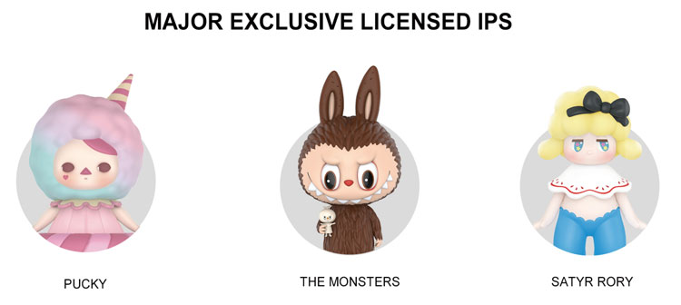


###### 原PDF第220页

[对照原PDF第220页](../2020年港股招股书.pdf#page=220)

###### 业  务

于 2018 年及 2019 年以及截至 2019 年及 2020 年 6 月 30 日止六个月，我们基于非独家 IP 的泡泡玛特品牌产品所得收益分别为人民币 18.2 百万元、人民币159.8 百万元、人民币 37.1 百万元及人民币 133.2 百万元，分别占我们泡泡玛特品牌产品所得总收益的 5.4%、11.5%、9.4% 及 19.4%。截至 2020 年 6 月 30 日，我们运营 56 个非独家 IP。下表载列我们的主要非独家 IP：

主要非独家IP

米奇老鼠  DESPICABLE ME  HELLO KITTY

下表载列所示期间按 IP 类别划分的泡泡玛特品牌产品所得收益明细：

```text
                      截至12月31日止年度                                 截至6月30日止六个月
       2017年               2018年               2019年              2019年               2020年
人民币元         % 人民币元           % 人民币元          % 人民币元           % 人民币元           %
```

（未经审核）

（千元，百分比除外）

| 自有IP |  |  |  |  |  |  |  |  |  |  |
| --- | ---: | ---: | ---: | ---: | ---: | ---: | ---: | ---: | ---: | ---: |
| Molly | 41,019 | 89.4 | 213,893 | 62.9 | 456,018 | 32.9 | 175,692 | 44.5 | 112,064 | 16.3 |
| Dimoo | – | – | – | – | 100,085 | 7.2 | – | – | 117,466 | 17.1 |
| BOBO & COCO | – | – | – | – | 25,454 | 1.8 | 8,195 | 2.1 | 32,939 | 4.8 |
| Yuki | – | – | 746 | 0.2 | 23,076 | 1.7 | 7,443 | 1.9 | 15,174 | 2.2 |
| 其他 | 2 | 0.0 | 1,075 | 0.3 | 22,394 | 1.6 | 1,860 | 0.5 | 3,147 | 0.5 |
| 小计 | 41,021 | 89.4 | 215,714 | 63.4 | 627,027 | 45.3 | 193,190 | 49 | 280,790 | 40.9 |
| 独家IP |  |  |  |  |  |  |  |  |  |  |
| PUCKY | – | – | 75,075 | 22.1 | 315,318 | 22.8 | 70,532 | 17.8 | 119,134 | 17.3 |
| The Monsters | – | – | – | – | 107,846 | 7.8 | 27,542 | 7.0 | 70,052 | 10.2 |
| SATYR RORY | – | – | 6,893 | 2.0 | 63,086 | 4.6 | 21,220 | 5.4 | 15,923 | 2.3 |
| 其他 | 4,843 | 10.6 | 24,254 | 7.1 | 111,112 | 8.0 | 45,535 | 11.5 | 67,770 | 9.9 |
| 小计 | 4,843 | 10.6 | 106,222 | 31.2 | 597,362 | 43.2 | 164,829 | 41.7 | 272,879 | 39.7 |
| 非独家IP | – | – | 18,213 | 5.4 | 159,820 | 11.5 | 37,149 | 9.3 | 133,246 | 19.4 |
| 泡泡玛特品牌产品 |  |  |  |  |  |  |  |  |  |  |
| 合计 | 45,864 | 100.0 | 340,149 |  | 100.0 1,384,209 | 100.0 | 395,168 | 100 | 686,915 | 100 |

– 210 –

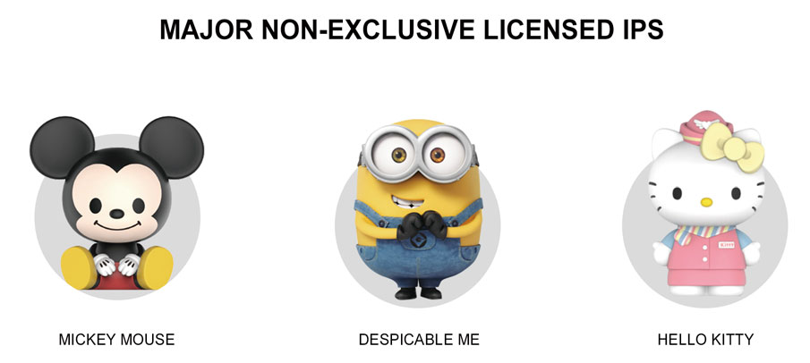


###### 原PDF第221页

[对照原PDF第221页](../2020年港股招股书.pdf#page=221)

###### 业  务

下表载列所示期间按产品及 IP 类别划分的毛利及毛利率的明细：

```text
                     截至12月31日止年度                                 截至6月30日止六个月
      2017年               2018年               2019年               2019年               2020年
    毛利     毛利率      毛利     毛利率      毛利     毛利率      毛利    毛利率       毛利    毛利率
人民币元         % 人民币元           % 人民币元          % 人民币元           % 人民币元           %
```

（未经审核）

（千元，百分比除外）

| 泡泡玛特品牌产品 |  |  |  |  |  |  |  |  |  |  |
| --- | ---: | ---: | ---: | ---: | ---: | ---: | ---: | ---: | ---: | ---: |
| 自有IP | 26,038 | 63.5 | 156,722 | 72.7 | 462,458 | 73.8 | 136,593 | 70.7 | 205,966 | 73.4 |
| 独家IP | 3,325 | 68.7 | 73,870 | 69.5 | 415,197 | 69.5 | 118,533 | 71.9 | 191,830 | 70.3 |
| 非独家IP | – | – | 11,038 | 60.6 | 108,591 | 67.9 | 26,788 | 72.1 | 90,401 | 67.8 |
| 泡泡玛特品牌产品 |  |  |  |  |  |  |  |  |  |  |
| 合计 | 29,363 | 64.0 | 241,630 | 71.0 | 986,246 | 71.2 | 281,914 | 71.3 | 488,197 | 71.1 |
| 第三方产品 | 46,303 | 42.0 | 56,578 | 34.9 | 103,756 | 37.1 | 49,120 | 35.4 | 45,242 | 34.6 |
| 其他 | (412) | (21.1) | (183) | (1.5) | 332 | 1.7 | (442) | (4.7) | – | – |
| 合计 | 75,254 | 47.6 | 298,025 |  | 57.9 1,090,334 | 64.8 | 330,592 | 60.8 | 533,439 | 65.2 |

就呈列于往绩记录期间按 IP 类别划分的泡泡玛特品牌产品的收益、毛利及毛利率明细而言，IP 分类的依据为其截至最后实际可行日期的状况。

– 211 –


###### 原PDF第222页

[对照原PDF第222页](../2020年港股招股书.pdf#page=222)

###### 业  务

凭借我们强大的IP发掘和运营能力，我们已为每个IP量身定制发掘计划，包括产品类别、将予开发的产品系列、预期发布时间表以及 IP 授权等潜在变现机会。下表载列 (i) 我们根据我们的 IP 开发并于 2017 年、2018 年、2019 年及截至 2020 年 6 月 30 日止六个月发布的泡泡玛特品牌盲盒系列数目；及 (ii) 我们预期根据我们的 IP 开发并将于截至 2020 年 12 月 31 日止六个月及 2021 年发布的泡泡玛特品牌盲盒系列数目：

|  |  |  |  | 截至 | 截至 | 截至 |
| --- | ---: | ---: | ---: | ---: | ---: | ---: |
|  |  |  |  | 6 月 30 日 | 12 月 31 日 | 12 月 31 日 |
|  |  | 截至 12 月 31 日止年度 |  | 止六个月 | 止六个月 | 止年度 |
|  | 2017 年 | 2018 年 | 2019 年 | 2020 年 | 2020 年 | 2021 年 |
| 自有 IP | 7(1) | 7(2) | 12(5) | 7(4) | 17(10) | 35(12) |
| 独家 IP | 1(1) | 8(3) | 32(14) | 17(14) | 28(16) | 55(21) |
| 非独家 IP | –(–) | 2(2) | 5(5) | 9(8) | 18(14) | 41(25) |
| 总计 | 8(2) | 17(7) | 49(24) | 33(26) | 63(40) | 131(58) |

附注：

盲盒系列数目旁边括号内的数字为所开发或预期将开发（如适用）盲盒系列所根据的 IP数目。于截至 2020 年 12 月 31 日止六个月及 2021 年，有关 IP 包括现有 IP 及同期在市场上发布的新 IP。

尤其是，我们已就自有 IP 及独家 IP 制定了详细的产品设计、生产及发布计划。 于截至 2020 年 12 月 31 日止六个月， 我们预期将推出基于主要自有 IP（包括 Molly、Dimoo 及 BOBO&COCO）开发的五个系列的泡泡玛特品牌盲盒，亦预期将推出基于其他七个自有 IP 开发的 12 个系列的泡泡玛特品牌盲盒。于2021 年，我们预期将推出基于主要自有 IP （包括 Molly、Dimoo、BOBO&COCO及 Yuki）开发的 14 个系列的泡泡玛特品牌盲盒，亦预期将推出基于其他八个自有 IP 开发的 21 个系列的泡泡玛特品牌盲盒。于截至 2020 年 12 月 31 日止六个月，我们预期将推出基于主要独家 IP （包括 PUCKY、The Monsters 及 SATYR RORY）开发的八个系列的泡泡玛特品牌盲盒，亦预期将推出基于其他 13 个独家 IP 开发的 20 个系列的泡泡玛特品牌盲盒。于 2021 年，我们预期将推出基于主要独家 IP （包括 PUCKY、The Monsters 及 SATYR RORY）开发的 13 个系列的泡泡玛特品牌盲盒，亦预期将推出基于其他 18 个独家 IP 开发的 42 个系列的泡泡玛特品牌盲盒。

作为领先的市场参与者，我们在取得最佳潮流内容资源以维持优质 IP 库及把握中国潮流玩具市场的增长机遇方面占据更有利的位置。根据弗若斯特沙利文报告，中国潮流玩具市场仍处于早期阶段，并于过去几年实现快速增

– 212 –


###### 原PDF第223页

[对照原PDF第223页](../2020年港股招股书.pdf#page=223)

###### 业  务

长。中国潮流玩具零售的市场规模预期会由 2019 年的人民币 207 亿元增加至2024 年的人民币 763 亿元，复合年增长率为 29.8%。尤其是，在潮流玩具产品类别中，盲盒属于新兴市场，正处于非常初级的阶段，因相对较低的价格拥有庞大的潜在客户并因不可预测性和趣味性而吸引重复购买。此外，根据弗若斯特沙利文报告，尽管潮流玩具近年来快速增长，按 2019 年的零售价值计，潮流玩具仅占中国玩具市场约 22%。根据弗若斯特沙利文报告，基于观察，潮流玩具公司发展迅速，知名玩具公司不断提高产品组合中潮流玩具的占比，预期潮流玩具行业将保持增长势头，作为先行者，领先潮流玩具公司具有规模效益，预期将享有可持续发展优势。凭借我们覆盖潮流玩具全产业链的一体化平台，我们能够不断发布盲盒及其他潮流玩具产品，有关产品的设计融合潮流元素，能够获得广泛的市场认可，并能够探索将我们的 IP 库变现的其他机会。因此，董事认为，我们的业务将会可持续发展。

IP 运营

我们已建立一个涵盖 IP 运营全价值链的一体化平台，提高我们 IP 的商业价值并提升我们 IP 的品牌知名度及变现能力。我们的卓越 IP 运营、专业团队及对整个运营周期的有效管理对于成功 IP 商业化及保持我们的竞争优势至关重要。

我们采取各种措施来维持 IP 的知名度。例如，我们通过葩趣、潮流玩具展以及其他线上及线下渠道密切监察市场趋势和粉丝喜好。根据我们收集到的此类市场反馈，我们能够不断推出结合时尚元素的设计，从而赢得广泛的市场认可。此外，根据弗若斯特沙利文报告，作为中国潮流玩具行业的开拓者，我们已在中国潮流玩具粉丝中建立重要影响力。因此，我们拥有更有利的条件去引领而非跟随市场趋势。此外，我们积极寻求 IP 之间的跨界合作机会，有效利用多个 IP 覆盖的粉丝群。我们还与 IP 授权合作伙伴合作，将潮流玩具IP 改编为其他娱乐形式，以进一步推广我们的 IP。

产品设计及开发

设计及开发

凭借我们的一体化平台及领先的产品设计及开发能力，我们基于我们的IP 持续创作原创、独特及有趣的潮流玩具产品，从而提升我们 IP 的知名度及商业价值。

– 213 –


###### 原PDF第224页

[对照原PDF第224页](../2020年港股招股书.pdf#page=224)

###### 业  务

我们的自有 IP 及独家 IP 艺术家创作潮流玩具产品的初期艺术设计，我们的一体化潮流玩具平台则将相关艺术设计转化为商业化产品及实现相关 IP 的商业价值。截至 2020 年 6 月 30 日，我们拥有一支由 111 名成员组成的内部创意设计及工业开发团队。凭借我们深刻的行业见解、优秀的设计能力和丰富的IP 运营经验，我们能够赋予艺术家灵感，从艺术及商业层面共同创作成功的IP。通过基于我们的自有 IP 及独家 IP 开发潮流玩具产品的典型流程，我们与艺术家保持密切沟通，并提前与他们讨论年度产品发布时间表。我们首先自艺术家收到二维草图。我们基于对粉丝喜好及市场趋势的一手分析见解，对草图提供反馈与建议。其后，我们的内部创意设计团队与艺术家紧密合作，从商业及技术角度出发，打磨其角色设计。例如，凭借我们丰富的设计资源和素材（如图案、场景、姿势及装饰），我们的内部设计团队能够带来新创意，从而丰富设计。由于大多数艺术家专注于二维设计，并不具备三维设计及建模能力，我们的内部工业设计团队就最终商业化设计的颜色、三维设计及模具进行加工，其后才大量生产及于市场发布。此外，我们的设计及工业开发团队亦主动为我们的最终产品设计时尚且有吸引力的包装，并凭借我们的销售渠道及粉丝社区制定全面及定制推广方案。下列图片说明我们的内部设计及工业开发团队从艺术家的初期艺术设计至最终产品过程中，基于我们自有IP 及独家 IP 开发潮流玩具产品的典型过程及进行的增值工作：

自有 IP 的流程说明：

1.  艺术家提供二维草图，我们的内部设计及工业开发团队与艺术家合作完善设计。此流程通常耗时约一个月。

2.  我们的内部设计及工业开发团队著手三维设计，艺术家审核并提供反馈，以落实三维设计。此流程通常耗时约三个月。

– 214 –


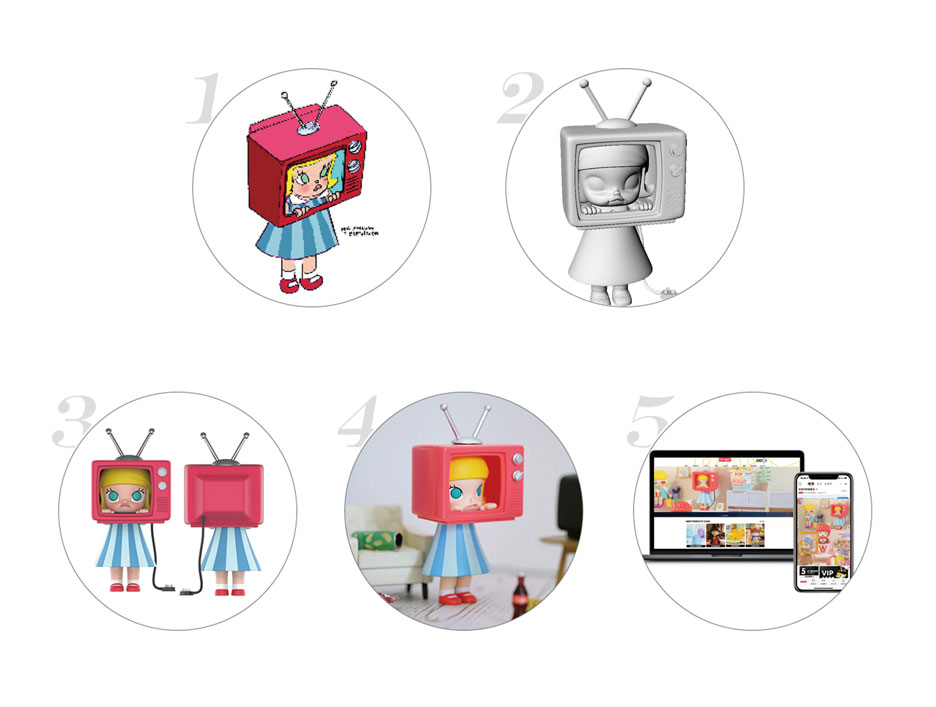


###### 原PDF第225页

[对照原PDF第225页](../2020年港股招股书.pdf#page=225)

###### 业    务

```text
3.   我们的内部设计及工业开发团队负责设计的
```

上色工作，艺术家审核并提供反馈，以落实上色设计。同时，我们的内部设计及工业开发团队与艺术家合作设计并落实最终产品的包装。此流程通常耗时约一个月。

4.  我们的内部设计及工业开发团队与负责采购及生产的员工合作，以监督模具制作及最终产品的批量生产。此流程通常耗时约两个月。

5.  我们的内部设计及工业开发团队制定最终产品的推广方案，艺术家审核并提供反馈，以落实最终产品的推广方案。此流程通常耗时约一个月。

独家 IP 的流程说明：

1.  艺术家提供二维草图，我们的内部设计及工业开发团队与艺术家合作完善设计。此流程通常耗时约一个月。

2.  我们的内部设计及工业开发团队著手三维设计，艺术家审核并提供反馈，以落实三维设计。此流程通常耗时约三个月。

– 215 –


###### 原PDF第226页

[对照原PDF第226页](../2020年港股招股书.pdf#page=226)

###### 业    务

```text
3.   我们的内部设计及工业开发团队负责设计的
```

上色工作，艺术家审核并提供反馈，以落实上色设计。同时，我们的内部设计及工业开发团队与艺术家合作设计并落实最终产品的包装。此流程通常耗时约一个月。

4.  我们的内部设计及工业开发团队与负责采购及生产的员工合作，以监督模具制作及最终产品的批量生产。此流程通常耗时约两个月。

5.  我们的内部设计及工业开发团队制定最终产品的推广方案，艺术家审核并提供反馈，以落实最终产品的推广方案。此流程通常耗时约一个月。

我们的创意设计及开发团队负责根据非独家 IP 设计及开发产品的整个过程。例如，我们与迪士尼合作并于 2019 年 3 月推出「Sitting Babies Series 1 —Mickey Family」盲盒系列。我们的创意及工业设计团队重新设计知名的迪士尼角色，如米奇老鼠，并开发出坐姿宝宝角色的潮流玩具产品。通过该等具备创新性及不同风格及特点的重新设计，我们将我们有趣且独特的设计风格融入有关 IP，实现产品设计与粉丝的共鸣，为该等知名 IP 带来了新的粉丝及商业潜力。下列图片说明我们的内部设计及工业开发团队从非独家 IP 的初期形象至最终产品过程中，基于非独家 IP 开发潮流玩具产品的典型过程：

非独家 IP 的流程说明：

1.  我们的内部设计及工业开发团队提供二维草图以供 IP 提供商审核并落实设计。此流程通常耗时约一个半月。

– 216 –


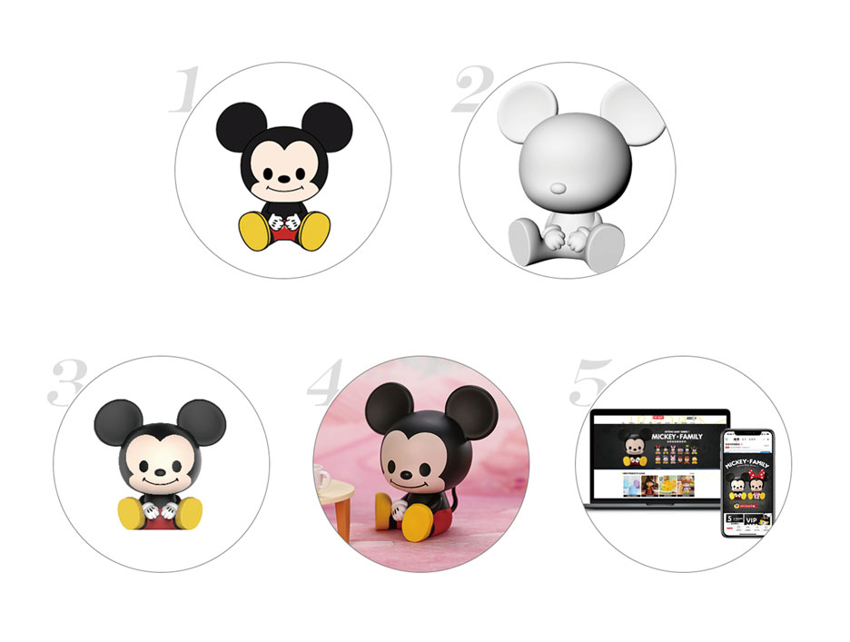


###### 原PDF第227页

[对照原PDF第227页](../2020年港股招股书.pdf#page=227)

###### 业    务

```text
2.   我们的内部设计及工业开发团队著手三维设
```

计，以供 IP 提供商审核并落实三维设计。此流程通常耗时约三个月。

3.  我们的内部设计及工业开发团队负责设计的上色工作，以供IP提供商审核并落实上色设计。同时，我们的内部设计及工业开发团队负责最终产品的包装设计，以供 IP 提供商审核并落实最终产品的包装。此流程通常耗时约一个月。

4.  收到我们 IP 提供商的批准后，我们的内部设计及工业开发团队与负责采购及生产的员工合作，以监督模具制作及最终产品的批量生产。此流程通常耗时约三至六个月。

5.  我们的内部设计及工业开发团队制定最终产品的推广方案，以供 IP 提供商审核并于收到我们 IP 提供商的批准后落实最终产品的推广方案。此流程通常耗时约二至三个月。

我们的内部设计团队亦创作自有 IP，并已创作出如 BOBO&COCO 及 Yuki等自有 IP。内部设计团队负责根据内部所创作的自有 IP 的设计及开发产品的整个过程，该过程和与我们自有IP及独家IP的艺术家共同开发产品的过程相似。

我们积极寻求我们的自有、独家及非独家 IP 之间的跨界合作机会，以有效利用多个 IP 覆盖的粉丝群。例如，我们推出基于 The Monsters 和 Despicable Me 及 Pucky 和 Despicable Me 的结合开发的手办，吸引更多粉丝并使各 IP 更受欢迎。另一个例子是基于 Molly 和米奇老鼠的结合而开发的手办。跨界合作为双方 IP 均带来新的独特风格，令迪士尼和我们之间的合作更加深入。通过典型的跨界合作流程，首先，基于对粉丝喜好和市场趋势的见解，我们与有关艺术家及 IP 提供商展开讨论，以制定跨界合作方案。此流程通常耗时约二至

– 217 –


###### 原PDF第228页

[对照原PDF第228页](../2020年港股招股书.pdf#page=228)

###### 业  务

三个月。其次，艺术家根据跨界合作方案提供二维草图，以供 IP 提供商审核并落实设计。此流程通常耗时约一个半月。第三，我们的内部设计及工业开发团队负责三维设计以及设计的上色，以供艺术家及 IP 提供商审核。同时，我们的内部设计及工业开发团队与艺术家合作设计最终产品的包装，以供 IP提供商审核。此流程通常耗时约六至九个月。其后，于收到我们 IP 提供商的批准后，我们的内部设计及工业开发团队与负责采购和生产的员工合作，以监督模具制作最终产品和批量生产。此流程通常耗时约一至三个月。最后，我们的内部设计及工业开发团队制定最终产品的推广方案，以供艺术家及 IP提供商审核并于收到我们 IP 提供商的批准后落实推广方案。此流程通常耗时约二至三个月。下列形象为我们不同类型 IP 之间的跨界合作实例：

我们监控潮流玩具开发的端对端过程以确保质量及效率，包括与我们的艺术家或 IP 提供商改善及定稿产品设计、开发产品原型以及与我们选定的第三方制造商协调制造。有关详情，请参阅「 — 质量控制」。

– 218 –


###### 原PDF第229页

[对照原PDF第229页](../2020年港股招股书.pdf#page=229)

###### 业  务

产品组合

我们基于 IP 开发各种潮流玩具产品。我们相信，玩具对不同年龄群拥有广泛的吸引力，我们的艺术性及收藏性潮流玩具能吸引成年人以及儿童。我们泡泡玛特品牌产品主要分为以下几类：

•  盲盒 。我们基于 IP 开发多个系列的盲盒产品。各 IP 产品系列的数量各不相同，通常每年推出一到七个不等，具体取决于需求及受欢迎程度。各盲盒产品系列具有独特的主题，通常包含12种不同的设计，包括一款特殊设计的「隐藏款」。同一系列中所有设计的盲盒包装相同，我们的粉丝并不知道彼等将获得哪个系列的具体设计。由于此不可预测性，盲盒增加了乐趣并增加重复购买。于 2017 年、2018年及 2019 年以及截至 2019 年及 2020 年 6 月 30 日止六个月，我们盲盒产品销售产生的收益分别为人民币91.4百万元、人民币359.6百万元、人民币 1,359.2 百万元、人民币 402.4 百万元及人民币 688.7 百万元，分别占同期我们总收益的 57.8%、69.9%、80.7%、74.0% 及 84.2%，其中，泡泡玛特品牌盲盒产品销售产生的收益分别为人民币 41.8 百万元、人民币 290.1 百万元、人民币 1,255.8 百万元、人民币 348.2 百万元及人民币 639.4 百万元，而我们第三方盲盒产品销售产生的收益分别为人民币 49.6 百万元、人民币 69.5 百万元、人民币 103.4 百万元、人民币 54.1 百万元及人民币 49.3 百万元。下图展示了盲盒产品的包装及内容。

游戏规则

隐藏

有机会抽中神秘隐藏款！

整套

一整套含12款盲盒。

购买12款，

敬请选择整套购买！

倘购买整套并出现重复款，泡泡玛特将退回重复款并发货缺失的常规款。散盒

一款一盒。拆封前无人知晓盒中款式。

美图秀

– 219 –


###### 原PDF第230页

[对照原PDF第230页](../2020年港股招股书.pdf#page=230)

###### 业  务

游戏规则

隐  藏

有机会抽中神秘隐藏款！

整  套一整套含12款盲盒。购买12款，敬请选择整套购买！

倘购买整套并出现重复款，泡泡玛特将退回重复款并发货缺失的常规款。散  盒

一款一盒。拆封前无人知晓盒中款式。

产品尺寸

概约7至10厘米IphoneX约14厘米

in 整 g  d 套 le  bo  x bl Sin Identical blind box packaging,一整套含有12种设计making the design unknown的12个盲盒。before opening the box.

s 盒 e  t

Fu  l 散 l一款一盒保密包装，拆封前One full set contains无人知晓盒中款式。 12 blind boxes of 12 designs

藏  款隐  有机会抽中神秘隐藏款。

– 220 –


###### 原PDF第231页

[对照原PDF第231页](../2020年港股招股书.pdf#page=231)

###### 业  务

下表载列所示期间按 IP 划分的泡泡玛特品牌盲盒产品的销量及平均售价以及第三方盲盒产品的销量及平均售价：

```text
                                       截至12月31日止年度                              截至6月30日止六个月
                           2017年             2018年             2019年             2019年              2020年
                                  平均              平均                平均               平均                平均
                         销量售价 (1) 销量售价 (1) 销量售价 (1) 销量售价 (1) 销量                              售价 (1)
                               （人民             （人民             （人民             （人民               （人民
                      （千个） 币元） （千个） 币元） （千个） 币元） （千个） 币元） （千个） 币元）
泡泡玛特品牌
   盲盒                 968.8      43    6,567.3      44 24,450.3        51    7,268.2      48 13,514.3          47
自有IP                  883.5      43    4,169.3      44 10,588.5        52    3,385.1      46 5,360.5           48
   Molly                883.5      43    4,154.3      44 7,234.5         54    3,076.7      46 2,035.3           51
   Dimoo                    –        –         –       – 2,052.9         48          –       – 2,363.1           46
   BOBO&COCO                –        –         –       –      464.1      52      147.9      55      538.0        45
   Yuki                     –        –      15.0      50      448.7      51      160.5      46      335.8        45
   其他                     –        –         –       –      388.3      46          –       –       88.4        42
独家IP                   85.3      41    1,964.7      45 10,549.0        52    3,065.1      51    5,228.0        49
   PUCKY                    –        –   1,402.4      46 5,297.7         53    1,275.2      51    2,059.5        52
   The Monsters             –        –         –       – 1,917.5         51      485.2      57    1,435.5        46
   SATYR RORY               –        –     152.2      45 1,237.3         51      455.2      47      348.1        44
   其他                  85.3      41      410.0      40 2,096.5         51      849.5      51    1,384.9        48
非独家IP                    –        –     433.4      42    3,312.8      47      818.0      43    2,925.8        44
第三方盲盒            1,208.1      41    1,044.8      67    1,971.0      52    1,034.4      52      638.7        77
附注：
(1)     平均售价乃按收益除以有关销量计算。
```

– 221 –


###### 原PDF第232页

[对照原PDF第232页](../2020年港股招股书.pdf#page=232)

###### 业  务

•  手办 。就若干受欢迎的IP而言，我们开发及销售手办。与盲盒相比，手办尺寸更大，超过 10 厘米，且更为昂贵。手办设计更精致及有艺术风格，细节考究，采用更高级的材料，通常面向高端消费者。下图「Molly — Watching TV」展示我们的手办产品。

•  BJD 。BJD 是采用球窝关节连接，以可活动的肢体为特点的人偶。我们 BJD 的尺寸通常在 10 厘米至 20 厘米之间。它们由聚氨酯树脂（一种坚硬而致密的塑料）制成，部件用粗橡皮筋串在一起。与盲盒相比，BJD 更为昂贵，主要拟供收藏及客户定制。大多数 BJD 由可轻松拆卸的服装、假发、眼睛及四肢组成，通过改变可活动部分可供收藏者定制。下图「Nutcracker — Clara Molly」展示我们的 BJD 产品。

•  衍生品 。我们亦开发各种具有潮流 IP 及功能的潮流玩具衍生品，如毛绒玩具、蓬松吊坠、吊牌及别针。该等衍生品由棉、塑料及金属等各种材料制成，尺寸各异，常用于日常生活中，如悬挂或固定在

– 222 –


###### 原PDF第233页

[对照原PDF第233页](../2020年港股招股书.pdf#page=233)

###### 业  务

包、行李、钥匙及手机上。与盲盒类似，我们亦基于 IP 开发多个系列别针产品，各系列均具有独特的主题，包含 12 种不同的设计，包括一款特殊设计的「隐藏款」。借由结合潮流玩具文化及功能性，衍生品将潮流玩具的乐趣扩展到我们粉丝的日常生活中。下图展示我们的衍生品示例。

下表载列我们泡泡玛特品牌产品主要类别的若干资料：

泡泡玛特品牌

产品

```text
                               盲盒                       手办                        BJD                                               衍生品
尺寸                        4.5至9.5厘米               超过10厘米                10至20厘米                                              多种
售价范围             人民币49元至人民币99元     人民币199元至人民币1,499元人民币399元至人民币799元                              人民币6元至人民币389元
```

– 223 –


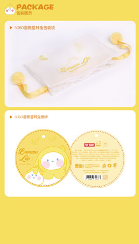


###### 原PDF第234页

[对照原PDF第234页](../2020年港股招股书.pdf#page=234)

###### 业  务

```text
附注：
(1)    下表载列所示期间按类别划分的泡泡玛特品牌产品的平均售价（使用收益除以相
       关销量计算）：
                                        截至 12 月 31 日止年度             截至 6 月 30 日止六个月
                                    2017 年       2018 年       2019 年       2019 年       2020 年
                                                          （人民币元）
       盲盒                             43             44            51            48            47
       手办                            116           202            273           327           258
       BJD                                –          574            367           377           342
       衍生品                           43             40            29            28            29
(2)    附注 (1) 中我们部分产品的平均售价低于售价范围的原因主要包括 (i) 计算平均售
       价所用的收益并不包含增值税，而售价范围包含增值税，及 (ii) 我们于促销活动期
```

间向客户提供折扣。

我们标准盲盒产品系列（限量版除外）的平均生命周期主要为九个月至两年，而我们基于成功及流行 IP 开发的多个标准盲盒产品系列则拥有超过两年的较长生命周期，例如，「Molly－Zodiac」盲盒系列于 2017 年 6 月发布，已销售逾三年，「SATYR RORY－Classics」盲盒系列于2018年2月发布，已销售两年半。根据弗若斯特沙利文报告，我们标准盲盒产品系列（限量版除外）的平均生命周期长于行业平均水平九至 12 个月，乃主要由于 (i) 我们的全渠道销售及经销网络以及市场推广举措，让我们不仅能够通过日常销售及市场推广活动，而且也能够通过潮流玩具展推广潮流玩具产品，从而有效触及目标消费者及提高品牌知名度；及 (ii) 我们的艺术家发掘能力及与著名及有才华艺术家的紧密合作，让我们拥有更多机会开发及发布受欢迎的成功潮流玩具产品。

产品定价

我们的潮流玩具产品价格乃根据各种因素厘定，包括材料、尺寸、授权费及制造及运营成本。盲盒为入门级产品，价格相对较低。我们为不同偏好的粉丝量身定制收集特性各异的不同层次产品。

季节性

我们的潮流玩具产品一般在每年的下半年录得更高销售额，尤其下半年的节假日期间及天猫双十一等大型促销活动。

IP 授权

凭借我们 IP 的广泛普及，我们与 IP 授权合作伙伴（主要包括各行业的知名消费者品牌）合作，探索多样化的变现机会，并进一步推广我们的 IP。具体而言，我们可能会授权我们的自有 IP 及再授权我们的独家 IP 予我们的 IP 授权

– 224 –


###### 原PDF第235页

[对照原PDF第235页](../2020年港股招股书.pdf#page=235)

###### 业  务

合作伙伴，从而扩宽变现渠道。例如，我们于 2019 年授权伊利使用 Molly 推广调味乳饮品。有关详情，请参阅「 — 重磅 IP: Molly」。再授权我们的独家 IP 时，我们将根据艺术家与我们订立的相关独家授权协议与我们的艺术家分享 IP授权合作伙伴支付的授权费。于 2017 年、2018 年及 2019 年以及截至 2019 年及2020 年 6 月 30 日止六个月，我们的授权费收入分别为人民币 0.7 百万元、人民币 2.9 百万元、人民币 12.1 百万元、人民币 2.1 百万元及人民币 8.2 百万元。

于 2017 年、2018 年及 2019 年以及截至 2020 年 6 月 30 日止六个月，我们分别与 IP 授权合作伙伴订立一份、一份、八份及八份授权协议。授权协议的主要条款包括：

•  许可权利 。我们与 IP 授权合作伙伴订立的授权协议通常向 IP 授权合作伙伴提供非独家权利或独家权利，以在中国展示或以其他方式使用我们 IP 的图形、图像或标识作特定用途（如广告）。未经我们书面批准或授权，IP 授权合作伙伴不得使用有关 IP。

•  期限 。授权协议的初始期限一般为一年。

•  费用安排 。根据我们与 IP 授权合作伙伴订立的授权协议，通常我们收取按具体情况磋商的固定特许权使用费。对于涉及产品推广的授权协议，我们可能会根据 IP 授权合作伙伴销售的产品数量收取费用。

•  知识产权 。就授权我们的自有 IP 而言，授权协议下任何设计成果（指不同阶段的成果，主要包括草图、三维设计及最终产品）的知识产权由我们拥有。就再授权我们的独家 IP 而言，根据我们的艺术家与我们订立的独家授权协议，再授权安排下开发的设计成果（指不同阶段的成果，主要包括草图、三维设计及最终产品）的知识产权通常由艺术家与我们共同拥有。

•  侵权 。我们声明拥有或获正式授权与授权 IP 相关的有关知识产权，且不存在任何知识产权侵权。

•  终止 。我们或 IP 授权合作伙伴均可在发生若干特定事件（如重大违约、破产、吊销营业执照或对手方无力偿债）后终止协议。

– 225 –


###### 原PDF第236页

[对照原PDF第236页](../2020年港股招股书.pdf#page=236)

###### 业  务

重磅 IP: Molly

Molly 是一个嘟著特色嘴唇、 有著湖蓝色大眼睛的可爱小女孩。 她是一位画家，希望凭借其独特的艺术家视角来描绘自己的世界。Molly 于2006年由王信明先生（一名来自香港的开创性艺术家）创作。自2006年以来，王信明先生基于 Molly 形象开发了多个定制系列及备受欢迎的潮流玩具。然而，碍于制造成本限制及有限的商业化机遇，该玩具的销量及经销仍维持在规模较小的水平。

通过我们的市场洞察力及经验， 我们发现了 Molly 的巨大潜力。 于2016 年 4 月，我们与王信明先生签订独家授权协议，并开始 Molly 的大规模商业化。根据协议，我们有权开发及销售基于 Molly 形象的潮流玩具产品，且我们将根据销售的产品向王信明先生支付固定年费及设计费。于 2016年 8 月，我们推出了首个「Molly Zodiac」盲盒系列并取得成功。自此，Molly就成了我们的代表性 IP。

首次成功亮相后， 我们开始围绕 Molly 定制全面的 IP 运营计划。 于2017 年、2018 年及 2019 年以及 2020 年上半年，我们分别推出七个、六个、五个及三个 Molly 盲盒系列。此外，我们于往绩记录期间亦开发各种 Molly手办及衍生品，包括集换卡及徽章。我们促进 Molly 与其他世界知名 IP 之间的合作，例如「Mickey and Minnie」、「Despicable Me」及「Hello Kitty」。于2018 年 7 月，我们取得了 Molly 在中国的知识产权所有权，及其后于 2019 年4 月，我们订立协议取得了 Molly 在全球其他地区的知识产权所有权。根据知识产权转让协议，在转让 Molly 的知识产权后，王信明先生在未来将继续与我们合作设计及开发 Molly 产品系列。有关该等知识产权转让协议的主要条款的详情，请参阅「－IP 创作－我们的艺术家」。于 2017 年、2018 年及 2019 年，基于 Molly 形象的泡泡玛特品牌产品产生的收益分别为人民币41.0 百万元、人民币 213.9 百万元及人民币 456.0 百万元，复合年增长率为242.1%。

– 226 –


###### 原PDF第237页

[对照原PDF第237页](../2020年港股招股书.pdf#page=237)

###### 业  务

此外，我们亦一直透过授权探索 Molly 的额外 IP 变现机会。例如，于2019 年，我们将 Molly 授权予伊利（中国领先的乳制品公司），并授权伊利使用 Molly 推广调味乳饮品。就 Molly 的授权安排而言，我们通常与 IP 授权合作伙伴（如伊利）订立标准授权协议。有关与 IP 授权合作伙伴订立的授权协议的主要条款的更多详情，请参阅「－IP 授权」。我们亦一直在积极寻求机会将 Molly 授权予其他选定第三方，以改编为其他娱乐形式。

潮流玩具产品

– 227 –


###### 原PDF第238页

[对照原PDF第238页](../2020年港股招股书.pdf#page=238)

###### 业  务

重磅 IP: PUCKY

PUCKY 是梦森林世界的精灵。随著寒冬结束，冰之湖泊融化了，梦森林的精灵从冬眠的长梦中醒来。PUCKY 由一位才华洋溢的香港女艺术家所创作。

我们对其富有创造力的作品印象深刻，并于 2017 年与彼签订独家授权协议。于 2018 年 4 月，我们推出第一个「PUCKY Pool Babies」盲盒系列。在「双十一」，我们在天猫旗舰店推出的限量版「PUCKY Xmas Babies」盲盒系列是最热销的产品之一，总共 5,000 件在一分钟内销售一空。我们于 2018年在北京与杭州举办两场以PUCKY为主题的展览，以进一步提高其知名度。于 2018 年及 2019 年以及截至 2020 年 6 月 30 日止六个月，我们分别推出了三个、六个及三个 PUCKY 盲盒系列。于 2018 年及 2019 年以及截至 2019 年及2020 年 6 月 30 日止六个月，PUCKY 产生的收益分别为人民币 75.1 百万元、人民币 315.3 百万元、人民币 70.5 百万元及人民币 119.1 百万元。除潮流玩具产品外，我们亦将 PUCKY 再授权，以进一步提升 IP 变现能力。就 PUCKY的再授权安排而言，我们通常与 IP 授权合作伙伴订立标准授权协议。根据PUCKY 的艺术家与我们之间的独家授权协议，我们将与 PUCKY 的艺术家分享 IP 授权合作伙伴支付的授权费。有关与 IP 授权合作伙伴订立的授权协议的主要条款的更多详情，请参阅「－IP 授权」。

潮流玩具产品

– 228 –


###### 原PDF第239页

[对照原PDF第239页](../2020年港股招股书.pdf#page=239)

###### 业  务

IP 创作

我们的IP由我们的艺术家、成熟的IP提供商及我们的内部设计团队创作。我们根据粉丝群、销售表现、设计质量甄选 IP，并基于我们的经验及判断对上述各项进行评估。有关我们选择艺术家及 IP 提供商与我们如何自彼等识别及寻找 IP 的详情，请参阅下文「－我们的艺术家」及「－成熟的 IP 提供商」。于2017 年、2018 年及 2019 年以及截至 2019 年及 2020 年 6 月 30 日止六个月，我们所产生支付予艺术家及 IP 提供商的设计及授权费用分别为人民币 2.2 百万元、人民币14.5百万元、人民币48.4百万元、人民币17.1百万元及人民币26.5百万元。

我们的艺术家

我们合作的艺术家是我们 IP 的主要创作者。截至最后实际可行日期，我们与逾 350 名艺术家保持紧密联系，并通过授权或知识产权转让协议与其中28 名来自全球的才华横溢的艺术家开展合作，使我们能够长期获得优质 IP。下表载列与我们合作的 28 名艺术家的主要资料：

```text
IP               艺术家              国家╱地区      合作类型    关系年期
Molly            王信明              香港           收购 IP     四年
Pucky            Grace               香港           独家 IP     三年
SATYR RORY       Seulgie Lee         韩国           独家 IP     三年
COARSE           Mark Landwehr &     美国           独家 IP     三年
                   Sven Waschk
LABUBU           Kasing Lung         香港           独家 IP     两年
Kenneth          Yoyo Yeung          香港           独家 IP     两年
ViViCat          Robin               中国           独家 IP     两年
DUCKOO           chokocider          韩国           独家 IP     两年
MOMIJI           Helena stamulak     英国           独家 IP     两年
Biggie Fish      Chino Lam           香港           独家 IP     两年
OKluna           Kaiser              香港           独家 IP     两年
Chewyhams        FUNI                韩国           独家 IP     两年
Dimoo            Ayan                中国           收购 IP     一年
negora           konatsu             日本           独家 IP     一年
Mui-Chan         mafai               香港           独家 IP     一年
INSTINCTOY       hokubo              日本           独家 IP     一年
Steampunk        KAMATA MITSUJI      日本           独家 IP     一年
coolrain_LABO    coolrain & 205      韩国           独家 IP     一年
MODOLI           BBKK                中国           独家 IP     一年
FEI REN ZAI      Air                 中国           独家 IP     一年
Flabjacks        Ton Mak             香港           独家 IP     一年
```

– 229 –


###### 原PDF第240页

[对照原PDF第240页](../2020年港股招股书.pdf#page=240)

###### 业    务

```text
IP               艺术家              国家╱地区      合作类型    关系年期
MIGO.mido        Gwen                中国           收购 IP     少于一年
Crybaby          Molly               泰国           独家 IP     少于一年
Gummy            Grace               中国           独家 IP     少于一年
DONGDONG         CLOCKHOUSE          韩国           独家 IP     少于一年
SKULLPANDA       SKULLPANDA                         收购 IP     少于一年
                                     中国
Cookie           Cookie                             独家 IP     少于一年
                                     中国
Avofriends       Hyosook Lee                        独家 IP     少于一年
                                     韩国
```

艺术家对我们业务运营的成功至关重要，我们致力于发掘全球各地具有商业前景的开创性及新进艺术家。我们的艺术家专门从事视觉艺术，如绘画、雕塑作品及工艺品。彼等大部分在世界各地获得了无数奖项及认可，并已拥有庞大粉丝群。过往，该等艺术家在小型工作室工作，且自其作品变现的机会有限。凭借我们领先的市场地位、成熟的变现渠道、广泛的销售网络及庞大的粉丝群，我们帮助将他们的作品带进大众市场。

为物色具商业前景的艺术家，我们截至 2020 年 6 月 30 日由逾 20 人组成的内部艺术家发掘团队积极主动地在全球寻找人才。就此而言，我们致力于邀请全球艺术家参与我们的潮流玩具展、组织设计比赛以及与顶级艺术学院合作开设讲座及课程等。通过我们的潮流玩具展及亚洲的其他主要潮流玩具展，我们的内部艺术家发掘团队致力于基于受众反馈、如前来参展的艺术家的展位参观流量及其产品销量而从该等艺术家中发现人才。在我们组织的设计比赛中，我们的内部艺术家发掘团队审核参与者的作品并根据我们的经验及专长对艺术家的质素及潜力进行分析。透过与顶尖艺术学院合作，我们提供艺术品及潮流玩具设计、潮流玩具文化及行业知识的讲座及课程。例如，我们于 2019 年在中央美术学院举办以「潮流、玩具、设计」为主题的一系列讲座。我们的内部艺术家发掘团队甄选具有潜力及热衷潮流玩具的优秀学生。此外，我们尤其关注社交媒体及潮流玩具粉丝社区（如葩趣），以在粉丝当中获得对受欢迎的潮流玩具艺术家的了解。我们的艺术家发掘能力使我们能够广泛接触全球各地的艺术家。

– 230 –


###### 原PDF第241页

[对照原PDF第241页](../2020年港股招股书.pdf#page=241)

###### 业  务

我们在与艺术家签订合约之前对艺术家进行全面评估。根据来自展会、展览及葩趣的一手市场反馈，其粉丝群及我们的专业判断，我们有选择地与开创性及新进艺术家合作。我们与我们的艺术家或订立知识产权转让协议，亦或订立独家授权协议。就受欢迎或优秀的 IP 而言，我们可能购买相关 IP 知识产权的拥有权。截至最后实际可行日期，我们已购得艺术家的四个 IP。我们与艺术家所订立知识产权转让协议（包括 Molly 的知识产权转让协议）的主要条款概述如下：

•  知识产权。 我们的艺术家应转让彼等 IP 于中国及其他特定地区（视乎情况而定）的所有知识产权。已转让 IP 的知识产权由我们拥有，我们所开发产品的知识产权也由我们拥有。

•  转让费。 我们将向艺术家支付固定金额的转让费，其价格按具体情况磋商。

•  合作。 转让知识产权后，我们的艺术家将继续与我们合作基于相关IP 设计及开发潮流玩具产品，并将基于我们产品的销售额收取设计费。我们亦为该等设计费设有年度上限，主要根据包括合作时长、商业化潜力、独家程度及预期销量等因素厘定。与我们艺术家订立的知识产权转让协议项下设计费的年度上限的平均值处于个位数水平。

•  侵权。 我们的艺术家声明彼等拥有与将予转让的 IP 相关的有关知识产权，并将对任何知识产权侵权负责及弥偿我们因有关侵权所招致的一切损失。

此外，我们亦与我们的艺术家订立独家授权协议。我们根据 (i) 艺术家的受欢迎程度、(ii) 艺术家不断创作富有创造力作品的能力、(iii) IP 在潮流玩具产品方面的商业化潜力及 (iv) IP 的其他授权机会决定各份授权协议的范围及条款。于 2017 年、2018 年、2019 年及截至 2020 年 6 月 30 日止六个月，我们分别订立一份、11 份、九份及四份独家授权协议。截至 2020 年 6 月 30 日，我们拥有25 份有效的独家授权协议，涉及 25 个独家 IP。于往绩记录期间及直至最后实际可行日期，我们并无终止或未能重续任何独家授权协议。截至 2020 年 6 月30 日，我们的独家授权协议的届满日期介乎 2020 年 11 月至 2030 年 4 月不等。就两份将于 2020 年到期的独家授权协议中的其中一份而言，我们正与艺术家进行续约磋商。基于与艺术家的顺利磋商及重续流程，董事确认，本公司重续该等独家授权协议并无重大障碍。就两份将于 2020 年到期的独家授权协议的另外一份而言，经过与艺术家的友好磋商，出于商业原因，我们将不会重

– 231 –


###### 原PDF第242页

[对照原PDF第242页](../2020年港股招股书.pdf#page=242)

###### 业  务

续有关协议。 下表载列截至 2020 年 6 月 30 日我们于 2020 年、2021 年、2022 年及其后届满的独家授权协议的数目及收益贡献：

```text
                        协议数目                   收益贡献
                                                                        截至
                                                                     6 月 30 日
                                        截至 12 月 31 日止年度      止六个月
                                     2017 年    2018 年    2019 年    2020 年
                                                （人民币千元）
独家授权协议                   25      4,843   106,222    597,362    272,879
  于 2020 年届满 (1)            2          –          –     14,053      6,355
  于 2021 年届满                4          –          –     18,032    17,217
  于 2022 年届满                9          –          –     37,487    19,611
  于其后届满                   10      4,843   106,222    527,790    229,696
附注：
(1)   于 2017 年、2018 年、2019 年及截至 2020 年 6 月 30 日止六个月， 一份于 2020 年届满
      惟我们不会重续的独家授权协议的收益贡献分别为零、零、人民币 5.5 百万元及人
```

民币 0.6 百万元。

与艺术家订立的独家授权协议的主要条款概述如下：

•  独家权利 。我们与艺术家订立的独家授权协议赋予我们独家权利于协议期限内在指定地区（包括中国）内基于其 IP 开发及销售潮流玩具。我们一般获允许在独家授权协议届满后六个月内销售未出售的潮流玩具产品。

•  再授权 。根据大部分独家授权协议，我们亦获授权将他们的 IP 再授权予指定地区（包括中国、香港、澳门及台湾）内的第三方。艺术家有权收取自再授权协议获得的部分费用，该金额按具体情况磋商。

•  期限 。授权协议的初始期限一般为四年，可由我们根据该等 IP 的市场表现延长至六年或更长时间。

•  费用安排 。根据我们与艺术家订立的授权协议，通常我们的艺术家会根据我们出售产品的数量收取设计费。我们亦为该等设计费设有年度上限，主要根据包括合作时长、商业化潜力、独家程度及预期销量等因素厘定。与我们艺术家订立的独家授权协议项下设计费的年度上限的平均值处于个位数水平。

– 232 –


###### 原PDF第243页

[对照原PDF第243页](../2020年港股招股书.pdf#page=243)

###### 业  务

•  知识产权 。授权 IP 的知识产权由艺术家拥有，我们开发产品的知识产权由艺术家和我们共同拥有。当我们再授权授权 IP 时，根据再授权安排开发的设计成果的知识产权由艺术家和我们共同拥有。

•  侵权。 我们的艺术家声明彼等拥有与授权 IP 相关的有关知识产权，并将对任何知识产权侵权负责及弥偿我们因有关侵权所招致的一切损失。

•  责任。 我们对一切产品责任、售后客户服务、索偿、投诉、产品退回及置换负责。

•  终止。 我们或我们的艺术家均可在发生若干特定事件（如重大违规、破产、吊销营业执照或对手方无力偿债）后终止协议。我们及我们的艺术家亦可以书面形式终止协议。

•  重续。 授权协议可于协议终止前六个月经双方磋商后重续。在若干情况下，我们获授重续授权的优先权。

我们所有合作艺术家均由我们的指定内部艺术家发掘团队成员负责，以加强其艺术品的质素及商业价值。根据我们的经验及见解，我们不时提供建议及收集粉丝反馈，以激励创意设计及帮助彼等改善设计。这是一种特有的资源，使我们的艺术家（尤其是年轻艺术家及较少接触中国的艺术家）得以创作将具有市场吸引力的设计及所产生的潮流玩具。此外，我们亦将我们艺术家的设计（通常为 2D 格式）转化为商业化产品，以实现该等 IP 的商业价值。有关详情，请参阅「－我们的 IP－IP 运营－产品设计及开发－设计及开发」。凭借我们的一体化潮流玩具平台，我们能够通过我们的全渠道消费者触达网络，销售基于彼等的 IP 所开发的潮流玩具产品、在我们的粉丝当中推广彼等的设计及通过 IP 授权探索额外变现机会。

成熟的 IP 提供商

我们吸引并与许多著名的全球 IP 提供商建立稳固的授权关系，例如迪士尼及环球影业。我们选择适合潮流玩具的 IP，并与 IP 提供商签订非独家授权协议。 于 2017 年、2018 年及 2019 年以及截至 2020 年 6 月 30 日止六个月， 我们与成熟的 IP 提供商分别签订了三份、四份、18 份及两份非独家授权协议。截至 2020 年 6 月 30 日，我们拥有 27 份有效的非独家授权协议，涉及 56 个非独家IP。于往绩记录期间及直至最后实际可行日期，我们并无重续一份非独家授

– 233 –


###### 原PDF第244页

[对照原PDF第244页](../2020年港股招股书.pdf#page=244)

###### 业  务

权协议，乃主要由于商业理由，包括相关 IP 的知名度及销售表现。截至 2020年 6 月 30 日，我们的非独家授权协议的届满日期介乎 2020 年 8 月至 2022 年 6 月不等。就七份将于 2020 年到期的非独家授权协议的其中四份而言，我们已与IP 提供商完成两份协议的重续流程，且我们正与 IP 提供商进行其他两份协议的重续磋商，其中一份过往曾重续，另一份正在进行首次重续。基于与 IP 提供商的顺利磋商及重续流程，董事确认，本公司重续该等两份非独家授权协议并无重大障碍。就七份将于2020年到期的非独家授权协议的其他三份而言，我们与 IP 提供商进行友好磋商后因商业理由将不再重续有关协议。下表载列截至 2020 年 6 月 30 日我们于 2020 年、2021 年、2022 年及其后届满的非独家授权协议的数目及收益贡献：

```text
                        协议数目                   收益贡献
                                                                        截至
                                                                     6 月 30 日
                                        截至 12 月 31 日止年度      止六个月
                                     2017 年    2018 年    2019 年    2020 年
                                                （人民币千元）
非独家授权协议                 27          –     18,213   159,820    133,246
  于 2020 年届满 (1)            7          –     11,764   158,883    107,235
  于 2021 年届满               18          –          –          –    14,314
  于 2022 年届满                2          –          –       167     11,697
  于其后届满                    0          –          –          –         –
附注：
(1)   于 2017 年、2018 年、2019 年及截至 2020 年 6 月 30 日止六个月， 三份于 2020 年届满
      惟我们不会重续的非独家授权协议的收益贡献分别为零、人民币 5.3 百万元、人民
```

币 12.3 百万元及人民币 2.6 百万元。

我们的授权协议主要为非独家协议，该等协议允许我们将 IP 提供商的 IP用于我们在中国及其他指定地区（视情况而定）设计、开发及销售的潮流玩具产品，而 IP 提供商拥有授权 IP 的知识产权，我们与 IP 提供商共同拥有该等潮流玩具产品的知识产权。因此，在授权终止后，我们一般获允许在授权终止后三个月内销售未售的潮流玩具产品，之后未经彼等批准，我们不再有权销售任何潮流玩具产品。通常，我们不得对 IP 进行再授权。我们与成熟的 IP 提供商签订的授权协议的期限通常为一到两年，且不会自动续期。非独家授权协议可于协议终止前六个月经双方磋商后重续。在若干情况下，我们获授重续授权的优先权。根据授权协议，我们将基于我们的授权潮流玩具产品的销售额向 IP 提供商支付特许权使用费，且在若干情况下，我们亦需要承担一些

– 234 –


###### 原PDF第245页

[对照原PDF第245页](../2020年港股招股书.pdf#page=245)

###### 业  务

其他费用，如随附在潮流玩具产品上 IP 提供商的全息防伪标志费用。该等成熟的 IP 提供商通常亦要求支付最低特许权使用费保证金，且金额根据具体情况协商厘定。IP 提供商须就有关与该等授权 IP 相关的知识产权侵权的申索弥偿我们。我们对一切产品责任、售后客户服务、索偿、投诉、产品退回及置换负责。一般而言，协议可在对手方出现重大违规时由任何一方终止。于2017年、2018 年及 2019 年以及截至 2019 年及 2020 年 6 月 30 日止六个月，我们分别于独家授权协议及非独家授权协议项下产生专利权费用人民币0.4百万元、人民币7.5百万元、人民币 41.7 百万元、人民币 11.8 百万元及人民币 30.6 百万元。

内部设计团队

于 2020 年 6 月 30 日，我们亦拥有一支由 111 名拥有丰富艺术及设计相关行业经验的设计师组成的内部创意设计及工业开发团队。我们的内部设计师深入参与基于我们 IP 的产品开发过程。请参阅「 — IP 运营 — 产品设计及开发— 设计及开发」。

此外，我们的内部设计团队亦参与自有 IP 创作，截至 2020 年 6 月 30 日，团队已创作九个自有 IP。下表载列相关自有 IP 详情：

```text
IP                          创作年份              产品类别
BOBO&COCO                   2019 年               盲盒及衍生品
Yuki                        2017 年               盲盒
Viya Doll                   2018 年               BJD
BUNNY                       2018 年               盲盒
ZOE                         2019 年               盲盒
TOOTHY                      2019 年               盲盒
SWEET BEAN                  2019 年               盲盒
FIMEW                       2019 年               盲盒
BREAD ANIMALS               2019 年               盲盒
```

– 235 –


###### 原PDF第246页

[对照原PDF第246页](../2020年港股招股书.pdf#page=246)

###### 业  务

粉丝及潮流玩具文化推广

我们的粉丝及社区

作为中国潮流玩具文化的开拓者及主要推广者，我们致力于推广潮流玩具文化，并吸引了快速扩大及热情的粉丝群。根据我们注册会员的个人资料及弗若斯特沙利文报告，我们的粉丝群主要由 15 至 35 岁具高消费能力，且热衷分享与展示的人群组成。我们产品的艺术风格和趣味特点吸引了粉丝，并产生高客户忠诚度及重复购买。粉丝亦会与彼等的亲朋好友分享彼等所欣赏我们产品的乐趣及艺术价值，进一步扩大我们的粉丝群。

我们制定了多渠道会员计划，以建立我们的粉丝社区、加强其黏性及增加重复购买。我们的粉丝可以通过线上渠道（可于包括微信及支付宝在内的多个平台接入）及线下渠道（如零售店）免费注册为会员。

我们有四个会员等级，不同的会员等级提供不同的权益。会员等级由「泡泡值」决定，泡泡值根据会员近六个月的购买金额、购买频率及其他活动计算。会员享受一系列不同的权益，如积分兑换、生日促销活动等。会员在线上及线下购物会累积「泡泡值」。透过我们的会员计划，我们亦能够频繁、高效及实时地与我们的粉丝进行沟通。通过应用大数据及人工智慧技术，我们通过标记会员的身份、模拟他们的购买活动、分析他们的资料及预估他们的偏好，能够为会员量身打造信息推送和促销活动。

– 236 –


###### 原PDF第247页

[对照原PDF第247页](../2020年港股招股书.pdf#page=247)

###### 业  务

泡泡玛特会员

泡泡值  会员权益

```text
根据会员近180天的购买金额、购买                      会员权益包括积分兑换、生日促销
频率及其他活动计算                                   活动等
```

我们的注册会员人数于往绩记录期间实现快速增长，由截至 2017 年 12月 31 日的 0.3 百万名增至截至 2018 年 12 月 31 日的 0.7 百万名，并进一步增至截至 2019 年 12 月 31 日的逾 2.2 百万名。 截至 2020 年 6 月 30 日， 我们有 3.6 百万名注册会员。根据弗若斯特沙利文报告，于 2019 年，我们注册会员的整体重复购买率（即于 2019 年购买我们产品两次或以上的注册会员比例）达 58%，而中国潮流玩具零售市场十大市场参与者平均约为 50.4%。于 2020 年上半年，我们注册会员的整体重复购买率（即于截至 2020 年 6 月 30 日止六个月购买我们产品两次或以上的注册会员比例）为 51%。

除会员计划外，我们还推出葩趣（我们自主开发的线上社区移动应用程序），供粉丝了解潮流玩具文化资讯及最新动态、买卖潮流玩具及与其他志趣相投的粉丝进行社交互动。

– 237 –

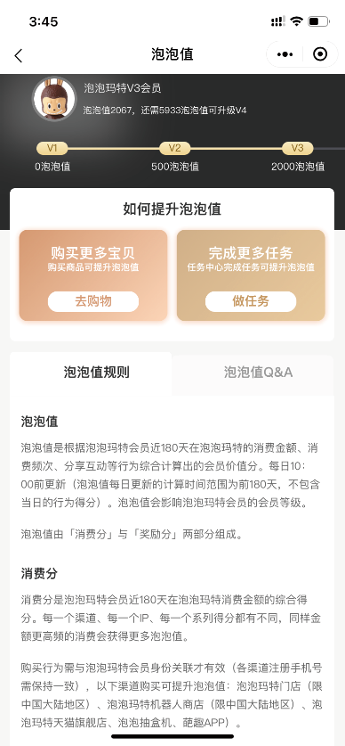

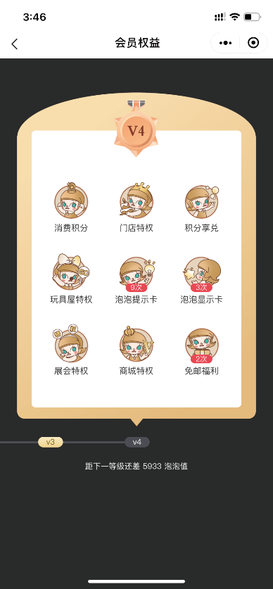

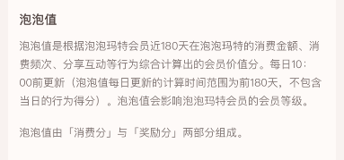

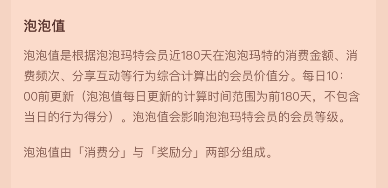

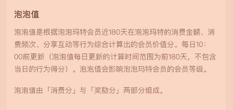


###### 原PDF第248页

[对照原PDF第248页](../2020年港股招股书.pdf#page=248)

###### 业  务

通过在葩趣上买卖潮流玩具及与其他粉丝进行互动，粉丝能够加深对其喜欢的产品和品牌的了解，且可能对其他产品和品牌产生兴趣，从而产生新购买及重复购买。此外，粉丝能够在葩趣上接触、分享和交流大量潮流玩具产品、品牌及艺术家的资讯和最新动态，据此我们能够发现热门及新进 IP、品牌及艺术家。因此，通过葩趣，我们能够有效地加强粉丝粘性并深入了解市场动态及消费者喜好，从而使我们能够不断开发及推广受欢迎的潮流玩具产品。截至最后实际可行日期，葩趣覆盖约 650 个潮流玩具品牌。

葩趣

```text
社区                  电子商城               玩具百科                 玩具库
```

此外，粉丝亦可通过我们的微信公众号了解我们的产品发布及活动以及各种潮流玩具信息。通过在我们的微信公众号上发布新产品信息，我们能够加强我们的品牌知名度。截至 2020 年 6 月 30 日，我们的微信公众号拥有 2.4 百万名粉丝。

展会

在中国没有大型潮流玩具活动的情况下，我们于 2017 年 9 月举办了首届潮流玩具展北京国际潮玩展。自彼时起，我们每年举办两次潮流玩具展，即北京国际潮玩展及上海国际潮玩展。我们邀请数百名艺术家带来彼等的设计与潮流玩具粉丝见面，从而为我们提供了寻找及发现新进艺术家的机会。根据弗若斯特沙利文报告，按参观人次计，北京国际潮玩展及上海国际潮玩展已成为中国最大的潮流玩具展。根据弗若斯特沙利文报告，我们的 2019 年北京国际潮玩展吸引了来自 14 个国家及地区的超过 270 名艺术家、超过 200 个潮流玩具品牌，参观人次超过 100,000 名。我们的潮流玩具展在推广潮流玩具文化及努力发掘有前途的艺术家方面充当著重要角色。

– 238 –

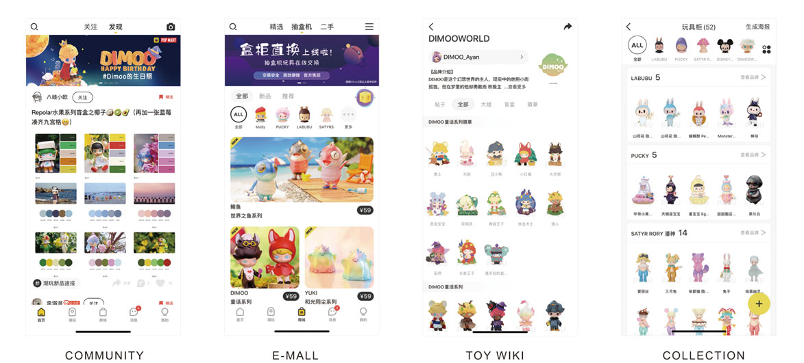


###### 原PDF第249页

[对照原PDF第249页](../2020年港股招股书.pdf#page=249)

###### 业  务

我们在潮流玩具展上组织各种活动，如签名会、现场绘画、采访及游戏。粉丝可以在我们的展会上与彼等喜欢的艺术家见面及交流。此外，粉丝可在我们的展会上购买我们及第三方潮流玩具品牌所有者新推出的潮流玩具产品。

北京国际潮玩展及上海国际潮玩展

我们致力于推广潮流玩具文化。除我们的潮流玩具社区及展会外，截至2020 年 6 月 30 日，我们在中国组织了合共 51 场展会及艺术家签名会。我们通常与大型购物中心合作，以举办该等展会及活动，大批消费者被吸引而来并享受潮流文化的乐趣及艺术性。此外，我们亦组织设计比赛以及与中国顶级艺术学院合作开设讲座及课程，让更多粉丝参与潮流玩具文化及培养新兴艺术家。

– 239 –

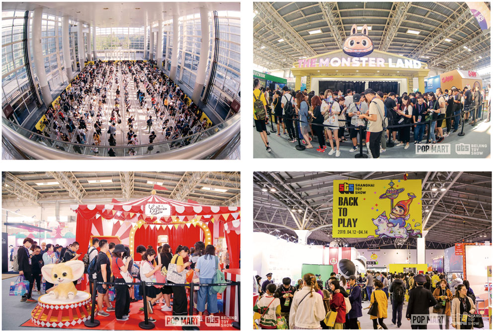


###### 原PDF第250页

[对照原PDF第250页](../2020年港股招股书.pdf#page=250)

###### 业  务

展会

销售及经销渠道

我们通过全面广泛的销售及经销网络销售我们的产品。截至 2020 年 6 月30 日，我们的销售及经销网络包括 (i) 136 间零售店；(ii) 1,001 间机器人商店；

(iii) 线上渠道，包括天猫旗舰店、泡泡抽盒机、葩趣及其他中国主流电商；(iv)我们的北京国际潮玩展及上海国际潮玩展；及 (v) 批发渠道，包括经销商及批量采购的公司客户。我们于中国以及韩国、日本、新加坡及美国等 21 个海外国家及地区聘有经销商。其次，部分公司客户亦直接大量订购我们的产品，作为雇员礼品或活动赠品。

下表载列所示期间按地理位置划分的收益及毛利明细：

```text
                                  截至12月31日止年度                                                      截至6月30日止六个月
           2017年                       2018年                       2019年                       2019年                       2020年
    收益      毛利    毛利率     收益      毛利   毛利率      收益      毛利   毛利率      收益      毛利   毛利率      收益     毛利    毛利率
人民币元人民币元         % 人民币元人民币元           % 人民币元人民币元           % 人民币元人民币元           % 人民币元人民币元           %
```

（未经审核）

（千元，百分比除外）

```text
中国                          157,414     74,878       47.6 510,149 295,654            58.0 1,656,544 1,078,264        65.1 536,854 327,017           60.9 797,119 523,482            65.7
海外                              660        376       57.0     4,362      2,371       54.4    26,890     12,070       44.9     6,542      3,575      54.6     20,672      9,957      48.2
总计                          158,074     75,254       47.6 514,511 298,025            57.9 1,683,434 1,090,334        64.8 543,396 330,592           60.8 817,791 533,439            65.2
```

– 240 –

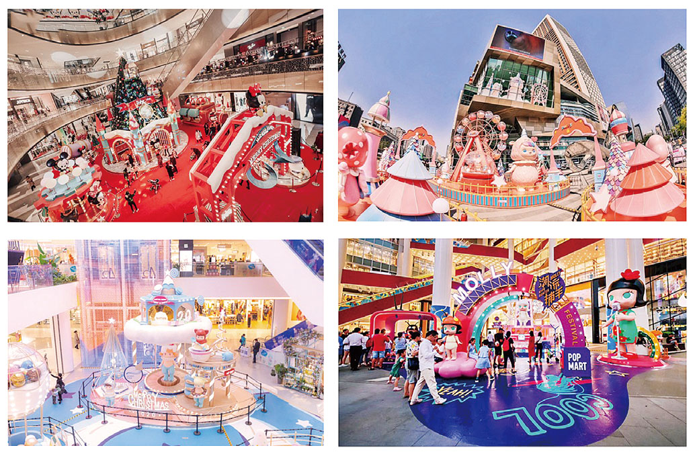


###### 原PDF第251页

[对照原PDF第251页](../2020年港股招股书.pdf#page=251)

###### 业             务

```text
                                   毛利率   %                               61.1    70.4    72.9    46.5    44.2    58.2    12.2              65.2
                                   毛利      人民币元                       191,388  235,505  76,904  29,496  23,601  5,895  146              533,439
                         2020年
                                   %                                        38.3    40.9    12.9    7.8     6.6     1.2     0.1               100.0
                                   收益      人民币元                       313,296  334,303  105,496  63,500  53,374  10,126  1,196          817,791
                截至6月30日止六个月
                                   毛利率   %                               57.2    71.2    71.7    33.4    29.2    55.8    33.9              60.8
                                   毛利      人民币元                       133,317  116,481  59,150  13,320  9,805  3,515  8,324             330,592
                         2019年
                                   %                                        42.9    30.1    15.2    7.3     6.1     1.2     4.5               100.0
                                                     （未经审核）
                                   收益      人民币元                       232,954  163,545  82,473  39,887  33,591  6,296  24,537           543,396
                                   毛利率   %                               65.6    68.9    70.7    36.7    37.6    31.9    36.8              64.8
                                   毛利      人民币元                       485,514  371,719  175,778  40,559  35,184  5,375  16,764          1,090,334
                                                             （千元，百分比除外）
                         2019年
                                   %                                        43.9    32.0    14.8    6.6     5.6     1.0     2.7               100.0
下表载列所示期间按销售及经销渠道划分的收益明细：
                                   收益      人民币元                       739,690  539,201  248,554  110,467  93,601  16,866  45,522        1,683,434
                                   毛利率   %                               61.2    62.8    71.5    25.6    22.2    49.1    25.3              57.9
                                   毛利      人民币元                       152,024  64,639  61,757  13,120  10,000  3,120  6,485             298,025
                截至12月31日止年度
                         2018年
                                   %                                        48.3    20.0    16.8    9.9     8.7     1.2     5.0               100.0
                                   收益      人民币元                       248,257  102,886  86,431  51,329  44,972  6,357  25,608           514,511
                                                                                                                                                               包括来自短期快闪店的销售
                                   毛利率   %                               55.0    56.1    63.2    19.7    19.5    22.2    29.9              47.6
                                   毛利      人民币元                       55,504  8,326   3,517   5,888   5,417   471     2,019             75,254
                         2017年
                                   %                                        63.9    9.4     3.5     18.9    17.6    1.3     4.3               100.0
                                   收益      人民币元                       101,005  14,854  5,568  29,884  27,759  2,125   6,763             158,074
```

```text
                                                                                  (1)
                                        －批量采购
                机器人商店      －经销商
零售店 (1)  线上渠道
                                                                  总收益
                        批发                    展会
```

– 241 –


###### 原PDF第252页

[对照原PDF第252页](../2020年港股招股书.pdf#page=252)

###### 业  务

下图载列我们截至 2020 年 6 月 30 日的零售店网络：

黑龙江： 4

```text
                                                  吉林 : 2
                             内蒙古： 1
                       北京： 35                    辽宁： 10
                                       天津： 4
                              河北： 1
                       山西： 2                山东： 8
                陕西： 3  河南： 3             江苏： 2
                                   安徽： 1        上海： 18
四川： 7                湖北： 2
             重庆： 4                       浙江： 3
                                 江西： 1
                       湖南： 3
            贵州： 2                   福建： 5
云南： 2         广西： 3
```

广东： 10

```text
五间店舖以下             五至十间店舖                 十间店舖以上
```

下图载列我们截至 2020 年 6 月 30 日的机器人商店网络：

黑龙江：17

吉林：18

内蒙古：21

辽宁：39

北京：164

```text
                              天津：31
                       河北：18
       宁夏：5     山西：8     山东：59
  甘肃：6         河南：28
                                    江苏：81
           陕西：44
                            安徽：19      上海：107
四川：54         湖北：22
           重庆：22                 浙江：31
                            江西：16
                   湖南：21
```

福建：37

贵州：9

云南：11

广西：7

广东：93

海南：13

20间机器人商店以下  20至40间机器人商店  40至60间机器人商店  60至80间机器人商店  80至100间机器人商店  100间机器人商店以上– 242 –


###### 原PDF第253页

[对照原PDF第253页](../2020年港股招股书.pdf#page=253)

###### 业  务

除根据我们的 IP 开发的泡泡玛特品牌产品（包括手办、盲盒、扭蛋、BJD及衍生品）外，我们亦销售主要来自选定第三方品牌拥有人的第三方产品，如盲盒、手办、拼图、毛绒玩具、电动玩具和配件。第三方产品并非由我们开发。我们通过部分零售店及天猫旗舰店采购及销售第三方产品，为粉丝提供了除我们泡泡玛特品牌产品以外的更多选择。当选择性地于零售店投放第三方产品时，我们主要考虑品牌声誉、IP 及设计师的受欢迎程度及产品的盈利能力及零售店的位置、规模及客流量。当于我们的天猫旗舰店投放产品时，我们亦考虑品牌声誉、IP 及设计师的受欢迎程度及产品的盈利能力。于 2017年、2018 年及 2019 年以及截至 2019 年及 2020 年 6 月 30 日止六个月，我们自第三方产品产生的收益分别为人民币 110.3 百万元、人民币 162.3 百万元、人民币 280.0 百万元、人民币 138.7 百万元及人民币 130.9 百万元，分别占我们同期总收益的 69.8%、31.5%、16.6%、25.5% 及 15.9%。例如，我们采购及销售 (i) 基于人气日本卡通角色、哈利波特、冰雪奇缘及米奇老鼠开发的手办，(ii) 基于人气动画及卡通角色（如淘奇多奇角色及阿狸）开发的盲盒及 (iii) 基于日本卡通、视频游戏及动画人气角色（如口袋妖怪）开发的扭蛋（与盲盒类似的玩具，亦以系列方式推出供盲购）。我们主要向知名国际品牌拥有人采购第三方潮流玩具产品。例如，我们向万代（扎根日本的全球领先玩具及塑料模型公司）

– 243 –


###### 原PDF第254页

[对照原PDF第254页](../2020年港股招股书.pdf#page=254)

###### 业  务

及 Banpresto （专注玩具消费者业务的日本公司）采购及销售潮流玩具。下图阐释我们的主要第三方产品：

手办 – 哈利波特  手办 – 冰雪奇缘

盲盒 – 阿狸

扭蛋﹣口袋妖怪

– 244 –

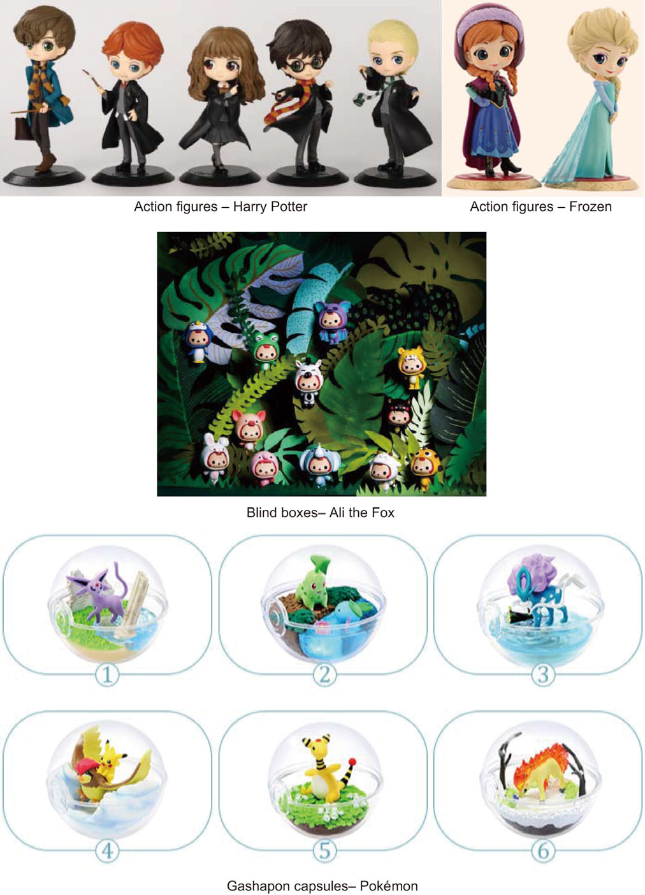


###### 原PDF第255页

[对照原PDF第255页](../2020年港股招股书.pdf#page=255)

###### 业  务

我们出售的第三方产品的价格由品牌拥有人厘定，根据弗若斯特沙利文报告，这符合行业规范。我们与相关品牌拥有人订立的协议的主要条款包括：

•  期限 ：协议期限通常为一年，并且可以自动续期。

•  销售政策 。根据与品牌拥有人的协议，我们被指定在中国及其他特定地区（视乎情况而定）销售特定品牌的产品。

•  购买价格 。我们一般以介于建议单位售价 40% 至 50% 的折扣价购买品牌拥有人的产品。

•  价格管理 。我们将遵循品牌拥有人建议的单位售价。如品牌拥有人调整任何产品的价格，则应通知我们最新价格。

•  质量控制 。品牌拥有人提供的产品应遵守适用的法律法规，并符合适用的国际和国家质量标准。

•  交付 。品牌拥有人应在协议规定的地点交付产品。交付费用通常由品牌拥有人支付。

•  信贷期 。品牌拥有人通常授予我们三个月的信贷期。

•  责任 。品牌拥有人应对由于产品缺陷而引起的所有产品责任、侵权和索赔负责。我们有权就因该等缺陷而产生的任何损失获得赔偿。

•  终止 。经双方同意后可以终止协议。

截至 2020 年 6 月 30 日，我们拥有 19 份有效的有关采购及销售第三方产品的协议。就四份将于 2020 年届满的协议而言，我们正就其中一份过往曾重续的协议的续期进行磋商。董事确认，基于顺利的磋商及重续流程，本公司重续该协议并无重大障碍。就将于 2020 年届满的其他三份协议而言，我们与第三方品牌拥有人进行友好磋商后因商业理由将不再重续有关协议。下表载列

– 245 –


###### 原PDF第256页

[对照原PDF第256页](../2020年港股招股书.pdf#page=256)

###### 业  务

截至 2020 年 6 月 30 日于 2020 年、2021 年、2022 年及其后届满的有关协议的数目及收益贡献：

```text
协议数目                     收益贡献
                                                   截至
                                               6 月 30 日
                 截至 12 月 31 日止年度       止六个月
              2017 年    2018 年     2019 年     2020 年
```

（人民币千元）

```text
协议
于 2020 年届满 (1)                   4      5,081     16,052     18,711      3,372
于 2021 年届满                      12      3,180     17,736     90,801     35,819
于 2022 年届满                       3      6,564     19,910     26,454      7,493
于其后届满                           0          –          –          –          –
附注：
(1)   于 2017 年、2018 年、2019 年及截至 2020 年 6 月 30 日止六个月，三份于 2020 年届满惟我们
      不会重续的与第三方品牌拥有人订立的协议的收益贡献分别为人民币 2.2 百万元、人民
```

币 6.0 百万元、人民币 3.1 百万元及人民币 49,000 元。

作为中国潮流玩具文化的开拓者及主要推广者，我们已发现中国潮流玩具市场的机遇。因此，我们致力于开发泡泡玛特品牌产品，而非仅作为第三方产品的销售渠道。我们建立了覆盖潮流玩具全产业链的一体化平台，通过该平台我们得以激发粉丝对潮流的热情，给他们带来快乐和美好。在此背景下，于往绩记录期间，我们有策略地将资源转向泡泡玛特品牌产品，主要由于(i)我们的泡泡玛特品牌知名度上升、(ii) 我们的泡泡玛特品牌产品受欢迎程度上升及 (iii) 我们的泡泡玛特品牌产品的毛利率较高。尤其是，我们受益于获得高度认可的「泡泡玛特」品牌，其对泡泡玛特品牌产品的发展及我们的业务营运至关重要。凭借「泡泡玛特」品牌的知名度和良好形象，我们能够 (i) 吸引更多开创性及新进艺术家，进一步扩大我们的 IP 库、(ii) 与更多成熟 IP 提供商合作及 (iii) 推广潮流玩具文化及潮流玩具产品以及获得更大的市场份额。因此，我们于往绩记录期间实现收益强劲增长。于 2017 年、2018 年及 2019 年，我们泡泡玛特品牌产品产生的收益分别为人民币 45.9 百万元、人民币 340.1 百万元及人民币 1,384.2 百万元，复合年增长率为 421.1%。截至 2019 年及 2020 年 6 月 30日止六个月，我们的泡泡玛特品牌产品产生的收益分别为人民币 395.2 百万元及人民币 686.9 百万元，增长率为 73.8%。同期，泡泡玛特品牌产品产生的收益分别占总收益 29.0%、66.1%、82.2%、72.7% 及 84.1%。 在专注开发我们的泡泡玛特品牌产品的同时，我们将继续按我们的泡泡玛特品牌产品并未涉足的 IP 及产品类别的策略与一流第三方品牌拥有人进行合作。我们相信关于第三方产品的有关业务策略将为我们提供关于市场趋势及消费者喜好的更多见解，并有助泡泡玛特品牌产品的发展。

– 246 –


###### 原PDF第257页

[对照原PDF第257页](../2020年港股招股书.pdf#page=257)

###### 业  务

下表载列所示期间按销售渠道划分的泡泡玛特品牌产品各主要 IP 及第三方产品的盲盒销量及平均售价：

```text
                                                   截至12月31日止年度                                   截至6月30日止六个月
                                    2017年                2018年               2019年                2019年               2020年
                                            平均                 平均                  平均                 平均                  平均
                                 销量售价 (1)          销量售价 (1)         销量售价 (1)          销量售价 (1)         销量售价 (1)
                              （千个）（人民币元） （千个）（人民币元） （千个）（人民币元） （千个）（人民币元） （千个）（人民币元）
盲盒                           2,176.8        42    7,612.2         47 26,421.2          51      8,303         48     14,153        49
零售店                         1,162.4        45    3,653.9         48 10,519.2          56      3,324         49      4,811        51
－泡泡玛特品牌产品
    自有IP                       462.7        50    2,193.0         41    4,071.1        57    1,288.0         46    1,774.4        47
    Molly                        462.7        50    2,185.3         41    2,767.1        59    1,177.4         45      741.8        51
    Dimoo                            –         –          –          –      753.9        51          –          –      645.9        45
    BOBO&COCO                        –         –          –          –      202.5        53       42.2         59      209.7        45
    Yuki                             –         –        7.6         50      220.6        53       68.5         48      143.0        46
    其他                             –         –          –          –      126.9        55          –          –       33.9        32
    独家IP                        41.2        50      888.6         44    3,979.3        56    1,024.3         51    1,581.3        49
    PUCKY                            –         –      615.6         46    2,016.9        56      430.9         51      622.7        53
    The Monsters                     –         –          –          –      664.7        52      122.1         58      471.8        44
    SATYR RORY                       –         –       51.9         51      466.2        53      135.1         47       95.3        44
    其他                          41.2        50      221.1         39      831.5        59      336.2         50      391.4        51
    非独家IP                         –         –      165.7         49    1,414.4        51      346.4         44    1,038.8        46
－第三方产品                     658.4        41      406.6         98    1,054.5        59      665.1         53      417.2        87
线上渠道                         123.9        39    1,626.8         48    8,273.1        53      2,523         51      5,547        52
－泡泡玛特品牌产品
    自有IP                        70.4        48      885.7         49    3,585.1        52    1,121.7         47    2,249.3        51
    Molly                         70.4        48      881.9         48    2,372.5        53      983.8         47      726.6        55
    Dimoo                            –         –          –          –      786.4        50          –          –    1,194.4        49
    BOBO&COCO                        –         –          –          –      153.8        53       74.9         55      182.6        50
    Yuki                             –         –        3.8         51      135.5        53       63.0         47      103.8        52
    其他                             –         –          –          –      136.7        43          –          –       42.0        56
    独家IP                         5.1        47      589.4         45    3,507.0        54    1,061.3         56    2,198.6        53
    PUCKY                            –         –      445.1         46    1,796.7        54      452.1         55      892.7        56
    The Monsters                     –         –          –          –      677.7        54      197.2         62      572.3        51
    SATYR RORY                       –         –       39.8         50      487.8        52      194.9         49      182.1        46
    其他                           5.1        47      104.5         38      544.8        54      217.1         59      551.6        54
    非独家IP                         –         –      108.4         43      909.0        50      252.2         44    1,006.3        47
－第三方产品                      48.4        25       43.3        104      272.0        55       87.4         52       93.1        83
```

– 247 –


###### 原PDF第258页

[对照原PDF第258页](../2020年港股招股书.pdf#page=258)

###### 业        务

```text
                                                   截至12月31日止年度                                   截至6月30日止六个月
                                    2017年                2018年               2019年                2019年               2020年
                                            平均                 平均                  平均                 平均                  平均
                                 销量售价 (1)          销量售价 (1)         销量售价 (1)          销量售价 (1)         销量售价 (1)
                              （千个）（人民币元） （千个）（人民币元） （千个）（人民币元） （千个）（人民币元） （千个）（人民币元）
机器人商店                        93.3        52    1,559.1         53    4,548.2        53      1,533         52      1,991        52
－泡泡玛特品牌产品
    自有IP                        66.0        50      978.4         50    1,863.6        55      685.2         51      762.6        53
    Molly                         66.0        50      975.7         50    1,395.5        57      654.1         51      333.5        55
    Dimoo                            –         –          –          –      289.6        50          –          –      315.1        51
    BOBO&COCO                        –         –          –          –       66.2        53       16.6         59       76.8        50
    Yuki                             –         –        2.7         51       50.3        52       14.6         52       37.0        49
    其他                             –         –          –          –       62.0        43          –          –        0.1        49
    独家IP                         7.0        53      387.0         50    1,833.8        54      563.4         53      724.0        52
    PUCKY                            –         –      286.4         51    1,011.4        55      256.0         52      301.1        53
    The Monsters                     –       805          –        143      362.6        51       86.6         59      235.2        52
    SATYR RORY                       –         –       23.0         49      157.9        52       68.6         52       36.4        49
    其他                           7.0        53       77.6         47      302.0        55      152.2         53      151.4        53
    非独家IP                         –         –       64.8         51      491.5        50      115.3         47      477.0        49
－第三方产品                      20.4        57      128.8         80      359.2        49      169.6         59       27.7        76
批发                             782.3        37      708.6         28    2,992.6        30        869         34      1,803        29
经销商                           734.9        37      497.7         29    2,565.0        30        700         36      1,563        28
－泡泡玛特品牌产品
    自有IP                       263.0        30       81.5         21      941.2        30      229.4         34      497.6        28
    Molly                        263.0        30       80.6         21      608.3        29      209.8         33      183.7        30
    Dimoo                            –         –          –          –      211.4        27          –          –      195.2        26
    BOBO&COCO                        –         –          –          –       33.1        41        8.3         47       67.7        27
    Yuki                             –         –        0.8         37       31.3        41       11.3         33       51.0        27
    其他                             –         –          –          –       57.1        36          –          –          –         –
    独家IP                        28.9        26       39.9         33      978.9        33      290.5         37      593.8        29
    PUCKY                            –         –        9.8         37      415.4        39      105.5         42      194.5        29
    The Monsters                     –         –          –          –      151.9        38       41.0         34      143.6        29
    SATYR RORY                       –         –       27.0         32      100.1        36       44.9         33       32.3        30
    其他                          28.9        26        3.2         25      311.6        23       99.1         34      223.5        28
    非独家IP                         –         –       75.5         21      368.9        22       70.4         30      370.9        28
－第三方产品                     442.9        42      300.9         32      276.1        30      109.7         39      100.4        31
```

– 248 –


###### 原PDF第259页

[对照原PDF第259页](../2020年港股招股书.pdf#page=259)

###### 业        务

```text
                                                     截至12月31日止年度                                    截至6月30日止六个月
                                      2017年                2018年                2019年                2019年                2020年
                                              平均                  平均                  平均                  平均                  平均
                                  销量售价 (1)           销量售价 (1)          销量售价 (1)          销量售价 (1)          销量售价 (1)
                               （千个）（人民币元） （千个）（人民币元） （千个）（人民币元） （千个）（人民币元） （千个）（人民币元）
批量采购                           47.4         36      210.8         26      427.6         31        169         28        240          36
－泡泡玛特品牌产品
     自有IP                        15.8         27       26.9         22      104.7         31        56.8        28        76.6         35
     Molly                         15.8         27       26.9         22       76.0         31        50.1        28        49.7         37
     Dimoo                            –          –          –          –         9.6        32          –           –       12.4         43
     BOBO&COCO                        –          –          –          –         5.3        26         3.5        26         1.2         50
     Yuki                             –          –          –          –         9.9        27         3.2        22         1.1         40
     其他                             –          –          –          –         4.0        36          –           –       12.3         19
     独家IP                         1.9         28       15.4         28      192.3         32        79.1        29       130.3         36
     PUCKY                            –          –        3.2         39       53.9         33        29.7        31        48.5         37
     The Monsters                     –          –          –          –       30.0         30        11.2        28        12.6         34
     SATYR RORY                       –          –        9.5         25       24.9         29        11.1        23         1.9         32
     其他                           1.9         28        2.7         25       83.5         34        27.2        30        67.2         35
     非独家IP                         –          –       15.9         23      124.9         28        30.7        26        32.9         37
－第三方产品                       29.7         41      152.6         27         5.7        31         2.3        30         0.3         13
展会                               14.9         46       63.7         42       88.0         55         54         53           –          –
－泡泡玛特品牌产品
     自有IP                         5.5         53        3.9         51       22.8         58         4.0        52           –          –
     Molly                          5.5         53        3.9         51       15.1         61         1.5        49           –          –
     Dimoo                            –          –          –          –         1.9        53          –           –          –          –
     BOBO&COCO                        –          –          –          –         3.1        53         2.5        53           –          –
     Yuki                             –          –          –          –         1.2        53          –           –          –          –
     其他                             –          –          –          –         1.5        51          –           –          –          –
     独家IP                         1.2         20       44.4         28       57.7         56        46.5        54           –          –
     PUCKY                            –          –       42.4         27         3.4        41         1.1        51           –          –
     The Monsters                     –          –          –          –       30.6         53        27.2        49           –          –
     SATYR RORY                       –          –        1.0         40         0.4        51         0.5        46           –          –
     其他                           1.2         20        1.0         51       23.3         62        17.7        61           –          –
     非独家IP                         –          –        3.0         47         4.1        40         3.1        48           –          –
－第三方产品                        8.3         45       12.5         89         3.4        44         0.4        51           –          –
附注：
(1)       平均售价乃使用收益除以相关销量计算。
```

– 249 –


###### 原PDF第260页

[对照原PDF第260页](../2020年港股招股书.pdf#page=260)

###### 业  务

关于各销售渠道，整体而言，我们基于自有 IP 开发的泡泡玛特品牌盲盒的平均售价 (i) 于 2017 年至 2018 年下降，主要由于随著基于 Molly 形象开发的盲盒快速增长，2018 年在促销活动中提供折扣，但促销活动有限的线上渠道及机器人商店保持相对稳定；(ii) 于 2018 年至 2019 年上涨，主要由于推出售价较高的多款大受欢迎的限量版；及 (iii) 于 2019 年及 2020 年上半年保持相对稳定（由于我们于 2020 年上半年并无举办展会，故不适用于展会）。尤其是，就批量采购而言，有关波动因批量采购公司客户订单的细节而可能进一步变化。

关于各销售渠道， 整体而言， 我们基于独家 IP 开发的泡泡玛特品牌盲盒的平均售价 (i) 于 2017 年并不具代表性，原因是销量及产品系列有限；(ii) 于2018 年至 2019 年上涨，主要由于推出售价较高的多款大受欢迎的限量版；及

(iii) 于 2019 年及 2020 年上半年保持相对稳定（由于我们于 2020 年上半年并无举办展会，故不适用于展会）。尤其是，就批量采购而言，有关波动因批量采购公司客户订单的细节而可能进一步变化。

关于各销售渠道，整体而言，我们基于非独家 IP 开发的泡泡玛特品牌盲盒的平均售价 (i) 于 2018 年及 2019 年保持相对稳定，惟 (a) 线上渠道于 2018 年至 2019 年上涨，主要由于 2018 年在促销活动中提供折扣及 (b) 就展会而言并不具代表性，原因是销量及产品系列有限；及 (ii) 于 2019 年及 2020 年上半年保持相对稳定（由于我们于 2020 年上半年并无举办展会，故不适用于展会）。尤其是，就批量采购而言，有关波动因批量采购公司客户订单的细节而可能进一步变化。

就各销售渠道而言，第三方品牌盲盒于往绩记录期间的平均售价出现波动，原因在于我们经考虑 IP 及设计师的受欢迎程度以及产品的盈利能力而对第三方产品组合作出了调整。

### 零售店

我们的零售店是我们的主要销售渠道，提供最丰富的产品选择，以满足不同粉丝的需求。截至 2020 年 6 月 30 日，我们拥有主要位于中国 33 个一二线城市主流商圈的 136 间零售店。我们零售店的建筑面积一般介乎 100 至 150 平方米。我们已指定专人负责各零售店的营运及补货。除我们的中央仓库及当地仓库外，我们通常于我们零售店所在的购物中心设有一个小型仓库，以确保及时补充库存。

零售店是我们确立市场地位及与粉丝互动联系的重要渠道。例如，我们通过零售店凝聚大量粉丝、体验新产品、提升购物体验及提高品牌知名度。

– 250 –


###### 原PDF第261页

[对照原PDF第261页](../2020年港股招股书.pdf#page=261)

###### 业  务

于2017年、2018年及2019年以及2020年上半年，我们通过分别开设18间、35 间、52 间及 24 间新零售店实现持续扩张。同期我们分别关闭了两间、四间、一间及两间店舖，乃主要由于我们致力于改善零售店的布局及表现。下表载列于往绩记录期间我们的零售店总数及其变动情况：

截至

|  |  |  |  | 6 月 30 日 |
| --- | ---: | ---: | ---: | ---: |
|  |  | 截至 12 月 31 日止年度 |  | 止六个月 |
|  | 2017 年 | 2018 年 | 2019 年 | 2020 年 |
| 期初零售店数量 | 16 | 32 | 63 | 114 |
| 期内开设的新零售店数量 | 18 | 35 | 52 | 24 |
| 期内关闭的零售店数量 | 2 | 4 | 1 | 2 |
| 期末零售店数量 | 32 | 63 | 114 | 136 |

我们主要专注于在一线及二线城市开设新零售店。我们开设新零售店时考虑的因素包括：

•  城市的整体经济状况及可支配收入；

•  商业区的位置；

•  商业区消费者的平均可支配收入；

•  商业区消费者的消费方式；

•  购物中心的销售业绩；

•  高峰时段的顾客流量；及

•  租金成本和估计投资回报率。

– 251 –


###### 原PDF第262页

[对照原PDF第262页](../2020年港股招股书.pdf#page=262)

###### 业  务

下表载列我们的零售店的经营详情：

```text
                                                                   截至 6 月 30 日
                                 截至 12 月 31 日止年度              止六个月
                              2017 年    2018 年     2019 年     2019 年     2020 年
                                                            （未经审核）
收益（人民币千元）           101,005     248,257     739,690     232,954     313,296
经营溢利率 (1)                 20.3%      32.6%       40.7%       28.2%       28.0%
同店销售增长 (2)                   –      59.6%       63.1%            –   (23.1)% (3)
平均店舖数目 (4)                  24          47          88          74        125
单店年化平均收益 (5)
  （人民币千元）               4,209       5,282       8,406       6,296       5,013
亏损店舖数目 (6)                   6           7           2           4          14
亏损店舖数目占
   平均店舖数目百分比          25.0%      14.9%        2.3%        5.4%       11.2%
附注：
(1)   经营溢利率使用零售店产生的收益减零售店的销售成本、租金、员工成本、物业、
      厂房及设备折旧，再除以零售店产生的总收益计算。
(2)   指同一零售店相较上一期间的收益增长。同一零售店指于所比较的上一期间起始
      前已开始营业及于本期期末后仍开门营业的零售店。
(3)   负同店销售增长的主要原因为因 COVID-19 疫情令零售店于 2020 年上半年暂时关
      闭，导致零售店的同店销售下降。自 2020 年 1 月起及直至最后实际可行日期，我们
```

暂时关闭合计 88 间零售店，主要关闭一周至一个月不等。截至最后实际可行日期，

```text
     该等 88 间零售店已全部重新开业。
(4)  指于期初及期末零售店数目的平均数。
(5)  单店年化平均收益按一个期间内零售店产生的总收益除以该期间的零售店平均
     数目计算。
(6)  亏损店舖指根据本公司于本期间的管理账目，毛利无法覆盖经销及销售开支的零
     售店。相应期间亏损店舖产生亏损主要由于以下原因：(i) 因店舖规模较大，开设
```

若干零售店及维持其日常营运产生大量开支；(ii) 若干零售店于本期间末方开始营运，因此，并无实现预期销售表现；及 (iii) 受 COVID-19 疫情影响，若干零售店于2020 年上半年暂时关闭。就截至 2020 年 6 月 30 日止六个月的 14 间亏损零售店而言，

(i) 12 间零售店于截至 2020 年 9 月 30 日止九个月不再亏损；(ii) 一间零售店已因我们致力提升零售店的布局及表现而关闭；及 (iii) 一间零售店于截至 2020 年 9 月 30 日止九个月录得亏损，而于 2020 年 9 月实现月度溢利。

截至最后实际可行日期，我们几乎全部零售店均于中国营运，以及于韩国营运一间零售店。

– 252 –


###### 原PDF第263页

[对照原PDF第263页](../2020年港股招股书.pdf#page=263)

###### 业  务

零售店

自 2017 年起，除零售店外，我们亦与购物中心合作，推出限时主题快闪店，创造浸入式的购物体验及提升我们的品牌。我们的快闪店的期限从一个月至三个月不等。

快闪店

### 机器人商店

自 2017 年 4 月起，我们开始推出创新无人收银机器人商店，以扩大我们的客户范围，并提供交互式的有趣购物体验。我们的机器人商店主要位于购物中心，此外，我们也将机器人商店投放在人流量较高的位置，如主要地铁站。我们的机器人商店售货机为自动式及互动式自动售货机。我们的机器人商店配备了用户友好型触摸屏，粉丝仅需单击数下即可获得包括产品说明、促销活动及售后服务等功能。我们主要于机器人商店销售盲盒产品。为增加每台机器人商店售货机的库存单位数量，我们的大多数盲盒产品都采用标准且相对较小尺寸包装，适合在我们的机器人商店中销售。每间机器人商店能够存储最多约 60 个库存单位。

– 253 –

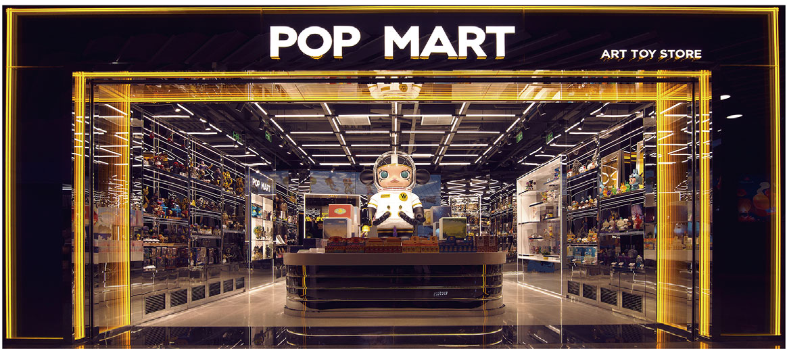

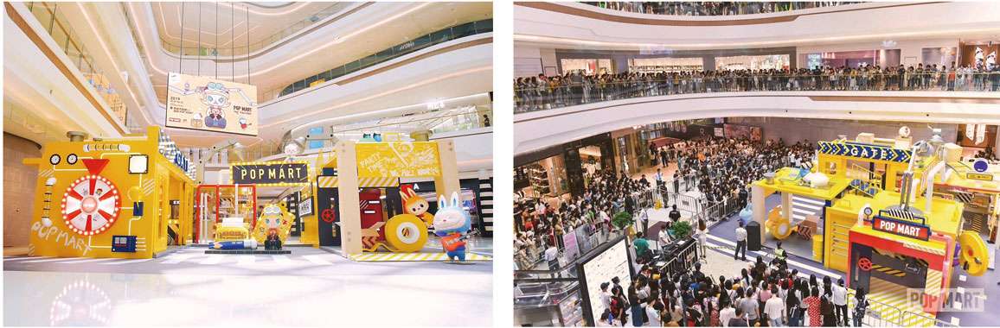


###### 原PDF第264页

[对照原PDF第264页](../2020年港股招股书.pdf#page=264)

###### 业  务

机器人商店

与零售店相比，机器人商店在租赁费、人工费及维护费方面降低了前期成本及持续经营开支。因此，我们能够高效、快速地扩展我们的机器人商店网络，该网络可覆盖我们零售店未涵盖的经济活跃区域。此外，我们机器人商店的销售表现及市场反馈（包括粉丝喜好、客流量及消费模式）为我们的零售店扩展战略提供了宝贵的数据洞察。我们在考虑是否在同一区域开设新零售店时会依据有关销售表现及市场反馈。设计抓人眼球的机器人商店及潮流玩具产品有助我们吸引新粉丝。截至 2020 年 6 月 30 日，我们在中国拥有 1,001间机器人商店。

我们的大多数机器人商店由我们运营。其次，我们截至 2020 年 6 月 30 日为 81 间机器人商店聘请选定的机器人商店合作伙伴，彼等负责位置租赁及维护工作。我们会决定在每间机器人商店销售的产品的上架频率和类型，而机器人商店合作伙伴应遵照我们的指示，将我们的产品摆放在机器人商店中。凭借我们的机器人商店管理系统，我们可以直接访问我们的机器人商店的销售数据，包括由我们的机器人商店合作伙伴所运营机器人商店的销售数据。我们的机器人商店管理系统收集并备份各种销售数据。其能够生成有关机器人商店的销售、营销及销售转换和库存情况的实时数据。其亦能够通过机器人商店记录交易的位置、支付方式及详情。因此，我们能够实时监控机器人商店的销售，并能够及时补充机器人商店的库存。我们已有并且要求机器人商店合作伙伴指派员工专门负责在指定区域补充机器人商店的库存。一名指定员工通常负责临近的八间机器人商店的补货工作，而通常两间机器人商店之间的距离介乎 3 千米至 8 千米。借助我们的中央仓库及当地仓库，员工能于一天内获得产品为机器人商店补货。员工一般花费半个小时完成一间机器人商店的补货工作。因此，我们机器人商店的库存通常每日或每两日补充。就由机器人商店合作伙伴运营的机器人商店所出售的产品而言，商品的控制权由我们直接转让予粉丝，机器人商店合作伙伴并不保留商品的控制权。详情

– 254 –

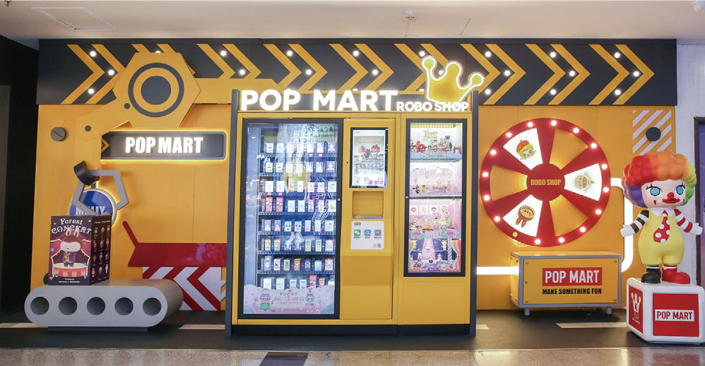


###### 原PDF第265页

[对照原PDF第265页](../2020年港股招股书.pdf#page=265)

###### 业  务

请参阅「财务资料－重要会计政策及估计－收益确认」。我们通常每月将相关机器人商店总销售收益的 35% 支付予机器人商店合作伙伴。我们计划往后不再聘请新机器人商店合作伙伴。于 2017 年、2018 年及 2019 年以及截至 2019 年及 2020 年 6 月 30 日止六个月，我们支付予机器人商店合作伙伴的佣金分别为人民币 54,000 元、人民币 8.0 百万元、人民币 19.1 百万元、人民币 7.0 百万元及人民币 5.6 百万元。

于 2017 年、2018 年及 2019 年以及 2020 年上半年，我们分别开设了 43 间、217 间、565 间及 176 间新机器人商店。我们同期并无关闭任何机器人商店。截至 2017 年、2018 年及 2019 年 12 月 31 日及 2020 年 6 月 30 日， 我们分别有 43 间、260 间、825 间及 1,001 间机器人商店。下表载列于往绩记录期间我们机器人商店的总数及其变动：

截至

```text
                                                                       6 月 30 日
                                       截至 12 月 31 日止年度         止六个月
                                   2017 年     2018 年      2019 年     2020 年
期初机器人商店数量                       –          43         260         825
期内新开设的机器人商店数量             43          217         565         176
期内关闭的机器人商店数量                 –           –           –            –
期末机器人商店数量                     43          260         825        1,001
```

我们开设新机器人商店时所考虑的因素与开设零售店的考虑因素基本相同，但我们主要侧重于在三线及四线城市开设新机器人商店。

– 255 –


###### 原PDF第266页

[对照原PDF第266页](../2020年港股招股书.pdf#page=266)

###### 业  务

下表载列我们的机器人商店的经营详情：

```text
                                  截至 12 月 31 日止年度       截至 6 月 30 日止六个月
                              2017 年     2018 年     2019 年     2019 年    2020 年
                                                             （未经审核）
收益（人民币千元）             5,568      86,431     248,554      82,473     105,496
经营溢利率 (1)                 48.6%       53.3%       51.2%      51.1%       45.1%
同店销售增长 (2)                   –           –        0.2%           –     (52.8)%
平均店舖数目 (3)                  22         130         543         307        913
单店年化平均收益 (4)
  （人民币千元）                 253         665         458         537        231
亏损店舖数目 (5)                   1           6          72          23        146
亏损店舖数目占平均
   店舖数目百分比               4.5%        4.6%       13.3%       7.5%       16.0%
附注：
(1)   经营溢利率使用机器人商店产生的收益减机器人商店的销售成本、租金、员工成
      本、物业、厂房及设备折旧及支付予机器人商店合作伙伴的佣金，再除以机器人
      商店产生的总收益计算。
(2)   指同一机器人商店相较上一期间的收益增长。同一机器人商店指于所比较的上一
      期间起始前已开始营业及于本期期末后仍开门营业的机器人商店。
(3)   指于期初及期末机器人商店数目的平均数。
(4)   单店年化平均收益按一个期间内机器人商店产生的总收益除以该期间的机器人
      商店平均数目计算。
(5)   亏损店舖指根据本公司于本期间的管理账目，毛利无法覆盖经销及销售开支（按
      所有机器人商店于本期间的月均经销及销售开支乘以机器人商店于本期间运营
```

的月数计算）的机器人商店。

截至 2020 年 6 月 30 日止六个月录得机器人商店负同店销售增长的主要原因包括 (i) 机器人商店于 2020 年上半年因 COVID-19 疫情而暂时关闭，导致同店销售下降及 (ii) 考虑到相较机器人商店而言，我们于零售店能够摆放更多新产品且我们于零售店拥有更多面积及设施供展示及推广新产品系列以吸引粉丝及客户的注意力，我们于若干零售店及机器人商店因 COVID-19 而暂时关闭且客流量及销售活动受到不利影响时，在 COVID-19 疫情期间于零售店推出更多新产品系列的产品，以期实现更为有效的推广及增强新产品系列的知名度。自2020年1月起直至最后实际可行日期，我们共有279间机器人商店暂时关闭，主要为期一周至一个月不等。截至最后实际可行日期，该等 279 间机器人商店中的 265 间已重开。

– 256 –


###### 原PDF第267页

[对照原PDF第267页](../2020年港股招股书.pdf#page=267)

###### 业  务

往绩记录期间的亏损机器人商店数目持续增加。亏损机器人商店于相应期间产生亏损主要归因于以下各项：(i) 若干机器人商店仅于本期末才开始经营，因此并未取得预期销售表现；及 (ii) 若干机器人商店因受到 COVID-19 疫情的影响而于 2020 年上半年暂时关闭。为改善我们机器人商店的销售表现，我们计划 (i) 针对我们的机器人商店制定销售及营销计划，如机器人商店的专用营销及推广活动；(ii) 增加每间机器人商店的库存单位及产品系列数目；(iii) 改变我们机器人商店的设计及装饰。截至 2020 年 6 月 30 日止六个月的 146 间亏损机器人商店中，(i) 80 间机器人商店于截至 2020 年 9 月 30 日止九个月不再亏损及 (ii) 66 间机器人商店于截至 2020 年 9 月 30 日止九个月录得亏损，其中 21 间于 2020 年 9 月已取得月度溢利。

此外，截至最后实际可行日期，我们于韩国营运六间机器人商店。

### 线上渠道

我们透过国内增长迅猛的线上渠道（包括天猫旗舰店、泡泡抽盒机、葩趣及其他主流电商平台）提供便捷和有趣的购物体验。根据相关协议，我们将就运营、市场推广及技术支持服务向有关电商平台支付服务费。有关服务收费主要包括 (i) 佣金，通常按我们于电商平台销售额的标准费率收取及 (ii) 市场推广及技术支持费，根据使用情况收取及与我们的销售额并无直接关系。大多数电商平台通常按我们于平台总销售额的约 5% 收取费用。我们于泡泡抽盒机的销售则无须支付佣金。 于 2017 年、2018 年、2019 年及截至 2020 年 6 月30 日止六个月，我们分别产生电商平台服务费人民币 0.9 百万元、人民币 6.3百万元、人民币 28.8 百万元及人民币 25.6 百万元，与往绩记录期间我们来自线上渠道的收益增加一致。于 2017 年、2018 年及 2019 年以及截至 2020 年 6 月30 日止六个月，我们分别产生电商平台佣金人民币 0.6 百万元、人民币 4.4 百万元、人民币 17.2 百万元及人民币 9.4 百万元，及分别产生市场推广及技术支持费人民币 0.3 百万元、人民币 1.9 百万元、人民币 11.6 百万元及人民币 16.2 百万元。我们于 2020 年上半年的市场推广及技术支持费增加乃主要由于我们于COVID-19 疫情期间加大力度促进线上销售所致。

我们于 2016 年 6 月开始在天猫经营旗舰店，这已经成为我们吸引新粉丝的主要渠道之一。根据弗若斯特沙利文报告，于 2019 年，作为我们吸引新粉丝的主要渠道之一的天猫旗舰店产生的收益为人民币 251.5 百万元，在天猫所有玩具旗舰店中排名第一。我们天猫旗舰店所产生的收益由 2019 年上半年的人民币 66.6 百万元大幅增加至 2020 年上半年的人民币 146.7 百万元。我们天猫旗舰店在「2019 双十一」及「2020 双十一」的总销售额冠绝天猫所有玩具旗舰店。

– 257 –


###### 原PDF第268页

[对照原PDF第268页](../2020年港股招股书.pdf#page=268)

###### 业  务

天猫旗舰店

天猫旗舰店

我们于 2018 年 9 月在微信上线泡泡抽盒机。小程序符合盲盒的特征且内嵌有互动功能，创造了好玩、有趣的购物体验，从而增加智能手机上盲盒的销售。自 2018 年 9 月推出以来，泡泡抽盒机实现了强劲增长。泡泡抽盒机产生的收益由 2018 年的人民币 23.0 百万元增加至 2019 年的人民币 271.2 百万元，再由 2019 年上半年的人民币 94.3 百万元增加至 2020 年上半年的人民币 161.7百万元。

泡泡抽盒机

```text
第一步：                                        第二步：                                       第三步：                                        第四步：
   选择最喜欢的泡泡玛特系列，                        排队等候选择盲盒                             选择盲盒后，用户可决定购买或                      用微信支付完成购买后，
   如DIMOO                                                                                        换一个                                            用户可在线打开盒子，
                                                                                                                                                    盲盒将在2至7天内送达
```

– 258 –


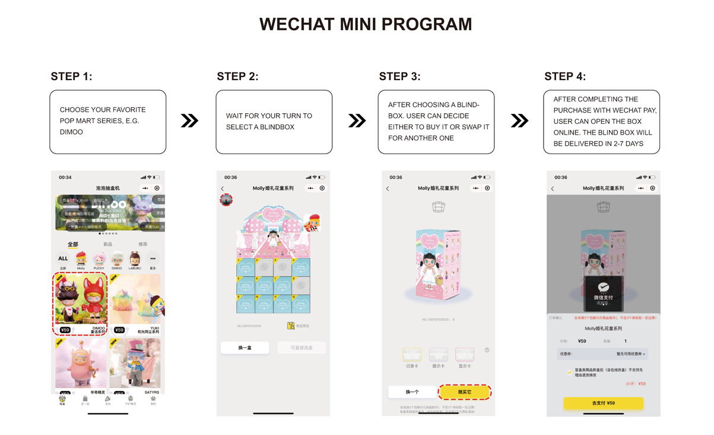


###### 原PDF第269页

[对照原PDF第269页](../2020年港股招股书.pdf#page=269)

###### 业  务

葩趣是我们的自营线上社区，其中包含潮流玩具文化资讯及最新动态、电子商务及社交互动。有关详情，请参阅「 — 粉丝及潮流玩具文化推广 — 潮

流玩具社区」。

截至 2017 年、2018 年及 2019 年 12 月 31 日止年度以及截至 2019 年及 2020年 6 月 30 日止六个月，我们的线上渠道收益分别为人民币 14.9 百万元、人民币102.9百万元、人民币539.2百万元、人民币163.5百万元及人民币334.3百万元，分别占我们于各期间总收益的 9.4%、20.0%、32.0%、30.1% 及 40.9%。下表载列我们于所示期间按渠道划分的来自线上渠道的收益明细：

```text
   截至 12 月 31 日止年度        截至 6 月 30 日止六个月
2017 年     2018 年     2019 年     2019 年      2020 年
```

（未经审核）

（人民币千元）

| 天猫旗舰店 | 8,607 | 72,355 | 251,499 | 66,563 | 146,840 |
| --- | ---: | ---: | ---: | ---: | ---: |
| 泡泡抽盒机 | – | 22,951 | 271,214 | 94,259 | 161,718 |
| 其他线上渠道 (1) | 6,247 | 7,580 | 16,488 | 2,723 | 25,745 |
| 葩趣 | 6,230 | 7,428 | 15,236 | 2,608 | 9,231 |
| 其他 | 17 | 152 | 1,252 | 115 | 16,514 |
| 总计 | 14,854 | 102,886 | 539,201 | 163,545 | 334,303 |

附注：

(1)  其他线上渠道包括葩趣及中国其他主流电商平台。

– 259 –


###### 原PDF第270页

[对照原PDF第270页](../2020年港股招股书.pdf#page=270)

###### 业  务

下表载列所示期间有关我们线上渠道的主要经营资料：

```text
                                截至 12 月 31 日止年度       截至 6 月 30 日止六个月
                              2017 年    2018 年    2019 年     2019 年    2020 年
天猫旗舰店
   总交易额 (1)  （人民币千元）  9,774    84,994    286,129     76,739     167,981
   交易数目                   42,761    408,468   2,338,023    509,258   1,439,228
   每宗交易平均支出 (2)
    （人民币元）               228.6       208.1      122.4       150.7      116.7
   付费会员的总交易额
    （人民币千元）             3,215      22,296    185,113     30,436     125,044
   付费会员人数                5,831      40,630    327,745     69,754     298,062
   付费会员的平均支出 (3)
    （人民币元）               551.3       548.8      564.9       436.3      419.5
泡泡抽盒机
   总交易额 (1)  （人民币千元）    –      26,552    310,632    111,265     182,347
   交易数目                        –    414,460   5,406,537   1,910,250  2,973,425
   每宗交易平均支出 (2)
    （人民币元）                   –         64          57         58          61
   付费会员的总交易额
    （人民币千元）                 –      13,917    259,550     92,803     167,723
   付费会员人数                    –      17,824    234,299     92,938     266,640
   付费会员的平均支出 (3)
    （人民币元）                   –       780.8    1,107.8       998.6      629.0
其他线上渠道
   总交易额 (1)  （人民币千元）  7,527     8,662     17,090       3,077     29,182
   交易数目 (4)               20,688      26,457    342,946       7,612    295,024
   每宗交易平均支出 (2)
    （人民币元）                 364        327          50        404          99
   付费会员的总交易额
    （人民币千元）                35        240      13,508         87       6,702
   付费会员人数 (5)               26        136      38,279         60      12,895
   付费会员的平均支出 (3)
    （人民币元）             1,354.9     1,763.9      352.9     1,442.8      519.7
附注：
(1)   所披露的总交易额与收益之间的差异主要由于我们为内部报告目的记录增值税的方式
      所致。就我们的内部报告目的而言，增值税计入总交易额，但在管理账目及财务报表中
```

则自收益剔除。

– 260 –


###### 原PDF第271页

[对照原PDF第271页](../2020年港股招股书.pdf#page=271)

###### 业     务

```text
(2)   我们天猫旗舰店于 2017 年至 2018 年及泡泡抽盒机于往绩记录期间的每宗交易平均支出
      维持相对稳定。于 2018 年至 2019 年及于 2019 年上半年至 2020 年上半年，我们天猫旗舰
```

店每宗交易的平均支出有所下降，主要由于 (i) 我们吸引了更多新客户，该等客户一般每宗交易花费较少；及 (ii) 我们于 2019 年 5 月在天猫旗舰店推出抽盒机，功能与泡泡抽盒机类似，客户就该功能的每宗交易仅可购买一款盲盒产品，导致每宗交易平均支出相对较低。于 2018 年至 2019 年及于 2019 年上半年至 2020 年上半年，其他线上渠道的每宗交易平均支出有所下降，主要由于我们于 2019 年下半年在葩趣推出抽盒机，功能与泡泡抽盒机类似，客户就该功能的每宗交易仅可购买一款盲盒产品，导致每宗交易平均支出相对较低。因此，其他线上渠道的总交易额增加与其他线上渠道交易数额增加并不完全一致。

(3)  我们天猫旗舰店及泡泡抽盒机于往绩记录期间的付费会员的平均支出保持相对稳定。其他线上渠道于 2017 年及 2018 年的付费会员的平均支出并不具代表性，原因是付费会员人数有限。于 2019 年，其他线上渠道的付费会员人数大幅增加（于下文附注 (5) 详述），

```text
      导致 2019 年的付费会员的平均支出下降。
(4)   其他线上渠道于 2019 年的交易数目相较 2017 年及 2018 年大幅增加，乃由于我们于 2019
      年下半年在葩趣推出抽盒机，功能与泡泡抽盒机类似，吸引了更多客户，尤其是注册会员。
(5)   其他线上渠道于 2018 年至 2019 年的付费会员人数大幅增加，乃由于 2019 年下半年在葩
      趣推出抽盒机，吸引了更多注册会员。
```

展会

以参观人次计，我们举办了中国最大的潮流玩具展，即北京国际潮玩展及上海国际潮玩展，吸引了全世界数百名艺术家及潮流玩具品牌所有者。有关详情，请参阅「 — 粉丝及潮流玩具文化推广 — 展会」。

在我们的潮流玩具展上，粉丝可以自我们及第三方潮流玩具品牌所有者购买潮流玩具产品。我们经常于展会上推出新版及限量版产品。对于参展的第三方潮流玩具品牌拥有人而言，我们可能(i)以固定价格预购彼等的产品；(ii)根据销售收入总额收取佣金；或 (iii) 收取固定展位费。截至 2017 年、2018 年及2019 年 12 月 31 日止年度以及截至 2019 年及 2020 年 6 月 30 日止六个月，我们的展会收益分别为人民币 6.8 百万元、人民币 25.6 百万元、人民币 45.5 百万元、人民币 24.5 百万元及人民币 1.2 百万元，分别占我们于各期间总收益的 4.3%、5.0%、2.7%、4.5% 及 0.1%。

– 261 –


###### 原PDF第272页

[对照原PDF第272页](../2020年港股招股书.pdf#page=272)

###### 业  务

批发

经销商

我们亦通过我们的经销商销售产品，经销商通过彼等经营的零售店或向零售商转售我们的产品。截至 2020 年 6 月 30 日，我们有 25 名中国经销商及 22名海外经销商，建立了覆盖中国 16 个省级地区及 21 个海外国家及地区的广泛经销网络。在 47 家经销商中有 46 家为法人实体，注册资本在人民币 0.1 百万元至人民币 180.0 百万元之间（如适用），而剩余一家经销商为非法人实体。

下表说明于所示期间我们中国和海外经销商的数量及来自经销商的收益明细：

|  |  |  |  | 截至12月31日止年度 |  |  |  |  | 截至6月30日止六个月 |  |
| --- | ---: | ---: | ---: | ---: | ---: | ---: | ---: | ---: | ---: | ---: |
|  | 2017年 |  | 2018年 |  | 2019年 |  | 2019年 |  | 2020年 |  |
|  | 期末 |  | 期末 |  | 期末 |  | 期末 |  | 期末 |  |
| 经销商 |  |  | 经销商 |  | 经销商 |  | 经销商 |  | 经销商 |  |
|  | 数量 | 收益 | 数量 | 收益 | 数量 | 收益 | 数量 | 收益 | 数量 | 收益 |
|  |  | （人民币 |  | （人民币 |  | （人民币 |  | （人民币 |  | （人民币 |
|  |  | 千元） |  | 千元） |  | 千元） |  | 千元） |  | 千元） |
|  |  |  |  |  |  |  |  | （未经审核） |  |  |
| 中国 | 6 | 27,759 | 16 | 44,227 | 22 | 72,856 | 20 | 30,146 | 25 | 34,343 |
| 海外 | 0 | 0 | 1 | 745 | 19 | 20,745 | 9 | 3,445 | 22 | 19,031 |
| 总计 | 6 | 27,759 | 17 | 44,972 | 41 | 93,601 | 29 | 33,591 | 47 | 53,374 |

我们努力凭借我们中国经销商于当地市场的既定渠道，扩大我们国内市场的广度及深度。就海外经销商而言，我们倚重彼等对当地市场的更好了解及成熟的当地资源。于经销商业务模式下，在选择经销商时，我们会考虑多重因素，包括彼等的资质、地域覆盖、零售点位置、经销网络、营运范围及客户服务能力。根据弗若斯特沙利文报告，我们现有的经销模式符合中国及海外市场的惯常行业惯例，并有助于确保我们销售网络的有效覆盖，同时控制我们的经销成本。

截至 2017 年、2018 年及 2019 年 12 月 31 日止年度以及截至 2019 年及 2020年6月30日止六个月，我们向经销商销售产生的收益分别为人民币27.7百万元、人民币 44.9 百万元、人民币 93.6 百万元、人民币 33.6 百万元及人民币 53.4 百万元，分别占我们各期间总收益的 17.6%、8.7%、5.6%、6.1% 及 6.6%。

– 262 –


###### 原PDF第273页

[对照原PDF第273页](../2020年港股招股书.pdf#page=273)

###### 业  务

经销商管理

我们的经销商通常为区域经销商，主要从事玩具、文具、文创及其他产品的销售及经销，并拥有完善的本地零售或经销网络。于往绩记录期间经销商数量的增加与我们的业务增长（尤其是海外扩张）一致。下表载列于往绩记录期间我们经销商的总数及其变动：

截至

|  |  |  |  | 6 月 30 日 |
| --- | ---: | ---: | ---: | ---: |
|  |  | 截至 12 月 31 日止年度 |  | 止六个月 |
|  | 2017 年 | 2018 年 | 2019 年 | 2020 年 |
| 期初经销商数量 | 2 | 6 | 17 | 41 |
| 期内新增的经销商数量 | 5 | 11 | 26 | 9 |
| 期内停止合作的经销商数量 | 1 | 0 | 2 | 3 |
| 期末经销商数量 | 6 | 17 | 41 | 47 |

我们与经销商有卖家 — 买家关系。我们仅允许经销商通过我们准许的

经销渠道出售我们的产品。我们根据订购产品的数量向经销商提供累进折扣，幅度介乎我们建议销售单价的 15% 至 45% 不等。收益在产品控制权转移时（即向经销商交付产品且经销商接受产品时）确认。产品交付予经销商后，除缺陷产品外，不得退回，此举符合行业惯例。因此，我们并无陈旧存货。

另一方面，尽管我们不要求经销商达成最低采购或销售目标，我们密切关注经销商的表现。一般情况下，我们要求我们的经销商每月或每季度报告销售统计资料，以便与我们的内部数据库进行交叉检查。我们将根据经销商的采购订单及销售报告评估其存货水平。当我们发现我们的经销商的销量大幅下降时，我们可能会进行查询并采取必要措施，例如暂停相关产品的供应。存货评估的主要目的为协助我们通过全渠道销售网络调整销售活动，因此，于往绩记录期间结束时及最后实际可行日期的未售存货数量并不重大，或对我们而言并不适用。

– 263 –


###### 原PDF第274页

[对照原PDF第274页](../2020年港股招股书.pdf#page=274)

###### 业  务

通过该等活动，我们确保我们对经销商的销售反映真正市场需求，及我们的经销商遵守经销协议的条款及条件。倘我们发现不合规问题，我们会通知相关经销商并要求经销商在指定的时间内停止不合规的活动。我们的经销商对违反经销协议的行为负责，且我们可以就相关违约行为要求赔偿。倘经销商违反经销协议中的重要条款，我们可以终止经销协议。

一方面，为最大程度地减少经销商之间的任何潜在冲突，另一方面，为最大程度地减少我们的经销商、零售店与机器人商店之间的潜在冲突，我们在经销协议中订明经销商的指定经销区域或经销渠道。我们通常保留权利在经销商违反有关区域及销售渠道的规定的情况下终止经销协议。此外，我们相信，往绩记录期间该等潜在冲突的风险随著经销商贡献的收益占我们总收益的百分比下降而降低。

据董事所知，除南京金鹰泡泡玛特和我们在新加坡的合营企业外，我们所有经销商均为独立第三方，而于往绩记录期间，概无经销商与我们的董事、股东、高级管理层、或任何彼等各自的联系人及我们的现时雇员或前雇员存在任何过去或现时的业务、雇佣、家庭、融资或类似关系，或以我们的品牌经营。于往绩记录期间，我们的经销商均非我们的供应商。于往绩记录期间，除授予经销商的信贷期外，我们并无向任何经销商提供融资。

南京金鹰泡泡玛特

我们于 2014 年与金鹰国际成立南京金鹰泡泡玛特作为合营企业。详情请参阅「历史、重组及公司架构 — 本集团的成立及发展 — 5. 成立南京金鹰泡泡玛特」。于 2017 年 1 月 1 日，我们与南京金鹰泡泡玛特订立经销协议，于 2017 年1 月 1 日至 2019 年 12 月 31 日生效。于 2020 年 1 月 1 日，先前协议届满后，我们按基本相似的条款与南京金鹰泡泡玛特订立新经销协议。经销协议的重大条款概述如下：

•  期限 ：该协议的期限为三年，可经双方同意后续期。

•  店舖及销售政策 ：南京金鹰泡泡玛特有权使用我们的品牌名称及商标运营我们厘定的店舖。开设任何店舖的任何计划均须经过我们的事先书面批准。南京金鹰泡泡玛特仅有权于我们指定的店舖转售我们的产品。

•  商标及品牌名称 ：就销售及经销我们的产品而言，南京金鹰泡泡玛特有权免费使用我们的品牌名称及商标。

– 264 –


###### 原PDF第275页

[对照原PDF第275页](../2020年港股招股书.pdf#page=275)

###### 业  务

•  零售价格管理 ：南京金鹰泡泡玛特须确保我们的产品按我们建议的单位售价出售。

•  不得提前曝光 ：在正式公布日期之前，南京金鹰泡泡玛特不得披露、展示、出售或预售任何新产品。

•  购买价格 ：我们的产品乃基于我们的建议单位售价以不同的折扣出售予南京金鹰泡泡玛特。

•  销售目标及最低采购额： 并无明确的销售目标或最低采购额规定。

•  授权条款： (i) 倘南京金鹰泡泡玛特拟开设新店舖，则其须向北京泡泡玛特提出书面申请以获得后者的授权；(ii) 倘南京金鹰泡泡玛特的店舖和北京泡泡玛特的店舖位于相同的商场或营业地点，则南京金鹰泡泡玛特的该相关店舖的授权将于北京泡泡玛特发出有关通知的 15 天内终止且南京金鹰泡泡玛特将须在有关通知的 15 天内安排所涉及产品的撤回及退货；及 (iii) 倘南京金鹰泡泡玛特违反北京泡泡玛特的经销管理政策，则北京泡泡玛特有权终止协议。

•  信贷期 ：我们授予南京金鹰泡泡玛特 30 天的信贷期。

•  产品检验及更换 ：南京金鹰泡泡玛特须在收到产品后立即检验产品，并将任何质量缺陷告知我们。南京金鹰泡泡玛特可按照经销协议中规定的程序更换有缺陷的产品。

•  保密 ：我们与南京金鹰泡泡玛特相互承诺不会披露或不恰当地使用对方的商业秘密。

•  终止权 ：倘南京金鹰泡泡玛特违反经销协议的任何重大条款，我们保留终止经销协议的权利。

除免费使用我们的品牌名称和商标经营商店的权利外，我们与南京金鹰泡泡玛特之间协议的条款均符合正常商业条款，且与其他独立经销商的条款相若。 截至 2017 年、2018 年及 2019 年 12 月 31 日以及 2020 年 6 月 30 日， 南京金鹰泡泡玛特分别运营 19、19、16 及 18 间店舖。我们向这些店舖的雇员提供培训。于 2017 年、2018 年及 2019 年以及截至 2019 年及 2020 年 6 月 30 日止六个月，

– 265 –


###### 原PDF第276页

[对照原PDF第276页](../2020年港股招股书.pdf#page=276)

###### 业  务

我们来自南京金鹰泡泡玛特的收益分别为人民币 26.2 百万元、人民币 35.5 百万元、人民币 54.8 百万元、人民币 21.1 百万元及人民币 24.5 百万元，分别占我们来自经销商的总收益的 94.3%、79.0%、58.6%、62.7% 及 45.9%。 我们会就南京金鹰泡泡玛特的业务运营、策略和招聘提供广泛建议及培训。我们还可进入南京金鹰泡泡玛特的所有信息系统，包括其 ERP 系统以及会计和财务系统。因此，董事认为，我们对南京金鹰泡泡玛特的销售活动充分知情，包括其存货及向终端客户销售的资料。

其他经销协议的主要条款

我们通常与其他经销商（包括我们在新加坡的合营企业）订立标准经销协议，这有助于我们有效管理经销商及确保我们产品的有序市场。于2019年6月，我们于新加坡与当地零售商成立合营企业。于新加坡的合营企业亦为我们在新加坡的经销商。有关我们在新加坡的合营企业详情，请参阅本招股章程附录一所载会计师报告附注 16。于往绩记录期间，我们的标准经销协议的主要条款包括：

•  期限 ：协议期限通常为一年至两年，可自动或经双方协定续期。

•  销售政策 ：我们通常授予经销商在指定经销区域透过指定渠道销售我们产品的非独家权利。未经我们的批准或授权，经销商不得在指定经销区域或经销渠道之外转售我们的产品。

•  零售价格管理 ：经销商须确保我们的产品按我们建议的单位售价出售。

•  不得提前曝光 ：在正式公布日期之前，经销商不得披露、展示、出售或预售任何新产品。

•  获取资料 ：经销商通常须每月向我们提供我们产品的销售资料。

•  购买价格 ：我们的产品乃基于我们的建议单位售价以不同的折扣出售予经销商，而折扣的幅度通常根据各订单的具体情况协商厘定。经销商获授的折扣介乎 15% 至 45% 不等。

•  销售目标及最低采购额： 并无明确的销售目标或最低采购额规定。

•  信贷期 ：我们一般向经销商提供 30 至 90 天的信贷期。

– 266 –


###### 原PDF第277页

[对照原PDF第277页](../2020年港股招股书.pdf#page=277)

###### 业  务

•  产品检验及更换 ：经销商须在收到产品后立即检验产品，并将任何质量缺陷告知我们。经销商可按照经销协议中规定的程序更换有缺陷的产品。

•  保密 ：我们与经销商相互承诺不会披露或不恰当地使用对方的商业秘密。

•  终止权 ：倘经销商违反经销协议的任何重大条款，我们通常保留终止经销协议的权利。

我们主要根据经销协议来管理经销商的销售活动。倘经销商不再适合我们的业务策略，或者我们认为经销商的业绩由于任何其他原因而不能令人满意，我们亦可能决定不续签经销协议。此外，考虑到 (i) 我们自南京金鹰泡泡玛特以外经销商产生的收益分别仅占我们于 2017 年、2018 年及 2019 年以及截至2019年及2020年6月30日止六个月总收益的1.0%、1.8%、2.3%、2.3%及3.5%；及 (ii) 我们自南京金鹰泡泡玛特以外任何单一经销商产生的收益占我们于往绩记录期间各年度或期间总收益的百分比不超过 0.8%，我们认为我们并不依赖于此等经销商，且我们已对此等经销商的销售活动进行充分管理。

我们的客户

我们的客户主要包括粉丝及经销商，其次包括我们的批量采购公司客户。我们一般向批发客户提供 30 至 90 天的信贷期。信贷历史良好且保持长期关系的若干批发客户可享受最多180天的优惠信贷期。我们拥有多元化的客户基础。于 2017 年、2018 年及 2019 年以及截至 2020 年 6 月 30 日止六个月，来自我们五大客户（包括我们的经销商及批量采购公司客户）的总收益分别占我们收益的约 17.8%、8.2%、4.3% 及 4.7%，以及来自我们最大客户南京金鹰泡泡玛特的

– 267 –


###### 原PDF第278页

[对照原PDF第278页](../2020年港股招股书.pdf#page=278)

###### 业  务

总收益分别占我们收益的约 16.6%、6.9%、3.3% 及 3.0%。下表载列于往绩记录期间我们五大客户的详情：

```text
                                                          占总收益
客户          客户类型   背景                       收益    百分比     信贷期付款方式关系年限
```

（人民币千元）

截至 2017 年 12 月 31 日止年度

```text
南京金鹰泡泡经销商      一家由北京泡泡玛特        26,172      16.6      30 天     电汇       6 年
  玛特                     与金鹰国际成立的
```

合营企业， 以经营

由北京泡泡玛特所

营运及销售的多种

产品的批发及零售

```text
                            业务。
客户 A        经销商      一家中国批发商， 亦          768         0.5    预付款       电汇        3 年
```

为一家文具产品、

装饰品、 乐器、 艺

术及娱乐产品的零

```text
                            售商。
客户 B        批量采购一家著名的香港设计               506        0.3      30 天       电汇       4 年
                企业客户师玩具批发商。
客户 C        经销商      一家从事艺术品、 消          420        0.3     预付款       电汇       4 年
```

费品、 体育用品及

服装等贸易的中国

```text
                              公司。
客户 D         经销商      一家从事食品、 饮料             230         0.1       30 天       电汇        3 年
```

及生活用品贸易的

中国公司。

截至 2018 年 12 月 31 日止年度

```text
南京金鹰泡泡经销商     一家由北京泡泡玛特     35,511       6.9     30 天     电汇      6 年
  玛特                   与金鹰国际成立的
```

合营企业， 以经营

由北京泡泡玛特所

营运及销售的多种

产品的批发及零售

业务。

– 268 –


###### 原PDF第279页

[对照原PDF第279页](../2020年港股招股书.pdf#page=279)

###### 业  务

```text
                                                          占总收益
客户          客户类型   背景                       收益    百分比     信贷期付款方式关系年限
                                           （人民币千元）
客户 A        经销商     一家中国批发商， 亦       3,396        0.7    预付款      电汇       3 年
```

为一家文具产品、

装饰品、 乐器、 艺

术及娱乐产品的零

```text
                             售商。
客户 D         经销商      一家从事艺术品、 消          1,914         0.4       30 天      电汇         3 年
```

费品、 体育用品及

服装等贸易的中国

```text
                           公司。
客户 E        经销商     一家从事玩具产品批          772        0.2    预付款      电汇        2 年
                           发的日本公司。
客户 F        经销商     一家从事餐馆、 咖啡         745        0.1    预付款      电汇        2 年
```

厅及零售店营运的

新加坡公司。

截至 2019 年 12 月 31 日止年度

```text
南京金鹰泡泡经销商     一家由北京泡泡玛特     54,836       3.3     30 天     电汇      6 年
  玛特                   与金鹰国际成立的
```

合营企业， 以经营

由北京泡泡玛特所

营运及销售的多种

产品的批发及零售

```text
                             业务。
客户 G         经销商      一家玩具、生活用品、         7,220        0.4       30 天       电汇        1 年
```

杂货、厨具、电子产

品、配件、箱包等的

```text
                             台湾零售商。
客户 F         经销商      一家从事餐馆、 咖啡          4,681        0.3       30 天      电汇        2 年
```

厅及零售店营运的

新加坡公司。

– 269 –


###### 原PDF第280页

[对照原PDF第280页](../2020年港股招股书.pdf#page=280)

###### 业  务

```text
                                                           占总收益
客户          客户类型   背景                        收益    百分比    信贷期付款方式关系年限
                                           （人民币千元）
客户 H        经销商     一家全球最大家族娱         3,316       0.2      60 天      电汇       1 年
```

乐公司的上海分公

司，业务范围广泛，

涵盖消费品、玩具、

文具、 体育用品及

```text
                            纺织品。
客户 I        经销商      一家从事玩具、文具、        2,928        0.2     预付款       电汇        4 年
```

服装、娱乐产品、通

讯设施及电子设备

等产品批发及零售

的中国公司。

截至 2020 年 6 月 30 日止六个月

```text
南京金鹰      经销商     一家由北京泡泡玛特       24,485        3.0      30 天     电汇       6 年
  泡泡玛特                 与金鹰国际成立的
```

合营企业， 以经营

由北京泡泡玛特所

营运及销售的多种

产品的批发及零售

```text
                             业务。
客户 G         经销商      一家玩具、生活用品、         6,155        0.8       30 天       电汇        1 年
```

杂货、厨具、电子产

品、配件、箱包等的

```text
                             台湾零售商。
客户 J         经销商      一家于香港及澳门从           5,492        0.7       30 天      电汇        1 年
```

事玩具及游戏分销

的公司。

– 270 –


###### 原PDF第281页

[对照原PDF第281页](../2020年港股招股书.pdf#page=281)

###### 业  务

```text
                                                           占总收益
客户          客户类型   背景                        收益    百分比    信贷期付款方式关系年限
                                           （人民币千元）
客户 H        经销商     一家全球最大家族娱         1,468       0.2      60 天      电汇       1 年
```

乐公司的上海分公

司，业务范围广泛，

涵盖消费品、玩具、

文具、 体育用品及

```text
                             纺织品。
客户 K         经销商      一家从事珠宝及其他           1,171        0.1       30 天      电汇        2 年
```

消费品零售的中国

公司。

于往绩记录期间，就董事所知，董事或本公司或其附属公司的最高行政人员、彼等各自的联系人或紧随全球发售完成后持有本公司已发行股本超过5%的任何本公司股东概无于我们任何五大客户中拥有任何权益。

销售及市场推广

我们有专责的市场推广团队负责制定及协调市场推广活动及促销活动。截至 2020 年 6 月 30 日，我们的市场推广团队由 26 名成员组成，彼等与其他团队及╱或我们的艺术家及 IP 提供商密切合作以执行市场推广策略。于 2017 年、2018 年及 2019 年以及截至 2019 年及 2020 年 6 月 30 日止六个月，我们的广告及市场推广开支分别为人民币2.6百万元、人民币10.7百万元、人民币53.8百万元、人民币 14.3 百万元及人民币 30.4 百万元。

根据弗若斯特沙利文报告，我们的泡泡玛特品牌已成为中国最受认可的潮流玩具品牌之一，且我们的 IP 亦受到广泛欢迎。我们产品的艺术风格和收藏特性吸引了粉丝，并催生高客户忠诚度及重复购买。此外，我们推出的限量版具有更高的收藏价值，因此更受粉丝欢迎。除口碑营销外，我们已采用多渠道策略，使我们能够推广我们的产品，进而提升我们的品牌知名度，并扩大粉丝群。我们组织各种线下活动，包括我们的展会、展览及签名活动。我们不时推出主题快闪店以促进销售及提高品牌知名度。我们亦参加海外主要潮流玩具展以在海外立足。我们还通过大众社交媒体网络、搜索引擎及移动应用程序应用一系列线上市场推广策略。

– 271 –


###### 原PDF第282页

[对照原PDF第282页](../2020年港股招股书.pdf#page=282)

###### 业  务

客户服务及退货

我们运营客户服务微信小程序并设有客户服务热线，消费者可借此查询我们的产品及政策，并对我们的服务质量提出反馈。除缺陷产品外，我们一般不接受退货。产品一旦售予消费者，我们在购买起计 15 天内接受缺陷产品换货。于往绩记录期间及直至最后实际可行日期，我们并未遭遇对我们的业务产生重大不利影响的客户投诉、换货或产品责任申索。

我们的供应商

目前，我们的供应商主要包括中国境内的选定第三方制造商。有关详情，请参阅「 — 制造」。此外，我们的供应商亦包括第三方品牌拥有人，我们购买

彼等的产品并通过我们的网络销售。

我们通常与供应商订立至少一年的供应协议，惟须遵守我们的标准条款及条件。在大多数情况下，当与特定供应商签订的订单超过协定金额时，我们将在购买价基础上享有与供应商协定的一定百分比的回佣或折扣。我们的供应商可能授予我们最多 180 天的信贷期。

于 2017 年、2018 年及 2019 年以及截至 2020 年 6 月 30 日止六个月， 我们向五大供应商（ 为制造商 ）作出的采购额分别约占我们总采购额的 43.8%、41.3%、40.8% 及 50.8%，以及我们向最大供应商作出的采购额分别约占我们总采购额的 19.7%、18.8%、15.0% 及 15.8%。下表载列于往绩记录期间我们五大供应商的详情：

```text
                                                    占总
           供应商                         我们的   采购额
供应商     类型      背景                 采购额   百分比  信贷期付款方式关系年限
```

（人民币千元）

截至 2017 年 12 月 31 日止年度

```text
供应商 A     第三方产品    一家总部位于日本东         16,877       19.7      180 天      电汇        6 年
```

京的公司， 从事玩

具、公仔、装饰品、

家居内饰及烟灰缸

产品等的零售及批

```text
                             发业务。
供应商 B     制造          一家从事五金玩具及         10,758       12.6       45 天      电汇        4 年
```

塑料玩具制造的中

国公司。

– 272 –


###### 原PDF第283页

[对照原PDF第283页](../2020年港股招股书.pdf#page=283)

###### 业  务

```text
                                                                占总
             供应商                                我们的     采购额
供应商       类型        背景                      采购额     百分比     信贷期付款方式关系年限
                                            （人民币千元）
供应商 C    第三方产品   一家从事玩具、 家居         4,515        5.3     180 天      电汇       3 年
                            用品及日用品批发
                            及零售的中国公司。
供应商 D    第三方产品   一家从事以日本、 加         2,985        3.5      15 天      电汇       5 年
```

拿大、 澳大利亚及

其他国家的潮流 IP

为基础的玩具分销

```text
                            的中国公司。
供应商 E    第三方产品    一家从事电子产品、          2,440        2.8     180 天      电汇        3 年
```

投影仪、 智能穿戴

设备及玩具销售的

中国公司。

截至 2018 年 12 月 31 日止年度

```text
供应商 B    制造          一家从事五金玩具及         40,505        18.8      45 天      电汇        4 年
                             塑料玩具制造的中
                             国公司。
供应商 F    制造          一家从事塑料玩具、         21,499        10.0      45 天      电汇        2 年
                             合金玩具、 电子玩
                             具制造的中国公司。
供应商 C    第三方产品    一家从事玩具、 家居          9,637        4.5     180 天      电汇        3 年
```

用品及日用品批发

及零售的中国公司。

– 273 –


###### 原PDF第284页

[对照原PDF第284页](../2020年港股招股书.pdf#page=284)

###### 业  务

```text
                                                                占总
             供应商                                我们的     采购额
供应商       类型        背景                      采购额     百分比    信贷期付款方式关系年限
                                            （人民币千元）
供应商 D    第三方产品   一家从事以日本、 加        9,468        4.4      15 天      电汇       5 年
```

拿大、 澳大利亚及

其他国家的潮流 IP

为基础的玩具分销

```text
                            的中国公司。
供应商 G    制造          一家从事动漫产品、          7,916        3.7       45 天      电汇        3 年
```

玩具及塑料模型销

售及制造的中国

公司。

截至 2019 年 12 月 31 日止年度

```text
供应商 B    制造          一家从事五金玩具及         83,579        15.0      45 天      电汇        4 年
                             塑料玩具制造的中
                             国公司。
供应商 F    制造          一家从事塑料玩具、         62,043        11.1      45 天      电汇        2 年
                             合金玩具、 电子玩
                             具制造的中国公司。
供应商 H    第三方产品    一家从事玩具产品分         32,384         5.8     180 天      电汇        1 年
                             销及零售的中国
                             公司。
供应商 I    制造          一家从事塑料玩具、         25,355         4.5      60 天      电汇        1 年
```

电子玩具、 糖果玩

具及模型套件制造

```text
                            的中国公司。
供应商 J    第三方产品    一家从事全球顶尖玩        24,448        4.4     180 天      电汇        2 年
```

具公司具收藏价值

的可收藏玩具销售

的中国公司。

– 274 –


###### 原PDF第285页

[对照原PDF第285页](../2020年港股招股书.pdf#page=285)

###### 业  务

```text
                                                    占总
           供应商                         我们的   采购额
供应商     类型      背景                 采购额   百分比  信贷期付款方式关系年限
```

（人民币千元）

截至 2020 年 6 月 30 日止六个月

```text
供应商 B     制造          一家从事五金玩具及         56,818       15.8       45 天      电汇        4 年
                             塑料玩具制造的中
                             国公司。
供应商 K     制造          一家从事塑料玩具、         48,497       13.4       45 天      电汇        1 年
```

电子玩具及毛绒电

子玩具制造的中国

```text
                            公司。
供应商 L    制造          一家从事儿童产品（如       32,483        9.0       45 天      电汇        1 年
                            玩具、儿童书籍）制
                            造的中国公司。
供应商 F    制造          一家从事塑料玩具、         29,137        8.1       45 天      电汇        2 年
                            合金玩具、 电子玩
                            具制造的中国公司。
供应商 M    制造          一家从事高级塑料玩         16,417        4.6       45 天      电汇        1 年
```

具制造、 生产及开

发的中国公司。

于往绩记录期间，就董事所知，董事或本公司或其附属公司的最高行政人员、彼等各自的联系人或紧随全球发售完成后持有本公司已发行股本超过5%的任何本公司股东概无于我们任何五大供应商中拥有任何权益。

制造

目前，我们的产品由中国境内专门生产玩具的选定第三方制造商制造。我们根据质量、产能、价格、经营年资、声誉及对适用法律法规的遵守情况等因素选择第三方制造商。我们的大多数第三方制造商具备丰富的行业经验，并与中国及全球其他主要玩具品牌合作。我们与相关制造商的协议的主要条款包括：

– 275 –


###### 原PDF第286页

[对照原PDF第286页](../2020年港股招股书.pdf#page=286)

###### 业  务

•  制造。 我们委聘制造商根据采购订单所指定的要求生产潮流玩具产品。

•  产品质量。 制造商所交付的产品以及此等产品的原材料须符合适用的法律法规以及国家及行业标准。交付最终产品后，我们有权向制造商委派我们的质量控制人员进行现场抽样检查和检验。

•  交付。 制造商应在我们于采购订单上确定的时间和地点交付产品。交付费用由我们支付。

•  期限。 我们与第三方制造商之间的协议期限通常为一年。

•  知识产权。 协议项下任何产品和模具的知识产权均归我们所有。

•  责任。 制造商应对所有产品责任和索赔负责。我们有权单方面终止协议，并就因产品质量缺陷而引起的任何损失获得弥偿。

•  终止。 经双方同意后可以终止协议。

我们相信，使用第三方制造商可以在供应链管理方面为我们提供极大灵活性，从而优化我们的运营。我们会定期评估与其他制造商合作以支持我们运营的必要性及裨益，并会定期检讨第三方制造商的表现。截至最后实际可行日期，我们与 18 家我们认为可满足自身产品需求的第三方制造商合作。为了确保有足够生产能力，我们将根据产品发布计划提前预留替代供应来源。尽管我们不自己制造产品，惟我们拥有制造过程所用的模具，而倘我们选择雇用替代制造商，该等模具可在制造商之间转让。

尽管我们不进行自身产品的日常制造，但我们负责制定标准营运程序及设计产品原型和模具，且我们审慎甄选供应商、积极检讨生产流程及测试我们的制造商生产的产品以确保产品质量。有关详情，请参阅「 — 质量控制」。

为保护我们的 IP 不受侵害，我们主要依赖与第三方制造商的协议保护我们的 IP，根据协议，有关协议项下任何产品及模具的知识产权均由我们拥有。制造商应根据相关协议以及适用法律法规妥善保管我们的模具，防止任何未

– 276 –


###### 原PDF第287页

[对照原PDF第287页](../2020年港股招股书.pdf#page=287)

###### 业  务

授权使用及按我们的要求归还或销毁模具。制造商对我们 IP 的任何侵权，我们均有权获得损害赔偿。

物流及存货管理

仓库

我们使用自营中央仓库及委聘两家仓储服务提供商主要满足我们的存储需求，并确保能够高效及经济地交付我们的产品至零售点。于最后实际可行日期，我们于北京及南京运营两个专注于线下销售及经销的中央仓库，总建筑面积约为 4,310 平方米。除中央仓库外，我们亦有 172 个自营当地仓库，总建筑面积约为 10,739 平方米。

我们所有的自营仓库均配备有 ERP 系统，使仓库能够实现自动配送，并合并重复订单。凭借全面覆盖我们自营仓库的监控摄影机，我们密切监控仓库中所有物品动态及存储空间。

此外，我们委聘第三方仓储服务提供商提供存储、库存管理、装卸服务。根据我们与此等仓储服务提供商的协议，彼等应负责外包仓库的整体安全保障，并按我们的指示进行存货的存储、管理、装卸。我们的仓储服务提供商应弥偿我们因其违反协议规定的义务而蒙受的任何损失。有关我们外包仓库的风险，请参阅「风险因素－与我们的业务及行业有关的风险－我们面临与我们销售的产品仓储相关的若干风险」。截至最后实际可行日期，我们拥有两家外包仓储服务提供商，其中一家位于嘉兴，专注于线上销售及经销，及另一家位于东莞，专注于华南的存货及各厂房制成品。对于我们在嘉兴的外包仓储服务提供商，我们将至少提前三天通知产品数量，以确保我们产品在仓库的存储容量。倘我们的存储需求有大幅增长，我们将与该外包仓储服务提供商协调，彼等亦竭尽所能满足所需。对于我们在东莞的外包仓储服务提供商，彼等保证提供建筑面积为 1,200 平方米的储存空间，并可应我们要求扩展，惟须提前十天通知。

运输及物流

我们聘请第三方物流服务提供商自仓库提取我们的产品并将其交付至我们的零售点。截至 2020 年 6 月 30 日，我们拥有两名仓储及派递服务提供商及七名物流服务提供商。我们与第三方物流服务提供商的运输安排使我们能够在开发及维护内部物流系统方面保持较低水平的资本投入。

– 277 –


###### 原PDF第288页

[对照原PDF第288页](../2020年港股招股书.pdf#page=288)

###### 业  务

我们根据声誉、经营规模、往绩记录及价格选择物流服务提供商。我们通常按年与我们的物流服务提供商订立协议。我们使用针对物流服务提供商的标准物流协议。我们的物流服务提供商承担与我们产品交付相关的风险，对运输过程中发生的产品污染负责，并须购买必要保险。我们根据交付表现、运输能力及整体服务质量评估我们的物流服务提供商。于往绩记录期间及直至最后实际可行日期，我们的产品交付并无遭遇任何重大中断或因我们的物流服务供应商延迟交付或产品处理不当而蒙受任何损失。对于任何市内的临时产品运输需求，我们亦使用其他临时物流服务提供商。

于2017年、2018年及2019年以及截至2019年及2020年6月30日止六个月，我们因使用物流服务提供商提供的运输及物流服务分别产生费用约人民币 1.0百万元、人民币 5.6 百万元、人民币 39.3 百万元、人民币 11.0 百万元及人民币35.4 百万元。

存货管理

于往绩记录期间，我们所有的存货均为制成品。我们需在仓库中保持足够数量的存货，以满足我们销售及经销渠道的需求并支持我们的扩张计划。截至 2017 年、2018 年及 2019 年 12 月 31 日以及 2020 年 6 月 30 日， 存货余额分别约为人民币 15.5 百万元、人民币 29.1 百万元、人民币 96.3 百万元及人民币224.1 百万元，分别约占我们总流动资产的 23.6%、11.4%、13.4% 及 17.5%。于2017 年、2018 年及 2019 年以及截至 2020 年 6 月 30 日止六个月，我们的平均存货周转天数分别为 49 天、45 天、46 天及 126 天。

我们定期监察存货水平。根据我们的销售经验，我们会每月编制销售预测供内部参考。我们的采购团队将根据销售预测及存储的存货水平下达订单。

我们已制定有关库存管理的政策，例如标签系统，以对不同批次的产品及我们所经销产品的物项进行分类。我们亦已建立安全系统，以保护存货及防止我们的存货被盗窃、侵占及损坏。我们有已生效的保单以弥补存货的意外损失或损坏。

我们每个零售店的店长及机器人商店的代表负责每个月的库存盘点及监控库存变动，并将有关资讯上载至我们的 ERP 系统上。彼等须定期向我们的总办事处报告存货水平及销售进展。

质量控制

我们相信我们对产品质量及安全的承诺是我们取得成功的主要因素之一。

– 278 –


###### 原PDF第289页

[对照原PDF第289页](../2020年港股招股书.pdf#page=289)

###### 业  务

我们高度重视产品质量及安全，通过实施全面的质量控制体系保持我们的竞争优势。于最后实际可行日期，我们的质量控制团队中有 18 名成员。

尽管我们不进行产品的日常制造，但我们负责制定标准营运程序和设计产品原型和模具，且我们努力通过仔细甄选供应商、积极检讨生产流程及测试我们的制造商生产的产品确保质量控制。我们在生产过程中采取严格的质量控制措施，包括生产后检验及最终质量控制，以确保产品质量。我们要求制造商严格遵守任何适用法律、法规及行业标准。我们非常重视粉丝的健康和安全以及环保。我们产品的原材料主要包括 ABS （丙烯腈 - 丁二烯 - 苯乙烯共聚物）、PVC （聚氯乙烯）、涂料和油墨、布料和五金。我们的包装材料主要包括颜料盒、吸塑、铝箔袋、聚乙烯薄膜、干燥剂、纸卡及纸板箱。作为环境保护工作的一部分，我们主要使用可回收及可降解的包装材料。此外，我们在产品包装上印有警告和提醒文字，如「请勿吞食」及「远离三岁以下儿童」。我们已依据适用法律规定就原材料及包装材料制定详细的内部标准。例如，我们要求制造商遵守有关规定及我们的质量控制准则，并谨慎避免使用含有挥发性有机化合物或甲醛的原材料。我们要求产品所用的颜料和油墨须根据有关油墨中可挥发性有机化合物含量的国家标准 GB38507-2020 符合 17 种可挥发性有机化合物的含量限值；且我们要求所用包装材料须根据有关包装与环境保护的国家标准 GB/T 16716.1-2018 符合铅、镉、汞和铬的含量限值。至于我们产品的其他原材料，我们主要确保符合国家标准 GB 6675-2014 （有关玩具安全）及 GB/T 26701-2011 （有关模型产品通用技术要求）的有关规定。我们亦制定详细的内部标准，以确保最终产品遵守有关产品安全和环保的适用法律规定。为确保一直符合我们有关产品安全和环保的内部标准（用于评估新制造商和供应商以及监督所有现有制造商和供应商），我们要求由我们委聘的第三方检测机构及化验所出具年检报告，确认产品及包装所用原材料符合我们内部标准。我们通常于年初要求提交检测报告。第三方检测机构及化验所分析原材料的样本，并根据适用规定核对相关安全及质量指标，以确保合规。我们亦会对生产程序及最终产品实施质量控制程序。我们的质量控制团队亦通常每季度对所有制造商进行一次现场临时检查，检查所使用原材料是否符合相关法律、法规及标准以及监控制造流程并确保符合我们的质量控制程序。有关详情，请参阅「－生产过程」及「－最终产品」。据本公司所知，于往

– 279 –


###### 原PDF第290页

[对照原PDF第290页](../2020年港股招股书.pdf#page=290)

###### 业  务

绩记录期间，我们截至最后实际可行日期的全部第三方制造商均已取得必要的许可证并遵守我们的内部标准。

于往绩记录期间及直至最后实际可行日期，我们并无在销售过程中发生任何重大意外，亦无就我们销售产品所产生的个人或财产损失提出任何重大索赔或补偿。此外，我们与供应商的供应合同通常规定，与供应给我们的任何产品相关的产品责任将由供应商承担。我们于往绩记录期间并无遭受任何个别或汇总属重大的产品责任索赔。请参阅「风险因素 — 与我们的业务及行业有关的风险 — 未能控制产品质量可能会对我们的业务造成不利影响」。

甄选供应商

我们备有一份供应商清单，通常与拥有可靠公司背景、交易历史及声誉的值得信赖的供应商合作。

我们采用标准化标准评估潜在供应商的资格。如欲获接纳为我们的供应商，潜在供应商将须提供证明其公司背景以及潜在供应商为满足若干国际或当地标准而拥有的相关认证或资格的文件。

生产过程

为确保我们的供应商能够不时维持令人满意的产品质量水平，我们定期将员工分配至制造商的生产场所，以监控生产过程及制造商所使用的原材料。我们亦可在整个生产过程中就调漆、产品模具的设计及组成以及生产计划管理等事宜向制造商提供建议。我们的政策是，鼓励无法达到定期审查指导标准的制造商采取必要补救措施解决我们持续采购的障碍，否则其将被从制造商名单中剔除，直至采取令我们满意的适当补救措施为止。

最终产品

我们的供应商将与我们的质量控制团队合作，以根据我们的内部检测方法对最终产品的样品进行质量检查，其中涵盖产品的各个方面，包括 (i) 组装、

(ii) 喷涂及上色、(iii) 尖端尖锐度、(iv) 整体功能、及 (v) 零部件的安装及状况。我们亦聘请第三方检验机构及实验室出具检验报告或要求供应商提交来自第三方检验机构及实验室的检验报告供我们参考。我们的质量控制团队亦对产品质量进行定期检查，以评估样品与订购及交付产品之间的质量一致性。

– 280 –


###### 原PDF第291页

[对照原PDF第291页](../2020年港股招股书.pdf#page=291)

###### 业  务

资讯科技

我们的资讯科技系统对我们有效的管理及业务发展至关重要。我们的日常销售业务所需资讯科技系统包括 POS 系统、ERP 系统以及会计和财务系统，彼等集中处理我们的重大运营数据，进行大数据分析，并让我们的高级管理层可密切监控销售表现及存货水平。凭借我们的大数据技术，我们能够取得并分析我们来自全渠道的销售数据，这有助于我们回顾历史发展并预测未来的业务增长。

我们通过各种技术，包括加密、防毒软件及防火墙，维护资讯科技系统的安全，包括网络安全、应用程序安全、数据安全及终端安全。例如，访问客户数据仅限于获提供加密密码的选定授权员工，且重要数据仅在我们的内部网中存储及传输，以避免暴露于公共互联网。此外，我们定期为员工提供资讯安全培训，以提高彼等对资讯安全的认识，及改善资讯科技风险管理的实施。

我们现时将若干资讯科技系统的开发及维护外判给外部供应商。我们通过各种措施降低机密资讯及商业机密的泄漏风险，例如源代码控制、访问控制以及定期评估我们与供应商之间的服务级别协议。

竞争

根据弗若斯特沙利文报告，中国的潮流玩具零售市场仍处于早期阶段，并在过去数年见证了快速增长。中国潮流玩具零售的市场规模由 2015 年的人民币 63 亿元增加至 2019 年的人民币 207 亿元，复合年增长率为 34.6%。受中国潮流玩具的渗透率不断上升所推动，潮流玩具零售的市场规模预期于 2024 年将达人民币 763 亿元，自 2019 年起的复合年增长率为 29.8%。

中国的潮流玩具零售市场较为分散且充满竞争。根据弗若斯特沙利文报告，于 2019 年，按零售价值计，前五大市场营运商占中国潮流玩具零售市场23% 的市场份额。我们的竞争对手包括国际品牌及本土品牌。我们就多项因素竞争，其中包括品牌认知度、粉丝群、产品受欢迎程度及质量、价格、市场推广的有效性以及于中国的销售及经销网络等。根据弗若斯特沙利文报告，于 2019 年，按零售价值计，我们于中国潮流玩具零售市场排名第一，市场份额为 8.5%。

有关我们经营所在市场及我们所面临的竞争的更多资料，请参阅「风险因素 — 与我们的业务及行业有关的风险 — 我们的行业竞争激烈。倘我们无

法与现有或新的竞争对手有效竞争，我们的销量、市场份额及盈利能力可能下降。」及「行业概览」。

– 281 –


###### 原PDF第292页

[对照原PDF第292页](../2020年港股招股书.pdf#page=292)

###### 业  务

知识产权

知识产权是我们取得成功及竞争力的基础。我们的授权协议允许我们就我们设计及销售的产品使用我们的艺术家及 IP 提供商的 IP。根据相关授权协议，我们的艺术家及 IP 提供商按独家或非独家基准向我们授权知识产权（包括版权）。请参阅「 — 我们的 IP 平台 — IP 创作」。

我们依赖中国及其他司法权区的专利、版权、商标及商业秘密保护法以及保密程序及合约条文保护我们的知识产权。截至最后实际可行日期，我们已注册 12 项专利、注册或申请合共 421 个商标、注册 309 个版权，并已注册 11个域名，包括（其中包括）于中国的 www.popmart.com 、www.paquapp.com 及www.toyshowchina.com 。截至最后实际可行日期，我们于海外亦注册或申请合共 72 个商标。有关详情，请参阅「附录四 — 法定及一般资料 — B. 有关业务的其他资料 — 2. 本集团的知识产权」。

我们已采取各种措施来保护我们的知识产权。我们及时向主管机关注册知识产权。我们定期检测第三方恶意注册我们的知识产权、盗用电子商务平台上的产品及内容，以及任何形式侵犯我们知识产权的情况。第三方可能恶意向相关政府部门注册我们的知识产权。倘出现任何恶意注册，为保护我们的知识产权，我们一般首先与有关方磋商，要求其撤销或向我们转让有关注册。我们亦可能寻求其他法律保护，要求相关政府部门宣布有关恶意注册无效。我们透过警告及通知、行政索赔及（有时）诉讼来积极回应任何侵权行为。

此外，我们亦采取各种措施来防止其他方的知识产权侵权。对于我们的自有 IP，我们的内部设计团队在法律团队的协助下，仔细检查我们新产品的原创性。对于我们的授权IP，我们亦对公共领域的现有IP进行必要检测。此外，我们通常要求艺术家及 IP 提供商提供 IP 的原创性或 IP 知识产权的合法授权。

于往绩记录期间及直至最后实际可行日期，我们与第三方并无有关知识产权的任何重大纠纷或任何其他未决法律诉讼。根据我们对可公开获得的信息的持续跟踪，就董事所尽知，彼等并不知悉于往绩记录期间及直至最后实际可行日期存在与知识产权侵权相关且对我们的业务运营而言属重大的潜在或威胁提出的诉讼和索赔。

– 282 –


###### 原PDF第293页

[对照原PDF第293页](../2020年港股招股书.pdf#page=293)

###### 业  务

雇员

于 2017 年、2018 年及 2019 年 12 月 31 日以及 2020 年 6 月 30 日，我们分别拥有405名、730名、1,252名及1,688名全职雇员。我们的绝大多数雇员常驻中国。下表载列于 2020 年 6 月 30 日我们按部门划分的雇员明细：

| 雇员人数 |  | 百分比 |
| --- | ---: | ---: |
| 店舖营运 | 1,071 | 63.4% |
| 创意设计及工业开发 | 111 | 6.6% |
| 管理、财务、行政及其他 | 506 | 30.0% |
| 总计 | 1,688 | 100.0% |

我们主要通过校园招聘会、招聘代理以及我们的公司网站及社交网络平台等线上渠道招聘雇员。我们已采用健全的内部培训政策，根据该等政策，内部主讲人或外聘顾问定期向雇员提供管理、技术及其他培训。

根据中国法律法规的要求，我们参与各项政府法定雇员福利计划，包括社会保险基金（即养老金供款计划、医疗保险计划、失业保险计划、工伤保险计划及生育保险计划）及住房公积金。根据中国法律，我们须根据员工薪金、花红及特定津贴的特定百分比向员工福利计划供款，惟以当地政府不时规定的最高金额为限。

我们与所有最高行政人员及绝大多数员工订立有关保密、知识产权、雇佣、商业道德及不竞争的标准合约及协议。该等合约通常包括不竞争条文及在受雇于我们期间及之后有效的保密条文。

我们目前并无工会代表的雇员。我们相信我们与雇员保持良好的工作关系，且我们于往绩记录期间并无发生任何重大劳资纠纷，招聘经营所需员工时亦无遭遇任何难题。

保险

我们认为我们的保险范围足够，因为我们已按照中国法律法规要求及根据行业的商业惯例投购所有强制性保单。根据中国法律法规的要求，我们的雇员相关保险包括养老保险、生育保险、失业保险、工伤保险、医疗保险。我

– 283 –


###### 原PDF第294页

[对照原PDF第294页](../2020年港股招股书.pdf#page=294)

###### 业  务

们亦为零售店，机器人商店及仓库投购一切险及公共责任险，以保护我们免受因盗窃、抢劫及火灾造成的损失及损害以及意外伤害及财产损失索赔。

根据一般市场惯例，我们并未投购任何业务中断保险或产品责任保险，该等保险并非中国法律规定的强制性保险。我们并未投购关键人员人寿保险或承保我们网络基础设施或资讯科技系统所遭受损害的保单。请参阅「风险因素 — 与我们的业务及行业有关的风险 — 我们对潜在损失及索偿的投保有

限」。于往绩记录期间，我们并无就我们的业务提出任何重大保险申索。

物业

于最后实际可行日期，我们于北京、上海、天津、南京及中国其他多个城市合共拥有 1,359 项租赁物业。我们于中国的租赁物业作为我们的办公室、零售店、机器人商店及仓库。该等物业用于上市规则第 5.01(2) 条所界定的非物业活动，主要用作我们的业务及办公处所。我们认为中国有足够的物业供应且我们并不依赖现有租赁进行业务运营。

于最后实际可行日期，我们的租赁物业总建筑面积约为 59,280 平方米。相关租赁协议的租赁到期日介乎 2020 年 11 月至 2025 年 10 月。下表载列截至最后实际可行日期租赁物业的届满日期、数量、规模和用途：

|  |  | 于 2020 年 |  |  |  | 于 2022 年及 |
| --- | ---: | ---: | ---: | ---: | ---: | ---: |
|  |  | 12 月 31 日前到期 |  | 于 2021 年到期 | 其后到期 |  |
|  |  | 规模 |  | 规模 |  | 规模 |
|  |  | 数量 （平方米） |  | 数量 （平方米） |  | 数量 （平方米） |
| 零售店 | 3 | 310 | 57 | 5,871 | 145 | 25,565 |
| 机器人商店 | 303 | 606 | 630 | 1,260 | 28 | 56 |
| 办公室 | 3 | 250 | 3 | 39 | 13 | 10,275 |
| 仓库 | 50 | 3,384 | 106 | 5,867 | 18 | 5,799 |

我们的零售店、机器人商店及仓库的租期通常介乎 12 至 36 个月、三至六个月及 24 至 36 个月。办公室的租期通常为 36 个月。租赁续新须通过业主与我们之间的磋商。我们通常会在到期前六个月内开始磋商续约。于往绩记录期间，我们成功续签了所有即将到期的租赁，但我们认为业务运营不再需要及因此决定不续约的租赁物业除外。基于我们与业主的沟通，董事确认，本公司续新该等租赁协议并无重大障碍。

就我们建筑面积为4,133.14平方米的北京总部的其中一项租赁物业而言，截至最后实际可行日期，我们并未就租赁物业装修取得施工许可证及完成消

– 284 –


###### 原PDF第295页

[对照原PDF第295页](../2020年港股招股书.pdf#page=295)

###### 业  务

防设计及竣工验收备案，主要因为负责该等事宜的雇员不熟悉相关监管规定。根据适用法律法规，对于投资金额超过人民币 300,000 元及施工规模超过 300平方米的装修项目，建设单位须在动工前向住房和城乡建设主管部门申请施工许可证。于取得施工许可证及通过项目竣工验收后的七日内，建设单位须对消防设计及竣工验收进行消防备案。据我们的中国法律顾问告知，我们或会面临 (i) 责令整改及施工项目合约内订明总成本 1% 至 2% 的罚款，在此情况下最高约为人民币 10,000 元；及 (ii) 介乎人民币 30,000 元至人民币 300,000 元的罚款或暂停使用租赁物业。截至最后实际可行日期，我们并无就此收到任何行政处罚。董事确认，上述事实不会对我们的业务运营产生重大不利影响，原因是若我们必须迁出该等租赁物业，我们在可资比较的条件下可在较短时间内寻找到符合要求的替代物业，且不会产生重大额外成本。

截至最后实际可行日期，我们在中国总建筑面积约为 27,082 平方米的994 项租赁物业的出租人并未向我们提供作商业用途的有效业权证书或证明其有权向我们出租该等物业的相关授权文件。该等物业包括建筑面积为20,536 平方米的 131 间零售店、建筑面积为 1,488 平方米的 744 间机器人商店、建筑面积为 215 平方米的两间办公室及建筑面积为 4,843 平方米的 117 个仓库。因此，该等租约可能无效，并且存在我们可能无法继续使用该等物业的风险。我们的董事确认上述业权瑕疵不会对我们的业务运营造成重大不利影响，因为 (i) 倘我们必须终止租约或从该等具有业权瑕疵的租赁物业搬离，我们能够在短时间内按同等条款物色到合格替代物业，而不会产生大量额外成本；及(ii)经我们的中国法律顾问确认，倘由于上述业权瑕疵而导致任何相关租赁协议被视为无效或无法强制执行，我们有权就所产生的所有损失及损害向相关出租人提出索赔。

截至最后实际可行日期，我们总建筑面积为 17 平方米的两项租赁物业位于划拨地，分别作为一家附属公司的注册办事处及一间机器人商店。据我们的中国法律顾问告知，租赁该等位于划拨地上的物业须得到中国相关土地及房地产行政管理局的批准及进行登记。然而，截至最后实际可行日期，出租人尚未取得必需的批文，亦尚未完成相关登记。因此，有关租赁可能被视为无效，而我们可能被迫迁出该等物业。我们的董事确认，出租人未有取得批文及完成登记手续将不会对我们的业务及经营业绩有重大不利影响，主要原

– 285 –


###### 原PDF第296页

[对照原PDF第296页](../2020年港股招股书.pdf#page=296)

###### 业  务

因是若我们必须迁出该等租赁物业，我们在可资比较的条件下可在较短时间内寻找到符合要求的替代物业，且不会产生重大额外成本。

根据适用的中国法律法规，物业租赁合约必须在中国政府主管部门登记。截至最后实际可行日期，我们并未就我们在中国租赁的总建筑面积约为48,590 平方米的 1,335 项物业取得任何租赁登记，主要由于登记该等租约需要我们出租人的配合，而这难以取得。该等物业包括建筑面积为 29,201 平方米的184间零售店、建筑面积为1,922平方米的961间机器人商店、建筑面积为2,417平方米的 16 间办公室及建筑面积为 15,049 平方米的 174 个仓库。我们将采取一切切实可行的合理措施，确保未登记租约获得登记。我们的中国法律顾问已告知我们，未登记租赁合约不会影响中国法律下租赁协议的有效性，并亦告知我们每项未登记租约可能被处以最高人民币 10,000 元的罚款。估计最高罚款总额为人民币 13,350,000 元。截至最后实际可行日期，我们并无就此收到任何行政处罚。

我们认为，上述业权瑕疵及未能取得所需批文或完成所需登记的主要原因并非我们所能控制，因为是物业的出租人负责获取所需业权证及提供行政备案所需的文件及资料。上述业权瑕疵的潜在罚款总金额最高为人民币13,660,000 元。为减低上述物业业权瑕疵对我们营运的潜在不利影响，我们计划继续与出租人维持定期联系跟进有关出租人补救业权瑕疵的情况。我们已设有指引及加强内部控制程序，据此，有效的业权证书及登记租赁协议所需的业主配合须在我们订立任何新租赁之前取得。

如我们被要求停止占用及使用相关物业，我们相信我们将能够在普遍存在替代物业的附近地区找到条款及条件相似的合适替代物业，而不会造成重大延误。倘我们须搬离该等租赁物业，我们估计，如若我们事先收到通知，则搬迁将需时约一或两个月。此外，根据有关租赁协议的条款或出租人作出的弥偿承诺我们有权就因进行搬迁而遭受的损失和损害从多数出租人获得赔偿。此外，如业主欲单方面终止租赁合约，则按照租赁合约的规定，除赔偿外我们还将事先获得通知。因此，我们认为搬迁时间和成本不会对我们的业务或财务状况产生重大影响。

截至 2020 年 6 月 30 日，我们持有或租赁的物业的账面值均未达我们综合总资产的 15% 或以上。因此，根据上市规则第五章及香港法例第 32L 章公司（豁免公司及招股章程遵从条文）公告第 6(2) 条，本招股章程获豁免遵守公司（清

– 286 –


###### 原PDF第297页

[对照原PDF第297页](../2020年港股招股书.pdf#page=297)

###### 业  务

盘及杂项条文）条例第 342(1)(b) 条有关公司（清盘及杂项条文）条例附表三第34(2) 段的规定，其规定须就我们于土地或楼宇的所有权益作出估值报告。

法律诉讼及合规事宜

法律诉讼

我们可能不时涉及正常业务过程中产生的各种法律诉讼。董事确认，于往绩记录期间及直至最后实际可行日期，我们并未涉及任何针对我们或任何董事的诉讼、仲裁或行政诉讼以致可能对我们的业务、财务状况或经营业绩造成重大不利影响。此外，据董事所知，并无任何针对我们或任何董事的未决或可预见的诉讼、仲裁或行政诉讼以致可能对我们的业务、财务状况或经营业绩造成重大不利影响。

金鹰国际诉讼

于 2014 年 4 月 29 日，金鹰国际商贸集团（中国）有限公司（「金鹰国际」）、王先生、麦刚先生及北京墨池山创业投资管理中心（有限合伙）  （作为北京泡泡玛特的当时股东）订立投资合作协议（「投资合作协议」），据此，订约方同意北京泡泡玛特及金鹰国际将成立一家合营企业，以在中国江苏、浙江、安徽、云南、四川、陕西以及金鹰国际上海店舖所在区域（即上海南京西路）  （「专属地区」）进行由北京泡泡玛特运营及销售的多项产品之批发与零售业务，包括但不限于北京泡泡玛特当时存在的自主研发品牌、独家授权品牌以及未来自主研发或授权的任何品牌之产品（「有关业务」），而北京泡泡玛特及其联属人士将不会于专属地区进行与有关业务相同或类似的业务（「排他性条款」）。根据投资合作协议，北京泡泡玛特与金鹰国际于 2014 年 6 月 25 日成立合营企业南京金鹰泡泡玛特。有关成立南京金鹰泡泡玛特的详情，请参阅「历史、重组及公司架构－本集团的成立及发展－5. 成立南京金鹰泡泡玛特」一节。

自南京金鹰泡泡玛特注册成立之日起，南京金鹰泡泡玛特的董事会一直由三名董事组成，其中两名董事（包括主席）由金鹰国际委任，而一名董事由北京泡泡玛特委任。金鹰国际委任至南京金鹰泡泡玛特的董事会的两名董事为 (i) 苏凯先生（主席）及周红林先生（自南京金鹰泡泡玛特成立之日起至 2018年 6 月 26 日）；(ii) 张文煜先生（主席）及周红林先生（自 2018 年 6 月 27 日起至 2018年 8 月 7 日）；(iii) 张文煜先生（主席）及范毅先生（自 2018 年 8 月 8 日起至 2020 年 3

– 287 –


###### 原PDF第298页

[对照原PDF第298页](../2020年港股招股书.pdf#page=298)

###### 业  务

月 23 日）；及 (iv) 张文煜先生（主席）及王轩先生（自 2020 年 3 月 24 日起至最后实际可行日期）。自南京金鹰泡泡玛特成立之日起至最后实际可行日期，北京泡泡玛特委任至南京金鹰泡泡玛特的董事会的董事为王先生。

于往绩记录期间，我们于 2017 年及 2020 年上半年就南京金鹰泡泡玛特分别录得分占使用权益法入账的投资亏损人民币 0.7 百万元及人民币 1.2 百万元，于 2018 年及 2019 年就南京金鹰泡泡玛特分别录得分占使用权益法入账的投资溢利人民币 1.8 百万元及人民币 10.3 百万元。南京金鹰泡泡玛特并未向本集团贡献任何收益，原因为其并非本公司附属公司。有关南京金鹰泡泡玛特财务表现的详情，请参阅本招股章程「财务资料－经营业绩主要组成部分说明－分占使用权益法入账的投资溢利╱（亏损）」一节。

南京金鹰泡泡玛特亦是我们往绩记录期间的最大客户及经销商，分别占我们于截至 2017 年、2018 年及 2019 年 12 月 31 日止年度以及截至 2020 年 6 月 30日止六个月收益的约 16.6%、6.9%、3.3% 及 3.0%。

根据投资合作协议，金鹰国际亦同意按总代价人民币 19.9 百万元认购北京泡泡玛特的新增注册资本人民币 13,430 元，占北京泡泡玛特当时总股权的约 19.9%。根据金鹰国际、北京泡泡玛特的当时股东以及若干其他投资者所订立日期为 2015 年 6 月 30 日的投资协议，金鹰国际同意按总代价人民币 10 百万元认购北京泡泡玛特的额外注册资本，其后金鹰国际持有北京泡泡玛特总股权的约 20.74%。诚如「历史、重组及公司架构－本集团的成立及发展－4. 北京泡泡玛特于新三板上市及退市」一节所披露，北京泡泡玛特于 2017 年 1 月25 日于新三板上市，而金鹰国际于有关上市后持有北京泡泡玛特总股权的约18.23%。于2019年2月，金鹰国际分别与杭州黑翼企业管理合伙企业（有限合伙）及尹巍先生订立股份转让协议（「股份转让协议」），据此，金鹰国际向有关人士转让其于北京泡泡玛特的所有股权，并不再拥有北京泡泡玛特的任何股权。根据投资合作协议，金鹰国际亦有权委任一名董事至北京泡泡玛特的董事会。因此，于金鹰国际作为北京泡泡玛特股东的期间，金鹰国际分别委任苏凯先生及张文煜先生自 2014 年 5 月至 2018 年 5 月及自 2018 年 6 月至 2019 年 4 月先后担任北京泡泡玛特的董事。

– 288 –


###### 原PDF第299页

[对照原PDF第299页](../2020年港股招股书.pdf#page=299)

###### 业  务

另外，我们作出商业决策，北京泡泡玛特可自 2017 年 6 月起直接于专属地区开设新零售店及机器人商店。我们认为，于专属地区的高级百货商店营运零售店及机器人商店符合北京泡泡玛特及其股东（包括金鹰国际）的整体最佳利益。然而，由于金鹰国际主要从事百货商店的拥有及营运，金鹰国际拥有 48% 权益的南京金鹰泡泡玛特往往不大可能于其他百货商店开设零售店及机器人商店，原因为该等其他百货商店视金鹰国际为其竞争对手。为了不错失于黄金地段的百货商店（金鹰国际所营运者除外）开设店舖的宝贵商机，截至 2017 年、2018 年、2019 年 12 月 31 日止三个年度及自 2020 年 1 月 1 日起至2020 年 8 月 31 日止期间， 北京泡泡玛特于专属地区分别开设 (i) 2、8、9 及 3间零售店；及 (ii) 2、61、134 及 95 间机器人商店（「有关店舖」）。截至 2017 年、2018 年、2019 年 12 月 31 日止三个年度及截至 2020 年 6 月 30 日止六个月，有关店舖产生 (i) 收益约人民币 1.9 百万元、人民币 26.2 百万元、人民币 126.9 百万元及人民币 63.0 百万元（占我们总收益的约 1.2%、5.1%、7.5% 及 7.7%）；及

(ii) 毛利约人民币 1.1 百万元、人民币 17.4 百万元、人民币 86.3 百万元及人民币41.7 百万元（占我们总毛利的约 1.4%、5.8%、7.9% 及 7.8%），诚如「财务资料 —经营业绩主要组成部分说明 — 毛利」所披露，均按有关店舖产生的收益乘以

我们就各销售渠道的毛利率计算。

本公司及中国法律顾问认为，金鹰国际完全知悉并同意北京泡泡玛特于专属地区开设有关店舖。

于 2020 年 8 月 28 日，我们接获一份日期为 2020 年 8 月 19 日的法院传票，内容有关金鹰国际（作为股东）代表南京金鹰泡泡玛特于江苏省南京市中级人民法院（「南京法院」）向北京泡泡玛特提起的申索（「申索」），指称（其中包括）北京泡泡玛特违反投资合作协议，自行而非通过南京金鹰泡泡玛特于专属地区开设 19 间零售店及 191 间机器人商店（「申索店舖」）。本公司中国法律顾问告知我们，金鹰国际提出的有关申索并无依据。

根据申索，金鹰国际要求 (i) 北京泡泡玛特应停止于专属地区经营申索店舖；及 (ii) 北京泡泡玛特应向南京金鹰泡泡玛特返还为数约人民币 117.2 百万元的款项，即北京泡泡玛特于截至 2019 年 12 月 31 日止年度自于专属地区经营申索店舖获得的所指称毛利。中国法律顾问告知我们，申索并无理据，申索获判金鹰国际胜诉的可能性极低，本公司面临的来自申索的风险极低，申索将不会对本公司的营运及财务表现造成重大不利影响。

– 289 –


###### 原PDF第300页

[对照原PDF第300页](../2020年港股招股书.pdf#page=300)

###### 业  务

在最坏的情况下（被否认），倘法院判定金鹰国际胜诉，则我们面临的最大风险将为：

(a)  就上文 (i) 而言，倘北京泡泡玛特被要求停止于专属地区经营有关店舖，则其将会失去来自有关店舖的收益及溢利来源。截至2017年、2018 年、2019 年 12 月 31 日止三个年度及截至 2020 年 6 月 30 日止六个月，有关店舖产生 (i) 收益分别约人民币 1.9 百万元、人民币 26.2 百万元、人民币 126.9 百万元及人民币 63.0 百万元（占本集团总收益分别约1.2%、5.1%、7.5%及7.7%）；及(ii)毛利分别约人民币1.1百万元、人民币 17.4 百万元、人民币 86.3 百万元及人民币 41.7 百万元（占本集团总毛利分别约 1.4%、5.8%、7.9% 及 7.8%）。

(b)  就上文 (ii) 而言，我们的中国法律顾问告知我们，金鹰国际根据申索指控的金额（即人民币 117.2 百万元）属虚假及不准确。即使在非常不可能的情况下申索被南京法院判定金鹰国际胜诉，我们估计金鹰国际就上述 (ii) 申索的最大金额应仅为人民币 8.2 百万元。

上述最大风险金额为本公司按最坏的情况估计的金额。本公司及我们的中国法律顾问认为上述最坏情况将不会发生，原因是申索并无依据。该等资料仅仅提供予投资者作参考用途，并不表示北京泡泡玛特于申索中最大风险的任何真实估计，本公司或北京泡泡玛特概不就有关估计承担任何责任。

我们计划在中国法律顾问的协助下于南京法院坚决为自身辩护。于 2020年 9 月 9 日，我们提交异议申请书，依据为南京法院并无审理案件的司法管辖权。于 2020 年 10 月 22 日，南京法院驳回我们的异议申请书，我们于 2020 年 11月 6 日提交上诉。因此，案件庭审预期将推迟直至法院就有关申请作出最终决定。

截至最后实际可行日期，北京泡泡玛特及南京金鹰泡泡玛特的业务并未受到申索的影响，且北京泡泡玛特的有关店舖及南京金鹰泡泡玛特拥有及经营的店舖均正常经营。南京金鹰泡泡玛特仍是我们最大的客户及经销商。我们认为，申索将不会影响北京泡泡玛特与南京金鹰泡泡玛特之间的业务关系，不论南京法院对申索的判定是否有利于金鹰国际。于2020年12月31日或之前，南京金鹰泡泡玛特目前预期将于专属地区开设合共三间零售店（一间位于浙江及两间位于江苏），而北京泡泡玛特预期将于专属地区开设合共两间零售店（两间位于四川）。北京泡泡玛特及南京金鹰泡泡玛特均未厘定于 2021 年在专属地区开设零售店的计划。另一方面，开设机器人商店涉及相对较短的决

– 290 –


###### 原PDF第301页

[对照原PDF第301页](../2020年港股招股书.pdf#page=301)

###### 业  务

策时间，北京泡泡玛特及南京金鹰泡泡玛特目前对未来将开设的机器人商店均无准确的估计数目。然而，我们预期继续根据业务需求及机会分别通过北京泡泡玛特及南京金鹰泡泡玛特扩大我们的零售店及机器人商店网络。

法律合规

于往绩记录期间及直至最后实际可行日期，我们并无发生任何董事认为会个别或整体对业务整体造成重大运营或财务影响的不合规事件。

未能全额缴纳社保及住房公积金

于往绩记录期间，我们并无根据相关中国法律法规为若干雇员全额缴纳社保及住房公积金。我们并无为部分雇员全额缴纳社保及住房公积金供款，乃主要由于部分雇员在上述款项缴纳中并不合作且选择参与彼等居住所在的当地农村社会保障制度。根据相关中国法律法规，未按时足额缴纳社会保险费的，按日向我们加收欠缴数额 0.05% 的滞纳金；逾期仍不缴纳的，由有关行政部门处欠缴数额一倍至三倍的罚款。根据相关中国法律法规，少缴住房公积金的，由住房公积金管理中心责令限期缴存；逾期仍不缴存的，可以申请中国法院强制执行。

截至最后实际可行日期，相关监管机构并无就我们的社保及住房公积金供款施加行政诉讼或处罚，我们亦无接获任何偿付不足金额指令。此外，截至最后实际可行日期，我们并不知悉任何已由我们雇员提出有关社保及住房公积金政策的投诉。

根据人力资源和社会保障部于 2018 年 9 月 21 日颁布的《关于贯彻落实国务院常务会议精神切实做好稳定社保费征收工作的紧急通知》，严禁行政执法机关自行组织对企业历史社保欠费进行集中清缴。截至最后实际可行日期，我们已完成整改措施以遵守社保及住房公积金法律及法规，并承诺在主管政府部门要求时及时缴纳不足金额及滞纳金。截至 2020 年 6 月 30 日，我们估计就上述未能全额缴付社会保险费和住房公积金而产生的最高潜在罚款总额为人民币 21.7 百万元。基于向相关中国当局的电话问询及相关政策，我们的中国法律顾问认为，只要我们在收到相关中国当局纠正不合规行为的通知后，

– 291 –


###### 原PDF第302页

[对照原PDF第302页](../2020年港股招股书.pdf#page=302)

###### 业  务

及时全额缴付欠缴的社会保险费和住房公积金，我们被罚款的风险微乎其微。于 2017 年、2018 年及 2019 年以及截至 2020 年 6 月 30 日止六个月，我们已就社保及住房公积金供款欠缴金额分别作出拨备人民币 0.2 百万元、人民币 0.9 百万元、人民币 4.4 百万元及人民币 0.9 百万元。

我们的董事认为，基于以下原因，上述不合规情况不会对我们的业务及经营业绩产生重大不利影响：(i) 于往绩记录期间及直至最后实际可行日期，我们并无被处任何行政罚则；(ii) 于往绩记录期间及直至最后实际可行日期，我们并不知悉任何雇员向我们提出的投诉，亦无涉及因社保及住房公积金而与雇员发生的任何劳资纠纷；(iii) 截至最后实际可行日期，我们并无收到相关中国部门的通知，要求我们补缴有关社保及住房公积金的欠款或任何滞纳金；及 (iv) 据我们的中国法律顾问告知，考虑到相关监管政策及向有关部门的电话查询，我们因未能为雇员足额缴纳社保及住房公积金而被统一清缴过往欠款及处以重大处罚的可能性较低，原因为并无雇员针对本公司提出投诉，董事相信，有关不合规情况将不会对我们的整体财务状况或经营业绩及全球发售造成重大不利影响。

内部控制措施

为纠正该等不合规事件及防止其再次发生，我们已采取如下内部控制措施。

•  我们已指定本公司执行董事及首席营运官司德先生监督及监管我们日后有关适用法律法规的合规情况。

•  我们的法务部曾有组织并将定期组织员工合规培训，以加强彼等遵守适用法律法规规定的意识。

牌照、监管批文及许可证

我们有详细的合规程序，以识别及控制我们运营中的法律风险。根据中国法律顾问的意见，董事确认，于往绩记录期间及直至最后实际可行日期，我们已在所有重大方面遵守对我们的运营适用的所有相关中国法律、规则及法规。

– 292 –


###### 原PDF第303页

[对照原PDF第303页](../2020年港股招股书.pdf#page=303)

###### 业  务

董事及中国法律顾问确认，于往绩记录期间及直至最后实际可行日期，我们已取得运营所需的所有重大牌照及许可证。下表载列我们目前持有的主要牌照及许可证：

```text
序号    持有人                    牌照名称                   到期日
1.      北京泡泡玛特              出版物经营许可证           2022 年 4 月 30 日
2.      北京泡泡玛特              高新技术企业证书           2021 年 9 月 10 日
3.      北京泡泡玛特              企业海外投资许可证         长期生效
4.      北京泡泡玛特              海关报关单位注册           长期生效
                                    登记证书
5.      北京泡泡玛特              食品经营许可证             2024 年 5 月 20 日
6.      天津泡泡文化              食品经营许可证             2024 年 5 月 16 日
7.      北京葩趣                  出版物经营许可证           2022 年 4 月 30 日
8.      北京葩趣                  拍卖经营许可证             2028 年 1 月 23 日
9.      北京葩趣                  EDI 许可证                 2025 年 3 月 31 日
10.     葩趣互娱                  ICP 许可证                 2021 年 8 月 2 日
11.     葩趣互娱                  网络文化经营许可证         2022 年 5 月 20 日
```

我们将于到期后及时重续该等牌照及许可证，以确保我们的营运符合相关适用法律及法规。

– 293 –


###### 原PDF第304页

[对照原PDF第304页](../2020年港股招股书.pdf#page=304)

###### 业  务

我们的中国法律顾问已告知我们，该等牌照及许可证于最后实际可行日期仍保持十足效力且未被撤销或注销。我们的中国法律顾问亦告知我们，就我们的中国法律顾问所深知，只要我们遵守相关法律规定且我们已按照中国适用法律法规规定的要求及时间表采取所有必要步骤并提交相关申请，重续该等牌照及许可证并无法律障碍。

有关我们须遵守的法律及法规的更多资料，请参阅「法规」。

风险管理及内部控制

我们于营运期间面临各项风险，并已制订风险管理制度，当中载有我们认为适合我们业务营运的相关政策及程序。

我们的政策及程序旨在管理我们的采购、生产以及监控我们的销售表现及产品质量。为监控全球发售后风险管理政策及企业管治措施的持续实施情况，我们已经或将会继续采纳（其中包括）以下风险管理措施：

•  成立审核委员会，以检讨及监督我们的财务报告程序及内部控制系统。有关该等委员会成员的资历及经验，请参阅「董事及高级管理层」；

•  采纳各项政策，以确保遵守上市规则，包括但不限于有关风险管理、关连交易及信息披露方面的规定；

•  定期向高级管理层及雇员提供反贪腐及反贿赂合规培训，以提升彼等的知识以及适用法律及法规的遵守情况，并于雇员手册中载入有关针对不合规之政策；

•  为董事及高级管理层安排有关上市规则相关规定及香港上市公司董事之职责的培训课程；

•  完善生产设施的报告及记录系统，包括集中管理其质量控制及安全管理系统，并定期检测该等设施；

•  针对重大质量问题制定一套应急程序；及

•  提供有关质量保证及产品安全程序的加强培训计划。

– 294 –


###### 原PDF第305页

[对照原PDF第305页](../2020年港股招股书.pdf#page=305)

###### 业  务

环境、社会及管治

我们的业务一般受相关中国国家及地方环境法律法规规限。然而，我们的营运并无产生或排放对环境有害的任何工业废弃物。中国法律顾问确认，我们无须取得适用于中国环境法律法规的任何批文或证书。

我们已制定并落实多项工作场所安全政策及程序，确保我们的雇员有安全的工作环境。于往绩记录期间及直至最后实际可行日期，我们的雇员概无卷入任何重大工作场所事故。

– 295 –


###### 原PDF第306页

[对照原PDF第306页](../2020年港股招股书.pdf#page=306)

合约安排

背景

根据弗若斯特沙利文报告，我们目前是中国潮流玩具市场中增长最快的参与者。我们的增长可归功于我们致力于推广潮流玩具文化，吸引了优质和热情的粉丝群。我们已制定会员计划，以建立我们的粉丝社区、提高忠诚度，并透过各种会员权益增加重复购买。透过我们的会员计划，我们亦能够以频繁、高效及实时的方式与粉丝沟通。我们正在探索新颖有趣的方式与粉丝及我们线上社区建立一个综合社区，包括线上文化服务以及互联网信息服务。为拓展业务，我们推出葩趣互娱作为新旗舰平台，向我们的粉丝及社区提供线上文化服务以及互联网信息服务（统称「相关业务」）。

中国监管规定

葩趣互娱提供线上文化服务属于《互联网文化管理暂行规定》项下的「互联网文化产品」范畴，被视为《目录》项下「禁止」类别，严格禁止外商投资。

另外，诚如我们的中国法律顾问所确认，葩趣互娱提供互联网信息服务属于《电信条例》项下的提供增值电信业务（「增值电信业务」）范畴。中国的增值电信业务行业被归类为《外商投资准入特别管理措施（负面清单）》  （「《负面清单》 」）项下「限制」类别，并受外资拥有权百分比（持有不多于 50%，运营电子商务业务、国内多方通信服务、存储转发类服务及呼叫中心服务除外）之限制。

葩趣互娱已取得进行相关业务所需的 ICP 许可证及 ICB 许可证，而诚如我们的中国法律顾问所告知，向 ICP 许可证引入外资股东将由主管当局进行实质审查及酌情决定。

与葩趣互娱成立所在的北京市文化局（「北京市文化局」）一名北京市政务服务中心综合咨询视窗人员进行的咨询（「北京市文化局咨询」）乃于 2019 年 7月 25 日进行。该视窗人员负责就申请 ICB 许可证、相关审批程序及相关政策的诠释提供意见。该人员确认 ICB 许可证将不会授予任何外商投资企业，而我们透过合约安排控制葩趣互娱全部股权的计划无须向北京市文化局取得事先批准或登记或备案，有关合约安排并无违反相关业务的任何法规，且北京

– 296 –


###### 原PDF第307页

[对照原PDF第307页](../2020年港股招股书.pdf#page=307)

合约安排

市文化局亦无权要求终止该等合约安排。我们的中国法律顾问认为，北京市文化局作为负责北京线上文化服务行业的部门，是提供相关确认的主管当局，且该视窗人员具备提供有关确认的适当级别。

于 2019 年 3 月 6 日与北京市通信管理局（「北京市通信管理局」）主任科员进行的咨询（「北京市通信管理局咨询」）中，该名负责审批 ICP 许可证及监督工业相关互联网服务的科员确认，任何持有 ICP 许可证的中国实体其后变更为合营企业须经过实质审查及视乎酌情决定而定。中国实体首先须向北京市通信管理局报告潜在股权变动及引入外国投资者，而原有 ICP 许可证将会撤销。中国实体转为合营企业后，合营企业必须按照《外商投资电信企业管理规定》所载程序重新申请 ICP 许可证，该流程非常漫长且无法确定结果。北京市通信管理局亦可能需要向工业和信息化部（「工信部」）报告申请，这可能进一步延长申请流程。该名主任科员已确认，即使我们已采取措施以期满足增值电信业务资质要求（如下文所定义），在允许外资拥有权低于 50% 的实体拥有ICP 许可证之前，北京市通信管理局亦需取得北京市文化局的意见，原因是葩趣互娱亦须持有 ICB 许可证方可开展业务。由于 ICB 许可证禁止外商投资，故北京市文化局将不会授出有关批准，因此，我们将无法直接持有葩趣互娱的任何股权。于北京市通信管理局咨询中，该名科员亦认为，外商独资企业与持有ICP许可证的中国实体之间的合约安排目前并未违反任何中国法律法规，而北京市通信管理局从未积极参与有关合约安排的监督或处罚。我们的中国法律顾问已告知，北京市通信管理局作为负责 ICP 许可证申请的监督及实质审查部门，是提供相关确认的主管当局，且该科员具备提供有关确认的适当级别。

于重组完成前，葩趣互娱的 90.94% 股权乃由其登记股东王先生持有，而王先生为我们的执行董事、董事会主席兼行政总裁。根据北京市文化局咨询及北京市通信管理局咨询，任何向葩趣互娱、本公司或我们附属公司引入外资股东的申请可能无法进行及将导致申请流程冗长并对我们的业务营运造成不合理负担，因此本公司或我们附属公司持有葩趣互娱的任何股权并不可行。因此，北京泡泡玛特就葩趣互娱的全部股权订立合约安排。

倘适用中国法律法规容许外资拥有权（或容许较现时批准百分比高的外资拥有权），或倘相关政府机关取消持有 ICP 许可证及 ICB 许可证的公司转让股权时须根据适用中国法律法规接受实质审查及视乎酌情决定而定的规定，本集团将在允许范围内于切实可行的情况下尽快就未来提供线上文化服务以

– 297 –


###### 原PDF第308页

[对照原PDF第308页](../2020年港股招股书.pdf#page=308)

合约安排

及互联网信息服务解除并终止合约安排，且我们将直接持有适用中国法律法规所允许的最大百分比拥有权权益。

有关进行相关业务的中国公司的外资拥有权限制，以及根据中国法律法规适用于相关业务的许可及批准规定的进一步详情，请参阅本招股章程「法规－关于互联网业务的法规－关于增值电信服务的法规」一节。

采纳合约安排的理由

葩趣互娱目前持有ICP许可证及ICB许可证，均为营运相关业务所必需的。

我们计划就控制葩趣互娱 100% 股权采纳合约安排，并认为该等合约安排已经严谨设计。

经咨询我们的中国法律顾问后，我们认为本集团直接持有葩趣互娱的任何股权并不可行。相反，我们认为，根据受外商投资限制规限的中国行业惯例，透过北京泡泡玛特（本公司于中国成立的全资附属公司，作为一方）与葩趣互娱及相关股东（作为另一方）之间的合约安排，我们将获得对葩趣互娱目前经营的业务的有效控制并取得该业务所产生的所有经济利益。

合约安排概览

为遵守中国法律法规，同时凭借国际资本市场并维持我们对所有营运的有效控制，我们开展重组。根据重组，合约安排已由北京泡泡玛特与葩趣互娱及相关股东订立，据此，北京泡泡玛特将有效控制葩趣互娱的财务及营运政策，并将享有彼等营运产生的所有经济利益。我们认为合约安排已经根据让我们可在中国从事受外商投资限制规限的行业的业务而严谨设计。我们的董事认为，合约安排属公平合理，原因是：(i) 合约安排由北京泡泡玛特与葩趣互娱及相关股东自由磋商及订立；(ii) 透过与北京泡泡玛特订立独家咨询和服务协议，葩趣互娱将获得我们更好的经济及技术支持以及在上市后更好的市场声誉；及 (iii) 部分其他公司均使用类似的安排达到同样目的。

– 298 –


###### 原PDF第309页

[对照原PDF第309页](../2020年港股招股书.pdf#page=309)

合约安排

下列简化图表说明于完成重组后，根据合约安排所订明的葩趣互娱对本集团的经济利益流向：

```text
                    (2)
北京泡泡玛特                   相关股东 (3)
(1)        (1)                      100%
```

葩趣互娱

「\_\_\_」指于股权中的法定和实益所有权

```text
                  「......」指合约安排
(1)   北京泡泡玛特提供软件开发及其他技术咨询服务，以自葩趣互娱换取服务费。请
      参阅「合约安排摘录 — 独家咨询和服务协议」。
(2)   相关股东以北京泡泡玛特为受益人订立独家购买权协议，以收购葩趣互娱 100%
      股权及╱或资产。请参阅「合约安排摘录 — 独家购买权协议」。
```

相关股东向北京泡泡玛特质押（作为第一押记）彼等各自于葩趣互娱的全部股权，作为彼等支付结欠北京泡泡玛特的任何或所有款项及确保彼等履行于独家咨询和服务协议、独家购买权协议、股东表决权委托协议及授权书项下责任的抵押品。请参阅「合约安排摘录 — 股权质押协议」。

相关股东以北京泡泡玛特为受益人订立股东表决权委托协议及授权书。请参阅「合约安排摘录 — 配偶承诺函」。

(3)  王先生持有葩趣互娱的 91.56% 股份，27 名其他股东合共持有葩趣互娱的 8.44%股份， 包括宋泉先生 (0.31%)、 吴忠福先生 (0.31%)、 赵建宜先生 (0.31%)、 周丽霞女士 (0.31%)、肖杨先生 (0.31%)、麦刚先生 (0.31%)、杨镜冰先生 (0.31%)、李双双女士 (0.31%)、王培先生 (0.31%)、于春晓女士 (0.31%)、陈华先生 (0.31%)、杨桂芳女士 (0.31%)、马红红女士 (0.31%)、尹巍先生 (0.31%)、司德先生 (0.31%)、杨涛女士 (0.31%)、周立峰先生 (0.31%)、程富先生 (0.31%)、张超先生 (0.31%)、吴毅先生(0.31%)、邢宗宇先生 (0.31%)、杨积敢先生 (0.31%)、于晶女士 (0.31%)、胡健先生(0.31%)、蔡晓东先生 (0.31%)、宣毅郎先生 (0.31%) 及刘冉女士 (0.31%)。王先生及27 名其他股东统称为「相关股东」。

于 2017 年 11 月 9 日，李振华先生、王辉先生及姚东坡先生（葩趣互娱的原股东及独立第三方）合共向王先生转让葩趣互娱人民币 9 百万元的注册股本（即葩趣互娱的全部股权），名义代价为人民币 0.2 百万元。股份转让完成后，王先生成为葩趣互娱的唯一股东。于 2019 年 5 月 13 日，相关股东（王先生除外）、张莉莉女士、杨晓宽先生、吕如羽先生、钟宇驰先生及刘云先生（彼等均为北京泡泡玛特的当时最终实益拥有人）通过股份认购的方式成为葩趣互娱的股东，各自认购葩趣互娱的 0.31%股份，名义代价为人民币 31,250 元。于 2019 年 12 月 17 日，吕如羽先生、钟宇驰先生及刘云先生各自向王先生转让葩趣互娱的 0.31% 股份。有关股份转让完成后，葩趣互娱由王先生拥有 90.94% 及由相关股东拥有 9.06%，张莉莉女士及杨晓宽先

– 299 –


###### 原PDF第310页

[对照原PDF第310页](../2020年港股招股书.pdf#page=310)

合约安排

生各自持有葩趣互娱的 0.31% 股份。我们认为，相关股东、张莉莉女士及杨晓宽先生（即北京泡泡玛特及其后于重组完成后本公司的最终实益拥有人）亦持有葩趣互娱的权益符合本集团的最佳商业利益。除于本公司及葩趣互娱的股权外，相关股东（王先生除外）、张莉莉女士及杨晓宽先生与我们并无任何其他关系。

于 2020 年 9 月 10 日，张莉莉女士及杨晓宽先生各自与北京泡泡玛特及葩趣互娱订立解除协议（统称「该等解除协议」），据此，张莉莉女士及杨晓宽先生各自以零代价向王先生转让其于葩趣互娱的 0.31% 股权。由于张莉莉女士及杨晓宽先生不再担任北京泡泡玛特的管理层，故订立该等解除协议。

根据葩趣互娱与北京泡泡玛特订立的合约安排支付服务费将导致北京泡泡玛特产生额外所得税及增值税，而由葩趣互娱支付的所得税及增值税将相应减少以抵销该增加。因此，采用合约安排将不会对本集团产生任何财务影响，犹如于整个往绩记录期间一直采用合约安排一般。

合约安排摘录

独家购买权协议

葩趣互娱及其相关股东已于 2019 年 12 月 18 日重组完成后与北京泡泡玛特订立独家购买权协议（统称「独家购买权协议」），据此，北京泡泡玛特（或其指定的第三方，「指定人士」）将获授一项不可撤销、无条件及独家权利可按名义价购买葩趣互娱 100% 股权及╱或资产，除非相关政府机关或中国法律要求使用另一金额作为购买价，在此情况下则采用该要求下的最低金额作为购买价。根据相关中国法律法规，相关股东须将彼等已收取的任何购买价款项退还予葩趣互娱。应北京泡泡玛特的要求，北京泡泡玛特行使其购买权后，相关股东及╱或葩趣互娱将立即且无条件转让彼等各自于葩趣互娱的股权及╱或相关资产予北京泡泡玛特（或其指定人士）。独家购买权协议的初始期限为十年。倘北京泡泡玛特于独家购买权协议到期前要求延长，则相关股东及葩趣互娱须同意延长有关期限，并须应北京泡泡玛特要求签订新独家购买权协议或继续履行独家购买权协议项下的责任。

独家购买权协议中规定，未经北京泡泡玛特事先书面同意，葩趣互娱不得（其中包括） (i) 出售、转让、质押或以任何方式处置任何资产、业务或收入或允许上述各项作为担保的标的；(ii) 订立任何可能对资产、负债、营运、股权及其他法定权益造成不利影响的交易，惟于日常业务过程中订立的交易，或向北京泡泡玛特披露并经其书面同意者除外；(iii) 以任何形式向各股东分派股息及溢利；(iv) 招致、继承、担保或允许任何并非于葩趣互娱日常业务过程中产生或未向北京泡泡玛特披露并经其书面同意的债务；(v) 签立任何重大合

– 300 –


###### 原PDF第311页

[对照原PDF第311页](../2020年港股招股书.pdf#page=311)

合约安排

约（即定义为名义金额人民币 500,000 元以上的合约），惟于日常业务过程中签立者除外；(vi) 透过股东决议案方式增加或减少其注册资本，或以任何其他方式变更注册资本架构；(vii) 以任何其他方式补充、修改或修订葩趣互娱的组织章程大纲；及 (viii) 与任何第三方的整合或兼并，或收购或投资任何第三方。因此，由于该等协议的相关限制性规定，倘葩趣互娱及╱或其附属公司蒙受任何损失，可在一定程度上限制对北京泡泡玛特及我们的潜在不利影响。

为防止葩趣互娱的相关资产及价值流向相关股东，在独家购买权协议的期限内，倘未经北京泡泡玛特事先书面同意，葩趣互娱不得向其股东作出任何分派。倘相关股东接获葩趣互娱股息、溢利及分派以外的任何利益，在中国法律的规限下，相关股东须立即支付或转让有关分派予北京泡泡玛特（或其指定人士）。倘北京泡泡玛特行使其购买权，所收购的葩趣互娱的全部或任何部分股权及╱或资产将转让予北京泡泡玛特，且股权拥有权及╱或资产（如适用）的利益应归属我们及我们的股东所有。

我们的中国法律顾问已告知我们，独家购买权协议合法、有效并对各方具有约束力，且根据适用中国法律法规可予强制执行。由于葩趣互娱并非国有企业，葩趣互娱可与北京泡泡玛特或其指定人士订立合约，就北京泡泡玛特或其指定人士按名义价或预定金额收购葩趣互娱的相关股权及╱或资产作出规定，而毋须受任何预先审查、预先批准程序所限。此外，北京泡泡玛特或其指定人士可行使其购买权，根据独家购买权协议规定的相关程序按名义价或预定金额购买葩趣互娱的相关股权及╱或资产。

独家咨询和服务协议

重组完成后，葩趣互娱于 2019 年 12 月 18 日与北京泡泡玛特订立独家咨询和服务协议（「独家咨询和服务协议」），据此，葩趣互娱将同意聘请北京泡泡玛特为其软件开发及推广、技术支持、业务合作咨询、市场咨询、客户管理咨询、公共关系及人力资源咨询、市场研究、制定市场开发计划以及葩趣互娱所需的其他相关咨询及服务的独家供应商，并支付服务费以换取服务。根据该等安排，北京泡泡玛特可全权酌情调整服务费，该等服务费将于北京泡泡玛特发出付款通知后电汇至北京泡泡玛特指定账户。

– 301 –


###### 原PDF第312页

[对照原PDF第312页](../2020年港股招股书.pdf#page=312)

合约安排

北京泡泡玛特的主要责任为向葩趣互娱提供服务。北京泡泡玛特及葩趣互娱均设有多项控制措施，主要包括与应付账款及应收账款有关的措施，该等账款须由北京泡泡玛特及葩趣互娱相关部门审批，以确认北京泡泡玛特定期提供及葩趣互娱定期接受的服务。此外，为确保北京泡泡玛特不会于中国从事相关业务或任何其他受限制业务，北京泡泡玛特已设立内部控制流程，要求相关部门的高级员工对北京泡泡玛特将涉足的业务进行审查。此外，我们的法务部将对北京泡泡玛特将订立的业务合约进行审查，以确保遵守适用的中国法律、法规及规则。

葩趣互娱的正常业务过程中产生知识产权。根据独家咨询和服务协议，鉴于北京泡泡玛特向葩趣互娱提供咨询服务，北京泡泡玛特拥有葩趣互娱所开发的所有知识产权的独家及专有权利。葩趣互娱所产生的部分经济利益将为于葩趣互娱的正常业务营运过程中所开发或产生的知识产权。北京泡泡玛特所提供的服务通常包括提供核心技术服务（例如编程及管理咨询服务），而葩趣互娱执行相关构思并作细化补充（例如艺术设计及文字编辑），从而于此过程中发展知识产权。根据合约安排，葩趣互娱须获得北京泡泡玛特事先书面同意方可向任何第三方转让、出让或处置北京泡泡玛特根据独家咨询和服务协议持有及授权的任何知识产权。我们的中国法律顾问认为，(i) 有关知识产权的条文将不会导致该等协议受到中国相关政府机关的质疑；(ii) 葩趣互娱持有与我们业务有关的知识产权属合法；及 (iii) 葩趣互娱实质上符合《电信业务经营许可管理办法》及《信息产业部关于加强外商投资经营增值电信业务管理的通知》的规定。

除非由北京泡泡玛特于独家咨询和服务协议到期前终止，否则独家咨询和服务协议的初步期限为十年，并可由北京泡泡玛特延长，有关期限由北京泡泡玛特厘定，并须应北京泡泡玛特要求签订新独家咨询和服务协议或继续履行独家咨询和服务协议项下的责任。

股权质押协议

葩趣互娱、相关股东及北京泡泡玛特已于 2019 年 12 月 18 日重组完成后订立股权质押协议（统称「股权质押协议」）。根据股权质押协议，相关股东将向北京泡泡玛特质押（作为第一押记）彼等各自于葩趣互娱的全部股权，作为

– 302 –


###### 原PDF第313页

[对照原PDF第313页](../2020年港股招股书.pdf#page=313)

合约安排

彼等支付结欠北京泡泡玛特的任何或所有款项及确保彼等履行于独家咨询和服务协议、独家购买权协议及股东表决权委托协议项下责任的抵押品。直至 (i)北京泡泡玛特行使单方面及无条件终止权；及 (ii) 葩趣互娱及相关股东于合约安排项下的所有责任均已全面履行，股权质押协议方会终止。此外，根据独家购买权协议，未经北京泡泡玛特事先书面同意，相关股东或葩趣互娱不得转让其于葩趣互娱的任何股权及相关资产（包括于葩趣互娱附属公司的任何股权及相关资产）或准许就有关股权及资产设置产权负担。倘违约事件（股权质押协议所订明者）发生，除非该违约事件以令北京泡泡玛特满意的方式成功解决，否则北京泡泡玛特可书面要求相关股东及╱或葩趣互娱立即支付独家咨询和服务协议以及独家购买权协议项下结欠的所有未偿还款项、偿还两项协议项下任何贷款及支付结欠的所有其他款项，或寻求落实该两项协议。倘上述违约事件未能于书面要求后十天内以令北京泡泡玛特满意的方式成功解决，则北京泡泡玛特有权实施股权质押协议项下的质押。根据股权质押协议作出的质押已根据中国法律法规向相关中国法律部门妥为办理登记手续。

股东表决权委托协议

相关股东、北京泡泡玛特及葩趣互娱已于 2019 年 12 月 18 日重组完成后订立股东表决权委托协议，据此，相关股东将不可撤销、无条件及独家地委任北京泡泡玛特或一名指定人士为彼等的独家代理及授权代表，以代表彼等就与葩趣互娱相关的所有事项行事及行使其作为葩趣互娱登记股东的所有权利。该等权利包括 (i) 提议、召开及出席股东大会的权利；(ii) 行使股东投票权的权利，包括但不限于委任及选举公司董事及股东有权委任的其他高级管理层成员的权利；(iii) 行使葩趣互娱的组织章程大纲项下股东投票权的权利（包括组织章程大纲修订后所授予的权利）；及 (iv) 签署股东大会通告、备忘录及决议案，代表现有股东提交与葩趣互娱业务营运有关的批文、注册及备案文件的权利。获授权人士有权签署会议记录，并将文件提交相关公司注册处备案。根据授权书，我们透过北京泡泡玛特能够就对葩趣互娱经济表现具有最重大影响的业务活动行使管理控制权。

股东表决权委托协议亦规定，为避免潜在利益冲突，倘相关股东为本集团的高级职员或董事，则授权书将以本集团其他无关联的高级职员或董事为受益人授出。

– 303 –


###### 原PDF第314页

[对照原PDF第314页](../2020年港股招股书.pdf#page=314)

合约安排

一旦北京泡泡玛特行使其于独家购买权协议项下购买葩趣互娱的所有股权或资产的权利，则股东表决权委托协议将于北京泡泡玛特发出 30 天的书面通知后终止。葩趣互娱无权单方面终止股东表决权委托协议，惟法律所规定者则另作别论。股东表决权委托协议须于到期时终止，除非根据股东表决权委托协议的相关规定予以延长。仅当北京泡泡玛特因重大过失、欺诈、其他非法活动、宣告破产或进入清盘时，股东表决权委托协议方于到期前终止。倘北京泡泡玛特于股东表决权委托协议到期前宣告破产或进行清盘，则股东表决权委托协议将自动终止。尽管订有上述条文，北京泡泡玛特有权于向相关股东及葩趣互娱发出 30 天书面通知后随时终止股东表决权委托协议。

配偶承诺函

相关股东各自的配偶于 2019 年 12 月 18 日签立不可撤销的承诺函，据此，彼明确及不可撤销地承认并承诺 (i) 其配偶（作为登记股东）于葩趣互娱所持有的任何股权不属于夫妻共有财产的范畴；(ii) 彼不会采取与合约安排有冲突之任何做法；及 (iii) 彼从未亦不会参与葩趣互娱的营运或管理。

争议解决

各合约安排规定，倘就诠释及履行其条文方面存在任何争议，订约方应秉著诚信的原则协商以解决争议。就独家咨询和服务协议、独家购买权协议及股东表决权委托协议而言，倘订约方未能于任何一方要求透过协商解决争议之日后 30 天内就该争议解决达成协议，任何一方可提交相关争议予北京仲裁委员会依据当时有效的仲裁规则进行仲裁。仲裁须于北京进行，且仲裁期间所用的语言应为中文。仲裁裁决应为最终定论，且对所有订约方均具有约束力。

然而，我们的中国法律顾问已告知：(i) 根据中国法律，仲裁庭通常不会授予禁令救济或颁令将葩趣互娱清盘；(ii) 由香港及开曼群岛等境外法院授予的临时救济措施或强制执行命令未必能在中国得到认可或强制执行；及 (iii)即使上述条文根据中国法律不可强制执行，争议解决条款的余下条文仍属合法、有效且对合约安排项下的协议各方具有约束力。

– 304 –


###### 原PDF第315页

[对照原PDF第315页](../2020年港股招股书.pdf#page=315)

合约安排

基于上述原因，倘葩趣互娱或相关股东违反任何合约安排，我们未必能及时取得充足的救济，而我们有效控制葩趣互娱及经营业务的能力可能受到重大不利影响。详情请参阅本招股章程「风险因素－与我们的合约安排有关的风险」一节。

继承事项

合约安排载有的条文亦对相关股东的继承人具有约束力，犹如该继承人为合约安排的签约方。根据中国继承法律，法定继承人包括配偶、子女、父母、兄弟、姐妹、祖父母及外祖父母，而继承人的任何违约行为将被视为违反合约安排。倘有违约事项，北京泡泡玛特可对继承人强制执行其权利。根据合约安排，相关股东的任何继承人将因相关股东身故、丧失行为能力、结婚、离婚、破产或其他会影响彼等行使于葩趣互娱的股权的情况而继承登记股东于合约安排下的任何及所有权利及义务，犹如继承人为该等合约安排的签约方。

根据股东表决权委托协议的条款，各相关股东承诺，(i) 倘其身故或丧失行为能力或发生可能影响其行使或履行作为葩趣互娱股东的权利及义务的任何其他情况；或 (ii) 倘破产或解散或发生任何事件可能影响其行使或履行作为葩趣互娱股东的权利及义务的情况，则其于相关股东承诺内的继承人应承担相关股东于独家购买权协议项下的全部权利及义务。

基于上文所述，我们的中国法律顾问认为，(i) 即使相关股东丧失行为能力、身故、破产（如适用）、结婚或离婚，合约安排仍为我们提供保障；及 (ii) 相关股东丧失行为能力、身故、破产（如适用）、结婚或离婚将不会影响合约安排的有效性，且北京泡泡玛特可根据合约安排对相关股东的继承人行使其权利。

解决潜在利益冲突的安排

相关股东将承诺，于合约安排仍然生效的期间内，

(i)  (a) 彼等不会与任何第三方签订任何与北京泡泡玛特或葩趣互娱所订立任何协议具有利益冲突的文件或向任何第三方作出任何与北京泡泡玛特或葩趣互娱所订立任何协议具有利益冲突的承诺，(b)

– 305 –


###### 原PDF第316页

[对照原PDF第316页](../2020年港股招股书.pdf#page=316)

合约安排

彼等不会从事及避免从事可能导致相关股东与北京泡泡玛特（包括其股东）产生任何利益冲突的任何行为及 (c) 倘发生利益冲突（北京泡泡玛特可全权酌情厘定是否发生该等冲突），彼等须在北京泡泡玛特及其指定人士同意后采取适当措施消除该等冲突，倘未能消除该等冲突，北京泡泡玛特有权行使独家购买权协议下的购买权；及

(ii)  除经北京泡泡玛特书面同意外，彼等将不会 (a) 直接或间接参与或从事与或可能与葩趣互娱的业务竞争的任何业务；(b) 受雇于其营运与或可能与葩趣互娱的业务竞争的实体或于该等实体中持有权益或资产，惟股权拥有权不超过 5% 者可获允许（北京泡泡玛特可全权酌情厘定是否发生该等冲突）。

股东表决权委托协议亦规定，为避免潜在利益冲突，倘相关股东为本集团的高级职员或董事，则股东表决权委托协议将以本集团其他无关联的高级职员或董事为受益人而作出。

分担亏损

构成合约安排的协议概无规定本公司或北京泡泡玛特有责任分担葩趣互娱的亏损，但如葩趣互娱遭受任何损失或出现重大经营困难，北京泡泡玛特可在中国法律允许的情况下根据独家咨询和服务协议的条款酌情向葩趣互娱提供财务支持。此外，葩趣互娱为有限公司，且须独自以其拥有的资产及财产为其自身债务及亏损负责。根据中国法律法规，本公司或北京泡泡玛特并无明确被要求分担葩趣互娱的亏损或向葩趣互娱提供财务支持。尽管如此，鉴于我们透过葩趣互娱（该公司持有必要的中国执照及批准）在中国开展相关业务，且葩趣互娱的经营业绩与资产及负债根据适用会计原则综合入账至我们的经营业绩与资产及负债，倘葩趣互娱遭受任何损失，则我们的业务、财务状况及经营业绩将会受到不利影响。

保险

我们并未投保以涵盖与合约安排有关的风险。

本公司确认

截至最后实际可行日期，我们依据合约安排透过葩趣互娱经营相关业务时并未遭到任何中国监管部门干预或阻挠。

– 306 –


###### 原PDF第317页

[对照原PDF第317页](../2020年港股招股书.pdf#page=317)

合约安排

合约安排的合法性

北京泡泡玛特根据股权质押协议处置于葩趣互娱的已质押股权的权利及其根据独家购买权协议收购葩趣互娱的相关股权及╱或相关资产的购买权，均限于以相关中国法律允许的方式进行。另外，股权质押协议下产生的质押仅于相关中国工商管理局正式登记后，方可作实。鉴于以上所述，我们的中国法律顾问认为，合约安排乃经过严谨设计，以尽量减少与相关中国法律法规的潜在冲突。

我们的中国法律顾问亦认为：

(i)  北京泡泡玛特及葩趣互娱均为妥为注册成立的独立法人实体，且彼等各自的成立乃属合法、有效且符合相关中国法律；北京泡泡玛特及葩趣互娱均亦已取得适用中国法律法规所规定的必要批准并完成登记手续；

(ii)  合约安排项下的各协议均属合法、有效且对各订约方具有约束力；

(iii)  合约安排项下的协议概无违反葩趣互娱的组织章程细则的任何条文；

(iv)  合约安排毋须获得中国政府机关的任何批准，惟根据股权质押协议作出的质押须向相关工商管理部门登记，而相关登记已于 2020年 1 月 19 日妥为完成；

(v)  合约安排并无违反适用中国法律法规，惟合约安排规定仲裁机构可就葩趣互娱的股份及╱或资产授予救济措施、禁令救济及╱或颁令将葩趣互娱清盘，且具司法管辖权的法院有权授予临时救济措施以支持仲裁以待成立仲裁庭，而根据中国法律，倘出现争议，仲裁机构无权就保障葩趣互娱的资产或股权授予任何禁令救济，且不能直接颁布临时或最终清盘令。此外，由香港及开曼群岛等境外法院授予的临时救济措施或强制执行令未必能在中国得到认可或强制执行；及

(vi)  完成计划上市并无违反《关于外国投资者并购境内企业的规定》，该规定已获中国包括商务部及中国证券监督管理委员会在内的六个监管机构采纳，自 2006 年 9 月起生效并于 2009 年 6 月 22 日修订。

– 307 –


###### 原PDF第318页

[对照原PDF第318页](../2020年港股招股书.pdf#page=318)

合约安排

然而，我们已获中国法律顾问告知，现行及未来中国法律法规在合约安排有效性方面的阐释及适用范围存在不确定因素。因此，我们无法保证中国监管机构未来不会作出与我们法律顾问上述意见相抵触或于其他方面有差异的阐释。

我们获悉，最高人民法院于 2012 年 10 月颁布判决（「最高人民法院判决」）及上海国际经济贸易仲裁委员会于2010年及2011年颁布两项仲裁决定，据此，若干合约协议因其以规避中国外商投资限制为目的而订立且违反《中华人民共和国合同法》第 52 条所载的「以合法形式掩盖非法目的」一条及《中华人民共和国民法通则》而被视为无效。据进一步报道，该等法院判决及仲裁决定有可能增加 (i) 中国法院及╱或仲裁庭对外国投资者为于中国从事限制类或禁止类业务而普遍采用的合约架构采取类似行动的可能性，及 (ii) 相关股东拒不承担合约义务的动机。根据《中华人民共和国合同法》第 52 条，在以下五项中任何一项情况下，合约将无效：(i) 一方以欺诈、胁迫的手段订立合约，损害国家利益；(ii)恶意串通，损害国家、集体或者第三人利益；(iii)合约损害社会公共利益；

(iv) 以合法形式掩盖非法目的；或 (v) 合约违反法律及行政法规的强制性规定。我们的中国法律顾问认为，我们的合约安排的相关条款并不属于任何上述五种情形。尤其是，我们的中国法律顾问认为，合约安排将不会被视为「以合法形式掩盖非法目的」，故亦不属于《中华人民共和国合同法》第52条下的情形(iv)，因为合约安排并非为不合法目的而订立。合约安排的目的为 (a) 使葩趣互娱将相关经济利益转让予北京泡泡玛特，作为委聘北京泡泡玛特为其独家服务供应商的服务费，及 (b) 确保相关股东不会采取任何违反北京泡泡玛特利益的行动。根据《中华人民共和国合同法》第 4 条（为《中华人民共和国合同法》第一部分总则中的一条，列载《中华人民共和国合同法》的基本原则），合约安排的订约方有权按照彼等本身意愿订立合约，且任何人士不得非法干预该等权利。此外，合约安排的效力为允许本公司于联交所上市并取得葩趣互娱的所有经济利益，此并非不正当目的，现时众多上市公司亦采取类似的合约安排。总结而言，合约安排并不属于《中华人民共和国合同法》第 52 条下五种情形中的任何一种。

– 308 –


###### 原PDF第319页

[对照原PDF第319页](../2020年港股招股书.pdf#page=319)

合约安排

鉴于合约安排将构成本公司的不获豁免持续关连交易，故我们已向联交所寻求且已获授豁免，其详情披露于本招股章程「关连交易」一节。

《外商投资法》

于 2019 年 3 月 15 日，《外商投资法》由中国全国人民代表大会正式采纳，并于 2020 年 1 月 1 日生效。《外商投资法》规定若干外商投资形式：

•  外国投资者于中国境内单独或与其他投资者共同设立外商投资企业；

•  外国投资者购买任何境内企业的股份、股权、财产或其他类似权益；

•  外国投资者单独或与其他投资者共同投资中国新项目；及

•  外国投资者根据法律、行政法规或国务院规定的条文透过任何其他方式进行投资。

《外商投资法》规定若干行业领域的外商投资限制。《外商投资法》所载的「《负面清单》」分别将相关禁止及受限制行业分类为「禁止实施目录」及「限制实施目录」：

•  禁止实施目录：外国投资者不得投资禁止实施目录列明的任何领域。

•  限制实施目录：外国投资者如符合若干条件并在投资前申请许可，则可投资限制实施目录列明的领域。

然而，《外商投资法》并无指明限制实施目录及禁止实施目录所包括的业务。

如任何外国投资者直接或者间接持有任何境内企业的股份、股权、财产或其他权益，该境内企业不得投资禁止实施目录列明的任何领域。外国投资者获准投资限制实施目录列明的领域，惟须符合若干条件。外国投资者可投资「《负面清单》」以外的任何领域，且应按与境内投资相同的基准管理，除非法律及行政法规另有规定。

– 309 –


###### 原PDF第320页

[对照原PDF第320页](../2020年港股招股书.pdf#page=320)

合约安排

倘外国投资者投资禁止实施目录列明的领域，有关主管部门应当责令其停止投资活动，并限期出售该等股份、财产或采取其他必要措施，以恢复到投资前的状况，并没收违法收入（如有）。倘外国投资者的投资活动违反限制实施目录规定的限制性特别管理措施，有关主管部门应当责令其限期改正并采取必要措施，以满足准入特别管理措施的要求；倘违法者拒绝改正，则须按照前一句规定施以处罚。

此外，《外商投资法》并无明确规定我们经营所在行业的规则。《外商投资法》并无明确规定合约安排为一种外商投资形式。我们的中国法律顾问已告知，由于根据《外商投资法》合约安排不被列作投资，且倘未来的法律、行政法规或国务院的规定并未纳入合约安排为外商投资的一种形式，我们的合约安排整体及组成合约安排的各协议均不会受到影响。

尽管有上述规定，《外商投资法》规定，外国投资者透过法律、行政法规或国务院规定的任何其他方式进行投资可被视为外商投资的一种形式。因此，未来法律、行政法规或国务院的规定可能规定合约安排作为外商投资的一种方式。然而，截至最后实际可行日期，有关合约安排的处理方法尚不确定。有关详情请参阅「风险因素－与我们的合约安排有关的风险－《外商投资法》的诠释及实施及其可能对我们当前的公司架构、公司管治及业务营运的可行性造成的影响存在巨大不确定性」。

资质要求

除了有关外资拥有权的限制外，另外亦有规定规管有意在中国经营增值电信业务的外国投资者的经验及营运。

于 2001 年 12 月 11 日，国务院颁布《外商投资电信企业管理规定》（「《外资电信企业规定》」），该规定分别于 2008 年 9 月 10 日及 2016 年 2 月 6 日经修订。根据《外资电信企业规定》，投资中国增值电信业务的外国投资者必须符合增值电信业务资质要求（「资质要求」）。工信部在其官方网站就在中国成立外商投资增值电信企业的申请规定公布指引备忘录。根据该指引备忘录，申请人须

– 310 –


###### 原PDF第321页

[对照原PDF第321页](../2020年港股招股书.pdf#page=321)

合约安排

提供（其中包括）其过往三年的年报、令人信服的资质要求证明及业务发展计划。然而，指引备忘录并无就支持申请所需的证据、记录或文件提供任何进一步指引，且并非旨在提供申请要求的详尽列表。我们的中国法律顾问已告知，截至本招股章程日期，概无适用的中国法律、法规或规则就资质要求提供明确的指引或诠释。

尽管资质要求缺乏明确的指引或诠释，我们已采取措施满足资质要求，以尽早取得相关资格，以便于相关中国法律和当局允许外国投资者投资及持有（或增加（如适用））于持有 ICP 许可证的企业的股权时收购葩趣互娱的全部股权。例如，我们已采取下文所载措施。

(i)  注册成立多家海外实体（ 包括于 2019 年 7 月 4 日于韩国注册成立Pop Mart Korea 及于 2019 年 6 月 26 日于新加坡注册成立 POP MART SOUTH ASIA PTE. LTD.）以扩张我们的海外业务；

(ii)  成立专注于海外市场推广及扩展我们的海外业务的内部海外业务部；

(iii)  出于推广海外产品及服务的目的，我们已就多个域名的运营及管理与第三方订立协议；及

(iv)  已在中国境外申请且正在注册商标以推广我们的海外业务。

我们亦计划采取其他准备措施，包括运营海外互联网信息服务业务。

根据北京市通信管理局咨询，北京市通信管理局确认 (i) 并无有关外国投资者满足资质要求的方式的明确指引；(ii) 其就确定外国投资者是否满足资质要求采用相对不同的标准；及 (iii) 其将仅于收到详细申请材料并审查有关申请的具体事实后方可最终厘定是否满足资质要求。

我们的中国法律顾问认为，有关中国政府机关可能会认为我们已采取及将采取的上述措施符合资质要求，原因是我们具有在海外市场提供增值电信业务的经验，符合适用中国法律法规的规定，惟须视乎北京市通信管理局酌情决定本集团是否符合资质要求而定。

– 311 –


###### 原PDF第322页

[对照原PDF第322页](../2020年港股招股书.pdf#page=322)

合约安排

合约安排的会计方面

葩趣互娱财务业绩综合入账

根据国际财务报告准则第10号－综合财务报表，附属公司为由另一实体（即母公司）控制的实体。当投资者可或有权通过参与投资对象获得可变回报，且有能力通过对投资对象的权力影响该等回报时，即算作控制投资对象。尽管本公司并未直接或间接拥有葩趣互娱，但上文所述的合约安排令本公司可对葩趣互娱行使控制权。

根据北京泡泡玛特与葩趣互娱订立的独家咨询和服务协议，各方同意，作为北京泡泡玛特提供服务的代价，葩趣互娱将向北京泡泡玛特支付服务费。服务费（可由北京泡泡玛特调整）相等于葩趣互娱的全部纯利，亦可包括葩趣互娱于过往财务期间的保留盈利。北京泡泡玛特可全权酌情调整服务费，并允许葩趣互娱保留充足营运资金以实施任何增长计划。葩趣互娱须定期向北京泡泡玛特提交彼等各自的管理账目及经营数据。因此，北京泡泡玛特有能力全权酌情透过独家咨询和服务协议提取葩趣互娱的绝大部分经济利益。

此外，根据各方订立的独家购买权协议，由于须取得北京泡泡玛特事先书面同意，且北京泡泡玛特可要求即时分派溢利，北京泡泡玛特可绝对控制向葩趣互娱股东分派股息或任何其他款项。

此外，根据股东表决权委托协议，北京泡泡玛特享有作为股东的所有权利，并可行使对葩趣互娱的控制权，包括提议、召开及出席股东大会的权利、出售、转让、质押或处置股份的权利、行使股东投票权及委任葩趣互娱法定代表人（主席）、董事、监事、行政总裁（总经理）及股东大会委任的其他高级管理层成员的权利。由于该等协议，我们已透过北京泡泡玛特取得葩趣互娱的控制权，并可全权酌情收取葩趣互娱所产生的绝大部分经济利益回报。因此，葩趣互娱的经营业绩、资产及负债以及现金流量均于我们的财务报表中综合入账。

葩趣互娱于 2020 年之前并未开展任何实际业务，因此截至 2017 年、2018年及2019年12月31日止三个年度并无任何收益。截至2020年6月30日止六个月，葩趣互娱产生收益约人民币 422,000 元，占同期本集团总收益的约 0.05%。

– 312 –


###### 原PDF第323页

[对照原PDF第323页](../2020年港股招股书.pdf#page=323)

合约安排

截至 2017 年及 2018 年 12 月 31 日止两个年度，葩趣互娱并无任何溢利。截至 2019 年 12 月 31 日止年度，葩趣互娱产生亏损净额约人民币 24,000 元，而我们产生纯利约人民币 451,118,000 元。截至 2020 年 6 月 30 日止六个月，葩趣互娱产生纯利约人民币 166,000 元，占同期我们纯利总额的约 0.12%。

– 313 –


###### 原PDF第324页

[对照原PDF第324页](../2020年港股招股书.pdf#page=324)

## 与控股股东的关系

控股股东

于资本化发行及全球发售完成后（假设超额配股权未获行使且概无根据首次公开发售后股份奖励计划发行额外股份），王先生将透过(i) GWF Holding （一家于英属维京群岛注册成立的有限公司，由 UBS Trustees (B.V.I.) Ltd. （由王先生（作为委托人）为其利益而设立的信托的受托人）全资拥有，并拥有我们经扩大已发行股本的 41.40%）及 (ii) Tianjin Paqu Holding Limited （一家于英属维京群岛注册成立的公司（由王先生全资拥有），拥有我们经扩大已发行股本的2.18%）控制我们合共约 43.58% 经扩大已发行股本。

因此，于上市后，王先生、GWF Holding 及 Tianjin Paqu Holding Limited 将为本公司的控股股东。

独立于控股股东

经考虑以下因素，董事信纳，我们能于上市后独立于控股股东及其紧密联系人经营业务。

管理独立

我们的业务由董事会及高级管理层管理及经营。上市后，董事会将由九名董事组成，其中包括四名执行董事、两名非执行董事及三名独立非执行董事。进一步详情请参阅本招股章程「董事及高级管理层」一节。

董事认为，董事会及高级管理层将因下列原因独立于控股股东运作：

(a)  各董事均知悉其作为董事的受信职责，当中规定（其中包括）董事须为本公司利益及权益行事，且不容许其董事职责与其个人利益之间出现任何冲突；

(b)  高级管理层团队负责日常管理及营运事务，其所有成员于本公司所从事的行业中拥有丰富经验，因此将能作出符合本集团最佳利益的商业决策；

(c)  我们拥有三名独立非执行董事，本公司的若干事宜一贯须提呈予独立非执行董事审阅；

– 314 –


###### 原PDF第325页

[对照原PDF第325页](../2020年港股招股书.pdf#page=325)

###### 与控股股东的关系

(d)  倘本集团与董事或彼等各自的联系人将订立的任何交易产生潜在利益冲突，则有利益关系的董事须于本公司相关董事会会议上就有关交易投票前申报有关利益的性质；及

(e)  我们已采纳一系列企业管治措施以管理本集团与控股股东之间的利益冲突（如有），为我们的独立管理提供支持。进一步详情请参阅本节下文「－企业管治措施」。

根据上文所述，董事认为，董事会整体连同我们的高级管理层团队能独立于控股股东履行管理职责。

营运独立

本集团并不依赖控股股东营运。本公司（透过附属公司及中国营运实体葩趣互娱）持有经营我们业务必要的所有相关牌照，并拥有必要的所有相关知识产权及研发设施。我们拥有充足的资金、设施、设备及雇员，可独立于控股股东经营业务。我们亦拥有独立的渠道接触客户，并拥有独立管理层团队经营我们的业务。

此外，根据合约安排，董事获授权行使相关股东的所有权利。本集团有权享受葩趣互娱的所有经济利益及对葩趣互娱的营运行使管理控制权。根据独家购买权协议，本公司已获授一项不可撤销及独家权利，以按名义价购买葩趣互娱 100% 股权及资产（并非由本集团拥有），除非相关政府机关或中国法律要求使用另一金额作为购买价，则采用该要求下的最低金额作为购买价。此外，根据独家咨询和服务协议，鉴于葩趣互娱向本公司提供咨询服务，本公司拥有葩趣互娱所开发的所有知识产权的独家及专有权利。

根据上文所述，董事认为，我们能独立于控股股东营运。

– 315 –


###### 原PDF第326页

[对照原PDF第326页](../2020年港股招股书.pdf#page=326)

###### 与控股股东的关系

财务独立

本集团拥有独立的财务申报系统，并根据本集团自身的业务需要作出财务决策。我们拥有内部控制及会计系统以及独立的财务部门以履行司库职能。更为重要的是，我们已经并有能力自第三方取得融资（如有必要），而毋须依赖于控股股东。

于往绩记录期间及截至上市日期，概无控股股东或彼等各自的联系人提供或获授的未偿还贷款或未解除担保。

根据上文所述，董事认为，董事及高级管理层能在上市后独立于控股股东且在并无过分依赖控股股东的情况下经营我们的业务。

上市规则第 8.10 条下的竞争事项

控股股东确认，截至最后实际可行日期，除本集团业务外，彼等概无于直接或间接与我们的业务构成或可能构成竞争的业务中拥有任何须根据上市规则第 8.10 条作出披露的权益。

企业管治措施

本公司将遵守企业管治守则的条文，当中载列良好企业管治原则。

董事深知良好企业管治对保护股东权益的重要性。我们将采取以下措施以保障良好企业管治标准，并避免本集团与控股股东之间出现潜在利益冲突：

(a)  倘在举行股东大会审议所提议的交易中，控股股东或其任何联系人于当中拥有重大权益，则控股股东将不得就决议案投票，且不应计入投票的法定人数；

(b)  本公司已建立内部控制机制以识别关连交易。上市后，倘本公司与控股股东或其任何联系人订立关连交易，本公司将遵守适用的上市规则；

(c)  独立非执行董事将每年审阅本集团与控股股东之间有否出现利益冲突（「年度审阅」），并提供公正及专业意见，以保障少数股东的利益；

– 316 –


###### 原PDF第327页

[对照原PDF第327页](../2020年港股招股书.pdf#page=327)

###### 与控股股东的关系

(d)  控股股东将承诺提供独立非执行董事进行年度审阅所需的一切必要资料，包括所有相关财务、营运及市场资料以及任何其他必要资料；

(e)  本公司将于年报中或以公布形式披露经独立非执行董事审阅的事项的决策及依据；

(f)  倘董事合理要求独立专业人士（如财务顾问）提供意见，则委任有关独立专业人士的费用将由本公司承担；及

(g)  我们已委任国泰君安融资有限公司为我们的合规顾问，就遵守上市规则（包括有关企业管治的各项规定）向我们提供意见及指引。

根据上文所述，董事信纳，我们已落实足够的企业管治措施，用以于上市后管理本集团与控股股东之间的利益冲突，并保障少数股东的权益。

– 317 –


###### 原PDF第328页

[对照原PDF第328页](../2020年港股招股书.pdf#page=328)

关连交易

概览

我们已与我们的关连人士订立若干协议。上市后，根据上市规则，有关协议项下拟进行的交易将构成我们的持续关连交易。

上市后，本集团持续关连交易的详情载列如下。

关连人士

上市后，下列与本集团订立若干书面协议的人士将为本集团的关连人士：

```text
姓名                      关连关系
王先生                    本公司执行董事、董事会主席、行政总裁及主要
                          股东， 因而根据上市规则第 14A.07(1) 条为本公
```

司关连人士

| 杨涛女士 | 本公司执行董事及主要股东，因而根据上市规 |
| --- | --- |
|  | 则第 14A.07(1) 条为本公司关连人士 |
| 司德先生 | 本公司执行董事，因而根据上市规则第 14A.07(1) |
|  | 条为本公司关连人士 |
| 刘冉女士 | 本公司执行董事，因而根据上市规则第 14A.07(1) |
|  | 条为本公司关连人士 |
| 宣毅郎先生 | 本公司前董事， 因而根据上市规则第 14A.07(2) |
|  | 条为本公司关连人士 |
| 胡健先生 | 北京泡泡玛特文化创意有限公司、深圳泡泡玛 |

特贸易有限公司、成都泡泡玛特贸易有限公司、重庆葩趣贸易有限公司、贵阳泡泡玛特贸易有限公司及广州泡泡玛特贸易有限公司（均为本公司间接全资附属公司）的董事，因而根据上市规则第 14A.07(1) 条为本公司关连人士

– 318 –


###### 原PDF第329页

[对照原PDF第329页](../2020年港股招股书.pdf#page=329)

关连交易

```text
姓名                      关连关系
马红红女士                北京葩趣贸易有限公司（本公司间接全资附属公
                          司）的董事，因而根据上市规则第 14A.07(1) 条为
```

本公司关连人士

宋泉先生  西安泡泡玛特贸易有限公司（本公司间接全资附属公司）的董事，因而根据上市规则第 14A.07(1)条为本公司关连人士

于春晓女士  长沙葩趣贸易有限公司、山东葩趣贸易有限公司、厦门葩趣贸易有限公司、武汉泡泡玛特贸易有限公司、太原泡泡玛特贸易有限公司、大连泡泡玛特贸易有限公司、哈尔滨葩趣商贸有限公司、福州葩趣贸易有限公司、长春泡泡玛特贸易有限公司、沈阳葩趣商贸有限公司及江西葩趣商贸有限公司（均为本公司间接全资附属公司）的董事， 因而根据上市规则第 14A.07(1) 条为本公司关连人士

杨镜冰先生  Pop Mart Korea （本公司间接非全资附属公司）的董事， 因而根据上市规则第 14A.07(1) 条为本公司关连人士

不获豁免持续关连交易

合约安排

合约安排背景

诚如本招股章程「合约安排」一节所披露，由于中国对外资拥有权的监管限制，我们不得直接拥有葩趣互娱的任何股权。因此，为使本集团有效控制及享有葩趣互娱的整体经济利益，北京泡泡玛特、葩趣互娱及相关股东已订立一系列合约安排。合约安排使我们能够 (i) 获得葩趣互娱的绝大部分经济利益，作为北京泡泡玛特向葩趣互娱提供服务的代价；(ii) 对葩趣互娱行使有效控制权；及 (iii) 在中国法律允许的情况下及在其允许的范围内持有购买葩趣互娱所有或部分股本权益的独家期权。

– 319 –


###### 原PDF第330页

[对照原PDF第330页](../2020年港股招股书.pdf#page=330)

关连交易

交易的主要条款

合约安排包括五种协议：(a) 独家购买权协议；(b) 独家咨询和服务协议；

(c) 股权质押协议；(d) 股东表决权委托协议及授权书；及 (e) 配偶承诺函。有关合约安排的详细条款，请参阅本招股章程「合约安排」一节。

上市规则的涵义

根据上市规则，就合约安排相关的交易之最高适用百分比率（不包括盈利比率）预期将超过5%。因此，交易将须遵守上市规则第十四A章项下的申报、年度审阅、公布及独立股东批准规定。

提交豁免申请的理由及董事对持续关连交易的意见

董事（包括独立非执行董事）认为，合约安排及其项下拟进行的交易乃本集团的法律结构与业务运作的基础，该等交易已及将在本集团日常及一般业务过程中按一般商业条款订立，属公平合理，并符合本公司及股东整体利益。因此，尽管合约安排项下拟进行的交易技术上构成上市规则第十四 A 章项下的持续关连交易，但董事认为，鉴于本集团根据合约安排处于关连交易规则所述的特殊情况，倘该等交易须严格遵守上市规则第十四 A 章所载规定，将会造成繁重负担及变得不可行，并会为本公司增添不必要的行政成本。

此外，鉴于合约安排乃于上市前订立并于本招股章程披露，且本公司的潜在投资者将基于有关披露参与全球发售，董事认为，紧随上市后就此遵守公布及独立股东批准规定将为本公司增添不必要的行政成本。

豁免的申请及其条件

就合约安排而言，我们已向联交所申请而联交所已批准，豁免股份于在联交所上市期间，(i) 根据上市规则第 14A.105 条就合约安排项下拟进行的交易严格遵守上市规则第十四 A 章项下的公布、通函及独立股东批准规定；(ii)

– 320 –


###### 原PDF第331页

[对照原PDF第331页](../2020年港股招股书.pdf#page=331)

关连交易

严格遵守上市规则第 14A.53 条就合约安排项下交易设定年度上限的规定；及

(iii) 严格遵守上市规则第 14A.52 条限制合约安排的期限为三年或以下的规定，但前提是须符合下列条件：

(a)  未经独立非执行董事批准不得变更 －未经独立非执行董事批准，合约安排（包括就此应付北京泡泡玛特的任何费用）不得作出变更。

(b)  未经独立股东批准不得变更 －除下文「(d) 重续与重新应用」所述外，未经本公司独立股东批准，构成合约安排的协议不得作出变更。任何变更一经取得独立股东批准，根据上市规则第十四 A 章将无须再作公布、通函或寻求独立股东批准，除非及直至拟作进一步变更。然而，就合约安排在本公司年报作定期报告的规定（如下文「持续申报及批准」所载）将继续适用。

(c)  经济利益弹性 －合约安排将继续令本集团可通过以下途径，收取来自葩趣互娱的全部经济利益：(i) 本集团选择（倘及当适用的中国法律允许）以零代价或适用中国法律法规允许的最低代价收购葩趣互娱的全部或部分全数股权；(ii) 本集团保留葩趣互娱产生全部溢利的绝大部分业务结构，以致无须就葩趣互娱根据独家咨询和服务协议应付予北京泡泡玛特的服务费金额设定年度上限；及 (iii) 本集团对葩趣互娱管理及营运的控制权，以及对其全部投票权的实质控制权。

(d)  重续与重新应用 －在合约安排就本公司及本公司拥有直接股权的附属公司（安排的一方）与葩趣互娱（安排的另一方）之间的关系提供可接受框架的前提下，可于现有安排到期时，或就本集团以商业权宜之计为理由而可能有意成立从事与本集团相同业务的任何现有或新外商独资企业或营运公司（包括分公司），按照与现有合约安排大致相同的条款与条件，重续及╱或重新应用该框架，而无须取得股东批准。然而，本集团可能成立所从事业务与本集团相同的任何现有或新外商独资企业或营运公司（包括分公司）的董事、最高行政

– 321 –


###### 原PDF第332页

[对照原PDF第332页](../2020年港股招股书.pdf#page=332)

关连交易

人员或主要股东，将于重续及╱或重新应用合约安排时被视为本公司关连人士，而该等关连人士与本公司之间的交易（根据类似合约安排进行者除外）须遵守上市规则第十四 A 章。此项条件受相关中国法律、法规及批准所规限。

(e)  持续申报及批准 －本集团将持续披露下列有关合约安排的详情：

•  遵照上市规则相关条文在本公司的年报及账目中披露各财政期间内执行中的合约安排。

•  独立非执行董事将每年审核合约安排，并在相关年度的本公司年报及账目中确认 (i) 该年度所进行的交易乃根据合约安排相关条文订立；(ii) 葩趣互娱并未向相关股东派发其后并未另行转交或转让给本集团的股息或其他分派；及 (iii) 本集团与葩趣互娱于相关财政期间根据上文第 (iii) 段订立、重续或重新应用的任何新合约对本集团而言属公平合理或对股东有利，符合本公司及股东整体利益。

•  本公司核数师将每年对根据合约安排作出的交易开展审核程序，并将向董事发出函件及向联交所提交副本，确认交易已获董事批准，并根据相关合约安排订立，以及葩趣互娱并未向相关股东派发其后并未另行转交或转让给本集团的股息或其他分派。

•  就上市规则第十四 A 章（尤其是「关连人士」的定义）而言，葩趣互娱将被视为本公司的全资附属公司，而葩趣互娱的董事、最高行政人员或主要股东及彼等各自的联系人，将同时被视为本公司的关连人士（就此而言，不包括葩趣互娱），该等关连人士与本集团（就此而言，包括葩趣互娱）之间的交易（根据合约安排进行者除外）将须遵守上市规则第十四 A 章的规定。

– 322 –


###### 原PDF第333页

[对照原PDF第333页](../2020年港股招股书.pdf#page=333)

关连交易

•  葩趣互娱将承诺，于股份在联交所上市期间，葩趣互娱将会向本集团管理层及本公司核数师提供其相关记录，以便本公司核数师审核关连交易。

董事及联席保荐人的意见

董事（包括独立非执行董事）认为，本节所述的合约安排及其项下拟进行的交易乃本集团的法律结构与业务的基础，已经及将于本集团日常及一般业务过程中按一般商业条款订立，属公平合理，并符合本公司及股东整体利益。因此，尽管合约安排项下拟进行的交易技术上构成上市规则第十四 A 章项下的持续关连交易，但董事认为，鉴于本集团根据合约安排处于关连交易规则所述的特殊情况，倘该等交易须严格遵守上市规则第十四 A 章所载规定，将会造成繁重负担及变得不可行，并会为本公司增添不必要的行政成本。

联席保荐人已审阅本集团提供的相关文件及资料，并自本公司获得必要陈述及确认，且董事已参与尽职审查及与管理层及中国法律顾问的讨论。基于上述，联席保荐人认为，合约安排乃本集团的法律结构与业务运作的基础，且合约安排已于日常及一般业务过程中按一般商业条款订立，属公平合理，并符合股东整体利益。

联席保荐人认为，合约安排相关协议无期限，属合理正常业务常规，乃为确保 (i) 北京泡泡玛特可有效控制葩趣互娱的财务与营运政策、(ii) 北京泡泡玛特可取得源于葩趣互娱的全部经济利益及 (iii) 无间断地防止葩趣互娱资产及价值流失的可能性。

– 323 –


###### 原PDF第334页

[对照原PDF第334页](../2020年港股招股书.pdf#page=334)

## 董事及高级管理层

### 董事会

董事会由九名董事组成，包括四名执行董事、两名非执行董事及三名独立非执行董事。下表载列有关董事及本公司的资料：

```text
                                                                     加入本集团    获委任为
姓名            年龄      职位                 职务及职责            的日期        董事的日期
王宁先生        33 岁     执行董事、董事会     负责整体战略规划及    2010 年       2019 年 5 月 9 日
                            主席及行政总裁       管理                  10 月 20 日
杨涛女士        33 岁     执行董事及副总裁     负责监察产品部        2010 年       2019 年 5 月 9 日
                                                                       10 月 20 日
刘冉女士        32 岁     执行董事及副总裁     负责监察线下业务部    2011 年 7 月 1 日 2019 年 5 月 9 日
司德先生        31 岁     执行董事及           负责整体运营及        2015 年 3 月 2 日 2019 年 6 月 29 日
                            首席营运官           监察线上业务部及
                                                 人力资源部
屠铮先生        42 岁     非执行董事           负责向董事会          2017 年 9 月 11 日 2019 年 5 月 9 日
                                                 提供专业建议
何愚先生        39 岁     非执行董事           负责向董事会          2019 年 4 月 24 日 2019 年 5 月 9 日
                                                 提供专业建议
张建君先生      53 岁     独立非执行董事       向董事会提供          上市日期前    上市日期前
```

独立意见及判断

– 324 –


###### 原PDF第335页

[对照原PDF第335页](../2020年港股招股书.pdf#page=335)

###### 董事及高级管理层

```text
                                                                    加入本集团     获委任为
姓名            年龄      职位                职务及职责            的日期         董事的日期
吴联生先生      49 岁     独立非执行董事      向董事会提供          上市日期前     上市日期前
                                                独立意见及判断
颜劲良先生      37 岁     独立非执行董事      向董事会提供          上市日期前     上市日期前
```

独立意见及判断

### 执行董事

王宁先生，33 岁，本公司执行董事、董事会主席及行政总裁。王先生大学毕业后不久即于2010年10月成立本集团，负责本公司整体战略规划及管理。

王先生于 2009 年 6 月获得中国郑州大学西亚斯国际学院（现为郑州西亚斯学院）广告专业学士学位，并于 2017 年 6 月获得中国北京大学光华管理学院工商管理硕士学位。

王先生目前担任本公司数家主要附属公司的董事，包括北京泡泡玛特、葩趣互娱及 Pop Mart (Hong Kong) Holding Limited。

王先生为执行董事杨涛女士的配偶。

杨涛女士，33 岁，本公司执行董事及副总裁。杨女士在硕士学位课程结束后于 2010 年 10 月加入本集团，负责监察本公司的产品开发部。

杨女士于 2009 年 5 月获得美国福特海斯州立大学通识学学士学位，并于2010 年 11 月获得香港浸会大学传播学硕士学位。

杨女士目前担任本公司主要附属公司北京泡泡玛特的董事。

杨女士为本公司执行董事、董事会主席及行政总裁王先生的配偶。

– 325 –


###### 原PDF第336页

[对照原PDF第336页](../2020年港股招股书.pdf#page=336)

###### 董事及高级管理层

刘冉女士，32 岁，本公司执行董事及副总裁。刘女士大学毕业后不久即于 2011 年 7 月加入本集团，负责监察本公司的线下业务部。

刘女士于 2010 年 7 月获得中国郑州大学西亚斯国际学院（现为郑州西亚斯学院）旅游管理专业学士学位，并于 2020 年 7 月获得中国北京大学光华管理学院工商管理硕士学位。

刘女士目前担任本公司主要附属公司北京泡泡玛特的董事。

司德先生，32 岁，本公司执行董事及首席营运官。司先生于 2015 年 3 月加入本集团，负责整体运营及监察本公司的线上业务部及人力资源部。司先生入职本集团之初的职务为品牌运营主任，于 2016 年 7 月晋升为副总裁。

司先生于 2011 年 7 月在中国获得中国传媒大学法语专业学士学位，并于2017 年 7 月获得中国北京大学光华管理学院工商管理硕士学位。

司先生目前担任本公司若干主要附属公司的董事，包括上海葩趣贸易有限公司及天津泡泡玛特文化传播有限公司。

### 非执行董事

屠铮先生，42 岁，本公司非执行董事。屠先生于 2017 年 9 月加入本集团，负责向董事会提供专业建议。

屠先生自 2018 年 5 月起担任上海蜂巧投资管理有限公司的合伙人。 彼于 2015 年 5 月至 2018 年 4 月担任深圳市启赋资本管理有限公司的合伙人。于2007 年 6 月至 2015 年 4 月，屠先生于深圳市达晨财智创业投资管理有限公司任职，先后担任投资经理、投资总监及浙江分公司总经理、华东地区副总经理兼 TMT 部门负责人。

屠先生于 2000 年 6 月获得中国浙江大学英语专业学士学位，并于 2003 年6 月获得美国芝加哥大学公共政策硕士学位。屠先生目前持有由中国证券投资基金业协会于 2017 年 8 月授出的中国证券投资基金执业证书。

屠先生目前担任北京泡泡玛特的董事。

– 326 –


###### 原PDF第337页

[对照原PDF第337页](../2020年港股招股书.pdf#page=337)

###### 董事及高级管理层

何愚先生，39 岁，本公司非执行董事。何先生于 2019 年 4 月加入本集团，负责向董事会提供专业建议。

何先生于 2016 年 2 月创办并担任深圳前海黑蚁创新投资合伙企业（有限合伙）的合伙人。在此之前，何先生于 2015 年 8 月至 2016 年 2 月担任北京字节跳动科技有限公司的战略投资部主管。

何先生于 2003 年 6 月获得中国南开大学国际经济与贸易专业学士学位，并于 2005 年 11 月获得英国兰卡斯特大学金融系硕士学位。何先生于 2008 年 9月获特许财经分析师学会认可为特许金融分析师，并于 2017 年 2 月获中国证券投资基金业协会颁发中国证券投资基金执业证书。

何先生目前担任北京泡泡玛特的董事。

### 独立非执行董事

张建君先生，53 岁，自上市日期起为本公司独立非执行董事，负责向董事会提供独立意见及判断。

张先生现为北京大学光华管理学院组织与战略管理系教授。张先生的研究重点为企业社会责任、企业政治活动、领导及领导团队以及企业文化等课题。张先生自 2004 年 3 月起担任北京大学光华管理学院教职人员。彼在过去15 年的研究中积累有关企业管治的深入知识。张先生的出版物「Marketization and Democracy in China」于 2011 年 3 月获北京大学第十一届人文社会科学研究优秀成果奖一等奖及中国教育部颁发的第六届高等学校科学研究优秀成果奖二等奖。张先生亦分别于 2014 年 12 月及 2018 年 12 月获北京大学光华管理学院颁发厉以宁教学奖及厉以宁研究奖。于 2014 年 11 月至 2017 年 8 月，张先生担任建信人寿保险股份有限公司的独立董事。

张先生分别于 1989 年 7 月及 1992 年 7 月获得中国北京大学法学学士及硕士学位。张先生于2003年12月获得美国加州大学伯克利分校社会学博士学位。

吴联生先生，49 岁，自上市日期起为本公司独立非执行董事，负责向董事会提供独立意见及判断。吴先生自 2001 年 9 月起担任北京大学光华管理学院教职人员。

– 327 –


###### 原PDF第338页

[对照原PDF第338页](../2020年港股招股书.pdf#page=338)

###### 董事及高级管理层

吴先生于若干上市公司担任董事职务。彼于 2008 年 5 月至 2014 年 7 月担任华能国际电力股份有限公司（一家于上海证券交易所（股份代号：600011）、香港联交所（股份代号：902）及纽约证券交易所（股份代号：HNP）上市的公司）的独立董事，于 2009 年 1 月至 2012 年 1 月担任荣盛房地产发展股份有限公司（一家于深圳证券交易所上市的公司，股份代号：002146）的独立董事，于 2011 年2 月至 2015 年 9 月担任西部矿业股份有限公司（一家于上海证券交易所上市的公司，股份代号：601168）的独立董事，于 2011 年 1 月至 2015 年 11 月担任万达电影院线股份有限公司（现称万达电影股份有限公司，一家于深圳证券交易所上市的公司，股份代号：002739）的独立董事，于 2011 年 11 月至 2016 年 5 月担任中国建材股份有限公司（一家于联交所上市的公司，股份代号：3323）的独立非执行董事，以及于 2014 年 5 月至 2016 年 3 月担任新华网股份有限公司（一家于上海证券交易所上市的公司，股份代号：603888）的独立董事。吴先生自2018 年 9 月起担任中银国际证券股份有限公司（一家于上海证券交易所上市的公司，股份代号：601696）的独立董事。

吴先生分别于 1993 年 7 月及 1996 年 6 月获得中国武汉大学经济学学士及硕士学位，并于 1999 年 6 月获得中国中南财经大学（现称中南财经政法大学）管理学博士学位。

颜劲良先生，37 岁，自上市日期起为本公司独立非执行董事，负责向董事会提供独立意见及判断。

颜先生自 2015 年 6 月起担任美图公司（ 一家于香港联交所（ 股份代号：1357）上市的公司）的首席财务官。彼于 2016 年 8 月 2 日获委任为美图公司的联席公司秘书之一，并自 2019 年 12 月 15 日起成为美图公司的公司秘书。颜先生于 2012 年 5 月至 2015 年 6 月担任云游控股有限公司（一家于联交所上市的公司，股份代号：484）的首席营运官、首席财务官及联席公司秘书。在此之前，彼于2006 年 7 月至 2012 年 4 月担任 UBS AG 的董事和香港及中国互联网研究主管。

颜先生于 2006 年在美国获宾夕法尼亚大学沃顿商学院经济学理学学士学位。彼自 2010 年起一直为特许金融分析师。

– 328 –


###### 原PDF第339页

[对照原PDF第339页](../2020年港股招股书.pdf#page=339)

###### 董事及高级管理层

高级管理层

本公司高级管理层负责日常业务管理。下表提供有关本公司高级管理层成员的资料：

```text
                                                              加入本集团
姓名            年龄      职位             职务及职责         的日期
王宁先生        33 岁     执行董事、董事负责整体战略规划 2010 年
                           会主席及行政     及管理              10 月 20 日
                           总裁
杨镜冰先生      41 岁     首席财务官       负责财务管理       2017 年
                                                                8 月 1 日
司德先生        32 岁     执行董事及       负责整体运营及     2015 年
                           首席营运官       监察线上业务部      3 月 2 日
                                            及人力资源部
杨涛女士        33 岁     执行董事及       负责监察产品部     2010 年
                           副总裁                               10 月 20 日
刘冉女士        32 岁     执行董事及       负责监察线下       2011 年
                           副总裁           业务部              7 月 1 日
文德一先生      41 岁     副总裁           负责监察海外       2018 年
                                            业务部              8 月 6 日
```

王宁先生，33 岁，本公司执行董事、董事会主席及行政总裁。有关其履历的详情，请参阅本节「－执行董事」分节。

杨镜冰先生，41岁，本公司首席财务官。杨先生于2017年8月加入本集团，负责本公司的财务管理。

– 329 –


###### 原PDF第340页

[对照原PDF第340页](../2020年港股招股书.pdf#page=340)

###### 董事及高级管理层

于加入本集团之前，杨先生于 2010 年 3 月至 2017 年 8 月先后担任北京金隅大成开发有限公司（现称北京金隅房地产开发集团有限公司）的财务及资本部经理、总经理助理及首席财务官。于 2009 年 3 月至 2010 年 3 月，彼担任北京大成开发有限公司的财务规划部经理。于 2007 年 9 月至 2009 年 3 月，杨先生担任北京金隅股份有限公司的上市办公室财务部成员。于 2002 年 7 月至 2007 年9 月，杨先生担任北京金隅嘉业房地产开发公司的财务部职员。

杨先生于 2002 年 6 月获得中国上海财经大学法学及管理学学士学位，并于 2016 年 6 月获得中国北京大学光华管理学院工商管理硕士学位。

司德先生，32 岁，本公司执行董事及首席营运官。有关其履历的详情，请参阅本节「－执行董事」分节。

杨涛女士，33 岁，本公司执行董事及副总裁。有关其履历的详情，请参阅本节「－执行董事」分节。

刘冉女士，32 岁，本公司执行董事及副总裁。有关其履历的详情，请参阅本节「－执行董事」分节。

文德一先生，41 岁，本公司副总裁。文先生于 2018 年 8 月加入本集团，负责监察本公司海外业务部。 在此之前， 文先生于 2013 年 7 月至 2018 年 7 月先后担任 CJ CheilJedang Corporation 的业务发展部全球业务规划专员、全球业务规划高级专员及全球业务规划襄理，及于 2009 年 1 月至 2013 年 5 月担任CJ ENM 的全球战略部经理。 于 2004 年 12 月至 2008 年 12 月， 文先生任职于Lotte Cinema Co., Ltd. 的规划管理部。

文先生于 2005 年 2 月获得韩国建国大学中文学士学位，并于 2018 年 7 月获得中国北京大学工商管理硕士学位。

– 330 –


###### 原PDF第341页

[对照原PDF第341页](../2020年港股招股书.pdf#page=341)

###### 董事及高级管理层

董事及高级管理层权益

除上文所披露者外，概无董事于紧接本文件日期前三年内在证券于香港或海外任何证券市场上市的公众公司担任任何其他董事职位。有关董事的进一步资料，包括彼等的服务合约及薪酬详情，以及董事于股份的权益（具有《证券及期货条例》第 XV 部所界定的涵义）详情，请参阅本文件「附录四－法定及一般资料」一节。

除上文所披露者外， 据董事作出一切合理查询后所知、 所悉及所信，截至最后实际可行日期， 概无有关各董事的其他事宜须根据上市规则第13.51(2) 条予以披露，亦无有关董事的其他重大事项需提请股东垂注。

概无董事于直接或间接与本集团业务构成竞争或可能构成竞争的任何业务（本集团业务除外）中拥有任何权益。

### 联席公司秘书

李鸿轩先生，29 岁，于 2020 年 5 月 19 日获委任为本公司联席公司秘书。李先生于 2019 年 4 月加入本集团，一直担任负责投资者关系的高级经理。在此之前，李先生于 2014 年 12 月至 2019 年 1 月担任中信建投证券股份有限公司的投资银行部高级经理，并于 2019 年 2 月至 2019 年 3 月担任中信建投证券股份有限公司的创新融资部高级经理。

李先生于 2013 年 9 月及 2014 年 11 月获得澳大利亚麦考瑞大学商业学士学位及金融硕士学位。

李菁怡女士于 2020 年 5 月 19 日获委任为本公司另一名联席公司秘书。李女士为恒泰商业服务有限公司（一家全球性专业服务公司）上市公司服务部经理。彼于公司秘书领域拥有约十年专业经验。彼现时为兴科蓉医药控股有限公司（一家于香港联交所上市的公司，股份代号：6833）的联席公司秘书。李女士为英国特许秘书及行政人员学会及香港特许秘书公会会员。彼于 2011 年10 月获得香港岭南大学社会科学学士学位，并于 2015 年 7 月获得香港香港城市大学专业会计及公司治理硕士学位。

本公司已获授关于严格遵守上市规则第 3.28 及 8.17 条项下要求的豁免，故李鸿轩先生可获委任为本公司联席公司秘书，惟前提条件是倘本公司严重违反上市规则，则豁免可被撤销。

– 331 –


###### 原PDF第342页

[对照原PDF第342页](../2020年港股招股书.pdf#page=342)

###### 董事及高级管理层

董事会各委员会

### 审核委员会

我们已遵照上市规则第 3.21 条及上市规则附录十四所载企业管治守则成立审核委员会，并制定其书面职权范围。审核委员会的主要职责为检讨及监督本公司的财务申报程序及内部控制系统（包括风险管理）、审批关连交易及向董事会提出建议及意见。审核委员会由三名成员组成，即吴联生先生、颜劲良先生及屠铮先生，颜劲良先生及吴联生先生均为独立非执行董事。吴联生先生为审核委员会主席。颜劲良先生具备适当的专业资格或会计或相关财务管理专长，故担任审核委员会成员。

### 薪酬委员会

我们已遵照上市规则第 3.25 条及上市规则附录十四所载企业管治守则成立薪酬委员会，并制定其书面职权范围。薪酬委员会的主要职责为检讨应付董事及其他高级管理层的薪酬方案、花红及其他补偿的条款，并就此向董事会作出建议。薪酬委员会由三名成员组成，即张建君先生、吴联生先生及王先生。张建君先生为薪酬委员会主席，张建君先生及吴联生先生均为独立非执行董事。

### 提名委员会

我们已遵照上市规则附录十四所载企业管治守则成立提名委员会，并制定其书面职权范围。提名委员会的主要职责为就董事委任及董事会的更替管理向董事会作出建议。提名委员会由三名成员组成，即王先生、张建君先生及吴联生先生。王先生为提名委员会主席，吴联生先生及张建君先生均为独立非执行董事。

企业管治

企业管治守则

我们旨在建立高标准的企业管治，对于我们的发展及股东权益的保护尤为重要。为达到此目标，除下文所披露者外，我们预期将于上市后遵守上市规则附录十四所载之企业管治守则。

– 332 –


###### 原PDF第343页

[对照原PDF第343页](../2020年港股招股书.pdf#page=343)

###### 董事及高级管理层

根据企业管治守则第 A.2.1 条守则条文，在联交所上市的公司应当遵守但可选择偏离以下规定：主席及行政总裁的职责应区别开来，不应由同一个人履行。我们的主席及行政总裁并未区别开来，目前由王先生同时兼任。董事会认为，由同一人士担任主席及行政总裁可确保本集团的领导贯彻一致，令本集团实现更为有效及高效的整体战略规划。董事会认为，现有安排的权力及权限平衡不会受损，且此架构可令本公司及时有效地作出及实施决策。董事会将持续检讨并考虑本集团整体情况，于合适的时间分离本公司董事会主席及行政总裁的职务。

管理层留驻

根据上市规则第 8.12 条之规定，本公司须有足够管理层人员留驻香港。一般而言，指至少须有两名执行董事常居香港。

因本公司主要在香港以外地区开展业务运营，高级管理层成员现时且预期将继续在香港以外地区行事。此外，因我们的执行董事在本公司的经营中扮演著重要角色，故彼等留驻在本公司设于香港以外地区的中心管理处邻近地区相当关键。本公司并无且在可见将来亦不会在香港留驻足够管理人员。我们已向联交所申请豁免遵守上市规则第 8.12 条之规定，而联交所已授出该项豁免。有关其他详情，请参阅「豁免严格遵守上市规则－管理层留驻香港」一节。

董事及高级管理层的薪酬

董事及高级管理层收取包括薪金、津贴及实物福利在内的薪酬，包括我们代其作出的退休金计划供款。

截至 2017 年、2018 年及 2019 年 12 月 31 日止年度， 五名最高酬金人士的薪酬总额（包括基本薪金、花红、社保、住房公积金及退休计划相关供款以及以股份为基础的付款开支）分别约为人民币 2.4 百万元、人民币 4.2 百万元及人民币 6.5 百万元。

截至 2017 年、2018 年及 2019 年 12 月 31 日止年度，董事的薪酬总额（包括基本薪金、花红、社保、住房公积金及退休计划相关供款以及以股份为基础的付款开支）分别约为人民币1.6百万元、人民币2.6百万元及人民币4.3百万元。概无董事放弃上述期间的任何薪酬。

– 333 –


###### 原PDF第344页

[对照原PDF第344页](../2020年港股招股书.pdf#page=344)

###### 董事及高级管理层

除所披露者外， 本公司概无就截至 2017 年、2018 年及 2019 年 12 月 31 日止年度向董事或高级管理层支付或应付其他款项。

有关（其中包括）董事及高级管理层的激励计划详情，请参阅「附录四－法定及一般资料－D. 首次公开发售后股份奖励计划」一节。

概无向董事或五名最高酬金人士支付任何薪酬，作为吸引彼等加入本集团或加入本集团后的奖励。于往绩记录期间，我们并无已付或应付董事或前任董事任何款项，作为彼等失去本集团任何成员公司董事职位或有关管理本集团任何成员公司事务的任何其他职位的补偿。同期，概无董事放弃任何薪酬。

董事会多元化政策

为改善董事会有效性及维持高标准企业管治，我们已采纳董事会多元化政策，当中载有指导我们达致并维持董事会多元化的目标及方法。根据董事会多元化政策，我们通过在筛选董事会候选人时考虑多项因素来寻求达致董事会多元化，包括但不限于性别、技能、年龄、专业经验、知识、文化、教育背景、种族及服务年期。最终是否委任将基于所选候选人将对董事会作出的价值及贡献而定。

董事会目前由两名女性董事及七名男性董事组成，知识技能搭配平衡，包括但不限于潮流玩具行业经验之外的整体管理及战略发展、质量保证及控制、财务及会计以及企业管治。彼等取得多个专业学位，包括广告学、工商管理、通识研究、传播学研究、旅游管理、法文研究、英文研究、公共政策、国际经济、财务、社会学、审计及会计。董事会认为其符合董事会多元化政策。

我们的提名委员会负责确保董事会成员的多元化。上市后，提名委员会将不时检讨董事会多元化政策，确保其持续有效，而我们将每年在企业管治报告中披露董事会多元化政策的实施情况。

合规顾问

我们已根据上市规则第 3A.19 条委任国泰君安融资有限公司为合规顾问。委任期将从上市日期开始，直至我们于上市日期后开始的首个完整财政年度的财务业绩符合上市规则第 13.46 条之规定当日为止。

– 334 –


###### 原PDF第345页

[对照原PDF第345页](../2020年港股招股书.pdf#page=345)

###### 董事及高级管理层

根据上市规则第 3A.23 条，合规顾问将在（其中包括）以下情况下向本公司提供意见：

(a)  在刊发任何监管公告、通函或财务报告之前；

(b)  倘拟进行交易（可能是须予公布的交易或关连交易），包括发行股份及回购股份；

(c)  倘本公司拟动用上市所得款项的方式与本招股章程所详述者不同，或我们的业务、发展或业绩偏离本招股章程所载任何预测、估计或其他资料；及

(d)  联交所根据上市规则第 13.10 条向本公司作出有关我们的上市证券的价格或成交量异常波动或任何其他事宜的查询。

– 335 –


###### 原PDF第346页

[对照原PDF第346页](../2020年港股招股书.pdf#page=346)

## 主要股东

###### 主要股东

据董事所知，紧随资本化发行及全球发售完成后（假设超额配股权未获行使且概无根据首次公开发售后股份奖励计划发行额外股份），下列人士将于股份或相关股份中拥有根据《证券及期货条例》第 XV 部第 2 及第 3 分部条文须向我们披露的权益或淡仓，或将直接或间接拥有附带权利可在任何情况下于本公司或本集团任何其他成员公司股东大会上投票的任何类别股本面值10% 或以上的权益：

紧随

资本化

发行及

全球发售

完成后

于本公司的

股权概约

百分比

（假设超额

```text
                                                                                     配股权
                                                                          紧接   未获行使且
                                                                        资本化     概无根据
                                                                        发行及     首次公开
                                                         截至最后   全球发售前   发售后股份
                                                         实际可行   于本公司的     奖励计划
                                                         日期所持     股权概约         发行
 股东姓名╱名称                  身份╱权益性质            股份数目       百分比    额外股份）
王先生 (1)(3)                  信托受益人及创立人；     68,800,922      55.22%       49.80%
                                 实益权益
UBS Trustees (B.V.I.) Ltd. (1)  受托人                  57,198,196      45.91%       41.40%
GWF Holding (1)                实益权益                 57,198,196      45.91%       41.40%
杨涛女士 (2)(3)                实益权益；配偶权益       68,800,922      55.22%       49.80%
Pop Mart Hehuo Holding Limited (3)  实益权益             8,594,504       6.90%        6.22%
```

– 336 –


###### 原PDF第347页

[对照原PDF第347页](../2020年港股招股书.pdf#page=347)

###### 主要股东

(1)  GWF Holding 为一家于英属维京群岛注册成立的有限公司，由 UBS Trustees (B.V.I.)Ltd. 全资拥有， 而 UBS Trustees (B.V.I.) Ltd. 以王先生作为委托人（ 以王先生为受益人）所创立信托的受托人身份全资拥有。根据《证券及期货条例》，王先生被视为于 GWF Holding 所持本公司 57,198,196 股股份中拥有权益。Tianjin Paqu Holding Limited为一家根据英属维京群岛法律注册成立的有限公司，而王先生为唯一股东。根据《证券及期货条例》，王先生因而被视为于 Tianjin Paqu Holding Limited 所持本

```text
      公司 3,008,222 股股份中拥有权益。
(2)   杨涛女士为王先生的配偶，因此被视为于王先生持有的股份中拥有权益。
(3)   Pop Mart Hehuo Holding Limited为一家根据英属维京群岛法律注册成立的有限公司，
      并于本公司持有 8,594,504 股股份。 王先生及杨涛女士分别持有 Pop Mart Hehuo
```

Holding Limited 已发行股本的 43.99% 及 15.11%。王先生及杨涛女士因其配偶关系被视为于彼此持有之股份中拥有权益，因此彼等被视为于 Pop Mart Hehuo Holding Limited 所持股份中拥有权益。

除上文所披露者外，董事并不知悉任何其他人士将于紧随资本化发行及全球发售完成后，于本公司股份或相关股份中拥有根据《证券及期货条例》第XV 部第 2 及第 3 分部条文须向我们披露的任何权益及╱或淡仓，或直接或间接拥有附带权利可在任何情况下于本公司股东大会上投票的任何类别股本面值10% 或以上的权益。董事并不知悉任何可能于随后日期导致本公司或本集团任何其他成员公司的控制权发生变动的安排。

– 337 –


###### 原PDF第348页

[对照原PDF第348页](../2020年港股招股书.pdf#page=348)

## 股  本

法定及已发行股本

以下为紧随资本化发行及全球发售完成后，本公司已发行及将予发行的缴足或入账列作缴足的法定及已发行股本概述：

```text
                                                     每股面值
                                                   0.0001 美元         股份面值
                                                   的股份数目               总额
法定股本                                         5,000,000,000      500,000 美元
紧接全球发售前已发行股份                           124,586,515   12,458.6515 美元
作为资本化发行的一部分将予发行的股份             1,121,278,635      112,128 美元
根据全球发售将予发行的股份                         135,715,200        13,572 美元
紧随全球发售后已发行股份                         1,381,580,350      138,158 美元
```

假设

上表假设全球发售成为无条件且股份根据资本化发行及全球发售发行。其并无计算我们根据下文所述授予董事的一般授权而可能发行或购回的任何股份。

地位

发售股份将于所有方面与本招股章程所述的目前已发行或将予发行的全部股份享有同等地位，并符合资格及按同等地位享有记录日期为本招股章程日期后就股份所宣派、作出或派付的一切股息或其他分派。

资本化发行

根据股东于 2020 年 11 月 23 日通过的书面决议案，在本公司股份溢价账因根据全球发售发行发售股份而录得进账的情况下，授权董事于上市日期透过将本公司股份溢价账的进账额合共 112,128 美元拨作资本而按面值向于上市日期前一个营业日营业时间结束时名列本公司存置于开曼群岛的股东名册的股份持有人按彼等各自的现有持股比例配发及发行合共 1,121,278,635 股入账列为缴足的股份（惟股份持有人概无权获配发或发行任何零碎股份）。根据本决议案将予配发及发行的股份应在各方面与现有已发行股份享有同等地位。

– 338 –


###### 原PDF第349页

[对照原PDF第349页](../2020年港股招股书.pdf#page=349)

###### 股  本

股本潜在变动

须召开股东大会的情况

根据开曼公司法以及组织章程大纲及组织章程细则的条文，本公司可不时透过股东普通决议案 (i) 增加股本；(ii) 将股本合并及分拆为面值比现有股本大的股份；(iii) 将股份拆细为面值比组织章程大纲厘定的小的股份，惟须遵守开曼公司法的条文；及 (iv) 注销任何未被认购或同意认购的股份。此外，本公司可在遵守开曼公司法条文的情况下透过股东通过特别决议案削减股本或股本赎回储备。有关进一步详情，请参阅本招股章程「附录三－本公司组织章程及开曼公司法概要－本公司组织章程概要－2 组织章程细则－2.5 更改股本」一节。

发行股份的一般授权

待全球发售成为无条件后，董事已获授无条件一般授权以配发、发行及处理股份，该等股份面值总额不超过以下数额之和：

•  紧随资本化发行及全球发售完成后已发行股份面值总额的 20%；及

•  根据本节「购回股份的一般授权」一段所述的授权由我们购回的股份面值总额。

该项发行股份的一般授权将于以下较早日期届满：

•  本公司下届股东周年大会完结，除非股东于股东大会上通过普通决议案另行无条件或有条件重续；或

•  股东于股东大会上通过普通决议案修改或撤回授权的日期。

有关该项配发、发行及处理股份的一般授权的进一步详情，请参阅本招股章程「附录四－法定及一般资料－A. 有关本集团的其他资料－3. 股东决议案」一节。

– 339 –


###### 原PDF第350页

[对照原PDF第350页](../2020年港股招股书.pdf#page=350)

###### 股  本

购回股份的一般授权

待全球发售成为无条件后，董事已获授无条件一般授权以行使本公司一切权力购回自身的证券，可购回最高面值为紧随资本化发行及全球发售完成后已发行股份面值总额的 10%。

购回授权仅涉及根据上市规则于联交所或股份上市所在的任何其他证券交易所（并就此获证监会及联交所认可）进行的购回。有关上市规则的概要载于本招股章程「附录四－法定及一般资料－A. 有关本集团的其他资料－6. 购回本公司本身的证券」一节。

该项购回股份的一般授权将于以下较早日期届满：

•  本公司下届股东周年大会完结，除非股东于股东大会上通过普通决议案另行无条件或有条件续期；或

•  股东于股东大会上通过普通决议案修改或撤回授权的日期。

有关该项购回股份的一般授权的进一步详情，请参阅本招股章程「附录四－法定及一般资料－A. 有关本集团的其他资料－3. 股东决议案」一节。

股份激励计划

我们于 2020 年 7 月 24 日采纳首次公开发售后股份奖励计划。有关进一步详情，请参阅本招股章程「附录四－法定及一般资料－D. 首次公开发售后股份奖励计划」一节。

– 340 –


###### 原PDF第351页

[对照原PDF第351页](../2020年港股招股书.pdf#page=351)

## 财务资料

阁下应将以下讨论及分析与本招股章程附录一会计师报告所载综合财务资料（包括其附注）一并阅读。综合财务资料乃根据国际财务报告准则编制，而国际财务报告准则可能在重大方面有别于其他司法权区（包括美国）的公认会计原则。

以下讨论及分析载有反映我们现时对未来事件及财务表现观点的前瞻性陈述。该等陈述乃基于我们根据经验及对过往走势、目前状况及预期未来发展的观感以及我们认为于有关情况下适合的其他因素作出的假设及分析。然而，实际结果及发展会否达致我们的预期及预测，则取决于多项风险及不确定因素，而许多因素并非我们能控制或预见。评估我们的业务时， 阁下应仔细考虑本招股章程提供的所有资料，包括「风险因素」及「业务」章节。

就本节而言，除文义另有所指外，凡提述 2017 年、2018 年及 2019 年均指截至该等年度 12 月 31 日止的财政年度。除文义另有所指外，本节所述财务资料乃按综合基准描述。

概览

根据弗若斯特沙利文报告，分别以 2019 年的零售价值（市场份额为 8.5%）及 2017 年至 2019 年的收益增长计，我们是中国最大且增长最快的潮流玩具公司。IP 是我们业务的核心。我们建立了覆盖潮流玩具全产业链的一体化平台，包括艺术家发掘、IP 运营、消费者触达及潮流玩具文化的推广，通过该平台我们得以激发粉丝对潮流的热情，给他们带来快乐和美好。

作为中国潮流玩具文化的开拓者及主要推广者，我们激起人们对潮流文化及潮流玩具的热情，并引领中国潮流玩具迅猛发展及大规模商业化。根据弗若斯特沙利文报告，「泡泡玛特」已成为中国最受欢迎的潮流玩具品牌。根据弗若斯特沙利文报告，按参观人次计，我们凭借我们的行业影响力及资源发起并举办了中国最大的潮流玩具展。凭借我们的会员计划、线上潮流玩具社区及我们举办的各种潮流玩具文化活动，我们形成了一个庞大且活跃的粉丝社区。

我们已建立全面而广泛的销售和经销网络来触及消费者。截至 2020 年6 月 30 日，我们的销售和经销网络包括 (i) 主要位于中国 33 个一二线城市主流商圈的 136 间零售店；(ii) 位于中国 62 个城市的 1,001 家创新机器人商店，这些商店如售货机般运作并帮助我们扩大消费者触达范围，为粉丝提供交互式的有趣购物体验；(iii) 我们的天猫旗舰店、泡泡抽盒机、葩趣和其他中国主流电

– 341 –


###### 原PDF第352页

[对照原PDF第352页](../2020年港股招股书.pdf#page=352)

###### 财务资料

商平台等增长迅猛的线上渠道；(iv)我们的北京国际潮玩展和上海国际潮玩展；及 (v) 批发渠道，主要包括中国的 25 家经销商及韩国、日本、新加坡和美国等21 个海外国家及地区的 22 家经销商。

凭借覆盖潮流玩具全产业链的一体化平台，我们的业务于往绩记录期间实现快速增长。我们的总收益由 2017 年的人民币 158.1 百万元增加 225.4% 至2018 年的人民币 514.5 百万元，并再增加 227.2% 至 2019 年的人民币 1,683.4 百万元。我们的总收益由截至 2019 年 6 月 30 日止六个月的人民币 543.4 百万元增加50.5%至截至2020年6月30日止六个月的人民币817.8百万元。我们于2017年、2018 年、2019 年以及截至 2019 年及 2020 年 6 月 30 日止六个月分别录得纯利人民币 1.6 百万元、人民币 99.5 百万元、人民币 451.1 百万元、人民币 113.6 百万元及人民币 141.3 百万元。

编制基准

本公司的历史财务资料乃根据国际会计准则理事会颁布的适用国际财务报告准则（「国际财务报告准则」）编制。历史财务资料乃根据历史成本法编制，并根据按公平值计入损益的金融资产及金融负债的重估（按公平值列账）作出修订。

国际会计准则理事会已于往绩记录期间颁布多项新订及经修订国际财务报告准则。就编制历史财务资料而言，本集团已于整个往绩记录期间采纳所有适用的新订及经修订国际财务报告准则，包括国际财务报告准则第 9 号金融工具、国际财务报告准则第 15 号客户合约收益及国际财务报告准则第 16号租赁，惟于往绩记录期间尚未生效的任何新订准则或诠释除外。

编制符合国际财务报告准则的历史财务资料需要使用若干关键会计估计。其亦要求管理层在应用本公司会计政策的过程中作出判断。涉及较高程度判断或复杂性的领域，或假设及估计对历史财务资料具有重要意义的领域，在本文件附录一所载会计师报告附注 4 中披露。

采纳国际财务报告准则第 9 号、国际财务报告准则第 15 号及国际财务报告准则第 16 号的影响

国际财务报告准则第 9 号－金融工具

国际财务报告准则第 9 号要求根据预期信贷亏损而非根据国际会计准则第 39 号的已产生亏损基准确认按摊销成本计量的金融资产的减值拨备。我们评估认为，根据国际财务报告准则第 9 号采纳新的减值方法不会导致坏账拨备的重大差异，并且与国际会计准则第39号相比，对本集团的综合财务状况（资产净值）及业绩（纯利）并无任何重大影响。

– 342 –


###### 原PDF第353页

[对照原PDF第353页](../2020年港股招股书.pdf#page=353)

###### 财务资料

国际财务报告准则第 15 号－客户合约收益

根据国际财务报告准则第 15 号，我们将我们尚未履行但已自客户收取的全部或部分代价的履约责任确认为合约负债。倘于整个往绩记录期间应用国际会计准则第18号，截至2017年、2018年、2019年12月31日及2020年6月30日，人民币 0.7 百万元、人民币 10.0 百万元、人民币 35.2 百万元及人民币 58.3 百万元将重新分类为预收客户款项。我们认为，与国际会计准则第 18 号的要求相比，采纳国际财务报告准则第 15 号对我们于往绩记录期间的综合财务状况及业绩并无任何重大影响，惟预收客户款项重新分类至合约负债除外。

国际财务报告准则第 16 号－租赁

本集团租赁多间办公室、仓库及零售店。根据国际财务报告准则第16号，租赁（过往根据国际会计准则第 17 号归类为「经营租赁」）确认为使用权资产，并于本集团可使用租赁资产当日确认相应负债。各租赁付款在本金与财务成本之间分配。财务成本于租期内自损益扣除，以计算各期间负债剩余款项之固定周期利率。使用权资产于资产可使用年期及租期（以较短者为准）以直线法折旧。与国际会计准则第 17 号相比，采纳国际财务报告准则第 16 号对本集团于往绩记录期间的财务状况（资产净值）及业绩（纯利）并无任何重大影响。

下表载列采纳国际财务报告准则第 16 号对财务状况（资产净值）及业绩（纯利）以及主要比率的影响：

```text
                          现时根据国际财务报告准则第16号呈报               犹如按国际会计准则第17号呈报                               差异
                                                             截至                                          截至                                          截至
                                                         6月30日/                                      6月30日/                                      6月30日/
                                                             截至                                          截至                                          截至
                               截至12月31日/             6月30日              截至12月31日/             6月30日             截至12月31日/             6月30日
                            截至12月31日止年度           止六个月          截至12月31日止年度          止六个月          截至12月31日止年度          止六个月
                        2017年      2018年     2019年      2020年     2017年      2018年     2019年      2020年     2017年      2018年     2019年      2020年
流动比率                   1.49       1.76        1.88       3.11        2.75       2.47        2.51        4.31      (1.25)      (0.71)     (0.63)      (1.20)
速动比率                   0.43       1.11        1.10       2.10        0.77       1.54        1.45        2.88      (0.34)      (0.43)     (0.35)      (0.78)
资产净值（人民币千元） 78,824      218,830     592,781 1,241,779       72,502    206,929     565,582 1,209,724        6,322     11,901      27,199      32,055
纯利（人民币千元）        1,569     99,520     451,118 141,284          4,776    103,939     462,272 145,520         (3,207)     (4,419)   (11,154)     (4,236)
```

– 343 –


###### 原PDF第354页

[对照原PDF第354页](../2020年港股招股书.pdf#page=354)

###### 财务资料

影响我们经营业绩的主要因素

我们的经营业绩已经且预计将继续受到许多因素的重大影响，其中许多因素超出我们的控制范围，包括以下因素：

中国潮流玩具文化的盛行及接受度

我们的经营业绩及前景将受到中国潮流玩具文化的盛行及接受度的影响。近年来，中国潮流玩具文化的文化盛行及接受度更广，这使得潮流玩具的粉丝群增加，互动增强，从而增加了潮流玩具产品的销量。这些趋势促使近年来对和我们类似的潮流玩具产品的需求大幅增长。消费者对潮流玩具产品的需求及潮流玩具文化趋势有任何转变或会严重影响我们的经营业绩及前景。

自 2019 年 12 月底以来，COVID-19 疫情对全球经济造成重大不利影响。各类消费品的需求大受影响。根据国家统计局的资料，2020 年第一季度的中国消费品零售销售总额较 2019 年同期下跌 19.0%。COVID-19 疫情对中国消费者需求造成的负面影响，已严重影响我们的业务。截至最后实际可行日期，我们及我们的主要业务伙伴已恢复正常运作。我们的董事认为，对我们业务的负面影响仅为暂时和短期的，将不会对我们长远的业务营运造成重大不利影响。有关进一步详情，请参阅「－近期发展－COVID-19 疫情及对我们业务的影响」。

我们产品的发展及成功

由于我们的潮流玩具产品的成功，我们于往绩记录期间录得快速的收益增长。为保持增长势头，我们须不断创新及开发优质流行的潮流玩具产品。

优质 IP 是我们潮流玩具产品成功的关键。就此而言，我们计划不断开发优质 IP，包括扩展我们的自有 IP。我们与艺术家及 IP 提供商保持著稳固的授权关系，并寻求与新的艺术家及 IP 提供商建立授权关系，从而进一步扩大我们的 IP 库。我们有效控制内容成本的能力，特别是通过加强与受欢迎艺术家及 IP 提供商的议价能力，扩大内部创意设计团队及我们在 IP 收购方面的投资，可能会影响我们的盈利能力。

我们基于我们的 IP 不断创作原创、 独特及有趣的潮流玩具产品。 截至2020 年 6 月 30 日， 我们运营 93 个 IP， 包括 12 个自有 IP、25 个独家 IP 及 56 个非独家 IP。凭借我们的强大的 IP 发掘和运营能力，我们已在 2020 年上半年推出16 个新 IP，并预计于 2020 年下半年推出 14 个或更多新 IP。视乎新产品发布的

– 344 –


###### 原PDF第355页

[对照原PDF第355页](../2020年港股招股书.pdf#page=355)

###### 财务资料

时间及受欢迎程度，我们的经营业绩于不同季度或年度可能存在波动。销售我们的重磅 IP 产品可能大幅增加我们于任何特定季度或年度的收益。倘该等产品其中一个或多个未能达致销售预期或被推迟发布，我们的经营业绩可能受到不利影响。我们的收益亦受每个 IP 产品系列数量的影响，这在很大程度上取决于相关 IP 的受欢迎程度。我们持续开发及推出更多产品系列的能力对我们的收益增长至关重要。

我们的粉丝群及粉丝参与度

我们的品牌及平台的影响力及价值受到我们的粉丝群规模及参与度的影响。我们的优质 IP 以及我们的艺术性及收藏性潮流玩具产品使我们能够建立一个快速增长的热情粉丝群，粉丝群于往绩记录期间及直至最后实际可行日期快速增长。截至 2017 年、2018 年及 2019 年 12 月 31 日以及截至 2020 年 6月 30 日，我们分别拥有 0.3 百万名、0.7 百万名、2.2 百万名及 3.6 百万名注册会员。根据弗若斯特沙利文报告，于 2019 年，我们注册会员的整体重复购买率达 58%，而中国潮流玩具零售市场十大市场参与者平均约为 50.4%。扩大粉丝群及提高粉丝参与度是我们收益增长的关键驱动因素，亦有助于我们吸引顶级艺术家及 IP 提供商。

凭借我们在潮流玩具粉丝中的重大品牌吸引力，我们已充分准备以进一步扩大粉丝群。我们拟通过改善及扩大我们的 IP 库、使我们的潮流玩具产品多样化、探索地域扩张、优化我们的会员制度及增强我们的市场推广实力，持续吸引更多粉丝并提高彼等的参与度。

我们的销售及经销网络

我们主要通过全面广泛的销售及经销网络销售我们的产品，包括零售店、机器人商店、线上渠道、展会及批发渠道，包括中国及海外的经销商。

•  截至 2017 年、2018 年及 2019 年 12 月 31 日以及截至 2020 年 6 月 30 日，我们分别有 32、 63、114 及 136 间零售店，于 2017 年、2018 年、2019年、2019 年上半年及 2020 年上半年，我们来自零售店的收益分别为人民币 101.0 百万元、人民币 248.3 百万元、人民币 739.7 百万元、人民币 233.0 百万元及人民币 313.3 百万元。

•  截至 2017 年、2018 年及 2019 年 12 月 31 日以及截至 2020 年 6 月 30 日，我们分别有 43、260、825 及 1,001 间机器人商店， 于 2017 年、2018年、2019 年、2019 年上半年及 2020 年上半年，我们来自机器人商店的收益分别为人民币 5.6 百万元、人民币 86.4 百万元、人民币 248.6百万元、人民币 82.5 百万元及人民币 105.5 百万元。我们的线上渠道包括天猫旗舰店、泡泡抽盒机、葩趣及其他中国主流电商平台，

– 345 –


###### 原PDF第356页

[对照原PDF第356页](../2020年港股招股书.pdf#page=356)

###### 财务资料

而我们的线上渠道于 2017 年、2018 年、2019 年、2019 年上半年及2020 年上半年产生的收益分别为人民币 14.9 百万元、人民币 102.9百万元、人民币 539.2 百万元、人民币 163.5 百万元及人民币 334.3 百万元。

•  在我们的潮流玩具展上， 观众可从我们及第三方潮流玩具品牌拥有人购买潮流玩具产品。 于 2017 年、2018 年及 2019 年以及截至2019 年及 2020 年 6 月 30 日止六个月，我们来自潮流玩具展的收益分别为人民币 6.8 百万元、人民币 25.6 百万元、人民币 45.5 百万元、人民币 24.5 百万元及人民币 1.2 百万元。

•  我们借助经销商对当地市场的更深刻了解并建立当地资源以扩大我们的全球业务。我们的经销商将我们的产品销售予当地玩具店及百货商店，从而接触更多消费者。截至 2020 年 6 月 30 日，我们于中国拥有 25 名经销商及于韩国、日本、新加坡及美国等 21 个海外国家及地区拥有 22 名经销商。 于 2017 年、2018 年及 2019 年以及截至 2019 年及 2020 年 6 月 30 日止六个月，我们来自经销商的收益分别为人民币 27.8 百万元、 人民币 45.0 百万元、 人民币 93.6 百万元、 人民币 33.6 百万元及人民币 53.4 百万元。

于往绩记录期间，我们一直在扩大销售及经销网络，并实现强劲的收益增长。我们的未来增长将取决于我们扩大自营零售网络、线上销售渠道以及经销渠道的能力。

我们加强变现能力及进一步多元化我们变现渠道的能力

我们的收益及经营业绩受到我们将 IP 变现能力的影响。我们基于我们的IP 库持续创作原创、独特及有趣的潮流玩具产品。我们矢志不断加强我们的变现能力。我们亦与各业的知名企业合作，以通过 IP 授权探索额外变现机会，这是我们未来战略及变现工作的重要组成部分。于往绩记录期间，我们的授权费收入录得大幅增长。我们的 IP 授权业务受到各种因素的影响，例如我们的 IP 的受欢迎程度、议价能力及 IP 授权模式。

我们有效控制成本及开支的能力

我们管理及控制成本及开支的能力对我们业务的成功至关重要。过往销售及经销成本以及销售开支占我们成本及开支总额的绝大部分。于 2017年、2018 年及 2019 年以及截至 2019 年及 2020 年 6 月 30 日止六个月，我们的销售成本分别为人民币 82.8 百万元、人民币 216.5 百万元、人民币 593.1 百万元、人民币 212.8 百万元及人民币 284.4 百万元， 分别占我们同期收益的 52.4%、42.1%、35.2%、39.2% 及 34.8%。于 2017 年、2018 年及 2019 年以及截至 2019 年及2020年6月30日止六个月，我们的经销及销售开支分别为人民币51.0百万元、

– 346 –


###### 原PDF第357页

[对照原PDF第357页](../2020年港股招股书.pdf#page=357)

###### 财务资料

人民币 125.7 百万元、人民币 363.8 百万元、人民币 118.7 百万元及人民币 223.0百万元，分别占同期收益的 32.3%、24.4%、21.6%、21.8% 及 27.3%。随著我们业务的增长，我们预计我们的成本及开支将大幅增加，同时随著我们继续提升品牌知名度、提高经营效率及实现规模经济，我们的成本及开支所占收益的百分比将减少。

季节性

我们的财务状况及经营业绩受季节变化所影响。我们的潮流玩具产品一般在每年的下半年录得更高销售额，尤其节假日期间及天猫双十一等大型促销期间。因此，我们通常于每年的下半年推出更多产品系列，以满足客户多元化的需求及吸引新客户。因此，我们一般备有较高水平的存货以应付节假日及促销期间增加的销售。

重要会计政策及估计

部分会计政策要求我们就会计项目采用估计和假设及复杂判断。我们应用会计政策时使用的估计及假设以及所作判断对我们的财务状况及经营业绩有重大影响。管理层根据过往经验及其他因素（包括行业惯例及有关情况下对未来事件的合理预期）持续评估该等估计、假设及判断。于往绩记录期间，管理层的估计或假设与实际结果并无任何重大偏差，我们亦无大幅变更该等估计或假设。预期该等估计及假设于可见将来不会有任何重大变动。

下文载列我们相信对我们意义重大或涉及我们于编制财务报表时所采用的最重要估计、假设及判断的会计政策的讨论。对理解我们的财务状况及经营业绩意义重大的其他重要会计政策、估计、假设及判断之详情载于本文件附录一会计师报告附注 2 及 4。

收益确认

收益按已收或应收代价的公平值计量，表示就所提供商品或服务的应收款项，并于扣除折扣及相关营业税或增值税后列账。

– 347 –


###### 原PDF第358页

[对照原PDF第358页](../2020年港股招股书.pdf#page=358)

###### 财务资料

商品销售－零售店销售及机器人商店销售

我们经营连锁零售店及机器人商店以销售潮流玩具。当产品的控制权已转移至客户时确认商品销售收益。销售予终端客户的产品并无退货权。零售销售通常以现金、信用╱借记卡或通过在线支付平台结算。

尽管大部分机器人商店由我们直接运营，若干机器人商店乃由第三方机器人商店合作伙伴运营，在此情况下，我们授权机器人商店合作伙伴运营机器人商店以销售潮流玩具，为期两年。由于机器人商店合作伙伴并非主要负责履行承诺以向客户提供潮流玩具，并不承受存货风险及并无定价自主权，因此机器人商店合作伙伴在交易中担任我们的代理而非主事人。因此机器人商店合作伙伴在商品被转让予客户前并无取得商品的控制权。收益于产品的控制权被转让予客户时确认，而支付予机器人商店合作伙伴的佣金则自经销及销售开支扣除。

商品销售－线上销售

潮流玩具亦通过自营在线平台或其他第三方电商平台出售，而收益于产品的控制权已转移至客户时（即客户接纳产品时）确认。该等销售的收益乃根据价格（扣除销售时的估计销售折扣）确认。交易以现金、信用╱借记卡或通过在线支付平台结算。第三方电商平台的佣金为获得合约的增量成本。我们以实际权宜法将预期摊销期限为一年或以下的佣金在产生时支销。

商品销售－客户忠诚度计划

我们实行一项忠诚度计划，据此零售及在线客户通过积累购物积分，可在未来购物时享受折扣。奖励积分的合约责任于销售时确认。奖励积分的收益于积分被兑换或到期时确认。

合约负债将予以确认直至积分被兑换或到期为止。

商品销售－批发

在产品的控制权已转让（即产品交付予批发商客户之时），批发商客户可全权酌情决定渠道及价格以出售产品，且概无可能影响批发商客户接受产品的未履行责任时确认收益。产品交付至特定地点而过时及损失的风险已转移

– 348 –


###### 原PDF第359页

[对照原PDF第359页](../2020年港股招股书.pdf#page=359)

###### 财务资料

给批发商客户，以及批发商客户已根据销售合约接纳产品、接纳条款已失效或我们有客观证据显示所有接纳的标准已达成，则始能作为交付。

应收款项于货品交付时确认，原因为代价于该时间点成为无条件，仅须待时间推移便可收取到期付款。

展会收益

我们举办展会以令我们及第三方品牌拥有人能够向客户销售潮流玩具。举办展会的收益包括销售展会门票、佣金收入及我们产品的销售额。就所售门票而言，收益于提供服务的会计期间确认。就佣金收入而言，收益于有关品牌拥有人销售商品后确认。就销售商品而言，收益于产品控制权被转让予客户时确认，请参阅本招股章程附录一所载会计师报告附注 2.22(a)。

授权费收入

我们向第三方授权角色以供于某期间内就有关产品使用。收入于合约期内按比例确认。

租赁

我们租赁多个办公室、仓库及零售店。租赁合约通常为两至五年的固定期限。

诚如本招股章程附录一所载会计师报告附注 2.1 所示， 我们自 2017 年1 月 1 日起及于整个往绩记录期间内采纳国际财务报告准则第 16 号租赁。

采纳国际财务报告准则第 16 号时，我们确认与租赁有关的租赁负债。于2017年1月1日及于整个往绩记录期间，租赁负债按剩余租赁付款的现值计量，并采用承租人的增量借款利率介乎 4.75% 至 4.95% 进行贴现。

于首次应用国际财务报告准则第 16 号时，我们已使用该准则所允许的以下实际权宜法：

•  对具有合理相似特征的租赁组合应用单一贴现率；

•  依赖先前关于租赁是否属亏损的评估，作为进行减值审阅之替代方案－于 2017 年 1 月 1 日并无亏损合约；

•  将于 2017 年 1 月 1 日剩余租期少于 12 个月的经营租赁入账列作短期租赁；

– 349 –


###### 原PDF第360页

[对照原PDF第360页](../2020年港股招股书.pdf#page=360)

###### 财务资料

•  于首次应用日期计量使用权资产时撇除初步直接成本；及

•  当合约包含延长或终止租赁的选择权时，于事后厘定租期。

会计政策于下文披露：

合约可能包含租赁及非租赁组成部分。我们按照租赁及非租赁组成部分相应的独立价格，将合约代价分配至租赁及非租赁组成部分。然而，就我们作为承租人的房地产租赁而言，我们选择将租赁及非租赁组成部分入账为单一租赁组成部分，并无将两者区分。

租赁条款乃单独磋商达致，当中包含各种不同的条款及条件。租赁协议并不强加任何契诺（于出租人持有的租赁资产中之抵押权益除外）。租赁资产不得用作借款的抵押。

租赁产生的资产及负债初步以现值基准计量。租赁负债包括下列租赁付款的净现值：

•  固定付款（包括实质上的固定付款），减去任何应收租赁优惠

•  基于指数或利率的可变租赁付款，采用于开始日期的指数或利率初步计量

•  我们于剩余价值担保下预计应付的金额

•  倘我们合理确定行使购买选择权，则为该选择权的行使价，及

•  倘租期反映我们行使该选择权，则为终止租赁的罚款付款。

根据合理确定延期选择权支付的租赁付款亦计入负债计量之内。

租赁付款采用租赁隐含的利率贴现。倘现时无法厘定该利率（我们的租赁通常如此），则使用承租人的增量借款利率予以贴现，即个别承租人在类似经济环境中以类似条款、抵押及条件获得与使用权资产价值相近的资产所需借入资金而须支付的利率。

为厘定增量借款利率，我们使用累加法，首先就我们所持有租赁的信贷风险调整无风险利率。

– 350 –


###### 原PDF第361页

[对照原PDF第361页](../2020年港股招股书.pdf#page=361)

###### 财务资料

我们未来可能根据指数或利率增加可变租赁付款，而有关指数或利率在生效前不会计入租赁负债。

租赁付款于本金及融资成本之间作出分配。融资成本在租赁期间于损益扣除，借以令各期间的负债余额的期间利率一致。

使用权资产按成本计量，包括以下各项：

•  租赁负债的初始计量金额

•  于开始日期或之前的任何租赁付款减任何已收租赁优惠

•  任何初始直接成本，及

•  复原成本。

使用权资产一般于资产可使用年期及租期（以较短者为准）按直线法折旧。倘我们合理确定行使购买选择权，则使用权资产于相关资产的可使用年期内予以折旧。

与短期设备及汽车租赁及所有低价值资产租赁相关的付款以直线法于损益中确认为开支。短期租赁指租期为 12 个月或以内的租赁。低价值资产主要包括价值低于人民币 35,000 元的自动售货机。

可变租赁付款

若干物业租赁包含可变付款条款，该等条款与店舖产生的销售相关联。对于若干同时包含固定及可变租赁付款条款的店舖，其租赁付款乃基于可变付款条款，比例介乎销售的 9% 至 18%。可变付款条款的使用有多种原因，包括尽量减低新建商店的固定成本基础。依赖于销售的可变租赁付款在触发该等付款的条件发生的期间于损益中确认。

租赁修订

当租期变动，用于厘定租赁付款的指数或利率变动或重新评估行使购买选择权后，租赁负债予以重新计量。相关使用权资产则作出相应调整。

以股份为基础的付款

通过首次公开发售后股份奖励计划将向雇员提供以股份为基础的报酬福利。有关首次公开发售后股份奖励计划的资料载于本招股章程附录一所载

– 351 –


###### 原PDF第362页

[对照原PDF第362页](../2020年港股招股书.pdf#page=362)

###### 财务资料

会计师报告附注 27。用以交换所授限制性股份而获得的服务的公平值确认为开支。将支销的总额乃参考于授出日期所授限制性股份的公平值厘定，包括任何市场表现条件，不包括任何服务及非市场表现归属条件的影响，以及包括任何非归属条件（倘适用）。所支销的总额于所有规定的归属条件均达成的归属期间确认。

于各报告期末，我们根据非市场归属条件修订我们对预期归属的股份数目的估计。我们于综合全面收益表确认修订原先估计的影响（如有），并对权益作出相应调整。

当股份获行使时，所收取的所得款项于扣除任何直接应占交易成本后计入股本（面值）及股份溢价。

无形资产

(i)  商誉

收购附属公司的商誉计入无形资产。商誉不予摊销，惟会每年进行减值测试，或倘出现事件或情况转变显示可能出现减值时，则更频密地进行测试，且按成本减累计减值亏损列账。出售实体的收益及亏损包括有关已售实体的商誉账面值。

商誉就减值测试目的分配至现金产生单位。分配乃对该等预期将受惠于产生商誉的业务合并的现金产生单位或现金产生单位组别作出。该等单位或单位组别乃按就内部管理目的监察商誉的最低层级识别，即经营分部。

(ii)  软件

所购软件根据购买及使用特定软件所产生的成本予以资本化。

(iii) 知识产权

所收购知识产权（包括我们的自有 IP）根据收购产生的成本予以资本化。彼等具有有限的可使用年期，随后按成本减累计摊销及减值亏损列账。与购买知识产权有关且视乎销量而定的可变付款于触发该等付款的条件发生期间于损益确认。

– 352 –


###### 原PDF第363页

[对照原PDF第363页](../2020年港股招股书.pdf#page=363)

###### 财务资料

(iv) 授权 IP

授权权按历史成本减累计摊销及累计减值亏损列账。授权权的历史成本按各授权权购买日期的固定最低付款的现值计量。与授权权有关且视乎销量而定的可变付款于触发该等付款的条件发生期间于损益确认。

(v)  研发成本

研究成本于产生期间在损益中确认。仅当满足以下所有条件时，开发成本方予以资本化：

•  完成该软件使其可供使用在技术上可行

•  管理层有意完成该软件并使用或出售该软件

•  有能力使用或出售该软件

•  能证明该软件如何产生可能出现的未来经济利益

•  有足够的技术、财务及其他资源完成开发并可使用或出售该软件，及

•  该软件在开发期内应占支出能可靠地计量。

不符合该等标准的其他开发成本于产生时列为支销。

(vi) 摊销方法及期间

本集团采用直线法将可使用年期有限的无形资产按以下期间摊销：

```text
软件                                   5 年
IP 产权                                10 年
授权 IP                                2 至 10 年
```

我们根据各合约期限及预期经济利益估计IP产权及授权IP的可使用年期。

– 353 –


###### 原PDF第364页

[对照原PDF第364页](../2020年港股招股书.pdf#page=364)

###### 财务资料

关键会计估计及判断

我们根据过往经验及其他因素（包括在有关情况下对未来事件作出相信属合理之预期）持续评估估计及判断。

我们就未来作出有关估计及假设。顾名思义，该等会计估计甚少与有关实际结果相同。有重大风险可能导致于下个财政年度内须对资产及负债之账面值作出重大调整之估计及假设讨论如下。

授权 IP 及知识产权的可使用年期

我们拥有授权 IP 及知识产权（包括我们的自有 IP），主要用于设计及销售潮流玩具。根据合约及预期的经济利益，我们估计该等授权 IP 及知识产权的可使用年期为两至十年。然而，实际的可使用年期可能短于或长于管理层的估计，其取决于市场竞争情况。定期检讨可能导致可使用年期发生变动，从而导致未来期间的摊销开支变动。

模具的可使用年期

我们拥有用于生产潮流玩具的模具。我们根据过往经验及预期经济利益估计该等模具的可使用年期为三至五年。然而，实际可使用年期可能短于或者长于我们管理层的估计。定期审核可能导致可使用年期的变动，从而导致未来期间的折旧开支。

财务业绩概要

下表载列我们于所示期间的综合收益表，有关项目乃按绝对金额及占我们收益的百分比呈列：

```text
                         截至12月31日止年度                                        截至6月30日止六个月
       2017年                  2018年                 2019年                  2019年                  2020年
人民币元          %     人民币元          %    人民币元          %     人民币元          %    人民币元          %
                                                                    （未经审核）
```

```text
                                                                              （千元，百分比除外）
收益                       158,074         100.0      514,511        100.0 1,683,434           100.0      543,396        100.0      817,791        100.0
销售成本                    (82,820)       (52.4)    (216,486)       (42.1) (593,100)          (35.2)    (212,804)       (39.2)    (284,352)       (34.8)
毛利                         75,254         47.6      298,025         57.9    1,090,334         64.8      330,592         60.8      533,439         65.2
```

– 354 –


###### 原PDF第365页

[对照原PDF第365页](../2020年港股招股书.pdf#page=365)

###### 财务资料

```text
                         截至12月31日止年度                                        截至6月30日止六个月
       2017年                  2018年                 2019年                  2019年                  2020年
人民币元          %     人民币元          %    人民币元          %     人民币元          %    人民币元          %
                                                                    （未经审核）
```

|  |  |  |  |  |  | （千元，百分比除外） |  |  |  |  |
| --- | ---: | ---: | ---: | ---: | ---: | ---: | ---: | ---: | ---: | ---: |
| 经销及销售开支 | (51,047) | (32.3) | (125,721) | (24.4) | (363,819) | (21.6) | (118,731) | (21.8) | (223,030) | (27.3) |
| 一般及行政开支 | (20,897) | (13.2) | (43,599) | (8.5) | (142,468) | (8.5) | (64,132) | (11.8) | (125,397) | (15.3) |
| 金融资产减值亏损净额 | (344) | (0.2) | (270) | (0.1) | (3,086) | (0.2) | (901) | (0.2) | 977 | 0.1 |
| 其他收入 | 1,362 | 0.9 | 5,484 | 1.1 | 17,013 | 1.0 | 2,781 | 0.5 | 31,369 | 3.8 |
| 其他（亏损）╱收益净额 | 51 | 0.0 | (305) | (0.1) | 820 | 0.0 | 1,387 | 0.3 | (8,990) | (1.1) |
| 经营溢利 | 4,379 | 2.8 | 133,614 | 26.0 | 598,794 | 35.6 | 150,996 | 27.8 | 208,368 | 25.5 |
| 财务收入 | 9 | 0.0 | 142 | 0.0 | 424 | 0.0 | 84 | 0.0 | 699 | 0.1 |
| 财务开支 | (1,764) | (1.1) | (2,455) | (0.5) | (5,813) | (0.3) | (2,010) | (0.4) | (4,624) | (0.6) |
| 财务（开支）╱收入净额 | (1,755) | (1.1) | (2,313) | (0.4) | (5,389) | (0.3) | (1,926) | (0.4) | (3,925) | (0.5) |
| 可转换可赎回优先股的 |  |  |  |  |  |  |  |  |  |  |
| 公平值变动 | – | – | – | – | – | – | – | – | (6,436) | (0.8) |
| 应占以权益法入账的 |  |  |  |  |  |  |  |  |  |  |
| 投资溢利╱（亏损） | (351) | (0.2) | 959 | 0.2 | 4,970 | 0.3 | 1,974 | 0.4 | (1,125) | (0.1) |
| 除所得税前溢利 | 2,273 | 1.4 | 132,260 | 25.7 | 598,375 | 35.5 | 151,044 | 27.8 | 196,882 | 24.1 |
| 所得税开支 | (704) | (0.4) | (32,739) | (6.4) | (147,257) | (8.7) | (37,431) | (6.9) | (55,598) | (6.8) |
| 年╱期内溢利 | 1,569 | 1.0 | 99,521 | 19.3 | 451,118 | 26.8 | 113,613 | 20.9 | 141,284 | 17.3 |

```text
以下应占年╱期内
    溢利╱（亏损）：
    －本公司拥有人            1,569          1.0       99,521         19.3      451,118         26.8      113,613         20.9      141,358         17.3
    －非控股权益                  –            –            –            –            –            –            –            –          (74)        (0.0)
                              1,569          1.0       99,521         19.3      451,118         26.8      113,613         20.9      141,284         17.3
```

非国际财务报告准则计量

为补充我们根据国际财务报告准则呈列的财务资料，我们采用并非国际财务报告准则要求或并非按国际财务报告准则呈列的非国际财务报告准则经调整纯利，作为额外财务计量。我们认为该非国际财务报告准则计量通过免除管理层认为对我们经营表现没有指标作用的项目的潜在影响，有助于比较

– 355 –


###### 原PDF第366页

[对照原PDF第366页](../2020年港股招股书.pdf#page=366)

###### 财务资料

不同期间及不同公司的经营表现。我们认为，该计量为投资者及其他人士提供了有用的资料，帮助彼等按其帮助管理层相同的方式了解及评估我们的综合经营业绩。然而，我们对非国际财务报告准则经调整纯利的呈列可能与其他公司呈列的类似名称的财务计量不具有可比性。使用该非国际财务报告准则计量作为分析工具具有局限性， 阁下不应单独考虑，或作为根据国际财务报告准则呈报的经营业绩或财务状况分析的替代。

我们将非国际财务报告准则经调整纯利定义为年╱期内溢利，并就以股份为基础的付款报酬、上市开支、重新指定普通股为优先股有关开支（与 2020年的 A 系列首次公开发售前投资有关）及可转换可赎回优先股的公平值变动（与A 系列优先股有关）作出调整。下表载列于所示期间的非国际财务报告准则经调整纯利以及年╱期内溢利与非国际财务报告准则经调整纯利的对账。

```text
    截至 12 月 31 日止年度          截至 6 月 30 日止六个月
2017 年      2018 年      2019 年      2019 年      2020 年
```

（未经审核）（人民币千元，非国际财务报告准则经调整纯利率除外）

年╱期内溢利与非国际财

务报告准则经调整

```text
  纯利的对账
年╱期内溢利                    1,569      99,521     451,118     113,613    141,284
调整项目：
以股份为基础的付款报酬           102         782       1,467        297           –
上市开支                           –           –      16,538      10,192      13,637
重新指定普通股为优先股
  有关开支                         –           –           –           –      16,910
可转换可赎回优先股的公
  平值变动                         –           –           –           –       6,436
非国际财务报告准则
  经调整纯利                   1,671     100,303     469,123     124,102    178,267
```

```text
非国际财务报告准则
  经调整纯利率               1.1%      19.5%      27.9%      22.8%      21.8%
```

非国际财务报告准则经调整纯利从 2017 年的人民币 1.7 百万元增加至2018 年的人民币 100.3 百万元，进一步增加至 2019 年的人民币 469.1 百万元，并由截至 2019 年 6 月 30 日止六个月的人民币 124.1 百万元增加至截至 2020 年 6月 30 日止六个月的人民币 178.3 百万元，主要与年╱期内溢利增长一致。

– 356 –


###### 原PDF第367页

[对照原PDF第367页](../2020年港股招股书.pdf#page=367)

###### 财务资料

我们的管理层认为，上市开支、重新指定普通股为优先股有关开支及可转换可赎回优先股的公平值变动属于与上市及首次公开发售前程序有关的一次性性质且将不会于上市后再产生。此外，以股份为基础的付款开支、重新指定普通股为优先股有关开支及可转换可赎回优先股的公平值变动属于非现金项目且并无直接反映我们的业务营运。由于上述项目的非经常性及╱或非现金性质，我们的管理层在检讨表现时不会将该等项目作为运营或财务的关键指标进行内部追踪，因为该等项目与我们的日常运营无关。因此，通过撇除该等项目对计算非国际财务报告准则经调整纯利影响的举措，可更好地反映我们的相关经营表现，并更加便于比较逐年的经营表现。

经营业绩主要组成部分说明

收益

我们的收益指我们所供应产品的应收款项（扣除折让及相关营业税及增值税）。于 2017 年、2018 年及 2019 年以及截至 2019 年及 2020 年 6 月 30 日止六个月，我们的收益分别为人民币158.1百万元、人民币514.5百万元、人民币1,683.4百万元、人民币 543.4 百万元及人民币 817.8 百万元。

按产品及 IP 类别划分的收益

我们的收益主要来自销售 (i) 基于我们的 IP 开发的泡泡玛特品牌产品，包括盲盒、手办、BJD 及衍生品，以及 (ii) 第三方产品，主要为生活方式消费品，如盲盒、手办、拼图、毛绒玩具、电子产品及衍生品。于 2017 年、2018 年及 2019 年以及截至 2019 年及 2020 年 6 月 30 日止六个月，我们的盲盒产品销售产生的收益分别为人民币 91.4 百万元、 人民币 359.6 百万元、 人民币 1,359.2百万元、人民币 402.4 百万元及人民币 688.7 百万元，分别占同期我们总收益的 57.8%、69.9%、80.7%、74.0% 及 84.2%， 其中， 我们的泡泡玛特品牌盲盒产品销售产生的收益分别为人民币 41.8 百万元、人民币 290.1 百万元、人民币1,255.8 百万元、人民币 348.2 百万元及人民币 639.4 百万元，而我们的第三方盲盒产品销售产生的收益分别为人民币 49.6 百万元、人民币 69.5 百万元、人民币 103.4 百万元、人民币 54.1 百万元及人民币 49.3 百万元。我们于往绩记录期间自泡泡玛特品牌盲盒产品产生的收益大幅增加主要归因于 (a) 我们 IP 的受欢迎程度提高、(b) 产品组合扩大及 (c) 我们的销售及经销网络扩张。我们于往绩记录期间自第三方盲盒产品产生的收益增加主要归因于 (a) 基于受欢迎IP 开发的产品组合扩大及 (b) 我们的销售及经销网络扩张。其他主要指自 (i) 就

– 357 –


###### 原PDF第368页

[对照原PDF第368页](../2020年港股招股书.pdf#page=368)

###### 财务资料

我们并不承担存货风险的第三方产品于展会上的总销售所得款项收取的佣金；

(ii) 向展会上的艺术家及潮流玩具品牌收取的展位费；及 (iii) 展会门票销售产生的收益。下表载列我们于所示期间按产品及 IP 类别划分的收益明细：

```text
                         截至12月31日止年度                                        截至6月30日止六个月
       2017年                  2018年                 2019年                  2019年                  2020年
人民币元          %     人民币元          %    人民币元          %     人民币元          %    人民币元          %
```

（未经审核）

（千元，百分比除外）

| 自有IP |  |  |  |  |  |  |  |  |  |  |
| --- | ---: | ---: | ---: | ---: | ---: | ---: | ---: | ---: | ---: | ---: |
| Molly | 41,019 | 25.9 | 213,893 | 41.6 | 456,018 | 27.1 | 175,692 | 32.3 | 112,064 | 13.7 |
| Dimoo | – | – | – | – | 100,085 | 5.9 | – | – | 117,466 | 14.4 |
| BOBO&COCO | – | – | – | – | 25,454 | 1.5 | 8,195 | 1.5 | 32,939 | 4.0 |
| Yuki | – | – | 746 | 0.1 | 23,076 | 1.4 | 7,443 | 1.4 | 15,174 | 1.9 |
| 其他 | 2 | 0.0 | 1,075 | 0.2 | 22,394 | 1.3 | 1,860 | 0.3 | 3,147 | 0.4 |
| 小计 | 41,021 | 25.9 | 215,714 | 41.9 | 627,027 | 37.2 | 193,190 | 35.5 | 280,790 | 34.4 |
| 独家IP |  |  |  |  |  |  |  |  |  |  |
| PUCKY | – | – | 75,075 | 14.6 | 315,318 | 18.7 | 70,532 | 13.0 | 119,134 | 14.6 |
| The Monsters | – | – | – | – | 107,846 | 6.4 | 27,542 | 5.1 | 70,052 | 8.6 |
| SATYR RORY | – | – | 6,893 | 1.3 | 63,086 | 3.7 | 21,220 | 3.9 | 15,923 | 1.9 |
| 其他 | 4,843 | 3.1 | 24,254 | 4.7 | 111,112 | 6.6 | 45,535 | 8.4 | 67,770 | 8.3 |
| 小计 | 4,843 | 3.1 | 106,222 | 20.6 | 597,362 | 35.4 | 164,829 | 30.4 | 272,879 | 33.4 |
| 非独家IP | – | – | 18,213 | 3.5 | 159,820 | 9.5 | 37,149 | 6.8 | 133,246 | 16.3 |
| 泡泡玛特品牌产品合计 | 45,864 | 29.0 | 340,149 | 66.0 | 1,384,209 | 82.1 | 395,168 | 72.7 | 686,915 | 84.1 |
| 第三方产品 | 110,262 | 69.8 | 162,277 | 31.5 | 279,986 | 16.6 | 138,743 | 25.5 | 130,876 | 15.9 |
| 其他 | 1,948 | 1.2 | 12,085 | 2.5 | 19,239 | 1.3 | 9,485 | 1.8 | – | – |
| 合计 | 158,074 | 100.0 | 514,511 | 100.0 | 1,683,434 | 100.0 | 543,396 | 100 | 817,791 | 100 |

就呈列于往绩记录期间按 IP 类别划分的泡泡玛特品牌产品的收益明细而言，IP 分类的依据为其截至最后实际可行日期的地位。

于往绩记录期间，我们的泡泡玛特品牌产品产生的收益占我们收益的比例不断上升，与我们专注于泡泡玛特品牌产品而精简第三方产品的业务策略相符。

– 358 –


###### 原PDF第369页

[对照原PDF第369页](../2020年港股招股书.pdf#page=369)

###### 财务资料

按销售渠道划分的收益

我们的销售及经销网络包括 (i) 零售店，(ii) 线上渠道，(iii) 机器人商店，(iv)批发渠道，包括经销商及批量采购的公司客户，及 (v) 展会。有关详情，请参阅「业务－销售及经销渠道」。下表载列我们于所示期间各销售及经销渠道的收益贡献：

```text
                    截至12月31日止年度                                 截至6月30日止六个月
      2017年              2018年               2019年              2019年              2020年
人民币元       %    人民币元        %    人民币元       %    人民币元        %    人民币元       %
```

（未经审核）

（千元，百分比除外）

```text
零售店 (1)         101,005      63.9     248,257      48.3     739,690      43.9     232,954      42.9     313,296      38.3
线上渠道            14,854       9.4     102,886      20.0     539,201      32.0     163,545      30.1     334,303      40.9
机器人商店           5,568       3.5      86,431      16.8     248,554      14.8      82,473      15.2     105,496      12.9
批发                29,884      18.9      51,329       9.9     110,467       6.6      39,887       7.3      63,500       7.8
  －经销商          27,759      17.6      44,972       8.7      93,601       5.6      33,591       6.1      53,374       6.6
  －批量采购         2,125       1.3       6,357       1.2      16,866       1.0       6,296       1.2      10,126       1.2
展会                 6,763       4.3      25,608       5.0      45,522       2.7      24,537       4.5       1,196       0.1
合计               158,074     100.0     514,511     100.0   1,683,434     100.0     543,396     100.0     817,791     100.0
(1)      包括来自短期主要快闪店的销售
```

来自零售店的收益

零售店为我们的主要销售渠道，提供最丰富的产品系列以满足不同客户的需求。于往绩记录期间，我们来自零售店收益的增加主要是由于 (i) 我们零售店网络的持续扩大，及 (ii) 同店销售增长，而以上增加又主要是由于 (a) 我们品牌及产品的知名度及受欢迎程度的提升，(b) 我们的产品组合扩大及 (c) 我们产品设计及质量的提高。于往绩记录期间，我们来自零售店的收益占我们总收益的百分比的下降主要是由于我们努力多元化我们的销售渠道，主要包括机器人商店及线上渠道。

来自线上渠道的收益

我们的线上渠道包括天猫旗舰店、泡泡抽盒机、葩趣及其他中国主流电商平台。按绝对金额及占我们总收益的百分比计算的我们来自线上渠道的收益大幅增加主要是由于 (i) 我们的线上营销努力所带来的我们的品牌及产品的知名度及受欢迎程度的提升，及 (ii) 透过该等线上渠道获得的客户的增加。

– 359 –


###### 原PDF第370页

[对照原PDF第370页](../2020年港股招股书.pdf#page=370)

###### 财务资料

来自机器人商店的收益

我们的创新无人收银机器人商店使我们能够以扩大我们的客户范围，并提供交互式的有趣购物体验。我们主要于设计抓人眼球、明亮及独特的机器人商店销售盲盒产品。

按绝对金额计算的我们来自机器人商店的收益自 2017 年推出以来经历快速增长，主要是由于我们的机器人商店数量及覆盖位置均大幅增加。

来自批发渠道的收益

我们来自批发渠道的收益包括来自经销商的收益及其次，来自批量采购公司客户的收益。我们凭借经销商对当地市场的更好了解及已建立的当地资源扩大我们的全球版图。我们于中国及海外的经销商将我们的产品销售予当地的玩具店及百货商店，从而扩大我们的客户范围。我们来自经销商收益的增加主要是由于我们主要经销商经销网络（如南京金鹰泡泡玛特）的扩展。我们来自经销商的收益占我们总收益百分比的下降主要是由于我们战略性地将我们的努力方向从开发国内经销渠道转向其他自营销售渠道。

其次，部分公司客户直接大量订购我们的产品，作为雇员礼品或活动赠品。我们来自批量采购的收益增加主要由我们品牌及产品的知名度及受欢迎程度不断上升带动。

来自展会的收益

我们来自展会的收益包括 (i) 销售我们的产品及预购第三方产品（对此我们承担存货风险）；(ii) 就我们并不承担存货风险的第三方产品的总销售所得款项收取的佣金；(iii)向艺术家及潮流玩具品牌收取的展位费；及(iv)销售门票。按绝对金额计算的我们来自展会收益的增加主要是由于我们的展会规模扩大，吸引了更多艺术家、潮流玩具品牌及观众。

– 360 –


###### 原PDF第371页

[对照原PDF第371页](../2020年港股招股书.pdf#page=371)

###### 财务资料

销售成本

下表载列我们于所示期间销售成本的主要组成部分，按绝对金额及占总销售总成本的百分比呈列：

```text
                         截至12月31日止年度                                        截至6月30日止六个月
       2017年                  2018年                 2019年                  2019年                  2020年
人民币元          %     人民币元          %    人民币元          %     人民币元          %    人民币元          %
```

（未经审核）

（千元，百分比除外）

| 商品成本 | 75,571 | 91.2 | 178,336 | 82.4 | 488,035 | 82.3 | 167,097 | 78.5 | 228,292 | 80.3 |
| --- | ---: | ---: | ---: | ---: | ---: | ---: | ---: | ---: | ---: | ---: |
| 设计及授权费 | 2,207 | 2.7 | 14,527 | 6.7 | 48,406 | 8.2 | 17,059 | 8.0 | 26,462 | 9.3 |
| 展会成本 | 1,213 | 1.5 | 9,727 | 4.5 | 16,123 | 2.7 | 6,884 | 3.2 | – | – |
| 税项及附加 | 1,507 | 1.8 | 5,614 | 2.6 | 15,926 | 2.7 | 5,666 | 2.7 | 5,371 | 1.9 |
| 无形资产摊销 | 723 | 0.9 | 3,698 | 1.7 | 7,736 | 1.3 | 3,365 | 1.6 | 13,203 | 4.6 |
| 物业、厂房及设备折旧 | 280 | 0.3 | 1,018 | 0.5 | 8,551 | 1.4 | 5,883 | 2.8 | 6,422 | 2.3 |
| 其他 | 1,319 | 1.6 | 3,566 | 1.6 | 8,323 | 1.4 | 6,850 | 3.2 | 4,602 | 1.6 |
| 总计 | 82,820 | 100.0 | 216,486 | 100.0 | 593,100 | 100.0 | 212,804 | 100.0 | 284,352 | 100.0 |

商品成本主要包括就泡泡玛特品牌产品支付予第三方制造商的商品成本及第三方产品采购成本。 于 2017 年、2018 年及 2019 年以及截至 2019 年及2020 年 6 月 30 日止六个月，我们就泡泡玛特品牌产品支付予第三方制造商的商品成本分别为人民币 12.7 百万元、人民币 74.9 百万元、人民币 315.1 百万元、人民币 79.7 百万元及人民币 145.2 百万元，而我们的第三方产品采购成本分别为人民币 62.9 百万元、人民币 103.5 百万元、人民币 173.0 百万元、人民币 87.4百万元及人民币 83.1 百万元。其他成本主要包括支付予艺术家及 IP 提供商的设计及授权费、有关潮流玩具展会的展会成本、税项及附加、无形资产摊销、物业、厂房及设备折旧等。

于2017年、2018年及2019年以及截至2019年及2020年6月30日止六个月，我们的销售成本分别为人民币 82.8 百万元、人民币 216.5 百万元、人民币 593.1百万元、人民币 212.8 百万元及人民币 284.4 百万元，分别占同期我们总收益的约 52.4%、42.1%、35.2%、39.2% 及 34.8%。 于往绩记录期间销售成本的大幅增加反映了我们业务的强劲增长。

– 361 –


###### 原PDF第372页

[对照原PDF第372页](../2020年港股招股书.pdf#page=372)

###### 财务资料

毛利

于 2017 年、2018 年及 2019 年以及截至 2019 年及 2020 年 6 月 30 日止六个月，我们的毛利分别为人民币 75.3 百万元、人民币 298.0 百万元、人民币 1,090.3百万元、人民币 330.6 百万元及人民币 533.4 百万元。我们同期的毛利率分别为 47.6%、57.9%、64.8%、60.8% 及 65.2%。 同期的盲盒产品毛利率分别为58.9%、64.7%、67.6%、67.0% 及 70.5%。

下表载列我们于所示期间按产品及 IP 类别划分的毛利及毛利率明细：

```text
                           截至12月31日止年度                                         截至6月30日止六个月
          2017年                 2018年                  2019年                  2019年                 2020年
       毛利      毛利率        毛利     毛利率        毛利      毛利率        毛利      毛利率       毛利      毛利率
（人民币元）        (%) （人民币元）       (%) （人民币元）        (%) （人民币元）       (%) （人民币元）        (%)
```

（未经审核）

（千元，百分比除外）

| 泡泡玛特品牌产品 |  |  |  |  |  |  |  |  |  |  |
| --- | ---: | ---: | ---: | ---: | ---: | ---: | ---: | ---: | ---: | ---: |
| 自有IP | 26,038 | 63.5 | 156,722 | 72.7 | 462,458 | 73.8 | 136,593 | 70.7 | 205,966 | 73.4 |
| 独家IP | 3,325 | 68.7 | 73,870 | 69.5 | 415,197 | 69.5 | 118,533 | 71.9 | 191,830 | 70.3 |
| 非独家IP | – | – | 11,038 | 60.6 | 108,591 | 68.0 | 26,788 | 72.1 | 90,401 | 67.9 |
| 泡泡玛特品牌产品合计 | 29,363 | 64.0 | 241,630 | 71.0 | 986,246 | 71.3 | 281,914 | 71.3 | 488,197 | 71.1 |
| 第三方产品 | 46,303 | 42.0 | 56,578 | 34.9 | 103,756 | 37.1 | 49,120 | 35.4 | 45,242 | 34.6 |
| 其他 | (412) | (21.1) | (183) | (1.5) | 332 | 1.7 | (442) | (4.7) | – | – |
| 总计 | 75,254 | 47.6 | 298,025 | 57.9 | 1,090,334 | 64.8 | 330,592 | 60.8 | 533,439 | 65.2 |

就呈列于往绩记录期间按 IP 类别划分的泡泡玛特品牌产品的毛利及毛利率的明细而言，IP 分类的依据为其截至最后实际可行日期的地位。

于截至 2017 年、2018 年及 2019 年 12 月 31 日止年度以及截至 2019 年及2020 年 6 月 30 日止六个月，我们基于自有 IP 的泡泡玛特品牌产品的毛利率分别为 63.5%、72.7%、73.8%、70.7% 及 73.4%。 有关增加乃主要由于我们的产品销售增加以及收购 IP 而向艺术家支付的设计费达到上限而实现了规模经济所致。

– 362 –


###### 原PDF第373页

[对照原PDF第373页](../2020年港股招股书.pdf#page=373)

###### 财务资料

下表载列我们于所示期间按销售及经销渠道划分的毛利及毛利率明细：

```text
                           截至12月31日止年度                                         截至6月30日止六个月
          2017年                 2018年                  2019年                  2019年                 2020年
       毛利      毛利率        毛利     毛利率        毛利      毛利率        毛利      毛利率       毛利      毛利率
（人民币元）        (%) （人民币元）       (%) （人民币元）        (%) （人民币元）       (%) （人民币元）        (%)
```

（未经审核）

（千元，百分比除外）

| 零售店 | 55,504 | 55.0 | 152,024 | 61.2 | 485,514 | 65.6 | 133,317 | 57.2 | 191,388 | 61.1 |
| --- | ---: | ---: | ---: | ---: | ---: | ---: | ---: | ---: | ---: | ---: |
| 线上渠道 | 8,326 | 56.1 | 64,639 | 62.8 | 371,719 | 68.9 | 116,481 | 71.2 | 235,505 | 70.4 |
| 机器人商店 | 3,517 | 63.2 | 61,757 | 71.5 | 175,778 | 70.7 | 59,150 | 71.7 | 76,904 | 72.9 |
| 批发 | 5,888 | 19.7 | 13,120 | 25.6 | 40,559 | 36.7 | 13,320 | 33.4 | 29,496 | 46.5 |
| －经销商 | 5,417 | 19.5 | 10,000 | 22.2 | 35,184 | 37.6 | 9,805 | 29.2 | 23,601 | 44.2 |
| －批量采购 | 471 | 22.2 | 3,120 | 49.1 | 5,375 | 31.9 | 3,515 | 55.8 | 5,895 | 58.2 |
| 展会 | 2,019 | 29.9 | 6,485 | 25.3 | 16,764 | 36.8 | 8,324 | 33.9 | 146 | 12.2 |
| 总计 | 75,254 | 47.6 | 298,025 | 57.9 | 1,090,334 | 64.8 | 330,592 | 60.8 | 533,439 | 65.2 |

经销及销售开支

我们的经销及销售开支主要包括 (i) 雇员福利开支、(ii) 与短期及可变租赁有关的开支、(iii) 折旧及摊销、(iv) 广告及营销开支、(v) 电商平台服务费、(vi)运输及物流开支、(vii) 支付予机器人商店合作伙伴的佣金及 (viii) 其他，例如日常经营开支以及差旅及招待开支。

雇员福利开支主要包括我们销售及营销人员的工资、社会保障成本、住房福利及以股份为基础的报酬开支。雇员福利开支于往绩记录期间增加乃主要由于销售员工人数由截至 2017 年 12 月 31 日的 246 名增加至截至 2018 年 12 月31 日的 484 名、截至 2019 年 12 月 31 日的 837 名并进一步增加至截至 2020 年 6 月30 日的 1,071 名，主要用以支持我们拓展零售店及机器人商店网络。折旧及摊销以及与短期及可变租赁有关的开支主要与我们的零售店有关。广告及营销开支包括投放广告、举行促销活动及开发及设计营销活动以提升品牌知名度及促销产品的成本。运输及物流开支主要指我们产品的送货服务费用。电商平台服务费为我们的线上渠道所收取的佣金以及市场推广及技术支持费。支付予机器人商店合作伙伴的佣金指支付予负责库存、场地租赁及维护工作的机器人商店合作伙伴的佣金服务费。下表载列我们于所示期间的经销及销售

– 363 –


###### 原PDF第374页

[对照原PDF第374页](../2020年港股招股书.pdf#page=374)

###### 财务资料

开支组成部分的明细，按绝对金额及占总经销及销售开支的百分比呈列：

```text
                         截至12月31日止年度                                        截至6月30日止六个月
       2017年                  2018年                 2019年                  2019年                  2020年
人民币元          %     人民币元          %    人民币元          %     人民币元          %    人民币元          %
```

（未经审核）

（千元，百分比除外）

| 雇员福利开支 | 16,854 | 33.0 | 38,154 | 30.3 | 79,270 | 21.8 | 32,041 | 27.0 | 39,823 | 17.9 |
| --- | ---: | ---: | ---: | ---: | ---: | ---: | ---: | ---: | ---: | ---: |
| 折旧及摊销 | 19,855 | 38.9 | 30,542 | 24.3 | 76,051 | 20.9 | 29,590 | 24.9 | 62,240 | 27.9 |
| 与短期及可变租赁 |  |  |  |  |  |  |  |  |  |  |
| 有关的开支 | 7,589 | 14.9 | 17,840 | 14.2 | 51,774 | 14.2 | 17,395 | 14.7 | 12,184 | 5.5 |
| 广告及营销开支 | 2,594 | 5.1 | 10,697 | 8.5 | 53,832 | 14.8 | 14,289 | 12.0 | 30,411 | 13.6 |
| 运输及物流开支 | 941 | 1.8 | 5,314 | 4.2 | 32,878 | 9.0 | 7,947 | 6.7 | 32,274 | 14.5 |
| 电商平台服务费 | 833 | 1.6 | 6,269 | 5.0 | 28,840 | 7.9 | 7,757 | 6.5 | 25,584 | 11.5 |
| 支付予机器人商店 |  |  |  |  |  |  |  |  |  |  |
| 合作伙伴的佣金 | 54 | 0.1 | 7,989 | 6.4 | 19,116 | 5.3 | 7,047 | 5.9 | 5,592 | 2.5 |
| 其他 | 2,327 | 4.6 | 8,916 | 7.1 | 22,058 | 6.1 | 2,665 | 2.3 | 14,922 | 6.6 |
| 合计 | 51,047 | 100.0 | 125,721 | 100.0 | 363,819 | 100.0 | 118,731 | 100.0 | 223,030 | 100.0 |

于截至 2017 年、2018 年及 2019 年 12 月 31 日止年度以及截至 2019 年及2020 年 6 月 30 日止六个月，我们的经销及销售开支分别占我们同期总收益的32.3%、24.4%、21.6%、21.8% 及 27.3%。 经销及销售开支占 2017 年至 2019 年的收益百分比有所减少，乃主要由于我们实现规模经济使得销售及经销效益提升。经销及销售开支占截至 2019 年 6 月 30 日止六个月至截至 2020 年 6 月 30日止六个月的收益百分比增加，乃主要由于 (i) 零售店及机器人商店数量增加导致折旧及摊销开支以及与短期及可变租赁有关的开支增加，及 (ii) 我们于2020 年上半年因 COVID-19 疫情面临零售店及机器人商店的同店销售下滑。

一般及行政开支

我们的一般及行政开支主要包括 (i) 雇员福利开支、(ii) 折旧及摊销、(iii)上市开支及 (iv) 其他，例如日常经营开支、差旅及招待开支、税项及附加以及运输及物流开支。

– 364 –


###### 原PDF第375页

[对照原PDF第375页](../2020年港股招股书.pdf#page=375)

###### 财务资料

雇员福利开支主要包括我们一般及行政人员以及创意设计和工业开发人员的工资、社会保障成本、住房福利及以股份为基础的报酬开支。雇员福利开支于往绩记录期间增加乃主要由于行政人员以及创意设计和工业开发人员的总人数由截至 2017 年 12 月 31 日的 159 名增加至截至 2018 年 12 月 31 日的246 名、截至 2019 年 12 月 31 日的 415 名，并进一步增加至截至 2020 年 6 月 30 日的 617 名，主要用以支持我们的 IP 组合扩张及业务增长。折旧及摊销主要与我们的办公室有关。上市开支主要包括与全球发售有关的费用。下表载列我们于所示期间一般及行政开支组成部分的明细，按绝对金额及占总一般及行政开支的百分比呈列：

```text
                         截至12月31日止年度                                        截至6月30日止六个月
       2017年                  2018年                 2019年                  2019年                  2020年
人民币元          %     人民币元          %    人民币元          %     人民币元          %    人民币元          %
```

（未经审核）

（千元，百分比除外）

| 雇员福利开支 | 10,475 | 50.1 | 24,882 | 57.1 | 76,216 | 53.5 | 31,245 | 48.7 | 55,859 | 44.5 |
| --- | ---: | ---: | ---: | ---: | ---: | ---: | ---: | ---: | ---: | ---: |
| 折旧及摊销 | 2,644 | 12.7 | 7,134 | 16.4 | 16,365 | 11.5 | 5,402 | 8.4 | 12,765 | 10.2 |
| 上市开支 | – | – | – | – | 16,538 | 11.6 | 10,192 | 15.9 | 13,637 | 10.9 |
| 重新指定普通股为 |  |  |  |  |  |  |  |  |  |  |
| 优先股有关开支 | – | – | – | – | – | – | – | – | 16,910 | 13.5 |
| 其他 | 7,778 | 37.2 | 11,583 | 26.5 | 33,349 | 23.4 | 17,293 | 27.0 | 26,226 | 20.9 |
| 合计 | 20,897 | 100.0 | 43,599 | 100.0 | 142,468 | 100.0 | 64,132 | 100.0 | 125,397 | 100.0 |

于截至 2017 年、2018 年及 2019 年 12 月 31 日止年度以及截至 2019 年及2020 年 6 月 30 日止六个月，我们的一般及行政开支分别占我们同期总收益的13.2%、8.5%、8.5%、11.8% 及 15.3%。 一般及行政开支占 2017 年至 2019 年的收益百分比普遍减少，乃主要由于我们实现规模经济进而提升效益。截至2019 年 6 月 30 日止六个月至截至 2020 年 6 月 30 日止六个月，一般及行政开支占收益百分比增加的主要原因是 (i) 我们增加雇员福利开支以支持我们的 IP组合扩张及业务增长，(ii) 与重新指定普通股为优先股有关的一次性费用（与2020 年的 A 系列首次公开发售前投资有关 ）， 及 (iii) 我们于 2020 年上半年因COVID-19 疫情而面临零售店及机器人商店的同店销售下滑。

– 365 –


###### 原PDF第376页

[对照原PDF第376页](../2020年港股招股书.pdf#page=376)

###### 财务资料

金融资产减值亏损净额

我们的金融资产减值亏损净额主要包括贸易及其他应收款项减值亏损，于 2017 年、2018 年及 2019 年分别为人民币 0.3 百万元、人民币 0.3 百万元及人民币 3.1 百万元。我们于截至 2019 年 6 月 30 日止六个月的金融资产减值亏损净额为人民币 0.9 百万元，于截至 2020 年 6 月 30 日止六个月的金融资产减值亏损拨回净额为人民币 1.0 百万元，这是由于 2020 年上半年拨回贸易应收款项的先前减值亏损人民币 1.1 百万元。

其他收入

我们的其他收入主要包括 (i) 授权费收入、(ii) 政府补贴及 (iii) 其他，主要包括理财产品投资收益。我们将 IP 再授权予我们的合作伙伴，从而产生授权费收入。下表载列我们于所示期间的其他收入，按绝对金额及占我们其他收入总额的百分比呈列：

```text
                         截至12月31日止年度                                        截至6月30日止六个月
       2017年                  2018年                 2019年                  2019年                  2020年
人民币元          %     人民币元          %    人民币元          %     人民币元          %    人民币元          %
                                                                    （未经审核）
```

|  |  |  |  |  |  | （千元，百分比除外） |  |  |  |  |
| --- | ---: | ---: | ---: | ---: | ---: | ---: | ---: | ---: | ---: | ---: |
| 授权费收入 | 745 | 54.7 | 2,874 | 52.5 | 12,103 | 71.1 | 2,109 | 75.8 | 8,241 | 26.3 |
| 政府补贴 | 17 | 1.2 | 2,218 | 40.4 | 4,417 | 26.0 | 131 | 4.7 | 23,123 | 73.7 |
| 其他 | 600 | 44.1 | 392 | 7.1 | 493 | 2.9 | 541 | 19.5 | 5 | 0.0 |
| 合计 | 1,362 | 100.0 | 5,484 | 100.0 | 17,013 | 100.0 | 2,781 | 100.0 | 31,369 | 100.0 |

其他（亏损）╱收益净额

我们于 2017 年、2019 年及 2019 年上半年分别录得其他收益人民币 0.05 百万元、人民币 0.8 百万元及人民币 1.4 百万元。我们于 2018 年及 2020 年上半年分别录得其他亏损人民币 0.3 百万元及人民币 9.0 百万元。

经营溢利

于2017年、2018年及2019年以及截至2019年及2020年6月30日止六个月，我们的经营溢利分别为人民币 4.4 百万元、人民币 133.6 百万元、人民币 598.8百万元、人民币 151.0 百万元及人民币 208.4 百万元。同期我们的经营溢利率分别为 2.8%、26.0%、35.6%、27.8% 及 25.5%。

我们的可转换可赎回优先股的公平值变动与我们的 A 系列优先股有关。于截至 2020 年 6 月 30 日止六个月，由于我们的 A 系列优先股公平值增加，我们录得可转换可赎回优先股的公平值变动人民币 6.4 百万元。

– 366 –


###### 原PDF第377页

[对照原PDF第377页](../2020年港股招股书.pdf#page=377)

###### 财务资料

分占使用权益法入账的投资溢利╱（亏损）

我们主要就南京金鹰泡泡玛特录得分占使用权益法入账的投资溢利╱（亏损）。根据南京金鹰泡泡玛特的组织章程细则，有关其相关活动（根据国际财务报告准则第 10 号定义为重大影响被投资方收益的被投资方活动）的若干政策须于股东大会上议决，并获得两位股东的一致通过。因此，尽管我们持有南京金鹰泡泡玛特的 52% 权益股份，我们可对南京金鹰泡泡玛特实行共同控制，并根据国际财务报告准则第 11 号「共同安排」将其视为合营企业。下表列示往绩记录期间南京金鹰泡泡玛特的财务表现：

```text
     截至 12 月 31 日止年度             截至 6 月 30 日止六个月
2017 年       2018 年        2019 年       2019 年       2020 年
```

（未经审核）

（人民币千元）

| 收益 | 44,994 | 68,733 | 112,955 | 45,208 | 40,916 |
| --- | ---: | ---: | ---: | ---: | ---: |
| 毛利 | 21,199 | 33,882 | 56,843 | 23,902 | 19,352 |
| 纯利∕（损） | (675) | 1,844 | 10,273 | 4,289 | (1,217) |

我们于 2017 年及 2020 年上半年分别录得分占按权益法核算的投资亏损人民币 0.4 百万元及人民币 1.1 百万元，于 2018 年及 2019 年以及 2019 年上半年分别录得分占按权益法核算的投资溢利人民币 1.0 百万元、人民币 5.0 百万元及人民币 2.0 百万元。

财务（开支）╱收入净额

财务收入主要包括银行存款的利息收入，而财务开支主要包括与我们的租赁负债有关的利息开支。于 2017 年、2018 年及 2019 年以及截至 2019 年及2020 年 6 月 30 日止六个月，我们分别录得财务开支净额人民币 1.8 百万元、人民币 2.3 百万元、人民币 5.4 百万元、人民币 1.9 百万元及人民币 3.9 百万元。

所得税开支

我们的所得税开支主要包括按适用于我们的除税前应课税溢利（根据中国及香港有关法律法规厘定）的法定税率计算的当期所得税。于 2017 年、2018年及 2019 年以及截至 2019 年及 2020 年 6 月 30 日止六个月，我们的所得税开支分别为人民币 0.7 百万元、 人民币 32.7 百万元、 人民币 147.3 百万元、 人民币37.4 百万元及人民币 55.6 百万元，及实际税率分别为 31.0%、24.8%、24.6%、24.8% 及 28.2%。

– 367 –


###### 原PDF第378页

[对照原PDF第378页](../2020年港股招股书.pdf#page=378)

###### 财务资料

税项

开曼群岛

我们根据开曼公司法于开曼群岛注册成立为获豁免有限公司，根据开曼群岛现行法律，我们无须缴纳开曼群岛所得税。

香港

于 2017 年、2018 年及 2019 年， 溢利的首 2 百万港元按 8.25% 的税率征收香港利得税，而超过 2 百万港元的溢利按 16.5% 的税率征收香港利得税。不符合两级制利得税税率制度资格的实体的溢利将继续按税率 16.5% 缴纳税项。由于我们于截至 2017 年及 2018 年 12 月 31 日止年度并无须缴纳香港利得税的估计应课税溢利，因此并无就香港利得税作出拨备。

中国

我们的中国附属公司按其各自法定财务报表所呈报的应课税收入（根据企业所得税法（「企业所得税法」）进行调整）缴纳企业所得税（「企业所得税」）。我们的中国附属公司通常根据企业所得税法按 25% 的法定税率缴纳企业所得税。截至 2020 年 6 月 30 日，我们的 15 家附属公司被视为符合微利企业资格，有权享受 5% 或 10% （如适用）的优惠企业所得税率。于 2017 年、2018 年及 2019年各年以及截至 2020 年 6 月 30 日止六个月，享受优惠企业所得税率的附属公司产生的收益分别占我们同期总收益的 1.5%、12.7%、3.0% 及 7.9%。此类税收优惠基于应课税溢利，并每年重新授予。

经营业绩的逐期比较

截至 2020 年 6 月 30 日止六个月与截至 2019 年 6 月 30 日止六个月比较

收益

我们的总收益由截至 2019 年 6 月 30 日止六个月的人民币 543.4 百万元增加 50.5% 至截至 2020 年 6 月 30 日止六个月的人民币 817.8 百万元。

按产品类别划分的收益

就产品类别而言，我们的收益增长乃主要受泡泡玛特品牌产品生成的收益由截至 2019 年 6 月 30 日止六个月的人民币 395.2 百万元增加 73.8% 至截至2020 年 6 月 30 日止六个月的人民币 686.9 百万元（主要由于 (a) 我们的 IP 的受欢迎程度提升、(b) 我们的产品组合扩大及 (c) 我们的销售及经销网络扩张）。

– 368 –


###### 原PDF第379页

[对照原PDF第379页](../2020年港股招股书.pdf#page=379)

###### 财务资料

具体而言，泡泡玛特品牌产品所生成收益的增长乃主要由于：

•  来自自有 IP 的收益 。我们由自有 IP 生成的收益由截至 2019 年 6 月 30日止六个月的人民币 193.2 百万元增加 45.3% 至截至 2020 年 6 月 30日止六个月的人民币 280.8 百万元，主要得益于 (i) 2020 年上半年基于 Dimoo 形象的泡泡玛特品牌产品产生的收益人民币 117.5 百万元，该产品已于 2019 年下半年成功推出；及 (ii) 其他自有 IP 生成的收益由 2019 年上半年的人民币 17.5 百万元增加至 2020 年上半年的人民币 51.3 百万元，主要由于其受欢迎程度提升及我们的销售及经销网络扩张部分被基于 Molly 形象的泡泡玛特品牌产品产生的收益由2019 年上半年的人民币 175.7 百万元减少至 2020 年上半年的人民币112.1 百万元（主要是受 COVID-19 疫情爆发影响，我们调整于 2020年发布 Molly 形象潮流玩具产品系列的时间表，导致我们于 2020 年上半年推出三种Molly形象潮流玩具产品系列（2019年上半年：六种））所抵销。

•  来自独家 IP 的收益 。我们由独家 IP 生成的收益由截至 2019 年 6 月 30日止六个月的人民币 164.8 百万元增加 65.6% 至截至 2020 年 6 月 30 日止六个月的人民币 272.9 百万元，主要得益于 (i) PUCKY 受欢迎程度提升及我们的销售及经销网络扩张，使得基于 PUCKY 形象的盲盒的销量增加，基于 PUCKY 的泡泡玛特品牌产品生成的收益由 2019年上半年的人民币 70.5 百万元增加至 2020 年上半年的人民币 119.1百万元；(ii) 基于 The Monsters 形象的泡泡玛特品牌产品生成的收益由 2019 年上半年的人民币 27.5 百万元增加至 2020 年上半年的人民币 70.1 百万元，主要是由于 The Monsters 受欢迎程度提升及我们的销售及经销网络扩张，使得 2019 年上半年至 2020 年上半年的盲盒销量增加；及 (iii) 独家 IP 组合扩张。

•  来自非独家 IP 的收益 。由于我们加强与 IP 提供商的合作，我们的销售及经销网络以及非独家 IP 组合得到扩张，使得我们由非独家 IP 生成的收益由截至 2019 年 6 月 30 日止六个月的人民币 37.1 百万元增加259.0% 至截至 2020 年 6 月 30 日止六个月的人民币 133.2 百万元。

– 369 –


###### 原PDF第380页

[对照原PDF第380页](../2020年港股招股书.pdf#page=380)

###### 财务资料

按销售渠道划分的收益

就销售渠道而言，我们的收益增长乃主要由于：

•  零售店收益。 我们来自零售店的收益由截至 2019 年 6 月 30 日止六个月的人民币 233.0 百万元增加 34.5% 至截至 2020 年 6 月 30 日止六个月的人民币 313.3 百万元。增加主要由于我们的零售店数量由截至2019 年 6 月 30 日的 77 间增至截至 2020 年 6 月 30 日的 136 间， 以支持我们的业务增长及满足对我们产品的需求增加，惟部分被同店销售由 2019 年上半年至 2020 年上半年减少 23.1% （乃由于受 COVID-19疫情影响，我们于 2020 年上半年暂时关闭 88 间零售店）所抵销。

•  线上渠道收益。 我们来自线上渠道的收益由截至 2019 年 6 月 30 日止六个月的人民币 163.5 百万元增加 104.5% 至截至 2020 年 6 月 30 日止六个月的人民币 334.3 百万元。增加主要归因于 (i) 我们来自泡泡抽盒机的收益由 2019 年上半年的人民币 94.3 百万元大幅增加至 2020年上半年的人民币 161.7 百万元，主要因为我们具互动功能可创造有趣而欢快购物体验的创新营销活动；及 (ii) 我们自天猫旗舰店产生的收益由 2019 年上半年的人民币 66.6 百万元增加至 2020 年上半年的人民币 146.8 百万元，主要是因为受 COVID-19 疫情影响，由线下渠道转向天猫旗舰店购买的用户增加，我们加强天猫旗舰店的销售及营销力度，以及天猫旗舰店为增强购物体验而开发了新功能。

•  机器人商店收益。 我们来自机器人商店的收益由截至 2019 年 6 月 30日止六个月的人民币 82.5 百万元增加 27.9% 至截至 2020 年 6 月 30 日止六个月的人民币 105.5 百万元。增加主要由于我们的机器人商店数量由截至 2019 年 6 月 30 日的 398 间增至截至 2020 年 6 月 30 日的 1,001间，以支持我们的业务增长及满足对我们产品的需求增加。我们机器人商店 2019 年上半年至 2020 年上半年的同店销售下降了 52.8%，原因是我们有 279 间机器人商店于 2020 年上半年暂时关闭， 及在COVID-19 疫情导致我们的若干零售店及机器人商店暂时关闭且对客流量及销售活动造成不利影响时，考虑到相较机器人商店而言，我们于零售店能够触及更多粉丝及客户且我们于零售店能够展示及摆放更多新产品，我们在 COVID-19 疫情期间于零售店推出更多新产品系列的产品，以期实现更为有效的推广及增强新产品系列的知名度。

– 370 –


###### 原PDF第381页

[对照原PDF第381页](../2020年港股招股书.pdf#page=381)

###### 财务资料

•  批发渠道收益。 我们来自批发渠道的收益由截至 2019 年 6 月 30 日止六个月的人民币 39.9 百万元增加 59.1% 至截至 2020 年 6 月 30 日止六个月的人民币 63.5 百万元。增加主要由于来自经销商的收益增加，而来自经销商的收益增加主要由于经销商数量由截至 2019 年 6 月30日的29名增至截至2020年6月30日的47名，以支持我们的业务增长。

•  展会收益。 我们来自展会的收益由截至 2019 年 6 月 30 日止六个月的人民币 24.5 百万元大幅减少至截至 2020 年 6 月 30 日止六个月的人民币 1.2 百万元。减少主要由于原定于 2020 年 4 月举办的上海国际潮玩展因 COVID-19 疫情而推迟至 2020 年 11 月。

销售成本

我们的销售成本由截至 2019 年 6 月 30 日止六个月的人民币 212.8 百万元增加 33.6% 至截至 2020 年 6 月 30 日止六个月的人民币 284.4 百万元，该增加反映了我们的业务增长并与我们的收益增长一致。增加主要由于 (i) 商品成本由截至 2019 年 6 月 30 日止六个月的人民币 167.1 百万元增加至截至 2020 年 6 月 30日止六个月的人民币 228.3 百万元，其主要原因为销售增加；(ii) 主要由于我们加大 IP 发掘力度，设计及授权费由截至 2019 年 6 月 30 日止六个月的人民币17.1 百万元增加至截至 2020 年 6 月 30 日止六个月的人民币 26.5 百万元；及 (iii)无形资产摊销由截至 2019 年 6 月 30 日止六个月的人民币 3.4 百万元增至截至2020 年 6 月 30 日止六个月的人民币 13.2 百万元，此乃主要由于我们扩张 IP 组合使得独家 IP 及非独家 IP 数量增加。

毛利

我们的毛利由截至 2019 年 6 月 30 日止六个月的人民币 330.6 百万元增加61.3% 至截至 2020 年 6 月 30 日止六个月的人民币 533.4 百万元，主要由于我们的收益增加。我们的毛利率由截至 2019 年 6 月 30 日止六个月的 60.8% 增至截至 2020 年 6 月 30 日止六个月的 65.2%，主要由于拥有相对较高毛利率的泡泡玛特品牌产品的收益占比由 2019 年上半年的 72.7% 增加至 2020 年上半年的84.1%，原因是我们在战略上将资源转移至泡泡玛特品牌产品。

我们泡泡玛特品牌产品产生的毛利由截至 2019 年 6 月 30 日止六个月的人民币 281.9 百万元增加 73.2% 至截至 2020 年 6 月 30 日止六个月的人民币 488.2 百万元，主要由于我们泡泡玛特品牌产品产生的收益增加。泡泡玛特品牌产品的毛利率保持相对稳定，从截至 2019 年 6 月 30 日止六个月的 71.3% 略微减少至截至 2020 年 6 月 30 日止六个月的 71.1%。

– 371 –


###### 原PDF第382页

[对照原PDF第382页](../2020年港股招股书.pdf#page=382)

###### 财务资料

我们第三方产品产生的毛利由截至 2019 年 6 月 30 日止六个月的人民币49.1 百万元减少 7.9% 至截至 2020 年 6 月 30 日止六个月的人民币 45.2 百万元，主要由于我们第三方产品产生的收益减少，原因是我们在战略上将资源转移至泡泡玛特品牌产品。第三方产品的毛利率保持相对稳定，从截至 2019年 6 月 30 日止六个月年的 35.4% 略微减少至截至 2020 年 6 月 30 日止六个月的34.6%。

经销及销售开支

我们的经销及销售开支由截至 2019 年 6 月 30 日止六个月的人民币 118.7百万元增加 87.9% 至截至 2020 年 6 月 30 日止六个月的人民币 223.0 百万元，主要是由于 (i) 折旧及摊销开支由截至 2019 年 6 月 30 日止六个月的人民币 29.6百万元增加至截至 2020 年 6 月 30 日止六个月的人民币 62.2 百万元，主要是因为我们的零售店数量由截至 2019 年 6 月 30 日的 77 家增加至截至 2020 年 6 月 30日的 136 家，以支持我们的业务增长及满足对我们产品的需求增加；(ii) 运输及物流开支由截至 2019 年 6 月 30 日止六个月的人民币 7.9 百万元增加至截至2020 年 6 月 30 日止六个月的人民币 32.3 百万元，主要是因为我们于 2020 年上半年的线上渠道销售额增加及我们使用更高质量的物流服务提供商；(iii) 电商平台服务费由截至 2019 年 6 月 30 日止六个月的人民币 7.8 百万元增加至截至 2020 年 6 月 30 日止六个月的人民币 25.6 百万元，原因是 COVID-19 疫情导致我们从线下渠道转移至线上渠道的销售额增加；及 (iv) 由于我们加大了销售和营销力度，广告及营销开支由截至 2019 年 6 月 30 日止六个月的人民币 14.3百万元增加至截至 2020 年 6 月 30 日止六个月的人民币 30.4 百万元（尤其是在线上渠道）以满足对我们产品的需求增加。

一般及行政开支

我们的一般及行政开支由截至 2019 年 6 月 30 日止六个月的人民币 64.1 百万元增加 95.6% 至截至 2020 年 6 月 30 日止六个月的人民币 125.4 百万元，主要是由于 (i) 雇员福利开支由截至 2019 年 6 月 30 日止六个月的人民币 31.2 百万元增加至截至 2020 年 6 月 30 日止六个月的人民币 55.9 百万元，原因是我们的行政人员及创意设计和工业开发人员的人数由截至 2019 年 6 月 30 日的总计 338名增加至截至 2020 年 6 月 30 日的 617 名，主要用以支持我们的 IP 组合扩张及业务增长；及 (ii) 我们于 2020 年上半年产生与重新指定普通股为优先股有关的一次性费用人民币 16.9 百万元，这与 2020 年的 A 系列首次公开发售前投资有关。

金融资产减值亏损净额

我们于截至 2019 年 6 月 30 日止六个月的金融资产减值亏损净额为人民币0.9 百万元，而于截至 2020 年 6 月 30 日止六个月的金融资产减值亏损拨回净额为人民币 1.0 百万元，这是由于 2020 年上半年拨回贸易应收款项的先前减值亏损人民币 1.1 百万元。

– 372 –


###### 原PDF第383页

[对照原PDF第383页](../2020年港股招股书.pdf#page=383)

###### 财务资料

其他收入

我们的其他收入由截至 2019 年 6 月 30 日止六个月的人民币 2.8 百万元大幅增加至截至 2020 年 6 月 30 日止六个月的人民币 31.4 百万元，主要是由于 (i)与 2020 年上半年附属公司收入增加有关的政府补贴增加人民币 23.0 百万元，这是当地政府对我们对当地经济增长所作贡献的奖励；及 (ii) 授权费收入增加人民币 6.1 百万元，乃因我们致力探索 IP 的额外变现机会。

其他（亏损）╱收益净额

截至 2020 年 6 月 30 日止六个月，我们录得其他亏损净额人民币 9.0 百万元，而截至 2019 年 6 月 30 日止六个月则录得其他收益净额人民币 1.4 百万元，主要是由于我们于 2020 年上半年作出捐款人民币 10.0 百万元，以支持武汉市COVID-19 疫情的预防和控制。

经营溢利

由于上述原因，我们的经营溢利由截至 2019 年 6 月 30 日止六个月的人民币151.0百万元增加38.0%至截至2020年6月30日止六个月的人民币208.4百万元。

可转换可赎回优先股的公平值变动

于截至 2020 年 6 月 30 日止六个月，由于我们于 2020 年发行的 A 系列优先股的公平值增加，我们录得可转换可赎回优先股的公平值变动人民币 6.4 百万元。

分占使用权益法入账的投资溢利╱（亏损）

截至 2019 年 6 月 30 日止六个月，我们录得分占使用权益法入账的投资溢利人民币 2.0 百万元， 而截至 2020 年 6 月 30 日止六个月则录得分占合营企业亏损人民币 1.1 百万元，主要是由于 COVID-19 疫情导致南京金鹰泡泡玛特于2020 年上半年产生亏损，其销售渠道主要是线下零售店。

财务开支净额

我们的财务开支净额由截至 2019 年 6 月 30 日止六个月的人民币 1.9 百万元增加 105.3% 至截至 2020 年 6 月 30 日止六个月的人民币 3.9 百万元，原因是与我们零售店数量增长有关的租赁负债增加。

– 373 –


###### 原PDF第384页

[对照原PDF第384页](../2020年港股招股书.pdf#page=384)

###### 财务资料

所得税开支

由于我们的除所得税前溢利增加，我们的所得税开支由截至 2019 年 6 月30 日止六个月的人民币 37.4 百万元增加 48.4% 至截至 2020 年 6 月 30 日止六个月的人民币 55.6 百万元。我们的实际税率由截至 2019 年 6 月 30 日止六个月的24.8% 增加至截至 2020 年 6 月 30 日止六个月的 28.2%，主要是因为于 2020 年上半年我们产生与重新指定普通股为优先股有关的费用人民币 16.9 百万元及可转换可赎回优先股的公平值变动人民币 6.4 百万元，这两项均于我们的全面收益表中确认且无需缴纳所得税。

期内溢利

由于上述原因，我们的期内溢利由截至 2019 年 6 月 30 日止六个月的人民币113.6百万元增加24.4%至截至2020年6月30日止六个月的人民币141.3百万元。

非国际财务报告准则经调整纯利

由于上述原因，我们的非国际财务报告准则经调整纯利由截至 2019 年 6月 30 日止六个月的人民币 124.1 百万元增加 43.7% 至截至 2020 年 6 月 30 日止六个月的人民币 178.3 百万元。

截至 2019 年 12 月 31 日止年度与截至 2018 年 12 月 31 日止年度的比较

收益

我们的总收益由 2018 年的人民币 514.5 百万元增加 227.2% 至 2019 年的人民币 1,683.4 百万元。

按产品类别划分的收益

就产品类别而言，我们的收益增长乃主要受 (i) 泡泡玛特品牌产品生成的收益由 2018 年的人民币 340.1 百万元增加 307.0% 至 2019 年的人民币 1,384.2 百万元（主要由于 (a) 我们的 IP 的受欢迎程度提升、(b) 我们的产品组合扩大及 (c)我们的销售及经销网络扩张）；及 (ii) 其次，随著我们业务的扩张，第三方产品生成的收益由 2018 年的人民币 162.3 百万元增加 72.5% 至 2019 年的人民币280.0 百万元。

具体而言，泡泡玛特品牌产品所生成收益的增长乃主要由于：

•  来自自有 IP 的收益。 我们由自有 IP 生成的收益由 2018 年的人民币215.7 百万元增加 190.7% 至 2019 年的人民币 627.0 百万元， 主要得益于 (i) 基于 Molly 形象的泡泡玛特品牌产品生成的收益由 2018 年的

– 374 –


###### 原PDF第385页

[对照原PDF第385页](../2020年港股招股书.pdf#page=385)

###### 财务资料

人民币 213.9 百万元增加至 2019 年的人民币 456.0 百万元，乃主要由于 Molly 的受欢迎程度提升以及我们扩大的销售及经销网络，导致基于 Molly 形象的盲盒的销量于 2018 年至 2019 年有所增加；及 (ii) 于2019 年下半年成功推出的基于 Dimoo 的泡泡玛特品牌产品于 2019年产生的收益人民币 100.1 百万元。

•  来自独家 IP 的收益。 我们由独家 IP 生成的收益由 2018 年的人民币106.2 百万元增加 462.5% 至 2019 年的人民币 597.4 百万元， 主要得益于 (i) 基于 PUCKY 的泡泡玛特品牌产品生成的收益由 2018 年的人民币 75.1 百万元增加至 2019 年的人民币 315.3 百万元，主要归因于PUCKY 的受欢迎程度提升以及我们扩大的销售及经销网络，导致基于 PUCKY 形象的盲盒销量于 2018 年至 2019 年有所增加；(ii) 于2019 年成功推出的基于 The Monsters 的泡泡玛特品牌产品于 2019年产生的收益人民币 107.8 百万元；及 (iii) 我们扩大的独家 IP 组合以支持我们的业务增长。

•  来自非独家 IP 的收益。 我们由非独家 IP 生成的收益由 2018 年的人民币 18.2 百万元大幅增至 2019 年的人民币 159.8 百万元，乃由于我们扩大销售及经销网络及我们加强与 IP 提供商的合作，扩大非独家 IP 组合。

按销售渠道划分的收益

就销售渠道而言，我们的收益增长乃主要由于：

•  零售店收益。 我们来自零售店的收益由 2018 年的人民币 248.3 百万元增加 197.9% 至 2019 年的人民币 739.7 百万元。增加主要由于 (i) 我们的零售店数量由截至 2018 年 12 月 31 日的 63 间增至截至 2019 年 12月 31 日的 114 间，以支持我们的业务增长及满足对我们产品的需求增加；及 (ii) 零售店同店销售由 2018 年至 2019 年增长 63.1%。

•  线上渠道收益。 我们来自线上渠道的收益由 2018 年的人民币 102.9百万元大幅增至 2019 年的人民币 539.2 百万元。增加主要归因于 (i)我们来自泡泡抽盒机的收益由 2018 年的人民币 23.0 百万元大幅增加至 2019 年的人民币 271.2 百万元，主要因为我们具互动功能可创造有趣而欢快购物体验的创新营销活动；及 (ii) 我们自天猫旗舰店产生的收益由 2018 年的人民币 72.4 百万元增加至 2019 年的人民币251.5 百万元，主要因为通过天猫旗舰店的购买用户增加、我们的自有 IP 及产品增加以及我们品牌的知名度上升。

– 375 –


###### 原PDF第386页

[对照原PDF第386页](../2020年港股招股书.pdf#page=386)

###### 财务资料

•  机器人商店收益。 我们来自机器人商店的收益由 2018 年的人民币86.4 百万元大幅增至 2019 年的人民币 248.6 百万元。增加主要由于我们的机器人商店数量由截至 2018 年 12 月 31 日的 260 间增至截至2019 年 12 月 31 日的 825 间，以支持我们的业务增长及满足对我们产品的需求增加。

•  批发渠道收益。 我们来自批发渠道的收益由 2018 年的人民币 51.3 百万元增加 115.4% 至 2019 年的人民币 110.5 百万元。增加主要由于来自经销商的收益增加，而来自经销商的收益增加主要由于 (i) 南京金鹰泡泡玛特因其业务增长而赚取的收益由 2018 年的人民币 35.5百万元增加至 2019 年的人民币 54.8 百万元；及 (ii) 经销商数量由截至 2018 年 12 月 31 日的 17 名增至截至 2019 年 12 月 31 日的 41 名以支持我们的业务增长。

•  展会收益。 我们来自展会的收益由 2018 年的人民币 25.6 百万元增加 77.7% 至 2019 年的人民币 45.5 百万元。增加主要由于我们品牌及产品的知名度及受欢迎程度日益提升导致 2019 年展会的规模扩大，从而产生更多销售额。

销售成本

我们的销售成本由 2018 年的人民币 216.5 百万元增加 173.9% 至 2019 年的人民币593.1百万元，该增加反映了我们的业务增长并与我们的收益增长一致。增加主要由于 (i) 商品成本由 2018 年的人民币 178.3 百万元增加至 2019 年的人民币 488.0 百万元，其主要原因为销售增加，及 (ii) 设计及授权费由 2018 年的人民币 14.5 百万元增加至 2019 年的人民币 48.4 百万元，主要因我们加大 IP 发掘力度。

毛利

我们的毛利由 2018 年的人民币 298.0 百万元增加 265.9% 至 2019 年的人民币 1,090.3 百万元， 主要由于我们的收益增加。 我们的毛利率由 2018 年的57.9% 增至 2019 年的 64.8%，主要由于拥有相对较高毛利率的泡泡玛特品牌产品的收益占比由 2018 年的 66.0% 增加至 2019 年的 82.1%，原因是我们在战略上将资源转移至泡泡玛特品牌产品。

我们泡泡玛特品牌产品产生的毛利由 2018 年的人民币 241.6 百万元增加308.2% 至 2019 年的人民币 986.2 百万元，主要由于泡泡玛特品牌产品产生的收益增加。泡泡玛特品牌产品的毛利率维持相对稳定，从 2018 年的 71.0% 增加到 2019 年的 71.2%。

– 376 –


###### 原PDF第387页

[对照原PDF第387页](../2020年港股招股书.pdf#page=387)

###### 财务资料

我们第三方产品产生的毛利由 2018 年的人民币 56.6 百万元增加 83.4% 至2019 年的人民币 103.8 百万元，主要由于我们的销售及经销网络扩张使得第三方产品产生的收益增加。第三方产品的毛利率保持相对稳定，从 2018 年的34.9% 增加到 2019 年的 37.1%。

经销及销售开支

我们的经销及销售开支由 2018 年的人民币 125.7 百万元增加 189.4% 至2019 年的人民币 363.8 百万元，主要由于 (i) 我们加大了销售和营销力度，导致广告及营销开支由 2018 年的人民币 10.7 百万元增加至 2019 年的人民币 53.8 百万元；(ii) 雇员福利开支由 2018 年的人民币 38.2 百万元增至 2019 年的人民币79.3 百万元，原因为我们的销售员工人数由 2018 年的 484 名增加至 2019 年的837 名，主要用以支持我们扩张零售店及机器人商店网络；及 (iii) 与短期及可变租赁有关的开支由 2018 年的人民币 17.8 百万元增至 2019 年的人民币 51.8 百万元，原因为我们的零售店数量由截至 2018 年 12 月 31 日的 63 间增加至截至2019 年 12 月 31 日的 114 间，以支持我们的业务增长及满足对我们产品的需求增加。

一般及行政开支

我们的一般及行政开支由 2018 年的人民币 43.6 百万元增加 226.8% 至2019 年的人民币 142.5 百万元，主要由于 (i) 因 (a) 我们的行政员工及工业开发人员人数由 2018 年的合共 246 名增加至 2019 年的 415 名，主要用以支持我们的 IP 组合扩张及业务增长，及 (b) 薪资水平提升以挽留及吸引人才，导致雇员福利开支由 2018 年的人民币 24.9 百万元增至 2019 年的人民币 76.2 百万元；及 (ii)我们于 2019 年就本次发售产生上市开支人民币 16.5 百万元。

金融资产减值亏损净额

我们的金融资产减值亏损净额由 2018 年的人民币 0.3 百万元显著增加至2019 年的人民币 3.1 百万元，主要由于贸易及其他应收款项的减值亏损增加。

其他收入

我们的其他收入由 2018 年的人民币 5.5 百万元增加 209.1% 至 2019 年的人民币 17.0 百万元，主要由于我们致力探索 IP 的额外变现机会使得授权费收入增加人民币 9.2 百万元及政府补贴增加人民币 2.2 百万元。

其他（亏损）╱收益净额

我们于 2018 年录得其他亏损净额人民币 0.3 百万元，而于 2019 年则录得其他收益净额人民币 0.8 百万元。

经营溢利

由于上文所述，我们的经营溢利由 2018 年的人民币 133.6 百万元大幅增至 2019 年的人民币 598.8 百万元。

– 377 –


###### 原PDF第388页

[对照原PDF第388页](../2020年港股招股书.pdf#page=388)

###### 财务资料

分占使用权益法入账的投资溢利╱（亏损）

由于南京金鹰泡泡玛特的业绩改善，其毛利由 2018 年的人民币 33.9 百万元增加至 2019 年的人民币 56.8 百万元，我们分占使用权益法入账的投资溢利由 2018 年的人民币 1.0 百万元增加 400.0% 至 2019 年的人民币 5.0 百万元。

财务开支净额

我们的财务开支净额由 2018 年的人民币 2.3 百万元增加 134.8% 至 2019 年的人民币 5.4 百万元，乃由于与我们的零售店数量增加相关的租赁负债增加。

所得税开支

我们的所得税开支由 2018 年的人民币 32.7 百万元大幅增至 2019 年的人民币 147.3 百万元，原因为我们的除所得税前溢利增加。我们于 2018 年及 2019年的实际税率维持相对稳定，分别为 24.8% 及 24.6%。

年内溢利

由于上文所述，我们的年内溢利由 2018 年的人民币 99.5 百万元大幅增至2019 年的人民币 451.1 百万元。

非国际财务报告准则经调整纯利

由于上文所述，我们的非国际财务报告准则经调整纯利由 2018 年的人民币 100.3 百万元增加 367.7% 至 2019 年的人民币 469.1 百万元。

截至 2018 年 12 月 31 日止年度与截至 2017 年 12 月 31 日止年度的比较

收益

我们的总收益由 2017 年的人民币 158.1 百万元增加 225.4% 至 2018 年的人民币 514.5 百万元。

按产品类别划分的收益

就产品类别而言，我们的收益增长乃主要受 (i) 泡泡玛特品牌产品生成的收益由 2017 年的人民币 45.9 百万元大幅增加至 2018 年的人民币 340.1 百万元（主要由于 (a) 我们的 IP 的受欢迎程度提升；(b) 产品组合增加；及 (c) 我们的销售及经销网络扩张）；及 (ii) 其次，随著我们业务的扩张，第三方产品生成的收益由2017年的人民币110.3百万元增加47.1%至2018年的人民币162.3百万元所推动。

– 378 –


###### 原PDF第389页

[对照原PDF第389页](../2020年港股招股书.pdf#page=389)

###### 财务资料

具体而言，泡泡玛特品牌产品所生成收益的增长乃主要由于：

•  来自自有 IP 的收益。 我们由自有 IP 生成的收益由 2017 年的人民币41.0 百万元增加 426.1% 至 2018 年的人民币 215.7 百万元，主要得益于基于 Molly 形象创作的泡泡玛特品牌产品生成的收益由 2017 年的人民币 41.0 百万元增加至 2018 年的人民币 213.9 百万元，乃主要由于 Molly 的受欢迎程度提升以及我们拓展销售和经销网络导致 2017年至 2018 年基于 Molly 形象的盲盒销量增加。

•  来自独家 IP 的收益。 我们由独家 IP 生成的收益由 2017 年的人民币 4.8百万元大幅增至 2018 年的人民币 106.2 百万元，主要得益于 2018 年所推出基于 PUCKY 形象的泡泡玛特品牌产品于 2018 年产生的收益人民币 75.1 百万元。

按销售渠道划分的收益

就销售渠道而言，我们的收益增长乃主要由于：

•  线上渠道收益。 我们来自线上渠道的收益由 2017 年的人民币 14.9 百万元大幅增至 2018 年的人民币 102.9 百万元。增加主要归因于 (i) 透过天猫旗舰店购物的用户增加、我们自有 IP 及产品增加，以及我们品牌知名度上升，令我们来自天猫旗舰店的收益由 2017 年的人民币 8.6 百万元显著增加至 2018 年的人民币 72.4 百万元；及 (ii) 我们自泡泡抽盒机产生的收益由 2017 年的零增加至 2018 年的人民币 23.0百万元，主要原因是我们于 2018 年推出泡泡抽盒机。

•  零售店收益。 我们来自零售店的收益由 2017 年的人民币 101.0 百万元增加 145.8% 至 2018 年的人民币 248.3 百万元。增加主要由于 (i) 我们的零售店数量由截至 2017 年 12 月 31 日的 32 家增至截至 2018 年 12月 31 日的 63 家，以支持我们的业务增长及满足对我们产品的需求增加；及 (ii) 零售店同店销售由 2017 年至 2018 年增长 59.6%。

•  批发收益。 我们来自批发的收益由 2017 年的人民币 29.9 百万元增加 71.6% 至 2018 年的人民币 51.3 百万元。增加主要由于来自经销商的收益增加，而来自经销商的收益增加主要由于 (i) 南京金鹰泡泡玛特因其业务增长而赚取的收益由 2017 年的人民币 26.2 百万元增加至 2018 年的人民币 35.5 百万元；及 (ii) 经销商数量由截至 2017 年12 月 31 日的六名增至截至 2018 年 12 月 31 日的 17 名，以支持我们的业务增长。

– 379 –


###### 原PDF第390页

[对照原PDF第390页](../2020年港股招股书.pdf#page=390)

###### 财务资料

•  机器人商店收益。 我们来自机器人商店的收益由2017年的人民币5.6百万元大幅增至 2018 年的人民币 86.4 百万元。增加主要由于 (i) 我们的机器人商店数量由截至 2017 年 12 月 31 日的 43 间增至截至 2018 年12 月 31 日的 260 间，以支持我们的业务增长及满足对我们产品的需求增加；及 (ii) 同一机器人商店的收益由 2017 年的人民币 0.1 百万元增至 2018 年的人民币 0.3 百万元。

•  展会收益。 我们来自展会的收益由 2017 年的人民币 6.8 百万元增加276.5% 至 2018 年的人民币 25.6 百万元。 增加主要由于 (i) 于 2018 年举办两次展会，而 2017 年则为一次；及 (ii) 我们品牌及产品的知名度及受欢迎程度提升导致 2018 年展会的规模扩大，从而产生更多销售额。

销售成本

我们的销售成本由 2017 年的人民币 82.8 百万元增加 161.5% 至 2018 年的人民币216.5百万元，该增加反映了我们的业务增长并与我们的收益增长一致。增加主要由于 (i) 商品成本由 2017 年的人民币 75.6 百万元增加至 2018 年的人民币 178.3 百万元，其主要原因为销售增加，及 (ii) 设计及授权费因我们加大 IP 发掘力度由 2017 年的人民币 2.2 百万元增加至 2018 年的人民币 14.5 百万元。

毛利

我们的毛利由 2017 年的人民币 75.3 百万元增加 295.8% 至 2018 年的人民币 298.0 百万元，主要由于我们的收益增加。我们的毛利率由 2017 年的 47.6%增至 2018 年的 57.9%，主要由于拥有相对较高毛利率的泡泡玛特品牌产品的收益占比由 2017 年的 29.0% 增加至 2018 年的 66.0%，原因是我们在战略上将资源转移至泡泡玛特品牌产品。

我们泡泡玛特品牌产品产生的毛利由 2017 年的人民币 29.4 百万元增加721.8% 至 2018 年的人民币 241.6 百万元，主要由于我们泡泡玛特品牌产品产生的收益增加。泡泡玛特品牌产品的毛利率从 2017 年的 64.0% 增加至 2018 年的 71.0%，主要由于我们品牌知名度提升及规模经济。

我们第三方产品产生的毛利由 2017 年的人民币 46.3 百万元增加 22.2% 至2018 年的人民币 56.6 百万元，主要由于我们的销售及经销网络扩张使得我们第三方产品产生的收益增加。第三方产品的毛利率由 2017 年的 42.0% 下降至2018 年的 34.9%，主要是因为我们向国际知名玩具品牌拥有人购买更多产品，与国内玩具品牌拥有人相比，我们获得了较少的购买折扣。

– 380 –


###### 原PDF第391页

[对照原PDF第391页](../2020年港股招股书.pdf#page=391)

###### 财务资料

经销及销售开支

我们的经销及销售开支由 2017 年的人民币 51.0 百万元增加 146.5% 至2018 年的人民币 125.7 百万元，主要由于 (i) 我们的销售员工人数由 2017 年的246 名增加至 2018 年的 484 名，导致雇员福利开支由 2017 年的人民币 16.9 百万元增至 2018 年的人民币 38.2 百万元，主要用以支持我们扩张零售店及机器人商店网络；(ii) 物业、厂房及设备折旧由 2017 年的人民币 19.9 百万元增至 2018年的人民币 30.5 百万元，原因为我们的零售店数量由截至 2017 年 12 月 31 日的32 间增加至截至 2018 年 12 月 31 日的 63 间，以支持我们的业务增长及满足对我们产品的需求增加；及 (iii) 与短期及可变租赁有关的开支由 2017 年的人民币7.6百万元增至2018年的人民币17.8百万元，原因为我们的零售店数量增加。

一般及行政开支

我们的一般及行政开支由 2017 年的人民币 20.9 百万元增加 108.6% 至2018 年的人民币 43.6 百万元，主要由于我们的行政员工及工业开发人员人数由 2017 年的合共 159 名增加至 2018 年的 246 名，主要用以支持我们的 IP 组合扩张及业务增长，导致雇员福利开支由 2017 年的人民币 10.5 百万元增至 2018 年的人民币 24.9 百万元。

金融资产减值亏损净额

我们的金融资产减值亏损净额维持相对稳定，于 2017 年及 2018 年分别为人民币 0.3 百万元及人民币 0.3 百万元。

其他收入

我们的其他收入由 2017 年的人民币 1.4 百万元增加 292.9% 至 2018 年的人民币 5.5 百万元，主要由于授权费收入增加人民币 2.2 百万元及政府补贴增加人民币 2.2 百万元。

其他（亏损）╱收益净额

我们于 2017 年录得收益净额人民币 0.1 百万元，而于 2018 年则录得亏损净额人民币 0.3 百万元。

经营溢利

由于上文所述，我们的经营溢利由 2017 年的人民币 4.4 百万元大幅增至2018 年的人民币 133.6 百万元。

分占使用权益法入账的投资溢利╱（亏损）

由于南京金鹰泡泡玛特业绩改善，我们分占使用权益法入账的投资溢利╱（亏损）由 2017 年的亏损净额人民币 0.4 百万元扭转为 2018 年的纯利人民币 1.0百万元。

– 381 –


###### 原PDF第392页

[对照原PDF第392页](../2020年港股招股书.pdf#page=392)

###### 财务资料

财务开支净额

我们的财务开支净额由 2017 年的人民币 1.8 百万元增加 27.8% 至 2018 年的人民币 2.3 百万元，乃由于我们的零售店数量增加所致。

所得税开支

我们的所得税开支由 2017 年的人民币 0.7 百万元大幅增至 2018 年的人民币 32.7 百万元，原因为我们的除所得税前溢利增加。我们的实际税率由 2017年的31.0%降至2018年的24.8%，乃主要由于若干附属公司于2017年录得亏损，进而导致实际税率较高。

年内溢利

由于上文所述，我们的年内溢利由 2017 年的人民币 1.6 百万元大幅增至2018 年的人民币 99.5 百万元。

非国际财务报告准则经调整纯利

由于上文所述，我们的非国际财务报告准则经调整纯利由 2017 年的人民币 1.7 百万元大幅增加至 2018 年的人民币 100.3 百万元。

综合资产负债表的若干主要项目讨论

下表载列我们截至所示日期的综合资产负债表的节选资料，乃摘录自本招股章程附录一所载的本集团经审核综合财务报表。

|  |  | 截至 12 月 31 日 |  | 截至 6 月 30 日 |
| --- | ---: | ---: | ---: | ---: |
|  | 2017 年 | 2018 年 | 2019 年 | 2020 年 |
|  |  | （人民币千元） |  |  |
| 总流动资产 | 65,801 | 254,997 | 716,601 | 1,277,241 |
| 总非流动资产 | 76,478 | 147,798 | 349,880 | 511,933 |
| 总资产 | 142,279 | 402,795 | 1,066,481 | 1,789,174 |
| 总流动负债 | 44,019 | 144,874 | 381,570 | 411,129 |
| 总非流动负债 | 19,436 | 39,091 | 92,130 | 136,266 |
| 总负债 | 63,455 | 183,965 | 473,700 | 547,395 |
| 本公司拥有人应占权益 | 78,824 | 218,830 | 592,781 | 1,239,951 |
| 非控股权益 | – | – | – | 1,828 |
| 总权益 | 78,824 | 218,830 | 592,781 | 1,241,779 |
| 总权益及负债 | 142,279 | 402,795 | 1,066,481 | 1,789,174 |

– 382 –


###### 原PDF第393页

[对照原PDF第393页](../2020年港股招股书.pdf#page=393)

###### 财务资料

流动资产及流动负债

下表载列我们截至所示日期的流动资产及流动负债：

```text
                                              截至          截至
        截至 12 月 31 日                  6 月 30 日   10 月 31 日
2017 年       2018 年        2019 年       2020 年       2020 年
```

（人民币千元）

| 流动资产 |  |  |  |  |  |
| --- | ---: | ---: | ---: | ---: | ---: |
| 贸易应收款项 | 5,489 | 14,295 | 45,636 | 41,374 | 82,805 |
| 其他应收款项 | 11,279 | 23,759 | 59,696 | 69,014 | 86,589 |
| 存货 | 15,540 | 29,061 | 96,302 | 224,050 | 264,923 |
| 预付款项及其他流 |  |  |  |  |  |
| 动资产 | 19,901 | 40,777 | 140,353 | 117,569 | 146,817 |
| 按公平值计入损益 |  |  |  |  |  |
| 的金融资产 | – | 50,303 | 50,000 | – | 5,500 |
| 受限制现金 | – | – | – | 3,548 | 3,345 |
| 现金及现金等价物 | 13,592 | 96,802 | 324,614 | 821,686 | 572,378 |
| 总流动资产 | 65,801 | 254,997 | 716,601 | 1,277,241 | 1,162,357 |

| 流动负债 |  |  |  |  |  |
| --- | ---: | ---: | ---: | ---: | ---: |
| 贸易应付款项 | 6,359 | 29,256 | 49,406 | 77,191 | 115,388 |
| 应付授权费 | 773 | 3,377 | 15,177 | 22,699 | 30,606 |
| 其他应付款项 | 16,599 | 49,746 | 122,050 | 105,982 | 173,378 |
| 合约负债 | 695 | 10,039 | 35,167 | 58,343 | 102,205 |
| 租赁负债－即期 | 19,296 | 40,011 | 92,586 | 111,052 | 127,660 |
| 即期所得税负债 | 297 | 12,445 | 67,184 | 35,862 | 41,495 |
| 总流动负债 | 44,019 | 144,874 | 381,570 | 411,129 | 590,732 |
| 流动资产净值 | 21,782 | 110,123 | 335,031 | 866,112 | 571,625 |

我们的流动资产净值由截至 2020 年 6 月 30 日的人民币 866.1 百万元减少34.0% 至截至 2020 年 10 月 31 日的人民币 571.6 百万元。减少主要由于 (i) 现金及现金等价物减少人民币249.3百万元，主要因于2020年7月及8月派付股息；及(ii)其他应付款项增加人民币 67.4 百万元，主要因线上销售增加而令送货服务应计开支增加，以及就拓展零售店网络而令物业、厂房及设备和无形资产的应付款项增加，惟部分被以下项目所抵销：(i) 存货增加人民币 40.9 百万元，主要

– 383 –


###### 原PDF第394页

[对照原PDF第394页](../2020年港股招股书.pdf#page=394)

###### 财务资料

因为我们增加了我们的产品库存，以满足不断增长的产品需求；及 (ii) 贸易应收款项增加人民币 41.4 百万元，主要因业务增长所致。有关我们于 2020 年 7 月及 8 月派付股息的详情，请参阅「－股息政策及可分派储备」。

我们的流动资产净值由截至 2019 年 12 月 31 日的人民币 335.0 百万元增加158.5% 至截至 2020 年 6 月 30 日的人民币 866.1 百万元。增加主要由于 (i) 现金及现金等价物增加人民币 497.1 百万元，主要由于 2020 年的首次公开发售前投资所致，及 (ii) 存货增加人民币 127.7 百万元，主要因为我们增加了我们的产品库存，以满足不断增长的产品需求，部分被按公平值计入损益的金融资产减少人民币 50.0 百万元所抵销，主要由于处置我们的金融工具投资所致。有关2020 年的首次公开发售前投资的详情，请参阅「历史、重组及公司架构－首次公开发售前投资」。

我们的流动资产净值由截至 2018 年 12 月 31 日的人民币 110.1 百万元增加204.3% 至截至 2019 年 12 月 31 日的人民币 335.0 百万元。增加主要由于 (i) 现金及现金等价物增加人民币 227.8 百万元，主要原因为业务增长；(ii) 预付款项及其他流动资产增加人民币 99.6 百万元，主要原因为预付存货及设计费用款项增加（与业务增长及产品组合扩大一致）；及 (iii) 存货增加人民币 67.2 百万元，主要原因为业务增长，部分被 (i) 主要由于雇员人数增加导致应付雇员款项增加，令其他应付款项增加人民币 72.3 百万元，及 (ii) 即期所得税负债增加人民币 54.7 百万元（与我们的除所得税前溢利增加一致）所抵销。

我们的流动资产净值由截至 2017 年 12 月 31 日的人民币 21.8 百万元增加405.0% 至截至 2018 年 12 月 31 日的人民币 110.1 百万元。增加主要由于 (i) 现金及现金等价物增加人民币 83.2 百万元，主要原因为业务增长；及 (ii) 按公平值计入损益的金融资产增加人民币 50.3 百万元，主要原因为投资于中国金融机构发行的金融工具，部分被 (i) 主要由于雇员人数增加导致应付雇员款项增加，令其他应付款项增加人民币 33.1 百万元，及 (ii) 主要由于我们业务的增长导致贸易应付款项增加人民币 22.9 百万元所抵销。

– 384 –


###### 原PDF第395页

[对照原PDF第395页](../2020年港股招股书.pdf#page=395)

###### 财务资料

贸易应收款项

贸易应收款项指日常业务过程中我们应收客户的未结算款项。下表载列我们截至所示日期的贸易应收款项详情：

|  |  | 截至 12 月 31 日 |  | 截至 6 月 30 日 |
| --- | ---: | ---: | ---: | ---: |
|  | 2017 年 | 2018 年 | 2019 年 | 2020 年 |
|  |  | （人民币千元） |  |  |
| 第三方 | 3,724 | 12,749 | 43,817 | 36,646 |
| 关联方－我们的合营企业 | 1,802 | 1,756 | 4,752 | 6,586 |
| 小计 | 5,526 | 14,505 | 48,569 | 43,232 |
| 减：减值拨备 | (37) | (210) | (2,933) | (1,858) |
| 合计 | 5,489 | 14,295 | 45,636 | 41,374 |

我们的贸易应收款项由截至 2017 年 12 月 31 日的人民币 5.5 百万元增至截至 2018 年 12 月 31 日的人民币 14.3 百万元， 并进一步增至截至 2019 年 12 月 31日的人民币 45.6 百万元。该等增加主要由于第三方（包括购物中心、批发客户及电商平台）付款增加，反映我们业务的大幅增长。我们若干零售店使用购物中心的收银系统，而本集团的若干线上销售使用电商平台提供的支付系统。根据与购物中心及电商平台的上述安排，我们产品销售的所得款项会先通过购物中心的银行账户或电商平台的账户方会记入我们的银行账户，这将导致来自该等购物中心或电商平台的贸易应收款项。我们的贸易应收款项保持相对稳定，截至 2019 年 12 月 31 日及截至 2020 年 6 月 30 日分别为人民币 45.6 百万元及人民币 41.4 百万元。于往绩记录期间，我们的店舖、经销商或线上渠道的信贷质素并无任何重大变化。

– 385 –


###### 原PDF第396页

[对照原PDF第396页](../2020年港股招股书.pdf#page=396)

###### 财务资料

下表载列我们于往绩记录期间的贸易应收款项周转天数：

截至

```text
                                       6 月 30 日
    截至 12 月 31 日止年度             止六个月
2017 年       2018 年      2019 年       2020 年
```

（天数）

```text
贸易应收款项
  周转天数 1                      8             7             6           10
附注：
1     某一期间的贸易应收款项周转天数乃按该期间贸易应收款项的期初余额及期末
      余额的平均数除以有关期间的收益再乘以 360 天（就 2017 年、2018 年及 2019 年而言）
```

及 180 天（就截至 2020 年 6 月 30 日止六个月而言）计算。

于 2017 年、2018 年及 2019 年以及截至 2020 年 6 月 30 日止六个月，我们的贸易应收款项周转天数维持相对稳定。

下表载列我们截至所示日期基于确认日期的贸易应收款项账龄分析：

```text
                                            截至
        截至 12 月 31 日               6 月 30 日
2017 年       2018 年      2019 年       2020 年
```

（人民币千元）

| 贸易应收款项 |  |  |  |  |
| --- | ---: | ---: | ---: | ---: |
| 3 个月内 | 5,442 | 13,759 | 42,224 | 40,077 |
| 3 个月至 6 个月 | 70 | 592 | 3,711 | 1,444 |
| 6 个月以上 | 14 | 154 | 2,634 | 1,711 |
| 合计 | 5,526 | 14,505 | 48,569 | 43,232 |

于厘定贸易应收款项的可收回性时，我们根据（其中包括）我们客户的财务状况、过往经验、于往绩记录期间基于销售付款情况的预期亏损率评估彼等的信贷风险质素。截至 2017 年、2018 年及 2019 年 12 月 31 日以及 2020 年 6 月30 日，我们分别就贸易应收款项减值计提拨备人民币 0.04 百万元、人民币 0.2百万元、人民币 2.9 百万元及人民币 1.9 百万元。

截至 2020 年 10 月 31 日，我们截至 2020 年 6 月 30 日来自第三方的贸易应收款项人民币 33.3 百万元或 95.6%，以及截至 2020 年 6 月 30 日来自关联方的贸易应收款项人民币 6.3 百万元或 96.0% 已于其后偿付。

– 386 –


###### 原PDF第397页

[对照原PDF第397页](../2020年港股招股书.pdf#page=397)

###### 财务资料

其他应收款项

计入流动资产的其他应收款项主要指应收向购物中心支付的有关我们零售店及机器人商店的按金款项、有关我们的首次公开发售前投资的注资应收款项及其他。其他应收款项由截至 2017 年 12 月 31 日的人民币 11.3 百万元增加 110.6% 至截至 2018 年 12 月 31 日的人民币 23.8 百万元、 增加 150.8% 至截至2019 年 12 月 31 日的人民币 59.7 百万元， 并进一步增加 15.6% 至截至 2020 年 6月 30 日的人民币 69.0 百万元。持续增加主要由于按金增加，与我们零售店及机器人商店网络的扩张一致。

|  |  |  |  | 截至 |
| --- | ---: | ---: | ---: | ---: |
|  |  | 截至 12 月 31 日 |  | 6 月 30 日 |
|  | 2017 年 | 2018 年 | 2019 年 | 2020 年 |
|  |  |  | （人民币千元） |  |
| 租赁按金 | 9,113 | 18,051 | 53,495 | 66,608 |
| 注资应收款项 | – | – | 4,568 | – |
| 其他 | 2,695 | 6,334 | 2,622 | 3,493 |
| 小计 | 11,808 | 24,385 | 60,685 | 70,101 |
| 减：其他应收款项 |  |  |  |  |
| 减值拨备 | (529) | (626) | (989) | (1,087) |
| 合计 | 11,279 | 23,759 | 59,696 | 69,014 |

存货

我们的存货包括制成品。下表载列我们截至所示日期的存货明细：

|  |  |  |  | 截至 |
| --- | ---: | ---: | ---: | ---: |
|  |  | 截至 12 月 31 日 |  | 6 月 30 日 |
|  | 2017 年 | 2018 年 | 2019 年 | 2020 年 |
|  |  |  | （人民币千元） |  |
| 商品 | 15,597 | 29,318 | 98,269 | 228,064 |
| 减：减值拨备 | (57) | (257) | (1,967) | (4,014) |
| 合计 | 15,540 | 29,061 | 96,302 | 224,050 |

– 387 –


###### 原PDF第398页

[对照原PDF第398页](../2020年港股招股书.pdf#page=398)

###### 财务资料

我们的存货由截至 2017 年 12 月 31 日的人民币 15.5 百万元增加 87.7% 至截至 2018 年 12 月 31 日的人民币 29.1 百万元，并进一步增加 230.9% 至截至 2019 年12 月 31 日的人民币 96.3 百万元。增加主要由于我们增加了我们的产品库存，以满足不断增长的产品需求。我们的存货由截至 2019 年 12 月 31 日的人民币96.3 百万元增加 132.7% 至截至 2020 年 6 月 30 日的人民币 224.1 百万元，原因是由于 COVID-19 疫情爆发，我们将已经生产的若干产品系列的发布推迟至 2020年下半年。

下表载列我们于往绩记录期间的存货周转天数：

截至

```text
                                                                    6 月 30 日
                                截至 12 月 31 日止年度             止六个月
                            2017 年       2018 年       2019 年      2020 年
                                              （天数）
存货周转天数 1                   49            45           46           126
附注：
1     某一期间的存货周转天数乃按该期间存货的期初余额及期末余额的平均数除以
      有关期间的商品成本再乘以 360 天（就 2017 年、2018 年及 2019 年而言）及 180 天（就
```

截至 2020 年 6 月 30 日止六个月而言）计算。

我们于 2017 年、2018 年及 2019 年的存货周转天数维持相对稳定。我们的存货周转天数由 2019 年的 46 天增加至 2020 年上半年的 126 天，主要是因为由于 COVID-19 疫情爆发，我们将已经生产的若干产品系列的发布推迟至 2020 年下半年。该等尚未发布的新产品系列（即截至 2020 年 6 月 30 日存货账龄少于 90天的泡泡玛特品牌产品）占我们截至 2020 年 6 月 30 日存货的 44.7%。截至 2020年 9 月 30 日，所有该等新产品系列已于市场发布。

截至 2020 年 10 月 31 日， 我们截至 2020 年 6 月 30 日的存货人民币 128.4 百万元或 57.3% 已于其后出售。

– 388 –


###### 原PDF第399页

[对照原PDF第399页](../2020年港股招股书.pdf#page=399)

###### 财务资料

预付款项及其他流动资产

预付款项及其他流动资产主要包括预付存货款项、预付设计费款项、预付物业、厂房及设备款项、预付短期租赁款项、预付上市开支款项、可扣减增值进项税及其他。下表载列我们截至所示日期的预付款项及其他流动资产明细：

|  |  |  |  | 截至 |
| --- | ---: | ---: | ---: | ---: |
|  |  | 截至 12 月 31 日 |  | 6 月 30 日 |
|  | 2017 年 | 2018 年 | 2019 年 | 2020 年 |
|  |  |  | （人民币千元） |  |
| 预付存货款项 | 13,458 | 25,676 | 98,240 | 70,084 |
| 预付设计费款项 | 1,499 | 6,566 | 20,499 | 25,053 |
| 预付物业、厂房及设 |  |  |  |  |
| 备款项 | 316 | 3,903 | 10,443 | 13,697 |
| 预付短期租赁款项 | 2,117 | 1,461 | 3,055 | 3,361 |
| 预付上市开支款项 | – | – | 2,530 | 67 |
| 可扣减增值进项税 | 2,190 | 1,188 | 1,050 | 4,681 |
| 其他 | 637 | 5,886 | 14,979 | 14,323 |
| 小计 | 20,217 | 44,680 | 150,796 | 131,266 |
| 减：非即期部分 | (316) | (3,903) | (10,443) | (13,697) |
| 即期部分 | 19,901 | 40,777 | 140,353 | 117,569 |

我们的预付款项及其他流动资产由截至 2019 年 12 月 31 日的人民币 140.4百万元减少 16.2% 至截至 2020 年 6 月 30 日的人民币 117.6 百万元，主要是由于截至2020年6月30日我们的库存充足，导致预付存货款项减少人民币28.2百万元。

我们的预付款项及其他流动资产由截至 2018 年 12 月 31 日的人民币 40.8百万元增加 244.1% 至截至 2019 年 12 月 31 日的人民币 140.4 百万元，主要由于 (i)我们的业务增长导致预付存货款项增加人民币 72.6 百万元；及 (ii) 产品数量增加导致预付设计费款项增加人民币 13.9 百万元。

– 389 –


###### 原PDF第400页

[对照原PDF第400页](../2020年港股招股书.pdf#page=400)

###### 财务资料

我们的预付款项及其他流动资产由截至 2017 年 12 月 31 日的人民币 19.9百万元增加 105.0% 至截至 2018 年 12 月 31 日的人民币 40.8 百万元，主要由于 (i)我们的业务增长导致预付存货款项增加人民币 12.2 百万元；(ii) 产品数量增加导致预付设计费款项增加人民币 5.1 百万元；及 (iii) 我们的零售店及机器人商店网络扩张导致预付物业、厂房及设备款项增加人民币 3.6 百万元。

截至 2020 年 10 月 31 日，我们截至 2020 年 6 月 30 日的预付存货款项人民币39.1 百万元或 55.8%，以及截至 2020 年 6 月 30 日预付设计费款项人民币 12.6 百万元或 50.2% 已于其后动用。

按公平值计入损益的金融资产

我们按公平值计入损益的金融资产指我们于存放于国有或中国具声誉的全国性商业银行（均为并无重大信贷风险的高信贷质素的金融机构）或由其管理的理财产品的投资。该等理财产品可于六个月内赎回，以管理我们的现金及现金等价物。有关投资的本金及收益并无担保。于往绩记录期间，我们使用我们的自有现金购买此类理财产品。当投资于理财产品时，我们旨在实现 (i) 相对较低的风险水平；(ii) 良好的流动性；及 (iii) 较高的收益率。我们的投资决策视具体情况而定，并经审慎周详考虑诸多因素后作出，包括但不限于我们的整体财务状况、市场和投资状况、经济发展、投资成本、投资期限以及有关投资的预期收益和潜在风险。下表载列我们截至所示日期的按公平值计入损益的金融资产：

```text
                                      12 月 31 日                   6 月 30 日
                            2017 年       2018 年      2019 年       2020 年
                                          （人民币千元）
于理财产品的投资                  –       50,303        50,000             –
```

我们按公平值计入损益的金融资产变动主要由于购置或处置我们的金融工具投资。

于往绩记录期间，本集团的层级 3 金融资产主要包括无担保回报的短期理财产品。董事经参考证监会发布的「有关董事在企业交易估值方面的责任指引」后已使用估值技术（具体而言为贴现现金流量法）厘定本集团层级 3 金融资产的公平值。

董事认为，公平值层级层级 3 内披露的短期理财产品为对公平值的合适估计，原因是管理有关理财产品的银行经参考理财产品投资的相关资产表现

– 390 –


###### 原PDF第401页

[对照原PDF第401页](../2020年港股招股书.pdf#page=401)

###### 财务资料

后，按季度或更为频繁的基准定期更新预期回报率。董事认为，于厘定该等理财产品的公平值时，预期回报率为未来现金流量以及贴现率提供了良好的近似值。此外，本集团投资的所有理财产品已于往绩记录期间内赎回，赎回后的实际回报率基本上与银行于各结算日提供的预期回报率一致。并无有关迹象表明短期理财产品不能代表所识别的公平值。

申报会计师使用层级 3 公平值计量执行以下程序评估资产估值：

•  审阅该等浮息短期理财产品的合约条款；

•  将估值使用的回报率与商业银行官方网站的公开资料进行比较；

•  参考来自商业银行的现金收入进行后续审阅。

申报会计师收集的证据支持本集团的公平值评估。联席保荐人亦已审阅本招股章程附录一所载会计师报告的相关附注，并与申报会计师就彼等于金融资产之公平值评估方面所开展的工作进行了讨论。基于以上所述，联席保荐人同意董事经参考证监会发布的「有关董事在企业交易估值方面的责任指引」而采纳的估值技术。

现金及现金等价物

我们的现金及现金等价物主要包括银行现金。 截至 2017 年、2018 年及2019 年 12 月 31 日以及 2020 年 6 月 30 日，我们的绝大部分现金及现金等价物均以人民币计值。截至 2017 年、2018 年及 2019 年 12 月 31 日以及 2020 年 6 月 30 日，我们的现金及现金等价物分别为人民币 13.6 百万元、人民币 96.8 百万元、人民币 324.6 百万元及人民币 821.7 百万元。于往绩记录期间，现金及现金等价物有所增加主要由于我们的业务增长。

贸易应付款项

贸易应付款项主要指我们在日常业务过程中向供应商支付货款的责任。供应商可能授予我们最高 180 天的信贷期。截至 2017 年、2018 年及 2019 年 12月 31 日以及 2020 年 6 月 30 日，我们的贸易应付款项分别为人民币 6.4 百万元、

– 391 –


###### 原PDF第402页

[对照原PDF第402页](../2020年港股招股书.pdf#page=402)

###### 财务资料

人民币 29.3 百万元、人民币 49.4 百万元及人民币 77.2 百万元。该增长主要由于我们的业务增长，其导致采购量增加，进而令应付供应商款项的余额有所增加。下表载列我们截至所示日期的贸易应付款项账龄分析：

|  |  |  |  | 截至 |
| --- | ---: | ---: | ---: | ---: |
|  |  | 截至 12 月 31 日 |  | 6 月 30 日 |
|  | 2017 年 | 2018 年 | 2019 年 | 2020 年 |
|  |  |  | （人民币千元） |  |
| 30 天内 | 2,003 | 6,598 | 23,605 | 51,827 |
| 30 至 90 天 | 1,304 | 10,999 | 11,652 | 6,005 |
| 90 至 180 天 | 1,397 | 6,754 | 5,028 | 3,854 |
| 180 天以上 | 1,655 | 4,905 | 9,121 | 15,505 |
| 合计 | 6,359 | 29,256 | 49,406 | 77,191 |

下表载列我们于往绩记录期间的贸易应付款项周转天数：

截至

```text
                                       6 月 30 日
    截至 12 月 31 日止年度             止六个月
2017 年       2018 年      2019 年       2020 年
```

（天数）

```text
贸易应付款项
  周转天数 1                     21            36           29            50
附注：
1     某一期间的贸易应付款项周转天数乃按该期间贸易应付款项的期初余额及期末
      余额的平均数除以有关期间的商品成本再乘以 360 天（就 2017 年、2018 年及 2019 年
```

而言）及 180 天（就截至 2020 年 6 月 30 日止六个月而言）计算。

我们的贸易应付款项周转天数由 2017 年的 21 天增加至 2018 年的 36 天，主要由于随著我们采购量的增加，供应商一般同意给予我们更长的信贷期。我们的贸易应付款项周转天数于 2018 年及 2019 年保持相对稳定，分别为 36 天及 29 天，较我们的供应商就应付到期款项所提供的信贷期为短。我们的贸易应付款项周转天数由 2019 年的 29 天增加至 2020 年上半年的 50 天，主要由于随著我们采购量的增加，供应商一般同意给予我们更长的信贷期。

截至 2020 年 10 月 31 日，我们截至 2020 年 6 月 30 日的贸易应付款项人民币54.9 百万元或 71.1% 已于其后偿付。

– 392 –


###### 原PDF第403页

[对照原PDF第403页](../2020年港股招股书.pdf#page=403)

###### 财务资料

其他应付款项及应计费用

我们的其他应付款项及应计费用主要包括(i)工资、薪金及其他雇员福利、

(ii) 应付其他税项、(iii) 应付短期及可变租金开支款项、(iv) 应计开支、(v) 代第三方收取的款项、(vi) 于展会代商户收取的款项、(vii) 应付按金、(viii) 应付购买上市业务款项、(ix) 应付物业、厂房及设备以及无形资产款项、(x) 应付上市开支款项、(xi) 与我们于新加坡合营企业的投资有关的应付投资合营企业的款项及 (xii) 其他，主要包括经营开支的其他应付款项（包括电费、快件费以及其他杂支及拨备）。下表载列我们截至所示日期的其他应付款项及应计费用明细：

```text
                                            截至
        截至 12 月 31 日               6 月 30 日
2017 年       2018 年      2019 年       2020 年
```

（人民币千元）

| 工资、薪金及 |  |  |  |  |
| --- | ---: | ---: | ---: | ---: |
| 其他雇员福利 | 5,135 | 12,284 | 31,968 | 26,802 |
| 应付短期及可变 |  |  |  |  |
| 租金开支款项 | 782 | 4,631 | 11,854 | 7,445 |
| 应付其他税项 | 4,245 | 7,995 | 11,506 | 4,879 |
| 应计开支 | 81 | 5,209 | 11,492 | 13,383 |
| 就股东注资收取的 |  |  |  |  |
| 按金 | – | – | 11,427 | – |
| 应付展会商户款项 | 710 | 3,965 | 9,547 | 9,482 |
| 应付按金 | 1,450 | 6,650 | 8,020 | 8,000 |
| 应付购买上市业务 |  |  |  |  |
| 款项 | – | – | 4,566 | – |
| 应付物业、厂房及 |  |  |  |  |
| 设备以及无形 |  |  |  |  |
| 资产款项 | 530 | 1,408 | 2,741 | 5,972 |
| 应付上市开支款项 | – | – | 3,511 | 15,641 |
| 应付投资合营 |  |  |  |  |
| 企业的款项 | – | – | 2,587 | 2,540 |
| 其他 | 3,666 | 7,604 | 12,831 | 11,838 |
| 小计 | 16,599 | 49,746 | 122,050 | 105,982 |

我们的其他应付款项及应计费用由截至 2019 年 12 月 31 日的人民币 122.1百万元减少 13.2% 至截至 2020 年 6 月 30 日的人民币 106.0 百万元，主要是由于就股东注资（与作为重组一部分的交易有关）收取的按金减少人民币 11.4 百万元，有关款项其后于 2020 年 1 月悉数结清。

– 393 –


###### 原PDF第404页

[对照原PDF第404页](../2020年港股招股书.pdf#page=404)

###### 财务资料

我们的其他应付款项及应计费用由截至 2018 年 12 月 31 日的人民币 49.7百万元增加 145.7% 至截至 2019 年 12 月 31 日的人民币 122.1 百万元， 主要由于 (i) 雇员人数增加导致工资、薪金及其他雇员福利增加人民币 19.7 百万元；

(ii) 就股东注资（与作为重组一部分的交易有关）收取的按金增加人民币 11.4 百万元，有关款项其后于 2020 年 1 月悉数结清；(iii) 业务增长致使其他应付税项增加人民币 3.5 百万元；及 (iv) 扩大零售店及机器人商店网络导致短期及可变租金开支应付款项增加人民币 7.2 百万元。

我们的其他应付款项及应计费用由截至 2017 年 12 月 31 日的人民币 16.6百万元增加 199.4% 至截至 2018 年 12 月 31 日的人民币 49.7 百万元，主要由于 (i)雇员人数增加导致工资、薪金及其他雇员福利增加人民币 7.1 百万元；(ii) 扩大机器人商店网络致使应付按金增加人民币 5.2 百万元；(iii) 扩大零售店及机器人商店网络导致短期及可变租金开支应付款项增加人民币 3.8 百万元；及 (iv)业务增长致使其他应付税项增加人民币 3.8 百万元。

物业、厂房及设备

我们的物业、厂房及设备主要包括 (i) 机器人商店、(ii) 模具、(iii) 设备及其他及 (iv) 租赁装修。下表载列我们截至所示日期的物业、厂房及设备的账面净值明细：

|  |  |  |  | 截至 |
| --- | ---: | ---: | ---: | ---: |
|  |  | 截至 12 月 31 日 |  | 6 月 30 日 |
|  | 2017 年 | 2018 年 | 2019 年 | 2020 年 |
|  |  |  | （人民币千元） |  |
| 机器人商店 | 2,969 | 14,049 | 37,670 | 42,268 |
| 模具 | 2,207 | 6,000 | 23,632 | 38,498 |
| 设备及其他 | 1,168 | 3,883 | 11,310 | 11,956 |
| 租赁装修 | 5,752 | 11,942 | 30,947 | 42,500 |
| 合计 | 12,096 | 35,874 | 103,559 | 135,222 |

我们的物业、厂房及设备由截至 2019 年 12 月 31 日的人民币 103.6 百万元增加 30.5% 至截至 2020 年 6 月 30 日的人民币 135.2 百万元，主要是由于 (i) 模具增加人民币 14.9 百万元，原因是我们的产品组合扩大；(ii) 租赁装修增加人民币 11.6 百万元，原因是我们的零售网络扩张；及 (iii) 机器人商店增加人民币 4.6百万元，原因是我们的机器人商店网络扩张。

– 394 –


###### 原PDF第405页

[对照原PDF第405页](../2020年港股招股书.pdf#page=405)

###### 财务资料

我们的物业、厂房及设备由截至 2018 年 12 月 31 日的人民币 35.9 百万元增加 188.6% 至截至 2019 年 12 月 31 日的人民币 103.6 百万元，主要由于 (i) 因机器人商店网络扩张，机器人商店增加人民币 23.6 百万元；(ii) 因零售网络扩张，租赁装修增加人民币 19.0 百万元；及 (iii) 模具增加人民币 17.6 百万元，乃因扩大产品组合所致。

我们的物业、厂房及设备由截至 2017 年 12 月 31 日的人民币 12.1 百万元增加 196.7% 至截至 2018 年 12 月 31 日的人民币 35.9 百万元，主要由于 (i) 因机器人商店网络扩张，机器人商店增加人民币 11.1 百万元；及 (ii) 因零售网络扩张，租赁装修增加人民币 6.2 百万元。

无形资产

我们的无形资产主要包括(i)授权IP、(ii)知识产权（包括我们的自有IP）及(iii)软件。 截至 2017 年、2018 年及 2019 年 12 月 31 日以及 2020 年 6 月 30 日， 我们分别录得授权 IP 人民币 1.4 百万元、人民币 10.9 百万元、人民币 12.2 百万元及人民币74.4百万元。截至2017年、2018年及2019年12月31日以及2020年6月30日，我们分别录得知识产权零、人民币 5.3 百万元、人民币 4.7 百万元及人民币 9.0百万元。

我们的无形资产由截至 2018 年 12 月 31 日的人民币 17.6 百万元略增至截至 2019 年 12 月 31 日的人民币 18.6 百万元，主要由于 2019 年 IP 授权增加所致。我们的无形资产由截至 2019 年 12 月 31 日的人民币 18.6 百万元大幅增加至截至 2020 年 6 月 30 日的人民币 85.3 百万元，主要是由于我们于 2020 年上半年获得新授权的 IP。

我们的无形资产由截至 2017 年 12 月 31 日的人民币 2.6 百万元大幅增至截至 2018 年 12 月 31 日的人民币 17.6 百万元，主要由于 (i) 2018 年 IP 授权增加及 (ii)我们于 2018 年收购 Molly 于中国的 IP 产权。

使用权资产

使用权资产包括与我们的零售店及机器人商店有关的相应租赁负债于开始日期或之前作出的租赁付款及任何初步直接成本的初步计量。使用权资产自开始日期起按相关资产可使用年期与租期的较短期间予以折旧。

截至 2017 年、2018 年及 2019 年 12 月 31 日以及 2020 年 6 月 30 日，我们的使用权资产分别为人民币 35.1 百万元、人民币 70.8 百万元、人民币 178.9 百万元及人民币 209.4 百万元。于往绩记录期间，我们的使用权资产增加主要归因于零售店及机器人商店网络的持续扩张。

主要财务比率

下表载列我们于所示日期或期间的若干主要财务比率。

– 395 –


###### 原PDF第406页

[对照原PDF第406页](../2020年港股招股书.pdf#page=406)

###### 财务资料

```text
                                                                截至
                            截至 12 月 31 日止年度       6 月 30 日止六个月
                          2017 年   2018 年    2019 年    2019 年    2020 年
收益增长率                      –   225.4%     227.2%           –     50.5%
零售店同店销售增长 (1)          –     59.6%     63.1%           –    (23.1)%
毛利率                     47.6%      57.9%     64.8%        60.8     65.2%
纯利率                      1.0%      19.3%     26.8%      20.9%      17.3%
贸易应收款项
  周转天数 (2)               8 天       7 天       6 天   不适用        10 天
贸易应付款项
  周转天数 (3)              21 天      36 天      29 天   不适用        50 天
存货周转天数 (4)            49 天      45 天      46 天   不适用      126 天
                                                                        截至
                                    截至 12 月 31 日                6 月 30 日
                            2017 年       2018 年       2019 年      2020 年
流动比率 (5)                     1.5          1.8           1.9          3.1
资产回报率 (6)                 1.1%        24.7%         42.3%       不适用
权益回报率 (7)                 2.0%        45.5%         76.1%       不适用
附注：
(1)   指相同零售店相较上一期间的收益增长。相同零售店指于所比较的上一期初前已
      开始营业及于本期期末后仍开业的零售店。
(2)   某一期间的贸易应收款项周转天数乃按该期间贸易应收款项的期初结余及期末
      结余的平均数除以相关期间的收益再乘以 360 天（就 2017 年、2018 年及 2019 年而言）
      及 180 天（就截至 2020 年 6 月 30 日止六个月而言）计算得出。
(3)   某一期间的贸易应付款项周转天数乃按该期间贸易应付款项的期初结余及期末
      结余的平均数除以相关期间的商品成本再乘以 360 天（就 2017 年、2018 年及 2019 年
      而言）及 180 天（就截至 2020 年 6 月 30 日止六个月而言）计算得出。
(4)   某一期间的存货周转天数乃按该期间存货的期初结余及期末结余的平均数除以
      相关期间的商品成本再乘以 360 天计算得出。
(5)   流动比率乃按年╱期末的总流动资产除以总流动负债计算得出。
(6)   资产回报率乃按年内溢利除以年末的总资产再乘以 100% 计算得出。
(7)   权益回报率乃按年内溢利除以年末的总权益再乘以 100% 计算得出。
```

– 396 –


###### 原PDF第407页

[对照原PDF第407页](../2020年港股招股书.pdf#page=407)

###### 财务资料

我们分别于 2018 年及 2019 年实现 59.6% 及 63.1% 的零售店同店销售增长，主要由于 (i) 我们的品牌及产品的知名度及受欢迎程度飙升；(ii) 我们的产品组合扩大及 (iii) 我们产品的设计及质量的提升。于 2020 年上半年，我们的零售店的同店销售额下降 23.1%，这是因为由于 COVID-19 疫情的影响，我们的 88 间零售店于 2020 年上半年暂时关闭。

我们的流动比率由截至 2017 年 12 月 31 日的 1.5 增至截至 2018 年 12 月 31 日的 1.8，并进一步增至截至 2019 年 12 月 31 日的 1.9 及截至 2020 年 6 月 30 日的 3.1，主要由于我们的流动资产增加，而我们的流动资产增加的主要原因是我们的现金及现金等价物、预付款项以及其他流动资产及存货增加。

我们的资产回报率由截至 2017 年 12 月 31 日的 1.1% 增至截至 2018 年 12 月31 日的 24.7%， 并进一步增至截至 2019 年 12 月 31 日的 42.3%， 主要由于我们的纯利大幅增长。

我们的权益回报率由截至 2017 年 12 月 31 日的 2.0% 增至截至 2018 年 12 月31 日的 45.5%， 并进一步增至截至 2019 年 12 月 31 日的 76.1%， 主要由于我们的纯利大幅增长。

我们的纯利率由截至 2019 年 6 月 30 日止六个月的 20.9% 减少至截至 2020年 6 月 30 日止六个月的 17.3%， 主要是由于 (i) 经销及销售开支增加 87.9%，主要原因是零售店及机器人商店数量增加，(ii) 一般及行政开支增加 95.6%，主要原因是我们的行政人员及创意设计和工业开发人员的人数增加以支持IP 组合扩张及业务增长以及与重新指定普通股为优先股有关的一次性费用（与 2020 年的 A 系列首次公开发售前投资有关），及 (iii) 我们于 2020 年上半年因COVID-19 疫情而面临零售店及机器人商店的同店销售下滑。

我们的存货周转天数由 2019 年的 46 天增加至 2020 年上半年的 126 天，主要是因为由于 COVID-19 疫情爆发，我们将已经生产的若干产品系列的发布推迟至 2020 年下半年。

关联方交易

有关关联方交易的讨论，请参阅本招股章程附录一会计师报告内历史财务资料附注 35。

董事认为，关联方交易按公平基准进行，故不会影响我们于往绩记录期间的业绩或令有关业绩不能反映我们的未来表现。

– 397 –


###### 原PDF第408页

[对照原PDF第408页](../2020年港股招股书.pdf#page=408)

###### 财务资料

流动资金及资本来源

于往绩记录期间及直至最后实际可行日期，我们过往主要以经营活动所得现金及股东注资满足营运资金及其他资金需求。截至 2017 年、2018 年及2019 年 12 月 31 日以及 2020 年 6 月 30 日，我们分别有现金及现金等价物人民币13.6 百万元、人民币 96.8 百万元、人民币 324.6 百万元及人民币 821.7 百万元。

下表载列我们于所示期间的现金流量概要：

```text
    截至 12 月 31 日止年度          截至 6 月 30 日止六个月
2017 年      2018 年      2019 年      2019 年      2020 年
```

（未经审核）

（人民币千元）

| 经营活动所得现金净额 | 15,507 | 175,000 | 502,889 | 145,388 | 122,191 |
| --- | ---: | ---: | ---: | ---: | ---: |
| 投资活动（所用）╱所得 |  |  |  |  |  |
| 现金净额 | (8,884) | (100,510) | (118,267) | 12,553 | (48,259) |
| 融资活动所得╱（所用） |  |  |  |  |  |
| 现金净额 | (17,602) | 8,718 | (155,584) | (106,273) | 423,756 |
| 现金及现金等价物增加╱ |  |  |  |  |  |
| （减少）净额 | (10,979) | 83,208 | 229,038 | 51,668 | 497,688 |
| 年初的现金及现金等价物 | 24,571 | 13,592 | 96,802 | 96,802 | 324,614 |
| 现金及现金等价物的汇兑 |  |  |  |  |  |
| 收益╱（亏损） | – | 2 | (1,226) | (10) | (616) |
| 年末的现金及现金等价物 | 13,592 | 96,802 | 324,614 | 148,460 | 821,686 |

经考虑我们可用的财务资源，包括手头现金及现金等价物以及全球发售的估计所得款项净额，董事认为我们有充足的营运资金可满足现时需求及自本招股章程日期起未来 12 个月的需求。

– 398 –


###### 原PDF第409页

[对照原PDF第409页](../2020年港股招股书.pdf#page=409)

###### 财务资料

经营活动所得现金净额

于 2020 年上半年，我们的经营活动所得现金净额为人民币 122.2 百万元，主要归因于我们的除税前溢利人民币 196.9 百万元，经就以下作出调整：(i)非现金项目，主要包括为满足不断增长的产品需求与零售店及机器人商店网络有关的使用权资产折旧人民币 56.4 百万元及物业、厂房及设备折旧人民币24.8 百万元，及 (ii) 营运资金变动。营运资金的正面变动主要包括存货增加人民币 129.0 百万元，主要是由于我们增加产品库存以满足我们不断增长的产品需求，部分被主要因截至 2020 年 6 月 30 日我们的库存充足导致预付存货款项减少导致的预付款项及其他资产的减少人民币 27.4 百万元所抵销。

于 2019 年，我们的经营活动所得现金净额为人民币 502.9 百万元，其主要归因于我们的除税前溢利人民币598.4百万元，并已就以下各项作出调整：(i)非现金项目，主要包括为满足不断增长的产品需求与零售店及机器人商店网络有关的使用权资产折旧人民币 70.3 百万元及物业、厂房及设备折旧人民币29.6 百万元；及 (ii) 营运资金变动。营运资金的正面变动主要包括 (i) 预付款项及其他流动资产增加人民币 97.0 百万元，主要由于我们的业务增长令预付存货款项增加以及销售产品数量增加令预付设计费款项增加；及 (ii) 存货增加人民币 69.0 百万元，主要由于我们增加了我们的产品库存，以满足不断增长的产品需求，部分被以下各项所抵销：(i) 其他应付款项增加人民币 62.3 百万元，其主要由于雇员人数由截至 2018 年 12 月 31 日的 730 名增加至截至 2019 年 12 月31 日的 1,252 名以支持业务增长，导致工资、薪金及其他雇员福利增加以及代第三方收取的金额（与作为重组一部分的交易有关）增加；及 (ii) 贸易应付款项增加人民币 32.0 百万元，主要由于我们的商品成本增加以支持业务增长，其导致采购量增加，进而令应付供应商款项的余额有所增加。

于 2018 年，我们的经营活动所得现金净额为人民币 175.0 百万元，其主要归因于我们的除税前溢利人民币132.3百万元，并已就以下各项作出调整：(i)非现金项目，主要包括为满足不断增长的产品需求与零售店及机器人商店网络有关的使用权资产折旧人民币 29.4 百万元；及 (ii) 营运资金变动。营运资金的负面变动主要包括 (i) 其他应付款项增加人民币 32.3 百万元，其主要由于雇员人数由截至 2017 年 12 月 31 日的 405 名增加至截至 2018 年 12 月 31 日的 730 名以支持业务增长，导致工资、薪金及其他雇员福利增加以及有关扩大机器人商店网络致使应付按金增加；及 (ii) 贸易应付款项增加人民币 25.5 百万元，主要由于我们的商品成本增加以支持业务增长，其导致采购量增加，进而令应

– 399 –


###### 原PDF第410页

[对照原PDF第410页](../2020年港股招股书.pdf#page=410)

###### 财务资料

付供应商款项的余额有所增加，部分被以下各项所抵销：(i) 预付款项及其他流动资产增加人民币 20.9 百万元，主要由于我们的业务增长令预付存货款项增加以及销售产品数量增加令预付设计费款项增加；(ii) 存货增加人民币 13.7百万元；及 (iii) 其他应收款项增加人民币 12.6 百万元，乃由于按金增加，其与我们零售店及机器人商店网络的扩张一致以支持业务增长。

于 2017 年，我们的经营活动所得现金净额为人民币 15.5 百万元，其主要归因于我们的除税前溢利人民币 2.3 百万元，并已就以下各项作出调整：(i) 非现金项目，主要包括为满足不断增长的产品需求与零售店及机器人商店网络有关的使用权资产折旧人民币 17.0 百万元；及 (ii) 营运资金变动。营运资金的正面变动主要包括 (i) 预付款项及其他流动资产增加人民币 12.4 百万元，主要由于我们的业务增长令预付存货款项增加以及销售产品数量增加令预付设计费款项增加；及(ii)存货增加人民币10.7百万元，主要由于我们增加了产品库存，以满足不断增长的产品需求，部分被其他应付款项增加人民币 11.5 百万元所抵销，其主要由于雇员人数增加导致工资、薪金及其他雇员福利增加。

投资活动所用现金净额

于 2020 年上半年，我们的投资活动所用现金净额为人民币 48.3 百万元，主要归因于 (i) 购买按公平值计入损益的金融资产人民币 225.0 百万元，被处置按公平值计入损益的金融资产所得款项净额人民币 276.1 百万元（与我们投资理财产品有关）所抵销；及 (ii) 主要因零售店及机器人商店网络扩展以支持业务增长而购置物业、厂房及设备人民币 56.7 百万元。

于 2019 年，我们的投资活动所用现金净额为人民币 118.3 百万元，主要由于 (i) 购买按公平值计入损益的金融资产人民币 255.0 百万元，被处置按公平值计入损益的金融资产所得款项净额人民币 257.0 百万元（与我们投资理财产品有关）所抵销及 (ii) 主要因零售店及机器人商店网络扩展以支持业务增长而购置物业、厂房及设备人民币 105.0 百万元。

于 2018 年，我们的投资活动所用现金净额为人民币 100.5 百万元，主要由于 (i) 购买按公平值计入损益的金融资产人民币 140.0 百万元，被处置按公平值计入损益的金融资产所得款项净额人民币 90.5 百万元（与我们投资理财产品有关）所抵销及(ii)主要因我们的零售店网络扩展以支持业务增长而购置物业、厂房及设备人民币 35.5 百万元。

– 400 –


###### 原PDF第411页

[对照原PDF第411页](../2020年港股招股书.pdf#page=411)

###### 财务资料

于2017年，我们的投资活动所用现金净额为人民币8.9百万元，主要由于(i)购买按公平值计入损益的金融资产人民币 37.0 百万元，被处置按公平值计入损益的金融资产所得款项净额人民币 42.3 百万元（与我们投资理财产品有关）所抵销及 (ii) 主要因我们的零售店网络扩展以支持业务增长而购置物业、厂房及设备人民币 11.6 百万元。

融资活动所得╱所用现金净额

于 2020 年上半年，我们的融资活动所得现金净额为人民币 423.8 百万元，主要归因于 (i) 有关我们首次公开发售前投资的本公司股东注资人民币 398.4百万元；及 (ii) 有关 A 系列首次公开发售前投资的发行可转换可赎回优先股的所得款项人民币 86.6 百万元。

于 2019 年，我们的融资活动所用现金净额为人民币 155.6 百万元，主要由于 (i) 就重组向当时股东为购买上市业务作出的视作分派人民币 168.1 百万元；(ii) 派付予股东的股息人民币 80.0 百万元；及 (iii) 租赁付款的本金部分人民币 75.8 百万元，被本公司股东就重组作出的注资人民币 168.6 百万元所抵销。

于 2018 年，我们的融资活动所得现金净额为人民币 8.7 百万元，乃由于注资人民币 39.7 百万元，被租赁负债付款人民币 31.0 百万元所抵销。

于 2017 年，我们的融资活动所用现金净额为人民币 17.6 百万元，乃由于租赁负债付款为人民币 17.6 百万元。

债务

银行借款

截至 2017 年、2018 年及 2019 年 12 月 31 日，以及 2020 年 6 月 30 日及 10 月 31日，我们并无任何银行借款。

– 401 –


###### 原PDF第412页

[对照原PDF第412页](../2020年港股招股书.pdf#page=412)

###### 财务资料

租赁负债

下表载列截至所示日期的租赁负债：

```text
                                         截至         截至
       截至 12 月 31 日              6 月 30 日  10 月 31 日
2017 年      2018 年     2019 年      2020 年      2020 年
```

（人民币千元）

| 租赁负债： |  |  |  |  |  |
| --- | ---: | ---: | ---: | ---: | ---: |
| －非即期部分 | 19,436 | 35,287 | 90,812 | 100,134 | 109,785 |
| －即期部分 | 19,296 | 40,011 | 92,586 | 111,052 | 127,660 |
| 合计 | 38,732 | 75,298 | 183,398 | 211,186 | 237,445 |

除上文所讨论者外，截至 2020 年 10 月 31 日（即就本债务声明而言的最后实际可行日期），我们并无任何未清偿的债务证券、借款或属借款性质的债务、承兑信用证、押记、按揭、租购或融资租赁承担、担保或其他或然负债。董事确认，截至最后实际可行日期，我们的债务自 2020 年 10 月 31 日起并无任何重大变动。

或然负债

我们目前并无涉及任何重大法律诉讼，亦不知悉我们涉及任何待决或潜在重大法律诉讼。倘我们涉及有关重大法律诉讼，则我们会于产生亏损且有关亏损金额可合理估计时，按当时所得资料记录任何亏损或或然负债。

于 2020 年 8 月 28 日， 我们收到日期为 2020 年 8 月 19 日的法院传票， 内容有关金鹰国际商贸集团（中国）有限公司（作为股东）代表南京金鹰泡泡玛特在江苏省南京市中级人民法院向北京泡泡玛特提起的申索。有关该诉讼的详情，请参阅本招股章程「业务－法律诉讼及合规事宜－法律诉讼－金鹰国际诉讼」一节。据中国法律顾问告知，金鹰国际提起的申索并无依据，申索判决金鹰国际胜诉的可能性极低，本公司面临的来自该申索的风险微乎其微，且该申索将不会对我们的营运及财务表现产生重大不利影响，故于综合财务报表中概无确认有关该申索的拨备。有关详情，请参阅本招股章程附录一所载会计师报告附注 38。

截至最后实际可行日期，除本招股章程附录一所载会计师报告附注 38 所披露者外，我们并无任何重大或然负债或担保。

– 402 –


###### 原PDF第413页

[对照原PDF第413页](../2020年港股招股书.pdf#page=413)

###### 财务资料

资本开支

我们的资本开支包括 (i) 购置物业、厂房及设备的款项及 (ii) 购置无形资产的款项。下表载列我们于所示期间的资本开支：

```text
     截至 12 月 31 日止年度            截至 6 月 30 日止六个月
2017 年       2018 年       2019 年       2019 年       2020 年
```

（未经审核）

（人民币千元）

| 购置物业、厂房及设备 | 11,555 | 35,470 | 104,951 | 27,984 | 56,700 |
| --- | ---: | ---: | ---: | ---: | ---: |
| 购置无形资产 | 2,735 | 15,552 | 12,551 | 8,223 | 16,827 |
| 合计 | 14,290 | 51,022 | 117,502 | 36,207 | 73,527 |

于往绩记录期间，我们主要以经营活动所得现金为资本开支提供资金。我们计划使用经营活动所得现金及全球发售所得款项净额为计划资本开支提供资金。更多详情，请参阅本文件「未来计划及所得款项用途」一节。我们可根据我们的持续业务需求重新分配该资金以用于资本开支。

合约责任

资本承担

下表载列我们截至所示日期已订约但尚未产生的资本承担。

```text
                                            截至
        截至 12 月 31 日               6 月 30 日
2017 年       2018 年      2019 年       2020 年
```

（人民币千元）

```text
已订约但尚未拨备
－物业、厂房及设备              276         1,509       10,407         4,891
－于一家联营公司的
  投资                            –             –       26,818             –
－于一家合营企业的
  投资                            –             –             –        1,972
合计                            276         1,509       37,225         6,863
```

– 403 –


###### 原PDF第414页

[对照原PDF第414页](../2020年港股招股书.pdf#page=414)

###### 财务资料

资产负债表外承担及安排

我们并未订立任何财务担保或其他承诺以保证关联方的任何第三方的付款责任。我们并无向非综合实体转让资产的保留或或然权益或作为协助该实体取得有关资产信贷、流动资金或市场风险的类似安排。我们并无订立任何股份相关且分类为股东权益或并无于综合财务报表反映的任何衍生工具合约。我们并无于任何非综合入账但为我们提供融资或流动资金、或引致市场风险或提供信贷支援、或向我们提供租赁或对冲或研发服务的实体中拥有任何可变权益。

有关市场风险的定性及定量披露

我们面临多种财务风险，包括外汇风险、现金流量及公平值利率风险、信贷风险及流动资金风险。

外汇风险

倘日后商业交易或已确认资产及负债以功能货币以外的货币计值，则会出现外汇风险。中国境外公司的功能货币为美元或港元。综合财务报表乃以本公司的功能货币以及本公司和本集团的呈列货币人民币呈列。我们通过定期检讨净外汇敞口管理外汇风险，尽可能通过正常对冲尽量降低该等风险。

我们主要于中国经营业务，交易主要以人民币结算。由于本集团并无以我们经营实体各自功能货币以外货币计值的重大金融资产或负债，故管理层认为业务并无任何重大外汇风险敞口。于往绩记录期间，我们并无对冲任何外币波动。

于 2017 年，我们并无汇兑亏损或收益净额。于 2018 年，我们录得汇兑收益净额人民币 2,000 元。于 2019 年，我们产生汇兑亏损净额人民币 1.2 百万元。截至 2020 年 6 月 30 日止六个月，我们产生汇兑亏损净额人民币 0.6 百万元。

现金流量及公平值利率风险

我们的收入及经营现金流量大体独立于市场利率变动，且除现金及现金等价物以及应收关联方款项外，我们并无重大计息资产，其详情分别披露于会计师报告附注 24 及 19。

截至 2017 年、2018 年及 2019 年 12 月 31 日以及 2020 年 6 月 30 日，我们并无任何借款。

– 404 –


###### 原PDF第415页

[对照原PDF第415页](../2020年港股招股书.pdf#page=415)

###### 财务资料

信贷风险

我们并无重大集中的信贷风险。合并财务状况表所列的受限制现金、现金及现金等价物、贸易应收款项、其他应收款项、按公平值计入损益的金融资产及应收关联方款项的账面值，代表本集团有关我们金融资产的信贷风险的最大风险。

受限制现金、现金及现金等价物及按公平值计入损益的金融资产的信贷风险较为有限，此乃由于对手方为国有或信誉良好的商业银行，即位于中国具有较高信贷质素的金融机构。近期并无与该等金融机构有关的违约记录。

我们通过销售产品产生收益。我们拥有高度多元化的客户群，并无任何单一客户贡献重大收益。

管理层会根据过往结算记录及过往经验定期及个别评估可否收回其他应收款项及应收关联方款项。董事认为我们其他应收款项的未偿还结余本身并无重大信贷风险。

流动资金风险

我们致力于维持充足的现金及现金等价物及有价证券。鉴于相关业务性质多变，我们通过维持充足的现金及现金等价物保持资金灵活性。

下表根据各报告期末至合约到期日的剩余期限按有关到期组别分析我们的金融负债。下表所披露的金额为合约非贴现现金流量。

– 405 –


###### 原PDF第416页

[对照原PDF第416页](../2020年港股招股书.pdf#page=416)

###### 财务资料

```text
少于一年   一至二年    二至五年   超过五年        合计
```

（人民币千元）

```text
截至 2017 年 12 月 31 日
贸易应付款项                   6,359           –           –            –       6,359
应付授权费                       773           –           –            –        773
其他应付款项（不包括
  工资、薪金及其他雇员
  福利以及应付税项）           7,219           –           –            –       7,219
租赁负债                      20,667      13,770        6,450          –       40,887
截至 2018 年 12 月 31 日
贸易应付款项                  29,256           –           –           –       29,256
应付授权费                     3,377       3,804           –           –        7,181
其他应付款项（不包括
  工资、薪金及其他雇员
  福利以及应付税项）          29,467           –           –           –       29,467
租赁负债                      42,661      27,442        9,011          –       79,114
截至 2019 年 12 月 31 日
贸易应付款项                  49,406           –           –           –       49,406
应付授权费                    15,177       1,318           –           –       16,495
其他应付款项（不包括
  工资、薪金及其他雇员
  福利以及应付税项）          78,576           –           –           –       78,576
租赁负债                      98,576      70,142      24,474           –      193,192
截至 2020 年 6 月 30 日
贸易应付款项                  77,191           –           –           –       77,191
应付授权费                    22,699      28,403        5,463       5,554      62,119
其他应付款项（不包括
  工资、薪金及其他雇员
  福利以及应付税项）          74,301           –           –           –       74,301
租赁负债                     118,524      76,911      26,528        5,554     221,963
```

股息政策及可分派储备

股息政策

于 2019 年，北京泡泡玛特向其股东宣派股息约人民币 80.0 百万元，并于2019 年 5 月及 6 月以现金派付。于 2020 年 7 月，本公司向其股东宣派股息 55.0百万美元，其中 53.2 百万美元已于 2020 年 7 月及 8 月以现金派付。我们拟每年向股东派付股息，数额不少于我们可分派纯利的 20%，惟须经董事酌情决定。股东于股东大会上批准后，董事会可指示通过分派任何类型的特定资产全部或部分偿付股息。任何股息的宣派和派付以及金额将须遵守我们的章程文件

– 406 –


###### 原PDF第417页

[对照原PDF第417页](../2020年港股招股书.pdf#page=417)

###### 财务资料

及开曼公司法。我们的股东可在股东大会上批准任何股息的宣派，但不得超过董事会推荐的金额。股息只能从本公司可合法作分派用途的溢利及储备（包括股份溢价）中宣派或派付。本公司不会就股息支付利息。董事会将根据下列因素不时检讨股息政策，以决定是否宣派及派付股息：

•  我们的经营业绩；

•  我们的现金流量；

•  我们的财务状况；

•  我们的资金要求；

•  相关法律规定；及

•  董事会认为相关的其他因素。

可分派储备

截至 2020 年 6 月 30 日，我们并无任何可分派储备。

营运资金确认

经计及我们可得的财务资源（包括手头现金及现金等价物以及全球发售估计所得款项净额），董事认为，我们有充足的营运资金以满足我们目前需求及自本文件日期起未来 12 个月之需求。

上市开支

假设超额配股权并无获行使，则按发售价中位数 35.0 港元（即发售价范围每股发售股份 31.5 港元至 38.5 港元的中位数）计算，本公司应付的上市开支总额（包括包销佣金）估计约为 216.4 百万港元（相等于约人民币 183.5 百万元）。该等上市开支主要包括已付及应付予专业人士的专业费用及应付予包销商的佣金，作为彼等就上市及全球发售所提供服务的报酬。

截至2020年6月30日，我们已就全球发售产生上市开支人民币33.3百万元，其中人民币 30.2 百万元自我们的综合全面收益表扣除，而人民币 3.1 百万元于综合资产负债表列作预付款项，并将于上市后作为自权益扣减入账。我们估计本集团将进一步产生额外上市开支人民币 150.2 百万元（包括包销佣金人民

– 407 –


###### 原PDF第418页

[对照原PDF第418页](../2020年港股招股书.pdf#page=418)

###### 财务资料

币 132.0 百万元，假设超额配股权并无获行使且按发售价每股发售股份 35.0 港元计算），占我们所得款项总额的 3.7%，其中人民币 16.9 百万元预期自我们的综合全面收益表扣除，而人民币 133.3 百万元预期于上市后自权益扣除。

未经审核备考经调整有形资产净值

以下我们根据上市规则第 4.29 条编制的未经审核备考经调整有形资产净值报表旨在说明全球发售对于 2020 年 6 月 30 日股东应占我们综合有形资产净值的影响，犹如全球发售已于该日发生。

此未经审核备考经调整有形资产净值报表乃仅为说明用途而编制，而因其假设性质，未必真实反映假设全球发售于 2020 年 6 月 30 日或任何未来日期已完成的情况下我们的综合有形资产净值。

```text
                       于 2020 年                      本公司
                        6 月 30 日                 拥有人应占
                   本公司拥有人           估计       未经审核
                     应占经审核       全球发售     备考经调整
                     综合有形资       所得款项       综合有形       未经审核备考经调整
                        产净值 (1)       净额 (2)    资产净值     每股综合有形资产净值 (3)(4)
                     人民币千元     人民币千元     人民币千元       人民币元           港元
基于发售价
   每股 31.50 港元     1,154,680      3,482,956      4,637,636           3.42           4.03
基于发售价
   每股 38.50 港元     1,154,680      4,260,028      5,414,708           3.99           4.71
附注：
(1)    于 2020 年 6 月 30 日本公司拥有人应占经审核综合有形资产净值乃摘录自招股章程
       附录一所载会计师报告，其乃根据于 2020 年 6 月 30 日本公司拥有人应占经审核综
```

合资产净值人民币 1,240.0 百万元计算，并就于 2020 年 6 月 30 日的无形资产人民币85.3 百万元作出调整。

(2)  估计全球发售所得款项净额乃按每股 31.50 港元及 38.50 港元的指示性发售价计算，已扣除本公司应付的估计包销费用及其他相关开支（不包括已入账截至 2020 年 6月 30 日的综合全面收益表的人民币 30.2 百万元），并无计及因超额配股权获行使而可能发行的任何股份。

(3)  未经审核备考经调整每股综合有形资产净值乃假设全球发售已于 2020 年 6 月 30 日完成，并经作出上文附注 2 所述调整后，基于 1,357,151,620 股已发行股份（就未经

– 408 –


###### 原PDF第419页

[对照原PDF第419页](../2020年港股招股书.pdf#page=419)

###### 财务资料

审核备考财务资料而言，不包括为满足根据首次公开发售后股份奖励计划日后授出奖励而于 2020 年 7 月 28 日发行的 24,428,730 股股份（经资本化发行后调整））厘定，

```text
      但并无计及因超额配股权获行使而可能发行的任何股份。
(4)   就本未经审核备考经调整有形资产净值而言，以人民币列账的结余已按 1.00 港元
      兑人民币 0.8477 元的汇率换算为港元。概不表示人民币金额已经、应已或可以按
      该汇率换算为港元，反之亦然。
(5)   并无对未经审核备考经调整综合有形资产净值作出任何调整以反映我们于 2020
      年 6 月 30 日后已宣派的股息 55 百万美元、任何交易结果或订立的其他交易，包括
```

收购木睦（北京）艺术顾问有限公司的 10% 股权（对未经审核备考经调整综合有形资产净值并无重大影响）。

(6)  本集团的未经审核备考经调整有形资产净值并无计及于 2020 年 7 月 24 日宣派的股息 55 百万美元。经计及股息的宣派及派付后，按发售价 31.50 港元及 38.50 港元（即低位数及高位数）计算的未经审核备考经调整每股有形资产净值将分别为每股 3.69港元（相当于人民币 3.13 元）及 4.38 港元（相当于人民币 3.71 元）。

上市规则的披露规定

董事已确认，截至最后实际可行日期，概无任何情况令我们须遵守上市规则第十三章第 13.13 至 13.19 条规定以致须按照上市规则第 13.13 至 13.19 条作出披露。

近期发展

COVID-19 疫情及对我们业务的影响

背景

自 2019 年 12 月底起，COVID-19 疫情已对全球经济造成重大不利影响。中国政府及全球其他政府已实施严格措施防控有关疫情。尤其是，企业停工、运输禁令及关闭工作场所有助于遏止 COVID-19 传播。对消费品的需求受到重大影响。根据国家统计局的资料，2020 年第一季度的中国消费品零售总额较2019 年同期减少 19.0%。鉴于中国、欧洲及美国等大型经济体在全球制造业及贸易中的重要作用，该等国家经济放缓导致严重的供应链中断，严重依赖贸易的企业尤其受到影响。截至最后实际可行日期，COVID-19 疫情仍在以惊人的速度传播、感染数百万人，并由于各国实施严格的遏制及社交隔离政策以阻止病毒传播，令致经济活动几乎停滞不前。根据弗若斯特沙利文报告，随著受感染者健康受损及死亡人数增加，经济损害已然明显，基线预测 2020年全球 GDP 将收窄 4.4%。严重的经济衰退已导致投资减少、人力资本削减（因失业及无法上学）以及全球贸易及供应联系破裂。各国政府已针对经济不景气发布有利的财政及货币政策。

– 409 –


###### 原PDF第420页

[对照原PDF第420页](../2020年港股招股书.pdf#page=420)

###### 财务资料

根据弗若斯特沙利文报告，COVID-19 疫情对全球潮流玩具零售业的影响已强化于 COVID-19 疫情前已经形成的行业趋势，主要为数字化转型。于2020 年，预计家庭娱乐及在线购买将呈增长趋势。一方面，由于 COVID-19 疫情，全球潮流玩具零售业面临可支配收入减少、实体店关闭及产品获取渠道有限所带来的挑战。另一方面，由于在 COVID-19 疫情期间实体店关闭及线上购物活动增加，电子商务已经历快速增长。根据弗若斯特沙利文报告，按零售价值计，2020 年全球潮流玩具零售市场的市场规模与 2019 年相比预计将增加约 3%，该增加源于电商渠道大幅增长，惟部分被线下实体店渠道的预期减少抵销。

COVID-19 疫情之下， 经济活动总体减少、 实施封锁、 工作场所关闭以及交通和旅行限制等诸多因素，限制了中国各地线下潮流玩具商店的运营。与此同时，线上销售渠道的需求有所增加。随著中国自 2020 年第二季度以来COVID-19 疫情状况持续好转，经济活动已逐渐恢复。根据弗若斯特沙利文报告，截至最后实际可行日期，中国已放宽限制并重新开放其大部分经济领域。人们已恢复正常的日常生活，而受抑制的购物需求正推动消费增长。根据弗若斯特沙利文报告，预计中国经济将在 2020 年同比增长约 3.0%，然后在 2021年同比强劲反弹至 9.2%。

此外，由于居家命令及家庭娱乐的需求，根据弗若斯特沙利文报告，对潮流玩具等产品的需求于 2020 年不断增长。供应方面，中国潮流玩具供应链预计于2020年下半年恢复COVID-19疫情爆发前的正常运营，且产能完全恢复。稳定的供应使得潮流玩具公司满足市场需求。随著经济及可支配收入于 2020年下半年恢复，对潮流玩具的需求预计将进一步增加，进而导致销售额增加。

COVID-19 疫情对我们营运的影响

销售及客户

于 COVID-19 疫情爆发期间，潮流玩具产品的需求受到负面影响，主要原因是消费者的流动性受到限制、店舖关闭及线上销售渠道的经销能力受到限制。

自 2020 年 1 月起及直至最后实际可行日期，我们临时关闭合共 88 间零售店及 279 间机器人商店，主要介乎一周至一个月。因此，于截至 2020 年 6 月 30日止六个月，我们零售店及机器人商店的同店销售分别减少 23.1% 及 52.8%。我们的每间零售店年化收益由截至 2019 年 6 月 30 日止六个月的人民币 6.3 百万元减至截至 2020 年 6 月 30 日止六个月的人民币 5.0 百万元，而我们的每间机

– 410 –


###### 原PDF第421页

[对照原PDF第421页](../2020年港股招股书.pdf#page=421)

###### 财务资料

器人商店年化收益由截至 2019 年 6 月 30 日止六个月的人民币 0.5 百万元减至截至 2020 年 6 月 30 日止六个月的人民币 0.2 百万元。此外，COVID-19 疫情亦导致我们推迟部分 IP 的产品发布时间表。例如，我们因 COVID-19 疫情而调整了于 2020 年发布 Molly 形象潮流玩具产品系列的时间表，因此，来自 Molly 形象的收益由截至 2019 年 6 月 30 日止六个月的人民币 175.7 百万元减少 36.2% 至截至 2020 年 6 月 30 日止六个月的人民币 112.1 百万元。由于 COVID-19 疫情爆发，我们 2020 年的上海国际潮玩展已推迟并于 2020 年 11 月举办，且我们原定于2020 年举办的北京国际潮玩展已取消。此外，来自我们的经销商的产品订单亦由于 COVID-19 疫情而减少。然而，由于线上购物活动于 COVID-19 疫情期间有所增加，尽管由于物流及经销方面暂时遭遇困难，我们线上渠道的销售额仍于 COVID-19 疫情期间录得增长。截至最后实际可行日期，我们所有零售店及 279 间临时关闭的机器人商店中的 265 间已重新开业，对物流及经销方面的限制亦已逐渐解除。此外，我们主要经销商（包括我们于往绩记录期间最大的客户南京金鹰泡泡玛特，分别于 2017 年、2018 年及 2019 年以及截至 2020 年 6月 30 日止六个月贡献了我们收益的 16.6%、6.9%、3.3% 及 3.0%）的产品订单已恢复至 COVID-19 疫情前的水平。我们来自经销商的收益由截至 2019 年 6 月 30日止六个月的人民币 33.6 百万元增加至截至 2020 年 6 月 30 日止六个月的人民币 53.4 百万元。预期 COVID-19 疫情对我们产品销售的不利影响将逐渐减退。

艺术家及 IP 提供商

由于封锁及旅行限制，我们的艺术家无法参加我们安排的展览及其他活动，因此，我们已取消四次展览及艺术家签名会并推迟两次。然而，我们合作的艺术家的设计工作并未受到 COVID-19 疫情的重大影响，乃由于彼等能够在家中进行设计工作。此外，封锁及旅行限制亦对我们挖掘及聘请新艺术家的能力造成不利影响。

COVID-19 疫情已对我们与知名 IP 提供商的通信产生负面影响，乃由于彼等采取居家工作的政策。因此，有关我们与此等 IP 提供商合作的审批程序时限已延长。

生产及供应链

受到 COVID-19 疫情及政府相关防控措施所影响，我们的第三方制造商的业务营运于 2020 年农历新年后暂时关闭，此举导致新产品延迟约一个月推出。自 2020 年 4 月初起，我们的所有第三方制造商已全数恢复业务营运。

– 411 –


###### 原PDF第422页

[对照原PDF第422页](../2020年港股招股书.pdf#page=422)

###### 财务资料

由于 COVID-19 疫情，产品的物流及经销于 2020 年第一季度暂时遭到延迟，从而对我们的销售造成负面影响。随著 COVID-19 疫情的相关旅行限制已自2020年第二季度起逐渐解除，对物流及经销方面的不利影响亦已逐渐减退。截至最后实际可行日期，我们全部第三方物流供应商均已复工。

我们的存货由截至 2019 年 12 月 31 日的人民币 96.3 百万元增加 132.7% 至截至 2020 年 6 月 30 日的人民币 224.1 百万元，而我们的存货周转天数由 2019 年的 46 天增加至 2020 年上半年的 126 天，主要是由于 COVID-19 疫情导致我们将已经生产的若干产品系列的发布推迟至 2020 年下半年。

雇员

此外，由于禁止社交及工作群聚，我们办公室所在的若干城市及国家已实施强制性隔离规定及暂停公共运输，部分雇员已进行远距工作，且由于若干服务须雇员实地进行，故我们于该等地区的业务已中断。截至最后实际可行日期，全体雇员均已恢复现场办公且我们并无任何雇员确诊病例。

补救措施

我们已采取各种措施来减轻 COVID-19 疫情对我们销售、生产、供应链及员工的影响。该等补救措施包括根据销售渠道之间的不同需求作出总体库存规划； 对受 COVID-19 疫情影响较小的线上渠道加大销售和营销力度；并与我们的经销商及第三方制造商密切沟通以了解其运营状况。因此，尽管 COVID-19 爆发， 我们的总收益由截至 2019 年 6 月 30 日止六个月的人民币543.4 百万元增加 50.5% 至截至 2020 年 6 月 30 日止六个月的人民币 817.8 百万元，我们的期内溢利由截至 2019 年 6 月 30 日止六个月的人民币 113.6 百万元增加 24.4% 至截至 2020 年 6 月 30 日止六个月的人民币 141.3 百万元。然而，由于COVID-19 疫情的未来发展极不确定且无法预测，我们未必能够实现预计的未来收益及溢利增长，且 COVID-19 疫情或会对我们的财务状况、经营业绩及前景产生重大不利影响。有关详情，请参阅「风险因素－与我们的业务及行业有关的风险－COVID-19 疫情或会对我们的财务状况及经营业绩产生重大不利影响。」

我们亦为员工及客户施行各种卫生及预防政策。我们定期对办公室、零售店及机器人商店进行消毒及检查。我们详细记录所有上班员工的出游记录，并对来自不同地区的员工采取了不同的措施。对于来自高风险地区的员工，我们将遵循政府规定的措施，并要求他们在上班之前先隔离相应的一段时间。

– 412 –


###### 原PDF第423页

[对照原PDF第423页](../2020年港股招股书.pdf#page=423)

###### 财务资料

进入我们的办公室及零售店之前，所有人均须接受体温测量或出示健康状况证明。我们的员工每天须定期对双手进行消毒。我们亦已制定详细的行动计划，对发烧人员及被检测出的感染者进行紧急治疗。我们已经为员工及客户准备了口罩。我们计划继续采取该等应对措施，并可能在将来实施额外措施来减轻 COVID-19 对我们业务的影响。

我们的流动资金

截至 2020 年 6 月 30 日，我们的现金及现金等价物为人民币 821.7 百万元。经计及我们可得的财务资源（包括手头现金及现金等价物及估计全球发售所得款项净额），董事认为，我们拥有充足营运资金，以满足当前及自本文件日期起未来 12 个月的需求。

倘在最坏情况下，我们因 COVID-19 疫情而须完全暂停全部业务营运，且因此于 2020 年 6 月 30 日后并无产生任何收益，基于以下假设，我们估计截至2020 年 6 月 30 日的现有财务资源以及将用于补充营运资金的全球发售预期所得款项净额（假设按发售价的下限）的 10% 足以应付必要营运且可支持我们的财务可行性约 3.1 年。我们的关键假设包括：

•  概不会扩张零售店及机器人商店，因此不会产生任何资本开支；

•  我们将产生必要成本及经营开支以维持最低营运（根据截至 2020 年6 月 30 日止六个月的成本及开支），包括销售及行政人员的薪资以及零售店、机器人商店、办公室及仓库的租金开支；

•  我们将向 IP 提供商及艺术家支付特许权使用费；

•  概无来自股东或金融机构的任何内部或外部融资活动；

•  概无任何股息分派；及

•  经参考我们的历史结算模式，我们按审慎基准估计截至 2020 年 6 月30 日的贸易应收款项结算及假设悉数结算截至 2020 年 6 月 30 日的贸易应付款项。

上述分析仅供说明用途，董事估计该等情况出现的可能性甚微。

除本文件其他章节所披露者外，董事确认，截至本文件日期，我们的财务或经营状况或前景自 2020 年 6 月 30 日起并无重大不利变动。

– 413 –


###### 原PDF第424页

[对照原PDF第424页](../2020年港股招股书.pdf#page=424)

###### 财务资料

根据现时可得资料，董事认为，COVID-19 疫情将不会对我们截至 2020 年12 月 31 日止年度的经营业绩及长远业务发展造成重大不利影响。

无重大不利变动

董事确认，自 2020 年 6 月 30 日（即本招股章程附录一所载会计师报告所报告期间的截止日期）以来，我们的财务或经营状况、债务、按揭、或然负债、担保或前景并无重大不利变动，且自 2020 年 6 月 30 日以来亦无任何事件对会计师报告所载资料产生重大影响。

– 414 –


###### 原PDF第425页

[对照原PDF第425页](../2020年港股招股书.pdf#page=425)

## 未来计划及所得款项用途

未来计划

有关我们未来计划的详细描述，请参阅「业务－我们的策略」一节。

所得款项用途

我们预期将自全球发售收取的所得款项净额合共（经扣除全球发售的包销费用及预计开支，并假设发售价为每股股份 35.00 港元（即指示性发售价范围每股股份 31.50 港元至 38.50 港元的中位数））将约为 4,568.8 百万港元。我们将承担我们就发行新股份应付的包销佣金、证监会交易征费及联交所交易费，以及与全球发售有关的任何适用费用。我们计划将就以下用途动用将自本次发售收取的所得款项净额：

•  约 1,370.6 百万港元（占所得款项净额的 30%）预期将用于为我们的消费者触达渠道及海外市场扩展计划拨付部分资金。我们计划加强我们的全渠道消费者触达网络，包括开设新零售店、机器人商店及其他消费者触达渠道，以更有效地服务粉丝的需求。具体而言，我们计划分配：

－  估计所得款项净额总额中约 753.9 百万港元（占所得款项净额的 16.5%）用于开设新零售店。我们目前计划于 2021 年及 2022年在中国分别开设约 83 间及 100 间零售店，以进一步渗透我们的现有市场。具体而言，于 2021 年及 2022 年，我们计划在中国一二线城市分别开设 75 间及 85 间零售店，以及在三四线城市分别开设 8 间及 15 间零售店。 我们预计我们于 2023 年及 2024年开设的新零售店数目至少与我们计划于 2022 年开设的新零售店数目类似。考虑到消费能力较高、粉丝群扩大以及建立了潮流玩具及潮流玩具文化意识，我们计划重点在中国一二线城市扩大我们的零售店网络。此外，我们亦计划进一步渗透进入中国三四线城市，以推广及培养潮流玩具文化及把握潜在市场机会。根据弗若斯特沙利文报告，中国潮流玩具零售的市场规模预期将由 2019 年的人民币 207 亿元增加至 2024年的人民币 763 亿元，复合年增长率为 29.8%。销售渠道的发展创新以及中国消费者中文化认可度的日益提高，为中国潮流玩具零售市场参与者带来了巨大机会。凭借强大的 IP 创作及运营能力、完善的经销网络及活跃的粉丝群，领先的潮流玩具品牌将能够在这个快速增长的市场抓住更多机会。鉴于中国潮流玩具零售市场规模庞大且增长潜力巨大，董事相信，市场需求将足以支持我们于 2024 年前的零售店开设计划，且我们已做好充分准备把握潜在市场需求。

– 415 –


###### 原PDF第426页

[对照原PDF第426页](../2020年港股招股书.pdf#page=426)

###### 未来计划及所得款项用途

基于 2019 年我们在中国新开设零售店的成本，每间新零售店的平均初始投资额（包括租赁装修、租金、支付予业主的按金、员工成本及营业首三个月的货品成本）估计约为 2.3 百万港元。与我们于 2019 年开设的零售店一样，我们预计新零售店平均将在营业后一至两个月实现收支平衡，每间新零售店的现金投资回报期则预计平均约为三至六个月。

－  估计所得款项净额总额中约 274.1 百万港元（占所得款项净额的 6.0%）用于开设新机器人商店。 我们目前计划于 2021 年及2022 年在中国分别开设约 800 间及 1,000 间机器人商店，以进一步渗透我们的现有市场。具体而言，于 2021 年及 2022 年，我们计划在中国一二线城市分别开设680间及800间机器人商店，以及在三四线城市分别开设 120 间及 200 间机器人商店。我们预计我们于 2023 年及 2024 年开设的新机器人商店数目至少与我们计划于 2022 年开设的新机器人商店数目类似。考虑到消费能力较高、粉丝群扩大以及建立了潮流玩具及潮流玩具文化意识，我们计划重点在中国一二线城市扩大我们的机器人商店网络。此外，我们亦计划进一步渗透进入中国三四线城市，以推广及培养潮流玩具文化及把握潜在市场机会。如上所述，鉴于中国潮流玩具零售市场规模庞大且增长潜力巨大，董事相信，市场需求将足以支持我们于 2024 年前的机器人商店开设计划，且我们已做好充分准备把握潜在市场需求。

尽管 2018 年至 2020 年上半年亏损的机器人商店数目占机器人商店平均数目的百分比有所提高，且每间机器人商店的年化平均收益有所下降，我们仍相信开设新机器人商店的计划对于我们的业务发展极为重要，依据如下：

•  2018 年至 2020 年上半年亏损的机器人商店数目的占比提高及每间机器人商店的年化平均收益减少主要是由于

(i) 仍处于增长阶段的新开设机器人商店数目增加；及 (ii)COVID-19 疫情的影响；

•  截至 2020 年 9 月 30 日止三个月我们机器人商店的表现已较 2020 年上半年有所改善。 截至 2020 年 6 月 30 日止六个月的 146 间亏损机器人商店中，(i) 80 间机器人商店于截至 2020 年 9 月 30 日止九个月不再亏损；及 (ii) 66 间机器人商店于截至 2020 年 9 月 30 日止九个月录得亏损，其中 21间于 2020 年 9 月已取得月度溢利；

– 416 –


###### 原PDF第427页

[对照原PDF第427页](../2020年港股招股书.pdf#page=427)

###### 未来计划及所得款项用途

•  除产生溢利外，机器人商店还为我们的零售店扩展策略发挥著试点作用，乃由于我们的机器人商店所产生的销售表现及市场反馈（包括粉丝喜好、客流量及消费模式）提供了宝贵的数据洞察，可供我们在考虑是否于同区开设新零售店时加以利用。对于销售表现持续不如预期的机器人商店，我们能够在不耗费重大成本的情况下迅速将其迁至其他地点；

•  我们的机器人商店及潮流玩具的吸睛设计帮助我们吸引新粉丝；及

•  我们主要将机器人商店设于购物中心及其他高流量的地点（如主要地铁站），因此机器人商店亦充当著展示我们品牌的广告牌。

基于 2019 年我们在中国新开设机器人商店的成本，每间新机器人商店的平均资本支出（包括机器人商店售货机成本、租金、支付予业主的按金、员工成本及营业首三个月的货品成本）估计约为 80,000 港元。与我们于 2019 年开设的机器人商店一样，我们预计新机器人商店平均将在营业后一至两个月实现收支平衡，每间新机器人商店的现金投资回报期则预计平均约为四至五个月。

－  估计所得款项净额总额中约 342.7 百万港元（占所得款项净额的 7.5%）用于扩展业务至海外市场。于 2021 年年底前，我们计划将我们的版图进一步扩展至韩国、新加坡及日本等国家。考虑到热门 IP 主要是动漫角色、电影角色或韩流衍生产品，日本的动漫文化、韩国的韩流文化及新加坡的多元文化环境会加快潮流玩具进入该等市场。因此，我们认为该等市场适合我们的潮流玩具产品，且该等市场存在足够的市场机会。我们已在韩国成立一家合营企业，以推广潮流玩具文化及产品，并打算利用泡泡玛特品牌在韩国建立的知名度进一步扩展至海外市场。于 2020 年 1 月，我们向我们位于韩国的合营企业增资，借此我们于该实体的股权由 60% 增至 80%，该企业因此成为我们的非全资附属公司。我们亦已在新加坡成立一家合营企业作为进一步进入东南亚市场的起点。此外，我们已在日本聘用经销商。尤其是，我们计划于 2021 年及 2022 年（直接或透过与海外经销商合作）在海外分别开设总计 30 间及 70 间零

– 417 –


###### 原PDF第428页

[对照原PDF第428页](../2020年港股招股书.pdf#page=428)

###### 未来计划及所得款项用途

售店与 300 间及 700 间机器人商店。我们预计我们于 2023 年及2024 年开设的新零售店及机器人商店数目至少与我们计划于2022 年开设的新零售店及机器人商店数目类似。

根据弗若斯特沙利文报告，在全球范围内，互联网技术的进步使潮流文化爱好者更容易接触及参与高质量内容。内容发现和社交社区共享的步伐加快，创造了一个小众市场内容可以迅速跻身主流市场的环境，从而促进潮流玩具文化的传播。许多 IP 的跨代吸引力已显示出其续作的潜力，从而导致这些地区专注于潮流玩具的忠实粉丝群的出现和快速增长。此外，也有当地 IP 主要在其原产国经销媒体内容和相关玩具产品。因此，根据弗若斯特沙利文报告，亚太地区（尤其是日本、韩国及新加坡）的潮流玩具零售市场规模有望迅速增长。根据弗若斯特沙利文报告，(i) 按零售价值计，日本于 2019 年的潮流玩具零售市场规模为 15 亿美元，并预期于 2024 年达到 35 亿美元，复合年增长率为 18.5%、(ii) 按零售价值计，韩国于 2019 年的潮流玩具零售市场规模为 5 亿美元， 并预期于 2024 年达到13 亿美元，复合年增长率为 21.1% 及 (iii) 按零售价值计，新加坡于 2019 年的潮流玩具零售市场规模为 0.7 亿美元，并预期于2024 年达到 1.7 亿美元， 复合年增长率为 19.4%。 鉴于该等海外市场潮流玩具零售市场规模庞大且增长潜力巨大，董事相信，市场需求将足以支持我们于 2024 年前的海外扩张计划。我们将针对不同海外市场来量身定制扩展计划。例如，我们计划根据不同国家和地区的粉丝喜好，提供差异化的产品组合。为推进我们的海外扩张策略，我们计划于目标市场制定及组织多种市场推广及品牌活动。我们将采纳多渠道策略（包括线上及线下渠道），使我们能够推广我们的产品以进一步加强品牌认知度及触及更广阔的粉丝群。例如，我们将于各海外市场开设官方社交网络账户、组织多种线下推广活动及参加大型的海外潮流玩具展（如日本的 Wonder Festival 及新加坡的Comic Con），以提升我们的知名度。因此，我们的董事相信，我们已做好充分准备把握该等海外市场的潜在需求。由于我们的海外扩张计划仍处于初期阶段，根据目前可得资料，我们的董事预期各海外市场于未来两年将维持微小的收益贡献。

在进入新海外市场之前，我们将对市况及监管要求进行全面分析，并将聘请专业顾问提供意见。在我们海外扩张计划的

– 418 –


###### 原PDF第429页

[对照原PDF第429页](../2020年港股招股书.pdf#page=429)

###### 未来计划及所得款项用途

决策过程中，我们通常会考虑 (i) 是否已有成熟的潮流玩具市场及其竞争格局；(ii) 是否有与我们有著类似经营理念的合适当地业务合作伙伴；(iii) 当地经销商的销售业绩；及 (iv) 任何战略利益。首先，我们将通过当地业务合作伙伴及自身努力，收集与潮流玩具文化的流行程度、潮流玩具品牌和艺术家的知名度以及潮流玩具在目标市场中的过往销售数据有关的资料。其后，我们将进行现场评估及分析，以获取最新的第一手市况资料。最后，结合我们的整体业务策略，我们将针对目标市场制定出可行的业务计划。

我们相信我们的 IP 开发工作亦可从海外扩张计划中受益。随著我们在海外市场建立据点，我们能够吸引当地艺术家与我们合作，从而扩大我们的 IP 库。我们相信，我们于该等海外市场的市场推广及品牌计划将增加我们于消费者及艺术家当中的品牌曝光度，且我们已做好充分准备，凭借我们覆盖潮流玩具全产业链的一体化平台吸引更多当地艺术家。我们所合作的 28 名艺术家当中，20 名来自中国大陆以外的国家及地区，包括来自日本及韩国的九名艺术家。我们相信，与海外艺术家成功合作的往绩记录将能够帮助我们为我们的平台吸纳更多海外艺术家。此外，根据不同海外市场的特点，我们能够定制运营计划，以变现不同的 IP。

我们计划在海外市场主要依赖知识产权法律保护我们的自有IP，包括及时向有关当局登记我们的知识产权。截至最后实际可行日期，我们尚未于该等主要海外市场登记我们IP的版权，但我们的 IP 受国际版权保护公约保护，包括但不限于《伯恩保护文学和艺术作品公约》 (Berne Convention for the Protection of Literary and Artistic Works)。就授权 IP 而言，我们将根据授权协议在授权范围内开展业务，或如有必要，则与艺术家及 IP 提供商磋商以扩大授权范围。我们的法务部将审查及监管我们 IP于海外市场的使用，从而确保遵守法律及防止侵犯其他方的知识产权。

基于 2019 年我们在中国新开设零售店及机器人商店的成本，并考虑到我们的特定海外扩张计划，每间新海外零售店的平均资本支出（包括租赁装修、租金、支付予业主的按金、员工成本及营业首三个月的货品成本）估计约为 1.2 百万港元，而每间新海外机器人商店的平均资本支出（包括机器人商店机器成本、租金、支付予业主的按金、员工成本及营业首三个月的

– 419 –


###### 原PDF第430页

[对照原PDF第430页](../2020年港股招股书.pdf#page=430)

###### 未来计划及所得款项用途

货品成本）估计约为 80,000 港元。我们将利用我们在中国潮流玩具零售方面的丰富经验拓展海外市场。然而，我们海外零售店及机器人商店的收支平衡期及现金投资回报期受多项因素所影响，其中包括当地粉丝对我们产品的需求及我们的经营效率。

对于上述在中国和海外开设新零售店及机器人商店的扩张计划，我们将进行全面的可行性研究及全面的尽职调查，涵盖广泛议题，其中包括整体市场需求及监管环境。对于新零售店及机器人商店，我们计划部署经验丰富的员工提供培训计划以支持其营运。

根据弗若斯特沙利文报告，于 2019 年，按零售价值计，我们是中国最大的潮流玩具品牌，市场份额为 8.5%，并录得迅速增长，自 2017 年至 2019 年期间复合年增长率为 226.3%，超过所有其他主要参与者，乃由于我们的一体化平台、品牌知名度提高以及我们所运营 IP 的知名度迅速提升。随著我们继续扩大粉丝群、推广潮流玩具文化、通过收购及独家许可获取高质量 IP，并扩大我们的产品和服务范围，我们相信对我们泡泡玛特品牌产品的需求将不断增长，足以支持我们的零售店扩张计划。我们已顺应消费行业的数字化转型趋势，并且一直在积极开发我们的线上销售。我们相信我们的线上线下渠道为互补而非竞争关系，各渠道均为我们的粉丝提供独一无二的体验。我们的线下渠道为粉丝提供社交及感官体验，令我们能够确立市场地位及与粉丝互动联系。因此，除努力进一步开发我们的线上渠道外，我们还将继续投入资源扩张零售店及机器人商店网络。

•  约1,233.6百万港元（占所得款项净额的27%）预期将用于为潜在投资、收购本行业价值链上下游公司及与该等公司建立战略联盟拨资。例如，我们对全球的潜在收购及投资机遇抱持开放态度，如艺术家代理机构以接触更多优秀艺术家、潮流玩具设计工作室以加强我们的产品设计及工业设计能力及海外销售渠道拓展。艺术家代理机构及设计工作室积极发掘尚处于起步阶段的艺术家，并且一般能够广泛接触知名艺术家及未被发掘的人才。作为我们通过潮流玩具展及设计竞赛吸引艺术家的措施的补充，收购艺术家代理机构及设计工作室将令我们能够凭借彼等的网络及资源触及更多艺

– 420 –


###### 原PDF第431页

[对照原PDF第431页](../2020年港股招股书.pdf#page=431)

###### 未来计划及所得款项用途

术家。尽管我们并无丰富的相关业务经验，我们已分别于 2019 年及2020 年投资 How2work Limited （潮流玩具设计及销售公司）及木睦艺术（艺术咨询公司），并在 IP 授权及潮流玩具活动组织方面与艺术家代理机构及设计工作室合作。因此，我们熟悉彼等的业务并相信我们能够凭借我们的行业经验及见解物色合适的目标。根据弗若斯特沙利文报告，目前全球有数以千计的潮流玩具艺术家及工作室，其中中国有数百名╱间。潮流玩具的巨大商业价值亦引得沿价值链进入市场的参与者数量迅速增长，包括艺术家代理机构及潮流玩具零售商。根据弗若斯特沙利文报告，大量此类潜在目标提供了充足的收购及投资机遇，对于领先参与者而言尤为如此。

在甄选收购及投资目标时，我们通常会考虑以下各项：是否适合我们的战略规划、潜在协同效益的程度、市场定位、管理团队的经验、估值、过往经营指标及财务表现。我们将主要选择符合以下条件的目标公司：(i)总部位于中国；(ii)与我们的业务运营及发展策略互补；

(iii) 具有受欢迎或优秀的 IP 及╱或潮流玩具产品，成熟的零售网络或创新的业务模式或技术；(iv) 由具有三年以上市场经验的高级管理层领导；及 (v) 估值不超过人民币 300.0 百万元（视未来市况、行业发展及估值倍数而定）。于厘定分配至未来收购及投资的所得款项净额金额时，我们会考虑业内就类似收购及投资支付的代价。根据弗若斯特沙利文报告，目前市场上有约 55 个符合我们甄选标准的潜在目标。

截至最后实际可行日期，由于有关收购及投资计划的大量工作尚未开展，我们尚未物色到任何潜在收购目标以供动用全球发售所得款项净额。于全球发售及收到所得款项净额后，我们计划大幅增加对物色合适收购目标及相关商机的投入。我们将指定专职内部人员专注于为本集团寻找、评估及执行潜在的收购。虽然我们的粉丝、艺术家、股东及业务合作伙伴亦或会不时向我们推介潜在的收购机会，但我们计划积极与投资银行等外部顾问进行定期沟通，以协助我们物色及执行潜在的收购交易。通过该等努力，我们旨在根据上述策略及标准，通过利用我们丰富的行业知识、财务能力及执行能力，迅速抓住机遇并获得对合适潜在目标的收购机会。视乎市况以及业务收购及投资需要时机，于上市起计 12 至 48 个月期间内，我们将于出现有关机遇时寻求收购合适的目标业务。我们凭借丰

– 421 –


###### 原PDF第432页

[对照原PDF第432页](../2020年港股招股书.pdf#page=432)

###### 未来计划及所得款项用途

富的行业知识、经验及网络物色及执行潜在交易，且亦可能聘请外部顾问以协助我们物色及执行潜在交易；

•  约685.3百万港元（占所得款项净额的15%）预期将用于投资技术举措，以增强我们的营销及粉丝参与力度及提升业务的数字化程度。例如，我们计划透过部署云计算技术进一步加强我们的大数据及人工智能实力以提升我们的数据处理效率，并透过有针对性的精准营销协助建立客户档案及改善我们的营销效率。此外，我们计划投资于优化我们的自营应用程序及小程序，以透过改进功能及服务提升用户体验。另外，我们计划继续部署及优化各种信息技术系统（如存货、采购、人力资源以及其他行政及运营职能的数字化管理及监控系统），以实现我们营运的数字化转型及提高经营效率。具体而言，我们计划分配：

－  估计所得款项净额总额中的约 137.1 百万港元（占所得款项净额的 3%）用于人才招募。于未来三年在现有由 51 名成员组成的技术团队的基础上，透过提供具竞争力的薪资及酬金，招募超过 150 名具计算机科学、人工智能及市场营销方面经验的技术人才，以提升我们有针对性的精准营销能力及加强业务数字化。于分配所得款项净额的金额时，我们已考虑将予招募的人才人数及业内优秀人才的薪酬水平。具体而言，我们计划招募逾 60 人用于我们内部运营的数字化转型，约 40 人用于我们外部销售及经销网络管理的数字化转型，约 20 人用于建立我们的大数据计算架构，以及约30人用于建立云原生架构。

我们相信，扩大我们的内部技术团队而非向第三方供应商外包更具成本效益，原因在于 (i) 我们可能须根据我们的实际需要定制第三方供应商提供的产品，而有关定制可能会产生更长的研发周期、额外成本及不稳定的产品性能及 (ii) 第三方供应商的技术人员未必具备我们所需的专业技术、不熟悉我们的业务及无法如同我们的内部技术团队般与我们的其他相关部门紧密合作，因此可能无法完成我们的预期技术举措且可能对我们的业务发展造成重大不利影响。对于内部设计团队，尤其是新聘成员，我们将定期提供管理、技术及其他方面的

– 422 –


###### 原PDF第433页

[对照原PDF第433页](../2020年港股招股书.pdf#page=433)

###### 未来计划及所得款项用途

培训。此外，通过与我们的其他相关部门紧密合作，彼等能够迅速熟识我们的业务。

－  估计所得款项净额总额中的约 274.1 百万港元（占所得款项净额的 6%）用于购买相关软件及硬件以加强数字化，并建立用于数字营销、客户服务、物流、产品、供应链、仓储，会员、交易以及门店管理及营销的信息系统。于分配所得款项净额的金额时，我们已考虑支持我们业务增长所需的相关软件及硬件的价格及数目。

－  估计所得款项净额总额中的约 274.1 百万港元（占所得款项净额的 6%）用于优化我们的线上营销工作，主要包括战略性地在第三方推广平台上投放广告、图标、链接及信息推送。于分配所得款项净额的金额时，我们已考虑第三方推广平台收取的价格及我们线上销售渠道的业务增长。

我们预期于上市起计 12 至 48 个月期间内以审慎及可持续的方式动用此款项。

•  约 822.4 百万港元（占所得款项净额的 18%）预期将用于扩大我们的IP 库。

我们计划通过在中国及海外举办及参加更多潮流玩具展和活动等方式，加强我们物色优秀艺术家的能力。此外，我们亦计划招募有才华的设计师加入我们的内部设计团队，以增强我们的内部 IP 发掘实力及增加我们的自有 IP 数目。我们亦可能自我们的艺术家收购受欢迎的 IP。

具体而言，我们计划分配：

－  估计所得款项净额总额中约 205.7 百万港元（占所得款项净额的 4.5%）用于加强我们物色优秀艺术家的能力。就此而言，我们计划扩大潮流玩具展的规模。例如，除北京及上海外，我们可能会在中国其他新兴城市举办潮流玩具展，选择更大的展会场地以接待更多观众并邀请更多艺术家参加我们的展会。我们亦计划于中国及海外举办及参加更多潮流玩具展、展览及活动。我们预期于上市起计 12 至 48 个月期间内以审慎及可持续的方式动用此款项。

－  估计所得款项净额总额中约 68.4 百万港元（占所得款项净额的1.5%）用于以提供具有竞争力的薪金的方式招募有才华的设

– 423 –


###### 原PDF第434页

[对照原PDF第434页](../2020年港股招股书.pdf#page=434)

###### 未来计划及所得款项用途

计师加入我们的内部设计团队，以增强我们的内部原创 IP 发掘实力。除了设计新的 IP，我们的内部设计团队还与外部艺术家合作，改进作品以进行商业化生产和投放市场。因此，随著 IP 和艺术家数量增加，我们也需要扩展内部设计团队。随著我们的业务及 IP 组合的扩展，我们将需要更多内部设计人员进行 3D 设计、平面设计及工业设计，以与艺术家一起优化 IP设计并实现商业化。截至最后实际可行日期，我们设有由 139名设计师组成的内部创意设计及工业开发团队，且我们计划于 2023 年年底前招募合共 100 名新增设计师，原因是 (i) 我们计划由内部开发更多自有 IP 及 (ii) 由于我们的 IP 及产品系列数目将来会增加，我们需要更多内部设计师与艺术家在产品开发过程中进行合作。我们相信，我们的内部 IP 发掘能力将得益于我们内部设计团队的规模扩大，这转而将带来更多内部发掘的优质自有 IP。我们寻求招募主修艺术、关键帧、动漫及相关领域并具备 IP 运营、3D 开发及美术设计方面经验的人员。

－  估计所得款项净额总额中约 548.3 百万港元（占所得款项净额的 12%）用于收购受欢迎的 IP 以扩大我们的 IP 库。于甄选潜在IP 收购机会时，我们考虑该等 IP 的粉丝基础、销售表现、设计质量、IP 改编的潜力及其他因素。我们基于我们的经验及判断对上述各项进行评估。截至最后实际可行日期，鉴于收购需要时机及我们对于收购目标的高标准，我们尚未物色到任何具体的 IP 收购目标以供动用全球发售所得款项净额，但我们一直在积极寻找符合我们标准且可不时开始早期磋商的潜在候选收购目标。我们将主要侧重于物色具有独特及可识别设计（包括容易让粉丝记住的独特特征，如 Molly 的嘟嘴唇及湖蓝色大眼睛）、已建立粉丝基础（通常拥有超过 10,000 名粉丝）或巨大 IP 改编潜力（如转为其他设计或风格，或与其他设计或风格融合且不受其原设计所限的潜力）的优质 IP。我们计划于2024 年前收购合共约 12 个优质 IP。根据弗若斯特沙利文报告，成功的 IP 拥有远超出初始格式范围的巨大商业价值，且知名IP 的市场价值可能超过 50 百万美元，而世界级 IP 的市场价值甚至或会高达数十亿美元。此外，根据弗若斯特沙利文报告，目前市场上有约 100 个符合我们甄选标准的合适 IP 收购目标。

•  余下约 456.9 百万港元（占所得款项净额约 10%）预期将用作营运资金及一般公司用途。

– 424 –


###### 原PDF第435页

[对照原PDF第435页](../2020年港股招股书.pdf#page=435)

###### 未来计划及所得款项用途

倘发售价定为指示性发售价范围的高位数或低位数，则全球发售所得款项净额将分别增加或减少约 459.4 百万港元。在该等情况下，我们将按比例增加或减少分配作上述用途的所得款项净额。

倘超额配股权获悉数行使，并假设发售价为每股股份 35.00 港元（即指示性发售价范围的中位数），我们将收取的额外所得款项净额将约为 689.1 百万港元。倘超额配股权获悉数行使，我们拟将该等额外所得款项净额按比例用于上述用途。

倘全球发售所得款项净额无须立即用作上述用途以及在适用法律法规允许的范围内，我们拟将所得款项净额作为短期活期存款存入持牌银行或认可金融机构。在此情况下，我们将遵守上市规则的适当披露规定。

– 425 –


###### 原PDF第436页

[对照原PDF第436页](../2020年港股招股书.pdf#page=436)

## 包  销

香港包销商

摩根士丹利亚洲有限公司

中信里昂证券有限公司

华兴证券（香港）有限公司

###### 包销

香港公开发售由香港包销商有条件地悉数包销。国际发售则预期由国际包销商悉数包销。

全球发售包括初步提呈发售 16,286,000 股香港发售股份的香港公开发售及初步提呈发售 119,429,200 股国际发售股份的国际发售，在任何情况下均可根据「全球发售的架构」一节所述的基准进行调整，并视乎超额配股权行使与否而定（倘为国际发售）。

包销协议及开支

香港公开发售

香港包销协议

根据香港包销协议，我们根据本招股章程及申请表格所载条款并受其条件规限，以香港公开发售方式按发售价初步提呈发售 16,286,000 股股份（可予调整）以供认购。

待 (i) 上市委员会批准股份上市及买卖；(ii) 国际包销协议获签立及成为无条件且并无根据其条款予以终止；及 (iii) 香港包销协议所载的若干其他条件达成后，香港包销商已个别但并非共同同意根据本招股章程及相关申请表格所载的条款及条件，申请或促使申请认购彼等各自根据香港公开发售获提呈发售但并未获认购的香港发售股份的部分。

终止理由

倘于上市日期上午八时正前任何时间出现下列任何情况，则联席全球协调人（为其本身及代表香港包销商）及联席保荐人应有权向本公司发出通知（书面）终止香港包销协议：

(a)  下列情况的发展、出现、存在或生效：

(i)  发生于或影响香港、中国、开曼群岛、英属维京群岛、韩国、美国或本集团任何成员公司或全球发售相关的任何其他司法

– 426 –


###### 原PDF第437页

[对照原PDF第437页](../2020年港股招股书.pdf#page=437)

###### 包  销

权区（统称「相关司法权区」）的性质为不可抗力的任何事件或情况（包括但不限于任何政府行动、国内或国际宣布进入紧急状态或宣战、 灾难、 危机、 经济制裁、 罢工、 火灾、 爆炸、 水灾、地震、火山爆发、内乱、暴动、公共秩序混乱、战争、敌对事件爆发或升级（不论有否宣战）、天灾或恐怖活动）；或

(ii)  发生于或影响任何相关司法权区或其他地方的地方、国家、地区或国际间的金融、经济、政治、军事、工业、财政、监管、货币、信用或市场状况（包括但不限于股票及债券市场、货币及外汇市场、银行同业市场及信贷市场的状况）的任何变动或涉及潜在变动的任何发展（无论是否永久性），或可能导致任何变动或涉及潜在变动的发展的任何事件或情况；或

(iii)  任何全面中止、暂停或限制香港联交所、纽约证券交易所、纳斯达克全球市场、伦敦证券交易所、上海证券交易所或深圳证券交易所的证券买卖（包括但不限于对任何最低或最高价格限制或价格范围的任何施加或规定）；或

(iv)  任何发生于香港（由财政司司长或香港金融管理局或其他主管机关实施）、纽约（由联邦或纽约州政府或其他主管机关实施）、伦敦、中国、欧盟（或其任何成员国）或任何其他相关司法权区的商业银行活动全面中止，或任何发生于上述地点或司法权区的商业银行业务、外汇交易、证券交收或结算服务、程序或事务出现中断；或

(v)  发生于或影响任何相关司法权区的，任何新法律的颁布、现有法律（或任何法院或其他主管机关对其诠释或应用）的任何变动或涉及潜在变动的任何发展，或可能导致任何变动或涉及潜在变动发展的任何事件或情况；或

(vi)  由或对任何相关司法权区直接或间接（不论以何种形式）实施经济制裁或撤销交易特权；或

– 427 –


###### 原PDF第438页

[对照原PDF第438页](../2020年港股招股书.pdf#page=438)

###### 包  销

(vii) 发生于或影响任何相关司法权区的税务或外汇管制、货币汇率或外商投资规例的变动或涉及潜在变动的发展（包括但不限于美元、欧元、港元或人民币兑任何外币的大幅贬值），或于任何相关司法权区实施任何外汇管制；或

(viii) 本集团任何成员公司或控股股东遭到或面临任何第三方提起的任何法律诉讼；或

(ix)  任何相关司法权区的机关或政治团体或组织开始对本集团任何成员公司、任何董事或任何附属公司的董事或控股股东进行任何调查或采取其他行动，或宣布有意对其进行调查或采取其他行动；或

(x)  本招股章程（或就拟提呈发售及销售股份使用的任何其他文件）或全球发售于任何方面不符合上市规则或任何其他适用法律；或

(xi)  本招股章程「风险因素」一节所载任何风险出现任何变动或潜在变动或该等风险落实；或

(xii) 本公司根据公司条例、公司（清盘及杂项条文）条例或上市规则或按联交所及╱或证监会的任何规定或要求而刊发或被要求刊发（未经联席全球协调人同意）本招股章程（或就拟提呈发售及销售股份使用的任何其他文件）的补充或修订文件；或

(xiii) 本集团任何成员公司被下令或呈请清盘，或本集团任何成员公司与其债权人达成任何债务重整协议或安排，或本集团任何成员公司订立债务偿还安排，或就本集团任何成员公司通过任何决议案清盘或委任临时清盘人、接管人或管理人接管本集团任何成员公司的所有或部分重大资产或业务，或本集团任何成员公司发生任何类似事项；

(xiv) 任何债权人有效要求于其所述到期日前偿还或缴付任何本集团任何成员公司结欠或本集团任何成员公司须负责的任何债项；或

(xv) 本集团任何成员公司违反上市规则或适用法律，

– 428 –


###### 原PDF第439页

[对照原PDF第439页](../2020年港股招股书.pdf#page=439)

###### 包  销

而联席全球协调人及联席保荐人全权酌情认为上述情况个别或整体：

(A)  已经或将会或可能会对本集团整体的资产、负债、业务、一般事务、管理、前景、股东权益、溢利、亏损、经营业绩、状况或情况（财务或其他方面）或表现造成重大不利影响；或

(B)  已经或将会或可能会对全球发售的成功或香港公开发售的申请水平或国际发售的踊跃程度或发售股份于二级市场的交易造成重大不利影响；或

(C)  导致或将导致或可能导致继续进行全球发售或推销全球发售不明智、不适当或不切实可行；或

(D)  已经或将会或可能导致香港包销协议的任何部分（包括包销）无法按照其条款履行，或妨碍或延误根据全球发售或根据其包销处理申请及╱或付款；或

(b)  联席全球协调人及联席保荐人知悉：

(i)  董事被控以可起诉罪行，或因法律的实施而被禁止或因其他理由不符合资格参与公司管理；或

(ii)  本公司主席或行政总裁离任；或

(iii)  基于任何理由禁止本公司或控股股东根据全球发售的条款提呈发售、配发、发行、销售或寄送任何发售股份（包括期权股份）；或

(iv)  本公司或代表本公司就香港公开发售所刊发或使用的任何香港公开发售文件及╱或任何通知、公布、广告、通讯或其他文件（包括其任何补充或修订）所载的任何陈述于刊发时在任何重大方面已经或变得不真实、不正确、不准确或在任何方面有所误导；或本公司或代表本公司就香港公开发售所刊发或使用的任何香港公开发售文件及╱或任何通知、公布、广告、

– 429 –


###### 原PDF第440页

[对照原PDF第440页](../2020年港股招股书.pdf#page=440)

###### 包  销

通讯或其他文件（包括其任何补充或修订）所载的任何预测、估计、意见表述、意愿或期望既不公平诚实，亦非基于合理假设而作出；或

(v)  出现或发现任何事宜，有关事宜倘于紧接本招股章程日期前出现或发现，将构成本公司或代表本公司就香港公开发售所刊发或使用的任何香港公开发售文件及╱或任何通知、公布、广告、通讯或其他文件（包括其任何补充或修订）的重大遗漏；或

(vi)  香港包销协议或国际包销协议任何订约方违反对其施加的任何责任（对任何香港包销商或国际包销商所施加的责任除外）；或

(vii) 引致或很可能引致本公司及控股股东须根据香港包销协议负上任何重大责任的任何事件、行为或遗漏；或

(viii) 本集团整体的资产、负债、业务、一般事务、管理、前景、股东权益、溢利、亏损、经营业绩、状况或情况（财务或其他方面）或表现出现任何重大不利变动或涉及潜在不利变动的任何发展；或

(ix)  任何违反或发生任何事件或出现任何情况导致香港包销协议所载的本公司及控股股东作出的任何陈述、保证、协议及承诺在任何方面不真实或不正确或有所误导；或

(x)  于上市日期或之前，联交所上市委员会拒绝或不批准根据全球发售将予发行的股份（包括因超额配股权获行使而可能发行的任何额外股份及根据首次公开发售后股份奖励计划可能发行的任何股份）上市及买卖（惟受限于惯常条件者除外），或倘授出批准，该项批准其后遭撤回、附带保留意见（惯常条件除外）或暂缓执行；或

(xi)  本公司撤回本招股章程（及╱或就全球发售而刊发或使用的任何其他文件）或全球发售；或

– 430 –


###### 原PDF第441页

[对照原PDF第441页](../2020年港股招股书.pdf#page=441)

###### 包  销

(xii) 任何申报会计师、行业顾问或本公司任何法律顾问撤回各自对本招股章程连同随附报告、函件及╱或法律意见（视情况而定）的刊发以及对按各自出现方式及内容提述其名称的同意书；或

(xiii) 任何人士（联席保荐人除外）撤回或可能须撤回其就任何发售文件提述其名称或刊发任何发售文件的同意书。

根据上市规则向联交所作出的承诺

我们作出的承诺

根据上市规则第 10.08 条，我们已向联交所承诺，于上市日期起计六个月内，不会再配发或发行股份或可转换为股本证券的证券（不论该类股份或证券是否已上市），亦不会订立任何协议而涉及有关配发或发行（根据上市规则第 10.08 条规定的情况除外）。

控股股东作出的承诺

根据上市规则第 10.07(1) 条，各控股股东已向联交所承诺，除根据资本化发行、全球发售及超额配股权以及根据全球发售借出股份外，其不会并将促使相关登记持有人不会：

(a)  自本招股章程之日起至上市日期起计满六个月当日止期间，出售或订立任何协议出售本招股章程显示其为实益拥有人的任何有关股份，或就该等股份以其他方式增设任何购股权、权利、权益或产权负担；或

(b)  自前段所述期间届满当日起计六个月期间，出售或订立任何协议出售前段所述任何股份，或就该等股份以其他方式增设任何购股权、

– 431 –


###### 原PDF第442页

[对照原PDF第442页](../2020年港股招股书.pdf#page=442)

###### 包  销

权利、权益或产权负担，以致紧随有关出售或行使或强制执行有关购股权、权利、权益或产权负担后，其不再为本公司控股股东（定义见上市规则）。

根据上市规则第 10.07(1) 条附注 3，各控股股东均已进一步向联交所及本公司承诺，自本招股章程之日起至上市日期起计满 12 个月当日止期间，其将：

(a)  倘其向任何认可机构（定义见香港法例第 155 章《银行业条例》）质押或押记其实益拥有的本公司任何证券以获得真诚商业贷款，须即时知会我们有关质押或押记事宜，连同据此所质押或押记的本公司证券数目；及

(b)  倘其接获承押人或承押记人之任何口头或书面指示，表示将会出售任何已质押或已押记的本公司证券，须即时知会我们有关指示。

我们已同意并向联交所承诺，我们将于任何控股股东知会我们上述事项（如有）后尽快知会联交所，并根据上市规则第 2.07C 条通过刊登公布的方式尽快披露有关事项。

根据香港包销协议作出的承诺

我们的承诺

根据香港包销协议，除根据资本化发行、全球发售（包括根据超额配股权获行使）发行、提呈发售、配发及发行发售股份外，我们已向联席全球协调人、联席保荐人、联席账簿管理人、联席牵头经办人及香港包销商分别承诺，于香港包销协议之日起至上市日期起计满六个月当日（包括当日）期间（「首六个月期间」）的任何时间，在未经联席保荐人及联席全球协调人（为其本身及代表香港包销商）事先书面同意的情况下及除非遵守上市规则的规定，否则不会且促使本集团各其他成员公司不会：

(a)  配发、发行、出售、接纳认购、要约配发、发行或出售、订约或同意配发、发行或出售、转让、按揭、押记、质押、抵押、对冲、借出、授出或出售任何购股权、认股权证、合约或权利以供认购或购买、授出或购买任何购股权、认股权证、合约或权利以供配发、发行或出售或以其他方式转让或出售或增设产权负担于或订约或同意转让或出售或增设产权负担于（不论直接或间接，亦不论有条件或无

– 432 –


###### 原PDF第443页

[对照原PDF第443页](../2020年港股招股书.pdf#page=443)

###### 包  销

条件）或购回本公司的股本或任何其他股本证券、本集团其他有关成员公司的任何股本或其他股本证券（如适用）、前述各项（包括但不限于任何可转换为或可兑换为或可行使或代表有权收取本公司任何股本或其他股本证券或本集团其他有关成员公司的任何股本或其他股本证券（如适用）或前述各项中任何权益的任何证券，或可购买本公司任何股本或其他股本证券或本集团其他有关成员公司的任何股本（如适用）或前述各项中任何权益的任何认股权证或其他权利）中的任何法定或实益权益，或就发行存托凭证向托管商托管本公司的任何股本或其他可转换为股本证券的证券或本集团其他有关成员公司的任何股本或其他股本证券（如适用）；或

(b)  订立任何掉期或其他安排，以向其他人士全部或部分转让本公司有关股本或其他股本证券或本集团其他有关成员公司的任何有关股本或其他股本证券（如适用），或前述各项（包括但不限于任何可转换为或可兑换为或可行使或代表有权收取本公司任何股本或其他股本证券或本集团其他有关成员公司的任何股本或其他股本证券（如适用）或上述各项中的任何权益的任何证券，或可购买本公司任何股本或其他股本证券或本集团其他有关成员公司的任何股本或其他股本证券（如适用）或上述各项中的任何权益的任何认股权证或其他权利）中的任何权益的所有权的任何经济后果；或

(c)  订立与上文 (a) 或 (b) 分段所述的任何交易具有相同经济效益的任何交易；或

(d)  要约或同意或宣布有意进行上文 (a) 或 (b) 段所述的任何交易，

在各情况下，均不论上述任何交易是否将以交付本公司股本或有关其他股本证券或本集团其他有关成员公司的股本或其他股本证券（如适用）、以现金或以其他方式结算（不论发行该等股本或其他可转换为股本证券的证券是否将于首六个月期间内完成）。本公司进一步同意，倘本公司于首六个月期间届满之日起计六个月期间（「第二个六个月期间」）内任何时间订立上文 (a)、(b) 或 (c)分段所述任何交易或要约或同意或宣布有意进行任何该等交易，本公司将采取一切合理步骤以确保任何有关交易、要约、协议或公布将不会，及本公司不存在其他行为将会，导致本公司证券出现市场混乱或虚假市场。

– 433 –


###### 原PDF第444页

[对照原PDF第444页](../2020年港股招股书.pdf#page=444)

###### 包  销

控股股东作出的承诺

根据香港包销协议，除根据资本化发行、全球发售（包括根据超额配股权获行使）及借股协议外，各控股股东已向本公司、联席保荐人、联席全球协调人、联席账簿管理人、联席牵头经办人及香港包销商分别承诺，在未经联席保荐人及联席全球协调人（为其本身及代表香港包销商）事先书面同意的情况下及除非遵守上市规则的规定：

(a)  于首六个月期间内，其将不会：

(i)  提呈发售、质押、押记、出售、订约出售、按揭、押记、质押、抵押、借出、授出或出售任何购股权、认股权证、合约或权利以购买、授出或购买任何购股权、认股权证、合约或出售权利，或以其他方式转让或处置或增设产权负担于，或同意转让或处置或增设产权负担于（无论直接或间接亦不论有条件或无条件）本公司任何股份或其他股本证券（如适用），或前述各项（包括但不限于任何可转换为或可兑换为或可行使或代表有权收取本公司任何股份或其他股本证券的任何证券，或可购买本公司任何股份或其他股本证券的任何认股权证或其他权利）中的任何权益；或

(ii)  订立任何向其他人士转让任何有关股本或证券或其中任何权益所有权的全部或部分经济后果的掉期或其他安排；或

(iii)  订立任何与上文 (a)(i) 或 (a)(ii) 分段所述任何交易具有相同经济效益的交易；或

(iv)  要约或同意作出上述任何事项或宣布有意作出上述事项，而不论上文 (a)(i)、(a)(ii) 或 (a)(iii) 分段所述任何有关交易是否将以交付有关股本或证券方式、以现金或以其他方式结算；及

(b)  其不会于第二个六个月期间订立上文 (a)(i)、(a)(ii)、(a)(iii) 或 (a)(iv)分段所述任何交易，或同意或订约或公开宣布有意订立任何有关交易，以致紧随有关交易后，其不再为本公司控股股东（定义见上市规则）；及

(c)  于第二个六个月期间届满前，倘其订立上文(a)(i)、(a)(ii)、(a)(iii)或(a)

(iv) 所列任何有关交易，或同意或订约或公开宣布有意订立任何有关交易，其将采取一切合理措施，确保不会导致本公司证券出现市场混乱或虚假市场。

– 434 –


###### 原PDF第445页

[对照原PDF第445页](../2020年港股招股书.pdf#page=445)

###### 包  销

各控股股东亦进一步向联席全球协调人、联席保荐人、联席账簿管理人、联席牵头经办人及包销商分别承诺，于香港包销协议日期起至上市日期起计满 12 个月期间内，其将：

(a)  倘其向任何认可机构（定义见香港法例第 155 章《银行业条例》）质押或押记其实益拥有的本公司任何股份或证券以获得真诚商业贷款，在适用法律授权范围内，须即时知会联席全球协调人有关质押或押记事宜，连同据此所质押或押记的本公司股份或证券数目；及

(b)  倘其接获承押人或承押记人之任何口头或书面指示，表示将会出售任何已质押或已抵押的本公司股份或证券，在适用法律准许范围内，须即时知会联席全球协调人有关指示。

国际发售

国际包销协议

就国际发售而言，预计我们将与国际包销商订立国际包销协议。根据国际包销协议并在若干条件的规限下，国际包销商将各别而非共同同意促使买家购买或自行购买彼等各自根据国际发售提呈发售的国际发售股份的部分。

根据国际包销协议，预计我们将向国际包销商授出超额配股权（可由联席全球协调人代表国际包销商于递交香港公开发售申请截止日期起计 30 日期间内随时行使），以要求我们按发售价配发及发行合共最多 20,357,200 股额外股份（相当于全球发售初步可供认购的发售股份数目的约 15.0%），以补足国际发售中的超额分配（如有）。

预期国际包销协议可按与香港包销协议相似的理由予以终止。潜在投资者须注意，倘并未订立国际包销协议，则全球发售将不会进行。

我们已同意就若干责任向国际包销商作出弥偿保证，包括美国证券法项下的责任。

包销佣金及上市开支

包销商将按发售价的 2.75% 向本公司收取每股发售股份（包括根据超额配股权出售的发售股份）的包销佣金。本公司可自行酌情决定向包销商支付最高达每股发售股份发售价 0.75% 的奖励费。就任何重新分配至国际发售的

– 435 –


###### 原PDF第446页

[对照原PDF第446页](../2020年港股招股书.pdf#page=446)

###### 包  销

未认购香港发售股份而言，我们将按国际发售适用的比率支付包销佣金，有关佣金将付予相关国际包销商而非香港包销商。

包销佣金及奖励费总额（假设悉数支付）连同联交所上市费、证监会交易征费、联交所交易费、法律及其他专业费用、印刷及与全球发售有关的其他费用，估计约 216.4 百万港元（按发售价每股股份 35.00 港元（即本招股章程所列发售价范围的中位数）计并假设超额配股权未获行使）将由我们支付。

就根据超额配股权获悉数行使而发行其他股份（按发售价每股股份 35.00港元计，即发售价范围的中位数）而言，本公司应付上市开支估计为 241.4 百万港元。

两名联席保荐人有权获得合共 1,000,000 美元的保荐费。

银团成员的活动

下文载列香港公开发售及国际发售的包销商（统称为「银团成员」）可能各自个别进行且并不构成包销或稳定价格过程一部分的各类活动。谨请注意，从事任何该等活动时，银团成员将受到若干限制，包括以下各项：

(a)  根据银团成员间协议，银团成员（稳定价格操作人或作为稳定价格操作人的指定联属人士除外）一概不得就分配发售股份进行任何交易（包括发行或订立任何有关发售股份的购股权或其他衍生交易），无论是于公开市场或其他地方，以将任何发售股份的市价稳定或维持在与其原于公开市场的市价不同的水平；及

(b)  彼等均必须遵守所有适用法律，包括《证券及期货条例》中有关市场失当行为的规定（包括禁止内幕交易、虚假交易、操控股价及操纵股市的规定）。

银团成员及其联属人士为与全球多个国家均有联系的多元化金融机构。该等实体为本身利益及其他人士利益从事广泛的商业及投资银行、经纪、基金管理、买卖、对冲、投资、融资及其他业务。就股份而言，该等活动可能包括担任股份买方及卖方的代理人、以股份作为其相关资产或其中部分订立场

– 436 –


###### 原PDF第447页

[对照原PDF第447页](../2020年港股招股书.pdf#page=447)

###### 包  销

外或上市衍生交易或上市及非上市证券交易（包括发行于证券交易所上市的证券（例如衍生认股权证））或持有股份的抵押权益。该等活动可能需要该等实体进行涉及直接或间接买卖股份的对冲活动。所有该等活动可能于香港及世界其他地方进行，可能会令银团成员及其联属人士于股份、包括股份的一篮子证券或指数、可购买股份的基金单位或与任何前述项目有关的衍生工具中持有好仓及╱或淡仓。

就银团成员或其联属人士于联交所或任何其他证券交易所发行以股份作为其相关证券的任何上市证券而言，交易所的规则可能要求该等证券发行人（或其一名联属人士或代理人）作为证券的市场庄家或流通量提供者，而在大部分情况下，此举亦会导致股份对冲活动。

所有此等活动均可于本招股章程「全球发售的架构－稳定价格行动」一节所述的稳定价格期间内及该段期间结束后发生。该等活动可能影响股份的市价或价值、股份流通量或成交量及股份股价波幅，而每日产生的影响程度亦无法估计。

本集团的其他服务

若干联席全球协调人、香港包销商或彼等各自的联属人士已不时提供专家以将于日后提供投资银行及其他服务予本集团及我们各自的联属人士，而该等联席全球协调人、香港包销商或彼等各自的联属人士已就此收取或将收取惯常费用及佣金。

包销商于本集团的权益

除本招股章程所披露者及于香港包销协议及国际包销协议及借股协议（如适用）项下的责任外，包销商概无拥有本集团任何成员公司的股权或任何可认购或提名他人认购本集团任何成员公司证券的权利（不论是否可依法强制执行）。

联席保荐人的独立性

摩根士丹利亚洲有限公司与中信里昂证券资本市场有限公司均满足上市规则第 3A.07 条所载的适用于保荐人的独立标准。

– 437 –


###### 原PDF第448页

[对照原PDF第448页](../2020年港股招股书.pdf#page=448)

## 全球发售的架构

全球发售

本招股章程乃就属全球发售一部分的香港公开发售而刊发。全球发售包括：

(a)  按下文「－香港公开发售」所述在香港发售 16,286,000 股新股份（可按下文所述调整）的香港公开发售；及

(b)  按下文「－国际发售」所述在美国境外根据 S 规例以离岸交易方式发售及在美国境内根据豁免遵守美国证券法登记规定而仅向第 144A条所界定的合资格机构买家发售 119,429,200 股股份（可按下文所述调整及视乎超额配股权行使与否而定）的国际发售。

有关全球发售，预期我们将向国际包销商授出超额配股权，可由联席全球协调人代表国际包销商在递交香港公开发售申请截止日期后 30 日内随时行使，借以要求我们以发售价配发及发行合计最多 20,357,200 股额外股份（相当于全球发售项下初始发售股份数目的约 15.0%），以补足国际发售的超额分配（如有）。

投资者可：

•  申请香港公开发售项下的香港发售股份；或

•  申请认购或表明有意申请认购国际发售项下的国际发售股份，

但不可同时作出两项申请。

全球发售的 135,715,200 股发售股份将占我们紧随资本化发行及全球发售完成后经扩大股本约 9.8% （未计及行使超额配股权）。倘超额配股权获悉数行使，发售股份将占我们紧随全球发售完成后经扩大股本约 11.1%。

对申请、申请或认购款项或申请程序之提述仅与香港公开发售有关。

香港公开发售

我们于香港按发售价初步提呈16,286,000股发售股份以供公众人士认购，占全球发售项下初步可供认购股份总数的约 12%。

– 438 –


###### 原PDF第449页

[对照原PDF第449页](../2020年港股招股书.pdf#page=449)

###### 全球发售的架构

香港公众人士及机构和专业投资者均可透过香港公开发售认购股份。专业投资者一般包括日常业务涉及买卖股份及其他证券的经纪、证券商、公司（包括基金经理）及定期投资于股份及其他证券的公司实体。

香港公开发售须待下文「－全球发售的条件」所载之条件达成后，方告完成。

分配

根据香港公开发售向投资者分配香港发售股份将基于所接获香港公开发售的有效申请数目而厘定。分配基准或会因申请人有效申请的香港发售股份数目而有所不同。我们可能以抽签形式分配香港发售股份（如必要），即部分申请人获分配的香港发售股份数目可能较其他申请相同数目的申请人为多，而未能中签的申请人可能不获分配任何香港发售股份。

根据香港公开发售可供认购的发售股份总数将分为相等份额的两组，以仅供分配用途：

甲组：  甲组的发售股份将按公平基准分配予申请发售股份而认购总额为 5 百万港元或以下（不包括经纪佣金、证监会交易征费及联交所交易费）的申请人；及

乙组：  乙组的发售股份将按公平基准分配予申请发售股份而认购总额（不包括经纪佣金、证监会交易征费及联交所交易费）为 5 百万港元以上的申请人。

投资者谨请留意甲组及乙组申请的分配比例或有不同。倘其中一组（而非两组）的发售股份认购不足，则剩余的发售股份将转拨至另一组以满足该组的需求并作出相应分配。仅就本分节而言，发售股份的「认购价」乃指申请时的应付价格（毋须顾及最后厘定的发售价）。申请人仅可从甲组或乙组（而非两组）获分配香港发售股份。重复或疑属重复香港公开发售申请及认购超过8,143,000 股香港发售股份的任何申请将不获受理。

– 439 –


###### 原PDF第450页

[对照原PDF第450页](../2020年港股招股书.pdf#page=450)

###### 全球发售的架构

重新分配

香港公开发售及国际发售之间的发售股份分配须遵守上市规则项下之重新分配规定。上市规则第 18 项应用指引第 4.2 段规定设立回补机制，其效用为在香港公开发售达到若干订明的总需求水平时，将香港发售股份的数目增加至根据全球发售提呈发售的发售股份总数的一定百分比。

我们已向联交所申请而联交所已向我们授出豁免严格遵守上市规则第18 项应用指引第 4.2 段的规定，详情如下（「强制重新分配」）：

•  16,286,000 股发售股份根据香港公开发售初步可供认购，相当于根据全球发售初步可供认购发售股份的约 12%；

倘国际发售股份获悉数认购或超额认购：

•  倘根据香港公开发售有效申请认购的发售股份数目达到根据香港公开发售初步可供认购的发售股份数目的11倍或以上但在39倍以下，则发售股份将由国际发售重新分配至香港公开发售，因此，根据香港公开发售可供认购的发售股份总数将为 24,428,800 股发售股份，相当于根据全球发售初步可供认购发售股份的约 18%；

•  倘根据香港公开发售有效申请认购的发售股份数目达到根据香港公开发售初步可供认购的发售股份数目的39倍或以上但在79倍以下，则发售股份将由国际发售重新分配至香港公开发售，因此，根据香港公开发售可供认购的发售股份总数将为 32,571,800 股发售股份，相当于根据全球发售初步可供认购发售股份的约 24%；

•  倘根据香港公开发售有效申请认购的发售股份数目达到根据香港公开发售初步可供认购的发售股份数目的 79 倍或以上，则发售股份将由国际发售重新分配至香港公开发售，因此，根据香港公开发售可供认购的发售股份总数将为 63,786,200 股发售股份，相当于根据全球发售初步可供认购发售股份的约 47%。

– 440 –


###### 原PDF第451页

[对照原PDF第451页](../2020年港股招股书.pdf#page=451)

###### 全球发售的架构

在若干情况下，联席全球协调人（为其本身及代表包销商）可酌情在香港公开发售及国际发售间重新分配根据该等发售将予提呈发售的发售股份。根据前段所述，联席全球协调人可酌情将发售股份由国际发售重新分配至香港公开发售，以满足根据香港公开发售提交的有效申请。此外，倘香港公开发售未获悉数认购，则联席全球协调人（为其本身及代表包销商）有权按其认为适当的比例将全部或任何未获认购的香港发售股份重新分配至国际发售。

除可能须进行的任何强制重新分配外，联席全球协调人（为其本身及代表包销商）可酌情将初步分配至国际发售的发售股份重新分配至香港公开发售，以满足香港公开发售项下甲组及乙组的有效申请。

倘 (i) 国际发售股份获认购不足，而香港发售股份获悉数认购或超额认购（不论倍数）；或 (ii) 国际发售股份获悉数认购或超额认购，且香港发售股份获悉数认购或超额认购根据香港公开发售初步可供认购的香港发售股份数目的 11 倍以下，惟根据联交所发布的指引信 HKEX-GL91-18，发售价将定为31.50 港元（指示性发售价范围的下限），若干发售股份可由国际发售重新分配至香港公开发售，致使根据香港公开发售可供认购的发售股份总数将增加至32,571,800 股发售股份，相当于根据全球发售初步可供认购发售股份数目约24% （于行使任何超额配股权前）。

申请

香港公开发售的每名申请人须在其递交的申请中承诺及确认，其本身及为其利益提出申请的任何人士并无根据国际发售申请或认购或表示有意申请任何国际发售股份，日后亦将不会根据国际发售申请或认购或表示有意申请任何国际发售股份。倘上述承诺及╱或确认遭违反及╱或失实（视乎情况而定），或倘申请人已经或将会根据国际发售获配售或分配国际发售股份，则该申请人的申请将不获受理。

发售股份在联交所上市由联席保荐人保荐。香港公开发售的申请人须于申请时支付最高发售价每股发售股份 38.50 港元，连同每股发售股份应付的经纪佣金、证监会交易征费及联交所交易费。倘按下文「－定价及分配」所述

– 441 –


###### 原PDF第452页

[对照原PDF第452页](../2020年港股招股书.pdf#page=452)

###### 全球发售的架构

方式最终厘定的发售价低于每股发售股份 38.50 港元的最高发售价，则会将适当部分的款项（包括多缴申请款项应占经纪佣金、证监会交易征费及联交所交易费）不计利息退还成功申请人。详情请参阅「如何申请香港发售股份」。

国际发售

初步提呈发售的发售股份数目

我们将按国际发售初步提呈发售 119,429,200 股股份以供认购，占全球发售下发售股份的约 88% 及占紧随资本化发行及全球发售完成后我们的经扩大已发行股本约 8.6% （假设超额配股权未获行使）。

分配

国际发售将包括选择性地向机构及专业投资者以及预期对发售股份有大量需求的其他投资者推广发售股份。专业投资者一般包括日常业务涉及买卖股份及其他证券的经纪、证券商、公司（包括基金经理）及定期投资于股份及其他证券的公司实体。有意的专业、机构及其他投资者须指明其准备根据国际发售以不同价格或特定价格购买的发售股份数目。该过程称为「累计投标」，其预期持续至定价日。

根据国际发售分配发售股份将取决于联席全球协调人以及多项因素，包括需求程度及时间、有关投资者于有关行业的投资资产或股本资产总额，以及预期有关投资者于股份在联交所上市后会否持有或出售其股份。此分配旨在为国际发售项下的发售股份分配建立一个稳固的专业及机构股东基础，以符合我们及我们的股东的整体利益。

联席全球协调人（代表包销商）可能要求任何已根据国际发售获发售发售股份以及已根据香港公开发售作出申请的投资者向联席全球协调人提供足够资料，以令彼等得以识别根据香港公开发售作出的有关申请，并确保其将在根据香港公开发售作出的任何发售股份申请中剔除。

– 442 –


###### 原PDF第453页

[对照原PDF第453页](../2020年港股招股书.pdf#page=453)

###### 全球发售的架构

重新分配

根据国际发售将予发行或出售的发售股份总数或会因「－香港公开发售－重新分配」所述的回补安排或全部或部分行使超额配股权及╱或因重新分配任何原本纳入香港公开发售的未获认购发售股份而改变。

超额配股权

就全球发售而言，预期我们会向国际包销商授出超额配股权。

根据超额配股权，国际包销商有权（可由联席全球协调人代表国际包销商行使）在递交香港公开发售申请截止日期起计 30 日期间内随时要求本公司根据国际发售发行最多 20,357,200 股股份（相当于全球发售项下初步可供认购发售股份总数的约 15.0%），以补足国际发售中的超额分配（如有）。

倘超额配股权获悉数行使，则本公司据此将发行的额外股份将占我们于紧随全球发售完成后的已发行股本的约 1.5%。倘超额配股权获行使，本公司将会刊发公布。

稳定价格行动

稳定价格行动乃包销商在若干市场为促进证券经销而采取的做法。包销商可于指定期间在第二市场竞投或购买证券，减慢并在可行的情况下阻止证券的首次公开市价下跌至发售价以下，以达到稳定价格的目的。该等交易可在容许进行有关行动的所有司法权区进行，惟任何行动均须遵照所有适用法律及监管规定（包括香港法例及监管规定）。在香港，据以进行稳定价格行动的价格不得超逾发售价。

就全球发售而言，稳定价格操作人或代其行事的任何人士可代表包销商超额分配股份或进行交易，以于上市日期后一段有限期间内稳定或维持股份市价高于原有的水准。然而，稳定价格操作人或代其行事的任何人士并无进行稳定价格行动的责任。倘进行该等稳定价格行动，则该等稳定价格行动将由稳定价格操作人或代其行事的任何人士全权酌情进行并可随时终止，惟须于递交香港公开发售申请截止日期起计 30 日内结束。根据《证券及期货条例》之证券及期货（稳定价格）规则获准在香港进行的稳定价格行动包括 (i) 为阻止或尽量减低股份市价下跌而超额分配股份；(ii) 为防止或尽量减低股份市价下

– 443 –


###### 原PDF第454页

[对照原PDF第454页](../2020年港股招股书.pdf#page=454)

###### 全球发售的架构

跌而出售或同意出售股份以建立淡仓；(iii) 根据超额配股权购买或同意购买股份，以对上文 (i) 或 (ii) 项建立的任何仓盘进行平仓；(iv) 仅为阻止或尽量减低股份市价下跌而购买或同意购买任何股份；(v) 出售或同意出售任何股份以对该等购买所建立的任何仓盘进行平仓；及 (vi) 建议或尝试进行上文第 (ii)、(iii)、

(iv) 或 (v) 项所述的任何事宜。

有意申请股份的人士及准投资者尤应留意：

•  稳定价格操作人或会就稳定价格行动而持有股份好仓；

•  稳定价格操作人持有该好仓的规模及时期并不确定；

•  稳定价格操作人或代其行事的任何人士一旦将该好仓平仓并于公开市场出售，则可能对股份市价有不利影响；

•  稳定价格期过后不得进行稳定价格行动维持股份市价，而稳定价格期将由上市日期起，预期直至 2021 年 1 月 3 日（星期日）为止，即香港公开发售申请截止日期后第 30 日。于该日后，不得再采取任何稳定股份价格行动，因此，股份的需求及价格届时或会下跌；

•  采取任何稳定价格行动，不一定使任何证券（包括股份）价格维持于或高于发售价；及

•  稳定价格行动可能涉及以发售价或较低价格进行稳定价格竞投或交易，即意味著稳定价格竞投或交易的价格或会低于申请人或投资者就发售股份所付的价格。本公司将确保或促使在稳定价格期到期后七天内发出符合《证券及期货条例》的证券及期货（稳定价格）规则之公布。

超额分配

于就全球发售进行任何股份超额分配后，稳定价格操作人或代其行事的任何人士可能透过（其中包括）悉数或部分行使超额配股权、使用稳定价格操作人或代其行事的任何人士于第二市场以不超过发售价的价格购买的股份或透过下文所详述的借股安排或兼用上述各种方式，以补足有关超额分配。

– 444 –


###### 原PDF第455页

[对照原PDF第455页](../2020年港股招股书.pdf#page=455)

###### 全球发售的架构

借股安排

为方便解决全球发售所涉及的超额分配，稳定价格操作人可选择根据借股协议自行或透过其联属人士向控股股东 GWF Holding 借入最多 20,357,200股股份（相当于发售股份的约 15.0% （即超额配股权获行使而可能发行的最高发售股份数目）），而借股协议预期将由稳定价格操作人或其联属人士与 GWF Holding 订立。倘订立借股协议项下的借股安排，在遵守上市规则第 10.07(3)条所载规定的情况下，该安排毋须受上市规则第 10.07(1)(a) 条限制所规限。

本招股章程载有有关借股安排的详尽描述，该安排须仅用作补足超额配股权获行使前的任何淡仓。以此借入的相同数目的发售股份须于 (a) 超额配股权可行使的最后一日；(b) 超额配股权获悉数行使及超额配股权所涉及的有关发售股份已获本公司发行及配发之日；或 (c) 稳定价格操作人与 GWF Holding可能书面协定的其他较早时间（以较早者为准）后的第三个营业日或之前归还予 GWF Holding 或其代名人。稳定价格操作人或其联属人士不会就有关借股安排向 GWF Holding 作出付款。

定价及分配

发售价预期由我们与联席全球协调人（代表香港包销商）于定价日确定发售股份的市场需求时，透过协议厘定。定价日预期为2020年12月4日（星期五）  （香港时间）或前后，惟于任何情况下不迟于 2020 年 12 月 9 日（星期三）  （香港时间）。有意投资者应留意于定价日厘定的发售价可能会（尽管预期不会）低于本招股章程所载的发售价范围。

诚如下文另有所述，除另有公布（不迟于递交香港公开发售申请截止日期当天上午）外，发售价将不会高于 38.50 港元，且预期不会低于 31.50 港元。如阁下申请香港公开发售项下的发售股份， 阁下须支付最高发售价每股发售股份 38.50 港元，另加 1% 经纪佣金、0.0027% 证监会交易征费及 0.005% 联交所交易费。

倘最终按照下文所述的方式厘定的发售价低于 38.50 港元，我们将退还有关差额，包括多余申请款项所对应的经纪佣金、香港联交所交易费及证监会交易征费。我们将不会就任何退还的金额支付利息。进一步详情，请参阅「如何申请香港发售股份」。

– 445 –


###### 原PDF第456页

[对照原PDF第456页](../2020年港股招股书.pdf#page=456)

###### 全球发售的架构

国际包销商将向意向投资者征求彼等对根据国际发售认购发售股份的兴趣。有意专业及机构投资者须表明彼等准备按不同价格或特定价格根据国际发售认购发售股份的数目。该过程称为「累计投标」，预期会一直进行至递交香港公开发售申请截止日期当天或前后结束。

联席全球协调人（代表香港包销商）可在彼等认为合适的情况下，基于有意的专业、机构及其他投资者于累计投标程序中表达的踊跃程度，并经本公司同意后，在递交香港公开发售申请截止日期上午之前，减少提呈发售的发售股份数目及╱或调低指示性发售价范围至低于本招股章程所述者。在该情况下，我们将在作出上述调减决定后，在实际可行情况下尽快及无论如何不迟于递交香港公开发售申请截止日期上午，刊发有关调减的通告并登载于联交所网站（www.hkexnews.hk）及本公司网站（www.popmart.com）  （网站内容并不构成本招股章程的一部分）。

在该通告刊发后，经修订的发售股份数目及╱或发售价范围将为最终定论，且倘经我们及联席全球协调人（为其本身及代表香港包销商）协定，发售价将会固定在经修订的发售价范围内。在递交香港发售股份的申请前，申请人谨请留意，调减发售股份数目及╱或调低发售价范围的任何公布，可能直至递交香港公开发售申请截止日期当日方会刊发。有关通告亦会确认或修订（如适用）营运资金报表、现载于「概要」一节的全球发售统计数字以及因该调减而可能发生变动的任何其他财务资料。倘无刊登任何上述通告，则本公司与联席全球协调人（代表香港包销商）协定的发售价在任何情况下均不会定于本招股章程所述发售价范围之外。

倘阁下已于递交香港公开发售申请截止日期前递交香港发售股份的申请， 阁下将不获允许随后撤回申请。然而，倘发售股份数目及╱或发售价范围获调减或调低，申请人将获通知彼等须确认其申请。倘申请人已按通知程序获通知却未确认其申请，则所有未经确认的申请将被视为撤销。

发售价、国际发售的踊跃程度、香港公开发售可供认购的发售股份的配发基准以及香港公开发售成功申请人的香港身份证╱护照╱香港商业登记号码，预期将透过「如何申请香港发售股份－14. 寄发╱领取股票及退回股款」一节所述的方式经多种渠道公布。

– 446 –


###### 原PDF第457页

[对照原PDF第457页](../2020年港股招股书.pdf#page=457)

###### 全球发售的架构

包销协议

香港公开发售由香港包销商根据香港包销协议条款全数包销，惟须待协定发售价后方可作实。

我们预期将于定价日订立有关国际发售的国际包销协议。香港包销协议及国际包销协议项下的包销安排概述于「包销」一节。

全球发售的条件

对所有发售股份申请的接纳须待下列各项条件达成后方可作实：

•  上市委员会批准根据资本化发行及全球发售将予发行的股份（包括我们根据超额配股权获行使而可能售出或发行的任何股份）上市及买卖；

•  发售价获本公司及联席全球协调人（为其本身及代表香港包销商）正式协定；

•  国际包销协议于定价日签立及交付；及

•  香港包销商根据香港包销协议的义务及国际包销商根据国际包销协议的义务均成为无条件，且并无根据各自协议条款终止，

惟所有上述条件均须于香港包销协议及╱或国际包销协议（视乎情况而定）指定的日期及时间或之前达成（惟有关条件在有关日期及时间或之前获有效豁免则除外），惟无论如何均不得迟于本招股章程日期后 30 日。

倘因任何理由以致本公司与联席全球协调人（为其本身及代表香港包销商）未能于 2020 年 12 月 9 日（星期三）或之前协定发售价，则全球发售将不会进行并将告失效。

香港公开发售及国际发售须待（其中包括）另一项发售成为无条件及并无按其各自条款终止方告完成。倘上述条件在指定日期及时间之前仍未达成亦无获豁免，则全球发售将告失效，而联交所将即时获有关通知。本公司将会

– 447 –


###### 原PDF第458页

[对照原PDF第458页](../2020年港股招股书.pdf#page=458)

###### 全球发售的架构

在香港公开发售失效翌日，在联交所网站（www.hkexnews.hk）及我们的网站（www.popmart.com）刊登有关香港公开发售失效的通知。在上述情况下，本公司将会根据「如何申请香港发售股份－14. 寄发╱领取股票及退回股款」一节所载的条款，将所有申请股款不计利息退还予申请人。本公司同时会将所有申请股款存放于收款银行或根据香港法例第 155 章《银行业条例》注册的其他香港银行的独立银行账户内。

调低发售价范围及╱或减少发售股份数目

倘联席全球协调人（为其本身及代表包销商）基于有意的机构、专业及其他投资者于累计投标过程中所表示的申购意向，认为合适并征得我们同意，则可于递交香港公开发售认购申请截止日期上午前，随时调低指示性发售价范围及╱或减少发售股份数目至低于本招股章程所述者。

在此情况下，我们将会在作出有关调减决定后，在切实可行的情况下尽快在本公司网站及联交所网站刊登有关调低指示性发售价范围及╱或减少发售股份数目的通知，惟无论如何不迟于递交香港公开发售认购申请截止日期上午。该通知亦将包括确认或修订（如适用）现时载于本招股章程「概要」一节的发售统计数据，以及可能因上述调减而更改的任何其他财务资料。所协定的发售价须定于上述的经修订发售价范围以内。倘若并无刊发任何有关通知，则发售价无论如何不得设定为超出本招股章程所指示的发售价范围。倘调低指示性发售价范围及╱或减少发售股份数目，我们将刊发补充招股章程，告知投资者指示性发售价变动的更新情况，并更新与该变动有关的全部财务及其他资料；延长香港公开发售开放申请的期限，为有意投资者提供足够时间考虑认购或重新考虑其已递交的认购；及给予已申请股份的有意投资者撤回其申请的权利。本公司随后将尽快公布有关安排的详情。

买卖安排

假设香港公开发售于 2020 年 12 月 11 日（星期五）上午八时正或之前在香港成为无条件，预期股份将于 2020 年 12 月 11 日（星期五）上午九时正开始在联交所买卖。

股份将以每手 200 股股份买卖，股份的股份代号为 9992。

– 448 –


###### 原PDF第459页

[对照原PDF第459页](../2020年港股招股书.pdf#page=459)

## 如何申请香港发售股份

致投资者的重要通知：

全电子化申请程序

我们已就香港公开发售采用全电子化申请程序。我们不会向公众人士提供本招股章程或任何申请表格的印刷本。

本招股章程已于联交所网站（www.hkexnews.hk）  「披露易 〉  新上市〉  新上市资料 」及我们的网站（www.popmart.com）刊发。倘阁下需要本招股章程印刷本，可从上述网址下载并打印。

本招股章程电子版本的内容，与按照公司（清盘及杂项条文）条例第342C 条向香港公司注册处处长登记的招股章程印刷本相同。

下文载列阁下可通过电子方式申请认购香港发售股份的程序详情。我们不会提供任何实体渠道以接收公众人士的香港发售股份认购申请。

倘阁下为中介公司、经纪或代理，务请提示阁下的顾客、客户或主事人（视情况而定）注意，本招股章程于上述网址可供网上阅览。

倘阁下对申请香港发售股份有任何疑问， 阁下可于 (i) 2020 年 12 月1 日（星期二）、2020 年 12 月 2 日（星期三）及 2020 年 12 月 3 日（星期四）上午九时正至下午九时正及 (ii) 2020 年 12 月 4 日（星期五）上午九时正至中午十二时正致电我们的香港股份过户登记处及白表 eIPO 服务供应商香港中央证券登记有限公司的电话查询热线 +852 2862 8600。

1.  申请方法

阁下如申请香港发售股份，则不得申请或表示有意申请认购国际发售股份。

阁下可透过以下其中一种方法申请香港发售股份：

•  在网上透过白表 eIPO 服务指定网站 www.eipo.com.hk 提出申请；或

```text
•    向香港结算发出电子认购指示促使香港结算代理人代表                阁下申
```

请香港发售股份。

– 449 –


###### 原PDF第460页

[对照原PDF第460页](../2020年港股招股书.pdf#page=460)

###### 如何申请香港发售股份

除非阁下为代名人且于申请时提供所需资料，否则阁下及  阁下的联名申请人概不得提出超过一份申请（无论个别或共同申请）。

本公司、联席全球协调人、白表 eIPO 服务供应商及彼等各自的代理可基于任何理由酌情拒绝或接纳全部或部分申请。

2.  可提出申请的人士

如阁下或阁下为其利益提出申请的任何人士符合以下条件，可申请认购香港发售股份：

•  年满 18 岁；

•  拥有香港地址；

•  并非美国人士（定义见 S 规例）；

•  身处美国境外且将于离岸交易（定义见 S 规例）中收购香港发售股份；及

•  并非中国法人或自然人（合资格境内机构投资者除外）。

如阁下在网上透过白表eIPO服务提出申请，除以上条件外， 阁下亦须：

(i) 拥有有效的香港身份证号码；及 (ii) 提供有效的电邮地址及联络电话号码。

如申请由获得授权书正式授权的人士提出，则联席全球协调人可在申请符合其认为合适的条件下（包括出示授权证明）酌情接纳有关申请。

联名申请人不得超过四名。联名申请人不可透过白表 eIPO 服务的方式申请认购香港发售股份。

本集团、联席全球协调人或指定白表 eIPO 服务供应商（倘适当），或我们或彼等各自的代理可全权酌情拒绝或接纳全部或部分申请而无需给予任何理由。

除非为上市规则所允许，否则以下人士概不得申请认购任何香港发售股份：

•  本公司及╱或其任何附属公司的股份现有实益拥有人；

•  本公司及╱或其任何附属公司的董事或行政总裁；

•  任何上述人士的紧密联系人；或

– 450 –


###### 原PDF第461页

[对照原PDF第461页](../2020年港股招股书.pdf#page=461)

###### 如何申请香港发售股份

•  已获分配或申请认购任何国际发售股份或以其他方式参与国际发售的人士。

3.  申请香港发售股份

应使用的申请途径

阁下如欲以本身名义获发行香港发售股份，请在网上透过白表 eIPO 服务于 www.eipo.com.hk 提出申请。

阁下如欲以香港结算代理人的名义获发行香港发售股份，并直接存入中央结算系统，以寄存于阁下本身或阁下指定的中央结算系统参与者股份户口，应以电子方式透过中央结算系统向香港结算发出指示，促使香港结算代理人代表阁下提出申请。

```text
4.   申请的条款及条件
      透过本招股章程指定的申请渠道提出申请，即表示            阁下（其中包括）：
```

•  承诺签立所有相关文件，并指示及授权本公司及╱或联席全球协调人（或其代理或代名人）  （作为本公司的代理）为阁下签立任何文件及代表阁下进行一切必要事宜，以按照细则的规定将阁下获分配的任何香港发售股份以阁下名义或以香港结算代理人名义登记；

•  同意遵守公司条例、公司（清盘及杂项条文）条例及细则；

•  确认阁下已阅读本招股章程所载条款及条件与申请手续，并同意受其约束；

•  确认阁下已接获及阅读本招股章程，且提出申请时仅依赖本招股章程所载资料及陈述，而且阁下不会依赖任何其他资料或陈述（本招股章程任何补充文件所载者除外）；

```text
•    确认   阁下知悉本招股章程所载有关全球发售的限制；
```

– 451 –


###### 原PDF第462页

[对照原PDF第462页](../2020年港股招股书.pdf#page=462)

###### 如何申请香港发售股份

•  同意本公司、联席全球协调人、联席保荐人、联席账簿管理人、联席牵头经办人、包销商、白表 eIPO 服务供应商、彼等各自的董事、高级职员、雇员、合伙人、代理、顾问及参与全球发售的任何其他各方现时及日后均毋须对并非载于本招股章程（及其任何补充文件）的任何资料及陈述负责；

•  承诺及确认阁下或阁下为其利益提出申请的人士并无申请或接纳或表示有意认购（亦不会申请或接纳或表示有意认购）国际发售项下的任何发售股份，亦无参与国际发售；

•  同意应本公司、香港股份过户登记处、收款银行、联席全球协调人、联席保荐人、联席账簿管理人、联席牵头经办人、包销商及╱或彼等各自的顾问及代理的要求，向彼等披露有关阁下及阁下为其利益提出申请的人士的个人资料；

•  倘香港境外任何地方的法律适用于阁下的申请， 则同意及保证阁下已遵守所有有关法律，且本公司、联席全球协调人、联席保荐人、联席账簿管理人、联席牵头经办人及包销商或彼等各自的行政人员或顾问概不会因接纳阁下的购买要约，或阁下在本招股章程所载条款及条件下的权利及责任所引致的任何诉讼，而违反香港境外的任何法律；

```text
•    同意   阁下的申请一经接纳，即不得因无意的失实陈述而撤销；
•    同意   阁下的申请受香港法例管辖；
```

•  声明、保证及承诺 (a) 阁下明白香港发售股份不曾亦不会根据美国证券法登记；及 (b) 阁下及阁下为其利益申请香港发售股份的人士均身处美国境外（定义见 S 规例）或为 S 规例第 902 条第 (h)(3) 段所述人士；及 (c) 买方并非本公司的「联属人士」  （定义见 S 规例）或代表本公司或本公司联属人士行事的人士；

```text
•    保证   阁下提供的资料真实准确；
•    同意接纳所申请认购或分配予          阁下但数目较申请为少的香港发
```

售股份；

– 452 –


###### 原PDF第463页

[对照原PDF第463页](../2020年港股招股书.pdf#page=463)

###### 如何申请香港发售股份

•  授权本公司将阁下的姓名╱名称或香港结算代理人的名称列入本公司股东名册作为阁下获分配的任何香港发售股份的持有人，以及本公司及╱或其代理将股票存入中央结算系统及以普通邮递方式按申请所示地址向阁下或联名申请的排名首位申请人发送电子退款指示及 ╱ 或任何退款支票， 邮误风险由阁下承担， 除非阁下符合可亲身领取股票及╱或退款支票；

```text
•    声明及陈述此乃阁下为本身或           阁下为其利益提出申请的人士提
```

出及拟提出的唯一申请；

•  明白本公司及联席全球协调人将依赖阁下的声明及陈述而决定是否向阁下配发任何香港发售股份， 阁下如作出虚假声明，可能会被检控；

•  （倘申请为阁下本身的利益提出）保证阁下或作为阁下代理的任何人士或任何其他人士不曾亦不会为阁下的利益向香港结算或透过白表 eIPO 服务供应商发出电子认购指示提出其他申请；及

•  （倘阁下作为代理为另一人士的利益提出申请）保证 (i) 阁下作为代理或为该人士利益或该人士或任何其他作为该人士代理的人士不曾亦不会向香港结算发出电子认购指示提出其他申请；及 (ii) 阁下获正式授权作为其代理代为发出电子认购指示。

最低申请认购金额及许可数目

阁下透过白表 eIPO 服务或中央结算系统 eIPO 服务申请认购的股数须至少为 200 股香港发售股份，并为下表所列的其中一个数目。 阁下应按照选择的数目旁载明的金额付款。

– 453 –


###### 原PDF第464页

[对照原PDF第464页](../2020年港股招股书.pdf#page=464)

###### 如何申请香港发售股份

泡泡玛特国际集团有限公司（每股香港发售股份38.50港元）

```text
                                       可供申请认购香港发售股份数目及应缴款项
申请认购的                    申请认购的                     申请认购的                    申请认购的
 香港发售        申请时         香港发售        申请时        香港发售        申请时        香港发售         申请时
 股份数目       应缴款项        股份数目       应缴款项       股份数目       应缴款项       股份数目        应缴款项
                  港元                           港元                          港元                           港元
    200          7,777.60        4,000        155,551.86       60,000       2,333,277.87     800,000      31,110,371.60
    400         15,555.19        5,000        194,439.83       70,000       2,722,157.52     900,000      34,999,168.05
    600         23,332.78        6,000        233,327.79       80,000       3,111,037.16    1,000,000     38,887,964.50
    800         31,110.37        7,000        272,215.76       90,000       3,499,916.81    1,500,000     58,331,946.75
   1,000        38,887.97        8,000        311,103.72       100,000      3,888,796.45    2,000,000     77,775,929.00
   1,200        46,665.56        9,000        349,991.69       200,000      7,777,592.90    2,500,000     97,219,911.25
   1,400        54,443.16        10,000       388,879.65       300,000     11,666,389.35    3,000,000     116,663,893.50
   1,600        62,220.74        20,000       777,759.29       400,000     15,555,185.80    4,000,000     155,551,858.00
   1,800        69,998.34        30,000      1,166,638.94      500,000     19,443,982.25    5,000,000     194,439,822.50
   2,000        77,775.93        40,000      1,555,518.58      600,000     23,332,778.70    6,000,000     233,327,787.00
   3,000        116,663.90       50,000      1,944,398.23      700,000     27,221,575.15   8,143,000 (1)  316,664,694.93
```

(1) 阁下可申请认购的香港发售股份最高数目。

5.  透过白表 eIPO 服务提出申请

一般事项

符合本节「－2. 可提出申请的人士」所载条件的个人如欲以本身名义获配发及登记发售股份，可透过白表 eIPO 服务于指定网站 www.eipo.com.hk 提出申请。

透过白表 eIPO 服务提出申请的详细指示载于指定网站。如阁下不遵从有关指示，则阁下的申请可能不获受理，亦未必会提交予本公司。如阁下透过指定网站提出申请， 阁下即授权白表 eIPO 服务供应商根据本招股章程所载条款及条件（按白表 eIPO 服务的条款及条件补充及修订）提出申请。

– 454 –


###### 原PDF第465页

[对照原PDF第465页](../2020年港股招股书.pdf#page=465)

###### 如何申请香港发售股份

透过白表 eIPO 服务递交申请的时间

阁下可于 2020 年 12 月 1 日（星期二）上午九时正至 2020 年 12 月 4 日（星期五）上午十一时三十分（每日 24 小时，申请截止当日除外），于 www.eipo.com.hk 网站向白表 eIPO 服务供应商递交申请，而全数缴付有关申请股款的截止时间为2020 年 12 月 4 日（星期五）中午十二时正或本节「－10. 恶劣天气对开始办理申请登记的影响」所述较后时间。

重复申请概不受理

倘阁下透过白表 eIPO 提出申请，则一经阁下本身或为阁下利益而透过白表 eIPO 服务发出电子认购指示以申请香港发售股份并完成支付相关股款，即视为已提出实际申请。为免生疑问，倘透过白表 eIPO 服务发出超过一项电子认购指示，并取得不同申请参考编号，但并无就某个参考编号全数缴足股款，则不构成实际申请。

倘阁下疑属透过白表 eIPO 服务或以任何其他方式提交超过一项申请，则  阁下的所有申请均会遭拒绝受理。

对可持续发展的承诺

白表 eIPO 的明显优势在于可以自助形式及经电子申请途径节省用纸。香港中央证券登记有限公司作为指定白表 eIPO 服务供应商， 会就每份经www.eipo.com.hk 网站递交的「泡泡玛特国际集团有限公司」 白表 eIPO 申请，捐出 2 港元以支持可持续发展。

公司（清盘及杂项条文）条例第 40 条

为免生疑问，本公司及所有其他参与编撰本招股章程的各方确认，每位自行或促使他人发出电子认购指示的申请人均有权根据公司（清盘及杂项条文）条例第 40 条（公司（清盘及杂项条文）条例第 342E 条所适用者）获得赔偿。

– 455 –


###### 原PDF第466页

[对照原PDF第466页](../2020年港股招股书.pdf#page=466)

###### 如何申请香港发售股份

6.  透过中央结算系统向香港结算发出电子认购指示提出申请

一般事项

中央结算系统参与者可根据与香港结算签订的参与者协议、中央结算系统一般规则及中央结算系统运作程序规则发出电子认购指示申请香港发售股份，以及安排支付申请股款及支付退款。

如阁下为中央结算系统投资者户口持有人，可致电 852 2979 7888 透过「结算通」电话系统或透过中央结算系统互联网系统 (https://ip.ccass.com) （根据香港结算不时有效的「投资者户口操作简介」所载程序）发出电子认购指示。

阁下亦可亲临以下地点填妥输入认购指示的表格，由香港结算代为输入电子认购指示：

香港中央结算有限公司

客户服务中心

香港

中环

康乐广场 8 号

交易广场一座及二座一楼

阁下如非中央结算系统投资者户口持有人，可指示阁下的经纪或托管商（须为中央结算系统结算参与者或中央结算系统托管商参与者）透过中央结算系统终端机发出电子认购指示，代表阁下申请香港发售股份。

届时阁下将被视作已授权香港结算及╱或香港结算代理人将阁下的申请资料转交本公司、联席全球协调人及我们的香港股份过户登记处。

透过中央结算系统向香港结算发出电子认购指示

倘阁下已发出电子认购指示申请香港发售股份，并由香港结算代理人代为提交申请：

(i)  香港结算代理人将仅作为阁下的代名人身份行事，毋须对任何违反本招股章程条款及条件的情况负责；

– 456 –


###### 原PDF第467页

[对照原PDF第467页](../2020年港股招股书.pdf#page=467)

###### 如何申请香港发售股份

```text
(ii)  香港结算代理人将代表      阁下办理以下事项：
```

•  同意将获配发的香港发售股份以香港结算代理人名义发行，并直接存入中央结算系统，寄存于代表阁下的中央结算系统参与者股份户口或阁下的中央结算系统投资者户口持有人股份户口；

•  同意接纳所申请数目或获分配的任何较少数目的香港发售股份；

•  承诺及确认阁下并无申请或接纳亦不会申请或接纳或表示有意认购国际发售项下的任何发售股份；

```text
•   （如为阁下利益发出电子认购指示）声明仅发出了一套为               阁
```

下利益而发出的电子认购指示；

•  （如阁下为他人的代理）声明阁下仅发出了一套为该人士利益而发出的电子认购指示，及阁下已获正式授权作为其代理发出该等指示；

•  确认阁下明白本公司、董事及联席全球协调人将依赖阁下的声明及陈述而决定是否向阁下配发任何香港发售股份，而阁下如作出虚假声明，可能会被检控；

•  授权本公司将香港结算代理人的名称列入本公司股东名册作为阁下获分配的香港发售股份的持有人，及按照我们与香港结算另行协定的安排寄发有关股票及╱或退款；

•  确认阁下已阅读本招股章程所载条款及条件以及申请手续，并同意受其约束；

•  确认阁下已接获及╱或阅读本招股章程，且提出申请时仅依赖本招股章程所载资料及陈述（本招股章程任何补充文件所载者除外）；

•  同意本公司、联席全球协调人、联席保荐人、联席账簿管理人、联席牵头经办人、包销商、彼等各自的董事、高级职员、雇员、合伙人、代理、顾问及参与全球发售的任何其他各方现时及日后均毋须对并非载于本招股章程（及其任何补充文件）的任何资料及陈述负责；

– 457 –


###### 原PDF第468页

[对照原PDF第468页](../2020年港股招股书.pdf#page=468)

###### 如何申请香港发售股份

•  同意向本公司、香港股份过户登记处、收款银行、联席全球协调人、联席保荐人、联席账簿管理人、联席牵头经办人、包销商及╱或其各自的顾问及代理披露阁下的个人资料；

•  同意（在不影响阁下可能拥有的任何其他权利的情况下）由香港结算代理人提出的申请一经接纳，即不可因无意的失实陈述而撤销；

•  同意由香港结算代理人代表阁下提交的申请于开始办理申请登记时间后第五日（不包括星期六、星期日或香港公众假期）之前不可撤回，而此项同意将成为与我们订立的附属合约，在阁下发出指示时即具有约束力，而因应该附属合约，本公司同意，除按本招股章程所述任何一项程序外，不会于开始办理申请登记时间后第五日（不包括星期六、星期日或香港公众假期）之前向任何人士提呈发售任何香港发售股份。然而，若根据公司（清盘及杂项条文）条例第 40 条对本招股章程负责的人士根据该条发出公告，免除或限制其对本招股章程所负的责任，香港结算代理人可于开始办理申请登记时间后第五日（为此不包括星期六、星期日或香港公众假期）之前撤回申请；

•  同意由香港结算代理人提出的申请一经接纳，该申请及阁下的电子认购指示均不可撤回，而申请获接纳与否将以本公司刊登有关香港公开发售结果的公布作为凭证；

•  同意阁下与香港结算订立的参与者协议（须与中央结算系统一般规则及中央结算系统运作程序规则一并阅读）所列有关就申请香港发售股份发出电子认购指示的安排、承诺及保证；

•  向本公司（为其本身及为各股东的利益）表示同意（致使本公司一经接纳香港结算代理人的全部或部分申请，即视为本公司及代表各股东向每位发出电子认购指示的中央结算系统参与者表示同意）遵守及符合公司（清盘及杂项条文）条例及组织章程细则的规定；及

•  同意阁下的申请、任何对申请的接纳及由此产生的合约均受香港法例规管。

– 458 –


###### 原PDF第469页

[对照原PDF第469页](../2020年港股招股书.pdf#page=469)

###### 如何申请香港发售股份

透过中央结算系统向香港结算发出电子认购指示的效用

一经向香港结算发出电子认购指示或指示阁下的经纪或托管商（须为中央结算系统结算参与者或中央结算系统托管商参与者）向香港结算发出该等指示， 阁下（倘属联名申请人，则各申请人共同及个别）即视为已作出下列事项。香港结算及香港结算代理人均毋须就下文所述事项对本公司或任何其他人士承担任何责任：

•  指示及授权香港结算促使香港结算代理人（以有关中央结算系统参与者代名人的身份行事）代表阁下申请香港发售股份；

•  指示及授权香港结算安排从阁下指定的银行账户中扣除款项，以支付最高发售价、经纪佣金、证监会交易征费及联交所交易费；倘申请全部或部分不获接纳及╱或发售价低于最初就申请支付的每股发售股份最高发售价，安排退回申请股款（包括经纪佣金、证监会交易征费及联交所交易费）存入阁下指定的银行账户；及

```text
•    指示及授权香港结算促使香港结算代理人代表              阁下作出本招股
```

章程所述的全部事项。

输入电子认购指示的时间 (1)

中央结算系统结算╱托管商参与者可在下列日期及时间输入电子认购指示：

2020 年 12 月 1 日（星期二） －  上午九时正至下午八时三十分2020 年 12 月 2 日（星期三） －  上午八时正至下午八时三十分2020 年 12 月 3 日（星期四） －  上午八时正至下午八时三十分2020 年 12 月 4 日（星期五） －  上午八时正至中午十二时正

中央结算系统投资者户口持有人可于 2020 年 12 月 1 日（星期二）上午九时正起至 2020 年 12 月 4 日（星期五）中午十二时正止（每日 24 小时，申请截止当日2020 年 12 月 4 日（星期五）除外）输入电子认购指示。

输入阁下电子认购指示的截止时间为申请截止日期 2020 年 12 月 4 日（星期五）中午十二时正或本节「－10. 恶劣天气对开始办理申请登记的影响」所述的较后时间。

倘阁下指示经纪或托管商（须为中央结算系统结算参与者或中央结算系统托管商参与者）通过中央结算系统终端机发出电子认购指示，代表阁下申请香港发售股份，建议阁下联系经纪或托管商以了解发出上述指示的截止时间，该截止时间可能与上文所述截止时间不同。

– 459 –


###### 原PDF第470页

[对照原PDF第470页](../2020年港股招股书.pdf#page=470)

###### 如何申请香港发售股份

附注：

(1)  香港结算可事先知会中央结算系统结算╱托管商参与者及╱或中央结算系统投资者户口持有人而不时决定更改本分节所载该等时间。

重复申请概不受理

倘阁下疑属提出重复申请或为阁下的利益提出超过一份申请，香港结算代理人申请的香港发售股份数目，将自动扣除阁下发出的有关指示及╱或为阁下的利益而发出的指示所涉及的香港发售股份数目。就考虑是否有重复申请而言， 阁下向香港结算发出或为阁下的利益而向香港结算发出申请香港发售股份的任何电子认购指示，均须视作一项实际申请。

公司（清盘及杂项条文）条例第 40 条

为免生疑问，本公司及所有参与编撰本招股章程的其他各方均确认，每位自行或促使他人发出电子认购指示的中央结算系统参与者均有权根据公司（清盘及杂项条文）条例第 40 条（公司（清盘及杂项条文）条例第 342E 条所适用者）获得赔偿。

个人资料

以下个人资料收集声明适用于本公司、香港股份过户登记处、收款银行、联席全球协调人、联席保荐人、联席账簿管理人、联席牵头经办人、包销商及彼等各自的任何顾问及代理所持有关阁下的任何个人资料，亦同样适用于香港结算代理人以外的申请人的个人资料。一经透过中央结算系统 EIPO 服务提出申请，即表示阁下同意下文个人资料收集声明的所有条款。

个人资料收集声明

此项个人资料收集声明是向香港发售股份的申请人和持有人说明有关本公司及其香港股份过户登记处有关个人资料和香港法例第 486 章《个人资料（私隐）条例》方面的政策和惯例。

收集  阁下个人资料的原因

香港发售股份申请人及登记持有人以本身名义申请香港发售股份或转让或受让香港发售股份时或寻求香港股份过户登记处的服务时，必须向本公司或其代理及香港股份过户登记处提供准确个人资料。

– 460 –


###### 原PDF第471页

[对照原PDF第471页](../2020年港股招股书.pdf#page=471)

###### 如何申请香港发售股份

未能提供所要求的资料可能导致阁下申请香港发售股份被拒或延迟，或本公司或香港股份过户登记处无法落实转让或提供服务。此举亦可能妨碍或延迟登记或转让阁下已成功申请的香港发售股份及╱或寄发阁下应得的股票。

香港发售股份持有人所提供的个人资料如有任何错误，须立即通知本公司及香港股份过户登记处。

目的

阁下的个人资料可以任何方式被采用、持有、处理及╱或保存，以作下列用途：

•  处理阁下的申请及退款支票（如适用）、核实是否符合本招股章程载列的条款和申请程序以及公布香港发售股份的分配结果；

•  遵守香港及其他地区的适用法例及规例；

•  以本公司股份持有人（包括香港结算代理人（如适用））的名义登记新发行股份或转让或受让股份；

•  存置或更新本公司的股东名册；

•  核实本公司股份持有人的身份；

•  确定本公司股份持有人的受益权利，例如股息、供股和红股等；

•  分发本公司及其附属公司的通讯；

•  编制统计数据和本公司股份持有人资料；

•  披露有关资料以便就权益索偿；及

•  与上述有关的任何其他附带或相关目的及╱或使本公司及香港股份过户登记处能履行对本公司股份持有人及╱或监管机构承担的责任及╱或证券持有人可能不时同意的任何其他目的。

– 461 –


###### 原PDF第472页

[对照原PDF第472页](../2020年港股招股书.pdf#page=472)

###### 如何申请香港发售股份

转交个人资料

本公司及香港股份过户登记处所持有关香港发售股份持有人的个人资料将会保密，但本公司及香港股份过户登记处可以在为达到上述任何目的之必要情况下，向下列任何人士披露、获取或转交（无论在香港境内或境外）有关个人资料：

•  本公司委任的代理，例如财务顾问、收款银行和海外股份过户登记总处；

•  如香港发售股份申请人要求将香港发售股份存于中央结算系统，将会就中央结算系统的运作使用有关个人资料的香港结算或香港结算代理人；

•  向本公司或香港股份过户登记处提供与其各自业务营运有关的行政、电讯、电脑、付款或其他服务的任何代理、承包商或第三方服务供应商；

•  香港联交所、证监会及任何其他法定监管机关或政府部门或法例、规则或法规规定的其他机构；及

•  香港发售股份持有人与其进行或拟进行交易的任何人士或机构，例如彼等的银行、律师、会计师或股票经纪等。

个人资料的保留

本公司及香港股份过户登记处将按收集个人资料所需的用途保留香港发售股份申请人及持有人的个人资料。无需保留的个人资料将会根据《个人资料（私稳）条例》销毁或处理。

查阅和更正个人资料

香港发售股份持有人有权确定本公司或香港股份过户登记处是否持有其个人资料，并有权索取该资料的副本并更正任何不准确资料。本公司和香港股份过户登记处有权就处理该等要求收取合理费用。所有查阅资料或更正资料的要求应按本招股章程「公司资料」一节所披露或不时通知的本公司注册地址送交公司秘书，或向本公司的香港股份过户登记处的私隐事务主任提出。

– 462 –


###### 原PDF第473页

[对照原PDF第473页](../2020年港股招股书.pdf#page=473)

###### 如何申请香港发售股份

7.  有关以电子方式提出申请的警告

透过向香港结算发出电子认购指示认购香港发售股份仅为一项提供予中央结算系统参与者的服务。同样，透过白表 eIPO 服务申请香港发售股份亦仅为白表 eIPO 服务供应商向公众投资者提供的服务。上述服务均存在能力上限制及服务中断的可能， 阁下宜避免待到最后申请日期方提出电子申请。本公司、董事、联席全球协调人、联席保荐人、联席账簿管理人、联席牵头经办人及包销商概不就该等申请承担任何责任，亦不保证任何中央结算系统参与者或透过白表 eIPO 服务提出申请者将获配发任何香港发售股份。

为确保中央结算系统投资者户口持有人可发出电子认购指示，谨请中央结算系统投资者户口持有人避免待最后一刻方于有关系统输入指示。若中央结算系统投资者户口持有人在接驳「结算通」电话系统╱中央结算系统互联网系统以发出电子认购指示时遇上困难，请：于申请截止日期 2020 年 12 月 4 日（星期五）中午十二时正或下文「10. 恶劣天气对开始办理申请登记的影响」所述较后时间前亲临香港结算的客户服务中心填交输入电子认购指示的表格。

8.  阁下可提交的申请数目

除代名人外，一概不得就香港发售股份提出重复申请。

如为阁下的利益透过中央结算系统 eIPO 服务（直接或透过经纪或托管商间接）或透过白表 eIPO 服务提交超过一项申请（包括香港结算代理人根据电子认购指示提出申请的部分）， 阁下的所有申请将不获受理，而香港结算代理人申请的香港发售股份数目将自动扣除阁下发出的有关指示及╱或代表阁下发出的指示所涉及的香港发售股份数目。

谨此说明，倘根据白表 eIPO 服务发出超过一份电子认购指示，并取得不同申请参考编号，但并无就某个参考编号全数缴足股款，则不构成实际申请。然而，考虑有否重复申请时， 阁下向香港结算发出或为阁下的利益而向香港结算发出申请香港发售股份的任何电子认购指示，一概视作一项实际申请。

– 463 –


###### 原PDF第474页

[对照原PDF第474页](../2020年港股招股书.pdf#page=474)

###### 如何申请香港发售股份

如申请人是一家非上市公司，而：

•  该公司的主要业务为证券买卖；及

•  阁下可对该公司行使法定控制权，

是项申请将视作为  阁下的利益提出。

「非上市公司」指其股本证券并无在香港联交所上市的公司。

「法定控制权」指  阁下：

•  控制该公司董事会的组成；

•  控制该公司一半以上投票权；或

•  持有该公司一半以上已发行股本（不包括无权参与超逾指定金额以外的溢利或资本分派的任何部分股本）。

9.  香港发售股份的价格

最高发售价为每股发售股份 38.50 港元。 阁下亦须支付 1.0% 经纪佣金、0.0027% 证监会交易征费及 0.005% 联交所交易费，即阁下须就每手买卖单位 200 股香港发售股份支付 7,777.60 港元。

阁下申请认购股份时，必须全数支付最高发售价、经纪佣金、证监会交易征费及联交所交易费。

阁下可透过白表 eIPO 服务申请最少 200 股香港发售股份。每份超过 200股香港发售股份的申请或电子认购指示必须为「－4. 申请的条款及条件 －最低申请认购金额及许可数目 」所载表格所列其中一个数目或指定网站www.eipo.com.hk 所指明数目。

倘阁下的申请获接纳，经纪佣金将付予联交所参与者，而证监会交易征费及联交所交易费则付予联交所（证监会交易征费会由联交所代证监会收取）。

有关发售价的进一步详情，请参阅「全球发售的架构－定价及分配」一节。

– 464 –


###### 原PDF第475页

[对照原PDF第475页](../2020年港股招股书.pdf#page=475)

###### 如何申请香港发售股份

10. 恶劣天气对开始办理申请登记的影响

倘香港于 2020 年 12 月 4 日（星期五）上午九时正至中午十二时正期间任何时间发出：

•  八号或以上热带气旋警告信号；或

•  「黑色」暴雨警告信号；及╱或

•  极端情况，

本公司不会如期开始办理申请登记，而改为在下一个上午九时正至中午十二时正期间任何时间香港再无发出任何该等警告信号的营业日上午十一时四十五分至中午十二时正期间开始办理申请登记。

倘于 2020 年 12 月 4 日（星期五）并无开始及截止办理申请登记，或「预期时间表」一节所述日期因香港发出八号或以上热带气旋警告信号或「黑色」暴雨警告信号及╱或极端情况而受到影响，届时本公司将会就有关情况发出公布。

11. 公布结果

本公司预期于 2020 年 12 月 10 日（星期四）在本公司网站 www.popmart.com以及联交所网站 www.hkexnews.hk 公布最终发售价、国际发售的踊跃程度、香港公开发售的申请水平及香港发售股份的分配基准。

香港公开发售的分配结果以及获接纳申请人的香港身份证╱护照╱香港商业登记号码将于下列日期及时间按下列方式提供：

•  于 2020 年 12 月 10 日（星期四）上午九时正或之前分别登载于本公司网站 www.popmart.com 及联交所网站 www.hkexnews.hk 的公布查阅；

•  于 2020 年 12 月 10 日（ 星期四 ）上午八时正至 2020 年 12 月 16 日（ 星期三 ）午夜十二时正期间透过可全日 24 小时浏览分配结果的指定网站 www.iporesults.com.hk （ 或者： 英文网站https://www.eipo.com.hk/en/Allotment ； 中文网站https://www.eipo.com.hk/zh-hk/Allotment）的「按身份证号码」搜索功能查阅；

•  于 2020 年 12 月 10 日（ 星期四 ）、2020 年 12 月 11 日（ 星期五 ）、2020 年12 月 14 日（星期一）及 2020 年 12 月 15 日（星期二）上午九时正至下午六时正致电分配结果电话查询热线 +852 2862 8555 查询。

若本公司透过公布分配基准及╱或公开分配结果接纳阁下的认购要约（全部或部分），即构成一项具约束力的合约，据此，倘全球发售达成其所有条件

– 465 –


###### 原PDF第476页

[对照原PDF第476页](../2020年港股招股书.pdf#page=476)

###### 如何申请香港发售股份

而并无被终止， 阁下必须购买有关的香港发售股份。更多详情请参阅本招股章程「全球发售的架构」。

阁下的申请获接纳后， 阁下即不得因无意的失实陈述而行使任何补救方法撤回申请。这并不影响阁下可能拥有的任何其他权利。

12. 阁下不获配发发售股份的情况

阁下务请注意，在下列情况中， 阁下将不获配发香港发售股份：

```text
(i)  倘   阁下的申请遭撤回：
```

向香港结算或向白表 eIPO 服务供应商发出电子认购指示， 即表示阁下同意不得于开始办理申请登记时间后第五日（就此不包括星期

六、星期日或香港公众假期）或之前撤回阁下的申请或香港结算代理人代表阁下提交的申请。此项同意将成为一份与本公司订立的附属合约。

若根据公司（清盘及杂项条文）条例第 40 条（公司（清盘及杂项条文）条例第 342E 条所适用者）对本招股章程负责的人士根据该条发出公告，免除或限制该人士对本招股章程所负责任， 阁下的申请或香港结算代理人代表阁下提出的申请仅可在上述第五日或之前撤回。

倘就本招股章程发出任何补充文件，已递交申请的申请人将获通知须确认其申请。倘申请人接获通知但并无根据所获通知的程序确认其申请，所有未获确认的申请一概视作撤回。

阁下的申请或香港结算代理人代表阁下提交的申请一经接纳，即不可撤回。就此而言，在报章公布分配结果，等同确定接纳未遭拒绝的申请。倘有关分配基准受若干条件规限或以抽签形式进行分配，申请获接纳与否将须分别视乎有关条件能否达成或抽签结果而定。

```text
(ii)  倘本公司或其代理行使酌情权拒绝         阁下的申请：
```

本公司、联席全球协调人、白表 eIPO 服务供应商及彼等各自的代理及代名人可全权酌情拒绝或接纳任何申请，或仅接纳任何部分的申请，而毋须就此提供理由。

– 466 –


###### 原PDF第477页

[对照原PDF第477页](../2020年港股招股书.pdf#page=477)

###### 如何申请香港发售股份

(iii) 倘香港发售股份的配发无效：

倘香港联交所上市委员会并无在下列期间内批准股份上市，香港发售股份的配发即告无效：

•  截止办理申请登记日期起计三个星期内；或

•  倘上市委员会在截止办理申请登记日期后三个星期内知会本公司延长有关期间，则最多在截止办理申请登记日期后六个星期的较长期间内。

(iv) 倘：

•  阁下提出重复或疑属重复申请；

•  阁下或阁下为其利益提出申请的人士已申请或接纳或表示有意认购或已获或将获配售或分配（包括有条件及╱或暂定）香港发售股份及国际发售股份；

•  阁下并无根据指定网站所载指示、条款及条件填写透过白表eIPO 服务发出的电子认购指示；

```text
•    阁下并无妥为付款，或        阁下的支票或银行本票于首次过户
```

时未能兑现；

•  包销协议并无成为无条件或被终止；

•  本公司或联席全球协调人认为接纳阁下的申请将导致违反适用的证券法或其他法律、规则或规定；或

•  阁下的申请乃就香港公开发售初步提呈发售的 50% 以上香港发售股份而提出。

13. 退回申请股款

倘申请遭拒绝受理、不获接纳或仅部分获接纳，或倘最终厘定的发售价低于每股发售股份最高发售价 38.50 港元（不包括经纪佣金、证监会交易征费及联交所交易费），或香港公开发售的条件并未根据本招股章程「全球发售的架构－全球发售的条件」获达成，或任何申请遭撤回，申请股款或其中适当部

– 467 –


###### 原PDF第478页

[对照原PDF第478页](../2020年港股招股书.pdf#page=478)

###### 如何申请香港发售股份

分连同相关经纪佣金、证监会交易征费及联交所交易费将不计利息退回或不将有关支票或银行本票过户。

阁下的申请股款将于 2020 年 12 月 10 日（星期四）或之前退回。

14. 寄发╱领取股票及退回股款

阁下将就香港公开发售中获配发的全部香港发售股份获发一张股票（透过中央结算系统向香港结算发出电子认购指示作出的申请所获发的股票则如下文所述存入中央结算系统）。

本公司不会就股份发出临时所有权文件，亦不就申请时支付的款项发出收据。

根据下文所述寄发╱领取股票及退款的安排，任何退款支票及股票预期将于 2020 年 12 月 10 日（星期四）或之前寄发。在支票或银行本票过户前，本公司有权保留任何股票及任何多收申请股款。

仅在全球发售已于 2020 年 12 月 11 日（星期五）上午八时正成为无条件且本招股章程「包销」一节所述的终止权利未获行使的情况下，股票方于该日上午八时正生效。投资者如于收取股票或于股票生效前买卖股份，须自行承担一切风险。

亲身领取

```text
(i)  倘   阁下透过白表 eIPO 服务提出申请
```

倘阁下申请 1,000,000 股或以上香港发售股份且申请全部或部分获接纳， 阁下可于 2020 年 12 月 10 日（星期四）或本公司在报章公布的其他寄发╱领取股票╱电子退款指示╱退款支票日期上午九时正至下午一时正于香港中央证券登记有限公司（地址为香港湾仔皇后大道东 183 号合和中心 17 楼 1712 至1716 室）亲身领取阁下的股票。

倘阁下未有于指定领取时间内亲身领取股票，股票将以普通邮递方式寄往有关申请指示所示地址，邮误风险概由阁下自行承担。

倘阁下申请 1,000,000 股以下香港发售股份，股票（如适用）将于 2020 年12 月 10 日（星期四）或之前以普通邮递方式寄往有关申请指示所示地址，邮误风险概由阁下自行承担。

倘阁下透过单一银行账户提出申请并支付申请股款，任何退回股款将以电子退款指示形式存入该银行账户。倘阁下透过多个银行账户提出申请

– 468 –


###### 原PDF第479页

[对照原PDF第479页](../2020年港股招股书.pdf#page=479)

###### 如何申请香港发售股份

并支付申请股款，任何退回股款将以退款支票形式于2020年12月10日（星期四）或之前透过普通邮递方式寄往申请指示所示地址，邮误风险概由阁下自行承担。

```text
(ii)  倘  阁下透过向香港结算发出电子认购指示提出申请
```

分配香港发售股份

就分配香港发售股份而言，香港结算代理人将不会被视为申请人，每名发出电子认购指示的中央结算系统参与者或有关指示的每名受益人方被视为申请人。

将股票存入中央结算系统及退回申请股款

•  倘阁下的申请全部或部分获接纳，股票将以香港结算代理人的名义发出，并于 2020 年 12 月 10 日（星期四）或香港结算或香港结算代理人厘定的任何其他日期存入中央结算系统，以寄存于阁下指定的中央结算系统参与者的股份户口或阁下的中央结算系统投资者户口持有人股份户口。

•  本公司预期将于 2020 年 12 月 10 日（星期四）以上文「－11. 公布结果」所列方式刊登中央结算系统参与者（倘该名中央结算系统参与者为经纪或托管商，本公司将一并刊登有关实益拥有人的资料）的申请结果、 阁下的香港身份证号码╱护照号码或其他身份识别号码（如为公司，则为香港商业登记号码）及香港公开发售的配发基准。 阁下应查阅本公司所刊发的公布，如有任何资料不符，须于 2020 年12 月 10 日（星期四）或香港结算或香港结算代理人厘定的其他日期下午五时正前知会香港结算。

•  倘阁下指示经纪或托管商代为发出电子认购指示， 阁下亦可向该名经纪或托管商查询阁下获配发的香港发售股份数目及应收回的退回股款（如有）金额。

•  倘阁下以中央结算系统投资者户口持有人身份提出申请， 阁下亦可于 2020 年 12 月 10 日（星期四）透过「结算通」电话系统及中央结算系统互联网系统（根据香港结算不时生效的「投资者户口操作简介」所载程序）查询阁下获配发的香港发售股份数目及应收回的退回股款（如有）金额。紧随香港发售股份存入阁下的股份户口及将退回股款存入阁下的银行账户后，香港结算亦将向阁下发出一份活动结单，列出存入阁下的中央结算系统投资者户口持有人股份户口的香港发售股份数目，以及存入阁下指定银行账户的退回股款（如有）金额。

– 469 –


###### 原PDF第480页

[对照原PDF第480页](../2020年港股招股书.pdf#page=480)

###### 如何申请香港发售股份

•  就阁下全部或部分不获接纳的申请而退回的申请股款（如有）及╱或发售价与于申请时初步支付的每股发售股份最高发售价之间的差价（包括经纪佣金、证监会交易征费及联交所交易费，惟不计利息），将于 2020 年 12 月 10 日（星期四）存入阁下的指定银行账户或阁下经纪或托管商的指定银行账户。

15. 股份获准纳入中央结算系统

倘联交所批准股份上市及买卖，而我们亦符合香港结算的股份收纳规定，股份将获香港结算接纳为合资格证券，自上市日期或香港结算厘定的任何其他日期起可在中央结算系统寄存、结算及交收。交易所参与者（定义见上市规则）之间的交易须于任何交易日后第二个营业日在中央结算系统交收。

所有在中央结算系统进行的活动均须符合不时生效的中央结算系统一般规则及中央结算系统运作程序规则。

投资者应就交收安排的详情咨询其股票经纪或其他专业顾问的意见，因为该等安排或会影响到其权利及权益。

本公司已作出一切必要安排，以使股份获准纳入中央结算系统。

– 470 –


###### 原PDF第481页

[对照原PDF第481页](../2020年港股招股书.pdf#page=481)

## 附录一  会计师报告

以下第 I-1 至 I-3 页为本公司申报会计师罗兵咸永道会计师事务所（香港执业会计师）发出的会计师报告全文，以供收录于本招股章程。此会计师报告乃按照香港会计师公会颁布的香港投资通函呈报准则第 200 号「投资通函内就历史财务资料出具的会计师报告」的要求拟备，并以本公司董事及联席保荐人为收件人。

致泡泡玛特国际集团有限公司列位董事及摩根士丹利亚洲有限公司及中信里昂证券资本市场有限公司就历史财务资料出具的会计师报告

序言

本所（以下简称「我们」）谨此就泡泡玛特国际集团有限公司（「贵公司」）及其附属公司（统称为「贵集团」）的历史财务资料作出报告（载于第 I-4 至 I-88 页），此等历史财务资料包括于 2017 年、2018 年及 2019 年 12 月 31 日以及于 2020 年6 月 30 日的综合资产负债表、 贵公司于 2019 年 12 月 31 日及 2020 年 6 月 30 日的资产负债表以及截至 2017 年、2018 年及 2019 年 12 月 31 日止三个年度各年以及截至 2020 年 6 月 30 日止六个月（「往绩记录期间」）的综合全面收益表、综合权益变动表和综合现金流量表，以及主要会计政策概要及其他解释资料（统称为「历史财务资料」）。第 I-4 至 I-88 页所载的历史财务资料为本报告的组成部分，其拟备以供收录于贵公司日期为 2020 年 12 月 1 日有关贵公司在香港联合交易所有限公司主板进行股份新上市的招股章程（「招股章程」）内。

董事就历史财务资料须承担的责任

贵公司董事须负责根据历史财务资料附注 1.3 及 2.1 所载的呈列及拟备基准拟备真实而中肯的历史财务资料，并对其认为为使历史财务资料的拟备不存在由于欺诈或错误而导致的重大错误陈述所必需的内部控制负责。

申报会计师的责任

我们的责任是对历史财务资料发表意见，并将我们的意见向阁下报告。我们已按照香港会计师公会（「香港会计师公会」）颁布的香港投资通函呈报准则第 200 号「投资通函内就历史财务资料出具的会计师报告 」执行我们的工作。

– I-1 –


###### 原PDF第482页

[对照原PDF第482页](../2020年港股招股书.pdf#page=482)

###### 附录一  会计师报告

该准则要求我们遵守道德规范，并规划及执行工作以对历史财务资料是否不存在重大错误陈述获取合理保证。

我们的工作涉及执行程序以获取有关历史财务资料所载金额及披露的证据。所选择的程序取决于申报会计师的判断，包括评估由于欺诈或错误而导致历史财务资料存在重大错误陈述的风险。在评估该等风险时，申报会计师考虑与该实体根据历史财务资料附注 1.3 及 2.1 所载的呈列及拟备基准拟备真实而中肯的历史财务资料相关的内部控制，以设计适当的程序，但目的并非对该实体内部控制的有效性发表意见。我们的工作亦包括评价董事所采用会计政策的恰当性及作出会计估计的合理性，以及评价历史财务资料的整体呈列方式。

我们相信，我们所获得的证据能充足及适当地为我们的意见提供基础。

意见

我们认为，就本会计师报告而言，该等历史财务资料已根据历史财务资料附注 1.3 及 2.1 所载的呈列及拟备基准，真实而中肯地反映了贵公司于2019 年 12 月 31 日及 2020 年 6 月 30 日的财务状况和贵集团于 2017 年、2018 年及 2019 年 12 月 31 日及 2020 年 6 月 30 日的综合财务状况，及贵集团于往绩记录期间的综合财务表现及综合现金流量。

审阅追加期间的比较财务资料

我们已审阅贵集团追加期间的比较财务资料，此等财务资料包括截至2019 年 6 月 30 日止六个月的综合全面收益表、综合权益变动表及综合现金流量表，以及其他解释资料（「追加期间的比较财务资料」）。 贵公司董事须负责根据历史财务资料附注 1.3 及 2.1 所载的呈列及拟备基准，呈列及拟备追加期间的比较财务资料。我们的责任是根据我们的审阅，对追加期间的比较财务资料作出结论。我们已根据国际审计与鉴证准则理事会（「国际审计与鉴证准则理事会」）颁布的国际审阅工作准则第 2410 号「由实体的独立核数师执行中期财务资料审阅」进行审阅。审阅包括主要向负责财务和会计事务的人员作出查询，及应用分析性和其他审阅程序。审阅的范围远较根据国际审计准则进行审计的范围为小，故不能令我们可保证我们将知悉在审计中可能被发现的所有重大事项。因此，我们不会发表审计意见。按照我们的审阅，我们并无发现任何事项令我们相信，就本会计师报告而言，追加期间的比较财务资料在各重大方面未有根据历史财务资料附注 1.3 及 2.1 所载的呈列及拟备基准拟备。

– I-2 –


###### 原PDF第483页

[对照原PDF第483页](../2020年港股招股书.pdf#page=483)

###### 附录一  会计师报告

根据香港联合交易所有限公司证券上市规则（「上市规则」）及公司（清盘及杂项条文）条例下事项出具的报告

调整

在拟备历史财务资料时，并无对第 I-4 页中所界定的相关财务报表作出调整。

股息

我们参考历史财务资料附注 10，当中载有现组成贵集团的公司就往绩记录期间派付股息的相关资料，并说明泡泡玛特国际集团有限公司并无就往绩记录期间派付任何股息。

我们参考附注 39(a)，当中载有关于泡泡玛特国际集团有限公司于往绩记录期间后直至本招股章程日期派付股息的资料。

贵公司并无法定财务报表

贵公司自注册成立日期并未有拟备任何法定财务报表。

罗兵咸永道会计师事务所

执业会计师

香港2020 年 12 月 1 日

– I-3 –


###### 原PDF第484页

[对照原PDF第484页](../2020年港股招股书.pdf#page=484)

###### 附录一  会计师报告

贵集团的财务资料

过往财务资料的编制

下文所载历史财务资料为本会计师报告的组成部分。

贵集团往绩记录期间的财务报表是历史财务资料的基础，由罗兵咸永道会计师事务所根据国际审计与鉴证准则理事会颁布的国际审计准则审计（「相关财务报表」）。

除另有说明外，历史财务资料以人民币呈列，所有数值均约整至最接近千位（人民币千元）。

综合全面收益表

|  |  |  | 截至 12 月 31 日止年度 |  |  | 截至 6 月 30 日止六个月 |
| --- | ---: | ---: | ---: | ---: | ---: | ---: |
|  | 附注 | 2017 年 | 2018 年 | 2019 年 | 2019 年 | 2020 年 |
|  |  | 人民币千元 | 人民币千元 | 人民币千元 |  | 人民币千元人民币千元 |
|  |  |  |  |  | （未经审核） |  |
| 收益 | 5 | 158,074 | 514,511 | 1,683,434 | 543,396 | 817,791 |
| 销售成本 | 6 | (82,820) | (216,486) | (593,100) | (212,804) | (284,352) |
| 毛利 |  | 75,254 | 298,025 | 1,090,334 | 330,592 | 533,439 |
| 经销及销售开支 | 6 | (51,047) | (125,721) | (363,819) | (118,731) | (223,030) |
| 一般及行政开支 | 6 | (20,897) | (43,599) | (142,468) | (64,132) | (125,397) |
| 金融资产（减值亏损净额）╱ |  |  |  |  |  |  |
| 减值亏损拨回 | 3.1(b) | (344) | (270) | (3,086) | (901) | 977 |
| 其他收入 | 7 | 1,362 | 5,484 | 17,013 | 2,781 | 31,369 |
| 其他收益╱（亏损）－净额 | 7 | 51 | (305) | 820 | 1,387 | (8,990) |
| 经营溢利 |  | 4,379 | 133,614 | 598,794 | 150,996 | 208,368 |
| 财务收入 | 8 | 9 | 142 | 424 | 84 | 699 |
| 财务开支 | 8 | (1,764) | (2,455) | (5,813) | (2,010) | (4,624) |
| 财务开支－净额 | 8 | (1,755) | (2,313) | (5,389) | (1,926) | (3,925) |
| 可转换可赎回优先股的公平 |  |  |  |  |  |  |
| 值变动 | 32 | – | – | – | – | (6,436) |
| 分占使用权益法入账的投资 |  |  |  |  |  |  |
| （亏损）╱溢利 | 16 | (351) | 959 | 4,970 | 1,974 | (1,125) |
| 除所得税前溢利 |  | 2,273 | 132,260 | 598,375 | 151,044 | 196,882 |

– I-4 –


###### 原PDF第485页

[对照原PDF第485页](../2020年港股招股书.pdf#page=485)

###### 附录一                                                                               会计师报告

```text
                                                截至 12 月 31 日止年度            截至 6 月 30 日止六个月
                              附注         2017 年       2018 年       2019 年       2019 年       2020 年
                                      人民币千元    人民币千元    人民币千元    人民币千元人民币千元
                                                                                （未经审核）
所得税开支                      9            (704)       (32,739)     (147,257)      (37,431)      (55,598)
年╱期内溢利                                 1,569        99,521       451,118       113,613       141,284
```

以下应占年╱期内溢利╱

```text
（亏损）：
 －贵公司拥有人                          1,569        99,521      451,118       113,613       141,358
 －非控股权益                                –             –            –             –           (74)
                                         1,569        99,521      451,118       113,613       141,284
```

其他全面收益╱（亏损）

| 可能重新分类至损益的项目 |  |  |  |  |  |
| --- | ---: | ---: | ---: | ---: | ---: |
| －货币换算差额 | – | – | 903 | – | (33,915) |
| 将不会重新分类至损益的项 |  |  |  |  |  |
| 目 |  |  |  |  |  |
| －货币换算差额 | – | – | – | – | 18,864 |
| 年╱期内其他全面收益╱（亏 |  |  |  |  |  |
| 损），除税后 | – | – | 903 | – | (15,051) |
| 年╱期内全面收益总额 | 1,569 | 99,521 | 452,021 | 113,613 | 126,233 |
| 以下应占年内全面收益总额： |  |  |  |  |  |
| －贵公司拥有人 | 1,569 | 99,521 | 452,021 | 113,613 | 126,101 |
| －非控股权益 | – | – | – | – | 132 |
|  | 1,569 | 99,521 | 452,021 | 113,613 | 126,233 |

贵公司拥有人应占溢利的

每股盈利

```text
－基本（以每股人民币元
   表示）                    11             0.01           0.86          3.91           0.98          1.22
－摊薄（以每股人民币元
    表示）                                  0.01           0.86          3.91           0.98          1.22
```

– I-5 –


###### 原PDF第486页

[对照原PDF第486页](../2020年港股招股书.pdf#page=486)

###### 附录一  会计师报告

综合资产负债表

```text
                       于 12 月 31 日                 于 6 月 30 日
附注         2017 年        2018 年        2019 年        2020 年
         人民币千元    人民币千元     人民币千元     人民币千元
```

资产

| 非流动资产 |  |  |  |  |  |
| --- | ---: | ---: | ---: | ---: | ---: |
| 物业、厂房及设备 | 12 | 12,096 | 35,874 | 103,559 | 135,222 |
| 无形资产 | 13 | 2,580 | 17,641 | 18,620 | 85,271 |
| 使用权资产 | 14 | 35,078 | 70,816 | 178,938 | 209,420 |
| 使用权益法入账的投资 | 16 | 10,839 | 11,798 | 22,101 | 45,979 |
| 预付款项 | 22 | 316 | 3,903 | 10,443 | 13,697 |
| 递延所得税资产 | 17 | 15,569 | 7,766 | 16,219 | 22,344 |
| 总非流动资产 |  | 76,478 | 147,798 | 349,880 | 511,933 |

| 流动资产 |  |  |  |  |  |
| --- | ---: | ---: | ---: | ---: | ---: |
| 贸易应收款项 | 19 | 5,489 | 14,295 | 45,636 | 41,374 |
| 其他应收款项 | 20 | 11,279 | 23,759 | 59,696 | 69,014 |
| 存货 | 21 | 15,540 | 29,061 | 96,302 | 224,050 |
| 预付款项及其他流动资产 | 22 | 19,901 | 40,777 | 140,353 | 117,569 |
| 按公平值计入损益的金融资产 | 23 | – | 50,303 | 50,000 | – |
| 受限制现金 | 24 | – | – | – | 3,548 |
| 现金及现金等价物 | 24 | 13,592 | 96,802 | 324,614 | 821,686 |
| 总流动资产 |  | 65,801 | 254,997 | 716,601 | 1,277,241 |
| 总资产 |  | 142,279 | 402,795 | 1,066,481 | 1,789,174 |

– I-6 –


###### 原PDF第487页

[对照原PDF第487页](../2020年港股招股书.pdf#page=487)

###### 附录一                                                                             会计师报告

```text
                                                                于 12 月 31 日              于 6 月 30 日
                                           附注        2017 年       2018 年      2019 年       2020 年
                                                  人民币千元    人民币千元    人民币千元   人民币千元
权益
股本                                        25              –             –           82            86
其他储备                                    26         75,889       126,800       169,631      675,439
保留盈利                                                 2,935       92,030       423,068      564,426
贵公司拥有人应占权益                                   78,824       218,830       592,781     1,239,951
非控股权益                                                  –             –             –        1,828
总权益                                                 78,824       218,830       592,781     1,241,779
```

负债

```text
非流动负债
应付授权费                                  28               –         3,804         1,318        36,132
租赁负债                                    31          19,436        35,287        90,812       100,134
总非流动负债                                            19,436        39,091        92,130       136,266
```

| 流动负债 |  |  |  |  |  |
| --- | ---: | ---: | ---: | ---: | ---: |
| 贸易应付款项 | 28 | 6,359 | 29,256 | 49,406 | 77,191 |
| 应付授权费 | 28 | 773 | 3,377 | 15,177 | 22,699 |
| 其他应付款项 | 29 | 16,599 | 49,746 | 122,050 | 105,982 |
| 合约负债 | 30 | 695 | 10,039 | 35,167 | 58,343 |
| 租赁负债 | 31 | 19,296 | 40,011 | 92,586 | 111,052 |
| 即期所得税负债 |  | 297 | 12,445 | 67,184 | 35,862 |
| 总流动负债 |  | 44,019 | 144,874 | 381,570 | 411,129 |
| 总负债 |  | 63,455 | 183,965 | 473,700 | 547,395 |
| 总权益及负债 |  | 142,279 | 402,795 | 1,066,481 | 1,789,174 |

– I-7 –


###### 原PDF第488页

[对照原PDF第488页](../2020年港股招股书.pdf#page=488)

###### 附录一  会计师报告

贵公司资产负债表

```text
          于 2019 年    于 2020 年
附注      12 月 31 日    6 月 30 日
```

人民币千元人民币千元

资产

| 非流动资产 |  |  |  |
| --- | ---: | ---: | ---: |
| 使用权益法入账的投资 | 16 | – | 27,424 |
| 于附属公司的投资 | 15 | 7,381,806 | 7,491,112 |
| 总非流动资产 |  | 7,381,806 | 7,518,536 |
| 流动资产 |  |  |  |
| 其他应收款项 | 20 | 4,568 | – |
| 现金及现金等价物 | 24 | 12,302 | 453,019 |
| 总流动资产 |  | 16,870 | 453,019 |
| 总资产 |  | 7,398,676 | 7,971,555 |
| 权益 |  |  |  |
| 股本 | 25 | 82 | 86 |
| 其他储备 | 26 | 7,381,724 | 7,997,958 |
| 保留盈利╱（累计亏绌） |  | 2 | (26,489) |
| 总权益 |  | 7,381,808 | 7,971,555 |

负债

```text
流动负债
其他应付款项及应计费用                            29         16,868              –
总流动负债                                                   16,868              –
总负债                                                       16,868              –
总权益及负债                                              7,398,676     7,971,555
```

– I-8 –


###### 原PDF第489页

[对照原PDF第489页](../2020年港股招股书.pdf#page=489)

###### 附录一  会计师报告

综合权益变动表

```text
                                                         贵公司拥有人应占
                                附注           股本     其他储备     保留盈利         小计非控股权益             合计
                                         （附注25）   （附注26）
                                        人民币千元人民币千元人民币千元人民币千元人民币千元人民币千元
于2017年1月1日的结余                              –       75,787        1,366       77,153            –        77,153
全面收益
年内溢利                                          –            –        1,569        1,569            –         1,569
全面收益总额                                      –            –        1,569        1,569            –         1,569
```

```text
与拥有人的交易
以股份为基础的报酬开支            27               –           102             –          102             –           102
与拥有人的交易总额                                 –           102             –          102             –           102
于2017年12月31日的结余                             –        75,889         2,935       78,824             –        78,824
于2018年1月1日的结余                               –        75,889         2,935       78,824             –        78,824
全面收益
年内溢利                                           –             –        99,521       99,521             –        99,521
全面收益总额                                       –             –        99,521       99,521             –        99,521
```

```text
与拥有人的交易
拨入法定储备的溢利                                 –        10,426       (10,426)           –            –             –
来自一间集团公司的一名
  当时股东的注资                  26               –        39,703            –        39,703            –        39,703
以股份为基础的报酬开支            27               –          782             –           782            –           782
与拥有人的交易总额                                 –        50,911       (10,426)      40,485            –        40,485
于2018年12月31日的结余                             –       126,800       92,030       218,830            –       218,830
```

– I-9 –


###### 原PDF第490页

[对照原PDF第490页](../2020年港股招股书.pdf#page=490)

###### 附录一  会计师报告

```text
                                                         贵公司拥有人应占
                                附注           股本     其他储备     保留盈利         小计非控股权益             合计
                                         （附注25）   （附注26）
                                        人民币千元人民币千元人民币千元人民币千元人民币千元人民币千元
于2019年1月1日的结余                              –      126,800       92,030      218,830            –       218,830
全面收益
年内溢利                                          –            –      451,118      451,118            –       451,118
其他全面收益
货币换算差额                                      –          903            –          903            –          903
全面收益总额                                      –          903      451,118      452,021            –       452,021
```

```text
与拥有人的交易
拨入法定储备的溢利                                 –       40,080       (40,080)           –             –            –
来自贵公司股东的注资              25              82      173,040             –      173,122             –      173,122
为进行重组而视作向
  一间集团公司的
  当时股东的分派                 1.2               –     (172,659)            –      (172,659)           –      (172,659)
宣派及派付的股息                  10               –            –       (80,000)      (80,000)           –       (80,000)
以股份为基础的报酬开支            27               –        1,467             –        1,467             –        1,467
与拥有人的交易总额                                82       41,928      (120,080)      (78,070)           –       (78,070)
于2019年12月31日的结余                            82      169,631       423,068      592,781             –      592,781
```

– I-10 –


###### 原PDF第491页

[对照原PDF第491页](../2020年港股招股书.pdf#page=491)

###### 附录一  会计师报告

```text
                                                          贵公司拥有人应占
                                 附注           股本     其他储备     保留盈利          小计非控股权益             合计
                                          （附注25）    （附注26）
                                         人民币千元人民币千元人民币千元人民币千元人民币千元人民币千元
于2020年1月1日的结余                              82      169,631       423,068      592,781             –      592,781
全面收益
期内溢利╱（亏损）                                  –            –       141,358      141,358           (74)     141,284
其他全面收益
货币换算差额                                       –       (15,257)           –       (15,257)         206       (15,051)
全面收益总额                                       –       (15,257)     141,358      126,101           132      126,233
```

```text
与拥有人的交易
发行普通股                        25               4      393,801             –      393,805             –      393,805
业务合并产生的非控股权益          35               –            –             –            –         1,696        1,696
重新指定普通股为优先股            32              (3)    (499,658)            –      (499,661)           –      (499,661)
可转换可赎回优先股
  转换为普通股                    32               3      626,922             –      626,925             –      626,925
与拥有人的交易总额                                 4      521,065             –      521,069         1,696      522,765
于2020年6月30日的结余                             86      675,439       564,426     1,239,951        1,828     1,241,779
```

– I-11 –


###### 原PDF第492页

[对照原PDF第492页](../2020年港股招股书.pdf#page=492)

###### 附录一  会计师报告

```text
                                                         贵公司拥有人应占
                                附注           股本     其他储备     保留盈利         小计非控股权益             合计
                                         （附注25）   （附注26）
                                        人民币千元人民币千元人民币千元人民币千元人民币千元人民币千元
于2019年1月1日的结余                              –      126,800       92,030      218,830            –       218,830
全面收益
期内溢利                                          –            –      113,613      113,613            –       113,613
全面收益总额                                      –            –      113,613      113,613            –       113,613
```

```text
与拥有人的交易
宣派及派付的股息                                   –            –       (80,000)      (80,000)           –       (80,000)
以股份为基础的报酬开支            27               –          297             –          297             –          297
与拥有人的交易总额                                 –          297       (80,000)      (79,703)           –       (79,703)
于2019年6月30日的结余
 （未经审核）                                      –      127,097       125,643      252,740             –      252,740
```

– I-12 –


###### 原PDF第493页

[对照原PDF第493页](../2020年港股招股书.pdf#page=493)

###### 附录一  会计师报告

综合现金流量表

```text
                   截至 12 月 31 日止年度              截至 6 月 30 日止六个月
附注         2017 年        2018 年        2019 年        2019 年        2020 年
         人民币千元    人民币千元     人民币千元     人民币千元人民币千元
```

（未经审核）

```text
经营活动产生的现金流量
经营所得现金                 34(a)        15,512      187,644       603,437       186,932      219,855
已收利息                                      10          143           424           84           699
已付所得税                                   (15)      (12,787)    (100,972)      (41,628)      (98,363)
经营活动所得现金净额                      15,507      175,000       502,889       145,388      122,191
```

```text
投资活动产生的现金流量
购买物业、厂房及设备                        (11,555)       (35,470)      (104,951)      (27,984)       (56,700)
购买无形资产                                  (2,735)      (15,552)       (12,551)        (8,223)      (16,827)
购买按公平值计入损益的
   金融资产                     3.3         (37,000)      (140,000)      (255,000)      (65,000)      (225,000)
于一家合营企业的投资                              –              –         (2,746)        (2,697)            –
于一家联营公司的投资                              –              –              –              –       (27,424)
业务合并获得的现金              35                –              –              –              –         1,590
处置按公平值计入损益的
   金融资产所得款项             3.3          42,328         90,512       256,981        116,457        276,102
处置物业、厂房及设备所得
   款项                        34(b)             78              –              –              –             –
投资活动（所用）╱
   所得现金净额                               (8,884)     (100,510)      (118,267)       12,553        (48,259)
```

– I-13 –


###### 原PDF第494页

[对照原PDF第494页](../2020年港股招股书.pdf#page=494)

###### 附录一                                                                                    会计师报告

```text
                                                  截至 12 月 31 日止年度               截至 6 月 30 日止六个月
                                附注         2017 年        2018 年        2019 年        2019 年        2020 年
                                        人民币千元     人民币千元     人民币千元     人民币千元人民币千元
```

（未经审核）

融资活动产生的现金流量

```text
一家集团公司的一名
   当时股东注资                26               –        39,703             –              –             –
租赁负债付款                  34(c)       (17,602)       (30,985)      (75,773)      (26,103)      (56,495)
已付股息                       10               –             –        (80,000)      (80,000)            –
上市开支付款                                    –             –          (272)          (170)         (119)
贵公司的股东注资               25               –             –       168,554              –      398,375
视作分派予当时股东
   以购买上市业务              26               –             –       (168,093)            –        (4,566)
发行可转换可赎回优先股的
   所得款项                    32               –             –             –              –        86,561
融资活动（所用）╱所得现金净
   额                                     (17,602)        8,718       (155,584)     (106,273)     423,756
```

```text
现金及现金等价物（减少）╱
   增加净额                              (10,979)      83,208       229,038        51,668      497,688
```

```text
年╱期初的现金及现金等价
   物                                     24,571        13,592        96,802        96,802       324,614
现金及现金等价物的汇
   兑收益╱（亏损）                             –             2        (1,226)          (10)         (616)
年╱期末的现金及现金等价
   物                                     13,592        96,802       324,614       148,460       821,686
```

– I-14 –


###### 原PDF第495页

[对照原PDF第495页](../2020年港股招股书.pdf#page=495)

###### 附录一  会计师报告

II  历史财务资料附注

```text
1    一般资料、重组及呈列基准
1.1  一般资料
```

泡泡玛特国际集团有限公司（「贵公司」）于 2019 年 5 月 9 日根据开曼群岛公司法第 22 章（1961年第 3 号法例，经综合及修订）在开曼群岛注册成立为获豁免有限公司。 贵公司的注册办事处位于 Sertus Incorporations (Cayman) Limited，地址为 3-212 Governors Square, 23 Lime Tree Bay Avenue, P.O. Box 30746, Seven Mile Beach, Grand Cayman, KY1-1203, Cayman Islands。

贵公司为投资控股公司，其附属公司主要于中华人民共和国（「中国」）及若干海外国家及地区从事潮流玩具的产品设计与开发及销售（「上市业务」）。 贵公司的最终控股公司为 GWF Holding Limited （前称 Grant Wang Holding Limited），后者由王宁先生及其配偶杨涛女士（统称「控股股东」）控制。

2020 年初爆发 COVID-19 导致贵集团于 2020 年上半年的收益增长下跌，因为贵集团暂时关闭若干零售店。此外， 贵集团亦在计量若干金融资产的预期信贷亏损（按摊销成本计量）时考虑到 COVID-19 的影响，其为行业的整体经营环境及贵集团带来更多挑战。

1.2  重组

于贵公司注册成立及下述重组（「重组」）完成前，上市业务乃由北京泡泡玛特文化创意有限公司（「北京泡泡玛特」）及其附属公司在中国进行。重组完成前，北京泡泡玛特及其附属公司由控股股东控制。

于 2017 年 1 月 25 日，北京泡泡玛特的股份于全国中小企业股份转让系统（「新三板」）上市，股票代号为 870578。

于 2019 年 4 月 2 日，北京泡泡玛特于新三板退市。

为筹备贵公司股份于香港联合交易所有限公司主板上市， 贵集团进行重组以成立  贵公司作为上市业务的控股公司，由北京泡泡玛特及其附属公司营运，主要涉及以下事项：

(i)  于 2019 年 5 月 6 日，北京泡泡玛特由股份有限公司转为有限责任公司。

(ii)  于 2019 年 5 月 9 日， 贵公司在开曼群岛注册成立，法定股本为 50,000 美元（「美元」），包括 500,000,000 股每股面值 0.0001 美元的普通股，其中 54,833,989 股股份已于同日发行予 GWF Holding Limited。

(iii)  于2019年5月10日， 贵公司在英属维京群岛（「英属维京群岛」）注册成立Pop Mart (BVI)Holding Limited （「Pop Mart BVI」），法定股本为 50,000 美元，包括 50,000 股每股面值1 美元的普通股。

(iv)  于 2019 年 5 月 27 日，Pop Mart (Hong Kong) Holding Limited （「Pop Mart Hong Kong」）在香港注册成立为 Pop Mart BVI 的直接全资附属公司。Pop Mart Hong Kong 的法定股本为 1 港元（「港元」），包括面值 1 港元的 1 股股份。

– I-15 –


###### 原PDF第496页

[对照原PDF第496页](../2020年港股招股书.pdf#page=496)

###### 附录一  会计师报告

(v)  于 2019 年 8 月 2 日，Pop Mart Hong Kong 与北京泡泡玛特当时的所有股东订立股份转让协议，据此 Pop Mart Hong Kong 同意向北京泡泡玛特当时的股东收购北京泡泡玛特的全部已发行股本，总现金代价为人民币 172,659,200 元。现金代价人民币172,659,200 元当作视作分派处理，因为现金代价乃贵集团向北京泡泡玛特当时的股东派付。

自 2019 年 5 月 9 日至 2019 年 9 月 11 日， 贵公司向北京泡泡玛特的当时股东配发及发行合共 115,456,278 股普通股。

完成上述交易后，北京泡泡玛特通过 Pop Mart Hong Kong 成为  贵公司之间接全资附属公司。

重组完成后，北京泡泡玛特各拥有人成为贵公司的股东，于北京泡泡玛特的持股比例与重组前后大致相同，及贵公司成为现时组成贵集团各公司的控股公司。

为遵守中国禁止或限制参与提供互联网科技服务之公司的外商控制权的法律及法规， 贵集团通过北京葩趣互娱科技有限公司（「葩趣互娱」，一家根据中国法律注册成立的有限公司）在中国经营其互联网科技服务，该公司的股权由贵集团若干管理层成员（「登记股东」）持有。 贵集团通过北京泡泡玛特、葩趣互娱及登记股东订立的一系列合约安排（「合约安排」）取得对葩趣互娱的控制权。合约安排包括独家咨询和服务协议、独家购买权协议、股权质押协议、股东表决权委托协议及授权书以及配偶承诺函，令北京泡泡玛特及贵集团得以：

•  规管葩趣互娱的财务及经营政策

•  行使葩趣互娱股权持有人的投票权

•  收取葩趣互娱所产生的绝大部分经济利益回报，作为独家咨询和服务协议的代价

•  取得一项不可撤销及独家权利，以不时于任何时间购买葩趣互娱的部分或全部股权，代价相当于分别向各登记股东作出的未偿还贷款；及

•  自各登记股东取得对葩趣互娱全部股权的质押，作为葩趣互娱结欠北京泡泡玛特全部款项的抵押品，以担保葩趣互娱履行合约安排项下的责任。

由于合约安排， 贵集团有权对葩趣互娱行使权力，通过参与葩趣互娱获得可变回报，有能力透过其对葩趣互娱的权力影响该等回报，故被视为控制葩趣互娱。因此， 贵公司认为葩趣互娱为可控制结构实体，并将其财务状况及经营业绩于贵集团于往绩记录期间的历史财务资料综合入账。

然而，现行及未来中国法律法规在阐释及适用范围存在不确定因素。  贵集团根据其法律顾问的意见认为，运用合约安排并不构成违反相关法律法规。

– I-16 –


###### 原PDF第497页

[对照原PDF第497页](../2020年港股招股书.pdf#page=497)

###### 附录一  会计师报告

待重组完成后及于本报告日期， 贵公司在以下附属公司中拥有直接及间接权益：

```text
                                                     贵集团应占股权
                  成立╱注册                                                                    截至
                  成立国家╱                                                                  本报告   主要活动╱
公司名称          地点及日期      法定股本                   于12月31日         于6月30日      日期   经营地点         附注
                                                      2017年    2018年   2019年    2020年
直接持有
Pop Mart BVI      英属维京群岛， 50,000美元               –         –      100%     100%      100%    投资控股╱英属维   (i)
                    2019年5月10日                                                                       京群岛
间接持有
Pop Mart Hong Kong 香港，2019年   1港元                   –         –      100%     100%      100%    投资控股╱香港     (i)
                    5月27日
北京泡泡玛特      中国，2010年    人民币115,456,278元  100%      100%      100%     100%      100%    设计及销售潮流    (ii)
                    10月20日                                                                            玩具╱中国
北京葩趣科技有限中国，2016年      人民币1,000,000元    100%      100%      100%     100%      100%    技术开发╱中国     (i)
  公司              4月21日
天津泡泡玛特文化中国，2016年      人民币5,000,000元    100%      100%      100%     100%      100%    销售潮流玩具╱中   (i)
  传播有限公司      11月29日                                                                            国
上海葩趣贸易有限中国，2017年      人民币2,000,000元    100%      100%      100%     100%      100%    销售潮流玩具╱中   (i)
  公司              9月21日                                                                             国
北京泡泡玛特商贸中国，2017年      人民币5,000,000元    100%      100%      100%     100%      100%    销售潮流玩具╱中   (i)
  有限公司          10月11日                                                                            国
泡泡玛特香港有限香港，2017年      1,000,000港元        100%      100%      100%     100%      100%    海外营运及销售    (i)
  公司              1月27日                                                                             潮流玩具╱
                                                                                                        香港
北京泡泡玛特国际中国，2019年      人民币1,000,000元       –         –      100%     100%      100%    海外营运及销售    (i)
  贸易有限公司      4月26日                                                                             潮流玩具╱中国
葩趣互娱（附注1.2） 中国，2016年  人民币10,000,000元      –         –         –         –        –    互联网技术服务╱   (i)
                    3月8日                                                                              中国
深圳泡泡玛特贸易中国，2017年      人民币1,000,000元    100%      100%      100%     100%      100%    销售潮流玩具╱中   (i)
  有限公司          10月31日                                                                            国
成都泡泡玛特贸易中国，2017年      人民币1,000,000元    100%      100%      100%     100%      100%    销售潮流玩具╱     (i)
  有限公司          11月22日                                                                            中国
重庆葩趣贸易有限中国，2017年      人民币1,000,000元    100%      100%      100%     100%      100%    销售潮流玩具╱     (i)
  公司              11月23日                                                                            中国
北京葩趣贸易有限中国，2017年      人民币1,000,000元    100%      100%      100%     100%      100%    销售潮流玩具╱     (i)
  公司              12月29日                                                                            中国
沈阳葩趣商贸有限中国，2018年      人民币1,000,000元       –      100%      100%     100%      100%    销售潮流玩具╱     (i)
  公司              3月1日                                                                              中国
郑州泡泡玛特贸易中国，2018年      人民币1,000,000元       –      100%      100%     100%      100%    销售潮流玩具╱     (i)
  有限公司          4月4日                                                                              中国
青岛泡泡玛特贸易中国，2018年      人民币1,000,000元       –      100%      100%     100%      100%    销售潮流玩具╱     (i)
  有限公司          4月17日                                                                             中国
江西葩趣商贸有限中国，2020年      人民币2,000,000元       –         –         –     100%      100%    销售潮流玩具╱     (i)
  公司              5月1日                                                                              中国
```

– I-17 –


###### 原PDF第498页

[对照原PDF第498页](../2020年港股招股书.pdf#page=498)

###### 附录一  会计师报告

```text
                                                           贵集团应占股权
                    成立╱注册                                                                             截至
                    成立国家╱                                                                           本报告    主要活动╱
公司名称            地点及日期        法定股本                       于12月31日           于6月30日       日期    经营地点            附注
                                                             2017年    2018年     2019年     2020年
长春泡泡玛特        中国，2020年      人民币1,000,000元           –         –          –       100%       100%    销售潮流玩具╱        (i)
  贸易有限公司        4月15日                                                                                       中国
福州葩趣贸易        中国，2020年      人民币1,000,000元           –         –          –       100%       100%    销售潮流玩具╱        (i)
  有限公司            3月25日                                                                                       中国
哈尔滨葩趣商贸      中国，2020年      人民币1,000,000元           –         –          –       100%       100%    销售潮流玩具╱        (i)
  有限公司            4月10日                                                                                       中国
天津葩趣文化传播    中国，2020年      人民币5,000,000元           –         –          –       100%       100%    推广潮流玩具         (i)
  有限公司            3月27日                                                                                       文化╱中国
厦门葩趣贸易        中国，2020年      人民币1,000,000元           –         –          –       100%       100%    销售潮流玩具╱        (i)
  有限公司            4月14日                                                                                       中国
武汉泡泡玛特        中国，2019年      人民币1,000,000元           –         –       100%       100%       100%    销售潮流玩具╱        (i)
  贸易有限公司        12月17日                                                                                      中国
广州泡泡玛特        中国，2020年      人民币1,000,000元           –         –          –       100%       100%    销售潮流玩具╱        (i)
  贸易有限公司        5月6日                                                                                        中国
大连泡泡玛特贸易    中国，2020年      人民币1,000,000元           –         –          –       100%       100%    销售潮流玩具╱        (i)
  有限公司            4月13日                                                                                       中国
山东葩趣贸易        中国，2019年      人民币1,000,000元           –         –       100%       100%       100%    销售潮流玩具╱        (i)
  有限公司            10月24日                                                                                      中国
贵阳泡泡玛特        中国，2020年      人民币1,000,000元           –         –          –       100%       100%    销售潮流玩具╱        (i)
  贸易有限公司        1月10日                                                                                       中国
西安泡泡玛特        中国，2019年      人民币1,000,000元           –         –          –       100%       100%    销售潮流玩具╱        (i)
  贸易有限公司        12月25日                                                                                      中国
长沙葩趣贸易        中国，2020年      人民币1,000,000元           –         –          –       100%       100%    销售潮流玩具╱        (i)
  有限公司            1月2日                                                                                        中国
太原泡泡玛特        中国，2020年      人民币1,000,000元           –         –          –       100%       100%    销售潮流玩具╱        (i)
  贸易有限公司        3月23日                                                                                       中国
Pop Mart Korea      韩国，2019年      1,500,000,000韩圜           –         –        60%        80%        80%    销售潮流玩具╱      (i)、(iii)
  Co., Ltd.           7月11日                                                                                       韩国
 （Pop Mart Korea)
```

(i)  该等实体注册成立地点的适用法律并无法定审核要求。

(ii)  北京泡泡玛特截至 2017 年 12 月 31 日止年度的综合财务报表已由立信会计师事务所（特殊普通合伙）审核。由于北京泡泡玛特的股份于 2019 年 4 月 2 日自新三板退市，故并无编制截至 2018 年及 2019 年 12 月 31 日止年度的法定财务报表。

(iii)  于 2020 年 1 月， 贵集团向 Pop Mart Korea 注入额外资金，现金代价为 7,500,000,000韩圜（ 相当于约人民币 4,524,000 元 ）， 据此， 贵集团于 Pop Mart Korea 的股权由60% 增至 80%，Pop Mart Korea 自当时起成为泡泡玛特香港有限公司的非全资附属

```text
       公司（附注 35）。
(iv)   于 2020 年 6 月 30 日，概无附属公司拥有对   贵集团属重大的非控股权益。
```

– I-18 –


###### 原PDF第499页

[对照原PDF第499页](../2020年港股招股书.pdf#page=499)

###### 附录一                                                            会计师报告

```text
1.3  呈列基准
```

紧接重组前及紧随重组后，上市业务由北京泡泡玛特及其附属公司进行。根据重组，上市业务（包括北京泡泡玛特及其附属公司）转让予贵公司并由贵公司持有。 贵公司于重组前并无参与任何其他业务，亦无符合业务的定义。重组仅为上市业务的资本重组，并无变更上市业务的管理及拥有人。因此，重组产生的贵集团被视为北京泡泡玛特上市业务的延续，且就本报告而言，历史财务资料乃按合并基准编制，并采用所有呈列期间北京泡泡玛特上市业务的账面价值呈列。

公司间交易、集团公司间交易的结余及未变现收益╱亏损于合并账目时予以对销。

### 2  重大会计政策概要

编制历史财务资料所采纳的主要会计政策载于下文。除另有所指外，此等政策已于往绩记录期间贯彻应用。

2.1  编制基准

历史财务资料乃根据国际会计准则理事会（「国际会计准则理事会」）颁布的国际财务报告准则（「国际财务报告准则」）编制。

历史财务资料按历史成本常规编制，并就按公平值计入损益的金融资产重估进行修改。

编制符合国际财务报告准则的历史财务资料要求使用若干关键会计估计。其亦要求管理层于应用贵集团的会计政策过程中行使其判断。涉及较高程度的判断或复杂性的范畴，或对历史财务资料属重大的假设及估计的范畴于附注 4 披露。

国际会计准则理事会于往绩记录期间已发布多项新订及经修订国际财务报告准则。就编制历史财务资料而言， 贵集团于整个往绩记录期间已采纳所有适用的新订及经修订国际财务报告准则，包括国际财务报告准则第 9 号金融工具（「国际财务报告准则第 9 号」）、国际财务报告准则第15号客户合约收益（「国际财务报告准则第15号」）及国际财务报告准则第16号租赁（「国际财务报告准则第 16 号」），但于截至 2019 年 12 月 31 日止报告期间尚未生效的任何新订准则或诠释除外。

贵集团亦选择提早采纳以下修订：

国际财务报告准则第 16 号修订  与 COVID-19 相关的租金优惠

有关与 COVID-19 相关的租金优惠的国际财务报告准则第 16 号修订以选择性豁免评估与COVID-19 相关的租金优惠是否属于租赁修订的形式为承租人（而非出租人）提供减免。承租人可选择以犹如该等租金优惠并非租赁修订的相同方式入账租金优惠。

该可行权宜方法仅适用于 COVID-19 疫情直接导致且符合以下所有条件的租金优惠：

•  租赁付款的变动导致经修订租赁代价与紧接变动前租赁代价大致相同，或少于紧接变动前租赁代价；

•  租赁付款的任何减幅仅影响原本于 2021 年 6 月 30 日或之前到期的付款；及

•  租赁的其他条款及条件并无实质变动。

– I-19 –


###### 原PDF第500页

[对照原PDF第500页](../2020年港股招股书.pdf#page=500)

###### 附录一  会计师报告

有关与 COVID-19 相关的租金优惠的国际财务报告准则第 16 号修订于 2020 年 6 月 1 日或之后开始的年度报告期间强制生效。 贵集团已选择于往绩记录期间提早采纳有关与 COVID-19相关的租金优惠的国际财务报告准则第 16 号修订。

贵集团已就已确认租赁负债的租赁安排对所有符合上述条件的租金优惠应用可行权宜方法。截至 2020 年 6 月 30 日止六个月，已于损益内确认租金优惠人民币 7,229,000 元作为负可变租赁，并对租赁负债作出相应调整。

2.2  会计政策及披露的变动

下列新订准则、现有国际财务报告准则的修订及诠释已经颁布，但并不对于 2020 年 1 月

| 1 日开始的报告期间强制生效，且并无获贵集团提早采纳。 |  |
| --- | --- |
| 新订准则、诠释及修订 | 生效日期 |
| 国际会计准则第 1 号修订－将负债分类为流动或非流动 | 2023 年 1 月 1 日 |
| 国际会计准则第 16 号修订－物业、厂房及设备： | 2022 年 1 月 1 日 |
| 拟定用途前的所得款项 |  |
| 国际会计准则第 37 号修订－履行合约的繁重合约成本 | 2022 年 1 月 1 日 |
| 国际会计准则第 3 号修订引用概念框架的更新 | 2022 年 1 月 1 日 |
| 2018 年至 2020 年周期的年度改进（国际财务报告准则第 1 号、 | 2022 年 1 月 1 日 |
| 国际财务报告准则第 9 号、国际财务报告准则第 16 号及 |  |
| 国际会计准则第 41 号） |  |
| 国际财务报告准则第 17 号－保险合约 | 2023 年 1 月 1 日 |
| 国际财务报告准则第 10 号及国际会计准则第 28 号修订－出售或 | 待定 |
| 注入资产 |  |

贵集团已开始评估该等新订或经修订准则及修订造成的影响。根据贵集团作出之初步评估，于该等准则及修订生效后，预期概无对贵集团之财务报表造成重大影响。

2.3  综合入账原则

(i)  附属公司

附属公司为贵集团控制的所有实体（包括结构实体）。倘贵集团须承担或享有参与实体所获可变回报的风险及权利，且有能力透过其指导实体活动之权力影响该等回报时，则贵集团对该实体拥有控制权。附属公司自控制权转入贵集团之日起全面综合入账，自停止控制之日起取消综合入账。

公司间交易、集团公司间交易的结余及未变现收益予以对销。除非交易提供所转让资产的减值证据，否则未变现亏损亦将予以对销。附属公司的会计政策已作出必要之更改，以确保与贵集团所采纳的政策一致。

于附属公司业绩及股权的非控股权益分别于综合全面收益表、权益变动表及资产负债表单独列示。

通过合约安排控制的附属公司

贵集团根据合约安排控制一家实体。 贵集团对结构实体的股权并无合法所有权。尽管如此，根据与结构实体的登记股东订立的合约安排， 贵公司及其他合法拥有的附属公司透过控制投票权、规管其财务及经营政策、委任或罢免其控制权力部门的大部分成员，以及于有关部门的会议上行使过半数投票权，从而控制结构实体。因此， 贵集团有权对结构实体行使权力、参与结构实体获得可变回报，因此作为贵集团的控制结构实体呈列。

(ii)  合营安排

根据国际财务报告准则第 11 号合营安排，合营安排的投资分类为合营业务或合营企业。

– I-20 –


###### 原PDF第501页

[对照原PDF第501页](../2020年港股招股书.pdf#page=501)

###### 附录一  会计师报告

有关分类乃视乎每名投资者的合约权利及责任（而非合营安排的法律结构）而定。  贵集团已评估其合营安排的性质并将彼等厘定为合营企业。

合营企业

于合营企业的权益初始按成本于综合资产负债表确认后，使用权益法入账（见下文 (iv)）

(iii)  联营公司

联营公司指贵集团对其有重大影响力而无控制权或共同控制权的所有实体，通常情况乃贵集团持有 20% 至 50% 表决权。于联营公司的投资初始按成本确认后，使用权益会计法入账（见下文 (iv)）。

(iv)  权益法

根据权益会计法，投资初步按成本确认，其后进行调整以确认贵集团在损益中分占被投资方的收购后损益，以及贵集团在其他全面收益中分占被投资方的其他全面收益变动。已收或应收合营企业股息确认为投资账面值的减少。

如贵集团分占以权益入账投资亏损等于或超过其于实体中的权益（包括任何其他无抵押长期应收款项）， 贵集团不会确认进一步亏损，除非其已产生责任或代表其他实体作出付款则例外。

贵集团与其合营企业间交易的未变现收益以贵集团于该等实体的权益为限予以对销。除非交易提供所转移资产的减值证据，否则未变现亏损亦将予以对销。以权益入账被投资方的会计政策已作出必要之更改，以确保与贵集团所采纳的政策一致。

以权益入账投资的账面值按照附注 2.10 中所述的政策进行减值测试。

2.4  业务合并

(a)  共同控制下的业务合并

共同控制下的业务合并指合并实体于合并前后由相同方控制且该控制权并非暂时性的合并。

收购方将已付代价及已取得资产净值按账面值计量。资产净值账面值与已付代价账面值之差额于储备入账。业务合并应占的所有直接交易成本于往绩记录期间在综合全面收益表入账。然而，就业务合并发行权益工具或债券产生之手续费、佣金及其他开支分别于权益工具及债券初步计量时入账。

(b)  非共同控制下的业务合并

非共同控制下的业务合并使用收购会计法入账，而不论是否已收购权益工具或其他资产。就收购一家附属公司转让的代价包括：

•  所转让资产的公平值

•  所收购业务的前拥有人所产生的负债

•  贵集团发行的股权

•  或然代价安排所产生的任何资产或负债的公平值，及

– I-21 –


###### 原PDF第502页

[对照原PDF第502页](../2020年港股招股书.pdf#page=502)

###### 附录一  会计师报告

•  附属公司任何先前存在股权的公平值

于业务合并中收购的可识别资产以及承担的负债及或然负债初步按其于收购日期的公平值计量（少数例外情况除外）。 贵集团以公平值或非控股权益所占被收购实体的可识别资产净值之适当比例按逐项收购基准确认于被收购实体的任何非控股权益。

收购相关成本于产生时支销。

•  所转让代价，

•  于被收购实体的任何非控股权益金额，及

•  于被收购实体的任何先前股权于收购日期的公平值

超过所收购可识别资产净值的公平值部分入账列作商誉。倘该等金额低于所收购业务的可识别资产净值的公平值，则差额将直接于损益中确认为议价购买收益。

如现金代价任何部分的结算被延期，则未来应付金额将按交换日的现值贴现。所用贴现率为实体的增量借款利率，即可资比较条款及条件下独立融资人可获得类似借贷的利率。或然代价分类为权益或金融负债。分类为金融负债的金额随后按公平值重新计量，公平值变动计入损益。

如业务合并分阶段进行，收购方之前在被收购方持有的权益于收购日期的账面值，按收购日期的公平值重新计量。重新计量产生的任何盈亏在损益中确认。

2.5  独立财务报表

于附属公司之投资按成本扣除减值入账。成本包括投资的直接应占成本。附属公司的业绩在  贵集团账目内按已收股息及应收款项入账。

倘自附属公司就有关投资所收取的股息超出宣派股息期间该附属公司的全面收益总额，或倘独立财务报表的投资账面值超出财务资料所示被投资公司之资产净值（包括商誉）账面值，则须对该等附属公司的投资进行减值测试。

2.6  分部报告

经营分部的呈报方式与提供予主要经营决策者（「主要经营决策者」）的内部报告的方式一致。主要经营决策者（负责分配资源及评估经营分部的表现）已被确认为贵集团执行董事。

2.7  外币换算

(i)  功能及呈列货币

贵集团各实体的财务报表中所列的项目均以实体营运所在的主要经济环境的货币计量（「功能货币」）。中国境外公司的功能货币为美元、港元或韩圜（「韩圜」）。综合财务资料以人民币（「人民币」）呈列，人民币为贵公司及贵集团之呈列货币。

– I-22 –


###### 原PDF第503页

[对照原PDF第503页](../2020年港股招股书.pdf#page=503)

###### 附录一  会计师报告

(ii)  交易及结余

以外币进行的交易采用交易日期的汇率换算为功能货币。结算该等交易产生的外汇盈亏，及以外币计值的货币性资产及负债以年末的汇率换算所产生的外汇盈亏一般于损益中确认。如彼等与合资格现金流量对冲及合资格净投资对冲有关，或归因于境外业务的部分净投资，则将其于权益中递延。

与借款有关的外汇盈亏于综合全面收益表内「财务开支－净额」呈列。所有其他外汇盈亏则于综合全面收益表内「其他收益╱（亏损）－净额」呈列。

以外币为单位按公平值计量之非货币性项目，按照确定公平值当日之汇率换算。按公平值列账的资产及负债之换算差额呈报为公平值盈亏之一部分。例如非货币性资产及负债（如按公平值计入损益的权益）的换算差额在损益中确认为公平值盈亏的一部分。

(iii)  集团公司

功能货币与呈列货币不同的海外业务（均非超高通胀地区之货币）的业绩及财务状况按以下方式换算为呈列货币：

•  各资产负债表所呈列之资产及负债按结算日的收市汇率换算；

•  各全面收益表之收入及开支按平均汇率换算（除非此数值并非该等交易日期适用汇率累计影响的合理约数，否则收入及开支将于交易日期换算）；及

•  产生的所有汇兑差额将于其他全面收益内确认。

于综合入账时，换算海外实体任何净投资以及借款及指定作该等投资之对冲的其他金融工具所产生的汇兑差额均于其他全面收益确认。当出售海外业务或偿还构成该净投资部分的任何借款，相关的汇兑差额重新分类至损益，作为出售收益或亏损的一部分。

2.8  物业、厂房及设备

物业、厂房及设备（在建工程除外）乃按历史成本减累计折旧及减值列账。历史成本包括收购项目的直接应占支出。

后续成本仅在项目的相关未来经济利益很可能流入贵集团，且项目的成本能可靠计量之情况下，方计入有关资产之账面值或确认为独立资产（如适用）。替换零件的账面值不予确认。所有其他维修及保养费在其产生的财政期间自综合全面收益表扣除。

| 物业、厂房及设备以直线法按以下估计可使用年期分配成本（扣除剩余价值）计算折旧： |  |
| --- | --- |
| 机器人商店售货机 | 5 年 |
| 模具 | 3 至 5 年 |
| 设备及其他 | 5 年 |
| 租赁装修 | 余下租期或可使用年期，以较短者为准 |

– I-23 –


###### 原PDF第504页

[对照原PDF第504页](../2020年港股招股书.pdf#page=504)

###### 附录一  会计师报告

资产的剩余价值及可使用年期于各结算日均会进行检讨，并在适当情况下作出调整。

倘资产账面值高于其估计可收回金额，则会立即将该资产的账面值撇减至其可收回金额。

出售的收益及亏损透过将所得款项与账面值比较而厘定，并于综合全面收益表「其他收益╱（亏损）－净额」内确认。

2.9  无形资产

(i)  商誉

商誉按附注 2.4 所述计量。收购附属公司的商誉计入无形资产。商誉不予摊销，惟每年进行减值测试，或当有事件发生或情况变动显示可能出现减值时进行更频密减值测试，并按成本减去累计减值亏损列账。出售一间实体的收益及亏损包括有关所售实体商誉的账面值。

商誉会被分配至现金产生单位以进行减值测试。有关分配乃对预期将从商誉产生的业务合并中获益的现金产生单位或现金产生单位组别作出。现金产生单位或现金产生单位组别乃就内部管理目的而于监察商誉的最低层次（即经营分部）识别。

(ii)  软件

所购软件根据购买及使用特定软件所产生的成本予以资本化。

(iii)  知识产权（「IP 产权」）

所收购 IP 产权根据收购产生的成本予以资本化。彼等具有有限的可使用年期，随后按成本减累计摊销及减值亏损列账。与购买 IP 产权有关且视乎销量而定的可变付款于触发该等付款的条件发生期间于损益确认。

(iv)  特许知识产权（「特许 IP」）

授权权按历史成本减累计摊销及累计减值亏损列账。授权权的历史成本按各授权权购买日期的固定最低付款的现值计量。与授权权有关且视乎销量而定的可变付款于触发该等付款的条件发生期间于损益确认。

(v)  研发成本

研究成本于产生期间在损益中确认。仅当满足以下所有条件时，开发成本方予以资本化：

•  完成该软件使其可供使用在技术上可行

•  管理层有意完成该软件并使用或出售该软件

•  有能力使用或出售该软件

•  能证明该软件如何产生可能出现的未来经济利益

•  有足够的技术、财务及其他资源完成开发并可使用或出售该软件，及

•  该软件在开发期内应占支出能可靠地计量。

– I-24 –


###### 原PDF第505页

[对照原PDF第505页](../2020年港股招股书.pdf#page=505)

###### 附录一  会计师报告

不符合该等标准的其他开发成本于产生时列为支销。

(vi)  摊销方法及期间

```text
贵集团采用直线法将可使用年期有限的无形资产按以下期间摊销：
软件                                                                         5 年
IP 产权                                                                      10 年
特许 IP                                                                      2 至 10 年
```

贵集团根据 IP 产权及授权 IP 可为贵集团带来经济效益的估计年期估计该等资产的可使用年期。 贵集团估计主要 IP 的预期生命周期将超过十年。在与各项收购的 IP 产权有关的权利当中，商标的有效期为十年且于届满后可予重续，而各 IP 的专利自申请日期起计十年内有效。就收购的 IP 产权而言，可使用年期按 IP 的预期生命周期及十年（即 IP 产权的主要权利的有效期）中的较短者厘定。就授权 IP 而言，可使用年期按 IP 的预期生命周期及各授权协议的合约年期中的较短者厘定（附注 4(b)）。

2.10  非金融资产减值

可使用年期无限的无形资产不予摊销，并每年进行减值测试，或当有事件发生或情况变化显示其可能已减值时进行更频密减值测试。倘因事件发生或情况变化显示其他资产的账面值可能无法收回，则对其进行减值测试。减值亏损按资产账面值超过其可收回金额之部分予以确认。可收回金额为资产公平值减出售成本与使用价值两者中的较高者。就减值评估而言，资产按可单独识别现金流入（大体独立于其他资产或资产组别（现金产生单位）产生的现金流入）产生的最低水平予以分组。遭受减值的非金融资产（不包括商誉）于各报告期末检讨拨回减值的可能性。

2.11  投资及其他金融资产

(a)  分类

贵集团将其金融资产分类为以下计量类别：

•  其后按公平值（ 计入其他全面收益（「其他全面收益」）或损益）计量，及

•  按摊销成本计量。

该分类取决于  贵集团管理金融资产的业务模式及现金流量的合约条款。

对于以公平值计量的资产，其收益及亏损将计入损益或其他全面收益。对于非持作买卖的权益工具投资，其将取决于贵集团于初步确认时是否作出不可撤销的选择，以将权益投资按公平值计入其他全面收益（「按公平值计入其他全面收益」）入账。

贵集团在及仅在其管理该等资产的业务模式发生变化时方将债务投资重新分类。

(b)  确认及终止确认

常规买卖的金融资产于交易日期（即贵集团承诺买卖该资产的日期）确认。当收取来自金融资产的现金流量的权利已届满或转让，且贵集团已转移拥有权的绝大部分风险及回报时，金融资产即会终止确认。

(c)  计量

于初步确认时， 贵集团按金融资产的公平值加（就并非按公平值计入损益的金融资产而言）收购金融资产直接应占的交易成本计量金融资产。按公平值计入损益（「按公平值计入损益」）

– I-25 –


###### 原PDF第506页

[对照原PDF第506页](../2020年港股招股书.pdf#page=506)

###### 附录一  会计师报告

的金融资产的交易成本于损益内支销。

当厘定具有嵌入式衍生工具的金融资产的现金流量是否仅为支付本金及利息时，需从其整体进行考虑。

债务工具

债务工具的后续计量取决于贵集团管理资产的业务模式及资产的现金流量特性。  贵集团将其债务工具分类为以下两个计量类别：

•  摊销成本：为收回仅作为支付本金及利息的合约现金流量而持有的资产按摊销成本计量。其后按摊销成本计量且不属对冲关系一部分的债务投资之收益或亏损，会于资产终止确认或出现减值时于综合全面收益表确认。该等金融资产的利息收入使用实际利率法计入利息收入。该减值亏损于全面收益表呈列为单独项目。

•  按公平值计入损益：未达摊销成本标准的资产或按公平值计入其他全面收益的金融资产乃按公平值计入损益计量。其后按公平值计入损益计量且不属对冲关系一部分的债务投资之收益或亏损于损益内确认，并于产生期间在综合全面收益表内「其他收益╱（亏损）－净额」列报净额。

权益工具

贵集团以公平值对所有权益工具进行后续计量。倘贵集团管理层选择于其他全面收益呈列权益工具的公平值收益及亏损，则当终止确认该项投资后，不会将公平值收益及亏损其后重新分类至损益。当贵集团收取股息派付的权利确立时，该等投资的股息继续于损益中确认为其他收益净额。

按公平值计入损益的金融资产的公平值变动于全面收益表的「其他收益╱（亏损）－净额」确认（倘适用）。对于按公平值计入其他全面收益计量的权益投资，其减值亏损（以及减值亏损拨回）不会与其他公平值变动分别列报。

(d)  减值

贵集团按前瞻性基准评估与其以摊销成本列账的债务工具相关的预期信贷亏损。所应用的减值方法取决于信贷风险是否显著增加。

对于贸易应收款项， 贵集团应用国际财务报告准则第 9 号允许的简化方法，该方法要求于初始确认应收款项时确认预期全期亏损（详情请参阅附注 3.1(b)）。

2.12  抵销金融工具

当有合法可强制执行权利抵销已确认金额，并有意按净额基准结算或同时变现资产和结算负债时，金融资产与负债可互相抵销，并在资产负债表呈报其净额。合法可强制执行权利不得依赖未来事件而定，而在一般业务过程中以及倘贵集团或对手方一旦出现违约、无偿债能力或破产时，其必须为可强制执行。

2.13  存货

存货以成本及可变现净值两者中的较低者列账。成本使用加权平均法厘定。购买存货的成本乃于扣除回扣及折扣后厘定，不包括借款成本。可变现净值为日常业务过程中的估计售价减适用的可变销售开支。

– I-26 –


###### 原PDF第507页

[对照原PDF第507页](../2020年港股招股书.pdf#page=507)

###### 附录一                                                             会计师报告

```text
2.14  贸易应收款项
```

贸易应收款项为在日常业务过程中就所售商品或所提供服务而应收客户的款项。如贸易及其他应收款项预期在一年或以内（如仍在正常业务经营周期中，则可更长时间）收回，其被分类为流动资产；否则分类为非流动资产。

贸易应收款项初步按有关无条件代价金额确认，但当其包含重大融资部分时，则按公平值确认。 贵集团持有贸易应收款项之目的为收取合约现金流量，因此其后对其采用实际利率法按摊销成本计量。

2.15  现金及现金等价物

于综合现金流量表中，现金及现金等价物包括手头现金、银行活期存款及其他原到期日为三个月或以内的高流动性短期投资。

2.16  股本及就股份奖励计划持有的股份

普通股分类为权益。

发行新股份直接应占增量成本在权益内列为所得款项（除税后）的扣减。

就股份奖励计划持有的股份披露于「就股份奖励计划持有的股份」，且自权益扣除，直至股份归属或注销为止。

2.17  贸易应付款项

该等金额指于财政年度结束前向贵集团提供商品及服务的未支付负债。有关金额乃无抵押及通常于确认后 180 天内支付。贸易应付款项呈列为流动负债，除非付款于报告期后 12 个

```text
月内并无到期。贸易应付款项初步按公平值确认，其后采用实际利率法按摊销成本计量。
2.18  合约负债
      贵集团于商品的控制权被转移或服务获提供前已收到客户的代价时，会确认合约负债。
2.19  可转换可赎回优先股
```

贵公司发行的优先股在若干未来事件发生时可予赎回。该等工具亦附带转换选择权。 贵公司发行的可转换可赎回优先股的详情载于附注 32。

贵集团将可转换可赎回优先股指定为按公平值计入损益的金融负债。该等股份初步按公平值确认。任何直接应占交易成本于综合全面收益表中按财务成本确认。与贵公司自身信贷风险有关的公平值变动部分于其他全面收益确认。与信贷风险有关计入其他全面收益的款项毋须循环计入损益，惟须于变现时转入保留盈利。与市场风险有关的公平值变动于损益确认。

除非持有人可要求贵公司于报告期末后 12 个月内赎回可转换可赎回优先股，否则可转换可赎回优先股分类为非流动负债。

2.20  即期及递延所得税

期内所得税开支或抵免指就本期间应课税收入按各司法权区适用所得税税率应付的税项，并就暂时性差额及未动用税项亏损应占递延税项资产及负债变动作出调整。

– I-27 –


###### 原PDF第508页

[对照原PDF第508页](../2020年港股招股书.pdf#page=508)

###### 附录一  会计师报告

(a)  即期所得税

即期所得税支出根据贵集团及其附属公司业务经营及产生应课税收入的所在国家于结算日已颁布或实质上已颁布的税务法例计算。管理层就适用税务法例诠释所规限的情况定期评估报税状况，并在适用情况下根据预期须向税务机关支付的税款作出拨备。

(b)  递延所得税

递延所得税按资产及负债的税基与其在综合财务报表中的账面值之间产生的暂时性差额采用负债法悉数计提拨备。然而，若递延税项负债来自初步确认商誉，则不予确认。若递延所得税来自在交易（不包括业务合并）中对资产或负债的初步确认，而在交易时不影响会计或应课税损益，则亦不予以入账。递延所得税采用在报告期末前已颁布或实质上已颁布，并在有关递延所得税资产变现或递延所得税负债结算时预期将会应用的税率（及法例）而厘定。

递延税项资产仅于未来可能取得应课税款项而可动用该等暂时性差额及亏损时方会确认。

倘贵公司可控制暂时性差额的拨回时间及很有可能在可预见未来不会拨回有关差额的情况下，则不会就于境外业务投资的账面值与税基之间的暂时性差额确认递延税项负债及资产。

当存在合法可强制执行权利以抵销即期税项资产及负债以及当递延税项结余与同一税务机关有关连时，会抵销递延税项资产及负债。倘有关实体拥有合法可强制执行权利以抵销且有意按净额基准进行结算或同时变现资产及结算负债，则抵销即期税项资产及税项负债。

即期及递延税项于损益内确认，惟以与于其他全面收益或直接于权益内确认的项目相关者为限。就此而言，税项亦分别于其他全面收益或直接于权益内确认。

2.21  雇员福利

(a)  短期责任

预期在雇员提供相关服务的期末后 12 个月内悉数清算的工资及薪金负债于截至报告期末就雇员服务予以确认，并按结算有关负债之预期所支付金额计量。负债于资产负债表内呈列为即期雇员福利责任。

(b)  养老保险、住房公积金、医疗保险及其他社会保险

根据中国的规则及法规， 贵集团已安排中国雇员参与中国政府认可的界定供款计划，包括养老、医疗、住房及其他福利。根据有关规例，每月供款应由贵公司的中国附属公司承担，并按雇员总薪金的百分比计算，但设有若干上限。该等计划的资产与贵集团的资产分开，由中国政府管理的独立基金持有。

贵集团于支付上述供款后不再承担付款责任。  贵集团对上述计划的供款于产生时自综合全面收益表扣除。

2.22  以股份为基础的付款

通过股份奖励计划将向雇员提供以股份为基础的报酬福利。有关计划的资料载于附注24。用以交换所授限制性股份而获得的服务的公平值确认为开支。将支销的总额乃参考于授

– I-28 –


###### 原PDF第509页

[对照原PDF第509页](../2020年港股招股书.pdf#page=509)

###### 附录一  会计师报告

出日期所授限制性股份的公平值厘定，包括任何市场表现条件，不包括任何服务及非市场表现归属条件的影响，以及包括任何非归属条件（倘适用）。所支销的总额于所有规定的归属条件均达成的归属期间确认。

于各报告期末， 贵集团根据非市场归属条件修订其预期归属的股份数目的估计。其于综合全面收益表确认修订原先估计的影响（如有），并对权益作出相应调整。

当股份获行使时，所收取的所得款项于扣除任何直接应占交易成本后计入股本（面值）及股份溢价。

2.23  收益确认

收益按已收或应收代价的公平值计量，表示就所提供商品或服务的应收款项，并于扣除折扣及相关营业税或增值税后列账。

(a)  商品销售－零售店销售及机器人商店销售

贵集团经营连锁零售店及机器人商店售货机以销售潮流玩具。当产品的控制权已转移至客户时确认商品销售收益。销售予终端客户的产品并无退货权。零售销售通常以现金、信用╱借记卡或通过在线支付平台结算。

尽管大部分机器人商店售货机由贵集团直接运营，若干机器人商店售货机乃由第三方机器人商店合作伙伴运营，在此情况下， 贵集团授权机器人商店合作伙伴运营机器人商店售货机以销售潮流玩具，为期两年。由于机器人商店合作伙伴并非主要负责履行承诺以向客户提供潮流玩具，并不承受存货风险及并无定价自主权，因此机器人商店合作伙伴在交易中担任贵集团代理而非主事人。因此机器人商店合作伙伴在商品被转让予客户前并无取得商品的控制权。收益于产品的控制权被转让予客户时确认，而支付予机器人商店合作伙伴的佣金则于「经销及销售开支」扣除。

(b)  商品销售－线上销售

潮流玩具亦通过自营在线平台或其他第三方电商平台出售，而收益于产品的控制权已转移至客户时（即客户接纳产品时）确认。该等销售的收益乃根据价格（扣除销售时的估计销售折扣）确认。交易以现金、信用╱借记卡或通过在线支付平台结算。第三方电商平台的佣金为获得合约的增量成本。 贵集团以实际权宜法将预期摊销期限为一年或以下的佣金在产生时支销。

(c)  商品销售－客户忠诚度计划

贵集团实行一项忠诚度计划，据此零售及在线客户通过积累购物积分，可在未来购物时享受折扣。奖励积分的合约责任于销售时确认。奖励积分被兑换或到期时，将确认奖励积分的收益。

合约负债将予以确认直至积分被兑换或到期为止。

(d)  商品销售－批发

在产品的控制权已转让（即产品交付予批发商之时），批发商可全权酌情决定渠道及价格以出售产品，且概无可能影响批发商接受产品的未履行责任时确认收益。产品交付至特定地

– I-29 –


###### 原PDF第510页

[对照原PDF第510页](../2020年港股招股书.pdf#page=510)

###### 附录一  会计师报告

点而过时及损失的风险已转移给批发商，以及批发商已根据销售合约接纳产品、接纳条款已失效或贵集团有客观证据显示所有接纳的标准已达成，则始能作为交付。

应收款项于货品交付时确认，原因为代价于该时间点成为无条件，仅须待时间推移便可收取到期付款。

(e)  展会收益

贵集团举办展会以令贵集团及第三方品牌拥有人能够向客户销售潮流玩具。举办展会的收益包括销售展会门票、佣金收入及贵集团产品的销售。就所售门票而言，收益于提供服务的会计期间确认。就佣金收入而言，收益于有关品牌拥有人销售商品后确认。就销售商品而言，收益于产品控制权被转让予客户时确认，请参阅上文附注 2.23(a)。

(f)  授权费收入

贵集团向第三方授权角色以供于某期间内就有关产品使用。收入于合约期内按比例确认。

2.24  租赁

贵集团租赁多个办公室、仓库及零售店。租赁合约通常为两至五年的固定期限。

诚如上文附注 2.1 所示， 贵集团自 2017 年 1 月 1 日起及于整个往绩记录期间内采纳国际财务报告准则第 16 号租赁。

采纳国际财务报告准则第 16 号时， 贵集团确认与租赁有关租赁负债。租赁负债按剩余租赁付款的现值计量，并采用承租人于 2017 年 1 月 1 日及整个往绩记录期间介乎 4.75% 至 4.95%的增量借款利率进行贴现。

于首次应用国际财务报告准则第16号时， 贵集团已使用该准则所允许的以下实际权宜法：

•  对具有合理相似特征的租赁组合应用单一贴现率；

•  依赖先前关于租赁是否属亏损的评估，作为进行减值审阅之替代方案－于 2017 年1 月 1 日并无亏损合约；

•  将于 2017 年 1 月 1 日剩余租期少于 12 个月的经营租赁入账列作短期租赁；

•  于首次应用日期计量使用权资产时撇除初步直接成本；及

•  当合约包含延长或终止租赁的选择权时，于事后厘定租期。

会计政策于下文披露：

合约可能包含租赁及非租赁组成部分。 贵集团按照租赁及非租赁组成部分相应的独立价格，将合约代价分配至租赁及非租赁组成部分。然而，就贵集团作为承租人的房地产租赁而言，其选择将租赁及非租赁组成部分入账为单一租赁组成部分，并无将两者区分。

租赁条款乃单独磋商达致，当中包含各种不同的条款及条件。租赁协议并不强加任何契诺（于出租人持有的租赁资产中之抵押权益除外）。租赁资产不得用作借款的抵押。

– I-30 –


###### 原PDF第511页

[对照原PDF第511页](../2020年港股招股书.pdf#page=511)

###### 附录一  会计师报告

租赁产生的资产及负债初步以现值基准计量。租赁负债包括下列租赁付款的净现值：

•  固定付款（包括实质上的固定付款），减去任何应收租赁优惠

•  基于指数或利率的可变租赁付款，采用于开始日期的指数或利率初步计量

```text
•    贵集团于剩余价值担保下预计应付的金额
•    倘  贵集团合理确定行使购买选择权，则为该选择权的行使价，及
•    倘租期反映  贵集团行使该选择权，则为终止租赁的罚款付款。
```

根据合理确定延期选择权支付的租赁付款亦计入负债计量之内。

租赁付款采用租赁隐含的利率贴现。倘现时无法厘定该利率（ 贵集团的租赁通常如此），则使用承租人的增量借款利率予以贴现，即个别承租人在类似经济环境中以类似条款、抵押及条件获得与使用权资产价值相近的资产所需借入资金而须支付的利率。

为厘定增量借款利率， 贵集团使用累加法，首先就  贵集团所持有租赁的信贷风险调整无风险利率。

贵集团未来可能根据指数或利率增加可变租赁付款额，而有关指数或利率在生效前不会计入租赁负债。

租赁付款于本金及财务成本之间作出分配。财务成本在租赁期间于损益扣除，借以令各期间的负债余额的期间利率一致。

使用权资产按成本计量，包括以下各项：

•  租赁负债的初始计量金额

•  于开始日期或之前的任何租赁付款减任何已收租赁优惠

•  任何初始直接成本，及

•  复原成本。

使用权资产一般于资产可使用年期及租期（以较短者为准）按直线法折旧。倘  贵集团合理确定行使购买选择权，则使用权资产于相关资产的可使用年期内予以折旧。

与短期设备及汽车租赁及所有低价值资产租赁相关的付款以直线法于损益中确认为开支。短期租赁指租期为 12 个月或以内的租赁。低价值资产主要包括价值低于人民币 35,000 元的自动售货机。

(a)  可变租赁付款

若干物业租赁包含可变付款条款，该等条款与店舖产生的销售相关联。对于若干同时包含固定及可变租赁付款条款的店舖，其租赁付款乃基于可变付款条款，比例介乎销售的 9% 至18%。可变付款条款的使用有多种原因，包括尽量减低新建商店的固定成本基础。依赖于销售的可变租赁付款在触发该等付款的条件发生的期间于损益中确认。

– I-31 –


###### 原PDF第512页

[对照原PDF第512页](../2020年港股招股书.pdf#page=512)

###### 附录一  会计师报告

(b)  租赁修订

当租期变动，用于厘定租赁付款的指数或利率变动或重新评估行使购买选择权后，租赁负债予以重新计量。相关使用权资产则作出相应调整。

2.25  政府补贴

倘能够合理确定  贵集团将收到政府补贴及  贵集团将符合所有附带条件，则政府补贴将按其公平值确认。

有关开支的政府补贴将予递延，并在按配合拟补偿的开支所需期间内于损益确认或自相关开支中扣除。

有关成本的政府补贴将予递延，并在按配合拟补偿的成本所需期间内于综合全面收益表确认。

2.26  利息收入

按公平值计入损益的金融资产所得利息收入计入「其他收益╱（亏损）－净额」（请参阅下文附注 7）。

利息收入呈列为持作现金管理用途的金融资产所赚取的财务收入，请参阅下文附注 8。

倘自为持作现金管理用途的金融资产赚取利息收入，利息收入则呈列为财务收入（请参阅下文附注 8）。任何其他利息收入乃计入其他收入。

利息收入的计算方法是将实际利率应用于金融资产的账面总值，但随后发生信贷减值的金融资产除外。对于信贷减值的金融资产，实际利率应用于金融资产的账面净值（经扣除亏损拨备）。

2.27  股息

就于报告期末或之前已宣派股息但于报告期末并未分派之任何股息金额（经适当授权及不再由实体酌情决定）作出拨备。

2.28  每股盈利

(i)  每股基本盈利

每股基本盈利按：

•  贵公司拥有人应占溢利（不包括普通股以外的任何服务权益成本）

•  除以财政年度内发行在外普通股加权平均数计算，并就年内已发行普通股（不包括库存股）的红股因素进行调整。

– I-32 –


###### 原PDF第513页

[对照原PDF第513页](../2020年港股招股书.pdf#page=513)

###### 附录一  会计师报告

(ii)  每股摊薄盈利

每股摊薄盈利调整厘定每股基本盈利所用之数字以计及：

•  与潜在摊薄普通股相关的利息及其他融资成本的除所得税后影响，及

```text
     •     假设所有潜在摊薄普通股获转换后将予发行的额外普通股加权平均数。
3    财务风险管理
3.1  财务风险因素
```

贵集团的活动使其面临各种财务风险，主要是信贷风险及流动资金风险。 贵集团的整体风险管理计划著重于金融市场的不可预测性，力求将对贵集团财务业绩的潜在不利影响

```text
降至最低。
     风险                    风险敞口产生于                  计量方式
     市场风险－外汇          以与其功能货币不同的外币计值的  现金流量预测敏感性
                              金融资产及负债。                 分析
     信贷风险                现金及现金等价物、受限制现金、  账龄分析信贷额度
                              按公平值计入损益的金融资产、
                              贸易应收款项及其他应收款项。
     流动资金风险            金融负债                        滚动现金流量预测
```

(a)  市场风险

(i)  外汇风险

贵集团的业务主要以人民币进行，因而面临以人民币以外货币计值交易的外币风险。已确认的资产及负债以及于境外业务的投资净额均会产生外汇风险。截至 2017 年、2018 年及2019 年 12 月 31 日止年度以及截至 2019 年及 2020 年 6 月 30 日止六个月， 贵集团概无订立任何远期合约以对冲外币风险敞口。

风险敞口

贵集团于 2017 年、2018 年及 2019 年 12 月 31 日的外币风险并不重大，乃由于贵集团并无任何以集团实体的功能货币以外的货币计值的重大货币资产或负债。 贵集团于 2020 年 6 月

```text
30 日的外币风险敞口（以人民币千元列示）如下：
                                                      现金及       贸易应收         应付授
                                                 现金等价物            款项           权费
      2020 年 6 月 30 日
      美元                                             4,254          1,043          (2,766)
      港元                                                 –              –         (38,329)
```

– I-33 –


###### 原PDF第514页

[对照原PDF第514页](../2020年港股招股书.pdf#page=514)

###### 附录一  会计师报告

敏感性

对除税后

溢利的影响

截至 2020 年

6 月 30 日止

六个月

| 人民币千元 |  |
| --- | ---: |
| 美元兑人民币汇率－上升 10% | 189 |
| 美元兑人民币汇率－下降 10% | (189) |
| 港元兑人民币汇率－上升 10% | (2,875) |
| 港元兑人民币汇率－下降 10% | 2,875 |

(b)  信贷风险

信贷风险来自现金及现金等价物、按公平值计入损益的金融资产以及来自批发及零售客户的信贷风险，包括未偿还的贸易及其他应收款项。

(i)  风险管理

信贷风险按组别基准管理，惟有关应收账款结余的信贷风险除外。各当地实体负责于提供标准付款及交付条款及条件前管理及分析其各自新客户的信贷风险。 贵集团仅允许具有良好信贷记录之客户进行赊购。 贵集团概无任何重大信贷风险集中。现金及银行结余、按公平值计入损益的金融资产、贸易应收款项以及其他应收款项之账面值乃指贵集团就金融资产面临的最高信贷风险。

于 2017 年、2018 年及 2019 年 12 月 31 日以及 2020 年 6 月 30 日，所有银行存款及按公平值计入损益的金融资产（即于理财产品（「理财产品」）的投资）乃存放于国有或具声誉的全国性商业银行（均为并无重大信贷风险的高信贷质素的金融机构）或由其管理。 贵集团投资的理财产品均为可于六个月内赎回的短期投资。银行按季度或更为频繁的基准提供或定期更新预期回报率。因此，管理层认为贵集团投资的理财产品并无重大信贷风险。

就零售及在线销售而言，贸易应收款项主要包括信用卡应收款项及第三方付款平台应收款项。 贵集团管理层认为信贷风险有限，原因为在途存款由高信贷质素的金融机构或其他第三方持有。来自零售及在线销售的贸易应收款项并不重大，因此有关贸易应收款项本身信贷风险较低。

对于应收批发商的贸易应收款项，管理层根据彼等财务状况、过往经验、基于往绩记录期间销售付款情况的预期亏损率以及其他因素来评估该等批发商的信贷风险质素。 贵集团设有适当政策以确保信贷条款授予可靠的批发商。 贵集团过往收回的应收款项并未超出其入账拨备，故董事认为已就不可收回的应收款项作出充分拨备。

(ii)  金融资产减值

贵集团拥有两种类型的金融资产，彼等符合国际财务报告准则第 9 号的新预期信贷亏损模式。

•  贸易应收款项，及

•  其他应收款项

尽管现金及现金等价物以及受限制现金亦须遵守国际财务报告准则第 9 号的减值规定，惟已识别的减值亏损并不重大。

– I-34 –


###### 原PDF第515页

[对照原PDF第515页](../2020年港股招股书.pdf#page=515)

###### 附录一  会计师报告

贸易应收款项

贵集团采用国际财务报告准则第 9 号的简化方法计量预期信贷亏损，该方法对所有应收账款使用全期预期亏损拨备。为了计量预期信贷亏损，应收账款已根据共同的信贷风险特征及逾期天数进行分组。

预期亏损率乃基于一段时间内的销售付款情况以及该期间内的相应历史信贷亏损而得出。历史亏损率会作出调整，以反映有关影响客户结算应收款项能力的宏观经济因素的当前及前瞻性资料。

在此基础上，按以下方法厘定贸易应收款项于 2017 年、2018 年及 2019 年 12 月 31 日以及2020 年 6 月 30 日作出的亏损拨备：

```text
2017 年 12 月 31 日
按集体基准拨备                 0 至 90 天  91 至 180 天   180 天以上           总计
全期预期信贷亏损率               0.33%          7.14%       100.00%          0.67%
总账面值                          5,442            70             14          5,526
亏损拨备                            (18)           (5)           (14)           (37)
2018 年 12 月 31 日
按集体基准拨备                 0 至 90 天  91 至 180 天   180 天以上           总计
全期预期信贷亏损率               0.12%          6.76%       100.00%          1.45%
总账面值                        13,759            592            154         14,505
亏损拨备                            (16)          (40)          (154)          (210)
2019 年 12 月 31 日
按集体基准拨备                 0 至 90 天  91 至 180 天   180 天以上           总计
全期预期信贷亏损率               0.14%          6.47%       100.00%          6.04%
总账面值                        42,224          3,711          2,634         48,569
亏损拨备                            (59)         (240)        (2,634)        (2,933)
2020 年 6 月 30 日
按集体基准拨备                 0 至 90 天  91 至 180 天   180 天以上           总计
全期预期信贷亏损率               0.15%          6.09%       100.00%          4.30%
总账面值                        40,077          1,444          1,711         43,232
亏损拨备                            (59)          (88)        (1,711)        (1,858)
```

贸易应收款项于并无合理收回预期时撇销。并无合理收回预期的迹象包括（其中包括）债务人未能与贵集团达成还款计划，以及于逾期超过 180 天的期间内未能作出合约付款。

贸易应收款项的减值亏损在经营溢利内列为减值亏损净额。随后收回的先前撇销金额计入同一项目。

– I-35 –


###### 原PDF第516页

[对照原PDF第516页](../2020年港股招股书.pdf#page=516)

###### 附录一  会计师报告

其他应收款项

其他应收款项主要包括租赁按金。 贵集团管理层定期根据历史结算记录及过往经验对其他应收款项的可收回性进行统一评估以及个别评估。 贵集团使用违约概率（「违约概率」）、违约风险敞口（「违约风险敞口」）及违约损失率（「违约损失率」）计量信贷风险。这与国际财务报

```text
告准则第 9 号项下计量预期信贷亏损（「预期信贷亏损」）所用方法类似。
      •    初始确认时未发生信贷减值的其他应收款项被分类为「阶段 1」且   贵集团会持续
           监控其信贷风险。预期信贷亏损按 12 个月基准计量。
```

•  倘于初始确认后发现信贷风险大幅增加（具体而言，当债务人的合约付款逾期一天以上），金融工具被移至「阶段 2」，但仍未被视为已发生信贷减值。预期信贷亏损按整个存续期基准计量。

•  倘金融工具发生信贷减值（具体而言，当债务人的合约付款逾期 90 天以上），则金融工具被移至「阶段 3」。预期信贷亏损按整个存续期基准计量。

鉴于过往曾与债务人合作及向债务人收款， 贵集团管理层认为， 贵集团的所有其他应收款项于 2017 年、2018 年及 2019 年 12 月 31 日以及 2020 年 6 月 30 日均分类为阶段 1，而贵集团未偿还之其他应收款项固有的信贷风险并不重大。于 2017 年、2018 年及 2019 年 12 月 31 日以及2020 年 6 月 30 日，平均亏损率分别为 4.48%、2.57%、1.63% 及 1.55%。

```text
于损益内确认金融资产的减值亏损净额
                                               截至 12 月 31 日止年度            截至 6 月 30 日止六个月
                                          2017 年       2018 年       2019 年      2019 年       2020 年
                                      人民币千元   人民币千元    人民币千元    人民币千元人民币千元
                                                                               （未经审核）
       减值亏损：
       贸易应收款项减值亏损                   35           173         2,723           767             –
       其他应收款项减值亏损                  529            97           363           134            98
       拨回先前贸易应收款项
         减值亏损                           (220)            –             –             –        (1,075)
       金融资产的减值亏损净额                344           270         3,086           901          (977)
```

(c)  流动资金风险

贵集团旨在维持足够的现金及现金等价物。由于相关业务的动态性质， 贵集团的财务部透过维持足够的现金及现金等价物来维持资金的灵活性。

现金流量预测由贵集团财务部进行。 贵集团财务部监控贵集团流动资金需求的滚动预测，以确保其有足够的现金来满足运营需求以及对其他方的负债。

– I-36 –


###### 原PDF第517页

[对照原PDF第517页](../2020年港股招股书.pdf#page=517)

###### 附录一  会计师报告

下表根据结算日至合约到期日的剩余期限，将贵集团的金融负债按照有关到期日分组

```text
进行分析。表中披露的金额为合约未贴现现金流量。
                                        少于一年      一至二年      二至五年      五年以上          总计
                                      人民币千元    人民币千元    人民币千元   人民币千元    人民币千元
       于 2017 年 12 月 31 日
       贸易应付款项                         6,359             –            –             –         6,359
       应付授权费                            773              –            –             –           773
       其他应付款项（不包括
         工资、薪金及其他雇员
         福利以及应付税项）                 7,219             –            –             –         7,219
       租赁负债                            20,667        13,770         6,450            –        40,887
       总计                                35,018        13,770         6,450            –        55,238
       于 2018 年 12 月 31 日
       贸易应付款项                        29,256             –            –             –        29,256
       应付授权费                           3,377         3,804            –             –         7,181
       其他应付款项（不包括
         工资、薪金及其他雇员
         福利以及应付税项）                29,467             –            –             –        29,467
       租赁负债                            42,661        27,442         9,011            –        79,114
       总计                               104,761        31,246         9,011            –       145,018
       于 2019 年 12 月 31 日
       贸易应付款项                        49,406             –            –             –        49,406
       应付授权费                          15,177         1,318            –             –        16,495
       其他应付款项（不包括
         工资、薪金及其他雇员
         福利以及应付税项）                78,576             –            –             –        78,576
       租赁负债                            98,576        70,142       24,474             –       193,192
       总计                               241,735        71,460       24,474             –       337,669
       于 2020 年 6 月 30 日
       贸易应付款项                        77,191             –            –             –        77,191
       应付授权费                          22,699        28,403         5,463        5,554        62,119
       其他应付款项（不包括
         工资、薪金及其他雇员
         福利以及应付税项）                74,301             –            –             –        74,301
       租赁负债                           118,524        76,911       26,528             –       221,963
       总计                               292,715      105,314        31,991         5,554       435,574
```

– I-37 –


###### 原PDF第518页

[对照原PDF第518页](../2020年港股招股书.pdf#page=518)

###### 附录一                                                            会计师报告

```text
3.2  资本管理
```

贵集团管理资本之目的为维持其持续经营的能力，以便为  贵集团拥有人提供回报，并维持最佳的资本架构以提高拥有人的长期价值。

贵集团透过定期检讨资产负债率（债务净额除以「总权益」，如综合资产负债表所示）监控资本（包括股本及储备）。债务净额按债务总额减去现金及现金等价物计算（诚如附注 34 所载）。作为该检讨的一部分， 贵集团乃考虑资本成本及与股本相关的风险，并认为资本风险较低。

```text
                                                                        截至 6 月 30 日
                                      截至 12 月 31 日止年度                止六个月
                                 2017 年        2018 年        2019 年        2020 年
                            人民币千元     人民币千元      人民币千元     人民币千元
债务╱（现金）净额（附注
  34(c) ）                       25,140         (21,504)      (141,216)      (610,500)
权益总额                         78,824        218,830         592,781      1,241,779
资产负债率                         32%          不适用         不适用          不适用
```

于 2018 年及 2019 年 12 月 31 日以及 2020 年 6 月 30 日，由于  贵集团的现金及现金等价物超过债务总额，故资产负债率的计算并不适用。

3.3  公平值估计

本节阐释厘定于财务报表内按公平值确认及计量的金融工具之公平值时所作判断及估计。为得出厘定公平值所用输入数据的可靠性指标， 贵集团已根据会计准则规定将其金融工具分类为三层。各层级之说明如下表所示。

(a)  金融资产及负债

(i)  公平值层级

贵集团采用估值方法分析以公平值列账的金融工具。不同的层级定义如下：

层级 1：在活跃市场买卖的金融工具（如公开交易之衍生工具及股本证券）之公平值乃基于报告期末的市场报价。 贵集团持有的金融资产使用的市场报价为当前买入价。该等工具列入层级 1 中。

层级2：并非于活跃市场买卖的金融工具（如场外衍生工具）之公平值乃采用估值技术厘定，该等估值技术尽量使用可观察市场数据而极少依赖于实体的特定估计。倘计算工具之公平值所需的全部重大输入数据均为可观察数据，则该工具列入层级 2 中。

层级 3：如一项或多项重大输入数据并非根据可观察市场数据得出，则该工具列入层级3 中。非上市股本证券属于该种情况。

(ii)  用于厘定公平值的估值技术

用于对金融工具进行估值的特定估值技术包括：

•  贴现现金流量分析，请参阅下文附注 3.3(a)(iii) 及附注 3.3(a)(iv)；

– I-38 –


###### 原PDF第519页

[对照原PDF第519页](../2020年港股招股书.pdf#page=519)

###### 附录一  会计师报告

(iii)  使用重大不可观察输入数据进行公平值计量（层级 3）

下表呈列  贵集团于 2017 年、2018 年及 2019 年 12 月 31 日以及 2020 年 6 月 30 日按公平值计

```text
量的资产：
                                     层级 1        层级 2        层级 3         总计
                                人民币千元    人民币千元    人民币千元    人民币千元
```

于 2017 年 12 月 31 日按公平值计入损益的金融资产  –  –  –  –

于 2018 年 12 月 31 日

```text
按公平值计入损益的
  金融资产
－理财产品投资                     –             –        50,303        50,303
```

于 2019 年 12 月 31 日

```text
按公平值计入损益的
  金融资产
－理财产品投资                     –             –        50,000        50,000
```

于 2020 年 6 月 30 日按公平值计入损益的金融资产  –  –  –  –

于往绩记录期间，不同类别之间并无转移。

贵集团管理层采纳的公平值评估方法以及相关的主要假设及判断乃收入法（具体而言，贴现现金流量法）：采用估值技术将未来金额（具体而言，基于预期收益率的现金流量）转换为

| 现值。 |  |  |  |  |  |
| --- | ---: | ---: | ---: | ---: | ---: |
|  |  | 截至 12 月 31 日止年度 |  |  | 截至 6 月 30 日止六个月 |
|  | 2017 年 | 2018 年 | 2019 年 | 2019 年 | 2020 年 |
|  | 人民币千元 | 人民币千元 | 人民币千元 |  | 人民币千元人民币千元 |
|  |  |  |  | （未经审核） |  |
| 年╱期初结余 | 5,000 | – | 50,303 | 50,303 | 50,000 |
| 购入按公平值计入损益的 |  |  |  |  |  |
| 金融资产 | 37,000 | 140,000 | 255,000 | 65,000 | 225,000 |
| 按公平值计入损益的金融 |  |  |  |  |  |
| 资产的公平值变动（附注 7） | 328 | 815 | 1,678 | 1,154 | 1,102 |
| 处置按公平值计入损益的 |  |  |  |  |  |
| 金融资产所得款项 | (42,328) | (90,512) | (256,981) | (116,457) | (276,102) |
| 年╱期末结余 | – | 50,303 | 50,000 | – | – |

– I-39 –


###### 原PDF第520页

[对照原PDF第520页](../2020年港股招股书.pdf#page=520)

###### 附录一  会计师报告

(iv)  估值输入数据及与公平值的关系

```text
                                    公平值                                                             输入数据范围
                                                                                                                                       不可观察
                                                                  重大                                                                 输入数据
                                                                  不可观察                                                             与公平值
描述                        于12月31日              于6月30日     输入数据                       于12月31日               于6月30日    的关系
                   2017年      2018年      2019年      2020年                           2017年      2018年       2019年      2020年
                  人民币       人民币      人民币      人民币                           人民币      人民币       人民币      人民币
                     千元        千元        千元        千元                             千元        千元         千元        千元
理财产品投资            –      50,303       50,000          –     预期回报率╱贴现率          –       3.28%-      3.55%-           –    预期回报率越高，公
                                                                                                     4.00%        3.65%                   平值越高。贴现率
                                                                                                                                          越高，公平值越
```

低。

预期回报率或贴现率

变动1%对于2020

年6月30日的公平

值并无重大影响。

所有该等理财产品均由中国国有或具声誉的全国性商业银行发起及管理。该等理财产品均为以人民币计值并可于六个月内赎回的短期投资。理财产品的预期年化回报率于 2018 年12 月 31 日介乎 3.28% 至 4.00% 及于 2019 年 12 月 31 日介乎 3.55% 至 3.65%，乃由银行定期按季度或更为频繁的基准更新。管理层于评估理财产品的公平值时使用预期回报率粗略估算现金流量评估及贴现率。

### 4  关键会计估计及判断

贵集团根据过往经验及其他因素（包括在有关情况下对未来事件作出相信属合理之预期）持续评估估计及判断。

贵集团就未来作出有关估计及假设。顾名思义，该等会计估计甚少与有关实际结果相同。有重大风险可能导致下个财政年度内须对资产及负债之账面值作出重大调整之估计及假设讨论如下。

(a)  所得税及递延税项

日常业务过程中存在若干不能确定最终税项的交易及计算。 贵集团根据对是否需要缴付额外税项的估计确认负债。倘该等事宜的最终税务结果有别于初步入账的金额，则有关差额将于作出有关厘定期内的所得税开支及递延税项拨备中反映。另外，未来所得税资产的变现取决于贵集团未来年度产生充足应课税收入的能力，以使用所得税优惠及税项亏损结转。未来盈利能力偏离估计或所得税税率的偏离将造成对未来所得税资产及负债的价值进行调整，这可能对所得税开支产生重大影响。

– I-40 –


###### 原PDF第521页

[对照原PDF第521页](../2020年港股招股书.pdf#page=521)

###### 附录一  会计师报告

(b)  授权 IP 及 IP 产权的可使用年期

贵集团拥有授权 IP 及 IP 产权，主要用于设计及销售潮流玩具。根据合约及预期的经济利益， 贵集团估计该等授权 IP 及 IP 产权的可使用年期为两至十年。然而，实际的可使用年期可能短于或长于管理层的估计，其取决于市场竞争情况。定期检讨可能导致可使用年期发生变动，从而导致未来期间的摊销开支变动。

(c)  模具的可使用年期

贵集团拥有用于 OEM 生产中生产潮流玩具的模具。 贵集团根据过往经验及预期经济利益估计该等模具的可使用年期为三至五年。然而，实际可使用年期可能短于或者长于管理层的估计。定期审核可能导致可使用年期的变动，从而导致未来期间的折旧开支。

### 5  收益及分部资料

管理层根据主要经营决策者审阅的用于制定战略决策的报告来确定经营分部。 贵集团的收益、开支、资产、负债及资本支出主要归因于向外部客户销售潮流玩具，其被视为一个分部。 贵集团的主要市场是中国，其向海外客户的销售贡献不到总收益的 10%。因此，并未呈列地域资料。

| 按业务线划分的收益明细如下： |  |  |  |  |  |
| --- | ---: | ---: | ---: | ---: | ---: |
|  |  | 截至 12 月 31 日止年度 |  |  | 截至 6 月 30 日止六个月 |
|  | 2017 年 | 2018 年 | 2019 年 | 2019 年 | 2020 年 |
|  | 人民币千元 | 人民币千元 | 人民币千元 |  | 人民币千元人民币千元 |
|  |  |  |  | （未经审核） |  |
| 客户合约收益 |  |  |  |  |  |
| 零售店销售收益 | 101,005 | 248,257 | 739,690 | 232,954 | 313,296 |
| 机器人商店销售收益 | 5,568 | 86,431 | 248,554 | 82,473 | 105,496 |
| 线上销售收益 | 14,854 | 102,886 | 539,201 | 163,545 | 334,303 |
| 批发收益 | 29,884 | 51,329 | 110,467 | 39,887 | 63,500 |
| 展会收益 | 6,763 | 25,608 | 45,522 | 24,537 | 1,196 |
| 总计 | 158,074 | 514,511 | 1,683,434 | 543,396 | 817,791 |

– I-41 –


###### 原PDF第522页

[对照原PDF第522页](../2020年港股招股书.pdf#page=522)

###### 附录一                                                                             会计师报告

|  |  | 截至 12 月 31 日止年度 |  |  | 截至 6 月 30 日止六个月 |
| --- | ---: | ---: | ---: | ---: | ---: |
|  | 2017 年 | 2018 年 | 2019 年 | 2019 年 | 2020 年 |
|  | 人民币千元 | 人民币千元 | 人民币千元 |  | 人民币千元人民币千元 |
|  |  |  |  | （未经审核） |  |
| 收益 |  |  |  |  |  |
| 于某个时间点 | 156,614 | 507,857 | 1,671,554 | 537,952 | 817,791 |
| 于一段时间 | 1,460 | 6,654 | 11,880 | 5,444 | – |
| 总计 | 158,074 | 514,511 | 1,683,434 | 543,396 | 817,791 |
|  |  | 截至 12 月 31 日止年度 |  |  | 截至 6 月 30 日止六个月 |
|  | 2017 年 | 2018 年 | 2019 年 | 2019 年 | 2020 年 |
|  | 人民币千元 | 人民币千元 | 人民币千元 |  | 人民币千元人民币千元 |
|  |  |  |  | （未经审核） |  |
| 收益 |  |  |  |  |  |
| 按总额基准确认收益 | 153,894 | 505,178 | 1,669,838 | 535,854 | 817,134 |
| 按净额基准确认收益 (i) | 4,180 | 9,333 | 13,596 | 7,542 | 657 |
| 总计 | 158,074 | 514,511 | 1,683,434 | 543,396 | 817,791 |

(i)  当贵集团在交易中担任代理及并不承担存货风险或拥有产品定价的自主权时，第三方品牌产品于贵集团的零售店及贵集团所举办的展会上的委托销售所产生的若干收益按净额基准确认。

所有原始合约的期限均为一年或以下，或者根据所发生的时间计费。在国际财务报告准则第 15 号允许的情况下，分配至该等未达成合约的交易价未予披露。

截至 2017 年 12 月 31 日止年度，来自南京金鹰泡泡玛特有限公司（「南京泡泡玛特」， 贵集团的合营企业）的收益为人民币 26,172,000 元（附注 37(a)），占贵集团总收益的约 16.6%。截至2018 年及 2019 年 12 月 31 日止年度以及截至 2019 年及 2020 年 6 月 30 日止六个月，并无与单一客户的交易产生的收益占贵集团总收益 10% 或以上。

– I-42 –


###### 原PDF第523页

[对照原PDF第523页](../2020年港股招股书.pdf#page=523)

###### 附录一                                                                              会计师报告

```text
6      按性质划分的开支
                                               截至 12 月 31 日止年度            截至 6 月 30 日止六个月
                                          2017 年       2018 年       2019 年       2019 年       2020 年
                                      人民币千元    人民币千元    人民币千元   人民币千元人民币千元
                                                                               （未经审核）
       商品成本                            75,571      178,336       488,035       167,097       228,292
       雇员福利开支（附注 33）             27,367        63,111      155,494        63,328        95,682
       使用权资产折旧（附注 14）           17,046        29,358       70,324        26,214        56,370
       广告及营销开支                       2,594        10,697       53,832        14,289        30,411
       未计入租赁负债的与短期租赁
         及可变租赁有关的开支               8,411        19,888       55,208        21,149        13,871
       设计及授权费                         2,207        14,527       48,406        17,059        26,462
       运输及物流开支                        979          5,592       39,325        10,981        35,405
       物业、厂房及设备折旧
        （附注 12）                         5,677         8,739       29,580        14,162        24,760
       电商平台服务费                        901          6,396       28,841         7,757        25,584
       重新指定普通股为优先股
         有关开支（附注 32）                    –             –            –             –        16,910
       支付予机器人商店合作伙伴的
         佣金                                  54         7,989       19,116         7,047         5,592
       税金及附加费                         1,656         5,837       16,400         5,682         5,438
       上市开支                                 –             –       16,538        10,192        13,637
       展会成本                             1,321        10,214       16,720         6,884             –
       无形资产摊销（附注 13）               779          4,295         8,799        3,865        13,501
       核数师酬金                            538            57             –             –             –
       存货减值                                57          200          1,710        1,422         2,047
       其他                                 9,606        20,570       51,059        18,539        38,817
       总计                               154,764      385,806      1,099,387      395,667       632,779
7      其他收入及其他收益╱（亏损）－净额
(a)    其他收入
                                               截至 12 月 31 日止年度            截至 6 月 30 日止六个月
                                          2017 年       2018 年       2019 年       2019 年       2020 年
                                      人民币千元    人民币千元    人民币千元   人民币千元人民币千元
                                                                               （未经审核）
       授权费收入                            745          2,874       12,103         2,109         8,241
       政府补贴 (i)                            17         2,218         4,417          131        23,123
       其他                                  600           392           493           541             5
       总计                                 1,362         5,484       17,013         2,781        31,369
```

– I-43 –


###### 原PDF第524页

[对照原PDF第524页](../2020年港股招股书.pdf#page=524)

###### 附录一  会计师报告

(i)  有关金额指政府补贴，与对当地经济增长作出贡献而自当地政府收到的收入有关。该等补贴于收到该等奖励后于全面收益表确认。概无与该等补贴有关的未达成条件或或然事项。

```text
(b)    其他收益╱（亏损）－净额
                                                截至 12 月 31 日止年度             截至 6 月 30 日止六个月
                                           2017 年       2018 年       2019 年        2019 年       2020 年
                                      人民币千元     人民币千元    人民币千元    人民币千元人民币千元
                                                                                 （未经审核）
       外汇损益                                  –             2        (1,226)          (10)         (616)
       按公平值计入损益的
         金融资产的公平值变动                 328            815         1,678         1,154         1,102
       处置物业、厂房及
         设备的亏损                           (266)         (244)         (253)          (32)          (14)
       处置使用权资产收益╱（亏损）               –             –           386           324           (36)
       捐赠                                      –             –             –             –       (10,000)
       其他                                    (11)         (878)          235           (49)          574
       总计                                    51           (305)          820         1,387         (8,990)
8      财务开支－净额
                                                截至 12 月 31 日止年度             截至 6 月 30 日止六个月
                                           2017 年       2018 年       2019 年        2019 年       2020 年
                                      人民币千元     人民币千元    人民币千元    人民币千元人民币千元
                                                                                 （未经审核）
       财务收入
       －利息收入                               (9)         (142)         (424)          (84)         (699)
       财务开支
       －租赁负债利息开支                    1,764         2,455         5,813         2,010         4,624
       财务开支－净额                        1,755         2,313         5,389         1,926         3,925
9      所得税开支
                                                截至 12 月 31 日止年度             截至 6 月 30 日止六个月
                                           2017 年       2018 年       2019 年        2019 年       2020 年
                                      人民币千元     人民币千元    人民币千元    人民币千元人民币千元
                                                                                 （未经审核）
       即期所得税                             304         24,936       155,710        46,818        61,723
       －香港利得税                              –             –         3,091             –           679
       －中国企业所得税                       304         24,936       152,619        46,818        61,044
       递延所得税（附注 17）                  400          7,803        (8,453)       (9,387)        (6,125)
       所得税开支                             704         32,739       147,257        37,431        55,598
```

– I-44 –


###### 原PDF第525页

[对照原PDF第525页](../2020年港股招股书.pdf#page=525)

###### 附录一  会计师报告

(a)  开曼群岛及英属维京群岛所得税

贵公司根据开曼群岛公司法于开曼群岛注册成立为获豁免有限公司，根据开曼群岛现行法律， 贵公司无须缴纳开曼群岛所得税。根据英属维京群岛现行法律，根据英属维京群岛商业公司法注册成立或注册的集团实体获豁免缴纳英属维京群岛所得税。

(b)  香港利得税

根据两级制利得税税率制度，合资格集团实体的首2百万港元溢利将按8.25%的税率征税，而 2 百万港元以上的溢利将按 16.5% 的税率征税。不符合两级制利得税税率制度的集团实体的溢利将继续按统一税率 16.5% 征税。于截至 2017 年及 2018 年 12 月 31 日止年度，由于并无估计应课税溢利须缴纳香港利得税，故并未计提香港利得税拨备。

(c)  中国企业所得税（「企业所得税」）

贵集团就中国业务的所得税拨备根据往绩记录期间每年的估计应课税溢利按 25% 的税率计算，并基于中国的现行法例、诠释及惯例而定。

集团实体已获中国税务机关授予小规模纳税实体的若干税收优惠，据此在各自司法权区经营的附属公司有权享受税收优惠。

(d)  中国预扣税（「预扣税」）

根据适用的中国税收法规，在中国成立的公司就于 2008 年 1 月 1 日之后产生的溢利向外国投资者分派的股息通常须缴纳 10% 的预扣税。倘于香港注册成立的外国投资者满足中国与香港之间订立的双边税务条约安排项下的条件及规定，则相关的预扣税税率将为 5%。

截至 2017 年、2018 年及 2019 年 12 月 31 日以及 2020 年 6 月 30 日， 贵集团在中国注册成立的附属公司的未分配盈利总额为人民币 2,935,000 元、人民币 92,030,000 元、人民币 424,149,000元及人民币 574,275,000 元。董事认为，该等附属公司不大可能于可预见的将来分配该等盈利，并且贵公司有能力控制该等附属公司分配盈利的时间。因此，尽管存在该等保留盈利的应课税暂时性差额，但并未于历史财务资料确认任何递延所得税负债。

– I-45 –


###### 原PDF第526页

[对照原PDF第526页](../2020年港股招股书.pdf#page=526)

###### 附录一  会计师报告

```text
贵集团的实际税收费用与根据中国法定所得税税率 25% 计算的金额之间的对账如下：
                                        截至 12 月 31 日止年度            截至 6 月 30 日止六个月
                                   2017 年       2018 年       2019 年       2019 年       2020 年
                               人民币千元    人民币千元    人民币千元    人民币千元人民币千元
                                                                        （未经审核）
除所得税前溢利                       2,273       132,260      598,375       151,044       196,882
按适用税率 25% 计算的税项             568         33,065      149,594        37,761        49,221
未确认递延所得税资产的
  税项亏损                               –             –          271             –            10
分占使用权益法入账的
  投资亏损╱（溢利）                     88          (240)       (1,243)        (494)          281
不可扣税开支 (i)                        39           44           228           207         5,925
不同税率的影响                           9          (130)       (1,593)          (43)         161
税收费用                              704         32,739      147,257        37,431        55,598
```

(i)  截至 2020 年 6 月 30 日止六个月，不可扣税开支主要包括与重新指定普通股为优先股有关的开支人民币 16,910,000 元（附注 32）及可转换可赎回优先股的公平值变动人民币 6,436,000 元（附注 32），该等两项均于贵公司的全面收益表内确认且不可扣税。

### 10  股息

于 2019 年 5 月 16 日，北京泡泡玛特就截至 2018 年 12 月 31 日止年度向当时股东宣派末期股息人民币 80,000,000 元，并已于 2019 年 5 月及 6 月支付。

除以上所述者外， 贵公司自其注册成立以来或任何集团实体于往绩记录期间并无派付

```text
或宣派股息。
                                                   截至 12 月 31 日止年度               截至 6 月 30 日止六个月
                                             2017 年        2018 年        2019 年        2019 年        2020 年
                                                                                     （未经审核）
       普通股－以现金派付                          –              –         80,000         80,000              –
```

– I-46 –


###### 原PDF第527页

[对照原PDF第527页](../2020年港股招股书.pdf#page=527)

###### 附录一                                                            会计师报告

```text
11   每股盈利
```

(a)  每股基本盈利

于往绩记录期间的每股基本盈利乃按贵公司拥有人应占贵集团溢利除以已发行普通股加权平均数计算得出。于厘定往绩记录期间已发行普通股的加权平均数时， 贵公司就重组（附注 1.2(v)）发行及配发的 115,456,278 股贵公司股份已被视为犹如该等股份已自 2017 年 1 月 1 日

| 起已发行。 |  |  |  |  |  |
| --- | ---: | ---: | ---: | ---: | ---: |
|  |  | 截至 12 月 31 日止年度 |  |  | 截至 6 月 30 日止六个月 |
|  | 2017 年 | 2018 年 | 2019 年 | 2019 年 | 2020 年 |
|  |  |  |  | （未经审核） |  |
| 贵公司拥有人应占溢利 |  |  |  |  |  |
| （人民币千元） | 1,569 | 99,521 | 451,118 | 113,613 | 141,358 |
| 已发行普通股加权 |  |  |  |  |  |
| 平均数（千股） | 115,456 | 115,456 | 115,456 | 115,456 | 115,714 |
| 每股基本盈利 |  |  |  |  |  |
| （以每股人民币元表示） | 0.01 | 0.86 | 3.91 | 0.98 | 1.22 |

(b)  每股摊薄盈利

每股摊薄盈利乃以假设所有具摊薄影响的潜在普通股获兑换后调整已发行普通股的加权平均数计算。截至 2020 年 6 月 30 日止六个月，可转换可赎回优先股（附注 32）为具摊薄影响的潜在普通股，于计算每股摊薄盈利时具反摊薄影响。截至 2017 年、2018 年及 2019 年 12 月 31 日止年度以及截至 2019 年 6 月 30 日止六个月，概无具摊薄影响的潜在普通股。

上文所呈列的每股基本及摊薄盈利尚未计及根据于 2020 年 11 月 23 日通过的股东决议案拟进行的1,121,278,635股股份的资本化发行，乃由于建议资本化发行截至本报告日期尚未生效。

– I-47 –


###### 原PDF第528页

[对照原PDF第528页](../2020年港股招股书.pdf#page=528)

###### 附录一                                                                                会计师报告

```text
12     物业、厂房及设备
                                           机器人
                                       商店售货机           模具   设备及其他      租赁装修           总计
                                      人民币千元     人民币千元    人民币千元    人民币千元    人民币千元
       于 2017 年 1 月 1 日
       成本                                      –           522         1,377         9,030        10,929
       累计折旧                                  –           (38)         (370)       (3,809)        (4,217)
       账面净值                                  –           484         1,007         5,221         6,712
       截至 2017 年 12 月 31 日止年度
       年初账面净值                              –           484         1,007         5,221         6,712
       添置                                  2,977         2,146           596         5,686        11,405
       折旧费用                                 (8)         (280)         (311)       (5,078)        (5,677)
       出售                                      –          (143)         (124)          (77)         (344)
       年末账面净值                          2,969         2,207         1,168         5,752        12,096
       于 2017 年 12 月 31 日
       成本                                  2,977         2,465         1,748        14,450        21,640
       累计折旧                                 (8)         (258)         (580)       (8,698)        (9,544)
       账面净值                              2,969         2,207         1,168         5,752        12,096
       截至 2018 年 12 月 31 日止年度
       年初账面净值                          2,969         2,207         1,168         5,752        12,096
       添置                                 12,055         4,859         3,260        12,587        32,761
       折旧费用                               (975)       (1,018)         (518)       (6,228)        (8,739)
       出售                                      –           (48)          (27)         (169)         (244)
       年末账面净值                         14,049         6,000         3,883        11,942        35,874
       于 2018 年 12 月 31 日
       成本                                 15,032         7,208         4,956        26,673        53,869
       累计折旧                               (983)       (1,208)       (1,073)      (14,731)      (17,995)
       账面净值                             14,049         6,000         3,883        11,942        35,874
       截至 2019 年 12 月 31 日止年度
       年初账面净值                         14,049         6,000         3,883        11,942        35,874
       添置                                 27,660        28,540         9,136        34,539        99,875
       折旧费用                             (3,908)       (8,551)       (1,587)      (15,534)      (29,580)
       减值                                      –        (2,357)            –             –         (2,357)
       出售                                   (131)            –          (122)            –          (253)
       年末账面净值                         37,670        23,632        11,310        30,947       103,559
```

– I-48 –


###### 原PDF第529页

[对照原PDF第529页](../2020年港股招股书.pdf#page=529)

###### 附录一  会计师报告

| 机器人 |  |  |  |  |  |
| --- | ---: | ---: | ---: | ---: | ---: |
| 商店售货机 |  | 模具 | 设备及其他 | 租赁装修 | 总计 |
|  | 人民币千元 | 人民币千元 | 人民币千元 | 人民币千元 | 人民币千元 |
|  | 于 2019 年 12 月 31 日 |  |  |  |  |
| 成本 | 42,429 | 35,747 | 13,824 | 61,212 | 153,212 |
| 累计折旧 | (4,759) | (9,758) | (2,514) | (30,265) | (47,296) |
| 减值 | – | (2,357) | – | – | (2,357) |
| 账面净值 | 37,670 | 23,632 | 11,310 | 30,947 | 103,559 |
| 截至 2020 年 6 月 30 日 |  |  |  |  |  |
| 止六个月 |  |  |  |  |  |
| 期初账面净值 | 37,670 | 23,632 | 11,310 | 30,947 | 103,559 |
| 添置 | 8,636 | 21,288 | 1,440 | 24,490 | 55,854 |
| 收购一间附属公司 |  |  |  |  |  |
| （附注 35） | – | – | 605 | – | 605 |
| 折旧费用 | (4,038) | (6,422) | (1,363) | (12,937) | (24,760) |
| 出售 | – | – | (14) | – | (14) |
| 货币换算差额 | – | – | (22) | – | (22) |
| 期末账面净值 | 42,268 | 38,498 | 11,956 | 42,500 | 135,222 |
|  | 于 2020 年 6 月 30 日 |  |  |  |  |
| 成本 | 51,065 | 57,035 | 15,958 | 85,702 | 209,760 |
| 累计折旧 | (8,797) | (16,180) | (4,002) | (43,202) | (72,181) |
| 减值 | – | (2,357) | – | – | (2,357) |
| 账面净值 | 42,268 | 38,498 | 11,956 | 42,500 | 135,222 |
| 机器人 |  |  |  |  |  |
| 商店售货机 |  | 模具 | 设备及其他 | 租赁装修 | 总计 |
|  | 人民币千元 | 人民币千元 | 人民币千元 | 人民币千元 | 人民币千元 |
| 截至 2019 年 6 月 30 日 |  |  |  |  |  |
| 止六个月（未经审核） |  |  |  |  |  |
| 期初账面净值 | 14,049 | 6,000 | 3,883 | 11,942 | 35,874 |
| 添置 | 830 | 9,710 | 4,066 | 13,959 | 28,565 |
| 折旧费用 | (1,417) | (5,883) | (561) | (6,301) | (14,162) |
| 出售 | – | – | (32) | – | (32) |
| 期末账面净值 | 13,462 | 9,827 | 7,356 | 19,600 | 50,245 |
|  | 于 2019 年 6 月 30 日 |  |  |  |  |
|  | （未经审核） |  |  |  |  |
| 成本 | 15,862 | 16,918 | 8,957 | 40,632 | 82,369 |
| 累计折旧 | (2,400) | (7,091) | (1,601) | (21,032) | (32,124) |
| 账面净值 | 13,462 | 9,827 | 7,356 | 19,600 | 50,245 |

– I-49 –


###### 原PDF第530页

[对照原PDF第530页](../2020年港股招股书.pdf#page=530)

###### 附录一  会计师报告

```text
(a)    物业、厂房及设备折旧已自综合全面收益表扣除，如下所示：
                                                截至 12 月 31 日止年度             截至 6 月 30 日止六个月
                                           2017 年       2018 年       2019 年        2019 年       2020 年
                                      人民币千元     人民币千元    人民币千元    人民币千元人民币千元
                                                                                 （未经审核）
       销售成本                               280          1,018         8,551         5,883         6,422
       经销及销售开支                        5,067         5,968        19,279         7,650        16,602
       一般及行政开支                         330          1,753         1,750           629         1,736
                                             5,677         8,739        29,580        14,162        24,760
13     无形资产
                                           授权 IP
                                         （附注 a）      IP 产权          软件          商誉          总计
                                      人民币千元     人民币千元    人民币千元    人民币千元    人民币千元
       于 2017 年 1 月 1 日
       成本                                  1,255             –           148             –         1,403
       累计摊销                               (397)            –           (30)            –          (427)
       账面净值                               858              –           118             –           976
       截至 2017 年 12 月 31 日止年度
       年初账面净值                           858              –           118             –           976
       添置                                  1,215             –         1,168             –         2,383
       摊销费用                               (723)            –           (56)            –          (779)
       年末账面净值                          1,350             –         1,230             –         2,580
       于 2017 年 12 月 31 日
       成本                                  2,470             –         1,316             –         3,786
       累计摊销                             (1,120)            –           (86)            –         (1,206)
       年末账面净值                          1,350             –         1,230             –         2,580
       截至 2018 年 12 月 31 日止年度
       年初账面净值                          1,350             –         1,230             –         2,580
       添置                                 13,202         5,561           593             –        19,356
       摊销费用                             (3,698)         (278)         (319)            –         (4,295)
       年末账面净值                         10,854         5,283         1,504             –        17,641
```

– I-50 –


###### 原PDF第531页

[对照原PDF第531页](../2020年港股招股书.pdf#page=531)

###### 附录一  会计师报告

| 授权 IP |  |  |  |  |  |
| --- | ---: | ---: | ---: | ---: | ---: |
| （附注 a） |  | IP 产权 | 软件 | 商誉 | 总计 |
|  | 人民币千元 | 人民币千元 | 人民币千元 | 人民币千元 | 人民币千元 |
|  | 于 2018 年 12 月 31 日 |  |  |  |  |
| 成本 | 15,672 | 5,561 | 1,909 | – | 23,142 |
| 累计摊销 | (4,818) | (278) | (405) | – | (5,501) |
| 年末账面净值 | 10,854 | 5,283 | 1,504 | – | 17,641 |
| 截至 2019 年 12 月 31 日止年度 |  |  |  |  |  |
| 年初账面净值 | 10,854 | 5,283 | 1,504 | – | 17,641 |
| 添置 | 9,388 | – | 677 | – | 10,065 |
| 摊销费用 | (7,736) | (556) | (507) | – | (8,799) |
| 减值 | (287) | – | – | – | (287) |
| 年末账面净值 | 12,219 | 4,727 | 1,674 | – | 18,620 |
|  | 于 2019 年 12 月 31 日 |  |  |  |  |
| 成本 | 25,060 | 5,561 | 2,586 | – | 33,207 |
| 累计摊销 | (12,554) | (834) | (912) | – | (14,300) |
| 减值 | (287) | – | – | – | (287) |
| 年末账面净值 | 12,219 | 4,727 | 1,674 | – | 18,620 |
| 截至 2020 年 6 月 30 日 |  |  |  |  |  |
| 止六个月 |  |  |  |  |  |
| 期初账面净值 | 12,219 | 4,727 | 1,674 | – | 18,620 |
| 添置 | 75,071 | 4,567 | 403 | – | 80,041 |
| 收购一间附属公司 | – | – | – | 113 | 113 |
| 摊销费用 | (12,925) | (278) | (298) | – | (13,501) |
| 货币换算差额 | – | – | – | (2) | (2) |
| 期末账面净值 | 74,365 | 9,016 | 1,779 | 111 | 85,271 |
|  | 于 2020 年 6 月 30 日 |  |  |  |  |
| 成本 | 100,131 | 10,128 | 2,989 | 111 | 113,359 |
| 累计摊销 | (25,479) | (1,112) | (1,210) | – | (27,801) |
| 减值 | (287) | – | – | – | (287) |
| 期末账面净值 | 74,365 | 9,016 | 1,779 | 111 | 85,271 |
| 截至 2019 年 6 月 30 日 |  |  |  |  |  |
| 止六个月（未经审核） |  |  |  |  |  |
| 期初账面净值 | 10,854 | 5,283 | 1,504 | – | 17,641 |
| 添置 | 5,375 | – | 363 | – | 5,738 |
| 摊销费用 | (3,365) | (278) | (222) | – | (3,865) |
| 期末账面净值 | 12,864 | 5,005 | 1,645 | – | 19,514 |

– I-51 –


###### 原PDF第532页

[对照原PDF第532页](../2020年港股招股书.pdf#page=532)

###### 附录一  会计师报告

```text
                                    授权 IP
                                 （附注 a）       IP 产权         软件          商誉          总计
                               人民币千元    人民币千元    人民币千元    人民币千元    人民币千元
于 2019 年 6 月 30 日
 （未经审核）
成本                                21,047         5,561         2,272             –        28,880
累计摊销                            (8,183)         (556)         (627)            –         (9,366)
期末账面净值                        12,864         5,005         1,645             –        19,514
```

附注：

(a)  有关金额指贵集团根据有关授权协议取得的独家及非独家授权。于初步确认后，授权 IP 按固定最低付款的现值确认，相应金额确认为应付授权费（附注 28）。

```text
(b)    无形资产摊销已自综合全面收益表扣除，如下所示：
                                         截至 12 月 31 日止年度             截至 6 月 30 日止六个月
                                    2017 年       2018 年       2019 年       2019 年        2020 年
                               人民币千元     人民币千元    人民币千元    人民币千元人民币千元
                                                                         （未经审核）
       销售成本                        723          3,698         7,736         3,365        13,203
       经销及销售开支                    –           278            556           278             –
       一般及行政开支                   56           319            507           222           298
                                       779          4,295         8,799         3,865        13,501
```

– I-52 –


###### 原PDF第533页

[对照原PDF第533页](../2020年港股招股书.pdf#page=533)

###### 附录一                                                            会计师报告

```text
14   使用权资产
```

办公室、

仓库及零售店

人民币千元

| 于 2017 年 1 月 1 日 |  |
| --- | ---: |
| 成本 | 46,941 |
| 累计折旧 | (17,726) |
| 账面净值 | 29,215 |
| 截至 2017 年 12 月 31 日止年度 |  |
| 年初账面净值 | 29,215 |
| 添置 | 22,909 |
| 折旧费用 | (17,046) |
| 年末账面净值 | 35,078 |
| 于 2017 年 12 月 31 日 |  |
| 成本 | 69,850 |
| 累计折旧 | (34,772) |
| 年末账面净值 | 35,078 |
| 截至 2018 年 12 月 31 日止年度 |  |
| 年初账面净值 | 35,078 |
| 添置 | 65,096 |
| 折旧费用 | (29,358) |
| 年末账面净值 | 70,816 |
| 于 2018 年 12 月 31 日 |  |
| 成本 | 134,946 |
| 累计折旧 | (64,130) |
| 年末账面净值 | 70,816 |
| 截至 2019 年 12 月 31 日止年度 |  |
| 年初账面净值 | 70,816 |
| 添置 | 183,534 |
| 折旧费用 | (70,324) |
| 出售 | (5,088) |
| 年末账面净值 | 178,938 |
| 于 2019 年 12 月 31 日 |  |
| 成本 | 306,204 |
| 累计折旧 | (127,266) |
| 年末账面净值 | 178,938 |

– I-53 –


###### 原PDF第534页

[对照原PDF第534页](../2020年港股招股书.pdf#page=534)

###### 附录一  会计师报告

办公室、

仓库及零售店

人民币千元

| 截至 2020 年 6 月 30 日止六个月 |  |
| --- | ---: |
| 期初账面净值 | 178,938 |
| 添置 | 87,125 |
| 折旧费用 | (56,370) |
| 出售 | (273) |
| 期末账面净值 | 209,420 |
| 于 2020 年 6 月 30 日 |  |
| 成本 | 391,289 |
| 累计折旧 | (181,869) |
| 期末账面净值 | 209,420 |
| 截至 2019 年 6 月 30 日止六个月（未经审核） |  |
| 期初账面净值 | 70,816 |
| 添置 | 95,986 |
| 折旧费用 | (26,214) |
| 出售 | (4,691) |
| 期末账面净值 | 135,897 |
| 于 2019 年 6 月 30 日（未经审核） |  |
| 成本 | 219,606 |
| 累计折旧 | (83,710) |
| 期末账面净值 | 135,897 |

– I-54 –


###### 原PDF第535页

[对照原PDF第535页](../2020年港股招股书.pdf#page=535)

###### 附录一  会计师报告

```text
于综合全面收益表确认的款项及现金流量如下所示：
                                        截至 12 月 31 日止年度            截至 6 月 30 日止六个月
                                   2017 年       2018 年       2019 年       2019 年       2020 年
                               人民币千元    人民币千元    人民币千元    人民币千元人民币千元
                                                                        （未经审核）
折旧                                17,046        29,358        70,324       26,214        56,370
利息开支（附注 8）                   1,764         2,455         5,813         2,010        4,624
短期租赁之有关开支                   2,007         3,045         5,631         3,847        4,416
未计入租赁负债的可变
  租赁付款之有关开支
 （计入经销及销售开支）              6,404        16,843        49,577       17,302         9,455
租赁作为经营活动之现金流出           8,972        14,104        50,519       26,804        18,586
租赁作为融资活动之现金流出          17,602        30,985        75,773       26,103        56,495
```

截至 2017 年、2018 年及 2019 年 12 月 31 日止年度以及截至 2019 年及 2020 年 6 月 30 日止六个月， 贵集团附有该等可变租赁合约之所有门店的销售增长 10%，将使租赁付款总额分别增加约人民币 1,113,000 元、人民币 3,670,000 元、人民币 9,406,000 元、人民币 1,511,000 元及人民

```text
币 2,334,000 元。
15     于附属公司的投资
                                                                   于 12 月 31 日                于 6 月 30 日
                                                          2017 年       2018 年       2019 年       2020 年
                                                     人民币千元    人民币千元     人民币千元    人民币千元
       于附属公司的投资                                        –             –      7,381,806     7,491,112
```

于 2019 年 12 月 31 日及 2020 年 6 月 30 日， 贵公司于附属公司的投资为 1,056,141,000 美元（相

```text
当于约人民币 7,381,806,000 元）及人民币 7,491,112,000 元。
16     使用权益法入账的投资
                                                   于 12 月 31 日                      于 6 月 30 日
                                          2017 年       2018 年       2019 年       2019 年       2020 年
                                      人民币千元    人民币千元    人民币千元   人民币千元人民币千元
                                                                               （未经审核）
       年╱期初余额                         11,190        10,839       11,798        11,798        22,101
       额外投资                                 –             –         5,333        2,697        27,424
       业务合并导致的终止
         确认（附注 35）                        –             –            –             –         (2,374)
       分占年╱期内（亏损）╱溢利              (351)         959          4,970        1,974         (1,125)
       货币换算差额                             –             –            –             –           (47)
       年╱期末余额                         10,839        11,798       22,101        16,469        45,979
```

– I-55 –


###### 原PDF第536页

[对照原PDF第536页](../2020年港股招股书.pdf#page=536)

###### 附录一                                                                                                                                                                      会计师报告

```text
                        于   6月30日  2020年   16,010  不适用  2,545  27,424         尽管贵集团持有南京泡泡玛特的 52% 股权，但根据组织章程细则，其有关活动（根据国际财务报告准则第 10 号定义为对被投资方  的回报具有重大影响的被投资方活动）的若干政策须在股东大会上由南京泡泡玛特的该两名股东双方以一致投票方式议决。因此， 贵  于 2019 年 4 月 12 日， 贵集团及第三方投资者成立了 Pop Mart Korea。 贵集团对 Pop Mart Korea 的初始承担总额为 450,000,000 韩圜，  占Pop Mart Korea的60%股权。 贵集团可委任Pop Mart Korea董事会五名董事中的三名。根据Pop Mart Korea的股东协议（「股东协议」），  其相关活动（根据国际财务报告准则第 10 号定义为对被投资方的回报具有重大影响的被投资方活动）的若干政策须于股东大会上通  过有权出席股东大会并于会上投票的所有成员的一致投票议决，或须于董事会会议上获得超过三分之二董事的批准。因此，根据国
                                                                                                                                 际财务报告准则第 11 号「共同安排」，自 Pop Mart Korea 注册成立起， 贵集团对 Pop Mart Korea 行使共同控制权并视其为合营企业。
                                    2019年     17,140  2,374  2,587  –
                 投资账面值
                              于12月31日
                                    2018年     11,798  –  –          –
                                    2017年     10,839  –  –          –
```

集团对南京泡泡玛特行使共同控制权，并根据国际财务报告准则第 11 号「共同安排」将其视为合营企业。

```text
于 2017 年、2018 年及 2019 年 12 月 31 日以及 2020 年 6 月 30 日， 贵集团的合营企业及联营公司详情如下所示：
                 计量方法
                                                权益法  权益法  权益法  权益法
```

```text
关系性质                       合营企业  合营企业  合营企业  联营公司
```

设计及销售潮流销售潮流玩具  销售潮流玩具  销售潮流玩具主营业务

玩具

```text
       于   6月30日  2020年   52%   不适用  50%     25%
占所有权权益的百分比  2019年  52%  60%   50%        –
             于12月31日
                   2018年     52%  –     –          –
                   2017年     52%  –     –          –
```

注册成立国家

营业地点╱

韩国首尔

新加坡

中国  香港

POP MART SOUTH ASIA PTE.LTD. （「Singapore Pop」） (c)

How2work Limited (d)Pop Mart Korea (b)南京泡泡玛特(a)

公司名称

(a)  (b)

– I-56 –


###### 原PDF第537页

[对照原PDF第537页](../2020年港股招股书.pdf#page=537)

###### 附录一                                                                                                                                                                      会计师报告

```text
于 2020 年 1 月， 贵集团以现金代价 7,500,000,000 韩圜（相等于约人民币 4,524,000 元）向 Pop Mart Korea 注入额外资金，因此贵集团  于 Pop Mart Korea 的股权由 60% 增加至 80%。根据日期为 2020 年 1 月 1 日的 Pop Mart Korea 股东协议的补充协议，Pop Mart Korea 于股  贵集团因拥有决定 Pop Mart Korea 相关活动的所有政策的单边权力而取得对 Pop Mart Korea 的控制权。因此，Pop Mart Korea 自彼时  于 2019 年 6 月 18 日， 贵集团及第三方投资者成立了 Singapore Pop。 贵集团对 Singapore Pop 的承担总额为 500,000 新加坡元，于  根据日期为 2019 年 12 月的投资协议及日期为 2020 年 4 月的有关补充协议， 贵公司同意按代价 30,000,000 港元向第三方收购
            东大会上相关活动的若干政策须于股东大会上获得超过三分之二投票权批准，或须于董事会会议上获得超过半数董事的批准。因此，
```

2020 年 6 月 30 日尚未支付，及列入于 2019 年 12 月 31 日及 2020 年 6 月 30 日的综合资产负债表内的其他应付款项（附注 29）。

How2work Limited 的 25% 股权。上述交易已于 2020 年 6 月完成。

起成为贵集团的非全资附属公司（附注 35）。

(c)  (d)

– I-57 –


###### 原PDF第538页

[对照原PDF第538页](../2020年港股招股书.pdf#page=538)

###### 附录一  会计师报告

(i)  重大合营企业的资产负债表概要

|  |  | 南京泡泡玛特 |  |  |
| --- | ---: | ---: | ---: | ---: |
|  |  | 于 12 月 31 日 |  | 于 6 月 30 日 |
|  | 2017 年 | 2018 年 | 2019 年 | 2020 年 |
|  | 人民币千元 | 人民币千元 | 人民币千元 | 人民币千元 |
| 流动资产 |  |  |  |  |
| 现金及现金等价物 | 938 | 7,455 | 20,609 | 12,916 |
| 其他流动资产 | 11,469 | 10,958 | 14,337 | 14,861 |
| 总流动资产 | 12,407 | 18,413 | 34,946 | 27,777 |
| 非流动资产 | 12,540 | 10,450 | 14,571 | 27,735 |
| 流动负债 |  |  |  |  |
| 金融负债（不包括 |  |  |  |  |
| 贸易及其他应付款项） | 3,673 | 4,475 | 3,567 | 5,545 |
| 其他流动负债 | 4,104 | 7,885 | 16,574 | 15,435 |
| 总流动负债 | 7,777 | 12,360 | 20,141 | 20,980 |
| 非流动负债 | 4,112 | 1,601 | 4,201 | 10,574 |
| 资产净值 | 13,058 | 14,902 | 25,175 | 23,958 |

上文呈列的财务资料概要与  贵集团分占合营企业权益的账面值对账如下：

|  |  |  | 南京泡泡玛特 |  |  |
| --- | ---: | ---: | ---: | ---: | ---: |
|  |  | 于 12 月 31 日 |  |  | 于 6 月 30 日 |
|  | 2017 年 | 2018 年 | 2019 年 | 2019 年 | 2020 年 |
|  | 人民币千元 | 人民币千元 | 人民币千元 | 人民币千元 | 人民币千元 |
| 年╱期初资产净值 | 13,733 | 13,058 | 14,902 | 14,902 | 25,175 |
| 年╱期内（亏损）╱溢利 | (675) | 1,844 | 10,273 | 4,289 | (1,217) |
| 其他全面收益 | – | – | – | – | – |
| 已派付或已宣派的股息 | – | – | – | – | – |
| 年╱期末资产净值 | 13,058 | 14,902 | 25,175 | 19,191 | 23,958 |
| 贵集团所占百分比 | 52% | 52% | 52% | 52% | 52% |
| 贵集团所占人民币金额 | 6,790 | 7,749 | 13,091 | 9,979 | 12,458 |
| 商誉 | 4,049 | 4,049 | 4,049 | 4,049 | 4,049 |
| 撇销未变现溢利 | – | – | – | (257) | (497) |
| 账面值 | 10,839 | 11,798 | 17,140 | 13,771 | 16,010 |

– I-58 –


###### 原PDF第539页

[对照原PDF第539页](../2020年港股招股书.pdf#page=539)

###### 附录一  会计师报告

(ii)  重大合营企业的全面收益表概要

|  |  |  | 南京泡泡玛特 |  |  |
| --- | ---: | ---: | ---: | ---: | ---: |
|  |  | 截至 12 月 31 日止年度 |  |  | 截至 6 月 30 日止六个月 |
|  | 2017 年 | 2018 年 | 2019 年 | 2019 年 | 2020 年 |
|  | 人民币千元 | 人民币千元 | 人民币千元 | 人民币千元 | 人民币千元 |
| 收益 | 44,994 | 68,733 | 112,995 | 45,208 | 40,916 |
| 折旧及摊销 | (6,340) | (7,571) | (6,165) | (2,955) | (4,235) |
| 利息收入 | 4 | 11 | 27 | 100 | 114 |
| 其他成本及开支 | (39,338) | (57,970) | (93,409) | (36,607) | (38,509) |
| 其他收入 | 109 | 26 | 276 | – | – |
| 其他亏损╱（收益）净额 | (430) | (1,022) | (6) | (19) | 91 |
| 所得税抵免╱（开支） | 326 | (363) | (3,445) | (1,438) | 406 |
| 年╱期内（亏损）╱溢利及 |  |  |  |  |  |
| 全面（亏损）╱收益总额 | (675) | 1,844 | 10,273 | 4,289 | (1,217) |

收自合营企业的股息  –  –  –  –  –

(iii)  个别不重大的合营企业及联营公司

以下资料反映与  贵集团的会计政策调整一致后的合营企业及联营公司财务报表中列

```text
示的金额。
                                               截至 12 月 31 日止年度            截至 6 月 30 日止六个月
                                          2017 年       2018 年       2019 年       2019 年       2020 年
                                      人民币千元    人民币千元    人民币千元   人民币千元    人民币千元
       个别不重大联营公司
         资产净值的账面总值                     –             –         2,587            –        29,969
       贵集团分占年╱期内溢利总额
       年╱期内溢利                              –             –          (372)           –             5
       年╱期内其他全面亏损                      –             –            –             –           (47)
       年╱期内全面亏损总额                      –             –          (372)           –           (42)
```

– I-59 –


###### 原PDF第540页

[对照原PDF第540页](../2020年港股招股书.pdf#page=540)

###### 附录一                                                                  会计师报告

```text
17    递延所得税
                                               于 12 月 31 日                  于 6 月 30 日
                                      2017 年        2018 年       2019 年        2020 年
                                 人民币千元     人民币千元     人民币千元     人民币千元
      递延所得税资产：
      – 将于 12 个月内收回            14,122          5,632         10,575         15,069
      – 将于超过 12 个月后收回         1,447          2,134          5,644          7,275
                                      15,569          7,766         16,219         22,344
      结余包括暂时性差额，
        其归因于：
      减值亏损                           155            272          2,132          2,399
      税项亏损                        13,720          4,329          6,666          9,446
      租赁负债                         9,549         18,739         45,849         52,796
      应计开支                           402          1,303          3,911          5,623
      递延税项资产总值                23,826         24,643         58,558         70,264
      就使用权资产抵销
        递延税项负债                   (8,257)      (16,877)       (42,339)       (47,920)
      递延税项资产净值                15,569          7,766         16,219         22,344
```

– I-60 –


###### 原PDF第541页

[对照原PDF第541页](../2020年港股招股书.pdf#page=541)

###### 附录一  会计师报告

未计入同一税务司法权区内的结余冲销后期内递延所得税资产及负债的变动如下：

```text
递延所得税资产于往绩记录期间的变动如下：
                               减值亏损     税项亏损     租赁负债     应计开支          总计
                            人民币千元    人民币千元   人民币千元   人民币千元   人民币千元
于 2017 年 1 月 1 日                 55        14,889        7,915          190       23,049
于综合全面收益表
  计入╱（扣除）                     100        (1,169)       1,634          212          777
于 2017 年 12 月 31 日              155        13,720        9,549          402       23,826
于综合全面收益表
  计入╱（扣除）                     117        (9,391)       9,190          901          817
于 2018 年 12 月 31 日              272         4,329       18,739        1,303       24,643
计入综合全面收益表                 1,860        2,337       27,110        2,608       33,915
于 2019 年 12 月 31 日             2,132        6,666       45,849        3,911       58,558
于 2020 年 1 月 1 日               2,132        6,666       45,849        3,911       58,558
计入综合全面收益表                  267         2,780        6,947        1,712       11,706
于 2020 年 6 月 30 日              2,399        9,446       52,796        5,623       70,264
于 2019 年 1 月 1 日                272         4,329       18,739        1,303       24,643
计入综合全面收益表                  164         3,826       16,805        2,934       23,729
于 2019 年 6 月 30 日
 （未经审核）                       436         8,155       35,544        4,237       48,372
```

– I-61 –


###### 原PDF第542页

[对照原PDF第542页](../2020年港股招股书.pdf#page=542)

###### 附录一  会计师报告

```text
递延所得税负债于往绩记录期间的变动如下：
                                         于 12 月 31 日                  于 6 月 30 日
                                2017 年        2018 年       2019 年        2020 年
                            人民币千元    人民币千元     人民币千元     人民币千元
结余包括暂时性差额，其
  归因于：
使用权资产                        8,257        16,877         42,339         47,920
就租赁负债抵销递延税项
  资产                           (8,257)      (16,877)       (42,339)       (47,920)
```

递延税项负债净额  –  –  –  –

使用权资产

| 人民币千元 |  |
| --- | ---: |
| 于 2017 年 1 月 1 日 | 7,080 |
| 于综合全面收益表扣除 | 1,177 |
| 于 2017 年 12 月 31 日 | 8,257 |
| 于综合全面收益表扣除 | 8,620 |
| 于 2018 年 12 月 31 日 | 16,877 |
| 于综合全面收益表扣除 | 25,462 |
| 于 2019 年 12 月 31 日 | 42,339 |
| 于 2020 年 1 月 1 日 | 42,339 |
| 于综合全面收益表扣除 | 5,581 |
| 于 2020 年 6 月 30 日 | 47,920 |
| 于 2019 年 1 月 1 日 | 16,877 |
| 于综合全面收益表扣除 | 14,342 |
| 于 2019 年 6 月 30 日（未经审核） | 31,219 |

– I-62 –


###### 原PDF第543页

[对照原PDF第543页](../2020年港股招股书.pdf#page=543)

###### 附录一                                                                  会计师报告

```text
18    按类别划分的金融工具
                                               于 12 月 31 日                  于 6 月 30 日
                                      2017 年        2018 年       2019 年        2020 年
                                 人民币千元     人民币千元     人民币千元     人民币千元
      以摊销成本计量的
        金融资产
        贸易应收款项                   5,489         14,295         45,636         41,374
        其他应收款项                  11,279         23,759         59,696         69,014
        受限制现金                         –              –              –          3,548
        现金及现金等价物              13,592         96,802        324,614        821,686
      按公平值计入损益的
        金融资产                           –         50,303         50,000              –
      总计                            30,360        185,159        479,946        935,622
      以摊销成本计量的
        金融负债
        贸易应付款项                   6,359         29,256         49,406         77,191
        应付授权费                       773          7,181         16,495         58,831
        其他应付款项
         （不包括工资、
          薪金及其他雇员
          福利以及应付税项）           7,219         29,467         78,576         74,301
        租赁负债                      38,732         75,298        183,398        211,186
      总计                            53,083        141,202        327,875        421,509
19    贸易应收款项
                                               于 12 月 31 日                  于 6 月 30 日
                                      2017 年        2018 年       2019 年        2020 年
                                 人民币千元     人民币千元     人民币千元     人民币千元
      贸易应收款项 (a)
      －第三方                         3,724         12,749         43,817         36,646
      －关联方                         1,802          1,756          4,752          6,586
                                       5,526         14,505         48,569         43,232
      减：减值拨备 (b)                   (37)          (210)        (2,933)        (1,858)
      贸易应收款项总额                 5,489         14,295         45,636         41,374
```

– I-63 –


###### 原PDF第544页

[对照原PDF第544页](../2020年港股招股书.pdf#page=544)

###### 附录一  会计师报告

(a)  就来自零售店销售、机器人商店销售及线上销售的贸易应收款项而言，该等款项通常以现金、信用卡╱借记卡或通过线上支付平台结算。就批发交易而言，贸易应收款项于销售合约协定的信贷期内结算。大部分该等批发商的信贷期为 30 至 90天。拥有良好历史及长期关系的若干客户获授最多 180 天的延长优惠信贷期。

```text
按发票日期的贸易应收款项的账龄分析如下：
                                    于 12 月 31 日                  于 6 月 30 日
                          2017 年         2018 年        2019 年        2020 年
                      人民币千元     人民币千元     人民币千元     人民币千元
3 个月以内                  5,442         13,759         42,224         40,077
3 个月至 6 个月                70            592          3,711          1,444
6 个月以上                     14            154          2,634          1,711
总计                        5,526         14,505         48,569         43,232
```

(b)  贵集团采用国际财务报告准则第 9 号简化方法计量预期信贷亏损，该预期信贷亏损对所有贸易应收款项均使用全期预期亏损拨备。附注 3.1 提供有关拨备计算的详情。

有关贸易应收款项的减值以及  贵集团面临的信贷风险、外币风险及利率风险之资料，请参阅附注 3.1。

```text
      贸易应收款项的减值拨备变动如下：
                                     截至 12 月 31 日止年度         截至 6 月 30 日止六个月
                                2017 年      2018 年      2019 年      2019 年      2020 年
                            人民币千元   人民币千元   人民币千元   人民币千元人民币千元
                                                                  （未经审核）
      于 1 月 1 日                 222           37          210          210        2,933
      年内确认的减值拨备           (185)        173        2,723          767       (1,075)
      于 12 月 31 日                37          210        2,933          977        1,858
(c)   贸易应收款项以下列货币计价：
                                             于 12 月 31 日                    于 6 月 30 日
                                   2017 年         2018 年         2019 年         2020 年
                              人民币千元      人民币千元      人民币千元      人民币千元
      人民币                        5,489          14,295          38,441          36,824
      港元                              –               –           7,167           4,203
      美元                              –               –              28               –
      韩圜                              –               –               –             347
                                    5,489          14,295          45,636          41,374
```

(d)  所有贸易应收款项的账面值均与公平值相若。

– I-64 –


###### 原PDF第545页

[对照原PDF第545页](../2020年港股招股书.pdf#page=545)

###### 附录一                                                                     会计师报告

```text
20    其他应收款项
(a)   贵集团的其他应收款项
                                                  于 12 月 31 日                   于 6 月 30 日
                                        2017 年        2018 年         2019 年        2020 年
                                   人民币千元      人民币千元     人民币千元      人民币千元
      租赁按金                           9,113          18,051         53,495          66,608
      注资应收款项（附注 25）                 –              –           4,568              –
      其他                               2,695           6,334           2,622          3,493
      减：其他应收款项之减值
        拨备 (i)                          (529)           (626)           (989)        (1,087)
      总计                              11,279          23,759         59,696          69,014
      (i)   其他应收款项减值拨备的变动如下：
                                          截至 12 月 31 日止年度         截至 6 月 30 日止六个月
                                      2017 年     2018 年      2019 年     2019 年     2020 年
                                  人民币千元  人民币千元   人民币千元  人民币千元人民币千元
                                                                       （未经审核）
            于 1 月 1 日                   –         529          626         626         989
            年内确认的减值拨备           529          97          363         134          98
            于 12 月 31 日               529         626          989         760        1,087
(b)   贵公司的其他应收款项
                                                  于 12 月 31 日                   于 6 月 30 日
                                        2017 年        2018 年         2019 年        2020 年
                                   人民币千元      人民币千元     人民币千元      人民币千元
      注资应收款项（附注 25）                 -               -          4,568              –
```

(c)  于 2017 年、2018 年及 2019 年 12 月 31 日以及 2020 年 6 月 30 日，其他应收款项的公平值与其账面值相若。

– I-65 –


###### 原PDF第546页

[对照原PDF第546页](../2020年港股招股书.pdf#page=546)

###### 附录一                                                                  会计师报告

```text
21    存货
                                               于 12 月 31 日                  于 6 月 30 日
                                      2017 年        2018 年       2019 年        2020 年
                                 人民币千元     人民币千元     人民币千元     人民币千元
      商品 (a)                        15,597         29,318         98,269        228,064
      减：减值拨备 (b)                   (57)          (257)        (1,967)        (4,014)
      总计                            15,540         29,061         96,302        224,050
```

(a)  截至 2017 年、2018 年及 2019 年 12 月 31 日止年度以及截至 2019 年及 2020 年 6 月 30日止六个月，确认为销售成本的商品成本分别约为人民币 75,571,000 元、人民币178,336,000 元、人民币 488,035,000 元、人民币 167,097,000 元及人民币 228,292,000元。

(b)  就存货之账面值超出其可变现净值的金额确认减值拨备，并计入综合全面收益表的「销售成本」。截至 2017 年、2018 年及 2019 年 12 月 31 日止年度以及截至 2019 年及2020年6月30日止六个月，存货减值拨备分别为人民币57,000元、人民币200,000元、

```text
            人民币 1,710,000 元、人民币 1,422,000 元及人民币 2,047,000 元。
22      预付款项及其他流动资产
                                               于 12 月 31 日                  于 6 月 30 日
                                      2017 年        2018 年       2019 年        2020 年
                                 人民币千元     人民币千元     人民币千元     人民币千元
      预付存货款项                    13,458         25,676         98,240         70,084
      预付设计费款项                   1,499          6,566         20,499         25,053
      预付物业、厂房及设备款
        项                               316          3,903         10,443         13,697
      预付短期租赁款项                 2,117          1,461          3,055          3,361
      预付上市开支款项                     –              –          2,530             67
      递延上市开支                         –              –          1,694          3,065
      可扣减增值进项税                 2,190          1,188          1,050          4,681
      其他                               637          5,886         13,285         11,258
                                      20,217         44,680        150,796        131,266
      减：非流动部分                    (316)        (3,903)       (10,443)       (13,697)
      预付款项及其他流动资
        产－流动部分                  19,901         40,777        140,353        117,569
```

– I-66 –


###### 原PDF第547页

[对照原PDF第547页](../2020年港股招股书.pdf#page=547)

###### 附录一                                                                 会计师报告

```text
23    按公平值计入损益的金融资产
                                               于 12 月 31 日                 于 6 月 30 日
                                      2017 年       2018 年        2019 年        2020 年
                                 人民币千元     人民币千元     人民币千元    人民币千元
      由信誉良好的商业银行
        发行的理财产品投资 (a)             –         50,303         50,000             –
```

(a)  由信誉良好的商业银行发行的理财产品投资乃以人民币计价，于 2018 年及 2019 年 12 月31 日的预期年收益率介乎 3.28% 至 4.00% 及 3.55% 至 3.65% 之间。所有该等理财产品的收益均不能保证，因此其合约现金流量不能仅支付本金及利息。因此，该等理财产品按公平值计入损益计量。该等投资均未逾期或减值。

```text
(b)   于损益确认的金额
                                        截至 12 月 31 日止年度       截至 6 月 30 日止六个月
                                    2017 年     2018 年     2019 年    2019 年     2020 年
                                人民币千元  人民币千元  人民币千元  人民币千元人民币千元
                                                                   （未经审核）
      按公平值计入损益的金融资产
        的公平值变动（附注 7）         328        815        1,678       1,154      1,102
24    现金及现金等价物
                                               于 12 月 31 日                  于 6 月 30 日
                                      2017 年        2018 年       2019 年        2020 年
                                 人民币千元     人民币千元     人民币千元     人民币千元
      银行现金及手头现金
      计值货币
      －人民币                        13,530         96,749        287,847        325,446
      －美元                               –              –         12,586        457,275
      －港元                              62             53         24,181         37,091
      －韩圜                               –              –              –          5,422
      减：
      受限制现金
      －就信用证作抵押                     –              –              –         (3,548)
      现金及现金等价物                13,592         96,802        324,614        821,686
```

将人民币计值的结余兑换成外币，以及将该等外币计价的银行结余及现金汇出中国，必须遵守中国政府颁布的外汇管制的有关规则及规例。

### 25  股本

贵公司于 2019 年 5 月 9 日注册成立，法定股本为 50,000 美元，分为 500,000,000 股每股面值0.0001 美元的普通股。

– I-67 –


###### 原PDF第548页

[对照原PDF第548页](../2020年港股招股书.pdf#page=548)

###### 附录一  会计师报告

根据贵公司股东于 2020 年 1 月 31 日举行的股东特别大会的决议案， 贵公司的法定股本 50,000 美元（原先包括 500,000,000 股每股面值 0.0001 美元的普通股）已通过分为 500,000,000股股份而变更及重新分类如下：

(i)  495,724,972 股每股面值 0.0001 美元的普通股，其中 111,791,968 股已发行；及

(ii)  按一股换一股基准将每股面值0.0001美元的普通股重新指定及重新分类为4,275,028股优先股（「A 系列优先股」），包括自已发行普通股重新指定及重新分类的 3,664,310股股份（ 详情请参阅附注 32）及自法定但未发行普通股重新指定及重新分类的

```text
610,718 股股份。
                      普通股数目    普通股面值    普通股面值    优先股数目    优先股面值    优先股面值
                                        千美元    人民币千元                      千美元    人民币千元
```

于 2019 年 5 月 9 日

```text
  （注册成立日期）                        –               –              –               –               –              –
就重组（附注 1.2(v)）
   向贵公司股东发行股份 (a)     115,456,278              12             82               –               –              –
于 2019 年 12 月 31 日          115,456,278              12             82               –               –              –
于 2020 年 1 月 1 日            115,456,278              12             82               –               –              –
发行普通股 (b)                    6,076,646               1              4               –               –              –
发行优先股（附注 32）                     –               –              –         610,718               –              –
重新指定普通股为
   可转换可赎回优先股
  （附注 32）                     (3,664,310)             –              (3)     3,664,310               –              3
将可转换可赎回优先股转换
   为普通股（附注 32）            4,275,028               –              3      (4,275,028)              –              (3)
于 2020 年 6 月 30 日           122,143,642              13             86               –               –              –
```

(a)  诚如附注 1.2(v) 所披露， 自 2019 年 5 月至 2019 年 9 月， 贵公司向股东发行合共115,456,278 股普通股， 总代价为 24,516,000 美元（ 相当于约人民币 173,122,000元），包括计入股本的 12,000 美元（相当于约人民币 82,000 元）及计入股份溢价的24,504,000 美元（相当于约人民币 173,040,000 元）。

(b)  于 2019 年 10 月 31 日， 贵公司就发行 6,076,646 股股份与若干股东订立了股份认购协议，总代价为 56 百万美元。股份发行已于 2020 年 3 月及 4 月完成，及已收到总代价 56 百万美元（相当于约人民币 393,805,000 元），包括计入股本的 608 美元（相当于约人民币 4,000 元）及计入股份溢价的 55,808,000 美元（相当于约人民币 393,801,000元）。

– I-68 –


###### 原PDF第549页

[对照原PDF第549页](../2020年港股招股书.pdf#page=549)

###### 附录一                                                            会计师报告

```text
26   其他储备
```

(a)  贵集团的其他储备变动

```text
                                                                                                    就股份
                                                                                        以股份    奖励计划
                                           股份        资本        法定        汇兑   为基础的      持有的
                                           溢价        储备        储备        储备   付款储备        股份        总计
                                         人民币      人民币     人民币      人民币      人民币      人民币      人民币
                                           千元        千元        千元       千元        千元        千元        千元
于 2017 年 1 月 1 日                          –      76,179           –           –           8       (400)     75,787
以股份为基础的报酬开支
 （附注 27）                                  –           –           –           –        102           –         102
有关股份奖励计划项下
  未归属股份的购回责任（附注 27）             –       2,008           –           –           –      (2,008)         –
于 2017 年 12 月 31 日的结余                  –      78,187           –           –        110       (2,408)    75,889
于 2018 年 1 月 1 日                          –      78,187           –           –        110       (2,408)    75,889
转拨至法定储备之溢利 (i)                      –           –      10,426           –           –          –      10,426
北京泡泡玛特的一名
  当时股东注资 (ii)                           –      39,703           –           –           –          –      39,703
以股份为基础的报酬开支（附注 27）             –           –           –           –        782           –         782
有关股份奖励计划项下
  未归属股份的购回责任（附注 27）             –       2,723           –           –           –      (2,723)         –
根据股份奖励计划
  失效的股份                                  –        (500)          –           –           –        500           –
于 2018 年 12 月 31 日的结余                  –     120,113      10,426           –        892       (4,631)   126,800
于 2019 年 1 月 1 日                          –     120,113      10,426           –        892       (4,631)   126,800
货币换算差额                                  –           –           –         903           –          –         903
转拨至法定储备之溢利                          –           –      40,080           –           –          –      40,080
贵公司股东注资（附注 25）               173,040           –           –           –           –          –     173,040
视作分派予北京泡泡玛特当时股东
  以使重组（附注 1.2(v)）生效          7,327,341 (7,500,000)          –           –           –          –    (172,659)
以股份为基础的报酬开支（附注 27）             –           –           –           –       1,467          –       1,467
根据股份奖励计划
  归属的股份                                  –      (2,272)          –           –      (2,359)     4,631           –
于 2019 年 12 月 31 日的结余           7,500,381 (7,382,159)     50,506         903           –          –     169,631
```

– I-69 –


###### 原PDF第550页

[对照原PDF第550页](../2020年港股招股书.pdf#page=550)

###### 附录一  会计师报告

```text
                                                                                                   就股份
                                                                                       以股份    奖励计划
                                           股份       资本        法定        汇兑   为基础的      持有的
                                           溢价       储备        储备        储备   付款储备        股份        总计
                                        人民币      人民币      人民币     人民币      人民币      人民币      人民币
                                          千元        千元        千元        千元       千元        千元        千元
于 2020 年 1 月 1 日                  7,500,381 (7,382,159)     50,506         903           –          –     169,631
货币换算差额                                  –          –           –     (15,257)          –          –     (15,257)
发行普通股                              393,801          –           –           –           –          –     393,801
重新指定普通股为可转换可赎回
  优先股（附注 32）                    (499,658)         –           –           –           –          –    (499,658)
将可转换可赎回优先股转换为
  普通股（附注 32）                     626,922          –           –           –           –          –     626,922
于 2020 年 6 月 30 日的余额           8,021,446 (7,382,159)     50,506     (14,354)          –          –     675,439
于 2019 年 1 月 1 日                          –    120,113      10,426           –        892       (4,631)   126,800
以股份为基础的付款报酬                        –          –           –           –        297           –         297
于 2019 年 6 月 30 日的余额（未经审核）       –    120,113      10,426           –       1,189      (4,631)   127,097
```

(i)  法定储备

根据中国相关法律及法规的规定，分配各年度纯利时，根据中国法定财务报表并冲减往年的累计亏损后， 贵集团应提取其除所得税后溢利的 10% 作为法定盈余储备金（惟储备结余已达到实缴资本的 50% 则除外）。

获得主管当局审批后，法定储备可用于弥补亏损或增加实缴资本。

(ii)  于 2018 年 1 月，北京泡泡玛特的一名当时股东向北京泡泡玛特注资人民币 39,703,000 元，已计入资本储备。

– I-70 –


###### 原PDF第551页

[对照原PDF第551页](../2020年港股招股书.pdf#page=551)

###### 附录一  会计师报告

```text
(b)   贵公司的其他储备变动
                                                    股份溢价       汇兑储备            总计
                                                 人民币千元      人民币千元     人民币千元
      于 2019 年 5 月 9 日（注册成立日期）及 2019 年
        6 月 30 日                                          –              –              –
      货币换算差额                                          –       (118,657)      (118,657)
      贵公司股东注资（附注 25）                      173,040               –        173,040
      视作分配予当时股东以购买上市业务              7,327,341              –      7,327,341
      于 2019 年 12 月 31 日的结余                  7,500,381       (118,657)     7,381,724
      于 2020 年 1 月 1 日                          7,500,381       (118,657)     7,381,724
      货币换算差额                                          –         95,169         95,169
      发行普通股（附注 25）                          393,801               –        393,801
      重新指定普通股为可转换可赎回
        优先股（附注 32）                            (499,658)             –       (499,658)
      将可转换可赎回优先股转换为
        普通股（附注 32）                            626,922               –        626,922
      于 2020 年 6 月 30 日的余额                   8,021,446        (23,488)     7,997,958
27    以股份为基础的报酬
```

(a)  股份奖励计划

为实施股份奖励（「股份奖励计划」），北京泡泡玛特投资企业（有限合伙）  （「泡泡玛特合伙」）于 2015 年 10 月 29 日在中国成立为有限合伙企业。股份奖励计划之目的乃鼓励及挽留选定承授人（包括贵集团的董事及雇员）于贵集团工作，并为彼等提供额外的激励以强化业绩目标；以及使贵集团能够招募高质素的雇员及吸引对贵集团具有价值的人力资源。

泡泡玛特合伙的普通合伙人为王宁先生及各选定承授人为有限合伙人。泡泡玛特合伙的有关活动（如于归属期间根据股份奖励计划收购及持有股份，及于归属时转让奖励股份予雇员）乃代表贵集团及为贵集团雇员之利益而作出。 贵集团有能力主导泡泡玛特合伙的有关活动并从该等活动中获利。因此，泡泡玛特合伙于贵集团的财务报表中综合入账。

为向选定承授人授出奖励股份，泡泡玛特合伙向北京泡泡玛特注资或向其他股东以其普通合伙人及有限合伙人的出资购买北京泡泡玛特的股份。于授出奖励股份后，选定承授人有权按合约订明的价格（「认购价」）认购泡泡玛特合伙的相关股权。倘雇员于归属期离开贵集团，则贵集团有义务购回未归属股份并可向其他雇员重新分配该等股份。

– I-71 –


###### 原PDF第552页

[对照原PDF第552页](../2020年港股招股书.pdf#page=552)

###### 附录一  会计师报告

贵集团按下列方式确认奖励股份：

(i)  于自奖励股份授出日期起计 36 个月的各自归属期内将奖励股份的公平值（基于北京泡泡玛特的股份于授出日期的市值与认购价之间的差额）于综合全面收益表内以雇员福利开支列账；及

(ii)  为反映关于未归属股份的购回义务， 贵集团按授出日期各奖励股份的认购价金额确认「就股份奖励计划持有的股份」的借项，并于归属相关股份时转入资本储备。

截至 2017 年、2018 年及 2019 年 12 月 31 日止年度以及截至 2019 年 6 月 30 日止六个月，已于全面收益表确认的奖励股份公平值分别为人民币102,000元、人民币782,000元、人民币1,467,000元及人民币 297,000 元。截至 2020 年 6 月 30 日止六个月，并无授出新股份。

```text
           奖励股份变动如下：
                                                               截至12月31日止年度                                            截至6月30日止六个月
                                           2017年                    2018年                   2019年                   2019年                   2020年
                                    每股平均                 每股平均                  每股平均                 每股平均                 每股平均
                                      公平值     股份数目      公平值     股份数目       公平值    股份数目       公平值股份数目           公平值     股份数目
                                  （人民币元）    （千股） （人民币元）    （千股） （人民币元）     （千股） （人民币元）    （千股） （人民币元）    （千股）
                                                                                                                    （未经审核）
           年╱期初结余                   4.84          33         5.05         204         5.77         357         5.77          357           –            –
           年╱期内授出                   5.09         171         6.09         196            –           –            –            –           –            –
           年╱期内失效                     –            –         7.52         (43)           –           –            –            –           –            –
           年╱期内行使                     –            –           –            –            –           –            –            –           –            –
           年╱期内归属                     –            –           –            –         5.77         (357)          –            –           –            –
           年╱期末结余                   5.05         204         5.77         357            –           –         5.77          357           –            –
28         贸易应付款项及应付授权费
                                                                                    于 12 月 31 日                                          于 6 月 30 日
                                                                   2017 年                    2018 年                   2019 年                   2020 年
                                                           人民币千元                 人民币千元                人民币千元                人民币千元
           商品应付款项 (a)                                           6,359                   29,256                     49,406                    77,191
           应付授权费 (b)                                                773                    7,181                    16,495                    58,831
           减：非即期部分                                                    –                 (3,804)                   (1,318)                  (36,132)
           即期部分                                                   7,132                   32,633                     64,583                    99,890
```

– I-72 –


###### 原PDF第553页

[对照原PDF第553页](../2020年港股招股书.pdf#page=553)

###### 附录一  会计师报告

(a)  供应商授予的商品应付款项的信贷期通常为即期至 180 天。于 2017 年、2018 年及 2019 年

|  |  |  | 12 月 31 日及 2020 年 6 月 30 日，基于发票日期的商品应付款项的账龄分析如下： |  |
| --- | ---: | ---: | ---: | ---: |
|  |  | 于 12 月 31 日 |  | 于 6 月 30 日 |
|  | 2017 年 | 2018 年 | 2019 年 | 2020 年 |
|  | 人民币千元 | 人民币千元 | 人民币千元 | 人民币千元 |
| 30 天以内 | 2,003 | 6,598 | 23,605 | 51,827 |
| 30 至 90 天 | 1,304 | 10,999 | 11,652 | 6,005 |
| 90 至 180 天 | 1,397 | 6,754 | 5,028 | 3,854 |
| 180 天以上 | 1,655 | 4,905 | 9,121 | 15,505 |
|  | 6,359 | 29,256 | 49,406 | 77,191 |

(b)  应付授权费

诚如附注 13(a) 所披露， 贵集团与艺术家订立若干授权协议，以取得独家及非独家 IP。根据授权协议，固定最低付款须于合约期内分期支付而基于销量的可变付款须于触发该等付款的条件发生的期间内支付。

应付授权费于年╱期内的变动分析如下：

```text
                                                                         人民币千元
于 2017 年 1 月 1 日                                                               –
添置                                                                           3,422
支付授权费                                                                     (2,649)
于 2017 年 12 月 31 日                                                           773
于 2018 年 1 月 1 日                                                             773
添置                                                                          33,290
支付授权费                                                                    (26,882)
于 2018 年 12 月 31 日                                                         7,181
于 2019 年 1 月 1 日                                                           7,181
添置                                                                          57,794
支付授权费                                                                    (48,480)
于 2019 年 12 月 31 日                                                        16,495
于 2020 年 1 月 1 日                                                          16,495
添置                                                                         106,100
支付授权费                                                                    (64,490)
汇兑差额调整                                                                     726
于 2020 年 6 月 30 日                                                         58,831
于 2019 年 1 月 1 日                                                           7,181
添置                                                                          22,433
支付授权费                                                                    (18,043)
于 2019 年 6 月 30 日（未经审核）                                             11,571
```

– I-73 –


###### 原PDF第554页

[对照原PDF第554页](../2020年港股招股书.pdf#page=554)

###### 附录一                                                                  会计师报告

```text
                                                于 12 月 31 日                 于 6 月 30 日
                                      2017 年        2018 年        2019 年        2020 年
                                  人民币千元     人民币千元     人民币千元     人民币千元
      应付授权费分析：
        非即期                              –          3,803          1,318        36,132
        －第二至第五年                      –          3,803          1,318        32,273
        －五年以上                          –              –              –          3,859
      即期                               773           3,377         15,177        22,699
```

应付授权费主要以人民币、美元及港元计值。

```text
      贵集团的授权费的到期情况乃基于附注 3.1(c) 所披露的合约未贴现现金流量。
29    其他应付款项及应计费用
      贵集团其他应付款项及应计费用
                                               于 12 月 31 日                  于 6 月 30 日
                                      2017 年        2018 年       2019 年        2020 年
                                 人民币千元     人民币千元     人民币千元     人民币千元
      工资、薪金及其他雇员福
        利                             5,135         12,284         31,968         26,802
      应付短期及
        可变租金开支款项                 782          4,631         11,854          7,445
      应付其他税项                     4,245          7,995         11,506          4,879
      应计开支                            81          5,209         11,492         13,383
      就股东注资收取的按金 (i)             –              –         11,427              –
      应付展会商户款项                   710          3,965          9,547          9,482
      应付按金                         1,450          6,650          8,020          8,000
      应付购买上市业务款项 (ii)            –              –          4,566              –
      应付物业、厂房及设备
        以及无形资产款项                 530          1,408          2,741          5,972
      应付投资合营企业的款项               –              –          2,587          2,540
      应付上市开支款项                     –              –          3,511         15,641
      其他                             3,666          7,604         12,831         11,838
      小计                            16,599         49,746        122,050        105,982
```

– I-74 –


###### 原PDF第555页

[对照原PDF第555页](../2020年港股招股书.pdf#page=555)

###### 附录一  会计师报告

```text
贵公司的其他应付款项及应计费用
                                          于 12 月 31 日                 于 6 月 30 日
                                2017 年        2018 年        2019 年        2020 年
                            人民币千元     人民币千元    人民币千元     人民币千元
就股东注资收取的按金 (i)              –              –        11,427              –
应付购买上市业务款项 (ii)             –              –          4,566             –
应付股东款项                          –              –           875              –
总计                                  –              –        16,868              –
```

附注：

(i)  于 2019 年 9 月， 贵公司自第三方收取按金 1,646,000 美元（ 相当于约人民币11,427,000 元），有关金额乃为就股东注资而代其支付的款项。 贵公司于 2020 年1 月 2 日悉数偿还该按金。

(ii)  作为重组（ 附注 1.2(v)）的一部分， 贵公司以总现金代价人民币 172,659,200 元向当时股东收购北京泡泡玛特权益。于 2019 年 12 月 31 日， 贵公司尚未支付人民币4,566,000 元，并因此于综合及公司资产负债表录为其他应付款项。该现金代价已于 2020 年 1 月及 2 月支付。

(iii)  于 2017 年、2018 年及 2019 年 12 月 31 日及 2020 年 6 月 30 日，由于其他应付款项及应

```text
            计费用具短期性质，其账面值被视为与其公平值相若。
30    合约负债
                                               于 12 月 31 日                  于 6 月 30 日
                                      2017 年        2018 年       2019 年        2020 年
                                 人民币千元     人民币千元     人民币千元     人民币千元
      批发                               543          2,353          3,906          2,566
      线上销售                           152          7,686         31,261         40,375
      授权收入                             –              –              –          4,569
      客户忠诚度计划 (i)                   –              –              –         10,833
                                         695         10,039         35,167         58,343
```

(i)  截至 2017 年、2018 年及 2019 年止年度，所有积分于最初销售发生的年末到期。

– I-75 –


###### 原PDF第556页

[对照原PDF第556页](../2020年港股招股书.pdf#page=556)

###### 附录一  会计师报告

```text
      就年╱期初合约负债结余确认的收益：
                                          截至 12 月 31 日止年度       截至 6 月 30 日止六个月
                                     2017 年     2018 年    2019 年     2019 年     2020 年
                                  人民币千元  人民币千元  人民币千元  人民币千元  人民币千元
                                                                     （未经审核）
      计入综合全面收益表                35         695        8,005      6,739      23,273
31    租赁负债
                                               于 12 月 31 日                  于 6 月 30 日
                                      2017 年        2018 年       2019 年        2020 年
                                 人民币千元     人民币千元     人民币千元     人民币千元
      最低租赁付款
      – 一年以内                      20,667         42,661         98,576        118,524
      – 一至二年                      13,770         27,442         70,142         76,911
      – 二至五年                       6,450          9,011         24,474         26,528
                                      40,887         79,114        193,192        221,963
      减：未来财务费用                 (2,155)       (3,816)        (9,794)       (10,777)
      租赁负债现值                    38,732         75,298        183,398        211,186
                                               于 12 月 31 日                  于 6 月 30 日
                                      2017 年        2018 年       2019 年        2020 年
                                 人民币千元     人民币千元     人民币千元     人民币千元
      – 一年以内                      19,296         40,011         92,586        111,052
      – 一至二年                      13,180         26,447         66,750         78,823
      – 二至五年                       6,256          8,840         24,062         21,311
                                      38,732         75,298        183,398        211,186
32    可转换可赎回优先股
```

于 2020 年 1 月 31 日， 贵公司发行 4,275,028 股 A 系列优先股，包括 (i) 根据股东特别大会决议案（附注 25）重新指定现有已发行普通股为 3,664,310 股股份（「转让股份」）；及 (ii) 根据贵公司（连同若干附属公司）与 LVC Amusement LP （「投资者」）订立的股份认购协议，按每股 20.4677 美元的价格向投资者发行610,718股股份，总代价为12,500,000美元（相当于约人民币86,561,000元）。

于同日， 贵公司、转让股份股东及投资者订立股份购买协议，据此，转让股份股东按每股 20.4677 美元的价格向投资者转让 3,664,310 股 A 系列优先股，总代价为 75,000,000 美元。

– I-76 –


###### 原PDF第557页

[对照原PDF第557页](../2020年港股招股书.pdf#page=557)

###### 附录一  会计师报告

A 系列优先股的主要条款概述如下：

(a)  股息权利

A 系列优先股投资者有权于及倘贵公司董事会宣派股息时，收取自任何合法作此用途的资产拨付的股息。有关分派不得累计。倘宣派及派付任何股息，有关股息将按犹如已转换的基准按比例派付予全体股东。

(b)  转换特征

A 系列优先股应在下列时间按当时生效的适用股份转换价格自动转换为缴足且无需课税的普通股：(i) 紧接「首次公开发售」截止前；或 (ii) 投资者（按犹如已转换基准计算）就转换 A 系列优先股所发出的书面转换请求中列明的日期。

「首次公开发售」指贵公司首次包销公开发售其普通股并于国际认可的证券交易所上市（为免生疑，不包括中国的「新三板」）。

(c)  赎回特征

于 A 系列优先股的各主要持有人书面请求时， 贵公司须赎回全部或任何部分 A 系列优先股。于发生以下事件时（以较早者为准）：(i) 贵公司自发行日期的第五 (5) 周年后尚未完成首次公开发售；或 (ii) 任何集团公司或任何创办方严重违反任何交易协议，A 系列优先股或自 A 系列优先股转换的普通股的任何持有人可随时要求贵公司按代表发行价的赎回价，加所有已宣派或应计但尚未派付的股息及按复合年利率 10% 计算的自发行日期至付款日期的利息赎回有关持有人持有的任何或全部当时发行在外的股本证券。

(d)  投票权

每股 A 系列优先股拥有相当于有关优先股当时可转换的普通股数目的投票权。

贵集团按照风险管理策略基于公平值监察 A 系列优先股，不将任何嵌入式衍生工具与主工具分开，而是将整份工具指定为按公平值计入损益的金融负债。

重新指定 3,664,310 股现有普通股为 A 系列优先股按向有关股东购回普通股及发行可转换可赎回优先股入账。因此， 贵公司录得股本支销 366 美元（相当于约人民币 3,000 元，约整至最接近的千位数）以反映购回普通股。3,664,310 股普通股的账面值与重新指定的 3,664,310 股A 系列优先股的公平值之间的总差额分配为：(i) 人民币 16,910,000 元，即重新指定的 3,664,310股 A 系列优先股的公平值与 3,664,310 股普通股的公平值之间的差额，于截至 2020 年 6 月 30 日止六个月根据国际财务报告准则第 2 号以股份为基础的付款于损益入账为开支，以反映重新指定普通股（各股由贵集团管理层控制）各自股东已收取的利益；及 (ii) 人民币 499,658,000 元，即3,664,310 股普通股的账面值与公平值之间的差额，根据国际会计准则第 32 号金融工具：呈列自权益中作为股份溢价借项扣除。

– I-77 –


###### 原PDF第558页

[对照原PDF第558页](../2020年港股招股书.pdf#page=558)

###### 附录一  会计师报告

A 系列优先股于截至 2020 年 6 月 30 日止六个月的变动载列如下：

```text
                                                                         人民币千元
于 2020 年 1 月 1 日                                                               –
发行 A 系列优先股                                                            602,665
公平值变动                                                                     6,436
货币换算差额                                                                  17,824
赎回 A 系列优先股                                                           (626,925)
于 2020 年 6 月 30 日                                                              –
```

于2020年6月20日，全部4,275,028股A系列优先股转换为贵公司普通股。根据转换通知，投资者亦同意永久放弃与 A 系列优先股转换而来的普通股有关的赎回权，自 2020 年 6 月 20 日起生效。紧接转换前，A 系列优先股的公平值为 88,408,000 美元（相当于人民币 626,925,000 元），其中金额 428 美元（相当于约人民币 3,000 元，约整至最接近的千位数）于股本（附注 25）入账及余下金额人民币626,922,000元于截至2020年6月30日止六个月的综合权益变动表内的股份溢价（附

```text
注 26）入账。
33      工资、薪金及其他雇员福利
                                                           截至 12 月 31 日止年度                    截至 6 月 30 日止六个月
                                                     2017 年          2018 年         2019 年          2019 年          2020 年
                                                人民币千元       人民币千元       人民币千元       人民币千元       人民币千元
                                                                                                  （未经审核）
        工资及薪金                                   21,917           49,238          117,436           46,491           79,303
        社会保障成本及住房公积金                      3,937            9,477           27,034           11,691           11,677
        花红                                          1,411            3,614            9,557            4,849            4,702
        以股份为基础的报酬开支（附注 27）               102              782            1,467              297                –
                                                     27,367           63,111          155,494           63,328           95,682
```

– I-78 –


###### 原PDF第559页

[对照原PDF第559页](../2020年港股招股书.pdf#page=559)

###### 附录一  会计师报告

(a)  董事酬金

```text
                                                                                   社保、住房
                                                                                    公积金及        以股份
                                                                                    退休计划      为基础的
                                           董事袍金          薪金          花红     相关供款      报酬开支          总计
                                         人民币千元    人民币千元   人民币千元    人民币千元    人民币千元   人民币千元
截至2017年12月31日止年度的董事酬金如下：
董事
王宁先生(i)                                       –           402            91           63             –           556
司德先生(ii)                                      –           316            35           58            12           421
杨涛女士(i)                                       –           284            33           58             –           375
刘冉女士(i)                                       –           169            31           58             –           258
屠铮先生(i)                                       –             –             –            –             –             –
```

何愚先生(i)  –  –  –  –  –  –

截至2018年12月31日止年度的董事酬金如下：

```text
董事
王宁先生(i)                                             –            598             81             75              –            754
司德先生(ii)                                            –            393             50             90            134            667
刘冉女士(i)                                             –            384             59             88             44            575
杨涛女士(i)                                             –            417             59             90              –            566
屠铮先生(i)                                             –              –              –              –              –              –
```

何愚先生(i)  –  –  –  –  –  –

截至2019年12月31日止年度的董事酬金如下：

```text
董事
王宁先生(i)                                             –            838            144            159              –          1,141
司德先生(ii)                                            –            764            149            144            292          1,349
刘冉女士(i)                                             –            586            104            136             89            915
杨涛女士(i)                                             –            595            104            142              –            841
屠铮先生(i)                                             –              –              –              –              –              –
```

何愚先生(i)  –  –  –  –  –  –

截至2020年6月30日止六个月的董事酬金如下：

```text
董事
王宁先生(i)                                             –            432             31             61              –            524
司德先生(ii)                                            –            430             31             62              –            523
刘冉女士(i)                                             –            291             23             56              –            370
杨涛女士(i)                                             –            311             23             60              –            394
屠铮先生(i)                                             –              –              –              –              –              –
```

何愚先生(i)  –  –  –  –  –  –

截至2019年6月30日止六个月的董事酬金如下：

```text
董事
王宁先生(i)                                             –            373             72             54              –            499
司德先生(ii)                                            –            349             92             60             59            560
刘冉女士(i)                                             –            286             57             59             22            424
杨涛女士(i)                                             –            283             57             60              –            400
屠铮先生(i)                                             –              –              –              –              –              –
何愚先生(i)                                             –              –              –              –              –              –
(i)      王宁先生、杨涛女士、刘冉女士、屠铮先生及何愚先生于 2019 年 5 月获委任为                                                  贵
         公司董事。
(ii)     司德先生于 2019 年 6 月获委任为                     贵公司董事。
```

– I-79 –


###### 原PDF第560页

[对照原PDF第560页](../2020年港股招股书.pdf#page=560)

###### 附录一  会计师报告

(b)  五名最高酬金人士

截至 2017 年、2018 年及 2019 年 12 月 31 日止年度以及截至 2019 年及 2020 年 6 月 30 日止六个月， 贵集团酬金最高的五名人士分别包括一名、两名、两名、一名及两名董事，其酬金反映

```text
在上述分析中。于往绩记录期间，应付予其余人士的酬金如下：
                                                            截至 12 月 31 日止年度                     截至 6 月 30 日止六个月
                                                      2017 年          2018 年          2019 年          2019 年           2020 年
                                                 人民币千元       人民币千元       人民币千元        人民币千元       人民币千元
                                                                                                    （未经审核）
         薪金                                          1,423            1,925             2,679            1,293            1,222
         花红                                            187              418              742               323               89
         社保、住房公积金及
           退休计划相关供款                              231              311              437               257              158
         以股份为基础的报酬开支                           38              153              133                59                –
                                                       1,879            2,807             3,991            1,932            1,469
         酬金属于以下范围：
                                                            截至 12 月 31 日止年度                     截至 6 月 30 日止六个月
                                                      2017 年          2018 年          2019 年          2019 年           2020 年
                                                 人民币千元       人民币千元       人民币千元        人民币千元       人民币千元
                                                                                                    （未经审核）
         酬金范围（以港元计）
         0 港元至 1,000,000 港元                           4                1                 –                4                3
         1,000,001 港元至 1,500,000 港元                   –                2                 2                –                –
         1,500,001 港元至 2,000,000 港元                   –                –                 1                –                –
(c)      董事概无放弃任何酬金，而贵集团亦无向其任何董事支付酬金作为加入                                          贵集团或于
         加入贵集团后的奖励或作为董事离职补偿。
```

(d)  董事退休福利

概无任何董事就管理  贵公司或其附属公司事务而提供之其他服务获支付或应收取退休福利。

(e)  董事离职福利

年内概无就提前终止委任向董事支付补偿金。

(f)  提供予第三方以提供董事服务的代价

概无就担任  贵公司董事提供服务向该等董事的前雇主作出付款。

(g)  有关以董事、董事之受控制法团及关连实体为受益人之贷款、准贷款及其他交易之资料

于往绩记录期间，概无以董事、董事之受控制法团及关连实体为受益人之贷款、准贷款或其他交易。

– I-80 –


###### 原PDF第561页

[对照原PDF第561页](../2020年港股招股书.pdf#page=561)

###### 附录一  会计师报告

(h)  董事在交易、安排或合约中的重大权益

并无有关贵集团业务而贵集团作为其中一方且贵集团董事于其中（不论直接或间接）

```text
拥有重大权益的重大交易、安排及合约（于年底或于年内任何时间存续）。
34       综合现金流量表附注
(a)      除所得税前溢利与经营活动产生的现金流量净额之对账：
                                                            截至 12 月 31 日止年度                     截至 6 月 30 日止六个月
                                                      2017 年          2018 年          2019 年          2019 年           2020 年
                                                 人民币千元       人民币千元       人民币千元        人民币千元       人民币千元
                                                                                                    （未经审核）
         除所得税前溢利                                2,273          132,260          598,375           151,044          196,882
         就以下各项作出调整：
         按公平值计入损益的金融资产的
           公平值收益（附注 7）                         (328)            (815)           (1,678)          (1,154)          (1,102)
         可转换可赎回优先股的公平值变动                    –                –                 –                –            6,436
         以股份为基础的报酬开支                          102              782             1,467              297                –
         重新指定普通股为优先股有关开支（附
           注 6）                                          –                –                 –                –           16,910
         分占合营企业及联营公司业绩                      351             (959)           (4,970)          (1,974)           1,125
         物业、厂房及设备折旧（附注 6）                5,677            8,739            29,580           14,162           24,760
         无形资产摊销（附注 6）                          779            4,295             8,799            3,865           13,501
         处置物业、厂房及设备的亏损（附注 7）            266              244              253                32               14
         处置使用权资产的收益                              –                –              (386)            (324)              36
         使用权资产折旧（附注 6）                     17,046           29,358            70,324           26,214           56,370
         金融资产减值亏损净额                            344              270             3,086              901             (977)
         存货减值亏损（附注 6）                           57              200             1,710            1,422            2,047
         物业、厂房及设备以及无形资产的
           减值亏损（附注 6）                              –                –             2,644                –                –
         财务开支净额（附注 8）                        1,755            2,313             5,389            1,926            3,925
         外汇损益（附注 7）                                –                (2)           1,226               10              616
         营运资金变动：
         存货                                        (10,676)          (13,721)         (68,951)         (28,676)        (128,962)
         贸易应收款项                                  (3,362)          (8,979)         (34,063)         (26,136)           5,652
         其他应收款项                                  (7,572)         (12,577)         (31,731)         (19,716)         (17,233)
         预付款项及其他流动资产                      (12,353)          (20,876)         (96,976)         (36,678)          27,350
         贸易应付款项                                  8,973           25,501            31,950           28,836            6,863
         其他应付款项                                 11,520           32,267            62,261           47,155           (6,701)
         合约负债                                        660            9,344            25,128           25,726           12,343
         经营活动产生的现金                           15,512          187,644          603,437           186,932          219,855
```

– I-81 –


###### 原PDF第562页

[对照原PDF第562页](../2020年港股招股书.pdf#page=562)

###### 附录一  会计师报告

```text
(b)    处置物业、厂房及设备所得款项：
                                              截至 12 月 31 日止年度           截至 6 月 30 日止六个月
                                         2017 年      2018 年      2019 年      2019 年      2020 年
                                     人民币千元    人民币千元   人民币千元   人民币千元   人民币千元
                                                                            （未经审核）
       账面净值                            344           244          253           32           14
       处置物业、厂房及设备的亏损          (266)        (244)        (253)         (32)         (14)
                                            78            –            –             –            –
(c)    债务净额对账
                                                     于 12 月 31 日                    于 6 月 30 日
                                          2017 年         2018 年          2019 年         2020 年
                                     人民币千元       人民币千元      人民币千元      人民币千元
       现金及现金等价物                    13,592          96,802         324,614          821,686
       租赁负债－一年以内到期             (19,296)        (40,011)         (92,586)       (111,052)
       租赁负债－一年后到期               (19,436)        (35,287)         (90,812)       (100,134)
      （债务）╱现金净额                   (25,140)         21,504         141,216          610,500
                                                       租赁负债－       租赁负债－
                                           现金及        一年以内           一年后
                                       现金等价物             到期            到期        现金净额
                                      人民币千元       人民币千元      人民币千元       人民币千元
       于 2017 年 1 月 1 日的债务净额      24,571          (10,935)        (20,726)          (7,090)
       现金流量                            (10,979)         17,602               –            6,623
       添置                                     –           (7,599)        (15,310)         (22,909)
       租赁负债的应计利息                       –           (1,764)              –           (1,764)
       其他非现金变动                           –          (16,600)         16,600               –
       于 2017 年 12 月 31 日的
         债务净额                          13,592          (19,296)        (19,436)         (25,140)
       现金流量                            83,208           30,985               –         114,193
       添置                                     –           (9,234)        (55,862)         (65,096)
       租赁负债的应计利息                       –           (2,455)              –           (2,455)
       其他非现金变动                           2          (40,011)         40,011               2
       于 2018 年 12 月 31 日的
         现金净额                          96,802          (40,011)        (35,287)          21,504
```

– I-82 –


###### 原PDF第563页

[对照原PDF第563页](../2020年港股招股书.pdf#page=563)

###### 附录一                                                                          会计师报告

```text
                                                       租赁负债－       租赁负债－
                                           现金及        一年以内           一年后
                                       现金等价物             到期            到期        现金净额
                                      人民币千元       人民币千元      人民币千元       人民币千元
       现金流量                           229,038           75,773               –         304,811
       添置                                     –          (29,949)       (153,585)        (183,534)
       租赁负债的应计利息                       –           (5,813)              –           (5,813)
       处置使用权资产                           –                –           5,474            5,474
       其他非现金变动                       (1,226)        (92,586)         92,586           (1,226)
       于 2019 年 12 月 31 日的
         现金净额                         324,614          (92,586)        (90,812)        141,216
       于 2020 年 1 月 1 日的现金净额     324,614          (92,586)        (90,812)        141,216
       现金流量                           497,688           56,495               –         554,183
       添置                                     –          (38,789)        (48,336)         (87,125)
       租赁负债的应计利息                       –           (4,624)              –           (4,624)
       处置使用权资产                           –                –             237             237
       其他非现金变动                        (616)         (31,548)         38,777            6,613
       于 2020 年 6 月 30 日的
         现金净额                         821,686         (111,052)       (100,134)        610,500
       于 2019 年 1 月 1 日的现金净额      96,802          (40,011)        (35,287)          21,504
       现金流量                            51,668           26,103               –           77,771
       添置                                     –          (37,077)        (58,909)         (95,986)
       租赁负债的应计利息                       –           (2,010)              –           (2,010)
       处置使用权资产                           –                –           5,015            5,015
       其他非现金变动                         (10)         (14,784)         14,784              (10)
       于 2019 年 6 月 30 日的
         现金净额（未经审核）             148,460          (67,779)        (74,397)           6,284
35     业务合并
```

于 2020 年 1 月 1 日， 贵集团向 Pop Mart Korea 增资，持股比例由 60% 增加至 80%。完成上述注资后，Pop Mart Korea 成为贵集团的非全资附属公司。收购代价、所收购的资产净值及商誉的详情如下：

(a)  代价

人民币千元

```text
收购代价：
现金代价                                                                       4,524
过往持有投资的公平值 (i)                                                       2,374
总代价                                                                         6,898
```

(i)  贵集团终止确认其过往持有投资的公平值，该公平值与其账面值相若。

– I-83 –


###### 原PDF第564页

[对照原PDF第564页](../2020年港股招股书.pdf#page=564)

###### 附录一  会计师报告

(b)  因收购而确认的资产及负债如下：

公平值

| 人民币千元 |  |
| --- | ---: |
| 现金 | 1,590 |
| 贸易应收款项 | 314 |
| 其他应收款项 | 4,825 |
| 预付款项及其他流动资产 | 437 |
| 存货 | 833 |
| 物业、厂房及设备 | 605 |
| 贸易应付款项 | (44) |
| 其他应付款项 | (79) |
| 收购的可识别资产净值 | 8,481 |

(c)  收购产生的商誉

现金代价超出 Pop Mart Korea 可识别资产净值公平值的差额确认为商誉。人民币 113,000元的商誉来自与贵集团的协同效应及不符合无形资产确认标准的员工。

于收购日期

| 人民币千元 |  |
| --- | ---: |
| 总代价 | 6,898 |
| 减： 贵集团所收购资产净值的公平值 | (8,481) |
| 加：于资产净值的非控股权益 | 1,696 |
| 商誉 | 113 |

(d)  收购的现金流入

截至 2020 年

6 月 30 日

止六个月

人民币千元

```text
      收购产生的现金流入
        －银行结余及获得的现金                                                      1,590
(e)   所收购业务于截至 2020 年 6 月 30 日止六个月为  贵集团贡献收益人民币 2,231,000 元及亏
      损净额人民币 364,000 元。
36    承担
```

(a)  租赁承担

由于2017年1月1日采纳国际财务报告准则第16号，须予披露之租赁承担仅包括短期租赁、低价值租赁及已订约但租期尚未开始之租赁合约。于 2017 年、2018 年及 2019 年 12 月 31 日以及2020 年 6 月 30 日， 贵集团并无如上所述之重大租赁承担。

– I-84 –


###### 原PDF第565页

[对照原PDF第565页](../2020年港股招股书.pdf#page=565)

###### 附录一  会计师报告

```text
(b)   资本承担
                                                于 12 月 31 日                 于 6 月 30 日
                                      2017 年        2018 年        2019 年        2020 年
                                  人民币千元     人民币千元     人民币千元     人民币千元
      已订约但未拨备
        －物业、厂房及设备               276           1,509         10,407          4,891
        －收购联营公司                      –              –         26,818             –
        －于一家合营企业的
            投资 (i)                        –              –              –          1,972
                                         276           1,509         37,225          6,863
```

(i)  于 2020 年 4 月 22 日， 贵集团与第三方订立投资协议， 据此， 双方同意成立一家合营企业， 贵集团对合营企业的承担总额为 30,000,000 日圆（ 相当于约人民币1,972,000 元），占合营企业的 60% 股权。合营企业于 2020 年 7 月成立， 贵集团已结清与合营企业有关的全部承担。

### 37  关联方交易

若一方有能力直接或间接控制另一方，或在作出财务及经营决策时对另一方发挥重大影响，即视为有关联。倘所涉各方受控股股东家族的共同控制或联合控制，则亦视为有关联。 贵

```text
集团的主要管理层成员及其近亲成员亦被视为关联方。
      主要关联方名称                                  关系的性质
      王宁先生                                        贵集团执行董事
      泡泡玛特合伙                                    北京泡泡玛特当时股东
      杭州黑翼企业管理合伙企业（有限合伙）            北京泡泡玛特当时股东
      杭州黑蚁投资合伙企业（有限合伙）                北京泡泡玛特当时股东
      天津葩趣科技中心（有限合伙）                    由王宁先生控制的公司
      南京泡泡玛特                                    合营企业
      Pop Mart Korea (i)                              合营企业
      Singapore Pop                                   合营企业
      How2work Limited                                联系人
      (i)  诚如附注 16 所披露，Pop Mart Korea 自 2020 年 1 月起成为  贵集团的附属公司。
```

与关联方进行的重大交易：

```text
(a)     销售商品予
                                                           截至 12 月 31 日止年度                    截至 6 月 30 日止六个月
                                                     2017 年          2018 年         2019 年          2019 年          2020 年
                                                人民币千元       人民币千元       人民币千元       人民币千元       人民币千元
                                                                                                  （未经审核）
        合营企业                                     26,172           35,511           56,504           24,072           24,937
```

– I-85 –


###### 原PDF第566页

[对照原PDF第566页](../2020年港股招股书.pdf#page=566)

###### 附录一  会计师报告

```text
(b)     已付股息
                                                          截至 12 月 31 日止年度                   截至 6 月 30 日止六个月
                                                    2017 年         2018 年          2019 年         2019 年          2020 年
                                               人民币千元       人民币千元      人民币千元       人民币千元      人民币千元
                                                                                                （未经审核）
        王宁先生                                         –               –           37,994           37,994               –
        泡泡玛特合伙                                     –               –            6,960            6,960               –
        杭州黑翼企业管理合伙企业（有限合伙）             –               –            3,599            3,599               –
        杭州黑蚁投资合伙企业（有限合伙）                 –               –            1,139            1,139               –
        天津葩趣科技中心（有限合伙）                     –               –            3,515            3,515               –
(c)     关键管理人员薪酬
                                                          截至 12 月 31 日止年度                   截至 6 月 30 日止六个月
                                                    2017 年         2018 年          2019 年         2019 年          2020 年
                                               人民币千元       人民币千元      人民币千元       人民币千元      人民币千元
                                                                                                （未经审核）
        薪金及其他福利                               4,089            6,848          12,104            4,672           7,414
        退休福利计划供款                               788            1,307           2,893            1,014           1,386
        花红                                           549            1,122           2,559            1,436             476
        以股份为基础的报酬开支                          87             673            1,263             270                –
                                                     5,513            9,950          18,819            7,392           9,276
(d)     与关联方的重大年结日结余：
                                                                  于 12 月 31 日                              于 6 月 30 日
                                                     2017 年              2018 年             2019 年              2020 年
                                               人民币千元          人民币千元           人民币千元           人民币千元
        资产
        贸易应收款项
        合营企业                                       1,802                1,756                4,752               6,586
        其他应收款项－贸易
        合营企业                                             –                569                  542               1,154
        负债
        应付授权费－贸易
        联系人                                               –                   –                    –             10,916
```

– I-86 –


###### 原PDF第567页

[对照原PDF第567页](../2020年港股招股书.pdf#page=567)

###### 附录一                                                            会计师报告

```text
38   或然事件
```

于 2020 年 8 月 28 日，北京泡泡玛特接获一份日期为 2020 年 8 月 19 日的法院传票，内容有关金鹰国际商贸集团（中国）有限公司（「金鹰国际」）  （作为股东）代表南京泡泡玛特于江苏省南京市中级人民法院向北京泡泡玛特提起的申索，指称（其中包括）北京泡泡玛特违反日期为 2014年 4 月 29 日由金鹰国际、王宁先生及北京泡泡玛特当时的其他股东订立的投资合作协议。根据申索，金鹰国际要求 (i) 北京泡泡玛特应停止于若干专属地区经营申索店舖；及 (ii) 北京泡泡玛特应向南京泡泡玛特返还为数约人民币 117.2 百万元的款项，即北京泡泡玛特于截至 2019 年 12月 31 日止年度自于专属地区经营申索店舖获得的所指称毛利。

概无就该项申索于综合财务报表确认任何拨备，原因是贵公司的中国法律顾问告知，金鹰国际提出的申索并无依据、申索被判定金鹰国际胜诉的可能性极低， 贵集团来自申索的风险极小且申索将不会对贵集团的业务及财务表现造成重大不利影响。 贵集团计划在贵公司的中国法律顾问的协助下于法庭进行有力抗辩。

### 39  结算日后事项

(a)  宣派股息

根据贵公司董事会于 2020 年 7 月 24 日的决议案，董事会宣派截至 2020 年 6 月 30 日止六个月的中期股息，总额为 55,000,000 美元，其中 53,200,000 美元于 2020 年 7 月及 8 月以现金派付。

(b)  采纳首次公开发售后股份奖励计划及根据首次公开发售后股份奖励计划发行股份

根据贵公司董事会于 2020 年 7 月 24 日的决议案， 贵公司采纳一项受限制股份单位长期激励计划（「首次公开发售后股份奖励计划」），旨在吸引及挽留优秀人才，并向为贵公司作出卓越贡献的雇员、董事及其他人才提供额外奖励，以促进贵公司业务的成功。首次公开发售后股份奖励计划自采纳之日起生效，并将适用于贵公司自 2020 财政年度起至 2030 财政年度止十个财政年度内所作出的奖励（「受限制股份单位」）。

根据首次公开发售后股份奖励计划及任何其他计划可予发行的受限制股份单位总数将合共不超过贵公司于采纳日期已发行股份（即 12,214,364 股）的 10%。董事获授权更新首次公开发售后股份奖励计划项下的 10% 限额，惟须获贵公司股东于股东大会上批准。

就首次公开发售后股份奖励计划而言，Pop Mart Partner Limited （「股份奖励信托」）已成立，以于受限制股份单位归属及转让予参与者之前持有及管理受限制股份单位。在向选定的承授人授出受限制股份单位后，获授的股份将通过股份奖励信托以配发及发行贵公司新股份的方式认购，或以贵公司提供的资金从公开市场购买。股份奖励信托的相关活动（如根据首次公开发售后股份奖励计划于归属期内收购及持有股份，以及于归属时将奖励股份转让予参与者）乃代表贵集团及为贵集团雇员的利益而进行。 贵集团能够指导股份奖励信托的相关活动，并从中受益。因此，股份奖励信托将于贵集团的财务报表综合入账。

除非与参与者订有任何相反的协议，否则受限制股份单位将于授出日期的第二、第三和第四年年底（「归属期」）按 50%、25% 及 25% 的相关比例归属及交付贵公司的股份予参与者。归属期可能因特定情况或首次公开发售后股份奖励计划所载的例外情况或相反协议而有所不同。

于 2020 年 7 月 24 日， 贵公司董事会批准以零代价向股份奖励信托发行 2,442,873 股贵公司普通股，用于首次公开发售后股份奖励计划的相关事宜。上述股份发行已于 2020 年 7 月 28

– I-87 –


###### 原PDF第568页

[对照原PDF第568页](../2020年港股招股书.pdf#page=568)

###### 附录一  会计师报告

日完成，股份奖励信托持有的受限制股份单位将列账为「就股份奖励计划持有的股份」，并从权益中扣除，直至受限制股份单位归属或注销。

(c)  投资

于 2020 年 7 月 24 日，北京泡泡玛特与独立第三方订立股份转让协议（「木睦艺术股份转让协议」），据此，北京泡泡玛特同意购买木睦（北京）艺术顾问有限公司（「木睦艺术」）的注册资本人民币 18,750 元（占下文所述注册资本的约 3% 股权）。

于 2020 年 7 月 27 日，北京泡泡玛特与木睦艺术、木睦艺术的若干附属公司及木睦艺术当时的股东订立投资协议（「木睦艺术投资协议」），据此，北京泡泡玛特同意认购木睦艺术增资后的注册资本人民币 48,611.11 元（占紧随注册资本增资后的约 7% 股权）。

木睦艺术股份转让协议及木睦艺术投资协议项下木睦艺术收购事项的总代价为人民币16,900,000 元。收购事项于 2020 年 9 月完成，其后贵集团持有木睦艺术的约 10% 股权。

(d)  资本化发行

根据股东于 2020 年 11 月 23 日通过的书面决议案，在贵公司股份溢价账因根据全球发售发行发售股份而录得进账的情况下，授权贵公司董事于上市日期透过将贵公司股份溢价账的进账额合共 112,128 美元拨作资本而按面值向于上市日期前一个营业日营业时间结束时名列贵公司股东名册的股份持有人按彼等各自的现有持股比例配发及发行合共 1,121,278,635股入账列为缴足的股份（惟股份持有人概无权获配发或发行任何零碎股份）。根据本决议案将予配发及发行的股份应在各方面与现有已发行股份享有同等地位。

III.  结算日后财务报表

贵公司或其附属公司概无就 2020 年 6 月 30 日后及直至本报告日期止任何期间编制任何经审核财务报表。除上文附注 39(a) 所披露者外， 贵公司或其附属公司概无就 2020 年 6 月 30 日后任何期间宣派或作出其他股息或分派。

– I-88 –


###### 原PDF第569页

[对照原PDF第569页](../2020年港股招股书.pdf#page=569)

## 附录二  未经审核备考财务资料

本附录二所载资料并不构成本招股章程附录一所载本公司申报会计师罗兵咸永道会计师事务所（香港执业会计师）发出的「会计师报告」的一部分，载列于此仅供说明。

未经审核备考财务资料应与本招股章程「财务资料」一节及本招股章程附录一所载「会计师报告」一并阅读。

A.  未经审核备考经调整有形资产净值报表

以下为根据上市规则第 4.29 条编制的未经审核备考经调整综合有形资产净值说明报表，乃基于会计师报告（全文载于本招股章程附录一）所示于 2020年 6 月 30 日本公司拥有人应占综合有形资产净值计算并经作出下列调整，旨在说明全球发售的影响，犹如全球发售已于 2020 年 6 月 30 日发生。

本未经审核备考经调整综合有形资产净值乃仅为说明用途而编制，而因其假设性质，未必真实反映假设全球发售于 2020 年 6 月 30 日或任何未来日期已完成的情况下本集团的财务状况。

```text
                      于 2020 年
                       6 月 30 日                    本公司
                        本公司                   拥有人应占
                    拥有人应占           估计      未经审核
                    经审核综合       全球发售    备考经调整          未经审核备考
                      有形资产       所得款项  综合有形资产         经调整每股综合
                          净值           净额          净值          有形资产净值
                         附注 1        附注 2                       附注 3         附注 4
                    人民币千元    人民币千元     人民币千元      人民币元           港元
基于发售价
  每股 31.5 港元      1,154,680     3,482,956      4,637,636          3.42           4.03
基于发售价
  每股 38.5 港元      1,154,680     4,260,028      5,414,708          3.99           4.71
```

– II-1 –


###### 原PDF第570页

[对照原PDF第570页](../2020年港股招股书.pdf#page=570)

###### 附录二  未经审核备考财务资料

附注：

(1)  于 2020 年 6 月 30 日本公司拥有人应占经审核综合有形资产净值乃摘录自招股章程附录一所载会计师报告，其乃根据于 2020 年 6 月 30 日本公司拥有人应占经审核综合资产净值人民币 1,239,951,000 元计算，并就于 2020 年 6 月 30 日的无形资产人民币 85,271,000 元作出调整。

(2)  估计全球发售所得款项净额乃按每股 31.5 港元及 38.5 港元的指示性发售价计算，已扣除本公司应付的估计包销费用及其他相关开支（不包括已入账截至 2020 年 6月 30 日的综合全面收益表的人民币 30.2 百万元），并无计及因超额配股权获行使而可能发行的任何股份。

(3)  未经审核备考经调整每股综合有形资产净值乃假设全球发售已于 2020 年 6 月 30 日完成，并经作出上文附注 2 所述调整后，基于 1,357,151,620 股已发行股份（就本未经审核备考财务资料而言，不包括为满足根据首次公开发售后股份奖励计划日后授出奖励而于 2020 年 7 月 28 日发行的 24,428,730 股股份（经资本化发行后调整））厘定，但并无计及因超额配股权获行使而可能发行的任何股份或本公司根据授予本

```text
      公司董事的一般授权而可能发行或购回的任何股份。
(4)   就本未经审核备考经调整有形资产净值而言，以人民币列账的结余已按 1.00 港元
      兑人民币 0.8477 元的汇率换算为港元。概不表示人民币金额已经、应已或可以按
      该汇率换算为港元，反之亦然。
(5)   并无对未经审核备考经调整综合有形资产净值作出任何调整以反映本集团于
      2020 年 6 月 30 日后已宣派的股息 55 百万美元、任何交易结果或订立的其他交易，
```

包括收购木睦（北京）艺术顾问有限公司的 10% 股权（对未经审核备考经调整综合有形资产净值并无重大影响）。

(6)  本集团的未经审核备考经调整有形资产净值并无计及于 2020 年 7 月 24 日宣派的股息 55 百万美元。经计及股息的宣派及派付后，按发售价 31.5 港元及 38.5 港元（即低位数及高位数）计算的未经审核备考经调整每股有形资产净值将分别为每股 3.69港元（相当于人民币 3.13 元）及 4.38 港元（相当于人民币 3.71 元）。

– II-2 –


###### 原PDF第571页

[对照原PDF第571页](../2020年港股招股书.pdf#page=571)

###### 附录二  未经审核备考财务资料

B.  未经审核备考财务资料的报告

以下为罗兵咸永道会计师事务所（香港执业会计师）发出的报告全文，以供载入本招股章程内。

独立申报会计师就编制未经审核备考财务资料的鉴证报告

致泡泡玛特国际集团有限公司列位董事

本所已完成鉴证委聘，以就由泡泡玛特国际集团有限公司（「贵公司」）董事（「董事」）所编制仅供说明用途的贵公司及其附属公司（统称「贵集团」）的未经审核备考财务资料作出报告。未经审核备考财务资料包括贵公司日期为 2020 年 12 月 1 日内容有关贵公司股份建议首次公开发售的招股章程（「招股章程」）第 II-1 至 II-2 页所载贵集团于 2020 年 6 月 30 日的未经审核备考经调整综合有形资产净值报表及相关附注（「未经审核备考财务资料」）。董事编制未经审核备考财务资料所依据的适用标准载于招股章程第 II-1 至 II-2 页。

未经审核备考财务资料由董事编制，以说明建议首次公开发售对贵集团于 2020 年 6 月 30 日的财务状况的影响，犹如建议首次公开发售于 2020 年 6月 30 日已经发生。在此过程中，董事从贵集团截至 2020 年 6 月 30 日止期间的财务资料（已就此刊发会计师报告）中摘录有关贵集团财务状况的资料。

董事对未经审核备考财务资料的责任

董事负责根据香港联合交易所有限公司证券上市规则（「上市规则」）第4.29段及参考香港会计师公会（「香港会计师公会」）颁布的会计指引第 7 号编制备考财务资料以载入投资通函内（「会计指引第 7 号」），编制未经审核备考财务资料。

– II-3 –


###### 原PDF第572页

[对照原PDF第572页](../2020年港股招股书.pdf#page=572)

###### 附录二  未经审核备考财务资料

我们的独立性及质量控制

我们已遵守香港会计师公会颁布的职业会计师道德守则中对独立性及其他道德的要求，有关要求是基于诚信、客观、专业胜任能力和应有的审慎、保密及专业行为的基本原则而制定。

本所应用香港会计师公会颁布的香港质量控制准则第 1 号，因此维持全面的质量控制制度，包括将有关遵守道德要求、专业准则以及适用的法律及监管要求的明文政策和程序。

申报会计师的责任

本所的责任是根据上市规则第 4.29(7) 段的规定，对未经审核备考财务资料发表意见并向阁下报告。对于本所就编制未经审核备考财务资料时所采用的任何财务资料而先前发出的任何报告，本所除对该等报告出具日期的收件人负责外，概不承担任何其他责任。

本所根据由香港会计师公会颁布的香港鉴证委聘工作准则第 3420 号就编制载入招股章程的备考财务资料作出报告的鉴证委聘工作执行我们的工作。该准则要求申报会计师计划和实施程序以对董事是否根据上市规则第 4.29 段及参考香港会计师公会颁布的会计指引第 7 号编制未经审核备考财务资料获取合理保证。

就是次委聘工作而言，本所并无责任更新或重新出具就在编制未经审核备考财务资料时所使用的任何历史财务资料而发出的任何报告或意见，且在是次委聘工作过程中，亦不对编制未经审核备考财务资料时所采用的财务资料进行审核或审阅。

将未经审核备考财务资料载入招股章程中，目的仅在说明某一重大事项或交易对该实体未经调整财务资料的影响，犹如该事项或交易已在就说明为目的而选择的较早日期发生或进行。因此，我们不对建议首次公开发售于2020 年 6 月 30 日的实际结果将会如同呈报一般发生提供任何保证。

就未经审核备考财务资料是否已按照适用标准妥为编制的合理鉴证委聘工作而言，当中涉及实施程序以评估董事用以编制未经审核备考财务资料的适用标准是否提供合理基准，以呈列该事项或交易直接造成的重大影响，并须就以下事项获取充分适当的证据：

•  有关备考调整是否适当地按照该等标准编制；及

– II-4 –


###### 原PDF第573页

[对照原PDF第573页](../2020年港股招股书.pdf#page=573)

###### 附录二  未经审核备考财务资料

•  未经审核备考财务资料是否反映已对未经调整财务资料作出的适当调整。

所选定的程序取决于申报会计师的判断，并考虑申报会计师对该公司性质的了解、与编制未经审核备考财务资料有关的事项或交易以及其他相关委聘工作情况的了解。

有关委聘工作亦包括评估未经审核备考财务资料的整体呈列方式。

我们相信，我们获取的证据属充分及适当，为发表意见提供了基础。

本所的工作并非按照美国审核准则或其他公认准则及惯例，或美国公众公司会计监察委员会的审核准则或任何专业团体于任何其他海外司法权区的准则及惯例进行，故不应假设我们已根据该等准则和惯例进行工作般依赖本报告。

意见

我们认为：

(a)  未经审核备考财务资料已由董事按照所述基准妥为编制；

```text
(b)  该基准与    贵集团会计政策一致；及
```

(c)  就根据上市规则第 4.29(1) 段所披露的未经审核备考财务资料而言，该等调整属适当。

罗兵咸永道会计师事务所

执业会计师香港，2020 年 12 月 1 日

– II-5 –


###### 原PDF第574页

[对照原PDF第574页](../2020年港股招股书.pdf#page=574)

附录三  本公司组织章程及开曼公司法概要

本公司组织章程概要

1  组织章程大纲

本公司组织章程大纲于 2020 年 11 月 23 日获有条件采纳，其载明（其中包括）本公司股东承担有限的责任，本公司的成立宗旨并无限制，且本公司拥有全部权力及授权实现公司法或开曼群岛任何其他法律并无禁止的任何目的。

组织章程大纲可于附录五「备查文件」一段中所述地址查阅。

2  组织章程细则

本公司组织章程细则于 2020 年 11 月 23 日获有条件采纳，并包括以下生效的条文：

2.1  股份类别

本公司股本包括普通股。于细则采纳当日本公司的股本为 500,000美元，分为 5,000,000,000 股每股面值 0.0001 美元的股份。

2.2  董事

(a)  配发及发行股份的权力

根据公司法以及组织章程大纲及细则的条文规定，本公司的未发行股份（不论为原有股本的部分或任何新增股本）应由董事处置，董事可在其认为适当的时间，按其厘定为适当的代价及条款，向其认为适当的人士发售、配发股份、就股份授出购股权或以其他方式处置股份。

根据组织章程细则的条文规定及本公司于股东大会上作出的任何指示，并且在不损害任何现有股份持有人获赋予或任何类别股份所附的任何特别权利的前提下，董事可在其认为适当的时间，按其厘定为适当的代价，向其认为适当的人士发行附有该等优先权、递延权、资格权或其他特别权利或限制（无论有关股息、投票权、资本归还或其他方面）的任何股份。按照公司法的规定及在任何股东获赋予的任何特别权利或任何类别股份所附特别权利的规限下，经特别决议案批准后，任何股份可按须予赎回或可由本公司或股份持有人选择赎回的条款发行。

– III-1 –


###### 原PDF第575页

[对照原PDF第575页](../2020年港股招股书.pdf#page=575)

附录三  本公司组织章程及开曼公司法概要

(b)  处置本公司或任何附属公司资产的权力

本公司的业务由董事管理。除组织章程细则指明董事获赋予的权力及授权外，董事在不抵触公司法及组织章程细则的规定及任何由本公司在股东大会上不时制定的规则（惟该等规则须与该等规定或组织章程细则相符，且不使董事在之前所采取而当未有该规则时原应有效的行动无效）之情况下，可行使及进行本公司可行使或进行或批准，而组织章程细则或公司法并无明文指明或股东大会并无规定须由本公司行使的所有有关权力及采取的所有有关行动以及进行的所有有关事项。

(c)  离职补偿或付款

通过离职补偿的方式向任何董事或前任董事支付的款项，或作为其退任代价或与其退任有关的款项（并非合约规定须支付予董事的款项）须首先于股东大会上获得本公司批准。

(d)  给予董事的贷款

组织章程细则载有关于禁止给予董事或彼等各自紧密联系人贷款的规定，该等规定与公司条例实施的限制相当。

(e)  购买股份的财务资助

在不违反所有适用法律的情况下，本公司可向本公司、其附属公司或任何控股公司或该控股公司的任何附属公司的董事及雇员提供财务资助，以使彼等可购买本公司或任何有关附属公司或控股公司的股份。此外，在所有适用法律的规限下，本公司可向信托人提供财务资助，以购入将为本公司、其附属公司、本公司任何控股公司或任何有关控股公司的任何附属公司的雇员（包括受薪董事）的利益而持有的本公司股份或任何有关附属公司或控股公司的股份。

– III-2 –


###### 原PDF第576页

[对照原PDF第576页](../2020年港股招股书.pdf#page=576)

附录三  本公司组织章程及开曼公司法概要

(f)  披露与本公司或其任何附属公司所订立合约的权益

任何董事或候任董事不得因其职位而失去以卖方、买方或任何其他身份与本公司订立合约的资格，且任何该等合约或本公司或本公司的代表与任何人士、其中任何董事身为股东或以其他方式有利益关系的公司或合伙人订立的任何合约或安排亦不得因此失效。参加订约或身为股东或有上述利益关系的任何董事毋须因其董事职务或由此而建立的受委托关系而向本公司交代因任何此等合约或安排所获得的溢利，惟倘该董事于该合约或安排中拥有重大权益，则须尽早于董事会会议上特别申明或以一般通告方式（表明鉴于通告所列的事实，彼被视为于本公司或会订立的特定类别的任何合约中拥有权益）申明权益性质。

董事不得就本身或其任何紧密联系人（或倘上市规则要求，则其他联系人）拥有重大权益的合约或安排或任何其他建议的任何董事决议案投票（亦不得计入任何董事决议案的法定人数）。倘董事在上述情况下投票，则投票不会点算（其亦不计入决议案的法定人数），惟此项限制不适用于下列任何情况，即：

(i)  就董事或其任何紧密联系人应本公司或其任何附属公司要求或为本公司或其任何附属公司的利益借出款项或承担责任而向该董事或其任何紧密联系人提供任何抵押或弥偿保证；

(ii)  就董事或其任何紧密联系人根据担保或弥偿保证或透过提供抵押而承担全部或部分责任（不论个别或共同承担）的本公司或其任何附属公司的债项或承担而向第三方提供任何抵押或弥偿保证；

(iii)  有关发售本公司或本公司可能发起或拥有权益的任何其他公司的股份、债券或其他证券，或有关由本公司或该等其他公司发售股份、债券或其他证券以供认购或购买，而董事或其任何紧密联系人因参与发售的包销或分包销而拥有或将拥有权益的任何建议；

– III-3 –


###### 原PDF第577页

[对照原PDF第577页](../2020年港股招股书.pdf#page=577)

附录三  本公司组织章程及开曼公司法概要

(iv)  有关本公司或其任何附属公司雇员利益的任何建议或安排，包括：

(A)  采纳、修改或执行董事或其任何紧密联系人可能受益的任何雇员股份计划或任何股份奖励计划或购股权计划的建议或安排；或

(B)  采纳、修改或执行有关本公司或其任何附属公司董事、彼等的紧密联系人及雇员的养老金或公积金或退休、身故或伤残抚恤计划的建议或安排，而该等建议或安排并无给予任何董事或其任何紧密联系人任何与该计划或基金有关的类别人士一般所未获赋予的权利或利益；及

(v)  董事或其任何紧密联系人仅因持有本公司的股份或债券或其他证券的权益而与其他持有本公司的股份或债券或其他证券的人士以相同方式拥有权益的任何合约或安排。

(g)  酬金

董事有权就其服务收取由董事或本公司于股东大会上（视情况而定）不时厘定的酬金。除非据以厘定的决议案另有指示，否则酬金按董事可能同意的比例及方式分派予董事，倘未能达成协议，则由各董事平分，惟任职时间短于支付酬金的整个相应期间的董事仅可按其任职时间比例收取酬金。该等酬金为担任本公司受薪职位的董事因担任该等职位而有权收取的任何其他酬金以外的酬金。

董事亦有权报销在履行董事职责时引致的所有合理支出（包括差旅费），包括出席董事会会议、委员会会议或股东大会的往返交通费，或处理本公司业务或履行董事职务所产生的其他费用。

– III-4 –


###### 原PDF第578页

[对照原PDF第578页](../2020年港股招股书.pdf#page=578)

附录三  本公司组织章程及开曼公司法概要

倘任何董事应本公司要求提供任何特殊或额外服务，则董事可向其授出特殊酬金。此种特殊酬金可以薪金、佣金或分享盈利或协定的其他方式支付予该董事，作为其担任董事所得一般酬金外的额外报酬或代替其一般酬金。

董事可不时厘定执行董事或获本公司委任担任任何其他管理职务的酬金，可能以薪金、佣金或分享盈利或其他方式或以上全部或任何方式支付，并包括由董事可能不时决定的其他福利（包括购股权及╱或养老金及╱或抚恤金及╱或其他退休福利）及津贴。上述酬金为担任董事有权收取的酬金以外的酬金。

(h)  退任、委任及免职

董事有权随时及不时委任任何人士出任董事，以填补临时空缺或增加现有董事人数。以此方式委任的董事任期将于本公司下届股东大会举行时届满，届时有资格于会上膺选连任，惟将不会计入该会议的董事人数及于会上将轮值退任的董事。

本公司可通过普通决议案将任何任期未届满的董事（包括董事总经理或其他执行董事）免职而毋须受组织章程细则或本公司与该董事订立的任何协议的规限，惟不得影响就因终止其董事任期或因终止其董事任期而获得的任何其他委任或任职应付的赔偿或损害赔偿而提出索偿。本公司可通过普通决议案委任另一名人士取代其职位。按上述方式委任的任何董事的任期将与其替任的董事如不被免职而应有的任期相同。

本公司亦可通过普通决议案选任任何人士为董事，以填补临时空缺或增加现有董事人数。任何未经董事推荐的人士均不可于任何股东大会上获选为董事，除非自安排有关选举的大会通告寄发日期翌日起至不迟于该等大会举行日期前七日的期间（须最少七日），由有资格出席大会并于会上投票的本公司股东（非获提名人士）

– III-5 –


###### 原PDF第579页

[对照原PDF第579页](../2020年港股招股书.pdf#page=579)

附录三  本公司组织章程及开曼公司法概要

以书面通知本公司秘书，拟于会上提名该名人士参加选举，且提交该名获提名人士签署的书面通知以证明其愿意参与选举。

董事毋须以持有股权作为出任董事的资格，出任董事亦无任何特定年龄限制。

董事须于下列情况下离职：

(i)  倘向本公司注册办事处或香港总办事处提交书面通知辞职；

(ii)  倘任何管辖法院或主管官员因董事确实或可能神志失常或因其他原因不能处理其事务而下发命令且董事会议决将其撤职；

(iii)  倘未有告假而连续 12 个月缺席董事会会议（除非已委任替任董事出席）且董事议决将其撤职；

(iv)  倘破产或收到接管令，或暂停还债或与债权人全面达成和解；

(v)  倘法律或组织章程细则规定不再或禁止出任董事；

(vi)  倘由当时不少于四分之三（倘非整数，则以最接近的较低整数为准）的董事人数（包括其本身）签署的书面通知将其撤任；或

(vii) 倘本公司股东根据组织章程细则通过普通决议案将其撤任。

于本公司每届股东周年大会上，当时三分之一（或倘人数并非三或三的倍数，则为最接近但不少于三分之一的人数）在任董事须轮值退任，惟每名董事（包括指定任期的董事）须至少每三年轮值退任一次。每名退任董事的任期至其退任之大会结束止，并有资格于会上膺选连任。本公司可于每届股东周年大会上选举相等数目的人士出任董事以填补任何董事退任而产生的空缺。

– III-6 –


###### 原PDF第580页

[对照原PDF第580页](../2020年港股招股书.pdf#page=580)

附录三  本公司组织章程及开曼公司法概要

(i)  借款权力

董事可不时酌情行使本公司一切权力，为本公司筹资或借款或安排支付任何款项，或将本公司业务、财产及资产（现有及日后）与未催缴股本或其任何部分作抵押或押记。

(j)  董事会会议议程

董事如认为合适，可在世界任何地方举行会议以处理业务、召开续会及以其他方式规管会议及议程。在任何会议上提出的事项须以大多数票通过决定。倘票数相同，则大会主席有权投第二票或决定票。

2.3  修订组织章程文件

除以特别决议案通过外，不得修改或修订组织章程大纲或细则。

2.4  修订现有股份或类别股份的权利

倘本公司股本在任何时间分为不同类别股份，根据公司法的规定，除非某类股份的发行条款另有规定，否则任何类别股份于发行时所附有的全部或任何权利，可经由不少于持有该类已发行股份面值四分之三的持有人书面同意，或经由该类股份持有人在另行召开的股东大会上通过特别决议案批准而修订或废除。组织章程细则中关于股东大会的所有规定作出必要修订后，适用于各次另行召开的大会，惟该等大会及其任何续会之法定人数须为于召开有关会议之日合共持有该类已发行股份面值不少于三分之一的人士（或其受委代表或正式授权代表）。

除非有关股份所附权利或发行条款另有规定，否则赋予任何类别股份持有人的特别权利不得因设立或发行与其享有同等权益的其他股份而视为被修订。

– III-7 –


###### 原PDF第581页

[对照原PDF第581页](../2020年港股招股书.pdf#page=581)

```text
附录三                           本公司组织章程及开曼公司法概要
     2.5   更改股本
```

不论当时所有法定股本是否已发行，亦不论当时所有已发行股份是否已缴足，本公司可不时以普通决议案透过增设新股份而增加股本，新股本数额由决议案规定，并将股本分为决议案所规定面额的股份。

本公司可不时通过普通决议案：

(a)  将所有或任何股本合并及分成面值大于现有股份的股份。在合并已缴足股份并将其分为面值大于现有股份的股份时，董事或须以其认为适当的方式解决任何可能出现的困难，尤其是（在不影响上述的一般性原则下）须合并股份的不同持有人之间如何决定将何种股份合并为每一合并股份。倘若任何人士因股份合并而获得合并股份或股份的零碎股，则该零碎股份可由董事就此委任的人士出售，且就此委任的人士或会将售出股份转让予买方，对该项转让的有效性不得异议，并将出售所得款项扣除有关出售费用后的净额按原应获得合并股份或股份的零碎股之人士之权利或权益比例分派予彼等，或支付予本公司而归本公司所有；

(b)  注销在决议案通过当日仍未被任何人士认购或同意认购的股份，并将股本按所注销股份的面额减少，惟须受公司法条文的规限；及

(c)  将全部或任何股份分拆为面值小于组织章程大纲厘定的数额，惟不得违反公司法的规定，且有关分拆股份的决议案可决定在分拆股份引致的股份持有人之间，其中一股或更多股股份可较其他股份有优先或其他特别权利，或有递延权利或限制，而该等优先或其他特别权利、递延权利或限制为本公司可附加于未发行或新股者。

本公司可在符合公司法指定的任何条件下，通过特别决议案以任何授权形式削减股本或任何股本赎回储备。

– III-8 –


###### 原PDF第582页

[对照原PDF第582页](../2020年港股招股书.pdf#page=582)

```text
附录三                           本公司组织章程及开曼公司法概要
     2.6   特别决议案－须以大多数票通过
```

组织章程细则内定义的「特别决议案」一词拥有公司法所界定的涵义，指须由有权投票的本公司股东在股东大会上亲自或（如为公司）其正式授权代表或受委代表（倘允许）以不少于四分之三大多数票通过的决议案，而指明拟提呈特别决议案的有关大会通告已正式发出，亦包括由有权在本公司股东大会上投票的本公司全体股东以书面方式在一名或多名该等股东签署的一份或多份正式文件上批准的特别决议案，而以此方式获采纳的特别决议案的生效日期为该文件或最后一份（如超过一份）文件签署的日期。

另一方面，组织章程细则内定义的「普通决议案」一词指由有权投票的本公司股东在根据组织章程细则规定举行的股东大会上亲自或（如为公司）其正式授权代表或受委代表（倘允许）以简单多数票通过的决议案，亦包括所有上述本公司股东书面批准的普通决议案。

2.7  表决权

除任何类别股份当时附有的有关投票的任何特别权利、优先权或限制外，每位亲自出席任何以投票方式表决的股东大会的股东（倘股东为公司，则其正式授权代表）或受委代表按本公司股东名册中以其名义登记的股份投票，一股一票。

根据上市规则，倘股东不得就任何特定决议案投票或仅限于就任何特定决议案投赞成或反对票，则该股东或代表该股东违反该规定或限制的任何投票不得计算在内。

倘属任何股份的联名登记持有人，则任何一名该等人士均可于大会上就有关股份投票（不论亲自或由受委代表），犹如为唯一有权投票者，惟倘超过一名联名登记持有人亲自或由受委代表出席大会，则仅上述出席会议的人士中排名最先或（视情况而定）较先者有权就有关联名登记股份投票。就此而言，排名先后按联名持有人于股东名册内就有关联名登记股份的排名先后次序而定。

– III-9 –


###### 原PDF第583页

[对照原PDF第583页](../2020年港股招股书.pdf#page=583)

附录三  本公司组织章程及开曼公司法概要

任何管辖法院或主管官员颁令其确实或可能神志失常或因其他原因不能处理事务的本公司股东，可由任何在此情况下获授权人士代其表决，该人士亦可由受委代表表决。

除组织章程细则明文规定或董事另有决定外，并非正式登记为本公司股东及已就其股份支付当时应付本公司总额的人士一概不得亲自或委派代表出席任何股东大会或投票（惟作为本公司另一股东的受委代表除外）或计入法定人数内。

于任何股东大会上，提呈大会表决的决议案须以投票方式表决，惟大会主席可准许纯粹与上市规则规定的程序或行政事宜有关的决议案以举手方式表决。

倘一间认可结算所（或其代名人）为本公司股东，则可授权其认为适当的一名或多名人士为其受委代表或代表，出席本公司任何股东大会或本公司任何类别股东的任何股东大会，惟倘超过一名人士获授权，则授权须列明该等获授权人士各自所代表的股份数目及类别。根据本规定获授权的人士可代表该认可结算所（或其代名人）行使该认可结算所（或其代名人）犹如持有授权所指定股份数目及类别的本公司个别股东而可行使的相同权利及权力，包括（倘允许以举手方式表决）以个别举手表决方式投票的权利。

2.8  股东周年大会及股东特别大会

本公司每年须举行一次股东周年大会，且不得于迟于本公司上届股东周年大会起计 15 个月期间（或联交所可能授权的较长期间）内举行，而召开大会的通知须指明所召开会议为股东周年大会。

董事会可于其认为适当之时召开股东特别大会。亦应按于提交要求当日合共持有占本公司缴足股本不少于十分之一的股份（附有本公司股东大会的投票权）之本公司一名或多名股东之书面要求召开股东大会。书面要求应送达本公司之香港总办事处或（倘本公司不再设有上述主要办事处）注册办事处并指明会议目的及经要求者签署。倘董事并未于提交要求当日起计 21 日内正式召开将于额外 21 日内举行之会议，要求者

– III-10 –


###### 原PDF第584页

[对照原PDF第584页](../2020年港股招股书.pdf#page=584)

附录三  本公司组织章程及开曼公司法概要

本身或当中代表彼等所享有全部投票权过半数之任何人士，可按相同方式（尽可能接近董事可召开会议之方式）召开股东大会，前提为如此召开之任何会议不得在提交要求当日起计三个月届满后举行，而所有因董事未能履行要求而令要求者产生之合理费用须由本公司向要求者作出补偿。

2.9  账目及审计

按公司法的规定，董事须安排保存足以真实及公平反映本公司事务状况以及显示及解释其交易及其他事项所需的会计账册。

董事须不时决定是否且在何种情况或规例下，以何种程度及何时、何地公开本公司账目及账册或其中任何一种供本公司股东（本公司高级职员除外）查阅。除公司法或任何其他相关法律或法规赋予权利或获董事或本公司在股东大会上授权外，任何股东无权查阅本公司任何账目、账册或文件。

董事须从首届股东周年大会起安排编制相关期间的损益账（若为首份账目则自本公司注册成立日期以来期间的损益账，其他情况则为自上一份账目起之期间的损益账）连同截至损益账编制日期的资产负债表及董事就本公司损益账涵盖期间的损益及本公司截至该期间止的业务状况的报告、核数师就该等账目编制的报告及法律可能规定的其他报告及账目，在每届股东周年大会上向本公司股东呈报。将于股东周年大会上向本公司股东呈报的文件副本须于该大会日期前不少于 21 日以组织章程细则所规定本公司送交通告的方式寄予本公司各股东及本公司各债券持有人，惟本公司毋须将该等文件副本交予本公司不知地址的任何人士或超过一名联名股份或债券持有人。

– III-11 –


###### 原PDF第585页

[对照原PDF第585页](../2020年港股招股书.pdf#page=585)

附录三  本公司组织章程及开曼公司法概要

2.10 核数师

本公司须在每届股东周年大会上委任本公司核数师，任期至下届股东周年大会为止。于任期届满前罢免核数师须股东于股东大会上以普通决议案批准。核数师酬金须由本公司于委任彼等的股东周年大会上厘定，惟本公司可在任何特定年度的股东大会上授权董事厘定核数师酬金。

2.11 会议通告及议程

股东周年大会最少须发出 21 日的书面通告，而任何股东特别大会则最少须发出 14 日的书面通告。通知期不包括送达日期或视为送达日期及所通知日期，并须注明举行会议的时间、地点及议程以及将于会议上审议的决议案详情及该事项的一般性质。股东周年大会通告须注明该大会为股东周年大会，为通过特别决议案的大会通告须注明拟提呈的决议案为特别决议案的目的。各股东大会通告须交予核数师及本公司全体股东（惟按照组织章程细则条文或所持有股份的发行条款的规定无权从本公司收取通告者除外）。

即使本公司以较上述通告为短的时间召开大会，惟如获得下列人士同意，则大会应视作已正式召开：

(a)  倘召开股东周年大会，则由本公司有权出席及在会上投票的所有股东或其受委代表同意；及

(b)  倘召开任何其他会议，则由有权出席及于会上投票的大多数股东（即合共持有不少于赋予该权利的股份面值 95% 的大多数股东）同意。

倘于寄发股东大会通告后但于大会举行前，或于股东大会休会后但于续会举行前（不论是否须发出续会通知），董事基于任何理由全权酌情认为，在股东大会通告指定日期或时间及地点举行股东大会并不可行或不合理，则将大会更改或押后至另一日期、时间及地点举行。

– III-12 –


###### 原PDF第586页

[对照原PDF第586页](../2020年港股招股书.pdf#page=586)

附录三  本公司组织章程及开曼公司法概要

董事亦有权在召开股东大会的各通告中规定，倘会议当天任何时间发出烈风警告或黑色暴雨警告（除非有关警告在董事可能于相关通告中指明之股东大会前最短时间内撤销），会议须押后至较迟日期重新召开，而毋须另行通知。当股东大会押后时，本公司须尽力在切实可行范围内尽快于本公司网站发出及于联交所网站上发布有关押后通知（惟未能发出或发布有关通知不会影响该会议的自动押后）。

倘股东大会押后：

(a)  董事须厘定重新召开会议之日期、时间及地点，并发出最少七个净日数的续会通知，且相关通知须指明延会重新召开之日期、时间及地点，以及代表委任书在重新召开会议上被视作有效的提交日期及时间（惟就原定会议提交之任何代表委任书在续会上仍继续有效，除非经撤销或已由新代表委任书替代）；及

(b)  倘重新召开会议有待处理之事务与原会议通告所载提呈本公司股东者相同，则毋须通知在重新召开会议上处理之事务，亦毋须再次传阅任何随附文件。

2.12 股份转让

股份转让可以通用格式或董事批准的其他格式（符合联交所指明的标准转让格式）由转让文据作出。

转让文据须由出让人与（除非董事另有决定）承让人双方或其代表签署。股份承让人就有关股份登记于本公司的股东名册前，出让人仍视为股份的持有人。所有转让文据须由本公司保留。

董事可拒绝登记任何未缴足股本或本公司拥有留置权的股份转让。董事亦可拒绝登记任何其他股份的转让，除非：

(a)  转让文据连同相关股票（于转让登记后须予注销）及董事可能合理要求的其他可证明出让人有权进行转让的文件送交本公司登记；

– III-13 –


###### 原PDF第587页

[对照原PDF第587页](../2020年港股招股书.pdf#page=587)

附录三  本公司组织章程及开曼公司法概要

(b)  转让文据仅涉及一类股份；

(c)  转让文据已妥当盖上印章（如需盖印章者）；

(d)  如将股份转让予联名持有人，则此等联名持有人不得超过四名；

(e)  有关股份不涉及以本公司为受益人的任何留置权；及

(f)  就此向本公司支付的费用不超过联交所可能不时厘定应付的最高数额（或董事可能不时要求的较低数额）。

倘董事拒绝登记股份转让，则须在递交转让文据予本公司之日期起两个月内向出让人及承让人各自发出拒绝登记通知。

在联交所网站刊登广告，或在上市规则的规限下以组织章程细则所规定本公司可送交通告的电子方式发出电子通讯，或在报章刊登广告方式发出 10 个营业日通告（或发出 6 个营业日通告（在供股情况下））后，可暂停办理本公司股份过户登记，时间及限期可由董事不时厘定。惟在任何年度内，停止办理股份过户登记的期间不得超过 30 日或本公司股东以普通决议案厘定的较长期间（惟该期间在任何一年均不得超过 60 日）。

2.13 本公司购回本身股份的权力

公司法及组织章程细则赋予本公司权力于若干限制的规限下购回本身股份，惟董事仅可根据股东于股东大会上授权的方式并在联交所与香港证券及期货事务监察委员会不时实施的任何适用规定的规限下，代表本公司行使该权力。已购回的股份将于购回后视为已注销。

2.14 本公司任何附属公司拥有股份的权力

组织章程细则并无关于附属公司拥有股份的规定。

– III-14 –


###### 原PDF第588页

[对照原PDF第588页](../2020年港股招股书.pdf#page=588)

附录三  本公司组织章程及开曼公司法概要

2.15 股息及其他分派方法

根据公司法及组织章程细则的规定，本公司可于股东大会上以任何货币宣派股息，惟此等股息不得超过董事建议的数额。所有股息仅可以合法可供分派的本公司溢利及储备（包括股份溢价）宣派或支付。

除非任何股份所附权利或发行条款另有规定，否则所有股息须（就派发股息整个期间的未缴足股份而言）按支付股息任何期间的实缴股款比例分配及支付。就此而言，凡在催缴前已就股份所缴付的股款不会被视为股份的实缴股款。

董事认为在本公司溢利允许的情况下，可不时向本公司股东支付中期股息。倘若董事认为在本公司可供分派溢利允许的情况下，亦可按固定比率每半年或在彼等选定的其他时段派付任何可能应付的股息。

董事可保留就本公司有留置权的股份所应付的任何股息或其他应付款项，用作抵偿有关该留置权的债务、负债或承担。董事亦可自任何本公司股东应获派的任何股息或其他款项扣减，作为抵偿其当时应付本公司的催缴股款、分期股款或其他款项的总数（如有）。

本公司不会就股息支付利息。

凡董事或本公司于股东大会上议决支付或宣派本公司股本的股息后，董事会可继而议决：(a) 以配发入账列为缴足股份的方式派发全部或部分股息，而所配发的股份须与承配人已持有的股份属于相同类别，惟应给予有权获派股息的本公司股东选择收取现金作为全部或部分股息以代替配股的权利；或 (b) 应给予有权获派股息的本公司股东选择获配发入账列为缴足的股份以代替全部或董事认为适当的部分股息的权利，而所配发的股份须与承配人已持有的股份属于相同类别。根据董事建议，

– III-15 –


###### 原PDF第589页

[对照原PDF第589页](../2020年港股招股书.pdf#page=589)

附录三  本公司组织章程及开曼公司法概要

本公司可通过普通决议案就本公司任何一项特定股息而议决以配发入账列为缴足的股份的方式支付全部股息，而不给予本公司股东选择收取现金股息以代替配股的权利。

本公司向股份持有人以现金派付的任何股息、利息或其他应付款项，可以支票或股息单形式支付，并邮寄予有权收取的本公司股东的登记地址。倘属联名持有人，则邮寄予名列本公司股东名册首名的人士的登记地址，或持有人或联名持有人以书面指示的有关人士的地址。寄发的所有支票或股息单均须以仅付予抬头人方式付予持有人，倘属联名持有人，则为名列本公司股东名册首名的股份持有人，邮误风险概由彼等承担，而当付款银行支付该等任何支票或股息单后，即表示本公司就该等支票或股息单代表的股息及╱或红利责任已充分履行，而不论其后显示该等支票或股息单属被盗或其中的任何加签为伪造。倘若有关支票或股息单连续两次不获兑现，本公司可停止邮寄该等股息支票或股息单。然而，倘此等股息支票或股息单因无法投递而退回，本公司可行使权力于首次邮寄后即停止寄出股息支票或股息单。两名或以上联名持有人的任何一人可就该等联名持有人所持股份的任何股息或其他应付款项或可分配财产发出有效收据。

所有于宣派股息之日起六年后仍未领取的股息可由董事没收，归拨本公司所有。

经本公司股东于股东大会上同意，董事可规定以分派任何类别指定资产（尤其是任何其他公司的缴足股份、债券或可认购证券的认股权证）的方式代替全部或部分股息，而当有关分派出现困难时，董事可以其认为适当的方式解决，尤其可略去零碎配额、将零碎配额向上或向下约整以凑成整数或规定零碎股份拨归本公司，亦可为分派而厘定该等指定资产的价值，并可厘定按所厘定的价值向本公司任何股东支付现金，以调整各方的权利，并可在董事确认为恰当的情况下将该等指定资产交予受托人。

– III-16 –


###### 原PDF第590页

[对照原PDF第590页](../2020年港股招股书.pdf#page=590)

附录三  本公司组织章程及开曼公司法概要

2.16 受委代表

凡有权出席本公司会议并于会上投票的本公司股东可委任另一人士（须为个人）为其受委代表代其出席及投票，而获委任的受委代表在会上享有与该名股东同等的发言权。受委代表毋须为本公司股东。

委任代表的文据须为通用格式或董事不时批准的其他格式，惟须让股东可指示其受委代表表决赞成或反对（或如无作出指示或指示有矛盾，则可自行酌情表决）委任表格相关会议所提呈的各项决议案。委任代表文据须视为授权受委代表对会议提呈的决议案的任何修改作出其认为适当的投票表决。除委任代表文据另有规定外，只要大会原定于该日期起 12 个月内举行，该委任代表文据于有关会议的续会仍然有效。

委任代表的文据须以书面方式由委任人或其授权代表签署，如委任人为公司，则须加盖印鉴或经由高级职员、授权代表或其他获授权人士签署。

委任代表的文据及（如董事要求）已签署的授权书或其他授权文件（如有），或经由公证人签署证明的授权书或授权文件的副本，须早于有关委任文据所列人士建议投票的会议或续会指定举行时间 48 小时前，递交至本公司注册办事处（或该会议或任何续会的通告或随附的任何文件所指明的其他地点）。如在该会议或在续会日期后举行投票，则须早于指定举行投票时间 48 小时前送达，否则委任代表文据被视为无效。委任代表文据在签署日期起计 12 个月届满时失效。送交委任代表文据后，本公司股东仍可亲自出席会议并于会上投票或进行表决，在此情况下，有关委任代表的文据被视为撤回。

2.17 催缴股款及没收股份

董事可不时向本公司股东催缴有关彼等所持股份尚未缴付而依据配发条件并无指定付款期的款项（不论为股份面值或溢价或其他），而本

– III-17 –


###### 原PDF第591页

[对照原PDF第591页](../2020年港股招股书.pdf#page=591)

附录三  本公司组织章程及开曼公司法概要

公司各股东须于指定时间和地点（惟须有不少于 14 日有关付款时间、地点及收款人的通知）向该人士支付有关款项。董事可决定撤回或延迟催缴股款。被催缴股款的人士在其后转让有关被催缴股款的股份后仍有责任支付有关催缴股款。

催缴股款可一次付清或分期支付，并视作于董事授权作出催缴的决议案通过当日发出。股份联名持有人须共同及个别负责所有该等股份的被催缴股款及分期款项或其他相关到期款项。

倘任何股份的催缴股款截至指定付款日期尚未缴付，则欠款人士须按董事可能厘定的利率（不超过年息 15 厘）支付由指定付款日期至实际付款日期间有关款项的利息，但董事可自由豁免缴付全部或部分利息。

如任何股份的催缴股款或分期股款在指定付款日期后仍未支付，则董事可于该股款任何部分尚未支付的时间内随时向有关股份持有人发出通知，要求支付未付的催缴股款或分期股款连同或应计的任何利息，而利息仍可累计至实际付款日期。

该通知须指明另一应在当日或之前须付款的日期（不早于发出该通知日期起计 14 日）及付款地点，并声明若仍未能在指定日期或之前前往指定地点付款，则有关催缴股款或分期股款尚未缴付的股份可遭没收。

倘不依有关通知要求办理，则所发出通知有关的任何股份于其后而在未支付通知所规定的所有到期催缴股款或分期股款及利息前，可随时由董事通过决议案予以没收。没收将包括有关被没收股份的所有已宣派但于没收前仍未实际支付的股息及红利。被没收股份将视为本公司财产，且可重新配发、出售或以其他方式处置。

被没收股份的人士不再为有关被没收股份的本公司股东，而虽然已被没收股份，惟仍有责任向本公司支付于没收日期应就该等股份付予本公司的全部款项，连同（倘董事酌情要求如此）自没收日期起至付款日

– III-18 –


###### 原PDF第592页

[对照原PDF第592页](../2020年港股招股书.pdf#page=592)

附录三  本公司组织章程及开曼公司法概要

期止期间按董事所定的但年息不超过 15 厘的利率计算的利息，而董事可要求付款而无须承担任何责任就所没收股份于没收日期的价值计提任何拨备。

2.18 查阅股东名册

本公司须设立股东名册，以随时显示本公司当时股东及彼等各自持有的股份。在联交所网站刊登广告，或在上市规则的规限下以组织章程细则所规定本公司可送交通告的电子方式发出电子通讯，或在报章刊登广告方式发出 10 个营业日通告（或发出 6 个营业日通告（在供股情况下））后，股东名册可在董事不时厘定的时间及期间暂停接受全部或任何类别股份的登记。惟股东名册暂停登记的期间在任何年度不得超过 30 日（或本公司股东以普通决议案厘定的较长期间，但在任何一年该期限不得超过 60 日）。

在香港设立的股东名册须于一般办公时间内（惟董事可作出合理限制）免费供本公司股东查阅，而其他人士在缴交董事就每次查阅可能厘定不超过最高金额（或上市规则可能不时允许的较高金额）的查阅费后可供查阅。

2.19 会议及另行召开的各类别会议的法定人数

股东大会如无足够法定人数，则不可处理任何事项，惟仍可委任、指派或选举主席，而委任、指派或选举主席不得视为会议议项。

两名亲自出席的本公司股东或其受委代表为会议的法定人数，惟倘本公司仅有一名股东，则法定人数为亲自出席的该名股东或其受委代表。

组织章程细则规定，本身为公司的本公司股东如委派经该公司董事或其他监管机构通过决议案或授权书委任的正式授权代表，代表公司出席本公司有关股东大会或本公司任何有关类别股东大会，则视为亲自出席。

本公司各类别股份持有人另行召开的股东大会的法定人数载于上文第 2.4 段。

– III-19 –


###### 原PDF第593页

[对照原PDF第593页](../2020年港股招股书.pdf#page=593)

附录三  本公司组织章程及开曼公司法概要

2.20 少数股东遭欺诈或压制时的权利

组织章程细则并无有关少数股东遭欺诈或压制时的权利的规定。

2.21 清盘程序

倘本公司清盘而可供分派予本公司股东的资产不足以偿还全部缴足股本，则资产的分派方式为尽可能由本公司股东按开始清盘时各自所持股份的已缴足或应缴足股本比例分担亏损。倘本公司清盘而可供分派予本公司股东的资产足以偿还清盘开始时的全部缴足股本并有余额时，则余下资产按本公司股东于清盘开始时各自所持已缴足股份的比例分派。上述清盘不影响已发行股份持有人根据特别条款及条件所享有的权利。

倘本公司清盘，则清盘人可在获得本公司特别决议案授权及公司法规定的任何其他批准的情况下，将本公司全部或任何部分资产（不论该等资产是否属同类财产）以现金或实物分派予本公司股东，并可就此为前述分发的任何财产厘定其认为公平的价值，以及决定本公司股东或不同类别股东之间的分派方式。清盘人可在获得相同授权的情况下，将全部或任何部分资产授予清盘人根据公司法认为适当并以本公司股东为受益人所设立信托的受托人，惟不得强逼本公司股东接受任何涉及债务的资产、股份或其他证券。

2.22 无法连络的股东

倘 (a) 应以现金付予有关股份持有人的任何款项的全部现金支票或认股权证（总数不少于三张）于 12 年期间仍未兑现；(b) 本公司于 12 年期间或下文 (d) 所述三个月期限届满前，并无接获任何有关该股东行踪或存在的消息；(c) 在上述 12 年期间，至少应已就上述股份派发三次股息，而该股东于该期间内并无领取任何股息；及(d)本公司于12年期间届满时，在报章刊登广告，或在上市规则规限下按照组织章程细则所规定本公司

– III-20 –


###### 原PDF第594页

[对照原PDF第594页](../2020年港股招股书.pdf#page=594)

附录三  本公司组织章程及开曼公司法概要

可发出通告的电子方式发出电子通讯，表示有意出售有关股份，且自刊登广告起已届满三个月，并已将上述意向知会联交所，则本公司可出售本公司股东的任何股份或因身故、破产或执行法律而转让予他人的股份。出售该等股份所得款项净额将拨归本公司所有，而本公司收到所得款项净额后，即欠付该名前股东一笔等额款项。

开曼群岛公司法及税务概要

1  绪言

公司法大部分内容乃基于旧版英国公司法，惟与现行英国公司法有显著不同。以下乃公司法若干条文概要，但并不表示此概要已包罗所有适用的条文及例外情况，亦不表示已总览公司法与税务的所有事项，此等条文或与有利益关系的各方可能较熟悉的其他司法权区的同类条文有所不同。

2  注册成立

本公司于 2019 年 5 月 9 日根据公司法在开曼群岛注册成立为有限公司。因此，本公司必须主要在开曼群岛境外地区经营业务。本公司每年均须向开曼群岛公司注册处处长递交年度申报，并按法定股本数额缴付相应费用。

3  股本

公司法允许公司发行普通股、优先股、可赎回股份或三类股份的任意组合股份。

公司法规定，倘公司按溢价发行股份以换取现金或其他代价，则须将相等于该等股份溢价总值的款项拨入「股份溢价账」。视乎公司的选择，该等规定可能不适用于该公司根据以收购或注销任何其他公司股份为代价的任何安排所配发及按溢价所发行股份的溢价。公司法规定，公司可根据其组织章程大纲及细则规定（如有）将股份溢价账用作其可能不时厘定的以下用途（包括但不限于）：

(a)  向股东分派或派付股息；

(b)  缴足将发行予股东列作缴足红股的公司未发行股份；

– III-21 –


###### 原PDF第595页

[对照原PDF第595页](../2020年港股招股书.pdf#page=595)

附录三  本公司组织章程及开曼公司法概要

(c)  根据公司法第 37 条的规定赎回及购回股份；

(d)  撇销公司开办费用；

(e)  撇销发行公司股份或债券的费用或就此支付的佣金或给予的折让；及

(f)  就赎回或购买公司的任何股份或债券所应付的溢价计提拨备。

除非公司可于紧随建议作出分派或派付股息日期后偿还于日常业务过程中到期的债务，否则不得自股份溢价账向股东分派或派付股息。

公司法规定，在取得开曼群岛大法院确认及组织章程细则授权的情况下，股份有限公司或拥有股本的担保有限公司可通过特别决议案以任何方式削减股本。

在不违反公司法的详细规定及组织章程细则授权的情况下，股份有限公司或拥有股本之担保有限公司可发行该公司或股东可选择赎回或有责任赎回的股份。此外，如组织章程细则授权，公司可购回本身股份（包括任何可赎回股份），惟须按组织章程细则或公司普通决议案批准的方式购回。组织章程细则可能规定购回方式可由公司董事厘定。公司仅可赎回或购买本身已缴足股本的股份。倘公司赎回或购买本身股份后再无任何股东持有股份，则不可赎回或购买本身股份。除非公司在紧随建议付款日期后仍有能力偿还日常业务过程中到期的债项，否则公司以公司股本赎回或购买本身股份属违法。

开曼群岛并无明文限制公司提供财务资助购回或认购公司本身或其控股公司的股份。因此，倘公司董事在审慎履行职责及真诚行事的情况下认为合适且符合公司利益，则公司可提供有关资助。有关资助须以公平方式提供。

– III-22 –


###### 原PDF第596页

[对照原PDF第596页](../2020年港股招股书.pdf#page=596)

```text
附录三                           本公司组织章程及开曼公司法概要
4    股息及分派
```

除公司法第 34 条外，公司法并无有关派息的法定条文。根据于开曼群岛在派息方面颇具效力的英国案例法，股息仅可自溢利派付。此外，公司法第34 条规定，如具备偿还能力且遵照公司组织章程大纲及细则规定（如有），公司可自股份溢价账拨付股息及分派（详见上文第 3 段）。

5  股东诉讼

开曼群岛一般会参考英国案例法判例。开曼群岛法院曾引用并依循 Foss v.Harbottle 案例及特殊案例（该等案例准许少数股东以公司名义对 (a) 超越公司权限的或非法的行为，(b) 公司控权人士对少数股东的欺诈行为，及 (c) 并非由所需规定大多数（或特别指定大多数）股东通过之决议案提出集体诉讼或引申诉讼）的判例。

6  保障少数股东

倘公司（并非银行）拥有分为股份的股本，则开曼群岛大法院可根据持有该公司已发行股份不少于五分之一的股东的申请，委派调查员调查该公司的业务，并按大法院指定的方式呈报调查结果。

公司的任何股东均可入禀开曼群岛大法院发出的清盘令，倘法院认为公司清盘乃属公平公正，则会发出清盘令。

根据一般规例，股东对公司的索偿仅可根据适用于开曼群岛的一般契约法或民事侵权法，或公司组织章程大纲及细则赋予彼等的个别权利提出。

开曼群岛法院已引用并依循英国普通法有关多数股东不得欺诈少数股东的规定。

7  出售资产

公司法并无特定条文限制董事出售公司资产的权力。一般法律规定，董事在行使上述权利时须审慎履行职责，为实现适当目标及公司利益真诚行事。

– III-23 –


###### 原PDF第597页

[对照原PDF第597页](../2020年港股招股书.pdf#page=597)

```text
附录三                           本公司组织章程及开曼公司法概要
8    会计及审计规定
```

公司法规定，公司须安排存置有关以下项目的适当账册：

(a)  公司所有收支款项及有关收支事项；

(b)  公司所有销货与购货记录；及

(c)  公司的资产与负债。

倘账册不能真实公平反映公司事务状况及解释其交易，则不应视为已适当存置账册。

9  股东名册

根据公司组织章程细则的规定，公司可于董事不时认为适当的开曼群岛境内外地点设立股东名册总册及任何分册。公司法并无规定公司须向开曼群岛公司注册处处长递交股东名单。因此，股东姓名及地址并非公开资料，不会供公众查阅。

10  查阅账册及记录

根据公司法，公司股东一般并无查阅或获得公司股东名册或公司记录副本的权利，但拥有公司组织章程细则可能载列的权利。

11  特别决议案

公司法规定，一项决议案须获至少三分之二有权投票的大多数股东亲自或（如准许受委代表）其受委代表在股东大会上通过，且载明拟提呈该项决议案为特别决议案的股东大会通告已正式发出，方可视为特别决议案，惟公司可在其组织章程细则中订明所需大多数须为多于三分之二的数目，并可另外规定任何该大多数（即不少于三分之二）可因须以特别决议案批准的任何事宜而异。倘公司组织章程细则授权，公司当时有权投票的全体股东签署的书面决议案亦可具有特别决议案的效力。

– III-24 –


###### 原PDF第598页

[对照原PDF第598页](../2020年港股招股书.pdf#page=598)

```text
附录三                           本公司组织章程及开曼公司法概要
12   附属公司拥有母公司股份
```

倘公司宗旨允许，公司法并不禁止开曼群岛公司收购及持有其母公司股份。任何附属公司的董事在进行上述收购时须审慎履行职责，为实现适当目标及附属公司利益真诚行事。

13  兼并及合并

公司法允许开曼群岛公司之间以及开曼群岛公司与非开曼群岛公司兼并及合并。就此而言，(a) 「 兼并」指两间或以上参与公司合并并将其业务、财产及负债拨归其中一间存续公司；而 (b) 「合并」指两间或以上的参与公司整合为一间合并公司并将该等公司的业务、财产及负债拨归合并公司。为进行兼并或合并，各参与公司的董事须通过书面兼并或合并计划，而该等计划必须

(a) 经各参与公司以特别决议案通过及 (b) 获得参与公司组织章程细则规定的其他授权（如有）。兼并或合并的书面计划须连同有关合并或存续公司偿债能力的声明、各参与公司的资产及负债清单以及有关兼并或合并证书的副本须提交开曼群岛公司注册处存档，并须承诺将向各参与公司的股东及债权人提供兼并或合并证书副本和兼并或合并的通知将在开曼群岛宪报刊登。除若干特殊情况外，有异议的股东可按照规定的程序获支付彼等股份的公平值（倘各方未能协定，则由开曼群岛法院厘定）。按照该等监管程序而进行的兼并或合并无需经法院批准。

14  重组

法律规定，重组及合并须于就此召开的大会上获占出席的股东或债权人（视情况而定） 75% 价值的大多数股东或债权人赞成及其后获得开曼群岛大法院批准后，方可作实。尽管有异议的股东可向大法院表示所申请批准的交易对股东所持股份并未给予公平值，惟倘无证据显示管理层有欺诈或不诚实行为，大法院不大可能仅因上述理由而否决该项交易，而倘该项交易获批准及完成，异议股东不会获得类似美国公司异议股东一般所具有之估值权利（即按照法院对其股份厘定的价值收取现金的权利）。

– III-25 –


###### 原PDF第599页

[对照原PDF第599页](../2020年港股招股书.pdf#page=599)

```text
附录三                           本公司组织章程及开曼公司法概要
15   收购
```

倘一间公司提出要约收购其他公司的股份，且在提出收购建议后四个月内，不少于 90% 所涉股份的持有人接纳收购要约，则收购人可于上述四个月届满后的两个月内随时发出通知，要求异议股东按收购要约的条款出让所持股份。异议股东可在于该通知发出后一个月内向开曼群岛大法院提出反对出让。异议股东须证明大法院应行使其酌情权，除非有证据显示要约人与接纳收购要约的股份持有人之间有欺诈、不诚实或勾结行为，以不公平手段逼退少数股东，否则法院不大可能会行使上述酌情权。

16  弥偿保证

开曼群岛法律并不限制公司组织章程细则对高级职员及董事所作弥偿保证的限额，惟倘开曼群岛法院认为有关规定违反公众政策（例如对犯罪后果作出弥偿保证）则除外。

17  清盘

公司可能被法院强制颁令清盘或自愿 (a) 由公司股东通过特别决议案批准清盘（倘公司有偿债能力）或 (b) 由公司股东通过普通决议案批准清盘（倘公司无偿债能力）。清盘人的职责为盘点公司资产（包括应收注资人（股东）的款项（如有））、拟妥债权人名单并按比例偿付公司对彼等所负债务（倘现有资产不足以清偿债务），以及拟妥注资人名单并向彼等按股份所附权利分派剩余资产（如有）。

18  股份转让之印花税

开曼群岛对开曼群岛公司（于开曼群岛拥有土地权益者除外）的股份转让并不征收印花税。

19  税项

根据开曼群岛税务优惠法（2018 年修订本）第 6 条，本公司可取得开曼群岛财政司司长承诺：

(a)  开曼群岛所颁布对溢利、收入、收益或增值征税的法律并不适用于本公司或其业务营运；及

– III-26 –


###### 原PDF第600页

[对照原PDF第600页](../2020年港股招股书.pdf#page=600)

附录三  本公司组织章程及开曼公司法概要

(b)  此外，毋须就以下项目的溢利、收入、收益或增值缴纳税项或缴纳遗产税或继承税性质的税项：

(i)  本公司股份、债券或其他责任；或

(ii)  预扣全部或部分任何相关付款（定义见税务优惠法（2018 年修订本）第 6(3) 条）。

开曼群岛现时对个人或公司的溢利、收入、收益或增值并不征收任何税项，亦不征收继承税或遗产税性质的税项。除可能因于开曼群岛司法权区订立若干文件或将该等文件带入开曼群岛司法权区内而须不时缴纳的若干印花税外，开曼群岛政府不大可能对本公司征收其他重大税项。开曼群岛并非任何适用于本公司任何付款或收款的双重征税公约的缔约方。

20  外汇管制

开曼群岛并无任何外汇管制规定或货币限制。

21  一般事项

本公司开曼群岛法律的法律顾问迈普达律师事务所（香港）有限法律责任合伙已向本公司发出一份意见书，概述开曼群岛公司法的若干内容。如附录五「送呈公司注册处处长及备查文件」一节所述，该意见书连同公司法副本可供查阅。任何人士如欲查阅开曼群岛公司法的详细概要，或欲了解开曼群岛公司法与其较为熟悉的其他司法权区的法律有何差异，应征询独立法律意见。

– III-27 –


###### 原PDF第601页

[对照原PDF第601页](../2020年港股招股书.pdf#page=601)

## 附录四  法定及一般资料

A.  有关本集团的其他资料

1.  本公司注册成立

本公司于 2019 年 5 月 9 日根据公司法在开曼群岛注册成立为获豁免有限公司。我们的注册办事处位于 AMS Corporate Services (Cayman) Limited 办事处（地址为 3-212 Governors Square, 23 Lime Tree Bay Avenue, P.O. Box 30746,Seven Mile Beach, Grand Cayman, KY1-1203, Cayman Islands）。因此，本公司的企业架构及组织章程细则须遵守开曼群岛的相关法律。组织章程细则的概要载于本招股章程附录三「本公司组织章程概要」一节。

我们在香港的主要营业地点是香港德辅道中 188 号金龙中心 14 楼。我们于 2020 年 2 月 26 日根据公司条例第十六部向香港公司注册处处长注册为非香港公司。李菁怡女士已获委任为本公司的授权代表，以于香港接收法律程序文件。接收法律程序文件的地址为香港德辅道中 188 号金龙中心 14 楼。

本公司的总办事处位于中国北京市朝阳区大望京科技商务园区宏泰东街浦项中心 A 座 36 及 37 楼。

2.  股本变动

于本公司注册成立当日， 我们的法定股本为 50,000 美元， 分为500,000,000 股每股面值为 0.0001 美元的股份。

作为重组的一部分，我们对本公司的已发行股本进行以下更改：

(a)  于 2019 年 5 月 9 日，本公司以下列方式配发每股面值 0.0001 美元的普通股：

```text
i.   1 股普通股至 Sertus Nominees (Cayman) Limited；
ii.  54,833,988 股普通股至 GWF Holding （前称 Grant Wang Holding
```

Limited）。

(b)  于 2019 年 9 月 11 日，本公司以下列方式配发每股面值 0.0001 美元的普通股：

```text
i.   5,044,198 股普通股至 Maxtin Holdings Limited；
ii.  2,050,314 股普通股至 Chuang Ding Holding Limited；
iii.  1,110,648 股普通股至 Sidsi Holding Limited；
```

– IV-1 –


###### 原PDF第602页

[对照原PDF第602页](../2020年港股招股书.pdf#page=602)

###### 附录四                                                     法定及一般资料

| iv. | 577,279 股普通股至 Kenny Wong Holding Limited； |
| --- | --- |
| v. | 1,731,847 股普通股至 Wong Shun Ming Holding Limited； |
| vi. | 288,628 股普通股至 Lee Chun Kiu Holding Limited； |
| vii. | 109,598 股普通股至 Justin Moon Holding Limited； |
| viii. | 10,226,944 股普通股至 Qiangqu Capital Holding Limited； |

ix.  2,509,585 股普通股至上海康麦企业管理中心（有限合伙）；

```text
x.   5,194,000 股普通股至 BA MART Holding Limited；
xi.  1,339,876 股普通股至 Qiurang Limited；
xii.  2,170,702 股普通股至 Beiying Holding Limited；
xiii.  3,291,000 股普通股至 Borchid Phoenix Holding Limited；
```

xiv. 1,713,528 股普通股至 XCWL Holdings Limited；

xv.  8,868,801 股普通股至 Pop Mart Hehuo Holding Limited；

xvi. 3,874,145 股普通股至 Tianjin Paqu Holding Limited；

xvii. 5,484,000 股普通股至 Kun Long Holding Limited；

xviii. 2,594,364 股普通股至 Long Yi Holding Limited；

xix. 2,399,740 股普通股至 Chuanggu Holding Limited；

xx.  933,455 股普通股至 Taiying Holding Limited；

xxi. 266,415 股普通股至 Gabrielle Wang Holding Limited；

xxii. 1,152,348 股普通股至 Rong&Kai Holdings Limited。

于2019年11月6日，本公司以下列方式配发每股面值0.0001美元的普通股：

```text
i.   5,166,417 股普通股至 GWF Holding；
ii.  100,202 股普通股至 Sidsi Holding Limited；
iii.  9,888 股普通股至 Justin Moon Holding Limited；
iv.  800,139 股普通股至 Pop Mart Hehuo Holding Limited。
```

– IV-2 –


###### 原PDF第603页

[对照原PDF第603页](../2020年港股招股书.pdf#page=603)

###### 附录四  法定及一般资料

于 2020 年 1 月 31 日，本公司配发 610,718 股每股面值 0.0001 美元的 A 系列优先股至 LVC Amusement LP。

于 2020 年 6 月 20 日，以 LVC Amusement LP 名义登记的 4,275,028 股 A 系列优先股转换为本公司的 4,275,028 股普通股。

于 2020 年 7 月 28 日，本公司向 Pop Mart Partner Limited （受限制股份单位计划受托人全资拥有公司）配发及发行 2,442,873 股股份。

待上市后， 于 2020 年 11 月 23 日， 本公司的法定股本由 50,000 美元（ 分为 500,000,000 股每股面值 0.0001 美元的股份（ 由 (i) 495,724,972 股每股面值0.0001 美元的普通股及 (ii) 4,275,028 股 A 系列优先股组成））增加并重新分类至500,000 美元（分为 5,000,000,000 股每股面值 0.0001 美元的股份）。

有关重组的详情，请参阅本招股章程「历史、重组及公司架构－重组」。

除本招股章程所披露及本节「3. 股东决议案」一段所述者外，自我们注册成立以来，我们概无更改股本，亦无赎回、购回或销售任何股本。

3.  股东决议案

股东于 2020 年 11 月 23 日通过书面决议案，据此（其中包括）：

(a)  待上市后， 本公司的法定股本借由增设 4,500,000,000 股股份及按一兑一比例将全部 A 系列优先股（无论已发行或未发行）转换及重新指定为普通股， 由 50,000 美元（ 分为 500,000,000 股每股面值 0.0001美元的股份（由 (i) 495,724,972 股普通股及 (ii) 4,275,028 股每股面值0.0001 美元的 A 系列优先股组成））增加并重新分类至 500,000 美元（分为 5,000,000,000 股每股面值 0.0001 美元的股份）；

(b)  组织章程大纲及细则已获批准及于上市后采纳；

(c)  待本招股章程「全球发售的架构－全球发售的条件」所载的所有条件达成后：

(i)  批准资本化发行、全球发售及超额配股权，并授权董事会（或董事会根据细则成立的任何董事委员会）作出或执行其认为适当的修改；

(ii)  授权董事会（或董事会根据细则成立的任何董事委员会）就全球发售配发、发行及批准转让有关数目的股份；及

(iii)  授权董事会（或董事会根据细则成立的任何董事委员会）与联席账簿管理人协定每股发售股份的价格。

– IV-3 –


###### 原PDF第604页

[对照原PDF第604页](../2020年港股招股书.pdf#page=604)

###### 附录四  法定及一般资料

(d)  授予董事一般无条件授权，以行使本公司一切权力配发、发行及处置不超过紧随资本化发行及全球发售完成后已发行股份数目 20%的股份或可转换为股份的证券，并作出或授出可能需配发、发行或处置股份的要约、协议或购股权（包括任何赋予权利可认购或以其他方式收取股份的认股权证、债券、票据及债券），惟根据资本化发行及全球发售，或根据供股，或因行使本公司根据股东于股东大会授出的特别授权可能不时配发及发行的任何认股权证或任何购股权计划或类似安排所附带的任何认购权，或按照细则配发及发行股份代替股份全部或部分股息者除外。该授权将一直有效，直至本公司下届股东周年大会结束，或本公司根据细则或任何适用法律须举行下届股东周年大会的期间届满，或直至股东于股东大会上以普通决议案撤回或更改该授权为止（以最早者为准）；

(e)  授予董事一般无条件授权，以授权董事行使本公司一切权力购回其本身在联交所或本公司证券可能上市且经证监会及联交所就此认可的任何其他证券交易所上市的股份，但有关股份的数目不得超过紧随资本化发行及全球发售完成后已发行股份数目的 10%，该授权将一直有效，直至本公司下届股东周年大会结束，或本公司根据细则或任何适用法律须举行下届股东周年大会的期间届满，或直至股东于股东大会上以普通决议案撤回或更改该授权为止（以最早者为准）；及

(f)  透过将董事根据上文 (d) 段所述的一般授权可能配发或同意有条件或无条件配发及发行的股份数目加上相当于本公司根据上文 (e) 段所述购回股份的授权而购回的股份数目的数额，扩大有关一般授权范围。

4.  重组

组成本集团的公司已进行重组，以准备股份在联交所上市。有关重组的资料，请参阅本招股章程「历史、重组及公司架构 — 重组」一节。

– IV-4 –


###### 原PDF第605页

[对照原PDF第605页](../2020年港股招股书.pdf#page=605)

###### 附录四                                                     法定及一般资料

```text
5.   附属公司的资本变动
```

我们于往绩记录期间的附属公司提述于本招股章程附录一所载的会计师报告。以下的附属公司股份或注册资本变动于紧接本招股章程日期前两年内发生。

北京泡泡玛特文化创意有限公司

于 2018 年 12 月 20 日，北京泡泡玛特文化创意有限公司的注册资本由人民币 26.95 百万元增加至人民币 115.46 百万元。于 2020 年 3 月 10 日，北京泡泡玛特文化创意有限公司的注册资本由人民币 115.46 百万元增加至人民币 200 百万元。

北京葩趣互娱科技有限公司

于 2019 年 5 月 10 日，北京葩趣互娱科技有限公司的注册资本由人民币 9 百万元增加至人民币 10 百万元。

于 2020 年 11 月 9 日，山东葩趣贸易有限公司的注册资本由人民币 1百万元增加至人民币 3 百万元。除上文所披露者外，紧接本招股章程日期前两年内，我们的附属公司概无其他资本变动。

6.  购回本公司本身的证券

(a)  上市规则规定

上市规则准许在联交所作主要上市的公司在若干限制下在联交所购回本身的证券，其中较为重要的限制概述如下：

(i)  股东批准

在联交所作主要上市的公司购回任何股份（必须缴足股款）均须事先经股东在股东大会上以普通决议案批准，方式可为一般授权或有关特定交易的特别批准。

根据本公司于 2020 年 11 月 23 日通过的股东书面决议案，董事获授一般无条件授权（「购回授权」），授权本公司可于本公司下届股东周年大会结束，或本公司根据组织章程细则或任何适用法律须举行下届股东周年大会的期间届满，或股东通过普通决议案撤回或更改给予董事的授权（以最早发生者为准）前任何时间，在联交所

– IV-5 –


###### 原PDF第606页

[对照原PDF第606页](../2020年港股招股书.pdf#page=606)

###### 附录四  法定及一般资料

或证券可能上市并就此获证监会及联交所认可的任何其他证券交易所购回股份数目不多于本公司紧随资本化发行及全球发售完成后已发行股份总数（但不包括因行使超额配股权而可能发行的任何股份） 10% 的股份。

(ii)  资金来源

购回须以根据细则及香港适用法例可合法用作此用途的资金拨付。上市公司不得以非现金代价或并非联交所交易规则所规定的结算方式于联交所购回本身证券。

(iii)  买卖限制

本公司可购回股份总数不多于紧随资本化发行及全球发售完成后已发行股份总数（但不包括因行使超额配股权而可能发行的任何股份） 10% 的股份。于紧随购回股份后 30 日期间内，未经联交所事先批准，本公司不得发行或宣布建议发行股份。倘购回股份会导致由公众人士持有的上市股份数目低于联交所规定的有关最低百分比，则本公司亦不得于联交所购回其股份。本公司须促使本公司委任以进行购回股份的经纪于联交所要求时向联交所披露有关购回股份的资料。上市规则现行规定要求，倘购买价高于发行人股份之前五个交易日于联交所买卖的平均收市价 5% 或以上，则发行人不得于联交所购回其股份。

(iv)  购回股份的地位

所有购回股份（不论是否在联交所或其他证券交易所购回）将自动取消上市地位，而该等股份的证书亦必须予以注销及销毁。

(v)  暂停购回

根据上市规则，本公司不得在得悉内幕消息后进行任何股份购回，直至有关消息公布为止。根据本招股章程日期生效的上市规则的规定，尤其是于紧接以下日期（以较早者为准）前的一个月期间：

(i)  就批准本公司任何年度、半年度、季度或任何其他中期

– IV-6 –


###### 原PDF第607页

[对照原PDF第607页](../2020年港股招股书.pdf#page=607)

###### 附录四  法定及一般资料

期间的业绩（无论上市规则有否规定）而举行董事会会议的日期（根据上市规则的规定首次知会联交所的日期）；及

(ii)  本公司根据上市规则公布任何年度或半年度业绩或季度或任何其他中期期间的业绩（无论上市规则有否规定）的截止日期，本公司不得于联交所购回股份（除例外情况外），在各情况下直至公布业绩当日为止。

(vi)  程序和呈报规定

上市规则规定，在联交所或其他证券交易所购回股份，必须不迟于本公司可能购买股份的下一个营业日的联交所早市或任何开市前时段开始（以较早者为准）前 30 分钟向联交所呈报。呈报必须陈述前一日购回的股份总数、每股股份购买价或就该等购回支付的最高价及最低价。此外，本公司年报须披露有关年度内购回股份的详情，包括购回股份数量的每月分析、每股股份购买价或就所有该等购回支付的最高价及最低价（如适用）及总支付价格。

(vii) 关连方

公司不得在知情情况下于联交所向核心关连人士（定义见上市规则）购回证券，而核心关连人士亦不得在知情情况下于联交所向该公司出售其证券。

(b)  购回的理由

董事认为，董事拥有股东的一般授权以使董事可在市场上购回股份，符合本公司及股东的最佳利益。视乎当时市况及资金安排而定，有关购回可能会提高每股股份资产净值及╱或每股股份盈利，并仅于董事相信有关购回将有利于本公司及股东时方会进行。

(c)  购回的资金

于购回证券时，本公司仅可动用根据细则、上市规则及香港适用法例及法规可合法拨作购回用途的资金。

基于本招股章程所披露的目前财务状况，并考虑到现时的营运资金状况，董事认为，倘全面行使购回授权，则可能会对本公司的营运资

– IV-7 –


###### 原PDF第608页

[对照原PDF第608页](../2020年港股招股书.pdf#page=608)

###### 附录四  法定及一般资料

金及╱或资本负债状况（与本招股章程披露的情况相比）产生重大不利影响。然而，倘可能会对本公司的营运资金需求或董事不时认为适合于本公司的资本负债水平造成重大不利影响，则董事不建议行使购回授权。

基于紧随资本化发行及全球发售完成后的 1,381,580,350 股已发行股份（但不包括因行使超额配股权而可能发行的任何股份），全面行使购回授权可能会导致本公司于以下事件最早发生者之前的期间（「相关期间」）内购回 138,158,035 股股份：(1) 本公司下届股东周年大会结束；(2) 本公司根据细则或香港任何适用法律须举行下届股东周年大会的期间届满；或 (3) 股东在股东大会上以普通决议案撤回或更改购回授权。

(d)  一般资料

就董事经作出一切合理查询后所知，董事或彼等各自的紧密联系人目前概无意向本公司出售任何股份。

董事已向联交所承诺，彼等将按上市规则以及香港适用法例及法规（以适用者为限）行使购回授权。自注册成立以来，本公司未曾购回任何股份。

倘由于购回任何股份以致一名股东于本公司投票权的比例权益增加，则就香港公司收购及合并守则（「收购守则」）而言，上述增加将被视作一项收购。因此，一名股东或一组一致行动的股东可取得或巩固于本公司的控制权，并须根据收购守则规则 26 提出强制收购建议。除上文所述外，董事并不知悉根据购回授权购回任何股份会产生收购守则下的任何后果。倘购回股份会导致公众人士持有的股份数目少于当时已发行股份的 25% 或联交所规定的有关其他最低百分比，则只可在取得联交所批准豁免遵守上市规则上述有关公众持股量的规定时进行有关购回。除非情况特殊，否则一般不会获准豁免遵守有关条文。

概无核心关连人士知会本公司，表示彼目前有意在购回授权获行使时向本公司出售股份，亦无承诺不会向本公司出售股份。

– IV-8 –


###### 原PDF第609页

[对照原PDF第609页](../2020年港股招股书.pdf#page=609)

###### 附录四  法定及一般资料

B.  有关业务的其他资料

1.  重大合约概要

我们于本招股章程日期前两年内订立以下属重大或可能属重大的合约（并非于日常业务过程中订立的合约）：

(a)  (1) 本公司、(2) 王先生、 司德先生、 文德一先生及 Beijing Pop Mart Hehuo Investment (Limited Partnership)， 及 (3) Grant Wang Holding Limited、 Sidsi Holding Limited、Justin Moon Holding Limited 及 Pop Mart Hehuo Holding Limited （统称「创办人控股公司」）于 2019 年 10 月10 日订立的股份认购协议，据此，本公司同意向创办人控股公司配发及发行 6,076,646 股股份以及创办人控股公司同意认购 6,076,646股股份，总代价为人民币 394,736,828.43 元的等值美元；

(b)  (1) 北京泡泡玛特文化创意有限公司（「北京泡泡玛特」）、(2) 王先生、宋泉先生、张莉莉女士、吴忠福先生、赵建宜先生、周丽霞女士、肖杨先生、杨晓宽先生、麦刚先生、杨镜冰先生、李双双女士、王培先生、于春晓女士、陈华先生、杨桂芳女士、马红红女士、尹巍先生、司德先生、杨涛女士、周立峰先生、程富先生、张超先生、吴毅先生、邢宗宇先生、杨积敢先生、于晶女士、胡健先生、蔡晓东先生、宣毅郎先生及刘冉女士（「过往相关股东」），及 (3) 北京葩趣互娱科技有限公司（「葩趣互娱」）于 2019 年 12 月 18 日订立的独家购买权协议，据此过往相关股东授予北京泡泡玛特一项不可撤销及独家权利，以购买或指定一名或多名人士购买过往相关股东于葩趣互娱持有的股权，购买价应为中国适用法律所允许的最低金额；

– IV-9 –


###### 原PDF第610页

[对照原PDF第610页](../2020年港股招股书.pdf#page=610)

###### 附录四  法定及一般资料

(c)  北京泡泡玛特与葩趣互娱于 2019 年 12 月 18 日订立的独家咨询和服务协议，据此葩趣互娱同意委聘北京泡泡玛特为其咨询及服务的独家提供商；

(d)  北京泡泡玛特、过往相关股东与葩趣互娱于 2019 年 12 月 18 日订立的股东表决权委托协议，据此过往相关股东不可撤销地委任北京泡泡玛特或其指定人士作为代理，以代其行使有关过往相关股东所持葩趣互娱所有股权之权利；

(e)  北京泡泡玛特、过往相关股东与葩趣互娱于 2019 年 12 月 18 日订立的股权质押协议，据此过往相关股东同意向北京泡泡玛特质押所拥有的葩趣互娱所有股权，包括与该等股权相关的任何权利或权益，作为抵押权益以担保北京泡泡玛特于涉及葩趣互娱的独家购买权协议、独家咨询和服务协议及股东表决权委托协议下的权利（分别概述于上文 (b)、(c) 及 (d) 段）；

(f)  本公司、Pop Mart (BVI) Holding Limited、Pop Mart (Hong Kong) Holding Limited、泡泡玛特国际集团有限公司、葩趣互娱、北京泡泡玛特、天津泡泡玛特文化传播有限公司、上海葩趣贸易有限公司、北京葩趣科技有限公司、北京泡泡玛特国际贸易有限公司、北京泡泡玛特商贸有限公司、王先生、GWF Holding Limited、Tianjin Paqu Holding Limited、Justin Moon Holding Limited、Sidsi Holding Limited、Pop Mart Hehuo Holding Limited、SCC GROWTH V HOLDCO F, LTD.、Qiangqu Capital Holding Limited、Ventureslab Holdings Corporation、Borchid Phoenix Holding Limited、Golden Ocean Global Limited、XCWL Holdings Limited、BA MART Holding Limited、上海康麦企业管理中心（ 有限合伙 ）、Wong Shun Ming Holding Limited、Qiurang Limited、Chuanggu Holding Limited、Rong&Kai Holdings Limited、Beiying Holding Limited、Taiying Holding Limited、Kenny Wong Holding Limited、 百润国际集团有限公司、LEE Chun Kiu Holding Limited、Gabrielle Wang Holding Limited、Maxtin Holdings Limited 及LVC Amusement LP 于 2020 年 1 月 31 日订立的股东协议，据此，订约方已协商股东权利；

– IV-10 –


###### 原PDF第611页

[对照原PDF第611页](../2020年港股招股书.pdf#page=611)

###### 附录四  法定及一般资料

(g)  本公司与Pop Mart (BVI) Holding Limited、Pop Mart (Hong Kong) Holding Limited、泡泡玛特国际集团有限公司、葩趣互娱、北京泡泡玛特、天津泡泡玛特文化传播有限公司、上海葩趣贸易有限公司、北京葩趣科技有限公司、北京泡泡玛特国际贸易有限公司、北京泡泡玛特商贸有限公司及 LVC Amusement LP 于 2020 年 1 月 31 日订立的A 系列优先股认购协议， 据此，LVC Amusement LP 同意按总代价12,500,000 美元向本公司认购及购买 610,718 股 A 系列优先股；

(h)  北京泡泡玛特、张莉莉女士与葩趣互娱于 2020 年 9 月 10 日订立的解除协议，据此，张莉莉女士将彼于葩趣互娱的 0.3125% 股权转让予王先生，并分别自上文 (d) 及 (e) 段所概述的股东表决权委托协议及股权质押协议中获解除；

(i)  北京泡泡玛特、杨晓宽先生与葩趣互娱于 2020 年 9 月 10 日订立的解除协议，据此，杨晓宽先生将彼于葩趣互娱的 0.3125% 股权转让予王先生，并分别自上文 (d) 及 (e) 段所概述的股东表决权委托协议及股权质押协议中获解除；及

(j)  香港包销协议。

– IV-11 –


###### 原PDF第612页

[对照原PDF第612页](../2020年港股招股书.pdf#page=612)

###### 附录四                                                     法定及一般资料

```text
2.   本集团的知识产权
```

(a)  商标

截至最后实际可行日期，本集团已注册以下我们认为对本集团业务而言属重大的主要商标：

序号  商标

1.

2.

3.

4.

5.

6.

7.

8.

9.

10.

11.

截至最后实际可行日期，本集团拥有逾 280 个商标注册。截至最后实际可行日期，在这些商标中，本集团成员公司于香港有三个注册申请。

(b)  专利

截至最后实际可行日期，本集团已注册以下我们认为对本集团业务属重大的主要专利：

```text
序号    注册专利                 授出机关国家       到期日
1.      娃娃玩具 (Molly)         中国               2026 年 5 月 9 日
2.      BJD 娃娃玩具             中国               2028 年 4 月 25 日
```

– IV-12 –


###### 原PDF第613页

[对照原PDF第613页](../2020年港股招股书.pdf#page=613)

###### 附录四  法定及一般资料

截至最后实际可行日期，本集团在中国拥有七项专利注册。

(c)  域名

截至最后实际可行日期，本集团已注册以下我们认为对本集团业务属重大的域名：

域名  注册拥有人

www.popmart.com  北京泡泡玛特www.paquapp.com  北京泡泡玛特www.toyshowchina.com  北京泡泡玛特

(d)  版权

截至最后实际可行日期，与本集团整体业务有关的主要版权为：

```text
版权名称                    注册地点              版权性质
葩趣 APP （安卓版）         中国                  系统软件
Molly 大耳牛系列            中国                  视觉艺术
Pucky Pool Babies           中国                  视觉艺术
```

除上文所披露者外，截至最后实际可行日期，概无其他对我们的业务而言属重大或可能属重大的商标、服务标志、专利、知识产权或个人财产权。

C.  有关董事及主要股东的其他资料

1.  权益披露

(a)  资本化发行及全球发售完成后董事于本公司及其相联法团股本的权益和淡仓

紧随资本化发行及全球发售完成后（未计及因行使超额配股权而将予配发及发行的股份及根据首次公开发售后股份奖励计划将予发行的任何额外股份），本公司董事或最高行政人员于股份上市后于本公司或其相联法团（定义见《证券及期货条例》第 XV 部）的股份、相关股份及债券中拥有根据《证券及期货条例》第 XV 部第 7 及第 8 分部须知会本公司及联交所的权益及╱或淡仓（如适用）  （包括彼等根据《证券及期货条例》的该等条文当作或被视为拥有的权益或淡仓），或根据《证券及期货条例》第 352

– IV-13 –


###### 原PDF第614页

[对照原PDF第614页](../2020年港股招股书.pdf#page=614)

###### 附录四  法定及一般资料

条须登记于该条所述登记册内，或根据上市规则附录十所载上市发行人董事进行证券交易的标准守则（「标准守则」）须知会本公司及联交所的权益及╱或淡仓（如适用）如下：

(i)  股份权益

```text
                                                          上市后
                                          上市后          占股权
董事姓名         权益性质              股份数目      概约百分比
王先生 (1)       信托的受益人        688,009,220          49.80%
```

及创办人；

实益权益；

配偶权益

```text
杨涛女士 (1)     实益权益；          688,009,220          49.80%
```

配偶权益

附注：

(1)  杨涛女士为王先生的配偶，因此被视为于王先生所持的股份中拥有权益。

(ii)  于相联法团的权益

我们的董事于本公司任何相联法团的股份中并无拥有权益。

(b)  主要股东于本公司股份和相关股份的权益和淡仓

除本招股章程「主要股东」一节所披露者外，董事或最高行政人员并不知悉并非本公司董事或最高行政人员的任何其他人士于本公司的股份和相关股份中拥有任何于股份上市后须根据《证券及期货条例》第XV 部第 2 及第 3 分部条文向本公司披露的权益或淡仓，或于本公司附带投票权的已发行股份中直接或间接持有 10% 或以上的权益。

(c)  本集团任何成员公司（本公司除外）主要股东的权益

除上文所述者外，截至最后实际可行日期，董事并不知悉任何人士（并非本公司董事或最高行政人员）将于紧随资本化发行及全球发售完

– IV-14 –


###### 原PDF第615页

[对照原PDF第615页](../2020年港股招股书.pdf#page=615)

###### 附录四  法定及一般资料

成后（未计及超额配股权获行使及根据首次公开发售后股份奖励计划将予发行的任何额外股份）于本集团下列成员公司（本公司除外）附带投票权的已发行股份中直接或间接持有 10% 或以上的权益。

2.  服务合约详情

(a)  执行董事

执行董事各自与本公司订立服务合约，据此彼等同意担任执行董事，初步年期为上市日期起计三年。执行董事或本公司可发出不少于三个月的书面通知终止服务合约。

执行董事的任命须符合细则下有关董事轮席退任的条文。

(b)  非执行董事和独立非执行董事

非执行董事和独立非执行董事各自与本公司签订任命书，年期为上市日期起计三年。根据彼等各自的任命书，各独立非执行董事有权收取定额董事袍金，而非执行董事则不会收取任何酬金。有关任命须符合细则下有关董事轮席退任的条文。

(c)  其他

(i)  除上文所披露者外，概无董事与本集团任何成员公司订立任何服务合约（不包括即将于一年内届满或雇主可于一年内终止而毋须支付法定补偿以外补偿的合约）。

(ii)  截至 2019 年 12 月 31 日止年度，应付董事的酬金及实物利益总额约为人民币 4,246,000 元。有关董事酬金的详情亦载于本招股章程附录一会计师报告附注 31。除本招股章程所披露者外，本公司概无就截至 2019 年 12 月 31 日止年度已付或应付董事的其他薪酬。

(iii)  根据现时生效的安排，截至 2020 年 12 月 31 日止年度应付董事的酬金及实物利益总额估计约为人民币 4,234,000 元。

– IV-15 –


###### 原PDF第616页

[对照原PDF第616页](../2020年港股招股书.pdf#page=616)

###### 附录四  法定及一般资料

(iv)  截至 2019 年 12 月 31 日止三个年度，概无本集团成员公司的董事或前董事获付任何金额，(i) 作为加入本公司或加入本公司后的奖励；或 (ii) 作为失去本集团任何成员公司董事职位或任何其他有关管理本集团任何成员公司事务的职位的补偿。

(v)  截至 2019 年 12 月 31 日止三个年度，概无董事放弃或同意放弃收取任何酬金或实物利益的安排。

(vi)  概无董事曾经或现时在本公司的发起或在本公司建议收购的财产方面拥有权益，亦无任何人士为诱使彼等任何人成为董事或使彼有资格成为董事，或在其他情况下为了彼所提供与本公司的发起或组成相关的服务，而以现金或股份或以其他方式已支付或同意支付彼任何款额。

3.  已收取的费用或佣金

除本招股章程所披露者外，概无董事或名列下文「－E. 其他资料－10. 专家同意书」一节的任何人士于紧接本招股章程日期前两年内就发行或出售本集团任何成员公司的任何资本而收取任何佣金、折扣、代理费用、经纪费用或其他特别条款。

4.  其他事项

除本招股章程所披露者外：

(a)  本公司概无董事或最高行政人员于股份在联交所上市后于本公司或其任何相联法团（定义见《证券及期货条例》第 XV 部）的股份、相关股份及债券中拥有根据《证券及期货条例》第 XV 部第 7 及第 8 分部须知会我们及联交所的任何权益或淡仓（包括彼等根据《证券及期货条例》的该等条文当作或被视为拥有的权益及淡仓），或根据《证券及期货条例》第 352 条须登记于该条所述登记册内，或根据标准守则须知会我们及联交所的任何权益或淡仓；

(b)  概无董事或任何名列下文「－E. 其他资料－10. 专家同意书」一节的专家在本集团的发起中或于紧接本招股章程日期前两年内本集团任何成员公司所收购或出售或租赁或拟收购或出售或租赁的任何资产中拥有任何直接或间接权益；

– IV-16 –


###### 原PDF第617页

[对照原PDF第617页](../2020年港股招股书.pdf#page=617)

###### 附录四  法定及一般资料

(c)  概无董事或任何名列下文「－E. 其他资料－10. 专家同意书」一节的专家于本招股章程日期仍然有效且对本集团整体业务属重大的任何合约或安排中拥有重大权益；

(d)  除根据包销协议外，概无名列下文「－E. 其他资料－10. 专家同意书」一节的任何一方：

(i)  于任何股份或我们的任何附属公司的任何股份中拥有法定或实益权益；或

(ii)  拥有任何权利或购股权（不论是否可予合法执行）认购或提名他人认购本集团任何成员公司的证券。

(e)  概无董事或彼等各自的紧密联系人（定义见上市规则）或我们的任何股东（就董事所知拥有我们已发行股份 5% 以上）于五大供应商或五大客户中拥有任何权益。

D.  首次公开发售后股份奖励计划

下文概述董事会于 2020 年 7 月 24 日有条件采纳的首次公开发售后股份奖励计划的主要条款。首次公开发售后股份奖励计划并非购股权计划，因而不受上市规则第 17 章的条文规限。对于董事会根据首次公开发售后股份奖励计划授出的任何奖励（「奖励」），本公司委任恒泰信托（香港）有限公司为首次公开发售后股份奖励计划的受托人，以管理首次公开发售后股份奖励计划，有关奖励可以股份（「奖励股份」）或奖励股份之实际售价以现金的形式归属。

(a)  首次公开发售后股份奖励计划的合资格人士

董事会或其代表全权酌情认为已或将为本集团作出贡献的任何个人（即本集团任何成员公司或任何联属人士的雇员、董事（包括执行董事、非执行董事及独立非执行董事）、高级职员、顾问、咨询人、经销商、分包商、客户、供应商、代理、业务合作伙伴、合营企业业务合作伙伴或服务供应商）  （各为「合资格人士」，统称为「合资格人士」）符合资格收取奖励。惟倘任何个人所处居住地的法律及法规禁止授出、接纳或归属首次公开发售后股份奖励计划项下的奖励，或董事会或其代表认为，为遵守该地的适用法律及法规而排除该有关个人属必要或合适，则有关人士无权参与首次公开发售后股份奖励计划。

– IV-17 –


###### 原PDF第618页

[对照原PDF第618页](../2020年港股招股书.pdf#page=618)

###### 附录四  法定及一般资料

(b)  首次公开发售后股份奖励计划的目的

首次公开发售后股份奖励计划的目的乃透过股份拥有权、股息及有关股份之其他已付分派及╱或股份增值，令合资格人士的利益与本集团利益一致，鼓励及挽留合资格人士协力作出贡献，促进本集团的长远增长及溢利。

(c)  奖励

奖励给予选定参与者一项有条件的权利，于归属奖励股份时取得奖励股份，或如董事会或其代表全权酌情认为选定参与者以股份形式取得奖励并不可行时，取得等值于奖励股份销售额的现金。奖励包括自授出奖励之日（「授出日期」）起直至归属奖励之日（「归属日期」）止期间有关该等股份股息的所有现金收入。为免生疑问，即使奖励股份尚未归属，董事会仍可不时酌情厘定将有关奖励股份之本公司已宣派及派付之任何股息派付予选定参与者。

(d)  授出奖励

(i)  授出

董事会或董事委员会或获董事会授权之人士，可不时全权酌情以奖励函（「奖励函」）之形式，向选定参与者（若为董事会之代表，则向董事或本公司高级职员以外之任何选定参与者）授出奖励。奖励函应订明授出日期、有关奖励之奖励股份数目、归属标准及条件、归属日期及董事会或其代表认为必要之其他详情。

向本公司任何董事、最高行政人员或主要股东授出各份奖励须事先取得本公司独立非执行董事（不包括本身为建议承授人的任何独立非执行董事）批准。对于向本公司关连人士授出任何股份而言，本公司将遵守上市规则第十四 A 章有关规定。

– IV-18 –


###### 原PDF第619页

[对照原PDF第619页](../2020年港股招股书.pdf#page=619)

###### 附录四  法定及一般资料

(ii)  授出的限制及时间

于下述任何情况下，董事会及其代表不得向任何选定参与者授出任何奖励股份：

(A)  任何相关监管当局并无授出任何所需批准；

(B)  本集团任何成员公司根据适用证券法律、规则或法规须就奖励或首次公开发售后股份奖励计划刊发招股章程或其他发售文件，董事会另有决定则除外；

(C)  奖励会导致本集团任何成员公司或其董事违反任何司法权区的任何适用证券法律、规则或法规；

(D)  授出奖励会导致违反首次公开发售后股份奖励计划限额（定义见下文）或上市规则规定的最低公众持股量或使本公司须发行超过股东所批准授权所允许数额的股份；

(E)  履行奖励会通过向受限制股份单位计划受托人发行新股份之方式达成，从而导致向关连人士（定义见上市规则）发行或配发的股份总数超过股东所批准授权允许的数额；

(F)  本公司任何董事掌握本公司的未公布内幕消息，或本公司董事不时根据任何守则或上市规则规定及所有适用法律、规则或法规而被禁止买卖股份；

(G)  于紧接年度业绩刊发日期前 60 日期间，或自相关财政年度结算日至业绩刊发日期止期间（以较短者为准），上市规则规定的特殊情况（如须履行紧急财务承担）除外；

(H)  于紧接季度业绩（如有）及半年度业绩刊发日期前 30 日期间，或自相关季度或半年度期间结算日至业绩刊发日期

– IV-19 –


###### 原PDF第620页

[对照原PDF第620页](../2020年港股招股书.pdf#page=620)

###### 附录四  法定及一般资料

止期间（以较短者为准），上市规则规定的特殊情况（如须履行紧急财务承担）除外；及

(I)  于业绩公布延迟刊发的任何期间。

(e)  将授出的股份数目上限

于未取得股东批准的情况下，根据首次公开发售后股份奖励计划授出之所有股份（不包括已根据首次公开发售后股份奖励计划没收之奖励股份）数目合共不得超过 10% 的股份（「首次公开发售后股份奖励计划限额」），并受于有关时间已发行股份总数 5% 的年度限额规限。

(f)  计划授权

倘首次公开发售后股份奖励计划限额随后透过修改首次公开发售后股份奖励计划之方式增加及本公司须发行及配发新股份以履行任何超出股东先前批准的任何数目之奖励，则本公司须于股东大会上提呈而股东须考虑及酌情通过一项普通决议案，批准注明下列各项之授权：

(i)  就此可发行之股份数目上限；及

(ii)  董事会有权发行、配发、促使转让及另行处置与首次公开发售后股份奖励计划有关的股份。

授权将自授出授权之普通决议案获通过之时起直至有关授权经由股东在股东大会上通过普通决议案变更或撤销止期间一直有效。

(g)  奖励所附的权利

除董事会可在即使奖励股份尚未归属的情况下不时酌情厘定将有关奖励股份的本公司已宣派及派付的任何股息派付予选定参与者外，除非及直至相关奖励股份实际转让至选定参与者，选定参与者于有关奖励的奖励股份中仅拥有或然权益，且于奖励股份获归属前，选定参与者并无任何相关收入权利。

选定参与者或受限制股份单位计划受托人不得就尚未归属之任何奖励股份行使任何投票权。

– IV-20 –


###### 原PDF第621页

[对照原PDF第621页](../2020年港股招股书.pdf#page=621)

###### 附录四  法定及一般资料

(h)  股份所附的权利

就任何奖励转让予选定参与者之任何奖励股份，将须遵守大纲及细则之所有规定，并构成相关日期单一类别之已发行全额缴足股份。

(i)  向受限制股份单位计划受托人发行股份及╱或转移资金

本公司须于合理可行情况下尽快且不迟于授出日期起计 30 个营业日，(i) 根据于股东大会上向股东寻求之特定授权向受限制股份单位计划受托人发行及配发股份及╱或 (ii) 向受限制股份单位计划受托人转移必要资金，并指示受限制股份单位计划受托人透过场内交易按当前市价收购股份，以履行奖励。

倘上市规则、《证券及期货条例》或其他不时适用的法律禁止，则本公司不得发行或配发股份或指示受限制股份单位计划受托人按当前市价透过场内交易购买股份（视乎适用限制而定）。倘上述禁止导致错过首次公开发售后股份奖励计划规则或信托契约所指定的时间，则所指定的时间视为延长直至不再禁止相关行动后首个营业日之后合理最早的日期为止。

(j)  奖励的出让

除非获得董事会、董事委员会或董事会授权人士的明确书面同意，根据首次公开发售后股份奖励计划已授出但尚未归属之奖励股份为获授股份之选定参与者所有，不得出让或转让。选定参与者不得以任何方式，将任何奖励出售、转让、押记、按揭、设立产权负担或就此以任何其他人士为受益人创设任何利益或订立任何协议以进行上述各项行为。

(k)  奖励的归属

董事会或其代表可于首次公开发售后股份奖励计划生效期间不时根据一切适用法律决定奖励的归属准则及条件或期限。

于受限制股份单位计划受托人及董事会于归属日期之前不时议定的合理期间内，董事会或其代表将向相关选定参与者寄发归属通知，指示受限制股份单位计划受托人以信托形式持有的奖励股份自信托解除并转让予选定参与者的数目。待接获归属通知及董事会或其代表之通知

– IV-21 –


###### 原PDF第622页

[对照原PDF第622页](../2020年港股招股书.pdf#page=622)

###### 附录四  法定及一般资料

后，受限制股份单位计划受托人将按董事会或其代表厘定的方式转让及发放相关奖励。

倘董事会或其代表全权酌情认为选定参与者仅因有关选定参与者以股份形式收取奖励的能力或受限制股份单位计划受托人向选定参与者进行上述转让的能力的法律或监管限制而无法以股份形式收取奖励，则董事会或其代表将指示并促使受限制股份单位计划受托人按当前市价在场内出售选定参与者所获归属数目的奖励股份，然后将归属通知所载奖励股份的实际售价所得收益以现金支付予选定参与者。

倘本公司的控制权因本公司合并、计划私有化或发售而发生变化，董事会或董事委员会或获董事会授权的人士可全权酌情决定是否将任何奖励之归属日期提前至较早日期。

(l)  合并、拆细、红股发行及其他分派

倘本公司进行股份拆细或合并，则应对已授出并已发行之奖励股份数目作出相应调整，以避免摊薄或扩大根据首次公开发售后股份奖励计划选定参与者计划可得之利益或潜在利益，惟调整须以董事会认为公平合理之方式进行。有关合并或拆细选定参与者之奖励股份所产生之所有零碎股份（如有）被视为归还股份，不得于相关归属日期转让予相关的选定参与者。受限制股份单位计划受托人须根据首次公开发售后股份奖励计划规则之条文，就首次公开发售后股份奖励计划持有将用于未来奖励的归还股份。

倘本公司透过溢利或储备（包括股份溢价账）拨充资本向股份持有人发行入账列作缴足股份，则受限制股份单位计划受托人持有之任何奖励股份应占的股份须被视为相关奖励股份之增加，并须由受限制股份单位计划受托人持有，犹如该等股份为受限制股份单位计划受托人据此购买之奖励股份，而所有有关原奖励股份之规定均适用于该等额外股份。

倘任何非现金分派或其他事件因董事会认为就尚未归属奖励作出调整属公平合理而并无于上文提及，则须就各选定参与者的已发行奖励股份的数目作出董事会认为属公平合理之调整，以避免摊薄或扩大根据首次公开发售后股份奖励计划选定参与者计划可得之利益或潜在利益。

– IV-22 –


###### 原PDF第623页

[对照原PDF第623页](../2020年港股招股书.pdf#page=623)

###### 附录四  法定及一般资料

本公司须就归还股份或归还信托基金之申请提供必要资金或相关指示，以便受限制股份单位计划受托人能够按当前市价于场内购买股份，以履行额外奖励。

倘本公司就以信托持有的股份进行首次公开发售后股份奖励计划规则中未提及的其他非现金及非零碎分派，则受限制股份单位计划受托人应出售该分派，而出售所得款项净额将视为首次公开发售后奖励股份的相关收入或以信托持有的归还股份的归还信托基金（视情况而定）。

(m) 终止受雇及其他事件

除非董事会或董事委员会或获董事会授权之人士另行决定，否则于适用限制期内终止受雇或服务于本公司时，当时尚未归属的奖励将根据授出函及╱或将由该选定参与者订立的奖励协议的条款及条文没收或购回，惟董事会或董事委员会或获董事会授权之人士可 (a) 在任何授出函及╱或奖励协议内规定有关奖励的限制或没收及购回条件将于因特定原因而终止的情况下全部或部分豁免；及 (b) 在其他情况下豁免有关奖励的全部或部分限制或没收及购回条件。

倘选定参与者并非因本段所列之理由而不再为合资格人士，除非董事会或其代表全权酌情另行作出决定，任何已发行奖励股份及尚未归属之相关收入将被立即没收。

(n)  修改首次公开发售后股份奖励计划

除以下情况外，首次公开发售后股份奖励计划任何方面（首次公开发售后股份奖励计划限额除外）可通过董事会决议案修改，惟修改不得对任何选定参与者的任何既有权利有任何不利影响（首次公开发售后股份奖励计划规则另有规定者除外）：

(i)  获得占当日受限制股份单位计划受托人所持全部奖励股份面值四分之三的选定参与者书面同意；或

(ii)  由占当日受限制股份单位计划受托人所持全部奖励股份面值四分之三的选定参与者在会议通过特别决议案批准。

– IV-23 –


###### 原PDF第624页

[对照原PDF第624页](../2020年港股招股书.pdf#page=624)

###### 附录四  法定及一般资料

(o)  终止

首次公开发售后股份奖励计划将于下列较早者终止：

(i)  自上市日期起计十年期间结束时（惟对于首次公开发售后股份奖励计划届满前任何已授出但未归属的奖励股份，则以使奖励股份归属或首次公开发售后股份奖励计划条文另有规则规定的期限为准）；及

(ii)  董事会厘定的提前终止日期，惟不得影响任何选定参与者根据首次公开发售后股份奖励计划规则拥有之任何既有权利，为免生疑问，本段所述选定参与者之既有权利变动纯粹指经已授予选定参与者的奖励股份所涉权利的任何变动。

(p)  管理首次公开发售后股份奖励计划

董事会有权按照首次公开发售后股份奖励计划的规则及信托契据（如适用）管理首次公开发售后股份奖励计划，包括解释及诠释首次公开发售后股份奖励计划的规则以及根据首次公开发售后股份奖励计划授出的奖励条款之权力。董事会可全权酌情将管理首次公开发售后股份奖励计划的权力转授予董事委员会或其认为合适的其他人士。董事会或其代表亦可委任彼等认为合适的一名或多名独立第三方承包商协助管理首次公开发售后股份奖励计划。

(q)  根据首次公开发售后股份奖励计划授出股份

截至本招股章程日期，并无根据首次公开发售后股份奖励计划授出或同意授出任何股份。

本公司已向上市委员会申请根据首次公开发售后股份奖励计划可能发行的股份上市及买卖。

– IV-24 –


###### 原PDF第625页

[对照原PDF第625页](../2020年港股招股书.pdf#page=625)

###### 附录四  法定及一般资料

E.  其他资料

1.  弥偿保证

王先生以本公司为受益人订立弥偿契据，据此，王先生同意就以下事宜弥偿本公司（为其本身及作为其附属公司的受托人）：

(i)  因本集团未能全额缴纳中国社保及住房公积金（如本招股章程「业务－法律诉讼及合规事宜－法律合规－未能全额缴纳社保及住房公积金」一节所述），相关监管机关施加的任何处罚及罚款以及本集团因此而产生的其他申索、成本、开支及亏损；

(ii)  因本集团未能在中国取得若干物业的租赁登记（如本招股章程「业务－物业」一节所述），相关监管机关施加的任何处罚及罚款以及本集团因此而产生的其他申索、成本、开支及亏损；

(iii)  因本集团未能就本公司位于中国北京市朝阳区大望京科技商务园区宏泰东街浦项中心 A 座 36 及 37 楼北京总部的租赁物业装修取得施工许可证及完成消防设计及竣工验收备案（如本招股章程「业务－物业」一节所述），相关监管机关施加的任何处罚及罚款以及本集团因此而产生的其他申索、成本、开支及亏损；

(iv)  本集团就金鹰国际商贸集团（中国）有限公司（作为股东）代表南京金鹰泡泡玛特商贸有限公司于江苏省南京市中级人民法院向北京泡泡玛特文化创意有限公司提起的申索（如本招股章程「业务－法律诉讼及合规事宜－法律诉讼－金鹰国际诉讼」一节所述）而产生的任何亏损、负债及损害；及

(v)  本集团于上市日期或之前因未遵守任何适用法律法规（包括但不限于本招股章程所披露的任何不合规事件）而产生的任何其他罚款、处罚、申索、成本、开支及亏损（各为「其他处罚」），前提是任何有关其他处罚不少于人民币 500,000 元。

此弥偿契据将于上市日期生效并将持续具十足效力直至被终止。

– IV-25 –


###### 原PDF第626页

[对照原PDF第626页](../2020年港股招股书.pdf#page=626)

###### 附录四                                                     法定及一般资料

```text
2.   诉讼
```

截至最后实际可行日期，我们并不知悉任何其他尚未了结或威胁对我们或任何董事提出而对我们的财务状况或经营业绩构成重大不利影响的重大诉讼或仲裁程序。

于 2020 年 8 月 28 日， 本公司收到日期为 2020 年 8 月 19 日的法院传票， 内容有关金鹰国际商贸集团（中国）有限公司（作为股东）代表南京金鹰泡泡玛特在江苏省南京市中级人民法院向北京泡泡玛特提起的申索。有关该诉讼的详情，请参阅本招股章程「业务－法律诉讼及合规事宜－法律诉讼－金鹰国际诉讼」一节。

3.  申请上市

联席保荐人已代表本公司向上市委员会申请根据本招股章程所述的资本化发行、全球发售（包括因超额配股权获行使而可能发行的所有额外股份）及首次公开发售后股份奖励计划已发行及将予发行股份上市及买卖。本公司已作出所有必需安排，以使本公司股份获纳入中央结算系统。

4.  概无重大不利变动

董事确认，自2020年6月30日（即编制本集团最新经审核综合财务报表当日）以来及直至本招股章程日期，本集团的财务或经营状况或前景概无重大变动。

5.  已收取的代理费用及佣金

包销商将收取「包销－包销佣金及上市开支」一节所述的包销佣金。

6.  联席保荐人及联席保荐人费用

根据上市规则第 3A.07 条，联席保荐人独立于本公司。联席保荐人就全球发售作为本公司保荐人，本公司应付各联席保荐人的费用为 500,000 美元（3,878,050 港元），或合共 1,000,000 美元（7,756,100 港元）。

7.  开办费用

我们并无产生任何重大开办费用。

– IV-26 –


###### 原PDF第627页

[对照原PDF第627页](../2020年港股招股书.pdf#page=627)

###### 附录四                                                     法定及一般资料

```text
8.   发起人
```

就上市规则而言，本公司并无发起人。除本招股章程所披露者外，紧接本招股章程日期前两年内，本公司概无就全球发售及本招股章程所述相关交易向任何发起人支付、配发或给予或建议支付、配发或给予任何现金、证券或其他利益。

9.  专家资格

以下为提供本招股章程所载意见或建议的专家的资格：

```text
名称                              资格
摩根士丹利亚洲有限公司            根据《证券及期货条例》获准从事《证券及
                                  期货条例》定义的第 1 类（证券交易）、第 4
```

类（就证券提供意见）、第 5 类（就期货合约提供意见）、第 6 类（就机构融资提供意见）及第 9 类（提供资产管理）受规管活动的持牌公司

```text
中信里昂证券资本市场              根据《证券及期货条例》获准从事《证券及
   有限公司                       期货条例》定义的第 1 类（证券交易）、第 4
```

类（就证券提供意见）及第 7 类（提供自动化交易服务）受规管活动的持牌公司

罗兵咸永道会计师事务所  专业会计师条例（香港法例第 50 章）项下的执业会计师

财务汇报局条例（ 香港法例第 588 章 ）项下的注册公众利益实体核数师

```text
竞天公诚律师事务所                本公司的中国法律顾问
迈普达律师事务所（香港）          本公司的开曼群岛法律顾问
   有限法律责任合伙
弗若斯特沙利文（北京）咨询        独立行业顾问
```

有限公司上海分公司

– IV-27 –


###### 原PDF第628页

[对照原PDF第628页](../2020年港股招股书.pdf#page=628)

###### 附录四                                                     法定及一般资料

```text
10.  专家同意书
```

摩根士丹利亚洲有限公司、中信里昂证券资本市场有限公司、罗兵咸永道会计师事务所、竞天公诚律师事务所、迈普达律师事务所（香港）有限法律责任合伙及弗若斯特沙利文各自已就本招股章程的刊发发出同意书，表示同意按本招股章程所载形式及涵义转载其报告及╱或函件及╱或意见及╱或引述其名称，且迄今并无撤回各自的同意书。

11.  约束力

倘根据本招股章程提出申请，本招股章程即具效力，使所有相关人士须在适用范围下受公司（清盘及杂项条文）条例第 44A 及 44B 条的所有条文（罚则条文除外）约束。

12.  双语招股章程

本招股章程的中英文版本乃依据香港法例第 32L 章公司（豁免公司及招股章程遵从条文）公告第 4 条的豁免而分别刊发。

F.  其他事项

(a)  除本招股章程所披露者外，紧接本招股章程日期前两年内：

(i)  本公司或其任何附属公司概无发行或同意发行股份或借贷资本，或拟缴足或部分缴足股份或借贷资本，以换取现金或现金以外的代价；

(ii)  本公司或其任何附属公司的股份或借贷资本并不附有购股权或有条件或无条件获同意为附有购股权；

(iii)  本公司或其任何附属公司概无发行或同意发行创办人或管理层或递延股份；

(iv)  概无因发行或出售本公司或其任何附属公司的任何股份或借贷资本而授出或同意授出佣金、折扣、经纪佣金或其他特别条款；及

(v)  概无就认购、同意认购、促使认购或同意促使认购本公司或其任何附属公司的任何股份而已支付或须支付佣金。

– IV-28 –


###### 原PDF第629页

[对照原PDF第629页](../2020年港股招股书.pdf#page=629)

###### 附录四  法定及一般资料

(b)  除本招股章程所披露者外，本集团并无发行任何债券，亦无任何发行在外债券或可转换债务证券。

(c)  董事确认：

(i)  自2020年6月30日（即编制本集团最新经审核综合财务报表当日）以来，本集团的财务或经营状况或前景概无重大不利变动；

(ii)  概无安排豁免或同意豁免日后的股息；及

(iii)  于本招股章程日期前 12 个月内，本集团业务并无受到任何干扰而可能或经已对本集团财务状况构成重大影响。

(d)  本公司股东名册总册将由我们的股份过户登记总处存置于开曼群岛。除非董事另行同意，否则股份的所有转让书及其他所有权文件必须提交至我们的香港股份过户登记处办理登记。

(e)  本公司已作出所有必需安排，以使股份获纳入中央结算系统进行结算及交收。

(f)  本集团内概无公司现时在任何证券交易所上市或于任何交易系统内进行买卖。

– IV-29 –


###### 原PDF第630页

[对照原PDF第630页](../2020年港股招股书.pdf#page=630)

## 附录五  送呈公司注册处处长及备查文件

送呈公司注册处处长的文件

随同本招股章程一并送呈香港公司注册处处长登记的文件为（其中包括）：

(a)  绿色申请表格；

(b)  本招股章程附录四「法定及一般资料－E. 其他资料－10. 专家同意书」一节所述的同意书；及

(c)  本招股章程附录四「法定及一般资料－B. 有关业务的其他资料－1. 重大合约概要」一节所述的重大合约副本。

备查文件

以下文件可自本招股章程日期起计 14 日（包括当日）止的正常营业时间（上午九时正至下午五时正）于达维律师事务所办事处（地址为香港中环遮打道 3A号香港会所大厦 18 楼）查阅：

(a)  组织章程大纲及细则；

(b)  罗兵咸永道会计师事务所出具的本集团会计师报告，全文载于本招股章程附录一；

(c)  罗兵咸永道会计师事务所出具的有关本集团未经审核备考财务资料的报告，全文载于本招股章程附录二；

(d)  本公司截至 2017 年、2018 年及 2019 年 12 月 31 日止三个财政年度以及截至 2020 年 6 月 30 日止六个月的经审核综合财务报表；

(e)  我们有关中国法律的中国法律顾问就本集团的若干一般公司事项及本集团的物业权益，以及就「合约安排」一节所述中国法律的若干方面出具的中国法律意见；

(f)  我们有关开曼群岛法律的法律顾问迈普达律师事务所（香港）有限法律责任合伙编制的意见函件，当中概述本招股章程附录三所述的开曼公司法的若干方面；

(g)  弗若斯特沙利文出具的报告，本招股章程「行业概览」一节的资料乃摘录自该报告；

(h)  开曼公司法；

– V-1 –


###### 原PDF第631页

[对照原PDF第631页](../2020年港股招股书.pdf#page=631)

###### 附录五  送呈公司注册处处长及备查文件

(i)  本招股章程附录四「法定及一般资料－E. 其他资料－10. 专家同意书」一节所述的同意书；

(j)  本招股章程附录四「法定及一般资料－B. 有关业务的其他资料－1. 重大合约概要」一节所述的重大合约；

(k)  本招股章程附录四「法定及一般资料－C. 有关董事及主要股东的其他资料－2. 服务合约详情」一节所述的董事服务合约及委任函；及

(l)  首次公开发售后股份奖励计划的条款。

– V-2 –


###### 原PDF第632页

[对照原PDF第632页](../2020年港股招股书.pdf#page=632)


