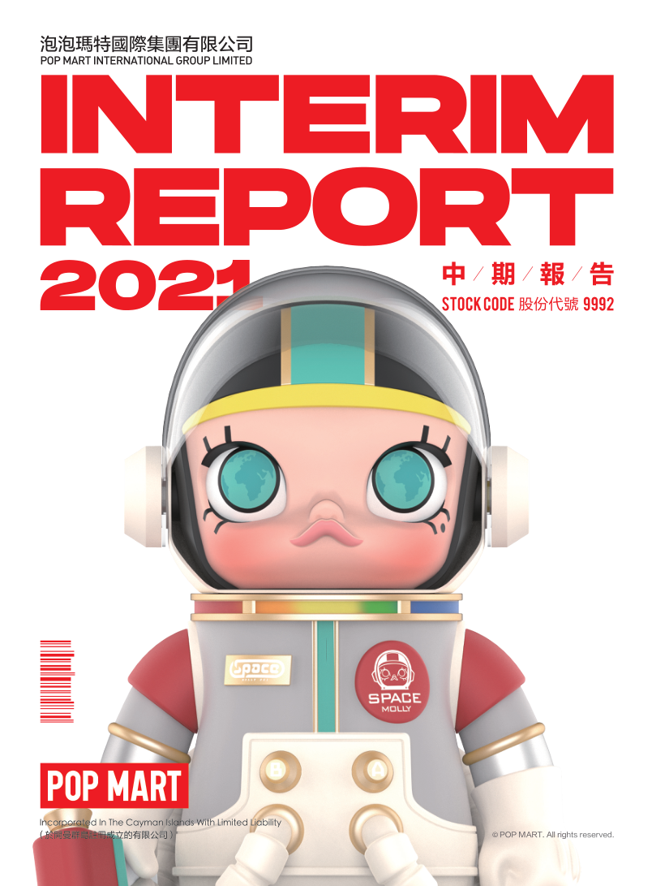

# 泡泡玛特2021年中期报告（简体中文）

> 披露日期：2021-09-28。来源：[泡泡玛特官方投资者关系](https://popwebsite.paquapp.com/pdf/二零二一年中期报告.pdf)。
> [原始PDF](../2021年中期报告.pdf) · [历年财报索引](../泡泡玛特历年财报索引.md)
> 转换说明：保留中文正文、数字、单位和注释，仅做繁简转换及重复英文去除。外文专名、代码和网址照录；复杂表格用等宽文本保留列位置，插图保留原图。


###### 原PDF第1页

[对照原PDF第1页](../2021年中期报告.pdf#page=1)




###### 原PDF第2页

[对照原PDF第2页](../2021年中期报告.pdf#page=2)

2

## 公司资料

目录  6

## 财务概要

7

## 管理层讨论与分析

32

## 其他资料

40

中期简明综合损益及其他全面收益表42

## 中期简明综合资产负债表

45

## 中期简明综合权益变动表

47

## 中期简明综合现金流量表

49

## 中期简明综合财务资料附注

二零二一年中报  1


###### 原PDF第3页

[对照原PDF第3页](../2021年中期报告.pdf#page=3)

###### 公司资料

### 董事会

### 执行董事

王宁先生（董事会主席）

杨涛女士

刘冉女士

司德先生

### 非执行董事

屠铮先生

何愚先生

### 独立非执行董事

张建君先生

吴联生先生

颜劲良先生

### 薪酬委员会

张建君先生（主席）

吴联生先生

王宁先生

### 提名委员会

王宁先生（主席）

张建君先生

吴联生先生

### 审核委员会

吴联生先生（主席）

屠铮先生

颜劲良先生

### 联席公司秘书

李鸿轩先生

李菁怡女士

### 授权代表

王宁先生

李菁怡女士

2  泡泡玛特国际集团有限公司


###### 原PDF第4页

[对照原PDF第4页](../2021年中期报告.pdf#page=4)

###### 公司资料

总部及中国主要营业地点

中国

北京市朝阳区

大望京科技商务园区

宏泰东街浦项中心A座36及37楼

香港主要营业地点

香港

德辅道中188号

金龙中心14楼

股份过户登记总处

Maples Fund Services (Cayman) Limited PO Box 1093 Boundary Hall Cricket Square Grand Cayman KY1-1102 Cayman Islands

香港股份过户登记处

香港中央证券登记有限公司香港

湾仔

皇后大道东183号

合和中心17楼

1712-1716号舖

合规顾问

国泰君安融资有限公司

香港

皇后大道中181号

新纪元广场低座27楼

二零二一年中报  3


###### 原PDF第5页

[对照原PDF第5页](../2021年中期报告.pdf#page=5)

###### 公司资料

主要往来银行

中国工商银行股份有限公司（珠市口支行）

中国北京市崇文区

珠市口东大街15号

交通银行股份有限公司

（望京支行）中国北京市朝阳区望京街9号望京国际商业中心

中国民生银行股份有限公司（望京支行）

中国北京市朝阳区

广顺北大街南湖东园一区

122号楼博泰国际B座

公司网站

www.popmart.com

法律顾问

有关香港法律

达维律师事务所

香港

中环

遮打道3A号

香港会所大厦18楼

有关中国法律

竞天公诚律师事务所

中国

上海市徐汇区

淮海中路1010号

嘉华中心45层

邮政编码：200031

有关开曼群岛法律迈普达律师事务所（香港）有限法律责任合伙香港湾仔

港湾道18号

中环广场26楼

4  泡泡玛特国际集团有限公司


###### 原PDF第6页

[对照原PDF第6页](../2021年中期报告.pdf#page=6)

###### 公司资料

核数师

罗兵咸永道会计师事务所

执业会计师

注册公众利益实体核数师

香港中环

太子大厦22楼

股份代号

9992  9992

二零二一年中报  5


###### 原PDF第7页

[对照原PDF第7页](../2021年中期报告.pdf#page=7)

###### 财务概要

截至6月30日止六个月

|  | 未经审核 | 经审核 |  |
| --- | ---: | ---: | ---: |
|  | 2021 | 2020 |  |
|  |  |  | 本期比上年 |
|  | 2021年 | 2020年 | 同期变动 |
|  | 人民币千元 | 人民币千元 |  |
| 收益 | 1,772,577 | 817,791 | 116.8% |
| 毛利 | 1,117,065 | 533,439 | 109.4% |
| 经营溢利 | 486,687 | 208,368 | 133.6% |
| 除所得税前溢利 | 496,555 | 196,882 | 152.2% |
| 期内溢利 | 358,798 | 141,284 | 154.0% |
| 本公司拥有人应占溢利 | 358,742 | 141,358 | 153.8% |
| 非国际财务报告准则经调整纯利 | 435,189 | 178,267 | 144.1% |
| 毛利率 | 63.0% | 65.2% |  |
| 纯利率 | 20.2% | 17.3% |  |
| 非国际财务报告准则经调整纯利率 | 24.6% | 21.8% |  |
|  | 未经审核 | 经审核 |  |
|  | 2021 | 2020 |  |
|  | 于2021年 | 于2020年 | 本期末比 |
|  | 6月30日 | 12月31日 | 上年年末变动 |
|  | 人民币千元 | 人民币千元 |  |
| 资产 |  |  |  |
| 非流动资产 | 957,033 | 715,399 | 33.8% |
| 流动资产 | 6,683,951 | 6,255,900 | 6.8% |
| 资产总值 | 7,640,984 | 6,971,299 | 9.6% |
| 权益 |  |  |  |
| 权益总额 | 6,314,677 | 6,131,002 | 3.0% |
| 负债 |  |  |  |
| 非流动负债 | 234,141 | 174,984 | 33.8% |
| 流动负债 | 1,092,166 | 665,313 | 64.2% |
| 负债总额 | 1,326,307 | 840,297 | 57.8% |

6  泡泡玛特国际集团有限公司


###### 原PDF第8页

[对照原PDF第8页](../2021年中期报告.pdf#page=8)

###### 管理层讨论与分析

### 业务回顾

2021 年上半年，随著新冠疫情影响的逐渐消退，零售业逐渐复苏，我们线下门店的运营基本恢复正常。潮流文化的不断推广、消费者对潮流玩具的喜爱和关注，也持续推动著我们的业绩增长。

作为中国潮流玩具文化的开拓者及主要推广者， 2021 年上半年，我们收入达到人民币1,772.6 百万元，同比增长116.8%，经调整纯利达到人民币435.2 百万元。我们战略重点是进一步深耕潮流玩具业务，继续贯彻公司的长期既定策略和发展方向。我们仍以艺术家发掘、IP运营、消费者触达及潮流玩具文化的推广为主要业务重点。

艺术家发掘和IP运营

IP运营和创作设计对于我们的产品至关重要，这也是推动泡泡玛特发展的核心驱动力。我们不断丰富IP类型、输出风格多样化的产品，以满足不同用户群体的需求。

我们头部 IP 持续推出新品，新系列的表现依然强劲，Molly和Dimoo在2021年上半年分别实现收入人民币203.9百万元和人民币205.0百万元，同比分别增长了81.9%和74.5%；新IP表现亮眼，2021年4月份推出的SKULLPANDA第二个系列熊喵热潮，截至2021年6月30日单系列销售收入达到人民币92.8百万元。由我们内部的设计师团队Center)推出的小甜豆，2021年上半年实现收入超过人民币63.7百万元。

我们一直致力于推动潮玩市场发展，不断尝试产品创新。我们于期内正式推出了我们的高端潮玩产品线「MEGA珍藏系列」。我们于6 月发售的MEGA珍藏系列SPACE MOLLY × 海绵宝宝联名款，一经推出便迅速引爆市场，其中 1000%(70CM)限量发售3,000体，以抽号的形式购买，吸引了超过100万人次的参与。

二零二一年中报  7


###### 原PDF第9页

[对照原PDF第9页](../2021年中期报告.pdf#page=9)

###### 管理层讨论与分析

### 消费者触达

－ 线下渠道

2021 年上半年我们于中国大陆新开32 家线

```text
                                                                       下门店，门店数量从2020年12月31日的187
                    1                                                  家增至 2021 年 6 月 30 日的 215 家 1 。2021 上
                                                                       半年我们于中国大陆新开业126家机器人商
                                                                       店，机器人商店数量从2020 年12 月31 日的
2021.                                                                  1,351家增至2021年6月30日的1,477家。
```

－ 线上渠道

泡泡玛特抽盒机为我们在微信平台上自主研发设计的小程序，旨在于创造好玩、有趣的购物体验，于 2021 年上半年实现了人民币 325.0 百万元的收入，同比增长了1 0 1 . 0 % 。 电商渠道（ 包括天猫 、 京东等 ）2021 年上半年整体收入为人民币353.3 百万元，同比增长了104.7%。天猫「618」期间，我们总销售额为人民币6,143 万元，较2020年同比增长了94%，在天猫潮流模型玩具行业排名第一。

－ 会员运营

通过渠道的持续扩张及 IP 的不断丰富，并通过全渠道会员运营，用户数字化规模快速扩大，截至 2021 年 6 月 30 日，累计注册会员总数从2020年12月31日的740.0万人增至1,141.5 万人，新增注册会员401.5 万人。2021年上半年会员贡献销售额占比91.8%，会员复购率为49% 2 。2

```text
1                                                                             1   2021年上半年，因租约到期和其他商业原因，我
                                                                                  们关闭了4家门店
2                                                                             2   2021 年上半年，购买会员中买过2 次及以上的占
                                                                                  比
```

8  泡泡玛特国际集团有限公司


###### 原PDF第10页

[对照原PDF第10页](../2021年中期报告.pdf#page=10)

###### 管理层讨论与分析

潮流玩具文化推广

2021年7月，我们与北京大学光华管理学院共同成立北京大学商业与艺术研究中心，旨在培养文化创意产业的领军人才，推动中国潮流文化和新消费等领域的研究和交流。

2021年上半年，我们分别举办了9场IP商场授权展和4场粉丝沙龙活动，给粉丝提供了一个可以对IP释放热情及沉浸式体验的主题空间，加深粉丝对IP的情感连接。

2021年2月，我们推出了首档传播潮流文化的品牌播客，目前已推出16 期节目，邀请潮玩设计师、艺术家、潮流艺术领域人士、行业人士参与。

### 财务回顾

销售收入

本公司收入从 2020 年上半年的人民币 817.8 百万元上升到2021 年上半年的人民币1,772.6 百万元，同比增长116.8%。

二零二一年中报  9


###### 原PDF第11页

[对照原PDF第11页](../2021年中期报告.pdf#page=11)

###### 管理层讨论与分析

根据渠道划分的收入

本公司的收入来自于以下渠道：1.零售店；2.机器人商店；3.线上渠道；及4.批发渠道及其他。下表载列本公司2021 年上半年及2020 年上半年按渠道划分的收入：

|  |  | 截至2021年6月30日止六个月 |  |  | 截至2020年6月30日止六个月 |  |
| --- | ---: | ---: | ---: | ---: | ---: | ---: |
|  | 收入 | 毛利率 | 收入占比 | 收入 | 毛利率 | 收入占比 |
| （人民币千元） |  |  |  | （人民币千元） |  |  |
| 零售店 | 675,286 | 62.6% | 38.1% | 313,296 | 61.1% | 38.3% |
| 线上渠道 | 678,281 | 67.4% | 38.3% | 334,303 | 70.4% | 40.9% |
| 机器人商店 | 227,561 | 70.9% | 12.8% | 105,496 | 72.9% | 12.9% |
| 批发及其他 | 191,449 | 39.8% | 10.8% | 64,696 | 45.8% | 7.9% |
| － 中国大陆 | 146,880 | 40.0% | 8.3% | 43,019 | 45.9% | 5.3% |
| － 中国大陆外 | 44,569 | 39.2% | 2.5% | 21,677 | 45.8% | 2.6% |
| 合计 | 1,772,577 | 63.0% | 100.0% | 817,791 | 65.2% | 100.0% |

－  零售店。 零售店销售收入从 2020 年上半年的人民币 313. 3 百万元增加到 202 1 年上半年的人民币 675.3 百万元，同比增长了115.5%。主要由于2021 年国内疫情得到有效控制零售店均正常营业，而2020 年上半年疫情影响严重，对零售店销售有较大影响；及截至2021 年6 月30 日合计零售店215家，比截至 2020 年 6 月 30 日的合计零售店136家增加了79家。

10  泡泡玛特国际集团有限公司


###### 原PDF第12页

[对照原PDF第12页](../2021年中期报告.pdf#page=12)

###### 管理层讨论与分析

机器人商店。机器人商店销售收入从2020年上半年的人民币105.5 百万元增加到2021上半年的人民币 227.6 百万元，同比增长115.7%，主要由于2021 年国内疫情得到有效控制机器人商店均正常营业，而2020 年上半年疫情影响严重，对机器人商店有较大影响；及截至2021 年6 月30 日共计1,477间机器人商店，比截至2020年6月30日的合计机器人商店1,001间增加了476间。

线上渠道。线上收入由 2020 年上半年的人民币334.3 百万元上升至2021 年上半年的人民币678.3 百万元，增长了102.9%。以下为线上收入明细。

```text
                      截至2021年6月30日止六个月   截至2020年6月30日止六个月
                             收入      收入占比           收入      收入占比          增幅
                    （人民币千元）              （人民币千元）
泡泡玛特抽盒机            325,023         47.9%        161,718         48.4%        101.0%
天猫旗舰店                219,000         32.3%        146,840         43.9%         49.1%
京东旗舰店                 46,804          6.9%          8,068          2.4%        480.1%
其他电商平台               87,454         12.9%         17,677          5.3%        394.7%
合计                      678,281        100.0%        334,303        100.0%        102.9%
```

二零二一年中报  11


###### 原PDF第13页

[对照原PDF第13页](../2021年中期报告.pdf#page=13)

###### 管理层讨论与分析

泡泡玛特线上收入包括天猫旗舰店、泡泡玛特抽盒机、京东旗舰店以及其他线上渠道。其中，泡泡玛特抽盒机从2020 年上半年人民币 161. 7 百万元增长至 2021 年上半年的人民币325.0 百万元，增长了101.0%；天猫旗舰店收入从2020 年上半年的人民币146.8 百万元增长至 2021 上半年的人民币219.0百万元，增长了49.1%；京东旗舰店收入从2020 年上半年的人民币8.1 百万元增长至2021上半年的人民币46.8百万元，增长了480.1%。线上渠道的增长主要源于品牌影响力，以及会员人数的增加，及新增其他电商渠道。

批发及其他。本公司批发及其他收入主要包括来自于中国大陆地区的收入和来自中国大陆地区外的收入。批发及其他收入从2020 年上半年的人民币 64.7 百万元增长至2021 年上半年的人民币191.5 百万元，增长了 195.9%。其中，中国大陆的批发及其他收入从2020年上半年的人民币43.0百万元增加到2021 年上半年的人民币146.9 百万元，增长了 241.4%，主要由于经销商南京金鹰泡泡玛特商贸有限公司收入的增长，占中国大陆批发及其他收入的比例在54.8%，及个别大宗团购占比24.4%；中国大陆以外的批发及其他收入从2020 年上半年的人民币21.7百万元增加到2021上半年的人民币44.6百万元，增长了 105.6%，主要由于海外市场的扩张。

12  泡泡玛特国际集团有限公司


###### 原PDF第14页

[对照原PDF第14页](../2021年中期报告.pdf#page=14)

###### 管理层讨论与分析

根据IP划分的收入

泡泡玛特的自主产品是我们的主要商品类型，2021 年上半年自主产品收入占总收入的比例为89.3%，自主产品收入从 2020 年上半年的人民币 686.9 百万元增加到 2021 年上半年的人民币1,582.4百万元，增长了130.4%。

泡泡玛特的自主产品主要分为：自有IP、独家IP和非独家IP，以下为IP划分的收入明细。

```text
                      截至2021年6月30日止六个月    截至2020年6月30日止六个月
                              收入      收入占比           收入      收入占比
                    （人民币千元）                （人民币千元）
自主产品                 1,582,391         89.3%        686,915         84.1%
自有IP                     900,409         50.9%        280,790         34.4%
                           203,900         11.5%        112,064         13.7%
                           204,993         11.6%        117,466         14.4%
                           183,042         10.3%              –             –
                           101,913          5.8%          1,092           0.1%
  － 其他自有IP            206,561         11.7%         50,168           6.2%
独家IP                     394,316         22.2%        272,879          33.4%
                           145,789          8.2%         70,052           8.6%
                           107,097          6.1%        119,134          14.6%
                            25,340          1.4%              –             –
  － 其他独家IP            116,090          6.5%         83,693          10.2%
非独家IP                   287,666         16.2%        133,246          16.3%
外采及代销                 177,210         10.0%        130,876          15.9%
其他                        12,976          0.7%              –             –
合计                     1,772,577        100.0%        817,791        100.0%
```

二零二一年中报  13


###### 原PDF第15页

[对照原PDF第15页](../2021年中期报告.pdf#page=15)

###### 管理层讨论与分析

自有 IP。自有 I P 是本公司主要商品类型，主要包括Molly、Dimoo、SKULLPANDA、Bunny 等。自有 IP 收入从 2020 年上半年的人民币 280. 8 百万元 ， 上升至 2021 年上半年的人民币900.4 百万元，增长了220.7%。这主要由于Molly和Dimoo的销售收入贡献较高，分别是人民币203.9 百万元和人民币SKULLPANDA.  205.0百万元，及新的IP SKULLPANDA的销售收入贡献。

独家IP。独家IP收入从2020年上半年的人民币272.9 百万元，上升至2021 年上半年的人民币394.3百万元，增长了44.5%。主要由于The Monsters的收入贡献。

非独家IP。非独家IP收入从2020年上半年的人民币133.2百万元，上升至2021年上半年的人民币287.7百万元，增长率为115.9%，主要由于新系列产品的发售以及IP数量的增加。

14  泡泡玛特国际集团有限公司


###### 原PDF第16页

[对照原PDF第16页](../2021年中期报告.pdf#page=16)

###### 管理层讨论与分析

根据地理区域划分的收入

本公司按照地理区域划分的收入以线下区域为主，主要包括零售店和机器人商店。

零售店。下表载列本公司零售店2021年上半年及2020年上半年按地理区域划分的收入：

```text
                                                 截至2021年6月30日止六个月    截至2020年6月30日止六个月
                           城市等级
                                                  零售店数量     零售店收入    零售店数量     零售店收入
                                                              （人民币千元）               （人民币千元）
                           一线城市 3                     91        323,831             63        165,964
4                          新一线城市  4                  64        197,930             40         88,910
                           二线及其他城市 5               60        153,525             33         58,422
                           合计                          215        675,286            136        313,296
```

```text
3                                                                            3   指中国大陆一线城市，包括北京、上海、广州和
                                                                                 深圳
4                                                                            4   指中国大陆新一线城市，包括成都、重庆、杭
                                                                                 州、武汉、西安、郑州、青岛、长沙、天津、苏
                                                                                 州、南京、东莞、沈阳、合肥和佛山
5                                                                            5   指中国大陆除去一线城市和新一线城市以外的城市
```

二零二一年中报  15


###### 原PDF第17页

[对照原PDF第17页](../2021年中期报告.pdf#page=17)

###### 管理层讨论与分析

－  机器人商店。下表载列本公司机器人商店2021 年上半年及2020 年上半年按地理区域划分的收入：

```text
                      截至2021年6月30日止六个月    截至2020年6月30日止六个月
城市等级
                            机器人        机器人         机器人        机器人
                          商店数量      商店收入       商店数量      商店收入
                                   （人民币千元）               （人民币千元）
一线城市                      473         72,389            354         41,474
新一线城市                    483         74,093            347         33,419
二线及其他城市                521         81,079            300         30,603
合计                         1,477       227,561          1,001        105,496
```

销售成本

销售成本从2020年上半年的人民币284.4百万元上升到2021年上半年的人民币655.5百万元，增长了130.5%。增加主要由于(1)商品成本由2020年上半年的人民币228.3百万元增加到2021年上半年的人民币518.9 百万元，其主要原因为销售增加，商品成本随之增加；及(2)设计及授权费由2020年上半年的人民币26.5百万元增加到2021年上半年的人民币64.0百万元，主要因为我们自主产品收入增加以及收入占比不断增加。

16  泡泡玛特国际集团有限公司


###### 原PDF第18页

[对照原PDF第18页](../2021年中期报告.pdf#page=18)

###### 管理层讨论与分析

毛利

本公司的毛利由 2020 年上半年的人民币 533.4百万元上升到2021 年上半年的人民币1,117.1 百万元，增长了109.4%，主要由于我们的收入增加。我们的毛利率由2020年上半年的65.2%下降至2021年上半年的63.0%，主要由于我们泡泡玛特自主产品的毛利率下降。

我们泡泡玛特自主产品产生的毛利由2020 年上半年的人民币488.2百万元增加到2021年上半年的人民币1,058.2 百万元，增长了116.8%。主要由于泡泡玛特自主产品的收益增加。泡泡玛特自主产品的毛利率从2020年上半年的71.1%，下降到2021年上半年的66.9%，主要由于我们提高产品的工艺质量，设计上更加精细，产品工艺愈加复杂，以及2021 年上半年原材料成本和供应链人工成本上涨。

我们的外采和其他产品产生的毛利由2020 年上半年的人民币 45.2 百万元增加到 2021 年上半年的人民币58.9百万元，增长了30.3%，毛利率从2020 年上半年的 34.6% 下降到 2021 年上半年的31.0%，主要由于产品结构优化，产品采购成本略有上升。

经销及销售开支

我们的经销及销售开支由2020 年上半年的人民币 223.0 百万元增长至 2021 年上半年的人民币419.8百万元，增长了88.3%。其中占比较高的为

(1)雇员福利开支；(2)使用权资产折旧；及(3)广告及市场费用。

二零二一年中报  17


###### 原PDF第19页

[对照原PDF第19页](../2021年中期报告.pdf#page=19)

###### 管理层讨论与分析

雇员福利开支。雇员福利开支从 2020 年上半年的人民币39.8百万元增长至2021年上半年的人民币108.6 百万元，增长了172.9%。主要由于(1)我们的销售员工人数由2020 年上半年的1,071 名员工增加到2021 年上半年的1,909 名员工，用以支持我们扩张零售店及机器人商店网络；及(2)股权激励的股份支付金额共计人民币10.7百万元。

使用权资产折旧。使用权资产折旧从 2020年上半年的人民币 45.6 百万元增长至 2021年上半年的人民币 76.0 百万元，增长了66.7%。主要由于我们的零售店数量由2020年上半年的 136 间增加至 2021 年上半年的215间，以支持我们的业务扩张及满足对我们产品陈列的需求。

广告及市场费用。广告及市场费用从 2020年上半年的人民币 30.4 百万元增长至 2021年上半年的人民币 56.8 百万元，增长了86.8%。主要由于线上收入增加，线上渠道的宣传推广随之增加。

一般及行政开支

我们的一般及行政开支由2020 年上半年的人民币 125.4 百万元增长至 2021 年上半年的人民币239.7百万元，增长了91.1%。其中占比较高的为雇员福利开支。

雇员福利开支。雇员福利开支从 2020 年上半年的人民币55.9百万元增长至2021年上半年的人民币170.0 百万元，增长了204.1%。主要由于(1)我们的行政员工及设计开发人员人数由2020年上半年的617名员工增加至2021 上半年的1,211 名员工，主要用以支持我们的产品开发以及业务扩张，及薪资水平提升以吸引人才；及(2)股权激励的股份支付金额共计人民币65.7百万元。

18  泡泡玛特国际集团有限公司


###### 原PDF第20页

[对照原PDF第20页](../2021年中期报告.pdf#page=20)

###### 管理层讨论与分析

金融资产减值亏损净额（拨备）╱ 拨回

我们的金融资产减值亏损净额由2020 年上半年的转回金融资产减值损失人民币 1.0 百万元变为2021年上半年的金融资产减值损失人民币3.3百万元，主要原因为我们的业务扩张，销售增长，进而贸易应收款项余额增加。

其他收入

本公司的其他收入由2020年上半年的人民币31.4百万元下降到 2021 年上半年的人民币 25.4 百万元，下降了18.9%。主要由于政府补助由2020年上半年的人民币23.1百万元降低至2021年上半年的人民币6.7百万元，及来自于fresh、科颜氏、哈根达斯等品牌合作项目的IP授权收入增加了人民币9.5百万元。

其他收益 ╱（亏损）－ 净额

2020年上半年录得其他亏损净额人民币9.0百万元，而2021 年上半年录得其他收益净额人民币6.9 百万元，主要由于理财产品和结构性存款利息的收入人民币12.8百万元，及对北京大学教育基金会捐款人民币3.0百万元。

经营溢利

综上所述，本公司的经营溢利由2020 年上半年的人民币208.4百万元增加至2021年上半年的人民币486.7百万元，增加了133.6%。

分占使用权益法入账的投资溢利 ╱ 亏损

我们分占使用权益法入账的投资亏损由2020 年上半年的人民币1.1百万元变为2021年上半年的投资收益人民币4.1 百万元，增加了468.0%，主要由于南京金鹰泡泡玛特有限公司（「南京金鹰泡泡玛特」）的业绩稳定发展。

二零二一年中报  19


###### 原PDF第21页

[对照原PDF第21页](../2021年中期报告.pdf#page=21)

###### 管理层讨论与分析

财务收入 ╱（开支）－ 净额

我们的财务开支净额由2020 年上半年的净损失人民币3.9百万元，变为2021年上半年的净收益人民币5.7 百万元，主要由于我们的利息收入增加。

所得税开支

我们的所得税开支由2020年上半年的人民币55.6百万元增加到2021年上半年的人民币137.8百万元，原因为我们的所得税前溢利增加。我们的实际税率由2020年上半年的28.2%降低至2021年上半年的27.7%。

期内盈利

由于上文所述，我们的期内盈利由2020 年上半年的人民币141.3百万元增加至2021年上半年的人民币358.8百万元。

非国际财务报告准则经调整纯利

非国际财务报告准则经调整纯利未按照国际财务报告准则计算，视为非国际财务报告准则的财务指标，其定义为除上市费用、以股份为基础的薪酬、重新制定普通股为优先股的有关开支、可转换可赎回优先股的公平值变动后纯利，而非国际财务报告准则经调整纯利率的定义为非国际财务报告准则经调整纯利除以收益。我们认为，这些信息对于投资者在不影响本集团经营业绩或现金流的情况下比较本集团的业绩是有用的，并允许投资者考虑管理层在评估本集团业绩时使用的指标。投资者不应认为非国际财务报告准则的财务指标替代或由于本集团的国际财务报告准则的业绩。此外，可IFRS. In addition, not all companies will adopt the same way in calculating  能不是所有公司会以相同的方式计算该项非国际财务报告主责的财务指标，因此未必可与其他公司采用的相若计量比较。

20  泡泡玛特国际集团有限公司


###### 原PDF第22页

[对照原PDF第22页](../2021年中期报告.pdf#page=22)

###### 管理层讨论与分析

下表载列本公司各年度的非国际财务报告准则的财务指标对账情况。

| 截至2021年 |  | 截至2020年 |
| --- | ---: | ---: |
|  | 6月30日 | 6月30日 |
| 止六个月 |  | 止六个月 |
| （人民币千元） |  | （人民币千元） |
| 期内盈利 | 358,798 | 141,284 |
| 调整项目： |  |  |
| 上市费用 | – | 13,637 |
| 以股份为基础的付款报酬 | 76,391 | – |
| 重新指定普通股为优先股的 |  |  |
| 有关开支 | – | 16,910 |
| 可转换可赎回优先股的 |  |  |
| 公平价值变动 | – | 6,436 |
| 非国际财务报告准则经调整纯利 | 435,189 | 178,267 |
| 非国际财务报告准则经调整纯利率 | 24.6% | 21.8% |

我们管理层认为，上市费用、重新制定普通股为优先股的有关开支及可转换可赎回优先股的公平值变动属于上市及首次公开发售前程序有关的一次性性质且将不会于上市后再产生。此外，以股份为基础的付款开支、重新制定普通股为优先股有关开支及可转换可购回优先股的公平值变动属于非现金项目且并无直接反应我们的业务营运。因此，通过撇除该等项目对计算非国际财务报告准则经调整纯利影响的举措，可更好地反应我们的相关经营表现，并更加便于比较逐年的经营表现。

二零二一年中报  21


###### 原PDF第23页

[对照原PDF第23页](../2021年中期报告.pdf#page=23)

###### 管理层讨论与分析

流动资产、财务资源及资本开支

截至2021年6月30日止六个月，本公司及附属公司在整体业务经营方面采纳保守稳健的资金管理及财务政策。本集团维持以下资源以应付其营运资金需求：

流动资产及流动负债

我们的流动资产净值由截至2020 年12 月31 日的人民币5,590.6百万元降低至截至2021年6月30日的人民币5,591.8百万元，基本维持稳定。

贸易应收款项

贸易应收款项指日常业务过程中我们应收客户的未结算款项。我们的贸易应收款项由截至2020 年12 月31 日的人民币78.3 百万元增加至截至2021 年6 月30 日的人民币135.4 百万元，该等增加主要由于大宗的贸易应收款项导致增加人民币 32.8 百万元，及由于第三方（包括购物中心、批发客户及电商平台）付款增加。贸易应收款项周转天数从2020年的9天增加至截至2021年6月30日的11天。

其他应收款项

其他应收款项主要指向购物中心支付的有关我们零售店及机器人商店的押金款项。其他应收款项由截至2020 年12 月31 日的人民币90.8 百万元增加至截至2021 年6 月30 日的人民币117.5 百万元，主要原因为押金的增加，与我们零售店及机器人商店网络的扩张一致。

22  泡泡玛特国际集团有限公司


###### 原PDF第24页

[对照原PDF第24页](../2021年中期报告.pdf#page=24)

###### 管理层讨论与分析

存货

我们的存货包括制成品。我们的存货由截至2020年12月31日的人民币225.4百万元增加至截至2021年6月30日的人民币316.0百万元。主要由于我们增加了我们的产品库存，以满足不断增长的产品需求。存货周转天数从2020 年的78 天下降到截至2021年6月30日的74天，维持稳定。

预付款项及其他资产

预付款项及其他资产主要包括预付存货款项、预付设计费款项、预付投资款、预付物业、厂房及设备款项及其他。我们的预付款项及其他资产由截至2020年12月31日的人民币184.1百万元，增加至截至2021 年6 月30 日的人民币357.0百万元，主要是由于(1)预付供应商的货款增加人民币83.8百万元；及(2)预付的投资款增加人民币29.6百万元。

现金及现金等价物

我们的现金及现金等价物主要包括银行现金。现金及现金等价物从截至2020 年12 月31 日的人民币5,680.2百万元下降至截至2021年6月30日的人民币1,503.6 百万元，主要为对现金在银行存入定期存款。

贸易应付款项

贸易应付款项主要指我们在日常业务过程中向供应商支付货款的责任。贸易应付款项从截至2020年12月31日的人民币115.8百万元增加至截至2021 年6 月30 日的人民币222.9 百万元，主要原因为我们的业务增长，导致采购量增加，进而令应付供应商款项的余额有所增加。我们的贸易应付款项周转天数由2020 年的40 天增加至截至2021年6月30日的59天，主要由于随著供应商合作时间以及采购量的增加，增强了对供应商的议价能力，延长了平均付现期。

二零二一年中报  23


###### 原PDF第25页

[对照原PDF第25页](../2021年中期报告.pdf#page=25)

###### 管理层讨论与分析

其他应付款项及应计费用

其他应付款项及应计费用主要包括 (1) 应付股息、(2)工资、薪金及其他雇员福利、(3)应计开支、(4)应付物业、厂房及设备以及无形资产款项、(5)应付其他税项，(6)应付短期及可变租金开支款项、及(7)其他。其他应付款项及应计费用由截至 2020 年 12 月 31 日的人民币 202.3 百万元增加至截至2021 年6 月30 日的人民币399.3 百万元，主要是由于2021 年6 月1 日召开股东周年大会投票表决通过以每股本公司普通股人民币14.94分宣派截止2020年12月31日止年度至末期股息，应付股息增加人民币182.3百万元。

物业、厂房及设备

物业、厂房及设备主要包括(1)机器人商店、(2)模具、(3)设备及其他及(4)租赁装修。物业、厂房及设备由截至2020年12月31日的人民币238.3百万元增加至截至 2021 年 6 月 30 日的人民币270.2 百万元，主要是由于租赁装修增加人民币25.6百万元。

无形资产

无形资产主要包括(1)授权IP、(2)知识产权（包括我们的自有IP）及(3)软件。无形资产由截至2020年 12 月 31 日的人民币 92.7 百万元降低至截至2021年6月30日的90.2百万元，主要是由于无形资产正常的折旧进而资产总值减少。

使用权资产

使用权资产包括与我们的零售店及机器人商店有关的相应租赁负债于开始日期或之前做出的租赁付款及任何初步直接成本的初步计量。使用权资产自开始日期起按相关资产可使用年限与短期的较短期间予以折旧。我们的使用权资产由截至2020年12月31日的人民币287.8百万元增加至截至2021年6月30日的人民币380.2百万元，主要是由于零售店及机器人商店网络的扩张。

24  泡泡玛特国际集团有限公司


###### 原PDF第26页

[对照原PDF第26页](../2021年中期报告.pdf#page=26)

###### 管理层讨论与分析

银行借款

截至2021年6月30日，本集团并无任何银行借款。

资产抵押

截至2021年6月30日，本集团并无任何资产抵押。

资产负债率

资产负债率为总负债除以总资产乘以 100% 。截至 2021 年 6 月 30 日，本集团的资产负债率为17.4%，而截至2020年12月31日的资产负债率为12.1%。

或有事件

我们目前并无涉及任何重大法律诉讼，亦不知悉我们涉及任何待决或潜在重大法律诉讼。倘我们涉及有关重大法律诉讼，则我们会于产生亏损且有关亏损金额有合理估计时，按当时所得资料记录任何亏损或或有负债。

于2020年8月28日，我们收到日期为2020年8月

```text
                                                                       19 日的法院传票，内容有关金鹰国际商贸集团
Co., Ltd. (金鹰国际商贸集团(中国)有限公司) as a shareholder on behalf of  （中国）有限公司（作为股东）代表南京金鹰泡泡
                                                                       玛特商贸有限公司在江苏省南京市中级人民法
Court (江苏省南京市中级人民法院) against Beijing Pop Mart Culture &    院向北京泡泡玛特文化创意有限公司提起的申
                                                                       索。于 2021 年 6 月 17 日，上述案件进行首次庭
```

审，主要程序为收集及核证金鹰国际及本集团提供的进一步资料。该案件还需继续开庭以协助法院查清事实。直至本中期简明综合财务资料批准日期，上述案件仍在审理当中。根据中国法律顾问告知，金鹰国际提起的申索并无依据，申索判决金鹰国际胜诉的可能性极低，本公司面临的来自该申索的风险微乎其微，且该申索将不会对我们的运营及财务表现产生重大不利影响，故概无就该申索于综合财务报表确认拨备。

二零二一年中报  25


###### 原PDF第27页

[对照原PDF第27页](../2021年中期报告.pdf#page=27)

###### 管理层讨论与分析

外汇风险管理

我们主要于中国经营业务，交易主要以人民币结算。由于本集团并无以我们经营实体各自功能货币以外货币计值得重大金融资产或负债，故管理层认为业务并无任何重大外汇风险敞口。于截至2021年6月30日止六个月期间，我们并无对冲任何外币波动。

资本开支

本公司的资本开支包括购置物业、厂房及设备的款项和购置无形资产的款项。下表载列本公司2020 年上半年以及2021 年上半年的资本开支2021:  情况：

| 截至2021年 |  | 截至2020年 |
| --- | ---: | ---: |
|  | 6月30日 | 6月30日 |
| 止六个月 |  | 止六个月 |
| （人民币千元） |  | （人民币千元） |
| 购置物业、厂房和设备 | 114,350 | 56,700 |
| 购置无形资产 | 12,460 | 16,827 |
| 合计 | 126,810 | 73,527 |

人力资源

截至2021 年6 月30 日，我们共有3,120 名员工，包括销售员工 1,909 名，行政及开发人员 1,211名。截至2021年6月30日止六个月，我们共发生员工成本（包括薪金、工资、津贴和福利）人民币278.6 百万元，其中截至2021 年6 月30 日授予公司员工共计4,560,006 股，股权激励金额共计人民币76.4百万元。

本公司应付雇员酬金包括薪金、花红及雇员福利计划供款。雇员薪金通常按雇员各自的职位、资历、经验及表现厘定。奖金乃按雇员各自的职位、服务年期及雇员表现计算。为吸引并挽留雇员，我们每年评估提供予雇员的薪酬方案，以确定是否应对基本薪金及花红作出任何调整。

26  泡泡玛特国际集团有限公司


###### 原PDF第28页

[对照原PDF第28页](../2021年中期报告.pdf#page=28)

###### 管理层讨论与分析

根据中国法律法规的要求，我们参与各项政府法定雇员福利计划，包括社会保险基金（即养老金供款计划、医疗保险计划、失业保险计划、工伤保险计划及生育保险计划）及住房公积金。

我们为所有雇员提供培训计划，以实现员工与企业共同发展。我们将为所有新员工提供丰富的入职培训课程，以使其快速融入公司，其后根据部门需要、本公司的发展战略、及员工诉求进行多种在职培训，增强雇员与我们业务相关的知识、技能及能力。

重大投资及未来投资计划

截至2021年6月30日，我们并无持有任何重大投资。

我们将继续广泛寻找潜在的策略性投资机会，并寻求可为本集团带来协同效应的潜在优质目标业务及资产。

重大收购及出售

截至2021年6月30日止六个月，我们并无进行任何重大收购或出售附属公司、联营公司及合营企业。

二零二一年中报  27


###### 原PDF第29页

[对照原PDF第29页](../2021年中期报告.pdf#page=29)

###### 管理层讨论与分析

报告期间后事项

于本中期报告日期，本集团于截至2021年6月30日止六个月（「报告期」）后并无发生须进一步披露或调整的重大事项。

### 未来展望

IP is at the core of our business. Through our innovative products, delicate  IP 是我们业务的核心，我们通过创意的产品、精致的设计和优质的服务使消费者收获快乐美好、潮流体验和艺术熏陶，同时，通过提升品牌价值，增加用户对泡泡玛特的品牌忠诚度，保持我们强势的市场地位及竞争力。

我们将致力丰富IP类型，扩大IP库，保持高质量的设计创新水准，推出更多头部系列产品，对IP进行持续运营，强化IP心智，加深粉丝与IP之间的情感连接。以及拓宽除更多潮玩品类，进一步发掘MEGA、衍生品、BJD等品类的发开及完善相关工艺及生产发售流程。

我们将致力扩展我们的渠道网络，从而触达更多的用户，不断精进我们的运营能力，提升用户的消费体验，加强会员拓展和会员运营能力，推动创新零售数字化运作，以更多样化的方式触达和维护用户，提供定制化的、更好的服务。

我们将致力提高我们在海外国家、地区的品牌知名度和潮玩市场份额，实现当地业务本地化是海外业务的核心，在加强终端消费者的消费体验和互动的同时，与更多当地的合作伙伴和艺术家，探索出更多符合当地市场的业务模式、IP和商品品类。

我们将通过更丰富多样的途径持续推广潮流玩具文化，持续影响整个行业，为会员提供更多权益，提高粉丝黏性，提升粉丝的文化认同和品牌认知。

28  泡泡玛特国际集团有限公司


###### 原PDF第30页

[对照原PDF第30页](../2021年中期报告.pdf#page=30)

###### 管理层讨论与分析

上市所得款项净额用途

本公司股份（「股份」）于2020年12月11日通过全球发售在香港联合交易所有限公司（「联交所」）主板上市，经扣除专业费用、包销佣金及其他相关上市开支后，本公司自全球发售（包括悉数行使超额配股权）所收取所得款项净额总额（「所得款项净额」）约为5,781.7百万港元。

诚如本公司日期为 2020 年 12 月 1 日的招股章程（「招股章程」）所述，所得款项净额的拟定用途载列如下：

Intended timetable for

```text
                                                                                       直至2021年          于2021年
                                                                                          6月30日         6月30日的
                                                                                          已动用的        未动用所得   动用未动用
                                                     所得款项净额   占总所得款项          所得款项          款项净额   所得款项净额
所得款项净额拟定用途                                       的分配     净额百分比          净额金额              余额   的拟定时间表
                                                                           30.0%
                                                   1,734.5百万港元                   296.4百万港元    1,438.1百万港元
用于为我们的消费者触达渠道及海外市场扩展计划拨                                                                         2024年12月31日
付部分资金                                                                                                             或之前
                                                                           16.5%
    用于开设新零售店                                954.0百万港元                    247.5百万港元     706.5百万港元
                                                                            6.0%
    用于开设新机器人商店                            346.9百万港元                     41.3百万港元     305.6百万港元
                                                                            7.5%
    用于扩展业务至海外市场                          433.6百万港元                      7.6百万港元     426.0百万港元
                                                                           27.0%
                                                   1,561.1百万港元                    64.7百万港元    1,496.4百万港元
                                                                                                                       2024年12月31日
用于为潜在投资、收购本行业价值链上下游公司及与                                                                         或之前
该等公司建立战略联盟拨资
```

二零二一年中报  29


###### 原PDF第31页

[对照原PDF第31页](../2021年中期报告.pdf#page=31)

###### 管理层讨论与分析

Intended timetable for

```text
                                                                                       直至2021年          于2021年
                                                                                          6月30日         6月30日的
                                                                                          已动用的        未动用所得   动用未动用
                                                     所得款项净额   占总所得款项          所得款项          款项净额   所得款项净额
所得款项净额拟定用途                                       的分配     净额百分比          净额金额              余额   的拟定时间表
                                                                           15.0%
                                                    867.2百万港元                     56.7百万港元     810.5百万港元
```

用于投资技术举措，以增强我们的营销及粉丝参与力度及提升业务的数字化程度

```text
                                                                           3.0%
用于人才招募                                      173.5百万港元                       7.8百万港元      165.7百万港元
                                                                                                                       2023年12月31日
```

或之前

```text
                        6.0%
346.9百万港元                      14.3百万港元      332.6百万港元
                                                                     2024年12月31日
```

或之前

用于购买相关软件及硬件以加强数字化，并建立用于数字营销、客户服务、物流、产品、供应链、仓储，会员、交易以及门店管理及营销的信息系统

```text
                        6.0%
346.8百万港元                      34.5百万港元      312.3百万港元
                                                                     2024年12月31日
```

或之前用于优化我们的线上营销工作，主要包括战略性地在第三方推广平台上投放广告、图标、链接及信息推送

30  泡泡玛特国际集团有限公司


###### 原PDF第32页

[对照原PDF第32页](../2021年中期报告.pdf#page=32)

###### 管理层讨论与分析

Intended timetable for

```text
                                                                                       直至2021年          于2021年
                                                                                          6月30日         6月30日的
                                                                                          已动用的        未动用所得   动用未动用
                                                     所得款项净额   占总所得款项          所得款项          款项净额   所得款项净额
所得款项净额拟定用途                                       的分配     净额百分比          净额金额              余额   的拟定时间表
                                                                           18.0%
用于扩大我们的IP库                                 1,040.7百万港元                    36.7百万港元    1,004.0百万港元
                                                                            4.5%
                                                    260.3百万港元                     26.0百万港元     234.3百万港元
    用于加强我们物色优秀艺术家的能力                                                                                   2024年12月31日
                                                                                                                       或之前
                                                                            1.5%
                                                     86.6百万港元                     10.7百万港元      75.9百万港元
                                                                                                                       2023年12月31日
```

或之前用于以提供具有竞争力的薪金的方式招募有才华的设计师加入我们的内部设计团队，以增强我们

```text
    的内部原创IP发掘实力
                                                                             12.0%                  –
                                                      693.8百万港元                                 –     693.9百万港元
    用于收购受欢迎的IP以扩大我们的IP库                                                                                     2024年12月31日
                                                                                                                           或之前
                                                                             10.0%                                    –
营运资金及一般公司用途                                578.2百万港元                     578.2百万港元                 –
                                                                                                                           2023年12月31日
```

或之前

本集团将遵照招股章程所载拟定目的动用首次公开发售所得款项净额。

二零二一年中报  31


###### 原PDF第33页

[对照原PDF第33页](../2021年中期报告.pdf#page=33)

###### 其他资料

遵守企业管治守则

本公司董事（「董事」）会（「董事会」）致力维持高水平的企业管治标准。董事会相信，高企业管治标准对于本公司提供框架以保障股东权益、提升企业价值及问责性方面发挥关键作用。

本公司已采纳香港联合交易所有限公司证券上市规则（「上市规则」）附录十四所载的企业管治守则（「企业管治守则」），作为其本身的企业管治守则。本公司于截至2021年6月30日止六个月期间内一直遵守企业管治守则项下的所有适用守则条文，惟下文「主席及行政总裁」一段所述偏离守则条文第A.2.1条除外。

主席及行政总裁

企业管治守则的守则条文第A.2.1 条条文规定，主席与行政总裁的角色应有区分，并不应由一人同时兼任。根据董事会现时架构，王宁先生同时担任本公司主席及行政总裁的角色。

鉴于以下情况，董事会认为此架构将不会损害董事会与本公司管理层之间的权力平衡及权限分布：(i)董事会作出的决定须至少经大多数董事批准，且董事会九名董事中的三名为独立非执行董事，故董事会认为董事会内有充足权力制衡；(ii)王宁先生及其他董事知悉并承诺履行其作为董事的受信职责，当中要求（其中包括）彼等为本公司的裨益及最佳利益行事，并将据此作出本集团决策；及(iii)董事会的运作确保权力平衡及权限分布，董事会由经验丰富且才华横溢的人士组成，彼等定期开会讨论影响本集团运作的事宜。此外，本集团的整体战略及其他主要业务、财务及营运政策乃于董事会及高级管理层层级进行全面讨论后共同制定。最后，由于王宁先生为我们的主要创办人，故董事会认为，由同一人士担任主席及行政总裁将有利于确保本集团内部领导贯彻一致，令本集团实现更为有效及高效的整体战略规划。董事会将持续检讨本集团企业管治架构的成效，以评估是否有必要分离主席及行政总裁的角色。

32  泡泡玛特国际集团有限公司


###### 原PDF第34页

[对照原PDF第34页](../2021年中期报告.pdf#page=34)

###### 其他资料

本公司致力提升适用于其经营行为及业务增长的企业管治常规，并不时审阅该等常规，以保证彼等符合法定及专业标准且与最新发展保持一致。

证券交易标准守则

本公司采纳上市规则附录十所载上市发行人董事进行证券交易的标准守则（「标准守则」），作为本公司涉及董事证券交易的行为守则。经向全体董事作出具体查询后，各董事已确认于截至2021年6月30日止六个月期间一直遵守标准守则所载的规定。

2021.

可能拥有本公司未公布内幕消息的本公司雇员亦须遵守标准守则。

董事及高级管理层之资料变更

并无根据上市规则第13.51B(1)条须予披露之董事及高级管理层资料之变动。

董事及行政总裁于股份、相关股份及债权证的权益及淡仓

于 2021 年 6 月 30 日，本公司董事及行政总裁于本公司或其任何相联法团（定义见《证券及期货条例》第XV部（香港法例第571章）  （「证券及期货条例」））的股份、相关股份及债权证中拥有根据《证券及期货条例》第XV部第7及第8分部已知会本公司及联交所（包括根据《证券及期货条例》的有关条文彼等被当作或视为拥有的权益及淡仓），或根据《证券及期货条例》第352条须予存置的登记册所记录或根据标准守则已另行知会本公司及联交所的权益及淡仓如下：

二零二一年中报  33


###### 原PDF第35页

[对照原PDF第35页](../2021年中期报告.pdf#page=35)

###### 其他资料

于本公司股份及相关股份的权益

```text
                                                                           所持股份 ╱ 相关股份    占本公司股权概约
董事姓名                           身份 ╱ 权益性质                                       总数  (1)      百分比(%) (1)
                                                                                  688,009,220 (L)           49.08%
王宁先生
```

信托的受益人及创办人；

```text
                                          及受控法团权益 (2)(3)
                                                                                             688,009,220 (L)                49.08%
杨涛女士                                配偶权益 (3)(4)
                                                                                              11,508,500 (L)                 0.82%
司德先生                                酌情信托创办人 (5)
                                                                                  附注：
(1)                                                                               (1)  于 2021 年 6 月 30 日，本公司合共已发行
                                                                                      1,401,937,550股股份。字母「L」代表有关人士于股
                                                                                      份的好仓。
(2)  GWF Holding Limited is a company with limited liability incorporated in the BVI  (2)  GWF Holding Limited为一家于英属维京群岛注册
                                                                                      成立的有限公司，由UBS Trustees (B.V.I.) Ltd.全资
```

拥有，而UBS Trustees (B.V.I.) Ltd.以王宁先生作为委托人（以王宁先生为受益人）所创立信托的受托人身份全资拥有。根据《证券及期货条例》，王宁先生被视为于GWF Holding Limited所持本公司571,981,960 股股份中拥有权益。Tianjin Paqu Holding Limited为一家根据英属维京群岛法律注册成立的有限公司，而王宁先生为唯一股东。根据《证券及期货条例》，王宁先生因而被视为于Limited所持本公司30,082,220

```text
                                                                                    股股份中拥有权益。
(3)  Pop Mart Hehuo Holding Limited is a company with limited liability incorporated  (3)                   Limited为一家根据英属
                                                                                    维京群岛法律注册成立的有限公司，并于本公司
```

持有85,945,040股股份。王宁先生及杨涛女士分别持有Pop Mart Hehuo Holding Limited已发行股本的43.99%及15.11%。王宁先生及杨涛女士因其配偶关系被视为于彼此持有之股份中拥有权益，因此彼等被视为于Pop Mart Hehuo Holding Limited

```text
                                                                                   所持股份中拥有权益。
(4)                                                                            (4)  杨涛女士为王宁先生的配偶。根据《证券及期货
                                                                                   条例》，杨涛女士被视为于王宁先生持有的所有
                                                                                   股份中拥有权益。
(5)  Sidsi Holding Limited is an investment holding company incorporated under the  (5)  Sidsi Holding Limited为一家根据英属维京群岛法
                                                                                   律注册成立的投资控股公司，由 TMF (Cayman)
```

Ltd. （作为由司德先生（作为委托人）以其本身为受益人设立的XM Family Trust的受托人）全资拥有。

34  泡泡玛特国际集团有限公司


###### 原PDF第36页

[对照原PDF第36页](../2021年中期报告.pdf#page=36)

###### 其他资料

除上文所披露者外，于 2021 年 6 月 30 日，概无本公司董事于本公司或其任何相联法团（定义见《证券及期货条例》第XV部）的股份、相关股份或债权证中拥有或被视为拥有任何根据《证券及期货条例》第 XV 部第7 及第8 分部须知会本公司及联交所（包括根据《证券及期货条例》的有关条文彼等被当作或视为拥有的权益及淡仓），或须记入根据《证券及期货条例》第352条须由本公司存置的登记册，或根据标准守则须知会本公司及联交所的权益或淡仓。

主要股东于股份及相关股份的权益及淡仓

于2021年6月30日，据本公司董事及行政总裁所知，下列人士（本公司董事及行政总裁除外）于股份或相关股份拥有根据《证券及期货条例》第XV部第2及第3分部须向本公司披露或根据《证券及期货条例》第336 条须由本公司存置的登记册所记录的权益或淡仓：

于本公司股份及相关股份的权益

```text
                                                                                        所持股份 ╱     占本公司股权概约
董事姓名                             身份 ╱ 权益性质                                 相关股份总数  (1)       百分比(%) (1)
UBS Trustees (B.V.I.) Limited                                                         571,981,960 (L)             40.80%
                                     受托人 (2)
GWF Holding Limited                                                                   571,981,960 (L)             40.80%
                                     实益拥有人 (2)
Pop Mart Hehuo Holding Limited                                                         85,945,040 (L)              6.13%
                                     实益拥有人 (3)
```

二零二一年中报  35


###### 原PDF第37页

[对照原PDF第37页](../2021年中期报告.pdf#page=37)

###### 其他资料

```text
                                                                                 附注：
(1)                                                                              (1)  于 2021 年 6 月 30 日，本公司合共已发行
                                                                                      1,401,937,550股股份。字母「L」代表有关人士于股
                                                                                      份的好仓。
(2)  GWF Holding Limited is a company with limited liability incorporated in the BVI  (2)  GWF Holding Limited为一家于英属维京群岛注册
                                                                                      成立的有限公司，由UBS Trustees (B.V.I.) Ltd.全资
```

拥有，而UBS Trustees (B.V.I.) Ltd.以王宁先生作为委托人（以王宁先生为受益人）所创立信托的受托人身份全资拥有。根据《证券及期货条例》，王宁先生被视为于GWF Holding Limited所持本公司571,981,960 股股份中拥有权益。Tianjin Paqu Holding Limited为一家根据英属维京群岛法律注册成立的有限公司，而王宁先生为唯一股东。根据《证券及期货条例》，王宁先生因而被视为于Limited所持本公司30,082,220

```text
                                                                                    股股份中拥有权益。
(3)  Pop Mart Hehuo Holding Limited is a company with limited liability incorporated  (3)                   Limited为一家根据英属
                                                                                    维京群岛法律注册成立的有限公司，并于本公司
```

持有85,945,040股股份。王宁先生及杨涛女士分别持有Pop Mart Hehuo Holding Limited已发行股本的43.99%及15.11%。王宁先生及杨涛女士因其配偶关系被视为于彼此持有之股份中拥有权益，因此彼等被视为于Pop Mart Hehuo Holding Limited所持股份中拥有权益。

除上文所披露者外，于 2021 年 6 月 30 日，本公司尚未接获任何其他人士（本公司董事除外）通知，表示其于本公司股份或相关股份拥有根据《证券及期货条例》第XV部第2及第3分部须予披露，或须记入根据《证券及期货条例》第336条须由本公司存置的登记册的权益或淡仓。

董事收购股份或债权证的权利

除本中期报告另行披露者外，本公司或其任何附属公司于2021年6月30日止六个月内任何时间概无订立任何安排以使董事可藉收购本公司或任何其他法团的股份或债权证而获得利益，且概无董事或任何彼等的配偶或未满18 岁子女获授任何认购本公司或任何其他法团的股权或债权证的权利或已经行使任何有关权利。

36  泡泡玛特国际集团有限公司


###### 原PDF第38页

[对照原PDF第38页](../2021年中期报告.pdf#page=38)

###### 其他资料

购买、出售或赎回上市证券

截至2021年6月30日六个月期间，本公司及其任何附属公司或综合联属实体概无购买、出售或赎回本公司任何上市证券。

首次公开发售后股份奖励计划

本公司于 2020 年 7 月 24 日有条件采纳首次公开发售后股份奖励计划。首次公开发售后股份奖励计划并非购股权计划，因而不受上市规则第17 章的条文规限。对于董事会根据首次公开发售后股份奖励计划授出的任何奖励（「奖励」），本公司委任恒泰信托（香港）有限公司为首次公开发售后股份奖励计划的受托人，以管理首次公开发售后股份奖励计划，有关奖励可以股份（「奖励股份」）或奖励股份之实际售价以现金的形式归属。首次公开发售后股份奖励计划的进一步详情，请见招股章程。

如招股章程所披露，股份奖励计划下已有24,428,730股股份配发及发行予Pop Mart Partner Limited，报告期内授予及归属的奖励股份均为上述已发行股份的一部分。

二零二一年中报  37


###### 原PDF第39页

[对照原PDF第39页](../2021年中期报告.pdf#page=39)

###### 其他资料

于报告期内，按首次公开发售后股份奖励计划授出之奖励股份的变动详情载列如下：

```text
                                                                                        截至2021年                               截至2021年
                   授出奖励                                                                 1月1日         期内        期内         6月30日
相关奖励对象       股份数目   授出日期           归属期间                           已授出且待归属       已归属      已没收已授出且待归属
                   2,804,789                                                                      0     121,463       21,614        2,661,712
雇员                          2021年1月4日       2024年9月30日前归属
                     104,925                                                                      0      58,573         821           45,531
                              2021年3月31日      2022年1月31日前归属
                     730,925                                                                      0       9,635           0          721,290
                              2021年4月1日       2025年4月7日前归属
                     734,958                                                                      0           0       13,740         721,218
                              2021年6月1日       2025年6月1日前归属
                     184,409                                                                      0     184,409           0                0
货品或服务                    2021年3月29日      2021年6月15日归属
  供应商
```

38  泡泡玛特国际集团有限公司


###### 原PDF第40页

[对照原PDF第40页](../2021年中期报告.pdf#page=40)

###### 其他资料

### 审核委员会

本公司审核委员会（「审核委员会」）由两名独立非执行董事和一名非执行董事组成，分别为吴联生先生、颜劲良先生及屠铮先生。审核委员会主席为吴联生先生，审核委员会成员颜劲良先生具专业会计资格。

审核委员会已与管理层审阅本集团采纳之会计准则及惯例，并讨论内部监控及财务汇报事宜，包括审阅截至2021年6月30日止六个月之中期财务资料。

本公司外聘核数师罗兵咸永道会计师事务所已根据国际审阅委聘准则第2410号「由实体的独立核数师执行中期财务资料审阅」，对本集团截至2021年6月30日止六个月的中期财务资料进行审阅。罗兵咸永道会计师事务所已确认，按照他们的审阅，并无发现任何事项致令他们相信中期财务资料在各重大方面未有根据国际会计准则第34号「中期财务报告」编制。

代表董事会

董事会主席

王宁先生

香港，2021年8月27日

二零二一年中报  39


###### 原PDF第41页

[对照原PDF第41页](../2021年中期报告.pdf#page=41)

## 中期简明综合损益及其他全面收益表

|  |  |  | 截至6月30日止六个月 |
| --- | ---: | ---: | ---: |
|  |  | 2021 | 2020 |
|  |  | 2021年 | 2020年 |
|  |  | 人民币千元 | 人民币千元 |
|  | 附注 | （未经审核） | （经审核） |
| 收益 | 5 | 1,772,577 | 817,791 |
| 销售成本 | 6 | (655,512) | (284,352) |
| 毛利 |  | 1,117,065 | 533,439 |
| 经销及销售开支 | 6 | (419,780) | (223,030) |
| 一般及行政开支 | 6 | (239,673) | (125,397) |
| 金融资产减值亏损（拨备）╱ 拨回 |  | (3,296) | 977 |
| 其他收入 | 7 | 25,425 | 31,369 |
| 其他收益 ╱（亏损）－ 净额 |  | 6,946 | (8,990) |
| 经营溢利 |  | 486,687 | 208,368 |
| 财务收入 | 8 | 13,888 | 699 |
| 财务开支 | 8 | (8,160) | (4,624) |
| 财务收入 ╱（开支）－ 净额 | 8 | 5,728 | (3,925) |
| 可转换可赎回优先股的公平值变动 |  | – | (6,436) |
| 分占使用权益法入账的投资溢利 ╱ |  |  |  |
| （亏损） | 15 | 4,140 | (1,125) |
| 除所得税前溢利 |  | 496,555 | 196,882 |
| 所得税开支 | 9 | (137,757) | (55,598) |
| 期内溢利 |  | 358,798 | 141,284 |
| 以下应占期内溢利： |  |  |  |
| 本公司拥有人 |  | 358,742 | 141,358 |
| 非控股权益 |  | 56 | (74) |

40  泡泡玛特国际集团有限公司


###### 原PDF第42页

[对照原PDF第42页](../2021年中期报告.pdf#page=42)

###### 中期简明综合损益及其他全面收益表

```text
              截至6月30日止六个月
                  2021             2020
                2021年           2020年
            人民币千元       人民币千元
附注       （未经审核）      （经审核）
```

其他全面亏损

```text
可能重新分类至损益的项目
  － 货币换算差额                                      (3,198)           (33,915)
```

将不会重新分类至损益的项目

```text
  － 货币换算差额                                     (51,275)            18,864
期内其他全面亏损，除税后
                                                      (54,473)           (15,051)
期内全面收益总额
                                                      304,325           126,233
```

以下应占期内全面收益总额：

```text
－ 本公司拥有人                                   304,336           126,101
－ 非控股权益                                         (11)             132
```

本公司拥有人应占溢利的每股盈利

```text
－ 基本（以每股人民币分表示）     11               26.04             12.28
－ 摊薄（以每股人民币分表示）     11               26.02             12.28
```

以上中期简明综合损益及其他全面收益表应与随附附注一并阅读。

二零二一年中报  41


###### 原PDF第43页

[对照原PDF第43页](../2021年中期报告.pdf#page=43)

###### 中期简明综合资产负债表

```text
             于6月30日      于12月31日
                  2021            2020
                2021年          2020年
            人民币千元      人民币千元
附注       （未经审核）      （经审核）
```

资产

| 非流动资产 |  |  |  |
| --- | ---: | ---: | ---: |
| 物业、厂房及设备 | 12 | 270,221 | 238,325 |
| 无形资产 | 13 | 90,206 | 92,731 |
| 使用权资产 | 14 | 380,204 | 287,799 |
| 使用权益法入账的投资 | 15 | 54,205 | 50,380 |
| 按公平值计入损益的金融资产 | 4.4 | 83,974 | 16,900 |
| 预付款项及其他非流动资产 | 16 | 52,342 | 6,177 |
| 递延所得税资产 |  | 25,881 | 23,087 |
| 总非流动资产 |  | 957,033 | 715,399 |
| 流动资产 |  |  |  |
| 贸易应收款项 | 17 | 135,390 | 78,334 |
| 其他应收款项 |  | 117,509 | 90,781 |
| 存货 |  | 315,962 | 225,369 |
| 预付款项及其他流动资产 | 16 | 304,613 | 177,918 |
| 按公平值计入损益的金融资产 | 4.4 | 39,959 | – |
| 受限制现金 |  | 3,230 | 3,263 |
| 初步为期三个月以上及一年以内的 |  |  |  |
| 定期存款 |  | 4,263,666 | – |
| 现金及现金等价物 |  | 1,503,622 | 5,680,235 |
| 总流动资产 |  | 6,683,951 | 6,255,900 |
| 总资产 |  | 7,640,984 | 6,971,299 |

42  泡泡玛特国际集团有限公司


###### 原PDF第44页

[对照原PDF第44页](../2021年中期报告.pdf#page=44)

###### 中期简明综合资产负债表

```text
                                              于6月30日       于12月31日
                                                   2021             2020
                                                 2021年           2020年
                                              人民币千元      人民币千元
                                  附注       （未经审核）      （经审核）
权益
股本                               18                923             923
就股份奖励计划持有的股份           19                (16)             (16)
其他储备                                       5,014,059        5,189,115
保留盈利                                       1,298,094          939,352
本公司拥有人应占权益
                                               6,313,060        6,129,374
非控股权益                                         1,617            1,628
总权益                                         6,314,677        6,131,002
```

负债

| 非流动负债 |  |  |  |
| --- | ---: | ---: | ---: |
| 应付授权费 | 22 | 24,694 | 27,934 |
| 租赁负债 | 14 | 209,447 | 147,050 |
| 总非流动负债 |  | 234,141 | 174,984 |
| 流动负债 |  |  |  |
| 贸易应付款项 | 21 | 222,935 | 115,804 |
| 应付授权费 | 22 | 58,831 | 58,880 |
| 其他应付款项 | 23 | 399,279 | 202,297 |
| 合约负债 |  | 156,428 | 83,941 |
| 租赁负债 | 14 | 181,412 | 144,724 |
| 即期所得税负债 |  | 73,281 | 59,667 |
| 总流动负债 |  | 1,092,166 | 665,313 |
| 总负债 |  | 1,326,307 | 840,297 |
| 总权益及负债 |  | 7,640,984 | 6,971,299 |

二零二一年中报  43


###### 原PDF第45页

[对照原PDF第45页](../2021年中期报告.pdf#page=45)

###### 中期简明综合资产负债表

以上中期简明综合资产负债表应与随附附注一并阅读。

发布第40 页至第96 页的中期简明综合财务资料于2021年8月27日获董事会批准及授权刊发，并由下列董事代表签署：

执行董事及主席  执行董事

44  泡泡玛特国际集团有限公司


###### 原PDF第46页

[对照原PDF第46页](../2021年中期报告.pdf#page=46)

###### 中期简明综合权益变动表

未经审核

本公司拥有人应占

就股份奖励

```text
         计划持有
股本      的股份*     其他储备     保留盈利         小计    非控股权益         合计
```

（附注18）  （附注19）

```text
                               附注    人民币千元   人民币千元   人民币千元    人民币千元   人民币千元   人民币千元   人民币千元
于2021年1月1日的结余                          923          (16)    5,189,115      939,352    6,129,374        1,628     6,131,002
全面收益
期内溢利                                        –            –            –       358,742      358,742           56      358,798
其他全面收益
货币换算差额                                    –            –       (54,406)           –      (54,406)         (67)      (54,473)
全面收益总额                                    –            –       (54,406)     358,742      304,336          (11)     304,325
与拥有人的交易
宣派股息                        10              –            –      (205,832)           –     (205,832)           –     (205,832)
雇员股计划项下已归属股份*
                                19              –            –            –             –            –            –            –
以股份为基础的付款开支          20              –            –       85,182             –       85,182            –       85,182
与拥有人的交易总额                              –            –      (120,650)           –     (120,650)           –     (120,650)
于2021年6月30日的结余                         923          (16)    5,014,059    1,298,094    6,313,060        1,617     6,314,677
```

股份奖励计划项下已归属股份金额低于人民币500元，故约整至上述中期简明综合权益变动表。

二零二一年中报  45


###### 原PDF第47页

[对照原PDF第47页](../2021年中期报告.pdf#page=47)

###### 中期简明综合权益变动表

经审核

本公司拥有人应占

```text
股本      其他储备     保留盈利          小计   非控股权益          合计
```

（附注18）

```text
                                  附注     人民币千元     人民币千元     人民币千元     人民币千元     人民币千元     人民币千元
于2020年1月1日的结余                                82        169,631        423,068        592,781              –        592,781
全面收益
期内溢利                                             –              –        141,358        141,358            (74)       141,284
其他全面收益
货币换算差额                                         –         (15,257)            –        (15,257)           206        (15,051)
全面收益总额                                         –         (15,257)      141,358        126,101            132        126,233
与拥有人的交易
发行普通股                         18                4        393,801              –        393,805              –        393,805
业务合并产生的非控股权益
                                                     –              –              –              –          1,696          1,696
重新指定普通股为优先股
                                                    (3)      (499,658)             –       (499,661)             –       (499,661)
可转换可赎回优先股转换为
  普通股                                             3        626,922              –        626,925              –        626,925
与拥有人的交易总额                                   4        521,065              –        521,069          1,696        522,765
于2020年6月30日的结余                               86        675,439        564,426      1,239,951          1,828      1,241,779
```

以上中期简明综合权益变动表应与随附附注一并阅读。

46  泡泡玛特国际集团有限公司


###### 原PDF第48页

[对照原PDF第48页](../2021年中期报告.pdf#page=48)

###### 中期简明综合现金流量表

```text
                                               截至6月30日止六个月
                                                   2021             2020
                                                 2021年           2020年
                                              人民币千元      人民币千元
                                  附注       （未经审核）      （经审核）
经营活动产生的现金流量
经营所得现金                                     554,706          219,855
已收利息                                          13,888             699
已付所得税                                      (126,937)         (98,363)
经营活动所得现金净额
                                                 441,657          122,191
投资活动产生的现金流量
购买物业、厂房及设备                            (114,350)         (56,700)
购买无形资产                                     (12,460)         (16,827)
购买按公平值计入损益的金融资产
                                              (1,017,806)        (225,000)
初步为期三个月以上及一年以内的
  定期存款增加                                (4,263,666)              –
于一家联营公司的投资                                   –          (27,424)
业务合并获得的现金                                     –            1,590
处置按公平值计入损益的金融资产
  所得款项                                       882,445          275,000
按公平值计入损益的金融资产投资
  收入                                            11,500            1,102
处置物业、厂房及设备、无形资产
  及使用权资产所得款项
                                                  15,930               –
投资活动所用现金净额                          (4,498,407)         (48,259)
```

二零二一年中报  47


###### 原PDF第49页

[对照原PDF第49页](../2021年中期报告.pdf#page=49)

###### 中期简明综合现金流量表

```text
                                               截至6月30日止六个月
                                                    2021            2020
                                                 2021年           2020年
                                              人民币千元      人民币千元
                                  附注       （未经审核）      （经审核）
融资活动产生的现金流量
租赁负债付款                       14            (94,201)         (56,495)
已付股息                           10            (26,797)              –
上市开支付款                                           –             (119)
本公司的股东注资
                                                       –          398,375
视作分派予当时股东以购买上市
  业务
                                                       –           (4,566)
发行可转换可赎回优先股的
  所得款项                                             –           86,561
融资活动（所用）╱ 所得现金净额
                                                (120,998)         423,756
现金及现金等价物（减少）╱
  增加净额                                     (4,177,748)        497,688
期初的现金及现金等价物
                                               5,680,235          324,614
现金及现金等价物的汇兑收益 ╱
 （亏损）                                          1,135             (616)
期末的现金及现金等价物
                                               1,503,622          821,686
```

以上中期简明综合现金流量表应与随附附注一并阅读。

48  泡泡玛特国际集团有限公司


###### 原PDF第50页

[对照原PDF第50页](../2021年中期报告.pdf#page=50)

###### 中期简明综合财务资料附注

### 1 一般资料

泡泡玛特国际集团有限公司（「本公司」）于2019 年5 月9 日根据开曼群岛公司法第22 章（1961 年第 3 号法例，经综合及修订）在开曼群岛注册成立为获豁免有限公司。本公司注册办事处的地址为P.O. Box 309, Ugland House, Grand Cayman, KY1-1104, Cayman Islands。

本公司为投资控股公司，其附属公司主要于中华人民共和国及若干海外国家及地区从事潮流玩具的产品设计与开发及销售。本公司的最终控股公司为 GWF Holding Limited （前称为Grant Wang Holding Limited），后者由王宁先生及其配偶杨涛女士控制。

本公司股份自2020 年12 月11 日起于香港联合交易所有限公司（「香港联交所」）主板上市。

除非另有说明，否则本中期简明综合财务资料以人民币（「人民币」）呈列。本中期简明综合财务资料已于2021年8月27日经本公司董事会批准刊发。

本截至2021年6月30日止六个月的中期简明综合财务资料未经审核。

二零二一年中报  49


###### 原PDF第51页

[对照原PDF第51页](../2021年中期报告.pdf#page=51)

###### 中期简明综合财务资料附注

### 2 编制基准

截至2021年6月30日止六个月中期简明综合财务资料乃根据国际会计准则第34号「中期财务报告」  （「国际会计准则第34号」）编制。34”).

中期简明综合财务资料并不包括通常载于年度财务报告的所有类型附注。因此，本中期简明综合财务资料应与本集团根据国际财务报告准则（「国际财务报告准则」）编制的截至2020 年12 月31 日止年度全年财务报表以及本公司于中期报告期已刊发的任何公告一并阅读。

2.1 会计政策

编制本中期简明综合财务资料所采用的会计政策与截至2020 年12 月31 日止年度全年财务报表所采用的会计政策一致，惟使用适用于预期年度总收益的税率进行之所得税估计除外。

采纳于2021 年1 月1 日开始的年度报告期间生效之新订及经修订准则对本集团重大会计政策及本中期简明综合财务资料的呈列并无任何重大影响。

此外，若干新订及经修订准则以及年度改进已经颁布，但并不对本报告期间强制生效，且并无获本集团提早采纳。该等新订及经修订准则以及年度改进预期将不会于本报告期间或未来报告期间对本集团及可见将来的交易造成重大影响。

50  泡泡玛特国际集团有限公司


###### 原PDF第52页

[对照原PDF第52页](../2021年中期报告.pdf#page=52)

###### 中期简明综合财务资料附注

### 3 关键估计及判断

编制中期简明综合财务资料需要管理层作出判断、估计及假设，该等判断、估计及假设影响会计政策的应用以及资产及负债、收入及开支的报告金额。实际结果可能与估计不同。

在编制本中期简明综合财务资料时，管理层在应用本集团会计政策时作出的重大判断及估计不确定性的主要来源与截至2020年12 月31 日止年度综合财务报表所应用者相同。

### 4 财务风险管理

4.1 财务风险因素

本集团的活动使其面临各种财务风险：市场风险（包括外汇风险）、信贷风险及流动资金风险。

中期简明综合财务资料并不包括年度财务报表要求的所有财务风险管理资料及披露，应与本集团截至2020 年12 月31 日止年度全年财务报表一并阅读。

自2020 年12 月31 日起，风险管理政策并无变动。

二零二一年中报  51


###### 原PDF第53页

[对照原PDF第53页](../2021年中期报告.pdf#page=53)

###### 中期简明综合财务资料附注

#### 4 财务风险管理 （续）

4.2 信贷风险

信贷风险指若本集团的顾客 ╱ 客户或交易对手未能履行其对本集团的合约责任而蒙受财务损失的风险。本集团的信用风险主要来自于从事经营活动的附属公司之贸易应收款项及其他应收款项。

本集团按照国际财务报告准则第9 号「金融工具」的条文，对以摊销成本计量的债务工具减值评估采用「预期信贷亏损」模型。

于 2021 年 6 月 30 日，本集团存有初步为期三个月以上及一年以内的定期存款人民币4,263,666,000元。所有该等定期存款均存放于中国大陆信誉良好的金融机构，该等金融机构均为信用质量良好且并无重大信用风险的金融机构。

4.3 流动资金风险

与年末相比，金融负债的合约未贴现现金流出并无重大变动。

52  泡泡玛特国际集团有限公司


###### 原PDF第54页

[对照原PDF第54页](../2021年中期报告.pdf#page=54)

###### 中期简明综合财务资料附注

#### 4 财务风险管理 （续）

4.4 公平值估计

本附注载列自上一年度财务报告以来本集团在厘定金融工具公平值时所作判断及估计的最新情况。

(i) 公平值层级

本节阐释厘定本中期简明综合财务资料内按公平值确认及计量的金融工具之公平值时所作判断及估计。为得出厘定公平值所用输入数据的可靠性指标，本集团已根据会计准则规定将其金融工具分类为三层。各层级之说明如下表所示。

未经审核

```text
     层级1       层级2        层级3        总计
人民币千元  人民币千元   人民币千元  人民币千元
```

于2021年6月30日

按公平值计入损益的

金融资产

```text
－ 私募股权基金投资(a)
                                 –           –       45,000      45,000
－ 其他非上市投资(b)             –           –       22,074      22,074
－ 一家按公平值计入
      损益的联营公司
      投资(c)                    –           –       16,900      16,900
－ 上市股本证券 － 股票     39,959           –            –      39,959
                            39,959           –       83,974     123,933
```

二零二一年中报  53


###### 原PDF第55页

[对照原PDF第55页](../2021年中期报告.pdf#page=55)

###### 中期简明综合财务资料附注

#### 4 财务风险管理 （续）

4.4 公平值估计 （续）

(i) 公平值层级 （续）

经审核

```text
     层级1       层级2        层级3        总计
人民币千元  人民币千元   人民币千元  人民币千元
```

于2020年12月31日按公平值计入损益的

金融资产

－ 一家按公平值计入

```text
损益的联营公司
投资(c)                       –             –        16,900        16,900
```

(a) 于 2 0 2 1 年 3 月及 2 0 2 1 年 6 月 ， 本集团分别向两个私募股权基金投资人民币 15,000,000 元及人民币30,000,000 元，主要投资于消费市场、供应链、物流及文旅产业公司。上述投资中，由于私募股权基金乃由本公司一名非执行董事共同控制，一项投资总额为人民币 5 0 , 0 0 0 , 0 0 0 元（ 其中人民币30,000,000 元于截至2021 年6 月30日止六个月内缴足）被视作关联方交易。

(b) 于2021年3月，北京泡泡玛特文化创意有限公司（「北京泡泡玛特」）收购目标公司约 3% 股权，总代价为人民币22,074,000元。

本集团对目标公司并无重大影响力，而是项投资确认为按公平值计量且其变动计入损益的金融资产。

54  泡泡玛特国际集团有限公司


###### 原PDF第56页

[对照原PDF第56页](../2021年中期报告.pdf#page=56)

###### 中期简明综合财务资料附注

#### 4 财务风险管理 （续）

4.4 公平值估计 （续）

(i) 公平值层级 （续）

(c) 于2020年9月，北京泡泡玛特收购目标公司约10%股权，总代价为人民币16,900,000 元。本集团可委任一名董事会成员，对目标公司具有重大影响，故是项投资已分类为一家联营公司。

本集团有权规定及要求被投资方于被投资方无法控制的赎回事项发生后按预定保证金额赎回本集团持有的所有股份。因此，是项投资入账债务工具，并确认为按公平值计量且其变动计入损益的金融资产。

本集团采用估值方法分析以公平值列账的金融工具。不同层级的定义如下：

层级 1 ：在活跃市场买卖的金融工具（如公开交易之衍生工具及股本证券）之公平值乃基于报告期末的市场报价。本集团持有的金融资产使用的市场报价为当前买入价。该等工具列入层级1 中。于2021 年6 月30 日，本集团使用层级1输入值以公平值计量的金融资产主要包括上市股本证券。

二零二一年中报  55


###### 原PDF第57页

[对照原PDF第57页](../2021年中期报告.pdf#page=57)

###### 中期简明综合财务资料附注

#### 4 财务风险管理 （续）

4.4 公平值估计 （续）

(i) 公平值层级 （续）

层级2：并非于活跃市场买卖的金融工具（如场外衍生工具）之公平值乃采用估值技术厘定，该等估值技术尽量使用可观察市场数据而极少依赖于实体的特定估计。倘计算工具之公平值所需的全部重大输入数据均为可观察数据，则该工具列入层级2中。

层级3：如一项或多项重大输入数据并非根据可观察市场数据得出，则该工具列入层级3中。按公平值计量且其变动计入损益的联营公司投资、其他非上市投资及私募股权基金投资属该等情况。

(ii) 使用重大不可观察输入数据进行公平值计量（层级3）

报告期内并未出现不同公平值层级之间的转移。

56  泡泡玛特国际集团有限公司


###### 原PDF第58页

[对照原PDF第58页](../2021年中期报告.pdf#page=58)

###### 中期简明综合财务资料附注

#### 4 财务风险管理 （续）

4.4 公平值估计 （续）

(ii) 使用重大不可观察输入数据进行公平值计量（层级3）  （续）

下表列报层级3项目于截至2021年6月30日及2020年6月30日止六个月的变动：

未经审核Investment in

Wealth

按公平值计量

```text
                                                   且其变动
                                  其他未上市     计入损益的                      私募股权
                                        投资   联营公司投资       理财产品       基金投资          总计
                                  人民币千元     人民币千元     人民币千元     人民币千元    人民币千元
于2021年1月1日的年初余额
                                           –         16,900              –              –        16,900
收购                                  22,074              –        850,000         45,000       917,074
出售                                       –              –       (850,000)             –       (850,000)
于2021年6月30日的期末结余
                                      22,074         16,900              –         45,000        83,974
```

\* 包括于损益中确认的报告期末持有结余应占未变现收益

–  –  –  –  –

二零二一年中报  57


###### 原PDF第59页

[对照原PDF第59页](../2021年中期报告.pdf#page=59)

###### 中期简明综合财务资料附注

#### 4 财务风险管理 （续）

4.4 公平值估计 （续）

(ii) 使用重大不可观察输入数据进行公平值计量（层级3）  （续）

Wealth Management

理财产品

人民币千元

经审核

```text
于2020年1月1日的年初余额                                  50,000
收购                                                     225,000
出售                                                    (275,000)
于2020年6月30日的期末结余                                     –
```

\* 包括于损益中确认的报告期末持有结余应占未变现收益

–

58  泡泡玛特国际集团有限公司


###### 原PDF第60页

[对照原PDF第60页](../2021年中期报告.pdf#page=60)

###### 中期简明综合财务资料附注

#### 4 财务风险管理 （续）

4.4 公平值估计 （续）

(iv) 估值输入数据及与公平值的关系

```text
                                 公平值                                                            输入数据值 ╱ 范围
                         于6月30日    于12月31日                                                于6月30日      于12月31日 Relationship of
                              2021          2020                                                     2021
                            2021年        2020年 Valuation                                         2021年          2020年 inputs to fair value
                                                                                                                  RMB’000 不可观察输入数据与
描述                     人民币千元    人民币千元估计方法              重大不可观察输入数据     人民币千元     人民币千元公平值的关系
                             45,000
私募股权基金(a)                                   资产净值                                          不适用         不适用不适用
```

不适用，原因是本集团

尚未建立定量不可

观察输入值

```text
                                                                                                      18.00%
                                                                         加权平均资本成本                                     加权平均资本成本越高，
                                                                                                                                公平值越低
                              16,900                                                                   3.00%
                                                   收入法                终期增长率
按公平值计量且其变动                                                                                                          终期增长率越高，
  计入损益的联营公司                                                                                                            公平值越高
  投资(b)
```

5.60%-163.7%收入增长率

收入增长率越高，

```text
                                                                                                                                  公平值越高
                              22,074
                                                    市场法                                                              不适用 higher the fair value
其他未上市投资(c)                                                                                  市销率：3.3                  市销率越高，
                                                                          市销率（市值）╱         缺乏适销性的                    公平值越高.
                                                                            缺乏适销性的折让        折让：24%
```

缺乏适销性的折让越高，

公平值越低

二零二一年中报  59


###### 原PDF第61页

[对照原PDF第61页](../2021年中期报告.pdf#page=61)

###### 中期简明综合财务资料附注

#### 4 财务风险管理 （续）

4.4 公平值估计 （续）

(iv) 估值输入数据及与公平值的关系（续）

(a) 本集团根据基金普通合伙人所汇报的私募股权基金资产净值以及按公平值计量之相关资产及负债，厘定其私募股权基金投资于报告日的公平估值。

(b) 对于按公平值计量且其变动计入损益的联营公司投资，由于投资并非于活跃市场买卖，其公平值乃采用估值技术厘定，并属公平值层级3。投资主要按贴现现金流贴现法估值。截至2021年6月30日止六个月，非上市投资的公平值并无重大变动。

(c) 对于其他非上市投资，公平值采用市场法厘定，而重大不可观察输入数据包括估值倍数，即市销率及缺乏适销性的折让。管理层参考可比公司各自的倍数厘定估值倍数，并已就市场参与者在估计投资公平值时会考虑的缺乏适销性进行调整。

60  泡泡玛特国际集团有限公司


###### 原PDF第62页

[对照原PDF第62页](../2021年中期报告.pdf#page=62)

###### 中期简明综合财务资料附注

### 5 收益及分部资料

管理层根据主要经营决策者（即本集团执行董事 ）审阅的用于制定战略决策的报告来确定经营分部。本集团的收益、开支、资产、负债及资本支出主要归因于向外部客户销售潮流玩具，其被视为一个分部。本集团的主要市场是中国大陆，其向海外客户的销售贡献不到截至2021年及2020年6月30日止六个月总收益的10%。因此，并未呈列地域资料。

按业务线划分的收益明细如下：

```text
                                       截至6月30日止六个月
                                            2021            2020
                                         2021年           2020年
                                      人民币千元      人民币千元
                                     （未经审核）      （经审核）
客户合约收益
零售店销售收益                           675,286          313,296
机器人商店销售收益                       227,561          105,496
线上销售收益                             678,281          334,303
批发收益                                 191,449           63,500
展会收益                                       –            1,196
总计                                   1,772,577          817,791
```

二零二一年中报  61


###### 原PDF第63页

[对照原PDF第63页](../2021年中期报告.pdf#page=63)

###### 中期简明综合财务资料附注

#### 5 收益及分部资料 （续）

```text
                                       截至6月30日止六个月
                                            2021            2020
                                         2021年           2020年
                                      人民币千元      人民币千元
                                     （未经审核）      （经审核）
收益
于某个时间点                           1,772,577          817,791
```

```text
                                       截至6月30日止六个月
                                            2021            2020
                                         2021年           2020年
                                      人民币千元      人民币千元
                                     （未经审核）      （经审核）
收益
按总额基准确认收益                     1,772,577          817,134
按净额基准确认收益(i)                          –             657
总计                                   1,772,577          817,791
```

当本集团在交易中担任代理及并不承担存货风险或拥有产品定价的自主权时，第三方品牌产品于本集团的零售店及本集团所举办的展会上的委托销售所产生的若干收益按净额基准确认。

截至2021年及2020年6月30日止六个月，并无由单一客户的交易产生的收益占本集团总收益10%或以上。

62  泡泡玛特国际集团有限公司


###### 原PDF第64页

[对照原PDF第64页](../2021年中期报告.pdf#page=64)

###### 中期简明综合财务资料附注

### 6 按性质划分的开支

```text
                                        截至6月30日止六个月
                                            2021             2020
                                          2021年           2020年
                                      人民币千元       人民币千元
                                     （未经审核）       （经审核）
商品成本                                 518,947           228,292
雇员福利开支                             278,584            95,682
使用权资产折旧（附注14）                  89,814            56,370
设计及授权费                              64,036            26,462
物业、厂房及设备折旧（附注12）
                                          62,588            24,760
广告及营销开支                            56,754            30,411
运输及物流开支                            47,476            35,405
未计入租赁负债的与短期租赁及
  可变租赁有关的开支（附注14）
                                          46,326            13,871
电商平台服务费                            39,491            25,584
无形资产摊销（附注13）                    19,152            13,501
税金及附加费                              15,292             5,438
模具成本                                  10,881             2,140
支付予机器人商店合作伙伴的佣金             4,461             5,592
核数师酬金                                 1,500                –
存货减值                                     165             2,047
重新指定普通股为优先股有关开支
                                               –            16,910
上市开支                                       –            13,637
其他                                      59,498            36,677
总计                                    1,314,965          632,779
```

二零二一年中报  63


###### 原PDF第65页

[对照原PDF第65页](../2021年中期报告.pdf#page=65)

###### 中期简明综合财务资料附注

### 7 其他收入

```text
                                       截至6月30日止六个月
                                            2021            2020
                                         2021年           2020年
                                      人民币千元      人民币千元
                                     （未经审核）      （经审核）
授权费收入                                17,772            8,241
政府补贴(i)                                6,704           23,123
其他                                         949               5
总计                                      25,425           31,369
```

有关金额指政府补贴，与对当地经济增长作出贡献而自当地政府收到的收入有关。该等补贴于收到后于中期简明综合损益及其他全面收益表确认。概无与该等补贴有关的未达成条件或或有事件。

### 8 财务收入 ╱（开支）－ 净额

```text
                                        截至6月30日止六个月
                                            2021             2020
                                          2021年           2020年
                                      人民币千元       人民币千元
                                     （未经审核）       （经审核）
财务收入
  － 银行存款利息收入                     13,888              699
财务开支
  － 租赁负债利息开支（附注14）            (7,694)          (4,624)
  － 其他                                   (466)               –
                                           (8,160)          (4,624)
财务收入 ╱（开支）－ 净额                  5,728            (3,925)
```

64  泡泡玛特国际集团有限公司


###### 原PDF第66页

[对照原PDF第66页](../2021年中期报告.pdf#page=66)

###### 中期简明综合财务资料附注

### 9 所得税开支

```text
                                       截至6月30日止六个月
                                            2021            2020
                                         2021年           2020年
                                      人民币千元      人民币千元
                                     （未经审核）      （经审核）
即期所得税                               140,551           61,723
递延所得税抵免                            (2,794)          (6,125)
所得税开支                               137,757           55,598
```

所得税开支根据管理层对整个财政年度预期的加权平均有效年所得税率的估计确认。截至2021年6月30日止六个月的估计平均年税率约为27.7% （截至2020年6月30日止六个月：28.2%）。

### 10 股息

```text
   截至6月30日止六个月
       2021             2020
     2021年           2020年
 人民币千元       人民币千元
（未经审核）      （经审核）
```

于期内建议及批准之截至2020年12月

```text
31日止年度末期股息每股人民币
14.94分                                205,832               –
```

根据于2021 年6 月1 日通过的决议案，本公司股东批准派付截至2020 年12 月31 日止年度末期股息每股本公司普通股人民币14.94分，合共人民币205,832,000元（扣除就受限制股份奖励计划持有的股份应占股息人民币3,687,000元）。于2021 年6 月30 日，已付股息为人民币26,797,000元，而未付股息余下结余已于中期简明综合资产负债表其他应付款项及应计费用入账。董事会不建议派付截至2021年6月30日止六个月的中期股息。

二零二一年中报  65


###### 原PDF第67页

[对照原PDF第67页](../2021年中期报告.pdf#page=67)

###### 中期简明综合财务资料附注

### 11 每股盈利

于2020 年12 月11 日完成资本化发行后，就截至2020年6月30日止六个月每股基本及摊薄盈利的普通股加权平均数已追溯调整。

(a) 每股基本盈利

每股基本盈利按截至2021年及2020年6月30日止六个月，本公司拥有人应占溢利除以已发行普通股加权平均数减就限制性股份奖励计划所持股份之差计算。

```text
                                       截至6月30日止六个月
                                            2021            2020
                                         2021年           2020年
                                     （未经审核）      （经重列）
本公司拥有人应占溢利（人民币千元）
                                         358,742          141,358
已发行普通股加权平均数减就受限制
  股份奖励计划持有的股份之差
 （千股）                              1,377,607         1,150,743
每股基本盈利（以每股人民币分表示）
                                           26.04            12.28
```

(b) 每股摊薄盈利

每股摊薄盈利乃以假设所有具摊薄影响的潜在普通股获转换后调整已发行普通股的加权平均数计算。已授出及假设已归属受限制股份（「受限制股份」）为截至2021年6月30日的仅有具摊薄影响的潜在普通股。

66  泡泡玛特国际集团有限公司


###### 原PDF第68页

[对照原PDF第68页](../2021年中期报告.pdf#page=68)

###### 中期简明综合财务资料附注

#### 11 每股盈利 （续）

(b) 每股摊薄盈利 （续）

截至2021年6月30日止六个月每股摊薄盈利的计算载列如下：

截至6月30日止

六个月

2021

2021年

（未经审核）

```text
本公司拥有人应占溢利（人民币千元）              358,742
用于厘定每股摊薄盈利的溢利（人民币千元）        358,742
已发行普通股加权平均数减受限制股份奖励
  计划所持股份之差（千股）                     1,377,607
调整
```

－ 已授出及假设已归属受限制股份（千股）976

每股摊薄盈利股份加权平均数（千股）1,378,583

每股摊薄盈利（以每股人民币分表示）  26.02

截至2020年6月30日止六个月，每股摊薄盈利乃根据经就可转换可赎回优先股公平值变动调整后本公司拥有人应占年内溢利，并以假设所有具摊薄影响的潜在普通股获兑换后调整已发行普通股的加权平均数计算，于计算每股摊薄盈利时具有反摊薄影响。因此，并无呈列截至2020年6月30日止六个月每股摊薄盈利的计算。

二零二一年中报  67


###### 原PDF第69页

[对照原PDF第69页](../2021年中期报告.pdf#page=69)

###### 中期简明综合财务资料附注

### 12 物业、厂房及设备

未经审核

```text
                                                   自助售货机           模具    设备及其他       租赁装修      在建工程           总计
                                                   人民币千元     人民币千元    人民币千元     人民币千元    人民币千元     人民币千元
                        于2021年1月1日
                        成本                           66,110         95,187        20,494        146,944             –        328,735
                        累计折旧                       (14,467)      (20,312)        (5,161)      (50,470)            –        (90,410)
                        账面净值                       51,643         74,875        15,333         96,474             –        238,325
                        截至2021年6月30日止
2021                      六个月
                        期初账面净值                    51,643        74,875         15,333        96,474             –        238,325
                        添置                             6,036        30,302          8,274        58,312          4,207       107,131
                        折旧费用（附注6）
                                                        (6,424)       (26,885)       (2,372)       (26,907)           –         (62,588)
                        出售                                –          (2,495)       (4,651)        (5,806)           –         (12,952)
                        货币换算差额
                                                            –              –           305              –             –            305
                        期末账面净值                    51,255        75,797         16,889       122,073          4,207       270,221
                        于2021年6月30日
                        成本                           72,146        117,169        22,308        191,775         4,207        407,605
                        累计折旧                       (20,891)      (41,372)        (5,419)      (69,702)            –       (137,384)
                        账面净值                       51,255         75,797        16,889        122,073         4,207        270,221
```

68  泡泡玛特国际集团有限公司


###### 原PDF第70页

[对照原PDF第70页](../2021年中期报告.pdf#page=70)

###### 中期简明综合财务资料附注

#### 12 物业、厂房及设备 （续）

经审核

```text
                                                         自助售货机             模具     设备及其他        租赁装修        在建工程             总计
                                                         人民币千元      人民币千元      人民币千元      人民币千元      人民币千元      人民币千元
                          于2020年1月1日
                          成本                                42,429          35,747          13,824          61,212               –         153,212
                          累计折旧                            (4,759)          (9,758)         (2,514)        (30,265)             –          (47,296)
                          固定资产减值                             –           (2,357)             –               –               –           (2,357)
                          账面净值                            37,670          23,632          11,310          30,947               –         103,559
                          截至2020年6月30日止
2020                        六个月
                          期初账面净值                        37,670          23,632          11,310          30,947               –         103,559
                          添置                                 8,636          21,288           1,440          24,490               –          55,854
                          收购附属公司                             –               –             605               –               –             605
                          折旧费用（附注6）
                                                              (4,038)          (6,422)         (1,363)        (12,937)             –          (24,760)
                          出售                                     –               –             (14)              –               –             (14)
                          货币换算差额
                                                                   –               –             (22)              –               –             (22)
                          期末账面净值                        42,268          38,498          11,956          42,500               –         135,222
                          于2020年6月30日
                          成本                                51,065          57,035          15,958          85,702               –         209,760
                          累计摊销                            (8,797)        (16,180)          (4,002)        (43,202)             –          (72,181)
                          固定资产减值                             –           (2,357)             –               –               –           (2,357)
                          账面净值                            42,268          38,498          11,956          42,500               –         135,222
```

二零二一年中报  69


###### 原PDF第71页

[对照原PDF第71页](../2021年中期报告.pdf#page=71)

###### 中期简明综合财务资料附注

#### 12 物业、厂房及设备 （续）

(a) 物业、厂房及设备折旧已自中期简明综合损益及其他全面收益表扣除，如下所示：

```text
                                       截至6月30日止六个月
                                            2021            2020
                                         2021年           2020年
                                      人民币千元      人民币千元
                                     （未经审核）      （经审核）
销售成本                                  26,885            6,422
经销及销售开支                            32,307           16,602
一般及行政开支                             3,396            1,736
                                          62,588           24,760
```

70  泡泡玛特国际集团有限公司


###### 原PDF第72页

[对照原PDF第72页](../2021年中期报告.pdf#page=72)

###### 中期简明综合财务资料附注

### 13 无形资产

未经审核

```text
   授权IP
（附注a）       IP产权        软件         商誉         总计
```

人民币千元  人民币千元  人民币千元  人民币千元  人民币千元

|  | 于2021年1月1日 |  |  |  |  |
| --- | ---: | ---: | ---: | ---: | ---: |
| 成本 | 120,481 | 19,425 | 3,616 | 112 | 143,634 |
| 累计摊销 | (40,699) | (8,335) | (1,582) | – | (50,616) |
| 减值 | (287) | – | – | – | (287) |
| 账面净值 | 79,495 | 11,090 | 2,034 | 112 | 92,731 |
| 截至2021年6月30日止六个月 |  |  |  |  |  |
| 期初账面净值 | 79,495 | 11,090 | 2,034 | 112 | 92,731 |
| 添置 | 14,806 | – | 1,844 | – | 16,650 |
| 出售 | (287) | – | – | – | (287) |
| 摊销费用（附注6） | (17,015) | (1,677) | (460) | – | (19,152) |
| 无形资产减值拨回 | 287 | – | – | – | 287 |
| 货币换算差额 | (22) | – | – | (1) | (23) |
| 期末账面净值 | 77,264 | 9,413 | 3,418 | 111 | 90,206 |
|  | 于2021年6月30日 |  |  |  |  |
| 成本 | 133,510 | 19,425 | 5,347 | 111 | 158,393 |
| 累计摊销 | (56,246) | (10,012) | (1,929) | – | (68,187) |
| 期末账面净值 | 77,264 | 9,413 | 3,418 | 111 | 90,206 |

二零二一年中报  71


###### 原PDF第73页

[对照原PDF第73页](../2021年中期报告.pdf#page=73)

###### 中期简明综合财务资料附注

#### 13 无形资产 （续）

经审核

```text
   授权IP
（附注a）       IP产权          软件         商誉         总计
```

人民币千元  人民币千元  人民币千元  人民币千元  人民币千元

|  | 于2020年1月1日 |  |  |  |  |
| --- | ---: | ---: | ---: | ---: | ---: |
| 成本 | 25,060 | 5,561 | 2,586 | – | 33,207 |
| 累计摊销 | (12,554) | (834) | (912) | – | (14,300) |
| 减值 | (287) | – | – | – | (287) |
| 期末账面净值 | 12,219 | 4,727 | 1,674 | – | 18,620 |
| 截至2020年6月30日止六个月 |  |  |  |  |  |
| 期初账面净值 | 12,219 | 4,727 | 1,674 | – | 18,620 |
| 添置 | 75,071 | 4,567 | 403 | – | 80,041 |
| 收购附属公司 | – | – | – | 113 | 113 |
| 摊销费用（附注6） | (12,925) | (278) | (298) | – | (13,501) |
| 货币换算差额 | – | – | – | (2) | (2) |
| 期末账面净值 | 74,365 | 9,016 | 1,779 | 111 | 85,271 |
|  | 于2020年6月30日 |  |  |  |  |
| 成本 | 100,131 | 10,128 | 2,989 | 111 | 113,359 |
| 累计摊销 | (25,479) | (1,112) | (1,210) | – | (27,801) |
| 减值 | (287) | – | – | – | (287) |
| 期末账面净值 | 74,365 | 9,016 | 1,779 | 111 | 85,271 |

72  泡泡玛特国际集团有限公司


###### 原PDF第74页

[对照原PDF第74页](../2021年中期报告.pdf#page=74)

###### 中期简明综合财务资料附注

#### 13 无形资产 （续）

附注：有关金额指本集团根据有关授权协议取得的独家及非独家授权。于初步确认后，授权IP按固定最低付款的现值确认，相应金额确认为应付授权费（附注22）。

无形资产摊销已自中期简明综合损益及其他全面收益扣除，如下所示：

```text
                                              截至6月30日止六个月
                                                  2021               2020
                                                2021年             2020年
                                            人民币千元         人民币千元
                                           （未经审核）         （经审核）
销售成本                                        18,692             13,203
一般及行政开支                                     460                298
                                                19,152             13,501
```

二零二一年中报  73


###### 原PDF第75页

[对照原PDF第75页](../2021年中期报告.pdf#page=75)

###### 中期简明综合财务资料附注

### 14 租赁

附注载列本集团为承租人的租赁资料。

(a) 资产负债表内确认与租赁有关的金额：

| 于6月30日 |  | 于12月31日 |
| --- | ---: | ---: |
|  | 2021 | 2020 |
|  | 2021年 | 2020年 |
|  | 人民币千元 | 人民币千元 |
|  | （未经审核） | （经审核） |
| 使用权资产 |  |  |
| 办公室及仓库 | 80,391 | 42,902 |
| 零售店 | 299,813 | 244,897 |
|  | 380,204 | 287,799 |
| 租赁负债 |  |  |
| 流动 | 181,412 | 144,724 |
| 非流动 | 209,447 | 147,050 |
|  | 390,859 | 291,774 |

74  泡泡玛特国际集团有限公司


###### 原PDF第76页

[对照原PDF第76页](../2021年中期报告.pdf#page=76)

###### 中期简明综合财务资料附注

#### 14 租赁 （续）

(a) 资产负债表内确认与租赁有关的金额：  （续）

本集团使用权资产的变动如下：

```text
                                       截至6月30日止六个月
                                            2021            2020
                                         2021年           2020年
                                      人民币千元      人民币千元
                                     （未经审核）      （经审核）
于1月1日
成本                                     452,745          306,204
累计折旧                                (164,946)        (127,266)
期初账面净值                             287,799          178,938
截至6月30日止六个月
期初账面净值                             287,799          178,938
添置                                     185,593           87,125
折旧费用（附注6）                        (89,814)         (56,370)
出售                                      (3,374)            (273)
期末账面净值                             380,204          209,420
于6月30日
成本                                     631,046          391,289
累计折旧                                (250,842)        (181,869)
期末账面净值                             380,204          209,420
```

二零二一年中报  75


###### 原PDF第77页

[对照原PDF第77页](../2021年中期报告.pdf#page=77)

###### 中期简明综合财务资料附注

#### 14 租赁 （续）

(b) 损益表内确认与租赁有关的金额：

```text
                                       截至6月30日止六个月
                                            2021            2020
                                         2021年           2020年
                                      人民币千元      人民币千元
                                     （未经审核）      （经审核）
使用权资产折旧费用
办公室及仓库                              13,812           10,842
零售店                                    76,002           45,528
                                          89,814           56,370
利息开支（附注8）                          7,694            4,624
并非计入租赁负债之短期租赁及
```

可变租赁相关开支（计入经销及销售开支以及行政开支）  （附注6）46,326  13,871

(c) 现金流量内确认与租赁有关的金额：

```text
                                       截至6月30日止六个月
                                            2021            2020
                                         2021年           2020年
                                      人民币千元      人民币千元
                                     （未经审核）      （经审核）
租赁作为经营活动之现金流出                53,058           18,586
租赁作为融资活动之现金流出                94,201           56,495
```

76  泡泡玛特国际集团有限公司


###### 原PDF第78页

[对照原PDF第78页](../2021年中期报告.pdf#page=78)

###### 中期简明综合财务资料附注

### 15 使用权益法入账的投资

截至2021年及2020年6月30日止六个月以权益入账投资的账面值变动如下：

|  | 截至6月30日 |  |
| --- | ---: | ---: |
|  | 2021 | 2020 |
|  | 2021年 | 2020年 |
|  | 人民币千元 | 人民币千元 |
|  | （未经审核） | （经审核） |
| 期初余额 | 50,380 | 22,101 |
| 额外投资 | – | 27,424 |
| 业务合并导致的终止确认 | – | (2,374) |
| 撇销未变现溢利 | (2,816) | (497) |
| 分占期内溢利 ╱（亏损） | 6,956 | (628) |
| 货币换算差额 | (315) | (47) |
| 期末余额 | 54,205 | 45,979 |

二零二一年中报  77


###### 原PDF第79页

[对照原PDF第79页](../2021年中期报告.pdf#page=79)

###### 中期简明综合财务资料附注

### 16 预付款项及其他资产

| 截至6月30日 |  | 截至12月31日 |
| --- | ---: | ---: |
|  | 2021 | 2020 |
|  | 2021年 | 2020年 |
|  | 人民币千元 | 人民币千元 |
|  | （未经审核） | （经审核） |
| 预付存货款项 | 172,759 | 88,939 |
| 预付授权及设计费款项 | 80,108 | 56,215 |
| 预付投资款项 | 29,591 | – |
| 预付物业、厂房及设备款项 | 22,751 | 6,177 |
| 预付广告及市场费 | 19,052 | 10,959 |
| 预付短期租赁款项 | 9,139 | 5,795 |
| 可扣减增值进项税 | 1,867 | 1,450 |
| 其他 | 21,688 | 14,560 |
|  | 356,955 | 184,095 |
| 减：非流动部分 | (52,342) | (6,177) |
| 预付款项及其他流动资产 － |  |  |
| 流动部分 | 304,613 | 177,918 |

78  泡泡玛特国际集团有限公司


###### 原PDF第80页

[对照原PDF第80页](../2021年中期报告.pdf#page=80)

###### 中期简明综合财务资料附注

### 17 贸易应收款项

| 截至6月30日 |  | 截至12月31日 |
| --- | ---: | ---: |
|  | 2021 | 2020 |
|  | 2021年 | 2020年 |
|  | 人民币千元 | 人民币千元 |
|  | （未经审核） | （经审核） |
| 贸易应收款项(a) |  |  |
| － 第三方 | 95,369 | 61,311 |
| － 关联方（附注26(f)） | 45,407 | 19,288 |
| 小计 | 140,776 | 80,599 |
| 减：减值拨备(b) | (5,386) | (2,265) |
| 贸易应收款项总额 | 135,390 | 78,334 |

(a) 就来自零售店销售及线上销售的贸易应收款项而言，该等款项通常以现金、信用卡 ╱ 借记卡或通过线上支付平台结算。就批发交易而言，贸易应收款项于销售合约协定的信贷期内结算。大部分该等批发商的信贷期为 30至 90 天。拥有良好历史及长期关系的若干客户获授最多180天的延长优惠信贷期。

二零二一年中报  79


###### 原PDF第81页

[对照原PDF第81页](../2021年中期报告.pdf#page=81)

###### 中期简明综合财务资料附注

#### 17 贸易应收款项 （续）

(a) （续）按发票日期的贸易应收款项的账龄分析如下：

| 截至6月30日 |  | 截至12月31日 |
| --- | ---: | ---: |
|  | 2021 | 2020 |
|  | 2021年 | 2020年 |
|  | 人民币千元 | 人民币千元 |
|  | （未经审核） | （经审核） |
| 3个月以内 | 134,379 | 67,736 |
| 3个月至6个月 | 2,792 | 11,477 |
| 6个月以上 | 3,605 | 1,386 |
| 总计 | 140,776 | 80,599 |

(b) 本集团采用国际财务报告准则第9号简化方法计量预期信贷亏损，该方法对所有贸易应收款项使用全期预期亏损拨备。

贸易应收款项的减值拨备变动如下：

```text
                                       截至6月30日止六个月
                                            2021            2020
                                         2021年           2020年
                                      人民币千元      人民币千元
                                     （未经审核）      （经审核）
于1月1日                                   2,265            2,933
应收账款减值拨备 ╱（拨回）
                                           3,121           (1,075)
于6月30日                                  5,386            1,858
```

80  泡泡玛特国际集团有限公司


###### 原PDF第82页

[对照原PDF第82页](../2021年中期报告.pdf#page=82)

###### 中期简明综合财务资料附注

### 18 股本

```text
                                        普通股数目        普通股面值
法定：                                                        千美元
```

每股普通股0.0001美元

```text
2020年1月1日、2020年12月31日
  及2021年6月30日                   5,000,000,000              500
```

已发行及缴足普通股：

未经审核

```text
                                 普通股数目    普通股面值    普通股面值    优先股数目    优先股面值    优先股面值
                                                   千美元    人民币千元                      千美元    人民币千元
于2021年1月1日及2021年
  6月30日                      1,401,937,550          141           923             –             –             –
```

二零二一年中报  81


###### 原PDF第83页

[对照原PDF第83页](../2021年中期报告.pdf#page=83)

###### 中期简明综合财务资料附注

#### 18 股本 （续）

已发行及缴足普通股：  （续）

经审核

```text
                                  普通股数目    普通股面值     普通股面值    优先股数目     优先股面值    优先股面值
                                                     千美元    人民币千元                       千美元    人民币千元
于2020年1月1日                    115,456,278            12            82              –             –             –
发行普通股(a)                       6,076,646             1             4              –             –             –
发行优先股(b)                              –              –             –        610,718             –             –
重新指定普通股为可转换可赎回
  优先股(b)                         (3,664,310)           –            (3)      3,664,310            –             3
将可转换可赎回优先股转换为
  普通股(b)                         4,275,028             –             3      (4,275,028)           –             (3)
于2020年6月30日                   122,143,642            13            86              –             –             –
```

于2019年10月31日，本公司就发行6,076,646股股份与若干股东订立了股份认购协议，总代价为56百万美元。股份发行已于2020 年3月及4月完成，及已收到总代价55,809,000美元（相当于约人民币393,805,000元），包括计入股本的608美元（相当于约人民币4,000元）及计入股份溢价的55,808,000美元（相当于约人民币393,801,000元）。

82  泡泡玛特国际集团有限公司


###### 原PDF第84页

[对照原PDF第84页](../2021年中期报告.pdf#page=84)

###### 中期简明综合财务资料附注

#### 18 股本 （续）

已发行及缴足普通股：  （续）

根据本公司股东于 2020 年 1 月 31 日举行的股东特别大会的决议案，本公司的法定股本 50,000 美元（原先包括 500,000,000 股每股面值 0 . 0 0 0 1 美元的普通股 ）已通过分为500,000,000股股份而变更及重新分类如下：495,724,972股每股面值0.0001美元的普通股，其中111,791,968股已发行；及按一股换一股基准将每股面值 0.0001美元的普通股重新指定及重新分类为4,275,028股优先股（「A系列优先股」），包括自已发行普通股重新指定及重新分类的3,664,310股股份及自法定但未发行普通股重新指定及重新分类的610,718股股份。重新指定 3,664,310 股现有普通股按向有关股东购回普通股及发行可转换可赎回优先股入账，录得股本支销366美元（相当于约人民币 3,000 元，约整至最接近的千位数）以反映购回普通股。3,664,310股普通股的账面值与公平值之间的差额为人民币499,658,000元，于截至2020年6月30日止六个月于中期简明综合权益变动表作为股份溢价借项扣除。于 2020 年 6 月 20 日，全部 4,275,028股 A 系列优先股转换为本公司普通股。于转换前， A 系列优先股的公平值为 8 8 , 4 0 8 , 0 0 0 美元（ 相当于人民币626,925,000元），其中金额428美元（相当于约人民币3,000 元，约整至最接近的千位数）于股本入账及余下金额人民币626,922,000元于截至2020年6月30日止六个月中期简明综合权益变动表内的股份溢价入账。

二零二一年中报  83


###### 原PDF第85页

[对照原PDF第85页](../2021年中期报告.pdf#page=85)

###### 中期简明综合财务资料附注

### 19 就股份奖励计划持有的股份

```text
                               2021         2020        2021          2020
                          于2021年      于2020年    于2021年     于2020年
                           6月30日      12月31日     6月30日     12月31日
                               股份         股份       人民币       人民币
就股份奖励计划所持每股
  0.0001美元的股份       24,054,650    24,428,730      15,846       16,087
```

本集团的股份奖励信托持有的该等股份目的为根据本集团的股份奖励计划发行股份（进一步详情请参阅附注20）。

未经审核

```text
详情                                                                                股份数目           人民币
                                              于2021年1月1日的结余                24,428,730           16,087
                                              根据股份奖励计划归属的股份
                                               （附注20）                           (374,080)            (241)
                                              于2021年6月30日的结余               24,054,650           15,846
```

经审核

```text
详情                                                                               股份数目           人民币
```

于2020年1月1日及2020年6月30日的结余  –  –

84  泡泡玛特国际集团有限公司


###### 原PDF第86页

[对照原PDF第86页](../2021年中期报告.pdf#page=86)

###### 中期简明综合财务资料附注

### 20 以股份为基础的报酬

本公司于2020年7月24日采纳受限制股份单位（「受限制股份单位」）长期激励计划（「首次公开发售后股份奖励计划」），自采纳日期起为期 10 年。该计划之目的乃使选定参与者的利益与本集团利益保持一致，鼓励及挽留选定参与者为本集团长远增长及溢利作出贡献。

根据该计划，Pop Mart Partner Limited （「股份奖励信托」）于2020 年5月7日在英属维京群岛成立。由于股份奖励信托的财务及运营政策受本集团管理，且本集团从股份奖励信托的活动中受益，故股份奖励信托于本集团财务报表综合入账为特殊目的实体。

在未经股东批准下，受限制股份单位数目合共不得超过10%的股份，并受于采纳日期已发行股份总数5%的年度限额规限。

于2020年7月24日，本公司董事会批准以零代价向股份奖励信托发行2,442,873股本公司普通股，用于首次公开发售后股份奖励计划的相关事宜。上述股份发行已于2020 年7月28日完成，股份奖励信托持有的受限制股份单位将列账为「就股份奖励计划持有的股份」，并从权益中扣除，直至受限制股份单位归属或注销。于2020 年12 月11 日资本化发行后，首次公开发售后股份奖励计划下的股份数量已变为24,428,730股。

二零二一年中报  85


###### 原PDF第87页

[对照原PDF第87页](../2021年中期报告.pdf#page=87)

###### 中期简明综合财务资料附注

#### 20 以股份为基础的报酬 （续）

根据首次公开发售后股份奖励计划，于2021年1月4日、2021年3月31日、2021年4月1日及2021年6月1日，本集团向选定参与者分别授出2,804,789 个受限制股份单位、104,925个受限制股份单位、730,925个受限制股份单位及734,958个受限制股份单位。

上述已授出受限制股份单位归属时间表各有不同，包括：

若干受限制股份单位于授出日期即时全面归属；

若干受限制股份单位于授出日期后第30日以单一批次归属；

若干受限制股份单位于授出日期后第78日以单一批次归属；

若干受限制股份单位于授出日期后第90日以单一批次归属；

若干受限制股份单位的归属时间表约为270 日，当中50%已授出受限制股份单位于授出日期后第 30 日归属，而余下50%已授出受限制股份单位则于整个归属期到期时归属；及

若干受限制股份单位的归属时间表约为4 年，当中50%已授出受限制股份单位于授出日期第二个周年日归属，25%已授出受限制股份单位于授出日期第三个周年日归属，而余下25%已授出受限制股份单位则于授出日期第四个周年日归属。

除上述已授予雇员的受限制股份单位外，于2021年3月29日，本集团透过股份奖励信托向一名第三方卖方转让184,409 股本公司普通股，作为收购若干资产的代价。交易入账为以股份为基础付款交易，据此，已购入资产于转让日期按本公司股份市值确认（为人民币8,791,000 元），而相应金额分别入账为「就股份奖励计划持有的股份」及「股份溢价」进账项。

86  泡泡玛特国际集团有限公司


###### 原PDF第88页

[对照原PDF第88页](../2021年中期报告.pdf#page=88)

###### 中期简明综合财务资料附注

#### 20 以股份为基础的报酬 （续）

为评估达成服务条件的可能性，截至每个报告期均会进行评估。以股份为基础的报酬开支其后将予以调整，以反映原有估计的修订。一旦达成各受限制股份单位的归属条件，受限制股份单位将被视为以零对价正式及有效向选定参与者发行，且不受转让限制。

奖励股份公平值按本公司股份于授出日期的市值厘定，作为本集团雇员福利开支计入损益。截至 2021 年 6 月 30 日止六个月期间，计入损益的总额为人民币76,391,000元（截至2020年6月30日止六个月：无）。

已授出受限制股份单位数目及相关公平值变动如下：

```text
      截至6月30日止六个月
 2021                      2020
2021年                    2020年
```

```text
                            加权平均   受限制股份      加权平均   受限制股份
                        公平值（每股）   单位数目公平值（每股）     单位数目
                                港元                       港元
于1月1日                           –            –             –            –
已授出                         74.05    4,560,006             –            –
已归属（附注19）               65.41     (374,080)            –            –
已失效                         75.35       (36,175)           –            –
于6月30日                      74.74    4,149,751             –            –
```

截至2021年及2020年6月30日止六个月，概无受限制股份单位已逾期。

二零二一年中报  87


###### 原PDF第89页

[对照原PDF第89页](../2021年中期报告.pdf#page=89)

###### 中期简明综合财务资料附注

### 21 贸易应付款项

```text
                                      于6月30日       于12月31日
                                            2021            2020
                                         2021年           2020年
                                      人民币千元      人民币千元
                                     （未经审核）      （经审核）
商品应付款项                             222,935          115,804
```

供应商授予的商品应付款项的信贷期通常为即期至180天。于2021年6月30日及2020年12 月31 日，基于发票日期的商品应付款项的账龄分析如下：

| 于6月30日 |  | 于12月31日 |
| --- | ---: | ---: |
|  | 2021 | 2020 |
|  | 2021年 | 2020年 |
|  | 人民币千元 | 人民币千元 |
|  | （未经审核） | （经审核） |
| 30天以内 | 87,448 | 31,355 |
| 30至90天 | 62,929 | 44,736 |
| 90至180天 | 32,871 | 20,604 |
| 180天以上 | 39,687 | 19,109 |
|  | 222,935 | 115,804 |

88  泡泡玛特国际集团有限公司


###### 原PDF第90页

[对照原PDF第90页](../2021年中期报告.pdf#page=90)

###### 中期简明综合财务资料附注

### 22 应付授权费

| 于6月30日 |  | 于12月31日 |
| --- | ---: | ---: |
|  | 2021 | 2020 |
|  | 2021年 | 2020年 |
|  | 人民币千元 | 人民币千元 |
|  | （未经审核） | （经审核） |
| 应付授权费 | 83,525 | 86,814 |
| 减：非即期部分 | (24,694) | (27,934) |
| 即期部分 | 58,831 | 58,880 |

诚如附注13(a)所披露，本集团与艺术家订立若干授权协议，以取得独家及非独家授权IP。根据许可协议，固定最低付款须于合约期内分期支付，而基于销量的可变付款须于触发该等付款的条件发生的期间内支付。

二零二一年中报  89


###### 原PDF第91页

[对照原PDF第91页](../2021年中期报告.pdf#page=91)

###### 中期简明综合财务资料附注

#### 22 应付授权费 （续）

应付授权费于期内的变动分析如下：

```text
                                       截至6月30日止六个月
                                            2021            2020
                                         2021年           2020年
                                      人民币千元      人民币千元
                                     （未经审核）      （经审核）
于1月1日                                  86,814           16,495
添置                                      78,921          106,100
支付                                     (82,325)         (64,490)
汇差调整                                     115             726
于6月30日                                 83,525           58,831
```

应付授权费分析：

| 于6月30日 |  | 于12月31日 |
| --- | ---: | ---: |
|  | 2021 | 2020 |
|  | 2021年 | 2020年 |
|  | 人民币千元 | 人民币千元 |
|  | （未经审核） | （经审核） |
| 1至2年 | 14,080 | 6,487 |
| 2至5年 | 8,141 | 18,009 |
| 5年以上 | 2,473 | 3,438 |
| 非即期 | 24,694 | 27,934 |
| 即期 | 58,831 | 58,880 |

90  泡泡玛特国际集团有限公司


###### 原PDF第92页

[对照原PDF第92页](../2021年中期报告.pdf#page=92)

###### 中期简明综合财务资料附注

### 23 其他应付款项及应计费用

| 截至6月30日 |  | 截至12月31日 |
| --- | ---: | ---: |
|  | 2021 | 2020 |
|  | 2021年 | 2020年 |
|  | 人民币千元 | 人民币千元 |
|  | （未经审核） | （经审核） |
| 应付股息 | 189,378 | 7,079 |
| 工资、薪金及其他雇员福利 | 50,324 | 42,218 |
| 应付租赁装修款项 | 36,478 | 27,123 |
| 应付其他税项 | 32,660 | 28,559 |
| 应计开支 | 28,127 | 31,599 |
| 应付展会商户款项 | 16,669 | 3,064 |
| 应付上市开支款项 | 9,675 | 25,716 |
| 应付短期及可变租金开支款项 | 7,793 | 11,181 |
| 应付押金 | 7,605 | 9,714 |
| 其他 | 20,570 | 16,044 |
| 总计 | 399,279 | 202,297 |

二零二一年中报  91


###### 原PDF第93页

[对照原PDF第93页](../2021年中期报告.pdf#page=93)

###### 中期简明综合财务资料附注

### 24 或有事件

于2020年8月28日，北京泡泡玛特接获一份日期为2020年8月19日的法院传票，内容有关金鹰国际商贸集团（中国）有限公司（「金鹰国际」）  （作为股东）代表南京金鹰泡泡玛特有限公司（「南京泡泡玛特」）于江苏省南京市中级人民法院向北京泡泡玛特提起的申索，指称（其中包括）北京泡泡玛特违反日期为2014年4月29日由金鹰国际、王宁先生及北京泡泡玛特当时的其他股东订立的投资合作协议。根据申索，金鹰国际要求(i)北京泡泡玛特应停止于若干专属地区经营申索店舖；及(ii)北京泡泡玛特应向南京泡泡玛特返还为数约人民币117.2 百万元的款项，即北京泡泡玛特于截至2019 年12 月31日止年度自于专属地区经营申索店舖获得的所指称毛利。

于 2021 年 6 月 17 日，上述案件进行首次庭审，主要程序为收集及核证金鹰国际及本集团提供的进一步资料。该案件还需继续开庭以协助法院查清事实。直至本中期简明综合财务资料批准日期，上述案件仍在审理当中。

概无就该项申索于截至2020 年12 月31 日止年度综合财务报表或截至2021年6月30日止六个月中期简明综合财务资料确认任何拨备，原因是本公司的中国大陆法律顾问告知，金鹰国际提出的申索并无依据、申索被判定金鹰国际胜诉的可能性极低，本集团来自申索的风险极小且申索将不会对本集团的业务及财务表现造成重大不利影响。

92  泡泡玛特国际集团有限公司


###### 原PDF第94页

[对照原PDF第94页](../2021年中期报告.pdf#page=94)

###### 中期简明综合财务资料附注

### 25 承诺

```text
                                      于6月30日       于12月31日
                                            2021            2020
                                         2021年           2020年
                                      人民币千元      人民币千元
                                     （未经审核）      （经审核）
已订约但未拨备
  － 按公平值计入损益的投资               57,659               –
  － 物业、厂房及设备                     13,476           16,008
                                          71,135           16,008
```

### 26 关联方交易

若一方有能力直接或间接控制另一方，或在作出财务及经营决策时对另一方发挥重大影响，即视为有关联。倘所涉各方受共同控制，则亦视为有关联。泡泡玛特的主要管理层成员及其近亲成员亦被视为关联方。

除本中期简明综合财务资料其他章节所披露者外，本集团亦有以下重大关联交易，该等交易乃于本集团日常业务过程中进行，并按共同商定的条款厘定。

与关联方的所有交易均按照本集团与关联方订立的合约条款进行。

二零二一年中报  93


###### 原PDF第95页

[对照原PDF第95页](../2021年中期报告.pdf#page=95)

###### 中期简明综合财务资料附注

#### 26 关联方交易 （续）

与关联方进行的重大交易：

(a) 销售商品予

```text
                                       截至6月30日止六个月
                                            2021            2020
                                         2021年           2020年
                                      人民币千元      人民币千元
                                     （未经审核）      （经审核）
合营企业                                  93,960           24,937
```

(b) 购买商品自

```text
                                       截至6月30日止六个月
                                            2021            2020
                                         2021年           2020年
                                      人民币千元      人民币千元
                                     （未经审核）      （经审核）
联营公司                                   7,503               –
```

94  泡泡玛特国际集团有限公司


###### 原PDF第96页

[对照原PDF第96页](../2021年中期报告.pdf#page=96)

###### 中期简明综合财务资料附注

#### 26 关联方交易 （续）

与关联方进行的重大交易：  （续）

(c) 获得服务自

```text
                                       截至6月30日止六个月
                                            2021            2020
                                         2021年           2020年
                                      人民币千元      人民币千元
                                     （未经审核）      （经审核）
联营公司                                   7,541               –
```

(d) 于关联方之投资

```text
   截至6月30日止六个月
       2021             2020
     2021年           2020年
 人民币千元       人民币千元
（未经审核）      （经审核）
```

由本公司一名非执行董事共同控制之私募股权基金之投资30,000  –

二零二一年中报  95


###### 原PDF第97页

[对照原PDF第97页](../2021年中期报告.pdf#page=97)

###### 中期简明综合财务资料附注

#### 26 关联方交易 （续）

与关联方进行的重大交易：  （续）

(e) 关键管理人员薪酬

```text
                                       截至6月30日止六个月
                                            2021            2020
                                         2021年           2020年
                                      人民币千元      人民币千元
                                     （未经审核）      （经审核）
薪金及其他福利                             3,061            1,951
退休计划相关供款                              77              70
花红                                         431             476
以股份为基础的付款开支                       192               –
                                           3,761            2,497
```

(f) 与关联方的重大年结日结余：

```text
  于6月30日      于12月31日
       2021            2020
     2021年          2020年
 人民币千元      人民币千元
（未经审核）      （经审核）
```

资产

```text
贸易应收款项
合营企业                                  45,407           19,288
```

按公平值计入损益的

金融资产由本公司一名非执行董事共同控制之私募股权基金之投资30,000  –

96  泡泡玛特国际集团有限公司


###### 原PDF第98页

[对照原PDF第98页](../2021年中期报告.pdf#page=98)


