# 泡泡玛特2021年年度报告（简体中文）

> 披露日期：2022-04-27。来源：[泡泡玛特官方投资者关系](https://popwebsite.paquapp.com/pdf/6e69e570-3f81-4a4f-8cea-1b57fec561e3-二零二一年年报.pdf)。
> [原始PDF](../2021年年度报告.pdf) · [历年财报索引](../泡泡玛特历年财报索引.md)
> 转换说明：保留中文正文、数字、单位和注释，仅做繁简转换及重复英文去除。外文专名、代码和网址照录；复杂表格用等宽文本保留列位置，插图保留原图。

## 原PDF第1页

[对照原PDF第1页](../2021年年度报告.pdf#page=1)


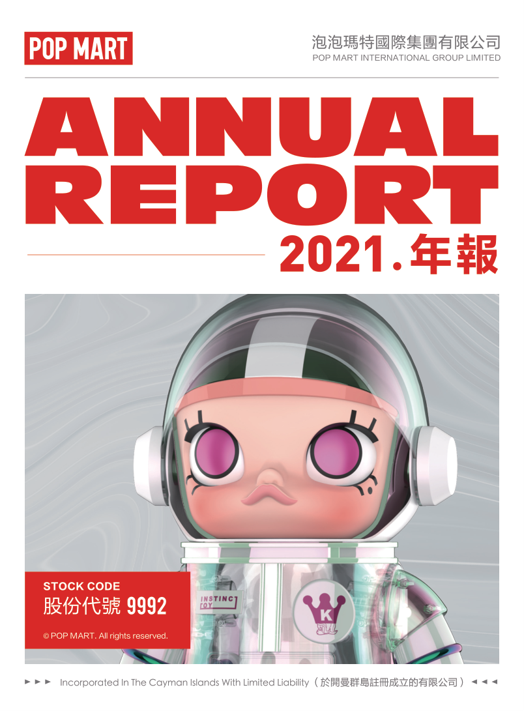

## 原PDF第2页

[对照原PDF第2页](../2021年年度报告.pdf#page=2)

2

公司资料

目录

6

财务概要

8

董事长致辞

管理层讨论与分析

董事及高级管理层履历

董事会报告书

企业管治报告

2021年环境、社会及管治报告

独立核数师报告

综合损益及其他全面收益表

综合资产负债表

综合权益变动表

综合现金流量表

综合财务报表附注

二零二一年年报  1

## 原PDF第3页

[对照原PDF第3页](../2021年年度报告.pdf#page=3)

公司资料

董事会

执行董事

王宁先生（董事会主席）

杨涛女士

刘冉女士

司德先生

非执行董事

屠铮先生

何愚先生

独立非执行董事

张建君先生

吴联生先生

颜劲良先生

薪酬委员会

张建君先生（主席）

吴联生先生

王宁先生

提名委员会

王宁先生（主席）

张建君先生

吴联生先生

审核委员会

吴联生先生（主席）

屠铮先生

颜劲良先生

联席公司秘书

李鸿轩先生

李菁怡女士

授权代表

王宁先生

李菁怡女士

2  泡泡玛特国际集团有限公司

## 原PDF第4页

[对照原PDF第4页](../2021年年度报告.pdf#page=4)

公司资料

总部及中国主要营业地点

中国

北京市朝阳区

大望京科技商务园区

宏泰东街浦项中心A座36及37楼

香港主要营业地点

香港

德辅道中188号

金龙中心14楼

股份过户登记总处

Maples Fund Services (Cayman) Limited PO Box 1093 Boundary Hall Cricket Square Grand Cayman KY1-1102 Cayman Islands

香港股份过户登记处

香港中央证券登记有限公司香港

湾仔

皇后大道东183号

合和中心17楼

1712-1716号舖

合规顾问

国泰君安融资有限公司

香港

皇后大道中181号

新纪元广场低座27楼

二零二一年年报  3

## 原PDF第5页

[对照原PDF第5页](../2021年年度报告.pdf#page=5)

公司资料

主要往来银行

中国工商银行股份有限公司（珠市口支行）

中国北京市崇文区

珠市口东大街15号

交通银行股份有限公司

（望京支行）中国北京市朝阳区望京街9号望京国际商业中心

中国民生银行股份有限公司（望京支行）

中国北京市朝阳区

广顺北大街南湖东园一区122 号楼博泰国际B座

公司网站

www.popmart.com

法律顾问

有关香港法律

达维律师事务所

香港

中环

遮打道3A号

香港会所大厦18楼

有关中国法律

竞天公诚律师事务所

中国

上海市徐汇区

淮海中路1010号

嘉华中心45层

邮政编码：200031

有关开曼群岛法律迈普达律师事务所（香港）有限法律责任合伙香港湾仔

港湾道18号

中环广场26楼

4  泡泡玛特国际集团有限公司

## 原PDF第6页

[对照原PDF第6页](../2021年年度报告.pdf#page=6)

公司资料

核数师

罗兵咸永道会计师事务所

执业会计师

注册公众利益实体核数师

香港中环

太子大厦22楼

股份代号

9992  9992

二零二一年年报  5

## 原PDF第7页

[对照原PDF第7页](../2021年年度报告.pdf#page=7)

财务概要

财务业绩摘要

```text
                                       截至12月31日止年度
                             2021          2020          2019         2018          2017
                           2021年        2020年        2019年       2018年        2017年
                        人民币千元   人民币千元    人民币千元   人民币千元    人民币千元
收入                     4,490,651     2,513,471     1,683,434      514,511      158,074
毛利                     2,758,624     1,594,108     1,090,334      298,025       75,254
经营溢利                 1,149,812       718,783      598,794       133,614         4,379
除所得税前溢利           1,171,191       707,403      598,375       132,260         2,273
年内溢利                   854,567       523,312      451,118        99,521         1,569
本公司拥有人
  应占溢利                 854,339       523,505      451,118        99,521         1,569
非国际财务报告准则
  经调整纯利             1,001,635       590,506      469,123       100,303         1,671
毛利率                      61.4%         63.4%         64.8%        57.9%         47.6%
净利率                      19.0%         20.8%         26.8%        19.3%          1.0%
非国际财务报告准则
 经调整纯利率               22.3%         23.5%         27.9%         19.5%         1.1%
```

6  泡泡玛特国际集团有限公司

## 原PDF第8页

[对照原PDF第8页](../2021年年度报告.pdf#page=8)

财务概要

财务状况表摘要

```text
                                             于12月31日
                               2021          2020           2019          2018           2017
                            2021年         2020年         2019年        2018年        2017年
                        人民币千元     人民币千元    人民币千元     人民币千元    人民币千元
总流动资产                6,757,289      6,255,900       716,601        254,997        65,801
总非流动资产              1,566,337        715,399       349,880        147,798        76,478
总资产                    8,323,626      6,971,299      1,066,481       402,795       142,279
总流动负债                1,092,706        665,313       381,570        144,874        44,019
总非流动负债                410,914        174,984        92,130         39,091        19,436
总负债                    1,503,620        840,297       473,700        183,965        63,455
本公司拥有人
  应占权益                6,818,182      6,129,374       592,781        218,830        78,824
非控股权益
                              1,824          1,628             –              –             –
总权益                    6,820,006      6,131,002       592,781        218,830        78,824
总权益及负债              8,323,626      6,971,299      1,066,481       402,795       142,279
```

二零二一年年报  7

## 原PDF第9页

[对照原PDF第9页](../2021年年度报告.pdf#page=9)

董事长致辞

尊敬的各位股东及投资人朋友：

2021 年是我们上市后第一个完整的财年，对泡泡玛特来说，刚刚过去的一年是不畏风雨、勇敢突破的一年。在疫情的反复冲击下，尤其是下半年疫情加剧，传染性更强的「德尔塔」和「奥密克戎」在国内多点散发，疫情管控政策不断升级，出行受阻，叠加供应链危机、能源短缺和高通胀等多方压力影响，全球经济复苏进程放缓，零售行业整体面临严峻的挑战，但经过全体成员的努力以及合作伙伴的支持，泡泡玛特依然取得了优异的业绩增长。2021 年全年营收44.9亿元，同比增长78.7%；调整后净利润10.02亿元，同比增长69.6%。

疫情对未来的影响仍存在固有的不确定性，我们秉持「尊重时间、尊重经营」的理念，泡泡玛特用丰富多元的IP作品为大众带来精神陪伴，也为潮流文化推广和潮玩行业发展做出了积极贡献。我们以消费者为中心，为了持续给消费者提供更优质的产品，泡泡玛特加大对供应链产能、工艺、质量、成本各个方面的优化力度，供应链能力进一步提升。继续完善和扩张全渠道消费者触达网络，满足多样化的消费者需求，提供优质的体验，与全球的粉丝共同深切感受潮玩的魅力。

作为覆盖潮流玩具全产业链的平台型企业，IP是IP is the most treasured asset of Pop Mart. In the past year, Pop Mart has  泡泡玛特的核心财富。过去一年泡泡玛特在艺术家和 IP 的积累上不断深耕，从发掘培养艺术家、IP运营规划到IP商业化，建立起一个完善的IP 潮玩化孵化体系，让更多原创设计被看见、被认可，2021 年签约 IP 和自有 IP 储备都在不断IP reserves have been increasing in 2021. Pop Mart also maintains close  增加。此外，对外和迪士尼、环球、华纳、三丽鸥、NBA等国际知名IP企业保持密切合作。在IP 多元化基础上，潮玩品类的创新也取得了巨大进步。2021 年泡泡玛特发力高端潮玩产品线MEGA珍藏系列，共推出9款1000% SPACE MOLLY系列产品，备受市场欢迎。未来我们也将继续深化产品创新，为广大潮玩爱好者带来更多惊喜。

8  泡泡玛特国际集团有限公司

## 原PDF第10页

[对照原PDF第10页](../2021年年度报告.pdf#page=10)

董事长致辞

全球疫情环境下，泡泡玛特仍坚持拓展国际业务，持续进行全球战略布局。2021 年通过海外社交媒体平台粉丝运营、海外电商平台及独立站的运营、开设直营店以及参加国际知名潮玩艺术和动漫展会等方式，旗下的头部IP潮玩产品受到了海外消费者的喜爱。目前，泡泡玛特已入驻韩国、日本、美国、加拿大、英国、新加坡等23 个海外国家及地区。2021 年海外收入成功破亿，2022 年我们将加速海外布局，向全球输出来自中国品牌的潮流玩具文化。

作为一家已经拥有超过4,000 名员工的公司，泡泡玛特承载了许多人的梦想和期待，也承担起了更大的社会责任。过去一年，泡泡玛特在组织管理上不断探索提升，朝著集团化方向发展经营，新增了共鸣工作室、POPMART LAND主题乐园、INNER FLOW艺术机构等新业务版块，支撑泡泡玛特长期发展的商业框架逐渐成型。我们相信通过集团化的运作，能够达到更高效的组织和协作，并吸引更多优秀人才加入。

如今中国潮玩产业正处在黄金时期，全球潮玩市场也在高速成长，我们希望抓住时代的机遇，用全球化的视野规划企业长远未来。未来我们将继续聚焦IP开发、潮玩品质提升、组织管理能力提升，投入更多资源追求公司的快速健康成长，为消费者带来更优质的产品和更愉悦的消费体验。

最后，要感谢所有消费者、合作伙伴、投资人的支持与信任，感谢所有同事的辛勤工作。希望我们未来继续携手奋进、砥砺前行，为创造更多优秀作品不懈努力，朝著「创造潮流、传递美好」的愿景全力以赴。

董事会主席

王宁

二零二一年年报  9

## 原PDF第11页

[对照原PDF第11页](../2021年年度报告.pdf#page=11)

管理层讨论与分析

业务回顾

作为中国潮流玩具文化的开拓者及主要推广者，在 COVID-19 疫情不断反复的影响下，我们仍保持业务的高速增长，2021 年收入同比增长 78.7%，同时累计注册会员总数达到 1,958.0万人。根据中国社会科学院国情调查与大数据研究中心发布《2021 中国潮流玩具市场发展报告》，近年来潮流玩具的出现与发展受到了经济发展、技术变革、消费观念转变、Z 世代崛起等多重因素的影响。潮流玩具具有社交、收藏、娱乐等社会属性，正成为新一代年轻人休闲、交流的重要载体，在我国大力发展文化产业的背景下，潮流玩具行业表现出巨大的市场潜力。我们战略重点是进一步深耕潮流玩具业务，继续贯彻公司的长期既定策略和发展方向。我们仍以艺术家发掘、IP运营、消费者触达及潮流玩具文化的推广为主要业务重点。

艺术家发掘和IP运营

IP运营和创作设计对于我们的产品至关重要，这也是推动泡泡玛特发展的核心驱动力。我们不断丰富IP类型、输出风格多样化的产品，以满足不同用户群体的需求。年内，我们头部 IP 收入占比更加均匀，并保持了强劲的增长。2021 年为Molly诞生的15周年，到目前依然深受粉丝喜爱，营收稳步增长。2021年Molly实现收入人民币705.1百万元，同比增长97.6%。通过持续推出新的作品、跨界联名合作、主题展等一系列运Molly’s fans has been gradually enlarged, the influence of the IP continued to  营，Molly的粉丝群体逐渐扩大，IP影响力不断提升，IP的生命周期和商业价值得到了很好的延伸。Dimoo和SKULLPANDA在2021年分别实现收入人民币566.7百万元和人民币595.3百万元，同比分别增长了79.8%和1,423.8%。同时，我们内部的设计师团队PDC (Pop Design Center)推出众多受欢迎的 IP，小甜豆在 2021 年实现收入人民币161.5百万元，同比增长了458.1%；以及2021年10月份上市PDC的新IP小野通过独特的设计风格，深受粉丝的喜爱，实现收入人民币52.2百万元。

10  泡泡玛特国际集团有限公司

## 原PDF第12页

[对照原PDF第12页](../2021年年度报告.pdf#page=12)

管理层讨论与分析

我们一直致力于推动潮玩市场发展，不断尝试产品创新。我们于年内正式推出了我们的高端潮玩产品线「MEGA珍藏系列」，MEGA系列的产品一经推出便迅速引爆市场，总共实现收入人民币178.1百万元，我们于2021年6月发售MEGA珍藏系列SPACE MOLLY x 海绵宝宝联名款后，共发售了9款1000%的SPACE MOLLY 珍藏系列产品，吸引了共计超过870万人次参与抽签。

消费者触达

－ 线下渠道

2021 年我们于中国大陆新开业 106 家线下门店，从 2020 年末的 187 家增至 2021 年末的 288 家 1 。2021 年我们于中国大陆新开业510 台机器人商店，从 2020 年末的1,351 台增至2021年末的1,861台。截至2021年底，我们的港澳台地区及海外门店数达到7家，我们的港澳台地区及海外机器人商店达到9 台，通过举办海外线上潮玩展，参加美国DesignerCon、迪拜世博会等全球性的展会，泡泡玛特的品牌被不同文化背景的消费者所接纳。

－ 线上渠道

泡泡玛特抽盒机为我们在微信平台上自主研发设计的小程序，旨在于创造好玩、有趣的购物体验，于 2021 年实现了人民币898.0 百万元的收入，同比增长了 92.6%。京东旗舰店2021 年收入为人民币143.2 百万元，同比增长了296.0%。天猫旗舰店2021年收入为人民币598.9 百万元，同比增长了47.5%，我们连续三年取得了天猫双十一大玩具类目的销售额第一名。

```text
1                                                                            1    2021年因租约到期和其他商业原因，我们关闭了
                                                                                  5家门店
```

二零二一年年报  11

## 原PDF第13页

[对照原PDF第13页](../2021年年度报告.pdf#page=13)

管理层讨论与分析

－ 会员运营

通过渠道的持续扩张及IP的不断丰富，并通过全渠道会员运营，用户数字化规模快速扩大。截至2021 年12 月31 日，累计注册会员总数从2020年末的740.0万人增至1,958.0万人，其中新增注册会员1,218.0万人。2021年会员贡献销售额占比92.2%，会员复购率为56.5% 2 。

潮流玩具文化推广

为了更好地传播潮流艺术文化，泡泡玛特在2021年成立了艺术推广机构inner flow。该机构旨在与全球画廊、艺术家联合打造高端艺术衍生品，开发版画、雕塑、潮流玩具、生活家居等收藏类艺术衍生品，为年轻人提供更丰富、更具潮流属性的艺术品。2021 年 11 月，inner flow首次亮相第九届ART021 上海廿一当代艺术

```text
                                                                     博览会，展出了LANG、没影、殷越、马轲、曾
Meiying (没影), Yin Yue (殷越), Ma Ke (马轲), Zeng Jianyong (曾健勇), Sun  健勇、孙一钿和Ashley Wood等旗下艺术家的画
Yitian (孙一钿) and Ashley Wood.                                     作及雕塑。
```

2021年7月，泡泡玛特与北京大学光华管理学院共同成立北京大学商业与艺术研究中心，旨在培养文化创意产业的优秀人才，推动中国潮流文化和新消费等领域的研究，促进行业之间的交流。

作为全球化的潮玩品牌，泡泡玛特在过去一年加速了潮玩文化在海外的传播。2021 年10 月，泡泡玛特亮相迪拜世博会，以「2020年迪拜世博会中国馆纪念品商店特许供应商」的身份向世界各地的参观者展示潮玩艺术。同月，泡泡玛特参展伦敦MCM动漫展，现场展出的MEGA珍藏、SKULLPANDA密林古堡等潮玩系列吸引了大批欧洲粉丝的关注。2021 年11 月，泡泡玛特亮相美国DesignerCon潮流艺术盛会，展出了Dimoo、SKULLPANDA、Yuki、Hirono等中国本土设计师Hirono, which were enthusiastically welcomed by overseas visitors.  创作的IP形象，获得了海外观众的热情追捧。

```text
2                                                                             2   2021年购买会员中买过2次及以上的占比
```

12  泡泡玛特国际集团有限公司

## 原PDF第14页

[对照原PDF第14页](../2021年年度报告.pdf#page=14)

管理层讨论与分析

秉承著「 创造潮流 ， 传递美好 」的品牌理念 ，2021 年12 月，泡泡玛特联合中国扶贫基金会成立「POP MART公益美育中心」，为部分地区学校的师生提供美育教育场所及课程培训支持，助力乡村学校美育教育发展。

财务回顾

销售收入

本公司收入从2020 年的人民币2,513.5 百万元上升到2021 年的人民币4,490.7 百万元，同比增长78.7%。

根据渠道划分的收入

本公司的收入来自于以下渠道：1.零售店；2.机器人商店；3.线上渠道；及4.批发渠道及其他。下表载列本公司2021 年及2020 年按渠道划分的收入：

```text
                                  截至2021年12月31日止年度                截至2020年12月31日止年度
                                    收入       毛利率    收入占比           收入      毛利率    收入占比
                              人民币千元                              人民币千元
零售店                          1,673,386      61.9%       37.3%        1,002,054      62.0%       39.9%
线上渠道                        1,879,189      64.2%       41.8%         951,875       66.4%       37.9%
机器人商店                       469,803       68.8%       10.5%         328,679       72.3%       13.1%
批发及其他                       468,273       41.2%       10.4%         230,863       44.7%        9.1%
  － 中国大陆                    330,920       42.9%        7.4%         156,691       42.8%        6.1%
  － 中国大陆外                  137,353       37.2%        3.0%          74,172       48.8%        3.0%
合计                            4,490,651      61.4%      100.0%        2,513,471      63.4%      100.0%
```

－  零售店。 零售店销售收入从 2020 年的人民币1,002.1 百万元增加到2021 年的人民币1,673.4百万元，同比增长了67.0%。主要由于2021 年国内疫情得到有效控制零售店均正常营业，而2020 年初始疫情严重，对零售店销售有较大影响。在2021 年净新增门店108家，截至2021年12月31日合计零售店295家。

二零二一年年报  13

## 原PDF第15页

[对照原PDF第15页](../2021年年度报告.pdf#page=15)

管理层讨论与分析

机器人商店。机器人商店销售收入从2020年的人民币328.7 百万元增加到2021 年的人民币 469.8 百万元，同比增长了 42.9%，主要由于2021 年国内疫情得到有效控制机器人商店均正常营业，而2020 年初始疫情影响严重，对机器人商店有较大影响；及在2021年增加了519台机器人商店，截至2021年12月31日共计1,870台机器人商店。

线上渠道。 线上收入由 2020 年的人民币951.9百万元增加到2021年的人民币1,879.2百万元，同比增长了97.4%。以下为线上收入明细。

```text
                       截至2021年12月31日止年度      截至2020年12月31日止年度
                               收入      收入占比           收入      收入占比         增幅
                        人民币千元                    人民币千元
泡泡玛特抽盒机             898,014         47.8%         466,364         49.0%        92.6%
天猫旗舰店                 598,865         31.9%         406,110         42.7%        47.5%
京东旗舰店                 143,229          7.6%          36,173          3.8%       296.0%
其他线上渠道               239,081         12.7%          43,228          4.5%       453.1%
合计                      1,879,189       100.0%         951,875        100.0%        97.4%
```

14  泡泡玛特国际集团有限公司

## 原PDF第16页

[对照原PDF第16页](../2021年年度报告.pdf#page=16)

管理层讨论与分析

泡泡玛特线上收入来自泡泡玛特抽盒机、天猫旗舰店、京东旗舰店以及其他线上渠道。其中，泡泡玛特抽盒机收入从2020 年的人民币466.4 百万元增长至2021 年的人民币 898.0 百万元，增长了 92.6%；天猫旗舰店收入从2020 年的人民币406.1 百万元增长至 2021 年的人民币 598. 9 百万元 ， 增长了47.5%；京东旗舰店收入从2020年的人民币36.2 百万元增长至2021 年的人民币143.2 百万元，增长了296.0%。2021 年线上渠道的2021.  增长主要源于品牌影响力、会员人数的增加，以及2021 年泡泡玛特抽盒机、京东旗舰店的销售增长和新渠道的扩展。

批发及其他。本公司批发及其他收入主要包括来自于中国大陆地区的收入和来自中国大陆地区外的收入。批发及其他收入从2020年的人民币230.9百万元增长至2021年的468.3 百万元，增长了102.8%。其中，中国大陆的批发及其他收入从2020 年的人民币156.7百万元增加到2021年的人民币330.9百万元，增长了 111.2%，主要由于经销商南京金鹰泡泡玛特商贸有限公司收入的增长，占中国大陆经销商的比例在53.6%；中国大陆以外的批发及其他收入从2020 年的人民币 74.2 百万元增加到 2021 年的人民币137.4百万元，增长了85.2%，主要由于海外市场的扩张，及我们在海外不同国家的品牌推广。

根据IP划分的收入

泡泡玛特的品牌产品是我们的主要商品类型，品牌产品收入于截至 2021 年 12 月 31 日占总收入的比例 88.6%，品牌产品从 2020 年的人民币2,136.2 百万元增加到2021 年的人民币3,977.8 百万元，增长了86.2%。

二零二一年年报  15

## 原PDF第17页

[对照原PDF第17页](../2021年年度报告.pdf#page=17)

管理层讨论与分析

泡泡玛特的品牌产品主要分为：自有IP、独家IP和非独家IP，以下为IP划分的收入明细。

```text
                          截至2021年12月31日止年度       截至2020年12月31日止年度
                                  收入      收入占比            收入      收入占比
                           人民币千元                    人民币千元
泡泡玛特品牌产品             3,977,797         88.6%        2,136,196         85.0%
自有IP                       2,586,827         57.6%         979,940          39.0%
                              705,098          15.7%         356,918          14.2%
                              595,256          13.3%          39,065           1.6%
                              566,735          12.6%         315,248          12.5%
                              167,883           3.7%          60,915           2.4%
－ 小甜豆                     161,526           3.6%          28,941           1.2%
－ 其他自有IP                 390,329           8.7%         178,853           7.1%
独家IP                        770,507          17.2%         711,904          28.3%
                              304,431           6.8%         204,828           8.1%
                              182,245           4.1%         300,009          11.9%
－ 其他独家IP                 283,831           6.3%         207,067           8.3%
非独家IP                      620,463          13.8%         444,352          17.7%
外采及代销                    442,886           9.9%         368,400          14.6%
其他                            69,968          1.5%           8,875          0.40%
合计                         4,490,651        100.0%        2,513,471        100.0%
```

－  自有 IP。自有 I P 是本公司主要商品类型，–主要包括Molly、SKULLPANDA、Dimoo、Bunny 等。自有 IP 的收入占比由 2020 年的39.0% 增加到 2021 年的 57.6% ，收入贡献大幅增加。自有 IP 收入从 2020 年的人民币 979. 9 百万元 ， 上升至 2021 年的人民币2,586.8 百万元，增长了164.0%。主要由于Molly、SKULLPANDA和Dimoo的销售收入贡献增长。

16  泡泡玛特国际集团有限公司

## 原PDF第18页

[对照原PDF第18页](../2021年年度报告.pdf#page=18)

管理层讨论与分析

独家 IP 。 独家 IP 收入从 2020 年的人民币711.9 百万元，上升至 2021 年的人民币770.5 百万元，增长了 8.2%。主要由于 The Monsters的收入贡献。

非独家IP。非独家IP收入从2020年的人民币444.4百万元，上升至2021年的人民币620.5百万元，增长率为39.6%，主要由于新系列产品的发售，及新IP的增加。

根据地理区域划分的收入

本公司按照地理区域划分的收入以线下区域为主，主要包括零售店和机器人商店。

零售店。下表载列本公司零售店 2021 年及2020年按地理区域划分的收入：

截至2021年12月31日止年度截至2020年12月31日止年度

```text
                   城市等级
                                           零售店数量   零售店收入   零售店数量   零售店收入
                                                        人民币千元                人民币千元
                   一线城市 3                     113      797,520           81       499,210
4                  新一线城市  4                   84      479,902           56       289,139
                   其他城市 5                      98      395,964           50       213,705
                   合计                           295    1,673,386          187     1,002,054
```

```text
3                                                                            3   指中国大陆一线城市，包括北京、上海、广州和
                                                                                 深圳
4                                                                            4   指中国大陆新一线城市，包括成都、重庆、杭
                                                                                 州、武汉、西安、郑州、青岛、长沙、天津、苏
                                                                                 州、南京、东莞、沈阳、合肥和佛山
5                                                                            5   指中国大陆除去一线城市和新一线城市以外的城
                                                                                 市及港澳台地区和海外城市
```

二零二一年年报  17

## 原PDF第19页

[对照原PDF第19页](../2021年年度报告.pdf#page=19)

管理层讨论与分析

－  机器人商店。下表载列本公司机器人商店2021年及2020年按地理区域划分的收入：

截至2021年12月31日止年度截至2020年12月31日止年度

```text
城市等级
                            机器人       机器人       机器人       机器人
                          商店数量     商店收入     商店数量     商店收入
                                     人民币千元                人民币千元
一线城市                      553       145,851          447      119,667
新一线城市                    594       153,223          453      107,149
其他城市                      723       170,729          451      101,863
合计                         1,870      469,803        1,351      328,679
```

销售成本

销售成本由2020年的人民币919.4百万元上升到2021年的人民币1,732.0百万元，增长了88.4%，主要因为业务扩张收入增加。销售成本的增加主要由于(1)商品成本由2020年的人民币748.5百万元增加到2021 年的人民币1,445.0 百万元，其主要因为销售增加及商品成本单价增加；(2)设计及授权费由2020年的人民币62.7百万元增加到2021年的人民币104.7百万元，主要因为我们品牌产品收入增加；及(3)财产、厂房和设备的折旧由2020 年的人民币19.9 百万元增加到2021 年的人民币76.4百万元，主要因为我们商品数量，产品系列的新增进而模具增加，因此产生的折旧费用的增加。

18  泡泡玛特国际集团有限公司

## 原PDF第20页

[对照原PDF第20页](../2021年年度报告.pdf#page=20)

管理层讨论与分析

毛利

我们的毛利由2020 年的人民币1,594.1 百万元上升到 2021 年的人民币 2,758.6 百万元，增长了73.1%，主要由于我们的收入增加。我们的毛利率由2020 年的63.4%下降至2021 年的61.4%，主要由于我们泡泡玛特品牌产品的毛利率下降。

我们泡泡玛特品牌产品产生的毛利由 2020 年的人民币1,467.9 百万元增加到2021 年的人民币2,573.2 百万元，增长了 75.3%。主要由于泡泡玛特自主产品的收益增加。泡泡玛特品牌产品的毛利率从 2020 年的 68.7%，下降到 2021 年的64.7%，主要由于我们提高产品的工艺质量，产品工艺愈加复杂，以及2021 年原材料成本上涨导致毛利率下降。

我们的外采和其他产品产生的毛利由 2020 年的人民币 126.2 百万元增加到 2021 年的人民币185.4百万元，增长了46.9%，毛利率从2020年的33.4%上升到2021 年的36.1%，主要由于产品构成多样化，毛利略有变动。

经销及销售开支

我们的经销及销售开支由2020年的人民币630.1百万元增长至2021 年的人民币1,106.1 百万元，增长了75.5%。其中占比较高的为(1)雇员福利开支；(2)使用权资产折旧；及(3)广告及市场费用。

－  雇员福利开支。雇员福利开支从 2020 年的人民币112.8 百万元增长至2021 年的人民币287.3百万元，增长了154.7%。主要由于(1)我们的销售员工人数由2020 年的1,527 名员工增加到2021 年的2,436 名员工，主要用以支持我们扩张零售店及机器人商店网络；及(2)股权激励的股份支付金额共计人民币39.4百万元。

二零二一年年报  19

## 原PDF第21页

[对照原PDF第21页](../2021年年度报告.pdf#page=21)

管理层讨论与分析

使用权资产折旧。使用权资产折旧从 2020年的人民币121.1 百万元增长至2021 年的人民币187.5百万元，增长了54.8%。主要由于我们的零售店数量由截至2020 年12 月31 日的187间增加至截至2021年12月31日的295间，以支持我们的业务扩张及满足对我们产品陈列的需求。

广告及市场费用。广告及市场费用从 2020年的人民币92.2百万元增长至2021年的人民币157.6百万元，增长了70.9%。主要由于线上渠道的宣传推广的增加，及「6.2」大儿童节等活动策划费用增加。

一般及行政开支

我们的一般及行政开支由2020年的人民币280.0百万元增长至2021年的人民币557.5百万元，增长了 99.1%。其中占比较高的为 (1) 雇员福利开支；及(2)使用权资产折旧。

雇员福利开支。雇员福利开支从 2020 年的人民币 130. 2 百万元增长至 2021 年的人民币382.4 百万元，增长了193.7%。主要由于

(1)我们的行政员工及设计开发人员人数由2020 年的793 名员工增加至2021 年的1,617名员工，主要用以支持我们的产品开发以及业务扩张，及薪资水平提升以吸引人才；及(2)股权激励的股份支付金额共计人民币107.7百万元。

使用权资产折旧。使用权资产折旧从 2020年的人民币21.8百万元增长到2021年的人民币34.2百万元，主要由于办公室的扩租以满足办公需求。

20  泡泡玛特国际集团有限公司

## 原PDF第22页

[对照原PDF第22页](../2021年年度报告.pdf#page=22)

管理层讨论与分析

金融资产减值（拨备）╱ 拨回

我们于2020年录得金融资产减值拨回人民币0.4百万元，并于2021 年录得金融资产减值拨备人民币1.4 百万元，主要原因为贸易应收款项余额因应销售增加。

其他收入

本公司的其他收入由 2020 年的人民币45.4 百万元增加到 2021 年的人民币 54.4 百万元，增长了19.8%。主要由来自于fresh、Ray-Ban、哈根达斯、科颜氏等品牌合作项目的IP授权收入由2020 2021.  年的人民币 18.7 百万元增加到 2021 年的人民币37.7百万元。

其他收益 ╱（亏损）净额

2020 年录得其他亏损净额人民币11.1 百万元，2021年录得其他收益净额人民币1.8百万元，主要由于2021 年理财产品和结构性存款利息的收入人民币 15.8 百万元，及对河南省防汛救灾捐赠、对北京大学教育基金捐赠款等其他捐赠支出合计人民币10.9百万元。

经营溢利

综上所述，本公司的经营溢利由2020 年的人民币718.8百万元增加至2021年的人民币1,149.8百万元，增长了60.0%。

分占使用权益法入账的投资溢利

我们分占使用权益法入账的投资溢利由2020 年的人民币3.9 百万元增加到2021 年的人民币14.0百万元，增加了259.0%。

财务收入 ╱（开支）净额

我们的财务开支净额由2020 年的净亏损人民币9.0百万元，变为2021年的净收益人民币7.4百万元，主要由于我们的利息收入增加。

二零二一年年报  21

## 原PDF第23页

[对照原PDF第23页](../2021年年度报告.pdf#page=23)

管理层讨论与分析

所得税开支

我们的所得税开支由2020年的人民币184.1百万元增加到2021年的人民币316.6百万元，原因为我们的所得税前溢利增加。我们的实际税率由2020年的26.0%增长至2021年的27.0%。

年内溢利

由于上文所述，我们的年内溢利由2020 年的人民币523.3百万元增加至2021年的人民币854.6百万元。

非公认会计原则财务指标

非国际财务报告准则经调整纯利未按照国际财务报告准则计算，视为非国际财务报告准则的财务指标，其定义为除上市费用、以股份为基础的薪酬、重新指定普通股为优先股的有关开支、可转换可购回优先股的有相关开支、可转换可赎回优先股的公平值变动后纯利，而非国际财务报告准则经调整纯利率的定义为非国际财务报告准则经调整纯利除以收益。我们认为，这些信息对于投资者在不影响本集团持续经营业绩或现金流的情况下比较本集团的业绩是有用的，并允许投资者考虑管理层在评估本集团业绩时使用的指标。投资者不应认为非国际财务报告准则的财务指标替代或优于本集团的国际财务报告准则的业绩。此外，可能不是所有公司会以相同的方式计算该项非国际财务报告主责的财务指标，因此未必可与其他公司采用的相若计量比较。

22  泡泡玛特国际集团有限公司

## 原PDF第24页

[对照原PDF第24页](../2021年年度报告.pdf#page=24)

管理层讨论与分析

下表载列本公司各年度的非国际财务报告准则的财务指标对账情况。

```text
                                               2021             2020
                                         截至2021年       截至2020年
                                           12月31日         12月31日
                                              止年度          止年度
                                          人民币千元      人民币千元
年内溢利                                     854,567          523,312
调整项目
上市费用                                           –           44,024
以股份为基础的付款报酬                       147,068               –
重新指定普通股为优先股的
  有关开支                                         –           16,910
可转换可赎回优先股的
  公平价值变动                                     –            6,260
非国际财务报告准则经调整纯利               1,001,635          590,506
非国际财务报告准则经调整纯利率                22.3%            23.5%
```

我们管理层认为，上市费用、重新指定普通股为优先股的有关开支及可转换可赎回优先股的公平值变动属于上市及首次公开发售前程序有关的一次性性质且将不会于上市后再产生。此外，以股份为基础的付款开支、重新指定普通股为优先股有关开支及可转换可购回优先股的公平值变动属于非现金项目且并无直接反应我们的业务营运。因此，通过撇除该等项目对计算非国际财务报告准则经调整纯利影响的举措，可更好地反应我们的相关经营表现，并更加便于比较逐年的经营表现。

二零二一年年报  23

## 原PDF第25页

[对照原PDF第25页](../2021年年度报告.pdf#page=25)

管理层讨论与分析

流动资产、财务资源及资本开支

2021 年，本集团在整体业务经营方面采纳保守稳健的资金管理及财务政策。本集团维持以下资源以应付其营运资金需求。

流动资产及流动负债

我们的流动资产净值由截至2020 年12 月31 日的人民币5,590.6 百万元增加至截至2021 年12 月31日的人民币5,664.6百万元，基本维持稳定。

贸易应收款项

贸易应收款项指日常业务过程中我们应收客户的未结算款项。我们的贸易应收款项由截至2020 年12 月31 日的人民币78.3 百万元增加至截至2021年12月31日的人民币171.3百万元，该等增加主要由于第三方（包括购物中心、批发客户及电商平台）付款增加。贸易应收款项周转天数从2020年的9天增加至2021年的10天，基本维持稳定。

其他应收款项

其他应收款项主要指向购物中心支付的有关我们零售店及机器人商店的押金款项。其他应收款项由截至2020 年12 月31 日的人民币90.8 百万元增加至截至2021年12月31日的人民币154.9百万元，主要原因为押金的增加，与我们零售店及机器人商店网络的扩张一致。

存货

我们的存货包括制成品。我们的存货由截至2020年12月31日的人民币225.4百万元增加至截至2021年12月31日的人民币788.8百万元。主要由于我们增加了我们的产品库存，以满足不断增长的产品需求。存货周转天数从2020 年的78天增加到2021年的128天，主要由于业务及渠道的扩张，IP数量和新品的增加，及为2022年春节和一季度提前备货。

24  泡泡玛特国际集团有限公司

## 原PDF第26页

[对照原PDF第26页](../2021年年度报告.pdf#page=26)

管理层讨论与分析

预付款项及其他流动资产

预付款项及其他流动资产主要包括预付存货款项、预付设计费款项、预付投资款、预付物业、厂房及设备款项及其他。我们的预付款项及其他流动资产由截至2020 年12 月31 日的人民币177.9百万元，增加至截至2021年12月31日的人民币353.6百万元，主要是由于(1)预付供应商的货款增加人民币105.5百万元；及(2)预付的设计费款项增加人民币43.8百万元。

现金及现金等价物

我们的现金及现金等价物主要包括银行现金。现金及现金等价物从截至2020 年12 月31 日的人民币5,680.2 百万元下降至截至2021年12月31 日的人民币5,264.7 百万元，主要为增加了对按公平值计入损益的金融工具的投资。

贸易应付款项

贸易应付款项主要指我们在日常业务过程中向供应商支付货款的责任。贸易应付款项从截至2020年12月31日的人民币115.8百万元增加至截至2021年12月31日的人民币266.1百万元，主要原因为我们的业务增长，导致采购量增加，进而令应付供应商款项的余额有所增加。2021 年的贸易应付款项周转天数40 天与2020 年贸易应付款项周转天数持平。

其他应付款项

其他应付款项主要包括(1)工资、薪金及其他雇员福利、(2)应计开支、(3)应付门店装修费、(4)应付股息、(5)应付其他税项，及(6)其他。其他应付款项由截至2020年12月31日的人民币202.3百万元增加至截至 2021 年 12 月 31 日的人民币266.9百万元，主要是由于(1)员工规模扩大，相应的工资、薪金及其他雇员福利增加人民币35.2百万元；及(2)日常开支中服务费、物流费及广告费等增加人民币24.8百万元。

二零二一年年报  25

## 原PDF第27页

[对照原PDF第27页](../2021年年度报告.pdf#page=27)

管理层讨论与分析

物业、厂房及设备

物业、厂房及设备主要包括(1)机器人商店、(2)模具、(3)设备及其他及(4)租赁装修。物业、厂房及设备由截至2020年12月31日的人民币238.3百万元增加至截至 2021 年 12 月 31 日的人民币366.3 百万元，主要是由于新增店舖和扩租办公室的装修增加人民币96.9百万元。

无形资产

无形资产主要包括(1)授权IP、(2)知识产权（包括我们的自有IP）及(3)软件。无形资产由截至2020年 12 月 31 日的人民币 92.7 百万元增加至截至2021年12月31日的134.0百万元，主要是由于授权IP增加了人民币38.6百万元。

使用权资产

使用权资产包括与我们的零售店及机器人商店有关的相应租赁负债于开始日期或之前做出的租赁付款及任何初步直接成本的初步计量。使用权资产自开始日期起按相关资产可使用年限与租期的较短期间予以折旧。我们的使用权资产由截至2020年12月31日的人民币287.8百万元增加至截至2021年12月31日的人民币609.5百万元，主要是由于零售店及机器人商店网络的扩张。

银行借款

截至2021年12月31日本集团并无任何银行借款。

资产抵押

截至2021年12月31日本集团并无任何资产抵押。

26  泡泡玛特国际集团有限公司

## 原PDF第28页

[对照原PDF第28页](../2021年年度报告.pdf#page=28)

管理层讨论与分析

资产负债率

资产负债率为总负债除以总资产乘以 100% 。截至2021 年12 月31 日，本集团的资产负债率为18.1%，而截至2020年12月31日的资产负债率为2020.  12.1%。

或有事件

我们目前并无涉及任何重大法律诉讼，亦不知悉我们涉及任何待决或潜在重大法律诉讼。倘我们涉及有关重大法律诉讼，则我们会于产生亏损且有关亏损金额有合理估计时，按当时所得资料记录任何亏损或或有负债。

于2020年8月28日，我们收到日期为2020年8月

```text
                                                                       19 日的法院传票，内容有关金鹰国际商贸集团
Co., Ltd. (金鹰国际商贸集团(中国)有限公司) as a shareholder on behalf  （中国）有限公司（作为股东）代表南京金鹰泡泡
                                                                       玛特商贸有限公司在江苏省南京市中级人民法
                          (江苏省南京市中级人民法院) against Beijing   院向北京泡泡玛特文化创意有限公司提起的申
                                                                       索。于 2021 年 6 月 17 日，上述案件进行首次庭
```

审，主要程序为收集及核证金鹰国际及本集团提供的进一步资料。该案件还需继续开庭以协助法院查清事实。于最后实际可行日期（即2022年4月21日，「最后实际可行日期」，及确认本报告所载若干资料于本报告付印前之最后实际可行日期），上述案件仍在审理当中。根据中国法律顾问告知，金鹰国际提起的申索并无依据，申索判决金鹰国际胜诉的可能性极低，本公司面临的来自该申索的风险微乎其微，且该申索将不会对我们的运营及财务表现产生重大不利影响，故概无就该申索于综合财务报表确认拨备。

二零二一年年报  27

## 原PDF第29页

[对照原PDF第29页](../2021年年度报告.pdf#page=29)

管理层讨论与分析

外汇风险管理

我们主要于中国经营业务，交易主要以人民币结算。由于本集团并无以我们经营实体各自功能货币以外货币计值的重大金融资产或负债，故管理层认为业务并无任何重大外汇风险敞口。于截至2021 年12 月31 日止年度期间，我们并无对冲任何外币波动。

资本开支

本公司的资本开支包括购置物业、厂房及设备的款项和购置无形资产的款项。下表载列本公司2020年以及2021年的资本开支情况：

```text
                                     截至2021年       截至2020年
                                       12月31日         12月31日
                                          止年度          止年度
                                      人民币千元      人民币千元
购置物业、厂房及设备                     287,502          175,984
购置无形资产                              46,246           47,608
合计                                     333,748          223,592
```

人力资源

截至2021年12月31日，我们共有4,053名员工，包括销售员工 2,436 名，行政及开发人员 1,617名。截至2021 年12 月31 日，我们共发生员工成本（包括薪金、工资、津贴和福利）人民币669.7百万元。

28  泡泡玛特国际集团有限公司

## 原PDF第30页

[对照原PDF第30页](../2021年年度报告.pdf#page=30)

管理层讨论与分析

重大投资及未来计划

截至2021 年12 月31 日，我们并无持有任何重大投资。为加强我们作为中国潮流玩具文化的开拓者及主要推广者地位，我们计划动用所得款项净额执行若干拓展项目。拓展专案的详情载于本报告「上市所得款项净额用途」一段及本公司日期为2020 年12 月1 日的招股章程（「招股章程」）  「未来计划及所得款项用途」一节。

重大收购及出售

于截至2021 年12 月31 日止年度期间，我们并无进行任何重大收购或出售附属公司、联营公司及合营企业。

主要风险及不确定因素

我们面临的主要风险及不确定因素乃关于：

(i) 作为潮流文化娱乐公司，我们无法向  阁下保证，我们将能够设计及开发受消费者欢迎的产品，或我们将能够保持成功产品的受欢迎程度；(ii)倘我们获授权的IP的市场吸引力低于预期，或使用该等 IP 的产品的销售额不足以满足最低保证特许权使用费，我们可能无法实现授权的全部利益；(iii)我们的业务在很大程度上取决于我们「泡泡玛特」品牌的市场认知度，且对我们的品牌、商标或声誉的任何损害，或未能有效推广我们的品牌，均可能对我们的业务及经营业绩造成重大不利影响；(iv)我们通过第三方制造商生产所有的泡泡玛特品牌产品，未能控制产品质量可能会对我们的业务造成不利影响；及(v)宏观经济增速放缓可能削弱对我们产品的需求，从而可能给本公司经营业绩带来一定的负面影响。

报告期间后事项

于本年报日期，本集团于2021 年12 月31 日后并无发生须进一步披露或调整的重大事项。

二零二一年年报  29

## 原PDF第31页

[对照原PDF第31页](../2021年年度报告.pdf#page=31)

管理层讨论与分析

未来展望

IP is at the core of our business. Through our innovative products, delicate  IP 是我们业务的核心，我们通过创意的产品、精致的设计和优质的服务使消费者收获快乐美好、潮流体验和艺术薰陶，同时，通过提升品牌价值，增加用户对泡泡玛特的品牌忠诚度，保持我们强势的市场地位及竞争力。

我们将致力丰富IP类型，扩大IP库，保持高质量的设计创新水准，推出更多头部系列产品，对IP进行持续运营，强化IP心智，加深粉丝与IP之间的情感连接。以及拓宽除更多潮玩品类，进一步发掘MEGA、衍生品、BJD等品类的开发及完善相关工艺及生产发售流程。

我们将致力扩展我们的渠道网络，从而触达更多的用户，不断精进我们的运营能力，提升用户的消费体验，加强会员拓展和会员运营能力，推动创新零售数字化运作，以更多样化的方式触达和维护用户，提供定制化的、更好的服务。

我们将致力提高我们在海外国家、地区的品牌知名度和潮玩市场份额，实现当地业务当地语系化是海外业务的核心，在加强终端消费者的消费体验和互动的同时，与更多当地的合作伙伴和艺术家，探索出更多符合当地市场的业务模式、IP和商品品类。

我们将通过更丰富多样的途径持续推广潮流玩具文化，持续影响整个行业，为会员提供更多权益，提高粉丝黏性，提升粉丝的文化认同和品牌认知。

30  泡泡玛特国际集团有限公司

## 原PDF第32页

[对照原PDF第32页](../2021年年度报告.pdf#page=32)

董事及高级管理层履历

董事及高级管理层的履历详情载列如下：

执行董事

(王宁), aged 35, is our executive Director, Chairman of the  王宁先生，35 岁，本公司执行董事、董事会主席及行政总裁。王先生于2010 年10 月成立本集团，负责本公司整体战略规划及管理。

王先生于2009年6月获得中国郑州大学西亚斯国(郑州大学西亚斯国际学院) (currently  际学院（现为郑州西亚斯学院）广告专业学士学位，并于2017年6月获得中国北京大学光华管理学院工商管理硕士学位。University (北京大学光华管理学院) in the PRC in June 2017.

王先生目前担任本公司数家主要附属公司的董事，包括北京泡泡玛特及Pop Mart (Hong Kong)Holding Limited。

王先生为执行董事杨涛女士的配偶。

(杨涛), aged 35, is our executive Director and vice president.  杨涛女士，35 岁，本公司执行董事及副总裁。杨女士在硕士学位课程结束后于2010 年10 月加入本集团，负责本公司的Inner flow艺术机构。

杨女士于2009年5月获得美国福特海斯州立大学通识学学士学位，并于2010 年11 月获得香港浸会大学传播学硕士学位。

杨女士目前担任本公司主要附属公司北京泡泡玛特的董事。

杨女士为本公司执行董事、董事会主席及行政总裁王先生的配偶。

二零二一年年报  31

## 原PDF第33页

[对照原PDF第33页](../2021年年度报告.pdf#page=33)

董事及高级管理层履历

(刘冉), aged 34, is our executive Director and vice president. Ms.  刘冉女士，34 岁，本公司执行董事及副总裁。刘女士大学毕业后不久即于2011年7月加入本集团，负责本公司的总裁办。

刘女士于2010年7月获得中国郑州大学西亚斯国际学院（现为郑州西亚斯学院）旅游管理专业学士学位，并于2020年7月获得中国北京大学光华管理学院工商管理硕士学位。

刘女士目前担任本公司主要附属公司北京泡泡玛特的董事。

(司德), aged 33, is our executive Director, chief operating officer  司德先生，33 岁，本公司执行董事、首席运营官及中国区业务总裁。司先生于2015年3月加入本集团，负责集团运营工作及大陆地区的整体业务。司先生入职本集团之初的职务为品牌总监，于2016年7月晋升为副总裁。

司先生于2011年7月在中国获得中国传媒大学法Communication University (中国传媒大学) in the PRC in July 2011, and  语专业学士学位，并于2017年7月获得中国北京大学光华管理学院工商管理硕士学位。

```text
                                                                       司先生目前担任本公司若干主要附属公司的董
                                           (上海葩趣贸易有限公司),     事，包括上海葩趣贸易有限公司、北京葩趣互
                                   (北京葩趣互娱科技有限公司) and      娱科技有限公司及天津泡泡玛特文化传播有限
                                            (天津泡泡玛特文化传播      公司。
有限公司).
```

32  泡泡玛特国际集团有限公司

## 原PDF第34页

[对照原PDF第34页](../2021年年度报告.pdf#page=34)

董事及高级管理层履历

非执行董事

(屠铮), aged 43, is our non-executive Director. Mr. Tu was  屠铮先生，43 岁，本公司非执行董事。屠先生于2019年5月获委任为本公司非执行董事，负责向董事会提供专业建议。

```text
                                                                   屠先生自2018年5月起担任上海蜂巧投资管理有
                   (上海蜂巧投资管理有限公司) since May 2018. He   限公司的合伙人。彼于2015年5月至2018年4月
                                                          (深圳    担任深圳市启赋资本管理有限公司的合伙人。
市启赋资本管理有限公司) from May 2015 to April 2018. From June 2007  于2007年6月至2015年4月，屠先生于深圳市达
                                                                   晨财智创业投资管理有限公司任职，先后担任
                   (深圳市达晨财智创业投资管理有限公司) where he   投资经理、投资总监及浙江分公司总经理、华
                                                                   东地区副总经理兼TMT部门负责人。
```

```text
                                                                     屠先生于2000年6月获得中国浙江大学英语专业
University (浙江大学) in the PRC in June 2000, and his master’s degree in  学士学位，并于2003年6月获得美国芝加哥大学
                                                                     公共政策硕士学位。屠先生目前持有由中国证
                                                                     券投资基金业协会于2017年8月授出的中国证券
                                                       (中国证券     投资基金执业证书。
投资基金业协会) in August 2017.
```

屠先生目前担任北京泡泡玛特的董事。

(何愚), aged 41, is our non-executive Director. Mr. He was  何愚先生，41 岁，本公司非执行董事。何先生于2019年5月获委任为本公司非执行董事，负责向董事会提供专业建议。

```text
                                                                     何先生于2016年2月创办并担任深圳前海黑蚁创
                                        (深圳前海黑蚁创新投资合伙    新投资合伙企业（有限合伙）的合伙人。在此之
企业(有限合伙)) since February 2016. Prior to that, Mr. He served as the head  前，何先生于2015年8月至2016年2月担任北京
                                                                     字节跳动科技有限公司的战略投资部主管。
```

Ltd. (北京字节跳动科技有限公司) from August 2015 to February 2016.

何先生于 2003 年 6 月获得中国南开大学国际经(南开大学) in the PRC in June 2003, and his master’s  济与贸易专业学士学位，并于2005 年11 月获得英国兰卡斯特大学金融系硕士学位。何先生于2008年9月获特许财经分析师学会认可为特许金融分析师，并于2017年2月获中国证券投资基金业协会颁发中国证券投资基金执业证书。

何先生目前担任北京泡泡玛特的董事。

二零二一年年报  33

## 原PDF第35页

[对照原PDF第35页](../2021年年度报告.pdf#page=35)

董事及高级管理层履历

独立非执行董事

(张建君), aged 55, is our independent non-executive  张建君先生，55岁，自2020年12月11日（「上市日期」）起为本公司独立非执行董事，负责向董事会提供独立意见及判断。

张先生现为北京大学光华管理学院组织与战略管理系教授。张先生的研究重点为企业社会责任、企业政治活动、领导及领导团队以及企业文化等课题。张先生自2004年3月起担任北京大学光华管理学院教职人员。彼在过去 15 年的研究中积累有关企业管治的深入知识。张先生的出版物「Marketization and Democracy in China」于2011年3月获北京大学第十一届人文社会科学研究优秀成果奖一等奖及中国教育部颁发的第六届高等学校科学研究优秀成果奖二等奖。张先生亦分别于2014年12月及2018年12月获北京大学光华管理学院颁发厉以宁教学奖及厉以宁研究奖。于2014年11月至2017年8月，张先生担任建信人寿保险股份有限公司的独立董事。

张先生分别于1989年7月及1992年7月获得中国北京大学法学学士及硕士学位。张先生于2003年12 月获得美国加州大学伯克利分校社会学博士学位。

(吴联生), aged 51, is our independent non-executive  吴联生先生，51 岁，自上市日期起为本公司独立非执行董事，负责向董事会提供独立意见及判断。吴先生于2001年9月至2022年3月担任北京大学光华管理学院教职人员，自2022年3月起担任南方科技大学商学院教职人员。

34  泡泡玛特国际集团有限公司

## 原PDF第36页

[对照原PDF第36页](../2021年年度报告.pdf#page=36)

董事及高级管理层履历

```text
                                                                      吴先生于若干上市公司担任董事职务。彼于
                                                      (华能国际电     2008年5月至2014年7月担任华能国际电力股份
力股份有限公司), a company listed on the Shanghai Stock Exchange (Stock  有限公司（一家于上海证券交易所（股份代号：
                                                                      600011）、联交所（股份代号：902）及纽约证券
                                                                      交易所（股份代号：HNP）上市的公司）的独立
                                                (荣盛房地产发展股     董事，于2009年1月至2012年1月担任荣盛房地
份有限公司), a company listed on the Shenzhen Stock Exchange (Stock   产发展股份有限公司（一家于深圳证券交易所
                                                                      上市的公司，股份代号：002146）的独立董事，
                        (西部矿业股份有限公司), a company listed on   于2011年2月至2015年9月担任西部矿业股份有
                                                                      限公司（一家于上海证券交易所上市的公司，股
                                                              (万     份代号：601168）的独立董事，于2011年1月至
达电影院线股份有限公司) (now known as Wanda Film Holding Co., Ltd (万  2015年11月担任万达电影院线股份有限公司（现
达电影股份有限公司)), a company listed on the Shenzhen Stock Exchange  称万达电影股份有限公司，一家于深圳证券交
                                                                      易所上市的公司，股份代号：002739）的独立董
                                                                      事，于2011 年11 月至2016 年5 月担任中国建材
(中国建材股份有限公司), a company listed on the Stock Exchange (Stock  股份有限公司（一家于联交所上市的公司，股份
                                                                      代号：3323）的独立非执行董事，以及于2014年
                (新华网股份有限公司), a company listed on the Shanghai  5 月至 2016 年 3 月担任新华网股份有限公司（一
                                                                      家于上海证券交易所上市的公司，股份代号：
                                                    (中银国际证券     603888）的独立董事及于2018 年9 月至2021 年3
股份有限公司), a company listed on the Shanghai Stock Exchange (Stock  月担任中银国际证券股份有限公司（一家于上海
                                                                      证券交易所上市的公司，股份代号：601696）的
```

独立董事。吴先生自2020年5月起担任正源控股股份有限公司（一家于上海证券交易所上市的公司，股份代号：00321）的独立董事，自2021 年11月起担任中国农业银行股份有限公司（一家于上海证券交易所（股份代号：601288）、联交所（股份代号：1288）上市的公司）的独立董事。

吴先生分别于1993年7月及1996年6月获得中国武汉大学经济学学士及硕士学位，并于1999年6月获得中国中南财经大学（现称中南财经政法大(中南财经大学) (now known  学）管理学博士学位。(中南财经政法大学)) in the

二零二一年年报  35

## 原PDF第37页

[对照原PDF第37页](../2021年年度报告.pdf#page=37)

董事及高级管理层履历

(颜劲良), aged 38, is our independent non-  颜劲良先生，38 岁，自上市日期起为本公司独立非执行董事，负责向董事会提供独立意见及判断。

颜先生自2015年6 月起担任美图公司（一家于联交所上市的公司，股份代号：1357）的首席财务官。彼于2016 年8 月2 日获委任为美图公司的联席公司秘书之一，并自2019 年12 月15 日起成为美图公司的公司秘书。颜先生于 2012 年 5 月至2015年6 月担任云游控股有限公司（一家于联交所上市的公司，股份代号：484）的首席营运官、首席财务官及联席公司秘书。在此之前，彼于2006年7月至2012年4月担任UBS AG的董事2012.  和香港及中国互联网研究主管。

颜先生于2006 年获得美国宾夕法尼亚大学沃顿商学院经济学理学学士学位。彼自2010 年起一直为特许金融分析师。

高级管理层

(王宁), aged 35, is our executive Director, Chairman of  王宁先生，35 岁，本公司执行董事、董事会主席及行政总裁。有关其履历的详情，请参阅本节「执行董事」分节。

(杨镜冰), aged 43, is the Chief Financial Officer of our  杨镜冰先生，43 岁，本公司首席财务官。杨先生于2017年8月加入本集团，负责本公司的财务管理。

于加入本集团之前，杨先生于2010年3月至2017年8 月先后担任北京金隅大成开发有限公司（现

```text
                                                                     称北京金隅房地产开发集团有限公司）的财务
Ltd. (北京金隅大成开发有限公司) (now known as Beijing BBMG Property  及资本部经理、总经理助理及首席财务官。于
                           (北京金隅房地产开发集团有限公司)) from    2009年3月至2010年3月，彼担任北京大成开发
                                                                     有限公司的财务规划部经理。于 2007 年 9 月至
                                              (北京大成开发有限公    2009年3月，杨先生担任北京金隅股份有限公司
司) from March 2009 to March 2010. From September 2007 to March 2009,  的上市办公室财务部成员。于2002年7月至2007
                                                                     年9月，杨先生担任北京金隅嘉业房地产开发公
BBMG Corporation (北京金隅股份有限公司). Mr. Yang served as a staff of the  司的财务部职员。
                                                            (北京
```

金隅嘉业房地产开发公司) from July 2002 to September 2007.

36  泡泡玛特国际集团有限公司

## 原PDF第38页

[对照原PDF第38页](../2021年年度报告.pdf#page=38)

董事及高级管理层履历

杨先生于2002年6月获得中国上海财经大学法学及管理学学士学位，并于2016年6月获得中国北京大学光华管理学院工商管理硕士学位。

(司德), aged 33, is our executive Director, Chief Operations Officer  司德先生，33 岁，本公司执行董事、首席运营官及中国区业务总裁。有关其履历的详情，请参阅本节「执行董事」分节。

(杨涛), aged 35, is our executive Director and vice president.  杨涛女士，35 岁，本公司执行董事及副总裁。有关其履历的详情，请参阅本节「执行董事」分节。

(刘冉), aged 34, is our executive Director and vice president.  刘冉女士，34 岁，本公司执行董事及副总裁。有关其履历的详情，请参阅本节「执行董事」分节。

(文德一), aged 43, is our vice president and president  文德一先生，43 岁，本公司副总裁及海外业务总裁。文先生于 2018 年 8 月加入本集团，负责监察本公司海外业务部。在此之前，文先生于2013年7月至2018年7月先后担任CJ CheilJedang Corporation的业务发展部全球业务规划专员、全球业务规划高级专员及全球业务规划襄理，及于2009年1月至2013年5月担任CJ ENM的全球战略部经理。于2004年12月至2008年12月，文先生任职于Lotte Cinema Co., Ltd. 的规划管理部。

文先生于2005年2月获得韩国建国大学中文学士学位，并于2018年7月获得中国北京大学工商管理硕士学位。

二零二一年年报  37

## 原PDF第39页

[对照原PDF第39页](../2021年年度报告.pdf#page=39)

董事会报告书

本公司董事（「董事」）会（「董事会」）欣然提呈本公司年报连同本公司截至2021 年12 月31 日止年度之经审核综合财务报表。

主要业务

根据弗若斯特沙利文报告，分别以2019 年的零售价值（市场份额为8.5%）及2017年至2019年的收益增长计，本公司是中国最大且增长最快的潮流玩具公司。IP是我们业务的核心。我们建立了覆盖潮流玩具全产业链的一体化平台，包括艺术家发掘、IP运营、消费者触达及潮流玩具文化的推广，通过该平台我们得以激发粉丝对潮流的热情，给他们带来快乐和美好。

业绩

本集团截至2021 年12 月31 日止年度之业绩载于本年报第165至166页之综合财务报表。

股息分派

我们拟每年向股东派付股息，数额不少于我们可分派纯利的20%，惟须经董事酌情决定。经股东于股东大会上批准后，董事会可指示通过分派任何类型的特定资产全部或部分偿付股息。任何股息的宣派和派付以及金额将须遵守我们的章程文件及开曼公司法。我们的股东可在股东大会上批准任何股息的宣派，但不得超过董事会推荐的金额。股息只能从本公司可合法作分派用途的溢利及储备（包括股份溢价）中宣派或派付。本公司不会就股息支付利息。

38  泡泡玛特国际集团有限公司

## 原PDF第40页

[对照原PDF第40页](../2021年年度报告.pdf#page=40)

董事会报告书

董事会将根据下列因素不时检讨股息政策，以决定是否宣派及派付股息：

•  我们的经营业绩；

•  我们的现金流量；

•  我们的财务状况；

•  我们的资金要求；

•  相关法律规定；及

•  董事会认为相关的其他因素。

根据本公司的组织章程细则（「 组织章程细则」），本公司可在股东大会宣布以任何货币派发股息，惟股息金额不得高于董事会所建议者。

于2021 年12 月31 日，概无本公司股东放弃或同意放弃其股息之安排。

董事会已决定宣派截至2021 年12 月31 日止年度的末期股息每股已发行普通股人民币15.24 分。拟派末期股息须待股东在将于2022年6月1日（星期三）举行的本公司应届股东周年大会（「股东周年大会」）上审议及批准。末期股息将向于2022年6 月 10 日（星期五）名列本公司股东名册的股东派付。待股东周年大会批准，末期股息预计将于2022年6月23日（星期四）分派。2022.

二零二一年年报  39

## 原PDF第41页

[对照原PDF第41页](../2021年年度报告.pdf#page=41)

董事会报告书

税务减免及豁免

董事并不知悉股东因其持有本公司证券而享有的任何税务减免。

股东周年大会

本公司股东周年大会将于2022 年6 月1 日举行。股东周年大会通告将按联交所证券上市规则（「上市规则」）规定的方式于适当时候刊发及派发予股东。

暂停办理股份过户登记

为确定出席股东周年大会并于会上投票之资格 ， 本公司将于 2 0 2 2 年 5 月 2 7 日（ 星期五 ）至2022年6月1日（星期三）  （包括首尾两天）暂停办理股份过户登记手续，在此期间将暂停股份过户。为符合资格出席股东周年大会并于会上投票，所有填妥之股份过户表格连同有关股票必须不迟于2022 年5 月26 日（星期四）下午四时三十分前，一并送达本公司的香港股份过户登记分处香港中央证券登记有限公司以供登记，地址为香港湾仔皇后大道东 183 号合和中心 17 楼1712-1716号舖。

为确定获取建议末期股息之资格（须待股东于股东周年大会上批准），本公司将于 2022 年 6 月 8日（星期三）至2022年6月10日（星期五）  （包括首尾两天）暂停办理股份过户登记手续，在此期间将暂停本公司股份过户。为符合资格获取末期股息，所有过户文件连同有关股票必须不迟于2022年6月7日（星期二）下午四时三十分前，一并送达本公司的香港股份过户登记分处香港中央证券登记有限公司以供登记，地址为香港湾仔皇后大道东183号合和中心17楼1712-1716号舖。

40  泡泡玛特国际集团有限公司

## 原PDF第42页

[对照原PDF第42页](../2021年年度报告.pdf#page=42)

董事会报告书

业务回顾

有关本集团业务的中肯回顾及本集团年内业绩的讨论与分析（使用主要财务表现指标）及影响其业绩及财政状况的重大因素以及本集团的业务前景载于本年报第10至30页的「管理层讨论与分析」。本集团面对的主要风险及不明确因素之描述载于本年报第29页的「管理层讨论与分析」。

环保政策及表现

促进可持续、保育环境是我们的企业及社会责任。就此，我们透过减少碳足迹，并以可持续方式进行企业发展，致力将我们对环境造成的影响降至最低。

于截至2021 年12 月31 日止年度期间，我们须遵守各种环保法例及规例。有关截至2021 年12 月31 日止年度期间我们在环保、社会及管治方面的工作详情，请参阅本年报「环境、社会及管治报告」。

法律程序及遵守相关法例及规例

我们可能不时成为一般业务过程引起的各类法律程序的一方。董事确认，于截至 2021 年 12月31 日止年度期间直至最后实际可行日期，我们并无涉及任何针对我们或任何董事作出且可能对我们的业务、财务状况或营运业绩造成重大不利影响的任何诉讼、仲裁或行政程序。此外，就董事所知，概无针对我们或任何董事作出且可能对我们的业务、财务状况或营运业绩造成重大不利影响的未决或可见诉讼、仲裁或行政程序。

于截至2021 年12 月31 日止年度期间直至最后实际可行日期，本集团在所有重大方面已遵守法例，包括香港公司条例（香港法例第622章）、上市规则、证券及期货条例（香港法例第 571 章）（「证券及期货条例」）及上市规则附录14 所载企业管治守则（「企业管治守则」）有关（其中包括）资讯披露及企业管治的规定。

二零二一年年报  41

## 原PDF第43页

[对照原PDF第43页](../2021年年度报告.pdf#page=43)

董事会报告书

财务概要

本公司于过去五个财政年度的业绩、资产及负债的概要载于本年报第6 至7 页。该概要并不构成经审核综合财务报表的一部分。

与持份者的关系

雇员

截至2021年12月31日，我们共有4,053名雇员。我们的绝大多数雇员常驻中国。

我们主要通过校园招聘会、招聘代理以及我们的公司网站及社交网络平台等线上渠道招聘雇员。我们已采用健全的内部培训政策，根据该等政策，内部主讲人或外聘顾问定期向雇员提供管理、技术及其他培训。

根据中国法律法规的要求，我们参与各项政府法定雇员福利计划，包括社会保险基金（即养老金供款计划、医疗保险计划、失业保险计划、工伤保险计划及生育保险计划）及住房公积金。根据中国法律，我们须根据员工薪金、花红及特定津贴的特定百分比向员工福利计划供款，惟以当地政府不时规定的最高金额为限。

我们与所有最高行政人员及绝大多数员工订立有关保密、知识产权、雇佣、商业道德及不竞争的标准合约及协议。该等合约通常包括不竞争条文及在受雇于我们期间及之后有效的保密条文。

我们目前并无工会代表的雇员。我们相信我们与雇员保持良好的工作关系，且我们于截至2021 年12 月31 日止年度期间及直至最后实际可行日期并无发生任何重大劳资纠纷，招聘经营所需员工时亦无遭遇任何难题。

42  泡泡玛特国际集团有限公司

## 原PDF第44页

[对照原PDF第44页](../2021年年度报告.pdf#page=44)

董事会报告书

客户

我们的客户主要包括粉丝及经销商，其次包括我们的批量采购公司客户。我们一般向批发客户提供30 至90 天的信贷期。信贷历史良好且保持长期关系的若干批发客户可享受最多180天的优惠信贷期。我们拥有多元化的客户基础。

截至2021 年12 月31 日止年度，本集团向五大客户的销售额占本集团总销售额的比例不足30%。

供应商

目前，我们的供应商主要包括中国境内的选定第三方制造商。我们根据质量、产能、价格、经营年资、声誉及对适用法律法规的遵守情况等因素选择第三方制造商。我们的大多数第三方制造商具备丰富的行业经验，并与中国及全球其他主要玩具品牌合作。此外，我们的供应商亦包括第三方品牌拥有人，我们购买彼等的产品并通过我们的网络进行销售。

我们通常与供应商订立至少一年的供应协议，惟须遵守我们的标准条款及条件。在大多数情况下，当与特定供应商签订的订单超过协定金额时，我们将在购买价基础上享有与供应商协定的一定百分比的回佣或折扣。我们的供应商可能授予我们最多180天的信贷期。

截至2021 年12 月31 日止年度，本集团向五大供应商作出的采购额占本集团总采购额的37.8%，向最大供应商作出的采购额则占14.1%。

于截至2021 年12 月31 日止年度期间及直至最后实际可行日期，就董事所知，董事或本公司或其附属公司的最高行政人员、彼等各自的联系人或紧随全球发售完成后持有本公司已发行股本超过5%的任何本公司股东概无于我们任何五大供应商中拥有任何权益。

二零二一年年报  43

## 原PDF第45页

[对照原PDF第45页](../2021年年度报告.pdf#page=45)

董事会报告书

股本

本公司股本于截至2021 年12 月31 日止年度期间的变动详情载于综合财务报表附注25。

于 2021 年 12 月 31 日 ， 本公司的已发行股本为1,401,937,550股股份。

储备

本集团截至2021 年12 月31 日止年度期间的储备变动详情载于本年报第170 至171 页的综合权益变动表。

可分派储备

于2021 年12 月31 日，本公司可向股东分派之储备约为人民币14,210,950,000元。

物业、厂房及设备

本集团截至 2021 年 12 月 31 日止年度期间的物业、厂房及设备变动详情载于综合财务报表附注13。

充足公众持股量

于截至2021 年12 月31 日止年度期间及于最后实际可行日期，基于本公司公开可得资料及据董事所深知，本公司已遵照上市规则的规定维持25%的最低公众持股量。

优先认购权

组织章程细则或开曼群岛法律概无有关优先认购权的条文规定本公司须按比例向本公司现有股东（「股东」）发售新股份。

44  泡泡玛特国际集团有限公司

## 原PDF第46页

[对照原PDF第46页](../2021年年度报告.pdf#page=46)

董事会报告书

董事及高级管理层

本公司于截至2021 年12 月31 日止年度期间及直至最后实际可行日期的董事及高级管理层载列如下：

姓名  于本公司的职位

董事

```text
王宁先生                                 执行董事、董事会主席及行政总裁
杨涛女士                                 执行董事及副总裁
刘冉女士                                 执行董事及副总裁
司德先生                                 执行董事、首席运营官及中国区业务总裁
屠铮先生                                 非执行董事
何愚先生                                 非执行董事
张建君先生                               独立非执行董事
吴联生先生                               独立非执行董事
颜劲良先生                               独立非执行董事
```

高级管理层

```text
王宁先生                                 执行董事、董事会主席及行政总裁
杨镜冰先生                               首席财务官
司德先生                                 执行董事、首席运营官及中国区业务总裁
杨涛女士                                 执行董事及副总裁
刘冉女士                                 执行董事及副总裁
文德一先生                               副总裁及海外业务总裁
```

二零二一年年报  45

## 原PDF第47页

[对照原PDF第47页](../2021年年度报告.pdf#page=47)

董事会报告书

据董事所知、所悉及所信，除本年报所披露者外，董事及高级管理层之间并无任何关系。

根据组织章程细则第16.19 条，王宁先生、杨涛女士及司德先生将轮值告退，并符合资格及愿意于股东周年大会膺选连任为董事。

概无退任董事订有本公司或其任何附属公司于一年内未经支付赔偿（一般法定责任除外）则不可终止的未届满服务合约。

董事及高级管理层的履历详情载于本年报第31至37页。

董事的服务协议

执行董事各自与本公司订立服务协议，据此彼等同意担任执行董事，初步年期为上市日期起计三年。执行董事或本公司可发出不少于三个月的书面通知终止服务协议。

非执行董事各自与本公司订立服务协议，据此彼等同意担任非执行董事，初步年期为上市日期起计三年。非执行董事或本公司可发出不少于一个月的书面通知终止服务协议。

独立非执行董事各自与本公司签订任命书，年期为上市日期起计三年。独立非执行董事或本公司可发出不少于一个月的书面通知终止任命书。

董事的任命须符合组织章程细则下有关董事轮席退任的条文。

概无董事订有或拟订立本公司或其任何附属公司于一年内未经支付赔偿（法定赔偿除外）则不可终止的服务协议。

46  泡泡玛特国际集团有限公司

## 原PDF第48页

[对照原PDF第48页](../2021年年度报告.pdf#page=48)

董事会报告书

独立非执行董事的独立性

本公司已接获各独立非执行董事根据上市规则第 3.13 条所作出有关其独立性的年度确认书。本公司认为，于截至2021 年12 月31 日止年度期间，全体独立非执行董事均属独立人士，且截至最后实际可行日期仍属独立人士。

董事及行政总裁于股份、相关股份及债权证的权益及淡仓

于2021 年12 月31 日，本公司董事及行政总裁于本公司或其任何相联法团（定义见《证券及期货条例》第XV部）的股份、相关股份及债权证中拥有根据《证券及期货条例》第XV部第7及第8分部已知会本公司及联交所（包括根据《证券及期货条例》的有关条文彼等被当作或视为拥有的权益及淡仓），或根据《证券及期货条例》第352条须予存置的登记册所记录或根据标准守则已另行知会本公司及联交所的权益及淡仓如下：

于本公司股份及相关股份的权益

```text
                                                                                  所持股份 ╱          占本公司股权
董事姓名              身份 ╱ 权益性质                                          相关股份总数  (1)    概约百分比(%) (1)
                                                                                  674,967,207 (L)           48.15%
王宁先生
                      信托的受益人及创办人；及受控法团权益 (2) (3)
                                                                                  674,967,207 (L)           48.15%
杨涛女士              配偶权益  (3) (4)
                                                                                   10,933,075 (L)            0.78%
司德先生              酌情信托创办人  (5)
                                                                                   32,910,000 (L)            2.35%
屠铮先生              受控法团权益  (6)
                                                                                    2,088,310 (L)            0.15%
何愚先生              受控法团权益  (7)
```

二零二一年年报  47

## 原PDF第49页

[对照原PDF第49页](../2021年年度报告.pdf#page=49)

董事会报告书

```text
                                                                               附注：
(1)                                                                            (1)  于 2021 年 12 月 31 日，本公司合共已发行
                                                                                   1,401,937,550股股份。字母「L」代表有关人士于股
                                                                                   份的好仓。
(2)                                                                            (2)  GWF Holding为一家于英属维京群岛注册成立的
                                                                                   有限公司，由UBS Trustees (B.V.I.) Ltd.全资拥有，
```

而UBS Trustees (B.V.I.) Ltd.以王宁先生作为委托人（以王宁先生为受益人）所创立信托的受托人身份全资拥有。根据《证券及期货条例》，王宁先生被视为于GWF Holding所持本公司571,981,960股股份中拥有权益。Tianjin Paqu Holding Limited为一家根据英属维京群岛法律注册成立的有限公司，而王宁先生为唯一股东 。 根据《 证券及期货条例》，王宁先生因而被视为于Tianjin Paqu Holding

```text
                                                                                      Limited所持本公司30,082,220股股份中拥有权益。
(3)  Pop Mart Hehuo Holding Limited is a company with limited liability incorporated  (3)                     Limited为一家根据英属
                                                                                      维京群岛法律注册成立的有限公司，并于本公司
```

持有72,903,027股股份。王宁先生及杨涛女士分别持有Pop Mart Hehuo Holding Limited已发行股本的41.99%及17.81%。王宁先生及杨涛女士因其配偶关系被视为于彼此持有之股份中拥有权益，因此彼等被视为于Pop Mart Hehuo Holding Limited

```text
                                                                                    所持股份中拥有权益。
(4)                                                                             (4)  杨涛女士为王宁先生的配偶。根据《证券及期货
                                                                                    条例》，杨涛女士被视为于王宁先生持有的所有
                                                                                    股份中拥有权益。
(5)  Sidsi Holding Limited is an investment holding company incorporated under the  (5)  Sidsi Holding Limited为一家根据英属维京群岛法
                                                                                    律注册成立的投资控股公司，由 TMF (Cayman)
                                                                                    Ltd. （作为由司德先生（作为委托人）以其本身为受
                                                                                    益人设立的XM Family Trust的受托人）全资拥有。
(6)  Borchid Phoenix Holding Limited is wholly owned by Shanghai Zhuniao Enterprise  (6)                   Limited由上海朱鸟企业
                                                                                    管理合伙企业（有限合伙）全资拥有，而上海朱
```

鸟企业管理合伙企业（有限合伙）分别由 Suzhou Borchid Jichu Venture Capital Partnership (Limited Partnership)及Zhoushan Borchid Lizhi Enterprise Partnership)拥有99.9%及0.1%。Suzhou Borchid Jichu Venture由

Partnertship (Limited Partnership)拥有1%，而

Partnertship (Limited Partnership)由屠铮先生拥有69%。根据《证券及期货条例》，屠铮先生因而被视为于Borchid Phoenix Holding Limited所持本公

```text
                                                                                         司32,910,000股股份中拥有权益。
(7)  BA Capital Fund III, L.P. is held as to 3% by BA Capital Limited, which is indirectly  (7)             L.P.由BA Capital Limited持有
                                                                                         3%，而BA Capital Limited由何愚先生间接拥有
```

51%。根据《证券及期货条例》，何愚先生因而被视为于BA Capital Limited所持本公司2,088,310股股份中拥有权益。

48  泡泡玛特国际集团有限公司

## 原PDF第50页

[对照原PDF第50页](../2021年年度报告.pdf#page=50)

董事会报告书

除上文所披露者外，于2021 年12 月31 日，概无本公司董事于本公司或其任何相联法团（定义见《证券及期货条例》第XV部）的股份、相关股份或债权证中拥有或被视为拥有任何根据《证券及期货条例》第 XV部第 7 及第 8 分部须知会本公司及联交所（包括根据《证券及期货条例》的有关条文彼等被当作或视为拥有的权益及淡仓），或须记入根据《证券及期货条例》第352条须由本公司存置的登记册，或根据标准守则须知会本公司及联交所的权益或淡仓。

主要股东于股份及相关股份的权益及淡仓

于2021 年12 月31 日，据本公司董事及行政总裁所知，下列人士（本公司董事及行政总裁除外）于股份或相关股份拥有根据《证券及期货条例》第 XV 部第 2 及第 3 分部须向本公司披露或根据《证券及期货条例》第336条须由本公司存置的登记册所记录的权益或淡仓：

于本公司股份及相关股份的权益

```text
                                                                                       所持股份 ╱          占本公司股权
股东姓名 ╱ 名称                      身份 ╱ 权益性质                                相关股份总数 (1)    概约百分比(%) (1)
UBS Trustees (B.V.I.) Limited                                                        571,981,960 (L)             40.80%
UBS Trustees (B.V.I.) Limited        受托人  (2)
GWF Holding Limited                                                                  571,981,960 (L)             40.80%
GWF Holding Limited                  实益拥有人  (2)
Pop Mart Hehuo Holding Limited                                                        72,903,027 (L)              5.20%
Pop Mart Hehuo Holding Limited       实益拥有人  (3)
```

二零二一年年报  49

## 原PDF第51页

[对照原PDF第51页](../2021年年度报告.pdf#page=51)

董事会报告书

```text
                                                                               附注：
(1)                                                                            (1)  于 2021 年 12 月 31 日，本公司合共已发行
                                                                                   1,401,937,550股股份。字母「L」代表有关人士于股
                                                                                   份的好仓。
(2)                                                                            (2)  GWF Holding为一家于英属维京群岛注册成立的
                                                                                   有限公司，由UBS Trustees (B.V.I.) Ltd.全资拥有，
```

而UBS Trustees (B.V.I.) Ltd.以王宁先生作为委托人（以王宁先生为受益人）所创立信托的受托人身份全资拥有。根据《证券及期货条例》，王宁先生被视为于GWF Holding所持本公司571,981,960股股份中拥有权益。Tianjin Paqu Holding Limited为一家根据英属维京群岛法律注册成立的有限公司，而王宁先生为唯一股东 。 根据《 证券及期货条例》，王宁先生因而被视为于Tianjin Paqu Holding

```text
                                                                                      Limited所持本公司30,082,220股股份中拥有权益。
(3)  Pop Mart Hehuo Holding Limited is a company with limited liability incorporated  (3)                     Limited为一家根据英属
                                                                                      维京群岛法律注册成立的有限公司，并于本公司
```

持有72,903,027股股份。王宁先生及杨涛女士分别持有Pop Mart Hehuo Holding Limited已发行股本的41.99%及17.81%。王宁先生及杨涛女士因其配偶关系被视为于彼此持有之股份中拥有权益，因此彼等被视为于Pop Mart Hehuo Holding Limited所持股份中拥有权益。

除上文所披露者外，于2021 年12 月31 日，本公司尚未接获任何其他人士（本公司董事除外）通知，表示其于本公司股份或相关股份拥有根据《证券及期货条例》第XV部第2及第3分部须予披露，或须记入根据《证券及期货条例》第336条须由本公司存置的登记册的权益或淡仓。

董事收购股份或债权证的权利

除本年报另行披露者外，本公司或其任何附属公司于年内任何时间概无订立任何安排以使董事可藉收购本公司或任何其他法团的股份或债权证而获得利益，且概无董事或任何彼等的配偶或未满18 岁子女获授任何认购本公司或任何其他法团的股权或债权证的权利或已经行使任何有关权利。

发行债权证

截至2021 年12 月31 日止年度期间，本公司并无发行任何债权证。

50  泡泡玛特国际集团有限公司

## 原PDF第52页

[对照原PDF第52页](../2021年年度报告.pdf#page=52)

董事会报告书

董事及控股股东于竞争业务的权益

据董事会所知，截至2021 年12 月31 日止年度，董事、彼等的联系人或控股股东概无于任何与本集团业务直接或间接竞争或可能竞争的业务中拥有任何权益。

持续关连交易

合约安排

本集团订立根据上市规则第14A章构成非豁免持续关连交易的一系列合约安排。

背景

本公司不得直接拥有葩趣互娱的任何股权。因此，为使本集团有效控制及享有葩趣互娱全部经济利益，北京泡泡玛特、葩趣互娱及相关股东已订立一系列合约安排。合约安排使我们能够(i)获得葩趣互娱的绝大部分经济利益，作为北京泡泡玛特向葩趣互娱提供服务的代价；(ii)对葩趣互娱行使实际控制权；及(iii)在中国法律允许的情况下及在其允许的范围内持有购买葩趣互娱全部或部分股权的独家购买权。

下列简化图表说明于完成重组后，根据合约安排所订明的葩趣互娱对本集团的经济利益流向：

```text
                  (2)                                                           (2)
                                                            北京泡泡玛特                  相关股东 (3)
(1)       (1)                    100%                         (1)       (1)                    100%
```

葩趣互娱

“\_\_\_” 指于股权中的法定和实益所有权“......” 指合约安排

二零二一年年报  51

## 原PDF第53页

[对照原PDF第53页](../2021年年度报告.pdf#page=53)

董事会报告书

```text
(1)                                                                           (1)  北京泡泡玛特提供软件开发及其他技术咨询服
                                                                                  务，以从葩趣互娱取得服务费。
(2)                                                                           (2)  相关股东以北京泡泡玛特为受益人订立独家购买
                                                                                  权协议，以收购葩趣互娱全部股权及 ╱ 或资产。
```

相关股东向北京泡泡玛特质押（作为第一押记）彼等各自于葩趣互娱的全部股权，作为彼等支付结欠北京泡泡玛特的任何或所有款项并确保彼等履行于独家咨询和服务协议、独家购买权协议、股东表决权委托协议及授权书项下责任的抵押品。相关股东以北京泡泡玛特为受益人订立股东表决

```text
                                                                                   权委托协议及授权书。
(3)                                                                            (3)  王宁先生持有葩趣互娱 91.56% 股份。27 名其他
                                                                                   股东合共持有葩趣互娱 8.44% 股份，包括宋泉
```

先生 (0.31%)、吴忠福先生 (0.31%)、赵建宜先生(0.31%)、周丽霞女士(0.31%)、肖杨先生(0.31%)、麦刚先生 (0.31%)、杨镜冰先生 (0.31%)、李双双女士 (0.31%) 、王培先生 (0.31%) 、于春晓女士(0.31%)、陈华先生(0.31%)、杨桂芳女士(0.31%)、马红红女士(0.31%)、尹巍先生(0.31%)、司德先生(0.31%)、杨涛女士(0.31%)、周立峰先生(0.31%)、程富先生 (0.31%) 、张超先生 (0.31%) 、吴毅先生 (0.31%) 、邢宗宇先生 (0.31%) 、杨积敢先生(0.31%)、于晶女士(0.31%)、胡健先生(0.31%)、蔡晓东先生(0.31%)、宣毅郎先生(0.31%)及刘冉女士(0.31%)。王宁先生及27 名其他股东统称「相关股东」。

合约安排概要

独家购买权协议

葩趣互娱及其相关股东于2019 年12 月18 日与北京泡泡玛特订立独家购买权协议（统称「独家购买权协议」），据此，北京泡泡玛特（或其指定的第三方，「指定人士」）将获授一项不可撤销、无条件及独家权利可按名义价购买葩趣互娱全部股权及 ╱ 或资产，除非相关政府机关或中国法律要求使用另一金额作为购买价，在此情况下则采用该要求下的最低金额作为购买价。根据相关中国法律法规，相关股东须将彼等已收取的任何购买价款项退还予葩趣互娱。应北京泡泡玛特的要求，在北京泡泡玛特行使其购买权后，相关股东及 ╱ 或葩趣互娱将即时无条件转让彼等各自于葩趣互娱的股权及 ╱ 或相关资产予北京泡泡玛特或其指定人士。独家购买权协议初步为期10 年。倘北京泡泡玛特于独家购买权协议到期前要求延长，则相关股东及葩趣互娱须应北京泡泡玛特要求签订新独家购买权协议或继续履行独家购买权协议项下的责任。

52  泡泡玛特国际集团有限公司

## 原PDF第54页

[对照原PDF第54页](../2021年年度报告.pdf#page=54)

董事会报告书

独家咨询和服务协议

葩趣互娱于 2019 年 12 月 18 日与北京泡泡玛特订立独家咨询和服务协议（「独家咨询和服务协议」），据此，葩趣互娱将同意委聘北京泡泡玛特为其软件开发及推广、技术支援、业务合作咨询、市场咨询、客户管理咨询、公共关系及人力资源咨询、市场研究、制定市场开发计划以及葩趣互娱要求的其他相关咨询及服务的独家供应商，以换取服务费。根据该等安排，北京泡泡玛特可全权酌情调整服务费，该等服务费将于北京泡泡玛特发出付款通知后电汇至北京泡泡玛特指定账户。

除非由北京泡泡玛特于独家咨询和服务协议到期前终止，否则独家咨询和服务协议初步为期10 年，并可由北京泡泡玛特延长，有关期限由北京泡泡玛特厘定，并须应北京泡泡玛特要求签订新独家咨询和服务协议或继续履行独家咨询和服务协议项下的责任。

股权质押协议

葩趣互娱、相关股东及北京泡泡玛特于2019 年12月18日订立股权质押协议（统称「股权质押协议」）。根据股权质押协议，相关股东将向北京泡泡玛特质押（作为第一押记）彼等各自于葩趣互娱的全部股权，作为彼等支付结欠北京泡泡玛特的任何或所有款项及确保彼等履行于独家咨询和服务协议、独家购买权协议及股东表决权委托协议项下责任的抵押品。倘上述违约事件未能于书面要求后10 天内以令北京泡泡玛特满意的方式成功解决，则北京泡泡玛特有权实施股权质押协议项下的质押。根据股权质押协议作出的质押已根据中国法律法规向相关中国法律部门妥为办理登记手续。

二零二一年年报  53

## 原PDF第55页

[对照原PDF第55页](../2021年年度报告.pdf#page=55)

董事会报告书

股东表决权委托协议

相关股东、北京泡泡玛特及葩趣互娱于2019 年12 月18 日订立股东表决权委托协议，据此，相关股东将不可撤销、无条件及独家地委任北京泡泡玛特或一名指定人士为彼等的独家代理及授权代表，以代表彼等就与葩趣互娱相关的所有事项行事及行使其作为葩趣互娱登记股东的所有权利。根据授权书，我们透过北京泡泡玛特能够就对葩趣互娱经济表现具有最重大影响的业务活动行使管理控制权。股东表决权委托协议亦规定，为避免潜在利益冲突，倘相关股东为本集团的高级职员或董事，则授权书将以本集团其他无关联的高级职员或董事为受益人授出。

一旦北京泡泡玛特行使其于独家购买权协议项下购买葩趣互娱的所有股权或资产的权利，则股东表决权委托协议将于北京泡泡玛特发出30 天的书面通知后终止。葩趣互娱无权单方面终止股东表决权委托协议，惟法律所规定者则另作别论。股东表决权委托协议须于到期时终止，除非根据股东表决权委托协议的相关规定予以延长。仅当北京泡泡玛特因重大过失、欺诈、其他非法活动、宣告破产或进入清盘时，股东表决权委托协议方于到期前终止。倘北京泡泡玛特于股东表决权委托协议到期前宣告破产或进行清盘，则股东表决权委托协议将自动终止。尽管订有上述条文，北京泡泡玛特有权于向相关股东及葩趣互娱发出30 天书面通知后随时终止股东表决权委托协议。

54  泡泡玛特国际集团有限公司

## 原PDF第56页

[对照原PDF第56页](../2021年年度报告.pdf#page=56)

董事会报告书

配偶承诺函

相关股东各自的配偶于2019 年12 月18 日签立不可撤销的承诺函，据此，彼明确及不可撤销地承认并承诺(i)其配偶（作为登记股东）于葩趣互娱所持有的任何股权不属于夫妻共有财产的范畴；(ii)彼不会采取与合约安排有冲突之任何行动；及(iii)彼从未亦将不会参与葩趣互娱的营运或管理。

葩趣互娱的业务活动及对本集团的重要性

我们的增长可归功于我们致力推广潮流玩具文化，吸引了优质和热情的粉丝群。我们已制定会员计划，以建立我们的粉丝社区、提高忠诚度，并透过各种会员福利刺激重复购买。透过我们的会员计划，我们亦能够以频繁、高效及实时的方式与粉丝沟通。我们正在探索新颖有趣的方式与粉丝及我们线上社区建立一个综合社区，包括线上文化服务以及互联网信息服务。为拓展业务，我们推出葩趣互娱，其主要业务活动为向我们的粉丝及社区提供线上文化服务以及互联网信息服务（统称「相关业务」）。

二零二一年年报  55

## 原PDF第57页

[对照原PDF第57页](../2021年年度报告.pdf#page=57)

董事会报告书

采纳合约安排的理由

葩趣互娱的相关业务受相关中国法律法规之外商投资限制规限。葩趣互娱目前持有ICP许可证及 ICB 许可证，均为营运相关业务所必需的。经咨询我们的中国法律顾问后，我们认为本集团直接持有葩趣互娱的任何股权并不可行。相反，我们认为，根据受外商投资限制规限的中国行业惯例，透过北京泡泡玛特（本公司于中国成立的全资附属公司，作为一方）与葩趣互娱及相关股东（作为另一方）之间的合约安排，我们将获得对葩趣互娱的实际控制权，并取得葩趣互娱目前经营的业务所产生的所有经济利益。

与合约安排有关的风险

合约安排涉及若干风险，包括：

•  倘中国政府发现我们借以在中国建立业务经营架构的协议不符合适用中国法律法规，或该等法规或其诠释日后出现变更，我们或须承受严重后果，包括合约安排失效及放弃我们在葩趣互娱的权益。

•  我们的合约安排未必会在提供经营控制权方面如直接拥有权一样有效。葩趣互娱或其相关股东可能未能履行彼等于合约安排下的责任。

•  倘葩趣互娱宣布破产或牵涉解散或清盘程序，我们可能无法使用葩趣互娱所持有对我们的业务经营属重要的资产。

•  葩趣互娱的相关股东可能与我们存在利益冲突，从而对我们的业务产生重大不利影响。

56  泡泡玛特国际集团有限公司

## 原PDF第58页

[对照原PDF第58页](../2021年年度报告.pdf#page=58)

董事会报告书

倘我们行使选择权收购葩趣互娱的股权及资产，所有权或资产转让可能使我们受到若干限制及承担巨额成本。

《外商投资法》的诠释及实施及其可能对我们当前的公司架构、企业管治及业务营运的可行性造成的影响存在巨大不确定性。

我们的合约安排可能受中国税务机关审查，而若发现我们欠缴额外税款，则我们的综合净收入及  阁下的投资价值可能大幅减少。

有关该等风险的进一步详情，请参阅本公司招股章程「风险因素 － 与我们的合约安排有关的风险」一节。

本集团已采取以下措施，确保通过实施合约安排及遵守合约安排维持本集团的有效营运：

实施及遵守合约安排或政府机构的任何监管查询引起的重大事宜将于发生时提交董事会（如需要）审阅及讨论；

董事会将最少每年一次审视合约安排的整体履行及遵守情况；

本公司将于年报披露合约安排的整体履行及遵守情况；及

如有需要，本公司将委聘外聘法律顾问或其他专业顾问，协助董事会审视合约安排的实施情况，以及审视北京泡泡玛特及葩趣互娱处理合约安排引起的特定事件或事宜的合规情况。

二零二一年年报  57

## 原PDF第59页

[对照原PDF第59页](../2021年年度报告.pdf#page=59)

董事会报告书

重大变动

截至最后实际可行日期，合约安排及 ╱ 或采用合约安排的情况概无重大变动。

解除合约安排

截至最后实际可行日期，概无任何合约安排被解除或在导致采用合约安排的限制被移除的情况下未能解除任何合约安排。

确认

独立非执行董事已审视合约安排并确认(i)概无自上市日期至2021 年12 月31 日期间进行的交易未有根据合约安排相关条款订立；(ii)葩趣互娱并无向相关股东作出其后未有以其他方式指让或转让予本集团的股息或其他分派；(iii)自上市日期至2021 年12 月31 日期间，本集团与葩趣互娱之间并无订立、重续或续订新合约及(iv)合约安排乃于本集团一般及正常业务过程中按一般商业条款订立，就本集团而言属公平合理，且符合本公司及其股东的整体利益。

截至2021 年12 月31 日止年度，根据独家咨询和服务协议，葩趣互娱并无向北京泡泡玛特支付服务费。根据合约安排，截至2021 年12 月31 日止年度葩趣互娱的收益及纯利分别约为人民币1.5百万元及人民币0.9百万元。根据合约安排，截至2021 年12 月31 日止年度葩趣互娱的总资产及总负债分别约为人民币1.7百万元及人民币0.7百万元。

本公司核数师确认，根据上文所述，就合约安排相关的已披露持续关连交易而言，并无发现任何事宜令彼等认为葩趣互娱已向相关股东作出其后未有以其他方式指让或转让予本集团的股息或其他分派。

58  泡泡玛特国际集团有限公司

## 原PDF第60页

[对照原PDF第60页](../2021年年度报告.pdf#page=60)

董事会报告书

关连交易

于2021 年6 月2 日，北京泡泡玛特作为其中一位有限合伙人与其他有限合伙人及舟山蜂巧礼信企业管理合伙企业（ 有限合伙 ）  （「 舟山蜂巧礼信」）  （作为普通合伙人）签订上海蜂巧晴虹资产管理合伙企业（有限合伙）合伙协议（「蜂巧合伙协议」），参与投资基金，据此，北京泡泡玛特认缴出资金额为人民币5,000 万元，约占基金总认缴出资额的 10.3125%。根据上市规则第 14A章，屠铮先生作为本公司的非执行董事，为本公司的关连人士，彼亦控制舟山蜂巧礼信超过30%的权益。因此，舟山蜂巧礼信被视为屠铮先生的联系人。根据上市规则第14A章，合伙协议项下拟进行之交易构成本公司的关连交易。由于适用百分比率（定义见上市规则第14.07条）超过0.1%但少于5%，因此须遵守上市规则第14A章下的申报及公告规定，惟豁免遵守通函及独立股东批准规定。有关更多详情，请参阅本公司日期为2021年6月2日及2021年6月25日之公告。

于2021年9月23日，北京泡泡玛特（作为其中一位有限合伙人与其他有限合伙人及共青城逸源投资合伙企业（有限合伙）  （「共青城逸源」）  （作为普通合伙人）签订苏州黑蚁三号股权投资合伙企业（有限合伙）合伙协议（「黑蚁合伙协议」），参与投资基金，据此，北京泡泡玛特认缴出资金额为人民币5,000 万元，约占基金总认缴出资额的6.25%。根据上市规则第14A章，何愚先生作为本公司的非执行董事，为本公司的关连人士，彼亦分别控制共青城逸源和萍乡逸源超过30%的权益。因此，共青城逸源和萍乡逸源企业管理咨询合伙企业（有限合伙）  （黑蚁合伙协议之另一有限合伙人，「萍乡逸源」）均为何先生的联系人。根据上市规则第14A章，黑蚁合伙协议项下拟进行之交易构成本公司的关连交易。由于适用百分比率超过0.1%但少于5%，因此须遵守上市规则第14A章下的申报及公告规定，但豁免遵守独立股东批准规定。有关更多详情，请参阅本公司日期为2021年9月23日之公告。

二零二一年年报  59

## 原PDF第61页

[对照原PDF第61页](../2021年年度报告.pdf#page=61)

董事会报告书

关联方交易

于一般正常业务过程中进行的关联方交易详情载于综合财务报表附注 37 。除上文所披露者外，概无该等关联方交易构成上市规则所界定的非豁免关连交易或持续关连交易，而本公司已遵守上市规则第14A章的披露规定。

董事于重大交易、安排或合约的权益

除本报告披露者外，概无董事或与董事有关连的实体于本公司或其任何附属公司或同系附属公司所订立之任何对本集团业务属重大且于截至2021年12月31日止年度期间或于截至2021年12 月31 日止年度末仍然生效之交易、安排或合约中直接或间接拥有重大权益。

重大合约

截至2021 年12 月31 日止年度期间，本公司或其任何附属公司与控股股东或其任何附属公司概无订立任何重大合约。

管理合约

截至2021 年12 月31 日止年度期间，本公司概无与董事或本公司任何全职雇员以外的人士订立或存在任何有关本公司全部或重大部分业务之管理及行政之合约。

60  泡泡玛特国际集团有限公司

## 原PDF第62页

[对照原PDF第62页](../2021年年度报告.pdf#page=62)

董事会报告书

董事的获准许弥偿条文

于截至2021 年12 月31 日止年度期间，本公司已安排适当的保险以涵盖董事及高级人员因公司活动所产生针对本公司及其联营公司董事及高级人员的法律诉讼的相关责任。

除有关保险外，于年内任何时间及直至最后实际可行日期，概不存在任何以本公司或联营公司任何董事为受益人而生效的获准许弥偿条文。

员工、薪酬政策及董事酬金

本公司向董事提供具竞争力的薪酬待遇。薪酬待遇乃通过与行业、市场规模、工作量及复杂程度相近的公司进行基准测试厘定。其他酬金乃由董事会参考董事的职责、责任及表现以及本集团的业绩厘定。

应付雇员酬金包括薪金、花红及雇员福利计划供款。雇员薪金通常按雇员各自的职位、资历、经验及表现厘定。奖金乃按雇员各自的职位、服务年期及雇员表现计算。为吸引并挽留雇员，我们每年评估提供予雇员的薪酬方案，以确定是否应对基本薪金及花红作出任何调整。

根据中国法律法规的要求，我们参与各项政府法定雇员福利计划，包括社会保险基金（即养老金供款计划、医疗保险计划、失业保险计划、工伤保险计划及生育保险计划）及住房公积金。根据中国法律，我们须根据员工薪金、花红及特定津贴的特定百分比向员工福利计划供款，惟以当地政府不时规定的最高金额为限。于截至2021 年12 月31 日止年度期间，本集团定额供款计划项下供款概无遭没收，且本集团并无动用任何被没收的供款以减少既有供款水平。

二零二一年年报  61

## 原PDF第63页

[对照原PDF第63页](../2021年年度报告.pdf#page=63)

董事会报告书

我们为所有雇员提供培训计划，以增强雇员与我们业务相关的知识、技能及能力。我们将为所有新员工提供入职培训课程，以使其熟悉本集团，其后根据部门需要及本集团发展战略进行在职培训。而由于我们已制定政策及程序，列明晋升的评估准则，故我们亦为有能力的雇员提供晋升机会。

薪酬委员会已告成立，以检讨本集团全体董事及高级管理层的薪酬政策及架构，并就制定薪酬政策确立正规而具透明度之程序。

董事及五名最高酬金人士于截至2021 年12 月31日止年度的酬金详情载于综合财务报表附注34和40。于报告期间，本集团并无向任何董事或五名最高薪酬人士支付酬金作为吸引其加入本集团或加入后的奖励或离职补偿。

有关高级管理人员酬金等级如下表所载列：

```text
                                                截至2021年            截至2020年
                                            12月31日止年度        12月31日止年度
                                          （高级管理层人数）   （高级管理层人数）
酬金范围（以港元计）
0港元至1,000,000港元                                      2                    4
1,000,001港元至1,500,000港元                              4                    2
1,500,001港元至2,000,000港元                              –                    –
```

62  泡泡玛特国际集团有限公司

## 原PDF第64页

[对照原PDF第64页](../2021年年度报告.pdf#page=64)

董事会报告书

首次公开发售后股份奖励计划

本公司于2020 年7 月24 日（「采纳日期」）有条件采纳首次公开发售后股份奖励计划。首次公开发售后股份奖励计划并非购股权计划，因而不受上市规则第17 章的条文规限。对于董事会根据首次公开发售后股份奖励计划授出的任何奖励（「奖励」），本公司委任恒泰信托（香港）有限公司为首次公开发售后股份奖励计划的受托人，以管理首次公开发售后股份奖励计划，有关奖励可以股份（「 奖励股份 」）或奖励股份之实际售价以现金的形式归属。于2021 年12 月31日，首次公开发售前股份奖励计划的剩余期限约为八年零八个月。

(a) 首次公开发售后股份奖励计划的合资格人士

董事会或其代表全权酌情认为已或将为本集团作出贡献的任何个人（即本集团任何成员公司或任何联属公司的雇员 、 董事（ 包括执行董事、非执行董事及独立非执行董事）、高级职员、顾问、咨询人、经销商、分包商、客户、供应商、代理、业务合作伙伴、合营企业业务合作伙伴或服务供应商）  （各为「合资格人士」，统称为「合资格人士」）符合资格收取奖励，惟倘任何个人所处居住地的法律及法规禁止授出、接纳或归属首次公开发售后股份奖励计划项下的奖励，或董事会或其代表认为，为遵守该地的适用法律及法规而排除该有关个人属必要或合适，则有关人士无权参与首次公开发售后股份奖励计划。

(b) 首次公开发售后股份奖励计划的目的

首次公开发售后股份奖励计划的目的乃透过股份拥有权、股息及有关股份之其他已付分派及 ╱ 或股份增值，令合资格人士的利益与本集团利益一致，鼓励及挽留合资格人士协力作出贡献，促进本集团的长远增长及溢利。

二零二一年年报  63

## 原PDF第65页

[对照原PDF第65页](../2021年年度报告.pdf#page=65)

董事会报告书

(c) 奖励

奖励给予选定参与者一项有条件的权利，于归属奖励股份时取得奖励股份，或如董事会或其代表全权酌情认为选定参与者以股份形式取得奖励并不可行时，取得等值于奖励股份销售额的现金。奖励包括自授出奖励之日（「授出日期」）起直至归属奖励之日（「归属日期」）止期间有关该等股份股息的所有现金收入。为免生疑问，即使奖励股份尚未归属，董事会仍可不时酌情厘定将有关奖励股份之本公司已宣派及派付之任何股息派付予选定参与者。

(d) 授出奖励

(i) 授出

董事会或董事委员会或获董事会授权之人士，可不时全权酌情以奖励函（「奖励函」）之形式，向选定参与者（若为董事会之代表，则向董事或本公司高级职员以外之任何选定参与者）授出奖励。奖励函应订明授出日期、有关奖励之奖励股份数目、归属标准及条件、归属日期及董事会或其代表认为必要之其他详情。

向本公司任何董事、最高行政人员或主要股东授出各份奖励须事先取得本公司独立非执行董事（不包括本身为奖励建议承授人的任何独立非执行董事）批准。对于向本公司关连人士授出任何股份而言，本公司将遵守上市规则第14A章有关规定。

64  泡泡玛特国际集团有限公司

## 原PDF第66页

[对照原PDF第66页](../2021年年度报告.pdf#page=66)

董事会报告书

(ii) 授出的限制及时间

于下述任何情况下，董事会及其代表不得向任何选定参与者授出任何奖励股份：

(A) 任何相关监管当局并无授出任何所需批准；

(B) 本集团任何成员公司根据适用证券法律、规则或法规须就奖励或首次公开发售后股份奖励计划刊发招股章程或其他发售文件，董事会另有决定则除外；

(C) 奖励会导致本集团任何成员公司或其董事违反任何司法权区的任何适用证券法律、规则或法规；

(D) 授出奖励会导致违反首次公开发售后股份奖励计划限额（定义见下文）或上市规则规定的最低公众持股量或使本公司须发行超过股东所批准授权所允许数额的股份；

(E) 履行奖励会通过向受限制股份单位计划受托人发行新股份之方式达成，从而导致向关连人士（定义见上市规则）发行或配发的股份总数超过股东所批准授权允许的数额；

(F) 本公司任何董事掌握本公司的未公布内幕消息，或本公司董事不时根据任何守则或上市规则规定及所有适用法律、规则或法规而被禁止买卖股份；

(G) 于紧接年度业绩刊发日期前 60 日期间，或自相关财政年度结算日至业绩刊发日期止期间（以较短者为准），上市规则规定的特殊情况（如须履行紧急财务承担）除外；

二零二一年年报  65

## 原PDF第67页

[对照原PDF第67页](../2021年年度报告.pdf#page=67)

董事会报告书

(H) 于紧接季度业绩（如有）及半年度业绩刊发日期前 30 日期间，或自相关季度或半年度期间结算日至业绩刊发日期止期间（ 以较短者为准），上市规则规定的特殊情况（如须履行紧急财务承担）除外；及

于业绩公布延迟刊发的任何期间。

(e) 将授出的股份数目上限

于未取得股东批准的情况下，根据首次公开发售后股份奖励计划所有授出的相关股份（不包括已根据首次公开发售后股份奖励计划没收之奖励股份 ）数目合共不得超过10% 的股份（「首次公开发售后股份奖励计划限额」），并受于有关时间已发行股份总数5%的年度限额规限。于最后实际可行日期，根据首次公开发售后股份奖励计划可供发行的证券总数为9,771,491，相当于本公司的全部已发行股本约0.70%。

在任何 12 个月期间，未经股东批准，授予任何选定参与者的股份总数不得超过相关时间已发行股份总数的 1%。

(f) 计划授权

倘首次公开发售后股份奖励计划限额随后透过修改首次公开发售后股份奖励计划之方式增加及本公司须发行及配发新股份以履行任何超出股东先前批准的任何数目之奖励，则本公司须于股东大会上提呈而股东须考虑及酌情通过一项普通决议案，批准注明下列各项之授权：

就此可发行之股份数目上限；及

(ii) 董事会有权发行、配发、促使转让及另行处置与首次公开发售后股份奖励计划有关的股份。

66  泡泡玛特国际集团有限公司

## 原PDF第68页

[对照原PDF第68页](../2021年年度报告.pdf#page=68)

董事会报告书

授权将自授出授权之普通决议案获通过之时起直至有关授权经由股东在股东大会上通过普通决议案变更或撤销止期间一直有效。

(g) 奖励所附的权利

除董事会可在即使奖励股份尚未归属的情况下不时酌情厘定将有关奖励股份的本公司已宣派及派付的任何股息派付予选定参与者外，除非及直至相关奖励股份实际转让至选定参与者，选定参与者于有关奖励的奖励股份中仅拥有或然权益，且于奖励股份获归属前，选定参与者并无任何相关收入权利。

选定参与者或受限制股份单位计划受托人不得就尚未归属之任何奖励股份行使任何投票权。

(h) 股份所附的权利

就任何奖励转让予选定参与者之任何奖励股份，将须遵守大纲及细则之所有规定，并构成相关日期单一类别之已发行全额缴足股份。

(i) 向受限制股份单位计划受托人发行股份及 ╱ 或转移资金

本公司须于合理可行情况下尽快且不迟于授出日期起计30个营业日，(i)根据于股东大会上向股东寻求之特定授权向受限制股份单位计划受托人发行及配发股份及 ╱ 或(ii)向受限制股份单位计划受托人转移必要资金，并指示受限制股份单位计划受托人透过场内交易按当前市价收购股份，以履行奖励。

二零二一年年报  67

## 原PDF第69页

[对照原PDF第69页](../2021年年度报告.pdf#page=69)

董事会报告书

倘上市规则、《证券及期货条例》或其他不时适用的法律禁止，则本公司不得发行或配发股份或指示受限制股份单位计划受托人按当前市价透过场内交易购买股份（视乎适用限制而定）。倘上述禁止导致错过首次公开发售后股份奖励计划规则或信托契约所指定的时间，则所指定的时间视为延长直至不再禁止相关行动后首个营业日之后合理最早的日期为止。

(j) 奖励的出让

除非获得董事会、董事委员会或董事会授权人士的明确书面同意，根据首次公开发售后股份奖励计划已授出但尚未归属之奖励股份为获授股份之选定参与者所有，不得出让或转让。选定参与者不得以任何方式，将任何奖励出售、转让、押记、按揭、设立产权负担或就此以任何其他人士为受益人创设任何利益或订立任何协议以进行上述各项行为。

(k) 奖励的归属

董事会或其代表可于首次公开发售后股份奖励计划生效期间不时根据一切适用法律决定奖励的归属准则及条件或期限。

于受限制股份单位计划受托人及董事会于归属日期之前不时议定的合理期间内，董事会或其代表将向相关选定参与者寄发归属通知，指示受限制股份单位计划受托人以信托形式持有的奖励股份自信托转让及发放予选定参与者的数目。待接获归属通知及董事会或其代表之通知后，受限制股份单位计划受托人将按董事会或其代表厘定的方式转让及发放相关奖励。

68  泡泡玛特国际集团有限公司

## 原PDF第70页

[对照原PDF第70页](../2021年年度报告.pdf#page=70)

董事会报告书

倘董事会或其代表全权酌情认为选定参与者仅因有关选定参与者以股份形式收取奖励的能力或受限制股份单位计划受托人向选定参与者进行上述转让的能力的法律或监管限制而无法以股份形式收取奖励，则董事会或其代表将指示并促使受限制股份单位计划受托人按当前市价在场内出售选定参与者所获归属数目的奖励股份，然后将归属通知所载奖励股份的实际售价所得收益以现金支付予选定参与者。

倘本公司的控制权因本公司合并、计划私有化或发售而发生变化，董事会或董事委员会或获董事会授权的人士可全权酌情决定是否将任何奖励之归属日期提前至较早日期。

(l) 合并、拆细、红股发行及其他分派

倘本公司进行股份拆细或合并，则应对已授出并已发行之奖励股份数目作出相应调整，以避免摊薄或扩大根据首次公开发售后股份奖励计划选定参与者计划可得之利益或潜在利益，惟调整须以董事会认为公平合理之方式进行。有关合并或拆细选定参与者之奖励股份所产生之所有零碎股份（如有）被视为归还股份，不得于相关归属日期转让予相关的选定参与者。受限制股份单位计划受托人须根据首次公开发售后股份奖励计划规则之条文，就首次公开发售后股份奖励计划持有将用于未来奖励的归还股份。

倘本公司透过溢利或储备（ 包括股份溢价账）拨充资本向股份持有人发行入账列作缴足股份，则受限制股份单位计划受托人持有之任何奖励股份应占的股份须被视为相关奖励股份之增加，并须由受限制股份单位计划受托人持有，犹如该等股份为受限制股份单位计划受托人据此购买之奖励股份，而所有有关原奖励股份之规定均适用于该等额外股份。

二零二一年年报  69

## 原PDF第71页

[对照原PDF第71页](../2021年年度报告.pdf#page=71)

董事会报告书

倘任何非现金分派或其他事件因董事会认为就尚未归属奖励作出调整属公平合理而并无于上文提及，则须就各选定参与者的已发行奖励股份的数目作出董事会认为属公平合理之调整，以避免摊薄或扩大根据首次公开发售后股份奖励计划选定参与者计划可得之利益或潜在利益。本公司须就归还股份或归还信托基金之申请提供必要资金或相关指示，以便受限制股份单位计划受托人能够按当前市价于场内购买股份，以履行额外奖励。

倘本公司就以信托持有的股份进行首次公开发售后股份奖励计划规则中未提及的其他非现金及非零碎分派，则受限制股份单位计划受托人应出售该分派，而出售所得款项净额将视为首次公开发售后奖励股份的相关收入或以信托持有的归还股份的归还信托基金（视情况而定）。

(m) 终止受雇及其他事件

除非董事会或董事委员会或获董事会授权之人士另行决定，否则于适用限制期内终止受雇或服务于本公司时，当时尚未归属的奖励将根据授出函及 ╱ 或将由该选定参与者订立的奖励协议的条款及条文没收或购回，惟董事会或董事委员会或获董事会授权之人士可(a)在任何授出函及 ╱ 或奖励协议内规定有关奖励的限制或没收及购回条件将于因特定原因而终止的情况下全部或部分豁免；及(b)在其他情况下豁免有关奖励的全部或部分限制或没收及购回条件。

倘选定参与者并非因本段所列之理由而不再为合资格人士，除非董事会或其代表全权酌情另行作出决定，任何已发行奖励股份及尚未归属之相关收入将被立即没收。

70  泡泡玛特国际集团有限公司

## 原PDF第72页

[对照原PDF第72页](../2021年年度报告.pdf#page=72)

董事会报告书

(n) 修改首次公开发售后股份奖励计划

除以下情况外，首次公开发售后股份奖励计划任何方面（首次公开发售后股份奖励计划限额除外）可通过董事会决议案修改，惟修改不得对任何选定参与者的任何既有权利有任何不利影响（首次公开发售后股份奖励计划规则另有规定者除外）：

获得占当日受限制股份单位计划受托人所持全部奖励股份面值四分之三的选定参与者书面同意；或

(ii) 由占当日受限制股份单位计划受托人所持全部奖励股份面值四分之三的选定参与者在会议通过特别决议案批准。

(o) 终止

首次公开发售后股份奖励计划将于下列较早者终止：

自上市日期起计十年期间结束时（惟对于首次公开发售后股份奖励计划届满前任何已授出但未归属的奖励股份，则以使奖励股份归属或首次公开发售后股份奖励计划条文另有规则规定的期限为准）；及

(ii) 董事会厘定的提前终止日期，惟不得影响任何选定参与者根据首次公开发售后股份奖励计划规则拥有之任何既有权利，为免生疑问，本段所述选定参与者之既有权利变动纯粹指经已授予选定参与者的奖励股份所涉权利的任何变动。

二零二一年年报  71

## 原PDF第73页

[对照原PDF第73页](../2021年年度报告.pdf#page=73)

董事会报告书

(p) 管理首次公开发售后股份奖励计划

董事会有权按照首次公开发售后股份奖励计划的规则及信托契据（如适用）管理首次公开发售后股份奖励计划，包括解释及诠释首次公开发售后股份奖励计划的规则以及根据首次公开发售后股份奖励计划授出的奖励条款之权力。董事会可全权酌情将管理首次公开发售后股份奖励计划的权力转授予董事委员会或其认为合适的其他人士。董事会或其代表亦可委任彼等认为合适的一名或多名独立第三方承包商协助管理首次公开发售后股份奖励计划。

(q) 根据首次公开发售后股份奖励计划授出股份

本公司已向上市委员会申请根据首次公开发售后股份奖励计划可能发行的股份上市及买卖。

于截至2021 年12 月31 日止年度期间，按首次公开发售后股份奖励计划授出之奖励股份的变动详情载列如下：

```text
                                                                                                                          2021
                                                                      截至2021年                                    截至2021年
相关奖励    授出奖励                                                1月1日已授出                                    12月31日已
对象        股份数目      授出日期         归属期间                     且待归属      期内已归属     期内已没收    授出且待归属
            2,683,326                                                          0         750,740          57,458       1,875,128
雇员                      2021年1月4日
                                           授出日期后4年内分
                                           批次归属
            121,463                                                            0         121,463              0               0
                          2021年1月4日     2021年1月4日
            104,925                                                            0          58,573           1,587         44,765
                          2021年3月31日
```

授出日期后300日内分批次归属

72  泡泡玛特国际集团有限公司

## 原PDF第74页

[对照原PDF第74页](../2021年年度报告.pdf#page=74)

董事会报告书

```text
                                                                                                                          2021
                                                                      截至2021年                                    截至2021年
相关奖励    授出奖励                                                1月1日已授出                                    12月31日已
对象        股份数目      授出日期         归属期间                     且待归属      期内已归属     期内已没收    授出且待归属
            721,290                                                            0               0              0         721,290
                          2021年4月1日
```

授出日期后4年内分

```text
                                  批次归属
9,635                                                                     0            9,635                0                0
               2021年4月1日       2021年4月1日
763,258                                                                   0                0           21,740          741,518
               2021年6月1日
```

授出日期后4年内分

```text
                                  批次归属
13,418                                                                    0           13,418                0                0
               2021年7月2日       2021年7月2日
160,752                                                                   0                0           65,883           94,869
               2021年7月2日
```

授出日期后4年内分

```text
                                批次归属
24,533                                                                0           24,533               0               0
               2021年10月4日    2021年10月4日
348,058                                                               0               0                0         348,058
               2021年10月4日
```

授出日期后4年内分

批次归属

```text
184,409                                                              0         184,409               0               0
              2021年3月29日     2021年6月15日
```

货品或服务供

应商

```text
5,135,067                                                                     0         1,162,771          146,668          3,825,628
```

附注：就根据首次公开发售后股份奖励计划授出之奖励股份的公平值，请参阅综合财务报表附注28。

二零二一年年报  73

## 原PDF第75页

[对照原PDF第75页](../2021年年度报告.pdf#page=75)

董事会报告书

股票挂钩协议

除本年报所披露者外，截至2021 年12 月31 日止年度期间或年度结束时，本公司概无订立任何股票挂钩协议。

慈善捐款

截至2021 年12 月31 日止年度期间，本集团作出的捐款为人民币10.9百万元。

购买、出售或赎回上市证券

于截至2021 年12 月31 日止年度期间，本公司及其任何附属公司或综合联属实体概无购买、出售或赎回本公司任何上市证券。

上市所得款项净额用途

本公司股份于2020 年12 月11 日通过全球发售在联交所主板上市，经扣除专业费用、包销佣金及其他相关上市开支后，所筹得总所得款项净额（包括悉数行使超额配股权）合共约为5,781.7百万港元（「所得款项净额」）。

诚如招股章程所述，首次公开发售所得款项的拟定用途载列如下：

74  泡泡玛特国际集团有限公司

## 原PDF第76页

[对照原PDF第76页](../2021年年度报告.pdf#page=76)

董事会报告书

```text
                                                                                                  2021             2021
                                                                                            直至2021年         于2021年
                                                                                              12月31日         12月31日
                                                                                 占总          已动用的         的未动用   动用未动用
                                                               所得款项      所得款项          所得款项         所得款项   所得款项净额
所得款项净额拟定用途                                         净额的分配    净额百分比          净额金额         净额余额   的拟定时间表
                                                                                 30.0%
                                                         1,734.5百万港元                  735.8百万港元    998.7百万港元
     用于为我们的消费者触达渠道及海外市场扩展计划拨                                                                        2024年12月31日
     付部分资金                                                                                                            之前
                                                                                 16.5%
         用于开设新零售店                                 954.0百万港元                   603.4百万港元    350.6百万港元
                                                                                  6.0%
         用于开设新机器人商店                             346.9百万港元                    98.7百万港元    248.2百万港元
                                                                                  7.5%
         用于扩展业务至海外市场                           433.6百万港元                    33.7百万港元    399.9百万港元
                                                                                 27.0%
                                                         1,561.1百万港元                  262.0百万港元   1,299.1百万港元
                                                                                                                           2024年12月31日
     用于为潜在投资、收购本行业价值链上下游公司及与                                                                        之前
     该等公司建立战略联盟拨资
                                                                                 15.0%
                                                          867.2百万港元                   139.8百万港元    727.4百万港元
```

用于投资技术举措，以增强我们的营销及粉丝参与力度及提升业务的数字化程度

```text
                                                                           3.0%
用于人才招募                                       173.5百万港元                     19.5百万港元     154.0百万港元
                                                                                                                       2023年12月31日
```

之前

```text
                        6.0%
346.9百万港元                     28.3百万港元     318.6百万港元
                                                                    2024年12月31日
```

之前

用于购买相关软件及硬件以加强数字化，并建立用于数字营销、客户服务、物流、产品、供应链、仓储，会员、交易以及门店管理及营销的信息系统

二零二一年年报  75

## 原PDF第77页

[对照原PDF第77页](../2021年年度报告.pdf#page=77)

董事会报告书

```text
                                                                                                  2021             2021
                                                                                            直至2021年         于2021年
                                                                                              12月31日         12月31日
                                                                                 占总          已动用的         的未动用   动用未动用
                                                               所得款项      所得款项          所得款项         所得款项   所得款项净额
所得款项净额拟定用途                                         净额的分配    净额百分比          净额金额         净额余额   的拟定时间表
                                                                                 6.0%
                                                          346.8百万港元                    92.0百万港元    254.8百万港元
                                                                                                                           2024年12月31日
```

之前用于优化我们的线上营销工作，主要包括战略性地在第三方推广平台上投放广告、图标、链接及信息推送

```text
                                                                               18.0%
用于扩大我们的IP库                                    1,040.7百万港元                     68.3百万港元    972.4百万港元
                                                                                4.5%
                                                       260.3百万港元                      38.3百万港元    222.0百万港元
    用于加强我们物色优秀艺术家的能力                                                                                       2024年12月31日
                                                                                                                           之前
                                                                                1.5%
                                                        86.6百万港元                      30.0百万港元      56.6百万港元
                                                                                                                           2023年12月31日
```

之前用于以提供具有竞争力的薪金的方式招募有才华的设计师加入我们的内部设计团队，以增强我们

```text
    的内部原创IP发掘实力
                                                                              12.0%                －
                                                       693.8百万港元                                      639.8百万港元
    用于收购受欢迎的IP以扩大我们的IP库                                                                                    2024年12月31日
                                                                                                                          之前
                                                                              10.0%                                  –
营运资金及一般公司用途                                 578.2百万港元                    578.2百万港元
                                                                                                                          2023年12月31日
```

之前

76  泡泡玛特国际集团有限公司

## 原PDF第78页

[对照原PDF第78页](../2021年年度报告.pdf#page=78)

董事会报告书

本集团将遵照招股章程所载拟定目的动用首次公开发售所得款项净额。

遵守企业管治守则

本公司致力维持高企业管治水平。有关本公司采纳的企业管治常规的资料载于本年报第 78 至97页的企业管治报告。

审核委员会

本公司审核委员会已连同管理层及外部核数师审阅本集团采纳的会计政策及常规以及内部控制事宜，并已审阅本集团截至2021 年12 月31 日止年度的综合财务报表。

核数师

本集团截至2021 年12 月31 日止年度的综合财务报表已由罗兵咸永道会计师事务所审核。

罗兵咸永道会计师事务所将于股东周年大会上退任，如符合资格可应聘续任，就此将于股东周年大会上提呈有关决议案。

自上市日期起，本公司核数师并未更换。

代表董事会

董事会主席

王宁先生

香港，2022年3月28日

二零二一年年报  77

## 原PDF第79页

[对照原PDF第79页](../2021年年度报告.pdf#page=79)

企业管治报告

本公司董事会致力维持高水平的企业管治标准。董事会相信，高企业管治标准对于本公司提供框架以保障股东权益、提升企业价值及问责性方面发挥关键作用。

除下文所披露偏离守则条文第C.2.1 条外，本公司已采纳上市规则附录14 所载企业管治守则的原则及守则条文，并于截至2021 年12 月31 日止年度期间遵守适用守则条文。

本公司致力提升适用于其经营行为及业务增长的企业管治常规，并不时审阅该等常规，以保证彼等符合法定及专业标准且与最新发展保持一致。

董事会

董事会监督本集团的业务、策略性决策及表现，并客观地作出符合本公司最佳利益的决策。

董事会已向本集团高级管理层授权有关本集团日常管理及经营方面的权力及职责。董事会已成立三个董事委员会，包括审核委员会、薪酬委员会及提名委员会，以监督本公司特定范畴的事务。董事会已向董事委员会授权彼等各自职权范围所载的职责。所有董事委员会均获提供充足资源以履行其职责。

董事会定期检讨董事向本公司履行职责所需付出的贡献，以及有关董事有否付出足够时间履行职责。

78  泡泡玛特国际集团有限公司

## 原PDF第80页

[对照原PDF第80页](../2021年年度报告.pdf#page=80)

企业管治报告

董事会组成

董事会目前由九名董事组成，包括四名执行董事、两名非执行董事及三名独立非执行董事。本公司现届董事会成员名单如下：

```text
姓名                于本公司职位
王宁先生            执行董事、董事会主席及
                      行政总裁
杨涛女士            执行董事及副总裁
刘冉女士            执行董事及副总裁
司德先生            执行董事、首席运营官及
                      中国区业务总裁
屠铮先生            非执行董事
何愚先生            非执行董事
张建君先生          独立非执行董事
吴联生先生          独立非执行董事
颜劲良先生          独立非执行董事
```

董事名单（按类别划分）亦不时根据上市规则于本公司刊发的所有企业通讯中披露。根据上市规则，所有公司通讯亦已对独立非执行董事作出明确区分。

各董事履历资料载于本年报「董事及高级管理层履历」一节。

除招股章程及本年报所披露者外，据本公司所深知，董事会成员之间概无财务、业务、家族或其他重大关系。

主席及行政总裁

根据第C.2.1 条守则条文，主席与行政总裁的角色应区别开来，不应由一个人履行。根据董事会现时架构，王宁先生同时担任本公司主席及行政总裁的角色。

二零二一年年报  79

## 原PDF第81页

[对照原PDF第81页](../2021年年度报告.pdf#page=81)

企业管治报告

鉴于以下情况，董事会认为此架构将不会损害董事会与本公司管理层之间的权力平衡及权限分布：(i)董事会作出的决定须至少经大多数董事批准，且董事会九名董事中的三名为独立非执行董事，故董事会认为董事会内有充足权力制衡；(ii)王宁先生及其他董事知悉并承诺履行其作为董事的受信职责，当中要求（其中包括）彼等为本公司的裨益及最佳利益行事，并将据此作出本集团决策；及(iii)董事会的运作确保权力平衡及权限分布，董事会由经验丰富且才华横溢的人士组成，彼等定期开会讨论影响本集团运作的事宜。此外，本集团的整体战略及其他主要业务、财务及营运政策乃于董事会及高级管理层层级进行全面讨论后共同制定。最后，由于王宁先生为我们的主要创始人，故董事会认为，由同一人士担任主席及行政总裁将有利于确保本集团内部领导贯彻一致，令本集团实现更为有效及高效的整体战略规划。董事会将持续检讨本集团企业管治架构的成效，以评估是否有必要分离主席及行政总裁的角色。

独立非执行董事

于上市日期至最后实际可行日期，董事会一直符合上市规则有关至少委聘三名独立非执行董事，即董事会的三分之一中有一名独立非执行董事须具备适当的专业资格或会计或相关财务管理专长的规定。

本公司已根据上市规则第 3.13 条所载独立性指引，接获各独立非执行董事有关其独立性的年度书面确认书。本公司认为，所有独立非执行董事均为独立人士，并于截至最后实际可行日期一直为独立人士。

80  泡泡玛特国际集团有限公司

## 原PDF第82页

[对照原PDF第82页](../2021年年度报告.pdf#page=82)

企业管治报告

委任及重选董事

各执行董事已与本公司订立服务协议，任期自上市日期起计为期三年，并可根据其各自的条款予以终止。

各非执行董事已与本公司订立服务协议，任期自上市日期起计为期三年，并可根据其各自的条款予以终止。

各独立非执行董事均已接获委聘书，任期自上市日期起计为期三年，并须每三年轮值告退一次。

所有董事的任期均受组织章程细则有关董事轮值告退之条文所规限。根据组织章程细则，于本公司各届股东周年大会上，当时三分之一董事（或倘若彼等的数目并非三或三的倍数，则最接近但不少于三分之一的数目）须轮值退任并合资格重新当选连任，惟每名董事（包括获委任于指定任期为董事者）必须至少每三年轮值退任一次。任何人士获董事会委任以填补董事会的临时空缺或增加董事会成员，须任职至本公司下届股东大会时止，并符合资格于股东大会上膺选连任。

董事会及管理层的职责、问责及贡献

董事会负责领导及控制本公司，并集体负责指导及监督本公司事务。

董事会直接及通过其委员会间接领导，并通过制定战略及监督战略的实施向管理层提供指导、监督本集团的营运及财务表现，并确保具备健全的内部控制及风险管理体系。

全体董事（包括独立非执行董事）为董事会的高效及有效运作提供广泛的宝贵商业经验、知识及专业精神。独立非执行董事负责确保本公司的高标准监管报告，并在董事会中提供平衡，以就企业行动及营运提出有效的独立判断。

二零二一年年报  81

## 原PDF第83页

[对照原PDF第83页](../2021年年度报告.pdf#page=83)

企业管治报告

全体董事均可全面并及时查阅本公司所有资料，以及可按要求于适当情况下征询独立的专业意见，以履行其对本公司的职责，费用由本公司承担。

董事应向本公司披露其所担任的其他职务详情。

董事会保留就与本公司政策事项、战略及预算、内部控制及风险管理、重大交易（尤其是可能涉及利益冲突的交易）、财务资料、董事任命以及其他重要营运事项有关的所有重大事项的决策权。董事会向管理层授权与执行董事会决策、指导以及协调本公司日常营运及管理有关的职责。

董事会已明确规定，管理层于代表本公司作出决策或作出任何承诺前，应先向董事会报告并获得事先批准。董事会定期审阅上述情况，并确保有关安排仍然适当。

本公司已就企业活动所引起针对董事及高级管理人员的法律诉讼，作出适当的投保安排。保险范围将每年进行审阅。

董事的持续专业发展

董事应紧贴监管发展及变动，以便有效履行其职责，并确保其对董事会作出适切贡献。

每名新委任董事于其获委任之初均已接受正式全面的入职培训，以确保其对本公司业务及营运有适当了解，并完全知悉其在上市规则及相关法律规定下的职责及责任。此等培训将以参观本公司的主要营业地点并与本公司的高级管理层会面辅助进行。

82  泡泡玛特国际集团有限公司

## 原PDF第84页

[对照原PDF第84页](../2021年年度报告.pdf#page=84)

企业管治报告

董事应持续参与适当的专业发展以提升及更新自身的知识及技能。本公司将在适当情况下为董事安排内部简介会及向董事发出相关主题的阅读材料。本公司鼓励所有董事出席相关培训课程，费用由本公司承担。

截至2021 年12 月31 日止年度期间，本公司为全体董事举办培训课程，课程由法律顾问讲授。培训课程涵盖的相关主题范围广泛，包括董事的职责及责任、持续关连交易、利益披露及法规更新。此外，我们已向董事提供相关阅读材料（包括合规手册 ╱ 法律及法规更新 ╱ 研讨会讲义），供彼等参考及研读。

截至2021 年12 月31 日止年度，董事的培训记录概述如下：

```text
                              与本公司行业及业务、       阅读与本公司行业及业务、
                            董事职责及 ╱ 或企业管治        董事职责及 ╱ 或企业管治
                      有关的培训、简介会、研讨会、         有关的新闻快讯、报章、
董事姓名                      会议及工作坊出席情况             期刊、杂志及出版物
```

执行董事王宁先生（董事会主席）  √  √杨涛女士  √  √

刘冉女士  √  √

司德先生  √  √

非执行董事

屠铮先生  √  √

何愚先生  √  √

独立非执行董事

张建君先生  √  √

吴联生先生  √  √

颜劲良先生  √  √

二零二一年年报  83

## 原PDF第85页

[对照原PDF第85页](../2021年年度报告.pdf#page=85)

企业管治报告

董事委员会

董事会已成立三个委员会，即审核委员会、薪酬委员会及提名委员会，其各自已获董事会授权责任并向董事会报告。该等委员会的角色及职能已载列于其各自的职权范围。各委员会的职权范围将不时进行修订，以确保其继续满足本公司的需求，并确保于适当情况下遵守企业管治守则。审核委员会、薪酬委员会及提名委员会的职权范围登载于本公司网站及联交所网站，并可应要求向股东提供。

审核委员会

审核委员会由三名成员组成，包括两名独立非执行董事（即吴联生先生及颜劲良先生）以及一名非执行董事（即屠铮先生）。吴联生先生为审核委员会主席。

审核委员会的职权范围与企业管治守则所载条文一致。审核委员会的主要职责是协助董事会审阅财务资料及报告流程、风险管理及内部控制系统、内部审核职能的有效性、审核范围及委任外部核数师、向董事会提供建议及意见，以及作出安排使本公司雇员能对本公司财务报告、内部控制或其他事项中可能存在的不当行为提出疑虑。

于截至 2021 年 12 月 31 日止年度期间 ， 审核委员会举行了五次会议，会议期间处理审阅截至2020 年 12 月 31 日止年度之年度财务业绩及报告、审阅截至 2021 年 6 月 30 日止六个月本集团未经审核中期业绩及与核数师讨论2021 财政年度之审核计划、有关财务报告、营运及合规控制、风险管理及内部控制系统以及内部审核职能有效性的重大问题等事宜。

审核委员会认为截至2021 年12 月31 日止年度全年业绩符合相关会计准则、规则及规例，并已妥为作出适当披露。

审核委员会亦在执行董事不在场的情况下与外部核数师会面。

84  泡泡玛特国际集团有限公司

## 原PDF第86页

[对照原PDF第86页](../2021年年度报告.pdf#page=86)

企业管治报告

薪酬委员会

薪酬委员会由三名成员组成，包括两名独立非执行董事（即张建君先生及吴联生先生）以及一名执行董事（即王宁先生）。张建君先生为薪酬委员会主席。

薪酬委员会的职权范围与企业管治守则所载条文一致。薪酬委员会的主要职责包括就个别执行董事及高级管理层的薪酬待遇、全体董事及高级管理层的薪酬政策及架构向董事会提供推荐建议、建立正式透明的程序以制订薪酬政策，确保概无董事或其任何联系人将参与决定其本身的薪酬。

于截至2021 年12 月31 日止年度期间，薪酬委员会举行了一次会议，会议期间讨论董事及高级管理层的薪酬待遇及其他有关事宜。

提名委员会

提名委员会由三名成员组成，包括一名执行董事（即王宁先生）以及两名独立非执行董事（即张建君先生及吴联生先生）。王宁先生为提名委员会主席。

提名委员会的职权范围与企业管治守则所载条文一致。提名委员会的主要职责包括每年检讨董事会的架构、规模及多元化、就任何为配合本公司企业策略而拟对董事会作出的变动向董事会提供推荐建议、监督董事会成员多元化政策的实施，以及评估独立非执行董事的独立性。

于截至 2021 年 12 月 31 日止年度期间 ， 提名委员会举行了一次会议，会议期间讨论董事会架构、规模及组成、向董事会推荐重选董事及评估独立非执行董事的独立性。提名委员会认为已维持董事会多元化观点的适当平衡。

二零二一年年报  85

## 原PDF第87页

[对照原PDF第87页](../2021年年度报告.pdf#page=87)

企业管治报告

根据组织章程细则，董事应于股东大会上以选举产生，任期为三年，可获重选连任。任何人士获董事会委任以填补董事会的临时空缺或增加董事会成员，须任职至本公司下届股东大会时止，并符合资格于股东大会上膺选连任。

董事任期届满时，董事可膺选连任及重新委任。在遵守相关法律及行政法规规定的前提下，股东大会可通过普通决议罢免任何任期未届满的董事，惟任何合约项下的赔偿索偿概不受影响。

组织章程细则载列委任、重选及罢免董事的程序。提名委员会将物色合适合资格人选担任董事，并就甄选个人向董事会提供推荐建议。提名委员会将根据一系列多元化观点决定董事会成员的组成，包括但不限于性别、年龄、文化及教育背景、种族、专业经验、技能、知识及服务年期。提名委员会亦将考虑本公司企业策略以及日后所需的技能、知识、经验及多元化组合，就委任或重新委任董事以及董事（尤其是董事会主席及总经理）的继任计划向董事会提供推荐建议。

董事会多元化政策及提名政策

董事会已采纳董事会多元化政策，当中载列须遵循的基本原则，以确保董事会具有必要技能、经验及多元化观点之间的适当平衡，以提升董事会的有效性及维持高标准的企业管治。

董事会亦已采纳提名政策，当中载列甄选本集团董事候选人的提名程序。有关政策经董事会采纳，并由提名委员会管理。

86  泡泡玛特国际集团有限公司

## 原PDF第88页

[对照原PDF第88页](../2021年年度报告.pdf#page=88)

企业管治报告

董事会候选人的遴选乃基于以下因素（其中包括）品格及诚信、资历、愿意投入足够的时间履职以及一系列多元化观点，经参考本公司的业务模式及特定需求。

候选人的遴选及推荐将基于提名程序、提名委员会采纳的流程及标准以及多项观点，包括但不限于性别、年龄、文化及教育背景、行业经验、技术及专业技能及 ╱ 或建议候选人的资历、知识、服务年期、个人操守及时间承诺。本公司亦应考虑与自身业务模式及不时的特定需求有关的因素。最终决定乃基于所选候选人将为董事会带来的功绩及贡献作出。

提名委员会应定期检讨董事会多元化政策及提名政策以及可衡量目标（如适用），以确保董事会的持续有效性。

董事会目前由两名女性董事及七名男性董事组成，知识及技能均衡，包括但不限于整体管理及策略发展、财务、会计及风险管理，符合联交所对性别多元化的要求。

企业管治职能

董事会负责履行企业管治守则守则条文第A.2.1条所载的职能。

于截至2021 年12 月31 日止年度期间，董事会已检讨本公司在遵守法律及监管规定方面的政策及常规、董事及高级管理层的培训及持续专业发展、企业管治政策及常规、标准守则的遵守情况、本公司遵守企业管治守则的情况以及于本企业管治报告的披露情况。

二零二一年年报  87

## 原PDF第89页

[对照原PDF第89页](../2021年年度报告.pdf#page=89)

企业管治报告

董事会会议及董事的出席记录

于截至2021 年12 月31 日止年度期间，根据企业管治守则守则条文第C.5.1 条，本公司已采取每年至少四次定期定期举行董事会会议之做法，大约每季一次，大多数董事亲自或通过电子通讯方式积极参与会议。

于截至2021 年12 月31 日止年度期间，各董事的董事会及董事委员会会议出席记录载列如下：

出席情况 ╱ 会议次数

```text
                                       审核委员会       薪酬委员会      提名委员会
董事姓名                      董事会         会议             会议            会议       股东大会
执行董事
王宁先生                       4/4                              1/1            1/1             1/1
                                           不适用
杨涛女士                       4/4                                                             1/1
                                           不适用           不适用          不适用
刘冉女士                       4/4                                                             1/1
                                           不适用          不适用           不适用
司德先生                       3/4                                                             1/1
                                           不适用          不适用           不适用
非执行董事
屠铮先生                       4/4             5/5                                             1/1
                                                           不适用           不适用
何愚先生                       4/4                                                             1/1
                                           不适用          不适用           不适用
独立非执行董事
张建君先生                     4/4                              1/1            1/1             1/1
                                           不适用
吴联生先生                     4/4             5/5              1/1            1/1             1/1
颜劲良先生                     4/4             5/5                                             1/1
                                                           不适用           不适用
```

88  泡泡玛特国际集团有限公司

## 原PDF第90页

[对照原PDF第90页](../2021年年度报告.pdf#page=90)

企业管治报告

所有董事会定期会议的通知须于会议举行前至少十四天送呈全体董事，让全体董事有机会出席定期会议以及提呈将于会议议程中讨论的事宜。就其他董事会及董事委员会会议而言，本公司一般会发出适当通知。

董事会文件以及所有适当、完整及可靠资料须于各董事会会议或委员会会议举行前至少三天送呈全体董事，让董事了解本公司的最新动态及财务状况，并使其能作出知情决定。在必要情况下，董事会及各董事亦可分别及独立接触高级管理层。

高级管理层出席所有董事会定期会议，并在必要时出席其他董事会及委员会会议，以就业务发展、财务及会计事项、法规及监管合规、企业管治以及本公司其他主要方面提供建议。

公司秘书负责记录并保存所有董事会会议及委员会会议的会议记录。会议记录草稿一般会于每次会议后一段合理时间内供董事传阅，董事可借此提供意见，而会议记录的定稿亦公开予董事查阅。

组织章程细则载有条文，规定董事就批准有关该等董事或其各自任何联系人于当中拥有潜在或实际利益冲突的交易时放弃投票，且不计算在会议的法定人数内。

风险管理及内部控制

董事会确认其对风险管理及内部控制系统负有责任，并负责检讨其成效。该等系统旨在管理而非消除未能达成业务目标的风险，且仅能就并无重大失实陈述或损失作出合理而非绝对保证。

董事会全面负责评估及厘定本公司达成战略目标时所愿意承担的风险性质及程度，并设立及维护适当而有效的风险管理及内部控制系统。

二零二一年年报  89

## 原PDF第91页

[对照原PDF第91页](../2021年年度报告.pdf#page=91)

企业管治报告

审核委员会协助董事会领导管理层并监督风险管理及内部控制系统的设计、实施及监控。部门主管透过识别、评估及降低已识别风险进行风险管理。

风险管理主要包括四个主要领域：风险识别、风险评估、风险应对以及风险监控及报告。

风险识别：各业务及职能部门以及其附属公司每年进行一次识别其各自营运流程中潜在的内部及外部风险。于识别风险期间，主要参考风险对本公司目标的影响以及过去一年业务活动中的重大问题或风险事件。

风险评估：根据风险评估标准，各业务及职能部门以及其附属公司对已识别风险进行审查，并评估发生的可能性及影响程度，以筛选出重大风险。本集团采纳自下而上及自上而下的风险评估程序，以全面识别本集团所有重大风险，其后对其进行排名。随后，向相应的管理层、审核委员会及董事会报告重大风险。进行充分沟通及讨论后，最终确认重大风险清单。

风险应对：经考虑本集团的风险承受能力，已识别风险的负责部门通过适当运用诸如规避风险、降低风险、分担风险及接受风险等方法制定风险应对计划。此举令本集团能适当分配资源以缓解风险或改善风险应对措施，借以将本集团的整体风险降至可接受水平。

风险监控及报告：风险监控及报告乃通过整合使用风险警告指标、内部审核及定期汇总风险报告进行。

90  泡泡玛特国际集团有限公司

## 原PDF第92页

[对照原PDF第92页](../2021年年度报告.pdf#page=92)

企业管治报告

我们通过于组织架构中维持内部控制系统，致力维持业务的完整性。我们的内部控制及风险管理系统涵盖（其中包括）企业管治、营运、管理、法律事务、财务及审核等方面。我们的审计部已审阅我们的内部控制体系，且我们已实施并将继续实施彼等提出 ╱ 提议的相关建议。我们的审计部（「内部审核部门」）对主要业务流程中的风险管理及内部控制系统的充分性及有效性进行审查。本公司已建立风险管理系统，并制定我们认为适合我们业务营运的相关政策及程序。

审计部对（其中包括）控制环境、风险评估、控制活动、信息与沟通、监督活动（例如收入循环、采购循环、支出循环等）进行后续检查（「内部控制审查」），并提供建议以加强本集团的内部控制体系。

我们已采纳并执行审计部提供的建议，而审计部并无发现任何可能对我们内部控制系统的有效性产生重大影响的重大发现。

根据内部控制审查结果，在审核委员会的支持下，董事会已审阅截至2021 年12 月31 日止年度的风险管理及内部控制系统，包括财务、营运及合规控制，并认为该等系统属有效、充分。年度审查亦涵盖财务报告、内部审核职能、资源充足性、员工资历及经验，以及本公司会计、内部审核及财务报告职能的培训计划及预算。

二零二一年年报  91

## 原PDF第93页

[对照原PDF第93页](../2021年年度报告.pdf#page=93)

企业管治报告

检举政策

本公司已采取安排，以便利雇员及其他利益相关者对财务报告、内部控制或其他事项中可能存在的不当行为提出保密举报。

本公司审核委员会应定期审阅有关安排，确保备有适当安排以公平、独立调查该等事项，并采取适当的后续行动。

内幕资料

本公司了解并严格遵守现行适用法律、法规及指引的要求，包括于进行相关交易时遵守《证券及期货条例》及《上市规则》项下的内幕消息披露责任，以及遵守证券及期货事务监察委员会颁布的《内幕消息披露指引》。本集团已设立与内幕消息有关的授权及问责制以及处理及传播程序，且已与所有相关人员进行沟通并为其提供有关实施持续披露政策的专门培训。

董事会认为本公司有关内幕消息的处理及传播程序以及措施乃属有效。

证券交易标准守则

本公司已采纳上市规则附录十所载的标准守则。已向全体董事作出具体查询，且全体董事均已确认彼等于截至2021 年12 月31 日止年度期间一直遵守标准守则。

可能拥有本公司未公布内幕资料的本公司雇员亦须遵守标准守则。

92  泡泡玛特国际集团有限公司

## 原PDF第94页

[对照原PDF第94页](../2021年年度报告.pdf#page=94)

企业管治报告

董事对财务报表的责任

董事知悉彼等有责任编制本公司截至2021 年12月31日止年度的财务报表。

董事会负责对年度及中期报告、与披露内幕资料有关的公告、上市规则以及其他法律法规要求规定的其他披露事项作出中肯、清晰及可理解的评估。

管理层已向董事会提供必要的解释及资料，致使董事会能对本公司的财务报表进行知情评估，并提交董事会批准。

董事并不知悉有任何可能会对本集团持续经营能力构成重大疑问的重大不明朗事件或情况。

本公司独立核数师就其对综合财务报表的申报责任所作声明载于本年报独立核数师报告。

核数师酬金

本公司外部核数师就其对财务报表的申报责任作出的声明载于本年报「独立核数师报告」一节。

截至2021年12月31日止年度期间，就截至2021年12 月31 日止年度获提供的审核服务向本公司外部核数师支付 ╱ 应支付的酬金为人民币4.5百万元。审核服务包括本集团及若干附属公司的法定审计及审阅。

截至2021年12月31日止年度期间，就截至2021年12 月31 日止年度的非审核服务向本公司外部核数师支付 ╱ 应支付的酬金为人民币1.75 百万元。由外部核数师进行的非审核服务主要包括税务及其他咨询服务。

二零二一年年报  93

## 原PDF第95页

[对照原PDF第95页](../2021年年度报告.pdf#page=95)

企业管治报告

联席公司秘书

李鸿轩先生（「李先生」）及李菁怡女士（「李女士」）担任本公司的联席公司秘书。

李先生于2019年4月加入本集团，一直担任主管投资者关系的高级经理。在此之前，李先生于2014年12月至2019年1月担任中信建投证券股份有限公司投资银行部高级经理，并于2019年2月至2019年3月担任中信建投证券股份有限公司创2019.  新融资部高级经理。

李女士为全球专业服务公司恒泰商业服务有限公司的上市公司服务部经理。彼于公司秘书领域拥有近10 年专业经验。李女士为英国特许公司治理公会（前称英国特许秘书及行政人员公会）及香港特许秘书公会的会员。李女士一直协助处理本公司公司秘书事宜，并与李先生（本公司之主要公司联系人）保持紧密联系。

截至2021 年12 月31 日止年度期间，李先生及李女士各自已接受不少于15小时的相关专业培训。

与股东及投资者的沟通

本公司认为，与股东有效沟通对加强投资者关系及让投资者了解本集团业务表现及策略至关重要。本公司亦认识到透明且及时披露公司资料的重要性，此举将使股东及投资者作出最佳投资决策。

本公司致力与股东保持持续对话，特别是透过股东周年大会及其他股东大会。本公司的股东大会为董事会与股东之间的交流提供平台。董事会主席以及审核委员会、薪酬委员会及提名委员会的主席或（ 在其缺席的情况下 ）各委员会的其他成员，亦可于股东大会上回答股东提问。本公司外部核数师亦获邀出席本公司的股东周年大会，以回答有关审核行为、核数师报告的编制及内容、会计政策及核数师独立性的问题。

94  泡泡玛特国际集团有限公司

## 原PDF第96页

[对照原PDF第96页](../2021年年度报告.pdf#page=96)

企业管治报告

为促进有效沟通，本公司维护了一个网站(www.popmart.com)，该网站提供有关本公司财务资料、企业管治惯例、董事会履历资料以及其他资料及其最新资讯，以供公众查阅。

股东权利

为保障股东权益及权利，本公司应就各重大独立事项（包括选举董事）于股东大会上提呈独立决议案。根据上市规则，于股东大会提呈的所有决议案将以投票方式表决，投票结果将于各股东大会结束后在本公司及联交所网站登载。

股东召开临时股东大会的程序

组织章程细则第12.3条规定，任何一名或多名于提出要求当日共同持有代表不少于有权于本公司股东大会上投票的本公司实缴股本十分之一股份的股东，应以书面要求召开股东大会。书面要求应存放于本公司在香港的主办事处，或倘本公司不再拥有有关主办事处，则应存放于本公司的注册办事处。书面要求应注明会议目的，并由提出要求股东签署。

倘董事会于提出要求当日起计21 天内未正式进行召开于随后21 天内举行的大会，则提出要求股东本人或其中持有占总投票权超过二分之一的任何人士，可以与董事会召开大会方式尽可能相同的方式召开股东大会，惟如此召开的任何大会不得于提出要求当日起计三个月届满后举行，而提出要求股东因董事会未能召开大会而产生的所有合理费用，将由本公司向彼等作出补偿。

二零二一年年报  95

## 原PDF第97页

[对照原PDF第97页](../2021年年度报告.pdf#page=97)

企业管治报告

股东提名候选董事的程序

根据组织章程细则第16.4条的规定，就提名董事候选人而言，任何未获董事会推荐的人士概无资格于任何股东大会上获推选出任董事职务，除非有权出席大会并于会上投票的本公司股东（不得为获提名的人士）在就有关选举召开的大会通告日期后一天开始直至有关大会日期前七天的期间内，向秘书发出书面通知，以表明其提名有关候选人的意愿，而获提名候选人亦应向秘书发出已签署的书面通知，以表明彼愿意获选为董事。

在此基础上，倘股东希望于股东大会上提名人士选举为董事（「候选人」），则彼应向本公司位于香港的主要营业地点（地址为香港中环德辅道中188号金龙中心14 楼）寄发书面通知。有关通知必须(i)包括上市规则第13.51(2)条所要求的候选人个人资料；及(ii)由有关股东签署并由候选人签署，以表明彼愿意获选为董事并同意公开其个人资料。

于股东大会提呈建议

组织章程细则或开曼群岛公司法概无有关股东于股东大会提呈新决议案建议。有意提呈决议案的股东可根据上文所述程序要求本公司召开股东大会。就建议某名人士竞选董事，请参阅前段所载程序。

96  泡泡玛特国际集团有限公司

## 原PDF第98页

[对照原PDF第98页](../2021年年度报告.pdf#page=98)

企业管治报告

向董事会作出查询

股东可将其向董事会作出的任何查询以书面方式发送至本公司。本公司通常不会处理口头或匿名查询。

股东可将上述查询或要求发送至以下地址：

地址：  中国

北京市朝阳区

大望京科技商务园区

宏泰东街浦项中心A座36及37楼（收件人：董事会）电邮：  ir@popmart.com

为免生疑问，股东须将正式签署的书面要求、通知或声明的正本或查询（视情况而定）送交至上述地址，并提供全名、详细联系方式及身份证明，方为有效。股东资料可能根据法律规定而予以披露。

组织章程文件变动

本公司于 2020 年 11 月 23 日采纳经修订及重列的组织章程细则，自上市日期起生效。于截至2021 年12 月31 日止年度期间，上述组织章程细则未作任何其他更改。组织章程细则可于本公司及联交所网站查阅。

股息政策

本公司已就股息派付采纳股息政策，详情载于本年报第38至39页的「董事会报告书」。

二零二一年年报  97

## 原PDF第99页

[对照原PDF第99页](../2021年年度报告.pdf#page=99)

2021 年环境、社会及管治报告

一、 关于本报告

报告简介

本报告旨在客观披露泡泡玛特国际集团有限公司（ 以下简称「 泡泡玛特」或「 本公司」或「我们」）及其附属公司（「本集团」）于 2021 年在环境、社会及管治（以下简称「ESG」）领域开展的工作及所取得的成果。有关企业管治方面的详细信息，建议与本年报中《企业管治报告》章节一并阅读。

编制依据

本报告依据香港联合交易所有限公司主板上市规则附录二十七《环境、社会及管治报告指引》  （以下简称「ESG报告指引」）编制，遵循其汇报原则汇报有关内容。

汇报原则

「重要性」原则：本报告已在编制过程中识ESG concerns in the preparation process, and the stakeholder’s opinions  别主要利益相关方及其关注的ESG议题，并根据其关注议题的重要性程度，将利益相关方意见作为公司ESG管理与工作规划的重要参考。

「量化」原则：本报告采用量化数据的方式展现环境与社会层面的关键绩效指标，并附带说明，列出使用的有关标准、方法、假设及 ╱ 或计算工具的信息、以及关键绩效指标使用的转换系数的来源。

「一致性」原则：本报告与本公司《2020年环境、社会及管治报告》使用一致的数据统计方法。

98  泡泡玛特国际集团有限公司

## 原PDF第100页

[对照原PDF第100页](../2021年年度报告.pdf#page=100)

2021 年环境、社会及管治报告

报告时间

本报告时间范围为2021 年1 月1 日至2021 年12月31日。

报告范围

如无特别说明，本报告的披露范围与年报所涵盖的范围一致。

二、 董事会声明

本公司深知良好的公司治理及风险管理的重要性，将ESG事宜视为公司战略制定的重要组成部分。本公司董事会是ESG事宜的最高责任及决策机构，对ESG策略及事宜汇报承担全部责任，监察可能影响公司业务或运作、股东与其他利益相关方权益的ESG相关事宜。本公司已建立由董事会领导、总裁办监管以及多个职能部门共同参与的ESG ESG governance structure led by the Board, supervised by the president  管治架构，持续落实环境、社会及管治工作，确保ESG理念与公司策略的融合。

本公司通过多种渠道与各利益相关方进行广泛深入沟通，汇总其主要关注议题，积极采纳有建设性的意见与建议，持续对重点议题展开响应。基于外部社会经济环境和公司发展战略，2021年，董事会对ESG重要议题评估结果、识别的ESG风险及设定的ESG目标进行审议，制定本公司ESG管理策略，明确ESG管治工作重点方向。

本报告旨在客观披露本公司2021年ESG工作的进展与成效，并于2022年3月28日经由董事会会议审议通过。

二零二一年年报  99

## 原PDF第101页

[对照原PDF第101页](../2021年年度报告.pdf#page=101)

2021 年环境、社会及管治报告

三、 ESG管理体系

本公司坚持以「创造潮流、传递美好」为品牌使命，以「成为全球领先的潮流文化娱乐公司」为公司愿景，致力于打造覆盖潮流玩具全产业链的综合运营平台。我们积极履行企业社会责任，不断探索实现可持续发展目标以及回馈社会的新路径，不断为消费者、行业及社会创造价值。

ESG Governance Structure  ESG管治架构

我们建立了由董事会领导、总裁办监管以及多个职能部门共同参与的ESG管治架构。董事会作为ESG工作的决策机构，负责公司整体ESG战略及目标的设定，定期审阅ESG报告及相关事宜，指导和监督管理层开展具体工作。总裁办作为ESG归口管理部门，定期组织ESG专项培训，宣贯ESG理念，协助董事会统筹ESG战略及目标的实施。各职能部门作为执行层，负责配合管理层实施ESG strategies and goals. Each functional department, serving on the  ESG具体工作，以确保公司ESG管理工作的全面落实。

ESG Management Strategy  ESG管理策略

为全力提升ESG工作成效，完善ESG管理体系，2021 年，我们围绕环境保护、人力发展、供应链管理、社区投资四个维度制定ESG策略，将社会责任理念有效融入业务经营与风险管理中。

100  泡泡玛特国际集团有限公司

## 原PDF第102页

[对照原PDF第102页](../2021年年度报告.pdf#page=102)

2021 年环境、社会及管治报告

环境保护策略：秉承绿色承诺，遵守运营所在地的环境法律法规，以应对气候变化、资源管理与节约、环保制作工艺为环境保护策略的三大核心领域，致力于打造绿色门店，将绿色可持续发展的理念落实到生产运营的每一个环节。

人力发展策略：始终秉承「员工是我们的伙伴」的管理理念，建立健全人才管理体系，切实维护员工合法权益，重视员工个人发展，保障员工的职业健康与安全，为员工提供健康、安全、舒适的工作环境，与员工共同成长。

供应链管理策略：将供应商管理纳入ESG管理体系，不断完善供应商准入、评估流程，提高供应商 ESG 意识，鼓ESG awareness, as well as encourage suppliers to strengthen energy  励供应商加强节能减排、践行社会责任，与我们的供应商伙伴共同构建可持续供应链，携手实现我们对地球生态环境的绿色承诺。

社区投资策略：关注美育教育，将知识产权与公益创新结合，为偏远地区及特殊人群提供教育或生活资源上的帮助；支持乡村振兴战略，通过创意设计赋能传统文化，消费帮扶促进农民增收；开展各类志愿服务，提高员工公益意识，践行社会责任。

二零二一年年报  101

## 原PDF第103页

[对照原PDF第103页](../2021年年度报告.pdf#page=103)

2021 年环境、社会及管治报告

利益相关方沟通

本公司积极与利益相关方进行沟通，倾听其诉求。我们通过多种渠道与各利益相关方开展沟通交流，将利益相关方的意见与建议作为公司 ESG 管理与工作规划的重要参考。本年度，我们持续识别并积极回应包括政府及监管机构、股东及投资者、客户、员工、供应商、社区、媒体及非政府组织在内的利益相关方所关注的主要议题。

```text
利益相关方                         主要关注议题                        主要沟通途径
                                   •                                   •
政府及监管机构                         合规经营                        •   备案或书面文件报送
                                   •                                   •
```

企业发展

•  定期或不定期面对面沟通政策落实情况  •

•  参观 ╱ 调研会

突出社会贡献

```text
                                   •                                    •
股东及投资者                           股东权益                         •  股东大会
                                   •                                    •
                                       企业业绩                         •  业绩公告
                                   •                                    •
                                       稳定增长                         •  投资者会议
                                   •                                    •
```

企业管治

•  官方网站投资者关系页面及专用邮箱

```text
                                   •                                   •
客户                                   产品购买规则                    •   客户服务热线
                                   •                                   •
                                       产品售后服务                    •   日常运营及交流
                                   •                                   •
```

•  会员中心消费者个人信息保护  •公司官网

提供优质产品与服务

•

听取客户意见及建议102  泡泡玛特国际集团有限公司

## 原PDF第104页

[对照原PDF第104页](../2021年年度报告.pdf#page=104)

2021 年环境、社会及管治报告

```text
利益相关方                         主要关注议题                        主要沟通途径
                                   •                                   •
雇员                                   员工权益
                                                                       •   人事制度 ╱ 劳动合同
```

薪酬福利  •

•  面对面沟通

发展及培训  •

•  雇员培训

晋升  •

•  绩效考核及反馈

健康与安全

```text
                                   •                                   •
供应商                                 供应链管理                      •   供应商管理制度
                                   •                                   •
                                       反贪污                          •   供应商评估程序
                                                                       •
```

•  供应商会议

```text
                                   •                                   •
                                       社会公益                        •   参与公益活动
社区及非政府组织                   •                                   •
                                       乡村振兴                        •   志愿者服务
                                   •
```

公益倡导

•

环境保护

•

校企合作

```text
                                   •                                    •
媒体                                   企业发展                         •  社交媒体
                                   •                                    •
                                       产品责任                         •  官方网站
                                   •                                    •
```

企业管治

•  新闻发布会、交流会

社会责任信息披露

二零二一年年报  103

## 原PDF第105页

[对照原PDF第105页](../2021年年度报告.pdf#page=105)

2021 年环境、社会及管治报告

关键议题识别

结合本公司业务特点及与利益相关方的沟通情况，我们以「ESG 报告指引」中的 12 个披露层面为基础，通过问卷调查方式了解各项 ESG 议题对各利益相关方的重要性程ESG issues to stakeholders through the questionnaire. According to  度，深入了解利益相关方的期望与诉求。根据问卷反馈结果，我们识别出雇佣、劳工准则及产品责任为利益相关方最关注的议题。ESG议题对利益相关方的重要性程度列示于下图。

高

劳工准则

产品责任

```text
对外部利益相关方的重要性
                                                          发展及培训         雇佣
                          资源使用   供应链管理
                                                                     反贪污
                                                 健康与安全
```

Anti-corruption

排放物

社区投资

气候变化

环境及天然

资源

低

```text
Low 低                           对内部利益相关方的重要性                   High 高
```

主要利益相关方对ESG报告指引各层面议题关注度分析矩阵图

104  泡泡玛特国际集团有限公司

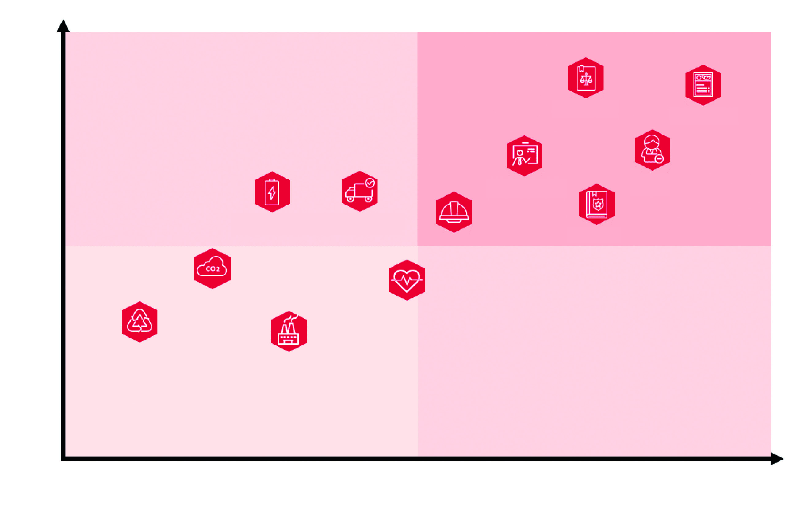

## 原PDF第106页

[对照原PDF第106页](../2021年年度报告.pdf#page=106)

2021 年环境、社会及管治报告

四、 环境管理

本公司始终秉承绿色发展理念，严格遵守《中华人民共和国环境保护法》  《中华人民共

```text
                                                                     和国水污染防治法》  《中华人民共和国大气
of China ( 《中华人民共和国环境保护法》 ), the Laws of the People’s  污染防治法》  《中华人民共和国固体废物污
                                                        《中         染环境防治法》  《中华人民共和国节约能源
华人民共和国水污染防治法》                                           法》等环境保护相关法律法规及《北京市生
                                            《中华人民共和国         活垃圾管理条例》等地方管理条例，在日常
大气污染防治法》                                                     运营中减少温室气体排放，落实节能减排
                                  《中华人民共和国固体废物污         措施，加强用水管理，恪守环境责任，为
染环境防治法》                                                       构建生态文明、环境友好型社会贡献力量。
     《中华人民共和国节约能源法》
```

《北京市生

活垃圾管理条例》

排放物管理

本公司运营涉及的排放为主要包括因使用用电设备、车辆产生的温室气体排放及办公运营产生的废弃物排放。我们持续采取多种措施开展排放物管理和提高员工环保意识，努力降低办公运营对环境产生的影响。

我们不断加强办公区、门店的用电管理，在仓库使用LED及自然光照明，有效减少发电所产生的温室气体。为降低产品出库及运输过程中产生的碳排放，我们提高车辆装载率，并根据配送地的位置选择距离近的仓库进行配送，缩短运输总距离，减少车辆产生的碳排放。在提高员工环保意识方面，通过鼓励员工使用公共交通工具，减少私家车使用频率，倡导低碳出行。

二零二一年年报  105

## 原PDF第107页

[对照原PDF第107页](../2021年年度报告.pdf#page=107)

2021 年环境、社会及管治报告

我们严格遵守各地生活垃圾管理条例及物业的垃圾分类要求，对办公垃圾进行分类处理，培养员工循环利用意识，鼓励员工减少一次性纸杯的使用；同时，公司对办公用品领用实行登记与定额管理，提倡员工使用可替换笔芯的原子笔，减少胶水、修正液等办公物品的使用，坚决杜绝纸张浪费。在仓库管理及拣货方面，我们取消机器人商店的纸质配货单，持续推广掌上电脑(PDA)的拣货方式以扩大无纸化拣货作业的范围。2021 年，南京仓库由传统纸质记录拣货转为无纸化拣货方式，纸张消耗较2020年减少了20%。

资源使用管理

本公司始终关注能源高效转化及资源高效利用，通过开展节能环保项目，对各业务板块的资源使用情况进行系统化管理，更换高效节能设备，提高员工节能意识，切实履行建设良好生态环境的绿色承诺，打造绿色办公企业。

106  泡泡玛特国际集团有限公司

## 原PDF第108页

[对照原PDF第108页](../2021年年度报告.pdf#page=108)

2021 年环境、社会及管治报告

用电管理

本公司积极落实国家节能降耗总体要求，持续贯彻「节约用电」的理念，从微小处做起，在办公区域、门店、机器人商店及库区加强用电管理，采取以下措施以提高公司的能效：

•  办公区域：

•  不断探索空调温控技能方案，对夏季及冬季空调开启温度、设定温度和风速提出具体要求，有效降低综合能耗；

•  在员工午休、加班时关闭部分电灯，提倡及时关闭不使用的个人电脑及显示屏等设备或将其设置为节电模式；

•  公共照明灯具采取按需开灯的方式，仅于阴天或天色变暗时使用。

二零二一年年报  107

## 原PDF第109页

[对照原PDF第109页](../2021年年度报告.pdf#page=109)

2021 年环境、社会及管治报告

门店：

仅在必要开启的时段开启对应的用电设备，除员工在班时间（包含门店正常营业时间）外，其他时间段均只保留消防应急照明。

机器人商店：

根据机器人商店的使用高峰期，合理规划并控制其营业时间，非营业时间机器自动关闭。

仓储区域：

制定《仓库能耗节约规定》，在提高自然光线利用率的同时，逐步使用低能耗的LED节能灯替代传统灯具，对库区照明及风扇使用做出规范，杜绝浪费。

南京仓库更换LED节能灯照明

108  泡泡玛特国际集团有限公司

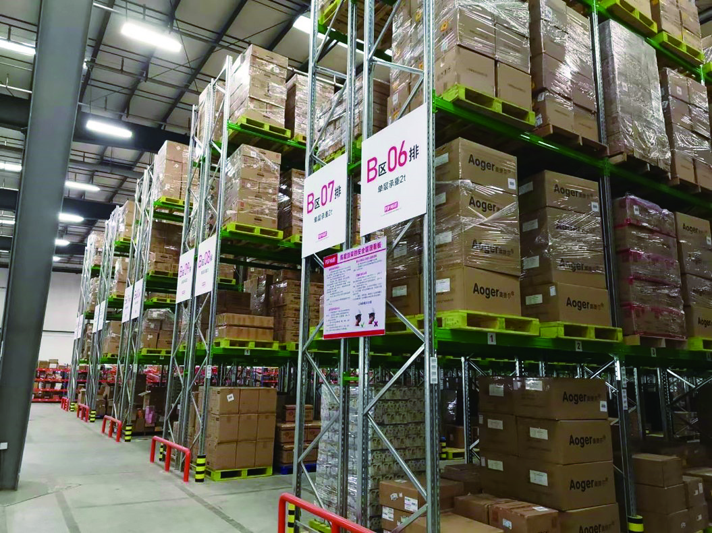

## 原PDF第110页

[对照原PDF第110页](../2021年年度报告.pdf#page=110)

2021 年环境、社会及管治报告

用水管理

本公司用实际行动支持节水型社会建设，实行多种节水措施，强化用水需求及用水过程管理，以减少水资源消耗，提高用水效益，包括：

加强用水设备的日常巡视与维护管理，定期安排维修人员对排水系统进行检查，严防跑、冒、滴、漏等水资源浪费的情况发生，发现故障并及时处理；

对用水设备进行节水改造，逐步安装节水龙头，调整水龙头水压，控制水龙头的水流速度；

制作并张贴节水标识，加强员工在日常工作与生活中的水资源节约意识，培养员工节水习惯，号召员工随手关闭水龙头，杜绝长流水现象。

二零二一年年报  109

## 原PDF第111页

[对照原PDF第111页](../2021年年度报告.pdf#page=111)

2021 年环境、社会及管治报告

包装材料管理

本公司注重产品的绿色环保特性，在产品设计、包装及物流、回收过程中全面考量产品环保属性及节能降耗的需求，将绿色低碳理念融入产品的全生命周期。本公司产品的包装材料主要包括铜版纸彩盒、铜版纸彩卡、铝塑袋、POF热收缩膜、聚乙烯PE 透明袋、物流瓦楞纸箱等。本年度，针对本公司产品，我们持续使用由可降解硅藻纯颗粒和水刺无纺布制成的配重包，以替代传统的塑胶配重币。针对「MEGA珍藏1  系列 1 」产品，我们对产品中的包装材料进行环保优化，尝试将原产品包装内的保丽龙泡沫内胆更换为可降解、可回收的纸托内胆，尝试使用具有森林管理委员会(FSC)认证的纸张，全面评估包装材料对环境的影响。在仓库管理方面，我们妥善回收及再利用包装纸箱、卡板等，有效减少了包装材料的消耗与浪费，延长了产品的生命周期。

```text
1                                                                          1  「MEGA珍藏系列」是本公司推出的高端潮玩产品
                                                                               线。
```

110  泡泡玛特国际集团有限公司

## 原PDF第112页

[对照原PDF第112页](../2021年年度报告.pdf#page=112)

2021 年环境、社会及管治报告

环境目标规划

2021 年，本公司制定环境目标，量化跟踪环境管理进程，并适当根据进展情况对环境管理指标进行更新修订，全面落实环境保护措施。

减排目标  截至2030年底，本公司范围一及范围二 (1) 温室气体排放实现碳达峰。

减废目标截至2022年底，全面实现配货单线上化，机器人商店工作人员实行无纸化办公。

截至2023年底，至少90%门店产生的包装纸箱被本公司或者有资质的第三方回收利用。

节能目标截至2025年底，人均办公耗电量较2020年减少10%。

节水目标截至2025年底，人均办公耗水量较2020年减少10%。

```text
                                                                           注：
(1)                                                                        (1)  范围一涵盖由本公司拥有或控制的业务直接
                                                                                产生的温室气体排放，如公务用车消耗汽
```

油、柴油产生的碳排放；范围二涵盖来自公司内部消耗（购买的或取得的）电力、热能、冷冻及蒸汽所引致的间接温室气体排放。

环境关键绩效指标 (1)

本公司2021 年环境类关键绩效指标列示如下。除另有说明外，环境类数据统计范围涵盖泡泡玛特在中国境内主要办公区及运营门店，其余运营场所未来将适时加入统计范围。

二零二一年年报  111

## 原PDF第113页

[对照原PDF第113页](../2021年年度报告.pdf#page=113)

2021 年环境、社会及管治报告

排放物 (2)

```text
指标                                                                                                           2021年数据
温室气体排放总量（范围一及范围二） (3) （吨）                                                                      3,304.60
```

直接温室气体排放（范围一）  （吨）

汽油  10.70

间接温室气体排放（范围二）  （吨）

```text
  外购电力                                                                                                      3,293.90
人均温室气体排放量（范围一及范围二）  （吨 ╱ 人）                                                                  0.86
每平方米建筑面积的温室气体排放量（范围一及范围二）   （吨 ╱ 平方米）                                               0.05
                            (4)
有害废弃物总量（吨） (4)                                                                                           0.23
人均有害废弃物重量（吨 ╱ 人）                                                                                    0.0001
每平方米建筑面积的有害废弃物重量（吨 ╱ 平方米）                                                                0.000003
                                (5)
无害废弃物排放总量（吨） (5)                                                                                      49.93
人均无害废弃物（吨 ╱ 人）                                                                                          0.01
每平方米建筑面积的无害废弃物重量（吨 ╱ 平方米）                                                                  0.0008
                                                                              注：
 (1)                                                                          (1)  因业务发展需要，2021年本公司新增部分办
                                                                                   公区域及门店，故能源消耗总量、办公用水
                                                                                   消耗总量及温室气体排放总量等数据整体较
                                                                                   上年度有所增加。
 (2)                                                                          (2)  本公司自有公车数量较少，因此产生的氮氧
                                                                                   化物、硫氧化物等废气排放较少。基于本公
```

司的运营性质，其主要气体排放为温室气体排放，源自使用由化石燃料转化的电力及燃料。

112  泡泡玛特国际集团有限公司

## 原PDF第114页

[对照原PDF第114页](../2021年年度报告.pdf#page=114)

2021 年环境、社会及管治报告

```text
(3)                                                                        (3)  温室气体清单包括二氧化碳、甲烷和氧化亚
                                                                                氮，主要源自外购电力及燃料。温室气体
```

核算乃按二氧化碳当量呈列，并根据中华人民共和国生态环境部刊发的《2019 年度减排项目中国区域电网基准线排放因子》及政府间气候变化专门委员会 (IPCC) 刊发的《IPCC 2006年国家温室气体清单指南2019修订版》

```text
                                                                                  进行核算。
(4)                                                                          (4)  本公司运营涉及的有害废弃物主要包括办公
                                                                                  打印设备废弃硒鼓、废弃墨盒、废弃碳粉
                                                                                  等，其更换或处置由打印服务供应商或有资
                                                                                  质的专业公司负责处理。
(5)                                                                          (5)  本公司运营涉及的无害废弃物主要为废弃纸
                                                                                  张，包括 A3 复印纸、A4 复印纸及热敏纸，
```

其由物业统一处理。

能源及资源消耗

```text
指标                                                                                                              2021年数据
能源消耗总量（兆瓦时） (1)                                                                                             5,272.85
```

直接能源消耗（兆瓦时）

汽油  41.80

间接能源消耗（兆瓦时）

```text
  外购电力                                                                                                           5,231.05
人均能源消耗量（兆瓦时 ╱ 人）                                                                                            1.37
每平方米建筑面积的能源消耗量（兆瓦时 ╱ 平方米）                                                                          0.08
                               (2)
办公用水消耗量（吨） (2)                                                                                               369.45
人均办公用水消耗量（吨 ╱ 人）                                                                                            0.10
每平方米建筑面积的办公用水消耗量（吨 ╱ 平方米）                                                                          0.01
                                                    (3)
制成品所用包装物总量（吨） (3)                                                                                       5,800.02
                                                                                          (4)
每百万元销售额耗用制成品包装物量（吨 ╱ 百万元） (4)                                                                      0.13
```

二零二一年年报  113

## 原PDF第115页

[对照原PDF第115页](../2021年年度报告.pdf#page=115)

2021 年环境、社会及管治报告

```text
                                                                               注：
(1)                                                                            (1)  能源消耗量数据是根据中华人民共和国国家
                                                                                   标准《综合能耗计算通则(GB/T 2589-2020)》
```

中提供的有关换算因子进行计算，包含外购电力和公车耗油。

```text
(2)                                                                          (2)  除公司在北京、南京、深圳办公区所外，其
                                                                                  余办公区及运营门店办公用水为办公区物业
```

控制，水费包含在物业费中，用水量尚不能单独计量，故本报告期内，办公用水消耗量及办公用水消耗强度仅统计了北京、南京、深圳办公区的数据。我们的办公用水来自市政自来水管网供水，在求取适用水源上不存

```text
                                                                                   在问题。
(3)                                                                            (3)  包装物主要包括塑料包装袋、纸箱、纸盒及
                                                                                   手提纸袋。
(4)                                                                            (4)  每百万元销售额耗用包装物量是指集团每百
                                                                                   万元销售额耗用的包装物重量。
```

环境及天然资源

本公司始终将保护环境和自然资源作为企业发展的重要责任之一。基于公司的业务特点，本公司对环境及天然资源的影响较小。在公司业务规模不断扩大的过程中，我们将持续采取节能减排措施，倡导节约文化，推广环保理念，在全面了解公司能源、资源消耗情况的基础上，对标国内外先进同业，努力减少自身运营对环境带来的负面影响，提升绿色竞争力。

2021 年，本公司在经营中未发现对环境造成重大污染和影响的事项。

114  泡泡玛特国际集团有限公司

## 原PDF第116页

[对照原PDF第116页](../2021年年度报告.pdf#page=116)

2021 年环境、社会及管治报告

应对气候变化

气候变化是当今时代的主要挑战之一，本公司深刻认识到气候变化问题的重要性与紧迫性，积极应对气候变化带来的挑战，加速向低碳经济转型。本年度，我们在现有风险管理体系的基础上，梳理、识别了包含气候变化风险在内的ESG主要风险，对相关风险的管理进行了进一步检视，并与各职能部门展开沟通，制定了相关应对措施。

本公司识别的主要气候变化风险及制定的应对措施如下。

```text
主要风险                    风险描述                            应对措施
```

人员和资产受损风险

暴雨、台风、暴雪等恶劣天气的发生，可能使公司人员健康与安全及公司财产受损。

制定内部管理制度和计划，在恶劣天气发生时及时向员工发送天气预警，为员工提供雨伞、雨衣等应急物资，允许员工远程灵活办公，提醒员工远离广告牌、下水道等危险区域，不断完善灾害应急响应机制，识别可能的资产损失，购买必要的保险。

二零二一年年报  115

## 原PDF第117页

[对照原PDF第117页](../2021年年度报告.pdf#page=117)

2021 年环境、社会及管治报告

```text
主要风险                    风险描述                            应对措施
```

运输中断风险

暴雨、台风、暴雪等恶劣天气的发生，可能影响收货、存货、发货等仓内操作并导致运输业务中断。

定期评估恶劣天气对产品运输带来的影响，持续改善仓库硬件环境，提升仓库业务操作及应变能力，在恶劣天气发生时启动紧急物流运输体系，及时与物流服务商沟通并调整工作方案，必要时采用空运或铁路运输等紧急物流运输方式。

经营活动停止风险

建立应急救灾机制，定期评估恶劣天气对公司经营带来的影响。恶劣天气发生时，评估对特定区暴雨、台风、暴雪等恶劣天气的发  域的影响，制定应对方案。生，可能致使产品运输不畅或门店无法正常营业，导致经营活动停止，公司经济利益受损。

未来，本公司将继续深入研究气候变化对公司业务经营可能产生的影响，及时调整应对策略，持续完善气候变化管理机制。

116  泡泡玛特国际集团有限公司

## 原PDF第118页

[对照原PDF第118页](../2021年年度报告.pdf#page=118)

2021 年环境、社会及管治报告

五、 雇佣及劳工准则

人才是企业最核心的资源。本公司始终秉承「员工是我们的伙伴」的管理理念，拓宽人才引进渠道，建立健全人才管理体系，致力于为员工打造公平公正的雇佣环境和安全健康的工作环境。我们充分尊重和保护每一位员工的合法权益，实施多元化人才发展战略，关注员工成长，为员工打造能够展现个人才能和梦想的事业平台。

雇佣管理

```text
                                                                   本公司严格遵守《中华人民共和国劳动法》
                            《中华人民共和国劳动法》              《 中华人民共和国劳动合同法 》等法律法
                                           《中华人民共和国        规，制定了《人力资源管理制度》  《考勤管
劳动合同法》                                                       理制度》  《试用期管理制度》  《出差管理制
                                                                   度》  《员工外派管理制度》  《休假管理制度》
```

等人事管理制度，依法规范劳动关系，在工作安排中考虑员工的能力和意愿，杜绝以暴力、威胁或非法限制人身自由等手段强迫员工提供劳动，同时，积极倡导并监督合作伙伴与我们执行相同的用工标准。我们针对员工招聘、雇佣、薪酬、假期、晋升、解聘、工时管理、平等机会、多元化、反歧视以及其他人事与福利待遇等方面进行了明确规定，杜绝因种族、年龄、性别、婚姻状况、宗教信仰等不同而给予员工差别化的对待，为所有员工提供平等的工作机会，切实保障员工合法权益。

二零二一年年报  117

## 原PDF第119页

[对照原PDF第119页](../2021年年度报告.pdf#page=119)

2021 年环境、社会及管治报告

```text
                                         我们亦按照《中华人民共和国未成年人保护
《中华人民共和国未成年人保护法》         法》  《禁止使用童工规定》等法律法规要求，
            《禁止使用童工规定》         在招聘等环节严格审核应聘者的有效身份
                                         证件，并通过人力资源管理系统对证件信
```

息进一步校验，确保雇佣过程符合国家法律法规要求，严禁雇佣童工及任何其他不合法的用工行为。若发现童工或强迫劳动的行为，我们将立即停止其工作，进行身份核查的同时与监护人或家属进行联系，主动沟通并协助送回原居住地。

我们注重根据业务结构招聘不同类型的人才，并根据业务特点，不断培养新生力量，优化人员结构。截至 2021 年 12 月 31日，本公司在中国及海外地区共有员工4,053人，其中，正式员工3,845人，外包员工208人。

118  泡泡玛特国际集团有限公司

## 原PDF第120页

[对照原PDF第120页](../2021年年度报告.pdf#page=120)

2021 年环境、社会及管治报告

员工雇佣情况 2

```text
指标                                                                                         截至2021年12月31日
按性别（人）                      男                                                                         1,243
                                  女                                                                         2,602
按类别（人）                      全职                                                                       3,716
                                  兼职                                                                        129
按年龄（人）                      30岁（不含）以下                                                           3,076
                                  30岁至50岁（不含）                                                          769
                                  50岁（含）以上                                                                0
按地区（人）                      中国境内地区                                                               3,845
                                  港澳台地区                                                                    0
                                  其他国家及地区                                                                0
```

```text
2.                                                                           2   员工雇佣情况、员工流失率情况及员工职业健康
                                                                                 与安全数据统计范围涵盖本公司正式员工，不包
```

含外包员工。

二零二一年年报  119

## 原PDF第121页

[对照原PDF第121页](../2021年年度报告.pdf#page=121)

2021 年环境、社会及管治报告

员工流失率情况

```text
指标                                                                                     截至2021年12月31日
员工流失率(%)                                                                                          22.96%
按性别(%)                        男                                                                    22.03%
                                 女                                                                    22.91%
按年龄(%)                        30岁（不含）以下                                                      24.95%
                                 30岁至50岁（不含）                                                    19.84%
                                 50岁（含）以上                                                             0
按地区(%)                        中国境内地区                                                          22.96%
                                 港澳台地区                                                                 0
                                 其他国家及地区                                                             0
```

120  泡泡玛特国际集团有限公司

## 原PDF第122页

[对照原PDF第122页](../2021年年度报告.pdf#page=122)

2021 年环境、社会及管治报告

关爱员工

```text
                                                                     本公司严格遵守《中华人民共和国社会保险
                                            《中华人民共和国         法》  《住房公积金管理条例》等法律法规，完
社会保险法》                                                         善薪酬福利体系建设，不断增强员工的归
             《住房公积金管理条例》                                  属感与幸福感。
```

在薪酬待遇方面，我们为员工提供具有市场竞争力的薪酬，按规定定期缴纳五险一(五险一金) for our employees  金，提供餐饮及交通补贴、绩效分配、年终奖金、司龄奖金、中长期股权激励等薪酬奖励。

在员工福利方面，我们及时了解员工的动态和需求，为员工提供包括年度定期体检、补充医疗保险、新品优享、年节礼物、生日礼金、结婚卡、生育礼金、丧葬金等多种福利。对于女性员工，我们按照

```text
                                                                    《女职工劳动保护特别规定》  《女职工禁忌劳
                                                    《女职工         动范围的规定》等法规给予优待与关照，成
劳动保护特别规定》                                                   立妇女委员会，切实保障女性员工权利，
                     《女职工禁忌劳动范围的规定》 ), and set up      为生育女性员工提供育儿假、生育津贴等
                                                                     福利，并在办公区配备了睡眠舱与母婴室。
```

我们不断优化工时管理政策，鼓励员工在正常工作时间内高效工作，充分利用假期进行休息和娱乐，给予员工加班调休的权利，并对因工作原因无法调休的加班工时结算加班工资。

二零二一年年报  121

## 原PDF第123页

[对照原PDF第123页](../2021年年度报告.pdf#page=123)

2021 年环境、社会及管治报告

我们亦重视员工的身心发展需要，鼓励员工参与文体活动，缓解工作压力，为部门团建活动提供经费，定期举办员工下午茶、生日庆祝、游泳赛、羽毛球赛、篮球赛等多项活动，丰富员工业余生活，提升团队向心力和凝聚力。

健康安全

本公司致力于为员工提供健康安全的工作环境，严格遵守《中华人民共和国职业病防

```text
                                                                     治法》  《公共场所卫生管理条例》  《工伤保险
               《中华人民共和国职业病防治法》                        条例》  《用人单位职业健康监护监督管理办
                                        《公共场所卫生管理条         法》等法律法规，全面推进安全管理工作，
例》                                         《工伤保险条例》        鼓励员工提高自我保护意识，切实保障员
                                                                     工的职业健康安全。2021 年，本公司未发
                            《用人单位职业健康监护监督管理办         生任何员工伤亡事件。
法》
```

我们完成了一系列工作以保障员工的健康与安全，包括每年定期组织员工体检、开2  展员工帮助计划（EAP 2 ）、加强健康知识宣贯等，使员工可以及早发现职业病、职业禁忌症等异常情况，提高员工健康意识，促进员工身心健康。2021年，我们推出「泡泡心驿」员工心理健康项目，为员工提供更便捷、专业的心理健康服务，员工可通过智慧心理云平台进行心理咨询预约、学习心理知识等，缓解工作上的压力。

```text
2                                                                            2                            Programs，员工帮助
                                                                                  计划。
```

122  泡泡玛特国际集团有限公司

## 原PDF第124页

[对照原PDF第124页](../2021年年度报告.pdf#page=124)

2021 年环境、社会及管治报告

2021年「泡泡心驿」员工心理健康项目

二零二一年年报  123

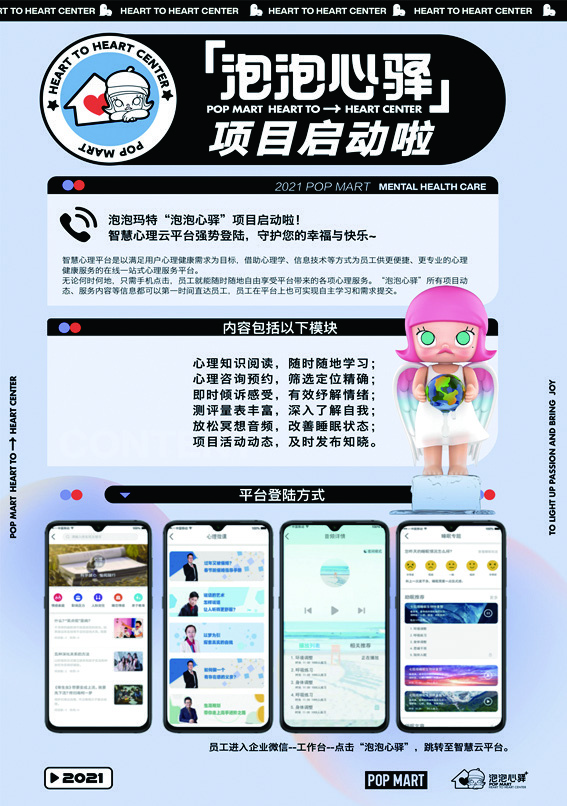

## 原PDF第125页

[对照原PDF第125页](../2021年年度报告.pdf#page=125)

2021 年环境、社会及管治报告

我们持续关注国家及当地政府的防疫规定与疫情变化情况，严格监管外来人员的健康状况，对办公地点及时消毒杀菌，全面保护员工的健康与安全。为防止安全事故发生，本年度，我们加强对员工的安全知识培训力度，定期组织员工开展消防演习疏散实操，有效提升员工的安全意识及消防安全应急能力。

职业健康与安全

```text
指标                                                            2019年数据      2020年数据      2021年数据
因工亡故总人数（人）                                                     0               0                0
因工亡故比率(%)                                                          0               0                0
因工受伤人数（人）                                                       –               –                4
因工伤损失工作日数（天）                                                 –               –              108
```

124  泡泡玛特国际集团有限公司

## 原PDF第126页

[对照原PDF第126页](../2021年年度报告.pdf#page=126)

2021 年环境、社会及管治报告

发展培训

本公司关注员工长期的职业发展与成长，努力打造全面的学习与发展体系。我们制定《人力资源管理制度》，明确员工培训与个人能力开发的相关原则，并针对员工的职级和实际工作需求，设立多元化、具有特色文化的培训项目，加强人才梯队建设。

本公司以绩效考核及晋升述职答辩的形式定期开展职能线 3 及运营线 4 的晋升工作，通过对员工的专业能力、沟通协作、团队管理等表现进行多维度打分，为员工职业生涯规划提供多平台发展计划。为了培养具备基层经验和零售管理潜质的人才，我们开展管培生计划，面向海内外院校，招聘并培养适合零售中心运营岗位的人才，给予其门店实操、轮岗学习及外派学习的机会，协助员工全方位提升综合能力与个人价值。

2021 年，我们持续完善员工培训发展体系，坚持「以业务为中心、以人为本」的理念，使培训内容更加轻量化、个性化、趣味化，在培训中增加互动环节，例如沙盘游戏等，致力于在辅助员工提升其业务能力的同时提升团队凝聚力。我们使用「Skill+ Practice」的学习方法，向员工传授实用性技能并为其提供现场练习场域与讨论空间，助力员工成长与发展。针对中层管理人员，我们亦开展「北极星计划」，旨在培养像北极星一样指引方向的优秀管理者，协助管理层员工实现领导力提升。

```text
3                                                                              3   职能线指本公司办公区所员工。
4                                                                              4   运营线指本公司门店及机器人商店员工。
```

二零二一年年报  125

## 原PDF第127页

[对照原PDF第127页](../2021年年度报告.pdf#page=127)

2021 年环境、社会及管治报告

泡泡玛特「北极星计划」中层管理培训

职能线员工受训情况

```text
指标                                                                               受训百分比(%)        受训平均时数（小时）
按性别                       男                                                                97%                        0.45
                             女                                                                96%                        0.55
按类别                       管理层                                                            98%                        0.38
                             非管理层                                                          96%                        0.62
```

126  泡泡玛特国际集团有限公司

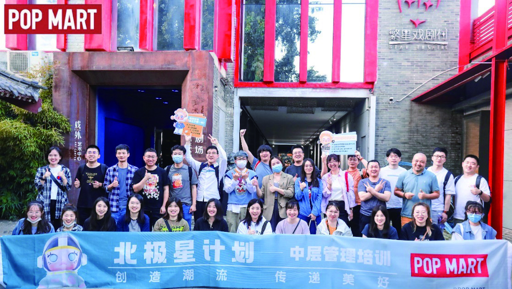

## 原PDF第128页

[对照原PDF第128页](../2021年年度报告.pdf#page=128)

2021 年环境、社会及管治报告

运营线员工受训情况

```text
指标                                                                            受训百分比(%)       受训平均时数（小时）
按性别                      男                                                             99%                      11.12
                            女                                                             95%                      11.18
按类别                      管理层                                                         99%                      11.26
                            非管理层                                                       94%                      11.16
```

六、 供应链管理

本公司致力于实现产业链协同发展。我们不断完善供应商管理体系，制定了《供应商管理制度》  《采购部标准作业程序文件》  《非产品类采购管理制度》  《非产品类供应商管理制度》  《物流部标准作业程序》  《库房管理制度》  《仓库盘点操作流程》等制度文件，积极践行责任采购，从采购标准、采购流程、供应商准入、日常表现等方面开展全方位管理，引导供应商积极履行环境及社会责任，持续加强ESG风险管理，推动行业可持续发展。

二零二一年年报  127

## 原PDF第129页

[对照原PDF第129页](../2021年年度报告.pdf#page=129)

2021 年环境、社会及管治报告

供应商准入

本公司对供应商的准入、评估及退出制定了严格的甄选标准及制度政策，并定期对供应商的合规情况进行评估。我们组建了具备丰富行业经验的供应商管理团队，以及由采购部、工程部、品质部、质量管理部及生产管理部相关负责人组成的供应商验厂团队，并于2021 年成立了供应商管理安规小组，全面加强质量及安全合规管理。

在选取供应商时，我们从环境保护、节约资源、安全管理、企业可持续发展等多维度对供应商进行准入考核及审查，根据不同类型产品的特性和要求制定验厂评估标准。我们要求供应商严格遵守《中华人民共

```text
                                                                   和国大气污染防治法》  《中华人民共和国固
                                       《中华人民共和国大气        体废物污染环境防治法》  《中华人民共和国
污染防治法》                                                       水污染环境防治法 》等法律法规并取得相
                             《中华人民共和国固体废物污染环        关环保资质，配备污染物净化处理设备，
境防治法》                                                         制定污染物排放与回收措施，确保生产制
                       《中华人民共和国水污染环境防治法》          作条件达到公司标准后，与供应商签订合
                                                                   作协议。本公司供应商管理团队及验厂团
```

队会定期考察新寻源的供应商，对其运营场所、生产能力、技术能力、开发能力及硬件环境等情况进行多方面实地考察及评分，验厂合格后方可提出采购申请。本公司时刻关注供应商在环境及社会方面的管理能力及表现，对于环境及社会风险管理不足的供应商，我们将不纳入考虑范围。2021 年，本公司已完成准入审核的供应商共54个。

128  泡泡玛特国际集团有限公司

## 原PDF第130页

[对照原PDF第130页](../2021年年度报告.pdf#page=130)

2021 年环境、社会及管治报告

我们亦鼓励供应商通过第三方机构的认证与审核，如国际玩具业协会 (ICTI) 商业行为守则认证、迪士尼社会责任验厂(Disney ILS)、Sedex会员道德贸易审核(SMETA)、商界社会责任倡议(BSCI)审核等。

供应商日常管理

本公司建立合格供应商清单，持续开展供应商管理优化，对供应商表现进行约束与监督。我们通过月度评估及年度评估的方式定期对在库供应商进行绩效考核管理，针对供应商的生产质量、返工次数、出货量、服务、准时交付率等情况进行考核与评估，并根据考核结果对供应商分级管理，与供应商开展沟通反馈，对不同级别的供应商实行不同的激励政策，挖掘优质供应商，协助存在问题或风险点的供应商顺利完成整改和能力提升，在发现生产过程严重违反相关环保管理要求、存在严重商业道德缺失或违法违规情况的供应商时，及时终止与其的合作关系，淘汰不合格供应商。

推进绿色采购

本公司重视供应商绿色发展与表现，优先采购在产品生命周期全过程中符合特定的环境保护要求、对生态环境无害或危害较小、资源利用率高、能源消耗量低的产品，促进供应商环保行为的改善，旨在对社会的绿色消费起到推动和示范作用。

二零二一年年报  129

## 原PDF第131页

[对照原PDF第131页](../2021年年度报告.pdf#page=131)

2021 年环境、社会及管治报告

我们要求供应商使用可再生的木质卡板，放弃使用石油基材料的塑胶卡板，并在验厂团队的日常巡检工作中对其进行监督，以及时发现违反相关规定的行为。我们鼓励供应商优先使用经本公司测试认证的环保产品，如环保硅藻纯配重包等环保性良好的包装材料，以及环保的油漆、油墨、溶剂、黏接胶水等产品，并通过指定供应商进行采购，确保原材料的环保性与安全性。

截止2021 年12 月31 日，本公司拥有的供应商数量及分布地区如下。

供应商数量及分布情况

```text
指标                                                                                  截至2021年12月31日
按地区（个）                     中国境内地区                                                           54
                                 港澳台地区                                                              0
                                 其他国家及地区                                                          0
总计（个）                                                                                              54
```

130  泡泡玛特国际集团有限公司

## 原PDF第132页

[对照原PDF第132页](../2021年年度报告.pdf#page=132)

2021 年环境、社会及管治报告

七、 责任经营

本公司深化责任管理，坚持以客户为中心，深入贯彻责任文化，持续为客户提供优质的产品和服务。我们严格遵守《中华人

```text
                                                                   民共和国产品质量法》  《中华人民共和国消
                                               《中华人民共        费者权益保护法》等法律法规，致力于在保
和国产品质量法》                                                   证良好品控的同时，不断推进产品创新，
                                         《中华人民共和国消        提高客户投诉处理和售后服务水平，落实
费者权益保护法》                                                   客户权益保护措施，积极保护知识产权和
                                                                   品牌名誉，健全信息安全管理体系，让消
```

费者放心购物。

产品质量管控及召回

本公司严格遵守与业务有关的玩具国家标准，如《GB/T 26701-2011模型产品通用技术要求》  《GB 6675-2014玩具安全》等，加强模型产品的通用技术要求。我们对产品质量严格把控，制定了《产品检验通用标准》  《手办产品质量标准手册》  《质检工作流程》  《产品特采流程》等管理制度与检验标准，对生产流程中的每个环节进行全面监督，不断完善现有质量管理体系。

二零二一年年报  131

## 原PDF第133页

[对照原PDF第133页](../2021年年度报告.pdf#page=133)

2021 年环境、社会及管治报告

2021 年，为加强质量管控，我们对产品的原材料选择及合规性检测流程进行了优化。为保障产品质量与安全，我们选用符合国家安全标准的包装原材料，由供应商管理安规小组专门负责产品原材料的安全管控，定期对原材料进行抽检，送交第三方检测机构进行环保安全检测与分析。针对产品合规性检测，我们聘用国际公认检测机构通标标准技术服务有限公司(SGS)作为本公司产品的国际检测业务合作商，协助开展产品安规检测，并围绕产品安规要求组织专场培训与研讨会，进一步提升公司质量管理水平。公司质量控制团队则会定期对所有制造商进行临时现场检查，要求制造商严格遵守我们的质量控制准则，对售后部门评估出的易出现瑕疵产品的工艺及生产过程进行优化改进，确保产品质量安全满足合规要求。

我们已制定《 产品召回程序 》等制度及流程，一旦发现存在安全隐患或不符合标准的产品，公司将对所有不合格产品进行返工处理，并统一报废不能返工的产品。此外，为保障客户健康与安全，我们的产品包装上均印有警告和提示文字，如「包装内含小零件，请勿吞食」  「不适合3岁以下儿童使用」  「本产品仅适用于15岁及以上人士」等文字。

2021 年，本公司未发生任何与产品质量相关的召回事件。

132  泡泡玛特国际集团有限公司

## 原PDF第134页

[对照原PDF第134页](../2021年年度报告.pdf#page=134)

2021 年环境、社会及管治报告

泡泡玛特产品安规培训

客户投诉及权益保障

本公司始终将客户满意放在首位，倾听客户诉求。我们严格遵守《中华人民共和国消

```text
                                                                     费者权益保护法》  《侵害消费者权益行为处
                                                《中华人民共         罚办法》  《网络购买商品七日无理由退货暂
和国消费者权益保护法》                                               行办法》  《禁止价格欺诈行为的规定》等法律
                              《侵害消费者权益行为处罚办法》         法规，制定《店舖标准操作流程》  《客服处理
                                                                     退换货流程规定》  《客户投诉暨服务监督管
                                《网络购买商品七日无理由退货         理制度》等制度规定，规范门店运营，不断
暂行办法》                                                           完善客户服务机制，保障客户问题能够得
        《禁止价格欺诈行为的规定》                                   到快速有效的解决。
```

我们持续完善建设全媒体服务平台，客户可以通过400官方热线、微信小程序、天猫在线、门店客户服务等多种渠道与公司交流沟通，反馈意见或建议。我们对售后处理政策进行了公示，全面保障客户权益。

二零二一年年报  133

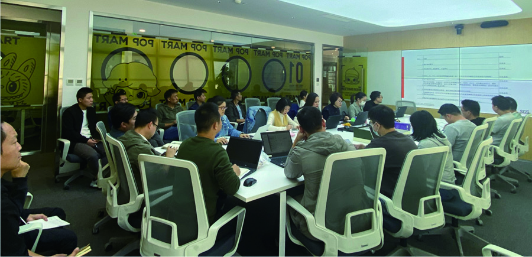

## 原PDF第135页

[对照原PDF第135页](../2021年年度报告.pdf#page=135)

2021 年环境、社会及管治报告

我们持续关注客户提出的问题、需求和建议，不断完善客户投诉处理体系，及时对客户投诉做出处理，响应客户提问，同时对投诉事件进行原因分析与问题整改。我们通过消费者满意度调查等形式识别服务中存在的不足，并持续调整改善，同时加强对客服人员及门店员工的管理与培训，提升其服务质量及效率。在接到投诉时，我们会第一时间安排投诉处理负责人，在限定的时间内针对客户需求提供解决方案，并对其进行追踪，保证客户诉求得到满意解决。若为工商投诉，公司会积极配合，将处理结果及时反馈至市场监督管理局。

产品责任关键绩效指标

```text
指标                                                                                            2021年数据
接获关于产品或服务的工商投诉总数（次）                                                               22,572
工商投诉结案率(%)                                                                                     100%
已售或已运送产品总数中因安全与健康理由而须回收的百分比(%)                                                 0
```

134  泡泡玛特国际集团有限公司

## 原PDF第136页

[对照原PDF第136页](../2021年年度报告.pdf#page=136)

2021 年环境、社会及管治报告

客户隐私及信息安全

本公司高度重视客户个人隐私与信息安全 ， 严格遵守《 中华人民共和国网络安全

```text
                                                                      法》  《中华人民共和国个人信息保护法》
of China ( 《中华人民共和国网络安全法》 ), the Personal Information  《App违法违规收集使用个人信息行为认定
                                          《中华人民共和国个          方法》等法律法规及部门规章，制定《信息
人信息保护法》                                                        安全管理制度》  《信息披露管理制度》  《信息
                                     《App违法违规收集使用个          安全培训手册》  《数据安全管理制度》等制度
人信息行为认定方法》                                                  文件，建立了完善的信息安全管理体系。
```

本公司设有专门的信息科技与研发技术部门负责管理和监督公司的信息及数据安全。我们通过使用加密技术、内网控制、安装防毒软件及防火墙等科技手段，定期开展数据安全、信息合规等专项审计，严格监控客户数据流转全流程，保护信息、数据、应用程序及终端安全。我们在《数据安全管理制度》中对公司数据和用户个人数据的收集、传输、存储、使用、共享、删除、转让和披露等方面进行明确规定，相关政策要求适用于本公司所有业务，严格遵循最小化收集原则规范采集处理个人客户信息，并针对各个类目和级别的数据，进行不同程度的加密、授权等工作。若部门需要使用相关信息，必须经过授权，方可在规定范围内使用。我们亦定期为员工提供客户信息保密管理相关培训，通过警示案例分享及知识宣贯的形式，进一步加强员工的安全保密意识。

如发生信息或数据泄露事件，本公司将第一时间指定安全专员追溯泄露的问题点并及时修复，评估泄露的数据量、影响范围、影响程度等，将情况告知数据所有者，同时，将上报至公司的安全管理层及监管部门，专项分析泄露事件发生的原因，制定优化方案并推进实施，杜绝类似事件再次发生。2021 年本公司未发生重大信息安全和客户隐私泄露事件。

二零二一年年报  135

## 原PDF第137页

[对照原PDF第137页](../2021年年度报告.pdf#page=137)

2021 年环境、社会及管治报告

知识产权及品牌保护

```text
                                                                     本公司严格遵守《中华人民共和国专利法》
                             《中华人民共和国专利法》               《中华人民共和国著作权法》等法律法规，
                                          《中华人民共和国著         制定《 知识产权及软件管理办法 》， 建立
作权法》                                                             了涵盖知识产权运营全价值链的一体化平
                                                                     台。我们不断完善知识产权管理体系，提
```

高员工知识产权保护意识，加强品牌保护工作，及时采取必要措施处理涉及侵权的产品或内容，杜绝侵权事件的发生。

为降低知识产权侵权风险，本公司通过及时向主管机构注册知识产权、定期开展查新工作、检索知识产权信息、开展相关分析等方式，持续对所有系列产品进行严格监管。 2021 年，本公司接通微信品牌维权平台，开通后台管理账号，积极参与自主监管和维权，全面落实知识产权管理工作。我们在重视自身知识产权保护的同时，也尊重他人的知识产权成果。当与艺术家及知识产权提供商合作并获得第三方给予的知识产权授权时，我们要求第三方必须提供知识产权相关的原创性证明，严防侵权或知识产权盗用事件发生。

本公司已建立维权工作制度，在与供应商合作时，我们与供应商签署《保密协议书》及《年度合作框架协议》，明确产品的知识产权、设计文件及模具产权的归属，要求供应商保证不侵犯任何第三方的知识产权和其他合法权益。在恶意注册或知识产权盗用事件发生时，通过线上线下维权的方式要求相关方及时停止损害公司权益，并纠正不当行为，严重时采取行政举报或诉讼索赔等措施积极应对任何侵权行为。

136  泡泡玛特国际集团有限公司

## 原PDF第138页

[对照原PDF第138页](../2021年年度报告.pdf#page=138)

2021 年环境、社会及管治报告

我们重视并鼓励技术创新及发明创造，推动技术创新成果的应用。2021 年，我们在知识产权保护前端中引入知识产权确权平台，有效地对创作中的草稿图样进行记录和确权，积极保障自身知识产权。在产品设计上，我们在「MEGA珍藏系列」产品中加入了NFC防伪芯片认证并配备身份卡，为产品真伪鉴定提供科技识别方法，增强品牌辨识度，落实品牌保护工作。

广告宣传与商标管理

```text
                                                                     本公司遵守《中华人民共和国广告法》  《中华
                             《中华人民共和国广告法》                人民共和国商标法》等法律法规，不断加强
                                            《中华人民共和国         审核并规范广告及宣传推广内容，要求广
商标法》                                                             告及宣传推广内容真实、健康、清晰、明
                                                                     白，避免出现任何虚假宣传、营销、误导
```

消费者的广告宣传与产品说明。

我们识别了业务经营中可能出现的广告宣传违规风险，并制定了相关应对措施。我们要求任何对外宣传资料需经过活动业务部门和法务部门的共同审核，在确认内容准确、贴切事实、不侵犯他人合法权益且未违反词汇用语规定后方可进行发布。针对公司在海外地区的广告宣传，我们要求海外合作方在推广过程中遵守公司的宣传规范和当地的法律法规，确保宣传内容真实合规。当广告或宣传内容出现不符合实际情况或违反相关法律法规时，我们将第一时间启动下架撤回流程，停止投放并做出纠正。

二零二一年年报  137

## 原PDF第139页

[对照原PDF第139页](../2021年年度报告.pdf#page=139)

2021 年环境、社会及管治报告

在商标管理方面，为了更好地管理公司无形资产，我们对品牌标识的出现区域、露出形式、出现比例、位置、字体、颜色等进行了明确要求，规定所有使用公司商品、LOGO、物料素材的情况均需通过公司相关层级审批。同时，我们对高端系列产品的商标及时注册，制定商标使用规范，统一品牌标识，最大化确保品牌标识的合规使用，规避品牌标识被诉侵权风险。

规范「MEGA珍藏系列」产品商标及LOGO使用

八、 反贪污管理

本公司倡导诚信正直的企业文化，致力于营造廉洁的工作环境。我们遵守《中华人民

```text
                                                                     共和国公司法》  《中华人民共和国反洗钱法》
                      《中华人民共和国公司法》                      《中华人民共和国反不正当竞争法》等相关
                                              《中华人民共和         法律法规，制定《反舞弊管理规定》  《反洗
国反洗钱法》                                                         钱工作管理制度》  《合规管理制度》  《礼品收
                 《中华人民共和国反不正当竞争法》 ), and have        受管理规定》  《利益冲突管理制度》  《离任审
```

计管理制度》  《信息保密管理制度》  《员工行为规范管理制度》等相关管理制度，对任何形式的商业违法行为，如贪污、腐败、贿赂、勒索、欺诈及洗黑钱等行为坚持零容忍态度。我们亦与供应商及合作单位签署《阳光合作协议》，规范采购操作流程，打造阳光采购环境，全面加强公司的合规运营。

138  泡泡玛特国际集团有限公司

## 原PDF第140页

[对照原PDF第140页](../2021年年度报告.pdf#page=140)

2021 年环境、社会及管治报告

加强廉洁文化宣贯

本公司持续加强全员廉洁意识宣贯，通过晨会培训、企业违规案例分享、节假日发送贺卡等形式，不断加强公司合规文化宣传，禁止董事及员工从事任何违法或不道德的经济行为并从中牟取利益。2021 年，我们针对董事及全体员工定期开展廉洁专题培训，面向零售中心各大区店长开展单次培训时长约 30 分钟的培训宣贯，并对采购部、经营管理部等重点部门开展学时约40 分钟的专项培训，提升董事及员工商业道德和信息保密意识。我们亦设计多款拒绝收礼、坚持信息保密原则等反舞弊内容的宣传海报，将其张贴于办公室内，在日常生活中宣扬廉洁文化。

完善投诉举报机制

本公司鼓励员工积极举报实际或疑似贪污、贿赂及其他违反职业道德的不正当行为。2021 年，我们将审计部设为公司官方举报责任部门，为内外部人员提供多种举报途径，包括举报电话、举报邮箱、官网在线举报平台、信函等，同时，建立「小伙伴直通车」机制，加强门店合规管理，确保Friends (小伙伴直通车)” to strengthen the compliance management of  业务反馈与违纪举报途径畅通。

二零二一年年报  139

## 原PDF第141页

[对照原PDF第141页](../2021年年度报告.pdf#page=141)

2021 年环境、社会及管治报告

我们对举报人进行保护，严格保密举报人相关信息，确保举报人及举报内容的信息传递，有效控制举报信息的适用范围，禁止对举报人任何形式的打击报复。对于违反相关法律法规及公司制度的行为，公司将在核实事件情况后视情节轻重给予员工纪律处分，包括解聘或报送司法机关处理。

2021 年，本公司加入企业反舞弊联盟和阳光诚信联盟，共同致力于企业反舞弊协作交流，探索反舞弊共性问题，深入研究行业风险、热点、难点，加强行业交流与企业内部治理。

报告期内，我们未发生重大违规和贪污舞弊事件。

反贪污培训开展情况

```text
指标                                                                                              2021年数据
已审结贪污诉讼案件数量（起）                                                                                0
参与反贪污培训董事的人数（人）                                                                              5
参与反贪污培训员工的人数（人）                                                                          1,800
```

140  泡泡玛特国际集团有限公司

## 原PDF第142页

[对照原PDF第142页](../2021年年度报告.pdf#page=142)

2021 年环境、社会及管治报告

九、 社区投资管理

本公司始终铭记「创造潮流，传递美好」的品牌理念，坚持做一个有温度的品牌。我们重视并积极承担企业社会责任，在生态环境保护、助力乡村振兴、支持美育教育等领域投入资源，通过多种形式参与社区公益相关活动，与周边社区保持沟通、友善相处，争做优秀企业公民，为社会持续创造价值。

2021年现金捐赠：约1,053.48万元人民币

2021年公益拍卖：

约36.11万元人民币

案例：保护生态环境，践行可持续发展理念

本公司深刻意识到保护生态环境的重要性。 2021 年 6 月 4 日，本公司梦想大使DIMOO联名科颜氏推出熊猫公益限量版产品，并将两款夏日公益产品的部分收益捐赠于野生大熊猫栖息地垃圾无害化处理与水源净化项目，通过推出公益产品践行可持续发展理念，促进人与自然和谐共生。

二零二一年年报  141

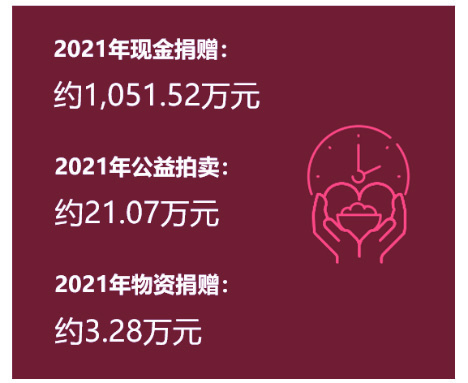

## 原PDF第143页

[对照原PDF第143页](../2021年年度报告.pdf#page=143)

2021 年环境、社会及管治报告

为响应联合国《生物多样性公约》第十五次缔约方大会(COP15)  《昆明宣言》 ，2021年10月22 日，在DIMOO森林之夜系列产品发售之际，我们联合DIMOO设计师Ayan向中华环境保护基金会捐赠 50 万元人民币，建造泡泡玛特河貍保护公益林，保护濒危物种。

泡泡玛特河貍保护公益林案例：助力乡村振兴，推进地区产业发展

本公司积极响应国家政策，支持乡村振

```text
                                                 兴。2021年6月14日，本公司与中国扶贫基
(善品公社) platform of China Foundation for      金会善品公社平台合作举办了「浓情端午、
                                                 责任消费」主题活动，定向采购 20 余万元
               (浓情端午、责任消费)”, and        人民币的脱贫地区农产品作为员工端午福
                                                 利，通过责任消费的方式支持脱贫地区产
```

业发展，助推脱贫增收。

142  泡泡玛特国际集团有限公司

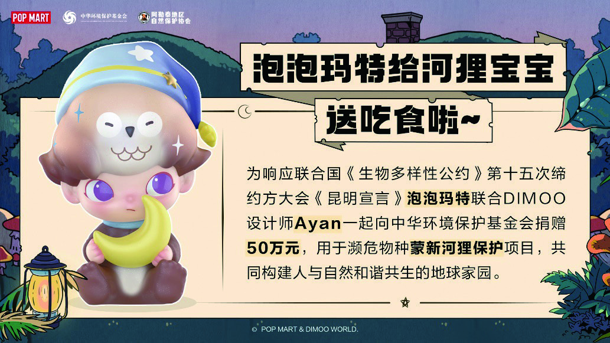

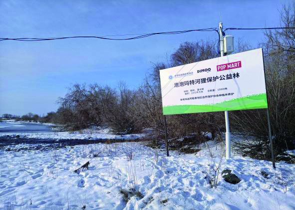

## 原PDF第144页

[对照原PDF第144页](../2021年年度报告.pdf#page=144)

2021 年环境、社会及管治报告

泡泡玛特「浓情端午、责任消费」主题活动

2021年8月18日，本公司通过中国志愿服务基金会捐赠建设的首个文化振兴公益项目于河北省承德县刘杖子乡孟家庄村正式启动。我们向该村捐款30 万元人民币用于文创雕塑作品建设，并设立教育基金，帮助当地困难家庭学生完成学业，以创意文化优势为依托，助力地标性文娱产业聚集地建设，带动当地旅游业发展，协助打造宜居生态美丽新农村。

泡泡玛特大型雕塑「小画家茉莉」落户于孟家庄村

二零二一年年报  143


## 原PDF第145页

[对照原PDF第145页](../2021年年度报告.pdf#page=145)

2021 年环境、社会及管治报告

案例：支持地方教育，开展美育教育项目

本公司积极支持地方教育，开展多项美育教育项目帮扶山区儿童，助力乡村学校美育教育发展。

2021 年，我们正式启动第一个品牌公益项目「POP MART公益美育中心」，结合国家关于农村地区学校美育改革的政策，首批向中国扶贫基金会捐赠 36 万元人民币，在甘肃省陇南市礼县江口镇中心小学、梁集镇中心小学建设两所美育中心，为陇南市礼县 14 所乡村学校发放美术包裹，从教育资源、学习用品等多方面帮扶乡村儿童。我们联合北京尤伦斯艺术基金会开发艺术课程，通过线上、线下授课的方式，帮助老师和学生提升美育方面的能力及素养，支持地方教育发展。

泡泡玛特开展公益美育活动

144  泡泡玛特国际集团有限公司

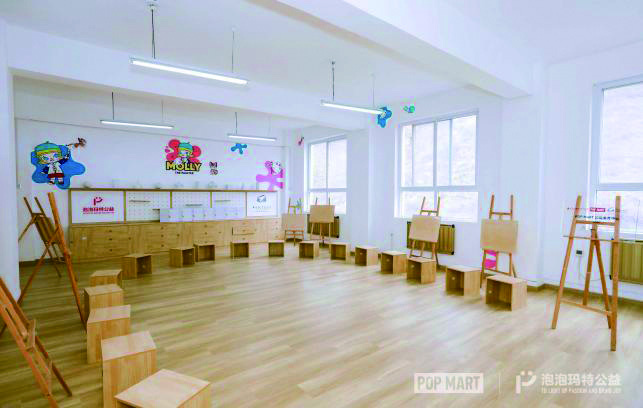


## 原PDF第146页

[对照原PDF第146页](../2021年年度报告.pdf#page=146)

2021 年环境、社会及管治报告

案例：深化校企合作，培养艺术文化人才

本公司坚决贯彻落实党的十九大「 产教融合」的政策，与全国范围内多所高校建立并深化校企合作关系。2021年1月，我们向北京大学教育基金会捐赠300万元人民币，与北京大学光华管理学院共同成立商业与艺术研究中心，推动艺术文化产业人才培养及行业发展。11 月，我们首笔向中国传媒大学教育基金会捐赠 72 万元人民币，用于资助中国传媒大学动画与数字艺术学院学生人才培养和专业建设，支持国潮文化研究、潮流创意设计课程的开发与学术交流。

案例：聚焦社会公益，为社会传递美好

本公司深刻理解企业的发展壮大离不开社会各界的支持，始终坚持在传递美好的公益之路上大步前行，为需要帮助的个人或团体提供关怀。2021 年6 月1 日，本公司与爱佑慈善基金会携手发起「童心永不泯」六一主题活动，为上海、天津等城市8所医院的近千名住院孩子们送去节日礼物和温暖陪伴。我们组织南京分公司的员工志愿者们走进南京儿童医院，帮助在院治疗的孩子们适应医疗场景，通过丰富多彩的活动向孩子们传递温暖。

泡泡玛特携手爱佑慈善基金会为住院儿童送上节日礼物

二零二一年年报  145


## 原PDF第147页

[对照原PDF第147页](../2021年年度报告.pdf#page=147)

2021 年环境、社会及管治报告

案例：推出联动公益形象，致敬航天事业

2021 年10 月16 日，神舟十三号载人飞船在中国酒泉卫星发射中心成功发射，本公司与上海埃依斯航天科技有限公司合作推出「MEGA珍藏系列1000% SPACE MOLLY月岩」公益形象，在中国科技馆展出并正式开启抽签预售，限量发行500体。我们将其中嵌入火箭碎片的200体「SPACE MOLLY月岩」公益形象所得收益全部捐出，用于助力航天科普教育事业发展。

「SPACE MOLLY月岩」在中国科技馆展出案例：支援灾情一线，向灾区传递希望

作为优秀民族企业的一员，本公司亦在灾难发生时迅速出现在灾区第一线。2021年7月 21 日，河南郑州等地遭遇极端强降雨带来的自然灾害，公司董事会连夜召开紧急会议，第一时间向河南省慈善总会捐赠500万元人民币，用于支持郑州市、新乡市等地的防汛救灾工作。7月23日，我们向灾区派遣志愿者积极支援一线防汛抗洪工作，为灾区人民带来支持和希望，向灾区人民传递温暖与关怀。

146  泡泡玛特国际集团有限公司

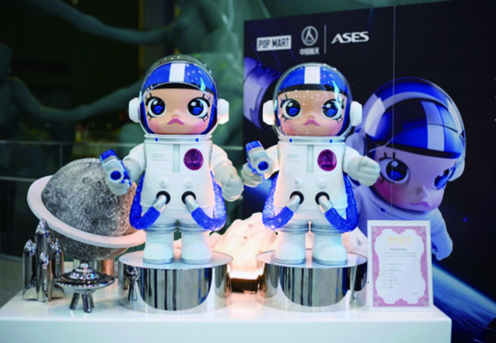

## 原PDF第148页

[对照原PDF第148页](../2021年年度报告.pdf#page=148)

2021 年环境、社会及管治报告

鉴于本年度在社会公益方面的突出表现，我们获得了多个奖项与殊荣。2021年9月16日，北京市工商联合会发布2021 北京民营

```text
                                                                      企业百强「1+4」榜单，本公司凭借在环境
(2021北京民营企业百强“1+4”榜单), the Company was selected as one      保护、乡村振兴等领域的积极举措入选「北
                                                                      京民营企业社会责任百强」。11月24日，由
( 北京民营企业社会责任百强 ) for its initiatives in the fields of     腾讯新闻主办的「商业向善，共创可持续未
                                                                      来 ——2021年中国益公司责任力年度论坛」
                                                                      在北京举行，本公司凭借「乡村儿童美育教
(社会实践杰出企业) due to its “Rural Children’s Aesthetic Education   育发展项目」，获得「社会实践杰出企业」荣
                            (乡村儿童美育教育发展专案) in the         誉称号。12 月 18 日，以「财富与责任 ——
                                                                      企业的价值」为主题的2021中国企业慈善公
                                                  (商业向善，         益500强发布暨第五届中国企业慈善公益论
共创可持续未来 ——2021年中国益公司责任力年度论坛) organized by         坛在重庆举行，本公司荣获「2021中国企业
                                                                      慈善公益500强」及「2021中国企业抗洪捐赠
                                  (财富与责任 —— 企业的价值),         500强」两大奖项。
```

(2021中国企业慈善公益500强) and “2021 China Top 500 Enterprises in Donation for Flood Fighting” (2021中国企业抗洪捐赠500强).

(2021中国企业慈善公益500强) and(2021中国企业抗洪捐赠500强)泡泡玛特荣获「2021中国企业慈善公益500强」及「2021中国企业抗洪捐赠500强」奖项

展望未来，本公司将继续发挥潮玩文化的凝聚力量，关注社会需求，积极参与社区发展建设，努力实现企业与广大利益相关方的协同发展，用实际行动回馈社会，为促进经济社会发展贡献力量。

二零二一年年报  147

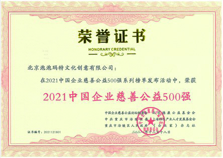

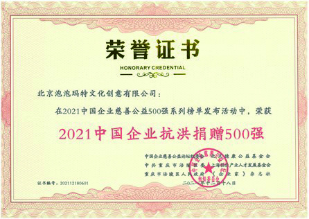

## 原PDF第149页

[对照原PDF第149页](../2021年年度报告.pdf#page=149)

2021 年环境、社会及管治报告

ESG指标索引

内容  章节

强制披露规定

管治架构：  董事会声明

由董事会发出的声明，当中载有下列内容：

披露董事会对环境、社会及管治事宜的监管；

(ii) 董事会的环境、社会及管治管理方针及策略，包括评估、优次排列及管理重要的环境、社会及管治相关事宜（包括对发行人业务的风险）的过程；及

(iii) 董事会如何按环境、社会及管治相关目标检讨进度，并解释它们如何与发行人业务有关连。

关于本报告描述或解释在编备环境、社会及管治报告时如何应用汇报原则（重要性、量化和一致性）。

关于本报告

解释环境、社会及管治报告的汇报范围，及描述挑选哪些实体或业务纳入环境、社会及管治报告的过程。若汇报范围有所改变，发行人应解释不同之处及变动原因。

148  泡泡玛特国际集团有限公司

## 原PDF第150页

[对照原PDF第150页](../2021年年度报告.pdf#page=150)

2021 年环境、社会及管治报告

内容  章节

「不遵守就解释」条文

环境范畴

A1排放物

一般披露

环境管理有关废气及温室气体排放、向水及土地的排污、有害及无害废弃物的产生等的：

(a) 政策；及

(b) 遵守对发行人有重大影响的相关法律及规例的资料。

关键绩效指标A1.1排放物种类及相关排放数据。

环境关键绩效指标

关键绩效指标A1.2直接（范围一）及能源间接（范围二）温室气体排放量（以吨计算）及（如适用）密度（如以每产量单位、每项设施计算）。  环境关键绩效指标

关键绩效指标A1.3所产生有害废弃物总量（以吨计算）及（如适用）密度（如以每产量单位、每项设施计算）。 Indicators环境关键绩效指标

关键绩效指标A1.4所产生无害废弃物总量（以吨计算）及（如适用）密度（如以每产量单位、每项设施计算）。 Indicators环境关键绩效指标

关键绩效指标A1.5描述所订立的排放量目标及为达到这些目标所采取的步骤。环境管理

关键绩效指标A1.6描述处理有害及无害废弃物的方法，及描述所订立的减废目标及为达到这些目标所  环境管理采取的步骤。

二零二一年年报  149

## 原PDF第151页

[对照原PDF第151页](../2021年年度报告.pdf#page=151)

2021 年环境、社会及管治报告

内容  章节

A2资源使用

一般披露

环境管理有效使用资源（包括能源、水及其他原材料）的政策。

注：资源可用于生产、储存、交通、楼宇、电子设备等。

关键绩效指标A2.1按类型划分的直接及 ╱ 或间接能源（如电、气或油）总耗量（以千个千瓦时计算）及密度（如以每产量单位、每项设施计算）。  环境关键绩效指标

关键绩效指标A2.2总耗水量及密度（如以每产量单位、每项设施计算）。

环境关键绩效指标

关键绩效指标A2.3描述所订立的能源使用效益目标及为达到这些目标所采取的步骤。环境管理

关键绩效指标A2.4描述求取适用水源上可有任何问题，以及所订立的用水效益目标及为达到这些目标  环境管理所采取的步骤。

关键绩效指标A2.5制成品所用包装材料的总量（以吨计算）及（如适用）每生产单位占量。环境关键绩效指标

150  泡泡玛特国际集团有限公司

## 原PDF第152页

[对照原PDF第152页](../2021年年度报告.pdf#page=152)

2021 年环境、社会及管治报告

内容  章节

A3环境及天然资源

一般披露

环境管理减低上市公司对环境及天然资源造成重大影响的政策。

关键绩效指标A3.1描述业务活动对环境及天然资源的重大影响及已采取管理有关影响的行动。  环境管理

A4气候变化

一般披露

环境管理

识别及应对已经及可能会对发行人产生影响的重大气候相关事宜的政策。

关键绩效指标A4.1描述已经及可能会对发行人产生影响的重大气候相关事宜，及应对行动。  环境管理

社会范畴

B1雇佣

一般披露

雇佣及劳工准则有关薪酬及解雇、招聘及晋升、工作时数、假期、平等机会、多元化、反歧视以及其他待遇及福利的：

(a) 政策；及

(b) 遵守对发行人有重大影响的相关法律及规例的资料。

关键绩效指标B1.1按性别、雇佣类型（如全职或兼职）、年龄组别及地区划分的雇员总数。  雇佣及劳工准则

关键绩效指标B1.2按性别、年龄组别及地区划分的雇员流失比率。雇佣及劳工准则

二零二一年年报  151

## 原PDF第153页

[对照原PDF第153页](../2021年年度报告.pdf#page=153)

2021 年环境、社会及管治报告

内容  章节

B2健康与安全

一般披露

雇佣及劳工准则有关提供安全工作环境及保障雇员避免职业性危害的：

(a) 政策；及

(b) 遵守对发行人有重大影响的相关法律及规例的资料。

关键绩效指标B2.1过去三年（包括汇报年度）每年因工亡故的人数及比率。  雇佣及劳工准则

关键绩效指标B2.2因工伤损失工作日数。雇佣及劳工准则

关键绩效指标B2.3描述所采纳的职业健康与安全措施，以及相关执行及监察方法。  雇佣及劳工准则

152  泡泡玛特国际集团有限公司

## 原PDF第154页

[对照原PDF第154页](../2021年年度报告.pdf#page=154)

2021 年环境、社会及管治报告

内容  章节

B3发展及培训

一般披露

雇佣及劳工准则

有关提升雇员履行工作职责的知识及技能的政策。描述培训活动。

注：培训指职业培训，可包括由雇主付费的内外部课程。

关键绩效指标B3.1按性别及雇员类别（如高级管理层、中级管理层）划分的受训雇员百分比。  雇佣及劳工准则

关键绩效指标B3.2按性别及雇员类别划分，每名雇员完成受训的平均时数。雇佣及劳工准则

B4劳工准则

一般披露

雇佣及劳工准则有关防止童工或强制劳工的：

(a) 政策；及

(b) 遵守对发行人有重大影响的相关法律及规例的资料。

关键绩效指标B4.1描述检讨招聘惯例的措施以避免童工及强制劳工。雇佣及劳工准则

关键绩效指标B4.2描述在发现违规情况时消除有关情况所采取的步骤。雇佣及劳工准则

二零二一年年报  153

## 原PDF第155页

[对照原PDF第155页](../2021年年度报告.pdf#page=155)

2021 年环境、社会及管治报告

内容  章节

B5供应链管理

一般披露

供应链管理管理供应链的环境及社会风险政策。

关键绩效指标B5.1按地区划分的供应商数目。供应链管理

关键绩效指标B5.2描述有关聘用供应商的惯例，向其执行有关惯例的供应商数目，以及相关执行及  供应链管理监察办法。

```text
关键绩效指标B5.3描述有关识别供应链每个环节的环境及社会风险的惯例，以及相关执行及监察方法。     供应链管理
关键绩效指标B5.4描述在拣选供应商时促使多用环保产品及服务的惯例，以及相关执行及监察方法。       供应链管理
```

154  泡泡玛特国际集团有限公司

## 原PDF第156页

[对照原PDF第156页](../2021年年度报告.pdf#page=156)

2021 年环境、社会及管治报告

内容  章节

B6产品责任

一般披露

责任经营有关所提供产品和服务的健康与安全、广告、标签及私隐事宜以及补救方法的：

(a) 政策；及

(b) 遵守对发行人有重大影响的相关法律及规例的资料。

关键绩效指标B6.1已售或已运送产品总数中因安全与健康理由而须回收的百分比。责任经营

关键绩效指标B6.2接获关于产品及服务的投诉数目以及应对方法。责任经营

关键绩效指标B6.3描述与维护及保障知识产权有关的惯例。责任经营

关键绩效指标B6.4描述质量检定过程及产品回收程序。责任经营

关键绩效指标B6.5描述消费者资料保障及私隐政策，以及相关执行及监察方法。  责任经营

二零二一年年报  155

## 原PDF第157页

[对照原PDF第157页](../2021年年度报告.pdf#page=157)

2021 年环境、社会及管治报告

内容  章节

B7反贪污

一般披露

反贪污管理有关防止贿赂、勒索、欺诈及洗黑钱的：

(a) 政策；及

(b) 遵守对发行人有重大影响的相关法律及规例的资料。

```text
关键绩效指标B7.1于汇报期内对发行人或其雇员提出并已审结的贪污诉讼案件的数目及诉讼结果。         反贪污管理
关键绩效指标B7.2描述防范措施及举报程序，以及相关执行及监察方法。                               反贪污管理
```

关键绩效指标B7.3描述向董事及员工提供的反贪污培训。反贪污管理

B8社区投资

一般披露

社区投资管理有关以社区参与来了解营运所在社区需要和确保其业务活动会考虑社区利益的政策。

关键绩效指标B8.1专注贡献范畴（如教育、环境事宜、劳工需求、健康、文化、体育）。

社区投资管理

关键绩效指标B8.2在专注范畴所动用资源（如金钱或时间）。

社区投资管理

156  泡泡玛特国际集团有限公司

## 原PDF第158页

[对照原PDF第158页](../2021年年度报告.pdf#page=158)

独立核数师报告

致泡泡玛特国际集团有限公司股东（于开曼群岛注册成立的有限公司）

意见

我们已审计的内容

泡泡玛特国际集团有限公司（ 以下简称「 贵公司」）及其附属公司（以下统称「贵集团」）列载于第165至300页的综合财务报表，包括：

•  于2021年12月31日的综合资产负债表；

•  截至该日止年度的综合损益及其他全面收益表；

•  截至该日止年度的综合权益变动表；

•  截至该日止年度的综合现金流量表；及

•  综合财务报表附注，包括主要会计政策概要及其他解释信息。

我们的意见

我们认为，该等综合财务报表已根据《国际财务报告准则》真实而中肯地反映了  贵集团于2021年12 月31 日的综合财务状况及其截至该日止年度的综合财务表现及综合现金流量，并已遵照香港《公司条例》的披露规定妥为拟备。

二零二一年年报  157

## 原PDF第159页

[对照原PDF第159页](../2021年年度报告.pdf#page=159)

独立核数师报告

意见的基础

我们已根据《国际审计准则》进行审计。我们在该等准则下承担的责任已在本报告核数师就审计综合财务报表承担的责任部分中作进一步阐述。

我们相信，我们所获得的审计凭证能充足及适当地为我们的审计意见提供基础。

独立性

根据国际会计师职业道德准则理事会颁布的《国际会计师职业道德守则（包含国际独立性标准）》（ 以下简称「 道德守则 」）， 我们独立于  贵集团，并已履行道德守则中的其他职业道德责任。

关键审计事项

关键审计事项是根据我们的专业判断，认为对本期综合财务报表的审计最为重要的事项。这些事项是在我们审计整体综合财务报表及出具意见时进行处理的。我们不会对这些事项提供单独的意见。

我们在审计中识别的关键审计事项是关于存货减值准备。

158  泡泡玛特国际集团有限公司

## 原PDF第160页

[对照原PDF第160页](../2021年年度报告.pdf#page=160)

独立核数师报告

关键审计事项 （续）

关键审计事项  我们的审计如何处理关键审计事项

存货减值准备我们为处理这一关键审计事项执行了以下程序：

•请参阅综合财务报表附注2.12、4(a)及21。

我们考虑了估计的不确定性和其他固有风险因素的水准，以评估重大错报的固有风险；

于2021年12月31日， 贵集团的总存货结余为人民币794百万  •元，并计提存货减值准备人民币5百万元。

我们了解并评价了管理层对存货减值准备的内部控制和评估过程，测试了管理层对存货减值准备估计的关键控存货按成本和可变现净值两者中较低者列报。可变现净值是  制；指在正常经营过程中的估计售价减去估计的完工成本和估计的销售所需成本。  •

我们与管理层讨论并评估了存货减值准备所使用的方法和假设的适当性；

•存货的减值准备估计涉及管理层重大判断，该等判断需考虑库龄结构、未来销售预测、预估未来售价以及销售开支等关键因素。  我们对以前期间存货减值准备的评估结果进行了评价，以衡量管理层估计过程的有效性；

鉴于减值评估涉及管理层重大判断，我们认为这是一个关键审计事项。

二零二一年年报  159

## 原PDF第161页

[对照原PDF第161页](../2021年年度报告.pdf#page=161)

独立核数师报告

关键审计事项 （续）

关键审计事项  我们的审计如何处理关键审计事项

•

通过与相关单据（包括收货单）核对，我们在抽样的基础上对存货的库龄结构进行了测试；

•

我们通过对年末以后的销售情况进行审查，在抽样的基础上将存货的账面价值与可变现净值进行了比较；

•

我们通过质疑管理层的未来销售预测、未来销售价格和销售费用的估计（参考行业趋势）、根据历史资料制定的经审批预算及年结日后的实际销售，评估拨备方法和假设的合理性；

•

我们检查了存货减值准备计算的准确性；

•

我们在存货盘点期间查看了存货的物理状况，以确定存货是否出现损坏或报废，并询问管理层是否已作出适当的存货减值准备。

我们认为，管理层在确定存货减值准备时采用的假设和运用的判断均有据可依。

160  泡泡玛特国际集团有限公司

## 原PDF第162页

[对照原PDF第162页](../2021年年度报告.pdf#page=162)

独立核数师报告

其他信息

贵公司董事须对其他信息负责。其他信息包括刊载于泡泡玛特国际集团有限公司2021 年年报（「 年报 」）内的所有信息 ， 但不包括综合财务报表及我们的核数师报告。我们已取得部分其他信息，包括我们在本核数师报告日前取得的管理层讨论与分析。余下其他信息（包括财务概要、董事会报告、董事长致辞、企业管治报告、董事及高级管理层履历以及环境、社会及管治报告）预期会在本核数师报告日后取得。

我们对综合财务报表的意见并不涵盖其他信息，我们既不也将不对该等其他信息发表任何形式的鉴证结论。

结合我们对综合财务报表的审计，我们的责任是阅读上述的其他信息，在此过程中，考虑其他信息是否与综合财务报表或我们在审计过程中所了解的情况存在重大抵触或者似乎存在重大错误陈述的情况。

基于我们对在本核数师报告日前取得的其他信息所执行的工作，如果我们认为其他信息存在重大错误陈述，我们需要报告该事实。在这方面，我们没有任何报告。

当我们阅读年报内所载其余其他信息后，如果我们认为其中存在重大错误陈述，我们需要将有关事项与审计委员会沟通，并考虑我们的法律权利和义务后采取适当行动。

二零二一年年报  161

## 原PDF第163页

[对照原PDF第163页](../2021年年度报告.pdf#page=163)

独立核数师报告

董事及审计委员会就综合财务报表须承担的责任

贵公司董事须负责根据《国际财务报告准则》及香港《公司条例》的披露规定拟备真实而中肯的综合财务报表，并对其认为为使综合财务报表的拟备不存在由于欺诈或错误而导致的重大错误陈述所需的内部控制负责。

在拟备综合财务报表时，董事负责评估  贵集团持续经营的能力，并在适用情况下披露与持续经营有关的事项，以及使用持续经营为会计基础，除非董事有意将  贵集团清盘或停止经营，或别无其他实际的替代方案。

审计委员会须负责监督  贵集团的财务报告过程。

核数师就审计综合财务报表承担的责任

我们的目标，是对综合财务报表整体是否不存在由于欺诈或错误而导致的重大错误陈述取得合理保证，并出具包括我们意见的核数师报告。我们仅向  阁下（作为整体）报告我们的意见，除此之外本报告别无其他目的。我们不会就本报告的内容向任何其他人士负上或承担任何责任。合理保证是高水平的保证，但不能保证按照《国际审计准则》进行的审计，在某一重大错误陈述存在时总能发现。错误陈述可以由欺诈或错误引起，如果合理预期它们单独或汇总起来可能影响综合财务报表使用者依赖综合财务报表所作出的经济决定，则有关的错误陈述可被视作重大。

162  泡泡玛特国际集团有限公司

## 原PDF第164页

[对照原PDF第164页](../2021年年度报告.pdf#page=164)

独立核数师报告

核数师就审计综合财务报表承担的责任 （续）

在根据《国际审计准则》进行审计的过程中，我们运用了专业判断，保持了专业怀疑态度。我们亦：

识别和评估由于欺诈或错误而导致综合财务报表存在重大错误陈述的风险，设计及执行审计程序以应对这些风险，以及获取充足和适当的审计凭证，作为我们意见的基础。由于欺诈可能涉及串谋、伪造、蓄意遗漏、虚假陈述，或凌驾于内部控制之上，因此未能发现因欺诈而导致的重大错误陈述的风险高于未能发现因错误而导致的重大错误陈述的风险。

了解与审计相关的内部控制，以设计适当的审计程序，但目的并非对  贵集团内部控制的有效性发表意见。

评价董事所采用会计政策的恰当性及作出会计估计和相关披露的合理性。

对董事采用持续经营会计基础的恰当性作出结论。根据所获取的审计凭证，确定是否存在与事项或情况有关的重大不确定性，从而可能导致对  贵集团的持续经营能力产生重大疑虑。如果我们认为存在重大不确定性，则有必要在核数师报告中提请使用者注意综合财务报表中的相关披露。假若有关的披露不足，则我们应当发表非无保留意见。我们的结论是基于核数师报告日止所取得的审计凭证。然而，未来事项或情况可能导致  贵集团不能持续经营。

二零二一年年报  163

## 原PDF第165页

[对照原PDF第165页](../2021年年度报告.pdf#page=165)

独立核数师报告

核数师就审计综合财务报表承担的责任 （续）

•  评价综合财务报表的整体列报方式、结构和内容，包括披露，以及综合财务报表是否中肯反映交易和事项。

```text
•   就  贵集团内实体或业务活动的财务信息
    获取充足、适当的审计凭证，以便对综合
```

财务报表发表意见。我们负责  贵集团审计的方向、监督和执行。我们为审计意见承担全部责任。

除其他事项外，我们与审计委员会沟通了计划的审计范围、时间安排、重大审计发现等，包括我们在审计中识别出内部控制的任何重大缺陷。

我们还向审计委员会提交声明，说明我们已符合有关独立性的相关专业道德要求，并与他们沟通有可能合理地被认为会影响我们独立性的所有关系和其他事项，以及在适用的情况下，用以消除对独立性产生威胁的行动或采取的防范措施。

从与审计委员会沟通的事项中，我们确定哪些事项对本期综合财务报表的审计最为重要，因而构成关键审计事项。我们在核数师报告中描述这些事项，除非法律法规不允许公开披露这些事项，或在极端罕见的情况下，如果合理预期在我们报告中沟通某事项造成的负面后果超过产生的公众利益，我们决定不应在报告中沟通该事项。

出具本独立核数师报告的审计项目合伙人是袁国新。

罗兵咸永道会计师事务所

执业会计师

香港，2022年3月28日

164  泡泡玛特国际集团有限公司

## 原PDF第166页

[对照原PDF第166页](../2021年年度报告.pdf#page=166)

综合损益及其他全面收益表

```text
                                                  截至12月31日止年度
                                                      2021             2020
                                                   2021年            2020年
                                   附注         人民币千元       人民币千元
收益                                 5           4,490,651         2,513,471
销售成本                             6          (1,732,027)         (919,363)
毛利                                             2,758,624         1,594,108
经销及销售开支                       6          (1,106,078)         (630,069)
一般及行政开支                       6            (557,509)         (279,967)
金融资产减值（拨备）╱ 拨回
                                                    (1,435)             398
其他收入                             7              54,425            45,420
其他收益 ╱（亏损）－ 净额            8               1,785           (11,107)
经营溢利                                         1,149,812           718,783
财务收入                             9              28,609             1,953
财务开支                             9             (21,246)          (10,946)
财务收入 ╱（开支）－ 净额            9               7,363            (8,993)
可转换可赎回优先股的公平值变动
                                    33                   –            (6,260)
分占使用权益法入账的投资溢利
                                    17              14,016             3,873
除所得税前溢利                                   1,171,191           707,403
所得税开支                          10            (316,624)         (184,091)
年内溢利                                           854,567           523,312
以下应占年内溢利：
  － 本公司拥有人                                  854,339           523,505
  － 非控股权益                                        228             (193)
                                                   854,567           523,312
```

二零二一年年报  165

## 原PDF第167页

[对照原PDF第167页](../2021年年度报告.pdf#page=167)

综合损益及其他全面收益表

```text
              截至12月31日止年度
                  2021            2020
                2021年          2020年
附注        人民币千元      人民币千元
```

其他全面亏损

```text
可能重新分类至损益的项目
  － 货币换算差额                                    (12,629)          (25,726)
```

将不会重新分类至损益的项目

```text
  － 货币换算差额                                   (102,926)           (13,050)
年内其他全面亏损，
  除税后                                            (115,555)           (38,776)
年内全面收益总额                                     739,012           484,536
```

以下应占年内全面收益总额：

```text
－ 本公司拥有人                                   738,816           484,604
－ 非控股权益                                         196               (68)
                                                  739,012           484,536
```

本公司拥有人应占溢利的

```text
每股盈利
－ 基本（以每股人民币元表示）      12                0.62              0.44
－ 摊薄（以每股人民币元表示）      12                0.62              0.44
```

以上综合损益及其他全面收益表应与随附附注一并阅读。

166  泡泡玛特国际集团有限公司

## 原PDF第168页

[对照原PDF第168页](../2021年年度报告.pdf#page=168)

综合资产负债表

```text
                  于12月31日
                  2021            2020
                2021年          2020年
附注        人民币千元      人民币千元
```

资产

```text
非流动资产
物业、厂房及设备                   13            366,281          238,325
无形资产                           14            134,032           92,731
使用权资产                         15            609,517          287,799
使用权益法入账的投资
                                   17             61,539           50,380
按公平值计量且其变动
  计入损益的金融资产               23            328,688           16,900
预付款项及其他非流动资产           22             30,727            6,177
递延所得税资产                     18             35,553           23,087
总非流动资产                                   1,566,337          715,399
流动资产
贸易应收款项                       19            171,334           78,334
其他应收款项                       20            154,939           90,781
存货                               21            788,829          225,369
预付款项及其他流动资产             22            353,580          177,918
按公平值计入损益的金融资产
                                   23             20,544               –
受限制现金                         24              3,353            3,263
现金及现金等价物                   24          5,264,710         5,680,235
总流动资产                                     6,757,289         6,255,900
总资产                                         8,323,626         6,971,299
```

二零二一年年报  167

## 原PDF第169页

[对照原PDF第169页](../2021年年度报告.pdf#page=169)

综合资产负债表

```text
                                                     于12月31日
                                                    2021              2020
                                                  2021年           2020年
                                  附注         人民币千元      人民币千元
权益
股本                               25                 923              923
就股份奖励计划持有的股份           26                 (15)             (16)
其他储备                           27           5,023,583         5,189,115
保留盈利                                        1,793,691          939,352
本公司拥有人应占权益
                                                6,818,182         6,129,374
非控股权益                                          1,824            1,628
总权益                                          6,820,006         6,131,002
```

负债

```text
非流动负债
应付授权费                         30             46,371           27,934
租赁负债                           15            364,543          147,050
总非流动负债                                     410,914          174,984
流动负债
贸易应付款项                       29            266,098          115,804
应付授权费                         30             86,004           58,880
其他应付款项                       31            266,902          202,297
合约负债                           32            119,624           83,941
租赁负债                           15            256,909          144,724
即期所得税负债                                    97,169           59,667
总流动负债                                     1,092,706          665,313
总负债                                         1,503,620          840,297
总权益及负债                                   8,323,626         6,971,299
```

168  泡泡玛特国际集团有限公司

## 原PDF第170页

[对照原PDF第170页](../2021年年度报告.pdf#page=170)

综合资产负债表

以上综合资产负债表应与随附附注一并阅读。

第165页至第300页的财务报表于2022年3月28日获董事会批准，并由下列董事代表签署：

```text
王宁先生                                                              司德先生
执行董事及主席                                                        执行董事
```

二零二一年年报  169

## 原PDF第171页

[对照原PDF第171页](../2021年年度报告.pdf#page=171)

综合权益变动表

本公司拥有人应占

就股份奖励

```text
       计划持有的
股本         股份     其他储备     保留盈利         小计    非控股权益         合计
```

（附注25）  （附注26）  （附注27）

```text
                               附注    人民币千元   人民币千元   人民币千元   人民币千元   人民币千元   人民币千元   人民币千元
于2021年1月1日的结余                          923          (16)   5,189,115      939,352     6,129,374       1,628     6,131,002
全面收益
年内溢利                                        –            –            –      854,339      854,339          228      854,567
其他全面收益
货币换算差额                                    –            –     (115,523)           –      (115,523)         (32)    (115,555)
全面收益总额                                    –            –     (115,523)     854,339      738,816          196      739,012
与拥有人的交易
宣派及派付的股息                                –            –     (205,833)           –     (205,833)           –      (205,833)
根据股份奖励计划归属之股份
                                28              –            1           (1)           –            –            –            –
以股份为基础的报酬开支
                                28              –            –      155,825            –      155,825            –      155,825
与拥有人的交易总额                              –            1      (50,009)           –       (50,008)          –       (50,008)
于2021年12月31日的结余                        923          (15)   5,023,583    1,793,691     6,818,182       1,824     6,820,006
```

170  泡泡玛特国际集团有限公司

## 原PDF第172页

[对照原PDF第172页](../2021年年度报告.pdf#page=172)

综合权益变动表

本公司拥有人应占

```text
                                                       就股份奖励
                                                       计划持有的
                                                股本          股份      其他储备      保留盈利          小计    非控股权益          合计
                                                                        (Note 27)
                                          （附注25） （附注26） （附注27）
                                                                                       RMB’000
                                 附注    人民币千元人民币千元人民币千元人民币千元                 人民币千元    人民币千元    人民币千元
于2020年1月1日的结余                              82             –       169,631       423,068       592,781             –       592,781
全面收益
年内溢利 ╱（亏损）                                 –             –             –       523,505       523,505          (193)      523,312
其他全面收益
货币换算差额                                       –             –        (38,901)           –        (38,901)         125        (38,776)
全面收益总额                                       –             –        (38,901)     523,505       484,604           (68)      484,536
```

与拥有人的交易

```text
转拨至法定储备之溢利
                                                       –              –          7,221         (7,221)             –              –              –
业务合并产生的非控股权益
                                                       –              –              –              –              –          1,696          1,696
重新指定普通股为优先股
                                    25                (3)             –       (499,658)             –       (499,661)             –       (499,661)
向当时股东发行普通股
                                    25                 4              –        393,801              –        393,805              –        393,805
可转换可赎回优先股转换
  为普通股
                                    25                 3              –        626,922              –        626,925              –        626,925
根据限制性股份奖励计划
  发行普通股                        25                 2             (2)             –              –              –              –              –
资本化发行                          25               733            (14)          (719)             –              –              –              –
发行新普通股                        25                89              –      4,409,110              –      4,409,199              –      4,409,199
超额配股权获行使后
  发行普通股                        25                13              –        661,269              –        661,282              –        661,282
股份发行成本                                           –              –       (154,902)             –       (154,902)             –       (154,902)
宣派股息                                               –              –       (384,659)             –       (384,659)             –       (384,659)
与拥有人的交易总额                                   841            (16)     5,058,385         (7,221)     5,051,989          1,696      5,053,685
于2020年12月31日的结余                               923            (16)     5,189,115        939,352      6,129,374          1,628      6,131,002
```

以上综合权益变动表应与随附附注一并阅读。

二零二一年年报  171

## 原PDF第173页

[对照原PDF第173页](../2021年年度报告.pdf#page=173)

综合现金流量表

```text
                                                截至12月31日止年度
                                                   2021             2020
                                                 2021年           2020年
                                  附注        人民币千元      人民币千元
经营活动产生的现金流量
经营所得现金                      35(a)        1,042,075          899,881
已收利息                                          28,609            1,953
已付所得税                                      (291,587)        (198,476)
经营活动所得现金净额
                                                 779,097          703,358
```

投资活动产生的现金流量

```text
按公平值计入损益的金融
  资产增加                                     (1,272,757)        (247,400)
购买物业、厂房及设备                             (287,502)        (175,984)
购买无形资产                                      (46,246)         (47,608)
处置按公平值计入损益的金融资产
  所得款项                                        950,988          281,653
按公平值计入损益的金融资产投资
  收入                                              4,832               –
收到一间联营公司股息                                2,074               –
出售物业、厂房及设备、无形资产
  所得款项                                           609             2,713
于一家合营企业的投资                                    –           (4,475)
于一家联营公司的投资                                    –          (27,424)
业务合并获得的现金                                      –            1,590
投资活动所用现金净额                             (648,002)        (216,935)
```

172  泡泡玛特国际集团有限公司

## 原PDF第174页

[对照原PDF第174页](../2021年年度报告.pdf#page=174)

综合现金流量表

```text
                                                  截至12月31日止年度
                                                      2021             2020
                                                   2021年            2020年
                                   附注         人民币千元       人民币千元
融资活动产生的现金流量
租赁负债付款                        15            (220,126)         (147,995)
已付股息                                          (208,834)         (377,580)
上市开支付款                                        (6,867)         (154,902)
本公司的股东注资
                                                         –           398,375
视作分派予当时股东以购买上市业
  务
                                                         –            (4,566)
发行普通股所得款项
                                    25                   –         5,070,481
发行可转换可赎回优先股的所得款
  项                                33                   –            86,561
融资活动（所用）╱ 所得现金净额
                                                  (435,827)        4,870,374
现金及现金等价物（减少）╱
  增加净额                                        (304,732)        5,356,797
年初的现金及现金等价物
                                                 5,680,235           324,614
现金及现金等价物的汇兑亏损
                                                  (110,793)           (1,176)
年末的现金及现金等价物
                                                 5,264,710         5,680,235
```

二零二一年年报  173

## 原PDF第175页

[对照原PDF第175页](../2021年年度报告.pdf#page=175)

综合财务报表附注

1 一般资料

泡泡玛特国际集团有限公司（「本公司」）于2019 年5 月9 日根据开曼群岛公司法第22 章（1961 年第 3 号法例，经综合及修订）在开曼群岛注册成立为获豁免有限公司。本公司注册办事处的地址为P.O. Box 309, Ugland House, Grand Cayman, KY1-1104, Cayman Islands。

本公司为投资控股公司，其附属公司主要于中华人民共和国（「 中国 」）及若干海外国家及地区从事潮流玩具的产品设计与开发及销售。本公司的最终控股公司为 GWF Holding Limited （前称Grant Wang Holding Limited），后者由王宁先生及其配偶杨涛女士控制。

根据本公司全体股东（「 股东 」）于 2 0 2 0 年11 月23 日通过的书面决议案，在本公司股份溢价账因根据全球发售发行新股而录得进账的情况下，授权本公司董事（「董事」）透过将112,128 美元拨作资本而按面值向于2020 年12 月11 日前一个营业日营业时间结束时名列本公司股东名册的人士配发及发行合共1,121,278,635股入账列为缴足每股面值0.0001美元的股份（「资本化发行」）。

于2020 年12 月11 日，本公司成功在香港联合交易所有限公司（「联交所」）主板上市。

174  泡泡玛特国际集团有限公司

## 原PDF第176页

[对照原PDF第176页](../2021年年度报告.pdf#page=176)

综合财务报表附注

1 一般资料 （续）

除非另有说明，否则本综合财务报表以人民币（「人民币」）呈列。

本综合财务报表已于2022年3月28日经董事会批准刊发。

2 重大会计政策概要

本附注提供编制该等综合财务报表时所采纳的主要会计政策清单。除另有所指外，该等政策于所有呈列年度一直贯彻应用。财务报表乃为本集团（由本公司及其附属公司组成）编制。

2.1 编制基准

(i) 遵守国际财务报告准则及香港公司条例

本集团综合财务报表乃根据国际会计准则理事会（「国际会计准则理事会」）颁布的所有适用国际财务报告准则（「国际财务报告准则」）及第622章香港公司条例（「香港公司条例」）的披露规定编制。

(ii) 历史成本法

综合财务报表乃根据历史成本法编制，并根据按公平值计入损益的金融资产的重估（按公平值列账）作出修订。

二零二一年年报  175

## 原PDF第177页

[对照原PDF第177页](../2021年年度报告.pdf#page=177)

综合财务报表附注

2 重大会计政策概要 （续）

2.1 编制基准 （续）

(iii) 本集团采纳的新订及经修订准则

本集团于2021 年1 月1 日开始的年度报告期间首次应用下列准则及修订：

```text
                                                                               国际财务报告准则第9    利率基准改革
IFRS 7, IFRS 4 and IFRS 16                                                       号、国际会计准则第39   － 第2阶段
                                                                                 号、国际财务报告准则
```

第7号、国际财务报告

准则第4号及国际财务

报告准则第16号修订本

本集团亦选择提早采纳下列修订：

```text
国际财务报告准则    20 21年6月30日之后的
  第16号修订本        与新型冠状病毒疫情
                      相关的租金优惠
```

上述修订并无对过往期间已确认金额造成任何影响，且预期将不会严重影响现有或未来期间。

(iv) 尚未采纳的新订准则及诠释

若干已颁布的新会计准则、会计准则修订及诠释毋须于截至2021 年12 月31日止的报告期间强制生效，故本集团并未提早采纳。该等准则、修订及诠释预计不会在当期或未来报告期间对本集团以及对可预见的未来交易产生重大影响。

176  泡泡玛特国际集团有限公司

## 原PDF第178页

[对照原PDF第178页](../2021年年度报告.pdf#page=178)

综合财务报表附注

2 重大会计政策概要 （续）

2.2 综合入账原则

(i) 附属公司

附属公司为本集团控制的所有实体（包括结构实体 ）。 倘本集团须承担或享有参与实体所获可变回报的风险及权利，且有能力透过其指导实体活动之权力影响该等回报时，则本集团对该实体拥有控制权。附属公司自控制权转入本集团之日起全面综合入账，自停止控制之日起取消综合入账。

公司间交易、集团公司间交易的结余及未变现收益予以对销。除非交易提供所转让资产的减值证据，否则未变现亏损亦将予以对销。附属公司的会计政策已作出必要之更改，以确保与本集团所采纳的政策一致。

于附属公司业绩及股权的非控股权益分别于综合损益及其他全面收益表、权益变动表及资产负债表单独列示。

通过合约安排控制的附属公司

本集团根据合约安排控制一家实体。本集团对结构实体的股权并无合法所有权。尽管如此，根据与结构实体的登记股东订立的合约安排，本公司及其他合法拥有的附属公司透过控制投票权、规管其财务及经营政策、委任或罢免其控制权力部门的大部分成员，以及于有关部门的会议上行使过半数投票权，从而控制结构实体。因此，本集团有权对结构实体行使权力、参与结构实体获得可变回报，因此作为本集团的控制结构实体呈列。

二零二一年年报  177

## 原PDF第179页

[对照原PDF第179页](../2021年年度报告.pdf#page=179)

综合财务报表附注

2 重大会计政策概要 （续）

2.2 综合入账原则 （续）

(ii) 合营安排

根据国际财务报告准则第 11 号合营安排，合营安排的投资分类为合营业务或合营企业。有关分类乃视乎每名投资者的合约权利及责任（而非合营安排的法律结构）而定。本集团已评估其合营安排的性质，并将该等合营安排厘定为合营企业。

合营企业

于合营企业的权益初始按成本于综合资产负债表确认后，使用权益法入账（见下文(iv)）。

(iii) 联营公司

联营公司指本集团对其有重大影响力而无控制权或共同控制权的所有实体，通常情况乃本集团持有20%至50%表决权。于联营公司的投资初始按成本确认后，使用权益会计法入账（见下文(iv)）。

于联营公司中以普通股形式的投资

于联营公司中普通股形式的投资初始按成本确认后，使用权益会计法入账（见下文(iv)）。

于联营公司中以附有优先权的普通股或可赎回优先股形式的投资

于联营公司中以附带优先权的普通股或可赎回优先股形式的投资按公平值计量且其变动计入当期损益的金融资产入账（附注2.10）。

178  泡泡玛特国际集团有限公司

## 原PDF第180页

[对照原PDF第180页](../2021年年度报告.pdf#page=180)

综合财务报表附注

2 重大会计政策概要 （续）

2.2 综合入账原则 （续）

(iv) 权益法

根据权益会计法，投资初步按成本确认，其后进行调整以确认本集团在损益中分占被投资方的收购后损益，以及本集团在其他全面收益中分占被投资方的其他全面收益变动。已收或应收合营企业股息确认为投资账面值的减少。

如本集团分占以权益入账投资亏损等于或超过其于实体中的权益（包括任何其他无抵押长期应收款项），本集团不会确认进一步亏损，除非其已产生责任或代表其他实体作出付款则例外。

本集团与其合营企业间交易的未变现收益以本集团于该等实体的权益为限予以对销。除非交易提供所转移资产的减值证据，否则未变现亏损亦将予以对销。以权益入账被投资方的会计政策已作出必要之更改，以确保与本集团所采纳的政策一致。

以权益入账投资的账面值按照附注2.10中所述的政策进行减值测试。

二零二一年年报  179

## 原PDF第181页

[对照原PDF第181页](../2021年年度报告.pdf#page=181)

综合财务报表附注

2 重大会计政策概要 （续）

2.2 综合入账原则 （续）

(v) 拥有权权益变动

本集团将不会引致失去控制权的非控股权益交易视为与本集团权益持有人的交易。拥有权权益变动导致控股权益与非控股权益账面值之间之调整以反映彼等于附属公司之相对权益。非控股权益调整数额与任何已付或已收代价间之任何差额于本集团权益持有人应占权益中之单独储备项目内确认。

倘本集团因丧失控制权、共同控制权或重大影响力而终止就投资合并入账或按权益入账，其于该实体之任何保留权益按其公平值重新计量，而账面值变动则于损益内确认。就随后入账列作于联营公司、合营企业或金融资产之保留权益而言，公平值成为初步账面值。此外，先前于其他综合收益内确认与该实体有关的任何金额按犹如本集团已直接出售有关资产或负债之方式入账。这可能代表先前在其他综合收益内确认之金额重新分类至损益或转拨至适用国际财务报告准则所指 ╱ 准许之另一权益类别。

倘于一家合营企业或联营公司的拥有权权益减少但保留共同控制权或重大影响力，则先前于其他全面收益确认的金额仅有一定比例份额重新分类至损益（如适用）。

180  泡泡玛特国际集团有限公司

## 原PDF第182页

[对照原PDF第182页](../2021年年度报告.pdf#page=182)

综合财务报表附注

2 重大会计政策概要 （续）

2.3 业务合并

(a) 共同控制下的业务合并

共同控制下的业务合并指合并实体于合并前后由相同方控制且该控制权并非暂时性的合并。

收购方将已付代价及已取得资产净值按账面值计量。资产净值账面值与已付代价账面值之差额于储备入账。业务合并应占的所有直接交易成本在综合损益及其他全面收益表入账。然而，就业务合并发行权益工具或债券产生之手续费、佣金及其他开支分别于权益工具及债券初步计量时入账。

(b) 非共同控制下的业务合并

非共同控制下的业务合并使用收购会计法入账，而不论是否已收购权益工具或其他资产。就收购一家附属公司转让的代价包括：

•  所转让资产的公平值

•  所收购业务的前拥有人所产生的负债

•  本集团发行的股权

•  由或然代价安排产生的任何资产或负债之公平值；及

•  附属公司任何先前存在股权的公平值

二零二一年年报  181

## 原PDF第183页

[对照原PDF第183页](../2021年年度报告.pdf#page=183)

综合财务报表附注

2 重大会计政策概要 （续）

2.3 业务合并 （续）

(b) 非共同控制下的业务合并 （续）

于业务合并中收购的可识别资产以及承担的负债及或然负债初步按其于收购日期的公平值计量（少数例外情况除外）。本集团以公平值或非控股权益所占被收购实体的可识别资产净值之适当比例按逐项收购基准确认于被收购实体的任何非控股权益。

收购相关成本于产生时支销。

于：

•  所转让代价，

•  被收购实体的任何非控股权益金额，及

•  被收购实体的任何先前股权于收购日期的公平值

超过所收购可识别资产净值的公平值部分入账列作商誉。倘该等金额低于所收购业务的可识别资产净值的公平值，则差额将直接于损益中确认为议价购买收益。

如现金代价任何部分的结算被延期，则未来应付金额将按交换日的现值贴现。所用贴现率为实体的增量借款利率，即可资比较条款及条件下独立融资人可获得类似借贷的利率。或然代价分类为权益或金融负债。分类为金融负债的金额随后按公平值重新计量，公平值变动计入损益。

182  泡泡玛特国际集团有限公司

## 原PDF第184页

[对照原PDF第184页](../2021年年度报告.pdf#page=184)

综合财务报表附注

2 重大会计政策概要 （续）

2.3 业务合并 （续）

(b) 非共同控制下的业务合并 （续）

如业务合并分阶段进行，收购方之前在被收购方持有的权益于收购日期的账面值，按收购日期的公平值重新计量。重新计量产生的任何盈亏在损益中确认。

2.4 独立财务报表

于附属公司之投资按成本扣除减值入账。成本包括投资的直接应占成本。附属公司的业绩在本集团账目内按已收股息及应收款项入账。

倘自附属公司就有关投资所收取的股息超出宣派股息期间该附属公司的全面收益总额，或倘独立财务报表的投资账面值超出财务资料所示被投资方之资产净值（包括商誉）账面值，则须对该等附属公司的投资进行减值测试。

2.5 分部报告

经营分部的呈报方式与提供予主要经营决策者（「主要经营决策者」）的内部报告的方式一致。主要经营决策者（负责分配资源及评估经营分部的表现）已被确认为本集团执行董事。

二零二一年年报  183

## 原PDF第185页

[对照原PDF第185页](../2021年年度报告.pdf#page=185)

综合财务报表附注

2 重大会计政策概要 （续）

2.6 外币换算

(i) 功能及呈列货币

本集团各实体的财务报表中所列的项目均以实体营运所在的主要经济环境的货币计量（「功能货币」）。本公司的功能货币为美元（「 美元 」）及中国境外公司的功能货币为美元、港元（「港元」）或韩圜（「韩圜」）。综合财务资料以人民币（「人民币」）呈列，人民币为本公司及本集团之呈列货币。

(ii) 交易及结余

以外币进行的交易采用交易日期的汇率换算为功能货币。结算该等交易产生的外汇盈亏，及以外币计值的货币性资产及负债以年末的汇率换算所产生的外汇盈亏一般于损益中确认。如该等外汇盈亏与合资格现金流量对冲及合资格净投资对冲有关，或归因于境外业务的部分净投资，则将其于权益中递延。

与借款有关的外汇盈亏于综合损益及其他全面收益表内「财务开支 － 净额」呈列。所有其他外汇盈亏则于综合损益及其他全面收益表内「 其他收益 ╱（亏损）－ 净额」呈列。

以外币为单位按公平值计量之非货币性项目，按照确定公平值当日之汇率换算。按公平值列账的资产及负债之换算差额呈报为公平值收益或亏损之一部分。例如非货币性资产及负债（如按公平值计入损益的权益）的换算差额在损益中确认为公平值收益或亏损的一部分。

184  泡泡玛特国际集团有限公司

## 原PDF第186页

[对照原PDF第186页](../2021年年度报告.pdf#page=186)

综合财务报表附注

2 重大会计政策概要 （续）

2.6 外币换算 （续）

(iii) 集团公司

功能货币与呈列货币不同的海外业务（均非超高通胀地区之货币）的业绩及财务状况按以下方式换算为呈列货币：

•  各资产负债表所呈列之资产及负债按结算日的收市汇率换算

•  各全面收益表之收入及开支按平均汇率换算（除非此数值并非该等交易日期适用汇率累计影响的合理约数，否则收入及开支将于交易日期换算），及

•  产生的所有汇兑差额将于其他全面收益内确认。

于综合入账时，换算海外实体任何净投资以及借款及指定作该等投资之对冲的其他金融工具所产生的汇兑差额均于其他全面收益确认。当出售海外业务或偿还构成该净投资部分的任何借款，相关的汇兑差额重新分类至损益，作为出售收益或亏损的一部分。

因收购海外业务而产生的商誉及公平值调整，均当作海外业务的资产及负债，并按收市汇率换算。

二零二一年年报  185

## 原PDF第187页

[对照原PDF第187页](../2021年年度报告.pdf#page=187)

综合财务报表附注

2 重大会计政策概要 （续）

2.7 物业、厂房及设备

物业、厂房及设备（在建工程除外）乃按历史成本减累计折旧及减值列账。历史成本包括收购项目的直接应占支出。

后续成本仅在项目的相关未来经济利益很可能流入本集团，且项目的成本能可靠计量之情况下，方计入有关资产之账面值或确认为独立资产（如适用）。替换零件的账面值不予确认。所有其他维修及保养费在其产生的财政期间自综合损益及其他全面收益表扣除。

物业、厂房及设备以直线法按以下估计可使用年期分配成本（扣除剩余价值）计算折旧：

```text
机器人商店售货机    5年
模具                1.5至3年
设备及其他          5年
租赁装修            余下租期或可使用年
                      期，以较短者为准
```

资产的剩余价值及可使用年期于各结算日均会进行检讨，并在适当情况下作出调整。

倘资产账面值高于其估计可收回金额，则会立即将该资产的账面值撇减至其可收回金额。

出售的收益及亏损透过将所得款项与账面值比较而厘定，并于综合损益及其他全面收益表「 其他收益 ╱（ 亏损 ）－ 净额 」内确认。

186  泡泡玛特国际集团有限公司

## 原PDF第188页

[对照原PDF第188页](../2021年年度报告.pdf#page=188)

综合财务报表附注

2 重大会计政策概要 （续）

2.7 物业、厂房及设备 （续）

在建工程指正在建设或有待安装的楼宇、厂房及 ╱ 或机械，并按成本减累计减值亏损列账。成本包括建造楼宇、厂房成本及机械、安装、测试及其他直接成本。在建工程暂不计提折旧准备，直至有关资产建成及可供拟定用途为止。

2.8 无形资产

(i) 商誉

商誉按附注2.3 所述计量。收购附属公司的商誉计入无形资产。商誉不予摊销，惟每年进行减值测试，或当有事件发生或情况变动显示可能出现减值时进行更频密减值测试，并按成本减去累计减值亏损列账。出售一间实体的收益及亏损包括有关所售实体商誉的账面值。

商誉会被分配至现金产生单位以进行减值测试。有关分配乃对预期将从商誉产生的业务合并中获益的现金产生单位或现金产生单位组别作出。现金产生单位或现金产生单位组别乃就内部管理目的而于监察商誉的最低层次（即经营分部）识别。

二零二一年年报  187

## 原PDF第189页

[对照原PDF第189页](../2021年年度报告.pdf#page=189)

综合财务报表附注

2 重大会计政策概要 （续）

2.8 无形资产 （续）

(ii) 软件

所购软件根据购买及使用特定软件所产生的成本予以资本化。

(iii) 知识产权（「IP产权」）

所收购IP产权根据收购产生的成本予以资本化。该等IP产权具有有限的可使用年期，随后按成本减累计摊销及减值亏损列账。与购买IP产权有关且视乎销量而定的可变付款于触发该等付款的条件发生期间于损益确认。

(iv) 特许知识产权（「授权IP」）

特许权按历史成本减累计摊销及累计减值亏损列账。特许权的历史成本按各特许权购买日期的固定最低付款的现值计量。与特许权有关且视乎销量而定的可变付款于触发该等付款的条件发生期间于损益确认。

188  泡泡玛特国际集团有限公司

## 原PDF第190页

[对照原PDF第190页](../2021年年度报告.pdf#page=190)

综合财务报表附注

2 重大会计政策概要 （续）

2.8 无形资产 （续）

(v) 研发成本

研究成本于产生期间在损益中确认。仅当满足以下所有条件时，开发成本方予以资本化：

完成该软件使其可供使用在技术上可行

管理层有意完成该软件并使用或出售该软件

有能力使用或出售该软件

能证明该软件如何产生可能出现的未来经济利益

有足够的技术、财务及其他资源完成开发并可使用或出售该软件，及

该软件在开发期内应占支出能可靠地计量。

不符合该等标准的其他开发成本于产生时支销。

二零二一年年报  189

## 原PDF第191页

[对照原PDF第191页](../2021年年度报告.pdf#page=191)

综合财务报表附注

2 重大会计政策概要 （续）

2.8 无形资产 （续）

(vi) 摊销方法及期间

本集团采用直线法将可使用年期有限的无形资产按以下期间摊销：

```text
                                                                            软件                            5年
IP rights                                                                   IP产权                         10年
                                                                            授权IP                     2至10年
```

本集团根据IP产权及授权IP可为本集团带来经济效益的估计年期估计该等资产的可使用年期。本集团估计主要IP的预期生命周期将超过十年。在与各项收购的IP产权有关的权利当中，商标的有效期为十年且于届满后可予重续，而各 I P 的专利自申请日期起计十年内有效。就收购的IP产权而言，可使用年期按IP的预期生命周期及十年（即IP产权的主要权利的有效期）中的较短者厘定。就授权IP而言，可使用年期按IP的预期生命周期及各授权协议的合约年期中的较短者厘定（附注4(b)）。

2.9 非金融资产减值

可使用年期无限的无形资产不予摊销，并每年进行减值测试，或当有事件发生或情况变化显示其可能已减值时进行更频密减值测试。倘因事件发生或情况变化显示其他资产的账面值可能无法收回，则对其进行减值测试。减值亏损按资产账面值超过其可收回金额之部分予以确认。可收回金额为资产公平值减出售成本与使用价值两者中的较高者。就减值评估而言，资产按可单独识别现金流入（大体独立于其他资产或资产组别（现金产生单位）产生的现金流入）产生的最低水平予以分组。遭受减值的非金融资产（不包括商誉）于各报告期末检讨拨回减值的可能性。

190  泡泡玛特国际集团有限公司

## 原PDF第192页

[对照原PDF第192页](../2021年年度报告.pdf#page=192)

综合财务报表附注

2 重大会计政策概要 （续）

2.10 投资及其他金融资产

(a) 分类

本集团将其金融资产分类为以下计量类别：

•  其后按公平值（计入其他全面收益（「其他全面收益」）或损益）计量，及

•  按摊销成本计量。

该分类取决于本集团管理金融资产的业务模式及现金流量的合约条款。

对于以公平值计量的资产，其收益及亏损将计入损益或其他全面收益。对于非持作买卖的权益工具投资，其将取决于本集团于初步确认时是否作出不可撤销的选择，以将权益投资按公平值计入其他全面收益（「按公平值计入其他全面收益」）入账。

本集团在及仅在其管理该等资产的业务模式发生变化时方将债务投资重新分类。

(b) 确认及终止确认

常规买卖的金融资产于交易日期（即本集团承诺买卖该资产的日期）确认。当收取来自金融资产的现金流量的权利已届满或转让，且本集团已转移拥有权的绝大部分风险及回报时，金融资产即会终止确认。

二零二一年年报  191

## 原PDF第193页

[对照原PDF第193页](../2021年年度报告.pdf#page=193)

综合财务报表附注

2 重大会计政策概要 （续）

2.10 投资及其他金融资产 （续）

(c) 计量

于初步确认时，本集团按金融资产的公平值加（就并非按公平值计入损益的金融资产而言）收购金融资产直接应占的交易成本计量金融资产。按公平值计入损益（「按公平值计入损益」）的金融资产的交易成本于损益内支销。

当厘定具有嵌入式衍生工具的金融资产的现金流量是否仅为支付本金及利息时，需从其整体进行考虑。

债务工具

债务工具的后续计量取决于本集团管理资产的业务模式及资产的现金流量特性。本集团将其债务工具分类为以下两个计量类别：

•  摊销成本：为收回仅作为支付本金及利息的合约现金流量而持有的资产按摊销成本计量。其后按摊销成本计量且不属对冲关系一部分的债务投资之收益或亏损，会于资产终止确认或出现减值时于综合损益及其他全面收益表确认。该等金融资产的利息收入使用实际利率法计入利息收入。减值亏损于综合损益及其他全面收益表呈列为单独项目。

•  按公平值计入损益：未达摊销成本标准的资产或按公平值计入其他全面收益的金融资产乃按公平值计入损益计量。其后按公平值计入损益计量且不属对冲关系一部分的债务投资之收益或亏损于损益内确认，并于产生期间在综合损益及其他全面收益表内「其他收益 ╱（亏损）－净额」列报净额。192  泡泡玛特国际集团有限公司

## 原PDF第194页

[对照原PDF第194页](../2021年年度报告.pdf#page=194)

综合财务报表附注

2 重大会计政策概要 （续）

2.10 投资及其他金融资产 （续）

(c) 计量 （续）

权益工具

本集团以公平值对所有权益工具进行后续计量。倘本集团管理层选择于其他全面收益呈列权益工具的公平值收益及亏损，则当终止确认该项投资后，不会将公平值收益及亏损其后重新分类至损益。当本集团收取派付的权利确立时，该等投资的股息继续于损益中确认为其他收益净额。

按公平值计入损益的金融资产的公平值变动于综合损益及其他全面收益表的「 其他收益 ╱（ 亏损 ）－ 净额 」确认（倘适用）。对于按公平值计入其他全面收益计量的权益投资，其减值亏损（以及减值亏损拨回）不会与其他公平值变动分别列报。

(d) 减值

本集团按前瞻性基准评估与其以摊销成本列账的债务工具相关的预期信贷亏损。所应用的减值方法取决于信贷风险是否显著增加。

对于贸易应收款项，本集团应用国际财务报告准则第9号允许的简化方法，该方法要求于初始确认应收款项时确认预期全期亏损（ 详情请参阅附注3.1(b)）。

二零二一年年报  193

## 原PDF第195页

[对照原PDF第195页](../2021年年度报告.pdf#page=195)

综合财务报表附注

2 重大会计政策概要 （续）

2.11 抵销金融工具

当有合法可强制执行权利抵销已确认金额，并有意按净额基准结算或同时变现资产和结算负债时，金融资产与负债可互相抵销，并在资产负债表呈报其净额。合法可强制执行权利不得依赖未来事件而定，而在一般业务过程中以及倘本集团或对手方一旦出现违约、无偿债能力或破产时，其必须为可强制执行。

2.12 存货

存货以成本及可变现净值两者中的较低者列账。成本使用加权平均法厘定。购买存货的成本乃于扣除回扣及折扣后厘定，不包括借款成本。可变现净值为在日常经营过程中的估计售价减去估计的完工成本和估计的销售所需成本。

2.13 贸易应收款项

贸易应收款项为在日常业务过程中就所售商品或所提供服务而应收客户的款项。如贸易及其他应收款项预期在一年或以内（如仍在正常业务经营周期中，则可更长时间）收回，其被分类为流动资产，否则分类为非流动资产。

贸易应收款项初步按有关无条件代价金额确认，但当其包含重大融资部分时，则按公平值确认。本集团持有贸易应收款项之目的为收取合约现金流量，因此其后对其采用实际利率法按摊销成本计量。

194  泡泡玛特国际集团有限公司

## 原PDF第196页

[对照原PDF第196页](../2021年年度报告.pdf#page=196)

综合财务报表附注

2 重大会计政策概要 （续）

2.13 贸易应收款项 （续）

由于流动应收款项的短期性质，其账面值被认为与公平值相同。

有关本集团减值政策及亏损拨备的计算之详情载于附注3.1(b).

2.14 现金及现金等价物

于综合现金流量表中，现金及现金等价物包括手头现金、银行活期存款及其他原到期日为三个月或以内的高流动性短期投资。

2.15 股本及就股份奖励计划持有的股份

普通股分类为权益。

发行新股份直接应占增量成本在权益内列为所得款项（除税后）的扣减。

就股份奖励计划持有的股份披露于「就股份奖励计划持有的股份」，且自权益扣除，直至股份归属或注销为止。

2.16 贸易应付款项

该等金额指于财政年度结束前向本集团提供商品及服务的未支付负债。有关金额乃无抵押及通常于确认后180天内支付。贸易应付款项呈列为流动负债，除非付款于报告期后 12 个月内并无到期。贸易应付款项初步按公平值确认，其后采用实际利率法按摊销成本计量。

二零二一年年报  195

## 原PDF第197页

[对照原PDF第197页](../2021年年度报告.pdf#page=197)

综合财务报表附注

2 重大会计政策概要 （续）

2.17 应付授权费

应付授权费按公平值初步入账，即以后各年固定最低定期付款之现值。其随后采用实际利率法按摊销成本减付款呈列。

应付授权费产生之利息作为利息开支记入综合收益表。预期现金流量估计数变动于综合收益表中确认为经销成本。经修订预期现金流量利用原始有效利率贴现，以得出负债账面值。

2.18 合约负债

本集团于商品的控制权被转移或服务获提供前已收到客户的代价时，会确认合约负债。

2.19 可转换可赎回优先股

本公司发行的优先股在若干未来事件发生时可予赎回。该等工具亦附带转换选择权。本公司发行的可转换可赎回优先股的详情载于附注33。

本集团将可转换可赎回优先股指定为按公平值计入损益的金融负债。该等股份初步按公平值确认。任何直接应占交易成本于综合损益及其他全面收益表中按财务成本确认。与本公司自身信贷风险有关的公平值变动部分于其他全面收益确认。与信贷风险有关计入其他全面收益的款项毋须循环计入损益，惟须于变现时转入保留盈利。与市场风险有关的公平值变动于损益确认。

196  泡泡玛特国际集团有限公司

## 原PDF第198页

[对照原PDF第198页](../2021年年度报告.pdf#page=198)

综合财务报表附注

2 重大会计政策概要 （续）

2.19 可转换可赎回优先股 （续）

除非持有人可要求本公司于报告期末后 12个月内赎回可转换可赎回优先股，否则可转换可赎回优先股分类为非流动负债。

2.20 即期及递延所得税

期内所得税开支或抵免指就本期间应课税收入按各司法权区适用所得税税率应付的税项，并就暂时性差额及未动用税项亏损应占递延税项资产及负债变动作出调整。

(a) 即期所得税

即期所得税支出根据本集团及其附属公司业务经营及产生应课税收入的所在国家于结算日已颁布或实质上已颁布的税务法例计算。管理层就适用税务法例诠释所规限的情况定期评估报税状况，并在适用情况下根据预期须向税务机关支付的税款作出拨备。

(b) 递延所得税

递延所得税按资产及负债的税基与其在综合财务报表中的账面值之间产生的暂时性差额采用负债法悉数计提拨备。然而，若递延税项负债来自初步确认商誉，则不予确认。若递延所得税来自在交易（不包括业务合并）中对资产或负债的初步确认，而在交易时不影响会计或应课税损益，则亦不予以入账。递延所得税采用在报告期末前已颁布或实质上已颁布，并在有关递延所得税资产变现或递延所得税负债结算时预期将会应用的税率（ 及法例）而厘定。

二零二一年年报  197

## 原PDF第199页

[对照原PDF第199页](../2021年年度报告.pdf#page=199)

综合财务报表附注

2 重大会计政策概要 （续）

2.20 即期及递延所得税 （续）

(b) 递延所得税 （续）

递延税项资产仅于未来可能取得应课税款项而可动用该等暂时性差额及亏损时方会确认。

倘本集团可控制暂时性差额的拨回时间及很有可能在可预见未来不会拨回有关差额的情况下，则不会就于境外业务投资的账面值与税基之间的暂时性差额确认递延税项负债及资产。

当存在合法可强制执行权利以抵销即期税项资产及负债以及当递延税项结余与同一税务机关有关连时，会抵销递延税项资产及负债。倘有关实体拥有合法可强制执行权利以抵销且有意按净额基准进行结算或同时变现资产及结算负债，则抵销即期税项资产及税项负债。

即期及递延税项于损益内确认，惟以与于其他全面收益或直接于权益内确认的项目相关者为限。就此而言，税项亦分别于其他全面收益或直接于权益内确认。

2.21 雇员福利

(a) 短期责任

预期在雇员提供相关服务的期末后 12个月内悉数清算的工资及薪金负债于截至报告期末就雇员服务予以确认，并按结算有关负债之预期所支付金额计量。负债于资产负债表内呈列为即期雇员福利责任。

198  泡泡玛特国际集团有限公司

## 原PDF第200页

[对照原PDF第200页](../2021年年度报告.pdf#page=200)

综合财务报表附注

2 重大会计政策概要 （续）

2.21 雇员福利 （续）

(b) 养老保险、住房公积金、医疗保险及其他社会保险

根据中国的规则及法规，本集团已安排中国雇员参与中国政府认可的界定供款计划，包括养老、医疗、住房及其他福利。根据有关规例，每月供款应由本公司的中国附属公司承担，并按雇员总薪金的百分比计算，但设有若干上限。该等计划的资产与本集团的资产分开，由中国政府管理的独立基金持有。

本集团于支付上述供款后不再承担付款责任。本集团对上述计划的供款于产生时自综合损益及其他全面收益表扣除。

2.22 以股份为基础的报酬

通过股份奖励计划将向雇员提供以股份为基础的报酬福利。有关计划的资料载于附注 28。用以交换所授限制性股份而获得的服务的公平值确认为开支。将支销的总额乃参考于授出日期所授限制性股份的公平值厘定，包括任何市场表现条件，不包括任何服务及非市场表现归属条件的影响，以及包括任何非归属条件（倘适用）。所支销的总额于所有规定的归属条件均达成的归属期间确认。

于各报告期末，本集团根据非市场归属条件修订其预期归属的股份数目的估计，其于综合损益及其他全面收益表确认修订原先估计的影响（如有），并对权益作出相应调整。

二零二一年年报  199

## 原PDF第201页

[对照原PDF第201页](../2021年年度报告.pdf#page=201)

综合财务报表附注

2 重大会计政策概要 （续）

2.22 以股份为基础的付款 （续）

当股份获行使时，所收取的所得款项于扣除任何直接应占交易成本后计入股本（ 面值）及股份溢价。

2.23 收益确认

收益按已收或应收代价的公平值计量，表示就所提供商品或服务的应收款项，并于扣除折扣及相关营业税或增值税后列账。

(a) 商品销售 － 零售店销售及机器人商店销售

本集团经营连锁零售店及机器人商店售货机以销售潮流玩具。当产品的控制权已转移至客户时确认商品销售收益。销售予终端客户的产品并无退货权。零售销售通常以现金、信用 ╱ 借记卡或通过在线支付平台结算。

尽管大部分机器人商店售货机由本集团直接运营，若干机器人商店售货机乃由第三方机器人商店合作伙伴运营，在此情况下，本集团授权机器人商店合作伙伴运营机器人商店售货机以销售潮流玩具，为期两年。由于机器人商店合作伙伴并非主要负责履行承诺以向客户提供潮流玩具，并不承受存货风险及并无定价自主权，因此机器人商店合作伙伴在交易中担任本集团代理而非主事人。因此，机器人商店合作伙伴在商品被转让予客户前并无取得商品的控制权。收益于产品的控制权被转让予客户时确认，而支付予机器人商店合作伙伴的佣金则于「经销及销售开支」扣除。

200  泡泡玛特国际集团有限公司

## 原PDF第202页

[对照原PDF第202页](../2021年年度报告.pdf#page=202)

综合财务报表附注

2 重大会计政策概要 （续）

2.23 收益确认 （续）

(b) 商品销售 － 线上销售

潮流玩具亦通过自营在线平台或其他第三方电商平台出售，而收益于产品的控制权已转移至客户时（即客户接纳产品时）确认。该等销售的收益乃根据价格（扣除销售时的估计销售折扣）确认。交易以现金、信用 ╱ 借记卡或通过在线支付平台结算。第三方电商平台的佣金为获得合约的增量成本。本集团以实际权宜法将预期摊销期限为一年或以下的佣金在产生时支销。

(c) 商品销售 － 客户忠诚度计划

本集团实行一项忠诚度计划，据此零售及在线客户通过积累购物积分，可在未来购物时享受折扣。奖励积分的合约责任于销售时确认。奖励积分被兑换或到期时，将确认奖励积分的收益。截至 2021 年止年度，积分于最初销售发生日期起每六个月结束时到期。

合约负债将予以确认直至积分被兑换或到期为止。

二零二一年年报  201

## 原PDF第203页

[对照原PDF第203页](../2021年年度报告.pdf#page=203)

综合财务报表附注

2 重大会计政策概要 （续）

2.23 收益确认 （续）

(d) 商品销售 － 批发

在产品的控制权已转让（即产品交付予批发商之时），批发商可全权酌情决定渠道及价格以出售产品，且概无可能影响批发商接受产品的未履行责任时确认收益。产品交付至特定地点而过时及损失的风险已转移给批发商，以及批发商已根据销售合约接纳产品、接纳条款已失效或本集团有客观证据显示所有接纳的标准已达成，则始能作为交付。

应收款项于货品交付时确认，原因为代价于该时间点成为无条件，仅须待时间推移便可收取到期付款。

(e) 展会收益

本集团举办展会以令本集团及第三方品牌拥有人能够向客户销售潮流玩具。举办展会的收益包括销售展会门票、佣金收入及本集团产品的销售。就所售门票而言，收益于提供服务的会计期间确认。就佣金收入而言，收益于有关品牌拥有人销售商品后确认。就销售商品而言，收益于产品控制权被转让予客户时确认，请参阅上文附注2.23(a)。

(f) 授权费收入

本集团向第三方授权角色以供于某期间内就有关产品使用。收入于合约期内按比例确认。

202  泡泡玛特国际集团有限公司

## 原PDF第204页

[对照原PDF第204页](../2021年年度报告.pdf#page=204)

综合财务报表附注

2 重大会计政策概要 （续）

2.24 租赁

租赁乃于租赁资产可供集团使用之日确认为使用权资产及相应负债。

合约可能包含租赁及非租赁组成部分。本集团按照租赁及非租赁组成部分相应的独立价格，将合约代价分配至租赁及非租赁组成部分。然而，就本集团作为承租人的房地产租赁而言，其选择将租赁及非租赁组成部分入账为单一租赁组成部分，并无将两者区分。

租赁条款乃单独磋商达致，当中包含各种不同的条款及条件。租赁协议并不强加任何契诺（ 于出租人持有的租赁资产中之抵押权益除外）。租赁资产不得用作借款的抵押。

租赁产生的资产及负债初步以现值基准计量。租赁负债包括下列租赁付款的净现值：

•  固定付款（包括实质上的固定付款），减去任何应收租赁优惠

•  基于指数或利率的可变租赁付款，采用于开始日期的指数或利率初步计量

•  本集团于剩余价值担保下预计应付的金额

•  倘本集团合理确定行使购买选择权，则为该选择权的行使价，及

•  倘租期反映本集团行使该选择权，则为终止租赁的罚款付款。

二零二一年年报  203

## 原PDF第205页

[对照原PDF第205页](../2021年年度报告.pdf#page=205)

综合财务报表附注

2 重大会计政策概要 （续）

2.24 租赁 （续）

根据合理确定延期选择权支付的租赁付款亦计入负债计量之内。

租赁付款采用租赁隐含的利率贴现。倘现时无法厘定该利率（ 本集团的租赁通常如此），则使用承租人的增量借款利率予以贴现，即个别承租人在类似经济环境中以类似条款、抵押及条件获得与使用权资产价值相近的资产所需借入资金而须支付的利率。

为厘定增量借款利率，本集团：

•  使用累加法，首先就本集团所持有租赁的信贷风险（最近并无第三方融资）调整无风险利率，及

•  对租赁进行特定调整，例如期限、国家、货币及抵押。

倘个别承租人可取得现成可观察的摊销贷款利率（通过最近的融资或市场数据），且付款情况与租赁相似，则集团实体将以该利率为起点厘定增量借款利率。

本集团未来可能根据指数或利率增加可变租赁付款额，而有关指数或利率在生效前不会计入租赁负债。当根据指数或利率对租赁付款作出的调整生效时，租赁负债会根据使用权资产进行重新评估及调整。

租赁付款于本金及财务成本之间作出分配。财务成本在租赁期间于损益扣除，藉以令各期间的负债余额的期间利率一致。

204  泡泡玛特国际集团有限公司

## 原PDF第206页

[对照原PDF第206页](../2021年年度报告.pdf#page=206)

综合财务报表附注

2 重大会计政策概要 （续）

2.24 租赁 （续）

使用权资产按成本计量，包括以下各项：

•  租赁负债的初始计量金额

•  于开始日期或之前的任何租赁付款减任何已收租赁优惠

•  任何初始直接成本，及

•  复原成本。

使用权资产一般于资产可使用年期及租期（以较短者为准）按直线法折旧。倘本集团合理确定行使购买选择权，则使用权资产于相关资产的可使用年期内予以折旧。

与短期设备及汽车租赁及所有低价值资产租赁相关的付款以直线法于损益中确认为开支。短期租赁指租期为 12 个月或以内的租赁。

(a) 可变租赁付款

若干物业租赁包含可变付款条款，该等条款与店舖产生的销售相关联。对于若干同时包含固定及可变租赁付款条款的店舖，其租赁付款乃基于可变付款条款，比例介乎销售的 9% 至18% 。可变付款条款的使用有多种原因，包括尽量减低新建商店的固定成本基础。依赖于销售的可变租赁付款在触发该等付款的条件发生的期间于损益中确认。

二零二一年年报  205

## 原PDF第207页

[对照原PDF第207页](../2021年年度报告.pdf#page=207)

综合财务报表附注

2 重大会计政策概要 （续）

2.24 租赁 （续）

(b) 租赁修订

当租期变动，用于厘定租赁付款的指数或利率变动或重新评估行使购买选择权后，租赁负债予以重新计量。相关使用权资产则作出相应调整。

本集团已自2020 年1 月1 日起追溯采纳国际财务报告准则第 16 号修订 － 与新型冠状病毒疫情相关的租金优惠。该修订提供一项可选择的实际权宜方法，容许承租人选择不评估与新型冠状病毒疫情相关的租金优惠是否属租赁修订。采纳这选项的承租人可按租金优惠并非租赁修订的相同方式入账合资格租金优惠。实际权宜方法仅适用于新型冠状病毒疫情直接导致且符合以下所有条件的租金优惠：a.租赁付款变动导致租赁的经修订代价与紧接变动前的租赁代价大致相同或较其为低；b.租赁付款减少仅会影响于2021年6 月30 日或之前到期的付款；及c.租赁的其他条款和条件并无实质性变化。

本集团已于 2021 年 6 月 30 日之前提早追溯采纳国际财务报告准则第 16 号修订-与新型冠状病毒疫情相关的租金优惠，将政策适用扩大到2022年6月30日或之前到期的租赁付款。

本集团就所有合资格与新型冠状病毒疫情相关的租金优惠采用实际权宜方法。

206  泡泡玛特国际集团有限公司

## 原PDF第208页

[对照原PDF第208页](../2021年年度报告.pdf#page=208)

综合财务报表附注

2 重大会计政策概要 （续）

2.25 政府补贴

倘能够合理确定本集团将收到政府补贴及本集团将符合所有附带条件，则政府补贴将按其公平值确认。

有关开支的政府补贴将予递延，并在按配合拟补偿的开支所需期间内于损益确认或自相关开支中扣除。

有关成本的政府补贴将予递延，并在按配合拟补偿的成本所需期间内于综合损益及其他全面收益表确认。

2.26 利息收入

按公平值计入损益的金融资产所得利息收入计入「其他收益 ╱（亏损）－ 净额」。

倘自为持作现金管理用途的金融资产赚取利息收入，利息收入则呈列为财务收入（请参阅下文附注 9）。任何其他利息收入乃计入其他收入。

利息收入的计算方法是将实际利率应用于金融资产的账面总值，但随后发生信贷减值的金融资产除外。对于信贷减值的金融资产，实际利率应用于金融资产的账面净值（经扣除亏损拨备）。

二零二一年年报  207

## 原PDF第209页

[对照原PDF第209页](../2021年年度报告.pdf#page=209)

综合财务报表附注

2 重大会计政策概要 （续）

2.27 股息

就于报告期末或之前已宣派股息但于报告期末并未分派之任何股息金额（经适当授权及不再由实体酌情决定）作出拨备。

2.28 每股盈利

(i) 每股基本盈利

每股基本盈利按：

•  本公司拥有人应占溢利（不包括普通股以外的任何服务权益成本）

•  除以财政年度内发行在外普通股加权平均数计算，并就年内已发行普通股（不包括库存股）的红股因素进行调整。

(ii) 每股摊薄盈利

每股摊薄盈利调整厘定每股基本盈利所用之数字以计及：

•  与潜在摊薄普通股相关的利息及其他融资成本的除所得税后影响，及

•  假设所有潜在摊薄普通股获转换后将予发行的额外普通股加权平均数。

208  泡泡玛特国际集团有限公司

## 原PDF第210页

[对照原PDF第210页](../2021年年度报告.pdf#page=210)

综合财务报表附注

3 财务风险管理

3.1 财务风险因素

本集团的活动使其面临各种财务风险，主要是信贷风险及流动资金风险。本集团的整体风险管理计划著重于金融市场的不可预测性，力求将对本集团财务业绩的潜在不利影响降至最低。

```text
风险                      风险敞口产生于                                            计量方式
```

```text
市场风险 － 外汇          以与其功能货币不同的外币计值的金融资产及负债。            现金流量预测敏感性分析
```

```text
信贷风险                  现金及现金等价物、受限制现金、按公平值计入损益的          账龄分析信贷评级
                            金融资产、贸易应收款项及其他应收款项。
```

```text
流动资金风险              金融负债                                                  滚动现金流量预测
```

(a) 市场风险

(i) 外汇风险

本集团的业务主要以人民币进行，因而面临以人民币以外货币计值交易的外币风险。已确认的资产及负债以及于境外业务的投资净额均会产生外汇风险。截至 2021 年及2020 年 12 月 31 日止年度，本集团概无订立任何远期合约以对冲其外币风险敞口。

二零二一年年报  209

## 原PDF第211页

[对照原PDF第211页](../2021年年度报告.pdf#page=211)

综合财务报表附注

3 财务风险管理 （续）

3.1 财务风险因素 （续）

(a) 市场风险 （续）

(i) 外汇风险 （续）

风险敞口

本集团于 2021 年12 月31 日的外币风险敞口（以人民币元列示）如下：

```text
                           2021年12月31日              2020年12月31日
                             美元          港元          美元          港元
                       人民币千元    人民币千元    人民币千元    人民币千元
现金及现金等价物          311,810       444,479         4,605      2,383,429
按公平值计入损益的金
  融资产                        –        20,544             –             –
应付授权费                 (13,719)     (21,986)        (5,574)       (7,167)
```

敏感度

如上表所示，本集团主要面临美元兑人民币汇率及港元兑人民币汇率变动。

对除税后溢利的影响

```text
                                       截至12月31日止年度
                                           2021             2020
                                        2021年           2020年
                                     人民币千元      人民币千元
美元兑人民币汇率 － 上升10%              22,357              (73)
美元兑人民币汇率 － 下降10%             (22,357)              73
港元兑人民币汇率 － 上升10%              33,228          178,220
港元兑人民币汇率 － 下降10%             (33,228)         (178,220)
```

210  泡泡玛特国际集团有限公司

## 原PDF第212页

[对照原PDF第212页](../2021年年度报告.pdf#page=212)

综合财务报表附注

3 财务风险管理 （续）

3.1 财务风险因素 （续）

(a) 市场风险 （续）

(ii) 现金流量及公平值利率风险

固定利率的金融资产及负债使本集团面临公平值利率风险，而浮动利率的金融资产及负债使本集团面临现金流量利率风险。

本集团的收入及经营现金流量基本上独立于市场利率的变化，因为本集团并无重大资产 ╱ 负债产生重大利息。本集团目前并无对冲利率风险。

(b) 信贷风险

信贷风险来自现金及现金等价物、按公平值计入损益的金融资产以及来自批发及零售客户的信贷风险，包括未偿还的贸易及其他应收款项。

(i) 风险管理

信贷风险按组别基准管理，惟有关应收账款结余的信贷风险除外。各当地实体负责于提供标准付款及交付条款及条件前管理及分析其各自新客户的信贷风险。本集团仅允许具有良好信贷记录之客户进行赊购。本集团概无任何重大信贷风险集中。现金及银行结余、按公平值计入损益的金融资产、贸易应收款项以及其他应收款项之账面值乃指本集团就金融资产面临的最高信贷风险。

二零二一年年报  211

## 原PDF第213页

[对照原PDF第213页](../2021年年度报告.pdf#page=213)

综合财务报表附注

3 财务风险管理 （续）

3.1 财务风险因素 （续）

(b) 信贷风险 （续）

(i) 风险管理 （续）

于2021 年及2020 年12 月31 日，所有银行存款乃存放于国有或具声誉的商业银行（均为并无重大信贷风险的高信贷质素的金融机构）或由其管理。

就零售及在线销售而言，贸易应收款项主要包括信用卡应收款项及第三方付款平台应收款项。本集团管理层认为信贷风险有限，原因为在途存款由高信贷质素的金融机构或其他第三方持有。该等金融机构及第三方近期并无过往违约记录，有关贸易应收款项本身信贷风险较低。

对于应收批发商的贸易应收款项，管理层根据彼等财务状况、过往经验、基于销售付款情况的预期亏损率以及其他因素来评估该等批发商的信贷风险质素。本集团设有适当政策以确保信贷条款授予可靠的批发商。本集团过往收回的应收款项并未超出其入账拨备，故董事认为已就不可收回的应收款项作出充分拨备。

212  泡泡玛特国际集团有限公司

## 原PDF第214页

[对照原PDF第214页](../2021年年度报告.pdf#page=214)

综合财务报表附注

3 财务风险管理 （续）

3.1 财务风险因素 （续）

(b) 信贷风险 （续）

(ii) 金融资产减值

本集团拥有两种类型的金融资产，IFRS 9’s new expected credit loss model.  彼等符合国际财务报告准则第9 号的新预期信贷亏损模式。

•  贸易应收款项，及

•  其他应收款项

尽管现金及现金等价物以及受限制现金亦须遵守国际财务报告准则第9 号的减值规定，惟已识别的减值亏损并不重大。

贸易应收款项

本集团采用国际财务报告准则第9号的简化方法计量预期信贷亏损，该方法对所有应收账款使用全期预期亏损拨备。为了计量预期信贷亏损，应收账款已根据共同的信贷风险特征及逾期天数进行分组。

预期亏损率乃基于一段时间内的销售付款情况以及该期间内的相应历史信贷亏损而得出。历史亏损率会作出调整，以反映有关影响客户结算应收款项能力的宏观经济因素的当前及前瞻性资料。

二零二一年年报  213

## 原PDF第215页

[对照原PDF第215页](../2021年年度报告.pdf#page=215)

综合财务报表附注

3 财务风险管理 （续）

3.1 财务风险因素 （续）

(b) 信贷风险 （续）

(ii) 金融资产减值 （续）

贸易应收款项（续）

在此基础上，按以下方法厘定贸易应收款项于2021 年及2020 年12 月31日作出的亏损拨备：

2021年12月31日

```text
按集体基准拨备                                       0至90天    91至180天    180天以上         总计
                          全期预期信贷亏损率
                                                       0.53%        5.11%      100.00%        1.83%
                          总账面值                   162,250       10,476         1,802     174,528
                          亏损拨备                      (857)        (535)       (1,802)      (3,194)
```

2020年12月31日

```text
按集体基准拨备                                         0至90天    91至180天     180天以上          总计
                          全期预期信贷亏损率
                                                         1.12%         1.04%      100.00%         2.81%
                          总账面值                       67,736       11,477         1,386       80,599
                          亏损拨备                         (760)        (119)       (1,386)       (2,265)
```

贸易应收款项于并无合理收回预期时撇销。并无合理收回预期的迹象包括（其中包括）债务人未能与本集团达成还款计划，以及于逾期超过180 天的期间内未能作出合约付款。

贸易应收款项的减值亏损在经营溢利内列为减值亏损净额。随后收回的先前撇销金额计入同一项目。

214  泡泡玛特国际集团有限公司

## 原PDF第216页

[对照原PDF第216页](../2021年年度报告.pdf#page=216)

综合财务报表附注

3 财务风险管理 （续）

3.1 财务风险因素 （续）

(b) 信贷风险 （续）

(ii) 金融资产减值 （续）

其他应收款项

其他应收款项主要包括租赁按金。本集团管理层定期根据历史结算记录及过往经验对其他应收款项的可收回性进行统一评估以及个别评估。本集团使用违约概率（「违约概率」）、违约风险敞口（「违约风险敞口」）及违约损失率（「违约损失率」）计量信贷风险。这与国际财务报告准则第9 号项下计量预期信贷亏损（「预期信贷亏损」）所用方法类似。

•  初始确认时未发生信贷减值的其他应收款项被分类为「阶段1 」且本集团会持续监控其信贷风险。预期信贷亏损按12个月基准计量。

•  倘于初始确认后发现信贷风险大幅增加（具体而言，当债务人的合约付款逾期一天以上 ）， 金融工具被移至「 阶段2」，但仍未被视为已发生信贷减值。预期信贷亏损按整个存续期基准计量。

•  倘金融工具发生信贷减值（具体而言，当债务人的合约付款逾期90 天以上），则金融工具被移至「阶段3」。预期信贷亏损按整个存续期基准计量。

二零二一年年报  215

## 原PDF第217页

[对照原PDF第217页](../2021年年度报告.pdf#page=217)

综合财务报表附注

3 财务风险管理 （续）

3.1 财务风险因素 （续）

(b) 信贷风险 （续）

(ii) 金融资产减值 （续）

其他应收款项（续）

鉴于过往曾与债务人合作及向债务人收款，本集团管理层认为，本集团所有其他应收款项于 2021 年及2020年12月31日均分类为阶段1，而本集团未偿还之其他应收款项固有的信贷风险并不重大。于 2021年及 2020 年 12 月 31 日，平均亏损率分别为1.13%及1.37%。

于损益内确认金融资产的减值亏损净额

```text
                                      截至12月31日止年度
                                          2021            2020
                                       2021年           2020年
                                    人民币千元      人民币千元
减值亏损：
贸易应收款项减值亏损                       929               –
其他应收款项减值亏损                       506             270
拨回先前贸易应收款项减值亏损
                                             –             (668)
金融资产减值拨备 ╱（拨回）
                                         1,435             (398)
```

216  泡泡玛特国际集团有限公司

## 原PDF第218页

[对照原PDF第218页](../2021年年度报告.pdf#page=218)

综合财务报表附注

3 财务风险管理 （续）

3.1 财务风险因素 （续）

(c) 流动资金风险

本集团旨在维持足够的现金及现金等价物。由于相关业务的动态性质，本集团的财务部透过维持足够的现金及现金等价物来维持资金的灵活性。

现金流量预测由本集团财务部进行。本集团财务部监控本集团流动资金需求的滚动预测，以确保其有足够的现金来满足运营需求以及对其他方的负债。

下表根据结算日至合约到期日的剩余期限，将本集团的金融负债按照有关到期日分组进行分析。表中披露的金额为合约未贴现现金流量。

二零二一年年报  217

## 原PDF第219页

[对照原PDF第219页](../2021年年度报告.pdf#page=219)

综合财务报表附注

3 财务风险管理 （续）

3.1 财务风险因素 （续）

(c) 流动资金风险 （续）

```text
                                                                                  合约现金
                              少于一年     一至两年     两至五年     五年以上     流量总额       账面值
                            人民币千元   人民币千元   人民币千元   人民币千元   人民币千元   人民币千元
于2021年12月31日
贸易应付款项                   266,098            –            –            –      266,098      266,098
应付授权费                      86,004       28,909       18,806        4,935      138,654      132,375
其他应付款项（不包括工资、
```

薪金及其他雇员福利以及

```text
  应付税项）
                               161,939            –            –            –      161,939      161,939
租赁负债                       290,090      213,760      194,131            –      697,981      621,452
总计                           804,131      242,669      212,937        4,935    1,264,672     1,181,864
于2020年12月31日
贸易应付款项                   115,804            –            –            –       115,804      115,804
应付授权费                      58,880       14,100        19,150        5,134       97,264       86,814
其他应付款项（不包括工资、
```

薪金及其他雇员福利以及

```text
  应付税项）
                                   131,520             –             –              –       131,520        131,520
租赁负债                           154,947       103,316        49,434              –       307,697        291,774
总计                               461,151       117,416        68,584          5,134       652,285        625,912
```

218  泡泡玛特国际集团有限公司

## 原PDF第220页

[对照原PDF第220页](../2021年年度报告.pdf#page=220)

综合财务报表附注

3 财务风险管理 （续）

3.2 资本管理

本集团管理资本之目的为维持其持续经营的能力，以便为本集团拥有人提供回报，并维持最佳的资本架构以提高拥有人的长期价值。

本集团按照资本负债率监控资本。该比率按债务净额除以总资金计算。债务净额按借款总额减去现金及现金等价物计算。总资金按资产负债表所示「权益」加债务净额计算。于2021年12月31日及2020年12月31日，本集团并无债务净额。

3.3 公平值估计

本节阐释厘定于财务报表内按公平值确认及计量的金融工具之公平值时所作判断及估计。为得出厘定公平值所用输入数据的可靠性指标，本集团已根据会计准则规定将其金融工具分类为三层。各层级之说明如下表所示。

(a) 金融资产及负债

(i) 公平值层级

本节阐释厘定于财务报表内按公平值确认及计量的金融工具之公平值时所作判断及估计。为得出厘定公平值所用输入数据的可靠性指标，本集团已根据会计准则规定将其金融工具分类为三层。各层级之说明如下表所示。

二零二一年年报  219

## 原PDF第221页

[对照原PDF第221页](../2021年年度报告.pdf#page=221)

综合财务报表附注

3 财务风险管理 （续）

3.3 公平值估计 （续）

(a) 金融资产及负债 （续）

(i) 公平值层级 （续）

```text
     层级1          层级2         层级3           总计
人民币千元     人民币千元    人民币千元     人民币千元
```

于2021年12月31日按公平值计入损益的金融资产

```text
  － 按公平值计入损益的
      联营公司投资                       –              –        207,763       207,763
  － 私募股权基金投资                    –              –         95,636        95,636
  － 其他非上市投资                      –              –         25,289        25,289
  － 上市股本证券–股票              20,544              –              –        20,544
总计                                20,544              –        328,688       349,232
```

于2020年12月31日按公平值计入损益的金融资产

```text
  － 按公平值计入损益的联营
       公司投资                               –               –           16,900          16,900
总计                                          –               –           16,900          16,900
```

220  泡泡玛特国际集团有限公司

## 原PDF第222页

[对照原PDF第222页](../2021年年度报告.pdf#page=222)

综合财务报表附注

3 财务风险管理 （续）

3.3 公平值估计 （续）

(a) 金融资产及负债 （续）

(i) 公平值层级 （续）

本集团采用估值方法分析以公平值列账的金融工具。不同的层级定义如下：

层级1：在活跃市场买卖的金融工具（如公开交易之衍生工具及股本证券）之公平值乃基于报告期末的市场报价。本集团持有的金融资产使用的市场报价为当前买入价。该等工具列入层级1中。

层级2：并非于活跃市场买卖的金融工具（如场外衍生工具）之公平值乃采用估值技术厘定，该等估值技术尽量使用可观察市场数据而极少依赖于实体的特定估计。倘计算工具之公平值所需的全部重大输入数据均为可观察数据，则该工具列入层级2中。

层级3：如一项或多项重大输入数据并非根据可观察市场数据得出，则该工具列入层级3 中。私募股本基金、其他非上市投资及按公平值计入损益的联营公司投资属于该种情况。有关本集团使用层级3 输入数据进行公平值计量之金融资产及金融负债之进一步详情，见下文附注3.3(a)(ii)。

二零二一年年报  221

## 原PDF第223页

[对照原PDF第223页](../2021年年度报告.pdf#page=223)

综合财务报表附注

3 财务风险管理 （续）

3.3 公平值估计 （续）

(a) 金融资产及负债 （续）

(ii) 使用重大不可观察输入数据进行公平值计量（层级3）

下表列报层级3项目于截至2021年12 月31 日及2020 年12 月31 日止期间的变动：

```text
                                    按公平值计入                                                理财产品
                                      损益计量的         其他非上市          私募股本      （「理财产品」）
                                    联营公司投资               投资          基金投资               投资               总计
                                      人民币千元         人民币千元        人民币千元         人民币千元        人民币千元
于2021年1月1日的年初余额                  16,900                  –                 –                  –             16,900
购入按公平值计入损益的
  金融资产                               187,176             23,574            95,000            896,795          1,202,545
处置按公平值计入损益的
  金融资产                                     –                  –                 –           (912,594)          (912,594)
公平值变动                                 3,687              1,715               636             15,799             21,837
于2021年12月31日的
  年末结余                               207,763             25,289            95,636                  –           328,688
```

\*包括于损益中确认的报告期末持有

```text
结余应占未变现收益
                                             3,687              1,715                636                  –              6,038
```

222  泡泡玛特国际集团有限公司

## 原PDF第224页

[对照原PDF第224页](../2021年年度报告.pdf#page=224)

综合财务报表附注

3 财务风险管理 （续）

3.3 公平值估计 （续）

(a) 金融资产及负债 （续）

(ii) 使用重大不可观察输入数据进行公平值计量（层级3）（续）

Investment in

```text
                             按公平值计入
                               损益计量的                                        理财产品
                             一家联营公司      其他非上市        私募股本 （「理财产品」）
                                     投资            投资        基金投资            投资            总计
                               人民币千元      人民币千元      人民币千元      人民币千元      人民币千元
于2020年1月1日的年初余额                –               –               –           50,000          50,000
购入按公平值计入损益的
  金融资产                          16,900              –               –          230,500         247,400
处置按公平值计入损益的
  金融资产                              –               –               –         (281,653)       (281,653)
公平值变动                              –               –               –            1,153           1,153
于2020年12月31日的
  年末结余                          16,900              –               –               –           16,900
```

\*包括于损益中确认的报告期末持有结余应占未变现收益–  –  –  –  –

二零二一年年报  223

## 原PDF第225页

[对照原PDF第225页](../2021年年度报告.pdf#page=225)

综合财务报表附注

3 财务风险管理 （续）3.3 公平值估计 （续）

(a) 金融资产及负债 （续）

(iii) 估值技术、输入数据及与公平值的关系

层级3 之估值工具主要包括按公平值计入损益计量的联营公司投资、非上市股本证券投资及私募股本基金投资。由于该等工具并无于活跃市场进行买卖，其公平值透过采用多种可适用估值技术（包括贴现现金流量法及市场法等）厘定。

下表概述使用层级3 进行公平值计量之重大不可观察输入数据之定量资料：

```text
                                    公平值                                                                   输入数据范围
                                  于12月31日                                                                 于12月31日
                                 2021        2020                                                           2021        2020
                               2021年      2020年                                                         2021年      2020年
描述                       人民币千元人民币千元      估值技术               重大不可观察输入数据                                 不可观察输入数据与公平值的关系
                               95,636           –
                                                     资产净值(1)                                          不适用      不适用     不适用
私募股本基金投资
                                                                            不适用（因定量不可观察输入
                                                                              数据并非由本集团制定）
                               18,540       16,900                                                        18.00%       18.00%
                                                     收益(2)
按公平值计入损益计量                                                        加权平均资本成本
  的于联营公司
  的投资                                                                                                                         加权平均资本成本增加或减少10%，公
                                                                                                                                   平值将减少或增加约人民币774,000元
                                                                                                                                  （2020年12月31日：人民币1,226,000元）
                                                                                                           2.50%        3.00%
                                                                            终期增长率
```

终期增长率上升或下降10%，公平值将增

```text
                                                       加或减少约人民币138,000元（2020年12
                                                       月31日：人民币98,000元）
                              5.60%-       8.60%-
收入增长率                   103.80%       175.4%
```

收入增长率上升或下降10%，公平值将增加或减少约人民币138,000元（2020年12月31日：人民币512,000元）

224  泡泡玛特国际集团有限公司

## 原PDF第226页

[对照原PDF第226页](../2021年年度报告.pdf#page=226)

综合财务报表附注

3 财务风险管理 （续）

3.3 公平值估计 （续）

(a) 金融资产及负债 （续）

(iii) 估值技术、输入数据及与公平值的关系 （续）

```text
                                    公平值                                                                      输入数据范围
                                  于12月31日                                                                    于12月31日
                                2021         2020                                                              2021             2020
                              2021年       2020年                                                            2021年           2020年
                                                                                                                                        不可观察输入数据与公平值的
描述                       人民币千元人民币千元      估值技术               重大不可观察输入数据                                        关系
                              189,223           –
                                                                                                              不适用          不适用
```

转换╱赎回╱清盘的

```text
                                                                               可能性
                                                      自近期交易价格倒推市
                                                        场倍数法(3)                                                                       转换的可能性越高，清盘及赎回
                                                                                                                                            的可能性越低，公平值越低。
                              207,763       16,900
小计
                               25,289           –
                                                      市场法                                                                    不适用
其他非上市投资(4)                                                                                          市销率：2.3                      approximately
                                                                             市销率、缺乏适销性的        缺乏适销性的
                                                                               折让率                     折让率：24%
                                                                                                                                            RMB1,107,000 (31
```

市销率上升或下降10%，公平值将增加或减少约人民币1,107,000元（2020年12月31日：不适用）缺乏适销性的折让率上升或下降10%，公平值将减少或增加约人民币348,000元（2020年12月31日：不适用）

二零二一年年报  225

## 原PDF第227页

[对照原PDF第227页](../2021年年度报告.pdf#page=227)

综合财务报表附注

3 财务风险管理 （续）

3.3 公平值估计 （续）

(a) 金融资产及负债 （续）

(iii) 估值技术、输入数据及与公

```text
                                                                          平值的关系 （续）
(1)                                                                       (1)  本集团根据私募股权基金的资产
                                                                              净值（相关资产及负债按基金普通
```

合伙人所报的公平值计量）厘定于报告日期私募股权基金投资的公

```text
                                                                              允估值。
(2)                                                                       (2)  对于按公平值计入损益的于一间
                                                                              联营公司的投资，由于投资并非
```

于活跃市场买卖，其公平值乃采用估值技术厘定，并属公平值层级3。投资主要按现金流贴现法估值。截至2021 年12 月31 日止年度期间，非上市投资的公平值并无

```text
                                                                              重大变动。
(3)                                                                       (3)  部分按公平值计入损益的于联营
                                                                              公司的投资的公平值采用自近期
```

交易价格倒推计算。在此模型下，金融工具的公平值乃按近期有关非上市公司股权交易中的隐

```text
                                                                              含股权价值厘定。
(4)                                                                       (4)  对于其他非上市投资。公平值采
                                                                              用市场法厘定，重大不可观察输
```

入数据包括估值倍数（即市销率及缺乏适销性的折让率）。管理层参考可比公司各自的倍数厘定估值倍数，其中已就市场参与者于估计该等投资的公平值时会考虑的缺乏适销性作出调整。

4 关键会计估计及判断

我们根据过往经验及其他因素（包括在有关情况下对未来事件作出相信属合理之预期）持续评估估计及判断。

本集团就未来作出有关估计及假设。顾名思义，该等会计估计甚少与有关实际结果相同。有重大风险可能导致于下个财政年度内须对资产及负债之账面值作出重大调整之估计及假设讨论如下。

226  泡泡玛特国际集团有限公司

## 原PDF第228页

[对照原PDF第228页](../2021年年度报告.pdf#page=228)

综合财务报表附注

4 关键会计估计及判断 （续）

(a) 存货减值拨备

存货的减值拨备估计涉及管理层的重大判断，该等判断需考虑相关存货的账龄结构、未来销售预测、预估未来售价及销售开支等关键因素。管理层于每个结算日重新评估存货减值拨备的该等预测。

(b) 授权IP及IP产权的可使用年期

本集团拥有授权IP及IP产权，主要用于设计及销售潮流玩具。根据合约及预期的经济利益，本集团估计该等授权IP及IP产权的可使用年期为两至十年。然而，实际的可使用年期可能短于或长于管理层的估计，其取决于市场竞争情况。定期检讨可能导致可使用年期发生变动，从而导致未来期间的摊销开支变动。

(c) 当期和递延所得税

日常业务过程中存在若干不能确定最终税项的交易及计算。本集团根据对是否需要缴付额外税项的估计确认负债。倘该等事宜的最终税务结果有别于初步入账的金额，则有关差额将于作出有关厘定期内的所得税开支及递延税项拨备中反映。另外，未来所得税资产的变现取决于本集团未来年度产生充足应课税收入的能力，以使用所得税优惠及税项亏损结转。未来盈利能力偏离估计或所得税税率的偏离将造成对未来所得税资产及负债的价值进行调整，这可能对所得税开支产生重大影响。

支付予本公司中国大陆附属公司外国投资者的股息须按10%税率缴纳预扣税。本集团定期评估自中国大陆附属公司作出分派的需要。就此而言，预扣税将于分派股息的期间或就预期于未来进行分派的未分派股息计提拨备。

二零二一年年报  227

## 原PDF第229页

[对照原PDF第229页](../2021年年度报告.pdf#page=229)

综合财务报表附注

5 收益及分部资料

管理层根据主要经营决策者审阅的用于制定战略决策的报告来确定经营分部。本集团的收益、开支、资产、负债及资本支出主要归因于向外部客户销售潮流玩具，其被视为一个分部。本集团的主要市场是中国，其向海外客户的销售贡献不到总收益的10%。因此，并未呈列地域资料。

按业务线划分的收益明细如下：

```text
                                        截至12月31日止年度
                                            2021            2020
                                         2021年           2020年
                                      人民币千元      人民币千元
客户合约收益
线上销售收益                           1,879,189          951,875
零售店销售收益                         1,673,386         1,002,054
机器人商店销售收益                       469,803          328,679
批发收益                                 444,817          207,386
展会收益                                  23,456           23,477
总计                                   4,490,651         2,513,471
```

228  泡泡玛特国际集团有限公司

## 原PDF第230页

[对照原PDF第230页](../2021年年度报告.pdf#page=230)

综合财务报表附注

5 收益及分部资料 （续）

```text
                                        截至12月31日止年度
                                            2021             2020
                                          2021年          2020年
                                      人民币千元       人民币千元
收益
于某个时间点                           4,490,651         2,505,509
于一段时间(i)                                  –            7,962
总计                                   4,490,651         2,513,471
```

```text
                                        截至12月31日止年度
                                            2021             2020
                                          2021年          2020年
                                      人民币千元       人民币千元
收益
按总额基准确认收益                     4,490,651         2,511,843
按净额基准确认收益(ii)                         –            1,628
总计                                   4,490,651         2,513,471
```

所有原始合约的期限均为一年或以下，或者根据所发生的时间计费。在国际财务报告准则第15号允许的情况下，分配至该等未达成合约的交易价未予披露。当本集团在交易中担任代理及并不承担存货风险或拥有产品定价的自主权时，第三方品牌产品于本集团的零售店及本集团所举办的展会上的委托销售所产生的若干收益按净额基准确认。

截至2021年及2020年12月31日止年度，并无与单一客户的交易产生的收益占本集团总收益10%或以上。

二零二一年年报  229

## 原PDF第231页

[对照原PDF第231页](../2021年年度报告.pdf#page=231)

综合财务报表附注

6 按性质划分的开支

```text
                                        截至12月31日止年度
                                            2021             2020
                                          2021年           2020年
                                      人民币千元       人民币千元
计入销售成本的存货成本                  1,445,001          748,452
雇员福利开支（附注34）                   669,725           242,963
使用权资产折旧（附注15）                 221,698           142,940
物业、厂房及设备折旧（附注13）
                                         161,834            66,682
广告及营销开支                           157,552            92,171
运输及物流开支                           141,259           110,061
电商平台服务费                           123,895            81,262
设计及授权费                             104,674            62,721
未计入租赁负债的与短期租赁及
  可变租赁有关的开支                      86,318            43,620
无形资产摊销（附注14）                    51,470            36,221
税金及附加费                              30,680            20,634
使用年限为一年内的模具成本                17,155             7,460
支付予机器人商店合作伙伴的佣金             6,674            13,179
核数师酬金                                 6,250             3,150
  － 审计服务                              4,500             3,000
  － 非审计服务                            1,750              150
存货减值                                   1,318             2,095
上市开支                                       –            44,024
展会成本                                       –            18,408
重新指定普通股为优先股有关开支
 （附注33）                                    –            16,910
其他                                     170,111            76,446
总计                                    3,395,614        1,829,399
```

230  泡泡玛特国际集团有限公司

## 原PDF第232页

[对照原PDF第232页](../2021年年度报告.pdf#page=232)

综合财务报表附注

7 其他收入

```text
                                        截至12月31日止年度
                                            2021             2020
                                          2021年          2020年
                                      人民币千元       人民币千元
授权费收入                                37,656           18,695
政府补贴(i)                               15,353           26,412
推广服务费                                   740                –
其他                                         676              313
总计                                      54,425           45,420
```

有关金额指政府补贴，与对当地经济增长作出贡献而自当地政府收到的收入有关。该等补贴于收到后于综合损益及其他全面收益表确认。概无与该等补贴有关的未达成条件或或然事项。

8 其他收益 ╱（亏损）－ 净额

```text
                                        截至12月31日止年度
                                            2021             2020
                                          2021年           2020年
                                      人民币千元       人民币千元
按公平值计入损益的金融工具公平值
  变动（附注23）                          15,262            1,153
捐款                                      (10,896)         (11,527)
汇兑亏损                                   (3,302)          (1,655)
其他                                         721              922
总计                                       1,785           (11,107)
```

二零二一年年报  231

## 原PDF第233页

[对照原PDF第233页](../2021年年度报告.pdf#page=233)

综合财务报表附注

9 财务收入 ╱（开支）－ 净额

```text
                                        截至12月31日止年度
                                            2021            2020
                                         2021年           2020年
                                      人民币千元      人民币千元
财务收入
  － 利息收入                             28,609            1,953
```

财务开支

```text
－ 租赁负债及应付授权费利息开支
                                              (21,246)           (10,946)
财务收入 ╱（开支）－ 净额                       7,363             (8,993)
```

10 所得税开支

```text
                                        截至12月31日止年度
                                            2021            2020
                                         2021年           2020年
                                      人民币千元      人民币千元
即期所得税                               329,090          190,959
－ 香港利得税                                 73            4,104
－ 中国大陆企业所得税                    329,017          186,855
递延所得税（附注18）                     (12,466)          (6,868)
所得税开支                               316,624          184,091
```

(a) 开曼群岛及英属维京群岛所得税

本公司根据开曼群岛公司法于开曼群岛注册成立为获豁免有限公司，根据开曼群岛现行法律，本公司无须缴纳开曼群岛所得税。根据英属维京群岛现行法律，根据英属维京群岛商业公司法注册成立或注册的集团实体获豁免缴纳英属维京群岛所得税。

232  泡泡玛特国际集团有限公司

## 原PDF第234页

[对照原PDF第234页](../2021年年度报告.pdf#page=234)

综合财务报表附注

10 所得税开支 （续）

(b) 香港利得税

根据两级制利得税税率制度，合资格集团实体的首2 百万港元溢利将按8.25%的税率征税，而2 百万港元以上的溢利将按16.5%的税率征税。不符合两级制利得税税率制度的集团实体的溢利将继续按统一税率16.5%征税。截至2021年12月31日止年度，本集团已就估计应课税溢利按16.5%的税率计提香港利得税拨备（2020年：16.5%）。

(c) 中国大陆企业所得税（「 企业所得税」）

本集团就中国大陆业务的所得税拨备根据截至2021 年12 月31 日止年度的估计应课税溢利按25% （截至2020年12月31日止年度：25%）的税率计算，并基于中国大陆的现行法例、诠释及惯例而定。

集团实体已获中国大陆税务机关授予小规模纳税实体的若干税收优惠，据此在各自司法权区经营的附属公司有权享受税收优惠。

(d) 中国大陆预扣税（「预扣税」）

根据适用的中国大陆税收法规，在中国大陆成立的公司就于2008 年1 月1 日之后产生的溢利向外国投资者分派的股息通常须缴纳10%的预扣税。倘于香港注册成立的外国投资者满足中国大陆与香港之间订立的双边税务条约安排项下的条件及规定，则相关的预扣税税率将为5%。

截至2021 年12 月31 日，本集团在中国大陆注册成立的附属公司的未分配盈利总额为人民币1,715,409,000元（截至2020年12月31日：人民币935,668,000元）。董事认为，该等附属公司不大可能于可预见的将来分配该等盈利，并且本公司有能力控制该等附属公司分配盈利的时间。因此，尽管存在该等保留盈利的应课税暂时性差额，但并未于综合财务报表确认任何递延所得税负债。二零二一年年报  233

## 原PDF第235页

[对照原PDF第235页](../2021年年度报告.pdf#page=235)

综合财务报表附注

10 所得税开支 （续）

本集团的实际税收费用与根据中国大陆法定所得税税率25%计算的金额之间的对账如下：

```text
                                        截至12月31日止年度
                                            2021            2020
                                          2021年          2020年
                                      人民币千元      人民币千元
除所得税前溢利                         1,171,191          707,403
按适用税率25%计算的税项                  292,798          176,851
未确认递延所得税资产的税项亏损
                                             440            1,246
分占使用权益法入账的投资溢利
                                          (3,504)            (968)
不可扣税开支(i)                           35,868            7,653
不同税率的影响                            (8,978)            (691)
税收费用                                 316,624          184,091
```

截至2021年12月31日止年度期间，不可扣税开支主要包括以股份为基础的报酬开支人民币147,068,000元（2020年：无）  （附注34）。

截至2020年12月31日止年度，不可扣税开支主要包括与重新指定普通股为优先股有关的开支人民币16,910,000元（附注33）及可转换可赎回优先股的公平值变动人民币6,260,000元（附注33），该等两项均于本公司综合损益及其他全面收益表内确认且不可扣税。

234  泡泡玛特国际集团有限公司

## 原PDF第236页

[对照原PDF第236页](../2021年年度报告.pdf#page=236)

综合财务报表附注

11 股息

根据于 2021 年 6 月 1 日通过的决议案，本公司股东批准派付截至 2020 年 12 月 31 日止年度末期股息每股本公司普通股人民币14.94 分，合共人民币205,833,000 元（扣除就股份奖励计划持有的股份应占股息人民币 3,687,000 元）。于截至 2021 年 12 月 31 日止年度期间，已派付股息金额合共人民币208,834,000 元，包括于截至2020 年止年度已派付末期股息人民币202,473,000元及于截至2020年6月30日止六个月已派付中期股息人民币6,361,000元。

于2021 年12 月31 日，未付股息余下结余合共人民币10,596,000元已于综合财务报表其他应付款项入账。

董事会建议就截至2021 年12 月31 日止年度派付末期股息每股本公司已发行普通股人民币15.24 分。根据截至本综合财务报表批准日期本公司已发行股本总数计合共为人民币213,655,000元。倘于派息记录日期前本公司已发行股本总数有所变动，则股息将按每股分派而分派总额将相应调整。

建议派付股息须由本公司股东（「股东」）在将于2022 年6 月1 日举行的应届股东周年大会（「 股东周年大会 」）上批准后 ， 方可作实，而股息将根据中国人民银行于2022年6月1日所报的人民币兑港元官方汇率以港元支付。待股东批准后，有关股息将于2022年6月23日向于2022年6月10日名列本公司股东名册的股东派付。

拟派股息并未于综合财务业绩中反映为应付股息，而将反映为截至2022 年12 月31 日止年度的拨入可分派储备。2022.

二零二一年年报  235

## 原PDF第237页

[对照原PDF第237页](../2021年年度报告.pdf#page=237)

综合财务报表附注

12 每股盈利

于附注1所披露在2020年12月11日进行的资本化发行完成后，就截至2020 年12 月31 日止年度每股基本及摊薄盈利的普通股加权平均数已追溯调整。

(a) 每股基本盈利

每股基本盈利按截至2021 年及2020 年12 月31 日止年度，本集团拥有人应占溢利除以已发行普通股加权平均数减就股份奖励计划持有的股份之差计算。

```text
                                        截至12月31日止年度
                                            2021            2020
                                         2021年           2020年
                                      人民币千元      人民币千元
本公司拥有人应占溢利（人民币千元）
                                         854,339          523,505
已发行普通股加权平均数
  减就股份奖励计划所持
  股份之差（千股）                     1,377,954         1,194,709
每股基本盈利
 （以每股人民币元表示）                     0.62             0.44
```

236  泡泡玛特国际集团有限公司

## 原PDF第238页

[对照原PDF第238页](../2021年年度报告.pdf#page=238)

综合财务报表附注

12 每股盈利 （续）

(b) 每股摊薄盈利

截至2021年12月31日及2020年12月31日止年度每股摊薄盈利的计算载列如下：

```text
                                        截至12月31日止年度
                                           2021             2020
                                         2021年           2020年
本公司拥有人应占溢利
 （人民币千元）                          854,339          523,505
就可赎回及可转换优先股
  公平值变动调整（人民币千元）                 –            6,260
用于厘定每股摊薄盈利的溢利
 （人民币千元）                          854,339          529,765
```

已发行普通股加权平均数减股份

```text
  奖励计划所持股份之差（千股）
                                         1,377,954         1,194,709
调整
－ 已授出及假设已归属受限制
  股份（千股）                                 873                –
－ 假设转换可转换可赎回优先股
 （千股）                                        –           16,514
每股摊薄盈利股份加权平均数
 （千股）                                1,378,827         1,211,223
每股摊薄盈利（以每股人民币元表示）
                                              0.62              0.44
```

二零二一年年报  237

## 原PDF第239页

[对照原PDF第239页](../2021年年度报告.pdf#page=239)

综合财务报表附注

12 每股盈利 （续）

(b) 每股摊薄盈利 （续）

截至2021 年12 月31 日止年度，每股摊薄盈利乃以假设所有具摊薄影响的潜在普通股获转换后调整发行在外普通股的加权平均数计算。本公司具潜在摊薄影响的普通股包含根据首次公开发售后股份奖励计划已授予及假设已归属的股份。就首次公开发售后股份奖励计划而言，计算时乃根据首次公开发售后股份奖励计划项下授予的发行在外股份（「受限制股份」）所附认购权的货币价值，厘定可按公平值（按本公司股份的年内平均市价厘定）购买的股份数目。根据上述方法计得的股数与假设行使受限制股份所发行的股数比较。

截至2020 年12 月31 日止年度，每股摊薄盈利乃根据经就可赎回及可转换优先股公平值变动调整后本公司拥有人应占年内溢利及就可转换可赎回优先股获兑换调整后发行在外普通股的加权平均数计算。

238  泡泡玛特国际集团有限公司

## 原PDF第240页

[对照原PDF第240页](../2021年年度报告.pdf#page=240)

综合财务报表附注

13 物业、厂房及设备

```text
                      机器人商店
                          售货机           模具    设备及其他      租赁装修       在建工程           总计
                      人民币千元    人民币千元     人民币千元    人民币千元     人民币千元    人民币千元
于2020年12月31日
成本                       66,110        95,187         20,494       146,944              –       328,735
累计折旧
                          (14,467)       (20,312)       (5,161)       (50,470)            –        (90,410)
账面净值                   51,643        74,875         15,333        96,474              –       238,325
```

截至2021年

12月31日止年度

```text
                      年初账面净值
                                              51,643       74,875        15,333       96,474            –      238,325
                      添置                    20,878       82,225        13,355      166,556        7,388      290,402
                      折旧费用                (13,469)     (74,770)      (4,424)     (69,171)           –      (161,834)
                      出售                         –            –          (118)        (494)           –         (612)
                      年末账面净值
                                              59,052       82,330        24,146      193,365        7,388      366,281
                      于2021年
2021                    12月31日
                      成本                    86,988      151,963        33,046      305,207        7,388      584,592
                      累计折旧
                                              (27,936)     (69,633)      (8,900)    (111,842)           –      (218,311)
                      账面净值                59,052       82,330        24,146      193,365        7,388      366,281
```

二零二一年年报  239

## 原PDF第241页

[对照原PDF第241页](../2021年年度报告.pdf#page=241)

综合财务报表附注

13 物业、厂房及设备 （续）

```text
                                              机器人商店
                                                  售货机           模具    设备及其他      租赁装修       在建工程           总计
                                              人民币千元    人民币千元     人民币千元    人民币千元     人民币千元    人民币千元
                        于2019年
2019                      12月31日
                        成本                       42,429        35,747         13,824        61,212              –       153,212
                        累计折旧
                                                   (4,759)        (9,758)       (2,514)       (30,265)            –        (47,296)
                        减值                            –         (2,357)            –             –              –         (2,357)
                        账面净值                   37,670        23,632         11,310        30,947              –       103,559
```

截至2020年

12月31日止年度

```text
                        年初账面净值
                                                    37,670         23,632        11,310         30,947              –       103,559
                        添置                        23,681         72,929         6,277         99,938              –       202,825
                        收购一间附属公司
                                                         –             –            605              –              –           605
                        折旧费用                    (9,708)       (19,862)        (2,724)      (34,388)             –        (66,682)
                        出售                             –         (1,824)         (150)           (23)             –         (1,997)
                        货币换算差额
                                                         –             –             15              –              –            15
                        年末账面净值
                                                    51,643         74,875        15,333         96,474              –       238,325
                        于2020年
2020                       12月31日
                        成本                        66,110         95,187        20,494        146,944              –       328,735
                        累计折旧
                                                   (14,467)       (20,312)        (5,161)      (50,470)             –        (90,410)
                        账面净值                    51,643         74,875        15,333         96,474              –       238,325
```

240  泡泡玛特国际集团有限公司

## 原PDF第242页

[对照原PDF第242页](../2021年年度报告.pdf#page=242)

综合财务报表附注

13 物业、厂房及设备 （续）

(a) 物业、厂房及设备折旧已自综合损益及其他全面收益表扣除，如下所示：

```text
                                        截至12月31日止年度
                                            2021            2020
                                         2021年           2020年
                                      人民币千元      人民币千元
销售成本                                  74,770           19,862
经销及销售开支                            82,640           44,953
一般及行政开支                             4,424            1,867
                                         161,834           66,682
```

二零二一年年报  241

## 原PDF第243页

[对照原PDF第243页](../2021年年度报告.pdf#page=243)

综合财务报表附注

14 无形资产

```text
   授权IP
（附注a）       IP产权        软件         商誉         总计
```

人民币千元  人民币千元  人民币千元  人民币千元  人民币千元

```text
于2020年12月31日
成本                               120,481       19,425       3,616          112      143,634
累计摊销                           (40,699)      (8,335)      (1,582)          –      (50,616)
减值                                  (287)          –            –            –         (287)
年末账面净值                        79,495       11,090       2,034          112       92,731
截至2021年12月31日止年度
年初账面净值                       79,495       11,090        2,034         112       92,731
添置                               85,360          238        7,394            –      92,992
摊销费用                           (46,587)     (3,379)      (1,504)           –      (51,470)
货币换算差额                         (210)           –            –          (11)       (221)
年末账面净值                      118,058        7,949        7,924         101      134,032
于2021年12月31日
成本                              205,841       19,663       11,010         101      236,615
累计摊销                           (87,496)    (11,714)      (3,086)           –     (102,296)
减值                                 (287)           –            –            –        (287)
年末账面净值                      118,058        7,949        7,924         101      134,032
```

242  泡泡玛特国际集团有限公司

## 原PDF第244页

[对照原PDF第244页](../2021年年度报告.pdf#page=244)

综合财务报表附注

14 无形资产 （续）

```text
   授权IP
（附注a）       IP产权          软件         商誉         总计
```

人民币千元  人民币千元  人民币千元  人民币千元  人民币千元

```text
于2019年12月31日
成本                                   25,060         5,561         2,586            –        33,207
累计摊销                              (12,554)         (834)         (912)           –        (14,300)
减值                                     (287)            –             –            –          (287)
年末账面净值                           12,219         4,727         1,674            –        18,620
截至2020年12月31日止年度
年初账面净值                           12,219         4,727         1,674            –        18,620
添置                                   95,420        13,864         1,030          113       110,427
摊销费用                              (28,050)       (7,501)         (670)           –        (36,221)
货币换算差额                              (94)            –             –            (1)          (95)
年末账面净值                           79,495        11,090         2,034          112        92,731
于2020年12月31日
成本                                  120,481        19,425         3,616          112       143,634
累计摊销                              (40,699)       (8,335)       (1,582)           –        (50,616)
减值                                     (287)            –             –            –          (287)
年末账面净值                           79,495        11,090         2,034          112        92,731
```

二零二一年年报  243

## 原PDF第245页

[对照原PDF第245页](../2021年年度报告.pdf#page=245)

综合财务报表附注

14 无形资产 （续）

附注：有关金额指本集团根据有关授权协议取得的独家及非独家授权。于初步确认后，授权IP按固定最低付款的现值确认，相应金额确认为应付授权费（附注30）。

无形资产摊销已自综合损益及其他全面收益表扣除，如下所示：

```text
                                              截至12月31日止年度
                                                  2021               2020
                                                2021年             2020年
                                            人民币千元         人民币千元
销售成本                                        49,966              35,551
一般及行政开支                                   1,504                670
                                                51,470              36,221
```

15 租赁

(a) 资产负债表内确认之金额

资产负债表列示以下与租赁有关的金额：

```text
                                            于12月31日
                                            2021            2020
                                         2021年           2020年
                                      人民币千元      人民币千元
使用权资产
办公室及仓库                             111,814           42,902
零售店                                   497,703          244,897
                                         609,517          287,799
租赁负债
流动                                     256,909          144,724
非流动                                   364,543          147,050
                                         621,452          291,774
```

244  泡泡玛特国际集团有限公司

## 原PDF第246页

[对照原PDF第246页](../2021年年度报告.pdf#page=246)

综合财务报表附注

15 租赁 （续）

(a) 资产负债表内确认之金额 （续）

本集团使用权资产的变动如下：

```text
                                        截至12月31日止年度
                                            2021            2020
                                         2021年           2020年
                                      人民币千元      人民币千元
于1月1日
成本                                     452,745          306,204
累计折旧                                (164,946)        (127,266)
年初账面净值                             287,799          178,938
截至12月31日止年度
年初账面净值                             287,799          178,938
添置                                     550,196          252,556
折旧费用                                (221,698)        (142,940)
出售                                      (6,780)            (755)
年末账面净值                             609,517          287,799
于12月31日
成本                                     742,777          452,745
累计折旧                                (133,260)        (164,946)
年末账面净值                             609,517          287,799
```

二零二一年年报  245

## 原PDF第247页

[对照原PDF第247页](../2021年年度报告.pdf#page=247)

综合财务报表附注

15 租赁 （续）

(b) 损益及其他全面收益表确认之金额

综合财务报表列示以下与租赁有关的金额：

```text
                                        截至12月31日止年度
                                            2021             2020
                                          2021年          2020年
                                      人民币千元       人民币千元
使用权资产折旧费用
办公室及仓库                              34,149           21,793
零售店                                   187,549          121,147
                                         221,698          142,940
利息开支                                  21,186           10,946
短期租赁之有关开支（计入经销及
  销售开支以及行政开支）
                                          42,341            8,335
未计入租赁负债的可变租赁付款之
  有关开支（计入经销及销售开支）
                                          43,977           35,285
租赁作为经营活动之现金流出                88,126           40,027
租赁作为融资活动之现金流出               220,126          147,995
```

截至 2021 年 12 月 31 日止年度，本集团附有该等可变租赁合约之所有门店的销售增长 10%，将使租赁付款总额增加约人民币14,314,000 元（截至 2020 年 12 月 31 日止年度：人民币9,612,994元）。

246  泡泡玛特国际集团有限公司

## 原PDF第248页

[对照原PDF第248页](../2021年年度报告.pdf#page=248)

综合财务报表附注

16 于附属公司的投资

(a) 附属公司

```text
                                                                                                                            本集团持有的拥有        非控股权益持有
                                                                                                                                 权权益              之拥有权权益
                                                                                                                               于12月31日             于12月31日
                                        成立╱注册成立国家╱                                                                   2021        2020        2021        2020
公司名称                                地点及日期                         法定实体类型                       法定股本     2021年      2020年      2021年      2020年     主要业务╱经营地点
```

```text
直接持有
                                                                                                                            100%        100%           –           –
                                                                           有限责任公司                     50,000美元                                                   投资控股╱英属维京群岛
                                        英属维京群岛，2019年5月10日
```

```text
间接持有
Pop Mart (Hong Kong) Holding Limited                                                                                       100%         100%           –          –
                                        香港，2019年5月27日                有限责任公司                         1港元
                                                                                                                                                                        投资控股╱香港
                                                                                                                           100%         100%           –          –
                                        中国，2010年10月20日               有限责任公司            人民币115,456,278元
北京泡泡玛特文化创意有限公司                                                                                                                                            设计及销售潮流玩具╱
 （「北京泡泡玛特」）                                                                                                                                                     中国
                                                                                                                           100%         100%           –          –
北京葩趣科技有限公司                    中国，2016年4月21日                有限责任公司              人民币1,000,000元
                                                                                                                                                                        技术开发╱中国
                                                                                                                           100%         100%           –          –
                                        中国，2016年11月29日               有限责任公司              人民币5,000,000元                                                  销售潮流玩具╱中国
天津泡泡玛特文化传播有限公司
                                                                                                                           100%         100%           –          –
上海葩趣贸易有限公司                    中国，2017年9月21日                有限责任公司              人民币2,000,000元                                                  销售潮流玩具╱中国
```

二零二一年年报  247

## 原PDF第249页

[对照原PDF第249页](../2021年年度报告.pdf#page=249)

综合财务报表附注

16 于附属公司的投资 （续）

(a) 附属公司 （续）

```text
                                                                                                                            本集团持有的拥有        非控股权益持有
                                                                                                                                 权权益              之拥有权权益
                                                                                                                               于12月31日             于12月31日
                                        成立╱注册成立国家╱                                                                   2021        2020        2021        2020
公司名称                                地点及日期                         法定实体类型                       法定股本     2021年      2020年      2021年      2020年     主要业务╱经营地点
```

```text
直接持有
                                                                                                                             100%        100%           –           –
北京泡泡玛特商贸有限公司                中国，2017年10月11日               有限责任公司               人民币5,000,000元                                                   销售潮流玩具╱中国
                                                                                                                             100%        100%           –           –
泡泡玛特香港有限公司                    香港，2017年1月27日                有限责任公司                   1,000,000港元
```

海外营运及销售潮流

```text
                                                                                                                                                                           玩具╱香港
                                                                                                                             100%        100%           –           –
                                        中国，2019年4月26日                有限责任公司               人民币1,000,000元
                                                                                                                                                                         海外营运及销售潮流
北京偲徕艺术设计有限公司                                                                                                                                                   玩具╱中国
 （前称为北京泡泡玛特国际贸易
```

有限公司）

```text
                                                                                                                               –           –           –          –
北京葩趣互娱科技有限公司                中国，2016年3月8日                 有限责任公司             人民币10,000,000元
                                                                                                                                                                        互联网技术服务╱中国
                                                                                                                            100%        100%           –          –
深圳泡泡玛特贸易有限公司                中国，2017年10月31日               有限责任公司              人民币1,000,000元                                                  销售潮流玩具╱中国
                                                                                                                            100%        100%           –          –
成都泡泡玛特贸易有限公司                中国，2017年11月22日               有限责任公司              人民币1,000,000元                                                  销售潮流玩具╱中国
                                                                                                                            100%        100%           –          –
重庆葩趣贸易有限公司                    中国，2017年11月23日               有限责任公司              人民币1,000,000元                                                  销售潮流玩具╱中国
                                                                                                                            100%        100%           –          –
北京葩趣贸易有限公司                    中国，2017年12月29日               有限责任公司              人民币1,000,000元                                                  销售潮流玩具╱中国
```

248  泡泡玛特国际集团有限公司

## 原PDF第250页

[对照原PDF第250页](../2021年年度报告.pdf#page=250)

综合财务报表附注

16 于附属公司的投资 （续）

(a) 附属公司 （续）

```text
                                                                                                                            本集团持有的拥有        非控股权益持有
                                                                                                                                 权权益              之拥有权权益
                                                                                                                               于12月31日             于12月31日
                                        成立╱注册成立国家╱                                                                   2021        2020        2021        2020
公司名称                                地点及日期                         法定实体类型                       法定股本     2021年      2020年      2021年      2020年     主要业务╱经营地点
```

```text
直接持有
                                                                                                                           100%        100%            –          –
沈阳葩趣商贸有限公司                    中国，2018年3月1日                 有限责任公司              人民币1,000,000元                                                  销售潮流玩具╱中国
                                                                                                                           100%        100%            –          –
郑州泡泡玛特贸易有限公司                中国，2018年4月4日                 有限责任公司              人民币1,000,000元                                                  销售潮流玩具╱中国
                                                                                                                           100%         100%           –          –
青岛泡泡玛特贸易有限公司                中国，2018年4月17日                有限责任公司              人民币1,000,000元                                                  销售潮流玩具╱中国
                                                                                                                           100%         100%           –          –
江西葩趣贸易有限公司                    中国，2020年5月1日                 有限责任公司              人民币2,000,000元                                                  销售潮流玩具╱中国
                                                                                                                           100%         100%           –          –
长春泡泡玛特贸易有限公司                中国，2020年4月15日                有限责任公司              人民币1,000,000元                                                  销售潮流玩具╱中国
                                                                                                                           100%         100%           –          –
福州葩趣贸易有限公司                    中国，2017年3月25日                有限责任公司              人民币1,000,000元                                                  销售潮流玩具╱中国
                                                                                                                           100%         100%           –          –
哈尔滨葩趣商贸有限公司                  中国，2020年4月10日                有限责任公司              人民币1,000,000元                                                  销售潮流玩具╱中国
                                                                                                                           100%         100%           –          –
天津葩趣文化传播有限公司                中国，2020年3月27日                有限责任公司              人民币5,000,000元                                                  销售潮流玩具╱中国
                                                                                                                           100%         100%           –          –
厦门葩趣贸易有限公司                    中国，2020年4月14日                有限责任公司              人民币1,000,000元                                                  销售潮流玩具╱中国
                                                                                                                           100%         100%           –          –
武汉泡泡玛特贸易有限公司                中国，2019年12月17日               有限责任公司              人民币1,000,000元                                                  销售潮流玩具╱中国
```

二零二一年年报  249

## 原PDF第251页

[对照原PDF第251页](../2021年年度报告.pdf#page=251)

综合财务报表附注

16 于附属公司的投资 （续）

(a) 附属公司 （续）

```text
                                                                                                                            本集团持有的拥有        非控股权益持有
                                                                                                                                 权权益              之拥有权权益
                                                                                                                               于12月31日             于12月31日
                                        成立╱注册成立国家╱                                                                   2021        2020        2021        2020
公司名称                                地点及日期                         法定实体类型                       法定股本     2021年      2020年      2021年      2020年     主要业务╱经营地点
```

```text
间接持有
                                                                                                                           100%        100%            –          –
广州泡泡玛特贸易有限公司                中国，2020年5月6日                 有限责任公司              人民币1,000,000元                                                  销售潮流玩具╱中国
                                                                                                                           100%        100%            –          –
大连泡泡玛特贸易有限公司                中国，2020年4月13日                有限责任公司              人民币1,000,000元                                                  销售潮流玩具╱中国
                                                                                                                           100%         100%           –          –
山东葩趣贸易有限公司                    中国，2019年10月24日               有限责任公司              人民币1,000,000元                                                  销售潮流玩具╱中国
                                                                                                                           100%         100%           –          –
贵阳泡泡玛特葩趣贸易有限公司            中国，2020年1月10日                有限责任公司              人民币1,000,000元                                                  销售潮流玩具╱中国
                                                                                                                           100%         100%           –          –
西安泡泡玛特贸易有限公司                中国，2019年12月25日               有限责任公司              人民币1,000,000元                                                  销售潮流玩具╱中国
                                                                                                                           100%         100%           –          –
长沙葩趣商贸有限公司                    中国，2020年1月2日                 有限责任公司              人民币1,000,000元                                                  销售潮流玩具╱中国
                                                                                                                           100%         100%           –          –
太原泡泡玛特贸易有限公司                中国，2020年3月23日                有限责任公司              人民币1,000,000元                                                  销售潮流玩具╱中国
                                                                                                                            80%         80%         20%         20%
                                        韩国，2019年7月11日                有限责任公司                  1,500,000韩圆                                                  销售潮流玩具╱韩国
                                                                                                                           100%         100%           –          –
佛山玛特葩趣商贸有限公司                中国，2020年12月7日                有限责任公司              人民币1,000,000元                                                  销售潮流玩具╱中国
                                                                                                                           100%         100%           –          –
云南葩趣贸易有限公司                    中国，2020年9月4日                 有限责任公司              人民币1,000,000元                                                  销售潮流玩具╱中国
```

250  泡泡玛特国际集团有限公司

## 原PDF第252页

[对照原PDF第252页](../2021年年度报告.pdf#page=252)

综合财务报表附注

16 于附属公司的投资 （续）

(a) 附属公司 （续）

```text
                                                                                                                            本集团持有的拥有        非控股权益持有
                                                                                                                                 权权益              之拥有权权益
                                                                                                                               于12月31日             于12月31日
                                        成立╱注册成立国家╱                                                                   2021        2020        2021        2020
公司名称                                地点及日期                         法定实体类型                       法定股本     2021年      2020年      2021年      2020年     主要业务╱经营地点
```

```text
间接持有
                                                                                                                              100%            –           –          –
安徽泡泡玛特贸易有限公司                中国，2021年6月15日                 有限责任公司               人民币5,000,000元                                                   销售潮流玩具╱中国
                                                                                                                              100%            –           –          –
                                        中国，2021年2月12日                 有限责任公司               人民币2,000,000元                                                   销售潮流玩具╱中国
                                                                                                                              100%            –           –          –
                                        中国，2021年8月18日                 有限责任公司              人民币10,000,000元                                                   游乐场/中国
北京泡泡玛特乐园管理有限公司
                                                                                                                              100%            –           –          –
东莞泡泡玛特贸易有限公司                中国，2021年1月26日                 有限责任公司               人民币1,000,000元                                                   销售潮流玩具╱中国
                                                                                                                              100%            –           –          –
甘肃葩趣贸易有限公司                    中国，2021年5月17日                 有限责任公司               人民币1,000,000元                                                   销售潮流玩具╱中国
                                                                                                                              100%            –           –          –
广西南宁葩趣贸易有限公司                中国，2021年8月11日                 有限责任公司               人民币1,000,000元                                                   销售潮流玩具╱中国
                                                                                                                              100%            –           –          –
杭州泡泡玛特贸易有限公司                中国，2021年4月29日                 有限责任公司               人民币1,000,000元                                                   销售潮流玩具╱中国
                                                                                                                              100%            –           –          –
                                        中国，2021年9月13日                 有限责任公司             人民币100,000,000元                                                   投资/中国
                                                                                                                              100%            –           –          –
泡泡投资控股有限公司                    英属维京群岛，2021年3月9日          有限责任公司                     50,000美元                                                    投资/英属维京群岛
Pop Mart (Canada) Co., Ltd.                                                                                                   100%            –           –          –
                                        加拿大，2021年1月11日               有限责任公司                          1加元                                                    销售潮流玩具╱加拿大
```

二零二一年年报  251

## 原PDF第253页

[对照原PDF第253页](../2021年年度报告.pdf#page=253)

综合财务报表附注

16 于附属公司的投资 （续）

(a) 附属公司 （续）

```text
                                                                                                                            本集团持有的拥有        非控股权益持有
                                                                                                                                 权权益              之拥有权权益
                                                                                                                               于12月31日             于12月31日
                                        成立╱注册成立国家╱                                                                   2021        2020        2021        2020
公司名称                                地点及日期                         法定实体类型                       法定股本     2021年      2020年      2021年      2020年     主要业务╱经营地点
```

```text
间接持有
                                                                                                                            100%           –           –           –
                                        澳门，2021年11月22日               有限责任公司                   25,000澳门元                                                  销售潮流玩具╱澳门
                                                                                                                            100%           –           –           –
                                        新西兰，2021年11月3日              有限责任公司                     1新西兰元
                                                                                                                                                                        销售潮流玩具╱新西兰
                                                                                                                            100%           –           –           –
                                        英国，2021年8月31日                有限责任公司                        10英镑                                                   销售潮流玩具╱英国
Pop Mart USA Inc.                                                                                                           100%           –           –           –
                                        美国，2021年8月27日                有限责任公司                        20美元                                                   销售潮流玩具╱美国
                                                                                                                             60%           –        40%            –
                                        澳大利亚，2021年8月17日            有限责任公司                  1,260,000澳元                                                  销售潮流玩具╱澳大利亚
                                                                                                                            100%           –           –           –
                                        新加坡，2021年12月14日             有限责任公司              1,000,000新加坡元                                                  销售潮流玩具╱新加坡
                                                                                                                            100%           –           –           –
青海葩趣贸易有限公司                    中国，2021年7月23日                有限责任公司              人民币1,000,000元                                                  销售潮流玩具╱中国
                                                                                                                            100%           –           –           –
上海葩趣文化传播有限公司                中国，2021年5月21日                有限责任公司             人民币10,000,000元                                                  销售潮流玩具╱中国
                                                                                                                            100%           –           –           –
上海葩趣科技有限公司                    中国，2021年11月4日                有限责任公司             人民币10,000,000元                                                  展览业务╱中国
                                                                                                                            100%           –           –           –
石家庄葩趣贸易有限公司                  中国，2021年6月11日                有限责任公司              人民币1,000,000元                                                  销售潮流玩具╱中国
                                                                                                                            100%           –           –           –
乌鲁木齐泡泡玛特贸易有限公司            中国，2021年10月14日               有限责任公司              人民币1,000,000元                                                  销售潮流玩具╱中国
```

252  泡泡玛特国际集团有限公司

## 原PDF第254页

[对照原PDF第254页](../2021年年度报告.pdf#page=254)

综合财务报表附注

16 于附属公司的投资 （续）

(a) 附属公司 （续）

概无任何附属公司于年末发行任何债务证券。

(b) 非控股权益

于2021 年12 月31 日，非控股权益为人民币1,824,000 元（于2020 年12 月31 日：人民币1,628,000元）。概无附属公司拥有对本集团属重大的非控股权益。

(c) 附属公司英文名为彼等中文名的直接翻译或翻译。

17 使用权益法入账的投资

```text
                                           2021            2020
                                        2021年           2020年
                                     人民币千元      人民币千元
于1月1日的年初余额                       50,380           22,101
额外投资                                      –           29,241
业务合并导致的终止确认
                                              –           (2,374)
撇销溢利                                 (5,043)          (2,863)
分占年内溢利                             19,059            6,736
来自一间联营公司的股息                   (2,073)              –
货币换算差额                               (784)          (2,461)
于12月31日的年末余额                     61,539           50,380
```

二零二一年年报  253

## 原PDF第255页

[对照原PDF第255页](../2021年年度报告.pdf#page=255)

综合财务报表附注

17 使用权益法入账的投资 （续）

于2021年及2020年12月31 日，本集团的合营企业及联营公司详情如下所示：

```text
                                               占所有权权益的百分比                                                              投资账面值
                                                    于12月31日                                                                  于12月31日
                              营业地点 ╱           2021      2020                                                               2021        2020
公司名称                      注册成立国家       2021年    2020年主营业务                    关系性质       计量方法          2021年      2020年
```

人民币千元  人民币千元

```text
                                                       52%                                                                              28,313        19,443
                                 中国                                    销售潮流玩具               合营企业        权益法
南京金鹰泡泡玛特有限公司
 （「南京泡泡玛特」）
                                                       50%                                                                               2,623         2,790
                                 新加坡                                  销售潮流玩具               合营企业        权益法
Pop Mart Japan, Inc.                                   60%                                                                               1,355          975
                                 日本                                    销售潮流玩具               合营企业        权益法
How2work Limited                                       25%                                                                              29,248        27,172
                                 香港                                                               联营公司        权益法
                                                                         设计及销售潮流玩具
```

254  泡泡玛特国际集团有限公司

## 原PDF第256页

[对照原PDF第256页](../2021年年度报告.pdf#page=256)

综合财务报表附注

17 使用权益法入账的投资 （续）

(i) 使用权益法入账的重大投资的资产负债表概要

南京泡泡玛特

```text
                                            于12月31日
                                            2021            2020
                                         2021年           2020年
                                      人民币千元      人民币千元
流动资产
  现金及现金等价物                         31,121          12,941
  其他流动资产                             30,017          33,604
总流动资产                                 61,138          46,545
非流动资产                                 76,049          63,177
```

流动负债

```text
  金融负债（不包括贸易及
     其他应付款项）                             20,055            40,107
  其他流动负债                                  18,403            18,197
总流动负债                                      38,458            58,304
非流动负债                                      45,240            18,849
资产净值                                        53,489            32,569
```

二零二一年年报  255

## 原PDF第257页

[对照原PDF第257页](../2021年年度报告.pdf#page=257)

综合财务报表附注

17 使用权益法入账的投资 （续）

(i) 使用权益法入账的重大投资的资产负债表概要 （续）

上文呈列的财务资料概要与本集团分占使用权益法入账的重大投资的账面值对账如下：

南京泡泡玛特

```text
                                                 于12月31日
                                                 2021               2020
                                              2021年             2020年
                                          人民币千元         人民币千元
年初资产净值                                    32,569            25,175
年内溢利                                        20,920             7,394
年末资产净值                                    53,489            32,569
本集团所占百分比                                  52%               52%
本集团所占金额                                  27,814            16,936
商誉                                             4,049             4,049
撇销未变现溢利                                  (3,550)           (1,542)
账面值                                          28,313            19,443
```

256  泡泡玛特国际集团有限公司

## 原PDF第258页

[对照原PDF第258页](../2021年年度报告.pdf#page=258)

综合财务报表附注

17 使用权益法入账的投资 （续）

(ii) 使用权益法入账的重大投资的损益及其他全面收益表概要

南京泡泡玛特

```text
                                        截至12月31日止年度
                                            2021             2020
                                          2021年           2020年
                                      人民币千元       人民币千元
收益                                      281,488         147,491
折旧及摊销                                (15,305)         (14,558)
其他成本及开支                           (238,436)        (122,134)
所得税开支                                 (6,827)          (3,405)
年内溢利及全面收益总额
                                           20,920           7,394
```

已收使用权益法入账重大

投资的股息  –  –

二零二一年年报  257

## 原PDF第259页

[对照原PDF第259页](../2021年年度报告.pdf#page=259)

综合财务报表附注

17 使用权益法入账的投资 （续）

(iii) 使用权益法入账的个别不重大投资

以下资料反映与本集团的会计政策调整一致后使用权益法入账的投资于财务报表中列示的金额。

```text
                                    截至12月31日止年度
                                        2021             2020
                                      2021年           2020年
                                   人民币千元      人民币千元
使用权益法入账的个别不重大
  投资的账面总值                       33,226           30,937
```

本集团分占年内溢利总额

```text
年内溢利                                       8,181              2,891
年内其他全面亏损                                (784)            (2,461)
年内全面收益总额                               7,397               430
```

18 递延所得税

```text
                                             于12月31日
                                            2021             2020
                                          2021年           2020年
                                       人民币千元      人民币千元
递延所得税资产：
－ 将于12个月内收回                        20,081           12,752
－ 将于超过12个月后收回                    15,472           10,335
                                           35,553           23,087
```

258  泡泡玛特国际集团有限公司

## 原PDF第260页

[对照原PDF第260页](../2021年年度报告.pdf#page=260)

综合财务报表附注

18 递延所得税 （续）

(a) 递延税项资产

递延所得税资产结余包括暂时性差额，其归因于：

```text
                                               于12月31日
                                               2021             2020
                                            2021年            2020年
                                        人民币千元        人民币千元
租赁负债                                     155,363           72,802
税项亏损                                      23,942           12,088
应计开支                                       6,328            8,180
减值亏损                                       2,573            1,967
递延税项资产总值                             188,206           95,037
就使用权资产抵销递延税项负债(b)
                                            (152,653)         (71,950)
递延税项资产净值                              35,553           23,087
```

二零二一年年报  259

## 原PDF第261页

[对照原PDF第261页](../2021年年度报告.pdf#page=261)

综合财务报表附注

18 递延所得税 （续）

(a) 递延税项资产 （续）

未计入同一税务司法权区内的结余冲销后期内递延所得税资产的变动如下：

```text
                        减值亏损     税项亏损     租赁负债     应计开支         总计
                      人民币千元   人民币千元   人民币千元   人民币千元   人民币千元
于2021年1月1日              1,967      12,088       72,802        8,180       95,037
于综合损益及其他
  全面收益表计入
                             606       11,854       82,561       (1,852)      93,169
于2021年12月31日           2,573       23,942     155,363        6,328      188,206
于2020年1月1日              2,132        6,666       45,849       3,911       58,558
```

于综合损益及其他

```text
  全面收益表计入 ╱
 （扣除）                       (165)         5,422        26,953         4,269        36,479
于2020年12月31日               1,967         12,088        72,802         8,180        95,037
```

本集团仅于很可能有未来应课税金额可动用税项亏损时就累计税项亏损确认递延所得税资产。管理层将继续评估未来报告期间的递延所得税资产确认情况。截至2021 年12 月31 日，本集团并无就累计税项亏损人民币 1,760,000 元（2020 年：人民币4,984,000 元）确认递延所得税资产人民币440,000元（2020年：人民币1,246,000元）。该等税项亏损将于2022年至2026年到期。

260  泡泡玛特国际集团有限公司

## 原PDF第262页

[对照原PDF第262页](../2021年年度报告.pdf#page=262)

综合财务报表附注

18 递延所得税 （续）

(b) 递延税项负债

递延税项负债结余包括暂时性差额，其归因于：

```text
                                            于12月31日
                                            2021            2020
                                         2021年           2020年
                                      人民币千元      人民币千元
使用权资产                               152,653           71,950
就使用权资产抵销递延税项资产
                                        (152,653)         (71,950)
```

递延税项负债净额  –  –

截至2021 年12 月31 日止年度期间，递延所得税负债于年度的变动如下：

使用权资产

人民币千元

```text
于2021年1月1日                            71,950
于综合损益及其他
  全面收益表扣除                          80,703
于2021年12月31日                         152,653
于2020年1月1日                            42,339
于综合损益及其他
  全面收益表扣除                          29,611
于2020年12月31日                          71,950
```

二零二一年年报  261

## 原PDF第263页

[对照原PDF第263页](../2021年年度报告.pdf#page=263)

综合财务报表附注

19 贸易应收款项

```text
                                            于12月31日
                                            2021             2020
                                          2021年           2020年
                                      人民币千元       人民币千元
贸易应收款项(a)
－ 第三方                                120,273           61,311
－ 关联方（附注37(e)）                    54,255           19,288
小计                                     174,528           80,599
减：计提减值准备(b)                        (3,194)          (2,265)
贸易应收款项总额                         171,334           78,334
```

(a) 就来自零售店销售、机器人商店销售及线上销售的贸易应收款项而言，该等款项通常以现金、信用卡 ╱ 借记卡或通过线上支付平台结算。就批发交易而言，贸易应收款项于销售合约协定的信贷期内结算。大部分该等批发商的信贷期为 30 至 90 天。拥有良好历史及长期关系的若干客户获授最多180天的延长优惠信贷期。

262  泡泡玛特国际集团有限公司

## 原PDF第264页

[对照原PDF第264页](../2021年年度报告.pdf#page=264)

综合财务报表附注

19 贸易应收款项 （续）

(a) （续）按发票日期的贸易应收款项的账龄分析如下：

```text
                                            于12月31日
                                           2021             2020
                                         2021年           2020年
                                      人民币千元      人民币千元
3个月以内                                162,250           67,736
3个月至6个月                              10,476           11,477
6个月以上                                  1,802            1,386
总计                                     174,528           80,599
```

(b) 本集团采用国际财务报告准则第9号简化方法计量预期信贷亏损，该预期信贷亏损对所有贸易应收款项均使用全期预期亏损拨备。附注3.1提供有关拨备计算的详情。

有关贸易应收款项的减值以及本集团面临的信贷风险、外币风险及利率风险之资料，请参阅附注3.1。

贸易应收款项的减值拨备变动如下：

```text
                                        截至12月31日止年度
                                            2021            2020
                                         2021年           2020年
                                      人民币千元      人民币千元
于1月1日                                   2,265            2,933
计提 ╱（拨回）减值拨备
                                             929             (668)
于12月31日                                 3,194            2,265
```

二零二一年年报  263

## 原PDF第265页

[对照原PDF第265页](../2021年年度报告.pdf#page=265)

综合财务报表附注

19 贸易应收款项 （续）

(c) 贸易应收款项以下列货币计价：

```text
                                            于12月31日
                                           2021             2020
                                         2021年           2020年
                                      人民币千元      人民币千元
人民币                                   148,088           77,430
韩圜                                      23,246             470
港元                                           –             434
                                         171,334           78,334
```

(d) 所有贸易应收款项的账面值均与公平值相若。

20 其他应收款项

```text
                                            于12月31日
                                            2021            2020
                                         2021年           2020年
                                      人民币千元      人民币千元
租赁按金                                 139,163           83,778
可收回增值税及其他税项                     4,886            1,100
向雇员提供垫款                             3,816            3,755
其他                                       8,839            3,407
减：其他应收款项之减值拨备
                                          (1,765)          (1,259)
总计                                     154,939           90,781
```

264  泡泡玛特国际集团有限公司

## 原PDF第266页

[对照原PDF第266页](../2021年年度报告.pdf#page=266)

综合财务报表附注

20 其他应收款项 （续）

其他应收款项减值拨备的变动如下：

```text
                                        截至12月31日止年度
                                            2021            2020
                                         2021年           2020年
                                      人民币千元      人民币千元
于1月1日                                   1,259             989
减值拨备                                     506             270
于12月31日                                 1,765            1,259
```

于2021年及2020年12月31 日，其他应收款项的公平值与其账面值相若。

21 存货

```text
                                            于12月31日
                                            2021            2020
                                         2021年           2020年
                                      人民币千元      人民币千元
商品(a)                                  794,209          229,431
减：减值拨备(b)                           (5,380)          (4,062)
总计                                     788,829          225,369
```

截至2021 年及2020 年12 月31 日止年度，确认为销售成本的商品成本分别约为人民币1,445,001,000元及人民币748,452,000元。

就存货之账面值超出其可变现净值的金额确认减值拨备，并计入综合损益及其他全面收益表的「销售成本」。截至2021 年及2020 年12月31日止年度，存货减值拨备分别为人民币1,318,000元及人民币2,095,000元。

二零二一年年报  265

## 原PDF第267页

[对照原PDF第267页](../2021年年度报告.pdf#page=267)

综合财务报表附注

22 预付款项及其他资产

```text
                                            于12月31日
                                            2021             2020
                                          2021年          2020年
                                      人民币千元       人民币千元
预付存货款项                             194,468           88,939
预付设计费款项                           100,001           56,215
预付物业、厂房及设备款项                  30,727            6,177
预付广告及市场费
                                          16,980           10,959
预付短期租赁款项及物业管理费
                                          12,148            5,795
可扣减增值进项税                           3,191            1,450
其他                                      26,792           14,560
                                         384,307          184,095
减：非流动部分                           (30,727)           (6,177)
预付款项及其他流动资产 －
  流动部分                               353,580          177,918
```

266  泡泡玛特国际集团有限公司

## 原PDF第268页

[对照原PDF第268页](../2021年年度报告.pdf#page=268)

综合财务报表附注

23 按公平值计入损益的金融资产

```text
                                            于12月31日
                                            2021            2020
                                         2021年           2020年
                                      人民币千元      人民币千元
流动资产
  － 上市股本证券 － 股票(a)              20,544               –
```

非流动资产

```text
  － 按公平值计入损益的于联营
      公司的投资(b)                       207,763            16,900
  － 私募股权基金投资                      95,636                –
  － 其他非上市投资(c)                     25,289                –
小计                                      328,688            16,900
总计                                      349,232            16,900
```

上市证券公平值乃根据活跃市场所报收市价厘定。上市证券按基于市场报价（层级1：活跃市场报价（未经调整））的公平值入账，未扣除任何交易成本。截至 2021 年 12 月 31 日止年度期间，本集团投资于若干非上市公司。本集团因其有权委任该等被投资方董事会的董事，对该等联营公司拥有重大影响力。此外，本集团有权在发生被投资方无法控制的赎回事件时，要求被投资方以预先厘定的保证金额赎回本集团持有的全部股份。因此，该等投资入账作债务工具及确认为按公平值计入损益的金融资产。

二零二一年年报  267

## 原PDF第269页

[对照原PDF第269页](../2021年年度报告.pdf#page=269)

综合财务报表附注

23 按公平值计入损益的金融资产

（续）截至 2021 年 12 月 31 日止年度期间，本集团收购两家非上市公司约 3% 及 4.3% 的股权，总代价分别为人民币22,074,000 元及人民币1,500,000元。本集团对该两个被投资方并无重大影响力，该等投资确认为按公平值计入损益的金融资产。

于损益确认的金额

```text
                                             截至12月31日止年度
                                                2021               2020
                                              2021年             2020年
                                           人民币千元        人民币千元
上市股本证券 － 股票的公平值变动               (6,575)                –
按公平值计入损益的联营
  公司公平值变动                                3,687                 –
其他非上市投资的公平值变动                      1,715                 –
私募股权基金投资的公平值变动                      636                 –
理财产品的公平值变动                           15,799              1,153
总计                                           15,262              1,153
```

268  泡泡玛特国际集团有限公司

## 原PDF第270页

[对照原PDF第270页](../2021年年度报告.pdf#page=270)

综合财务报表附注

24 现金及现金等价物

```text
      于12月31日
      2021            2020
    2021年          2020年
人民币千元      人民币千元
```

银行现金及手头现金

```text
计值货币
－ 美元                                    4,284,584          2,587,475
－ 港元                                      485,238          2,463,315
－ 人民币                                    491,504            630,376
－ 韩圜                                        6,737              2,332
减：
受限制现金
－ 就信用证作抵押                             (3,353)            (3,263)
现金及现金等价物                           5,264,710          5,680,235
```

将人民币计值的结余兑换成外币，以及将该等外币计价的银行结余及现金汇出中国，必须遵守中国政府颁布的外汇管制的有关规则及规例。

二零二一年年报  269

## 原PDF第271页

[对照原PDF第271页](../2021年年度报告.pdf#page=271)

综合财务报表附注

25 股本

本公司普通股及优先股的详情如下：

```text
                                   普通股数目    普通股面值     普通股面值     优先股数目    优先股面值     优先股面值
                                                      千美元    人民币千元                        千美元    人民币千元
于2020年1月1日                     115,456,278            12            82              –              –              –
向当时股东发行普通股(b)
                                     6,076,646             1             4              –              –              –
发行优先股(c)                               –              –             –         610,718             –              –
重新指定普通股为可转换可赎回
  优先股(c)                         (3,664,310)            –             (3)     3,664,310             –              3
将可转换可赎回优先股转换为
  普通股(c)                          4,275,028             –             3      (4,275,028)            –             (3)
根据首次公开发售后股份奖励
  计划发行普通股(d)                  2,442,873             –             2              –              –              –
资本化发行(e)                    1,121,278,635           112           733              –              –              –
全球发售时发行普通股(f)
                                   135,715,200            14            89              –              –              –
超额配股权获行使后发行
  普通股(f)                         20,357,200             2            13              –              –              –
于2020年12月31日                 1,401,937,550           141           923              –              –              –
于2021年1月1日及
  2021年12月31日                1,401,937,550           141            923              –              –              –
```

270  泡泡玛特国际集团有限公司

## 原PDF第272页

[对照原PDF第272页](../2021年年度报告.pdf#page=272)

综合财务报表附注

25 股本 （续）

本公司于2019年5月9日注册成立，法定股本为50,000美元，分为500,000,000股每股面值0.0001美元的普通股。

自2019 年5 月至2019 年9 月，本公司向股东发行合共 115,456,278 股普通股，总代价为24,516,000美元（相当于约人民币173,122,000元 ）， 包括计入股本的 1 2 , 0 0 0 美元（ 相当于约人民币 8 2 , 0 0 0 元 ）及计入股份溢价的24,504,000美元（相当于约人民币173,040,000元）。于2019年10月31日，本公司就发行6,076,646股股份与若干股东订立了股份认购协议，总代价为56百万美元。股份发行已于2020年3月及4月完成，及已收到总代价55,809,000美元（相当于约人民币393,805,000元），包括计入股本的608美元（相当于约人民币4,000元）及计入股份溢价的55,808,000美元（相当于约人民币393,801,000元）。根据本公司股东于 2020 年 1 月 31 日举行的股东特别大会的决议案，本公司的法定股本 50,000 美元（原先包括 500,000,000 股每股面值 0 . 0 0 0 1 美元的普通股 ）已通过分为500,000,000股股份而变更及重新分类如下：495,724,972股每股面值0.0001美元的普通股，其中111,791,968股已发行；及按一股换一股基准将每股面值 0.0001美元的普通股重新指定及重新分类为4,275,028股优先股（「A系列优先股」），包括自已发行普通股重新指定及重新分类的3,664,310股股份及自法定但未发行普通股重新指定及重新分类的610,718股股份。重新指定 3,664,310 股现有普通股按向有关股东购回普通股及发行可转换可赎回优先股入账，录得股本支销366 美元（相当于约人民币 3,000 元，约整至最接近的千位数）以反映购回普通股。3,664,310股普通股的账面值与公平值之间的差额为人民币499,658,000元，于截至2020 年12 月31 日止年度于综合权益变动表作为股份溢价借项扣除。于 2020 年 6 月 20 日，全部 4,275,028股 A 系列优先股转换为本公司普通股。于转换前， A 系列优先股的公平值为 8 8 , 4 0 8 , 0 0 0 美元（ 相当于人民币626,925,000元），其中金额428美元（相当于约人民币3,000 元，约整至最接近的千位数）于股本入账及余下金额人民币626,922,000 元于截至2020 年12 月31日止年度综合权益变动表内的股份溢价入账。

二零二一年年报  271

## 原PDF第273页

[对照原PDF第273页](../2021年年度报告.pdf#page=273)

综合财务报表附注

25 股本 （续）

于2020年7月24日，本公司董事会批准以零代价向股份奖励信托发行2,442,873股本公司普通股，用于首次公开发售后股份奖励计划的相关事宜。上述股份发行已于2020 年7 月28日完成，股份奖励信托持有的股份将列账为「就股份奖励计划持有的股份」，并从股份溢价中扣除，直至受限制股份单位归属或注销。于2020年12月11日资本化发行后，首次公开发售后股份奖励计划下的股份数量已调整为24,428,730股。资本化发行诚如附注 1 所披露，本公司已发行1,121,278,635 股每股面值0.0001 美元的普通股，并将112,128美元（相当于人民币733,372元 ）计入股本 ， 其中就股份奖励计划持有21,985,857 股普通股（占股本人民币 14,380元）  （附注26）。于全球发售时向公众人士发行新普通股诚如附注 1 所披露，全球发售所得款项总额约为 6 , 0 0 8 , 7 8 7 , 0 0 0 港元（ 相当于约人民币 5,070,481,000 元），其中 15,607 美元（相当于约人民币 1 0 2 , 0 7 9 元 ）已计入股本 ，而 6 , 0 0 8 , 6 6 6 , 0 0 0 港元（ 相当于约人民币5,070,379,000元）已计入股份溢价。与全球发售有关的股份发行成本为人民币154,902,000元，已计入股份溢价。

272  泡泡玛特国际集团有限公司

## 原PDF第274页

[对照原PDF第274页](../2021年年度报告.pdf#page=274)

综合财务报表附注

26 就股份奖励计划持有的股份

```text
                                  2021           2020          2021           2020
                              于2021年       于2020年      于2021年       于2020年
                              12月31日       12月31日      12月31日       12月31日
                                   股份          股份        人民币         人民币
就股份奖励计划所持
  每股0.0001美元的股份       23,265,959     24,428,730       15,334         16,087
```

本集团的股份奖励信托持有的该等股份目的为根据本集团的股份奖励计划发行股份（进一步详情见附注 28）。根据首次公开发售后股份奖励计划，本公司于2020 年以零代价向股份奖励信托发行2,442,873股公司普通股。于2020 年12 月11 日资本化发行后，首次公开发售后股份奖励计划下的股份数量已变为24,428,730 股（进一步详情见附注25(d)）。

```text
详情                                        股份数量             人民币
于2020年1月1日的结余                               –                  –
发行予股份奖励计划的股份                    2,442,873              1,707
资本化发行                                 21,985,857             14,380
于2020年12月31日的结余                     24,428,730             16,087
根据股份奖励计划归属的股份（附注28）        (1,162,771)            (753)
于2021年12月31日的结余                    23,265,959             15,334
```

二零二一年年报  273

## 原PDF第275页

[对照原PDF第275页](../2021年年度报告.pdf#page=275)

综合财务报表附注

27 其他储备

(a) 本集团的其他储备变动

以股份

```text
                                                                                                 为基础的
                                    股份溢价       资本储备       法定储备        汇兑储备       付款储备           总计
                                  人民币千元     人民币千元     人民币千元     人民币千元      人民币千元     人民币千元
于2021年1月1日                    12,551,545      (7,382,159)        57,727        (37,998)             –      5,189,115
货币换算差额                                –              –              –       (115,523)             –       (115,523)
宣派股息                            (205,833)              –              –              –              –       (205,833)
根据股份奖励计划归属之股份            71,551               –              –              –        (71,552)             (1)
以股份为基础的报酬开支                      –              –              –              –        155,825        155,825
于2021年12月31日的结余            12,417,263      (7,382,159)        57,727       (153,521)        84,273      5,023,583
于2020年1月1日                      7,500,381      (7,382,159)       50,506            903              –         169,631
货币换算差额                                –              –              –         (38,901)            –         (38,901)
转拨至法定储备之溢利(i)                     –              –          7,221              –              –           7,221
重新指定普通股为可转换
  可赎回优先股（附注25(c)）          (499,658)             –              –              –              –        (499,658)
向当时股东发行普通股
 （附注25(b)）                        393,801              –              –              –              –         393,801
将可转换可赎回优先股转换
  为普通股（附注25(c)）               626,922              –              –              –              –         626,922
资本化发行（附注25(e)）                  (719)             –              –              –              –            (719)
发行新普通股（附注25(f)）           4,409,110              –              –              –              –       4,409,110
超额配股权获行使后发行普通股
 （附注25(f)）                        661,269              –              –              –              –         661,269
股份发行成本（附注25(f)）            (154,902)             –              –              –              –        (154,902)
宣派股息                             (384,659)             –              –              –              –        (384,659)
于2020年12月31日的结余             12,551,545      (7,382,159)       57,727         (37,998)            –       5,189,115
```

274  泡泡玛特国际集团有限公司

## 原PDF第276页

[对照原PDF第276页](../2021年年度报告.pdf#page=276)

综合财务报表附注

27 其他储备 （续）

(a) 本集团的其他储备变动 （续）

(i) 法定储备

根据中国相关法律及法规的规定，分配各年度纯利时，根据中国法定财务报表并冲减往年的累计亏损后，本集团应提取其除所得税后溢利的10%作为法定盈余储备金（惟储备结余已达到实缴资本的50%则除外）。

获得主管当局审批后，法定储备可用于弥补亏损或增加实缴资本。

28 以股份为基础的报酬

(a) 股份奖励计划

本公司于2020年7月24日采纳受限制股份单位（「受限制股份单位」）长期激励计划（「首次公开发售后股份奖励计划」），自采纳日期起为期 10 年。该计划之目的乃使选定参与者的利益与本集团利益保持一致，鼓励及挽留选定参与者为本集团长远增长及溢利作出贡献。

根据该计划，Pop Mart Partner Limited （「股份奖励信托」）于2020 年5月7日在英属维京群岛成立。由于股份奖励信托的财务及运营政策受本集团管理，且本集团从股份奖励信托的活动中受益，故股份奖励信托于本集团财务报表综合入账为特殊目的实体。

在未经股东批准下，受限制股份单位数目合共不得超过10%的股份，并受于采纳日期已发行股份总数5%的年度限额规限。

二零二一年年报  275

## 原PDF第277页

[对照原PDF第277页](../2021年年度报告.pdf#page=277)

综合财务报表附注

28 以股份为基础的报酬 （续）

(a) 股份奖励计划 （续）

于2020年7月24日，本公司董事会批准以零代价向股份奖励信托发行2,442,873股本公司普通股，用于首次公开发售后股份奖励计划的相关事宜。上述股份发行已于2020 年7月28日完成，股份奖励信托持有的受限制股份单位列账为「就股份奖励计划持有的股份」，并从权益中扣除，直至受限制股份单位归属或注销。于2020 年12 月11 日资本化发行后，首次公开发售后股份奖励计划下的股份数量已变为24,428,730股。

根据首次公开发售后股份奖励计划，于2021年1月4日、2021年3月29日、2021年3月31日、2021年4月1日、2021年6月1日、2021年7月2日及2021年10月4日，本集团向选定参与者分别授出2,804,789个受限制股份单位、184,409个受限制股份单位、104,925个受限制股份单位、730,925 个受限制股份单位、763,258个受限制股份单位、174,170个受限制股份单位及372,591 个受限制股份单位。

上述已授出受限制股份单位归属时间表各有不同，包括：

•  若干受限制股份单位于授出日期即时全面归属；

•  若干受限制股份单位于授出日期后第78日以单一批次归属；

•  若干受限制股份单位于授出日期后第90日以单一批次归属；

•  若干受限制股份单位的归属时间表约为300 日，当中50%已授出受限制股份单位于授出日期后第 90 日归属，而余下50%已授出受限制股份单位则于整个归属期到期时归属；

276  泡泡玛特国际集团有限公司

## 原PDF第278页

[对照原PDF第278页](../2021年年度报告.pdf#page=278)

综合财务报表附注

28 以股份为基础的报酬 （续）

(a) 股份奖励计划 （续）

•  若干受限制股份单位的归属时间表约为4 年，当中50%已授出受限制股份单位于授出日期第二个周年日归属，25%已授出受限制股份单位于授出日期第三个周年日归属，而余下25%已授出受限制股份单位则于授出日期第四个周年日归属；

•  若干受限制股份单位的归属时间表约为45个月，当中25%已授出受限制股份单位于授出日期后第9个月末归属，而余下75%已授出受限制股份单位则于余下36个月归属期内分3期等额授出；及

•  若干受限制股份单位的归属时间表为4年，当中25%已授出受限制股份单位于归属期间授出日期的每个周年日归属。

除上述已授予雇员的受限制股份单位外，于2021年3月29日，本集团透过股份奖励信托向一名第三方卖方转让184,409 股本公司普通股，作为收购若干资产的代价。交易入账为以股份为基础付款交易，据此，已购入资产于转让日期按本公司股份市值确认（为人民币8,791,000 元），而相应金额分别入账为「就股份奖励计划持有的股份」及「股份溢价」进账项。于截至2021 年12 月31日止年度，上述交易的条款未进行修订。

为评估达成服务条件的可能性，截至每个报告期均会进行评估。以股份为基础的报酬开支其后将予以调整，以反映原有估计的修订。一旦达成各受限制股份单位的归属条件，受限制股份单位将被视为以零对价正式及有效向选定参与者发行，且不受转让限制。

奖励股份公平值按本公司股份于授出日期的市值厘定，作为本集团雇员福利开支计入损益。截至2021 年12 月31 日止年度，计入损益的总额为人民币147,068,000元（截至2020年12月31日止年度：无）。

二零二一年年报  277

## 原PDF第279页

[对照原PDF第279页](../2021年年度报告.pdf#page=279)

综合财务报表附注

28 以股份为基础的报酬 （续）

(a) 股份奖励计划 （续）

奖励股份变动如下：

```text
       截至12月31日止年度
 2021                     2020
2021年                   2020年
```

```text
                           每股平均                   每股平均
                             公平值      股份数目       公平值     股份数目
                                                         (RMB)
                        （人民币元）     （千股） （人民币元）      （千股）
于1月1日的年初结余                –             –            –            –
授出                          69.84         5,135            –            –
归属                          72.41        (1,163)           –            –
失效                          74.33          (147)           –            –
于12月31日的年末结余          68.86         3,825            –            –
```

278  泡泡玛特国际集团有限公司

## 原PDF第280页

[对照原PDF第280页](../2021年年度报告.pdf#page=280)

综合财务报表附注

29 贸易应付款项

```text
                                            于12月31日
                                           2021             2020
                                         2021年           2020年
                                      人民币千元      人民币千元
商品应付款项                             266,098          115,804
```

供应商授出的商品应付款项的信贷期通常为即期至180天。于2021年及2020年12月31日，基于发票日期的商品应付款项的账龄分析如下：

```text
                                            于12月31日
                                            2021            2020
                                         2021年           2020年
                                      人民币千元      人民币千元
30天以内                                  99,606           31,355
30至90天                                 122,444           44,736
90至180天                                 19,447           20,604
180天以上                                 24,601           19,109
总计                                     266,098          115,804
```

二零二一年年报  279

## 原PDF第281页

[对照原PDF第281页](../2021年年度报告.pdf#page=281)

综合财务报表附注

30 应付授权费

```text
                                         于12月31日
                                         2021             2020
                                       2021年           2020年
                                   人民币千元       人民币千元
应付授权费                             132,375          86,814
减：非即期部分                         (46,371)         (27,934)
即期部分                               86,004           58,880
```

诚如附注14(a)所披露，本集团与艺术家订立若干授权协议，以取得独家及非独家授权IP。根据授权协议，固定最低付款须于合约期内分期支付而基于销量的可变付款须于触发该等付款的条件发生的期间内支付。

280  泡泡玛特国际集团有限公司

## 原PDF第282页

[对照原PDF第282页](../2021年年度报告.pdf#page=282)

综合财务报表附注

30 应付授权费 （续）

应付授权费于年内的变动分析如下：

人民币千元

```text
于2021年1月1日                                            86,814
添置                                                     190,272
支付授权费                                               (144,501)
汇兑差额调整                                                (210)
于2021年12月31日                                         132,375
于2020年1月1日                                             16,495
添置                                                      149,735
支付授权费                                                (79,322)
汇兑差额调整                                                  (94)
于2020年12月31日                                           86,814
```

```text
                                            于12月31日
                                            2021             2020
                                          2021年           2020年
                                      人民币千元       人民币千元
应付授权费分析：
非流动                                    46,371            27,934
－ 第一至第二年                           26,674             6,487
－ 第二至第五年                           16,346            18,009
－ 五年以上                                3,351             3,438
即期                                      86,004            58,880
```

应付授权费主要以人民币、美元及港元计值。

本集团基于合约未贴现现金流量的授权费到期情况于附注3.1(c)披露。

二零二一年年报  281

## 原PDF第283页

[对照原PDF第283页](../2021年年度报告.pdf#page=283)

综合财务报表附注

31 其他应付款项

```text
                                            于12月31日
                                            2021             2020
                                          2021年           2020年
                                      人民币千元       人民币千元
工资、薪金及其他雇员福利                  77,423            42,218
应计开支                                  56,441            31,599
应付租赁装修款项                          54,573            27,123
应付其他税项                              27,540            28,559
应付展会商户款项                          11,094             3,064
应付股息                                  10,596             7,079
应付短期及可变租金
  开支款项                                 7,479            11,181
应付押金                                   4,198             9,714
应付上市费用                                   –            25,716
其他                                      17,558            16,044
总计                                     266,902           202,297
```

于2021年及2020年12月31 日，由于其他应付款项具短期性质，其账面值被视为与其公平值相若。

282  泡泡玛特国际集团有限公司

## 原PDF第284页

[对照原PDF第284页](../2021年年度报告.pdf#page=284)

综合财务报表附注

32 合约负债

```text
                                            于12月31日
                                            2021             2020
                                          2021年          2020年
                                      人民币千元       人民币千元
线上销售                                  76,082           51,042
客户忠诚度计划                            31,240           21,803
批发                                       8,295            5,037
授权收入                                   4,007            6,059
                                         119,624           83,941
```

截至2021 年及2020 年止年度，积分于最初销售发生当日起计每六个月完结时到期。

就年初合约负债结余确认的收益：

```text
  截至12月31日止年度
     2021            2020
   2021年          2020年
人民币千元     人民币千元
```

计入综合损益及其他

全面收益表82,839  26,303

二零二一年年报  283

## 原PDF第285页

[对照原PDF第285页](../2021年年度报告.pdf#page=285)

综合财务报表附注

33 可转换可赎回优先股

根据本公司股东于 2020 年 1 月 31 日举行的股东特别大会的决议案，本公司的法定股本 50,000 美元（原先包括 500,000,000 股每股面值 0 . 0 0 0 1 美元的普通股 ）已通过分为500,000,000股股份而变更及重新分类如下：

495,724,972股每股面值0.0001美元的普通股，其中111,791,968股已发行；及

(ii) 按一股换一股基准将每股面值 0.0001美元的普通股重新指定及重新分类为4,275,028股优先股（「A系列优先股」），包括自已发行普通股重新指定及重新分类的3,664,310 股股份（「转让股份」）及自法定但未发行普通股重新指定及重新分类的610,718股股份。

于2020年1月31日，本公司、转让股份的股东及LVC Amusement LP （「投资人」）订立股份购买协议（「股份购买协议」），据此，转让股份的股东向投资人转让3,664,310股A系列优先股，总代价为75,000,000美元。

于同日，本公司连同若干附属公司与投资人订立股份认购协议（「股份认购协议」），据此，本公司向投资人按每股20.4677 美元的价格配发及发行610,718股A系列优先股，总代价为12,500,000美元。

股份购买协议及股份认购协议项下的交易已于2020年1月31日（「发行日期」）完成。

284  泡泡玛特国际集团有限公司

## 原PDF第286页

[对照原PDF第286页](../2021年年度报告.pdf#page=286)

综合财务报表附注

33 可转换可赎回优先股 （续）

(a) 股息权利

A系列优先股投资者有权于及倘董事会宣派股息时，收取自任何合法可用资产拨付的股息。有关分派不得累计。倘宣派及派付任何股息，有关股息将按犹如已转换的基准按比例派付予全体股东。

(b) 转换特征

优先股应在下列时间按当时生效的适用股份转换价格自动转换为缴足且无需课税的普通股：(i)紧接首次公开发售截止前或(ii)(A)投资者（按犹如已转换基准计算）就转换A系列优先股所发出的书面转换请求中列明的日期。

首次公开发售指本公司首次包销公开发售其普通股并于国际认可的证券交易所上市（ 为免生疑 ， 不包括中国的「新三板」）。

二零二一年年报  285

## 原PDF第287页

[对照原PDF第287页](../2021年年度报告.pdf#page=287)

综合财务报表附注

33 可转换可赎回优先股 （续）

(c) 赎回特征

于A系列优先股的各主要持有人书面请求时，本公司须赎回全部或任何部分A系列优先股。于发生以下事件时（以较早者为准）：(i)本公司自交割的第五(5)周年后尚未完成首次公开发售；或 (ii)本公司及其附属公司或王宁先生及GWF Holding Limited严重违反任何交易协议。

(d) 投票权

每股A系列优先股拥有相当于有关优先股当时可转换的普通股数目的投票权。

本集团按照风险管理策略基于公平值监察A系列优先股，不将任何嵌入式衍生工具与主工具分开，而是将整份工具指定为按公平值计入损益的金融负债，且公平值变动计入综合收益表。

人民币千元

```text
于2020年1月1日                                                 –
发行A系列优先股                                           602,665
公平值变动                                                  6,260
货币换算差额                                               18,000
赎回A系列优先股                                          (626,925)
于2020年12月31日                                               –
```

诚如附注25所披露，于2020年6月20日，全部4,275,028股A系列优先股转换为本公司普通股。

286  泡泡玛特国际集团有限公司

## 原PDF第288页

[对照原PDF第288页](../2021年年度报告.pdf#page=288)

综合财务报表附注

34 工资、薪金及其他雇员福利

```text
                                        截至12月31日止年度
                                            2021            2020
                                         2021年           2020年
                                      人民币千元      人民币千元
工资、花红及津贴                         479,356          239,745
退休金计划供款(a)                         43,301            3,218
以股份为基础的报酬开支（附注28）         147,068               –
                                         669,725          242,963
```

(a) 退休金计划供款

本集团中国公司的雇员须参加由当地市政府管理及运作的定额供款退休金计划。本集团向当地各计划供款（按当地市政府设定的雇员薪金的固定百分比（ 设有下限及上限）计算），为雇员的退休福利提供资金。

除上文所披露作界定供款外，本集团并无其他向雇员或退休人士支付退休金及其他退休后福利的责任。

二零二一年年报  287

## 原PDF第289页

[对照原PDF第289页](../2021年年度报告.pdf#page=289)

综合财务报表附注

34 工资 、 薪金及其他雇员福利

（续）

(b) 五名最高酬金人士

截至2021 年12 月31 日止年度，本集团酬金最高的五名人士中分别包括一名（2020年：两名）董事，其酬金反映在附注40所示分析中。截至2021 年12 月31 日止年度期间，应付予其余四名（2020 年：三名）人士的酬金如下：

```text
                                        截至12月31日止年度
                                            2021            2020
                                         2021年           2020年
                                      人民币千元      人民币千元
工资、花红及津贴                           7,793            4,057
退休金计划供款                               249              19
以股份为基础的报酬开支                     3,952               –
                                          11,994            4,076
```

酬金属于以下范围：

```text
                                           截至12月31日止年度
                                               2021              2020
                                             2021年            2020年
酬金范围（以港元计）
0港元至1,000,000港元                               –                 –
1,000,001港元至1,500,000港元                       –                 3
1,500,001港元至2,000,000港元                       –                 –
2,000,001港元至2,500,000港元                       2                 –
2,500,001港元至3,000,000港元                       –                 –
3,000,001港元至3,500,000港元                       1                 –
3,500,001港元至4,000,000港元                       –                 –
4,000,001港元至4,500,000港元                       –                 –
4,500,001港元至5,000,000港元                       –                 –
5,000,001港元至5,500,000港元                       1                 –
```

288  泡泡玛特国际集团有限公司

## 原PDF第290页

[对照原PDF第290页](../2021年年度报告.pdf#page=290)

综合财务报表附注

35 综合现金流量表附注

(a) 除所得税前溢利与经营活动产生的现金流量净额之对账：

```text
                                         截至12月31日止年度
                                             2021             2020
                                           2021年           2020年
                                       人民币千元       人民币千元
除所得税前溢利                          1,171,191           707,403
就以下各项作出调整：
按公平值计入损益的金融资产的
  公平值收益（附注23）                    (15,262)           (1,153)
可转换可赎回优先股的公平值
  变动（附注33）                                –             6,260
重新指定普通股为优先股有关开支
 （附注33）                                     –            16,910
以股份为基础的报酬开支                    147,068                –
分占合营企业及联营公司业绩
 （附注17）                               (14,016)           (3,873)
物业、厂房及设备折旧（附注13）
                                          161,834            66,682
无形资产摊销（附注14）                     51,470            36,221
处置物业、厂房及设备和无形资产
  的亏损                                        3               16
处置使用权资产的收益                            –              102
使用权资产折旧（附注15）                  221,698           142,940
金融资产减值拨备 ╱（拨回）
                                            1,435             (398)
存货减值亏损（附注21）                      1,318             2,095
财务（收入）╱ 开支净额（附注9）             (7,363)           8,993
外汇损益                                    2,613             1,270
营运资金变动：
存货                                     (564,778)         (130,329)
贸易应收款项                              (93,928)          (31,715)
其他应收款项                              (64,756)          (38,886)
预付款项及其他流动资产                   (190,447)          (53,742)
贸易应付款项                              157,806            71,610
其他应付款项                               40,506            50,701
合约负债                                   35,683            48,774
经营活动产生的现金                      1,042,075           899,881
```

二零二一年年报  289

## 原PDF第291页

[对照原PDF第291页](../2021年年度报告.pdf#page=291)

综合财务报表附注

35 综合现金流量表附注 （续）

(b) 处置物业、厂房及设备所得款项：

```text
                                        截至12月31日止年度
                                            2021            2020
                                         2021年           2020年
                                      人民币千元      人民币千元
账面净值（附注13）                           612            1,997
处置物业、厂房及设备的亏损
                                              (3)             (16)
                                             609            1,981
```

(c) 债务净额对账

```text
                                           于12月31日
                                           2021             2020
                                        2021年            2020年
                                     人民币千元       人民币千元
现金及现金等价物                      5,264,710         5,680,235
租赁负债 － 一年以内到期               (256,909)         (144,724)
租赁负债 － 一年后到期                 (364,543)         (147,050)
现金净额                              4,643,258         5,388,461
```

290  泡泡玛特国际集团有限公司

## 原PDF第292页

[对照原PDF第292页](../2021年年度报告.pdf#page=292)

综合财务报表附注

35 综合现金流量表附注 （续）

(c) 债务净额对账 （续）

```text
                                 现金及现金等价物           租赁负债           现金净额
                                       人民币千元         人民币千元         人民币千元
于2021年1月1日的现金净额                5,680,235           (291,774)         5,388,461
现金流量                                 (304,732)           220,126            (84,606)
增加 － 租赁负债                                –           (528,618)          (528,618)
租赁负债之应计利息                              –            (21,186)           (21,186)
外汇调整                                 (110,793)                 –           (110,793)
于2021年12月31日的现金净额              5,264,710           (621,452)         4,643,258
于2020年1月1日的现金净额                  324,614           (183,398)           141,216
现金流量                                 5,356,797            147,995          5,504,792
增加 － 租赁负债                                –            (245,425)          (245,425)
租赁负债之应计利息                              –             (10,946)           (10,946)
外汇调整                                    (1,176)                –              (1,176)
于2020年12月31日的现金净额              5,680,235           (291,774)         5,388,461
```

二零二一年年报  291

## 原PDF第293页

[对照原PDF第293页](../2021年年度报告.pdf#page=293)

综合财务报表附注

36 承诺

(a) 资本承诺

```text
                                            于12月31日
                                            2021            2020
                                         2021年           2020年
                                      人民币千元      人民币千元
已订约但未拨备
－ 物业、厂房及设备                            –           16,008
－ 收购按公平值计量且其变动计入损
    益的投资                              78,750               –
                                          78,750           16,008
```

37 关联方交易

若一方有能力直接或间接控制另一方，或在作出财务及经营决策时对另一方发挥重大影响，即视为有关联。倘所涉各方受共同控制，则亦视为有关联。泡泡玛特的主要管理层成员及其近亲成员亦被视为关联方。

下列交易乃于泡泡玛特日常业务过程中进行，并根据于有关期间共同协定的条款厘定。

```text
主要关联方名称                                                                                    关系的性质
王宁先生                                                                                     本集团执行董事
南京泡泡玛特                                                                                        合营企业
```

合营企业

合营企业

合营企业

联营企业

292  泡泡玛特国际集团有限公司

## 原PDF第294页

[对照原PDF第294页](../2021年年度报告.pdf#page=294)

综合财务报表附注

37 关联方交易 （续）

与关联方进行的重大交易：

(a) 销售商品予

```text
                                        截至12月31日止年度
                                           2021             2020
                                         2021年           2020年
                                      人民币千元      人民币千元
合营企业                                 210,040           97,008
```

(b) 购买商品自

```text
                                        截至12月31日止年度
                                            2021            2020
                                         2021年           2020年
                                      人民币千元      人民币千元
联营企业                                  13,452           16,309
```

(c) 获得服务自

```text
                                        截至12月31日止年度
                                            2021            2020
                                         2021年           2020年
                                      人民币千元      人民币千元
联营企业                                   5,458            7,895
```

二零二一年年报  293

## 原PDF第295页

[对照原PDF第295页](../2021年年度报告.pdf#page=295)

综合财务报表附注

37 关联方交易 （续）

与关联方进行的重大交易：  （续）

(d) 关键管理人员薪酬

```text
                                        截至12月31日止年度
                                            2021            2020
                                         2021年           2020年
                                      人民币千元      人民币千元
薪金及其他福利                             6,213            6,181
社保、住房公积金及
  退休计划相关供款                           372             167
花红                                       1,084             839
以股份为基础的报酬开支                    11,803               –
                                          19,472            7,187
```

294  泡泡玛特国际集团有限公司

## 原PDF第296页

[对照原PDF第296页](../2021年年度报告.pdf#page=296)

综合财务报表附注

37 关联方交易 （续）

与关联方进行的重大交易：  （续）

(e) 与关联方的重大年结日结余：

```text
      于12月31日
      2021            2020
    2021年          2020年
人民币千元      人民币千元
```

资产

```text
贸易应收款项
合营企业                                  54,255           19,288
其他应收款项
合营企业                                   3,115            2,108
预付款项
一家联营公司                              16,714            6,952
贸易应付款项
联营公司                                   1,555            1,396
应付授权费
联营公司                                   9,966           11,935
其他应付款项
一家合营企业                              27,417               –
```

二零二一年年报  295

## 原PDF第297页

[对照原PDF第297页](../2021年年度报告.pdf#page=297)

综合财务报表附注

38 或有事件

于 2020 年 8 月 28 日，北京泡泡玛特接获一份日期为 2020 年 8 月 19 日的法院传票，内容有关金鹰国际商贸集团（中国）有限公司（「金鹰国际」）  （作为股东）代表南京泡泡玛特于江苏省南京市中级人民法院向北京泡泡玛特提起的申索，指称（其中包括）北京泡泡玛特违反日期为2014年4月29日由金鹰国际、王宁先生及北京泡泡玛特当时的其他股东订立的投资合作协议。根据申索，金鹰国际要求 (i) 北京泡泡玛特应停止于若干专属地区经营申索店舖；及(ii)北京泡泡玛特应向南京泡泡玛特返还为数约人民币117.2 百万元的款项，即北京泡泡玛特于截至2019 年12 月31 日止年度自于专属地区经营申索店舖获得的所指称毛利。

于 2021 年 6 月 17 日，上述案件进行首次庭审，主要程序为收集及核证金鹰国际及本集团提供的进一步资料。该案件还需继续开庭以协助法院查清事实。直至本综合财务报表批准日期，上述案件仍在审理当中。

概无就该项申索于截至 2021 年及 2020 年12 月31 日止年度综合财务报表确认任何拨备，原因是本公司的中国大陆法律顾问告知，金鹰国际提出的申索并无依据、申索被判定金鹰国际胜诉的可能性极低，本集团来自申索的风险极小且申索将不会对本集团的业务及财务表现造成重大不利影响。

296  泡泡玛特国际集团有限公司

## 原PDF第298页

[对照原PDF第298页](../2021年年度报告.pdf#page=298)

综合财务报表附注

39 本公司的资产负债表及其他储备变动

本公司资产负债表

```text
      2021             2020
  于2021年         于2020年
  12月31日         12月31日
人民币千元      人民币千元
```

资产

```text
非流动资产
使用权益法入账的投资                          29,248            27,173
于附属公司的投资                           6,898,576          6,904,266
总非流动资产                               6,927,824          6,931,439
流动资产
按公平值计入损益的金融资产                    20,544                 –
其他应收款项                                 231,718             4,219
现金及现金等价物                           4,414,861          4,965,721
总流动资产                                 4,667,123          4,969,940
总资产                                    11,594,947         11,901,379
权益
股本                                             923               923
就股份奖励计划持有的股份                         (15)              (16)
其他储备(a)                               11,592,422         11,922,641
累计亏绌                                      (8,978)           (29,251)
总权益                                    11,584,352         11,894,297
```

负债

```text
流动负债
其他应付款项                                 10,595             7,082
总流动负债                                   10,595             7,082
总负债                                       10,595             7,082
总权益及负债                             11,594,947         11,901,379
```

本公司资产负债表已获董事会于2022年3月28日批准并由下列董事代表董事会签署：

王宁先生  司德先生

二零二一年年报  297

## 原PDF第299页

[对照原PDF第299页](../2021年年度报告.pdf#page=299)

综合财务报表附注

39 本公司的资产负债表及其他储备变动 （续）

附注(a)本公司的其他储备变动

```text
                                                                       以股份为基础
                                           股份溢价        汇兑储备      的报酬储备            总计
                                         人民币千元      人民币千元      人民币千元      人民币千元
于2021年1月1日                           12,556,653        (634,012)               –     11,922,641
货币换算差额                                       –       (276,581)               –       (276,581)
宣派股息                                    (209,462)              –               –       (209,462)
根据股份奖励计划归属之股份
                                             71,551                –        (71,552)              (1)
以股份为基础的报酬开支                             –               –        155,825         155,825
于2021年12月31日的结余                   12,418,742        (910,593)         84,273      11,592,422
于2020年1月1日                             7,500,381        (118,657)              –       7,381,724
货币换算差额                                       –        (515,355)              –        (515,355)
重新指定普通股为可转换可赎回
  优先股（附注25(c)）
                                            (499,658)              –               –        (499,658)
向当时股东发行普通股
 （附注25(b)）                               393,801               –               –         393,801
将可转换可赎回优先股转换为
  普通股（附注25(c)）
                                             626,922               –               –         626,922
资本化发行（附注25(e)）                         (719)              –               –            (719)
发行新普通股（附注25(f)）
                                           4,409,110               –               –       4,409,110
超额配股权获行使后发行
  普通股（附注25(f)）
                                             661,269               –               –         661,269
股份发行成本（附注25(f)）                   (149,794)              –               –        (149,794)
宣派股息                                    (384,659)              –               –        (384,659)
于2020年12月31日的结余                    12,556,653        (634,012)              –      11,922,641
```

298  泡泡玛特国际集团有限公司

## 原PDF第300页

[对照原PDF第300页](../2021年年度报告.pdf#page=300)

综合财务报表附注

40 董事福利及权益

(a) 董事酬金

```text
                                             雇员对退休        以股份
                                               福利计划      为基础的
  董事袍金     工资及津贴           花红     作出之供款      报酬开支           总计
人民币千元     人民币千元     人民币千元     人民币千元    人民币千元     人民币千元
```

截至2021年12月31日止年度期间的董事酬金如下：

```text
董事
王宁先生(i)                                 –             948               77               53                 –           1,078
司德先生(ii)                                –           1,295              173               53                 –           1,521
刘冉女士(i)                                 –             914               77               53                 –           1,044
杨涛女士(i)                                 –             764               62               57                 –             883
屠铮先生(i)                                 –                –                –                –                –                –
何愚先生(i)                                 –                –                –                –                –                –
吴联生先生(iii)                          125                 –                –                –                –             125
张建君先生(iii)                          125                 –                –                –                –             125
颜劲良先生(iii)                          123                 –                –                –                –             123
```

截至2020年12月31日止年度的董事酬金如下：

```text
董事
王宁先生(i)                                 –            1,007              111                4                –             1,122
司德先生(ii)                                –            1,004              180                4                –             1,188
刘冉女士(i)                                 –              747               90                4                –              841
杨涛女士(i)                                 –              729               83                4                –              816
屠铮先生(i)                                 –                –                –                –                –                –
何愚先生(i)                                 –                –                –                –                –                –
吴联生先生(iii)                             9                –                –                –                –                9
张建君先生(iii)                             9                –                –                –                –                9
颜劲良先生(iii)                             9                –                –                –                –                9
```

二零二一年年报  299

## 原PDF第301页

[对照原PDF第301页](../2021年年度报告.pdf#page=301)

综合财务报表附注

40 董事福利及权益 （续）

(a) 董事酬金 （续）

王宁先生、杨涛女士、刘冉女士、屠铮先生及何愚先生于2019年5月获委任为本公司董事。

(ii) 司德先生于2019年6月获委任为本公司董事。

(iii) 吴联生先生、张建君先生及颜劲良先生于2020年12月获委任为本公司董事。

(b) 董事概无放弃任何酬金，而本集团亦无向其任何董事支付酬金作为加入本集团或于加入本集团后的奖励或作为董事离职补偿。

(c) 董事退休福利

概无任何董事就管理本公司或其附属公司事务而提供之其他服务获支付或应收取退休福利。

(d) 董事离职福利

年内概无就提前终止委任向董事支付补偿金。

(e) 提供予第三方以提供董事服务的代价

概无就担任本公司董事提供服务向该等董事的前雇主作出付款。

(f) 有关以董事、董事之受控制法团及关连实体为受益人之贷款、准贷款及其他交易之资料

于往绩记录期间，概无以董事、董事之受控制法团及关连实体为受益人之贷款、准贷款或其他交易。

(g) 董事在交易、安排或合约中的重大权益

并无有关本集团业务而本集团作为其中一方且本集团董事于其中（不论直接或间接）拥有重大权益的重大交易、安排及合约（于年底或于年内任何时间存续）。

300  泡泡玛特国际集团有限公司

## 原PDF第302页

[对照原PDF第302页](../2021年年度报告.pdf#page=302)


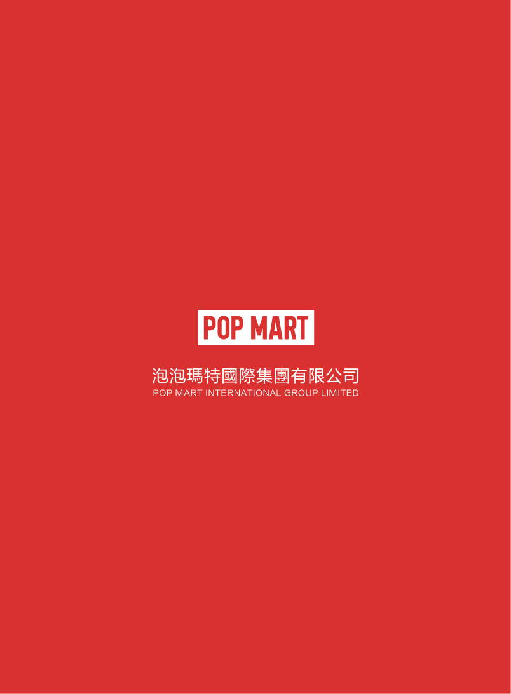
