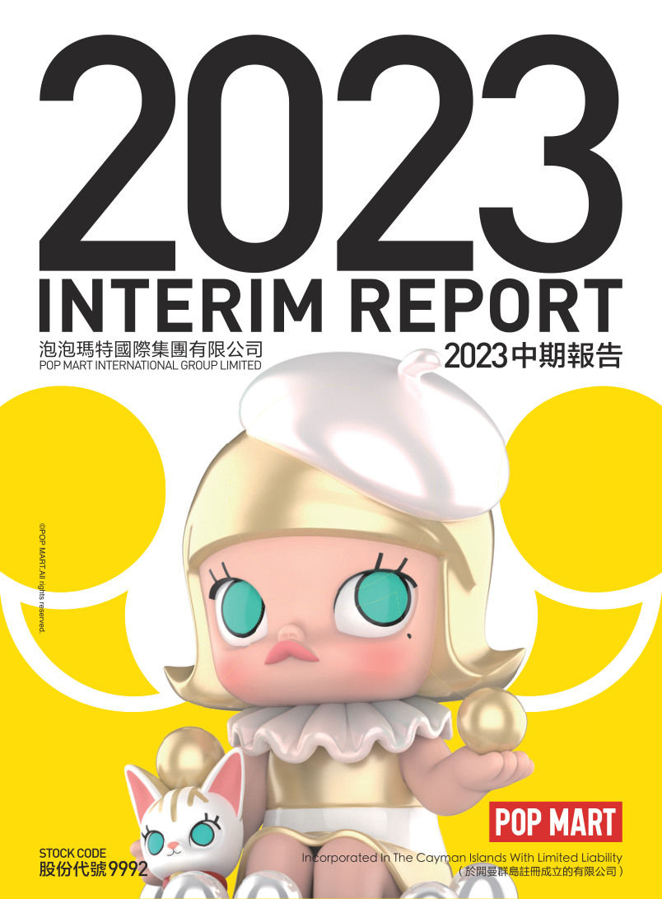

# 泡泡玛特2023年中期报告（简体中文）

> 披露日期：2023-09-15。来源：[泡泡玛特官方投资者关系](https://popwebsite.paquapp.com/pdf/aa3c147e-ac83-4657-8c62-75141e599b50-二零二三年中期报告.pdf)。
> [原始PDF](../2023年中期报告.pdf) · [历年财报索引](../泡泡玛特历年财报索引.md)
> 转换说明：保留中文正文、数字、单位和注释，仅做繁简转换及重复英文去除。外文专名、代码和网址照录；复杂表格用等宽文本保留列位置，插图保留原图。


###### 原PDF第1页

[对照原PDF第1页](../2023年中期报告.pdf#page=1)




###### 原PDF第2页

[对照原PDF第2页](../2023年中期报告.pdf#page=2)

2

公司资料

目录

财务概要

管理层讨论与分析

其他资料

中期简明综合损益及其他全面收益表

中期简明综合资产负债表

中期简明综合权益变动表

中期简明综合现金流量表

中期简明综合财务资料附注

释义

二零二三年中报  1


###### 原PDF第3页

[对照原PDF第3页](../2023年中期报告.pdf#page=3)

## 公司资料

### 董事会

### 执行董事

王宁先生（董事会主席）

杨涛女士

刘冉女士

司德先生

### 非执行董事

屠铮先生

何愚先生

### 独立非执行董事

张建君先生

吴联生先生

颜劲良先生

### 薪酬委员会

张建君先生（主席）

吴联生先生

王宁先生

### 提名委员会

王宁先生（主席）

张建君先生

吴联生先生

### 审核委员会

吴联生先生（主席）

屠铮先生

颜劲良先生

### 联席公司秘书

李鸿轩先生

李菁怡女士

2  泡泡玛特国际集团有限公司


###### 原PDF第4页

[对照原PDF第4页](../2023年中期报告.pdf#page=4)

###### 公司资料

### 授权代表

王宁先生

李菁怡女士

总部及中国主要营业地点

中国

北京市朝阳区

大望京科技商务园区

宏泰东街浦项中心A座36及37楼

香港主要营业地点

香港

德辅道中188号

金龙中心14楼

股份过户登记总处

Maples Fund Services (Cayman) Limited PO Box 1093 Boundary Hall Cricket Square Grand Cayman KY1-1102 Cayman Islands

香港股份过户登记处

香港中央证券登记有限公司香港

湾仔

皇后大道东183号

合和中心17楼

1712-1716号舖

二零二三年中报  3


###### 原PDF第5页

[对照原PDF第5页](../2023年中期报告.pdf#page=5)

###### 公司资料

主要往来银行

中国工商银行股份有限公司（珠市口支行）

中国北京市崇文区

珠市口东大街15号

交通银行股份有限公司

（望京支行）中国北京市朝阳区望京街9号望京国际商业中心

中国民生银行股份有限公司（望京支行）

中国北京市朝阳区

广顺北大街南湖东园一区

122号楼博泰国际B座

公司网站

www.popmart.com

法律顾问

有关香港法律

达维律师事务所

香港

中环

遮打道3A号

香港会所大厦10楼

有关中国法律

竞天公诚律师事务所

中国

上海市徐汇区

淮海中路1010号

嘉华中心45层

邮政编码：200031

有关开曼群岛法律迈普达律师事务所（香港）有限法律责任合伙香港湾仔

港湾道18号

中环广场26楼

4  泡泡玛特国际集团有限公司


###### 原PDF第6页

[对照原PDF第6页](../2023年中期报告.pdf#page=6)

###### 公司资料

核数师

罗兵咸永道会计师事务所

执业会计师

注册公众利益实体核数师

香港中环

太子大厦22楼

股份代号

9992  9992

二零二三年中报  5


###### 原PDF第7页

[对照原PDF第7页](../2023年中期报告.pdf#page=7)

## 财务概要

截至6月30日止六个月

|  | 未经审核 | 未经审核 |  |
| --- | ---: | ---: | ---: |
|  | 2023 | 2022 |  |
|  | 2023年 | 2022年 | 变动 |
|  | 人民币千元 | 人民币千元 |  |
| 收益 | 2,813,812 | 2,358,818 | 19.3% |
| 毛利 | 1,698,360 | 1,370,407 | 23.9% |
| 经营溢利 | 537,762 | 446,057 | 20.6% |
| 除所得税前溢利 | 618,547 | 457,936 | 35.1% |
| 期内溢利 | 477,242 | 332,945 | 43.3% |
| 本公司拥有人应占溢利 | 476,575 | 332,820 | 43.2% |
| 非国际财务报告准则经调整纯利 | 535,365 | 376,285 | 42.3% |
| 毛利率 | 60.4% | 58.1% |  |
| 纯利率 | 17.0% | 14.1% |  |
| 非国际财务报告准则经调整纯利率 | 19.0% | 16.0% |  |
|  | 未经审核 | 经审核 |  |
|  | 2023 | 2022 |  |
|  | 于2023年 | 于2022年 |  |
|  | 6月30日 | 12月31日 | 变动 |
|  | 人民币千元 | 人民币千元 |  |
| 资产 |  |  |  |
| 非流动资产 | 1,986,283 | 1,964,527 | 1.1% |
| 流动资产 | 7,079,054 | 6,615,535 | 7.0% |
| 资产总值 | 9,065,337 | 8,580,062 | 5.7% |
| 权益 |  |  |  |
| 权益总额 | 7,305,978 | 6,965,325 | 4.9% |
| 负债 |  |  |  |
| 非流动负债 | 413,664 | 483,990 | -14.5% |
| 流动负债 | 1,345,695 | 1,130,747 | 19.0% |
| 负债总额 | 1,759,359 | 1,614,737 | 9.0% |

6  泡泡玛特国际集团有限公司


###### 原PDF第8页

[对照原PDF第8页](../2023年中期报告.pdf#page=8)

## 管理层讨论与分析

### 业务回顾

销售概述

2023 年上半年，随着社会经济全面恢复常态化运行，各项宏观政策显效发力，国民经济持续复苏，居民休闲购物、出行旅游等消费需求进一步释放，国内消费市场的活力持续上升，消费行业在逐渐回暖。基于公司各部门的不懈努力，我们凭借出色的运营能力和创造力，在为消费者提供优质服务的同时，推出了多个受到广大消费者喜爱的新品系列，取得了优秀的销量表现。报告期内，我们的收入达到人民币2,813.8百万元，同比增速19.3%，我们持续加速对国际市场的扩张，其收入占比达到13.4%，同比增速139.8%。

艺术家发掘和IP运营

IP运营和创意设计对于我们的产品至关重要，这也是推动泡泡玛特发展的核心驱动力。我们持续推出不同风格的IP，并不断加强产品创新，丰富产品品类，以满足不同用户群体的需求。

我们的头部 I P 保持着强劲的表现 ，SKULLPANDA、MOLLY和DIMOO在2023 年上半年分别实现收入人民币526.4、411.4 和362.0 百万元，同比分别增长了14.0%、1.8%和21.3%；SKULLPANDA constantly looked for breakthroughs in styles. THE WARMTH,  SKULLPANDA不断突破风格的界定，2022 年11月份推出的第八个系列《温度》，通过温润的色彩、仿陶瓷质感的工艺，呼吁大家拥抱自我，给人以放松、亲近感，唤醒温暖的记忆，深受粉丝的喜爱，截至 2023 年 6 月 30 日单系列销售收入达到人民币 254.7 百万元。我们不断发掘优秀的艺术家，2022 年下半年推出的全新 IP HACIPUPU得到粉丝的广泛认可，2023年上半年实现收入人民币69.2百万元。由我们内部的设计师团队PDC(Pop Design Center)推出的小野及小甜豆分别实现收入人民币109.4 和75.4 百万元，小野通过设计语言触发粉丝的情感共鸣，2023年上半年相关收入同比增长 191.3% 。此外，PINO JELLY及Zsiga等新锐IP亦受到市场欢迎。我

二零二三年中报  7


###### 原PDF第9页

[对照原PDF第9页](../2023年中期报告.pdf#page=9)

###### 管理层讨论与分析

Zsiga and other new IPs were also popular in the market. We continued to  们持续与外部版权方合作，推出不同风格IP的潮玩手办、联名款产品，如MOLLYx华纳100 周年系列，英雄联盟经典角色系列及迪士尼皮克斯《玩具总动员》纸箱大冒险系列等，帮助我们吸引了更广泛的消费群体。

作为我们推动「 潮玩艺术化 」而打造的高端产品线，MEGA COLLECTION 兼具时尚感与内容深度的艺术表达，今年是我们推出 MEGA COLLECTION的第三年，品牌运营逐渐进入成熟阶段，我们将MEGA COLLECTION划分为Grand、Art、Lifestyle、Joy及Original五大产品系列，聚焦潮流、艺术与 IP 内容，以潮流收藏玩具为载体，探索审美表达。年初，Grand 系列推出的首款陶瓷材质潮玩MEGA SPACE MOLLY 1000%炉火纯青•燃) launched by the Grand series has been widely concerned by  炉火纯青•燃，受到跨圈层消费者的广泛关注。同时，我们与韩美林、让 － 米歇尔•巴斯奎特及蜷川实花等艺术家或其品牌共同打造Art系列产品，不断深耕艺术领域。此外，我们还与高达、派大星及空中大灌篮等知名IP合作推出Joy系列产品，为经典文化符号赋予新生机。2023上半年，MEGA COLLECTION共实现收入人民币242.3百万元。

### 消费者触达

－ 线下渠道

2023 年上半年我们于中国内地新开19 家线

```text
                                                                       下门店，门店数量从截至 2022 年 12 月 31
                    1                                                  日的 329 家增至截至2023 年 6 月 30 日的 340
                                                                       家 1 。 2 0 2 3 上半年我们于中国内地新开业
                                                                       118家机器人商店，机器人商店数量从截至
2023.                                                                  2022年12月31日的2,067家增至截至2023年
                                                                       6月30日的2,185家。
```

```text
1                                                                            1    2023年上半年，因租约到期和其他商业原因，我
                                                                                  们关闭了8家门店。
```

8  泡泡玛特国际集团有限公司


###### 原PDF第10页

[对照原PDF第10页](../2023年中期报告.pdf#page=10)

###### 管理层讨论与分析

－ 线上渠道

泡泡玛特抽盒机是我们在微信平台上自主研发设计的小程序，旨在创造好玩、有趣、便捷的购物体验，抽盒机于2023 年上半年实现了人民币373.0 百万元的收入。天猫旗舰店2023 年上半年收入为人民币155.3百万元。我们的内容电商团队根据IP特点和系列特色，搭建多个自营直播间，在抖音平台输出了优质的直播内容。这不仅吸引了大量粉丝，还推广了更多生活场景的商品，并取得了出色的销售表现。抖音平台2023 年上半年收入为人民币109.5 百万元，同比增长了569.0%。

－ 会员运营

随著渠道的持续扩张及IP的不断丰富，并通过全渠道会员运营，用户数字化规模快速扩大，截至2023年6月30日，中国内地累计注册会员总数从2022 年12 月31 日的2,600.4万人增至3,038.8 万人，新增注册会员438.4万人。2023 年上半年会员贡献销售额占比92.2%，会员复购率为44.5% 2 。

－ 港澳台及海外渠道

我们港澳台及海外业务持续推进DTC (Direct To Customer)的发展战略。截至2023年6月30 日，我们的港澳台及海外门店达到 55 家（含合营），机器人商店达到143 台（含合营及加盟），跨境电商平台站点数达到28个。2023 年上半年，我们在法国及马来西亚开设了首家线下门店。通过不断开拓线下和线上的销售渠道，我们的品牌和产品在全球范围内获得了更广泛的认可和喜爱。

```text
2                                                                              2   2023 年上半年，购买会员中买过2 次及以上的占
                                                                                   比。
```

二零二三年中报  9


###### 原PDF第11页

[对照原PDF第11页](../2023年中期报告.pdf#page=11)

###### 管理层讨论与分析

潮流玩具文化推广及创新业务孵化

为了不断丰富我们的产品线，扩大粉丝群体，我们成立了共鸣工作室，定位为集团旗下无边界硬核衍生品品牌。2023 年上半年，共鸣工作室共推出7款商品，其中，《间谍过家家》阿尼亚的日常系列作为共鸣推出的首款盲盒产品，截至2023年6月30日，上市仅一个月销量已经突破2.6万套，受到众多粉丝的认可。

inner flow作为泡泡玛特旗下的青年当代艺术运营机构，集艺术家经纪、艺术展览、艺术衍生品开发销售、运营于一体，致力于青年艺术的多渠道推广，创造经典、独特、前卫的当代艺术新文化。2023年3月，inner flow为签约艺术家没影在黎巴嫩完成了首个海外个人展览，受到广泛好评；2023年6月，inner flow在三亚的星合(“遐想蔓延热带岛屿”)  艺术中心举办了展览「遐想蔓延热带岛屿」，此展览项目包含与inner flow Gallery合作的6位艺术家的作品展览呈现、inner flow store的限量艺术雕塑展示销售；同月，inner flow携众多合作艺术家原作及限量艺术产品亮相北京当代艺术博览会、京art艺术博览会以及U设计周。inner flow持续不断挖掘优秀的青年艺术家，目前已与近60位国内外当代青年艺术家进行合作。

我们依托自身强大的IP运营能力及市场号召力，推动著更多潮玩艺术家走向大众面前，今年上半年我们为MOLLY、DIMOO、小甜豆、Zsiga、PINO JELLY及ViViCat等IP举办了8场艺术家签售活动，搭建潮玩创作者与用户的沟通舞台，加深IP与粉丝间的情感链接，推动潮流玩具文化更加蓬勃的发展。

我们通过参加海外大型展会、艺术家签售会等方式，持续推动品牌的全球化，推广潮流玩具文化。2023年1月，我们分别为日本艺术家大久保博人和上野阳介在中国台湾和东京举办了设计师签售会，现场讲述艺术家与泡泡玛特的合作渊源和 IP 创造背后的故事，向全球消费者深入展示IP魅力，并吸引更多海外艺术家和IP版权方与我们进行合作。2023 年5 月和6 月，我们分别参加了英国MCM动漫展、墨尔本OZ动漫展、雅加达动漫展、马来西亚 IOICITY 商场展会，展出的 SKULLPANDA、MOLLY、DIMOO、THE DIMOO, THE MONSTERS and Hirono.  MONSTERS及小野等IP潮玩手办吸引了大量本土潮流玩具爱好者。

10  泡泡玛特国际集团有限公司


###### 原PDF第12页

[对照原PDF第12页](../2023年中期报告.pdf#page=12)

###### 管理层讨论与分析

### 财务回顾

销售收入

本公司收入从2022 年上半年的人民币2,358.8 百万元上升到2023 年上半年的人民币2,813.8 百万元，同比增长19.3%。

根据渠道划分的收入

本公司的收入来自于中国内地和港澳台及海外的：(1)线下渠道，(2)线上渠道，及(3)批发渠道及其他。下表载列本公司2023 年上半年及2022年上半年的按渠道划分的收入：2022:

|  |  | 截至2023年6月30日止六个月 |  |  | 截至2022年6月30日止六个月 |  |
| --- | ---: | ---: | ---: | ---: | ---: | ---: |
|  | 收入 | 毛利率 | 收入占比 | 收入 | 毛利率 | 收入占比 |
|  | 人民币千元 |  |  | 人民币千元 |  |  |
| 中国内地 |  |  |  |  |  |  |
| 线下渠道 | 1,450,567 | 63.0% | 51.5% | 1,095,658 | 60.6% | 46.4% |
| 线上渠道 | 817,418 | 59.8% | 29.1% | 977,933 | 59.2% | 41.5% |
| 批发及其他 | 170,047 | 35.6% | 6.0% | 128,537 | 29.8% | 5.5% |
| 合计 | 2,438,032 | 60.0% | 86.6% | 2,202,128 | 58.2% | 93.4% |

港澳台及海外

| 线下渠道 | 190,359 | 75.9% | 6.8% | 38,657 | 68.9% | 1.6% |
| --- | ---: | ---: | ---: | ---: | ---: | ---: |
| 线上渠道 | 56,791 | 75.3% | 2.0% | 34,829 | 74.3% | 1.5% |
| 批发及其他 | 128,630 | 38.3% | 4.6% | 83,204 | 44.2% | 3.5% |
| 合计 | 375,780 | 62.9% | 13.4% | 156,690 | 57.0% | 6.6% |
| 总计 | 2,813,812 | 60.4% | 100.0% | 2,358,818 | 58.1% | 100.0% |

二零二三年中报  11


###### 原PDF第13页

[对照原PDF第13页](../2023年中期报告.pdf#page=13)

###### 管理层讨论与分析

(1) 中国内地

线下渠道。线下收入由 2022 年上半年的人民币1,095.7 百万元上升到2023 年上半年的人民币1,450.6百万元，增长了32.4%。下表为按渠道及城市等级划分的线下收入明细：

```text
截至2023年6月30日         截至2022年6月30日
     止六个月                 止六个月
```

Proportion

|  |  | 中国内地 |  | 中国内地 |  |
| --- | ---: | ---: | ---: | ---: | ---: |
|  |  | 线下渠道 |  | 线下渠道 |  |
|  | 收入 | 收入占比 | 收入 | 收入占比 | 变动 |
|  | 人民币千元 |  | 人民币千元 |  |  |
| 零售店 | 1,179,493 | 81.3% | 891,701 | 81.4% | 32.3% |
| 机器人商店 | 271,074 | 18.7% | 203,957 | 18.6% | 32.9% |
| 合计 | 1,450,567 | 100.0% | 1,095,658 | 100.0% | 32.4% |

12  泡泡玛特国际集团有限公司


###### 原PDF第14页

[对照原PDF第14页](../2023年中期报告.pdf#page=14)

###### 管理层讨论与分析

```text
                                                                          零售店                                                    机器人商店
                                                                   截至6月30日止六个月                                         截至6月30日止六个月
                                                           2023                           2022                          2023                          2022
                                                          2023年                         2022年                        2023年                        2022年
城市等级                                                数量           收入           数量           收入           数量           收入           数量            收入
                                                             （人民币千元）                 （人民币千元）                （人民币千元）                （人民币千元）
                          一线城市 3                    120         490,731            117         340,755           587         71,171            547          51,118
               4          新一线城市  4                  99         329,101             89         270,860           663         84,279            603          64,349
                          二线及其他城市 5              121         359,661            102         280,086           935        115,624            766          88,490
                          合计                          340       1,179,493            308         891,701         2,185        271,074           1,916        203,957
```

－  零售店。零售店销售收入从 2022 年上半年的人民币891.7 百万元增加到2023年上半年的人民币 1,179.5 百万元，同比增长了32.3%。主要由于(1)截至2023年 6 月 30 日中国内地零售店增至 340家，自2022年6月30日起增加了32家；

(2)2023 年上半年社会经济全面恢复常态化运营，线下渠道消费复苏；及 (3)通过提升店舖装修形象，改善陈列效果，移位到更好的位置等措施来吸引客流促进销售。

```text
3                                                                            3   指中国内地一线城市，包括北京、上海、广州和
                                                                                 深圳
4                                                                            4   指中国内地新一线城市，包括成都、重庆、杭
                                                                                 州、武汉、西安、郑州、青岛、长沙、天津、苏
                                                                                 州、南京、东莞、沈阳、合肥和佛山
5                                                                            5   指中国内地除去一线城市和新一线城市以外的城
                                                                                 市
```

二零二三年中报  13


###### 原PDF第15页

[对照原PDF第15页](../2023年中期报告.pdf#page=15)

###### 管理层讨论与分析

机器人商店。机器人商店销售收入从2022 年上半年的人民币204.0 百万元增长到2023 年上半年的人民币271.1 百万元，同比增长了 32.9%，主要由于 (1)截至 2023 年 6 月 30 日合计机器人商店2,185 间，自 2022 年 6 月 30 日起增加了269间；(2)陆续将销售额低的机器调整到更优质的销售位置；及 (3) 随着线下消费和旅游市场的恢复，高铁站、机场、景区及影院等场景的机器销售增长迅速。

线上渠道。线上收入由 2022 年上半年的人民币977.9 百万元下降到2023 年上半年的人民币817.4百万元，下降了16.4%。以下为线上收入明细：

```text
截至2023年6月30日           截至2022年6月30日
     止六个月                    止六个月
```

Proportion

|  |  | 中国内地 |  | 中国内地 |  |
| --- | ---: | ---: | ---: | ---: | ---: |
|  |  | 线上渠道 |  | 线上渠道 |  |
|  | 收入 | 收入占比 | 收入 | 收入占比 | 变动 |
|  | 人民币千元 |  | 人民币千元 |  |  |
| 泡泡玛特抽盒机 | 373,000 | 45.6% | 543,516 | 55.6% | -31.4% |
| 天猫旗舰店 | 155,264 | 19.0% | 244,882 | 25.0% | -36.6% |
| 抖音平台 | 109,531 | 13.4% | 16,372 | 1.7% | 569.0% |
| 其他线上渠道 | 179,623 | 22.0% | 173,163 | 17.7% | 3.7% |
| 合计 | 817,418 | 100.0% | 977,933 | 100.0% | -16.4% |

14  泡泡玛特国际集团有限公司


###### 原PDF第16页

[对照原PDF第16页](../2023年中期报告.pdf#page=16)

###### 管理层讨论与分析

中国内地线上渠道的收入包括泡泡玛特抽盒机、天猫旗舰店、抖音平台以及其他线上渠道的收入。其中，泡泡玛特抽盒机从2022 年上半年的人民币543.5 百万元下降至2023 年上半年的人民币373.0 百万元，下降了31.4%；天猫旗舰店收入从2022年上半年的人民币244.9 百万元下降至2023 年上半年的人民币155.3百万元，下降了36.6%；及抖音平台收入从2022年上半年的人民币16.4百万元增长至2023 年上半年的人民币109.5 百万元，增长了569.0%。2023 年受线上大环境影响，以及抖音等内容电商平台的快速发展，线下渠道的消费复苏也使得线上消费分流，传统电商平台受到冲击。

批发及其他。中国内地批发及其他收入从2022 年上半年的人民币 128.5 百万元增长到 2023 年上半年的 170. 1 百万元 ， 增长了32.3%，主要由于经销商南京泡泡玛特的店舖销售增长。

二零二三年中报  15


###### 原PDF第17页

[对照原PDF第17页](../2023年中期报告.pdf#page=17)

###### 管理层讨论与分析

(2) 港澳台及海外

线下渠道。线下收入由 2022 年上半年的人民币38.7百万元上升到2023年上半年的人民币190.4 百万元，增长了392.4%。以下为线下收入明细：

```text
截至2023年6月30日             截至2022年6月30日
     止六个月                      止六个月
```

Proportion of revenue

|  |  | 港澳台及 |  | 港澳台及 |  |
| --- | ---: | ---: | ---: | ---: | ---: |
|  |  | 海外线下 |  | 海外线下 |  |
|  |  | 渠道收入 |  | 渠道收入 |  |
|  | 收入 | 占比 | 收入 | 占比 | 变动 |
|  | 人民币千元 |  | 人民币千元 |  |  |
| 零售店 | 164,999 | 86.7% | 34,794 | 90.0% | 374.2% |
| 机器人商店 | 25,360 | 13.3% | 3,863 | 10.0% | 556.5% |
| 合计 | 190,359 | 100.0% | 38,657 | 100.0% | 392.4% |

－  零售店。零售店销售收入从 2022 年上半年的人民币34.8百万元增加到2023年上半年的人民币165.0 百万元，同比增长了 374.2%。主要由于零售店数量的增加，不断扩张港澳台及海外渠道，在更多国家及地区开设零售店，截至2023 年 6 月 30 日合计零售店 38 家，自2022年6月30日起增加了27家零售店。

16  泡泡玛特国际集团有限公司


###### 原PDF第18页

[对照原PDF第18页](../2023年中期报告.pdf#page=18)

###### 管理层讨论与分析

－  机器人商店。机器人商店销售收入从2022 年上半年的人民币3.9 百万元增加到2023年上半年的人民币25.4百万元，同比增长了556.5%，主要由于机器人商店数量的增加。截至2023年6月30日合计零售店106 间，自2022 年6 月30 日起零售店数量增加了81间。

线上渠道。线上收入由 2022 年上半年的人民币34.8百万元增加到2023年上半年的人民币56.8 百万元，增长了63.1%。以下为线上收入明细：

```text
截至2023年6月30日             截至2022年6月30日
     止六个月                      止六个月
```

Proportion of revenue

from online

|  |  | 港澳台及 |  | 港澳台及 |  |
| --- | ---: | ---: | ---: | ---: | ---: |
|  |  | 海外线上 |  | 海外线上 |  |
|  | 收入 | 渠道占比 | 收入 | 渠道占比 | 变动 |
|  | 人民币千元 |  | 人民币千元 |  |  |
|  | 14,803 | 26.1% | 6,023 | 17.3% | 145.8% |
| 泡泡玛特官方网站 | 12,317 | 21.7% | 16,053 | 46.1% | -23.3% |
| 其他线上渠道 | 29,671 | 52.2% | 12,753 | 36.6% | 132.7% |
| 合计 | 56,791 | 100.0% | 34,829 | 100.0% | 63.1% |

二零二三年中报  17


###### 原PDF第19页

[对照原PDF第19页](../2023年中期报告.pdf#page=19)

###### 管理层讨论与分析

港澳台及海外线上收入包括泡泡玛特官方网站、 Shopee 和其他线上渠道。其中，Shopee收入从2022年上半年的人民币6.0百万元增长到2023年上半年的人民币14.8百万元，增长了 145.8%；泡泡玛特官方网站收入从2022年上半年的人民币16.1百万元下降到2023年上半年的人民币12.3百万元，下降了23.3%；主要由于我们不断开拓新的线上平台，扩展更多的国家及地区，同时我们减少了原有线上平台的广告宣传，增加了对销售转化率更高的平台进行宣传推广。

批发及其他。港澳台及海外批发及其他收入从 2022 年上半年的人民币 83.2 百万元增长至2023 年上半年的128.6 百万元，增长了54.6% 。主要为港澳台及海外业务持续拓展，品牌认可度增加，原有市场以及新兴市场同时发力。

18  泡泡玛特国际集团有限公司


###### 原PDF第20页

[对照原PDF第20页](../2023年中期报告.pdf#page=20)

###### 管理层讨论与分析

根据IP划分的收入

泡泡玛特的自主产品是我们的主要商品类型，2023 年上半年自主产品收入占总收入的比例为91.9%，自主产品收入从 2022 年上半年的人民币2,155.7 百万元增加到2023 年上半年的人民币2,585.8百万元，增长了20.0%。

泡泡玛特的自主产品主要分为：艺术家IP和授权IP 6 ，以下为IP划分的收入明细：

```text
                                                                        截至6月30日止六个月
                                                                  2023                         2022
                                                                2023年                       2022年
                                                              收入       收入占比          收入       收入占比
                                                        人民币千元                   人民币千元
                                 自主产品                 2,585,773        91.9%       2,155,652         91.4%
                                 艺术家IP                 2,164,270        76.9%       1,855,024         78.7%
SKULLPANDA                                                 526,383         18.7%         461,766         19.6%
MOLLY                                                      411,433         14.6%         404,347         17.1%
DIMOO                                                      362,032         12.9%         298,442         12.7%
THE MONSTERS                                               159,829          5.7%         134,887          5.7%
HIRONO                             小野                    109,352          3.9%          37,538          1.6%
Sweet Bean                         小甜豆                   75,367          2.7%          81,247          3.4%
HACIPUPU                                                    69,171          2.4%              –              –
                                   其他艺术家IP            450,703         16.0%         436,797         18.6%
                                 授权IP                    421,503         15.0%         300,628         12.7%
                                 外采及其他                228,039          8.1%         203,166          8.6%
                                 合计                     2,813,812       100.0%       2,358,818        100.0%
```

```text
6                                                                            6   为更直观地反映艺术家原创IP及外部授权经典IP
                                                                                 相关自主产品的收入贡献，本公司已重新划分IP
```

分类方法，艺术家IP包括原自有IP及独家IP，授权IP则为原非独家IP。

二零二三年中报  19


###### 原PDF第21页

[对照原PDF第21页](../2023年中期报告.pdf#page=21)

###### 管理层讨论与分析

－  艺术家 IP 。艺术家 IP 是本公司主要商品类型，主要包括 MOLLY、SKULLPANDA、DIMOO、THE MONSTERS等。艺术家IP的收入占比由2022年上半年的78.7%下降到2023年上半年的 76.9%。艺术家 I P 收入从 2022年上半年的人民币 1,855.0 百万元，上升至2023 年上半年的人民币 2,164.3 百万元，MOLLY, DIMOO and THE MONSTERS and newly superscript IPs, such as  增长了 16.7% 。主要由于 SKULLPANDA 、HACIPUPU, Zsiga, PINO JELLY, also achieved outstanding performance.  MOLLY、DIMOO和THE MONSTERS的销售收入贡献较高，以及新推出的IP表现亮眼，如JELLY等。

－  授权IP。授权IP收入从2022年上半年的人民币300.6 百万元，增加至2023 年上半年的人民币421.5百万元，增长了40.2%。主要由于我们与更多的版权方进行多元化、多种风格、多种方式的合作，推出的新产品贡献了销售。

销售成本

销售成本从2022年上半年的人民币988.4百万元上升到2023 年上半年的人民币1,115.5 百万元，增长了12.9%，增加主要由于(1)商品成本由2022年上半年的人民币868.0百万元增加到2023年上半年的人民币923.9 百万元，其主要原因为销售增加；及(2)设计及授权成本由2022 年上半年的人民币32.9百万元增加到2023年上半年的77.5百万元，主要由于自主产品占比增多，以及联名产品增加，需要支付更多的IP授权费以及产品设计费。

毛利

本公司的毛利由2022 年上半年的人民币1,370.4百万元上升到2023 年上半年的人民币1,698.4 百万元，增长了23.9%，主要由于我们的收入增加以及销售成本的控制。我们的毛利率由2022 年上半年的58.1%增长至2023 年上半年的60.4%，主要由于我们泡泡玛特自主产品的毛利率提升。

20  泡泡玛特国际集团有限公司


###### 原PDF第22页

[对照原PDF第22页](../2023年中期报告.pdf#page=22)

###### 管理层讨论与分析

泡泡玛特自主产品产生的毛利由2022 年上半年的人民币1,303.4 百万元增加到2023 年上半年的人民币1,631.7百万元，增长了25.2%。主要由于泡泡玛特自主产品的收益增加。泡泡玛特自主产品的毛利率从2022年上半年的60.5%，上升到2023年上半年的63.1%，主要由于(1)我们优化了产品设计，增加了与供应商的议价能力，供应商价格体系稳定，2023 年上半年新品毛利率有所提高；及(2)我们减少了一些促销活动。

我们的外采和其他产品产生的毛利由2022 年上半年的人民币67.0百万元下降到2023年上半年的人民币66.7百万元，基本持平。

经销及销售开支

我们的经销及销售开支由2022 年上半年的人民币 693.2 百万元增长至 2023 年上半年的人民币878.3百万元，增长了26.7%，其中占比较高的为雇员福利开支和使用权资产折旧。

－  雇员福利开支。雇员福利开支从 2022 年上半年的人民币196.0 百万元增长至2023 年上半年的人民币281.4百万元，增长了43.6%。主要由于(1)我们的销售员工人数由2022 年上半年的2,940名员工（由于公司结构调整，经重新划分及统计）增加到2023年上半年的3,189 名员工，主要用以支持我们扩张零售店及机器人商店网络；及(2)股权激励的股份支付金额共计人民币34.1百万元。

－  使用权资产折旧。使用权资产折旧从 2022年上半年的人民币107.8 百万元增长至2023年上半年的人民币 146.9 百万元，增长了36.3%。主要由于线下零售店数量较2022年上半年增加了 59 间，来满足我们中国内地和港澳台及海外的业务扩张。

二零二三年中报  21


###### 原PDF第23页

[对照原PDF第23页](../2023年中期报告.pdf#page=23)

###### 管理层讨论与分析

一般及行政开支

我们的一般及行政开支由2022 年上半年的人民币 322.7 百万元增长至 2023 年上半年的人民币331.3 百万元，增长了2.7%。其中占比较高的为雇员福利开支。

－  雇员福利开支。雇员福利开支从 2022 年上半年的人民币206.2 百万元增长至2023 年上半年的人民币215.1 百万元，增长了4.3%。主要由于(1)我们的行政员工及设计开发人员人数由2022 年上半年的940 名员工（由于公司结构调整，经重新划分及统计）增加至2023年上半年的959名员工，主要用以支持我们的产品开发以及业务扩张，及薪资水平提升以吸引人才；及(2)股权激励的股份支付金额共计人民币24.0百万元。

其他收入

本公司的其他收入由2022年上半年的人民币24.3百万元增加到 2023 年上半年的人民币 37.4 百万元，增长了53.8%。其中(1)政府补助由2022年上半年的人民币4.8百万元增长至2023年上半年的人民币21.2百万元，及(2)IP授权费及其他服务收入由 2022 年上半年的人民币 18.9 百万元下降到2023年上半年的人民币15.5百万元。

其他收益 － 净额

2022年上半年录得其他收益净额人民币67.1百万元，2023年上半年录得其他收益净额人民币11.6百万元，主要由于2022 年上半年股权投资和基金投资的公允价值变动导致，2023 年上半年变动较小。

经营溢利

综上所述，本公司的经营溢利由2022 年上半年的人民币446.1百万元增长至2023年上半年的人民币537.8百万元，增长了20.6%。

22  泡泡玛特国际集团有限公司


###### 原PDF第24页

[对照原PDF第24页](../2023年中期报告.pdf#page=24)

###### 管理层讨论与分析

财务收入 － 净额

我们的财务收入净额由2022 年上半年的净收益人民币7.0百万元增长到2023年上半年的净收益的人民币63.4百万元，主要由于我们的利息收入增加。

所得税开支

我们的所得税开支由 2022 年上半年的人民币125.0百万元增加到2023年上半年的人民币141.3百万元，原因为我们的所得税前溢利增加。我们的实际税率由 2022 年上半年的 27.3% 降低至2023年上半年的22.8%。

期内盈利

由于上文所述，我们的期内盈利由2022 年上半年的人民币332.9 百万元增加至报告期内的人民币477.2百万元，增长了43.3%。

非国际财务报告准则经调整纯利

非国际财务报告准则经调整纯利未按照国际财务报告准则计算，视为非国际财务报告准则的财务指标，其定义为除以股份为基础的薪酬后纯利，而非国际财务报告准则经调整纯利率的定义为非国际财务报告准则经调整纯利除以收益。我们认为，这些信息对于投资者在不影响本集团经营业绩或现金流的情况下比较本集团的业绩是有用的，并允许投资者考虑管理层在评估本集团业绩时使用的指标。投资者不应认为非国际财务报告准则的财务指标替代或由于本集团的国际财务报告准则的业绩。此外，可能不是所有公司会以相同的方式计算该项非国际财务报告准则的财务指标，因此未必可与其他公司采用的相若计量比较。

二零二三年中报  23


###### 原PDF第25页

[对照原PDF第25页](../2023年中期报告.pdf#page=25)

###### 管理层讨论与分析

下表载列本公司各期间的非国际财务报告准则的财务指标对账情况。

| 截至2023年 |  | 截至2022年 |
| --- | ---: | ---: |
|  | 6月30日 | 6月30日 |
| 止六个月 |  | 止六个月 |
|  | 人民币千元 | 人民币千元 |
| 期内盈利 | 477,242 | 332,945 |
| 调整项目 |  |  |
| 以股份为基础的付款报酬 | 58,123 | 43,340 |
| 非国际财务报告准则经调整纯利 | 535,365 | 376,285 |
| 非国际财务报告准则经调整纯利率 | 19.0% | 16.0% |

以股份为基础的付款开支属于非现金项目且并无直接反应我们的业务营运。因此，通过撇除该等项目对计算非国际财务报告准则经调整纯利影响的举措，可更好地反应我们的相关经营表现，并更加便于比较逐年的经营表现。

流动资产、财务资源及资本开支

截至2023年6月30日止六个月，本公司及附属公司在整体业务经营方面采纳保守稳健的资金管理及财务政策。本集团维持以下资源以应付其营运资金需求：

流动资产及流动负债

我们的流动资产净值由截至2022 年12 月31 日的人民币5,484.8百万元增加至截至2023年6月30日的人民币5,733.4百万元，基本维持稳定。

24  泡泡玛特国际集团有限公司


###### 原PDF第26页

[对照原PDF第26页](../2023年中期报告.pdf#page=26)

###### 管理层讨论与分析

贸易应收款项

贸易应收款项指日常业务过程中我们应收客户的未结算款项。我们的贸易应收款项由截至2022年12月31日的人民币194.4百万元增加至截至2023 年6 月30 日的人民币208.9 百万元，该等增加主要由于部分港澳台及海外的合营公司随着业务扩张导致应收款项增加。贸易应收款项周转天数从2022年的12天增加至截至2023年6月30日止六个月的13天。

存货

我们的存货包括制成品。我们的存货由截至2022年12月31日的人民币867.0百万元减少至截至2023 年6 月30 日的人民币758.8 百万元。主要由于我们持续对供应链进行柔性调节，提高了预测的准确性，对订单数量进行很好的控制。存货周转天数从2022年的156天降低到截至2023年6月30日止六个月的132天。

现金及现金等价物

我们的现金及现金等价物主要包括银行现金。现金及现金等价物从截至2022 年12 月31 日的人民币685.3 百万元增加至截至2023 年6 月30 日的人民币1,473.4 百万元，主要为我们经营活动产生的现金增加，以及本期到期赎回定期存款人民币290.0百万元。

贸易应付款项

贸易应付款项主要指我们在日常业务过程中向供应商支付货款的责任。贸易应付款项从截至2022年12月31日的人民币259.0百万元增加至截至2023 年6 月30 日的人民币349.5 百万元，主要原因为我们的业务增长，导致采购量增加，进而令应付供应商款项的余额有所增加。2023 年上半年的贸易应付款项周转天数49 天，与2022年上半年保持一致。

二零二三年中报  25


###### 原PDF第27页

[对照原PDF第27页](../2023年中期报告.pdf#page=27)

###### 管理层讨论与分析

银行借款

截至 2023 年 6 月 30 日，本集团并无任何银行借款。

资产抵押

截至 2023 年 6 月 30 日，本集团并无任何资产抵押。

资产负债率

资产负债率为总负债除以总资产乘以 100% 。截至 2023 年 6 月 30 日，本集团的资产负债率为19.4%，而截至2022年12月31日的资产负债率为2022.  18.8%。

或有事件

我们目前并无涉及任何重大法律诉讼，亦不知悉我们涉及任何待决或潜在重大法律诉讼。倘我们涉及有关重大法律诉讼，则我们会于产生亏损且有关亏损金额有合理估计时，按当时所得资料记录任何亏损或或有负债。

外汇风险管理

我们主要于中国经营业务，交易主要以人民币结算。由于本集团并无以我们经营实体各自功能货币以外货币计值得重大金融资产或负债，故管理层认为业务并无任何重大外汇风险敞口。于截至2023年6月30日止六个月期间，我们并无对冲任何外币波动。

26  泡泡玛特国际集团有限公司


###### 原PDF第28页

[对照原PDF第28页](../2023年中期报告.pdf#page=28)

###### 管理层讨论与分析

资本开支

本公司的资本开支包括购置物业、厂房及设备的款项和购置无形资产的款项。下表载列本公司2022 年上半年以及2023 年上半年的资本开支情况：

| 截至2023年 |  | 截至2022年 |
| --- | ---: | ---: |
|  | 6月30日 | 6月30日 |
| 止六个月 |  | 止六个月 |
|  | 人民币千元 | 人民币千元 |
| 购置物业、厂房和设备 | 186,617 | 135,860 |
| 购置无形资产 | 27,462 | 26,253 |
| 合计 | 214,079 | 162,113 |

人力资源

截至2023 年6 月30 日，我们共有4,148 名员工，包括销售员工3,189名，行政及开发人员959名。截至 2023 年 6 月 30 日止六个月，我们共发生员工成本（包括薪金、工资、津贴和福利）人民币496.4百万元。

本公司应付雇员酬金包括薪金、花红及雇员福利计划供款。雇员薪金通常按雇员各自的职位、资历、经验及表现厘定。奖金乃按雇员各自的职位、服务年期及雇员表现计算。为吸引并挽留雇员，我们每年评估提供予雇员的薪酬方案，以确定是否应对奖金作出任何调整。

二零二三年中报  27


###### 原PDF第29页

[对照原PDF第29页](../2023年中期报告.pdf#page=29)

###### 管理层讨论与分析

根据中国法律法规的要求，我们参与各项政府法定雇员福利计划，包括社会保险基金（即养老金供款计划、医疗保险计划、失业保险计划、工伤保险计划及生育保险计划）及住房公积金。

我们为所有雇员提供培训计划，以实现员工与企业共同发展。我们将为所有新员工提供丰富的入职培训课程，以使其快速融入公司，其后根据部门需要、本公司的发展战略、及员工诉求进行多种在职培训，增强雇员与我们业务相关的知识、技能及能力。

重大投资的未来计划

截至2023年6月30日，我们并无持有任何重大投资。

我们将继续广泛寻找潜在的策略性投资机会，并寻求可为本集团带来协同效应的潜在优质目标业务及资产。

重大收购及出售

截至2023年6月30日止六个月，我们并无进行任何重大收购或出售附属公司、联营公司及合营企业。

报告期后事项

于本中期报告日期，本集团于报告期后并无发生须进一步披露或调整的重大事项。

28  泡泡玛特国际集团有限公司


###### 原PDF第30页

[对照原PDF第30页](../2023年中期报告.pdf#page=30)

###### 管理层讨论与分析

### 未来展望

IP is at the core of our business. Through our innovative products, delicate  IP 是我们业务的核心，我们通过创意的产品、精致的设计和优质的服务使消费者收获快乐美好、潮流体验和艺术熏陶，同时，通过不断提升品牌价值、拓展产品品类、创新产品模式，增加用户对泡泡玛特的品牌忠诚度，保持我们强势的市场地位及竞争力。

我们将致力于丰富IP类型，扩大IP库，保持高质量的设计创新水平，推出更多头部系列产品，对IP进行持续孵化及运营，强化IP内核，加深粉丝与IP之间的情感连接。我们将不断拓宽潮玩品类，进一步挖掘MEGA、萌粒、衍生品、BJD等品类的价值，不断完善相关工艺及生产发售流程。我们还将关注可持续发展和环保理念，推出更多环保材质的产品及包装，为全球消费者提供更加安心、放心的产品选择。

我们国际业务将保持快速增长，通过持续推进海外 DTC 战略，布局线下门店、机器人商店、跨境电商平台等渠道，推动我们的品牌在全球的渗透，不断提升泡泡玛特在海外国家、地区的知名度和潮玩市场份额。业务本地化是海外业务的核心，在加强终端消费者的消费体验和互动的同时，我们将与更多当地生意伙伴和艺术家合作，探索出更多符合本土市场的业务模式、IP和产品品类。

我们将不断扩展我们的渠道网络，从而触达更多的用户，不断精进我们的运营能力，提升用户的消费体验，加强会员拓展和会员运营能力，推动创新零售数字化运作，以更多样化的方式触达和维护用户，提供更优质服务，满足会员差异化需求。

我们将通过更丰富多样的途径持续推广潮流玩具文化，持续影响整个行业，为会员提供更多权益，提高粉丝黏性，提升粉丝的文化认同和品牌认知。

二零二三年中报  29


###### 原PDF第31页

[对照原PDF第31页](../2023年中期报告.pdf#page=31)

###### 管理层讨论与分析

在进一步深耕潮流玩具业务的同时，我们将持续打造MEGA、共鸣、inner flow等新品牌，推动乐园等新业务的落地，打造以 IP 为核心的更完善、更丰富的商业生态框架。

上市所得款项净额用途

本公司股份于2020 年12 月11 日通过全球发售在香港联合交易所有限公司（「 联交所 」）主板上市，经扣除专业费用、包销佣金及其他相关上市开支后，本公司自全球发售（包括悉数行使超额配股权）所收取所得款项净额总额（「所得款项净额」）约为5,781.7百万港元。

诚如招股章程所述，所得款项净额的拟定用途及所得款项净额余额载列如下：

```text
                                                                                                            截至2023年
                                                                                       直至2022年            6月30日止          直至2023年             于2023年
                                                                                         12月31日               六个月             6月30日              6月30日
                                                                     占总所得            未动用的             已动用的             已动用的             的未动用    动用未动用
                                                    所得款项         款项净额            所得款项             所得款项             所得款项             所得款项    所得款项净额的
所得款项净额拟定用途                              净额的分配           百分比            净额金额             净额金额             净额金额             净额余额    拟定时间表
```

30.0%

```text
用于为我们的消费者触达渠道及海外         1,734.5百万港元            30.0%        508.1百万港元         117.2百万港元       1,343.6百万港元        390.9百万港元     2024年12月31日之前
市场扩展计划拨付部分资金
                                                                    16.5%                    –                     –                                          –
      用于开设新零售店                     954.0百万港元            16.5%                                          –         954.0百万港元                    –
                                                                     6.0%
      用于开设新机器人商店                 346.9百万港元             6.0%        162.1百万港元          39.6百万港元         224.4百万港元        122.5百万港元
                                                                     7.5%
      用于扩展业务至海外市场               433.6百万港元             7.5%        346.0百万港元          77.6百万港元         165.2百万港元        268.4百万港元
```

30  泡泡玛特国际集团有限公司


###### 原PDF第32页

[对照原PDF第32页](../2023年中期报告.pdf#page=32)

###### 管理层讨论与分析

```text
                                                                                                            截至2023年
                                                                                       直至2022年            6月30日止          直至2023年             于2023年
                                                                                         12月31日               六个月             6月30日              6月30日
                                                                     占总所得            未动用的             已动用的             已动用的             的未动用    动用未动用
                                                    所得款项         款项净额            所得款项             所得款项             所得款项             所得款项    所得款项净额的
所得款项净额拟定用途                              净额的分配           百分比            净额金额             净额金额             净额金额             净额余额    拟定时间表
                                                                        27.0%                                        –
```

```text
用于为潜在投资、收购本行业价值链         1,561.1百万港元           27.0%        1,249.3百万港元                    –        311.8百万港元       1,249.3百万港元    2024年12月31日之前
上下游公司及与该等公司建立战略联
```

盟拨资

15.0%

```text
用于投资技术举措，以增强我们的营           867.2百万港元            15.0%        549.3百万港元          74.4百万港元         392.3百万港元        474.9百万港元
销及粉丝参与力度及提升业务的数字
```

化程度

```text
                                                               3.0%
用于人才招募                         173.5百万港元             3.0%         113.4百万港元         18.1百万港元          78.2百万港元          95.3百万港元    2023年12月31日之前
                                                               6.0%                                                    HK$86.7 million     HK$260.2 million   Before 31 December 2024
```

```text
用于购买相关软件及硬件以加           346.9百万港元             6.0%         271.2百万港元         11.0百万港元          86.7百万港元         260.2百万港元    2024年12月31日之前
强数字化，并建立用于数字营
```

销、客户服务、物流、产品、供应链、仓储，会员、交易以及门店管理及营销的信息系统

二零二三年中报  31


###### 原PDF第33页

[对照原PDF第33页](../2023年中期报告.pdf#page=33)

###### 管理层讨论与分析

```text
                                                                                                            截至2023年
                                                                                       直至2022年            6月30日止          直至2023年             于2023年
                                                                                         12月31日               六个月             6月30日              6月30日
                                                                     占总所得            未动用的             已动用的             已动用的             的未动用    动用未动用
                                                    所得款项         款项净额            所得款项             所得款项             所得款项             所得款项    所得款项净额的
所得款项净额拟定用途                              净额的分配           百分比            净额金额             净额金额             净额金额             净额余额    拟定时间表
                                                                         6.0%                                                HK$227.4 million     HK$119.4 million  Before 31 December 2024
```

```text
用于优化我们的线上营销工             346.8百万港元             6.0%         164.7百万港元         45.3百万港元         227.4百万港元         119.4百万港元    2024年12月31日之前
作，主要包括战略性地在第三
```

方推广平台上投放广告、图标、链接及信息推送

```text
                                                                    18.0%
用于扩大我们的IP库                       1,040.7百万港元            18.0%        818.7百万港元          28.6百万港元         250.6百万港元        790.1百万港元
                                                                     4.5%
      用于加强我们物色优秀艺术家           260.3百万港元             4.5%        124.9百万港元          28.6百万港元         164.0百万港元         96.3百万港元     2024年12月31日之前
      的能力
                                                                     1.5%                    –                     –                                          –     –
```

```text
用于以提供具有竞争力的薪金            86.6百万港元             1.5%                                          –          86.6百万港元                     –    –
的方式招募有才华的设计师加
```

入我们的内部设计团队，以增

```text
强我们的内部原创IP发掘实力
                                                              12.0%                                         –                     –
用于收购受欢迎的IP以扩大我           693.8百万港元            12.0%        693.8百万港元                    –                     –        693.8百万港元     2024年12月31日之前
们的IP库
```

32  泡泡玛特国际集团有限公司


###### 原PDF第34页

[对照原PDF第34页](../2023年中期报告.pdf#page=34)

###### 管理层讨论与分析

```text
                                                                                                            截至2023年
                                                                                       直至2022年            6月30日止          直至2023年             于2023年
                                                                                         12月31日               六个月             6月30日              6月30日
                                                                     占总所得            未动用的             已动用的             已动用的             的未动用    动用未动用
                                                    所得款项         款项净额            所得款项             所得款项             所得款项             所得款项    所得款项净额的
所得款项净额拟定用途                              净额的分配           百分比            净额金额             净额金额             净额金额             净额余额    拟定时间表
                                                                        10.0%                   –                    –                                         –    –
       营运资金及一般公司用途                   578.2百万港元           10.0%                                        –        578.2百万港元                    –    –
```

本集团已经并将继续遵照招股章程所载拟定目的动用首次公开发售所得款项净额。

二零二三年中报  33


###### 原PDF第35页

[对照原PDF第35页](../2023年中期报告.pdf#page=35)

## 其他资料

中期股息

董事会不建议派付截至2023年6月30日止六个月的中期股息。

遵守企业管治守则

本集团致力维持高水平的企业管治，以保障股东权益并提升企业价值及问责性。本公司已采纳上市规则附录十四所载的企业管治守则（「企业管治守则」），作为其本身的企业管治守则。截至2023年6月30日止六个月内一直遵守企业管治守则项下的所有适用守则条文，惟下文「主席及行政总裁」一段所述偏离守则条文第C.2.1条除外。

主席及行政总裁

企业管治守则的守则条文第C.2.1 条规定主席与行政总裁的职责应有所区分，不应由同一人士履行。根据董事会现行架构，本公司主席及行政总裁职位由王宁先生担任。

董事会相信，这种架构将不会削弱董事会与本公司管理层之间的权力及权限平衡，原因是：

(i) 董事会所作决定至少需要由大多数董事批准，而董事会九名董事当中有三名独立非执行董事，董事会认为董事会内部有足够的制衡作用；(ii)王宁先生及其他董事知悉并承诺履行彼等作为董事的受信责任，当中要求（其中包括）彼等为本公司的利益及最佳利益行事，并据此作出本集团决策；及(iii)权力及权限平衡乃以董事会运作加以保障，而董事会由经验丰富、高质素人士组成，彼等定期会面讨论影响本集团运作的事宜。此外，本集团的整体战略及其他主要业务、财务及营运政策乃经董事会及高级管理层层面全面商讨后共同作出。最后，由于王宁先生为我们的主要创办人，董事会认为由同一人士担任主席及行政总裁可确保本集团的领导贯彻一致，令本集团实现更为有效及高效的整体战略规划。董事会将继续检讨本集团企业管治架构的有效性，以评估是否需要区分主席与行政总裁的职责。

34  泡泡玛特国际集团有限公司


###### 原PDF第36页

[对照原PDF第36页](../2023年中期报告.pdf#page=36)

###### 其他资料

本公司致力提升适用于其经营行为及业务增长的企业管治常规，并不时审阅该等常规，以保证彼等符合法定及专业标准且与最新发展保持一致。

进行证券交易的标准守则

本公司采纳上市规则附录十所载上市发行人董事进行证券交易的标准守则（「标准守则」），作为本公司涉及董事证券交易的行为守则。经向全体董事作出具体查询后，各董事已确认于截至2023年6月30日止六个月一直遵守标准守则所载的规定。

2023.

可能拥有本公司未公布内幕消息的本公司雇员亦须遵守标准守则。

董事及高级管理层之资料变更

除本中期报告披露者外，并无根据上市规则第13.51B(1)条须予披露之董事及高级管理层资料之变动。

董事及行政总裁于股份、相关股份及债权证的权益及淡仓

于2023年6月30日，本公司董事及行政总裁于本公司或其任何相联法团（定义见《证券及期货条例》第XV部）的股份、相关股份及债权证中拥有根据《证券及期货条例》第XV部第7及第8分部已知会本公司及联交所（包括根据《证券及期货条例》的有关条文彼等被当作或视为拥有的权益及淡仓），或根据《证券及期货条例》第352条须予存置的登记册所记录或根据标准守则已另行知会本公司及联交所的权益及淡仓如下：

二零二三年中报  35


###### 原PDF第37页

[对照原PDF第37页](../2023年中期报告.pdf#page=37)

###### 其他资料

于本公司股份及相关股份的权益

```text
                                                                           所持股份 ╱ 相关股份    占本公司股权概约
董事姓名                           身份 ╱ 权益性质                                       总数  (1)      百分比(%) (1)
                                                                                  676,081,407 (L)           49.85%
王宁先生
```

信托的受益人及创办人；

```text
                                       及受控法团权益 (2)(3)
                                                                                      676,081,407 (L)             49.85%
杨涛女士                             配偶权益 (3)(4)
                                                                                       12,438,126 (L)              0.92%
司德先生
                                     实益拥有人及酌情信托创办人 (5)
                                                                                       32,910,000 (L)              2.43%
屠铮先生                             受控法团权益  (6)
                                                                                        2,088,310 (L)              0.15%
何愚先生                             受控法团权益  (7)
                                                                           附注：
(1)                                                                        (1)  于 2023 年 6 月 30 日，本公司合共已发行
                                                                               1,356,323,150股股份。字母「L」代表有关人士于股
                                                                               份的好仓。
(2)  GWF Holding Limited is a company with limited liability incorporated in the BVI  (2)  GWF Holding Limited为一家于英属维京群岛注
                                                                               册成立的有限公司，由UBS Trustees (B.V.I.) Ltd.
```

全资拥有，而UBS Trustees (B.V.I.) Ltd.以王宁先生作为委托人（以王宁先生为受益人）所创立信托的受托人身份全资拥有。根据《证券及期货条例》，王宁先生被视为于GWF Holding Limited所持571,981,960 股股份中拥有权益。Tianjin Paqu Holding Limited为一家根据英属维京群岛法律注册成立的有限公司，而王宁先生为唯一股东。根据《证券及期货条例》，王宁先生因而被视为于Limited所持本公司31,196,420

```text
                                                                                   股股份中拥有权益。
(3)  Pop Mart Hehuo Holding Limited is a company with limited liability incorporated  (3)                  Limited为一家根据英
                                                                                   属维京群岛法律注册成立的有限公司，并持有
```

72,903,027 股股份。王宁先生及杨涛女士分别持有Pop Mart Hehuo Holding Limited已发行股本的41.99%及17.81%。王宁先生及杨涛女士因其配偶关系被视为于彼此持有之股份中拥有权益，因此彼等被视为于Pop Mart Hehuo Holding Limited所

```text
                                                                                 持股份中拥有权益。
(4)                                                                          (4)  杨涛女士为王宁先生的配偶。根据《证券及期货
                                                                                 条例》，杨涛女士被视为于王宁先生持有的所有
```

股份中拥有权益。

36  泡泡玛特国际集团有限公司


###### 原PDF第38页

[对照原PDF第38页](../2023年中期报告.pdf#page=38)

###### 其他资料

```text
(5)  Sidsi Holding Limited is an investment holding company incorporated under the  (5)  Sidsi Holding Limited为一家根据英属维京群岛法
                                                                                       律注册成立的投资控股公司，由 TMF (Cayman)
```

Ltd. （作为由司德先生（作为委托人）以其本身为受益人设立的XM Family Trust的受托人）全资拥有。根据《证券及期货条例》，司德先生被视为于Sidsi Holding Limited所持10,933,075 股股份中拥有权益。司德先生有权收取根据首次公开发售后股份奖励计划向其授出的609,851股奖励股份及其购买

```text
                                                                                     的895,200股股份。
(6)  Borchid Phoenix Holding Limited is wholly owned by Shanghai Zhuniao Enterprise  (6)                     Limited由上海朱鸟企业
                                                                                     管理合伙企业（有限合伙）全资拥有，而上海朱
```

鸟企业管理合伙企业（有限合伙）分别由 Suzhou Borchid Jichu Venture Capital Partnership (Limited Partnership)及Zhoushan Borchid Lizhi Enterprise Partnership)拥有99.9%及0.1%。Suzhou Borchid Jichu Venture由

拥有 1%，而

Partnership (Limited Partnership)由屠铮先生拥有69%。根据《证券及期货条例》，屠铮先生因而被视为于Borchid Phoenix Holding Limited所持

```text
                                                                                         32,910,000股股份中拥有权益。
(7)  BA Capital Fund III, L.P. is held as to 3% by BA Capital Limited, which is indirectly  (7)              L.P.由BA Capital Limited持有
                                                                                         3%，而BA Capital Limited由何愚先生间接拥有
```

51%。根据《证券及期货条例》，何愚先生因而被视为于BA Capital Limited所持2,088,310股股份中拥有权益。

除上文所披露者外，于 2023 年 6 月 30 日，概无本公司董事于本公司或其任何相联法团（定义见《证券及期货条例》第XV部）的股份、相关股份或债权证中拥有或被视为拥有任何根据《证券及期货条例》第 XV 部第7 及第8 分部须知会本公司及联交所（包括根据《证券及期货条例》的有关条文彼等被当作或视为拥有的权益及淡仓），或须记入根据《证券及期货条例》第352条须由本公司存置的登记册，或根据标准守则须知会本公司及联交所的权益或淡仓。

主要股东于股份及相关股份的权益及淡仓

于2023年6月30日，据本公司董事及行政总裁所知，下列人士（本公司董事及行政总裁除外）于股份或相关股份拥有根据《证券及期货条例》第XV部第2及第3分部须向本公司披露或根据《证券及期货条例》第336 条须由本公司存置的登记册所记录的权益或淡仓：

二零二三年中报  37


###### 原PDF第39页

[对照原PDF第39页](../2023年中期报告.pdf#page=39)

###### 其他资料

于本公司股份及相关股份的权益

```text
                                                                                        所持股份 ╱     占本公司股权概约
股东姓名                             身份 ╱ 权益性质                                相关股份总数  (1)        百分比(%) (1)
UBS Trustees (B.V.I.) Limited                                                         571,981,960 (L)             42.17%
                                     受托人 (2)
                                                                                      571,981,960 (L)             42.17%
                                     实益拥有人 (2)
                                                                                       72,903,027 (L)              5.38%
                                     实益拥有人 (3)
东方证券股份有限公司(DFZQ)                                                             69,574,800 (L)              5.13%
东方证券股份有限公司(DFZQ)           受控法团权益
                                                                                       69,574,800 (L)              5.13%
上海东方证券资产管理有限公司         实益拥有人 (4)
                                                                           附注：
(1)                                                                        (1)  于 2023 年 6 月 30 日，本公司合共已发行
                                                                               1,356,323,150股股份。字母「L」代表有关人士于股
                                                                               份的好仓。
(2)  GWF Holding Limited is a company with limited liability incorporated in the BVI  (2)  GWF Holding Limited为一家于英属维京群岛注
                                                                               册成立的有限公司，由UBS Trustees (B.V.I.) Ltd.
```

全资拥有，而UBS Trustees (B.V.I.) Ltd.以王宁先生作为委托人（以王宁先生为受益人）所创立信托的受托人身份全资拥有。根据《证券及期货条例》，王宁先生被视为于GWF Holding Limited所持571,981,960 股股份中拥有权益。Tianjin Paqu Holding Limited为一家根据英属维京群岛法律注册成立的有限公司，而王宁先生为唯一股东。根据《证券及期货条例》，王宁先生因而被视为于Limited所持本公司31,196,420

```text
                                                                                   股股份中拥有权益。
(3)  Pop Mart Hehuo Holding Limited is a company with limited liability incorporated  (3)                  Limited为一家根据英
                                                                                   属维京群岛法律注册成立的有限公司，并持有
```

72,903,027 股股份。王宁先生及杨涛女士分别持有Pop Mart Hehuo Holding Limited已发行股本的41.99%及17.81%。王宁先生及杨涛女士因其配偶关系被视为于彼此持有之股份中拥有权益，因此彼等被视为于Pop Mart Hehuo Holding Limited所持股份中拥有权益。

38  泡泡玛特国际集团有限公司


###### 原PDF第40页

[对照原PDF第40页](../2023年中期报告.pdf#page=40)

###### 其他资料

```text
(4)                                                                            (4)  上海东方证券资产管理有限公司（由东方证券股
    by 东方证券股份有限公司, is a company with limited liability incorporated in the  份有限公司全资拥有），为一家于中华人民共和
                                                     东方证券股份有限公司           国注册成立的有限公司并持有69,574,800股股份。
                                                                                    根据《证券及期货条例》，东方证券股份有限公司
```

被视为于上海东方证券资产管理有限公司所持股份中拥有权益。

除上文所披露者外，于 2023 年 6 月 30 日，本公司尚未接获任何其他人士（本公司董事除外）通知，表示其于本公司股份或相关股份拥有根据《证券及期货条例》第XV部第2及第3分部须予披露，或须记入根据《证券及期货条例》第336条须由本公司存置的登记册的权益或淡仓。

董事收购股份或债权证的权利

除本中期报告另行披露者外，本公司或其任何附属公司于截至 2023 年 6 月 30 日止六个月内任何时间概无订立任何安排以使董事可藉收购本公司或任何其他法团的股份或债权证而获得利益，且概无董事或任何彼等的配偶或未满 18 岁子女获授任何认购本公司或任何其他法团的股权或债权证的权利或已经行使任何有关权利。

购入、出售或赎回上市证券

于截至2023年6月30日止六个月，本公司已于联交所购回合共15,217,000股本公司股份，总代价约275,781,728 港元。购回股份其后被注销。购回股份的具体情况如下：

```text
购回月份                                                                 购回股份数目                 每股支付                         总代价
                                                                                                  最高价            最低价
                                                                                                 （港元）          （港元）          （港元）
                                     2023年4月                                3,632,600             20.00             17.08         68,758,920
                                     2023年5月                                5,234,000             19.90             16.62         96,699,024
                                     2023年6月                                6,350,000             18.28             16.40       110,323,784
                                     总计                                    15,217,000                                           275,781,728
```

二零二三年中报  39


###### 原PDF第41页

[对照原PDF第41页](../2023年中期报告.pdf#page=41)

###### 其他资料

除上文所披露者外，于截至2023年6月30日止六个月，本公司或任何其附属公司并无购入、出售或赎回本公司的上市证券。

首次公开发售后股份奖励计划

本公司分别于2020年7月24日及2023年5月17日采纳并修订首次公开发售后股份奖励计划。首次公开发售后股份奖励计划自2020 年12 月11 日起计十年内有效。首次公开发售后股份奖励计划的目的乃透过股份拥有权、股息及有关股份之其他已付分派及 ╱ 或股份增值，令合资格人士的利益与本集团利益一致，以及(ii)鼓励及挽留合资格人士协力作出贡献，促进本集团的长远增长及溢利。

对于董事会根据首次公开发售后股份奖励计划授出的任何奖励（「奖励」），本公司委任恒泰信托（香港）有限公司为首次公开发售后股份奖励计划的受托人，以管理首次公开发售后股份奖励计划，有关奖励可以股份或奖励股份（「奖励股份」）之实际售价以现金的形式归属。有关首次公开发售后股份奖励计划的进一步详情，请参阅本公司日期为2023年4月24日的通函。

于 2023 年 1 月 1 日根据首次公开发售后股份奖励计划可供授出的奖励股份数目为114,034,728股。在首次公开发售后股份奖励计划经修订以完全符合现时生效的上市规则第十七章后，截至2023年6月30日，根据计划授权限额及服务提供者分项限额可供授出的奖励股份数目分别为136,759,015股及13,675,901股。由于截至2023年6月30日止六个月授出的该等奖励股份将由受托人先前获发行并持有的股份拨付以满足未来归属需求，故不会就该等奖励股份发行新股份。

40  泡泡玛特国际集团有限公司


###### 原PDF第42页

[对照原PDF第42页](../2023年中期报告.pdf#page=42)

###### 其他资料

于报告期内，按首次公开发售后股份奖励计划授出之奖励股份的变动详情载列如下：

奖励股份数目

```text
                                                                                                  2023                                                                     2023
                                                                                                     于                                                                      于
                    授出奖励                                                                    2023年                                                                  2023年
相关奖励对象        股份数目     授出日期                归属期间                               1月1日     期内已授出    期内已归属    期内已失效     期内已注销       6月30日
                      609,851                                                                         0        609,851       152,463             0              0       457,388
司德先生                         2023年4月21日           授予日期及其后三年内分批次归属
                    2,683,326                                                                   799,658              0        29,833         10,449             0       759,376
雇员                             2021年1月4日            授出日期后4年内分批次归属
                      721,290                                                                   490,227              0        43,525             0        368,818        77,884
                                 2021年4月1日            授出日期后4年内分批次归属
                      763,258                                                                   509,694              0       165,060         19,749             0       324,885
                                 2021年6月1日            授出日期后4年内分批次归属
                      160,752                                                                    91,209              0        45,606             0              0        45,603
                                 2021年7月2日            授出日期后4年内分批次归属
                      348,058                                                                   287,099              0             0             0              0       287,099
                                 2021年10月4日           授出日期后4年内分批次归属
                      113,489                                                                    89,676              0             0             0              0        89,676
                                 2022年1月3日            授出日期后4年内分批次归属
                    1,303,792                                                                  1,303,792             0       227,474             0              0      1,076,318
                                 2022年4月1日            授出日期后4年内分批次归属
```

二零二三年中报  41


###### 原PDF第43页

[对照原PDF第43页](../2023年中期报告.pdf#page=43)

###### 其他资料

奖励股份数目

```text
                                                                                         2023                                                              2023
                                                                                            于                                                                于
                  授出奖励                                                             2023年                                                            2023年
相关奖励对象      股份数目    授出日期              归属期间                           1月1日    期内已授出   期内已归属   期内已失效   期内已注销      6月30日
                    102,164                                                            102,164            0         4,142           0            0        98,022
                              2022年7月4日          授出日期后4年内分批次归属
                    407,277                                                            345,150            0            0        96,642           0       248,508
                              2022年7月4日          授出日期后4年内分批次归属
                    222,379                                                            222,379            0            0            0            0       222,379
                              2022年10月3日         授出日期后4年内分批次归属
                    102,906                                                            102,906            0            0            0            0       102,906
                              2022年12月30日        授出日期后4年内分批次归属
                    405,550                                                                  0       405,550           0            0            0       405,550
                              2023年4月21日         授出日期后4年内分批次归属
                     58,746                                                                  0        58,746       58,746           0            0             0
                              2023年4月21日         2023年4月21日
                   3,214,787                                                                 0     3,214,787      895,903           0            0      2,318,884
                              2023年4月21日         授予日期及其后三年内分批次归属
```

42  泡泡玛特国际集团有限公司


###### 原PDF第44页

[对照原PDF第44页](../2023年中期报告.pdf#page=44)

###### 其他资料

附注：上表中所有奖励股份的购买价为零。就司德先生而言，紧接奖励股份于报告期奖励股份归属日期前的股份加权平均收市价为每股19.48港元。就本集团雇员而言，紧接奖励股份于报告期奖励股份归属日期前的股份加权平均收市价为每股20.16港元。

于报告期内情况如下：

```text
                                                                                           于紧接授出         每股奖励股份
                                                                                         日期前之股份         于授出日期的
相关参与者           授出日期             归属期间               授出奖励股份数目        收市价（港元）  奖励公平值（港元）
                                                                           609,851               19.48                18.28
司德先生             2023年4月21日        授予日期及其后三年内
                                            分批次归属
                                                                           405,550               19.48                18.28
雇员                 2023年4月21日        授出日期后4年内
                                            分批次归属
                                                                            58,746               19.48                18.28
                     2023年4月21日        2023年4月21日
                                                                         3,214,787               19.48                18.28
                     2023年4月21日        授予日期及其后三年内
                                            分批次归属
```

报告期内奖励股份的估值详情，包括首次公开发售后股份奖励计划采用的会计准则和政策，载于综合财务报表附注21。

授出日期归属的1,107,112份股份奖励并无附带任何表现目标。其他报告期内授予的股份奖励视乎绩效目标而定，归属前，有关承授人的绩效等级须于半年度或年度绩效审核中通过本集团为其设定的相应等级认证。有关报告期内授予的股份奖励归属期的详情，请参阅本公司于2023 年4 月21日发布的公告。

二零二三年中报  43


###### 原PDF第45页

[对照原PDF第45页](../2023年中期报告.pdf#page=45)

###### 其他资料

### 审核委员会

审核委员会由两名独立非执行董事和一名非执行董事组成，分别为吴联生先生、颜劲良先生及屠铮先生。审核委员会主席为吴联生先生，审核委员会成员颜劲良先生具专业会计资格。

审核委员会已与管理层审阅本集团采纳之会计准则及惯例，并讨论内部监控及财务汇报事宜，包括审阅截至2023年6月30日止六个月之中期财务资料。

本公司外聘核数师罗兵咸永道会计师事务所已根据国际审阅委聘准则第2410号「由实体的独立核数师执行中期财务资料审阅」，对本集团截至2023年6月30日止六个月的中期财务资料进行审阅。罗兵咸永道会计师事务所已确认，按照他们的审阅，并无发现任何事项致令他们相信中期财务资料在各重大方面未有根据国际会计准则第34号「中期财务报告」编制。

代表董事会

董事会主席

王宁先生

香港，2023年8月22日

44  泡泡玛特国际集团有限公司


###### 原PDF第46页

[对照原PDF第46页](../2023年中期报告.pdf#page=46)

## 中期简明综合损益及其他全面收益表

|  |  |  | 截至6月30日止六个月 |
| --- | ---: | ---: | ---: |
|  |  | 2023 | 2022 |
|  |  | 2023年 | 2022年 |
|  |  | 人民币千元 | 人民币千元 |
|  | 附注 | （未经审核） | （未经审核） |
| 收益 | 5 | 2,813,812 | 2,358,818 |
| 销售成本 | 6 | (1,115,452) | (988,411) |
| 毛利 |  | 1,698,360 | 1,370,407 |
| 经销及销售开支 | 6 | (878,319) | (693,230) |
| 一般及行政开支 | 6 | (331,252) | (322,679) |
| 金融资产减值亏损拨备 ╱（拨回） |  | (95) | 80 |
| 其他收入 | 7 | 37,433 | 24,335 |
| 其他收益 － 净额 | 8 | 11,635 | 67,144 |
| 经营溢利 |  | 537,762 | 446,057 |
| 财务收入 | 9 | 79,613 | 22,992 |
| 财务开支 | 9 | (16,174) | (15,981) |
| 财务收入 － 净额 | 9 | 63,439 | 7,011 |
| 分占使用权益法入账的投资溢利 | 16 | 17,346 | 4,868 |
| 除所得税前溢利 |  | 618,547 | 457,936 |
| 所得税开支 | 10 | (141,305) | (124,991) |
| 期内溢利 |  | 477,242 | 332,945 |
| 以下应占期内溢利： |  |  |  |
| 本公司拥有人 |  | 476,575 | 332,820 |
| 非控股权益 |  | 667 | 125 |

二零二三年中报  45


###### 原PDF第47页

[对照原PDF第47页](../2023年中期报告.pdf#page=47)

###### 中期简明综合损益及其他全面收益表

```text
              截至6月30日止六个月
                  2023             2022
                2023年          2022年
            人民币千元       人民币千元
附注       （未经审核）    （未经审核）
```

其他全面收益

```text
可能重新分类至损益的项目
  － 货币换算差额                                  14,907             5,727
```

将不会重新分类至损益的项目

```text
  － 货币换算差额                                154,574          237,129
期内其他全面收益，除税后
                                                 169,481          242,856
期内全面收益总额
                                                 646,723          575,801
```

以下应占期内全面收益总额：

```text
－ 本公司拥有人                                  646,192           575,590
－ 非控股权益                                        531               211
```

本公司拥有人应占溢利的每股盈利

```text
基本（以每股人民币分表示）          12               35.46            24.18
摊薄（以每股人民币分表示）          12               35.42            24.17
```

以上中期简明综合损益及其他全面收益表应与随附附注一并阅读。

46  泡泡玛特国际集团有限公司


###### 原PDF第48页

[对照原PDF第48页](../2023年中期报告.pdf#page=48)

## 中期简明综合资产负债表

```text
                  2023            2022
                2023年          2022年
               6月30日        12月31日
            人民币千元      人民币千元
附注       （未经审核）      （经审核）
```

资产

| 非流动资产 |  |  |  |
| --- | ---: | ---: | ---: |
| 物业、厂房及设备 | 13 | 499,814 | 448,884 |
| 无形资产 | 14 | 122,354 | 146,507 |
| 使用权资产 | 15 | 630,452 | 701,627 |
| 使用权益法入账的投资 | 16 | 102,225 | 83,333 |
| 按公平值计入损益的金融资产 | 4.4 | 462,037 | 459,034 |
| 预付款项及其他非流动资产 | 17 | 79,430 | 44,165 |
| 递延所得税资产 |  | 89,971 | 80,977 |
| 总非流动资产 |  | 1,986,283 | 1,964,527 |
| 流动资产 |  |  |  |
| 贸易应收款项 | 18 | 208,911 | 194,369 |
| 其他应收款项 |  | 174,190 | 187,831 |
| 存货 |  | 758,774 | 866,985 |
| 预付款项及其他流动资产 | 17 | 364,863 | 298,722 |
| 按公平值计入损益的金融资产 | 4.4 | 10,701 | 12,829 |
| 受限制现金 |  | 22,011 | 13,265 |
| 初步为期三个月以上及一年以内 |  |  |  |
| 的定期存款 |  | 4,066,222 | 4,356,220 |
| 现金及现金等价物 |  | 1,473,382 | 685,314 |
| 总流动资产 |  | 7,079,054 | 6,615,535 |
| 总资产 |  | 9,065,337 | 8,580,062 |

二零二三年中报  47


###### 原PDF第49页

[对照原PDF第49页](../2023年中期报告.pdf#page=49)

###### 中期简明综合资产负债表

```text
                                                   2023             2022
                                                 2023年           2022年
                                                6月30日         12月31日
                                              人民币千元      人民币千元
                                  附注       （未经审核）      （经审核）
权益
股本                               19                891             908
就股份奖励计划持有的股份           20                (13)             (14)
其他储备                                       4,556,606        4,693,043
保留盈利                                       2,745,926        2,269,351
本公司拥有人应占权益
                                               7,303,410        6,963,288
非控股权益                                         2,568            2,037
总权益                                         7,305,978        6,965,325
```

负债

| 非流动负债 |  |  |  |
| --- | ---: | ---: | ---: |
| 应付授权费 | 23 | 12,223 | 21,306 |
| 租赁负债 | 15 | 385,774 | 447,564 |
| 递延所得税负债 |  | 15,667 | 15,120 |
| 总非流动负债 |  | 413,664 | 483,990 |
| 流动负债 |  |  |  |
| 贸易应付款项 | 22 | 349,477 | 259,006 |
| 应付授权费 | 23 | 160,710 | 133,517 |
| 其他应付款项 | 24 | 351,438 | 308,791 |
| 合约负债 |  | 92,531 | 88,797 |
| 租赁负债 | 15 | 292,116 | 293,567 |
| 即期所得税负债 |  | 99,423 | 47,069 |
| 总流动负债 |  | 1,345,695 | 1,130,747 |
| 总负债 |  | 1,759,359 | 1,614,737 |
| 总权益及负债 |  | 9,065,337 | 8,580,062 |

48  泡泡玛特国际集团有限公司


###### 原PDF第50页

[对照原PDF第50页](../2023年中期报告.pdf#page=50)

###### 中期简明综合资产负债表

以上中期简明综合资产负债表应与随附附注一并阅读。

第 45 页至第 106 页的中期简明综合财务资料于2023年8月22日获董事会批准及授权刊发，并由下列董事代表签署：

执行董事及主席  执行董事

二零二三年中报  49


###### 原PDF第51页

[对照原PDF第51页](../2023年中期报告.pdf#page=51)

## 中期简明综合权益变动表

未经审核

本公司拥有人应占

就股份奖励

```text
         计划持有
股本       的股份     其他储备     保留盈利         小计    非控股权益         合计
```

（附注19）

```text
                               附注    人民币千元   人民币千元   人民币千元   人民币千元   人民币千元   人民币千元   人民币千元
于2023年1月1日的结余                          908          (14)   4,693,043    2,269,351     6,963,288        2,037    6,965,325
全面收益
期内溢利                                        –            –            –      476,575      476,575          667      477,242
其他全面收益
货币换算差额                                    –            –      169,617            –      169,617         (136)     169,481
全面收益总额                                    –            –      169,617      476,575      646,192          531      646,723
与拥有人的交易
购回自身股份                                  (17)           –     (246,859)           –      (246,876)          –      (246,876)
宣派股息                        11              –            –     (117,317)           –      (117,317)          –      (117,317)
股份奖励计划项下已归属股份
                                20              –            1           (1)           –            –            –            –
以股份为基础的报酬开支          21              –            –       58,123            –       58,123            –        58,123
与拥有人的交易总额                            (17)           1     (306,054)           –      (306,070)          –      (306,070)
于2023年6月30日的结余                         891          (13)   4,556,606    2,745,926     7,303,410        2,568    7,305,978
```

50  泡泡玛特国际集团有限公司


###### 原PDF第52页

[对照原PDF第52页](../2023年中期报告.pdf#page=52)

###### 中期简明综合权益变动表

未经审核

本公司拥有人应占

就股份奖励

```text
         计划持有
股本      的股份*     其他储备     保留盈利         小计    非控股权益         合计
```

（附注19）

```text
                                  附注     人民币千元    人民币千元    人民币千元     人民币千元    人民币千元     人民币千元    人民币千元
于2022年1月1日的结余                              923            (15)     5,023,583     1,793,691      6,818,182         1,824      6,820,006
全面收益
期内溢利                                             –             –             –        332,820       332,820            125       332,945
其他全面收益
货币换算差额                                         –             –       242,770              –       242,770             86       242,856
全面收益总额                                         –             –       242,770        332,820       575,590            211       575,801
```

与拥有人的交易

```text
购买及注销自身股份
                                                       (3)             –       (120,005)             –       (120,008)              –       (120,008)
宣派股息                             11                –               –       (209,490)             –       (209,490)              –       (209,490)
股份奖励计划项下已归属股份*
                                     20                –               –              –              –              –               –              –
以股份为基础的报酬开支               21                –               –         47,874              –         47,874               –         47,874
与拥有人的交易总额                                     (3)             –       (281,621)             –       (281,624)              –       (281,624)
于2022年6月30日的结余                                920             (15)     4,984,732      2,126,511       7,112,148          2,035      7,114,183
```

股份奖励计划项下已归属股份金额低于人民币500元，故约整至上述中期简明综合权益变动表。

上述中期简明综合权益变动表应与随附附注一并阅读。

二零二三年中报  51


###### 原PDF第53页

[对照原PDF第53页](../2023年中期报告.pdf#page=53)

## 中期简明综合现金流量表

|  | 6月30日止六个月 |  |
| --- | ---: | ---: |
|  | 2023 | 2022 |
|  | 2023年 | 2022年 |
|  | 人民币千元 | 人民币千元 |
| 附注 | （未经审核） | （未经审核） |
| 经营活动产生的现金流量 |  |  |
| 经营所得现金 | 1,113,479 | 523,391 |
| 已收利息 | 76,715 | 1,811 |
| 已付所得税 | (97,857) | (151,624) |
| 经营活动所得现金净额 | 1,092,337 | 373,578 |
| 投资活动产生的现金流量 |  |  |
| 购买物业、厂房及设备 | (186,617) | (135,860) |
| 购买无形资产 | (27,462) | (26,253) |
| 购买按公平值计入损益的金融资产 | (861,298) | (1,084,688) |
| 初步为期三个月以上及一年以内的 |  |  |
| 定期存款减少 ╱（增加） | 289,998 | (3,985,022) |
| 处置按公平值计入损益的金融资产 |  |  |
| 所得款项 | 867,141 | 1,016,970 |
| 处置物业、厂房及设备、无形资产 |  |  |
| 及使用权资产所得款项 | 272 | 4,951 |
| 投资活动产生 ╱（所用）现金净额 | 82,034 | (4,209,902) |

52  泡泡玛特国际集团有限公司


###### 原PDF第54页

[对照原PDF第54页](../2023年中期报告.pdf#page=54)

###### 中期简明综合现金流量表

```text
                                                  6月30日止六个月
                                                    2023             2022
                                                  2023年           2022年
                                              人民币千元       人民币千元
                                  附注       （未经审核）     （未经审核）
融资活动产生的现金流量
租赁负债付款                       15             (192,416)       (139,351)
已付股息                           11             (118,995)       (221,202)
股份回购付款                                      (246,876)       (120,008)
融资活动所用现金净额                              (558,287)       (480,561)
现金及现金等价物增加 ╱（减少）
  净额                                            616,084        (4,316,885)
期初的现金及现金等价物
                                                  685,314        5,264,710
现金及现金等价物的汇兑收益                        171,984          127,555
期末的现金及现金等价物
                                                 1,473,382       1,075,380
```

以上中期简明综合现金流量表应与随附附注一并阅读。

二零二三年中报  53


###### 原PDF第55页

[对照原PDF第55页](../2023年中期报告.pdf#page=55)

## 中期简明综合财务资料附注

### 1 一般资料

泡泡玛特国际集团有限公司（「本公司」）于2019 年5 月9 日根据开曼群岛公司法第22 章（1961 年第 3 号法例，经综合及修订）在开曼群岛注册成立为获豁免有限公司。本公司注册办事处的地址为P.O. Box 309, Ugland House, Grand Cayman, KY1-1104, Cayman Islands。

本公司为投资控股公司，其附属公司主要于中华人民共和国及若干海外国家及地区从事潮流玩具的产品设计与开发及销售。本公司的最终控股公司为 GWF Holding Limited （前称为Grant Wang Holding Limited），后者由王宁先生及其配偶杨涛女士控制。

本公司股份自2020 年12 月11 日起于香港联合交易所有限公司（「香港联交所」）主板上市。

除非另有说明，否则本中期简明综合财务资料以人民币（「人民币」）呈列。本中期简明综合财务资料已于2023年8月22日经本公司董事会批准刊发。

本截至2023年6月30日止六个月的中期简明综合财务资料未经审核。

54  泡泡玛特国际集团有限公司


###### 原PDF第56页

[对照原PDF第56页](../2023年中期报告.pdf#page=56)

###### 中期简明综合财务资料附注

### 2 编制基准

本截至2023年6月30日止六个月中期简明综合财务资料乃根据国际会计准则第34号「中期财务报告」  （「国际会计准则第 34 号」）编34”).  制。

中期简明综合财务资料并不包括通常载于年度财务报告的所有类型附注。因此，本中期简明综合财务资料应与本集团根据国际财务报告准则（「国际财务报告准则」）编制的截至2022 年12 月31 日止年度全年财务报表以及本公司于中期报告期已刊发的任何公告一并阅读。

2.1 会计政策

编制本中期简明综合财务资料所采用的会计政策与截至2022 年12 月31 日止年度全年财务报表所采用的会计政策一致，惟使用适用于预期年度总收益的税率进行之所得税估计除外。多项经修订准则及年度改进于本报告期间生效。本集团并无因采纳该等经修订准则而变更其会计政策或作出追溯调整。

已颁布但尚未获本集团采纳的准则之影响

若干新订或经修订会计准则已经颁布，但并不对自2023 年1 月1 日起开始的报告期间强制生效，且并无获本集团提早采纳。该等新订或经修订准则预期将不会于本报告期间或未来报告期间对本集团及可见将来的交易造成重大影响。

二零二三年中报  55


###### 原PDF第57页

[对照原PDF第57页](../2023年中期报告.pdf#page=57)

###### 中期简明综合财务资料附注

### 3 关键估计及判断

编制中期简明综合财务资料需要管理层作出判断、估计及假设，该等判断、估计及假设影响会计政策的应用以及资产及负债、收入及开支的报告金额。实际结果可能与估计不同。

在编制本中期简明综合财务资料时，管理层在应用本集团会计政策时作出的重大判断及估计不确定性的主要来源与截至2022年12 月31 日止年度综合财务报表所应用者相同。

### 4 财务风险管理

4.1 财务风险因素

本集团的活动使其面临各种财务风险：市场风险（包括外汇风险、现金流量及公平值利率风险）、信贷风险及流动资金风险。

中期简明综合财务资料并不包括年度财务报表要求的所有财务风险管理资料及披露，应与本集团截至2022 年12 月31 日止年度全年财务报表一并阅读。

自2022 年12 月31 日起，风险管理政策并无变动。

56  泡泡玛特国际集团有限公司


###### 原PDF第58页

[对照原PDF第58页](../2023年中期报告.pdf#page=58)

###### 中期简明综合财务资料附注

#### 4 财务风险管理 （续）

4.2 信贷风险

信贷风险指若本集团的顾客 ╱ 客户或交易对手未能履行其对本集团的合约责任而蒙受财务损失的风险。本集团的信用风险主要来自于从事经营活动的附属公司之贸易应收款项及其他应收款项。

本集团按照国际财务报告准则第9 号「金融工具」的条文，对以摊销成本计量的债务工具减值评估采用「预期信贷亏损」模型。

于 2023 年 6 月 30 日，本集团现金及现金等价物、受限制现金及存有初步为期三个月以上及一年以内的定期存款人民币4,066,222,000元。所有该等现金及现金等价物、受限制现金及定期存款均存放于中国大陆信誉良好的金融机构以及中国大陆境外的国际金融机构，该等金融机构均为信用质量良好且并无重大信用风险的金融机构。

4.3 流动资金风险

下表分析本集团按报告期末至合约到期日的剩余期间的相关到期组别将结付的金融负债（不包括非金融负债）。下表披露金额乃合约非贴现现金流量。由于贴现的影响并不重大，故于十二个月内到期的结余相等于账面结余。

二零二三年中报  57


###### 原PDF第59页

[对照原PDF第59页](../2023年中期报告.pdf#page=59)

###### 中期简明综合财务资料附注

#### 4 财务风险管理 （续）

4.3 流动资金风险 （续）

```text
                                             合约现金
少于1年     1至2年     2至5年     5年以上    流量总额     账面值
```

RMB’000人民币千元人民币千元人民币千元人民币千元人民币千元人民币千元

```text
于2023年6月30日
贸易应付款项              349,477          –           –          –     349,477     349,477
应付授权费                162,238      8,338       5,620       1,429    177,625     172,933
其他应付款项（不包括
```

工资、薪金及其他雇员

| 福利及应付税项） | 194,545 | – | – | – | 194,545 | 194,545 |
| --- | ---: | ---: | ---: | ---: | ---: | ---: |
| 租赁负债 | 333,492 | 195,185 | 154,891 | 70,089 | 753,657 | 677,890 |
| 总计 | 1,039,752 | 203,523 | 160,511 | 71,518 | 1,475,304 | 1,394,845 |
|  | 于2022年12月31日 |  |  |  |  |  |
| 贸易应付款项 | 259,006 | – | – | – | 259,006 | 259,006 |
| 应付授权费 | 133,517 | 18,391 | 5,698 | 1,457 | 159,063 | 154,823 |
| 其他应付款项（不包括 |  |  |  |  |  |  |

工资、薪金及其他雇员

```text
  福利及应付税项）
                             201,871            –            –            –     201,871      201,871
租赁负债                     332,603      219,372      180,698       75,344     808,017      741,131
总计                         926,997      237,763      186,396       76,801    1,427,957    1,356,831
```

58  泡泡玛特国际集团有限公司


###### 原PDF第60页

[对照原PDF第60页](../2023年中期报告.pdf#page=60)

###### 中期简明综合财务资料附注

#### 4 财务风险管理 （续）

4.4 公平值估计

本附注载列自上一年度财务报告以来本集团在厘定金融工具公平值时所作判断及估计的最新情况。

(i) 公平值层级

本节阐释厘定本中期简明综合财务资料内按公平值确认及计量的金融工具之公平值时所作判断及估计。为得出厘定公平值所用输入数据的可靠性指标，本集团已根据会计准则规定将其金融工具分类为三层。各层级之说明如下表所示。

未经审核

```text
     层级1       层级2        层级3        总计
人民币千元  人民币千元   人民币千元  人民币千元
```

于2023年6月30日

按公平值计入损益的金融

资产

－ 按公平值计入损益的

```text
  联营公司投资
                                 –           –      235,497     235,497
－ 私募股权基金投资
                                 –           –      179,948     179,948
－ 其他非上市投资                –           –       46,592      46,592
－ 上市股本证券 － 股票     10,701           –            –      10,701
                            10,701           –      462,037     472,738
```

二零二三年中报  59


###### 原PDF第61页

[对照原PDF第61页](../2023年中期报告.pdf#page=61)

###### 中期简明综合财务资料附注

#### 4 财务风险管理 （续）

4.4 公平值估计 （续）

(i) 公平值层级 （续）

经审核

```text
     层级1       层级2        层级3        总计
人民币千元  人民币千元   人民币千元  人民币千元
```

于2022年12月31日按公平值计入损益的金融

资产

－ 按公平值计入损益的

```text
  联营公司投资
                                    –            –       231,808       231,808
－ 私募股权基金投资                 –            –       181,871       181,871
－ 其他非上市投资                   –            –        45,355        45,355
－ 上市股本证券 － 股票        12,829            –             –        12,829
                               12,829            –       459,034       471,863
```

本集团采用估值方法分析以公平值列账的金融工具。不同层级的定义如下：

层级1: 在活跃市场买卖的金融工具（如公开交易之衍生工具及股本证券 ）之公平值乃基于报告期末的市场报价。本集团持有的金融资产使用的市场报价为当前买入价。该等工具列入层级1中。

60  泡泡玛特国际集团有限公司


###### 原PDF第62页

[对照原PDF第62页](../2023年中期报告.pdf#page=62)

###### 中期简明综合财务资料附注

#### 4 财务风险管理 （续）

4.4 公平值估计 （续）

(i) 公平值层级 （续）

层级 2: 并非于活跃市场买卖的金融工具（如场外衍生工具）之公平值乃采用估值技术厘定，该等估值技术尽量使用可观察市场数据而极少依赖于实体的特定估计。倘计算工具之公平值所需的全部重大输入数据均为可观察数据，则该工具列入层级2中。

层级3: 如一项或多项重大输入数据并非根据可观察市场数据得出，则该工具列入层级3中。按公平值计量且其变动计入损益的联营公司投资、其他非上市投资及私募股权基金投资属该等情况。有关本集团使用层级3输入值以公平值计量的金融资产的进一步详情载列于下文附注4.4(ii)。

二零二三年中报  61


###### 原PDF第63页

[对照原PDF第63页](../2023年中期报告.pdf#page=63)

###### 中期简明综合财务资料附注

#### 4 财务风险管理 （续）

4.4 公平值估计 （续）

(ii) 使用重大不可观察输入数据进行公平值计量（层级3）

本报告期内并未出现不同公平值层级之间的转移。

下表列报层级3 项目于截至2023 年6 月30 日及 2022 年 6 月 30 日止六个月的变动：

未经审核

```text
                                按公平值计入
                                  损益计量的     其他非上市       私募股本
                                联营公司投资           投资       基金投资       理财产品          总计
                                  人民币千元     人民币千元     人民币千元     人民币千元    人民币千元
于2023年1月1日的年初余额
                                     231,808         45,355        181,871              –       459,034
收购                                       –              –              –        861,298       861,298
出售                                       –              –              –       (867,141)      (867,141)
公平值变动                              3,689         1,237         (1,923)         5,843         8,846
于2023年6月30日的期末结余
                                     235,497         46,592        179,948              –       462,037
```

\* 包括于损益中确认的报告期末持有结余应占未变现收益

```text
3,689          1,237          (1,923)             –          3,003
```

62  泡泡玛特国际集团有限公司


###### 原PDF第64页

[对照原PDF第64页](../2023年中期报告.pdf#page=64)

###### 中期简明综合财务资料附注

#### 4 财务风险管理 （续）

4.4 公平值估计 （续）

(ii) 使用重大不可观察输入数据进行公平值计量（层级3）  （续）

未经审核

```text
                                   按公平值计入
                                      损益计量的      其他非上市        私募股本
                                   联营公司投资              投资       基金投资         理财产品            总计
                                      人民币千元      人民币千元      人民币千元      人民币千元       人民币千元
于2022年1月1日的年初余额
                                          207,763          25,289          95,636               –          328,688
收购                                       24,000          18,256          31,500        1,010,932       1,084,688
出售                                            –               –             (17)      (1,016,953)     (1,016,970)
公平值变动                                  9,525             630          58,653            6,021          74,829
于2022年6月30日的期末结余
                                          241,288          44,175         185,772               –          471,235
```

\* 包括于损益中确认的报告期末持有结余应占未变现收益

```text
9,525             630           58,653               –           68,808
```

二零二三年中报  63


###### 原PDF第65页

[对照原PDF第65页](../2023年中期报告.pdf#page=65)

###### 中期简明综合财务资料附注

#### 4 财务风险管理 （续）

4.4 公平值估计 （续）

(iii) 估值技术、输入数据及与公平值的关系

层级3之估值工具主要包括按公平值计入损益计量的联营公司投资、其他非上市投资及私募股本基金投资。由于该等工具并无于活跃市场进行买卖，其公平值透过采用多种可适用估值技术（包括贴现现金流量法及市场法等）厘定。

```text
                                     公平值                                                                输入数据范围
                                  2023          2022                                                      2023
                              于2023年      于2022年                                                  于2023年         于2022年 unobservable inputs to
                               6月30日      12月31日 Valuation                                         6月30日         12月31日 fair value
                                                                                                                        RMB’000 不可观察输入数据与
描述                         人民币千元   人民币千元估值方法               重大不可观察输入数据      人民币千元      人民币千元公平值的关系
                                179,948
私募股权基金投资                                      资产净值(a)          不适用                        不适用          不适用不适用
                                 18,013                                                                  18.0%
```

approximately

```text
按公平值计入损益计量的联营                             收入法(b)             加权平均资本成本                                       加权平均资本成本上升
  公司投资                                                                                                                            或下降10%，公平值
                                                                                                                                      将减少或增加约
```

人民币1,131,000元（2022年12月31日：人民币687,000元）

64  泡泡玛特国际集团有限公司


###### 原PDF第66页

[对照原PDF第66页](../2023年中期报告.pdf#page=66)

###### 中期简明综合财务资料附注

#### 4 财务风险管理 （续）

4.4 公平值估计 （续）

(iii) 估值技术、输入数据及与公平值的关系 （续）

```text
                                     公平值                                                               输入数据范围
                                  2023          2022                                                     2023
                              于2023年      于2022年                                                 于2023年         于2022年 unobservable inputs to
                               6月30日      12月31日 Valuation                                        6月30日         12月31日 fair value
                                                                                                                       RMB’000 不可观察输入数据与
描述                        人民币千元    人民币千元估值方法              重大不可观察输入数据      人民币千元      人民币千元公平值的关系
```

2.0%

10% would approximately increase

终期增长率  终期增长率上升或下降10%，公平值将

增加或减少约

人民币131,000元（2022年12月31日：人民币77,000元）

7.4%-111.3%

10% would approximately increase

收入增长率  收入增长率上升或下降10%，公平值将

增加或减少约

人民币837,000元（2022年12月31日：人民币693,000元）

二零二三年中报  65


###### 原PDF第67页

[对照原PDF第67页](../2023年中期报告.pdf#page=67)

###### 中期简明综合财务资料附注

#### 4 财务风险管理 （续）

4.4 公平值估计 （续）

(iii) 估值技术、输入数据及与公平值的关系 （续）

```text
                                      公平值                                                               输入数据范围
                                  2023           2022                                                      2023
                              于2023年      于2022年                                                   于2023年         于2022年 unobservable inputs to
                               6月30日      12月31日 Valuation                                          6月30日         12月31日 fair value
                                                                                                                         RMB’000 不可观察输入数据与
描述                         人民币千元    人民币千元估值方法              重大不可观察输入数据       人民币千元      人民币千元公平值的关系
                                207,054                                                             PS: 0.81-0.91
                                                                                                   EV/S:0.30-4.26
```

34.0%

```text
                                                  市销率：         市销率： 市销率上升或
市场法(c)             市销率、企业价值与
                                                  0.81-0.91         0.63-0.91 下降10%，公平值将
                        销售额比率、缺乏
                                                企业价值与                     增加或减少约
                        适销性的折让率                           企业价值与
                                              销售额比率：                     人民币1,135,000元
                                                               销售额比率： （2022年12月31日：
                                                  0.30-4.26
                                              缺乏适销性的          0.30-4.29 人民币1,106,000元）
                                                  折让率：     缺乏适销性的
                                               18.0%-34.0%         折让率：
```

20.0%-32.0%

approximately increase

企业价值与销售额

比率上升或下降

10%，公平值将

增加或减少约人民币3,995,000元（2022年12月31日：人民币4,759 ,000元）

66  泡泡玛特国际集团有限公司


###### 原PDF第68页

[对照原PDF第68页](../2023年中期报告.pdf#page=68)

###### 中期简明综合财务资料附注

#### 4 财务风险管理 （续）

4.4 公平值估计 （续）

(iii) 估值技术、输入数据及与公平值的关系 （续）

```text
                                     公平值                                                               输入数据范围
                                  2023          2022                                                     2023
                              于2023年      于2022年                                                 于2023年         于2022年 unobservable inputs to
                               6月30日      12月31日 Valuation                                        6月30日         12月31日 fair value
                                                                                                                       RMB’000 不可观察输入数据与
描述                        人民币千元    人民币千元估值方法              重大不可观察输入数据      人民币千元      人民币千元公平值的关系
```

approximately

缺乏适销性的折让率

上升或下降10%，

公平值将减少或增加约人民币2,549,000元（2022年12月31日：人民币2,914,000元）10,430  N/A

```text
                                                       自近期交易价格倒推    转换 ╱ 赎回 ╱ 清盘的          不适用           不适用转换的可能性越高，
                                                         市场倍数法(d)         可能性                                                 清盘及赎回的可能性
                                                                                                                                      越低，公平值越低
                                235,497        231,808
小计
```

二零二三年中报  67


###### 原PDF第69页

[对照原PDF第69页](../2023年中期报告.pdf#page=69)

###### 中期简明综合财务资料附注

#### 4 财务风险管理 （续）

4.4 公平值估计 （续）

(iii) 估值技术、输入数据及与公平值的关系 （续）

```text
                                     公平值                                                                输入数据范围
                                  2023          2022                                                      2023
                              于2023年      于2022年                                                  于2023年         于2022年 unobservable inputs to
                               6月30日      12月31日 Valuation                                         6月30日         12月31日 fair value
                                                                                                                        RMB’000 不可观察输入数据与
描述                         人民币千元   人民币千元估值方法               重大不可观察输入数据      人民币千元      人民币千元公平值的关系
                                 46,592                                                            PS: 1.01-1.46
```

approximately increase

RMB1,248,000

```text
                                                                                                                                      (31 December 2022:
                                                                                                                                      RMB6,404,000)
                                                       市场法(c)             市销率、缺乏适销性的        市销率：         市销率： 市销率上升或
其他非上市投资
                                                                               折让率                    1.01-1.46         0.91-1.90 下降10%，公平值将
                                                                                                     缺乏适销性的     缺乏适销性的增加或减少约
                                                                                                         折让率：         折让率： 人民币1,248,000元
                                                                                                        20%~26%           22%~26% （2022年12月31日：
                                                                                                                                      人民币6,404,000元）
```

approximately

缺乏适销性的折让率

上升或下降10%，

公平值将减少或增加约人民币429,000元（2022年12月31日：人民币3,124,000元）

68  泡泡玛特国际集团有限公司


###### 原PDF第70页

[对照原PDF第70页](../2023年中期报告.pdf#page=70)

###### 中期简明综合财务资料附注

#### 4 财务风险管理 （续）

4.4 公平值估计 （续）

(iii) 估值技术、输入数据及与公平值的关系 （续）

(a) 本集团根据基金普通合伙人所汇报的私募股权基金资产净值以及按公平值计量之相关资产及负债，厘定其私募股权基金投资于2023年6月30日及2022年12月31日的公平值。

(b) 按公平值计入损益的联营公司的若干投资的公平值乃使用贴现现金流量法厘定，而不可观察输入数据主要包括对预期未来现金流量及贴现率的假设。

(c) 按公平值计入损益的联营公司的若干投资及其他非上市投资的公平值乃使用市场法厘定，可观察及不可观察输入数据包括市场倍数及缺乏市场流通性的折让。

(d) 按公平值计入损益的一间联营公司的若干投资的公平值乃使用最近交易价格倒推市场倍数法计算，在该模式中，金融工具的公平值乃按近期有关非上市公司股权交易中的隐含股权价值厘定。

二零二三年中报  69


###### 原PDF第71页

[对照原PDF第71页](../2023年中期报告.pdf#page=71)

###### 中期简明综合财务资料附注

### 5 收益及分部资料

本集团主要于中华人民共和国（「中国」）及若干海外国家及地区从事潮流玩具的产品设计与开发及销售。主要经营决策者（「主要经营决策者」）审阅本集团的内部报告，以评估表现及分配资源。管理层根据该等报告厘定经营分部。

地区分部指在某个特定经济环境中从事提供产品或服务，而所承受的风险及获得的回报有别于在其他经济环境中经营的分部。随著国际化步伐加快，国际业务高速增长。截至 2023 年 6 月 30 日六个月，区域领导负责地区市场并向主要经营决策者汇报，主要经营决策者按地区评估业务。因此，实体内部组织架构发生变化，从而使分部组成发生变化。截至2023年6月30日，本集团有两个报告分部，即中国内地、港澳台及海外。

主要经营决策者主要根据分部收入、毛利及经营溢利来评估经营分部的表现。外部客户向主要经营决策者呈报其收入作为分部收入计量，即各分部来自客户的收入。分部毛利按分部收入减去分部销售成本计算。分部业绩指各分部所赚取的经营溢利，并无分配来自总部和共享服务中心的部分成本。

70  泡泡玛特国际集团有限公司


###### 原PDF第72页

[对照原PDF第72页](../2023年中期报告.pdf#page=72)

###### 中期简明综合财务资料附注

#### 5 收益及分部资料 （续）

```text
                                   截至6月30日止六个月
                 2023年                                           2022年
人民币千元      人民币千元       人民币千元      人民币千元      人民币千元       人民币千元
```

| 中国内地 |  | 港澳台及海外 | 总计 | 中国内地 | 港澳台及海外 | 总计 |
| --- | ---: | ---: | ---: | ---: | ---: | ---: |
|  | （未经审核） | （未经审核） | （未经审核） | （未经审核） | （未经审核） | （未经审核） |
| 分部间抵销前的总收入 | 2,651,173 | 375,780 | 3,026,953 | 2,288,330 | 156,690 | 2,445,020 |
| 分部间收入 | (213,141) | – | (213,141) | (86,202) | – | (86,202) |
| 来自外部客户的收入 | 2,438,032 | 375,780 | 2,813,812 | 2,202,128 | 156,690 | 2,358,818 |
| 销售成本 | (976,166) | (139,286) | (1,115,452) | (921,048) | (67,363) | (988,411) |
| 毛利 | 1,461,866 | 236,494 | 1,698,360 | 1,281,080 | 89,327 | 1,370,407 |
| 分部业绩 | 502,398 | 78,890 | 581,288 | 453,818 | 27,879 | 481,697 |
| 未分配费用 |  |  | (43,526) |  |  | (35,640) |
| 财务收入 － 净额 |  |  | 63,439 |  |  | 7,011 |
| 分占使用权益法入账的 |  |  |  |  |  |  |
| 投资溢利 |  |  | 17,346 |  |  | 4,868 |
| 所得税开支 |  |  | (141,305) |  |  | (124,991) |
| 期内溢利 |  |  | 477,242 |  |  | 332,945 |

二零二三年中报  71


###### 原PDF第73页

[对照原PDF第73页](../2023年中期报告.pdf#page=73)

###### 中期简明综合财务资料附注

#### 5 收益及分部资料 （续）

按业务线划分的收益明细如下：

```text
                                       截至6月30日止六个月
                                            2023            2022
                                         2023年           2022年
                                      人民币千元      人民币千元
                                     （未经审核）    （未经审核）
来自中国内地的收益
零售店销售收益                         1,179,493          891,701
线上销售收益                             817,418          977,933
机器人商店销售收益                       271,074          203,957
批发收益                                 170,047          128,537
小计                                   2,438,032         2,202,128
```

来自港澳台地区及海外的收益

| 零售店销售收益 | 164,999 | 34,794 |
| --- | ---: | ---: |
| 线上销售收益 | 56,791 | 34,829 |
| 机器人商店销售收益 | 25,360 | 3,863 |
| 批发收益 | 128,630 | 83,204 |
| 小计 | 375,780 | 156,690 |
| 总计 | 2,813,812 | 2,358,818 |

72  泡泡玛特国际集团有限公司


###### 原PDF第74页

[对照原PDF第74页](../2023年中期报告.pdf#page=74)

###### 中期简明综合财务资料附注

#### 5 收益及分部资料 （续）

```text
                                       截至6月30日止六个月
                                            2023            2022
                                         2023年           2022年
                                      人民币千元      人民币千元
                                     （未经审核）    （未经审核）
收益
于某个时间点                           2,813,812         2,358,818
```

```text
                                       截至6月30日止六个月
                                            2023            2022
                                         2023年           2022年
                                      人民币千元      人民币千元
                                     （未经审核）    （未经审核）
收益
按总额基准确认收益                     2,813,563         2,356,911
按净额基准确认收益(i)                        249            1,907
总计                                   2,813,812         2,358,818
```

当本集团在交易中担任代理及并不承担存货风险或拥有产品定价的自主权时，收益按净额基准确认，如本集团的艺术推广机构委托销售艺术衍生品的若干收益。

截至2023年及2022年6月30日止六个月，并无由单一客户的交易产生的收益占本集团总收益10%或以上。

二零二三年中报  73


###### 原PDF第75页

[对照原PDF第75页](../2023年中期报告.pdf#page=75)

###### 中期简明综合财务资料附注

#### 5 收益及分部资料 （续）

于2023年6月30日，除按公平值计入损益的金融资产及递延税项资产外的非流动资产总值按位置细分如下表所示。

```text
                                            2023            2022
                                       于2023年         于2022年
                                        6月30日         12月31日
                                      人民币千元      人民币千元
                                     （未经审核）      （经审核）
中国内地                               1,298,273         1,340,207
港澳台及海外                             136,002           84,309
```

74  泡泡玛特国际集团有限公司


###### 原PDF第76页

[对照原PDF第76页](../2023年中期报告.pdf#page=76)

###### 中期简明综合财务资料附注

### 6 按性质划分的开支

```text
                                        截至6月30日止六个月
                                            2023             2022
                                          2023年           2022年
                                      人民币千元       人民币千元
                                     （未经审核）     （未经审核）
商品成本                                 923,921          867,981
雇员福利开支                             496,416          402,213
使用权资产折旧                           178,441          150,698
广告及营销开支                           141,978          114,095
物业、厂房及设备折旧（附注13）
                                         114,839            93,143
运输及物流开支                            81,536            89,897
设计及授权费                              77,459            32,943
电商平台服务费                            70,262            55,455
未计入租赁负债的与短期租赁及
  可变租赁有关的开支（附注15）            66,240            48,747
无形资产摊销（附注14）                    47,153            35,510
税金及附加费                              21,765            13,076
核数师酬金                                 1,500             1,500
存货减值                                     747             4,431
其他                                     102,766           94,631
总计                                    2,325,023        2,004,320
```

二零二三年中报  75


###### 原PDF第77页

[对照原PDF第77页](../2023年中期报告.pdf#page=77)

###### 中期简明综合财务资料附注

### 7 其他收入

```text
                                       截至6月30日止六个月
                                            2023            2022
                                          2023年          2022年
                                      人民币千元      人民币千元
                                     （未经审核）    （未经审核）
其他收入
政府补贴(i)                               21,170            4,765
授权费及其他服务收入                      15,480           18,890
其他                                         783             680
总计                                      37,433           24,335
```

有关金额指政府补贴，与对当地经济增长作出贡献而自当地政府收到的收入有关。概无与该等补贴有关的未达成条件或或有事件。

### 8 其他收益 － 净额

```text
                                        截至6月30日止六个月
                                            2023             2022
                                          2023年          2022年
                                      人民币千元       人民币千元
                                     （未经审核）    （未经审核）
按公平值计入损益的金融工具的
  公平值变动                               5,728           67,304
汇兑收益或亏损                             7,056            1,386
捐赠                                        (700)           (1,057)
其他                                        (449)            (489)
总计                                      11,635           67,144
```

76  泡泡玛特国际集团有限公司


###### 原PDF第78页

[对照原PDF第78页](../2023年中期报告.pdf#page=78)

###### 中期简明综合财务资料附注

### 9 财务收入 － 净额

```text
                                        截至6月30日止六个月
                                            2023             2022
                                          2023年           2022年
                                      人民币千元       人民币千元
                                     （未经审核）     （未经审核）
财务收入
  － 现金及银行存款利息收入               79,613            22,992
财务开支
  － 租赁负债利息开支（附注15）           (14,701)         (14,194)
  － 其他                                  (1,473)          (1,787)
                                          (16,174)         (15,981)
财务收入 － 净额                          63,439             7,011
```

### 10 所得税开支

```text
                                       截至6月30日止六个月
                                            2023            2022
                                         2023年           2022年
                                      人民币千元      人民币千元
                                     （未经审核）    （未经审核）
即期所得税                               150,299          120,071
  － 香港利得税                              105             235
  － 中国企业所得税                      150,194          119,836
递延所得税（抵免）╱ 支出                  (8,994)           4,920
所得税开支                               141,305          124,991
```

所得税开支根据管理层对整个财政年度预期的加权平均有效年所得税率的估计确认。截至2023年6月30日止六个月的估计平均年税率约为22.8% （截至2022年6月30日止六个月：27.3%）。

二零二三年中报  77


###### 原PDF第79页

[对照原PDF第79页](../2023年中期报告.pdf#page=79)

###### 中期简明综合财务资料附注

### 11 股息

根据于 2023 年 5 月 17 日通过的决议案，本公司股东批准派付截至 2022 年 12 月 31 日止年度末期股息每股本公司普通股人民币8.70分，合共人民币117,317,000元（扣除就股份奖励计划持有的股份应占股息人民币1,678,000 元）。截至2023 年6 月30 日，所有股息已派发。

董事会不建议派发截至2023年6月30日止六个月的中期股息。

### 12 每股盈利

(a) 每股基本盈利

每股基本盈利按截至2023年及2022年6月30日止六个月，本公司拥有人应占溢利除以已发行普通股加权平均数减就股份奖励计划持有的股份和已购回的股份之差计算。

```text
                                       截至6月30日止六个月
                                            2023            2022
                                         2023年           2022年
                                     （未经审核）    （未经审核）
本公司拥有人应占溢利（人民币千元）
                                         476,575          332,820
已发行普通股加权平均数减就股份
  奖励计划持有的股份和已购回的
  股份之差（千股）                     1,344,182         1,376,505
每股基本盈利
 （以每股人民币分表示）                    35.46            24.18
```

78  泡泡玛特国际集团有限公司


###### 原PDF第80页

[对照原PDF第80页](../2023年中期报告.pdf#page=80)

###### 中期简明综合财务资料附注

#### 12 每股盈利 （续）

(b) 每股摊薄盈利

截至2023年6月30日止六个月每股摊薄盈利的计算载列如下：

```text
                                       截至6月30日止六个月
                                           2023             2022
                                         2023年           2022年
                                     （未经审核）    （未经审核）
本公司拥有人应占溢利（人民币千元）
                                         476,575          332,820
用于厘定每股摊薄盈利的溢利
 （人民币千元）                          476,575          332,820
```

已发行普通股加权平均数减股份奖励

```text
  计划所持股份和已购回的股份之差
 （千股）                                1,344,182         1,376,505
调整
  － 已授出及假设已归属
    受限制股份（千股）                       1,325             417
每股摊薄盈利股份加权平均数（千股）
                                         1,345,507         1,376,922
每股摊薄盈利（以每股人民币分表示）
                                             35.42            24.17
```

截至2023年及2022年6月30日止六个月，每股摊薄盈利乃以假设所有具摊薄影响的潜在普通股获转换后调整发行在外普通股的加权平均数计算。本公司具潜在摊薄影响的普通股包含根据首次公开发售后股份奖励计划已授予及假设已归属的股份。就首次公开发售后股份奖励计划而言，计算时乃根据首次公开发售后股份奖励计划项下授予的发行在外股份（「受限制股份」）所附认购权的货币价值，厘定可按公平值（按本公司普通股股份截至2023年6月30日止六个月内平均市价厘定）购买的股份数目。根据上述方法计得的股数与假设行使受限制股份所发行的股数比较。

二零二三年中报  79


###### 原PDF第81页

[对照原PDF第81页](../2023年中期报告.pdf#page=81)

###### 中期简明综合财务资料附注

### 13 物业、厂房及设备

未经审核

```text
                           机器人商店
                               售货机           模具    设备及其他      租赁装修       在建工程          总计
                           人民币千元     人民币千元    人民币千元    人民币千元     人民币千元    人民币千元
于2023年1月1日
成本                           99,009        196,705        43,071       414,416         66,952       820,153
累计折旧                       (45,199)      (91,505)      (16,716)      (217,382)            –      (370,802)
固定资产减值                        –              –             –          (467)             –          (467)
账面净值                       53,810        105,200        26,355       196,567         66,952       448,884
```

截至2023年6月30日止

| 六个月 |  |  |  |  |  |  |
| --- | ---: | ---: | ---: | ---: | ---: | ---: |
| 期初账面净值 | 53,810 | 105,200 | 26,355 | 196,567 | 66,952 | 448,884 |
| 添置 | 7,194 | 39,839 | 5,003 | 30,742 | 85,478 | 168,256 |
| 折旧费用（附注6） | (9,379) | (42,059) | (4,799) | (58,602) | – | (114,839) |
| 出售 | (2,429) | (46) | (276) | (17) | – | (2,768) |
| 货币换算差额 | 18 | – | 57 | 206 | – | 281 |
| 期末账面净值 | 49,214 | 102,934 | 26,340 | 168,896 | 152,430 | 499,814 |
|  | 于2023年6月30日 |  |  |  |  |  |
| 成本 | 102,618 | 226,017 | 47,546 | 439,665 | 152,430 | 968,276 |
| 累计折旧 | (53,404) | (123,083) | (21,206) | (270,769) | – | (468,462) |
| 账面净值 | 49,214 | 102,934 | 26,340 | 168,896 | 152,430 | 499,814 |

80  泡泡玛特国际集团有限公司


###### 原PDF第82页

[对照原PDF第82页](../2023年中期报告.pdf#page=82)

###### 中期简明综合财务资料附注

#### 13 物业、厂房及设备 （续）

未经审核

```text
                              机器人商店
                                  售货机            模具      设备及其他        租赁装修       在建工程             总计
                              人民币千元      人民币千元      人民币千元     人民币千元      人民币千元      人民币千元
于2022年1月1日
成本                               86,988         151,963          33,046        305,207           7,388         584,592
累计折旧                          (27,936)        (69,633)         (8,900)       (111,842)             –        (218,311)
账面净值                           59,052          82,330          24,146        193,365           7,388         366,281
```

截至2022年6月30日止

| 六个月 |  |  |  |  |  |  |
| --- | ---: | ---: | ---: | ---: | ---: | ---: |
| 期初账面净值 | 59,052 | 82,330 | 24,146 | 193,365 | 7,388 | 366,281 |
| 添置 | 4,967 | 57,677 | 4,217 | 54,364 | 10,374 | 131,599 |
| 折旧费用（附注6） | (8,386) | (29,751) | (3,351) | (51,655) | – | (93,143) |
| 出售 | – | – | (40) | (711) | – | (751) |
| 期末账面净值 | 55,633 | 110,256 | 24,972 | 195,363 | 17,762 | 403,986 |
|  | 于2022年6月30日 |  |  |  |  |  |
| 成本 | 91,955 | 175,151 | 37,181 | 357,830 | 17,762 | 679,879 |
| 累计折旧 | (36,322) | (64,895) | (12,209) | (162,467) | – | (275,893) |
| 账面净值 | 55,633 | 110,256 | 24,972 | 195,363 | 17,762 | 403,986 |

二零二三年中报  81


###### 原PDF第83页

[对照原PDF第83页](../2023年中期报告.pdf#page=83)

###### 中期简明综合财务资料附注

#### 13 物业、厂房及设备 （续）

(a) 物业、厂房及设备折旧已自中期简明综合损益及其他全面收益表扣除，如下所示：

```text
                                       截至6月30日止六个月
                                            2023            2022
                                         2023年           2022年
                                      人民币千元      人民币千元
                                     （未经审核）    （未经审核）
销售成本                                  42,059           29,751
经销及销售开支                            69,060           60,041
一般及行政开支                             3,720            3,351
                                         114,839           93,143
```

82  泡泡玛特国际集团有限公司


###### 原PDF第84页

[对照原PDF第84页](../2023年中期报告.pdf#page=84)

###### 中期简明综合财务资料附注

### 14 无形资产

未经审核

|  | 授权IP |  |  |  |  |
| --- | ---: | ---: | ---: | ---: | ---: |
| （附注a） |  | IP产权 | 软件 | 商誉 | 总计 |
|  | 人民币千元 | 人民币千元 | 人民币千元 | 人民币千元 | 人民币千元 |
|  | 于2023年1月1日 |  |  |  |  |
| 成本 | 283,411 | 24,440 | 22,018 | 104 | 329,973 |
| 累计摊销 | (161,033) | (13,981) | (8,165) | – | (183,179) |
| 减值 | (287) | – | – | – | (287) |
| 期末账面净值 | 122,091 | 10,459 | 13,853 | 104 | 146,507 |
| 截至2023年6月30日止年度 |  |  |  |  |  |
| 期初账面净值 | 122,091 | 10,459 | 13,853 | 104 | 146,507 |
| 添置 | 20,827 | – | 2,348 | – | 23,175 |
| 摊销费用（附注6） | (43,457) | (806) | (2,890) | – | (47,153) |
| 货币换算差额 | (294) | – | 120 | (1) | (175) |
| 期末账面净值 | 99,167 | 9,653 | 13,431 | 103 | 122,354 |
|  | 于2023年6月30日 |  |  |  |  |
| 成本 | 304,325 | 24,440 | 24,512 | 103 | 353,380 |
| 累计摊销 | (204,871) | (14,787) | (11,081) | – | (230,739) |
| 无形资产减值 | (287) | – | – | – | (287) |
| 期末账面净值 | 99,167 | 9,653 | 13,431 | 103 | 122,354 |

二零二三年中报  83


###### 原PDF第85页

[对照原PDF第85页](../2023年中期报告.pdf#page=85)

###### 中期简明综合财务资料附注

#### 14 无形资产 （续）

未经审核

| 授权IP |  |  |  |  |  |
| --- | ---: | ---: | ---: | ---: | ---: |
| （附注a） |  | IP产权 | 软件 | 商誉 | 总计 |
|  | 人民币千元 | 人民币千元 | 人民币千元 | 人民币千元 | 人民币千元 |
|  | 于2022年1月1日 |  |  |  |  |
| 成本 | 205,841 | 19,663 | 11,010 | 101 | 236,615 |
| 累计摊销 | (87,496) | (11,714) | (3,086) | – | (102,296) |
| 减值 | (287) | – | – | – | (287) |
| 期末账面净值 | 118,058 | 7,949 | 7,924 | 101 | 134,032 |
| 截至2022年6月30日止年度 |  |  |  |  |  |
| 期初账面净值 | 118,058 | 7,949 | 7,924 | 101 | 134,032 |
| 添置 | 12,430 | 5,832 | 2,597 | – | 20,859 |
| 摊销费用（附注6） | (31,656) | (1,788) | (2,066) | – | (35,510) |
| 货币换算差额 | – | – | – | (3) | (3) |
| 期末账面净值 | 98,832 | 11,993 | 8,455 | 98 | 119,378 |
|  | 于2022年6月30日 |  |  |  |  |
| 成本 | 218,271 | 25,495 | 13,607 | 98 | 257,471 |
| 累计摊销 | (119,152) | (13,502) | (5,152) | – | (137,806) |
| 无形资产减值 | (287) | – | – | – | (287) |
| 期末账面净值 | 98,832 | 11,993 | 8,455 | 98 | 119,378 |

84  泡泡玛特国际集团有限公司


###### 原PDF第86页

[对照原PDF第86页](../2023年中期报告.pdf#page=86)

###### 中期简明综合财务资料附注

#### 14 无形资产 （续）

附注：

有关金额指本集团根据有关授权协议取得的独家及非独家授权。于初步确认后，授权IP按固定最低付款的现值确认，相应金额确认为应付授权费（附注23）。

无形资产摊销已自中期简明综合损益及其他全面收益表扣除，如下所示：

```text
                                              截至6月30日止六个月
                                                  2023               2022
                                                2023年             2022年
                                            人民币千元         人民币千元
                                           （未经审核）       （未经审核）
销售成本                                        44,263              33,444
一般及行政开支                                   2,890               2,066
                                                47,153              35,510
```

二零二三年中报  85


###### 原PDF第87页

[对照原PDF第87页](../2023年中期报告.pdf#page=87)

###### 中期简明综合财务资料附注

### 15 租赁

附注载列本集团为承租人的租赁资料。

(a) 资产负债表内确认与租赁有关的金额：

|  | 2023 | 2022 |
| --- | ---: | ---: |
|  | 于2023年 | 于2022年 |
|  | 6月30日 | 12月31日 |
|  | 人民币千元 | 人民币千元 |
|  | （未经审核） | （经审核） |
| 使用权资产 |  |  |
| 办公室及仓库 | 193,571 | 213,830 |
| 零售店 | 436,881 | 487,797 |
|  | 630,452 | 701,627 |
| 租赁负债 |  |  |
| 流动 | 292,116 | 293,567 |
| 非流动 | 385,774 | 447,564 |
|  | 677,890 | 741,131 |

86  泡泡玛特国际集团有限公司


###### 原PDF第88页

[对照原PDF第88页](../2023年中期报告.pdf#page=88)

###### 中期简明综合财务资料附注

#### 15 租赁 （续）

(a) 资产负债表内确认与租赁有关的金额：  （续）

本集团使用权资产的变动如下：

```text
                                       截至6月30日止六个月
                                            2023            2022
                                          2023年          2022年
                                      人民币千元      人民币千元
                                     （未经审核）    （未经审核）
于1月1日
成本                                   1,146,056          742,777
累计折旧                                (443,884)        (133,260)
减值                                        (545)              –
期初账面净值                             701,627          609,517
截至6月30日止六个月
期初账面净值                             701,627          609,517
添置                                     144,180          182,733
折旧费用                                (183,160)        (150,698)
出售                                     (32,195)          (1,508)
期末账面净值                             630,452          640,044
于6月30日
成本                                   1,126,412          745,061
累计折旧                                (495,960)        (105,017)
期末账面净值                             630,452          640,044
```

二零二三年中报  87


###### 原PDF第89页

[对照原PDF第89页](../2023年中期报告.pdf#page=89)

###### 中期简明综合财务资料附注

#### 15 租赁 （续）

(b) 损益表内确认与租赁有关的金额：

```text
                                       截至6月30日止六个月
                                            2023            2022
                                         2023年           2022年
                                      人民币千元      人民币千元
                                     （未经审核）    （未经审核）
使用权资产折旧费用
办公室及仓库                              36,786           24,712
零售店                                   146,374          125,986
                                         183,160          150,698
利息开支（附注9）                         14,701           14,194
并非计入租赁负债之短期租赁及可变
  租赁相关开支（计入经销及销售
  开支）  （附注6）                       66,240           48,747
```

(c) 现金流量内确认与租赁有关的金额：

```text
                                       截至6月30日止六个月
                                            2023            2022
                                         2023年           2022年
                                      人民币千元      人民币千元
                                     （未经审核）    （未经审核）
租赁作为经营活动之现金流出                65,770           50,453
租赁作为融资活动之现金流出               192,416          139,351
```

88  泡泡玛特国际集团有限公司


###### 原PDF第90页

[对照原PDF第90页](../2023年中期报告.pdf#page=90)

###### 中期简明综合财务资料附注

### 16 使用权益法入账的投资

截至2023年及2022年6月30日止六个月以权益入账投资的账面值变动如下：

|  | 于6月30日 |  |
| --- | ---: | ---: |
|  | 2023 | 2022 |
|  | 2023年 | 2022年 |
|  | 人民币千元 | 人民币千元 |
|  | （未经审核） | （未经审核） |
| 期初余额 | 83,333 | 61,539 |
| 撇销未变现溢利 | (1,337) | (2,126) |
| 分占期内溢利 | 18,683 | 6,994 |
| 货币换算差额 | 1,546 | 1,562 |
| 期末余额 | 102,225 | 67,969 |

二零二三年中报  89


###### 原PDF第91页

[对照原PDF第91页](../2023年中期报告.pdf#page=91)

###### 中期简明综合财务资料附注

### 17 预付款项及其他资产

|  | 2023 | 2022 |
| --- | ---: | ---: |
|  | 于2023年 | 于2022年 |
|  | 6月30日 | 12月31日 |
|  | 人民币千元 | 人民币千元 |
|  | （未经审核） | （经审核） |
| 预付存货款项 | 169,411 | 142,125 |
| 预付授权及设计费款项 | 111,774 | 101,266 |
| 预付物业、厂房及设备款项 | 30,906 | 24,556 |
| 租赁按金 | 48,524 | 19,609 |
| 预付广告及市场费款项 | 22,275 | 15,066 |
| 预付短期租赁及物业管理费款项 | 21,126 | 15,643 |
| 预付软件及数字化服务款项 | 13,941 | 9,574 |
| 可扣减增值进项税 | 13,043 | 9,535 |
| 其他 | 13,293 | 5,513 |
|  | 444,293 | 342,887 |
| 减：非流动部分 | (79,430) | (44,165) |
| 预付款项及其他资产 － 流动部分 | 364,863 | 298,722 |

90  泡泡玛特国际集团有限公司


###### 原PDF第92页

[对照原PDF第92页](../2023年中期报告.pdf#page=92)

###### 中期简明综合财务资料附注

### 18 贸易应收款项

|  | 2023 | 2022 |
| --- | ---: | ---: |
|  | 于2023年 | 于2022年 |
|  | 6月30日 | 12月31日 |
|  | 人民币千元 | 人民币千元 |
|  | （未经审核） | （经审核） |
| 贸易应收款项(a) |  |  |
| － 第三方 | 102,415 | 110,310 |
| － 关联方（附注26(e)） | 113,817 | 91,350 |
| 小计 | 216,232 | 201,660 |
| 减：减值拨备(b) | (7,321) | (7,291) |
| 贸易应收款项总额 | 208,911 | 194,369 |

(a) 就来自零售店销售及线上销售的贸易应收款项而言，该等款项通常以现金、信用卡 ╱ 借记卡或通过线上支付平台结算。就批发交易而言，贸易应收款项于销售合约协定的信贷期内结算。大部分该等批发商的信贷期为 30至 90 天。拥有良好历史及长期关系的若干客户获授最多180天的延长优惠信贷期。

二零二三年中报  91


###### 原PDF第93页

[对照原PDF第93页](../2023年中期报告.pdf#page=93)

###### 中期简明综合财务资料附注

#### 18 贸易应收款项 （续）

(a) （续）按发票日期的贸易应收款项的账龄分析如下：

|  | 2023 | 2022 |
| --- | ---: | ---: |
|  | 于2023年 | 于2022年 |
|  | 6月30日 | 12月31日 |
|  | 人民币千元 | 人民币千元 |
|  | （未经审核） | （经审核） |
| 3个月以内 | 196,349 | 181,339 |
| 3个月至6个月 | 10,714 | 16,759 |
| 6个月以上 | 9,169 | 3,562 |
| 总计 | 216,232 | 201,660 |

(b) 本集团采用国际财务报告准则第9号简化方法计量预期信贷亏损，该方法对所有贸易应收款项使用全期预期亏损拨备。

贸易应收款项的减值拨备变动如下：

```text
                                       截至6月30日止六个月
                                            2023            2022
                                         2023年           2022年
                                      人民币千元      人民币千元
                                     （未经审核）    （未经审核）
于1月1日                                   7,291            3,194
应收账款减值拨备 ╱（拨回）
                                              30             (240)
于6月30日                                  7,321            2,954
```

92  泡泡玛特国际集团有限公司


###### 原PDF第94页

[对照原PDF第94页](../2023年中期报告.pdf#page=94)

###### 中期简明综合财务资料附注

### 19 股本

```text
                                        普通股数目        普通股面值
法定：                                                        千美元
```

每股普通股0.0001美元

```text
于2022年1月1日、2022年12月31日
  及2023年6月30日                   5,000,000,000              500
```

已发行及缴足普通股：

未经审核

```text
                                   普通股数目      普通股面值      普通股面值       优先股数目      优先股面值       优先股面值
                                                       千美元      人民币千元                           千美元       人民币千元
于2023年1月1日                  1,380,540,550             139             908                –               –                –
购回及注销之股份(i)
                                  (24,217,400)             (2)            (17)               –               –                –
于2023年6月30日                 1,356,323,150             137             891                –               –                –
于2022年1月1日                   1,401,937,550            141             923                –               –                –
购回及注销之股份(i)
                                    (4,365,400)             –               (3)              –               –                –
于2022年6月30日                  1,397,572,150            141             920                –               –                –
```

截至 2023 年 6 月 30 日止六个月内，本公司于香港联合交易所有限公司购回本身普通股合共 15,217,000 股，总代价约人民币246,876,000元。截至2023年6月30日止六个月内，本公司注销合共24,217,000 股股份，金额约为人民币370,217,000元。截至2022年6 月30 日止六个月内，本公司于香港联合交易所有限公司购回本身总共4,365,400股普通股，总代价约为人民币120,008,000元。截至2022年6月30日，已购回的普通股全部被注销。

二零二三年中报  93


###### 原PDF第95页

[对照原PDF第95页](../2023年中期报告.pdf#page=95)

###### 中期简明综合财务资料附注

### 20 就股份奖励计划持有的股份

```text
                               2023         2022        2023          2022
                          于2023年      于2022年    于2023年     于2022年
                           6月30日      12月31日     6月30日     12月31日
                               股份         股份       人民币       人民币
就股份奖励计划所持
  每股0.0001美元的股份   19,041,010    20,663,762      13,087       13,524
```

本集团的股份奖励信托持有的该等股份目的为根据本集团的股份奖励计划发行股份（进一步详情请参阅附注21）。

未经审核

```text
详情                                                                                股份数目           人民币
                                            于2023年1月1日的结余                  20,663,762           13,524
                                            根据股份奖励计划归属的
                                              股份（附注21）                       (1,622,752)           (437)
                                            于2023年6月30日的结余                 19,041,010           13,087
```

未经审核

```text
详情                                                                                         股份数目             人民币
                                                于2022年1月1日的结余                        23,265,959            15,334
                                                根据股份奖励计划归属的
                                                   股份（附注21）                             (656,688)             (429)
                                                于2022年6月30日的结余                       22,609,271            14,905
```

94  泡泡玛特国际集团有限公司


###### 原PDF第96页

[对照原PDF第96页](../2023年中期报告.pdf#page=96)

###### 中期简明综合财务资料附注

### 21 以股份为基础的报酬

本公司于2020年7月24日采纳受限制股份单位（「受限制股份单位」）长期激励计划（「首次公开发售后股份奖励计划」），自采纳日期起为期 10 年。首次公开发售后股份奖励计划之目的乃使选定参与者的利益与本集团利益保持一致，鼓励及挽留选定参与者为本集团长远增长及溢利作出贡献。

根据该计划，Pop Mart Partner Limited （「股份奖励信托」）于2020 年5月7日在英属维京群岛成立。由于股份奖励信托的财务及运营政策受本集团管理，且本集团从股份奖励信托的活动中受益，故股份奖励信托于本集团财务报表综合入账为特殊目的实体。

在未经股东批准下，受限制股份单位数目合共不得超过10%的股份，并受于采纳日期已发行股份总数5%的年度限额规限。

于2020年7月24日，本公司董事会批准以零代价向股份奖励信托发行2,442,873股本公司普通股，用于首次公开发售后股份奖励计划的相关事宜。上述股份发行已于2020 年7月28日完成，股份奖励信托持有的受限制股份单位将列账为「就股份奖励计划持有的股份」，并从权益中扣除，直至受限制股份单位归属或注销。于2020 年12 月11 日资本化发行后，首次公开发售后股份奖励计划下的股份数量已变为24,428,730股。

二零二三年中报  95


###### 原PDF第97页

[对照原PDF第97页](../2023年中期报告.pdf#page=97)

###### 中期简明综合财务资料附注

#### 21 以股份为基础的报酬 （续）

根据首次公开发售后股份奖励计划，本集团向选定参与者（包括本集团雇员及第三方供应商）授出受限制股份单位，并附有下文所述的各种归属时间表及条件。各受限制股份单位的归属条件一经达致，受限制股份单位将被视为按无代价正式及有效发行予选定参与者，且概无转让限制。

上述已授出受限制股份单位归属时间表各有不同，包括：

若干受限制股份单位于授出日期即时全面归属；

若干受限制股份单位于授出日期后第78日以单一批次归属；

若干受限制股份单位于授出日期后第90日以单一批次归属；

若干受限制股份单位的归属时间表约为300 日，当中50%已授出受限制股份单位于授出日期后第 90 日归属，而余下50%已授出受限制股份单位则于整个归属期到期时归属；

若干受限制股份单位的归属时间表约为4 年，当中50%已授出受限制股份单位于授出日期第二个周年日归属，25%已授出受限制股份单位于授出日期第三个周年日归属，而余下25%已授出受限制股份单位则于授出日期第四个周年日归属；

若干受限制股份单位的归属时间表约为 45 个月，当中 25% 已授出受限制股份单位于授出日期后第9个月末归属，而余下75%已授出受限制股份单位则于余下 36 个月的归属期内分三期等额归属；及

若干受限制股份单位的归属时间表为4年，当中25%已授出受限制股份单位于归属期内于授出日期每个周年日归属。

96  泡泡玛特国际集团有限公司


###### 原PDF第98页

[对照原PDF第98页](../2023年中期报告.pdf#page=98)

###### 中期简明综合财务资料附注

#### 21 以股份为基础的报酬 （续）

•  若干受限制股份单位的归属时间表约为47个月，当中50%已授出受限制股份单位于授出日期后第 23 个月末归属，而余下50%已授出受限制股份单位则于余下 24 个月的归属期内分两期等额归属；

为评估达成归属条件的可能性，截至每个报告期均会进行评估。以股份为基础的报酬开支其后将予以调整，以反映原有估计的修订。

已授出受限制股份单位数目及相关公平值变动如下：

```text
       截至6月30日止六个月
 2023                      2022
2023年                    2022年
```

| 加权平均 |  | 受限制股份 | 加权平均 | 受限制股份 |
| --- | ---: | ---: | ---: | ---: |
| 公平值（每股） |  |  | 单位数目公平值（每股） | 单位数目 |
|  | 人民币 | 千份 | 人民币 | 千份 |
| 于1月1日 | 43.12 | 4,343 | 68.86 | 3,825 |
| 已授出 | 15.98 | 4,289 | 35.84 | 1,689 |
| 已归属（附注20） | 25.29 | (1,623) | 65.25 | (657) |
| 已失效 | 39.04 | (127) | 75.64 | (322) |
| 已注销 | 54.46 | (369) | – | – |
| 于6月30日 | 29.13 | 6,513 | 65.68 | 4,535 |

截至2023年及2022年6月30日止六个月，概无受限制股份单位已逾期。

二零二三年中报  97


###### 原PDF第99页

[对照原PDF第99页](../2023年中期报告.pdf#page=99)

###### 中期简明综合财务资料附注

#### 21 以股份为基础的报酬 （续）

已授出受限制股份单位的公平值乃根据本公司股份于各自授出日期的市价计算。

由于本集团将授出受限制股份单位以换取该等雇员的雇佣或服务，有关雇员服务收取的以股份为基础的报酬开支将于归属期确认为开支。将予支销的总金额按受限制股份单位的公平值厘定，且已考虑预期将归属的受限制股份单位数目。截至2023 年6月30日止六个月，根据首次公开发售后股份奖励计划就向本集团雇员授出的受限制股份单位自损益扣除的开支总额为人民币58,123,000 元（截至2022 年6 月30 日止六个月：人民币43,340,000元）。

本集团透过受限制股份单位信托向若干第三方供应商授出部分受限制股份单位，作为收购资产的部分代价，且于各自授出日期随即悉数归属。上述交易入账为以股份为基础的付款交易，据此，受限制股份单位的公平值确认为收购资产的部分成本原值。截至 2023 年 6 月 30 日，根据首次公开发售后股份奖励计划向本集团第三方供应商授出的受限制股份单位确认为资产的总金额为人民币13,325,000元（2022年12月31日：人民币13,325,000元）。

98  泡泡玛特国际集团有限公司


###### 原PDF第100页

[对照原PDF第100页](../2023年中期报告.pdf#page=100)

###### 中期简明综合财务资料附注

### 22 贸易应付款项

```text
                                            2023            2022
                                       于2023年         于2022年
                                        6月30日         12月31日
                                      人民币千元      人民币千元
                                     （未经审核）      （经审核）
商品应付款项                             349,477          259,006
```

供应商授予的商品应付款项的信贷期通常为即期至180天。于2023年6月30日及2022年12 月31 日，基于发票日期的商品应付款项的账龄分析如下：

|  | 2023 | 2022 |
| --- | ---: | ---: |
|  | 于2023年 | 于2022年 |
|  | 6月30日 | 12月31日 |
|  | 人民币千元 | 人民币千元 |
|  | （未经审核） | （经审核） |
| 30天以内 | 117,857 | 100,317 |
| 30至90天 | 144,347 | 75,632 |
| 90至180天 | 11,794 | 46,039 |
| 180天以上 | 75,479 | 37,018 |
|  | 349,477 | 259,006 |

二零二三年中报  99


###### 原PDF第101页

[对照原PDF第101页](../2023年中期报告.pdf#page=101)

###### 中期简明综合财务资料附注

### 23 应付授权费

|  | 2023 | 2022 |
| --- | ---: | ---: |
|  | 于2023年 | 于2022年 |
|  | 6月30日 | 12月31日 |
|  | 人民币千元 | 人民币千元 |
|  | （未经审核） | （经审核） |
| 应付授权费 | 172,933 | 154,823 |
| 减：非即期部分 | (12,223) | (21,306) |
| 即期部分 | 160,710 | 133,517 |

诚如附注14(a)所披露，本集团与艺术家订立若干授权协议，以取得独家及非独家授权IP。根据授权协议，固定最低付款须于合约期内分期支付，而基于销量的可变付款须于触发该等付款的条件发生的期间内支付。

100  泡泡玛特国际集团有限公司


###### 原PDF第102页

[对照原PDF第102页](../2023年中期报告.pdf#page=102)

###### 中期简明综合财务资料附注

#### 23 应付授权费 （续）

应付授权费于期内的变动分析如下：

应付授权费分析：

|  | 2023 | 2022 |
| --- | ---: | ---: |
|  | 于2023年 | 于2022年 |
|  | 6月30日 | 12月31日 |
|  | 人民币千元 | 人民币千元 |
|  | （未经审核） | （经审核） |
| 1至2年 | 6,972 | 16,614 |
| 2至5年 | 3,929 | 3,342 |
| 5年以上 | 1,322 | 1,350 |
| 非即期 | 12,223 | 21,306 |
| 即期 | 160,710 | 133,517 |

二零二三年中报  101


###### 原PDF第103页

[对照原PDF第103页](../2023年中期报告.pdf#page=103)

###### 中期简明综合财务资料附注

### 24 其他应付款项及应计费用

|  | 2023 | 2022 |
| --- | ---: | ---: |
|  | 于2023年 | 于2022年 |
|  | 6月30日 | 12月31日 |
|  | 人民币千元 | 人民币千元 |
|  | （未经审核） | （经审核） |
| 工资、薪金及其他雇员福利 | 91,693 | 91,174 |
| 应计销售及市场推广开支 | 67,809 | 57,648 |
| 其他应付税项 | 65,200 | 15,746 |
| 应付租赁装修款项 | 44,105 | 56,116 |
| 物流费 | 31,956 | 49,906 |
| 应付短期及可变租金开支款项 | 10,232 | 4,279 |
| 应付押金 | 5,762 | 4,711 |
| 应付展会商户款项 | 4,051 | 899 |
| 其他 | 30,630 | 28,312 |
| 总计 | 351,438 | 308,791 |

102  泡泡玛特国际集团有限公司


###### 原PDF第104页

[对照原PDF第104页](../2023年中期报告.pdf#page=104)

###### 中期简明综合财务资料附注

### 25 承诺

```text
                                            2023            2022
                                       于2023年         于2022年
                                        6月30日         12月31日
                                      人民币千元      人民币千元
                                     （未经审核）      （经审核）
已订约但未拨备
  － 物业、厂房及设备                    114,822          191,068
  － 收购按公平值计入损益的投资
                                          73,500           73,500
                                         188,322          264,568
```

### 26 关联方交易

若一方有能力直接或间接控制另一方，或在作出财务及经营决策时对另一方发挥重大影响，即视为有关联。倘所涉各方受共同控制，则亦视为有关联。泡泡玛特的主要管理层成员及其近亲成员亦被视为关联方。

除本中期简明综合财务资料其他章节所披露者外，本集团亦有以下重大关联交易，该等交易乃于本集团日常业务过程中进行，并按共同商定的条款厘定。

与关联方的所有交易均按照本集团与关联方订立的合约条款进行。

二零二三年中报  103


###### 原PDF第105页

[对照原PDF第105页](../2023年中期报告.pdf#page=105)

###### 中期简明综合财务资料附注

#### 26 关联方交易 （续）

与关联方进行的重大交易：

(a) 销售商品予

```text
                                         6月30日止六个月
                                            2023            2022
                                         2023年           2022年
                                      人民币千元      人民币千元
                                     （未经审核）    （未经审核）
合营企业                                 140,238           92,254
联营公司                                   3,819            8,897
                                         144,057          101,151
```

(b) 购买商品自

```text
                                         6月30日止六个月
                                            2023            2022
                                         2023年           2022年
                                      人民币千元      人民币千元
                                     （未经审核）    （未经审核）
联营公司                                 160,864           22,203
```

104  泡泡玛特国际集团有限公司


###### 原PDF第106页

[对照原PDF第106页](../2023年中期报告.pdf#page=106)

###### 中期简明综合财务资料附注

#### 26 关联方交易 （续）

与关联方进行的重大交易：  （续）

(c) 获得服务自

```text
                                         6月30日止六个月
                                            2023            2022
                                         2023年           2022年
                                      人民币千元      人民币千元
                                     （未经审核）    （未经审核）
联营公司                                   7,520            7,937
```

(d) 关键管理人员薪酬

|  | 6月30日止六个月 |  |
| --- | ---: | ---: |
|  | 2023 | 2022 |
|  | 2023年 | 2022年 |
|  | 人民币千元 | 人民币千元 |
|  | （未经审核） | （未经审核） |
| 薪金及其他福利 | 5,051 | 3,705 |
| 退休计划相关供款 | 219 | 83 |
| 花红 | 925 | 221 |
| 以股份为基础的报酬开支 | 9,126 | 2,850 |
|  | 15,321 | 6,859 |

二零二三年中报  105


###### 原PDF第107页

[对照原PDF第107页](../2023年中期报告.pdf#page=107)

###### 中期简明综合财务资料附注

#### 26 关联方交易 （续）

与关联方进行的重大交易：  （续）

(e) 与关联方的重大期末 ╱ 年结日结余：

```text
       2023            2022
   于2023年        于2022年
    6月30日        12月31日
 人民币千元      人民币千元
（未经审核）      （经审核）
```

资产

| 贸易应收款项 |  |  |
| --- | ---: | ---: |
| 合营企业 | 106,516 | 82,959 |
| 联营公司 | 7,301 | 8,391 |
| 总计 | 113,817 | 91,350 |
| 其他应收款项 |  |  |
| 合营企业 | 6,284 | 5,256 |
| 预付款项 |  |  |
| 联营公司 | 16,398 | 41,388 |
| 贸易应付款项 |  |  |
| 联营公司 | 68,678 | 26,417 |
| 应付授权费 |  |  |
| 联营公司 | 1,900 | 21,306 |

106  泡泡玛特国际集团有限公司


###### 原PDF第108页

[对照原PDF第108页](../2023年中期报告.pdf#page=108)

## 释义

```text
「审核委员会」                    董事会审核委员会
「董事会」                        董事会
```

(泡泡玛特国际集团有限公司), an exempted company

「本公司」  泡泡玛特国际集团有限公司，一家于2019年5月9日根据开曼群岛法律注册成立的获豁免有限公司，其股份于2020年12月11日首次在联交所主板上市（股份代号：9992）

| 「董事」 | 本公司董事 |
| --- | --- |
| 「本集团」 | 本公司及其不时的附属公司及综合联属实体 |
| 「港元」 | 香港的法定货币港元 |
| 「香港」 | 中华人民共和国香港特别行政区 |

「上市规则」  香港联合交易所有限公司证券上市规则（经不时修订）

「中国内地」  中华人民共和国，就本报告而言，不包括香港、澳门及台湾地区

```text
「首次公开发售后股份奖励计划」   本公司于2020年7月24日采纳及于2023年5月17日修订的首次公开发售后股份奖励计划
「招股章程」                     本公司日期为2020年12月1日的招股章程
「报告期」                       截至2023年6月30日止六个月
```

二零二三年中报  107


###### 原PDF第109页

[对照原PDF第109页](../2023年中期报告.pdf#page=109)

###### 释义

「人民币」  中国法定货币人民币

「计划限额」  经股东批准的本公司所有股份计划授出的购股权及 ╱ 或新股份奖励的限额

「服务提供者分项限额」  根据本公司采纳的所有股份计划项下的购股权及 ╱ 或本公司新股份奖励的计划限额而授予服务提供者的分项限额

| 「《证券及期货条例》」 | 香港法例第571章《证券及期货条例》，经不时修订 |
| --- | --- |
| 「股份」 | 本公司股本中每股面值0.0001美元的普通股 |
| 「股东」 | 本公司股东 |
| 「联交所」 | 香港联合交易所有限公司 |

「受托人」  恒泰信托（香港）有限公司，于2020年7月24日获委任为首次公开发售后股份奖励计划的受托人

「美元」  美国的法定货币美元

“%”

百分比

108  泡泡玛特国际集团有限公司


###### 原PDF第110页

[对照原PDF第110页](../2023年中期报告.pdf#page=110)


