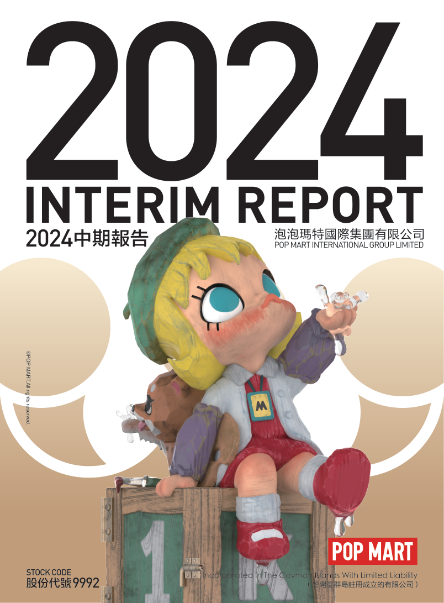

# 泡泡玛特2024年中期报告（简体中文）

> 披露日期：2024-09-24。来源：[泡泡玛特官方投资者关系](https://popwebsite.paquapp.com/pdf/b853bf29-b6fa-4318-bef9-31b79a21b910-2024中期报告.pdf)。
> [原始PDF](../2024年中期报告.pdf) · [历年财报索引](../泡泡玛特历年财报索引.md)
> 转换说明：保留中文正文、数字、单位和注释，仅做繁简转换及重复英文去除。外文专名、代码和网址照录；复杂表格用等宽文本保留列位置，插图保留原图。

## 原PDF第1页

[对照原PDF第1页](../2024年中期报告.pdf#page=1)




## 原PDF第2页

[对照原PDF第2页](../2024年中期报告.pdf#page=2)

2

公司资料

目录

财务概要

管理层讨论与分析

其他资料

中期简明综合损益及其他全面收益表

中期简明综合资产负债表

中期简明综合权益变动表

中期简明综合现金流量表

中期简明综合财务资料附注

释义

二零二四年中报  1

## 原PDF第3页

[对照原PDF第3页](../2024年中期报告.pdf#page=3)

公司资料

董事会

执行董事

王宁先生（董事会主席）杨涛女士（于2024年3月20日辞任）刘冉女士

司德先生文德一先生（于2024年3月20日获委任）

非执行董事

屠铮先生

何愚先生

独立非执行董事

张建君先生

吴联生先生

颜劲良先生

薪酬委员会

张建君先生（主席）

吴联生先生

王宁先生

提名委员会

王宁先生（主席）

张建君先生

吴联生先生

审核委员会

吴联生先生（主席）

屠铮先生

颜劲良先生

联席公司秘书

李鸿轩先生

李菁怡女士

授权代表

王宁先生

李菁怡女士

2  泡泡玛特国际集团有限公司

## 原PDF第4页

[对照原PDF第4页](../2024年中期报告.pdf#page=4)

公司资料

总部及中国主要营业地点

中国

北京市朝阳区

大望京科技商务园区

宏泰东街浦项中心A座36及37楼

香港主要营业地点

香港

德辅道中188号

金龙中心19楼

股份过户登记总处

Maples Fund Services (Cayman) Limited PO Box 1093 Boundary Hall Cricket Square Grand Cayman KY1-1102 Cayman Islands

香港股份过户登记处

香港中央证券登记有限公司香港

湾仔

皇后大道东183号

合和中心17楼

1712-1716号舖

主要往来银行

中国工商银行股份有限公司（珠市口支行）

中国北京市东城区

珠市口东大街15号

交通银行股份有限公司

（望京支行）中国北京市朝阳区望京街9号望京国际商业中心

中国民生银行股份有限公司（望京支行）

中国北京市朝阳区

广顺北大街南湖东园一区

122号楼博泰国际B座

二零二四年中报  3

## 原PDF第5页

[对照原PDF第5页](../2024年中期报告.pdf#page=5)

公司资料

公司网站

www.popmart.com

法律顾问

有关香港法律

达维律师事务所

香港

中环

遮打道三号A

香港会所大厦十楼

有关中国法律

竞天公诚律师事务所

中国

上海市徐汇区

淮海中路1010号

嘉华中心45层

邮政编码：200031

有关开曼群岛法律迈普达律师事务所（香港）有限法律责任合伙香港湾仔

港湾道18号

中环广场26楼

核数师

罗兵咸永道会计师事务所

执业会计师

注册公众利益实体核数师

香港中环

太子大厦22楼

股份代号

9992  9992

4  泡泡玛特国际集团有限公司

## 原PDF第6页

[对照原PDF第6页](../2024年中期报告.pdf#page=6)

财务概要

截至6月30日止六个月

```text
                                          未经审核       未经审核
                                              2024           2023
                                            2024年         2023年          变动
                                        人民币千元     人民币千元
收入                                      4,557,831      2,813,812        62.0%
毛利                                      2,919,105      1,698,360        71.9%
经营溢利                                  1,126,417       537,762        109.5%
除所得税前溢利                            1,228,438       618,547         98.6%
期内溢利                                   964,142        477,242        102.0%
本公司拥有人应占溢利
                                           921,333        476,575         93.3%
非国际财务报告准则经调整纯利              1,017,625       535,365         90.1%
毛利率                                       64.0%          60.4%
纯利率                                       21.2%          17.0%
非国际财务报告准则经调整纯利率               22.3%          19.0%
                                                         未经审核        经审核
                                                            2024           2023
                                                        于2024年       于2023年
                                                         6月30日       12月31日
                                                       人民币千元    人民币千元
资产
非流动资产                                              2,302,138       2,285,394
流动资产                                                8,715,341       7,683,469
资产总值                                               11,017,479       9,968,863
权益
权益总额                                                8,452,657       7,780,382
负债
非流动负债                                                496,479        455,180
流动负债                                                2,068,343       1,733,301
负债总额                                                2,564,822       2,188,481
```

二零二四年中报  5

## 原PDF第7页

[对照原PDF第7页](../2024年中期报告.pdf#page=7)

管理层讨论与分析

业务回顾

2024 年上半年，得益于本公司各部门的紧密协作，凭借出色的IP运营能力与产品研发能力，我们在为消费者提供优质服务的同时，推出了诸多深受广大消费者喜爱的新IP和新品系列，这使得泡泡玛特品牌及其旗下IP在全球的认可度得以进一步提升，从而取得了优秀的销量表现。

报告期间，我们的收入达到人民币4,557.8 百万元，同比增速62.0%。通过满足用户多元化品类及IP需求、差异化渠道定位、精细化提升运营效率，从而拉动中国内地各渠道的销售增长，收入达到人民币3,206.4百万元，同比增速31.5%。通过加大国际市场的开拓力度、深度推进本土化运营，我们的港澳台及海外业务始终保持了高速发展的态势，收入达到人民币1,351.5 百万元，同比增速259.6%，其收入占比达到29.7%。

IP孵化与运营

IP运营与创意设计是推动泡泡玛特发展的关键因素。我们在全球范围内挖掘极具潜力的潮流艺术家和设计师，凭借成熟的IP运营体系，成功塑造出备受欢迎的潮流文化 IP 形象。与此同时，我们持续强化产品的设计创新力度，进一步丰富产品品类，旨在满足各类粉丝群体的多元需求，从而为全世界的消费者带来更多快乐。

我们根据各 IP 的特点，实施差异化运营，有效地持续保持 IP 的热度，进而取得强劲的销售表现。MOLLY、THE MONSTERS和SKULLPANDA在SKULLPANDA amounted to RMB782.2 million, RMB626.8 million and RMB574.6  2024 年上半年分别实现收入人民币 782.2 百万元、人民币626.8百万元和人民币574.6百万元。MOLLY持续展现出蓬勃的生命力，通过多元化MOLLY, SPACE MOLLY, ROYAL MOLLY and BABY MOLLY and corresponding  的商业化运营，成功打造了经典MOLLY、SPACE MOLLY的基本形象，以及对应的产品满足不同粉丝的需求，相关收入依然实现了 90.1% 的同比增长；通过丰富多样的产品品类设计以及偶装互动表演等呈MONSTERS has become more vibrant and vivid, while also demonstrating  现形式，THE MONSTERS的形象愈发生动鲜活，其个性也更为丰满立体，进而赢得了更多粉丝

6  泡泡玛特国际集团有限公司

## 原PDF第8页

[对照原PDF第8页](../2024年中期报告.pdf#page=8)

管理层讨论与分析

的青睐，相关收入实现了292.2%的同比大幅增长；SKULLPANDA持续探索，不断突破风格的边界，聚焦潮玩手办的设计与创作，为粉丝带来更多元化的艺术和收藏体验，相关收入实现了9.2%的同比增长。

2024 年上半年，我们内部 IP 原创工作室 PDC(Pop Design Center)旗下的多个IP取得了出色的成绩。Hirono 小野独特的设计语言引发粉丝情感共鸣，他的世界成为了许多粉丝的精神庇护所。我们在各大城市开设了小野 IP 生活方式类快闪店，快闪店中除了潮玩，全新推出了服装、家居及周边等众多品类。小野快闪曼谷站还展示及售卖了小野架上绘画及雕塑作品，全面多方位展现了小野的世界，相关收入实现了124.3%的同比增长。Zsiga作为2022年推出的新晋IP，其充满倔强、纯粹的设计表达，受到了消费者的青睐，相关收入实现了169.5%的同比增长。今年上半年，PDC推出了Nyota、OIPIPPI、inosoul等新IP，都凭借风格化的设计展现，在上市初就获得了众多粉丝的喜爱。

我们不断地探索和扩大授权IP的范围，推出各种不同类型和风格的潮玩手办、联名款产品，以满足不同消费者的需求和兴趣。通过与动漫、游戏、电影等多种版权方的合作，为粉丝们带来更多选择和惊喜，同时我们持续扩大IP授权地域，目前已获得大多数授权IP的全球授权，为全球消费者带来更独特的潮玩体验。

2024 年是我们推出 MEGA COLLECTION 的第四年，品牌运营逐渐进入成熟阶段。它代表着年轻一代多元且充满活力的审美品位与潮流视野，已然成为当前潮玩收藏家拥抱自己所钟爱文化的代表。 2024 年上半年， GRAND 系列推出第二款特殊材质潮玩MEGA SPACE MOLLY 400%藏金无痕•木), has  400% 藏金无痕•木，受到潮玩收藏爱好者们的广泛关注。此外，MEGA ROYAL MOLLY今年也与韩美林、蜷川实花、梵高博物馆等多个国际知名艺术家、艺术机构联合出新，践行着「潮玩艺术化 」这一使命 。 2 0 2 4 年上半年 ， MEGA COLLECTION共实现收入人民币586.1百万元，占比达到12.9%。

二零二四年中报  7

## 原PDF第9页

[对照原PDF第9页](../2024年中期报告.pdf#page=9)

管理层讨论与分析

毛绒产品作为我们在2023 年推出的爆款产品品类，于2024年上半年，实现收入人民币446.1百万元，占比达到9.8%。在此期间，我们持续深挖 IP 内核，并不断进行产品创新，例如搪胶毛绒类玩具。搪胶工艺使得面部表情更为鲜活灵动、可爱迷人，而毛绒玩具又具备方便展示、能作为穿搭配饰等特性，这不仅增强了粉丝与IP的情感纽带，还提供了更为丰富多样的互动体验，在吸引众多新粉丝的同时，也极大地增强了粉丝对IP的黏性。

2024年6月中旬，我们上架了首款积木产品。该产品借助积木拼搭的形式，展现了 IP 的精神内核，不仅丰富了 IP 的呈现方式，还拓展了粉丝与IP互动体验的渠道，使粉丝能够更深入的了解我们IP背后的故事。在兼容传统积木体系的基础上，我们通过在工艺、材质、玩法等方面的创新，让我们的积木产品与市场上的常规积木有显著差异，从而并进一步扩大了粉丝群体。

消费者触达

－ 线下渠道

2024年上半年我们于中国内地新开20家线下门店，门店数量从截至2023 年12 月31 日的363 家增至截至2024 年6 月30 日的374 家 1 。2024年上半年我们于中国内地减少1台机器人商店，机器人商店数量从截至2023 年12 2024.  月31日的2,190台减至截至2024年6月30日的2,189台。

```text
1                                                                            1    2024年上半年，因租约到期和其他商业原因，我
                                                                                  们关闭了9家门店。
```

8  泡泡玛特国际集团有限公司

## 原PDF第10页

[对照原PDF第10页](../2024年中期报告.pdf#page=10)

管理层讨论与分析

－ 线上渠道

泡泡玛特抽盒机是我们自主研发设计的微信小程序，旨在创造好玩、有趣、便捷的购物体验，抽盒机于2024 年上半年实现了人民币 399.2 百万元的收入，同比增速回正。我们的内容电商团队根据 IP、商品及用户群体特性，搭建了聚焦不同品类及使用场景的多个自营直播间，并凭借高质量的内容、丰富的互动参与、差异化的直播策略，提升了流量获取及转化效率。抖音平台2024 年上半年收入为人民币208.9 百万元，同比增长了90.7%。天猫旗舰店通过品类多点发力、拓展新圈层人群、优化流量运营效率，延续增长态势，2024 年上半年收入为人民币198.8 百万元，同比增速达到28.1%，并荣获了6.18 天猫玩具总榜及天猫潮流玩具的销售额第一名。(天猫玩具总榜)(天猫潮流玩具) in terms of sales in the

－ 会员运营

随著渠道的持续扩张、IP及产品种类的不断丰富，并通过全渠道精细化会员运营，会员数字化规模快速扩大，截至2024年6月30日，中国内地累计注册会员总数从2023 年12 月31 日的3,435.4 万人增至3,892.7 万人，新增注册会员457.3 万人。2024 年上半年会员贡献销售额占比 92.8% ，会员复购率为43.9% 2 。

```text
2                                                                              2   2024年上半年，会员中购买过2次或以上的占比。
```

二零二四年中报  9

## 原PDF第11页

[对照原PDF第11页](../2024年中期报告.pdf#page=11)

管理层讨论与分析

－ 港澳台及海外渠道

我们港澳台及海外业务持续推进DTC (Direct To Customer)的发展战略。截至2024年6月30 日，我们的港澳台及海外门店达到 92 家（含合营），机器人商店达到162 台（含合营及加盟）。

我们在海外多个地标性位置，充分结合了当地特色，开设了主题店和旗舰店，例如，今年 2 月开业的泰国曼谷 Central店，凭借粉色调以及融入了大量CRYBABY 的元素，成为泰国新的热门打卡地；2月我们位于美国洛杉矶Century City的门店开业，此地紧邻影视娱乐文化的核心区域，是时尚的购物胜地，深受更多当地消费者的喜爱；5月我们在越南著名的旅游景点巴拿山乐园开设了古堡主题店，受到了来自全球各地众多游客的关注；6月我们在英国最为繁华的牛津街开设门店，进一步提升了品牌在欧洲市场的知名度，持续为全球消费者提供更优质的产品和消费体验，我们的品牌和产品影响力在全球范围内不断提升。

与此同时，我们的海外电商团队针对不同国家、不同电商平台实施了差异化的运营策略，Shopee和Lazada平台聚焦东南亚多个国家，凭借精细化营销与本地化服务策略，收获了消费者的好评。于TikTok平台，我们紧跟全球内容电商与直播电商的潮流趋势，倾力打造高质量的内容生态，结合富有创意的直播活动吸引了大量年轻用户，以优质内容驱动销售，增进了品牌的曝光度与互动性。在全球市场层面，持续强化品牌官网的建设与优化工作，以用户为核心提升用户体验和品牌形象。我们的品牌与产品影响力在全球范围内持续增强。

10  泡泡玛特国际集团有限公司

## 原PDF第12页

[对照原PDF第12页](../2024年中期报告.pdf#page=12)

管理层讨论与分析

主题乐园与IP体验及创新业务孵化

我们建立了多产业链的IP商业化体系，持续加深粉丝与IP的情感连接，探索IP在价值实现路径上更多的可能性。

截至2024年6月底，泡泡玛特城市乐园开园已满九个月。乐园已初步积累了一批必游、必吃、必买的项目与产品，并在2024 年上半年加大了经典节目的每日演出频次、创排推出了新的演出节目，根据不同的节庆及假期落地相应主题的装置及活动，并上新系列 IP 主题餐品及主题商品。乐园演艺互动、餐饮以及商品的综合呈现，提供了一个丰富且轻松的一站式半日游选择，也因此吸引了国内外的泛粉丝及亲子客群前来体验，不断加深泡泡玛特及众多IP与用户的情感连接。

2024年4月，我们大胆创新，联合泡泡玛特城市乐园举办「2024PTS北京国际潮玩节」。这是PTS首次尝试由「潮玩展」转变为「潮玩节」，以全新的嘉年华模式带给粉丝耳目一新的潮玩IP沉浸式体验。本届PTS以「\#FUN开玩」为主题，举办了26 场签售活动及近百场演艺活动，除逛展购物外，还融合了IP演艺、乐园体验、吃喝玩乐等部分，让观众从排队抢购模式的紧张氛围中「慢下来」，享受潮玩带来的快乐。PTS实现了潮流产业的积淀与集聚，而乐园则搭建了潮流文化的体验场景，二者结合产生了协同效应。

二零二四年中报  11

## 原PDF第13页

[对照原PDF第13页](../2024年中期报告.pdf#page=13)

管理层讨论与分析

2024 年上半年，我们精心策划了多场艺术家签售会、快闪店和作品展等活动，助力多个IP大幅扩展全球影响力，与全球粉丝积极互动，提升了这些IP在国际市场的知名度。尤为瞩目的是，旗下IP 「THE MONSTERS」精灵天团中的LABUBU以「神奇泰国体验官」身份在泰国重磅亮相，官方为其举办了盛大的接机仪式，吸引了大量本地及国际粉丝参与，体现了IP在当地的超高人气，这不仅提升了品牌在泰国的曝光度和影响力，也助推 IP 成为促进中泰潮流文化互动的重要纽带。

```text
                                                 《梦想家园》         2024年6月27日，我们的首款自研手游《梦想家
                                                              (模     园》正式上线，玩法上将「模拟经营」和「派对玩
拟经营)” and “party gameplay (派对玩法)” together to create a lighter and  法」相融合，创造出更加轻度休闲的游戏体验。
                                                                      我们不断拓宽IP的内容边界，呈现方式越来越多
```

元，给予用户更多陪伴。

财务回顾

销售收入

本公司收入从2023 年上半年的人民币2,813.8 百万元上升到2024 年上半年的人民币4,557.8 百万元，同比增长62.0%。

12  泡泡玛特国际集团有限公司

## 原PDF第14页

[对照原PDF第14页](../2024年中期报告.pdf#page=14)

管理层讨论与分析

根据渠道划分的收入

本公司的收入来自于中国内地和港澳台及海外的：(1)线下渠道，(2)线上渠道，及(3)批发渠道及其他。下表载列本公司2024 年上半年及2023年上半年的按渠道划分的收入：2023:

```text
                            截至2024年6月30日止六个月                   截至2023年6月30日止六个月
                             收入        毛利率      收入占比           收入        毛利率      收入占比
                       人民币千元                                 人民币千元
中国内地
  线下渠道              1,786,250         62.8%         39.2%       1,450,567        63.0%         51.5%
  线上渠道              1,095,669         61.8%         24.0%        817,418         59.8%         29.1%
  批发及其他              324,435         53.5%          7.1%        170,047         35.6%          6.0%
合计                    3,206,354         61.5%         70.3%       2,438,032        60.0%         86.6%
```

港澳台及海外

```text
  线下渠道                 946,688         72.0%         20.8%         190,359         75.9%           6.8%
  线上渠道                 247,244         72.7%          5.4%          56,791         75.3%           2.0%
  批发及其他               157,545         54.8%          3.5%         128,630         38.3%           4.6%
合计                     1,351,477         70.1%         29.7%         375,780         62.9%          13.4%
总计                     4,557,831         64.0%        100.0%        2,813,812        60.4%         100.0%
```

二零二四年中报  13

## 原PDF第15页

[对照原PDF第15页](../2024年中期报告.pdf#page=15)

管理层讨论与分析

(1) 中国内地

线下渠道。线下收入由 2023 年上半年的人民币1,450.6 百万元上升到2024 年上半年的人民币1,786.3百万元，增长了23.1%。下表为按渠道及城市等级划分的线下收入明细：

```text
                       截至2024年6月30日         截至2023年6月30日
                             止六个月                 止六个月
                           收入     收入占比         收入     收入占比    收入变动
                     人民币千元                人民币千元
零售店                 1,471,276       82.4%     1,179,493       81.3%        24.7%
机器人商店              314,974        17.6%      271,074        18.7%        16.2%
合计                   1,786,250     100.0%      1,450,567      100.0%        23.1%
```

14  泡泡玛特国际集团有限公司

## 原PDF第16页

[对照原PDF第16页](../2024年中期报告.pdf#page=16)

管理层讨论与分析

```text
                                                                          零售店                                                    机器人商店
                                                                   截至6月30日止六个月                                         截至6月30日止六个月
                                                           2024                           2023                          2024                          2023
                                                          2024年                         2023年                        2024年                        2023年
城市等级                                                数量           收入           数量           收入           数量           收入           数量            收入
                                                                 人民币千元                    人民币千元                    人民币千元                     人民币千元
                            一线城市 3                  121         578,165            120         490,731           582         84,491            587          71,171
               4            新一线城市  4               108         412,334             99         329,101           678         99,627            663          84,279
                            二线及其他城市 5            145         480,777            121         359,661           929        130,856            935         115,624
                            合计                        374       1,471,276            340       1,179,493         2,189        314,974           2,185        271,074
```

－  零售店。零售店销售收入从 2023 年上半年的人民币1,179.5百万元增加到2024年上半年的人民币1,471.3百万元，同比增长了24.7%。2024年上半年中国内地零售店开设情况：截至2024年6月30日比截至2023年6月30日的零售店数量增加34家，截至2024年6月30日合计零售店374家。

－  机器人商店。机器人商店销售收入从2023 年上半年的人民币271.1 百万元增长到2024 年上半年的人民币315.0 百万元，同比增长了 16.2% 。 2024 年上半年中国内地机器人商店开设情况：截至2024年6月30日比截至2023年6月30 2,189.  日的机器人商店数量增加四台，截至2024 年 6 月 30 日合计机器人商店 2,189台。

```text
3                                                                            3   指中国内地一线城市，包括北京、上海、广州和
                                                                                 深圳
4                                                                            4   指中国内地新一线城市，包括成都、重庆、杭
                                                                                 州、武汉、西安、郑州、青岛、长沙、天津、苏
                                                                                 州、南京、东莞、沈阳、合肥和佛山
5                                                                            5   指中国内地除去一线城市和新一线城市以外的城
                                                                                 市
```

二零二四年中报  15

## 原PDF第17页

[对照原PDF第17页](../2024年中期报告.pdf#page=17)

管理层讨论与分析

线上渠道。线上收入由 2023 年上半年的人民币817.4 百万元增长到2024 年上半年的人民币1,095.7百万元，增长了34.0%。以下为线上收入明细：

```text
                               截至2024年                  截至2023年
                            6月30日止六个月              6月30日止六个月
                               收入      收入占比          收入      收入占比      收入变动
                         人民币千元                  人民币千元
泡泡玛特抽盒机              399,197        36.4%         373,000        45.6%           7.0%
抖音平台                    208,877        19.1%         109,531        13.4%          90.7%
天猫旗舰店                  198,841        18.1%         155,264        19.0%          28.1%
其他线上渠道                288,754        26.4%         179,623        22.0%          60.8%
合计                      1,095,669       100.0%         817,418       100.0%          34.0%
```

中国内地线上渠道的收入包括泡泡玛特抽盒机、抖音平台、天猫旗舰店以及其他线上渠道的收入。其中，泡泡玛特抽盒机从2023 年上半年的人民币373.0 百万元增长至2024 年上半年的人民币399.2 百万元，增长了7.0%；抖音平台收入从 2023 年上半年的人民币109.5 百万元增长至2024 年上半年的人民币208.9百万元，增长了90.7%；及天猫旗舰店收入从2023 年上半年的人民币155.3百万元增长至2024 年上半年的人民币198.8百万元，增长了28.1%。

批发及其他。中国内地批发及其他收入从2023 年上半年的人民币170.1 百万元增长到2024 年上半年的人民币324.4 百万元，增长了90.8%，主要由于泡泡玛特城市乐园带来的收入增加。

16  泡泡玛特国际集团有限公司

## 原PDF第18页

[对照原PDF第18页](../2024年中期报告.pdf#page=18)

管理层讨论与分析

(2) 港澳台及海外

线下渠道。线下收入由 2023 年上半年的人民币190.4 百万元上升到2024 年上半年的人民币946.7 百万元，增长了397.3%。以下为线下收入明细：

```text
                             截至2024年6月30日              截至2023年6月30日
                                  止六个月                      止六个月
                                 收入       收入占比           收入       收入占比       收入变动
                           人民币千元                    人民币千元
零售店                        893,505         94.4%         164,999          86.7%         441.5%
机器人商店                     53,183          5.6%          25,360          13.3%         109.7%
合计                          946,688        100.0%         190,359         100.0%         397.3%
```

零售店。港澳台及海外零售店销售收入从2023 年上半年的人民币165.0 百万元增加到2024 年上半年的人民币893.5 百万元，同比增长了 441.5%。2024 年上半年港澳台及海外零售店开设情况：截至2024 年6 月30 日比截至2023 年6 月30 日的零售店数量增加了 45 家，截至2024年6月30日合计零售店83家。

机器人商店。港澳台及海外机器人商店销售收入从2023年上半年的人民币25.4百万元增加到 2024 年上半年的人民币53.2百万元，同比增长了109.7%。2024年上半年港澳台及海外机器人商店开设情况：截至 2024 年 6 月 30 日比截至2023年6月30日的机器人商店数量增加了37台，截至2024年6月30日合计机器人商店143台。

二零二四年中报  17

## 原PDF第19页

[对照原PDF第19页](../2024年中期报告.pdf#page=19)

管理层讨论与分析

线上渠道。线上收入由 2023 年上半年的人民币56.8百万元增加到2024年上半年的人民币247.2 百万元，增长了335.4%。以下为线上收入明细：

```text
                             截至2024年6月30日              截至2023年6月30日
                                   止六个月                      止六个月
                                 收入       收入占比           收入        收入占比       收入变动
                           人民币千元                    人民币千元
泡泡玛特官方网站               69,648          28.2%          12,317          21.7%         465.5%
                               45,336          18.3%           9,292          16.3%         387.9%
                               45,183          18.3%          14,803          26.1%         205.2%
其他线上渠道                   87,077          35.2%          20,379          35.9%         327.3%
合计                          247,244         100.0%          56,791         100.0%         335.4%
```

港澳台及海外线上收入包括泡泡玛特官方网站、Lazada、Shopee和其他线上渠道。其中泡泡玛特官方网站收入从2023 年上半年的人民币12.3百万元增长到2024年上半年的人民币69.6百万元，增长了465.5%；Lazada收入从2023 年上半年的人民币9.3 百万元增长到2024年上半年的人民币45.3百万元，增长了387.9%；及Shopee收入从2023 年上半年的人民币14.8百万元增长到2024年上半年的人民币45.2百万元，增长了205.2%。增长主要是由于我们不断开拓新的线上平台，扩展更多的国家及地区，同时我们优化了营销资源配置，增加了对销售转化率更高的平台进行宣传推广。

18  泡泡玛特国际集团有限公司

## 原PDF第20页

[对照原PDF第20页](../2024年中期报告.pdf#page=20)

管理层讨论与分析

批发及其他。港澳台及海外批发及其他收入从2023 年上半年的人民币128.6 百万元增长至2024 年上半年的人民币157.5 百万元，增长了22.5%。主要为港澳台及海外业务持续拓展，品牌认可度增加。

港澳台及海外收入按区域划分。港澳台及海外收入由2023 年上半年的人民币375.8 百万元上升到2024 年上半年的人民币1,351.5百万元，增长了 259.6%。港澳台及海外按照区域进一步划分为：东南亚、东亚及港澳台地区、北美和欧澳及其他，下表为按区域划分的收入明细：

```text
                             截至2024年6月30日              截至2023年6月30日
                                  止六个月                      止六个月
                                 收入       收入占比           收入       收入占比       收入变动
                           人民币千元                    人民币千元
东南亚                        555,751         41.1%           96,094         25.6%         478.3%
东亚及港澳台地区
                              478,040         35.4%          188,438         50.1%         153.7%
北美                          177,969         13.2%           37,259          9.9%         377.7%
欧澳及其他                    139,717         10.3%           53,989         14.4%         158.8%
合计                        1,351,477        100.0%          375,780        100.0%         259.6%
```

二零二四年中报  19

## 原PDF第21页

[对照原PDF第21页](../2024年中期报告.pdf#page=21)

管理层讨论与分析

根据IP划分的收入

泡泡玛特的自主产品是我们的主要商品类型，2024 年上半年自主产品收入占总收入的比例为96.2%，自主产品收入从 2023 年上半年的人民币2,585.8 百万元增加到2024 年上半年的人民币4,382.7百万元，增长了69.5%。

泡泡玛特的自主产品主要分为：艺术家IP和授权IP，以下为IP划分的收入明细：

```text
                                                                        截至6月30日止六个月
                                                                 2024                          2023
                                                                2024年                       2023年
                                                              收入       收入占比          收入       收入占比
                                                        人民币千元                   人民币千元
                                 自主产品                 4,382,741        96.2%       2,585,773         91.9%
                                 艺术家IP                 3,687,803        81.0%       2,164,270         76.9%
MOLLY                                                      782,160         17.2%         411,433         14.6%
THE MONSTERS                                               626,806         13.7%         159,829          5.7%
SKULLPANDA                                                 574,562         12.6%         526,383         18.7%
DIMOO                                                      377,838          8.3%         362,032         12.9%
CRYBABY                                                    349,382          7.7%          26,603          1.0%
HIRONO                             Hirono小野              245,247          5.4%         109,352          3.9%
Zsiga                                                      122,787          2.7%          45,553          1.6%
HACIPUPU                                                    94,991          2.1%          69,171          2.4%
                                   其他艺术家IP            514,030         11.3%         453,914         16.1%
                                 授权IP                    694,938         15.2%         421,503         15.0%
                                 外采及其他                175,090          3.8%         228,039          8.1%
                                 合计                     4,557,831       100.0%       2,813,812        100.0%
```

20  泡泡玛特国际集团有限公司

## 原PDF第22页

[对照原PDF第22页](../2024年中期报告.pdf#page=22)

管理层讨论与分析

艺术家 IP。艺术家 I P 是本公司主要商品类型，主要包括 MOLLY、THE MONSTERS、SKULLPANDA、DIMOO等。艺术家IP的收入占比由2023年上半年的76.9%上升到2024年上半年的81.0%。艺术家IP收入从2023年上半年的人民币2,164.3 百万元，上升至2024年上半年的人民币 3,687.8 百万元，增长了70.4%。主要由于我们不断提升产品的设计创新能力，满足各类消费者的多元需求。

授权IP。授权IP收入从2023年上半年的人民币421.5 百万元，增加至2024 年上半年的人民币694.9百万元，增长了64.9%。主要由于我们不断加深与更多版权方的合作，持续扩大IP授权地域，同时推出更多风格、种类的产品，让全球消费者感受潮玩的乐趣。

根据产品类别划分的收入

本公司的产品按照类别主要划分为：手办、MEGA、毛绒玩具和衍生品及其他，以下为产品类别划分的收入明细：

```text
                                                                截至2024年6月30日             截至2023年6月30日
                                                                     止六个月                      止六个月
                                                                   收入       收入占比           收入       收入占比       收入变动
                                                             人民币千元                    人民币千元
                                  手办                        2,656,781          58.3%        2,041,075        72.5%          30.2%
MEGA                                                            586,130          12.9%         242,332          8.6%         141.9%
                                  毛绒玩具                      446,105           9.8%          40,794          1.5%         993.6%
                                  衍生品及其他                  868,815          19.0%         489,611         17.4%          77.5%
                                  合计                        4,557,831         100.0%        2,813,812       100.0%          62.0%
```

二零二四年中报  21

## 原PDF第23页

[对照原PDF第23页](../2024年中期报告.pdf#page=23)

管理层讨论与分析

我们不断在产品层面推陈出新，丰富产品品类，提升产品设计的能力。手办收入从2023 年上半年的人民币2,041.1 百万元上升到2024 年上半年的人民币 2,656.8 百万元，增长了 30.2%；MEGA收入从2023 年上半年的人民币242.3 百万元上升到2024年上半年的人民币586.1百万元，增长了141.9%；毛绒玩具收入从2023 年上半年的人民币40.8百万元上升到2024年上半年的人民币446.1百万元，增长了993.6%；衍生品及其他收入从2023年上半年的人民币489.6百万元上升到2024年上半年的人民币868.8百万元，增长了77.5%。

销售成本

销售成本从2023 年上半年的人民币1,115.5 百万元上升到 2024 年上半年的人民币 1,638.7 百万元，增长了46.9%，增加主要由于(1)商品成本由2023年上半年的人民币923.9百万元增加到2024年上半年的人民币1,282.1 百万元，其主要原因为销售增加；及(2)设计及授权成本由2023 年上半年的人民币77.5百万元增加到2024年上半年的人民币192.4 百万元，主要由于自主产品占比增多，以及联名产品增加，需要更多的IP授权费以及产品设计费。

毛利

本公司的毛利由2023 年上半年的人民币1,698.4百万元上升到2024 年上半年的人民币2,919.1 百万元，增长了71.9%，主要由于我们的收入增加以及销售成本的控制。我们的毛利率由2023 年上半年的60.4%增长至2024 年上半年的64.0%，主要由于(1)我们优化产品设计，加强了成本管控，提升对供应商的议价能力；(2)港澳台及海外销售占比提升拉动毛利率的增长；及(3)外采商品逐渐减少占比下降。

22  泡泡玛特国际集团有限公司

## 原PDF第24页

[对照原PDF第24页](../2024年中期报告.pdf#page=24)

管理层讨论与分析

经销及销售开支

我们的经销及销售开支由2023 年上半年的人民币 878.3 百万元增长至 2024 年上半年的人民币1,353.2百万元，增长了54.1%，其中占比较高的为雇员福利开支和使用权资产折旧。

－  雇员福利开支。雇员福利开支从 2023 年上半年的人民币281.4 百万元增长至2024 年上半年的人民币370.5百万元，增长了31.7%。主要由于我们的销售员工人数由2023 年上半年的3,189 名员工增加到2024 年上半年的4,232 名员工，主要用以支持我们全渠道业务扩张。

－  租赁相关开支。租赁相关开支包括使用权资产折旧，以及未计入租赁负债的与短期租赁及可变租赁有关的开支，租赁相关开支从2023 年上半年的人民币210.2 百万元增长至2024 年上半年的人民币333.6 百万元，增长了58.7%。主要由于(1)线下零售店数量较2023 年上半年增加了79 间，来满足我们中国内地和港澳台及海外的业务扩张，及

(2)零售店收入增长，提成租金随之增加。

一般及行政开支

我们的一般及行政开支由2023 年上半年的人民币 331.3 百万元增长至 2024 年上半年的人民币434.4百万元，增长了31.1%。其中占比较高的为雇员福利开支，我们的行政员工及设计开发人员人数由2023年上半年的959名增加至2024年上半年的1,238名。

其他收入

本公司的其他收入由2023年上半年的人民币37.4百万元下降到 2024 年上半年的人民币 31.6 百万元，下降了15.6%。其中(1)政府补助由2023年上半年的人民币21.2百万元下降至2024年上半年的IP license fee and other services increased from RMB15.5 million in the first  人民币10.3百万元，及(2)IP授权费及其他服务收入由 2023 年上半年的人民币 15.5 百万元增长到2024年上半年的人民币18.9百万元。

二零二四年中报  23

## 原PDF第25页

[对照原PDF第25页](../2024年中期报告.pdf#page=25)

管理层讨论与分析

经营溢利

综上所述，本公司的经营溢利由2023 年上半年的人民币537.8百万元增长至2024年上半年的人民币1,126.4百万元，增长了109.5%。

财务收入 － 净额

我们的财务收入净额由2023 年上半年的净收益人民币63.4百万元增长到2024年上半年的净收益的人民币83.8百万元，主要由于我们的利息收入增加。

所得税开支

我们的所得税开支由 2023 年上半年的人民币141.3百万元增加到2024年上半年的人民币264.3百万元，原因为我们的所得税前溢利增加。我们的实际税率由 2023 年上半年的 22.8% 降低至2024年上半年的21.5%。

期内盈利

由于上文所述，我们的期内盈利由2023 年上半年的人民币477.2 百万元增加至报告期间的人民币964.1百万元，增长了102.0%。

非国际财务报告准则经调整纯利

非国际财务报告准则经调整纯利未按照国际财务报告准则会计准则计算，视为非国际财务报告准则的财务指标，其定义为除以股份为基础的薪酬后纯利，而非国际财务报告准则经调整纯利率的定义为非国际财务报告准则经调整纯利除以收益。我们认为，这些信息对于投资者在不影响本集团经营业绩或现金流的情况下比较本集团的业绩是有用的，并允许投资者考虑管理层在评估本集团业绩时使用的指标。投资者不应认为非国际财务报告准则的财务指标替代或由于本集团的国际财务报告准则会计准则的业绩。此外，可能不是所有公司会以相同的方式计算该项非国际财务报告准则的财务指标，因此未必可与其他公司采用的相若计量比较。

24  泡泡玛特国际集团有限公司

## 原PDF第26页

[对照原PDF第26页](../2024年中期报告.pdf#page=26)

管理层讨论与分析

下表载列本公司各期间的非国际财务报告准则的财务指标对账情况。

```text
                                         截至2024年      截至2023年
                                            6月30日         6月30日
                                           止六个月         止六个月
                                         人民币千元       人民币千元
期内盈利                                    964,142          477,242
调整项目
以股份为基础的付款报酬                       53,483           58,123
非国际财务报告准则经调整纯利               1,017,625         535,365
非国际财务报告准则经调整纯利率                22.3%            19.0%
```

以股份为基础的付款开支属于非现金项目且并无直接反应我们的业务营运。因此，通过撇除该等项目对计算非国际财务报告准则经调整纯利影响的举措，可更好地反应我们的相关经营表现，并更加便于比较不同期间的经营表现。

流动资产、财务资源及资本开支

截至2024年6月30日止六个月，本公司及附属公司在整体业务经营方面采纳保守稳健的资金管理及财务政策。本集团维持以下资源以应付其营运资金需求：

流动资产及流动负债

我们的流动资产净值由截至2023 年12 月31 日的人民币5,950.2百万元增加至截至2024年6月30日的人民币6,647.0百万元，基本维持稳定。

二零二四年中报  25

## 原PDF第27页

[对照原PDF第27页](../2024年中期报告.pdf#page=27)

管理层讨论与分析

贸易应收款项

贸易应收款项指日常业务过程中我们应收客户的未结算款项。我们的贸易应收款项由截至2023年12月31日的人民币321.3百万元减少至截至2024 年6 月30 日的人民币263.7 百万元。贸易应收款项周转天数从2023 年的15 天减少至截至2024年6月30日止六个月的12天。

存货

我们的存货包括制成品。我们的存货由截至2023 年 12 月 31 日的人民币 904.7 百万元增加至截至2024 年6 月30 日的人民币916.7 百万元。存货总额维持稳定，我们仍将保持对供应链的柔性调节，提高预测的准确性，提升存货周转效率。存货周转天数从2023年的133天降低到截至2024年6月30日止六个月的101天。

现金及现金等价物

我们的现金及现金等价物主要包括银行现金。现金及现金等价物从截至2023 年12 月31 日的人民币2,077.9百万元增加至截至2024年6月30日的人民币3,608.7 百万元，主要为(1)我们经营活动产生的现金增加，及(2)减少了部分定期存款。

贸易应付款项

贸易应付款项主要指我们在日常业务过程中向供应商支付货款的责任。贸易应付款项从截至2023 年 12 月 31 日的人民币 444.9 百万元增加至截至2024 年6 月30 日的人民币555.1 百万元，主要原因为我们的业务增长，导致采购量增加，进而令应付供应商款项的余额有所增加。贸易应付款项周转天数从2023 年的53 天增加到截至2024年6月30日止六个月的56天。

银行借款

截至 2024 年 6 月 30 日，本集团并无任何银行借款。

26  泡泡玛特国际集团有限公司

## 原PDF第28页

[对照原PDF第28页](../2024年中期报告.pdf#page=28)

管理层讨论与分析

资产抵押

截至 2024 年 6 月 30 日，本集团并无任何资产抵押。

资产负债率

资产负债率为总负债除以总资产乘以 100% 。截至 2024 年 6 月 30 日，本集团的资产负债率为23.3%，而截至2023年12月31日的资产负债率为2023.  22.0%。

或有事件

我们目前并无涉及任何重大法律诉讼，亦不知悉我们涉及任何待决或潜在重大法律诉讼。倘我们涉及有关重大法律诉讼，则我们会于产生亏损且有关亏损金额有合理估计时，按当时所得资料记录任何亏损或或有负债。

外汇风险管理

本公司的附属公司在中国内地、港澳台及海外经营，面对若干货币敞口（主要有关美元、泰铢及港币）引致的外汇风险。由于本集团以我们经营实体各自功能货币以外货币计值的重大金融资产及负债不重大，故管理层认为业务并无任何重大外汇风险敞口。本集团并没有对冲外币波动，但是会紧密地监控有关情况，并在必要时采取措施以保证外汇风险在可控范围内。

二零二四年中报  27

## 原PDF第29页

[对照原PDF第29页](../2024年中期报告.pdf#page=29)

管理层讨论与分析

资本开支

本公司的资本开支包括购置物业、厂房及设备的款项和购置无形资产的款项。下表载列本公司2023 年上半年以及2024 年上半年的资本开支情况：

```text
                                         截至2024年      截至2023年
                                            6月30日         6月30日
                                           止六个月         止六个月
                                         人民币千元       人民币千元
购置物业、厂房和设备                        157,858          186,617
购置无形资产                                 28,587           27,462
合计                                        186,445          214,079
```

人力资源

截至2024 年6 月30 日，我们共有5,470 名员工，包括销售员工 4,232 名，行政及开发人员 1,238名。截至2024年6月30日，我们共发生员工成本（包括薪金、工资、津贴和福利）人民币657.7百万元。

应付雇员酬金包括薪金、花红及雇员福利计划供款。雇员薪金通常按雇员各自的职位、资历、经验及表现厘定。花红乃按雇员各自的职位、服务年期及雇员表现计算。为吸引并挽留雇员，我们每年评估提供予雇员的薪酬方案，以确定是否应对基本薪金及花红作出任何调整。

我们为所有雇员提供培训计划，以增强雇员与我们业务相关的知识、技能及能力。我们将为所有新员工提供入职培训课程，以使其熟悉本集团，其后根据部门需要及本集团发展战略进行在职培训。

28  泡泡玛特国际集团有限公司

## 原PDF第30页

[对照原PDF第30页](../2024年中期报告.pdf#page=30)

管理层讨论与分析

重大投资的未来计划

截至2024年6月30日，我们并无持有任何重大投资。

我们将继续广泛寻找潜在的策略性投资机会，并寻求可为本集团带来协同效应的潜在优质目标业务及资产。

重大收购及出售

截至2024年6月30日止六个月，我们并无进行任何重大收购或出售附属公司、联营公司及合营企业。

报告期间后事项

于本报告日期，本集团于报告期间后并无发生须进一步披露或调整的重大事项。

未来展望

IP is at the core of our business. Through our innovative products, delicate  IP 是我们业务的核心，我们通过创意的产品、精致的设计和优质的服务使消费者收获快乐美好、潮流体验和艺术熏陶，同时，通过不断提升品牌价值、拓展产品品类、创新产品模式，增加用户对泡泡玛特的品牌忠诚度，保持我们强势的市场地位及竞争力。

我们将致力于丰富IP类型，扩大IP库，保持高质量的设计创新水平，推出更多头部系列产品，对IP进行持续孵化及运营，强化IP内核，加深粉丝与 IP 之间的情感连接。我们将不断拓宽潮玩品类，进一步挖掘MEGA、毛绒玩具、积木、衍生品等品类的价值，不断完善相关工艺及生产发售流程，伴随产品品类的不断增加，在持续进行研发和改进流程的过程中，我们的供应链将在全球范围内进行布局和寻觅更合适、高效的工厂和供应商等合作伙伴，从而满足市场需求，保障高效的生产供应。我们还将关注可持续发展和环保理念，推出更多环保材质的产品及包装，为全球消费者提供更加安心、放心的产品选择。

二零二四年中报  29

## 原PDF第31页

[对照原PDF第31页](../2024年中期报告.pdf#page=31)

管理层讨论与分析

我们会持续扩张全球业务版图，进一步扩张东南亚、欧洲版图。我们会在全球主要地标性位置，开设我们的线下渠道，增加消费者体验和品牌知名度。同时不仅加强第三方平台，对内容电商和官网进一步的投入，在更多的国家的地区给消费者提供更好的潮流体验。我们希望通过品牌影响力能与更多的品牌和艺术家合作，丰富我们的产品线的同时，提高品牌知名度，从而提高潮流文化在全球范围内的影响力。

我们将持续强化渠道差异化定位，稳健拓展渠道网络，不断提升精细化运营能力，提高运营效率。继续推动创新零售数字化运作，加强会员运营能力，提供更极致、更美好、更一致性的消费服务体验。

我们将通过更丰富多样的途径持续推广潮流玩具文化，持续影响整个行业，为会员提供更多权益，提高粉丝黏性，提升粉丝的文化认同和品牌认知。

在进一步深耕潮流玩具业务的同时，推动乐园等新业务的落地，打造以IP为核心的更完善、更丰富的商业生态。

30  泡泡玛特国际集团有限公司

## 原PDF第32页

[对照原PDF第32页](../2024年中期报告.pdf#page=32)

管理层讨论与分析

上市所得款项净额用途

本公司股份于2020 年12 月11 日通过全球发售在香港联合交易所有限公司（「 联交所 」）主板上市，经扣除专业费用、包销佣金及其他相关上市开支后，本公司自全球发售（包括悉数行使超额配股权）所收取所得款项净额总额（「所得款项净额」）约为5,781.7百万港元。

诚如本公司日期为 2020 年 12 月 1 日的招股章程（「招股章程」）及本公司2023 年年度报告所述，所得款项净额的拟定用途及所得款项净额余额载列如下：

```text
                                                                                                             截至2024年
                                                                                         直至2023年           6月30日止         直至2024年             于2024年
                                                                                           12月31日              六个月            6月30日              6月30日
                                                                        占总所得            未动用的           已动用的            已动用的             的未动用    动用未动用
                                                       所得款项         款项净额            所得款项           所得款项            所得款项             所得款项    所得款项净额的
所得款项净额拟定用途                                 净额的分配           百分比            净额金额           净额金额            净额金额             净额余额    拟定时间表
```

30.0%

```text
用于为我们的消费者触达渠道及海外市场         1,734.5百万港元           30.0%        263.3百万港元       221.3百万港元      1,692.5百万港元         42.0百万港元
扩展计划拨付部分资金
                                                                       16.5%                   －                  －                                        －     －
      用于开设新零售店                        954.0百万港元            16.5%                                       －        954.0百万港元                   －     －
                                                                        6.0%
      用于开设新机器人商店                    346.9百万港元             6.0%         84.6百万港元        42.6百万港元        304.9百万港元         42.0百万港元     2025年12月31日之前
                                                                        7.5%                                                                                 －     －
      用于扩展业务至海外市场                  433.6百万港元             7.5%        178.7百万港元       178.7百万港元        433.6百万港元                   －     －
                                                                       27.0%                                       －
```

```text
用于为潜在投资、收购本行业价值链上下         1,561.1百万港元           27.0%      1,249.3百万港元                  －       311.8百万港元       1,249.3百万港元    2025年12月31日之前
游公司及与该等公司建立战略联盟拨资
```

二零二四年中报  31

## 原PDF第33页

[对照原PDF第33页](../2024年中期报告.pdf#page=33)

管理层讨论与分析

```text
                                                                                                             截至2024年
                                                                                         直至2023年           6月30日止         直至2024年             于2024年
                                                                                           12月31日              六个月            6月30日              6月30日
                                                                        占总所得            未动用的           已动用的            已动用的             的未动用    动用未动用
                                                       所得款项         款项净额            所得款项           所得款项            所得款项             所得款项    所得款项净额的
所得款项净额拟定用途                                 净额的分配           百分比            净额金额           净额金额            净额金额             净额余额    拟定时间表
```

15.0%

```text
用于投资技术举措，以增强我们的营销及          867.2百万港元            15.0%        370.7百万港元       121.5百万港元        618.0百万港元        249.2百万港元
粉丝参与力度及提升业务的数字化程度
                                                                        3.0%
      用于人才招募                            173.5百万港元             3.0%         62.4百万港元        34.9百万港元        146.0百万港元         27.5百万港元     2025年12月31日之前
                                                                        6.0%                                               HK$125.2 million      HK$221.7 million   Before 31 December 2025
```

```text
用于购买相关软件及硬件以加强数          346.9百万港元              6.0%       242.0百万港元         20.3百万港元       125.2百万港元         221.7百万港元    2025年12月31日之前
字化，并建立用于数字营销、客户
```

服务、物流、产品、供应链、仓储，会员、交易以及门店管理及营

```text
销的信息系统
                                                                 6.0%                                                                               －     －
```

```text
用于优化我们的线上营销工作，主          346.8百万港元              6.0%        66.3百万港元         66.3百万港元       346.8百万港元                    －    －
要包括战略性地在第三方推广平台
```

上投放广告、图标、链接及信息推送

32  泡泡玛特国际集团有限公司

## 原PDF第34页

[对照原PDF第34页](../2024年中期报告.pdf#page=34)

管理层讨论与分析

```text
                                                                                                             截至2024年
                                                                                         直至2023年           6月30日止         直至2024年             于2024年
                                                                                           12月31日              六个月            6月30日              6月30日
                                                                        占总所得            未动用的           已动用的            已动用的             的未动用    动用未动用
                                                       所得款项         款项净额            所得款项           所得款项            所得款项             所得款项    所得款项净额的
所得款项净额拟定用途                                 净额的分配           百分比            净额金额           净额金额            净额金额             净额余额    拟定时间表
                                                                           18.0%
       用于扩大我们的IP库                         1,040.7百万港元          18.0%       722.9百万港元        29.1百万港元      346.9百万港元        693.8百万港元
                                                                            4.5%                                                                              －    －
            用于加强我们物色优秀艺术家的能         260.3百万港元            4.5%        29.1百万港元        29.1百万港元      260.3百万港元                   －    －
            力
                                                                            1.5%                  －                 －                                       －    －
```

```text
用于以提供具有竞争力的薪金的方            86.6百万港元             1.5%                                       －        86.6百万港元                    －    －
式招募有才华的设计师加入我们的
```

内部设计团队，以增强我们的内部

```text
      原创IP发掘实力
                                                                       12.0%                                      －                  －
      用于收购受欢迎的IP以扩大我们的IP        693.8百万港元            12.0%       693.8百万港元                  －                  －         693.8百万港元    2025年12月31日之前
      库
                                                                       10.0%                  －                  －                                        －    －
营运资金及一般公司用途                        578.2百万港元            10.0%                                      －        578.2百万港元                   －    －
```

本集团将遵照招股章程所载拟定目的动用首次公开发售所得款项净额。

中期股息

董事会不建议派付截至2024年6月30日止六个月的中期股息。

二零二四年中报  33

## 原PDF第35页

[对照原PDF第35页](../2024年中期报告.pdf#page=35)

其他资料

遵守企业管治守则

本集团致力维持高水平的企业管治，以保障股东权益并提升企业价值及问责性。本公司已采纳上市规则附录C1 所载的企业管治守则（「企业管治守则」），作为其本身的企业管治守则。截至 2024 年 6 月 30 日止六个月内一直遵守企业管治守则项下的所有适用守则条文，惟下文「主席及行政总裁」一段所述偏离守则条文第C.2.1条除外。

主席及行政总裁

企业管治守则的守则条文第C.2.1 条规定主席与行政总裁的职责应有所区分，不应由同一人士履行。根据董事会现行架构，本公司主席及行政总裁职位由王宁先生担任。

董事会相信，这种架构将不会削弱董事会与本公司管理层之间的权力及权限平衡，原因是：

(i) 董事会所作决定至少需要由大多数董事批准，而董事会九名董事当中有三名独立非执行董事，董事会认为董事会内部有足够的制衡作用；(ii)王宁先生及其他董事知悉并承诺履行彼等作为董事的受信责任，当中要求（其中包括）彼等为本公司的利益及最佳利益行事，并据此作出本集团决策；及(iii)权力及权限平衡乃以董事会运作加以保障，而董事会由经验丰富、高质素人士组成，彼等定期会面讨论影响本集团运作的事宜。此外，本集团的整体战略及其他主要业务、财务及营运政策乃经董事会及高级管理层层面全面商讨后共同作出。最后，由于王宁先生为我们的主要创办人，董事会认为由同一人士担任主席及行政总裁可确保本集团的领导贯彻一致，令本集团实现更为有效及高效的整体战略规划。董事会将继续检讨本集团企业管治架构的有效性，以评估是否需要区分主席与行政总裁的职责。

34  泡泡玛特国际集团有限公司

## 原PDF第36页

[对照原PDF第36页](../2024年中期报告.pdf#page=36)

其他资料

本公司致力提升适用于其经营行为及业务增长的企业管治常规，并不时审阅该等常规，以保证彼等符合法定及专业标准且与最新发展保持一致。

进行证券交易的标准守则

本公司采纳上市规则附录C3 所载上市发行人董事进行证券交易的标准守则（「标准守则」），作为本公司涉及董事证券交易的行为守则。经向全体董事作出具体查询后，各董事已确认于截至2024年6月30日止六个月一直遵守标准守则所载的规定。

2024.

可能拥有本公司未公布内幕消息的本公司雇员亦须遵守标准守则。

董事及行政总裁之资料变更

于2024年3月20日，杨涛女士辞任本公司执行董事，以专注于IP运营及产品研发。同日，文德一先生获董事会委任为本公司执行董事。

除本中期报告披露者外，并无根据上市规则第13.51B(1)条须予披露之董事及行政总裁资料之变动。

董事及行政总裁于股份、相关股份及债权证的权益及淡仓

于2024年6月30日，本公司董事及行政总裁于本公司或其任何相联法团（定义见《证券及期货条例》第XV部）的股份、相关股份及债权证中拥有根据《证券及期货条例》第XV部第7及第8分部已知会本公司及联交所（包括根据《证券及期货条例》的有关条文彼等被当作或视为拥有的权益及淡仓），或根据《证券及期货条例》第352条须予存置的登记册所记录或根据标准守则已另行知会本公司及联交所的权益及淡仓如下：

二零二四年中报  35

## 原PDF第37页

[对照原PDF第37页](../2024年中期报告.pdf#page=37)

其他资料

于本公司股份及相关股份的权益

```text
                                                                           所持股份 ╱ 相关股份    占本公司股权概约
董事姓名                           身份 ╱ 权益性质                                       总数  (1)      百分比(%) (1)
                                                                                  676,081,407 (L)           50.34%
王宁先生
```

信托的受益人及创办人；

```text
                                     及受控法团权益 (2)
                                                                                   12,438,126 (L)             0.93%
司德先生
                                   实益拥有人及酌情信托创办人 (3)
                                                                                   16,910,000 (L)             1.26%
屠铮先生                           受控法团权益  (4)
                                                                                    1,444,618 (L)             0.11%
文德一先生                                     (5)
                                   实益拥有人及受控法团权益 (5)
```

```text
                                                                                 附注：
(1)                                                                              (1)  于 2024 年 6 月 30 日，本公司合共已发行
                                                                                      1,342,943,150股股份。字母「L」代表有关人士于股
                                                                                      份的好仓。
(2)  GWF Holding Limited is a company with limited liability incorporated in the BVI  (2)  GWF Holding Limited为一家于英属维京群岛注
                                                                                      册成立的有限公司，由UBS Trustees (B.V.I.) Ltd.
```

全资拥有，而UBS Trustees (B.V.I.) Ltd.以王宁先生作为委托人（以王宁先生为受益人）所创立信托的受托人身份全资拥有。根据《证券及期货条例》，王宁先生被视为于GWF Holding Limited所持571,981,960 股股份中拥有权益。Tianjin Paqu Holding Limited为一家根据英属维京群岛法律注册成立的有限公司，而王宁先生为唯一股东。根据《证券及期货条例》，王宁先生因而被视为于Limited所持本公司31,196,420股股份中拥有权益。Pop Mart Hehuo Holding Limited为一家根据英属维京群岛法律注册成立的有限公司，并持有72,903,027股股份。王宁先生持有Pop Mart Hehuo Holding Limited已发行股本的41.99%。根据《证券及期货条例》，王宁先生因而被视为于Pop Mart Hehuo Holding Limited所持股

```text
                                                                                     份中拥有权益。
(3)  Sidsi Holding Limited is an investment holding company incorporated under the  (3)  Sidsi Holding Limited为一家根据英属维京群岛法
                                                                                     律注册成立的投资控股公司，由 TMF (Cayman)
```

Ltd. （作为由司德先生（作为委托人）以其本身为受益人设立的XM Family Trust的受托人）全资拥有。根据《证券及期货条例》，司德先生被视为于Sidsi Holding Limited所持10,933,075 股股份中拥有权益。司德先生有权收取根据首次公开发售后股份奖励计划向其授出的609,851股奖励股份及其购买的895,200股股份。36  泡泡玛特国际集团有限公司

## 原PDF第38页

[对照原PDF第38页](../2024年中期报告.pdf#page=38)

其他资料

```text
(4)  Borchid Phoenix Holding Limited is wholly owned by Shanghai Zhuniao Enterprise  (4)                     Limited由上海朱鸟企业
                                                                                     管理合伙企业（有限合伙）全资拥有，而上海朱
```

鸟企业管理合伙企业（有限合伙）分别由 Suzhou Borchid Jichu Venture Capital Partnership (Limited Partnership)及Zhoushan Borchid Lizhi Enterprise Partnership)拥有99.9%及0.1%。Suzhou Borchid Jichu Venture由

拥有 1%，而

Partnership (Limited Partnership)由屠铮先生拥有69%。根据《证券及期货条例》，屠铮先生因而被视为于Borchid Phoenix Holding Limited所持

```text
                                                                                     16,910,000股股份中拥有权益。
(5)                                                                              (5)  文德一先生直接持有本公司 823,290 股股份。
                                                                                                         Limited为一家根据英属维京
```

群岛法律注册成立的投资控股公司，并由文德一先生全资拥有。因此，根据《证券及期货条例》，文德一先生被视为于Justin Moon Holding Limited所持621,328股股份中拥有权益。

除上文所披露者外，于 2024 年 6 月 30 日，概无本公司董事于本公司或其任何相联法团（定义见《证券及期货条例》第XV部）的股份、相关股份或债权证中拥有或被视为拥有任何根据《证券及期货条例》第 XV 部第7 及第8 分部须知会本公司及联交所（包括根据《证券及期货条例》的有关条文彼等被当作或视为拥有的权益及淡仓），或须记入根据《证券及期货条例》第352条须由本公司存置的登记册，或根据标准守则须知会本公司及联交所的权益或淡仓。

主要股东于股份及相关股份的权益及淡仓

于2024年6月30日，据本公司董事及行政总裁所知，下列人士（本公司董事及行政总裁除外）于股份或相关股份拥有根据《证券及期货条例》第XV部第2及第3分部须向本公司披露或根据《证券及期货条例》第336 条须由本公司存置的登记册所记录的权益或淡仓：

二零二四年中报  37

## 原PDF第39页

[对照原PDF第39页](../2024年中期报告.pdf#page=39)

其他资料

于本公司股份及相关股份的权益

```text
                                                                                            所持股份 ╱      占本公司股权概约
股东姓名                               身份 ╱ 权益性质                                   相关股份总数  (1)         百分比(%) (1)
UBS Trustees (B.V.I.) Limited                                                             571,981,960 (L)               42.59%
                                       受托人 (2)
GWF Holding Limited                                                                       571,981,960 (L)               42.59%
                                       实益拥有人 (2)
                                                                                           72,903,027 (L)                5.43%
                                       实益拥有人 (3)
                                                                                            69,574,800 (L)               5.18%
东方证券股份有限公司                   受控法团权益 (4)
                                                                               附注：
(1)                                                                            (1)  于 2024 年 6 月 30 日，本公司合共已发行
                                                                                   1,342,943,150股股份。字母「L」代表有关人士于股
                                                                                   份的好仓。
(2)  GWF Holding Limited is a company with limited liability incorporated in the BVI  (2)  GWF Holding Limited为一家于英属维京群岛注
                                                                                   册成立的有限公司，由UBS Trustees (B.V.I.) Ltd.
```

全资拥有，而UBS Trustees (B.V.I.) Ltd.以王宁先生作为委托人（以王宁先生为受益人）所创立信托的受托人身份全资拥有。根据《证券及期货条例》，王宁先生被视为于GWF Holding Limited所持571,981,960 股股份中拥有权益。Tianjin Paqu Holding Limited为一家根据英属维京群岛法律注册成立的有限公司，而王宁先生为唯一股东。根据《证券及期货条例》，王宁先生因而被视为于Limited所持本公司31,196,420

```text
                                                                                   股股份中拥有权益。
(3)  Pop Mart Hehuo Holding Limited is a company with limited liability incorporated  (3)                  Limited为一家根据英
                                                                                   属维京群岛法律注册成立的有限公司，并持有
```

72,903,027股股份。王宁先生持有Pop Mart Hehuo Holding Limited已发行股本的41.99%。根据《证券及期货条例》，王宁先生因而被视为于Pop Mart Hehuo Holding Limited所持股份中拥有权益。

38  泡泡玛特国际集团有限公司

## 原PDF第40页

[对照原PDF第40页](../2024年中期报告.pdf#page=40)

其他资料

```text
(4)                                  (东方证券股份有限公司) (DFZQ) is a joint  (4)  东方证券股份有限公司(DFZQ)为一家在中国注册
                                                                                   成立的股份有限公司。根据《证券及期货条例》，
                                                                                   DFZQ 被视为于上海东方证券资产管理有限公司
                       (上海东方证券资产管理有限公司), which is wholly owned      （由DFZQ全资拥有）持有的69,574,800股股份中拥
                                                                                   有权益。
```

除上文所披露者外，于 2024 年 6 月 30 日，本公司尚未接获任何其他人士（本公司董事除外）通知，表示其于本公司股份或相关股份拥有根据《证券及期货条例》第XV部第2及第3分部须予披露，或须记入根据《证券及期货条例》第336条须由本公司存置的登记册的权益或淡仓。

董事收购股份或债权证的权利

除本中期报告另行披露者外，本公司或其任何附属公司于截至 2024 年 6 月 30 日止六个月内任何时间概无订立任何安排以使董事可藉收购本公司或任何其他法团的股份或债权证而获得利益，且概无董事或任何彼等的配偶或未满 18 岁子女获授任何认购本公司或任何其他法团的股权或债权证的权利或已经行使任何有关权利。

购入、出售或赎回上市证券或出售库存股

于截至2024年6月30日止六个月，本公司已于联交所购回合共4,700,000 股本公司股份，总代价约85,826,488港元。进行回购旨在提高长远股东价值。购回股份其后被注销。购回股份的具体情况如下：

```text
购回月份                                                                购回股份数目                每股支付                        总代价
                                                                                                最高价            最低价
                                                                                               （港元）          （港元）          （港元）
                                    2024年1月                               3,890,000             19.96             17.00        71,168,524
                                    2024年2月                                 810,000             18.46             17.62        14,657,964
                                    总计                                    4,700,000                                            85,826,488
```

二零二四年中报  39

## 原PDF第41页

[对照原PDF第41页](../2024年中期报告.pdf#page=41)

其他资料

除上文所披露者外，于截至2024年6月30日止六个月，本公司或任何其附属公司并无购入、出售或赎回本公司的上市证券或出售任何库存股（定义见上市规则）。截至2024年6月30日，公司并未持有任何库存股（定义见上市规则）。

首次公开发售后股份奖励计划

本公司于2020年7月24日有条件采纳并于2023年5 月17 日（「修订日期」）修订首次公开发售后股份奖励计划。对于董事会根据首次公开发售后股份奖励计划授出的任何奖励（「奖励」），本公司委任恒泰信托（香港）有限公司为首次公开发售后股份奖励计划的受托人（「受托人」），以管理首次公开发售后股份奖励计划，有关奖励可以股份（「奖励股份」）或奖励股份之实际售价以现金的形式归属。于2024年6月30日，首次公开发售后股份奖励计划的剩余期限约为六年零六个月。除另有指明外，本节所用词汇具有本公2023.  司日期为2023年4月24日之通函所界定的相同涵义。

(a) 计划的目的

首次公开发售后股份奖励计划的目的为：

(i)透过股份所有权、股息及就股份支付的其他分派及 ╱ 或提升股份价值令合资格人士的利益与本集团的利益一致；及(ii)鼓励并挽留合资格人士，以就本集团的长期增长及溢利作出贡献。

(b) 计划的参与者

可能被选为首次公开发售后股份奖励计划参与者的合资格人士可为任何个人或公司实体（视情况而定），即(i)雇员参与者；(ii)关联实体参与者；及(iii)服务提供者中的任何一类，其经董事会或其代表全权酌情考虑后对本集团作出贡献或将作出贡献。倘有关个人所在地的法律法规不允许根据首次公开发售后股份奖励计划授予、接受或归属奖励，或董事会或其代表认为，为遵守所在地的适用法律法规将有关个人排除在外乃属必要或适宜，该等个人无权参与首次公开发售后股份奖励计划。

40  泡泡玛特国际集团有限公司

## 原PDF第42页

[对照原PDF第42页](../2024年中期报告.pdf#page=42)

其他资料

(c) 计划限额及服务提供者分项限额

除非股东批准进一步更新计划限额或根据上市规则取得股东批准，否则本公司不得进一步授予任何奖励，以致本公司就所有在修订日期后根据首次公开发售后股份奖励计划以及本公司采纳的任何其他计划授予的购股权及奖励（不包括根据相关计划规则失效的购股权或奖励）发行的股份总数超过修订日期已发行及发行在外股份总数的10%。

除非股东批准进一步更新服务提供者分项限额或根据上市规则取得股东批准，否则本公司不得进一步授予服务提供者任何奖励，以致本公司就所有在修订日期后根据首次公开发售后股份奖励计划以及本公司采纳的任何其他计划授予服务提供者的购股权及奖励（不包括根据相关计划规则失效的购股权或奖励）发行的股份总数超过修订日期已发行及发行在外股份总数的1%。

于报告期初及报告期末，根据首次公开发售后股份奖励计划可供授出的奖励股份数量分别为131,928,235 股及131,567,020 股，其中，根据服务提供者分项限额可供授出的奖励股份数目分别为 13,675,901 股及13,675,901股。

概无新股份会因根据首次公开发售后股份奖励计划于截至 2024 年 6 月 30 日止六个月内授予的奖励股份而发行，因为该等奖励股份将由受托人持有的先前发行的股份拨付。于 2024 年 6 月 30 日，首次公开发售后股份奖励计划项下可供发行的股份总数为124,068,457 股，约占已发行股份总数的9.24%。

二零二四年中报  41

## 原PDF第43页

[对照原PDF第43页](../2024年中期报告.pdf#page=43)

其他资料

(d) 个别限额

倘根据首次公开发售后股份奖励计划及本公司采纳的任何其他计划向选定参与者授出任何奖励将导致于截至有关授出日期（包括该日）止 12 个月期间向有关人士授出的所有购股权及奖励（不包括根据相关计划规则失效的购股权或奖励）涉及的已发行及将予发行的股份数目合共超过本公司于相关期间已发行及发行在外的股份总数的1%，则有关授出须经股东于股东大会上另行批准，而有关选定参与者及其紧密联系人（或倘选定参与者为关连人士，则为联系人）须放弃投票。

(e) 授出奖励

董事会或计划管理人可不时全权酌情决定以奖励函（「奖励函」）的方式向选定参与者（倘为董事会代表，则为向除本公司董事或高级职员以外的任何选定参与者 ）授出奖励。奖励函将列明授出日期、奖励涉及的奖励股份数目、归属标准及条件、归属日期以及董事会或计划管理人可能不时认为必要的有关其他详情。

选定参与者就申请或接纳奖励毋须支付代价。

42  泡泡玛特国际集团有限公司

## 原PDF第44页

[对照原PDF第44页](../2024年中期报告.pdf#page=44)

其他资料

(f) 归属期

董事会或计划管理人可在首次公开发售后股份奖励计划生效期间并在符合所有适用法律的情况下，不时决定计划项下待归属奖励的有关归属标准及条件或期限，惟奖励的归属期不得少于 12 个月，惟授予雇员参与者的任何奖励的归属期可更短，包括以下情况：

向新雇员参与者授出「补偿性」奖励，以取代有关雇员参与者离职时失去的奖励或购股权；

(ii) 授予因身故或残疾或不可抗力事件而被终止雇佣关系的雇员参与者；

(iii) 授出的奖励受达成其获授予的表现目标所限；

(iv) 授出奖励的时机由管理或合规要求厘定，与相关雇员参与者的表现无关，在该情况下，归属日期可参考奖励若非因有关管理或合规要求而本已授出的时间进行调整；

(v) 授出的奖励附带混合归属时间表，令奖励可在12个月期间内平均归属；或

(vi) 授出的奖励的总归属期超过 12 个月，例如，奖励可能分多批归属，第一批在授出日期 12 个月内归属，最后一批在授出日期的12个月后归属。

(g) 购买价

奖励股份的应付购买价（如有）由董事会或计划管理人经计及（包括但不限于）股份当前收市价及选定参与者的条件后根据首次公开发售后股份奖励计划之目的厘定并于奖励函中列明。

二零二四年中报  43

## 原PDF第45页

[对照原PDF第45页](../2024年中期报告.pdf#page=45)

其他资料

于报告期内，按首次公开发售后股份奖励计划授出之奖励股份的变动详情载列如下：

奖励股份数目

```text
                                                                                                  2024                                                                     2024
                                                                                                     于                                                                      于
                    授出奖励                                                                    2024年                                                                  2024年
相关奖励对象        股份数目     授出日期                归属期间                               1月1日     期内已授出    期内已归属    期内已失效     期内已注销       6月30日
                      609,851                                                                   457,388              0       152,463             0              0       304,925
司德先生                         2023年4月21日           授出日期及其后三年内分批次归属
                    2,683,326                                                                   280,778              0        29,834         31,883             0       219,061
雇员                             2021年1月4日            授出日期后4年内分批次归属
                      721,290                                                                    73,766              0        34,825             0              0        38,941
                                 2021年4月1日            授出日期后4年内分批次归属
                      763,258                                                                   320,011              0       156,802          6,394             0       156,815
                                 2021年6月1日            授出日期后4年内分批次归属
                      160,752                                                                    45,603              0        22,804             0              0        22,799
                                 2021年7月2日            授出日期后4年内分批次归属
                      348,058                                                                   164,054              0         4,423             0              0       159,631
                                 2021年10月4日           授出日期后4年内分批次归属
                      113,489                                                                    44,836              0             0             0              0        44,836
                                 2022年1月3日            授出日期后4年内分批次归属
                    1,303,792                                                                  1,067,472             0       402,268         27,433             0       637,771
                                 2022年4月1日            授出日期后4年内分批次归属
```

44  泡泡玛特国际集团有限公司

## 原PDF第46页

[对照原PDF第46页](../2024年中期报告.pdf#page=46)

其他资料

奖励股份数目

```text
                                                                                           2024                                                               2024
                                                                                             于                                                                 于
                   授出奖励                                                              2024年                                                             2024年
相关奖励对象       股份数目    授出日期             归属期间                             1月1日    期内已授出   期内已归属   期内已失效    期内已注销      6月30日
                    102,164                                                               98,022            0        46,942        3,451            0        47,629
                               2022年7月4日         授出日期后4年内分批次归属
                    407,277                                                              234,702            0       117,351            0            0       117,351
                               2022年7月4日         授出日期后4年内分批次归属
                    222,379                                                              214,436            0            0             0            0       214,436
                               2022年10月3日        授出日期后4年内分批次归属
                    102,906                                                               52,923            0            0             0            0        52,923
                               2022年12月30日       授出日期后4年内分批次归属
                   3,679,083                                                            2,724,434           0       803,699       15,246            0     1,905,489
                               2023年4月21日        自授出日期起4年内分批次归属
                     68,709                                                               68,709            0            0             0            0        68,709
                               2023年7月7日         自授出日期起4年内分批次归属
                   4,769,445                                                            4,761,981           0            0       211,548            0     4,550,433
                               2023年10月18日       自授出日期起4年内分批次归属
                    408,194                                                                   0       408,194            0             0            0       408,194
                               2024年3月21日        自归属开始日期（即2024年1月
                                                       15日）起4年内分批次归属
                    164,659                                                                   0       164,659            0             0            0       164,659
                               2024年4月26日        自授出日期起4年内分批次归属
```

二零二四年中报  45

## 原PDF第47页

[对照原PDF第47页](../2024年中期报告.pdf#page=47)

其他资料

附注：上表中所有奖励股份的购买价为零。就司德先生而言，紧接奖励股份于报告期奖励股份归属日期前的股份加权平均收市价为每股31.50港元。就本集团雇员而言，紧接奖励股份于报告期奖励股份归属日期前的股份加权平均收市价为每股29.41港元。

于报告期内作出的授予的情况如下：

```text
                                                                                           于紧接授出         每股奖励股份
                                                                                         日期前之股份         于授出日期的
相关参与者           授出日期             归属期间               授出奖励股份数目        收市价（港元）  奖励公平值（港元）
                                                                           408,194               24.70                28.65
雇员
                     2024年3月21日        自归属开始日期
                                           （即2024年1月15日）
                                            起4年内分批次归属
                                                                           164,659               33.95                33.80
                     2024年4月26日        自授出日期起4年内
                                            分批次归属
```

详情请参阅本公司日期分别为2024 年3 月21 日及2024年4月26日的公告。于报告期内，所有授出均须达到有关授予函件中所规定的若干个人绩效目标。

报告期内奖励股份的估值详情，包括首次公开发售后股份奖励计划采用的会计准则和政策，载于本报告中期简明综合财务资料附注21。

46  泡泡玛特国际集团有限公司

## 原PDF第48页

[对照原PDF第48页](../2024年中期报告.pdf#page=48)

其他资料

审核委员会

审核委员会由两名独立非执行董事和一名非执行董事组成，分别为吴联生先生、颜劲良先生及屠铮先生。审核委员会主席为吴联生先生，审核委员会成员颜劲良先生具专业会计资格。

审核委员会已与管理层审阅本集团采纳之会计准则及惯例，并讨论内部监控及财务汇报事宜，包括审阅截至2024年6月30日止六个月之中期财务资料。

本公司外聘核数师罗兵咸永道会计师事务所已根据国际审阅委聘准则第2410号「由实体的独立核数师执行中期财务资料审阅」，对本集团截至2024年6月30日止六个月的中期财务资料进行审阅。罗兵咸永道会计师事务所已确认，按照他们的审阅，并无发现任何事项致令他们相信中期财务资料在各重大方面未有根据国际会计准则第34号「中期财务报告」编制。

代表董事会

董事会主席

王宁先生

香港，2024年8月20日

二零二四年中报  47

## 原PDF第49页

[对照原PDF第49页](../2024年中期报告.pdf#page=49)

中期简明综合损益及其他全面收益表

```text
                                                截至6月30日止六个月
                                                    2024             2023
                                                  2024年           2023年
                                              人民币千元       人民币千元
                                  附注       （未经审核）     （未经审核）
收入                               5            4,557,831        2,813,812
销售成本                           6           (1,638,726)      (1,115,452)
毛利                                            2,919,105        1,698,360
经销及销售开支                     6           (1,353,206)        (878,319)
一般及行政开支                     6             (434,410)        (331,252)
金融资产减值亏损拨备
                                                   (2,589)            (95)
其他收入                           7              31,586           37,433
其他（亏损）╱ 收益 － 净额         8              (34,069)         11,635
经营溢利                                        1,126,417         537,762
财务收入                           9             105,993           79,613
财务开支                           9              (22,218)         (16,174)
财务收入 － 净额                   9              83,775           63,439
分占使用权益法入账的投资溢利
                                   16             18,246           17,346
除所得税前溢利                                  1,228,438         618,547
所得税开支                         10            (264,296)        (141,305)
期内溢利                                         964,142          477,242
以下应占期内溢利：
  本公司拥有人                                   921,333          476,575
  非控股权益                                      42,809              667
                                                 964,142          477,242
```

48  泡泡玛特国际集团有限公司

## 原PDF第50页

[对照原PDF第50页](../2024年中期报告.pdf#page=50)

中期简明综合损益及其他全面收益表

```text
              截至6月30日止六个月
                  2024             2023
                2024年          2023年
            人民币千元       人民币千元
附注       （未经审核）    （未经审核）
```

其他全面收益

```text
可能重新分类至损益的项目
  － 货币换算差额                                    2,368            14,907
```

将不会重新分类至损益的项目

```text
  － 货币换算差额                                  103,338           154,574
期内其他全面收益，除税后
                                                   105,706           169,481
期内全面收益总额
                                                 1,069,848           646,723
```

以下应占期内全面收益总额：

```text
－ 本公司拥有人                                1,026,682           646,192
－ 非控股权益                                     43,166               531
                                               1,069,848           646,723
```

本公司拥有人应占溢利的每股盈利

```text
基本（以每股人民币分表示）          12               69.49            35.46
摊薄（以每股人民币分表示）          12               69.22            35.42
```

以上中期简明综合损益及其他全面收益表应与随附附注一并阅读。

二零二四年中报  49

## 原PDF第51页

[对照原PDF第51页](../2024年中期报告.pdf#page=51)

中期简明综合资产负债表

```text
                  2024            2023
              于2024年        于2023年
               6月30日        12月31日
            人民币千元      人民币千元
附注       （未经审核）      （经审核）
```

资产

```text
非流动资产
物业、厂房及设备                   13            627,083          653,278
无形资产                           14            123,135          115,888
使用权资产                         15            789,368          726,053
使用权益法入账的投资
                                   16            112,928          107,001
按公平值计入损益的金融资产
                                   4.4           429,972          471,769
预付款项及其他应收款项             17            122,746          127,989
递延所得税资产                                    96,906           83,416
总非流动资产                                    2,302,138        2,285,394
流动资产
贸易应收款项                       18            263,722          321,337
存货                                             916,686          904,708
预付款项及其他应收款项             17            497,621          467,561
按公平值计入损益的金融资产
                                   4.4             7,409            8,415
受限制现金                                        19,954           18,159
初步为期三个月以上及一年以内的
  定期存款                                      3,401,275        3,885,362
现金及现金等价物                                3,608,674        2,077,927
总流动资产                                      8,715,341        7,683,469
总资产                                         11,017,479        9,968,863
权益
股本                               19                882              885
就股份奖励计划持有的股份           20                (11)             (12)
其他储备                                        4,159,062        4,438,448
保留盈利                                        4,239,103        3,330,606
本公司拥有人应占权益
                                                8,399,036        7,769,927
非控股权益                                        53,621           10,455
总权益                                          8,452,657        7,780,382
```

50  泡泡玛特国际集团有限公司

## 原PDF第52页

[对照原PDF第52页](../2024年中期报告.pdf#page=52)

中期简明综合资产负债表

```text
                  2024            2023
              于2024年        于2023年
               6月30日        12月31日
            人民币千元      人民币千元
附注       （未经审核）      （经审核）
```

负债

```text
非流动负债
应付授权费                         23             14,188           14,807
租赁负债                           15            466,001          425,954
递延所得税负债                                    16,290           14,419
总非流动负债                                     496,479          455,180
流动负债
贸易应付款项                       22            555,137          444,944
应付授权费                         23            273,026          179,393
其他应付款项                       24            535,472          514,841
合约负债                                         151,536          112,143
借款                                                   –           15,058
租赁负债                           15            356,175          351,799
即期所得税负债                                   196,997          115,123
总流动负债                                     2,068,343        1,733,301
总负债                                         2,564,822        2,188,481
总权益及负债                                  11,017,479        9,968,863
```

以上中期简明综合资产负债表应与随附附注一并阅读。

第 48 页至第 106 页的中期简明综合财务资料于2024年8月20日获董事会批准及授权刊发，并由下列董事代表签署：

执行董事及主席  执行董事

二零二四年中报  51

## 原PDF第53页

[对照原PDF第53页](../2024年中期报告.pdf#page=53)

中期简明综合权益变动表

未经审核

本公司拥有人应占

```text
                                                    就股份奖励
                                             股本     计划持有
                                       （附注19）       的股份     其他储备     保留盈利         小计   非控股权益          合计
                               附注    人民币千元   人民币千元   人民币千元   人民币千元   人民币千元   人民币千元    人民币千元
于2024年1月1日的结余                          885          (12)   4,438,448     3,330,606    7,769,927       10,455    7,780,382
全面收益
期内溢利                                        –            –            –      921,333      921,333        42,809      964,142
其他全面收益
货币换算差额                                    –            –      105,349            –      105,349          357       105,706
全面收益总额                                    –            –      105,349      921,333     1,026,682      43,166     1,069,848
与拥有人的交易
购回自身股份                                    –            –      (78,031)           –       (78,031)          –       (78,031)
注销股份                                       (3)           –            3            –            –            –             –
溢利拨入法定储备
                                                –            –       12,836       (12,836)          –            –             –
宣派股息                        11              –            –     (373,025)           –      (373,025)          –      (373,025)
根据股份奖励计划归属的股份
                                20              –            1           (1)           –            –            –             –
以股份为基础的报酬开支          21              –            –       53,483            –       53,483            –        53,483
与拥有人的交易总额                             (3)           1     (384,735)      (12,836)    (397,573)          –      (397,573)
于2024年6月30日的结余                         882          (11)   4,159,062     4,239,103    8,399,036       53,621    8,452,657
```

52  泡泡玛特国际集团有限公司

## 原PDF第54页

[对照原PDF第54页](../2024年中期报告.pdf#page=54)

中期简明综合权益变动表

未经审核

本公司拥有人应占

```text
                                                         就股份奖励
                                                 股本      计划持有
                                           （附注19）        的股份       其他储备      保留盈利           小计    非控股权益           合计
                                  附注     人民币千元    人民币千元    人民币千元     人民币千元    人民币千元     人民币千元    人民币千元
于2023年1月1日的结余                              908            (14)     4,693,043     2,269,351      6,963,288         2,037      6,965,325
全面收益
期内溢利                                             –             –             –        476,575       476,575            667       477,242
其他全面收益
货币换算差额                                         –             –       169,617              –       169,617           (136)      169,481
全面收益总额                                         –             –       169,617        476,575       646,192            531       646,723
与拥有人的交易
购买自身股份                                         –             –       (246,876)            –       (246,876)            –       (246,876)
注销股份                                           (17)            –            17              –             –              –             –
宣派股息                           11                –             –       (117,317)            –       (117,317)            –       (117,317)
根据股份奖励计划归属的股份
                                   20                –             1             (1)            –             –              –             –
以股份为基础的报酬开支             21                –             –         58,123             –        58,123              –        58,123
与拥有人的交易总额                                 (17)            1       (306,054)            –       (306,070)            –       (306,070)
于2023年6月30日的结余                             891            (13)     4,556,606     2,745,926      7,303,410         2,568      7,305,978
```

上述中期简明综合权益变动表应与随附附注一并阅读。

二零二四年中报  53

## 原PDF第55页

[对照原PDF第55页](../2024年中期报告.pdf#page=55)

中期简明综合现金流量表

```text
                                               截至6月30日止六个月
                                                   2024             2023
                                                 2024年           2023年
                                              人民币千元      人民币千元
                                  附注       （未经审核）    （未经审核）
经营活动产生的现金流量
经营所得现金                                   1,908,029        1,113,479
已收利息                                         191,283           76,715
已付所得税                                      (194,041)         (97,857)
经营活动所得现金净额
                                               1,905,271        1,092,337
投资活动产生的现金流量
购买物业、厂房及设备                            (157,858)        (186,617)
购买无形资产                                     (28,587)         (27,462)
按公平值计入损益的金融资产增加
                                                (946,588)        (861,298)
处置按公平值计入损益的金融资产
  所得款项                                       956,534          867,141
收到合营企业股息                                  15,623               –
出售物业、厂房及设备、无形资产
  及使用权资产所得款项
                                                   2,240             272
存入初步为期三个月以上及一年以
  内的定期存款                                (3,534,913)       (4,066,222)
赎回初步为期三个月以上及一年以
  内的定期存款                                 4,027,140        4,356,220
投资活动产生的现金净额                           333,591           82,034
```

54  泡泡玛特国际集团有限公司

## 原PDF第56页

[对照原PDF第56页](../2024年中期报告.pdf#page=56)

中期简明综合现金流量表

```text
                                               截至6月30日止六个月
                                                    2024            2023
                                                  2024年          2023年
                                              人民币千元      人民币千元
                                  附注       （未经审核）    （未经审核）
融资活动产生的现金流量
租赁负债付款                       15           (249,860)        (192,416)
偿还借款                                         (15,058)              –
已付股息                           11           (373,025)        (118,995)
购买自身股份付款                   19            (78,031)        (246,876)
融资活动所用现金净额                            (715,974)        (558,287)
现金及现金等价物增加净额                       1,522,888          616,084
期初的现金及现金等价物
                                               2,077,927          685,314
现金及现金等价物的汇兑收益                         7,859          171,984
期末的现金及现金等价物
                                               3,608,674         1,473,382
```

以上中期简明综合现金流量表应与随附附注一并阅读。

二零二四年中报  55

## 原PDF第57页

[对照原PDF第57页](../2024年中期报告.pdf#page=57)

中期简明综合财务资料附注

1 一般资料

泡泡玛特国际集团有限公司（「本公司」）于2019 年5 月9 日根据开曼群岛公司法第22 章（1961 年第 3 号法例，经综合及修订）在开曼群岛注册成立为获豁免有限公司。本公司注册办事处的地址为PO Box 309, Ugland House, Grand Cayman, KY1-1104, Cayman Islands。

本公司为投资控股公司，其附属公司主要于中华人民共和国（「 中国 」）及若干海外国家及地区从事潮流玩具的产品设计与开发及销售。本公司的最终控股公司为 GWF Holding Limited （前称为Grant Wang Holding Limited），后者由王宁先生及其配偶杨涛女士控制。

本公司股份自 2020 年 12 月 11 日（「上市日期」）起于香港联合交易所有限公司主板上市。

除非另有说明，否则本中期简明综合财务资料以人民币（「人民币」）呈列。本中期简明综合财务资料已于2024年8月20日经本公司董事会批准刊发。

本截至2024年6月30日止六个月的中期简明综合财务资料尚未经审核。

56  泡泡玛特国际集团有限公司

## 原PDF第58页

[对照原PDF第58页](../2024年中期报告.pdf#page=58)

中期简明综合财务资料附注

2 编制基准

本截至2024年6月30日止六个月中期简明综合财务资料乃根据国际会计准则第34号「中期财务报告」  （「国际会计准则第 34 号」）编34”).  制。

中期简明综合财务资料并不包括通常载于年度财务报告的所有类型附注。因此，本中期简明综合财务资料应与本集团根据国际财务报告会计准则编制的截至2023 年12月 31 日止年度的全年财务报表以及本公司于中期报告期间已刊发的任何公告一并阅读。

2.1 会计政策

编制本中期简明综合财务资料所采用的会计政策与截至2023 年12 月31 日止年度的年度财务报表所采用的会计政策一致，惟采纳以下载列的经修订准则除外：

本集团采纳的经修订准则

本集团自2024 年1 月1 日起首次应用以下修订：

```text
国际会计准则第1号修订                  负债分类为流动或非流动
国际会计准则第1号修订                  附带契诺的非流动负债
国际财务报告准则第16号修订             售后回租中的租赁负债
国际会计准则第7号及国际财务报告准则    供应商融资安排
  第7号修订
```

上文列示的修订并未对过往期间确认的金额产生任何影响，且预期不会对当期或未来期间产生任何重大影响。

二零二四年中报  57

## 原PDF第59页

[对照原PDF第59页](../2024年中期报告.pdf#page=59)

中期简明综合财务资料附注

2 编制基准 （续）

2.1 会计政策 （续）

已颁布但尚未获本集团应用的准则的影响

若干新订及经修订会计准则已经颁布，但并不对自2024 年1 月1 日起的报告期间强制生效，且并无获本集团提早采纳。该等新订及经修订会计准则预期将不会于当期或未来报告期间对本集团及可见将来的交易造成重大影响。

修订及诠释  生效日期

```text
国际会计准则第21号修订         缺乏可兑换性                        于2025年1月1日或之后开始的年度期间
国际财务报告准则第9号及        金融工具分类及计量                  于2026年1月1日或之后开始的年度期间
  国际财务报告准则第7号修订
```

```text
国际财务报告准则第18号         财务报表的列报及披露                于2027年1月1日或之后开始的年度期间
国际财务报告准则第19号         非公共受托责任附属公司：披露        于2027年1月1日或之后开始的年度期间
```

3 关键估计及判断

编制中期简明综合财务资料需要管理层作出判断、估计及假设，该等判断、估计及假设影响会计政策的应用以及资产及负债、收入及开支的报告金额。实际结果可能与估计不同。

在编制本中期简明综合财务资料时，管理层在应用本集团会计政策时作出的重大判断及估计不确定性的主要来源与截至2023年12 月31 日止年度综合财务报表所应用者相同。

58  泡泡玛特国际集团有限公司

## 原PDF第60页

[对照原PDF第60页](../2024年中期报告.pdf#page=60)

中期简明综合财务资料附注

4 财务风险管理

4.1 财务风险因素

本集团的活动使其面临各种财务风险：市场风险（包括外汇风险、现金流量及公平值利率风险）、信贷风险及流动资金风险。

中期简明综合财务资料并不包括年度财务报表要求的所有财务风险管理资料及披露，应与本集团截至 2023 年 12月31日止年度全年财务报表一并阅读。

自2023 年12 月31 日起，风险管理政策并无变动。

4.2 信贷风险

信贷风险指若本集团的顾客 ╱ 客户或交易对手未能履行其对本集团的合约责任而蒙受财务损失的风险。本集团的信用风险主要来自于从事经营活动的附属公司之贸易应收款项及其他应收款项。

本集团按照国际财务报告准则第 9 号「金融工具」的条文，对以摊销成本计量的债务工具减值评估采用「预期信贷亏损」模型。

2024年6月3 0日，本集团现金及现金等价物、受限制现金及初步为期三个月以上及一年以内的定期存款为人民币7,029,903,000元。所有该等银行存款均存放于中国境内的国有银行及声誉良好的金融机构以及中国境外的跨国银行及金融机构，该等金融机构均为信用质量良好且并无重大信用风险的金融机构。

二零二四年中报  59

## 原PDF第61页

[对照原PDF第61页](../2024年中期报告.pdf#page=61)

中期简明综合财务资料附注

4 财务风险管理 （续）

4.3 流动资金风险

下表分析本集团按报告期末至合约到期日的剩余期间的相关到期组别将结付的金融负债（不包括非金融负债）。下表披露金额乃合约非贴现现金流量。由于贴现的影响并不重大，故于十二个月内到期的结余相等于账面结余。

```text
                                                                      合约现金
                    少于1年       1至2年      2至5年      5年以上     流量总额       账面值
                 人民币千元   人民币千元   人民币千元   人民币千元  人民币千元   人民币千元
于2024年6月30日
贸易应付款项        555,137            –            –            –     555,137      555,137
应付授权费          273,026       11,296        3,460         728      288,510      287,214
其他应付款项（不
```

包括工资、薪金

及其他雇员福利

```text
  及应付税项）
                    333,203            –            –            –      333,203     333,203
租赁负债            376,779      222,515      219,292       86,465      905,051     822,176
总计               1,538,145     233,811      222,752       87,193    2,081,901    1,997,730
于2023年12月31日
贸易应付款项         444,944           –            –            –      444,944      444,944
应付授权费           180,830       11,296        4,260         728      197,114      194,200
其他应付款项（不
```

包括工资、薪金

```text
  及其他雇员福利
  及应付税项）         309,376             –             –             –       309,376       309,376
借款                    15,093             –             –             –        15,093        15,058
租赁负债               386,387       219,157       212,565        62,046       880,155       777,753
总计                  1,336,630      230,453       216,825        62,774      1,846,682     1,741,331
```

60  泡泡玛特国际集团有限公司

## 原PDF第62页

[对照原PDF第62页](../2024年中期报告.pdf#page=62)

中期简明综合财务资料附注

4 财务风险管理 （续）

4.4 公平值估计

本附注载列自上一年度财务报告以来本集团在厘定金融工具公平值时所作判断及估计的最新情况。

(i) 公平值层级

本节阐释厘定本中期简明综合财务资料内按公平值确认及计量的金融工具之公平值时所作判断及估计。为得出厘定公平值所用输入数据的可靠性指标，本集团已根据会计准则规定将其金融工具分类为三层。各层级之说明如下表所示。

未经审核

```text
     层级1         层级2          层级3          总计
人民币千元    人民币千元     人民币千元    人民币千元
```

于2024年6月30日

按公平值计入损益

的金融资产

－ 按公平值计

入损益的

```text
    联营公司
    投资                   –             –        188,191       188,191
－ 私募股权基
    金投资                 –             –        190,076       190,076
－ 其他非上市
    投资                   –             –         51,705         51,705
－ 上市股本证
    券 － 股票         7,409             –              –          7,409
                       7,409             –        429,972       437,381
```

二零二四年中报  61

## 原PDF第63页

[对照原PDF第63页](../2024年中期报告.pdf#page=63)

中期简明综合财务资料附注

4 财务风险管理 （续）

4.4 公平值估计 （续）

(i) 公平值层级 （续）

经审核

```text
     层级1         层级2          层级3          总计
人民币千元    人民币千元     人民币千元    人民币千元
```

于2023年12月31日按公平值计入损益

的金融资产

－ 按公平值计入

```text
     损益的联营
     公司投资                –               –         227,477         227,477
－ 私募股权基金
     投资                    –               –         196,159         196,159
－ 其他非上市投
     资                      –               –          48,133          48,133
－ 上市股本证
     券 － 股票           8,415              –               –           8,415
                          8,415              –         471,769         480,184
```

62  泡泡玛特国际集团有限公司

## 原PDF第64页

[对照原PDF第64页](../2024年中期报告.pdf#page=64)

中期简明综合财务资料附注

4 财务风险管理 （续）

4.4 公平值估计 （续）

(i) 公平值层级 （续）

本集团采用估值方法分析以公平值列账的金融工具。不同层级的定义如下：

层级1: 在活跃市场买卖的金融工具（如公开交易之衍生工具及股本证券）之公平值乃基于报告期末的市场报价。本集团持有的金融资产使用的市场报价为当前买入价。该等工具列入层级1中。

层级2: 并非于活跃市场买卖的金融工具（如场外衍生工具）之公平值乃采用估值技术厘定，该等估值技术尽量使用可观察市场数据而极少依赖于实体的特定估计。倘计算工具之公平值所需的全部重大输入数据均为可观察数据，则该工具列入层级2中。

层级3: 如一项或多项重大输入数据并非根据可观察市场数据得出，则该工具列入层级3 中。按公平值计量且其变动计入损益的联营公司投资、其他非上市投资及私募股权基金投资属该等情况。有关本集团使用层级3 输入值以公平值计量的金融资产的进一步详情载列于下文附注4.4(ii)及附注4.4(iii)。

二零二四年中报  63

## 原PDF第65页

[对照原PDF第65页](../2024年中期报告.pdf#page=65)

中期简明综合财务资料附注

4 财务风险管理 （续）

4.4 公平值估计 （续）

(ii) 使用重大不可观察输入数据进行公平值计量（层级3）

本报告期内并未出现不同公平值层级之间的转移。

下表列报层级3项目于截至2024年6 月30 日及2023 年6 月30 日止六个月的变动：

未经审核

```text
                   按公平值计入
                     损益计量的           其他           私募
                   联营公司投资     非上市投资   股本基金投资      理财产品           总计
                     人民币千元     人民币千元     人民币千元    人民币千元     人民币千元
于2024年1月1日的
  年初余额              227,477         48,133        196,159             –        471,769
收购                          –              –              –       946,588        946,588
出售                          –              –           (716)      (955,818)     (956,534)
公平值变动               (39,286)        3,572         (5,367)         9,230        (31,851)
于2024年6月30日
  的期末结余            188,191         51,705        190,076             –        429,972
```

\* 包括于损益中确认

```text
    的报告期末持有
    结余应占未变现
   （亏损）╱ 收益          (39,286)          3,572           (5,367)              –         (41,081)
于2023年1月1日的
   年初余额                231,808           45,355         181,871               –         459,034
收购                             –               –                –         861,298         861,298
出售                             –               –                –        (867,141)        (867,141)
公平值变动                   3,689            1,237          (1,923)          5,843           8,846
于2023年6月30日
   的期末结余              235,497           46,592         179,948               –         462,037
```

\* 包括于损益中确认

```text
的报告期末持有
结余应占未变现
收益 ╱（亏损）            3,689            1,237            (1,923)              –            3,003
```

64  泡泡玛特国际集团有限公司

## 原PDF第66页

[对照原PDF第66页](../2024年中期报告.pdf#page=66)

中期简明综合财务资料附注

4 财务风险管理 （续）

4.4 公平值估计 （续）

(iii) 估值技术、输入数据及与公平值的关系

层级3 之估值工具主要包括按公平值计入损益计量的联营公司投资、其他非上市投资及私募股本基金投资。由于该等工具并无于活跃市场进行买卖，其公平值透过采用多种可适用估值技术（包括贴现现金流量法及市场法等）厘定。

```text
                                    公平值                                                                                                  输入数据范围
                                 2024               2023                                                                      2024               2023
                             于2024年           于2023年                                                                 于2024年           于2023年
                              6月30日           12月31日                                                                  6月30日           12月31日
                                                                                                                                                         不可观察输入数据与公平
描述                       人民币千元         人民币千元    估值方法                    重大不可观察输入数据                                             值的关系
                              190,076            196,159
                                                            资产净值(a)                 不适用                              不适用            不适用     不适用
私募股权基金投资
                               17,293             17,322                                                                      19%                18%
                                                            收益法(b)
```

加权平均资本成本

按公平值计入损益计量的联营公司投资  加权平均资本成本上升或下降10%，公平值

将减少或增加约人民币1,242,000元（2023年12月31日：人民币

1,170,000元）

2%  2%

终期增长率

终期增长率上升或下降

10%，公平值将增加或减少约人民币137,000元（2023年12月31日：人民币77,000元）

二零二四年中报  65

## 原PDF第67页

[对照原PDF第67页](../2024年中期报告.pdf#page=67)

中期简明综合财务资料附注

4 财务风险管理 （续）

4.4 公平值估计 （续）

(iii) 估值技术、输入数据及与公平值的关系 （续）

```text
                                    公平值                                                                                                 输入数据范围
                                 2024              2023                                                                      2024              2023
                            于2024年           于2023年                                                                 于2024年           于2023年
                             6月30日           12月31日                                                                  6月30日           12月31日
                                                                                                                                                        不可观察输入数据与公平
描述                       人民币千元        人民币千元     估值方法                   重大不可观察输入数据                                             值的关系
                                                                                                                      6.4%-55.3%          2.2%-66.2%
                                                                                       收入增长率
```

收入增长率上升或下降

10%，公平值将增加或减少约人民币515,000元

```text
                                                                                                                             （2023年12月31日：人
                                                                                                                              民币510,000元）
170,898            199,829                                                                                   PS: 0.84-3.39
                              市场法(c)                                                                    EV/S: 0.34-3.48
                                                                                                            DLOM: 21.0%-
                                                                                               32.0%              32.0%
                                                          市销率、企业价值与销售市销率：0.74-4.16 市销率：0.84-3.39
                                                             额比率、缺乏适销性的企业价值与销售额企业价值与销售
                                                             折让率                   比率：0.35-2.68 额比率：0.34-3.48       2,461,000)
                                                                                    缺乏适销性的折让缺乏适销性的折让        市销率上升或下降10%，
                                                                                     率：20.0%-32.0% 率：21.0%-32.0%          公平值将增加或减少
                                                                                                                              约人民币4,066,000元
```

（2023年12月31日：人民币2,461,000元）

6,509,000)

企业价值与销售额比率上

升或下降10%，公平值

将增加或减少约人民币10,141,000元（2023年12月31日：人民币

6,509,000元）

66  泡泡玛特国际集团有限公司

## 原PDF第68页

[对照原PDF第68页](../2024年中期报告.pdf#page=68)

中期简明综合财务资料附注

4 财务风险管理 （续）

4.4 公平值估计 （续）

(iii) 估值技术、输入数据及与公平值的关系 （续）

```text
                                    公平值                                                                                                输入数据范围
                                2024               2023                                                                     2024              2023
                            于2024年           于2023年                                                                于2024年           于2023年
                             6月30日           12月31日                                                                 6月30日           12月31日
                                                                                                                                                       不可观察输入数据与公平
描述                       人民币千元        人民币千元    估值方法                    重大不可观察输入数据                                            值的关系
```

4,229,000)

缺乏适销性的折让率上

升或下降10%，公平

值将减少或增加约人民币6,213,000元（2023

```text
                                                                                                                            年12月31日：人民币
                                                                                                                            4,229,000元）
–              10,326
                                                                                           不适用              不适用
                                                      转换╱赎回╱清盘的
                         自近期交易价格倒推市场         可能性
                           倍数法(d)
```

转换的可能性越高，清盘

及赎回的可能性越低，

公平值越低

188,191  227,477小计

二零二四年中报  67

## 原PDF第69页

[对照原PDF第69页](../2024年中期报告.pdf#page=69)

中期简明综合财务资料附注

4 财务风险管理 （续）

4.4 公平值估计 （续）

(iii) 估值技术、输入数据及与公平值的关系 （续）

```text
                                    公平值                                                                                                  输入数据范围
                                 2024               2023                                                                     2024               2023
                             于2024年           于2023年                                                                 于2024年           于2023年
                              6月30日          12月31日                                                                   6月30日           12月31日
                                                                                                                                                         不可观察输入数据与公平
描述                       人民币千元         人民币千元    估值方法                    重大不可观察输入数据                                             值的关系
                               51,705             48,133
                                                            市场法(c)                   市销率、缺乏适销性的折
其他非上市投资                                                                            让率                                28%            20%-25%
                                                                                                                  市销率：0.74-1.33 市销率：0.84-1.62
                                                                                                                    缺乏适销性的折缺乏适销性的折
                                                                                                                  让率：13.5%-28%      让率：20%-25%
```

市销率上升或下降10%，公平值将增加或减少约人民币864,000元（2023年12月31日：人民币

996,000元）

缺乏适销性的折让率上升

或下降10%，公平值将

减少或增加约人民币173,000元（2023年12月31日：人民币210,000元）

68  泡泡玛特国际集团有限公司

## 原PDF第70页

[对照原PDF第70页](../2024年中期报告.pdf#page=70)

中期简明综合财务资料附注

4 财务风险管理 （续）

4.4 公平值估计 （续）

(iii) 估值技术、输入数据及与公平值的关系 （续）

(a) 本集团根据基金普通合伙人所汇报的私募股权基金资产净值以及按公平值计量之相关资产及负债，厘定其私募股权基金投资于2024年6月30日及2023年12月31日的公平值。

(b) 按公平值计入损益的联营公司投资的公平值乃使用贴现现金流量法厘定，而不可观察输入数据主要包括对预期未来现金流量及贴现率的假设。

(c) 按公平值计入损益的联营公司的若干投资及其他非上市投资的公平值乃使用市场法厘定，可观察及不可观察输入数据包括市场倍数及缺乏市场流通性的折让。

(d) 于 2023 年 12 月 31 日，按公平值计入损益的一间联营公司投资的公平值乃使用最近交易价格倒推市场倍数法计算，在该模式中，金融工具的公平值乃按近期有关非上市公司股权交易中的隐含股权价值厘定。

二零二四年中报  69

## 原PDF第71页

[对照原PDF第71页](../2024年中期报告.pdf#page=71)

中期简明综合财务资料附注

5 收益及分部资料

本集团主要于中国内地（「 中国内地 」）、香港、澳门、台湾及若干海外国家及地区（「港澳台及海外」）从事潮流玩具的品牌开发、设计及销售。主要经营决策者（「主要经营决策者」）审阅本集团的内部报告，以评估表现及分配资源。管理层根据该等报告厘定经营分部。

于2024年6月30日及截至该日止期间，本集团有两个可呈报分部：

•  中国内地业务；及

•  港澳台及海外业务。

主要经营决策者主要根据收入及分部业绩来评估经营分部的表现。主要经营决策者呈报外部客户收入作为分部收入计量，即各分部来自客户的收入。分部业绩指各分部所赚取的经营溢利，不计及若干未分配项目，主要包括本集团总部、IP 部、研发部、IT部和共享服务中心应占若干开支。

由于主要经营决策者并不使用此资料以分配资源予经营分部或评估其表现，故并无向主要经营决策者单独提供分部资产及分部负债资料。

向主要经营决策者提供的截至2024年6月30日及2023年6月30日止期间之可呈报分部的分部业绩以及中期简明综合损益及其他全面收益表中载列的其他项目分别如下：

70  泡泡玛特国际集团有限公司

## 原PDF第72页

[对照原PDF第72页](../2024年中期报告.pdf#page=72)

中期简明综合财务资料附注

5 收益及分部资料 （续）

```text
            截至6月30日止六个月
   2024                               2023
  2024年                            2023年
人民币千元                        人民币千元
```

```text
    中国   港澳台及                   中国    港澳台及
内地业务   海外业务        总计   内地业务    海外业务       总计
```

(Unaudited)（未经审核）  （未经审核）（未经审核） （未经审核）（未经审核）（未经审核）

```text
来自外部客户的收入             3,206,354        1,351,477        4,557,831         2,438,032         375,780         2,813,812
分部业绩                        886,788          400,191         1,286,979          502,398           78,890          581,288
未分配费用及其他收益 ╱
   亏损                                                           (160,562)                                            (43,526)
财务收入 － 净额                                                    83,775                                             63,439
分占使用权益法入账的投
   资溢利
                                                                    18,246                                             17,346
除所得税前溢利                                                   1,228,438                                            618,547
所得税开支                                                        (264,296)                                           (141,305)
期内溢利                                                          964,142                                             477,242
```

重大非现金开支

```text
物业、厂房及设备折旧
                               134,790           12,366         147,156           111,141           3,698          114,839
使用权资产折旧                 174,333           39,408         213,741           166,592          11,849          178,441
无形资产摊销                    47,477            6,261          53,738            42,415           4,738           47,153
```

二零二四年中报  71

## 原PDF第73页

[对照原PDF第73页](../2024年中期报告.pdf#page=73)

中期简明综合财务资料附注

5 收益及分部资料 （续）

于2024年6月30日及2023年12月31日，有关本集团的非流动资产（按公平值计入损益的金融资产及递延所得税资产除外）的资料按资产地理位置呈列如下：

```text
                                          2024             2023
                                      于2024年         于2023年
                                       6月30日         12月31日
                                     人民币千元      人民币千元
中国内地业务                          1,338,064        1,434,042
港澳台及海外业务                        437,196          296,167
```

72  泡泡玛特国际集团有限公司

## 原PDF第74页

[对照原PDF第74页](../2024年中期报告.pdf#page=74)

中期简明综合财务资料附注

5 收益及分部资料 （续）

按业务线划分的收益明细如下：

```text
                                       截至6月30日止六个月
                                            2024            2023
                                         2024年           2023年
                                      人民币千元      人民币千元
                                     （未经审核）    （未经审核）
来自中国内地业务的收益
零售店销售收益                         1,471,276         1,179,493
线上销售收益                           1,095,669          817,418
机器人商店销售收益                       314,974          271,074
批发及其他收益                           324,435          170,047
小计                                   3,206,354         2,438,032
```

来自港澳台及海外业务的收益

```text
零售店销售收益                            893,505          164,999
线上销售收益                              247,244           56,791
机器人商店销售收益                         53,183           25,360
批发及其他收益                            157,545          128,630
小计                                    1,351,477          375,780
总计                                    4,557,831         2,813,812
```

二零二四年中报  73

## 原PDF第75页

[对照原PDF第75页](../2024年中期报告.pdf#page=75)

中期简明综合财务资料附注

5 收益及分部资料 （续）

```text
                                       截至6月30日止六个月
                                            2024            2023
                                         2024年           2023年
                                      人民币千元      人民币千元
                                     （未经审核）    （未经审核）
收益
于某个时间点                           4,492,634         2,813,812
随时间                                    65,197               –
                                       4,557,831         2,813,812
```

```text
                                       截至6月30日止六个月
                                            2024            2023
                                         2024年           2023年
                                      人民币千元      人民币千元
                                     （未经审核）    （未经审核）
收益
按总额基准确认收益                     4,557,831         2,813,563
按净额基准确认收益(i)                          –             249
总计                                   4,557,831         2,813,812
```

当本集团在交易中担任代理及并不承担存货风险或拥有产品定价的自主权时，收益按净额基准确认，如本集团的艺术推广机构委托销售艺术衍生品的若干收益。

截至2024年及2023年6月30日止六个月，并无由单一客户的交易产生的收益占本集团总收益10%或以上。

74  泡泡玛特国际集团有限公司

## 原PDF第76页

[对照原PDF第76页](../2024年中期报告.pdf#page=76)

中期简明综合财务资料附注

6 按性质划分的开支

```text
                                       截至6月30日止六个月
                                            2024            2023
                                          2024年          2023年
                                      人民币千元      人民币千元
                                     （未经审核）    （未经审核）
计入销售成本的存货成本                 1,282,095          923,921
雇员福利开支                             657,748          496,416
使用权资产折旧（附注15）                 213,741          178,441
佣金及电商平台服务费
                                         206,785           70,262
广告及营销开支                           198,592          141,978
设计及授权费                             192,352           77,459
未计入租赁负债的与短期租赁及
  可变租赁有关的开支（附注15）           162,848           66,240
物业、厂房及设备折旧（附注13）
                                         147,156          114,839
运输及物流开支                           121,931           81,536
无形资产摊销（附注14）                    53,738           47,153
税金及附加费                              45,243           21,765
核数师酬金                                 1,500            1,500
存货减值                                   1,185             747
其他                                     141,428          102,766
总计                                   3,426,342         2,325,023
```

二零二四年中报  75

## 原PDF第77页

[对照原PDF第77页](../2024年中期报告.pdf#page=77)

中期简明综合财务资料附注

7 其他收入

```text
                                        截至6月30日止六个月
                                            2024             2023
                                          2024年          2023年
                                      人民币千元       人民币千元
                                     （未经审核）    （未经审核）
授权费及其他服务收入                      18,949           15,480
政府补贴(i)                               10,301           21,170
其他                                       2,336              783
总计                                      31,586           37,433
```

有关金额指政府补贴，与对当地经济增长作出贡献而自当地政府收到的收入有关。概无与该等补贴有关的未达成条件或或有事件。

8 其他（亏损）╱ 收益 － 净额

```text
                                        截至6月30日止六个月
                                            2024             2023
                                          2024年          2023年
                                      人民币千元       人民币千元
                                     （未经审核）    （未经审核）
按公平值计入损益的金融工具的
  公平值变动                             (33,305)           5,728
汇兑收益或亏损                             (9,868)          7,056
捐赠                                        (131)            (700)
其他                                       9,235             (449)
总计                                     (34,069)          11,635
```

76  泡泡玛特国际集团有限公司

## 原PDF第78页

[对照原PDF第78页](../2024年中期报告.pdf#page=78)

中期简明综合财务资料附注

9 财务收入 － 净额

```text
                                        截至6月30日止六个月
                                            2024             2023
                                          2024年           2023年
                                      人民币千元       人民币千元
                                     （未经审核）     （未经审核）
财务收入
  － 现金及银行存款利息收入              105,993            79,613
财务开支
  － 租赁负债利息开支（附注15）           (19,766)         (14,701)
  － 其他                                  (2,452)          (1,473)
                                          (22,218)         (16,174)
财务收入 － 净额                          83,775            63,439
```

10 所得税开支

```text
                                       截至6月30日止六个月
                                            2024            2023
                                         2024年           2023年
                                      人民币千元      人民币千元
                                     （未经审核）    （未经审核）
即期所得税                               275,915          150,299
递延所得税抵免                           (11,619)          (8,994)
所得税开支                               264,296          141,305
```

所得税开支根据管理层对整个财政年度预期的加权平均有效年所得税率的估计确认。截至2024年6月30日止六个月的估计平均年税率约为21.5% （截至2023年6月30日止六个月：22.8%）。

二零二四年中报  77

## 原PDF第79页

[对照原PDF第79页](../2024年中期报告.pdf#page=79)

中期简明综合财务资料附注

11 股息

截至2024年6月30日止六个月，派付的股息总额为人民币373,025,000 元或每股人民币28.21分（截至2023年6月30日止六个月：人民币117,317,000元或每股人民币8.7分），扣除就受限制股份单位计划持有的股份应占股息人民币4,763,000元（截至2023年6月30日止六个月：人民币1,678,000元）。

董事会不建议派发截至2024年6月30日止六个月的中期股息。

12 每股盈利

(a) 每股基本盈利

每股基本盈利按截至2024年及2023年6月30日止六个月，本公司拥有人应占溢利除以已发行普通股加权平均数减就股份奖励计划持有的股份和本公司购回以注销的股份之差计算。

```text
                                       截至6月30日止六个月
                                           2024             2023
                                         2024年           2023年
                                     （未经审核）    （未经审核）
本公司拥有人应占溢利（人民币千元）
                                         921,333          476,575
已发行普通股加权平均数减就股份奖
```

励计划持有的股份和本公司购回以

```text
  注销的股份之差（千股）
                                         1,325,920         1,344,182
每股基本盈利（以每股人民币分表示）
                                             69.49            35.46
```

78  泡泡玛特国际集团有限公司

## 原PDF第80页

[对照原PDF第80页](../2024年中期报告.pdf#page=80)

中期简明综合财务资料附注

12 每股盈利 （续）

(b) 每股摊薄盈利

截至2024年6月30日止六个月每股摊薄盈利的计算载列如下：

```text
                                       截至6月30日止六个月
                                           2024             2023
                                         2024年           2023年
                                     （未经审核）    （未经审核）
本公司拥有人应占溢利
 （人民币千元）                          921,333          476,575
用于厘定每股摊薄盈利的溢利
 （人民币千元）                          921,333          476,575
```

已发行普通股加权平均数减就股份

```text
  奖励计划持有的股份和本公司购回
  以注销的股份之差（千股）
                                         1,325,920        1,344,182
调整
  － 已授出及假设已归属受限制股
    份（千股）                              5,181             1,325
每股摊薄盈利股份加权平均数
 （千股）                                1,331,101        1,345,507
每股摊薄盈利
 （以每股人民币分表示）                     69.22             35.42
```

截至2024年及2023年6月30日止六个月，每股摊薄盈利乃以假设所有具潜在摊薄影响的普通股获转换后调整发行在外普通股的加权平均数计算。本公司具潜在摊薄影响的普通股包含根据首次公开发售后股份奖励计划已授出及假设已归属的股份。就首次公开发售后股份奖励计划而言，计算时乃根据首次公开发售后股份奖励计划项下授予的发行在外股份（「受限制股份」）所附认购权的货币价值，厘定可按公平值（按本公司普通股股份截至2024年及2023年6月30日止六个月内平均市价厘定）购买的股份数目。根据上述方法计得的股数与假设行使受限制股份所发行的股数比较。

二零二四年中报  79

## 原PDF第81页

[对照原PDF第81页](../2024年中期报告.pdf#page=81)

中期简明综合财务资料附注

13 物业、厂房及设备

未经审核

```text
                          机器人商店
                              售货机          模具    设备及其他       租赁装修      在建工程          总计
                          人民币千元    人民币千元    人民币千元     人民币千元    人民币千元    人民币千元
于2024年1月1日
成本                         106,487       271,580        58,409        777,071           471      1,214,018
累计折旧                     (63,185)     (152,773)       (25,134)     (319,648)            –       (560,740)
账面净值                      43,302       118,807        33,275        457,423           471       653,278
```

截至2024年6月30日止

```text
  六个月
期初账面净值                  43,302       118,807         33,275       457,423            471       653,278
添置                           3,536         52,609        12,272        49,670          2,848       120,935
折旧费用（附注6）            (10,179)       (64,834)       (6,603)       (65,540)            –       (147,156)
出售                            (369)             –        (1,706)          (159)            –         (2,234)
货币换算差额                     272              –         1,461           527              –          2,260
期末账面净值                  36,562       106,582         38,699       441,921          3,319       627,083
于2024年6月30日
成本                         108,437       265,580         69,849       826,080          3,319      1,273,265
累计折旧                     (71,875)      (158,998)      (31,150)      (384,159)            –       (646,182)
账面净值                      36,562       106,582         38,699       441,921          3,319       627,083
```

80  泡泡玛特国际集团有限公司

## 原PDF第82页

[对照原PDF第82页](../2024年中期报告.pdf#page=82)

中期简明综合财务资料附注

13 物业、厂房及设备 （续）

未经审核

```text
                            机器人商店
                                 售货机            模具     设备及其他        租赁装修        在建工程            总计
                            人民币千元      人民币千元      人民币千元      人民币千元     人民币千元      人民币千元
于2023年1月1日
成本                             99,009         196,705          43,071         414,416          66,952        820,153
累计折旧                         (45,199)       (91,505)        (16,716)       (217,382)             –         (370,802)
固定资产减值                          –               –               –            (467)             –            (467)
账面净值                         53,810         105,200          26,355         196,567          66,952        448,884
```

截至2022年6月30日

```text
   止六个月
期初账面净值                      53,810         105,200          26,355         196,567          66,952         448,884
添置                               7,194          39,839           5,003          30,742          85,478         168,256
折旧费用（附注6）                 (9,379)        (42,059)          (4,799)       (58,602)              –        (114,839)
出售                              (2,429)            (46)           (276)            (17)              –           (2,768)
货币换算差额                          18               –              57             206               –             281
期末账面净值                      49,214         102,934          26,340         168,896         152,430         499,814
于2023年6月30日
成本                             102,618         226,017          47,546         439,665         152,430         968,276
累计折旧                         (53,404)       (123,083)        (21,206)       (270,769)              –        (468,462)
账面净值                          49,214         102,934          26,340         168,896         152,430         499,814
```

二零二四年中报  81

## 原PDF第83页

[对照原PDF第83页](../2024年中期报告.pdf#page=83)

中期简明综合财务资料附注

13 物业、厂房及设备 （续）

(a) 物业、厂房及设备折旧已自中期简明综合损益及其他全面收益表扣除，如下所示：

```text
                                       截至6月30日止六个月
                                            2024            2023
                                         2024年           2023年
                                      人民币千元      人民币千元
                                     （未经审核）    （未经审核）
销售成本                                  64,834           42,059
经销及销售开支                            78,783           69,060
一般及行政开支                             3,539            3,720
                                         147,156          114,839
```

82  泡泡玛特国际集团有限公司

## 原PDF第84页

[对照原PDF第84页](../2024年中期报告.pdf#page=84)

中期简明综合财务资料附注

14 无形资产

未经审核

```text
                                      授权IP
                                   （附注a）       IP产权          软件         商誉          总计
                                 人民币千元    人民币千元   人民币千元    人民币千元    人民币千元
于2024年1月1日
成本                                326,801        24,442        28,288          103       379,634
累计摊销                            (232,774)     (15,614)      (15,358)           –      (263,746)
期末账面净值                         94,027         8,828        12,930          103       115,888
截至2024年6月30日止年度
期初账面净值                         94,027         8,828        12,930          103       115,888
添置                                 54,856         1,000         4,504            –        60,360
摊销费用（附注6）                    (47,490)        (717)       (5,531)           –       (53,738)
货币换算差额                            488            (3)         144            (4)          625
期末账面净值                        101,881         9,108        12,047           99       123,135
于2024年6月30日
成本                                275,865        25,442        33,011           99       334,417
累计摊销                            (173,984)     (16,334)      (20,964)           –      (211,282)
期末账面净值                        101,881         9,108        12,047           99       123,135
```

二零二四年中报  83

## 原PDF第85页

[对照原PDF第85页](../2024年中期报告.pdf#page=85)

中期简明综合财务资料附注

14 无形资产 （续）

未经审核

```text
                                          授权IP
                                       （附注a）         IP产权           软件           商誉           总计
                                     人民币千元     人民币千元     人民币千元     人民币千元     人民币千元
于2023年1月1日
成本                                     283,411         24,440         22,018            104        329,973
累计摊销                                (161,033)       (13,981)         (8,165)            –        (183,179)
减值                                        (287)             –              –              –           (287)
期末账面净值                             122,091         10,459         13,853            104        146,507
截至2023年6月30日止年度
期初账面净值                             122,091         10,459         13,853            104        146,507
添置                                      20,827              –          2,348              –         23,175
摊销费用（附注6）                        (43,457)          (806)         (2,890)            –         (47,153)
货币换算差额                                (294)             –            120              (1)         (175)
期末账面净值                              99,167          9,653         13,431            103        122,354
于2023年6月30日
成本                                     304,325         24,440         24,512            103        353,380
累计摊销                                (204,871)       (14,787)        (11,081)            –        (230,739)
无形资产减值                                (287)             –              –              –           (287)
期末账面净值                              99,167          9,653         13,431            103        122,354
```

84  泡泡玛特国际集团有限公司

## 原PDF第86页

[对照原PDF第86页](../2024年中期报告.pdf#page=86)

中期简明综合财务资料附注

14 无形资产 （续）

附注：有关金额指本集团根据有关授权协议取得的独家及非独家授权。于初步确认后，授权IP按固定最低付款的现值确认，相应金额确认为应付授权费（附注23）。

无形资产摊销已自中期简明综合损益及其他全面收益表扣除，如下所示：

```text
                                              截至6月30日止六个月
                                                  2024               2023
                                                2024年             2023年
                                            人民币千元         人民币千元
                                           （未经审核）       （未经审核）
销售成本                                        48,207              44,263
一般及行政开支                                   5,531               2,890
                                                53,738              47,153
```

二零二四年中报  85

## 原PDF第87页

[对照原PDF第87页](../2024年中期报告.pdf#page=87)

中期简明综合财务资料附注

15 租赁

附注载列本集团为承租人的租赁资料。

(a) 资产负债表内确认与租赁有关的金额：

```text
                                            2024            2023
                                       于2024年         于2023年
                                        6月30日         12月31日
                                      人民币千元      人民币千元
                                     （未经审核）      （经审核）
使用权资产
办公室及仓库                             102,332           92,319
零售店                                   602,293          542,481
泡泡玛特城市乐园                          84,743           91,253
                                         789,368          726,053
租赁负债
流动                                     356,175          351,799
非流动                                   466,001          425,954
                                         822,176          777,753
```

86  泡泡玛特国际集团有限公司

## 原PDF第88页

[对照原PDF第88页](../2024年中期报告.pdf#page=88)

中期简明综合财务资料附注

15 租赁 （续）

(a) 资产负债表内确认与租赁有关的金额：  （续）

本集团使用权资产的变动如下：

```text
                                       截至6月30日止六个月
                                            2024            2023
                                          2024年          2023年
                                      人民币千元      人民币千元
                                     （未经审核）    （未经审核）
于1月1日
成本                                   1,235,890         1,146,056
累计折旧                                (509,837)        (443,884)
减值                                           –             (545)
期初账面净值                             726,053          701,627
截至6月30日止六个月
期初账面净值                             726,053          701,627
添置                                     334,100          144,180
折旧费用                                (213,741)        (183,160)
出售                                     (57,044)         (32,195)
期末账面净值                             789,368          630,452
于6月30日
成本                                   1,323,328         1,126,412
累计折旧                                (533,960)        (495,960)
期末账面净值                             789,368          630,452
```

二零二四年中报  87

## 原PDF第89页

[对照原PDF第89页](../2024年中期报告.pdf#page=89)

中期简明综合财务资料附注

15 租赁 （续）

(b) 损益表内确认与租赁有关的金额：

```text
                                       截至6月30日止六个月
                                            2024            2023
                                         2024年           2023年
                                      人民币千元      人民币千元
                                     （未经审核）    （未经审核）
使用权资产折旧费用
办公室及仓库                              32,548           32,067
零售店                                   176,441          146,374
泡泡玛特城市乐园                           4,752               –
                                         213,741          178,441
利息开支（附注9）                         19,766           14,701
并非计入租赁负债之短期租赁及可变
  租赁相关开支（计入经销及销售开
  支）  （附注6）                        162,848           66,240
```

(c) 现金流量内确认与租赁有关的金额：

```text
                                       截至6月30日止六个月
                                           2024             2023
                                         2024年           2023年
                                      人民币千元      人民币千元
                                     （未经审核）    （未经审核）
租赁作为经营活动之现金流出               145,337           65,770
租赁作为融资活动之现金流出               249,860          192,416
```

88  泡泡玛特国际集团有限公司

## 原PDF第90页

[对照原PDF第90页](../2024年中期报告.pdf#page=90)

中期简明综合财务资料附注

16 使用权益法入账的投资

截至2024年及2023年6月30日止六个月以权益入账投资的账面值变动如下：

```text
                                            于6月30日
                                            2024            2023
                                         2024年           2023年
                                      人民币千元      人民币千元
                                     （未经审核）    （未经审核）
期初余额                                 107,001           83,333
分占期内溢利                              18,246           17,346
来自合营企业的股息                       (15,623)              –
货币换算差额                               3,304            1,546
期末余额                                 112,928          102,225
```

二零二四年中报  89

## 原PDF第91页

[对照原PDF第91页](../2024年中期报告.pdf#page=91)

中期简明综合财务资料附注

17 预付款项及其他应收款项

```text
                                            2024            2023
                                       于2024年         于2023年
                                        6月30日         12月31日
                                      人民币千元      人民币千元
                                     （未经审核）      （经审核）
租赁按金                                 260,092          248,841
预付设计费款项                           112,738           79,342
预付存货款项                              99,022          118,394
可收回增值税及其他税项                    40,317           33,364
预付广告及市场费
                                          32,039           15,632
预付短期租赁及物业管理费款项
                                          17,258           25,625
预付物业、厂房及设备款项                   7,088            8,465
其他                                      51,813           65,887
                                         620,367          595,550
```

减：预付款项及其他应收款项 － 非流

```text
  动部分
租赁按金                                    (115,658)         (119,524)
预付物业、厂房及设备款项                      (7,088)           (8,465)
                                            (122,746)         (127,989)
预付款项及其他资产 － 流动部分              497,621            467,561
```

90  泡泡玛特国际集团有限公司

## 原PDF第92页

[对照原PDF第92页](../2024年中期报告.pdf#page=92)

中期简明综合财务资料附注

18 贸易应收款项

```text
                                            2024            2023
                                       于2024年         于2023年
                                        6月30日         12月31日
                                      人民币千元      人民币千元
                                     （未经审核）      （经审核）
贸易应收款项(a)
  － 第三方                              217,586          237,437
  － 关联方（附注26 (e)）                 55,474           91,219
小计                                     273,060          328,656
减：减值拨备(b)                           (9,338)          (7,319)
贸易应收款项总额                         263,722          321,337
```

(a) 就来自零售店销售、机器人商店销售及线上销售的贸易应收款项而言，该等款项通常以现金、信用卡 ╱ 借记卡或通过线上支付平台结算。就批发交易而言，贸易应收款项于销售合约协定的信贷期内结算。大部分该等批发商的信贷期为 30 至 90 天。拥有良好历史及长期关系的若干客户获授最多180天的延长优惠信贷期。

二零二四年中报  91

## 原PDF第93页

[对照原PDF第93页](../2024年中期报告.pdf#page=93)

中期简明综合财务资料附注

18 贸易应收款项 （续）

(a) （续）按发票日期的贸易应收款项的账龄分析如下：

```text
                                            2024            2023
                                       于2024年         于2023年
                                        6月30日         12月31日
                                      人民币千元      人民币千元
                                     （未经审核）      （经审核）
3个月以内                                231,705          311,485
3个月至6个月                              34,940           12,523
6个月以上                                  6,415            4,648
总计                                     273,060          328,656
```

(b) 本集团采用国际财务报告准则第9号简化方法计量预期信贷亏损，该方法对所有贸易应收款项使用全期预期亏损拨备。

贸易应收款项的减值拨备变动如下：

```text
                                       截至6月30日止六个月
                                            2024            2023
                                         2024年           2023年
                                      人民币千元      人民币千元
                                     （未经审核）    （未经审核）
于1月1日                                   7,319            7,291
贸易应收款项减值拨备
                                           2,019              30
于6月30日                                  9,338            7,321
```

92  泡泡玛特国际集团有限公司

## 原PDF第94页

[对照原PDF第94页](../2024年中期报告.pdf#page=94)

中期简明综合财务资料附注

19 股本及库存股

```text
                                        普通股数目        普通股面值
法定：                                                        千美元
```

每股普通股0.0001美元

```text
于2023年1月1日、2023年6月30日、
  2023年12月31日及2024年6月30日     5,000,000,000              500
```

已发行及缴足普通股：

未经审核

```text
                                      普通股数目         普通股面值         普通股面值        库存股数目      库存股账面值
                                                             千美元         人民币千元                           人民币千元
于2024年1月1日                      1,348,243,150               136                885           (600,000)          (10,468)
购买自身股份(i)                                 –                  –                 –         (4,700,000)          (78,031)
注销购回之股份(ii)                     (5,300,000)                (1)                (3)        5,300,000            88,499
于2024年6月30日                     1,342,943,150               135                882                  –                  –
于2023年1月1日                       1,380,540,550               139               908         (12,950,400)         (186,395)
购买自身股份(i)                                 –                  –                 –         (15,217,000)         (246,876)
注销购回之股份(ii)                     (24,217,400)               (2)               (17)       24,217,400            370,217
于2023年6月30日                      1,356,323,150               137               891          (3,950,000)          (63,054)
```

于截至 2024 年 6 月 30 日止六个月，本公司透过公开市场购买购入 4,700,000 股本公司普通股（ 截至 2 0 2 3 年 6 月 3 0 日止六个月 ：15,217,000股普通股）。期内为购入股份而支付的总金额为 85,827,000 港元（相当于约人民币78,031,000 元）  （截至2023 年6 月30 日止六个月：275,781,000港元（相当于约人民币246,876,000元））。于本报告期间，就该等购回所支付的最高每股价格及最低每股价格分别为17.00港元及19.96港元。

二零二四年中报  93

## 原PDF第95页

[对照原PDF第95页](../2024年中期报告.pdf#page=95)

中期简明综合财务资料附注

19 股本及库存股 （续）

已发行及缴足普通股：  （续）

于截至2024年6月30日止六个月，本公司注销 5,300,000 股购回之股份。因此，本公司确认股本支销530 美元（相当于人民币3,766元）、股份溢价支销人民币88,495,000元及库存股入账人民币88,499,000元。

于截至2023年6月30日止六个月，本公司注销24,217,000 股购回之股份。因此，本公司确认股本支销 2,422 美元（相当于约人民币17,000元）、股份溢价支销人民币370,200,000元及库存股入账人民币370,217,000元。

20 就股份奖励计划持有的股份

```text
                               2024         2023        2024          2023
                          于2024年      于2023年    于2024年     于2023年
                           6月30日      12月31日     6月30日     12月31日
                               股份         股份       人民币       人民币
就股份奖励计划所持
  每股0.0001美元的股份   16,613,165    18,384,576      10,677       11,936
```

本集团的股份奖励信托持有的该等股份目的为根据本集团的股份奖励计划发行股份（进一步详情请参阅附注21）。

94  泡泡玛特国际集团有限公司

## 原PDF第96页

[对照原PDF第96页](../2024年中期报告.pdf#page=96)

中期简明综合财务资料附注

20 就股份奖励计划持有的股份

（续）

未经审核

```text
详情                                                                                股份数目           人民币
                                            于2024年1月1日的结余                  18,384,576           11,936
                                            根据股份奖励计划归属的股份
                                             （附注21）                            (1,771,411)         (1,259)
                                            于2024年6月30日的结余                 16,613,165           10,677
```

未经审核

```text
详情                                                                                         股份数目             人民币
                                                于2023年1月1日的结余                        20,663,762            13,524
                                                根据股份奖励计划归属的股份
                                                  （附注21）                                 (1,622,752)            (437)
                                                于2023年6月30日的结余                       19,041,010            13,087
```

二零二四年中报  95

## 原PDF第97页

[对照原PDF第97页](../2024年中期报告.pdf#page=97)

中期简明综合财务资料附注

21 以股份为基础的报酬

本公司于2020年7月24日采纳受限制股份单位（「受限制股份单位」）长期激励计划（「首次公开发售后股份奖励计划」），自上市日期起生效，并于 2023 年 5 月 17 日修订。于2024年6月30日，首次公开发售后股份奖励计划的剩余期限约为六年零六个月。首次公开发售后股份奖励计划之目的乃使选定参与者的利益与本集团利益保持一致，鼓励及挽留选定参与者为本集团长远增长及溢利作出贡献。

根据首次公开发售后股份奖励计划，Pop（「股份奖励信托」）于2020 年5 月7 日在英属维京群岛成立。由于股份奖励信托的财务及运营政策受本集团管理，且本集团从股份奖励信托的活动中受益，故股份奖励信托于本集团财务报表综合入账为特殊目的实体。

在未经股东批准下，受限制股份单位数目合共不得超过10%的股份，并受于采纳日期已发行股份总数5%的年度限额规限。

于2020年7月24日，本公司董事会批准以零代价向股份奖励信托发行2,442,873股本公司普通股，用于首次公开发售后股份奖励计划的相关事宜。上述股份发行已于2020 年7月28日完成，股份奖励信托持有的受限制股份单位将列账为「就股份奖励计划持有的股份」，并从权益中扣除，直至受限制股份单位归属或注销。于2020 年12 月11 日资本化发行后，首次公开发售后股份奖励计划下的股份数量已变为24,428,730股。

根据首次公开发售后股份奖励计划，本集团向选定参与者（包括本集团雇员及第三方供应商）授出受限制股份单位，并附有下文所述的各种归属时间表及条件。各受限制股份单位的归属条件一经达致，受限制股份单位将被视为按无代价正式及有效发行予选定参与者，且概无转让限制。

96  泡泡玛特国际集团有限公司

## 原PDF第98页

[对照原PDF第98页](../2024年中期报告.pdf#page=98)

中期简明综合财务资料附注

21 以股份为基础的报酬 （续）

上述已授出受限制股份单位归属时间表各有不同，包括：

若干受限制股份单位于授出日期即时全面归属；

若干受限制股份单位于授出日期后第78日以单一批次归属；

若干受限制股份单位于授出日期后第90日以单一批次归属；

若干受限制股份单位的归属时间表约为300 日，当中50%已授出受限制股份单位于授出日期后第 90 日归属，而余下50%已授出受限制股份单位则于整个归属期到期时归属；

若干受限制股份单位的归属时间表为4年，当中50%已授出受限制股份单位于授出日期第二个周年日归属，25%已授出受限制股份单位于授出日期第三个周年日归属，而余下25%已授出受限制股份单位则于授出日期第四个周年日归属；

若干受限制股份单位的归属时间表约为45个月，当中25%已授出受限制股份单位于授出日期后第9个月归属，而余下75%已授出受限制股份单位则于余下36个月的归属期内分三期等额归属；

若干受限制股份单位的归属时间表为4 年，当中25%已授出受限制股份单位于归属期内于授出日期每个周年日归属；及

若干受限制股份单位的归属时间表约为47个月，当中50%已授出受限制股份单位于授出日期后第 23 个月结束前归属，而余下50%已授出受限制股份单位则于余下 24 个月的归属期内分两期等额归属。

二零二四年中报  97

## 原PDF第99页

[对照原PDF第99页](../2024年中期报告.pdf#page=99)

中期简明综合财务资料附注

21 以股份为基础的报酬 （续）

若干受限制股份单位的归属时间表为3年，当中25%已授出受限制股份单位于授出日期第一个周年日归属，50%已授出受限制股份单位于授出日期第二个周年日归属，而余下25%已授出受限制股份单位则于授出日期第三个周年日归属；

若干受限制股份单位的归属时间表 3年，当中25%已授出受限制股份单位于授出日期即时全面归属，而余下75%已授出受限制股份单位则于余下 36 个月的归属期内分三期等额归属；

为评估达成归属条件的可能性，截至每个报告期均会进行评估。以股份为基础的报酬开支其后将予以调整，以反映原有估计的修订。

已授出受限制股份单位数目及相关公平值变动如下：

```text
        截至6月30日止六个月
 2024                         2023
2024年                       2023年
```

```text
                            加权平均      受限制股份        加权平均     受限制股份
                       公平值（每股）       单位数目   公平值（每股）      单位数目
                              人民币            千份          人民币            千份
于1月1日                       24.63          10,609            43.12          4,343
已授出                         27.34             573            15.98          4,289
已归属（附注20）               28.33          (1,771)           25.29          (1,623)
已没收                         27.83            (296)           39.04           (127)
已注销                             –               –            54.46           (369)
于6月30日                      23.98           9,115            29.13          6,513
```

截至2024年及2023年6月30日止六个月，概无受限制股份单位已逾期。

98  泡泡玛特国际集团有限公司

## 原PDF第100页

[对照原PDF第100页](../2024年中期报告.pdf#page=100)

中期简明综合财务资料附注

21 以股份为基础的报酬 （续）

已授出受限制股份单位的公平值乃根据本公司股份于各自授出日期的市价计算。

由于本集团将授出受限制股份单位以换取该等雇员的雇佣或服务，有关雇员服务收取的以股份为基础的报酬开支将于归属期确认为开支。将予支销的总金额按受限制股份单位的公平值厘定，且已考虑预期将归属的受限制股份单位数目。截至2024 年6月30日止六个月，根据首次公开发售后股份奖励计划就向本集团雇员授出的受限制股份单位自损益扣除的开支总额为人民币53,483,000 元（截至2023 年6 月30 日止六个月：人民币58,123,000元）。

本集团透过受限制股份单位信托向若干第三方供应商授出部分受限制股份单位，作为收购资产的部分代价，且于各自授出日期随即悉数归属。上述交易入账为以股份为基础的付款交易，据此，受限制股份单位的公平值确认为收购资产的部分成本原值。截至 2024 年 6 月 30 日，根据首次公开发售后股份奖励计划向本集团第三方供应商授出的受限制股份单位确认为资产的总金额为人民币13,325,000元（2023年12月31日：人民币13,325,000元）。

二零二四年中报  99

## 原PDF第101页

[对照原PDF第101页](../2024年中期报告.pdf#page=101)

中期简明综合财务资料附注

22 贸易应付款项

```text
                                            2024            2023
                                       于2024年         于2023年
                                        6月30日         12月31日
                                      人民币千元      人民币千元
                                     （未经审核）      （经审核）
商品应付款项                             555,137          444,944
```

供应商授予的商品应付款项的信贷期通常为即期至180天。于2024年6月30日及2023年12 月31 日，基于发票日期的商品应付款项的账龄分析如下：

```text
                                           2024             2023
                                       于2024年         于2023年
                                        6月30日         12月31日
                                      人民币千元      人民币千元
                                     （未经审核）      （经审核）
30天以内                                 319,469          224,494
30至90天                                 168,399          150,226
90至180天                                 14,106           26,907
180天以上                                 53,163           43,317
                                         555,137          444,944
```

100  泡泡玛特国际集团有限公司

## 原PDF第102页

[对照原PDF第102页](../2024年中期报告.pdf#page=102)

中期简明综合财务资料附注

23 应付授权费

```text
                                            2024            2023
                                       于2024年         于2023年
                                        6月30日         12月31日
                                      人民币千元      人民币千元
                                     （未经审核）      （经审核）
应付授权费                               287,214          194,200
减：非即期部分                           (14,188)         (14,807)
即期部分                                 273,026          179,393
```

如附注14(a)所披露，本集团与艺术家订立若干授权协议，以取得独家及非独家授权IP。根据授权协议，固定最低付款须于合约期内分期支付而基于销量的可变付款须于触发该等付款的条件发生的期间内支付。

应付授权费分析：

```text
                                            2024            2023
                                       于2024年         于2023年
                                        6月30日         12月31日
                                      人民币千元      人民币千元
                                     （未经审核）      （经审核）
1至2年                                    11,153           10,271
2至5年                                     2,548            4,085
5年以上                                      487             451
非即期                                    14,188           14,807
即期                                     273,026          179,393
```

二零二四年中报  101

## 原PDF第103页

[对照原PDF第103页](../2024年中期报告.pdf#page=103)

中期简明综合财务资料附注

24 其他应付款项

```text
                                            2024            2023
                                       于2024年         于2023年
                                        6月30日         12月31日
                                      人民币千元      人民币千元
                                     （未经审核）      （经审核）
工资、薪金及其他雇员福利                 131,772          126,769
应付租赁装修款项                         104,033          142,333
应计销售及市场推广开支                    87,177           60,045
其他应付税项                              70,497           78,696
运输及物流开支                            53,266           39,211
应付短期及可变租金开支款项
                                          33,782           24,638
应付押金                                   9,600           11,979
其他                                      45,345           31,170
总计                                     535,472          514,841
```

102  泡泡玛特国际集团有限公司

## 原PDF第104页

[对照原PDF第104页](../2024年中期报告.pdf#page=104)

中期简明综合财务资料附注

25 承诺

```text
       2024            2023
   于2024年        于2023年
    6月30日        12月31日
 人民币千元      人民币千元
（未经审核）      （经审核）
```

已订约但未拨备

```text
－ 收购按公平值计入损益的投资
                                         41,000           41,000
                                         41,000           41,000
```

26 关联方交易

若一方有能力直接或间接控制另一方，或在作出财务及经营决策时对另一方发挥重大影响，即视为有关联。倘所涉各方受共同控制，则亦视为有关联。泡泡玛特的主要管理层成员及其近亲成员亦被视为关联方。

除本中期简明综合财务资料其他章节所披露者外，本集团亦有以下重大关联交易，该等交易乃于本集团日常业务过程中进行，并按共同商定的条款厘定。

与关联方的所有交易均按照本集团与关联方订立的合约条款进行。

二零二四年中报  103

## 原PDF第105页

[对照原PDF第105页](../2024年中期报告.pdf#page=105)

中期简明综合财务资料附注

26 关联方交易 （续）

与关联方进行的重大交易：

(a) 销售商品予

```text
                                       截至6月30日止六个月
                                            2024            2023
                                         2024年           2023年
                                      人民币千元      人民币千元
                                     （未经审核）    （未经审核）
合营企业                                  92,435          140,238
联营公司                                   9,150            3,819
                                         101,585          144,057
```

(b) 购买商品自

```text
                                       截至6月30日止六个月
                                            2024            2023
                                         2024年           2023年
                                      人民币千元      人民币千元
                                     （未经审核）    （未经审核）
联营公司                                 377,497          160,864
```

104  泡泡玛特国际集团有限公司

## 原PDF第106页

[对照原PDF第106页](../2024年中期报告.pdf#page=106)

中期简明综合财务资料附注

26 关联方交易 （续）

与关联方进行的重大交易：  （续）

(c) 获得服务自

```text
                                       截至6月30日止六个月
                                            2024            2023
                                         2024年           2023年
                                      人民币千元      人民币千元
                                     （未经审核）    （未经审核）
联营公司                                  28,434            7,520
```

(d) 关键管理人员薪酬

```text
                                       截至6月30日止六个月
                                            2024            2023
                                         2024年           2023年
                                      人民币千元      人民币千元
                                     （未经审核）    （未经审核）
薪金及其他福利                             5,472            5,051
退休福利计划供款                             221             219
花红                                         785             925
以股份为基础的报酬开支                     6,635            9,126
                                          13,113           15,321
```

二零二四年中报  105

## 原PDF第107页

[对照原PDF第107页](../2024年中期报告.pdf#page=107)

中期简明综合财务资料附注

26 关联方交易 （续）

与关联方进行的重大交易：  （续）

(e) 与关联方的重大期末 ╱ 年结日结余：

```text
                                            2024            2023
                                       于2024年         于2023年
                                        6月30日         12月31日
                                      人民币千元      人民币千元
                                     （未经审核）      （经审核）
贸易应收款项
合营企业                                  51,931           85,175
联营公司                                   3,543            6,044
其他应收款项
合营企业                                     681            4,318
联营公司                                      75                -
预付款项
联营公司                                     219           13,125
贸易应付款项
联营公司                                 168,546          105,433
应付授权费
联营公司                                   1,041            8,142
```

106  泡泡玛特国际集团有限公司

## 原PDF第108页

[对照原PDF第108页](../2024年中期报告.pdf#page=108)

释义

```text
「审核委员会」                    董事会审核委员会
「董事会」                        董事会
```

(泡泡玛特国际集团有限公司), an exempted company

「本公司」、「我们」、「泡泡玛特」  泡泡玛特国际集团有限公司，一家于2019年5月9日根据开曼群岛法律注册成立的获豁免有限公司，其股份于2020年12月11日首次在联交所主板上市（股份代号：9992）

```text
「董事」                          本公司董事
「本集团」                        本公司及其不时的附属公司及综合联属实体
「港元」                          香港的法定货币港元
「香港」                          中华人民共和国香港特别行政区
```

「上市规则」  香港联合交易所有限公司证券上市规则（经不时修订）

「中国内地」  中华人民共和国，就本报告而言，不包括香港、澳门及台湾地区

```text
「首次公开发售后股份奖励计划」   本公司于2020年7月24日采纳及于2023年5月17日修订的首次公开发售后股份奖励计划
「招股章程」                     本公司日期为2020年12月1日的招股章程
「报告期」                       截至2024年6月30日止六个月
```

二零二四年中报  107

## 原PDF第109页

[对照原PDF第109页](../2024年中期报告.pdf#page=109)

释义

「人民币」  中国法定货币人民币

「计划限额」  经股东批准的本公司所有股份计划授出的购股权及 ╱ 或新股份奖励的限额

「服务提供者分项限额」  根据本公司采纳的所有股份计划项下的购股权及 ╱ 或本公司新股份奖励的计划限额而授予服务提供者的分项限额

```text
「《证券及期货条例》」            香港法例第571章《证券及期货条例》，经不时修订
「股份」                          本公司股本中每股面值0.0001美元的普通股
「股东」                          本公司股东
「联交所」                        香港联合交易所有限公司
```

「受托人」  恒泰信托（香港）有限公司，于2020年7月24日获委任为首次公开发售后股份奖励计划的受托人

「美元」  美国的法定货币美元

“%”

百分比

108  泡泡玛特国际集团有限公司

## 原PDF第110页

[对照原PDF第110页](../2024年中期报告.pdf#page=110)


