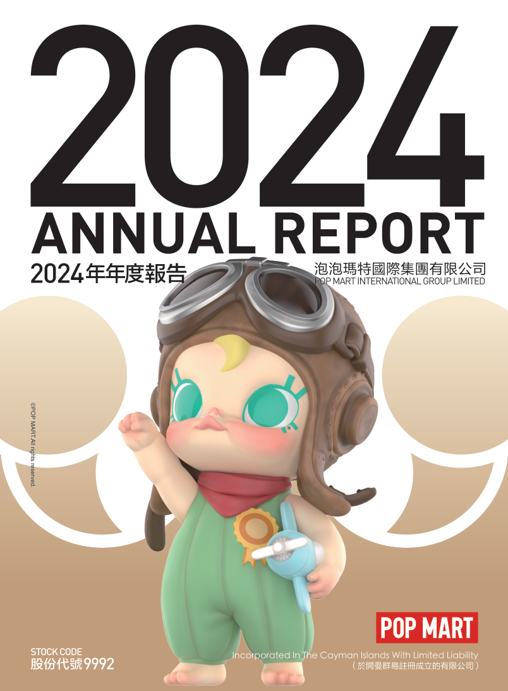
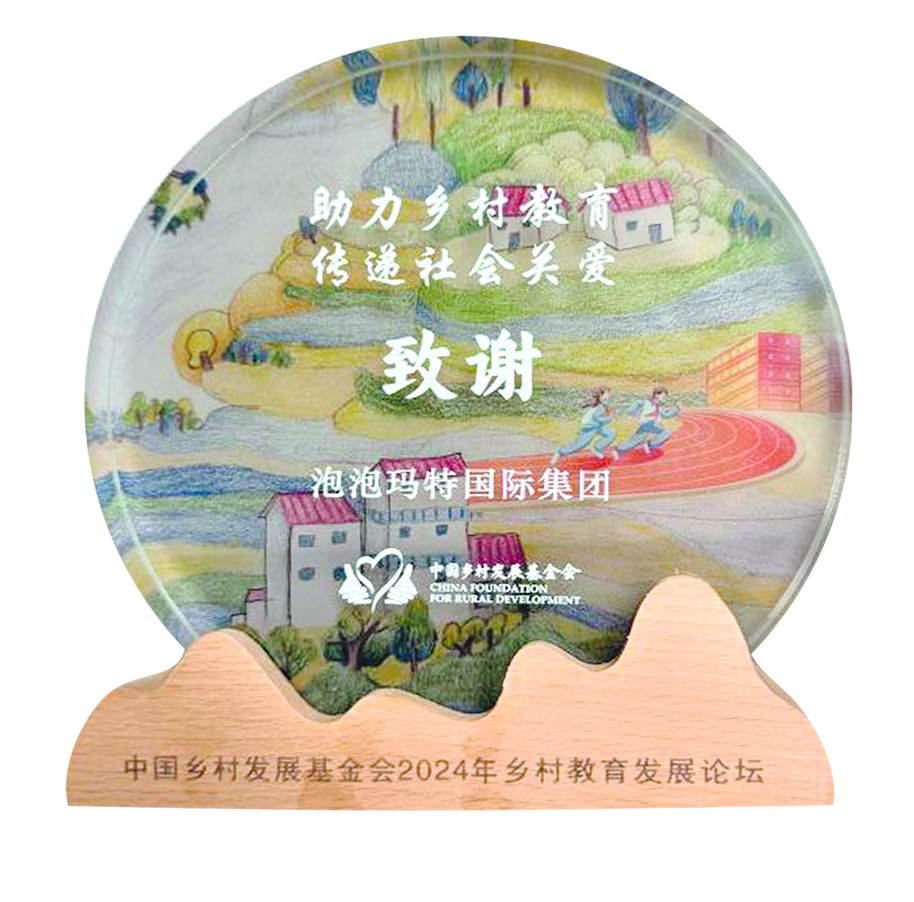
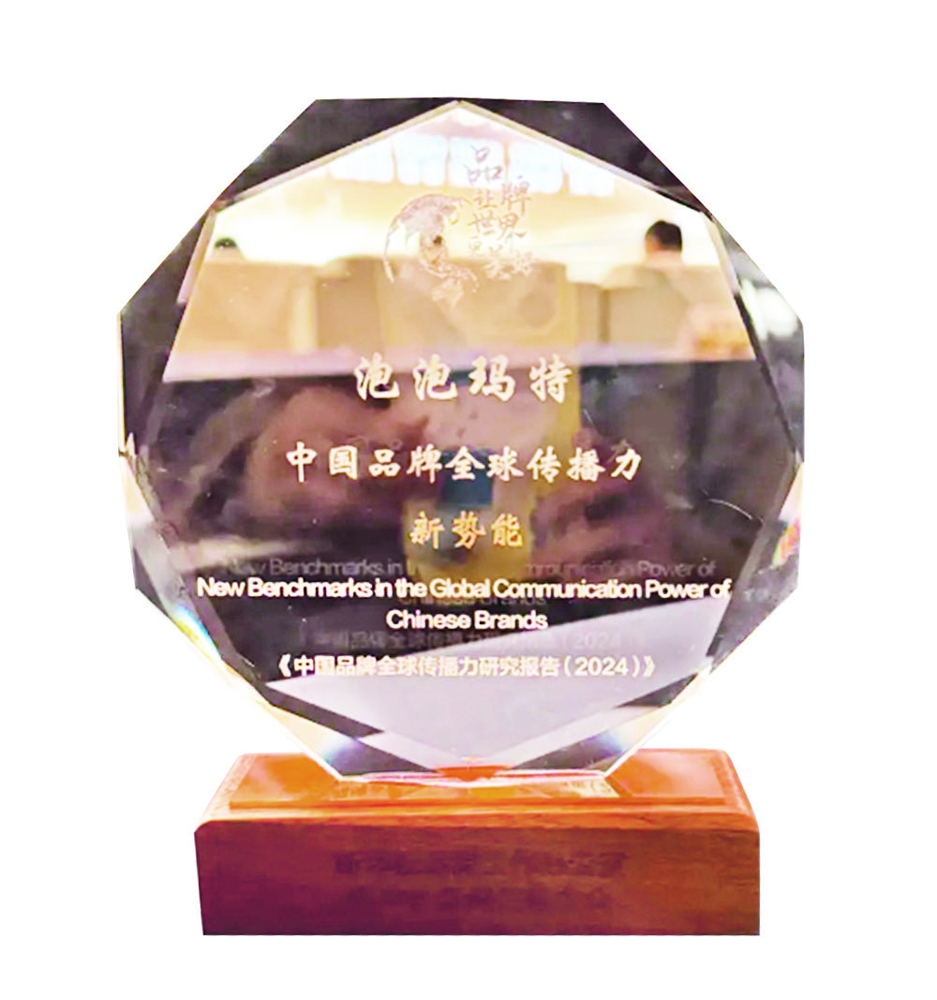
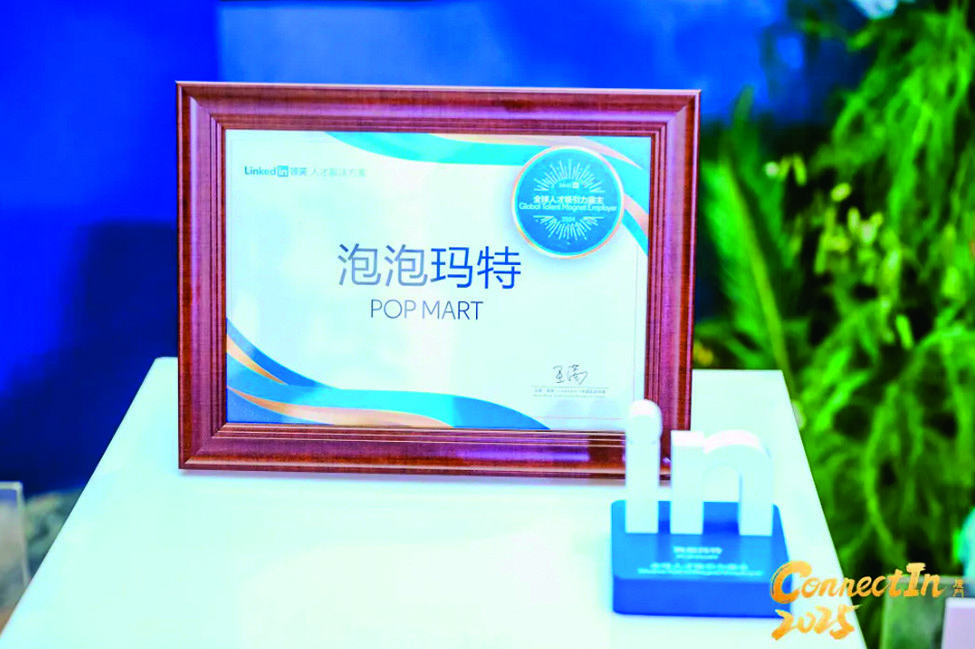
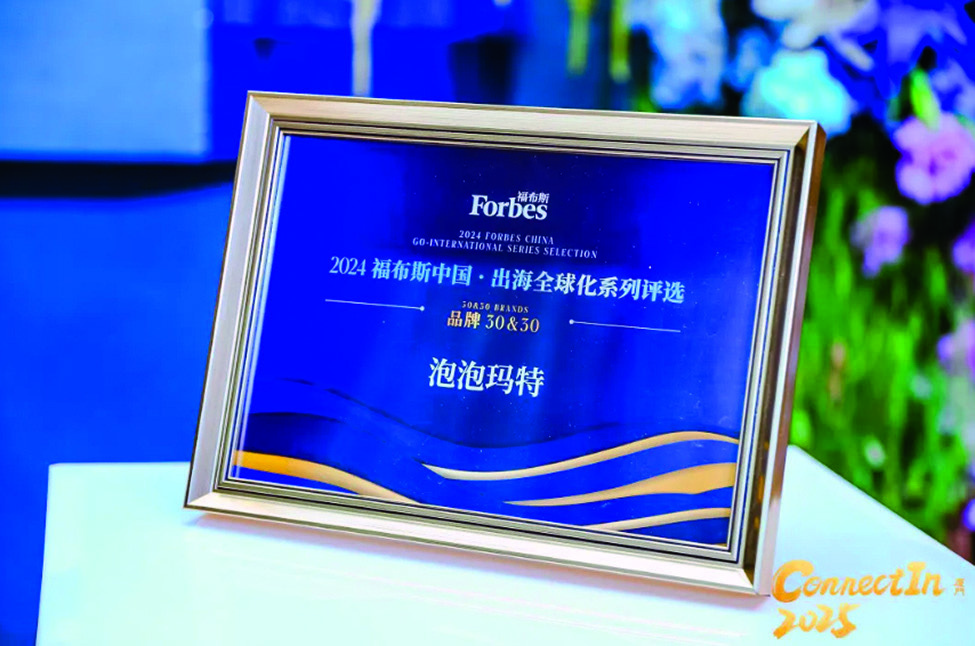

# 泡泡玛特2024年年度报告（简体中文）

> 披露日期：2025-04-23。来源：[泡泡玛特官方投资者关系](https://popwebsite.paquapp.com/pdf/eee39cdf-1235-4dad-ad9e-e3510136adf7-二零二四年年报.pdf)。
> [原始PDF](../2024年年度报告.pdf) · [历年财报索引](../泡泡玛特历年财报索引.md)
> 转换说明：保留中文正文、数字、单位和注释，仅做繁简转换及重复英文去除。外文专名、代码和网址照录；复杂表格用等宽文本保留列位置，插图保留原图。


###### 原PDF第1页

[对照原PDF第1页](../2024年年度报告.pdf#page=1)




###### 原PDF第2页

[对照原PDF第2页](../2024年年度报告.pdf#page=2)

2

公司资料

目录

6

财务概要

8

董事长致辞

10

管理层讨论与分析

38

董事及高级管理层履历

45

董事会报告书

81

企业管治报告

105 2024年环境、社会及管治报告180

独立核数师报告

188

综合损益及其他全面收益表190

综合资产负债表

193

综合权益变动表

195

综合现金流量表

197

综合财务报表附注

335

释义

二零二四年年报  1


###### 原PDF第3页

[对照原PDF第3页](../2024年年度报告.pdf#page=3)

## 公司资料

### 董事会

### 执行董事

王宁先生（董事会主席）\
杨涛女士（于2024年3月20日辞任）\
刘冉女士

司德先生\
文德一先生（于2024年3月20日获委任）

### 非执行董事

屠铮先生

何愚先生

### 独立非执行董事

张建君先生

吴联生先生

颜劲良先生

### 薪酬委员会

张建君先生（主席）

吴联生先生

王宁先生

### 提名委员会

王宁先生（主席）

张建君先生

吴联生先生

### 审核委员会

吴联生先生（主席）

屠铮先生

颜劲良先生

### 联席公司秘书

李鸿轩先生

李菁怡女士

### 授权代表

王宁先生

李菁怡女士

2  泡泡玛特国际集团有限公司


###### 原PDF第4页

[对照原PDF第4页](../2024年年度报告.pdf#page=4)

###### 公司资料

总部及中国主要营业地点

中国

北京市朝阳区

大望京科技商务园区

宏泰东街浦项中心A座36及37楼

香港主要营业地点

香港

德辅道中188号

金龙中心19楼

股份过户登记总处

Maples Fund Services (Cayman) Limited PO Box 1093 Boundary Hall Cricket Square Grand Cayman KY1-1102 Cayman Islands

香港股份过户登记处

香港中央证券登记有限公司香港

湾仔

皇后大道东183号

合和中心17楼

1712-1716号舖

二零二四年年报  3


###### 原PDF第5页

[对照原PDF第5页](../2024年年度报告.pdf#page=5)

###### 公司资料

主要往来银行

中国工商银行股份有限公司（珠市口支行）

中国北京市东城区

珠市口东大街15号

交通银行股份有限公司

（望京支行）中国北京市朝阳区望京街9号望京国际商业中心

中国民生银行股份有限公司（望京支行）

中国北京市朝阳区

广顺北大街南湖东园一区

122号楼博泰国际B座

公司网站

www.popmart.com

法律顾问

有关香港法律

达维律师事务所

香港

中环

遮打道三号A

香港会所大厦十楼

有关中国法律

竞天公诚律师事务所

中国

上海市徐汇区

淮海中路1010号

嘉华中心45层

邮政编码：200031

有关开曼群岛法律迈普达律师事务所（香港）有限法律责任合伙香港湾仔

港湾道18号

中环广场26楼

4  泡泡玛特国际集团有限公司


###### 原PDF第6页

[对照原PDF第6页](../2024年年度报告.pdf#page=6)

###### 公司资料

核数师

罗兵咸永道会计师事务所

执业会计师

注册公众利益实体核数师

香港中环

太子大厦22楼

股份代号

9992  9992

二零二四年年报  5


###### 原PDF第7页

[对照原PDF第7页](../2024年年度报告.pdf#page=7)

## 财务概要

财务业绩摘要

|  |  |  | 截至12月31日止年度 |  |  |
| --- | ---: | ---: | ---: | ---: | ---: |
|  | 2024 | 2023 | 2022 | 2021 | 2020 |
|  | 2024年 | 2023年 | 2022年 | 2021年 | 2020年 |
|  | 人民币千元 | 人民币千元 | 人民币千元 | 人民币千元 | 人民币千元 |
| 收入 | 13,037,749 | 6,301,002 | 4,617,324 | 4,490,651 | 2,513,471 |
| 毛利 | 8,707,765 | 3,864,071 | 2,654,543 | 2,758,624 | 1,594,108 |
| 经营溢利 | 4,154,272 | 1,230,646 | 583,380 | 1,149,812 | 718,783 |
| 除所得税前溢利 | 4,365,812 | 1,415,755 | 639,529 | 1,171,191 | 707,403 |
| 年内溢利 | 3,308,345 | 1,088,771 | 475,801 | 854,567 | 523,312 |
| 本公司拥有人 |  |  |  |  |  |
| 应占溢利 | 3,125,473 | 1,082,344 | 475,660 | 854,339 | 523,505 |
| 非国际财务报告准则 |  |  |  |  |  |
| 经调整纯利 | 3,403,162 | 1,190,519 | 573,540 | 1,001,635 | 590,506 |
| 毛利率 | 66.8% | 61.3% | 57.5% | 61.4% | 63.4% |
| 纯利率 | 25.4% | 17.3% | 10.3% | 19.0% | 20.8% |
| 非国际财务报告准则 |  |  |  |  |  |
| 经调整纯利率 | 26.1% | 18.9% | 12.4% | 22.3% | 23.5% |

6  泡泡玛特国际集团有限公司


###### 原PDF第8页

[对照原PDF第8页](../2024年年度报告.pdf#page=8)

###### 财务概要

财务状况表摘要

|  |  | 于12月31日 |  |  |  |
| --- | ---: | ---: | ---: | ---: | ---: |
|  | 2024 | 2023 | 2022 | 2021 | 2020 |
|  | 2024年 | 2023年 | 2022年 | 2021年 | 2020年 |
|  | 人民币千元 | 人民币千元 | 人民币千元 | 人民币千元 | 人民币千元 |
| 总流动资产 | 12,236,081 | 7,683,469 | 6,615,535 | 6,757,289 | 6,255,900 |
| 总非流动资产 | 2,634,591 | 2,285,394 | 1,964,527 | 1,566,337 | 715,399 |
| 总资产 | 14,870,672 | 9,968,863 | 8,580,062 | 8,323,626 | 6,971,299 |
| 总流动负债 | 3,370,028 | 1,733,301 | 1,130,747 | 1,092,706 | 665,313 |
| 总非流动负债 | 616,005 | 455,180 | 483,990 | 410,914 | 174,984 |
| 总负债 | 3,986,033 | 2,188,481 | 1,614,737 | 1,503,620 | 840,297 |
| 本公司拥有人 |  |  |  |  |  |
| 应占权益 | 10,683,505 | 7,769,927 | 6,963,288 | 6,818,182 | 6,129,374 |
| 非控股权益 | 201,134 | 10,455 | 2,037 | 1,824 | 1,628 |
| 总权益 | 10,884,639 | 7,780,382 | 6,965,325 | 6,820,006 | 6,131,002 |
| 总权益及负债 | 14,870,672 | 9,968,863 | 8,580,062 | 8,323,626 | 6,971,299 |

二零二四年年报  7


###### 原PDF第9页

[对照原PDF第9页](../2024年年度报告.pdf#page=9)

## 董事长致辞

尊敬的各位股东及投资人朋友：

过去一年，我们取得了令人振奋的成绩，国际化和集团化战略齐头并进，推动泡泡玛特IP全球影响力迅猛攀升。回顾过去一年，泡泡玛特营收、净利润再次突破历史新高，实现营收130.4亿元，同比增长 106.9%，经调整净利润 34.0 亿元，同比增长185.9%。

IP孵化与运营始终是推动泡泡玛特不断发展的核心驱动力，2024年集团旗下IP表现十分优异，首次实现THE MONSTERS、MOLLY、SKULLPANDA和THE MONSTERS, MOLLY, SKULLPANDA and CRYBABY, all surpassing RMB1  CRYBABY四大IP营收过10亿元，13大IP营收破亿元。去年LABUBU爆火全球，推动THE MONSTERS收入突破30亿元，SKULLPANDA 「温度」系列成为历史上最好的潮玩产品，CRYBABY成为最快进入10亿俱乐部的新IP。不同风格的IP在公司运营体系下走出了差异化发展路径，IP价值不断延展。我们相信，IP拥有跨越语言、穿越周期的力量，泡泡玛特已经成立 15 年，今年是 LABUBU 十周年，明年是MOLLY二十周年，我们向外界证明了我们具备持续打造爆款IP的能力，这让我们对集团未来发展充满信心。

过去一年，我们积极推动海外业务布局，通过布局线下门店、线上渠道、举办行业展会和艺术家签售会等形式深化DTC战略，推动泡泡玛特品牌及IP认可度在全球范围内极速提升。我们在越南、印度尼西亚、菲律宾、意大利、西班牙五个国家开设了首家线下门店，并在法国卢浮宫、越南巴拿山乐园、英国牛津街、美国圣地亚哥等地成功开设了特色主题店与旗舰店，来自全球消费者的关注和喜爱让泡泡玛特真正有可能成为一个世界级文化消费类品牌。

8  泡泡玛特国际集团有限公司


###### 原PDF第10页

[对照原PDF第10页](../2024年年度报告.pdf#page=10)

###### 董事长致辞

全球化业务的快速发展，离不开我们对国际化和集团化两大核心战略的坚定执行。2024 年我们重新梳理了集团业务板块：消费品、服务与体验、数字娱乐。我们希望围绕这三大业务，用IP连接起全球数亿不同文化背景的消费人群，不断创新潮流消费体验。2024年也是「毛绒绒的一年」，我们首次将零售业务划分为四大品类：手办、毛绒、MEGA、衍生品及其他，其中毛绒同比增长1289%，收入占比21.7%，成为年度爆品和最大惊喜。通过品类的不断创新，泡泡玛特证明了自身强大的产品开发能力，我们相信，集团以IP为核心的商业生态系统正在逐渐成熟。

虽然业绩表现优异，但我们更关心数据背后的隐形力量。过去，我们种下了许多种子，今天，这些种子一点一点发芽、成长。虽然乐园、积木等创新业务的体量尚小，但我们相信，未来这些种子也将长成一棵棵参天大树，长成我们理想的模样。

最后，要感谢所有消费者、合作伙伴、投资人一如既往的支持与信任，感谢全球所有同事伙伴的辛勤付出。去年公司的年度关键词是「向上努力向外看」，未来我们依然会坚持「向上生长」。希望我们继续携手奋进，一步步向千亿目标努力，期待有一天能够真正成为「世界的泡泡玛特」。

泡泡玛特董事长兼CEO

王宁

二零二四年年报  9


###### 原PDF第11页

[对照原PDF第11页](../2024年年度报告.pdf#page=11)

## 管理层讨论与分析

### 业务回顾

2024年，凭借各部门的高效协同、出色的IP运营能力，以及在产品品类拓展与创新方面的优秀表现，我们成功推出了多个经典IP的新品系列，还孵化出了多个全新的IP，这些新品备受粉丝的喜爱，同时我们持续为消费者提供高品质的产品与服务。这些举措进一步提升了泡泡玛特品牌在全球的知名度和美誉度，显著推动了销售业绩的增长，彰显出强大的品牌活力与市场竞争力。

报告期内，我们的收入达到人民币13,037.7百万元，同比增长106.9%。通过持续改善顾客在全渠道的体验，不断提升运营效率和商品渠道差异化经营能力，由此带动了中国内地各渠道的销售增长，实现收入人民币7,972.1 百万元，同比增长52.3%。与此同时，我们加大国际市场开拓力度并深入推进本土化运营策略，使得港澳台及海外业务保持高速增长态势，收入达到人民币5,065.7 百万元，同比增长375.2%，占整体收入的38.9%。

### IP孵化与运营

IP运营与创意设计是推动泡泡玛特持续发展的核心驱动力。我们通过在全球范围内发掘极具潜力的潮流艺术家和设计师，结合成熟的IP运营体系，成功打造出多个深受欢迎的潮流文化 IP 形象。同时，我们不断加大产品设计创新的投入力度，持续丰富产品品类，以满足不同粉丝群体的多样化需求，为全球消费者带来了更多快乐与惊喜。

我们依托各 IP 的独特性制定差异化运营策略，在持续维持市场热度的同时，成功驱动销售业绩强劲增长，共有 13 个 IP 收入过亿。 THE MONSTERS、MOLLY、SKULLPANDA和CRYBABY在2024 年分别实现收入人民币3,040.7 百万元、人民币2,093.2 百万元、人民币1,308.3 百万元和人民币1,164.9百万元。

10  泡泡玛特国际集团有限公司


###### 原PDF第12页

[对照原PDF第12页](../2024年年度报告.pdf#page=12)

###### 管理层讨论与分析

通过丰富多元的产品品类设计，以及乐园明星朋友互动表演等呈现形式，把THE MONSTERS从静态的潮玩手办，延伸拓展为能够搭配装扮的毛绒挂件，以及可互动的伙伴。THE MONSTERS的形象变得更加生动鲜活，其个性也越发丰满立体，强化了与粉丝的情感连接，加深了粉丝黏性。同时，得益于海外业务拓展、本地化产MONSTERS has rapidly gained global popularity and earned widespread fan  品设计以及IP运营，THE MONSTERS在全球迅速走红，进而赢得了全球粉丝的喜爱，相关收入实现了726.6%同比的大幅增长。

MOLLY作为我们最具代表性的经典IP，始终展现出蓬勃旺盛的生命力。凭借持续不断的运营以及高端化策略，成功打造出经典MOLLY、SPACE MOLLY等基本形象，通过跨圈层的内容创新与多元产品组合，深化 IP 文化符号价值以满足不同粉丝群体的需求，相关收入仍然达成了105.2%的同比增长。

SKULLPANDA maintains its diversified design strategy. It concentrates  SKULLPANDA延续多元化设计策略，依靠其独特的设计理念和持续创新的风格探索，专注于潮玩手办的设计与创作。经典系列「温度」的累计销量超过79.1万套，成为我们销量最高的单一系列。2024年推出的「漫相集」系列，灵感来源于超现实主义艺术，用带有奇幻色彩的设计语言将观者带入超现实的世界漫游，销量达到26.5万套，进而为粉丝带来更多元化的艺术与收藏体验，相关收入实现了27.7%的同比增长。

CRYBABY is one of our fastest-growing emerging IPs, built on the core  CRYBABY 是我们增长最快的新锐 IP 之一，的核心理念为「 哭泣治愈 」以及「 每个人都有哭泣的时候（ EverybodyCries Sometimes！）」，旨在鼓励大家在宣泄情绪之后CRYBABY provides emotional value to fans and resonates deeply with them.  能够继续勇敢前行。它通过传递情绪自由这一精神内核，为粉丝提供情绪价值，引发情感共鸣。相关收入同比增速高达1,537.2%。

二零二四年年报  11


###### 原PDF第13页

[对照原PDF第13页](../2024年年度报告.pdf#page=13)

###### 管理层讨论与分析

2024年我们内部IP原创工作室PDC (Pop Design Center)旗下的HIRONO、Zsiga、Nyota、inosoul等都取得了出色的成绩。其中，HIRONO 以极具辨识度的治愈设计语言构建起独特的精神图景，他的世界成为了许多粉丝的精神庇护所。我们在全球各大城市开设了小野IP生活方式类快闪店，店内除潮玩之外，还推出潮流服饰、艺术生活家居、收藏级绘画、雕塑等众多品类，全方位地展现了小野的世界，相关收入实现了106.9%的同比增长。Nyota作为2024年新推出的新晋IP，通过IP独特的恬淡气质以及差异化的风格定位，迅速吸引了众多粉丝的关注。

(星星人), an IP we newly signed in 2024, was designed  星星人是我们24年新签约的IP，其设计理念是星星人诞生于黑暗之中，犹如点亮整个夜空的璀璨星辰。「Stars can’t shine without darkness」  （星星只有在黑暗中才能闪耀），为那些依然怀揣童心的成年人营造出一个充满浪漫的童话世界，传递温暖与治愈的力量。我们依据这个插画风格的IP，设计出多种符合其特征的产品，如潮玩手办、毛绒等，这些产品深受粉丝的喜爱。

我们持续对授权IP的范围进行探索并不断扩大，推出多种类型、风格各异的潮玩手办以及联名款产品，从而满足不同消费者的需求与兴趣。经由和动漫、游戏、电影等众多版权方开展合作，为粉丝们提供更多的选择并带来惊喜。与此同时，我们在不断拓展IP授权的地域范围，当前已经获取了大部分授权IP的全球授权，进而为全球消费者打造更为独特的潮玩体验。

12  泡泡玛特国际集团有限公司


###### 原PDF第14页

[对照原PDF第14页](../2024年年度报告.pdf#page=14)

###### 管理层讨论与分析

2024 年，毛绒产品实现收入人民币2,832.1 百万元，占总营收的21.7%。其中，搪胶毛绒凭借搪胶工艺的运用使玩具面部表情更加生动传神，配合毛绒材质特有的柔软触感，成功打造出兼具视觉美感与触觉体验的现象级爆款产品。得益于产品出色的展示性与搭配功能，该系列在东南亚、北美等海外市场获得了广泛的市场认可与消费者青睐。在产品研发方面，我们始终以IP为核心，深入挖掘IP的文化内涵。通过精准把握不同IP的个性特征与精神内核，量身打造风格契合的毛绒产品线。这一策略不仅有效强化了粉丝与IP之间的情感纽带，更通过创新性的互动体验设计，成功吸引了多元化用户群体，显著提升了用户黏性。

2024 年是我们推出 MEGA COLLECTION 的第四年，品牌运营逐渐进入成熟阶段。 MEGA COLLECTION体现着年轻一代多元且富有活力的审美与潮流观念，已成为潮玩收藏家们拥抱其热爱文化的典型代表。本年度，新品聚焦于文化破圈，我们持续把中国传统文化工艺融入潮玩，GRAND系列继续推出了MEGA ROYAL MOLLY

```text
                                                                   400% 嫣然入轧 • 瓷以及 MEGA SPACE MOLLY
                                400%嫣然入轧•瓷) and MEGA SPACE    1000% 朱墨祥韵 • 漆，让全球的年轻人通过潮
                                                     1000%朱墨     玩触摸到中国文化的当代脉搏。同时，我们不
祥韵•漆), enabling young people around the world to feel the contemporary  断挖掘全球优秀艺术家、版权 IP 和品牌，例如
                                                                                       1000%/400%梵高博物馆•
```

杏花、MEGA SPACE MOLLY 400%三丽鸥家族系

|  | 列、MEGA ROYAL MOLLY 1000%/400%黄宇兴 － |
| --- | --- |
| 1000%/400%梵古博物馆•杏花), MEGA SPACE | 气泡、MEGA SPACE MOLLY 1000%陈粉丸等，这 |
| 400%三丽鸥家族 | 些产品将全球不同文化元素融入其中，引起全 |
| 系列), MEGA ROYAL MOLLY 1000%/400% Huang Yuxing – Bubbles (MEGA | 球潮玩收藏者的共鸣，充分利用跨界流量持续 |
| ROYAL MOLLY 1000%/400%黄宇兴 － 气泡), MEGA SPACE MOLLY 1000% | 拓展用户群体。2024年，MEGA COLLECTION实 |
| 1000%陈粉丸), etc. These products | 现收入人民币1,683.8百万元，估比达到12.9%。 |

二零二四年年报  13


###### 原PDF第15页

[对照原PDF第15页](../2024年年度报告.pdf#page=15)

###### 管理层讨论与分析

2024 年，我们上架了首款积木产品。该产品借助积木拼搭的形式，展现了IP的精神内核，不仅丰富了IP的呈现方式，还拓展了粉丝与IP互动体验的渠道，使粉丝能够更深入的了解我们 IP 背后的故事。在兼容传统积木体系的基础上，我们通过在工艺、材质、玩法等方面的创新，让我们的积木产品与市场上的常规积木有显著差异，从而并进一步扩大了粉丝群体。

### 消费者触达

－ 线下渠道

2024 年，我们于中国内地净增38 家线下门店，门店数量从截至2023年12月31日的363家增至截至2024年12月31日的401家。2024年我们于中国内地净增110间机器人商店，机器人商店数量从截至2023 年12 月31 日的2,190 间增至截至 2024 年 12 月 31 日的 2,300间。

14  泡泡玛特国际集团有限公司


###### 原PDF第16页

[对照原PDF第16页](../2024年年度报告.pdf#page=16)

###### 管理层讨论与分析

－ 线上渠道

2024 年，泡泡玛特抽盒机持续在场景化与娱乐化方面发力创新。为顾客提供更好玩、有趣的社交购买体验，提升商品运营能力，并结合节日营销玩法串联线下线上流量，有效扩大小程序访问规模。此外，泡泡玛特抽盒机不断推进精细化人群运营策略，实现新客质量及老客留存双重提升。抽盒机于2024 年实现了人民币1,113.7百万元的收入，同比增速 52.7% ，突破了2022 年所创下的历史销售记录。内容电商团队2024 年重塑直播间定位，通过直播间演绎强化品牌表达，更加生动地传递给顾客 IP 和商品的情绪价值，吸引了大量新粉丝；构建了兴趣电商的差异化运营策略，成功实现毛绒等新品类的拓展以及新圈层获客。抖音平台2024 年收入为人民币601.2百万元，同比增长了 112.2%。天猫旗舰店2024 年聚焦持续提升品牌新客规模、扩大店舖流量和提高客质，并在超级品牌活动

```text
                                                                     月创造天猫玩具类目超品活动销售最高记
                                                  (超级品牌活        录，全年业务步入高速增长通道，业绩超
动月), the Tmall Flagship Store set a new sales record for Super Brand  越2021 年创下的历史销售峰值。2024 年收
Activity (超品活动) in the Tmall toy category, maintaining rapid growth  入为人民币 627.8 百万元，同比增速达到
                                                                     95.0%，并荣获了6.18 天猫潮流玩具榜和天
```

猫玩具总榜销售额第一名。

(天猫玩具总榜) and the Tmall Pop Toy Ranking (天猫潮流玩具) in terms of sales in the 618 shopping festival.

二零二四年年报  15


###### 原PDF第17页

[对照原PDF第17页](../2024年年度报告.pdf#page=17)

###### 管理层讨论与分析

－ 会员运营

随着全渠道精细化会员运营的深入，通过持续创新不断改善终端的会员体验，提升重点商品效能，会员数字化规模快速扩大，截至2024 年12 月31 日，中国内地累计注册会员总数从2023 年12 月31 日的3,435.4万人增至4,608.3万人，新增注册会员1,172.9万人。2024年会员贡献销售额占比92.7%，会员复购率为49.4% 1 。

－ 港澳台及海外渠道

我们港澳台及海外业务持续推进DTC (Direct To Customer)的发展战略。截至2024年12月31日，我们的港澳台及海外门店达到130家（含合营），机器人商店达到192 台（含合营及加盟）。

2024 年，我们在越南、印度尼西亚、菲律宾、意大利、西班牙五个国家开设了首家线下门店，实现业务的快速拓展。同时，全球多地的地标性位置成功开设特色主题店与旗舰店，进一步增强国际影响力。 2月，我们在泰国曼谷的Central Ladprao开设了CRYBABY主题店；5月，在越南的著名旅游景点巴拿山乐园开设古堡主题店；7月，在韩国明洞开设K-POP主题店。通过这些主题店的运营，消费者体验得到优化，对品牌的忠诚度有所提高，IP 品牌的影响力也得以扩大。6月，在有「欧洲最繁忙商业街」之称的牛津街开设门店；7月，入驻巴黎卢浮宫，成为首个进驻该艺术殿堂的中国潮玩品牌；8 月，圣地亚哥的首家门店UTC开业。这些举措让泡泡玛特在欧美地区实现品牌势能提升与市场覆盖范围拓展的双重突破。

```text
1                                                                                   1   2024年，会员中购买过2次或以上的占比
    2024.
```

16  泡泡玛特国际集团有限公司


###### 原PDF第18页

[对照原PDF第18页](../2024年年度报告.pdf#page=18)

###### 管理层讨论与分析

与此同时，我们的海外电商团队依据不同国家的市场特点和电商平台特性，制定并实施了差异化运营策略。在东南亚，Shopee和Lazada平台覆盖多个国家。我们运用精细化营销与本地化服务策略，深入把握当地消费者需求，精准开展产品推广，获得了东南亚消费者的认可与好评。利用 Amazon 平台在欧美的巨大规模和物流能力，结合站内站外的推广策略，广泛触达当地用户，逐步提升品牌在欧美地区的影响力。于 TikTok 平台，我们紧跟全球内容电商与直播电商的潮流趋势，倾力打造高质量的内容生态，结合富有创意的直播活动吸引了大量年轻用户，以优质内容驱动销售，增进了品牌的曝光度与互动性。面向全球市场，我们持续推进品牌官网的建设与优化。从用户浏览、界面设计、产品展示到售后等环节，以用户需求为核心，全方位提升用户体验，塑造良好品牌形象。通过在不同平台、区域的这些举措，我们的品牌与产品影响力在全球范围内稳步增强，在国际市场上逐步拓展出更广阔的空间。

主题乐园与IP体验及创新业务孵化

我们建立了多产业链的IP商业化体系，持续加深粉丝与IP的情感连接，探索IP在价值实现路径上更多的可能性。

泡泡玛特城市乐园于2023年9月正式开园。在开园后的一年半时间里，乐园持续对服务体验进行优化，着力构建IP深度沉浸氛围，打造沉浸式乐园体验。乐园致力于为全球粉丝展现泡泡玛特的独特魅力，持续以创新活动与优质服务，为游客创造价值与欢乐。

二零二四年年报  17


###### 原PDF第19页

[对照原PDF第19页](../2024年年度报告.pdf#page=19)

###### 管理层讨论与分析

我们持续加大了经典节目的每日演出频次、创排推出了新的演出节目，根据不同的节庆及假期推出了相应主题的装置及活动。2024年8月，MOLLY的甜品屋正式开业，其以独特的场景构造与鲜明的IP风格，迅速吸引大量关注，成为热IP style and becoming a popular photo spot. It generated widespread buzz  门打卡点，在各大平台广泛传播，收获热烈市场反馈。同年9月，ZIMOMO大首领之舞借助自然流量跻身抖音挑战榜，有力呈现出IP突破圈层的传播效应。此后，该舞蹈多次收到园外活动邀请，进一步拓展了IP影响力范围。同年10月至12 月期间，乐园策划推出了特色鲜明的万圣节和冬季主题活动。通过整合演艺内容、餐饮服务、甜品供应以及更新氛围美陈等举措，成功在传统旅游淡季实现客流量同比的大幅增长，充分展现出乐园运营策略的有效性与创新性。

PTS国际潮流玩具展不断自我进化，逐步成为全球创作者展示创意的重要平台。2024年8月23日至25日，第二届海外PTS于新加坡再度举办。为期三天的展会现场人气爆棚，累计吸引了近3万名观众前来打卡，与来自世界各地的近百名艺术家汇聚在一起，共同沉浸于潮玩艺术的独特魅力之中。相较首届，第二届展会吸引了更多国内潮玩展商与艺术家踊跃参与，他们将国内潮玩领域的前沿动态与创新理念，毫无保留地分享给海外潮玩爱好者，促进了多元文化的交流碰撞。同年4 月，PTS联合泡泡玛特城市乐园举办「2024 PTS北京国际潮玩节」，首次尝试由「潮玩展」转变为「潮玩节」，全新的嘉年华模式融合IP演艺、乐园体验、吃喝玩乐等内容，让观众从排队抢购模式的紧张氛围中「慢下来」；同年10月，PTS落地上海世博展览馆，首次将品牌展台区域升级为「泡泡街区」，营造统一的街区氛围，现场更有艺术家云集一堂、IP 「明星」朋友空降互动、积木大赛、游戏嘉年华等大量互动。通过这一系列创新的举措，让观众体验到潮玩和IP带来的独特魅力，并实现了潮流产业的积淀与集聚。

18  泡泡玛特国际集团有限公司


###### 原PDF第20页

[对照原PDF第20页](../2024年年度报告.pdf#page=20)

###### 管理层讨论与分析

2024 年我们举办了多次大型签售会、快闪店和作品展等活动，覆盖全球多个核心城市，持续深化IP运营与全球影响力。其中，旗下IP 「THE MONSTERS」精灵天团中的 LABUBU 表现尤为亮眼 ， 继上半年以「 神奇泰国体验官 」身份亮相后，该IP还受邀参与泰国风情节，与粉丝高频互动，进一步巩固了其作为中泰潮流文化纽带的核心地位。此外在HIRONO x小王子系列新品盲盒上市之际，HIRONO的艺术家LANG来到巴黎，在泡泡玛特法国Bercy Village门店举行了首场欧洲签售会，现场共邀请了百位粉丝与艺术家互动，推动IP触达消费者，这显示IP全球化战略成效显著，为潮玩文化出海注入持续动能。

二零二四年年报  19


###### 原PDF第21页

[对照原PDF第21页](../2024年年度报告.pdf#page=21)

###### 管理层讨论与分析

### 财务回顾

销售收入

本集团收入从2023 年的人民币6,301.0 百万元上升到2024年的人民币13,037.7百万元，同比增长106.9%。

根据渠道划分的收入

本集团的收入来自于中国内地和港澳台及海外包括：(1)线下渠道；(2)线上渠道；及(3)批发渠道及其他。下表载列本公司2024 年及2023 年的按渠道划分的收入：

```text
          2024                           2023
截至2024年12月31日止年度       截至2023年12月31日止年度
```

|  | 收入 | 毛利率 | 收入占比 | 收入 | 毛利率 | 收入占比 |
| --- | ---: | ---: | ---: | ---: | ---: | ---: |
|  | 人民币千元 |  |  | 人民币千元 |  |  |
| 中国内地 |  |  |  |  |  |  |
| 线下渠道 | 4,526,277 | 66.4% | 34.7% | 3,213,706 | 63.0% | 51.0% |
| 线上渠道 | 2,697,619 | 64.1% | 20.7% | 1,524,578 | 60.4% | 24.2% |
| 批发及其他 | 748,178 | 47.8% | 5.7% | 496,617 | 46.7% | 7.9% |
| 合计 | 7,972,074 | 63.9% | 61.1% | 5,234,901 | 60.6% | 83.1% |

| 港澳台及海外 |  |  |  |  |  |  |
| --- | ---: | ---: | ---: | ---: | ---: | ---: |
| 线下渠道 | 3,070,971 | 72.3% | 23.6% | 640,287 | 74.4% | 10.1% |
| 线上渠道 | 1,455,162 | 73.6% | 11.2% | 155,805 | 73.5% | 2.5% |
| 批发及其他 | 539,542 | 59.4% | 4.1% | 270,009 | 37.6% | 4.3% |
| 合计 | 5,065,675 | 71.3% | 38.9% | 1,066,101 | 64.9% | 16.9% |
| 总计 | 13,037,749 | 66.8% | 100.0% | 6,301,002 | 61.3% | 100.0% |

20  泡泡玛特国际集团有限公司


###### 原PDF第22页

[对照原PDF第22页](../2024年年度报告.pdf#page=22)

###### 管理层讨论与分析

(1) 中国内地

－  线下渠道。线下收入由 2023 年的人民币3,213.7 百万元增长到2024 年的人民币4,526.3百万元，增长了40.8%，以下为线下渠道收入明细和城市分布：

截至2024年12月31日止年度截至2023年12月31日止年度

```text
                                                                          收入        收入占比                收入        收入占比          收入变动
                                                                  人民币千元                          人民币千元
                                        零售店                      3,827,861             84.6%          2,661,009             82.8%             43.9%
                                        机器人商店                    698,416             15.4%            552,697             17.2%             26.4%
                                        合计                        4,526,277           100.0%           3,213,706           100.0%              40.8%
                                                                           零售店                                          机器人商店
                                                                     截至12月31日止年度                                截至12月31日止年度
                                                               2024                     2023                     2024                      2023
                                                              2024年                   2023年                   2024年                    2023年
                                   城市等级
                                                           数量         收入         数量        收入         数量        收入         数量         收入
                                                                （人民币千元）           （人民币千元）           （人民币千元）            （人民币千元）
                                   一线城市 2               125    1,495,934          120     1,100,240        622     201,050          592      147,838
                          3        新一线城市  3            116    1,096,134          105      743,662         694     217,711          672      174,650
                                   二线及其他城市 4         160    1,235,793          138      817,107         984     279,655          926      230,209
                                   合计                     401    3,827,861          363     2,661,009      2,300     698,416         2,190     552,697
2                                                                                               2    指中国内地一线城市，包括北京、上海、广州和
                                                                                                     深圳
3                                                                                               3    指中国内地新一线城市，包括成都、重庆、杭
                                                                                                     州、武汉、西安、郑州、青岛、长沙、天津、苏
                                                                                                     州、南京、东莞、宁波、合肥和无锡
4                                                                                               4    指中国内地除去一线城市和新一线城市以外的城
                                                                                                     市
```

二零二四年年报  21


###### 原PDF第23页

[对照原PDF第23页](../2024年年度报告.pdf#page=23)

###### 管理层讨论与分析

零售店。 零售店销售收入从 2023 年的人民币2,661.0 百万元增加到2024 年的人民币 3,827.9 百万元，同比增长了43.9% ，主要由於单店业绩的增长。2024 年中国内地零售店开设情况：截至2024 年12 月31 日比截至2023 年12 月31 日的零售店数量净增了 38 家，截至2024年12月31日合计零售店401家。

机器人商店。机器人商店销售收入从2023 年的人民币 552.7 百万元增加到2024 年的人民币698.4 百万元，同比增长了26.4%。2024年中国内地机器人商店开设情况：截至2024 年12 月31 日比截至2023 年12 月31 日的机器人商店数量净增了110间，截至2024年12月31日合计机器人商店2,300间。

线上渠道。线上收入由 2023 年的人民币1,524.6 百万元增长到2024 年的人民币2,697.6百万元，增长了76.9%。以下为线上渠道收入明细：

```text
                               2024                         2023
                    截至2024年12月31日止年度      截至2023年12月31日止年度
                           收入       收入占比           收入      收入占比       收入增长
                     人民币千元                    人民币千元
泡泡玛特抽盒机         1,113,741         41.3%        729,280         47.8%          52.7%
天猫旗舰店              627,788          23.3%        321,966         21.1%          95.0%
抖音平台                601,231          22.3%        283,318         18.6%         112.2%
其他线上渠道            354,859          13.1%        190,014         12.5%          86.8%
合计                   2,697,619       100.0%        1,524,578       100.0%          76.9%
```

22  泡泡玛特国际集团有限公司


###### 原PDF第24页

[对照原PDF第24页](../2024年年度报告.pdf#page=24)

###### 管理层讨论与分析

中国内地线上收入包括泡泡玛特抽盒机、天猫旗舰店、抖音平台以及其他线上渠道。其中，泡泡玛特抽盒机从2023 年的人民币 729.3 百万元增长至2024 年的人民币1,113.7 百万元，增长了52.7%；天猫旗舰店收入从2023年的人民币322.0 百万元增长至2024 年的人民币627.8百万元，增长了95.0%；抖音平台从2023 年的人民币283.3 百万元增长到2024 年的人民币601.2 百万元，增长了112.2%。我们通过不断优化平台的运营效率，提升流量的转化，依靠丰富类别的产品吸引消费者的喜爱，实现收入的增长。

批发及其他。批发及其他收入从 2023年的人民币496.6 百万元增长到2024 年的人民币748.2百万元，增长了50.7%，主要由于泡泡玛特城市乐园的收入增加。

(2) 港澳台及海外

线下渠道。线下收入由 2023 年的人民币640.3 百万元上升到2024 年的人民币3,071.0百万元，增长了379.6%，以下为线下渠道收入明细：

```text
                              截至2024年12月31日止年度             截至2023年12月31日止年度
                                    收入           收入占比               收入           收入占比          收入变动
                              人民币千元                            人民币千元
零售店                          2,937,910             95.7%             582,909             91.0%             404.0%
机器人商店                       133,061               4.3%              57,378              9.0%             131.9%
合计                            3,070,971            100.0%             640,287            100.0%             379.6%
```

二零二四年年报  23


###### 原PDF第25页

[对照原PDF第25页](../2024年年度报告.pdf#page=25)

###### 管理层讨论与分析

零售店。 零售店销售收入从 2023 年的人民币 582.9 百万元增长到 2024 年的人民币 2,937.9 百万元，同比增长了404.0%，主要由于我们不断拓展海外市场，店舖数量的增加和单店收入的增长。2024 年港澳台及海外零售店舖开设情况：截至2024 年12 月31 日比截至2023 年12 月31 日的零售店数量净增了50 家，截至2024 年12 月31 日合计零售店120家。

机器人商店。机器人商店销售收入从2023年的人民币57.4百万元增长到2024年的人民币133.1 百万元，同比增长了131.9%。2024年港澳台及海外机器人商店开设情况：截至2024 年12 月31 日比截至2023 年12 月31 日的机器人商店数量净增了73 家，截至2024 年12 月31 日合计机器人商店172家。

线上渠道。线上收入由 2023 年的人民币155.8 百万元增长到2024 年的人民币1,455.2百万元，增长了834.0%。以下为线上渠道收入明细：

```text
                              截至2024年12月31日止年度             截至2023年12月31日止年度
                                    收入           收入占比               收入           收入占比          收入增长
                              人民币千元                            人民币千元
泡泡玛特官方网站                 531,460              36.5%              39,479             25.4%           1,246.2%
                                 324,197              22.3%              42,885             27.5%             656.0%
TikTok平台                       261,943              18.0%               4,455              2.9%           5,779.8%
其他线上渠道                     337,562              23.2%              68,986             44.2%             389.3%
合计                            1,455,162            100.0%             155,805            100.0%             834.0%
```

24  泡泡玛特国际集团有限公司


###### 原PDF第26页

[对照原PDF第26页](../2024年年度报告.pdf#page=26)

###### 管理层讨论与分析

港澳台及海外线上收入源包括泡泡玛特官方网站、Shopee、TikTok平台和其他线上渠道。泡泡玛特官方网站收入从 2023 年的人民币 39.5 百万元增长到2024 年的人民币531.5 百万元，增长了1,246.2%；Shopee收入从2023 年的人民币42.9百万元增长到2024年的人民币324.2百万元，增长了656.0%；TikTok平台收入从2023 年的人民币4.5 百万元增长到2024 年的人民币261.9 百万元，增长了5,779.8%。增长主要由于我们不断拓展海外国家及地区，加强本土化运营，开发更多的线上平台，另外随着品牌影响力的加深，吸引了港澳台及海外更多的消费者购买我们的产品。

批发及其他。港澳台及海外批发及其他收入从2023 年的人民币270.0 百万元增长至2024 年的人民币539.5 百万元，增长了99.8%。

按区域划分的港澳台及海外收入。港澳台及海外收入由2023年的人民币1,066.1百万元上升到 2024 年的人民币 5,065.7百万元，增长了 375.2%。港澳台及海外按照区域进一步划分为：东南亚、东亚及港澳台地区、北美和欧澳及其他，下表为按区域（基于客户的地理位置）划分的收入明细：

```text
                              截至2024年12月31日止年度              截至2023年12月31日止年度
                                     收入           收入占比               收入           收入占比           收入增长
                               人民币千元                            人民币千元
东南亚                          2,402,732             47.4%             334,153              31.3%             619.1%
东亚及港澳台地区                1,385,666             27.4%             486,932              45.7%             184.6%
北美                              723,025             14.3%             110,064              10.3%             556.9%
欧澳及其他                        554,252             10.9%             134,952              12.7%             310.7%
合计                            5,065,675              100%            1,066,101             100%              375.2%
```

二零二四年年报  25


###### 原PDF第27页

[对照原PDF第27页](../2024年年度报告.pdf#page=27)

###### 管理层讨论与分析

根据IP划分的收入

泡泡玛特的自主产品是我们的主要商品类型，自主产品收入于截至2024 年12 月31 日止年度占总收入的比例达到 97.6%，自主产品从 2023 年的人民币5,858.0 百万元增长到2024 年的人民币12,721.5百万元，增长了117.2%。

泡泡玛特的自主产品主要分为：艺术家IP和授权IP，以下为根据IP划分的收入明细：

|  |  |  | 截至12月31日止年度 |  |
| --- | ---: | ---: | ---: | ---: |
|  | 2024 |  | 2023 |  |
|  | 2024年 |  | 2023年 |  |
|  | 收入 | 收入占比 | 收入 | 收入占比 |
|  | 人民币千元 |  | 人民币千元 |  |
| 自主产品 | 12,721,506 | 97.6% | 5,857,957 | 93.0% |
| 艺术家IP | 11,120,848 | 85.3% | 4,822,226 | 76.5% |
| THE MONSTERS | 3,040,664 | 23.3% | 367,871 | 5.8% |
| MOLLY | 2,093,172 | 16.1% | 1,020,305 | 16.2% |
| SKULLPANDA | 1,308,262 | 10.0% | 1,024,788 | 16.3% |
| CRYBABY | 1,164,885 | 8.9% | 71,149 | 1.1% |
| DIMOO | 909,561 | 7.0% | 737,666 | 11.7% |
| HIRONO | 726,525 | 5.6% | 351,201 | 5.6% |
| Zsiga | 244,519 | 1.9% | 99,777 | 1.6% |
|  | 224,288 | 1.7% | 151,758 | 2.4% |
| 其他艺术家IP | 1,408,972 | 10.8% | 997,711 | 15.8% |
| 授权IP | 1,600,658 | 12.3% | 1,035,731 | 16.5% |
| 外采及其他 | 316,243 | 2.4% | 443,045 | 7.0% |
| 合计 | 13,037,749 | 100.0% | 6,301,002 | 100.0% |

26  泡泡玛特国际集团有限公司


###### 原PDF第28页

[对照原PDF第28页](../2024年年度报告.pdf#page=28)

###### 管理层讨论与分析

艺术家 IP。艺术家 I P 是本公司主要商品类型，主要包括 THE MONSTERS、MOLLY、SKULLPANDA等IP。艺术家IP收入从2023年的人民币4,822.2 百万元，上升至2024 年的人民币11,120.8百万元，增长了130.6%，主要由于我们不断创新产品设计、丰富产品类别，以THE MONSTERS为代表的毛绒产品MONSTERS products increased by 726.6% as compared to 2023.  深受消费者的喜爱。2024年THE MONSTERS的产品收入较2023年增长了726.6%。

授权 IP。授权 IP 产品收入从 2023 年的人民币1,035.7 百万元，增长至2024 年的人民币1,600.7百万元，增长了54.5%，主要由于我们不断加深与更多版权方的合作，推出了更多风格、类别的产品。

根据产品类别划分的收入

本公司的产品按照类别主要划分为：手办、毛绒、MEGA和衍生品及其他，以下为产品类别划分的收入明细：

```text
                                                      截至2024年12月31日止年度       截至2023年12月31日止年度
                                                              收入       收入占比           收入      收入占比       收入变动
                                                        人民币千元                    人民币千元
                          手办                           6,936,087         53.2%        4,793,872         76.1%          44.7%
                          毛绒                           2,832,078         21.7%         203,888           3.2%       1,289.0%
MEGA                                                     1,683,780         12.9%         684,275          10.9%         146.1%
                          衍生品及其他                   1,585,804         12.2%         618,967           9.8%         156.2%
                          合计                          13,037,749        100.0%        6,301,002        100.0%         106.9%
```

二零二四年年报  27


###### 原PDF第29页

[对照原PDF第29页](../2024年年度报告.pdf#page=29)

###### 管理层讨论与分析

我们不断在产品层面推陈出新，丰富产品品类，提升产品设计的能力。手办收入从2023 年的人民币4,793.9 百万元上升到2024 年的人民币6,936.1百万元，增长了44.7%；毛绒收入从2023年的人民币203.9百万元上升到2024年的人民币2,832.1百万元，增长了1,289.0%；MEGA收入从2023年的人民币684.3百万元上升到2024年的人民币1,683.8 百万元，增长了146.1%；衍生品及其他收入从2023年的人民币619.0百万元上升到2024年的人民币1,585.8百万元，增长了156.2%。

销售成本

销售成本由 2023 年的人民币 2,436.9 百万元上升到 2024 年的人民币 4,330.0 百万元，增长了77.7%，主要由于(1)商品成本由2023年的人民币2,042.7 百万元增加到2024 年的人民币3,474.2 百万元，其主要原因为销售增长；及(2)设计及授权相关成本由2023年的人民币236.6百万元增加到2024年的人民币506.8百万元，主要由于自主产品占比增多，以及联名产品增加，需要支付更多的IP授权费以及产品设计费。

毛利

我们的毛利由2023 年的人民币3,864.1 百万元增长到 2024 年的人民币 8,707.8 百万元，增长了125.4%，主要由于我们的收入增长以及销售成本的控制。我们的毛利率由2023年的61.3%提升至2024年的66.8%，主要由于(1)港澳台及海外渠道收入占比的增加，(2)不断优化供应链端成本控制，及(3)自主产品占比提升，外采商品逐渐减少。

经销及销售开支

我们的经销及销售开支由 2023 年的人民币2,004.7 百万元增长至2024 年的人民币3,650.5 百万元，增长了82.1%；其中(1)雇员福利开支；及

(2)租赁相关开支占比较高。

28  泡泡玛特国际集团有限公司


###### 原PDF第30页

[对照原PDF第30页](../2024年年度报告.pdf#page=30)

###### 管理层讨论与分析

－  雇员福利开支。雇员福利开支从 2023 年的人民币598.5 百万元增长至2024 年的人民币874.9百万元，增长了46.2%。主要由于我们的销售员工人数由截至2023 年12 月31 日的3,735名员工增加到截至2024年12月31日的5,267 名员工，主要用以支持我们扩张零售店及机器人商店网络。

－  租赁相关开支。租赁相关开支包括使用权资产折旧，以及未计入租赁负债的与短期租赁及可变租赁有关的开支，租赁相关开支从 2023 年的人民币 465. 9 百万元增长到 2024 年的人民币 840. 8 百万元 ， 增长了80.5%。主要由于(1)零售店收入的增长，提成租金随之增加，及(2)线下零售店数量较2023 年净增加了88 间，来满足我们中国内地和港澳台及海外的业务扩张。

一般及行政开支

我们的一般及行政开支由2023年的人民币707.3百万元增长至2024年的人民币947.1百万元，增长了33.9%。其中占比较高的为雇员福利开支，我们的行政及开发人员由截至2023 年12 月31 日的1,110名增加到截至2024年12月31日的1,435名员工。

其他收入

本集团的其他收入由 2023 年的人民币74.9 百万元增长至 2024 年的人民币 84.3 百万元，增长了12.5%。其中(1)政府补助由2023年的人民币30.9百万元下降至 2024 年的人民币 24.9 百万元，及

(2)IP授权及其他服务收入由2023年的人民币43.0百万元增长至2024年的人民币56.7百万元。

经营溢利

综上所述，本集团的经营溢利由2023 年的人民币1,230.6 百万元增长至2024 年的人民币4,154.3百万元，增长了237.6%。

二零二四年年报  29


###### 原PDF第31页

[对照原PDF第31页](../2024年年度报告.pdf#page=31)

###### 管理层讨论与分析

财务收入净额

我们的财务收入净额由2023年的人民币151.9百万元，增长到2024年的人民币163.4百万元，主要由于我们的利息收入增加。

所得税开支

我们的所得税开支由2023年的人民币327.0百万元增长至2024 年的人民币1,057.5 百万元，原因为我们的所得税前溢利增长。我们的实际税率由2023年的23.1%增加到2024年的24.2%。

年内溢利

由于上文所述，我们的年内溢利由 2023 年的人民币 1,088.8 百万元增长至 2024 年的人民币3,308.3百万元。

非国际财务报告准则财务指标

为补充我们根据国际财务报告会计准则呈列的财务资料，我们采用并非国际财务报告会计准则要求或并非按国际财务报告会计准则呈列的非国际财务报告准则经调整纯利，作为额外财务计量。我们认为该非国际财务报告准则计量通过免除管理层认为对我们经营表现没有指标作用的项目的潜在影响，有助于比较不同期间及不同公司的经营业绩。我们认为，该计量为投资者及其他人士提供了有用的资料，帮助彼等按其帮助管理层相同的方式了解及评估我们的综合经营表现。然而，我们对非国际财务报告准则经调整纯利的呈列可能与其他公司呈列的类似名称的财务计量不具有可比性。使用该非国际财务报告准则计量作为分析工具具有局限性，投资者不应单独考虑，或作为根据国际IFRS Accounting Standards.  财务报告会计准则呈报的经营业绩或财务状况分析的替代。

30  泡泡玛特国际集团有限公司


###### 原PDF第32页

[对照原PDF第32页](../2024年年度报告.pdf#page=32)

###### 管理层讨论与分析

非国际财务报告准则经调整纯利未按照国际财务报告会计准则计算，因此视为非国际财务报告准则的财务指标，非国际财务报告准则经调整纯利指剔除以股份为基础的付款后的纯利，而非国际财务报告准则经调整纯利率指非国际财务报告准则经调整纯利除以收益。下表载列本公司各年度的非国际财务报告准则的财务指标对账情况。

| 截至2024年 |  | 截至2023年 |
| --- | ---: | ---: |
|  | 12月31日 | 12月31日 |
| 止年度 |  | 止年度 |
| （人民币千元） |  | （人民币千元） |
| 年内溢利 | 3,308,345 | 1,088,771 |
| 调整项目 |  |  |
| 以股份为基础的付款报酬 | 94,817 | 101,748 |
| 非国际财务报告准则经调整纯利 | 3,403,162 | 1,190,519 |
| 非国际财务报告准则经调整纯利率 | 26.1% | 18.9% |

我们管理层认为以股份为基础的付款开支属于非现金项目且并无直接反应我们的业务营运。因此，通过撇除该等项目对计算非国际财务报告准则经调整纯利影响的举措，可更好地反应我们的相关经营表现，并更加便于比较逐年的经营表现。

二零二四年年报  31


###### 原PDF第33页

[对照原PDF第33页](../2024年年度报告.pdf#page=33)

###### 管理层讨论与分析

流动资产、财务资源及资本开支

2024 年，本集团在整体业务经营方面采纳保守稳健的资金管理及财务政策。本集团维持以下资源以应付其营运资金需求：

流动资产及流动负债

我们的流动资产净值由截至2023 年12 月31 日的人民币5,950.2 百万元增加至截至2024 年12 月31日的人民币8,866.1百万元。

贸易应收款项

贸易应收款项指日常业务过程中我们应收客户的未结算款项。我们的贸易应收款项由截至2023年12月31日的人民币321.3百万元增加至截至2024年12月31日的人民币477.7百万元，该等增加主要由于港澳台及海外业务扩张，批发等渠道应收账款增加。贸易应收款项周转天数从2023年的15天，下降到截至2024年12月31日的11天。

存货

我们的存货包括制成品。我们的存货由截至2023年12月31日的人民币904.7百万元增加至截至2024年12月31日的人民币1,524.5 百万元。主要由于我们增加了我们的产品库存以满足销售需求。存货周转天数从2023年的133天下降到截至2024年12月31日的102天。

现金及现金等价物

我们的现金及现金等价物主要包括银行现金。现金及现金等价物从截至2023 年12 月31 日的人民币2,077.9 百万元增加至截至2024年12月31 日的人民币6,109.0 百万元，主要由于2024 年经营活动产生的现金流增加。

32  泡泡玛特国际集团有限公司


###### 原PDF第34页

[对照原PDF第34页](../2024年年度报告.pdf#page=34)

###### 管理层讨论与分析

贸易应付款项

贸易应付款项主要指我们在日常业务过程中向供应商支付货款的责任。贸易应付款项从截至2023年12月31日的人民币444.9百万元增加至截至2024年12月31日的人民币1,010.1 百万元。贸易应付款项周转天数从2023 年的53 天增加至截至2024年12月31日的61天。

银行借款

截至2024 年12 月31 日，本集团并无任何银行借款。

资产抵押

截至2024 年12 月31 日，本集团并无任何资产抵押（2023年12月31日：无）。

资产负债率

资产负债率为总负债除以总资产乘以 100% 。截至2024 年12 月31 日，本集团的资产负债率为26.8%，而截至2023年12月31日的资产负债率为2023.  22.0%。

或有事件

我们目前并无涉及任何重大法律诉讼，亦不知悉我们涉及任何待决或潜在重大法律诉讼。倘我们涉及有关重大法律诉讼，则我们会于产生亏损且有关亏损金额有合理估计时，按当时所得资料记录任何亏损或或有负债。

二零二四年年报  33


###### 原PDF第35页

[对照原PDF第35页](../2024年年度报告.pdf#page=35)

###### 管理层讨论与分析

外汇风险管理

本集团的附属公司在中国内地、港澳台及海外经营，面对若干货币敞口（主要有关美元、港元、新加坡元及欧元）引致的外汇风险。由于本集团以我们经营实体各自功能货币以外货币计值的重大金融资产及负债不重大，故管理层认为业务并无任何重大外汇风险敞口。本集团并没有对冲外币波动，但是会紧密地监控有关情况，并在必要时采取措施以保证外汇风险在可控范围内。

资本开支

本集团的资本开支包括购置物业、厂房及设备的款项和购置无形资产的款项。下表载列本集团2023年以及2024年的资本开支情况：

| 截至2024年 |  | 截至2023年 |
| --- | ---: | ---: |
|  | 12月31日 | 12月31日 |
| 止年度 |  | 止年度 |
| （人民币千元） |  | （人民币千元） |
| 购置物业、厂房和设备 | 372,668 | 324,179 |
| 购置无形资产 | 144,022 | 68,287 |
| 合计 | 516,690 | 392,466 |

34  泡泡玛特国际集团有限公司


###### 原PDF第36页

[对照原PDF第36页](../2024年年度报告.pdf#page=36)

###### 管理层讨论与分析

人力资源

截至2024年12月31日，我们共有6,702名员工，包括销售员工 5,267 名，行政及开发人员 1,435名。截至2024 年12 月31 日止年度，我们共发生员工成本（包括薪金、工资、津贴和福利）人民币1,462.4百万元。

重大投资的未来计划

截至2024 年12 月31 日，我们并无持有任何重大投资。

我们将继续广泛寻找潜在的策略性投资机会，并寻求可为本集团带来协同效应的潜在优质目标业务及资产。

重大收购及出售

截至2024 年12 月31 日，我们并无进行任何重大收购或出售附属公司、联营公司及合营企业。

主要风险及不确定因素

我们面临的主要风险及不确定因素乃关于：(i)作为潮流文化娱乐公司，我们无法保证，我们将能够设计及开发受消费者欢迎的产品，或我们将能够保持成功产品的受欢迎程度；(ii)倘我们获授权的 IP 的市场吸引力低于预期，或使用该等IP的产品的销售额不足以满足最低保证特许权使用费，我们可能无法实现授权的全部利益；

(iii)我们的业务在很大程度上取决于我们「泡泡玛特」品牌的市场认知度，且对我们的品牌、商标或声誉的任何损害，或未能有效推广我们的品牌，均可能对我们的业务及经营业绩造成重大不利影响；(iv)我们通过第三方制造商生产所有的泡泡玛特品牌产品，未能控制产品质量可能会对我们的业务造成不利影响；及(v)宏观经济增速放缓可能削弱对我们产品的需求，从而可能给本公司经营业绩带来一定的负面影响。

二零二四年年报  35


###### 原PDF第37页

[对照原PDF第37页](../2024年年度报告.pdf#page=37)

###### 管理层讨论与分析

### 未来展望

IP is the core driving force of our business. Through our innovative products,  IP 是我们业务的核心驱动力，我们依托创意产品、优质服务体验及多元娱乐形式，全方位满足消费者需求。从独具匠心的潮玩产品，到贴心周到的服务细节，再到丰富多彩的娱乐互动，为消费者带来美好、潮流与艺术享受，持续提升泡泡玛特的品牌价值，增强用户忠诚度，稳固市场领先地位，保持强劲竞争力。

我们将全力聚焦于丰富IP类型，扩充IP资源库。在设计创新方面，始终坚守高品质水准，持续推出更多具有行业影响力的头部系列产品。同时，对IP开展持续性运营工作，强化消费者对IP的认知，深化粉丝与IP之间的情感纽带。不断拓宽潮玩品类及IP衍生品领域。进一步挖掘毛绒、MEGA、积木及衍生品等品类的潜在价值，同步不断优化完善相关工艺标准，以及产品的生产与发售流程，推动业务全方位升级。

我们会持续扩张全球业务布局，重点拓展北美、东南亚及欧洲市场，通过在全球地标性位置开设线下门店，强化品牌体验与知名度。除第三方平台的加强外，我们还将进一步加大内容电商与官网投入，提升品牌影响力，扩大用户群体，为消费者提供深入的潮流文化体验。依托IP核心优势，我们计划深化与艺术家及跨领域品牌的合作，丰富产品矩阵并推动潮流文化跨界融合，通过精细化运营与数字化创新，持续推升全球潮流文化影响力。

36  泡泡玛特国际集团有限公司


###### 原PDF第38页

[对照原PDF第38页](../2024年年度报告.pdf#page=38)

###### 管理层讨论与分析

在潮流玩具文化推广方面，我们将通过更为丰富多元的途径持续发力，不断扩大对整个行业的影响力。为会员提供更多专属权益，增强粉丝黏性，提升粉丝对潮流文化的认同感以及对品牌的认知度。

在持续深耕潮流玩具核心业务的进程中，我们将全力聚焦MEGA、POPBLOCKS、共鸣等新品牌的培育与拓展。借助乐园、饰品等新兴业务形态，为粉丝搭建更多深入了解IP的桥梁，丰富粉丝与IP互动的途径，以此加深粉丝与IP之间的情感纽带。我们致力于构建一个以IP为核心，更为完善且丰富多元的商业生态体系，推动本集团业务的全面升级与可持续发展。

报告期间后事项

于最后实际可行日期，本集团于报告期间后并无发生须进一步披露或调整的重大事项。

二零二四年年报  37


###### 原PDF第39页

[对照原PDF第39页](../2024年年度报告.pdf#page=39)

## 董事及高级管理层履历

董事及高级管理层的履历详情载列如下：

### 执行董事

(王宁), aged 38, is our executive Director, Chairman of the  王宁先生，38 岁，本公司执行董事、董事会主席及行政总裁。王先生于2010 年10 月成立本集团，负责本公司整体战略规划及管理。

王先生于2009年6月获得中国郑州大学西亚斯国(郑州大学西亚斯国际学院) (currently  际学院（现为郑州西亚斯学院）广告专业学士学位，并于2017年6月获得中国北京大学光华管理学院工商管理硕士学位。University (北京大学光华管理学院) in the PRC in June 2017.

王先生目前担任本公司数家主要附属公司的董事，包括北京泡泡玛特及Pop Mart (Hong Kong)Holding Limited。

王先生为副总裁杨涛女士的配偶。

(刘冉), aged 37, is our executive Director and vice president. Ms.  刘冉女士，37 岁，本公司执行董事及副总裁。刘女士大学毕业后不久即于2011年7月加入本集团，负责本公司的总裁办。

刘女士于2010年7月获得中国郑州大学西亚斯国际学院（现为郑州西亚斯学院）旅游管理专业学士学位，并于2020年7月获得中国北京大学光华管理学院工商管理硕士学位。

刘女士目前担任本公司主要附属公司北京泡泡玛特的董事。

38  泡泡玛特国际集团有限公司


###### 原PDF第40页

[对照原PDF第40页](../2024年年度报告.pdf#page=40)

###### 董事及高级管理层履历

(司德), aged 36, is our executive Director and co-chief operating  司德先生，36 岁，本公司执行董事及联席首席运营官。司先生于2015年3月加入本集团，负责集团运营工作及大陆地区的整体业务。司先生入职本集团之初的职务为品牌总监，于2016年7月晋升为副总裁。

司先生于2011年7月在中国获得中国传媒大学法Communication University (中国传媒大学) in the PRC in July 2011, and  语专业学士学位，并于2017年7月获得中国北京大学光华管理学院工商管理硕士学位。

```text
                                                                       司先生目前担任本公司若干主要附属公司的董
                                           (上海葩趣贸易有限公司),     事，包括上海葩趣贸易有限公司、北京葩趣互
                                   (北京葩趣互娱科技有限公司) and      娱科技有限公司及天津泡泡玛特文化传播有限
                                            (天津泡泡玛特文化传播      公司。
有限公司).
                (文德一), aged 46, is our executive Director and co-chief  文德一先生，46 岁，本公司执行董事及联席首
```

席运营官。文先生于 2018 年 8 月加入本集团，负责监察本公司港澳台及海外业务部。在此之前，文先生于2013年7月至2018年7月先后担任CJ CheilJedang Corporation的业务发展部全球业务规划专员、全球业务规划高级专员及全球业务规划经理，及于2009年1月至2013年5月担任CJ ENM的全球战略部经理。于2004年12月至2008 年12 月，文先生任职于Lotte Cinema Co.,Ltd. 的规划管理部。

文先生于2005年2月获得韩国建国大学中文学士学位，并于2018年7月获得中国北京大学工商管理硕士学位。

文先生目前担任本公司若干主要附属公司及合营企业的董事，包括 Pop Mart (Singapore)Holding Pte. Ltd.、POP MART SOUTH ASIA PTE.LTD.及POP MART (Thailand) CO., Ltd.。

二零二四年年报  39


###### 原PDF第41页

[对照原PDF第41页](../2024年年度报告.pdf#page=41)

###### 董事及高级管理层履历

### 非执行董事

(屠铮), aged 47, is our non-executive Director. Mr. Tu was  屠铮先生，47 岁，本公司非执行董事。屠先生于2019年5月获委任为本公司非执行董事，负责向董事会提供专业建议。

|  | 屠先生自2018年5月起担任上海蜂巧投资管理有 |
| --- | --- |
| (上海蜂巧投资管理有限公司) since May 2018. He | 限公司的合伙人。彼于2015年5月至2018年4月 |
| (深圳 | 担任深圳市启赋资本管理有限公司的合伙人。 |
| 市启赋资本管理有限公司) from May 2015 to April 2018. From June 2007 | 于2007年6月至2015年4月，屠先生于深圳市达 |
|  | 晨财智创业投资管理有限公司任职，先后担任 |
| (深圳市达晨财智创业投资管理有限公司) where he | 投资经理、投资总监及浙江分公司总经理、华 |
|  | 东地区副总经理兼TMT部门负责人。 |

```text
                                                                     屠先生于2000年6月获得中国浙江大学英语专业
University (浙江大学) in the PRC in June 2000, and his master’s degree in  学士学位，并于2003年6月获得美国芝加哥大学
                                                                     公共政策硕士学位。屠先生目前持有由中国证
                                                                     券投资基金业协会于2017年8月授出的中国证券
                                                       (中国证券     投资基金执业证书。
投资基金业协会) in August 2017.
```

屠先生目前担任北京泡泡玛特的董事。

(何愚), aged 44, is our non-executive Director. Mr. He was  何愚先生，44 岁，本公司非执行董事。何先生于2019年5月获委任为本公司非执行董事，负责向董事会提供专业建议。

```text
                                                                     何先生于2016年2月创办并担任深圳前海黑蚁创
                                        (深圳前海黑蚁创新投资合伙    新投资合伙企业（有限合伙）的合伙人。在此之
企业(有限合伙)) since February 2016. Prior to that, Mr. He served as the head  前，何先生于2015年8月至2016年2月担任北京
                                                                     字节跳动科技有限公司的战略投资部主管。
```

Ltd. (北京字节跳动科技有限公司) from August 2015 to February 2016.

何先生于 2003 年 6 月获得中国南开大学国际经(南开大学) in the PRC in June 2003, and his master’s  济与贸易专业学士学位，并于2005 年11 月获得英国兰卡斯特大学金融系硕士学位。何先生于2008年9月获特许财经分析师学会认可为特许金融分析师，并于2017年2月获中国证券投资基金业协会颁发中国证券投资基金执业证书。

何先生目前担任北京泡泡玛特的董事。

40  泡泡玛特国际集团有限公司


###### 原PDF第42页

[对照原PDF第42页](../2024年年度报告.pdf#page=42)

###### 董事及高级管理层履历

### 独立非执行董事

(张建君), aged 58, is our independent non-executive  张建君先生，58岁，自2020年12月11日（「上市日期」）起为本公司独立非执行董事，负责向董事会提供独立意见及判断。

张先生现为北京大学光华管理学院组织与战略管理系教授。张先生的研究重点为企业社会责任、企业政治活动、领导及领导团队以及企业文化等课题。张先生自2004年3月起担任北京大学光华管理学院教职人员。彼在过去 15 年的研究中积累有关企业管治的深入知识。张先生的出版物「Marketization and Democracy in China」于2011年3月获北京大学第十一届人文社会科学研究优秀成果奖一等奖及中国教育部颁发的第六届高等学校科学研究优秀成果奖二等奖。张先生亦分别于2014年12月及2018年12月获北京大学光华管理学院颁发厉以宁教学奖及厉以宁研究奖。于2014年11月至2017年8月，张先生担任建信人寿保险股份有限公司的独立董事。

张先生分别于1989年7月及1992年7月获得中国北京大学法学学士及硕士学位。张先生于2003年12 月获得美国加州大学伯克利分校社会学博士学位。

(吴联生), aged 54, is our independent non-executive  吴联生先生，54 岁，自上市日期起为本公司独立非执行董事，负责向董事会提供独立意见及判断。吴先生于2001年9月至2022年3月担任北京大学光华管理学院教职人员，自2022年3月起担任南方科技大学商学院教职人员。

二零二四年年报  41


###### 原PDF第43页

[对照原PDF第43页](../2024年年度报告.pdf#page=43)

###### 董事及高级管理层履历

```text
                                                                      吴先生于若干上市公司担任董事职务。彼于
                                                      (华能国际电     2008年5月至2014年7月担任华能国际电力股份
力股份有限公司), a company listed on the Shanghai Stock Exchange (Stock  有限公司（一家于上海证券交易所（股份代号：
                                                                      600011）、联交所（股份代号：902）及纽约证券
                                                                      交易所（股份代号：HNP）上市的公司）的独立
                                                (荣盛房地产发展股     董事，于2009年1月至2012年1月担任荣盛房地
份有限公司), a company listed on the Shenzhen Stock Exchange (Stock   产发展股份有限公司（一家于深圳证券交易所
                                                                      上市的公司，股份代号：002146）的独立董事，
                        (西部矿业股份有限公司), a company listed on   于2011年2月至2015年9月担任西部矿业股份有
                                                                      限公司（一家于上海证券交易所上市的公司，股
                                                              (万     份代号：601168）的独立董事，于2011年1月至
达电影院线股份有限公司) (now known as Wanda Film Holding Co., Ltd (万  2015年11月担任万达电影院线股份有限公司（现
达电影股份有限公司)), a company listed on the Shenzhen Stock Exchange  称万达电影股份有限公司，一家于深圳证券交
                                                                      易所上市的公司，股份代号：002739）的独立董
                                                                      事，于2011 年11 月至2016 年5 月担任中国建材
(中国建材股份有限公司), a company listed on the Stock Exchange (Stock  股份有限公司（一家于联交所上市的公司，股份
                                                                      代号：3323）的独立非执行董事，以及于2014年
                (新华网股份有限公司), a company listed on the Shanghai  5 月至 2016 年 3 月担任新华网股份有限公司（一
                                                                      家于上海证券交易所上市的公司，股份代号：
                                                  (中银国际证券股     603888）的独立董事及于2018 年9 月至2021 年3
份有限公司), a company listed on the Shanghai Stock Exchange (Stock Code:  月担任中银国际证券股份有限公司（一家于上海
                                                                      证券交易所上市的公司，股份代号：601696）的
                           (正源控股股份有限公司), a company listed   独立董事。吴先生自2020年5月至2023年5月担
                                                                      任正源控股股份有限公司（一家于上海证券交
```

易所上市的公司，股份代号：600321）的独立董事，自2021 年11 月起担任中国农业银行股份有限公司（一家于上海证券交易所（股份代号：2021.  601288）、联交所（股份代号：1288）上市的公司）的独立董事。

吴先生分别于1993年7月及1996年6月获得中国武汉大学经济学学士及硕士学位，并于1999年6月获得中国中南财经大学（现称中南财经政法大(中南财经大学) (now known  学）管理学博士学位。(中南财经政法大学)) in the

42  泡泡玛特国际集团有限公司


###### 原PDF第44页

[对照原PDF第44页](../2024年年度报告.pdf#page=44)

###### 董事及高级管理层履历

(颜劲良), aged 41, is our independent non-  颜劲良先生，41 岁，自上市日期起为本公司独立非执行董事，负责向董事会提供独立意见及判断。

颜先生自2015年6 月起担任美图公司（一家于联交所上市的公司，股份代号：1357）的首席财务官。彼于2016 年8 月2 日获委任为美图公司的联席公司秘书之一，并自2019 年12 月15 日起成为美图公司的公司秘书。颜先生于 2012 年 5 月至2015年6 月担任云游控股有限公司（一家于联交所上市的公司，股份代号：484）的首席营运官、首席财务官及联席公司秘书。在此之前，彼于2006年7月至2012年4月担任UBS AG的董事2012.  和香港及中国互联网研究主管。

颜先生于2006 年获得美国宾夕法尼亚大学沃顿商学院经济学理学学士学位。彼自2010 年起一直为特许金融分析师。

高级管理层

(王宁), aged 38, is our executive Director, Chairman of  王宁先生，38 岁，本公司执行董事、董事会主席及行政总裁。有关其履历的详情，请参阅本节「执行董事」分节。

(司德), aged 36, is our executive Director and Co-Chief Operating  司德先生，36 岁，本公司执行董事及联席首席运营官。有关其履历的详情，请参阅本节「执行董事」分节。

(文德一), aged 46, is our executive Director and Co-Chief  文德一先生，46 岁，本公司执行董事及联席首席运营官。有关其履历的详情，请参阅本节「执行董事」分节。

(杨涛), aged 38, is our vice president. Ms. Yang joined our  杨涛女士，38 岁，本公司副总裁。杨女士在硕士学位课程结束后于2010 年10 月加入本集团，负责本公司IP运营、产品研发及Inner flow艺术机构。杨女士于2019年5月至2024年3月担任本公司执行董事。

杨女士于2009年5月获得美国福特海斯州立大学通识学学士学位，并于2010 年11 月获得香港浸会大学传播学硕士学位。

二零二四年年报  43


###### 原PDF第45页

[对照原PDF第45页](../2024年年度报告.pdf#page=45)

###### 董事及高级管理层履历

杨女士目前担任本公司主要附属公司北京泡泡玛特的董事。

杨女士为本公司执行董事、董事会主席及行政总裁王先生的配偶。

(刘冉), aged 37, is our executive Director and vice president.  刘冉女士，37 岁，本公司执行董事及副总裁。有关其履历的详情，请参阅本节「执行董事」分节。

(杨镜冰), aged 46, is the Chief Financial Officer of our  杨镜冰先生，46 岁，本公司首席财务官。杨先生于2017年8月加入本集团，负责本公司的财务管理。

于加入本集团之前，杨先生于2010年3月至2017年8 月先后担任北京金隅大成开发有限公司（现

```text
                                                                     称北京金隅房地产开发集团有限公司）的财务
Ltd. (北京金隅大成开发有限公司) (now known as Beijing BBMG Property  及资本部经理、总经理助理及首席财务官。于
                           (北京金隅房地产开发集团有限公司)) from    2009年3月至2010年3月，彼担任北京大成开发
                                                                     有限公司的财务规划部经理。于 2007 年 9 月至
                                              (北京大成开发有限公    2009年3月，杨先生担任北京金隅股份有限公司
司) from March 2009 to March 2010. From September 2007 to March 2009,  的上市办公室财务部成员。于2002年7月至2007
                                                                     年9月，杨先生担任北京金隅嘉业房地产开发公
BBMG Corporation (北京金隅股份有限公司). Mr. Yang served as a staff of the  司的财务部职员。
                                                            (北京
```

金隅嘉业房地产开发公司) from July 2002 to September 2007.

杨先生于2002年6月获得中国上海财经大学法学及管理学学士学位，并于2016年6月获得中国北京大学光华管理学院工商管理硕士学位。

44  泡泡玛特国际集团有限公司


###### 原PDF第46页

[对照原PDF第46页](../2024年年度报告.pdf#page=46)

## 董事会报告书

本公司董事（「董事」）会（「董事会」）欣然提呈本公司年报连同本公司截至2024 年12 月31 日止年度之经审核综合财务报表。

主要业务

本公司是中国领先的潮流玩具公司，中国潮流玩具文化的开拓者及主要推广者。IP是我们业务的核心。我们建立了覆盖潮流玩具IP全产业链的综合运营平台，包括IP孵化与运营、潮流玩具与零售、主题乐园与体验、数字娱乐四大版块，通过该平台我们得以激发粉丝对潮流的热情，给他们带来快乐和美好。

业绩

本集团截至2024 年12 月31 日止年度之业绩载于本年报第188至334页之综合财务报表。

股息分派

我们拟每年向股东派付股息，数额不少于我们可分派纯利的20%，惟须经董事酌情决定。经股东于股东大会上批准后，董事会可指示通过分派任何类型的特定资产全部或部分偿付股息。任何股息的宣派和派付以及金额将须遵守我们的章程文件及开曼公司法。我们的股东可在股东大会上批准任何股息的宣派，但不得超过董事会推荐的金额。股息只能从本公司可合法作分派用途的溢利及储备（包括股份溢价）中宣派或派付。本公司不会就股息支付利息。

二零二四年年报  45


###### 原PDF第47页

[对照原PDF第47页](../2024年年度报告.pdf#page=47)

###### 董事会报告书

董事会将根据下列因素不时检讨股息政策，以决定是否宣派及派付股息：

•  我们的经营业绩；

•  我们的现金流量；

•  我们的财务状况；

•  我们的资金要求；

•  相关法律规定；及

•  董事会认为相关的其他因素。

根据第三次经修订及重述的组织章程细则，本公司可在股东大会宣布以任何货币派发股息，惟股息金额不得高于董事会所建议者。

于2024 年12 月31 日，概无本公司股东放弃或同意放弃其股息之安排。

董事会已决定宣派截至2024 年12 月31 日止年度的末期股息每股已发行普通股人民币81.46 分。拟派末期股息须待股东在将于 2025 年 5 月 27 日（星期二）举行的本公司应届股东周年大会（「股东周年大会 」）上审议及批准 。 末期股息将向2025年6月4日（星期三）名列本公司股东名册的股东派付。待股东周年大会批准，末期股息预计将于2025年6月20日（星期五）分派。

46  泡泡玛特国际集团有限公司


###### 原PDF第48页

[对照原PDF第48页](../2024年年度报告.pdf#page=48)

###### 董事会报告书

税务减免及豁免

董事并不知悉股东因其持有本公司证券而享有的任何税务减免及豁免。

股东周年大会

本公司股东周年大会将于2025年5月27日（星期二）举行。股东周年大会通告将按联交所证券上市规则（「上市规则」）规定的方式于适当时候刊发及派发予股东。

暂停办理股份过户登记

为确定出席股东周年大会并于会上投票之资格 ， 本公司将于 2 0 2 5 年 5 月 2 2 日（ 星期四 ）至2025 年5 月27 日（星期二）  （包括首尾两天）暂停办理股份过户登记手续，在此期间将暂停股份过户。为符合资格出席股东周年大会并于会上投票，所有填妥之股份过户表格连同有关股票必须不迟于2025 年5 月21 日（星期三）下午四时三十分前，一并送达本公司的香港股份过户登记分处香港中央证券登记有限公司以供登记，2025.  地址为香港湾仔皇后大道东183号合和中心17楼1712-1716号舖。

为确定获取建议末期股息之资格（须待股东于股东周年大会上批准），本公司将于 2025 年 6 月 2日（星期一）至2025年6月4日（星期三）  （包括首尾两天）暂停办理股份过户登记手续，在此期间将暂停本公司股份过户。为符合资格获取末期股息，所有过户文件连同有关股票必须不迟于2025年5月30日（星期五）下午四时三十分前，一并送达本公司的香港股份过户登记分处香港中央证券登记有限公司以供登记，地址为香港湾仔皇后大道东183号合和中心17楼1712-1716号舖。

二零二四年年报  47


###### 原PDF第49页

[对照原PDF第49页](../2024年年度报告.pdf#page=49)

###### 董事会报告书

### 业务回顾

有关本集团业务的中肯回顾及本集团年内业绩的讨论与分析（使用主要财务表现指标）及影响其业绩及财政状况的重大因素以及本集团的业务前景载于本年报第10至37页的「管理层讨论与分析」。本集团面对的主要风险及不明确因素之描述载于本年报第35页的「管理层讨论与分析」。

环保政策及表现

促进可持续、保护环境是我们的企业及社会责任。就此，我们透过减少碳足迹，并以可持续方式进行企业发展，致力将我们对环境造成的影响降至最低。

于截至2024 年12 月31 日止年度期间，我们须遵守各种环保法例及规例。有关截至2024 年12 月31 日止年度期间我们在环保、社会及管治方面的工作详情，请参阅本年报「环境、社会及管治报告」。

法律程序及遵守相关法例及规例

我们可能不时成为一般业务过程引起的各类法律程序的一方。董事确认，于截至2024 年12 月31 日止年度及直至最后实际可行日期，我们并无涉及任何针对我们或任何董事作出且可能对我们的业务、财务状况或营运业绩造成重大不利影响的任何诉讼、仲裁或行政程序。此外，就董事所知，概无针对我们或任何董事作出且可能对我们的业务、财务状况或营运业绩造成重大不利影响的未决或可见诉讼、仲裁或行政程序。

于截至 2024 年 12 月 31 日止年度及直至最后实际可行日期，本集团在所有重大方面已遵守法例，包括香港公司条例（香港法例第622章）、上市规则、《证券及期货条例》及上市规则附录C1所载企业管治守则（「企业管治守则」）有关（其中包括）资讯披露及企业管治的规定。

48  泡泡玛特国际集团有限公司


###### 原PDF第50页

[对照原PDF第50页](../2024年年度报告.pdf#page=50)

###### 董事会报告书

###### 财务概要

本公司于过去五个财政年度的业绩、资产及负债的概要载于本年报第6 至7 页。该概要并不构成经审核综合财务报表的一部分。

与持份者的关系

雇员

截至2024年12月31日，我们共有6,702名雇员。我们的绝大多数雇员常驻中国。

我们主要通过校园招聘会、招聘代理以及我们的公司网站及社交网络平台等线上渠道招聘雇员。我们已采用健全的内部培训政策，根据该等政策，内部主讲人或外聘顾问定期向雇员提供管理、技术及其他培训。

根据中国法律法规的要求，我们参与各项政府法定雇员福利计划，包括社会保险基金（即养老金供款计划、医疗保险计划、失业保险计划、工伤保险计划及生育保险计划）及住房公积金。根据中国法律，我们须根据员工薪金、花红及特定津贴的特定百分比向员工福利计划供款，惟以当地政府不时规定的最高金额为限。

我们与所有最高行政人员及绝大多数员工订立有关保密、知识产权、雇佣、商业道德及不竞争的标准合约及协议。该等合约通常包括不竞争条文及在受雇于我们期间及之后有效的保密条文。

我们相信我们与雇员保持良好的工作关系，且我们于截至2024 年12 月31 日止年度及直至最后实际可行日期并无发生任何重大劳资纠纷，招聘经营所需员工时亦无遭遇任何难题。

二零二四年年报  49


###### 原PDF第51页

[对照原PDF第51页](../2024年年度报告.pdf#page=51)

###### 董事会报告书

客户

我们的客户主要包括粉丝及经销商，其次包括我们的批量采购公司客户。我们一般向批发客户提供30 至90 天的信贷期。信贷历史良好且保持长期关系的若干批发客户可享受最多180天的优惠信贷期。我们拥有多元化的客户基础。

截至2024 年12 月31 日止年度，本集团向五大客户的销售额占本集团总销售额的比例不足30%。

供应商

目前，我们的供应商主要包括中国境内的选定第三方制造商。我们根据质量、产能、价格、经营年资、声誉及对适用法律法规的遵守情况等因素选择第三方制造商。我们的大多数第三方制造商具备丰富的行业经验，并与中国及全球其他主要玩具品牌合作。此外，我们的供应商亦包括第三方品牌拥有人，我们购买彼等的产品并通过我们的网络进行销售。

我们通常与供应商订立至少一年的供应协议，惟须遵守我们的标准条款及条件。在大多数情况下，当与特定供应商签订的订单超过协定金额时，我们将在购买价基础上享有与供应商协定的一定百分比的回佣或折扣。我们的供应商可能授予我们最多180天的信贷期。

截至2024 年12 月31 日止年度，本集团向五大供应商作出的采购额占本集团总采购额的73.5%，向最大供应商作出的采购额则占35.1%。

于截至2024 年12 月31 日止年度期间及直至最后实际可行日期，就董事所知，董事或本公司或其附属公司的最高行政人员、彼等各自的联系人或紧随全球发售完成后持有本公司已发行股本超过5%的任何本公司股东概无于我们任何五大供应商中拥有任何权益。

50  泡泡玛特国际集团有限公司


###### 原PDF第52页

[对照原PDF第52页](../2024年年度报告.pdf#page=52)

###### 董事会报告书

股本

本公司股本于截至2024 年12 月31 日止年度期间的变动详情载于综合财务报表附注25。

于 2024 年 12 月 31 日 ， 本公司的已发行股本为1,342,943,150股股份。

储备

本集团截至2024 年12 月31 日止年度期间的储备变动详情载于本年报第193 至194 页的综合权益变动表。

可分派储备

于 2024 年 12 月 31 日 ， 本公司可向股东分派之储备约为人民币11,359,463,000元。有关更多详情，请参阅综合财务报表附注37。

物业、厂房及设备

本集团截至 2024 年 12 月 31 日止年度期间的物业、厂房及设备变动详情载于综合财务报表附注14。

充足公众持股量

于截至2024 年12 月31 日止年度期间及于最后实际可行日期，基于本公司公开可得资料及据董事所深知，本公司已遵照上市规则的规定维持25%的最低公众持股量。

优先认购权

组织章程细则或开曼群岛法律概无有关优先认购权的条文规定本公司须按比例向现有股东发售新股份。

二零二四年年报  51


###### 原PDF第53页

[对照原PDF第53页](../2024年年度报告.pdf#page=53)

###### 董事会报告书

董事及高级管理层

本公司于截至2024 年12 月31 日止年度期间及直至最后实际可行日期的董事及高级管理层载列如下：

姓名  于本公司的职位

董事

| 王宁先生 | 执行董事、董事会主席及行政总裁 |
| --- | --- |
| 杨涛女士 （于2024年3月20日辞任为执行 |  |
| 董事） | 副总裁 |
| 刘冉女士 | 执行董事及副总裁 |
| 司德先生 | 执行董事及联席首席运营官 |
| 文德一先生（于2024年3月20日获委任为执行 |  |
| 董事） | 执行董事及联席首席运营官 |
| 屠铮先生 | 非执行董事 |
| 何愚先生 | 非执行董事 |
| 张建君先生 | 独立非执行董事 |
| 吴联生先生 | 独立非执行董事 |
| 颜劲良先生 | 独立非执行董事 |

高级管理层

| 王宁先生 | 执行董事、董事会主席及行政总裁 |
| --- | --- |
| 司德先生 | 执行董事及联席首席运营官 |
| 文德一先生 | 执行董事及联席首席运营官 |
| 杨涛女士 | 副总裁 |
| 刘冉女士 | 执行董事及副总裁 |
| 杨镜冰先生 | 首席财务官 |

52  泡泡玛特国际集团有限公司


###### 原PDF第54页

[对照原PDF第54页](../2024年年度报告.pdf#page=54)

###### 董事会报告书

据董事所知、所悉及所信，除本年报所披露者外，董事及高级管理层之间并无任何关系。

根据组织章程细则第16.19 条，王宁先生、司德先生及刘冉女士将轮值告退，并符合资格及愿意于股东周年大会膺选连任为董事。

概无退任董事订有本公司或其任何附属公司于一年内未经支付赔偿（一般法定责任除外）则不可终止的未届满服务合约。

董事及高级管理层的履历详情载于本年报第38至44页。

董事的服务协议

各执行董事王宁先生、刘冉女士及司德先生已与本公司订立服务协议，任期自上市日期起计为期三年，并可根据其各自的条款予以终止。文德一先生已与本公司订立服务协议，任期自委任日期起计为期三年，并可根据其服务合约予以终止。服务合约将于届满时自动重续。

非执行董事各自与本公司订立服务协议，据此彼等同意担任非执行董事，初步年期为上市日期起计三年。非执行董事或本公司可发出不少于一个月的书面通知终止服务协议。服务合约将于届满时自动重续。

独立非执行董事各自与本公司签订任命书，年期为上市日期起计三年。独立非执行董事或本公司可发出不少于一个月的书面通知终止任命书。任命书将于届满时自动重续。

二零二四年年报  53


###### 原PDF第55页

[对照原PDF第55页](../2024年年度报告.pdf#page=55)

###### 董事会报告书

董事的任命须符合组织章程细则下有关董事轮席退任的条文。

概无董事订有或拟订立本公司或其任何附属公司于一年内未经支付赔偿（法定赔偿除外）则不可终止的服务协议。

独立非执行董事的独立性

本公司已接获各独立非执行董事根据上市规则第 3.13 条所作出有关其独立性的年度确认书。本公司认为，于截至2024 年12 月31 日止年度期间，全体独立非执行董事均属独立人士，且截至最后实际可行日期仍属独立人士。

董事资料变动

于 2024 年 3 月 20 日，杨女士辞任本公司执行董事，以专注于知识产权营运及产品研发。同日，文德一先生获董事会委任为本公司执行董事。

文先生已于 2024 年 3 月 18 日获取上市规则第3.09D条所述的法律意见，内容有关作为上市发行人董事适用的上市规则要求以及向联交所作出虚假声明或提供虚假信息的潜在后果，且彼确认已了解作为上市发行人董事的义务。

除本报告所披露者外，概无其他董事及行政总裁资料的变动须根据上市规则第13.51B(1)条予以披露。

54  泡泡玛特国际集团有限公司


###### 原PDF第56页

[对照原PDF第56页](../2024年年度报告.pdf#page=56)

###### 董事会报告书

董事及行政总裁于股份、相关股份及债权证的权益及淡仓

于2024 年12 月31 日，本公司董事及行政总裁于本公司或其任何相联法团（定义见《证券及期货条例》第XV部）的股份、相关股份及债权证中拥有根据《证券及期货条例》第XV部第7及第8分部已知会本公司及联交所（包括根据《证券及期货条例》的有关条文彼等被当作或视为拥有的权益及淡仓），或根据《证券及期货条例》第352条须予存置的登记册所记录或根据标准守则已另行知会本公司及联交所的权益及淡仓如下：

于本公司股份及相关股份的权益

```text
                                                                                    所持股份 ╱          占本公司股权
董事姓名              身份 ╱ 权益性质                                           相关股份总数 (1)     概约百分比(%) (1)
                                                                                    654,381,407 (L)           48.73%
王宁先生
                      信托的受益人及创办人；及受控法团权益 (2)
                                                                                     10,338,126 (L)            0.77%
司德先生              实益拥有人及酌情信托创办人 (3)
                                                                                     11,910,000 (L)            0.89%
屠铮先生              受控法团权益 (4)
                                                                                      1,319,618 (L)            0.10%
文德一先生            实益拥有人及受控法团权益 (5)
                                                                        附注：
(1)                                                                     (1)  于 2024 年 12 月 31 日，本公司合共已发行
                                                                             1,342,943,150股股份。字母「L」代表有关人士于股
```

份的好仓。

二零二四年年报  55


###### 原PDF第57页

[对照原PDF第57页](../2024年年度报告.pdf#page=57)

###### 董事会报告书

```text
(2)                                                                              (2)  GWF Holding为一家于英属维京群岛注册成立的
                                                                                     有限公司，由UBS Trustees (B.V.I.) Ltd.全资拥有，
```

而UBS Trustees (B.V.I.) Ltd.为由王宁先生（作为委托人）以其本身为受益人设立的信托的受托人。根据《证券及期货条例》，王宁先生被视为于GWF Holding所持本公司561,131,960 股股份中拥有权益。Tianjin Paqu Holding Limited为一家根据英属维京群岛法律注册成立的有限公司，而王宁先生为唯一股东。根据《证券及期货条例》，王宁先生因而被视为于Tianjin Paqu Holding Limited所持本公司 31,196,420 股股份中拥有权益。Pop Limited为一家根据英属维京群岛法律注册成立的有限公司，并于本公司持有62,053,027股股份。王宁先生持有Pop Mart Hehuo Holding Limited已发行股本的40.96%。根据《证券及期货条例》，王宁先生被视为于Pop Mart Hehuo

```text
                                                                                       Holding Limited所持股份中拥有权益。
(3)  Sidsi Holding Limited is an investment holding company incorporated under the  (3)  Sidsi Holding Limited为一家根据英属维京群岛法
                                                                                       律注册成立的投资控股公司，由 TMF (Cayman)
```

Ltd. （作为由司德先生（作为委托人）以其本身为受益人设立的XM Family Trust的受托人）全资拥有。根据《证券及期货条例》，司德先生被视为于Sidsi holding Limited持有的8,833,075股股份中拥有权益。司德先生有权收取根据根据首次公开发售后股份奖励计划向其授予的609,851股奖励股份及彼

```text
                                                                                     购买的895,200股股份。
(4)  Borchid Phoenix Holding Limited is wholly owned by Shanghai Zhuniao Enterprise  (4)                    Limited由上海朱鸟企业
                                                                                     管理合伙企业（有限合伙）全资拥有，而上海朱
```

鸟企业管理合伙企业（有限合伙）分别由 Suzhou Borchid Jichu Venture Capital Partnership (Limited Partnership)及Zhoushan Borchid Lizhi Enterprise Partnership)拥有99.9%及0.1%。Suzhou Borchid Jichu Venture由

拥有 1%，而

Partnership (Limited Partnership)由屠铮先生拥有69%。根据《证券及期货条例》，屠铮先生因而被视为于Borchid Phoenix Holding Limited所持本公

```text
                                                                                     司11,910,000股股份中拥有权益。
(5)                                                                              (5)  文德一先生直接持有本公司 823,290 股股份。
                                                                                                         Limited为一家根据英属维京
```

群岛法律注册成立的投资控股公司，并由文德一先生全资拥有。因此，根据《证券及期货条例》，文德一先生被视为于Justin Moon Holding Limited所持496,328股股份中拥有权益。

56  泡泡玛特国际集团有限公司


###### 原PDF第58页

[对照原PDF第58页](../2024年年度报告.pdf#page=58)

###### 董事会报告书

除上文所披露者外，于2024 年12 月31 日，概无本公司董事于本公司或其任何相联法团（定义见《证券及期货条例》第XV部）的股份、相关股份或债权证中拥有或被视为拥有任何根据《证券及期货条例》第 XV部第 7 及第 8 分部须知会本公司及联交所（包括根据《证券及期货条例》的有关条文彼等被当作或视为拥有的权益及淡仓），或须记入根据《证券及期货条例》第352条须由本公司存置的登记册，或根据标准守则须知会本公司及联交所的权益或淡仓。

主要股东于股份及相关股份的权益及淡仓

于2024 年12 月31 日，据本公司董事及行政总裁所知，下列人士（本公司董事及行政总裁除外）于股份或相关股份拥有根据《证券及期货条例》第 XV 部第 2 及第 3 分部须向本公司披露或根据《证券及期货条例》第336条须由本公司存置的登记册所记录的权益或淡仓：

于本公司股份及相关股份的权益

```text
                                                                                    所持股份 ╱         占本公司股权
股东名称                           身份 ╱ 权益性质                               相关股份总数  (1)  概约百分比(%) (1)
UBS Trustees (B.V.I.) Limited                                                     561,131,960 (L)            41.78%
                                   受托人 (2)
GWF Holding Limited                                                                                          41.78%
                                   实益拥有人 (2)
```

```text
                                                                              附注：
(1)                                                                           (1)  于 2024 年 12 月 31 日，本公司合共已发行
                                                                                   1,342,943,150股股份。字母「L」代表有关人士于股
```

份的好仓。

二零二四年年报  57


###### 原PDF第59页

[对照原PDF第59页](../2024年年度报告.pdf#page=59)

###### 董事会报告书

```text
(2)                                                                              (2)  GWF Holding为一家于英属维京群岛注册成立的
                                                                                     有限公司，由UBS Trustees (B.V.I.) Ltd.全资拥有，
```

而UBS Trustees (B.V.I.) Ltd.为由王宁先生（作为委托人）以其本身为受益人设立的信托的受托人。根据《证券及期货条例》，王宁先生被视为于GWF Holding所持本公司561,131,960 股股份中拥有权益。Tianjin Paqu Holding Limited为一家根据英属维京群岛法律注册成立的有限公司，而王宁先生为唯一股东。根据《证券及期货条例》，王宁先生因而被视为于Tianjin Paqu Holding Limited所持本公司31,196,420股股份中拥有权益。

除上文所披露者外，于2024 年12 月31 日，本公司尚未接获任何其他人士（本公司董事除外）通知，表示其于本公司股份或相关股份拥有根据《证券及期货条例》第XV部第2及第3分部须予披露，或须记入根据《证券及期货条例》第336条须由本公司存置的登记册的权益或淡仓。

董事收购股份或债权证的权利

除本年报另行披露者外，本公司或其任何附属公司于年内任何时间概无订立任何安排以使董事可藉收购本公司或任何其他法团的股份或债权证而获得利益，且概无董事或任何彼等的配偶或未满18 岁子女获授任何认购本公司或任何其他法团的股权或债权证的权利或已经行使任何有关权利。

发行债权证

截至2024 年12 月31 日止年度，本公司并无发行任何债权证。

58  泡泡玛特国际集团有限公司


###### 原PDF第60页

[对照原PDF第60页](../2024年年度报告.pdf#page=60)

###### 董事会报告书

董事及控股股东于竞争业务的权益

据董事会所知，截至2024 年12 月31 日止年度，董事、彼等的联系人或控股股东概无于任何与本集团业务直接或间接竞争或可能竞争的业务中拥有任何权益。

持续关连交易

合约安排

本集团订立根据上市规则第14A章构成非豁免持续关连交易的一系列合约安排。

背景

本公司不得直接拥有葩趣互娱的任何股权。因此，为使本集团有效控制及享有葩趣互娱全部经济利益，北京泡泡玛特、葩趣互娱及相关股东已订立一系列合约安排。合约安排使我们能够(i)获得葩趣互娱的绝大部分经济利益，作为北京泡泡玛特向葩趣互娱提供服务的代价；(ii)对葩趣互娱行使实际控制权；及(iii)在中国法律允许的情况下及在其允许的范围内持有购买葩趣互娱全部或部分股权的独家购买权。

下列简化图表说明于完成重组后，根据合约安排所订明的葩趣互娱对本集团的经济利益流向：

```text
                  (2)                                                           (2)
                                                            北京泡泡玛特                  相关股东 (3)
(1)       (1)                    100%                         (1)       (1)                    100%
```

葩趣互娱

“\_\_\_” 指于股权中的法定和实益所有权“......” 指合约安排

```text
(1)                                                                         (1)  北京泡泡玛特提供软件开发及其他技术咨询服
                                                                                务，以从葩趣互娱取得服务费。
```

二零二四年年报  59


###### 原PDF第61页

[对照原PDF第61页](../2024年年度报告.pdf#page=61)

###### 董事会报告书

```text
(2)                                                                           (2)  相关股东以北京泡泡玛特为受益人订立独家购买
                                                                                  权协议，以收购葩趣互娱全部股权及 ╱ 或资产。
```

相关股东向北京泡泡玛特质押（作为第一押记）彼等各自于葩趣互娱的全部股权，作为彼等支付结欠北京泡泡玛特的任何或所有款项并确保彼等履行于独家咨询和服务协议、独家购买权协议、股东表决权委托协议及授权书项下责任的抵押品。相关股东以北京泡泡玛特为受益人订立股东表决

```text
                                                                                   权委托协议及授权书。
(3)                                                                            (3)  王宁先生持有葩趣互娱 91.56% 股份。27 名其他
                                                                                   股东合共持有葩趣互娱 8.44% 股份，包括宋泉
```

先生 (0.31%)、吴忠福先生 (0.31%)、赵建宜先生(0.31%)、周丽霞女士(0.31%)、肖杨先生(0.31%)、麦刚先生 (0.31%)、杨镜冰先生 (0.31%)、李双双女士 (0.31%) 、王培先生 (0.31%) 、于春晓女士(0.31%)、陈华先生(0.31%)、杨桂芳女士(0.31%)、马红红女士(0.31%)、尹巍先生(0.31%)、司德先生(0.31%)、杨涛女士(0.31%)、周立峰先生(0.31%)、程富先生 (0.31%) 、张超先生 (0.31%) 、吴毅先生 (0.31%) 、邢宗宇先生 (0.31%) 、杨积敢先生(0.31%)、于晶女士(0.31%)、胡健先生(0.31%)、蔡晓东先生(0.31%)、宣毅郎先生(0.31%)及刘冉女士(0.31%)。王宁先生及27 名其他股东统称「相关股东」。

合约安排概要

独家购买权协议

葩趣互娱及其相关股东于2019 年12 月18 日与北京泡泡玛特订立独家购买权协议（统称「独家购买权协议」），据此，北京泡泡玛特（或其指定的第三方，「指定人士」）将获授一项不可撤销、无条件及独家权利可按名义价购买葩趣互娱全部股权及 ╱ 或资产，除非相关政府机关或中国法律要求使用另一金额作为购买价，在此情况下则采用该要求下的最低金额作为购买价。根据相关中国法律法规，相关股东须将彼等已收取的任何购买价款项退还予葩趣互娱。应北京泡泡玛特的要求，在北京泡泡玛特行使其购买权后，相关股东及 ╱ 或葩趣互娱将即时无条件转让彼等各自于葩趣互娱的股权及 ╱ 或相关资产予北京泡泡玛特或其指定人士。独家购买权协议初步为期10 年。倘北京泡泡玛特于独家购买权协议到期前要求延长，则相关股东及葩趣互娱须应北京泡泡玛特要求签订新独家购买权协议或继续履行独家购买权协议项下的责任。

60  泡泡玛特国际集团有限公司


###### 原PDF第62页

[对照原PDF第62页](../2024年年度报告.pdf#page=62)

###### 董事会报告书

独家咨询和服务协议

葩趣互娱于 2019 年 12 月 18 日与北京泡泡玛特订立独家咨询和服务协议（「独家咨询和服务协议」），据此，葩趣互娱将同意委聘北京泡泡玛特为其软件开发及推广、技术支援、业务合作咨询、市场咨询、客户管理咨询、公共关系及人力资源咨询、市场研究、制定市场开发计划以及葩趣互娱要求的其他相关咨询及服务的独家供应商，以换取服务费。根据该等安排，北京泡泡玛特可全权酌情调整服务费，该等服务费将于北京泡泡玛特发出付款通知后电汇至北京泡泡玛特指定账户。

除非由北京泡泡玛特于独家咨询和服务协议到期前终止，否则独家咨询和服务协议初步为期10 年，并可由北京泡泡玛特延长，有关期限由北京泡泡玛特厘定，并须应北京泡泡玛特要求签订新独家咨询和服务协议或继续履行独家咨询和服务协议项下的责任。

股权质押协议

葩趣互娱、相关股东及北京泡泡玛特于2019 年12月18日订立股权质押协议（统称「股权质押协议」）。根据股权质押协议，相关股东将向北京泡泡玛特质押（作为第一押记）彼等各自于葩趣互娱的全部股权，作为彼等支付结欠北京泡泡玛特的任何或所有款项及确保彼等履行于独家咨询和服务协议、独家购买权协议及股东表决权委托协议项下责任的抵押品。倘上述违约事件未能于书面要求后10 天内以令北京泡泡玛特满意的方式成功解决，则北京泡泡玛特有权实施股权质押协议项下的质押。根据股权质押协议作出的质押已根据中国法律法规向相关中国法律部门妥为办理登记手续。

二零二四年年报  61


###### 原PDF第63页

[对照原PDF第63页](../2024年年度报告.pdf#page=63)

###### 董事会报告书

股东表决权委托协议

相关股东、北京泡泡玛特及葩趣互娱于2019 年12 月18 日订立股东表决权委托协议，据此，相关股东将不可撤销、无条件及独家地委任北京泡泡玛特或一名指定人士为彼等的独家代理及授权代表，以代表彼等就与葩趣互娱相关的所有事项行事及行使其作为葩趣互娱登记股东的所有权利。根据授权书，我们透过北京泡泡玛特能够就对葩趣互娱经济表现具有最重大影响的业务活动行使管理控制权。股东表决权委托协议亦规定，为避免潜在利益冲突，倘相关股东为本集团的高级职员或董事，则授权书将以本集团其他无关联的高级职员或董事为受益人授出。

一旦北京泡泡玛特行使其于独家购买权协议项下购买葩趣互娱的所有股权或资产的权利，则股东表决权委托协议将于北京泡泡玛特发出30 天的书面通知后终止。葩趣互娱无权单方面终止股东表决权委托协议，惟法律所规定者则另作别论。股东表决权委托协议须于到期时终止，除非根据股东表决权委托协议的相关规定予以延长。仅当北京泡泡玛特因重大过失、欺诈、其他非法活动、宣告破产或进入清盘时，股东表决权委托协议方于到期前终止。倘北京泡泡玛特于股东表决权委托协议到期前宣告破产或进行清盘，则股东表决权委托协议将自动终止。尽管订有上述条文，北京泡泡玛特有权于向相关股东及葩趣互娱发出30 天书面通知后随时终止股东表决权委托协议。

62  泡泡玛特国际集团有限公司


###### 原PDF第64页

[对照原PDF第64页](../2024年年度报告.pdf#page=64)

###### 董事会报告书

配偶承诺函

相关股东各自的配偶于2019 年12 月18 日签立不可撤销的承诺函，据此，彼明确及不可撤销地承认并承诺(i)其配偶（作为登记股东）于葩趣互娱所持有的任何股权不属于夫妻共有财产的范畴；(ii)彼不会采取与合约安排有冲突之任何行动；及(iii)彼从未亦将不会参与葩趣互娱的营运或管理。

葩趣互娱的业务活动及对本集团的重要性

我们的增长可归功于我们致力推广潮流玩具文化，吸引了优质和热情的粉丝群。我们已制定会员计划，以建立我们的粉丝社区、提高忠诚度，并透过各种会员福利刺激重复购买。透过我们的会员计划，我们亦能够以频繁、高效及实时的方式与粉丝沟通。我们正在探索新颖有趣的方式与粉丝及我们线上社区建立一个综合社区，包括线上文化服务以及互联网信息服务。为拓展业务，我们推出葩趣互娱，其主要业务活动为向我们的粉丝及社区提供线上文化服务以及互联网信息服务（统称「相关业务」）。

采纳合约安排的理由

葩趣互娱的相关业务受相关中国法律法规之外商投资限制规限。葩趣互娱目前持有ICP许可证及 ICB 许可证，均为营运相关业务所必需的。经咨询我们的中国法律顾问后，我们认为本集团直接持有葩趣互娱的任何股权并不可行。相反，我们认为，根据受外商投资限制规限的中国行业惯例，透过北京泡泡玛特（本公司于中国成立的全资附属公司，作为一方）与葩趣互娱及相关股东（作为另一方）之间的合约安排，我们将获得对葩趣互娱的实际控制权，并取得葩趣互娱目前经营的业务所产生的所有经济利益。

二零二四年年报  63


###### 原PDF第65页

[对照原PDF第65页](../2024年年度报告.pdf#page=65)

###### 董事会报告书

与合约安排有关的风险

合约安排涉及若干风险，包括：

倘中国政府发现我们借以在中国建立业务经营架构的协议不符合适用中国法律法规，或该等法规或其诠释日后出现变更，我们或须承受严重后果，包括合约安排失效及放弃我们在葩趣互娱的权益。

我们的合约安排未必会在提供经营控制权方面如直接拥有权一样有效。葩趣互娱或其相关股东可能未能履行彼等于合约安排下的责任。

倘葩趣互娱宣布破产或牵涉解散或清盘程序，我们可能无法使用葩趣互娱所持有对我们的业务经营属重要的资产。

葩趣互娱的相关股东可能与我们存在利益冲突，从而对我们的业务产生重大不利影响。

倘我们行使选择权收购葩趣互娱的股权及资产，所有权或资产转让可能使我们受到若干限制及承担巨额成本。

《外商投资法》的诠释及实施及其可能对我们当前的公司架构、企业管治及业务营运的可行性造成的影响存在巨大不确定性。

我们的合约安排可能受中国税务机关审查，而若发现我们欠缴额外税款，则我们的综合净收入及阁下的投资价值可能大幅减少。

有关该等风险的进一步详情，请参阅本公司招股章程「风险因素 － 与我们的合约安排有关的风险」一节。

64  泡泡玛特国际集团有限公司


###### 原PDF第66页

[对照原PDF第66页](../2024年年度报告.pdf#page=66)

###### 董事会报告书

本集团已采取以下措施，确保通过实施合约安排及遵守合约安排维持本集团的有效营运：

实施及遵守合约安排或政府机构的任何监管查询引起的重大事宜将于发生时提交董事会（如需要）审阅及讨论；

董事会将最少每年一次审视合约安排的整体履行及遵守情况；

本公司将于年报披露合约安排的整体履行及遵守情况；及

如有需要，本公司将委聘外聘法律顾问或其他专业顾问，协助董事会审视合约安排的实施情况，以及审视北京泡泡玛特及葩趣互娱处理合约安排引起的特定事件或事宜的合规情况。

重大变动

截至最后实际可行日期，合约安排及 ╱ 或采用合约安排的情况概无重大变动。

解除合约安排

截至最后实际可行日期，概无任何合约安排被解除或在导致采用合约安排的限制被移除的情况下未能解除任何合约安排。

二零二四年年报  65


###### 原PDF第67页

[对照原PDF第67页](../2024年年度报告.pdf#page=67)

###### 董事会报告书

确认

独立非执行董事已审视合约安排并确认(i)概无于报告期内进行的交易未有根据合约安排相关条款订立；(ii)葩趣互娱并无向相关股东作出其后未有以其他方式指让或转让予本集团的股息或其他分派；(iii)于报告期内，本集团与葩趣互娱之间并无订立、重续或续订新合约；及(iv)合约安排乃于本集团一般及正常业务过程中按一般商业条款订立，就本集团而言属公平合理，且符合本公司及其股东的整体利益。

截至2024 年12 月31 日止年度，根据独家咨询和服务协议，葩趣互娱并无向北京泡泡玛特支付服务费。根据合约安排，截至2024 年12 月31 日止年度葩趣互娱的收益及亏损净额分别约为人民币 21.5 百万元及人民币 47.7 百万元。根据合约安排，于2024 年12 月31 日葩趣互娱的总资产及总负债分别约为人民币100.6 百万元及人民币149.1百万元。

本公司核数师于致董事会函件中确认，就上述持续关连交易而言：

未留意到任何事项导致彼等认为该等已披露持续关连交易尚未经董事会批准；

(ii) 未留意到任何事项导致彼等认为该等交易未在所有重大方面按照规管该等交易的相关协议而订立；及

(iii) 未留意到任何事项致使彼等认为葩趣互娱对其股权持有人所派付股息或所作其他分派其后并未转拨或转让予本集团。

66  泡泡玛特国际集团有限公司


###### 原PDF第68页

[对照原PDF第68页](../2024年年度报告.pdf#page=68)

###### 董事会报告书

关联方交易

于一般正常业务过程中进行的关联方交易详情载于综合财务报表附注36。除涉及向若干董事支付薪酬的关联方交易根据上市规则第14A.76(1)条或第14A.95条构成获全面豁免遵守关连交易规定的持续关连交易外，于截至2024 年12 月31 日止年度期间，概无该等关联方交易构成上市规则所界定的关连交易或持续关连交易。本公司已遵守上市规则第十四A章的披露规定。

根据上市规则的持续披露责任

除本年报所披露者外，本公司根据上市规则第13.20、13.21及13.22条并无任何披露责任。

董事于重大交易、安排或合约的权益

除本报告披露者外，概无董事或与董事有关连的实体于本公司或其任何附属公司或同系附属公司所订立之任何对本集团业务属重大且于截至2024年12月31日止年度期间或于截至2024年12 月31 日止年度末仍然生效之交易、安排或合约中直接或间接拥有重大权益。

重大合约

截至2024 年12 月31 日止年度期间，本公司或其任何附属公司与控股股东或其任何附属公司概无订立任何重大合约。

管理合约

截至2024 年12 月31 日止年度期间，本公司概无与董事或本公司任何全职雇员以外的人士订立或存在任何有关本公司全部或重大部分业务之管理及行政之合约。

二零二四年年报  67


###### 原PDF第69页

[对照原PDF第69页](../2024年年度报告.pdf#page=69)

###### 董事会报告书

董事的获准许弥偿条文

有关董事及高级职员责任保险的获准许弥偿条文（定义见香港法例第622章公司条例）目前有效且于报告期内生效。

于截至2024 年12 月31 日止年度及直至最后实际可行日期期间，本公司已安排适当的保险以涵盖董事及高级人员因公司活动所产生针对本公司及其联营公司董事及高级人员的法律诉讼的相关责任。

员工、薪酬政策及董事酬金

本公司向董事提供具竞争力的薪酬待遇。薪酬待遇乃通过与行业、市场规模、工作量及复杂程度相近的公司进行基准测试厘定。其他酬金乃由董事会参考董事的职责、责任及表现以及本集团的业绩厘定。

应付雇员酬金包括薪金、花红及雇员福利计划供款。雇员薪金通常按雇员各自的职位、资历、经验及表现厘定。奖金乃按雇员各自的职位、服务年期及雇员表现计算。为吸引并挽留雇员，我们每年评估提供予雇员的薪酬方案，以确定是否应对基本薪金及花红作出任何调整。

根据中国法律法规的要求，我们参与各项政府法定雇员福利计划，包括社会保险基金（即养老金供款计划、医疗保险计划、失业保险计划、工伤保险计划及生育保险计划）及住房公积金。根据中国法律，我们须根据员工薪金、花红及特定津贴的特定百分比向员工福利计划供款，惟以当地政府不时规定的最高金额为限。于截至2024 年12 月31 日止年度，本集团定额供款计划项下供款概无遭没收，且本集团并无动用任何被没收的供款以减少既有供款水平。

68  泡泡玛特国际集团有限公司


###### 原PDF第70页

[对照原PDF第70页](../2024年年度报告.pdf#page=70)

###### 董事会报告书

我们为所有雇员提供培训计划，以增强雇员与我们业务相关的知识、技能及能力。我们将为所有新员工提供入职培训课程，以使其熟悉本集团，其后根据部门需要及本集团发展战略进行在职培训。而由于我们已制定政策及程序，列明晋升的评估准则，故我们亦为有能力的雇员提供晋升机会。

董事及五名最高酬金人士于截至2024 年12 月31日止年度的酬金详情分别载于综合财务报表附注38和附注33。于截至2024年12月31日止年度期间，本集团并无向任何董事、过往董事或五名最高薪酬人士支付酬金作为吸引其加入本集团或加入后的奖励或离职补偿。

有关高级管理人员酬金等级如下表所载列：

```text
                                                    截至2024年             截至2023年
                                                12月31日止年度         12月31日止年度
                                             （高级管理层人数）     （高级管理层人数）
酬金范围（以港元计）
1,000,001港元至1,500,000港元                                  1                      –
1,500,001港元至2,000,000港元                                   –                     2
2,000,001港元至2,500,000港元                                  2                      1
2,500,001港元至3,000,000港元                                  2                      –
3,500,001港元至4,000,000港元                                  1                      –
6,500,001港元至7,000,000港元                                   –                     1
8,500,001港元至9,000,000港元                                   –                     1
10,000,001港元至10,500,000港元                                 –                     1
```

二零二四年年报  69


###### 原PDF第71页

[对照原PDF第71页](../2024年年度报告.pdf#page=71)

###### 董事会报告书

首次公开发售后股份奖励计划

本公司于2020 年7 月24 日（「采纳日期」）有条件采纳并于2023 年5 月17 日（「修订日期」）修订首次公开发售后股份奖励计划。对于董事会根据首次公开发售后股份奖励计划授出的任何奖励（「奖励」）， 本公司委任恒泰信托（ 香港 ）有限公司为首次公开发售后股份奖励计划的受托人（「受托人」），以管理首次公开发售后股份奖励计划，有关奖励可以股份（「奖励股份」）或奖励股份之实际售价以现金的形式归属。于2024 年12 月31 日，首次公开发售后股份奖励计划的剩余期限约为五年零八个月。除另有指明外，本节所用词汇具有本公司日期为2023年4月24日之通函所界定的相同涵义。

(a) 计划的目的

首次公开发售后股份奖励计划的目的为：

(i)透过股份所有权、股息及就股份支付的其他分派及 ╱ 或提升股份价值令合资格人士的利益与本集团的利益一致；及(ii)鼓励并挽留合资格人士，以就本集团的长期增长及溢利作出贡献。

(b) 计划的参与者

可能被选为首次公开发售后股份奖励计划参与者的合资格人士可为任何个人或公司实体（视情况而定），即(i)雇员参与者；(ii)关联实体参与者；及(iii)服务提供者中的任何一类，其经董事会或其代表全权酌情考虑后对本集团作出贡献或将作出贡献。倘有关个人所在地的法律法规不允许根据首次公开发售后股份奖励计划授予、接受或归属奖励，或董事会或其代表认为，为遵守所在地的适用法律法规将有关个人排除在外乃属必要或适宜，该等个人无权参与首次公开发售后股份奖励计划。

70  泡泡玛特国际集团有限公司


###### 原PDF第72页

[对照原PDF第72页](../2024年年度报告.pdf#page=72)

###### 董事会报告书

(c) 计划限额及服务提供者分项限额

除非股东批准进一步更新计划限额或根据上市规则取得股东批准，否则本公司不得进一步授予任何奖励，以致本公司就所有在修订日期后根据首次公开发售后股份奖励计划以及本公司采纳的任何其他计划授予的购股权及奖励（不包括根据相关计划规则失效的购股权或奖励）发行的股份总数超过修订日期已发行及发行在外股份总数的10%。

除非股东批准进一步更新服务提供者分项限额或根据上市规则取得股东批准，否则本公司不得进一步授予服务提供者任何奖励，以致本公司就所有在修订日期后根据首次公开发售后股份奖励计划以及本公司采纳的任何其他计划授予服务提供者的购股权及奖励（不包括根据相关计划规则失效的购股权或奖励）发行的股份总数超过修订日期已发行及发行在外股份总数的1%。

于报告期初及期末，根据首次公开发售后股份奖励计划可供授出的奖励股份数量分别为131,928,235股及131,598,067股，其中根据服务提供者分项限额可供授出的奖励股份数目分别为13,675,901股及13,675,901股。

概无新股份会因根据首次公开发售后股份奖励计划于截至 2024 年 12 月 31 日止年度内授予的奖励股份而发行，因为该等奖励股份将由受托人持有的先前发行的股份拨付。于 2024 年 12 月 31 日，首次公开发售后股份奖励计划项下可供发行的股份总数为124,029,416 股，约占已发行股份总数的9.24%。

二零二四年年报  71


###### 原PDF第73页

[对照原PDF第73页](../2024年年度报告.pdf#page=73)

###### 董事会报告书

(d) 个别限额

倘根据首次公开发售后股份奖励计划及本公司采纳的任何其他计划向选定参与者授出任何奖励将导致于截至有关授出日期（包括该日）止 12 个月期间向有关人士授出的所有购股权及奖励（不包括根据相关计划规则失效的购股权或奖励）涉及的已发行及将予发行的股份数目合共超过本公司于相关期间已发行及发行在外的股份总数的1%，则有关授出须经股东于股东大会上另行批准，而有关选定参与者及其紧密联系人（或倘选定参与者为关连人士，则为联系人）须放弃投票。

(e) 授出奖励

董事会或计划管理人可不时全权酌情决定以奖励函（「奖励函」）的方式向选定参与者（倘为董事会代表，则为向除本公司董事或高级职员以外的任何选定参与者 ）授出奖励。奖励函将列明授出日期、奖励涉及的奖励股份数目、归属标准及条件、归属日期以及董事会或计划管理人可能不时认为必要的有关其他详情。

选定参与者就申请或接纳奖励毋须支付代价，并无有关付款或通知付款的期限或偿还用于有关用途的贷款的期限。

72  泡泡玛特国际集团有限公司


###### 原PDF第74页

[对照原PDF第74页](../2024年年度报告.pdf#page=74)

###### 董事会报告书

(f) 归属期

董事会或计划管理人可在首次公开发售后股份奖励计划生效期间并在符合所有适用法律的情况下，不时决定计划项下待归属奖励的有关归属标准及条件或期限，惟奖励的归属期不得少于 12 个月，惟授予雇员参与者的任何奖励的归属期可更短，包括以下情况：

向新雇员参与者授出「补偿性」奖励，以取代有关雇员参与者离职时失去的奖励或购股权；

(ii) 授予因身故或残疾或不可抗力事件而被终止雇佣关系的雇员参与者；

(iii) 授出的奖励受达成其获授予的表现目标所限；

(iv) 授出奖励的时机由管理或合规要求厘定，与相关雇员参与者的表现无关，在该情况下，归属日期可参考奖励若非因有关管理或合规要求而本已授出的时间进行调整；

(v) 授出的奖励附带混合归属时间表，令奖励可在12个月期间内平均归属；或

(vi) 授出的奖励的总归属期超过 12 个月，例如，奖励可能分多批归属，第一批在授出日期 12 个月内归属，最后一批在授出日期的12个月后归属。

(g) 购买价

奖励股份的应付购买价（如有）由董事会或计划管理人经计及（包括但不限于）股份当前收市价及选定参与者的条件后根据首次公开发售后股份奖励计划之目的厘定并于奖励函中列明。

二零二四年年报  73


###### 原PDF第75页

[对照原PDF第75页](../2024年年度报告.pdf#page=75)

###### 董事会报告书

截至2024 年12 月31 日止年度，按首次公开发售后股份奖励计划授出之奖励股份的变动详情载列如下：

奖励股份数目

```text
                                                                                           2024                                                                    2024
                     授出奖励                                                          于2024年      报告期间     报告期间     报告期间      报告期间         于2024年
相关参与者           股份数目     授出日期            归属期间                           1月1日        已授出       已归属       已失效        已注销         12月31日
                       609,851                                                           457,388            0       152,463            0            0            304,925
司德先生                          2023年4月21日
                                                      授出日期后3年内分批次归属
                     2,683,326                                                           280,778            0       239,916       39,864            0               998
雇员                              2021年1月4日
                                                      授出日期后4年内分批次归属
                       721,290                                                            73,766            0        38,942            0            0             34,824
                                  2021年4月1日
                                                      授出日期后4年内分批次归属
                       763,258                                                           320,011            0       156,802       12,236            0            150,973
                                  2021年6月1日
                                                      授出日期后4年内分批次归属
                       160,752                                                            45,603            0        22,804            0            0             22,799
                                  2021年7月2日
                                                      授出日期后4年内分批次归属
                       348,058                                                           164,054            0        84,244            0            0             79,810
                                  2021年10月4日
                                                      授出日期后4年内分批次归属
                       113,489                                                            44,836            0        22,422            0            0             22,414
                                  2022年1月3日
                                                      授出日期后4年内分批次归属
                     1,303,792                                                          1,067,472           0       406,691       37,465            0            623,316
                                  2022年4月1日
                                                      授出日期后4年内分批次归属
                       102,164                                                            98,022            0        46,942       18,637            0             32,443
                                  2022年7月4日
                                                      授出日期后4年内分批次归属
                       407,277                                                           234,702            0       117,351            0            0            117,351
                                  2022年7月4日
                                                      授出日期后4年内分批次归属
                       222,379                                                           214,436            0        82,070            0            0            132,366
                                  2022年10月3日
                                                      授出日期后4年内分批次归属
                       102,906                                                            52,923            0        26,462            0            0             26,461
                                  2022年12月30日
                                                      授出日期后4年内分批次归属
                     3,679,083                                                          2,724,434           0       803,699       15,246            0          1,905,489
                                  2023年4月21日
                                                      授出日期后4年内分批次归属
                        68,709                                                            68,709            0             0            0            0             68,709
                                  2023年7月7日
                                                      授出日期后4年内分批次归属
                     4,769,445                                                          4,761,981           0     1,391,667      499,936            0          2,870,378
                                  2023年10月18日
                                                      授出日期后4年内分批次归属
                       408,194                                                                 0      408,194             0       62,434            0            345,760
                                  2024年3月21日
                                                      自归属开始日期（即2024年1月
                                                      15日）起4年内分批次归属
                       164,659                                                                 0      164,659             0            0            0            164,659
                                  2024年4月26日
                                                      自授出日期起4年内分批次归属
                       177,013                                                                 0      177,013             0        6,210            0            170,803
                                  2024年7月20日
                                                      授出日期后4年内分批次归属
                       159,361                                                                 0      159,361             0       10,389            0            148,972
                                  2024年11月1日
```

授出日期后4年内分批次归属

74  泡泡玛特国际集团有限公司


###### 原PDF第76页

[对照原PDF第76页](../2024年年度报告.pdf#page=76)

###### 董事会报告书

附注：上表中所有奖励股份的购买价为零。就司德先生而言，紧接奖励股份于2024年归属日期前的股份加权平均收市价为每股31.50港元。就本集团雇员而言，紧接奖励股份于 2024年归属日期前的股份加权平均收市价为每股43.81港元。

于2024年授出情况如下：

```text
                                                                                                               每股奖励股份
                                                                                   于紧接授出日期前              于授出日期
                                                                                       之股份收市价            的奖励公平值
相关参与者                     授出日期                     授出奖励股份数目                （港元）                （港元）
                                                                      408,194                  24.70                   28.65
雇员                           2024年3月21日
                                                                      164,659                  33.95                   33.80
                               2024年4月26日
                                                                      177,013                  41.60                   41.60
                               2024年7月20日
                                                                      159,361                  70.50                   71.50
                               2024年11月1日 (iv)
```

承授人包括一名高级经理。有关更多详情，请参阅本公司日期分别为2024年3月21日、2024 年4 月26 日、2024 年7 月20 日及2024 年11月1日的公告。

截至2024年12月31日止年度之所有授出须待各自授出函所订明之若干个人绩效目标获达成后方可作实。有关年内奖励股份估值（包括首次公开发售后股份奖励计划所采用的会计准则及政策）之详情载于综合财务报表附注28。股票挂钩协议

除本年报所披露者外，截至2024 年12 月31 日止年度期间或年度结束时，本公司概无订立任何股票挂钩协议。

慈善捐款

截至2024 年12 月31 日止年度期间，本集团作出的捐款为人民币0.9百万元。

二零二四年年报  75


###### 原PDF第77页

[对照原PDF第77页](../2024年年度报告.pdf#page=77)

###### 董事会报告书

购买、出售或赎回上市证券或出售库存股份

于截至2024 年12 月31 日止年度期间，本公司已于联交所购回合共4,700,000 股本公司股份，总代价约85,826,488港元。购回旨在提高长远股东价值。购回股份其后已注销。购回股份的具体情况如下：

每股支付

```text
                                                                                                                   (HK$)
购回月份                                          购回股份数目      最高价（港元）      最低价（港元）     总代价（港元）
                         1月                           3,890,000             19.96              17.00          71,168,524
                         2月                            810,000              18.46              17.62          14,657,964
                         总计                         4,700,000                                               85,826,488
```

除上文所披露者外，于截至2024 年12 月31 日止年度期间，本公司及其任何附属公司或综合联属实体并无购入、出售或赎回本公司的上市证券或出售任何库存股份（定义见上市规则）。于2024 年12 月31 日，本公司并未持有任何库存股份（定义见上市规则）。

上市所得款项净额用途

本公司股份于2020 年12 月11 日通过全球发售在联交所主板上市，经扣除专业费用、包销佣金及其他相关上市开支后，所筹得总所得款项净额（包括悉数行使超额配股权）合共约为5,781.7百万港元（「所得款项净额」）。

76  泡泡玛特国际集团有限公司


###### 原PDF第78页

[对照原PDF第78页](../2024年年度报告.pdf#page=78)

###### 董事会报告书

诚如招股章程所述，首次公开发售所得款项的拟定用途载列如下：

Amount of Net

```text
                                                                                                           2023               2024              2024               2024
                                                                                                     直至2023年         截至2024年        直至2024年           于2024年
                                                                                                       12月31日         12月31日止          12月31日         12月31日的     动用未动用
                                                                                     占总所得           未动用的            12个月           已动用的            未动用     所得款项
                                                                  所得款项           款项净额           所得款项        已动用所得           所得款项          所得款项     净额的
所得款项净额拟定用途                                            净额的分配             百分比           净额金额      款项净额金额           净额金额          净额余额     拟定时间表
                                                                                        30.0%                                                                         –     –
                                                             1,734.5百万港元                       263.3百万港元      263.3百万港元    1,734.5百万港元
       用于为我们的消费者触达渠道及海外市场扩展计划拨付部
       分资金
                                                                                        16.5%                  –                 –                                    –
            用于开设新零售店                                  954.0百万港元                                                             954.0百万港元
                                                                                         6.0%                                                                         –
            用于开设新机器人商店                              346.9百万港元                         84.6百万港元       84.6百万港元     346.9百万港元
                                                                                         7.5%                                                                         –
            用于扩展业务至海外市场                            433.6百万港元                        178.7百万港元      178.7百万港元     433.6百万港元
                                                                                        27.0%                                    –
                                                             1,561.1百万港元                      1,249.3百万港元                       311.8百万港元     1,249.3百万港元
                                                                                                                                                                            2025
       用于为潜在投资、收购本行业价值链上下游公司及与该等                                                                                                                   2025年
       公司建立战略联盟拨资                                                                                                                                                 12月31日
                                                                                                                                                                            之前
```

```text
                                                                                     15.0%
                                                          867.2百万港元                         370.7百万港元       177.2百万港元      673.7百万港元      193.5百万港元
用于投资技术举措，以增强我们的营销及粉丝参与力度及
提升业务的数字化程度
                                                                                      3.0%                                                                            –     –
      用于人才招募                                        173.5百万港元                          62.4百万港元        62.4百万港元      173.5百万港元
```

二零二四年年报  77


###### 原PDF第79页

[对照原PDF第79页](../2024年年度报告.pdf#page=79)

###### 董事会报告书

Amount of Net

```text
                                                                                                           2023               2024              2024               2024
                                                                                                     直至2023年         截至2024年        直至2024年           于2024年
                                                                                                       12月31日         12月31日止          12月31日         12月31日的     动用未动用
                                                                                     占总所得           未动用的            12个月           已动用的            未动用     所得款项
                                                                  所得款项           款项净额           所得款项        已动用所得           所得款项          所得款项     净额的
所得款项净额拟定用途                                            净额的分配             百分比           净额金额      款项净额金额           净额金额          净额余额     拟定时间表
                                                                                         6.0%
                                                              346.9百万港元                        242.0百万港元       48.5百万港元     153.4百万港元      193.5百万港元
                                                                                                                                                                            2025
```

2025年

12月31日

之前用于购买相关软件及硬件以加强数字化，并建立用

```text
于数字营销、客户服务、物流、产品、供应链、仓
储，会员、交易以及门店管理及营销的信息系统
                                                                                6.0%                                                                             –    –
                                                    346.8百万港元                           66.3百万港元       66.3百万港元      346.8百万港元
```

用于优化我们的线上营销工作，主要包括战略性地在第三方推广平台上投放广告、图标、链接及信息推送

```text
                                                                                     18.0%
用于扩大我们的IP库                                      1,040.7百万港元                         722.9百万港元        46.6百万港元      364.4百万港元      676.3百万港元
                                                                                      4.5%                                                                            –     –
      用于加强我们物色优秀艺术家的能力                    260.3百万港元                          29.1百万港元        29.1百万港元      260.3百万港元
                                                                                      1.5%                  –                   –                                     –     –
                                                           86.6百万港元                                                                 86.6百万港元
```

用于以提供具有竞争力的薪金的方式招募有才华的设计师加入我们的内部设计团队，以增强我们的内部原创IP发掘实力

78  泡泡玛特国际集团有限公司


###### 原PDF第80页

[对照原PDF第80页](../2024年年度报告.pdf#page=80)

###### 董事会报告书

Amount of Net

```text
                                                                                                           2023               2024              2024               2024
                                                                                                     直至2023年         截至2024年        直至2024年           于2024年
                                                                                                       12月31日         12月31日止          12月31日         12月31日的     动用未动用
                                                                                     占总所得           未动用的            12个月           已动用的            未动用     所得款项
                                                                  所得款项           款项净额           所得款项        已动用所得           所得款项          所得款项     净额的
所得款项净额拟定用途                                            净额的分配             百分比           净额金额      款项净额金额           净额金额          净额余额     拟定时间表
                                                                                        12.0%
                                                              693.8百万港元                        693.8百万港元       17.5百万港元      17.5百万港元      676.3百万港元
            用于收购受欢迎的IP以扩大我们的IP库                                                                                                                              2025
                                                                                                                                                                            2025年
```

12月31日

```text
                                                                                                                                                                           之前
                                                                                    10.0%                   –                  –                                      –    –
营运资金及一般公司用途                                   578.2百万港元                                                                578.2百万港元
```

本集团将遵照招股章程所载拟定目的动用首次公开发售所得款项净额。

遵守企业管治守则

致力维持高企业管治水平。有关本公司采纳的企业管治常规的资料载于本年报第81至104页的企业管治报告。

### 审核委员会

审核委员会已连同管理层及外部核数师审阅本集团采纳的会计政策及常规以及内部控制事宜，并已审阅本集团截至2024 年12 月31 日止年度的综合财务报表。

2024.

二零二四年年报  79


###### 原PDF第81页

[对照原PDF第81页](../2024年年度报告.pdf#page=81)

###### 董事会报告书

核数师

本集团截至2024 年12 月31 日止年度的综合财务报表已由罗兵咸永道会计师事务所审核。

罗兵咸永道会计师事务所将于股东周年大会上退任，并合资格应聘续任，就此将于股东周年大会上提呈有关决议案。

自上市日期起，本公司核数师并未更换。

代表董事会

董事会主席

王宁先生

香港，2025年3月26日

80  泡泡玛特国际集团有限公司


###### 原PDF第82页

[对照原PDF第82页](../2024年年度报告.pdf#page=82)

## 企业管治报告

本公司董事会致力维持高水平的企业管治标准。董事会相信，高企业管治标准对于本公司提供框架以保障股东权益、提升企业价值及问责性方面发挥关键作用。

除下文所披露偏离守则条文第C.2.1 条外，本公司已采纳上市规则附录C1 所载企业管治守则的原则及守则条文，并于截至2024 年12 月31 日止年度期间遵守适用守则条文。

本公司致力提升适用于其经营行为及业务增长的企业管治常规，并不时审阅该等常规，以保证彼等符合法定及专业标准且与最新发展保持一致。

企业宗旨、文化及价值

作为中国潮流玩具文化的开拓者及主要推广者，我们以「创造潮流，传递美好」为使命，希望为更多的顾客带来快乐与美好。我们的管理团队以身作则，在日常运营中践行「担当」、「协作」、「极致」、「创新」和「正直」的核心价值理念，提高团队凝聚力，激发团队活力，促使我们在设计上不断突破，以丰富的产品品类满足各类顾客的需求，并最终致力于实现「成为全球领先的潮流文化娱乐公司」的愿景。

董事会致力于促进本集团上下共同践行核心价值理念，使其成为我们的企业文化根基，并将我们的使命贯彻于经营活动当中。本集团以稳健的管理体系、严谨的风险控制及有效的内部沟通为基础，积极实践我们的企业文化和价值，使本集团业务得以持续发展，为股东带来长远价值。

二零二四年年报  81


###### 原PDF第83页

[对照原PDF第83页](../2024年年度报告.pdf#page=83)

###### 企业管治报告

### 董事会

董事会监督本集团的业务、策略性决策及表现，并客观地作出符合本公司最佳利益的决策，以及确保本公司文化与其宗旨、价值观及策略一致。

董事会已向本集团高级管理层授权有关本集团日常管理及经营方面的权力及职责。董事会已成立三个董事委员会，包括审核委员会、薪酬委员会及提名委员会，以监督本公司特定范畴的事务。董事会已向董事委员会授权彼等各自职权范围所载的职责。所有董事委员会均获提供充足资源以履行其职责。

董事会定期检讨董事向本公司履行职责所需付出的贡献，以及有关董事有否付出足够时间履行职责。

董事会组成

董事会目前由九名董事组成，包括四名执行董事、两名非执行董事及三名独立非执行董事。于报告期内及直至最后实际可行日期，董事会成员组成列示如下：

| 姓名 | 于本公司职位 |
| --- | --- |
| 王宁先生 | 执行董事、董事会主席及 |
|  | 行政总裁 |
| 杨涛女士 | 执行董事及副总裁 |
| （于2024年3月20日 |  |
| 辞任为执行董事） |  |
| 刘冉女士 | 执行董事及副总裁 |
| 司德先生 | 执行董事及 |
|  | 联席首席运营官 |
| 文德一先生 | 执行董事及 |
| （于2024年3月20日 | 联席首席运营官 |
| 获委任为执行董事） |  |
| 屠铮先生 | 非执行董事 |
| 何愚先生 | 非执行董事 |
| 张建君先生 | 独立非执行董事 |
| 吴联生先生 | 独立非执行董事 |
| 颜劲良先生 | 独立非执行董事 |

82  泡泡玛特国际集团有限公司


###### 原PDF第84页

[对照原PDF第84页](../2024年年度报告.pdf#page=84)

###### 企业管治报告

董事名单（按类别划分）亦不时根据上市规则于本公司刊发的所有企业通讯中披露。根据上市规则，所有公司通讯亦已对独立非执行董事作出明确区分。

各董事履历资料载于本年报「董事及高级管理层履历」一节。

除招股章程及本年报所披露者外，据本公司所深知，董事会成员之间概无财务、业务、家族或其他重大关系。

主席及行政总裁

根据企业管治守则第C.2.1 条守则条文，主席与行政总裁的角色应区别开来，不应由一个人履行。根据董事会现时架构，王宁先生同时担任本公司主席及行政总裁的角色。

鉴于以下情况，董事会认为此架构将不会损害董事会与本公司管理层之间的权力平衡及权限分布：(i)董事会作出的决定须至少经大多数董事批准，且董事会九名董事中的三名为独立非执行董事，故董事会认为董事会内有充足权力制衡；(ii)王宁先生及其他董事知悉并承诺履行其作为董事的受信职责，当中要求（其中包括）彼等为本公司的裨益及最佳利益行事，并将据此作出本集团决策；及(iii)董事会的运作确保权力平衡及权限分布，董事会由经验丰富且才华横溢的人士组成，彼等定期开会讨论影响本集团运作的事宜。此外，本集团的整体战略及其他主要业务、财务及营运政策乃于董事会及高级管理层层级进行全面讨论后共同制定。最后，由于王宁先生为我们的主要创始人，故董事会认为，由同一人士担任主席及行政总裁将有利于确保本集团内部领导贯彻一致，令本集团实现更为有效及高效的整体战略规划。董事会将持续检讨本集团企业管治架构的成效，以评估是否有必要分离主席及行政总裁的角色。

二零二四年年报  83


###### 原PDF第85页

[对照原PDF第85页](../2024年年度报告.pdf#page=85)

###### 企业管治报告

### 独立非执行董事

于上市日期至最后实际可行日期，董事会一直符合上市规则有关至少委聘三名独立非执行董事，即董事会的三分之一中有一名独立非执行董事须具备适当的专业资格或会计或相关财务管理专长的规定。

本公司已根据上市规则第 3.13 条所载独立性指引，接获各独立非执行董事有关其独立性的年度书面确认书。本公司认为，所有独立非执行董事均为独立人士，并于截至最后实际可行日期一直为独立人士。

独立观点

董事会已制定机制，以确保可向董事会提供独立观点及意见。董事会确保至少任命三名独立非执行董事，且至少三分之一的董事会成员为独立非执行董事。此外，独立非执行董事将根据上市规则的规定及在实际可行的情况下获委任为董事会委员会成员，以确保可提供独立观点及意见。提名委员会就提名及委任独立非执行董事严格遵守上市规则所载的独立性评估标准，并获授权每年对独立非执行董事的独立性进行评估，以确保其能够持续作出独立判断。全体董事亦可获取独立专业意见，以履行其职能，费用由本公司承担。

委任及重选董事

各执行董事王宁先生、刘冉女士及司德先生已与本公司订立服务协议，任期自上市日期起计为期三年，并可根据其各自的条款予以终止。文德一先生已与本公司订立服务协议，任期自委任日期起计为期三年，并可根据其服务合约予以终止。服务合约将于届满时自动重续。

84  泡泡玛特国际集团有限公司


###### 原PDF第86页

[对照原PDF第86页](../2024年年度报告.pdf#page=86)

###### 企业管治报告

各非执行董事已与本公司订立服务协议，任期自上市日期起计为期三年，并可根据其各自的条款予以终止。服务合约将于届满时自动重续。

各独立非执行董事均已接获任命书，任期自上市日期起计为期三年，可由独立非执行董事或本公司发出不少于一个月书面通知终止。任命书将于届满时自动重续。

所有董事的任期均受组织章程细则有关董事轮值告退之条文所规限。根据组织章程细则，于本公司各届股东周年大会上，当时三分之一董事（或倘若彼等的数目并非三或三的倍数，则最接近但不少于三分之一的数目）须轮值退任并合资格重新当选连任，惟每名董事（包括获委任于指定任期为董事者）必须至少每三年轮值退任一次。任何人士获董事会委任以填补董事会的临时空缺或增加董事会成员，须任职至本公司下届股东大会时止，并符合资格于股东大会上膺选连任。

董事会及管理层的职责、问责及贡献

董事会负责领导及控制本公司，并集体负责指导及监督本公司事务。

董事会直接及通过其委员会间接领导，并通过制定战略及监督战略的实施向管理层提供指导、监督本集团的营运及财务表现，并确保具备健全的内部控制及风险管理体系。

全体董事（包括独立非执行董事）为董事会的高效及有效运作提供广泛的宝贵商业经验、知识及专业精神。独立非执行董事负责确保本公司的高标准监管报告，并在董事会中提供平衡，以就企业行动及营运提出有效的独立判断。

二零二四年年报  85


###### 原PDF第87页

[对照原PDF第87页](../2024年年度报告.pdf#page=87)

###### 企业管治报告

全体董事均可全面并及时查阅本公司所有资料，以及可按要求于适当情况下征询独立的专业意见，以履行其对本公司的职责，费用由本公司承担。

董事应向本公司披露其所担任的其他职务详情。

董事会保留就与本公司政策事项、战略及预算、内部控制及风险管理、重大交易（尤其是可能涉及利益冲突的交易）、财务资料、董事任命以及其他重要营运事项有关的所有重大事项的决策权。董事会向管理层授权与执行董事会决策、指导以及协调本公司日常营运及管理有关的职责。

董事会已明确规定，管理层于代表本公司作出决策或作出任何承诺前，应先向董事会报告并获得事先批准。董事会定期审阅上述情况，并确保有关安排仍然适当。

本公司已就企业活动所引起针对董事及高级管理人员的法律诉讼，作出适当的投保安排。保险范围将每年进行审阅。

董事的持续专业发展

董事应紧贴监管发展及变动，以便有效履行其职责，并确保其对董事会作出适切贡献。

每名新委任董事于其获委任之初均已接受正式全面的入职培训，以确保其对本公司业务及营运有适当了解，并完全知悉其在上市规则及相关法律规定下的职责及责任。此等培训将以参观本公司的主要营业地点并与本公司的高级管理层会面辅助进行。

86  泡泡玛特国际集团有限公司


###### 原PDF第88页

[对照原PDF第88页](../2024年年度报告.pdf#page=88)

###### 企业管治报告

董事应持续参与适当的专业发展以提升及更新自身的知识及技能。本公司将在适当情况下为董事安排内部简介会及向董事发出相关主题的阅读材料。本公司鼓励所有董事出席相关培训课程，费用由本公司承担。

截至2024 年12 月31 日止年度期间，本公司为全体董事举办培训课程，课程由法律顾问讲授。培训课程涵盖的相关主题范围广泛，包括董事的职责及责任、持续关连交易、利益披露及法规更新。此外，我们已向董事提供相关阅读材料（包括合规手册 ╱ 法律及法规更新 ╱ 研讨会讲义），供彼等参考及研读。

截至2024 年12 月31 日止年度，董事的培训记录概述如下：

```text
                                     与本公司行业及业务、      阅读与本公司行业及业务、
                                   董事职责及 ╱ 或企业管治      董事职责及 ╱ 或企业管治
                              有关的培训、简介会、研讨会、       有关的新闻快讯、报章、
董事姓名                             会议及工作坊出席情况            期刊、杂志及出版物
```

### 执行董事

```text
王宁先生（董事会主席）                                   √                             √
杨涛女士（于2024年3月20日辞任）                          √                             √
刘冉女士                                                 √                             √
```

司德先生  √  √

```text
文德一先生
 （于2024年3月20日获委任）                              √                             √
非执行董事
```

屠铮先生  √  √

何愚先生  √  √

独立非执行董事

张建君先生  √  √

吴联生先生  √  √

颜劲良先生  √  √

二零二四年年报  87


###### 原PDF第89页

[对照原PDF第89页](../2024年年度报告.pdf#page=89)

###### 企业管治报告

董事委员会

董事会已成立三个委员会，即审核委员会、薪酬委员会及提名委员会，其各自已获董事会授权责任并向董事会报告。该等委员会的角色及职能已载列于其各自的职权范围。各委员会的职权范围将不时进行修订，以确保其继续满足本公司的需求，并确保于适当情况下遵守企业管治守则。审核委员会、薪酬委员会及提名委员会的职权范围登载于本公司网站及联交所网站，并可应要求向股东提供。

### 审核委员会

审核委员会由三名成员组成，包括两名独立非执行董事（即吴联生先生及颜劲良先生）以及一名非执行董事（即屠铮先生）。吴联生先生为审核委员会主席。

审核委员会的职权范围与企业管治守则所载条文一致。审核委员会的主要职责是协助董事会审阅财务资料及报告流程、风险管理及内部控制系统、内部审核职能的有效性、审核范围及委任外部核数师、向董事会提供建议及意见，以及作出安排使本公司雇员能对本公司财务报告、内部控制或其他事项中可能存在的不当行为提出疑虑。

于截至 2024 年 12 月 31 日止年度期间 ， 审核委员会举行了三次会议，会议期间处理审阅截至2023 年 12 月 31 日止年度之年度财务业绩及报告、审阅截至 2024 年 6 月 30 日止六个月本集团未经审核中期业绩及与核数师讨论2024 财政年度之审核计划、有关财务报告、营运及合规控制、风险管理及内部控制系统以及内部审核职能有效性的重大问题等事宜。

审核委员会认为截至2024 年12 月31 日止年度全年财务业绩符合相关会计准则、规则及规例，并已妥为作出适当披露。

审核委员会亦在执行董事不在场的情况下与外部核数师会面。

88  泡泡玛特国际集团有限公司


###### 原PDF第90页

[对照原PDF第90页](../2024年年度报告.pdf#page=90)

###### 企业管治报告

### 薪酬委员会

薪酬委员会由三名成员组成，包括两名独立非执行董事（即张建君先生及吴联生先生）以及一名执行董事（即王宁先生）。张建君先生为薪酬委员会主席。

薪酬委员会的职权范围与企业管治守则所载条文一致。薪酬委员会的主要职责包括就个别执行董事及高级管理层的薪酬待遇、全体董事及高级管理层的薪酬政策及架构向董事会提供推荐建议、建立正式透明的程序以制订薪酬政策，确保概无董事或其任何联系人将参与决定其本身的薪酬及 ╱ 或批准上市规则第十七章所述有关股份计划的事宜。

于截至2024 年12 月31 日止年度期间，薪酬委员会举行了一次会议，会议期间讨论董事及高级管理层的薪酬待遇、政策、架构及其他有关事宜。

于报告期间，概无上市规则第十七章下股份计划的有关事宜须经薪酬委员会审阅及 ╱ 或批准。

二零二四年年报  89


###### 原PDF第91页

[对照原PDF第91页](../2024年年度报告.pdf#page=91)

###### 企业管治报告

### 提名委员会

提名委员会由三名成员组成，包括一名执行董事（即王宁先生）以及两名独立非执行董事（即张建君先生及吴联生先生）。王宁先生为提名委员会主席。

提名委员会的职权范围不比企业管治守则所载者宽松。提名委员会的主要职责包括每年检讨董事会的架构、规模及多元化、就任何为配合本公司企业策略而拟对董事会作出的变动向董事会提供推荐建议、监督董事会成员多元化政策的实施，以及评估独立非执行董事的独立性。

于截至 2024 年 12 月 31 日止年度期间 ， 提名委员会举行了一次会议，会议期间讨论董事会架构、规模及组成、向董事会推荐重选董事、评估独立非执行董事的独立性及检讨董事会多元化政策及提名政策。提名委员会认为已维持董事会多元化观点的适当平衡。

90  泡泡玛特国际集团有限公司


###### 原PDF第92页

[对照原PDF第92页](../2024年年度报告.pdf#page=92)

###### 企业管治报告

根据组织章程细则，董事应于股东大会上以选举产生，任期为三年，可获重选连任。任何人士获董事会委任以填补董事会的临时空缺或增加董事会成员，须任职至本公司下届股东大会时止，并符合资格于股东大会上膺选连任。

董事任期届满时，董事可膺选连任及重新委任。在遵守相关法律及行政法规规定的前提下，股东大会可通过普通决议罢免任何任期未届满的董事，惟任何合约项下的赔偿索偿概不受影响。

组织章程细则载列委任、重选及罢免董事的程序。提名委员会将物色合适合资格人选担任董事，并就甄选个人向董事会提供推荐建议。提名委员会将根据一系列多元化观点决定董事会成员的组成，包括但不限于性别、年龄、文化及教育背景、种族、专业经验、技能、知识及服务年期。提名委员会亦将考虑本公司企业策略以及日后所需的技能、知识、经验及多元化组合，就委任或重新委任董事以及董事（尤其是董事会主席及总经理）的继任计划向董事会提供推荐建议。

董事会亦已采纳提名政策，当中载列甄选本集团董事候选人的提名程序。有关政策经董事会采纳，并由提名委员会管理。

二零二四年年报  91


###### 原PDF第93页

[对照原PDF第93页](../2024年年度报告.pdf#page=93)

###### 企业管治报告

董事会候选人的遴选乃基于（其中包括）品格及诚信、资历、愿意投入足够的时间履职以及一系列多元化观点，经参考本公司的业务模式及特定需求。

候选人的遴选及推荐将基于提名程序、提名委员会采纳的流程及标准以及多项观点，包括但不限于性别、年龄、文化及教育背景、行业经验、技术及专业技能及 ╱ 或建议候选人的资历、知识、服务年期、个人操守及时间承诺。本公司亦应考虑与自身业务模式及不时的特定需求有关的因素。最终决定乃基于所选候选人将为董事会带来的功绩及贡献作出。

提名委员会应定期检讨提名政策以及可衡量目标（如适用），以确保董事会的持续有效性。

董事会及员工多元化

董事会已采纳董事会多元化政策，当中载列须遵循的基本原则，以确保董事会具有必要技能、经验及多元化观点之间的适当平衡，以提升董事会的有效性及维持高标准的企业管治。

根据董事会多元化政策，本公司寻求透过考虑若干因素，包括但不限于专业经验、技能、知识、性别、年龄、文化及教育背景、种族及服务年限，实现董事会多元化。我们董事拥有均衡的知识技能组合，包括商业管理、财务、投资、审计及会计。目前，董事会认为其多元化视角保持适当平衡及提名委员会已在专业经验、技能、知识、性别、年龄及服务年限等方面制定可衡量目标，以落实董事会多元化政策。该等目标将不时检讨，以确保其适当性及确定在实现该等目标方面取得的进展。

92  泡泡玛特国际集团有限公司


###### 原PDF第94页

[对照原PDF第94页](../2024年年度报告.pdf#page=94)

###### 企业管治报告

于报告期内，董事会由九名董事组成，包括一名女性及八名男性，符合联交所性别多元化的规定。我们将在招聘员工时实施确保性别多元化的政策，以培养董事会的女性潜在继任者。此外，我们将实施全面计划，旨在识别及培训我们具有领导力及潜力的女性员工，目标是将彼等晋升至董事会。

截至 2024 年 12 月 31 日，我们共有 6,273 名员工（包括全职员工及兼职工，不包含外包员工和实习生），其中1,783 名为男性，4,490 名为女性。雇员（包括高级管理层）男女性别比例约为10 比25。本公司旨在达致更为均衡的性别比例，并以实现员工性别比例为目标。本公司并不知悉任何缓解因素或导致实现员工（包括高级管理层）性别多元化更具挑战性或偏离的情况。

我们亦致力于采用类似方式促进本公司管理层（包括但不限于高级管理层）的多元化，以提升本公司企业管治的整体成效。

企业管治职能

董事会负责履行企业管治守则守则条文第A.2.1条所载的职能。

于截至2024 年12 月31 日止年度期间，董事会已检讨本公司在遵守法律及监管规定方面的政策及常规、董事及高级管理层的培训及持续专业发展、企业管治政策及常规、标准守则的遵守情况、本公司遵守企业管治守则的情况以及于本企业管治报告的披露情况。

董事会会议及董事的出席记录

于截至2024 年12 月31 日止年度期间，根据企业管治守则守则条文第C.5.1 条，本公司已采取每年至少四次定期定期举行董事会会议之做法，大约每季一次，大多数董事亲自或通过电子通讯方式积极参与会议。

二零二四年年报  93


###### 原PDF第95页

[对照原PDF第95页](../2024年年度报告.pdf#page=95)

###### 企业管治报告

于截至2024 年12 月31 日止年度期间，各董事出席本公司董事会及董事委员会会议的记录载列如下：

出席情况 ╱ 会议次数

```text
                                            审核委员会       薪酬委员会     提名委员会
董事姓名                     董事会会议           会议             会议           会议        股东大会
执行董事
王宁先生                            4/4                             1/1             1/1            1/1
                                                不适用
杨涛女士                            1/1
 （于2024年3月20日辞任）                        不适用           不适用         不适用          不适用
刘冉女士                            4/4                                                            1/1
                                                不适用           不适用         不适用
司德先生                            4/4                                                            1/1
                                                不适用           不适用         不适用
文德一先生                          3/3                                                            1/1
 （于2024年3月20日获委任）                      不适用           不适用         不适用
非执行董事
屠铮先生                            4/4            3/3                                             1/1
                                                                 不适用         不适用
何愚先生                            4/4                                                            1/1
                                                不适用           不适用         不适用
独立非执行董事
张建君先生                          4/4                             1/1             1/1            1/1
                                                不适用
吴联生先生                          4/4            3/3              1/1             1/1            1/1
颜劲良先生                          4/4            3/3                                             1/1
                                                                 不适用         不适用
```

所有董事会定期会议的通知须于会议举行前至少十四天送呈全体董事，让全体董事有机会出席定期会议以及提呈将于会议议程中讨论的事宜。就其他董事会及董事委员会会议而言，本公司一般会发出合理通知。

94  泡泡玛特国际集团有限公司


###### 原PDF第96页

[对照原PDF第96页](../2024年年度报告.pdf#page=96)

###### 企业管治报告

董事会文件以及所有适当、完整及可靠资料须于各董事会会议或委员会会议举行前至少三天送呈全体董事，让董事了解本公司的最新动态及财务状况，并使其能作出知情决定。在必要情况下，董事会及各董事亦可分别及独立接触高级管理层。

高级管理层出席所有董事会定期会议，并在必要时出席其他董事会及委员会会议，以就业务发展、财务及会计事项、法规及监管合规、企业管治以及本公司其他主要方面提供建议。

公司秘书负责记录并保存所有董事会会议及委员会会议的会议记录。会议记录草稿一般会于每次会议后一段合理时间内供董事传阅，董事可借此提供意见，而会议记录的定稿亦公开予董事查阅。

组织章程细则载有条文，规定董事就批准有关该等董事或其各自任何联系人于当中拥有潜在或实际利益冲突的交易时放弃投票，且不计算在会议的法定人数内。

于报告期内，董事会主席在并无其他董事出席情况下与独立非执行董事举行一次会议。

风险管理及内部控制

董事会确认其对风险管理及内部控制系统负有责任，并负责检讨其成效。该等系统旨在管理而非消除未能达成业务目标的风险，且仅能就并无重大失实陈述或损失作出合理而非绝对保证。

董事会全面负责评估及厘定本公司达成战略目标时所愿意承担的风险性质及程度，并设立及维护适当而有效的风险管理及内部控制系统。

审核委员会协助董事会领导管理层并每半年审阅风险管理及内部控制系统的设计、实施及监控。部门主管透过识别、评估及降低已识别风险进行风险管理。

二零二四年年报  95


###### 原PDF第97页

[对照原PDF第97页](../2024年年度报告.pdf#page=97)

###### 企业管治报告

风险管理主要包括四个主要领域：风险识别、风险评估、风险应对以及风险监控及报告。

风险识别：各业务及职能部门以及其附属公司每年进行一次识别其各自营运流程中潜在的内部及外部风险。于识别风险期间，主要参考风险对本公司目标的影响以及过去一年业务活动中的重大问题或风险事件。

风险评估：根据风险评估标准，各业务及职能部门以及其附属公司对已识别风险进行审查，并评估发生的可能性及影响程度，以筛选出重大风险。本集团采纳自下而上及自上而下的风险评估程序，以全面识别本集团所有重大风险，其后对其进行排名。随后，向相应的管理层、审核委员会及董事会报告重大风险。进行充分沟通及讨论后，最终确认重大风险清单。

风险应对：经考虑本集团的风险承受能力，已识别风险的负责部门通过适当运用诸如规避风险、降低风险、分担风险及接受风险等方法制定风险应对计划。此举令本集团能适当分配资源以缓解风险或改善风险应对措施，借以将本集团的整体风险降至可接受水平。

风险监控及报告：风险监控及报告乃通过整合使用风险警告指标、内部审核及定期汇总风险报告进行。

我们通过于组织架构中维持内部控制体系，致力维持业务的完整性。我们的内部控制及风险管理体系涵盖（其中包括）企业管治、营运、管理、法律事务、财务及审核等方面。我们的审计部已审阅我们的内部控制体系，且我们已实施并将继续实施彼等提出 ╱ 提议的相关建议。我们的审计部（「内部审核及合规部门」）对主要业务流程中的风险管理及内部控制体系的充分性及有效性进行审查。本公司已建立风险管理体系，并制定我们认为适合我们业务营运的相关政策及程序。

96  泡泡玛特国际集团有限公司


###### 原PDF第98页

[对照原PDF第98页](../2024年年度报告.pdf#page=98)

###### 企业管治报告

审计部对（其中包括）控制环境、风险评估、控制活动、信息与沟通、监督活动（例如收入循环、采购循环、支出循环等）进行后续检查（「内部控制审查」），并提供建议以加强本集团的内部控制体系。

我们已采纳并执行审计部提供的建议，而审计部并无发现任何可能对我们内部控制体系的有效性产生重大影响的重大发现。

根据内部控制审查结果，在审核委员会的支持下，董事会已审阅截至2024 年12 月31 日止年度的风险管理及内部控制体系，包括财务、营运及合规控制，并认为该等体系属有效、充分。年度审查亦涵盖财务报告、内部审核职能、资源充足性、员工资历及经验，以及本公司会计、内部审核及财务报告职能的培训计划及预算。

检举政策

本公司已采取安排，以便雇员及其他利益相关者对财务报告、内部控制或其他事项中可能存在的不当行为提出保密举报。

审核委员会应定期审阅有关安排，确保备有适当安排以公平、独立调查该等事项，并采取适当的后续行动。

内幕消息

本公司了解并严格遵守现行适用法律、法规及指引的要求，包括于进行相关交易时遵守《证券及期货条例》及《上市规则》项下的内幕消息披露责任，以及遵守证券及期货事务监察委员会颁布的《内幕消息披露指引》。本集团已设立与内幕消息有关的授权及问责制以及处理及传播程序，且已与所有相关人员进行沟通并为其提供有关实施持续披露政策的专门培训。

二零二四年年报  97


###### 原PDF第99页

[对照原PDF第99页](../2024年年度报告.pdf#page=99)

###### 企业管治报告

董事会认为本公司有关内幕消息的处理及传播程序以及措施乃属有效。

证券交易标准守则

本公司已采纳上市规则附录 C3 所载的标准守则。已向全体董事作出具体查询，且全体董事均已确认彼等于截至2024 年12 月31 日止年度一直遵守标准守则。

可能拥有本公司未公布内幕资料的本公司雇员亦须遵守标准守则。

董事对财务报表的责任

董事知悉彼等有责任编制本公司截至2024 年12月31日止年度的财务报表。

董事会负责对年度及中期报告、与披露内幕资料有关的公告、上市规则以及其他法律法规要求规定的其他披露事项作出中肯、清晰及可理解的评估。

管理层已向董事会提供必要的解释及资料，致使董事会能对本公司的财务报表进行知情评估，并提交董事会批准。

董事并不知悉有任何可能会对本集团持续经营能力构成重大疑问的重大不明朗事件或情况。

本公司独立核数师就其对综合财务报表的申报责任所作声明载于本年报独立核数师报告。

98  泡泡玛特国际集团有限公司


###### 原PDF第100页

[对照原PDF第100页](../2024年年度报告.pdf#page=100)

###### 企业管治报告

核数师酬金

本公司外部核数师就其对财务报表的申报责任作出的声明载于本年报「独立核数师报告」一节。

截至2024年12月31日止年度期间，就截至2024年12 月31 日止年度获提供的审核服务向本公司外部核数师支付 ╱ 应支付的酬金为人民币5.3百万元。审核服务包括本集团及若干附属公司的法定审计及审阅。

截至2024年12月31日止年度期间，就截至2024年12 月31 日止年度的非审核服务向本公司外部核数师支付 ╱ 应支付的酬金为人民币 2.3 百万元。由外部核数师进行的非审核服务主要包括税务及其他咨询服务。

### 联席公司秘书

李鸿轩先生（「李先生」）及李菁怡女士（「李女士」）担任本公司的联席公司秘书。

李先生，本公司投资者关系副总监。李先生于2019年4月加入本集团，负责管理本公司的投资者关系部。在此之前，李先生于2014 年12 月至2019年1月担任中信建投证券股份有限公司投资银行部高级经理，并于2019年2月至2019年3月担任中信建投证券股份有限公司创新融资部高级经理。

李女士为全球专业服务公司恒泰商业服务有限公司的上市企业及受托人服务部高级经理。彼于公司秘书领域拥有逾10 年专业经验。李女士为英国特许公司治理公会（前称英国特许秘书及行政人员公会）及香港公司治理公会（前称香港特许秘书公会）的会员。李女士一直协助处理本公司公司秘书事宜，并与李先生（本公司之主要公司联系人）保持紧密联系。

截至 2024 年 12 月 31 日止年度 ， 李先生及李女士各自已接受不少于15 小时的相关专业培训。截至本年度报告日期，本公司已接获联交所确认，李先生合资格根据上市规则担任公司秘书。本公司连同李先生将(i)持续检讨本公司的内部监控政策，以加强与联交所的及时沟通；(ii)增加检查企业管治合规情况的次数，以符合联交所的最新指引；及(iii)加强对公司秘书有关企业管治、内部监控及公司秘书责任等课题的培训。

二零二四年年报  99


###### 原PDF第101页

[对照原PDF第101页](../2024年年度报告.pdf#page=101)

###### 企业管治报告

与股东及投资者的沟通

本公司认为，与股东有效沟通对加强投资者关系及让投资者了解本集团业务表现及策略至关重要。本公司亦认识到透明且及时披露公司资料的重要性，此举将使股东及投资者作出最佳投资决策。为使股东能在明确了解本集团的经营、业务及财务资料的基础上，以知情方式行使其权利，本公司已采纳股东沟通政策，以保持与股东及其他持份者有效沟通。

本公司致力与股东保持持续对话，特别是透过股东周年大会及其他股东大会。本公司的股东大会为董事会与股东之间的交流提供平台。董事会主席以及审核委员会、薪酬委员会及提名委员会的主席或（ 在其缺席的情况下 ）各委员会的其他成员，亦可于股东大会上回答股东提问。本公司外部核数师亦获邀出席本公司的股东周年大会，以回答有关审核行为、核数师报告的编制及内容、会计政策及核数师独立性的问题。

除参与本公司股东大会外，有关本公司财务资料、企业管治常规、董事履历资料及其他事项的最新资料亦可于本公司网站(www.popmart.com)公开查阅。此外，股东及投资者可随时通过电子邮件(ir@popmart.com)与我们联系或向我们发送查询及疑虑。

于截至2024 年12 月31 日止年度期间，本公司已审阅股东沟通政策的落实及成效，包括设立多种股东沟通渠道及回应持份者质询，认为股东沟通政策已妥为执行及具成效。

100  泡泡玛特国际集团有限公司


###### 原PDF第102页

[对照原PDF第102页](../2024年年度报告.pdf#page=102)

###### 企业管治报告

股东权利

为保障股东权益及权利，本公司应就各重大独立事项（包括选举董事）于股东大会上提呈独立决议案。根据上市规则，于股东大会提呈的所有决议案将以投票方式表决，投票结果将于各股东大会结束后在本公司及联交所网站登载。

股东召开临时股东大会的程序

组织章程细则第12.3条规定，任何一名或多名于提出要求当日共同持有代表不少于有权于本公司股东大会上投票的本公司实缴股本十分之一股份的股东，应以书面要求召开股东大会。书面要求应存放于本公司在香港的主办事处，或倘本公司不再拥有有关主办事处，则应存放于本公司的注册办事处。书面要求应注明会议目的，并由提出要求股东签署。

倘董事会于提出要求当日起计21 天内未正式进行召开于随后21 天内举行的大会，则提出要求股东本人或其中持有占总投票权超过二分之一的任何人士，可以与董事会召开大会方式尽可能相同的方式召开股东大会，惟如此召开的任何大会不得于提出要求当日起计三个月届满后举行，而提出要求股东因董事会未能召开大会而产生的所有合理费用，将由本公司向彼等作出补偿。

二零二四年年报  101


###### 原PDF第103页

[对照原PDF第103页](../2024年年度报告.pdf#page=103)

###### 企业管治报告

股东提名候选董事的程序

根据组织章程细则第16.4条的规定，就提名董事候选人而言，任何未获董事会推荐的人士概无资格于任何股东大会上获推选出任董事职务，除非有权出席大会并于会上投票的本公司股东（不得为获提名的人士）在就有关选举召开的大会通告日期后一天开始直至有关大会日期前七天的期间内，向秘书发出书面通知，以表明其提名有关候选人的意愿，而获提名候选人亦应向秘书发出已签署的书面通知，以表明彼愿意获选为董事。

在此基础上，倘股东希望于股东大会上提名人士选举为董事（「候选人」），则彼应向本公司位于香港的主要营业地点（地址为香港德辅道中188 号金龙中心19 楼）寄发书面通知。有关通知必须(i)包括上市规则第13.51(2)条所要求的候选人个人资料；及(ii)由有关股东签署并由候选人签署，以表明彼愿意获选为董事并同意公开其个人资料。

于股东大会提呈建议

组织章程细则或开曼群岛公司法概无有关股东于股东大会提呈新决议案建议。有意提呈决议案的股东可根据上文所述程序要求本公司召开股东大会。就建议某名人士竞选董事，请参阅前段所载程序。

102  泡泡玛特国际集团有限公司


###### 原PDF第104页

[对照原PDF第104页](../2024年年度报告.pdf#page=104)

###### 企业管治报告

向董事会作出查询

股东可将其向董事会作出的任何查询以书面方式发送至本公司。本公司通常不会处理口头或匿名查询。

股东可将上述查询或要求发送至以下地址：

地址：  中国

北京市朝阳区

大望京科技商务园区

宏泰东街浦项中心A座36及37楼（收件人：董事会）电邮：  ir@popmart.com

为免生疑问，股东须将正式签署的书面要求、通知或声明的正本或查询（视情况而定）送交至上述地址，并提供全名、详细联系方式及身份证明，方为有效。股东资料可能根据法律规定而予以披露。

二零二四年年报  103


###### 原PDF第105页

[对照原PDF第105页](../2024年年度报告.pdf#page=105)

###### 企业管治报告

组织章程文件变动

于2024年3月20日，董事会议决建议对于2020年11 月23 日采纳并于2023 年5 月17 日修订的第二次经修订及重述大纲及细则作出若干修订。于2024年5月21日举行股东周年大会，以供股东批准（其中包括）对第二次经修订及重述大纲及细则的修订，并于同日采纳为第三次经修订及重述大纲及细则。

除上文所披露者外，并未对大纲及细则作出任何修订。第三次经修订及重述大纲及细则可于本公司及联交所网站查阅。

股息政策

本公司已就股息派付采纳股息政策，详情载于本年报第45至80页的「董事会报告书」。

104  泡泡玛特国际集团有限公司


###### 原PDF第106页

[对照原PDF第106页](../2024年年度报告.pdf#page=106)

## 2024 年环境、社会及管治报告

一、 关于本报告

报告简介

本报告旨在客观披露泡泡玛特国际集团有限公司（ 以下简称「 泡泡玛特」或「 本公司」或「我们」）及其附属公司（「本集团」）于 2024 年在环境、社会及管治（以下简称「ESG」）领域开展的工作及所取得的成果。有关企业管治方面的详细信息，建议与本年报中《企业管治报告》章节一并阅读。

编制依据

本报告依据香港联合交易所有限公司（以下简称「香港联交所」）主板《上市规则》附录C2 《环境、社会及管治报告守则》  （以下简称「ESG报告守则」），并遵循其汇报原则汇报有关内容。

汇报原则

本报告回应并遵守以下原则：

「重要性」：本报告已在编制过程中识别主ESG issues of concern in the preparation process, and disclosed  要利益相关方及其关注的ESG议题，并依据其关注议题的重要性程度，在本报告中做有针对性的披露。

「 平衡 」： 本报告客观披露正面及负面信息，确保内容不偏不倚地反应本报告时间范围内的ESG表现。

「量化」：本报告所披露的环境与社会层面数据均采用量化方式展现，并附带说明，列出使用的有关标准、方法、假设及 ╱ 或计算工具的信息、以及关键绩效指标使用的转换系数的来源。

「一致性」：本报告的数据统计方法与往年保持一致，若存在可能影响与过往报告作有意义比较的变更，均已在对应位置进行了说明。

二零二四年年报  105


###### 原PDF第107页

[对照原PDF第107页](../2024年年度报告.pdf#page=107)

###### 2024 年环境、社会及管治报告

报告时间

本报告时间范围为2024 年1 月1 日至2024 年12月31日。

报告范围

如无特别说明，本报告的披露范围与年报所涵盖的范围一致。

二、 董事会声明

本公司始终将ESG工作置于重要地位，我们建立并持续完善ESG管理体系，确保相关工作有序推进。本公司董事会作为ESG事宜的最高责任及决策机构，负责审阅并批准ESG战略、政策、目标、重点任务及管理优先事项，听取对业务或运作、股东与其他利益相关方产生影响的ESG相关事宜汇报，定期审查检视ESG目标，督导ESG目标的科学设立与顺利达成。在董事会领导下，公司成立ESG管理团队及ESG协同团队，通过紧密的沟通与协作，共同推动ESG工作的有效ESG management team and an ESG collaboration team. Through close  执行。

本公司高度重视与内外部利益相关方的沟通，依托多元化渠道与各方开展深入交流，多方位倾听并理解各方的核心关切议题，积极回应其期望与需求，并广泛吸纳建设性意见和建议。在此基础上，董事会结合外部环境和公司战略，审议ESG关键议题的重要性评估结果，指导开展ESG风险识别、评估及管理工作，审议ESG管理策略的制定、ESG目标的设定及其达成进度方面的表现，进一步明确ESG治理工作的核心方向与重点任务，持续夯实公司可持续发展基础。

本报告旨在客观披露本公司2024年ESG工作的进展与成效，并于2025年3月26日经由董事会会议审议通过。

106  泡泡玛特国际集团有限公司


###### 原PDF第108页

[对照原PDF第108页](../2024年年度报告.pdf#page=108)

###### 2024 年环境、社会及管治报告

三、 ESG管理体系

作为全球领先的潮流文化娱乐集团，泡泡玛特以IP为核心，为全球创作者打造了全链路创意孵化与运营平台，给消费者提供令人心动的产品、服务及美好的娱乐体验。

我们高度重视业务经营与风险管理中的ESG相关事宜，持续探索将ESG理念与企业发展的有机融合。在此过程中，我们持续优化ESG治理架构，强化ESG管理能力建设，倾听各利益相关方的诉求，坚持社会价值与公司价值的协同发展，致力于为消费者、行业和社会创造长效价值。

ESG Concept  ESG理念

本公司以「 成为全球领先的潮流文化娱乐公司」为公司愿景，将ESG理念深度融入业务全流程，着力构建低碳、可持续的全球供应链与产品生命周期管理体系。在环境方面，我们加大对绿色材料和工艺的研发投入，减少产品碳足迹，提升资源利用效率，促进循环经济发展；积极应对气候变化挑战，强化自身气候适应能力。在社会层面，我们严格把控产品质量，在产品研发设计中整合多元、平等与包容元素，全力保障消费者权益；向合作伙伴与供应商传递可持续发展理念，携手共同打造绿色健康供应链生态；高度重视员工福祉，为其提供安全、健康、舒适的工作环境，不断完善员工培训与发展机制，助力员工和企业的共同成长；持续强化执行反贪腐工作，力求督促全员践行良好的商业道德标准。我们积极履行社会责任，关注美育教育，投身公益事业，通过公益项目回馈社会。我们将不断加强ESG理念在公司运营中的落地与实践，持续提升ESG管理能力，与全球消费者、投资者及监管机构建立长期信任，努力成为全球潮流玩具行业中的标杆。

二零二四年年报  107


###### 原PDF第109页

[对照原PDF第109页](../2024年年度报告.pdf#page=109)

###### 2024 年环境、社会及管治报告

ESG Governance Structure  ESG管治架构

本公司构建了由董事会领导，ESG管理团队以及 ESG 协同团队共同参与的三层管治架构。董事会作为最高责任与决策机构，承担制定公司整体 ESG 战略及管理方针的核心职责，监督ESG目标实施进程，定期审阅ESG报告及相关事宜，指导和监督管理层开展具体工作；ESG管理团队由总裁办、投资者关系部和公共事务部组成，负责协助董事会统筹战略及目标的落地实施，监督管理日常工作进展，定期向董事会汇报ESG工作情况；ESG协同团队由各职能部门组成，负责配合ESG管理团队统筹执行相关具体工ESG-related work to the Board. The ESG coordination team, consisting of  作，确保各项ESG事宜有效落实。

利益相关方沟通

本公司建立常态化、多元化的利益相关方沟通渠道，与利益相关方保持高效顺畅的互动交流，充分了解利益相关方的期望与诉求，并将其意见与建议充分融入ESG工作规划及日常管理。本年度，我们与包括政府及监管机构、股东及投资者、客户、员工、供应商、社区、媒体及非政府组织等利益相关方开展广泛深入交流，对其所关注的主要事宜进行识别并给予积极回应。

108  泡泡玛特国际集团有限公司


###### 原PDF第110页

[对照原PDF第110页](../2024年年度报告.pdf#page=110)

###### 2024 年环境、社会及管治报告

```text
利益相关方                             主要关注事宜                        主要沟通途径
                                       •                                   •
政府及监管机构                             合规经营                        •   备案或书面文件报送
```

•  •

企业发展

•  定期或不定期面对面沟通政策落实情况  •

•  调研 ╱ 交流会

突出社会贡献  •

```text
                                       •
                                           气候变化                        •   政企座谈会
                                       •                                   •
股东及投资者                               股东权益                        •   股东周年大会
```

•  •

企业业绩

•  业绩报告、业绩发布会企业管治  •

```text
•
    风险管理                        •   投资者会议及业绩路演
•                                   •
```

气候变化

•  香港联交所 ╱ 公司境内外官网

•

•  投资者关系页面及专用邮箱

```text
                                       •                                   •
客户                                       产品购买规则                    •   客户服务热线
                                       •                                   •
                                           产品售后服务                    •   日常运营及交流
                                       •                                   •
```

•  会员中心消费者个人信息保护  •市场调研提供优质产品与服务  •

•  公司官网

听取客户意见及建议

二零二四年年报  109


###### 原PDF第111页

[对照原PDF第111页](../2024年年度报告.pdf#page=111)

###### 2024 年环境、社会及管治报告

```text
利益相关方                             主要关注事宜                        主要沟通途径
                                       •                                   •
员工                                       员工权益
```

•  人事制度 ╱ 劳动合同薪酬福利  •

•  面对面沟通

发展及培训  •

•  雇员培训

健康与安全  •

•  绩效考核及反馈

```text
                                       •                                   •
供应商                                     供应链管理                      •   供应商管理制度
                                       •                                   •
                                           反贪污                          •   供应商评估程序
                                       •                                   •
                                           诚信合作                        •   供应商会议
                                       •                                   •
                                           社会发展                        •   参与公益活动
社区及非政府组织                       •                                   •
```

美育教育

•  与社区及非政府组织开展交流环境保护

•

校企共建

```text
                                       •                                   •
媒体                                       企业发展                        •   社交媒体
                                       •                                   •
                                           产品责任                        •   官方网站
                                       •                                   •
```

企业管治

•  新闻发布会、交流会信息披露  •

•  选题采访

110  泡泡玛特国际集团有限公司


###### 原PDF第112页

[对照原PDF第112页](../2024年年度报告.pdf#page=112)

###### 2024 年环境、社会及管治报告

关键议题识别

本公司遵循香港联合交易所「ESG报告守则」规定，深化理解各利益相关方对ESG议题的看法与见地。

本年度，我们以「ESG报告守则」中的披露层面为基础，立足公司业务特性与行业发展趋势，参考全球报告倡议组织 (GRI) 标准等国际主流报告框架，结合主流ESG评级关注ESG issues rating, the Company collected feedback from stakeholders  议题，通过调研问卷的方式，深入了解利益相关方对各项ESG议题的反馈意见。基于问卷调研结果，我们识别出消费者触达、员工健康与安全、商业道德等议题为利益相关方重点关注的领域。

二零二四年年报  111


###### 原PDF第113页

[对照原PDF第113页](../2024年年度报告.pdf#page=113)

###### 2024 年环境、社会及管治报告

本公司ESG议题对利益相关方的重要性程度列示于下图：

High 高

1

```text
                                                                                                                             6
                                                                                                                                           3
                                                                                                                                                            2
                                                                                                              9
                                                                                                                                8                5
                                                                                                                                                          4
对外部利益相关方的重要性                                                          15                                                      7
                                                                                                                         10
                                                                                                      12
                                                                          16
                                                                                                                  11
                                                    18                                        13
                                                            19                                                      14
                                                                   20                                      17                                                                         环境议题
                                  21
```

社会议题

治理议题

```text
Low 低
                                                                                                       行业议题
             Low 低                                                                         High 高
                                          对内部利益相关方的重要性
              高度重要性                               中度重要性                            一般重要性
     消费者触达                            IP孵化运营                                 排放物管理
     员工健康与安全                        ESG治理                                    资源使用管理
     商业道德                              产品碳足迹管理                             社区投资
     知识产权保护                          创新业务孵化与投资
     人权与劳工管理                        气候变化应对
```

产品质量与供应链管理

多元化与平等机会

潮玩文化推广

全球艺术家挖掘

客户投诉管理

客户隐私与信息安全管理

风险管理

员工发展及培训

实质性议题分析矩阵

112  泡泡玛特国际集团有限公司


###### 原PDF第114页

[对照原PDF第114页](../2024年年度报告.pdf#page=114)

###### 2024 年环境、社会及管治报告

四、 环境管理

本公司贯彻绿色发展战略，切实履行环境保护义务，严格遵守《中华人民共和国环境

```text
                                                                     保护法》  《中华人民共和国水污染防治法》
                                                      《中华        《中华人民共和国大气污染防治法》  《中华人
人民共和国环境保护法》                                               民共和国固体废物污染环境防治法》  《中华
                                        《中华人民共和国水污         人民共和国节约能源法》等环境保护相关法
染防治法》                                                           律法规，以及全球其他运营地所在国家或
                            《中华人民共和国大气污染防治法》         地区的管理条例，完善环境管理体系，推
                                                                     进节能减排，降低自身活动对环境的影响。
```

《中华人民共和国固体废物污染环境防治法》《中华人民

共和国节约能源法》

排放物管理

我们秉持绿色运营理念，持续优化排放物管理策略，提升员工环保意识，确保减排措施与企业战略规划紧密契合，积极履行环境保护主体责任。

二零二四年年报  113


###### 原PDF第115页

[对照原PDF第115页](../2024年年度报告.pdf#page=115)

###### 2024 年环境、社会及管治报告

废气管理：我们严格遵循各运营地《餐饮业大气污染物排放标准》，控制大气污染物排放浓度，要求餐厨废气需经过排油烟罩及油烟净化装置过滤后达标排放。

温室气体排放管理：在用电管理方面，我们结合办公场所、零售渠道、乐园运营等场景特点，针对性制定并精细化落实节电举措，广泛开展节能减排意识宣贯与能力建设，减少因外购电力间接产生的温室气体排放；在车辆使用方面，我们持续提升车辆装载率，短距离运输优先使用新能源车辆，优化长距离运输配送路线，根据配送地位置科学安排仓库配送，缩短运输总距离，减少产品出库及运输过程中产生的碳排放。

废水管理：我们严格按照国家及运营所在地处理规定进行合规处置，废水、中水排放至市政管线，减少对环境的影响。

114  泡泡玛特国际集团有限公司


###### 原PDF第116页

[对照原PDF第116页](../2024年年度报告.pdf#page=116)

###### 2024 年环境、社会及管治报告

废弃物管理：我们遵守运营所在地区垃圾分类及管理条例，开展垃圾分类宣传，提高员工垃圾分类意识，设立专门的垃圾回收处，支持员工实施垃圾分类举措。对于报废的电子设备，统一组织报废回收。厨余垃圾委托给专业的第三方垃圾转运公司处理，同时接受属地行政主管部门的监管。针对废弃硒鼓、墨盒等有害废弃物，则由具备回收资质的原供货厂商上门回收或所在写字楼的物业公司统一处理，保障安全合规处置。我们鼓励门店通过加注墨粉等方法，延长墨盒使用寿命，降低废弃频率。在机器人商店运营中，我们将外观达到报废状态的旧机器更换全新外壳，推出毛绒机、主题机、概念机等，延长机器使用周期。此外，我们积极实行办公用品领用登记与定额管理制度，培养员工养成节约资源的良好习惯，从源头上降低废弃物产生。我们亦定期组织老旧电子设备内购会等活动，促进电子产品回收利用，携手员工共同推动可持续发展。

资源使用管理

本公司坚持节约优先的原则，持续优化能源与资源管理，积极响应国家节能降耗要求。通过推进多元化节能环保项目，不断提升资源使用效率，降低能源使用成本。我们结合办公区域、线下门店、机器人商店、仓储区域、泡泡玛特城市乐园等不同业务场景的特点，采取针对性节能降耗管理措施，实现科学、精细化的绿色低碳管理。

二零二四年年报  115


###### 原PDF第117页

[对照原PDF第117页](../2024年年度报告.pdf#page=117)

###### 2024 年环境、社会及管治报告

办公区域：

我们致力于打造绿色办公环境，通过用电、用水、用纸等管理措施，践行环保、高效、节能的办公运营模式。

用电管理：

•  淘汰高耗能设备，引进高效节电技术与产品，降低公司能源消耗；

•  优化空调控温方案，提升空调用电效率；

```text
•   持续开展「绿色泡泡  低碳减排」
    节能活动，在办公区域张贴活动二
```

维码进行宣传推广，呼吁员工自觉养成关灯、双面打印、回收纸壳等绿色办公习惯。员工可以通过完成低碳行为赚取活动积分，在历时12个月的活动时长中，共达成 6,226次低碳行为，为资源节约贡献力量。

用水管理：

•  由专人负责开展日常巡视与维护管理，定期组织维修人员对排水系统进行全面检查，及时发现并修复潜在问题；

•  增设节水龙头，要求直饮机供应商在茶水间配备节水桶，收集干净的废弃水、过夜水，用于浇花和清洁地面等，实现水资源的循环利用；

•  设定节水目标，引导员工养成节水习惯，坚决杜绝跑、冒、滴、漏等浪费水资源的情况发生。

116  泡泡玛特国际集团有限公司


###### 原PDF第118页

[对照原PDF第118页](../2024年年度报告.pdf#page=118)

###### 2024 年环境、社会及管治报告

•  用纸管理：

•  鼓励员工养成双面打印的习惯，回收办公室纸张和纸壳；

•  优化员工礼物包装方式，增加织物包装比例，减少纸质包装使用；

•  推进无纸化办公，引导员工使用电子文件及电子登记系统。

此外，在办公地点的选址过程中，我们优先选择符合绿色建筑标准的楼宇。目前，我们位于上海的租赁办公楼已获得绿色建筑认证。

线下门店：

我们持续优化门店用电设备管理，严格管控营业时间外的能源使用。非营业时段仅保留消防应急照明系统运行，并关闭所有非必需的用电设备。此外，我们定期回收纸质废弃物，大力推行电子发票，有效节约资源。

二零二四年年报  117


###### 原PDF第119页

[对照原PDF第119页](../2024年年度报告.pdf#page=119)

###### 2024 年环境、社会及管治报告

机器人商店：

我们密切监控机器人商店的实际使用频率，科学规划营业时间，并设置自动关机功能。当设备处于空闲状态时，系统将自动切换至低能耗的待机模式。在非营业时段，设备将自动关闭，有效减少能源浪费。我们亦通过调节设备灯光亮度和采用低功耗系统，进一步降低能耗。我们取消纸质配货单，全面推广使用掌上电脑(PDA)进行拣货操作，扩大无纸化作业范围，减少纸张消耗。我们定期维修机器耗材，并将可再次使用的耗材分配给其他机器继续使用，减少资源浪费。此外，我们持续优化机器人商店橱窗的展示方式，逐步试点采用全画面展示、通用道具替代传统实物产品展示，有效降低橱窗实物产品的更换频率及实物产品的使用，节约实物产品的制作及物流运输资源。

仓储区域：

我们已制定《 仓库能耗节约规定 》， 明确规范库区照明及风扇设备的使用要求，根据不同天气条件和作业区域的实际需求，合理安排用电设备使用，在提高自然光线利用率的同时，推进低能耗 LED 节能灯的使用，以逐步替代传统灯具。我们采用无纸化拣选方式，整合物流面单与仓库出货单，减少纸张使用。2024 年，我们通过物流面单融合的方式共节约用纸68.77 万张，常熟仓通过无纸化拣选共节约A5办公纸668万张。此外，我们妥善回收及再利用包装纸箱、卡板等材料，推广可循环托盘的使用，减少软木托盘的用量，推动资源循环使用。

118  泡泡玛特国际集团有限公司


###### 原PDF第120页

[对照原PDF第120页](../2024年年度报告.pdf#page=120)

###### 2024 年环境、社会及管治报告

泡泡玛特城市乐园：

泡泡玛特城市乐园是城市更新旧改项目。我们秉持环境保护、珍视自然资源、提高能源利用效率的原则，在原有建筑的主体结构上进行改造与更新，避免大规模拆建，减少对周边环境与天然资源的负面影响。乐园室外雨水排水系统设计采用三年重现期 1 1  的高标准，将雨水被引流至河道或回渗至绿化区域，确保在极端天气情况下实现有效排水，实现水资源的合理利用。我们高度重视对现有植被的保护，避免对大型树木等植被的破坏。

泡泡玛特城市乐园在供冷供热、用水、照明等方面多措并举，保障运营的高效与节能，贯彻绿色运营。

•  供冷供热方面：乐园使用可再生的空气源热泵系统进行制冷和制热，并配备变制冷剂流量空调系统。通过电力的使用代替化石能源，实现无烟排放。空调的冷热源设备及末端设备均配备自控装置，支持远程启停、监测、报警、记录功能，并通过运行台数控制与变频控制优化系统运行效率。此外，系统采用温差送风的方式以减少送风量，进一步降低空调机组能耗。冷、热源机组的能效指标均优于现行《GB 50189-2015公共建筑节能设计标准》的规定以及现行有关国家标准能效限定值的要求，保障系统高效节能；

```text
1                                                                             1   平均每三年才会遇到一次与设计排水系统相匹配
                                                                                  的极端降雨事件。
```

二零二四年年报  119


###### 原PDF第121页

[对照原PDF第121页](../2024年年度报告.pdf#page=121)

###### 2024 年环境、社会及管治报告

照明方面：乐园在照明设计方面严格遵循国家和行业标准，确保照明系统高效节能。各场所的照明功率密度值(LPD)均符合《GB 50034-2013建筑照明设计标准》规定，夜景照明限值严格遵守《JGJ/T 163-2008 城市夜景照明设计规范》要求。此外，乐园所使用的光源和镇流器能效均不低于相应节能评价值。园区内广泛采用直管荧光灯、高功率因数及低谐波的紧凑型荧光灯及LED等光源，避免使用间接照明或漫反射发光顶棚等高能耗照明方式，在提升照明效果的同时，有效降低电力消耗；

用水方面：乐园在给水系统中采用耐腐蚀、耐久性能好的管材、管件、阀门等零件，减少因系统管道损漏导致的水资源浪费；采用高效的节水灌溉方式进行绿化浇洒，有效减少水资源使用。

此外，本公司高度重视绿色包装材料的研发和管理，我们将绿色环保和低碳理念贯穿于产品的全生命周期的各个环节，包括产品设计、生产、包装、物流及报废。我们全面评估产品的环保属性与节能降耗需求，持续优化包装材料的应用，减少对环境的影响，落实绿色环保理念。

120  泡泡玛特国际集团有限公司


###### 原PDF第122页

[对照原PDF第122页](../2024年年度报告.pdf#page=122)

###### 2024 年环境、社会及管治报告

案例：推出「碳中和」文创礼盒，传递绿色消费理念

2024年6月，我们与远景科技集团合作推出碳中和文创礼盒，礼盒内附有一款「DIMOO经典复刻 」系列手办 。 泡泡玛特文创礼物POP GIFT团队将远景的伽利略风机、智慧储能系统、绿色充电机器人复刻成迷你手办，消费者可以在桌面、手心随时欣赏、把玩全球领先的「 零碳 」设备 ， 了解并感受蕴含的环保文化。在产品设计上，我们以「 零碳 」为核心 ， 赋予礼盒更多的功能和价值。在产品的生产过程中，我们选择低碳可降解材料，并将礼盒外包装与物流盒合二为一，既提升了产品的美观性与功能性，又减少了运输过程中非必要耗材使用。将礼盒内的手办和珍珠棉取出后，礼盒可以作为展示盒，提供收纳与展示功能，避免用后即弃，减少废弃物的产生。

该礼盒产品基于远景方舟碳管理系统进行碳足迹核算，完成产品「生命周期摇篮到大门」碳足迹核算，通过注销等量国际核证碳减排标准(VCS)和核证减排量(VCUs)，并根据碳中和核查程序认证发布。我们希望通过此类创新产品，向消费者传递可持续理念，引导低碳消费成为社会潮流。

二零二四年年报  121


###### 原PDF第123页

[对照原PDF第123页](../2024年年度报告.pdf#page=123)

###### 2024 年环境、社会及管治报告

案例：推进物料循环使用，助力低碳高效运营

本年度，我们持续优化物流包装管理，妥善回收及再利用包装纸箱、卡板等材料，推广可循环托盘的使用，减少软木托盘的用量。我们将可循环托盘多次循环利用，有效减少资源浪费，降低对环境带来的负面影响。2024 年，仓库与工厂共计使用可循环托盘341,637 次，相比一次性软木托盘降低碳排放约592吨，促进公司绿色低碳发展。

案例：打造泡泡创新材料馆，探索前沿绿色工艺

泡泡创新材料馆位于广东东莞，馆内设有新工艺与材料收集区、工艺与材料运用展示区、环保可持续专区、工程工艺案例展示区、工艺流程展示区、专利证书展示区六大区域，集中呈现了我们在潮玩工艺、材料开发以及绿色环保等领域的前沿探索。我们希望通过开发新工艺，为消费者带来更惊艳的视觉效果，提升生产效率与产品良品率，减少对环境带来的负面影响，通过新材料、新工艺和新技术，为艺术家们注入全新灵感，助力更多创意落地生根。

122  泡泡玛特国际集团有限公司


###### 原PDF第124页

[对照原PDF第124页](../2024年年度报告.pdf#page=124)

###### 2024 年环境、社会及管治报告

案例：创新「液态流胶」工艺，推动绿色低碳生产

「液态流胶」是一种创新的绿色低碳生产工艺，我们通过采用混啤工艺替代传统喷涂工艺，从源头实现低碳环保升级。该工艺可直接一次注塑成型，无需喷涂，在提升产品外观效果的同时，显著减少挥发性有机物 (VOCs) 排放，并通过工艺简化降低整体生产能耗，进一步减少碳足迹。此外，该工艺亦可替代传统的水转印技术，在实现塑胶表面纹理美观层次感的同时，减少表面处理工序，降低水转印工艺中膜纸的消耗，有效减少资源浪费。目前，该工艺已成功应用于「SKULLPANDA 「邸语」观中景」系列，助力产品线的球体及底座生产环节，有效推动产业链协同减污降碳，促进公司实现可持续发展。

二零二四年年报  123


###### 原PDF第125页

[对照原PDF第125页](../2024年年度报告.pdf#page=125)

###### 2024 年环境、社会及管治报告

案例：实现包装优化升级，践行绿色低碳转型

本年度，我们持续对产品包装进行优化升级。在材料循环利用方面，我们在「SKULLPANDA 「邸语」观中景」系列产品中采用100%可回收材料的坑纸替代原有PET塑料包装，提升包装可回收性，降低对石油基材料的依赖。通过优化设计，我们有效减小纸盒包装体积，单个纸盒包装体积较塑料包装减少30.7%，进一步推动产品包装的减量化及可循环利用。在产品外包装LOGO方面，我们为版权印定制研发了高清晰分辨率的模内晒字工艺，取代传统的钢板移印油墨，在保持产品美观的同时，减少油墨使用，降低生产过程中的VOCs排放，实现绿色印刷。此次包装升级系统性响应了「双碳」目标、消费者责任及供应链韧性，标志着公司从「合规驱动」向「价值创造」的ESG战略转型。

124  泡泡玛特国际集团有限公司


###### 原PDF第126页

[对照原PDF第126页](../2024年年度报告.pdf#page=126)

###### 2024 年环境、社会及管治报告

环境及天然资源

本公司高度重视环境及天然资源的保护工作，在公司业务发展及日常运营中，坚定贯彻国家节能环保政策，积极倡导绿色环保理念，践行低碳运营模式，最大程度减少对环境及天然资源的影响，增强企业的绿色竞争力。

基于公司的业务特点，本公司对环境及天然资源的影响较小。2024 年，我们在经营中未发生对环境及天然资源造成重大污染和影响的事项。

应对气候变化

在全球高度重视气候变化的背景下，作为一家负责任的企业，我们主动采取应对措施，推进气候行动。本公司深刻理解气候变化对自身业务运营及社会的影响，主动识别与评估气候相关风险与机遇，系统制定应对措施，持续完善气候相关管理体系建设，优化管理机制，提高公司气候变化适应能力与业务韧性。

本年度，我们依托公司现行风险管理体系，持续开展对气候相关风险的梳理与分析，通过与各部门沟通协作，确保各部门全面理解气候相关风险，并据此制定和完善气候相关风险的管理策略与应对措施，提升公司整体的气候相关风险管理能力。

二零二四年年报  125


###### 原PDF第127页

[对照原PDF第127页](../2024年年度报告.pdf#page=127)

###### 2024 年环境、社会及管治报告

本公司识别的主要气候相关风险、机遇以及制定的应对措施如下：

```text
                     气候相关
类型                 风险 ╱ 机遇         风险 ╱ 机遇描述              应对措施
物理风险             急性天气风险
```

暴雨、台风、暴雪等极端天气 prevent ion, reserve emergency supplies,的发生，可能使公司人员健康 such as umbrellas and raincoats, adjust与安全及公司财产受损。

根据不同情况精准制定应急预案，加强极端天气预警信息的收集与提示，建立高效应急救灾机制；定期评估防灾措施，储备雨伞、雨衣等应急物资，根据实际情况灵活调整运营时间及办公方式；识别潜在资产损失风险，购买必要的人员与财产保险。

126  泡泡玛特国际集团有限公司


###### 原PDF第128页

[对照原PDF第128页](../2024年年度报告.pdf#page=128)

###### 2024 年环境、社会及管治报告

```text
                     气候相关
类型                 风险 ╱ 机遇         风险 ╱ 机遇描述               应对措施
```

暴雨、台风、暴雪等极端天气 transportation system covering conventional的发生可能导致运输中断的风 and emergency logistics and transportation,险。

持续优化仓库硬件设施，提升仓库业务操作能力及应急响应水平；建立覆盖常规物流运输与紧急物流运输的一体化物流运输体系，在极端天气发生时，及时与物流服务商沟通并调整工作方案，必要时采用空运或铁路运输等紧急物流运输方式；完善极端天气识别与预判机制，定期评估恶劣天气对产品运输的影响，提前做好风险防范措施。

二零二四年年报  127


###### 原PDF第129页

[对照原PDF第129页](../2024年年度报告.pdf#page=129)

###### 2024 年环境、社会及管治报告

```text
                     气候相关
类型                 风险 ╱ 机遇         风险 ╱ 机遇描述               应对措施
```

慢性天气风险

持续高温天气导致泡泡玛特城 toticketrefundsorpostponedvisit ,市乐园游客、员工在户外中暑 providing first aid knowledge concerning的风险；大风、寒冷天气导致 heat stroke to doctors in the park, reserving泡泡玛特城市乐园游客数量下 medicines to alleviate heat stroke at park降的风险。

针对暑期持续高温天气制定应急预案，加强极端天气预警提示，采取防范措施，包括但不限于为游客提供退票或延期游玩的选择；为园区医生提供中暑相关的急救知识；在园区服务处储备缓解中暑情况的药品；在园区安置制冰机；在户外人员聚集处安置喷雾降温设施等。针对寒冷大风天气，优化建筑场馆和设施建设，为游客提供更温暖的环境；根据天气情况灵活调整活动安排，增加室内活动的举办频率。

128  泡泡玛特国际集团有限公司


###### 原PDF第130页

[对照原PDF第130页](../2024年年度报告.pdf#page=130)

###### 2024 年环境、社会及管治报告

```text
                     气候相关
类型                 风险 ╱ 机遇         风险 ╱ 机遇描述               应对措施
```

转型风险

政策及法律

法规风险

监管机构逐步完善气候相关信 and improve the transparency of information息披露要求，政府亦加速推进 disclosure.绿色低碳转型政策，企业若未密切关注国家在应对气候变化 、 节能环能及时适应政策变革或未达到保、生态保护等相关领域发布的新政策，相关披露要求，将面临监管机分析相关政策对公司的潜在影响，制定相构的问询或警示。  应管理措施及应对措施；进一步优化气候变化管理体系，加强与监管部门的沟通协作，提升信息披露透明度。

二零二四年年报  129


###### 原PDF第131页

[对照原PDF第131页](../2024年年度报告.pdf#page=131)

###### 2024 年环境、社会及管治报告

```text
                     气候相关
类型                 风险 ╱ 机遇         风险 ╱ 机遇描述               应对措施
```

市场风险

聚焦客户对产品在绿色、低碳、可持续等方面的期望，确保及时、准确地披露应对绿色、低碳、可持续消费理念气候变化挑战的信息 ， 创新绿色产品设逐步盛行，客户更加关注产品计，紧跟绿色市场发展动态，推动产品的的环境影响，关注公司在应对转型升级；逐步优化运输方案，设置合理气候变化方面的措施，未能及运输路线，增加新能源车辆的使用比例。时把握相关趋势可能导致客户流失；气候变化可能导致能源价格上涨，从而增加物流成本。

技术风险

招聘顶尖专家人才，加大技术研发的投入，提升技术实力。

遇到技术瓶颈，无法攻克环保低碳技术，导致绿色产品落后于同业。

130  泡泡玛特国际集团有限公司


###### 原PDF第132页

[对照原PDF第132页](../2024年年度报告.pdf#page=132)

###### 2024 年环境、社会及管治报告

```text
                     气候相关
类型                 风险 ╱ 机遇         风险 ╱ 机遇描述               应对措施
```

声誉风险

在应对气候变化方面表现欠佳，导致各利益相关方对本公 employees’ awareness and sense of purpose司失去信心。

定期评估本公司的可持续发展战略，根据现状及时做出调整；提升员工对气候变化的认知水平，培养员工意识和使命感，以采用更积极的行动；强化利益相关方沟通，倾听其意见与建议，以便不断改进。

机遇  绿色运营

促进企业向净零低碳转型。

制定新能源运输战略规划；采用更环保的运输方式；增加新能源运输技术与设备；进一步整合供应链资源，打造绿色供应链。

二零二四年年报  131


###### 原PDF第133页

[对照原PDF第133页](../2024年年度报告.pdf#page=133)

###### 2024 年环境、社会及管治报告

```text
                     气候相关
类型                 风险 ╱ 机遇         风险 ╱ 机遇描述               应对措施
```

绿色产品

促进企业投资和研发创新绿色 identify market demands, accurately locate产品及绿色包装材料，开辟新 green products, and promote successful市场。

专注于绿色产品、绿色材料的研发与应用；加大技术研发投入，优化生产工艺，提升绿色创新能力；积极洞察市场需求，精准定位绿色产品，将成功产品或案例推广至全线产品；加强绿色产品认证与宣传推广。

资源与合作

促进与行业内或其他专业机构 extensive resource sharing and collaborative合作，带来更多合作机会。

积极探索多元化的合作机遇，拓宽合作渠道；加强与行业组织的密切联系，实现更广泛的资源共享与协同发展；建立合作关系网络，通过技术扶持，推动合作与资源整合，实现互利共赢。

132  泡泡玛特国际集团有限公司


###### 原PDF第134页

[对照原PDF第134页](../2024年年度报告.pdf#page=134)

###### 2024 年环境、社会及管治报告

环境目标

本公司积极响应国家「双碳」目标，通过科学化手段量化管理自身碳足迹，持续跟踪环境管理进程。本年度，我们对环境目标的进展情况进行检讨，相关环境目标的进展情况如下：

目标  进展情况

```text
减排目标            截至2030 年底，本公司范围一及范围二 (1) 温  有序推进相关工作，包括确立统一的排放物计算标
                    室气体排放实现碳达峰。                   准，在日常业务运营中倡导低碳理念及落实减排举
                                                             措。
```

```text
减废目标            截至2030年底，产品包装减少一次性塑料的    持续优化升级产品包装，推动可循环利用，助力全
                    使用 (2) 。                               链路减碳增效。
```

```text
    节能目标            截至2025年底，人均办公耗电量较2020年减   持续加强用电管理，严格把控能源消耗，采取节能
                        少10%。                                  降耗等措施推动目标进展。
                                                                     注：
(1)                                                                  (1)  范围一涵盖由本公司拥有或控制的业务直接产生
                                                                         的温室气体排放，如公务用车消耗汽油、柴油产
```

生的温室气体排放；范围二涵盖来自公司内部消耗（购买的或取得的）电力、热能、冷冻及蒸汽所引致的间接温室气体排放。

```text
(2)                                                                           (2)  本公司《2023年环境、社会及管治报告》披露的减
                                                                                  废目标为，截至2023年底，至少40%的线下门店
```

普及可循环物流箱的使用。2024年，本公司已达成该目标。本年度，综合考虑本公司业务发展情况，我们对该目标进行了更新，并经董事会审议批准后完成修订。

二零二四年年报  133


###### 原PDF第135页

[对照原PDF第135页](../2024年年度报告.pdf#page=135)

###### 2024 年环境、社会及管治报告

目标  进展情况

```text
节水目标            截至2025年底，人均办公耗水量较2020年减   持续加强水资源管理，通过张贴节水标识、坚持日
                    少10%。                                  常用水设施的巡视与维护管理、推进节水改造等措
                                                             施，推动目标实现。
```

环境关键绩效指标 (1)

本公司2024 年环境类关键绩效指标列示如下。除另有说明外，环境类数据统计范围涵盖泡泡玛特在中国内地主要办公区、运营门店及泡泡玛特城市乐园，其余运营场所未来将适时加入统计范围。

排放物 (2)

```text
指标                                                                                                        2024年数据
温室气体排放总量（范围一及范围二） (3) （吨）                                                                   7,407.59
直接温室气体排放量（范围一）  （吨）                                                                               58.44
  汽油                                                                                                             19.12
  天然气                                                                                                           39.32
```

134  泡泡玛特国际集团有限公司


###### 原PDF第136页

[对照原PDF第136页](../2024年年度报告.pdf#page=136)

###### 2024 年环境、社会及管治报告

排放物 (2)

```text
  指标                                                                                                     2024年数据
  间接温室气体排放量（范围二）  （吨）                                                                         7,349.15
    外购电力                                                                                                   7,349.15
  每百万元收入温室气体排放量（范围一及范围二）   （吨 ╱ 百万元）                                                   0.57
                             (4)
  有害废弃物总量（吨） (4)                                                                                         0.55
  每百万元收入有害废弃物总量（吨 ╱ 百万元）                                                                    0.00004
                                  (5)
  无害废弃物总量（吨） (5)                                                                                      475.68
  每百万元收入无害废弃物总量（吨 ╱ 百万元）                                                                        0.04
                                                                             注：
(1)                                                                          (1)  因业务发展需要，2024年本公司新增部分门
                                                                                  店且泡泡玛特城市乐园首次披露全年运营期
```

数据，故能源消耗总量、无害废弃物总量、制成品所用包装物总量及温室气体排放总量

```text
                                                                                  等数据整体较上年度有所增加。
(2)                                                                          (2)  本公司自有公车数量较少，因此产生的氮氧
                                                                                  化物、硫氧化物等废气排放较少。基于本公
```

司的运营性质，其主要气体排放为温室气体排放，源自使用由化石燃料转化的电力及燃

```text
                                                                                  料。
(3)                                                                          (3)  温室气体清单包括二氧化碳、甲烷和氧化亚
                                                                                  氮，主要源自外购电力及燃料。温室气体核
```

算乃按二氧化碳当量呈列，并根据中华人民共和国生态环境部刊发的《关于发布2022年电力二氧化碳排放因子的公告》及政府间气候变化专门委员会(IPCC)刊发的《IPCC 2006年国家温室气体清单指南2019修订版》进行

```text
                                                                                  核算。
(4)                                                                          (4)  本公司运营涉及的有害废弃物主要包括办公
                                                                                  打印设备废弃硒鼓、废弃墨盒、废弃碳粉
                                                                                  等，其更换或处置由打印服务供应商或有资
                                                                                  质的专业公司负责处理。
(5)                                                                          (5)  本公司运营涉及的无害废弃物主要为生活垃
                                                                                  圾、电子产品废弃物及废弃纸张。生活垃
```

圾由物业统一处理，我们依据国务院发布的《第一次全国污染源普查城镇生活源产排污系数手册》对生活垃圾数据进行估算；电子废弃物由有资质的专业公司负责处理；废弃纸张包括 A3 复印纸、A4 复印纸及热敏纸，由物业统一处理。

二零二四年年报  135


###### 原PDF第137页

[对照原PDF第137页](../2024年年度报告.pdf#page=137)

###### 2024 年环境、社会及管治报告

能源及资源消耗

```text
指标                                                                                                           2024年数据
能源消耗总量（兆瓦时） (1)                                                                                        13,964.98
直接能源消耗量（兆瓦时）                                                                                             269.21
  汽油                                                                                                                74.70
  天然气                                                                                                             194.51
间接能源消耗量（兆瓦时）                                                                                          13,695.78
  外购电力 (2)                                                                                                    13,695.78
每百万元收入能源消耗量（兆瓦时 ╱ 百万元）                                                                              1.07
耗水量 (3)                                                                                                         4,485.84
每百万元收入耗水量（吨 ╱ 百万元）                                                                                      0.34
制成品所用包装物总量（吨） (4)                                                                                    13,703.69
每百万元收入耗用制成品包装物量（吨 ╱ 百万元）                                                                          1.05
                                                                                 注：
(1)                                                                              (1)  能源消耗量数据是根据中华人民共和国国家
                                                                                     标准《综合能耗计算通则(GB/T 2589-2020)》
```

中提供的有关换算因子进行计算，包含外购电力、天然气和公车耗油。

```text
(2)                                                                          (2)  广州办公区电费包含在物业费中，外购电力
                                                                                  消耗量尚不能单独计量，故本报告期内，外
                                                                                  购电力未包含广州办公区的数据。
(3)                                                                          (3)  除公司在北京、上海、新乡办公区及泡泡玛
                                                                                  特城市乐园外，其余办公区及运营门店用水
```

为物业控制，水费包含在物业费中，用水量尚不能单独计量，故本报告期内，耗水量及耗水强度仅统计了北京、上海、新乡办公区以及泡泡玛特城市乐园的数据。泡泡玛特城市乐园于2023年9月投入运营，2023年披露数据包含施工期数据，故耗水量数据整体较上年度有所减少。我们的用水来自市政自来水管网供水，在求取适用水源上不存在问题。

```text
(4)                                                                           (4)  包装物主要包括塑料包装袋、纸箱、纸盒及
                                                                                   手提纸袋。
```

136  泡泡玛特国际集团有限公司


###### 原PDF第138页

[对照原PDF第138页](../2024年年度报告.pdf#page=138)

###### 2024 年环境、社会及管治报告

五、 雇佣及劳工准则

本公司将人才视为企业可持续发展的核心资源，不断优化人才管理体系，制定多元化人才发展策略，拓宽人才引进渠道，提供多样化的激励机制及福利关怀，致力于为员工创造健康、安全的工作环境，全面保障员工合法权益，实现与员工的共同成长。

雇佣管理

本公司严格遵守《中华人民共和国劳动法》

```text
                                                                    《中华人民共和国劳动合同法》等运营所在
                                                《中华人民共         国家或地区的相关法律法规及管理条例，
和国劳动法》                                                         制定《人力资源管理制度》  《考勤管理制度》
     《中华人民共和国劳动合同法》                                   《试用期管理制度》  《出差管理制度》  《员工
                                                                     外派管理制度》  《休假管理制度》等人事管理
```

制度，依法规范劳动关系，对员工招聘、雇佣、薪酬、福利、晋升、解聘、劳动安全、工作时数、平等机会、多元化、反歧视等方面做出明确规定。我们每年对上述各项制度进行更新及修订，确保劳动关系合法合规。在海外人才招聘方面，我们引入国际化招聘平台，根据不同国家业务发展特点，灵活采用多渠道方式招聘当地员工，强化人事管理工作。

我们积极营造多元、平等、包容的工作环境，在录用、工资、待遇、培训机会、工作安排、晋升、处分、解雇等方面充分保障员工权益。我们坚决抵制任何形式的歧视行为，包括但不限于因种族、社会阶级、国籍、性别、性取向、年龄、外貌、宗教信仰、婚姻状况、身体情况等因素对员工进行骚扰或区别对待，确保每位员工都能获得应有的尊严与尊重。

二零二四年年报  137


###### 原PDF第139页

[对照原PDF第139页](../2024年年度报告.pdf#page=139)

###### 2024 年环境、社会及管治报告

我们遵循联合国《世界人权宣言》  《国际人权公约》和国际劳工组织核心公约所阐述的国际公认人权政策，根据《中华人民共和国未成年人保护法》  《禁止使用童工规定》等法律

```text
                                               法规，严禁雇佣童工、强迫劳动等任何违
《中华人民共和国未成年人保护法》 ) and the     法用工行为。在招聘时，我们严格审查应
                    《禁止使用童工规定》       聘者的身份证件，通过人力资源管理系统
                                               对证件信息进行双重核验，并在入职审批
```

阶段由人力资源部进行二次把控。一旦发现雇佣童工的情况，我们将立即停止其工作，查验身份并联系其监护人，协助其安全返回原居住地。我们尊重员工意愿，合理安排工作时间，严禁使用暴力、威胁或非法限制人身自由等手段强迫员工劳动。一旦发现存在强迫劳动的违规行为，我们将依法严肃处理，保障员工平等自由的劳动权利。2024 年，本公司未发生雇佣童工或强迫劳动的情况。

138  泡泡玛特国际集团有限公司


###### 原PDF第140页

[对照原PDF第140页](../2024年年度报告.pdf#page=140)

###### 2024 年环境、社会及管治报告

我们持续加强民主管理，构建维护和谐民主的劳动关系。公司全体员工依法享有自由成立和参加员工代表委员会、参与集体谈判的权利。我们成立了工会、党委、妇联委员会等组织，并在日常人事管理和制度优化中邀请员工参与商讨，充分倾听员工想法并采纳合理建议，确保决策过程的民主透明。我们不断优化员工沟通机制，为员工提供「 泡泡留声机 」平台 、 公共邮箱、扫描二维码、 HR 服务台等多种沟通渠道表达诉求。其中，「泡泡留声机」平台支持员工匿名或公开提问，方便员工就工作日常、氛围体验、职业发展、员工福利及内部监察等相关事宜进行反馈；公共邮箱、二维码及 HR 服务台支持中英双语沟通，满足不同员工的沟通需求。我们进行员工满意度调查，并根据调查结果分析员工的诉求和建议，制定针对性改进方案。

我们持续优化招聘策略，广泛吸引不同国家、地区、文化背景、性别和年龄的优秀人才。截至2024 年12 月31 日，本公司在中国内地、港澳台及海外地区共有6,273 名员工。

二零二四年年报  139


###### 原PDF第141页

[对照原PDF第141页](../2024年年度报告.pdf#page=141)

###### 2024 年环境、社会及管治报告

员工雇佣情况 2

```text
指标                                                                                           截至2024年12月31日
按性别（人）                              男                                                                   1,783
                                          女                                                                   4,490
按类别（人）                              全职                                                                 5,692
                                          兼职                                                                   581
按年龄（人）                              30岁（不含）以下                                                     4,024
                                          30岁至50岁（不含）                                                   2,242
                                          50岁（含）以上                                                           7
按地区（人）                              中国内地                                                             4,947
                                          港澳台及海外地区                                                     1,326
```

```text
2                                                                             2   员工雇佣情况统计范围涵盖本公司正式员工及兼
                                                                                  职工，不包含外包员工和实习生。
```

140  泡泡玛特国际集团有限公司


###### 原PDF第142页

[对照原PDF第142页](../2024年年度报告.pdf#page=142)

###### 2024 年环境、社会及管治报告

员工流失率情况 3

```text
指标                                                                                     截至2024年12月31日
员工流失率(%)                                                                                          32.60%
按性别(%)                               男                                                             28.36%
                                        女                                                             34.26%
按年龄(%)                               30岁（不含）以下                                               40.04%
                                        30岁至50岁（不含）                                             18.18%
                                        50岁（含）以上                                                 44.44%
按地区(%)                               中国内地                                                       32.30%
                                        港澳台及海外                                                   34.22%
```

关爱员工

```text
                                                                    本公司遵循《中华人民共和国社会保险法》
                                《中华人民共和国社会保险法》       《住房公积金管理条例》等法律法规，构建
                                                                    具有市场竞争力的薪酬福利体系，通过多
《住房公积金管理条例》                                              元化员工活动增强员工的幸福感、归属感
```

与认同感，打造有温度、负责任的雇主品牌形象。

```text
3                                                                            3   员工流失率情况为主动离职的员工流失比率，统
                                                                                 计范围涵盖本公司正式员工及兼职工，不包含外
```

包员工和实习生。

二零二四年年报  141


###### 原PDF第143页

[对照原PDF第143页](../2024年年度报告.pdf#page=143)

###### 2024 年环境、社会及管治报告

在薪酬待遇方面，我们已建立完善的薪酬

```text
                                                                  制度，为员工定期发放工资、缴纳五险一
                                                       (五        金，并提供餐饮及交通补贴、绩效分配、
险一金). We also provide employees with incentives such as catering  季度激励、年终奖金、司龄奖金、十三薪
                                                                  等奖励。针对海外员工，我们制定符合当
```

地法规及市场水平的薪酬政策。我们还推出了涵盖不同层级员工的股权激励计划，让员工能够分享公司成长带来的红利。此外，我们将高管在可持续发展方面的绩效表现纳入长期激励计划，通过股权激励推动公司可持续发展。

在员工福利方面，我们依据各地法律法规将法定福利覆盖全体员工，并使公司福利向本地化倾斜。法定福利包括社会保险、公积金、各类法定节假日假期等；公司福利包括员工补充商业保险、体检、年资假、生日礼品、周年礼品、司庆礼品、结婚礼金、生育礼金、春节开工红包、团建、社团活动以及家庭日活动等。我们为生育女性员工提供生育津贴、全薪育儿假、产后返岗过渡性工作安排等福利，切实维护女性员工的合法权益。针对外籍员工，我们尊重其所在地文化及节假日安排，为相关员工安排活动并提供预算支持。

我们持续优化工时管理，科学规划员工工作时间，倡导高效工作模式，确保员工享有充分的休息和休假权益，帮助员工达到工作与生活的平衡。公司秉持不鼓励加班的原则，如因特殊情况确需加班，我们将依法提供调休或支付加班薪酬的选择，切实保障员工合法权益。

142  泡泡玛特国际集团有限公司


###### 原PDF第144页

[对照原PDF第144页](../2024年年度报告.pdf#page=144)

###### 2024 年环境、社会及管治报告

我们成立泡泡玛特工会，为员工提供全方位关怀。工会在三八妇女节等重要节日策划慰问活动，定期组织春季健步走、羽毛球赛、社区公益墙绘、徒步爬山、观看电影等文体兴趣活动，并提供场地及经费支持，旨在丰富员工业余生活，保障员工身心健康。2024 年，工会在现行政策基础上进一步制定了《泡泡玛特在职工会会员患重大疾病抚慰办法（试行）》，将抚慰对象拓展至公司在职工会会员及其家庭成员。过去一年，我们共计为大病员工发放慰问金 19人次，极大鼓舞了员工抗病克难的勇气，让其切身感受到公司的温暖与支持。

健康安全

本公司始终将员工的健康与安全置于首位，严格遵守《中华人民共和国职业病防治

```text
                                                                     法》  《公共场所卫生管理条例》  《工伤保险条
of China ( 《中华人民共和国职业病防治法》 ), the Regulation on the   例》  《用人单位职业健康监护监督管理办法》
                                        《公共场所卫生管理条         等法律法规，建立健全覆盖全体员工的安
例》                                         《工伤保险条例》        全管理体系，为员工营造安全、健康的工
                                                                     作环境。
```

《用人单位职业健康监护监督管理办法》

二零二四年年报  143


###### 原PDF第145页

[对照原PDF第145页](../2024年年度报告.pdf#page=145)

###### 2024 年环境、社会及管治报告

我们采取多种措施保障员工职业健康与安全。我们要求新设门店物业方必须通过安全资质认证，确保工作环境符合安全健康标准，并定期对工作区域进行安全检查。在办公运营场所，我们为员工配备安全帽、安全鞋、防护手套、护目镜等劳动防护用品，以及口罩、温度计、药品、急救医疗包等医疗物资。我们在新员工入职培训中强调安全注意事项，针对不同岗位开展专项安全与健康培训，定期组织应急疏散演练和消防演习，并开展红十字急救培训指导员工应对突发状况。此外，我们不断升级员工体检、补充医疗保险、高端医疗保险方案，甄选优质供应商为员工提供服务。本公司严格保密员工个人健康信息，体检报告和补充医疗报销信息仅限员工本人获取。

144  泡泡玛特国际集团有限公司


###### 原PDF第146页

[对照原PDF第146页](../2024年年度报告.pdf#page=146)

###### 2024 年环境、社会及管治报告

我们重视员工的心理健康，帮助员工疏解心理压力，继续与合作伙伴开展员工帮助计划（ EAP 4 ）， 通过「 泡泡心驿 」员工心理健康项目，邀请专业心理医生为员工提供线上或线下一对一心理咨询服务，满足不同员工的心理辅导需求。我们加强健康知识宣贯，定期向全员推送心理健康知识微刊，组织心理疏导培训，帮助员工尽早发现职业病、职业禁忌症等异常情况，排查职业健康安全隐患。

2024 年，本公司中国内地员工职业与健康安全相关数据如下：

职业健康与安全 5

| 指标 | 2022年数据 | 2023年数据 | 2024年数据 |
| --- | ---: | ---: | ---: |
| 因工亡故总人数（人） | 0 | 0 | 0 |
| 因工亡故比率(%) | 0 | 0 | 0 |
| 因工受伤人数（人） | 1 | 6 | 21 |
| 因工伤损失工作日数（天） | 2 | 288 | 614 |

```text
4                                                                              4                          Programs，员工帮助计
                                                                                   划。
5                                                                              5   职业健康与安全数据统计范围涵盖本公司正式员
                                                                                   工及兼职工，不包含外包员工和实习生。
```

二零二四年年报  145


###### 原PDF第147页

[对照原PDF第147页](../2024年年度报告.pdf#page=147)

###### 2024 年环境、社会及管治报告

发展培训

本公司高度关注人才发展，为员工提供清晰透明的职业发展路径和晋升渠道，持续更新优化员工培训体系，通过多元化培训课程，全方位促进人才健康成长，助力员工实现工作能力及自我价值的提升。

我们根据不同业务部门特点及需求，为员工提供科学的职业发展路径，设立管理与专业双通道晋升机制。我们持续推行适用于全体员工的人才盘点考核机制，由双主管或直接上级定期对员工的业绩、能力、态度等多维度进行综合评价，通过晋升答辩和所处职级的任职资格考核，决定员工是否符合晋升要求并达到更高职位标准。我们对员工晋升评估考察不局限于固定周期，以能力为导向甄别优秀人才。若存在公司组织调整或员工表现不佳的情况，我们将优先为其提供个人绩效提升管理计划(PIP) 培训支持。若效果仍不理想，我们将通过内部转岗流程为员工提供新的岗位机会，协助其改善工作情况。

146  泡泡玛特国际集团有限公司


###### 原PDF第148页

[对照原PDF第148页](../2024年年度报告.pdf#page=148)

###### 2024 年环境、社会及管治报告

我们持续优化覆盖全体员工的发展与培训体系，在《人力资源管理制度》明确规定员工培训和个人发展的原则，针对不同岗位和层级推出个性化培训项目，涵盖企业文化、职业技能、个人职业规划与发展等多方面内容，巩固人才梯队建设。我们设立泡泡玛特大学(POP MART UNIVERSITY)作为人才培养和企业文化建设的平台，围绕业务发展需求持续创新培养方式，通过系统化课程设计和多元化培训活动满足不同员工的学习需求，与高校、企业等机构合作，引入外部讲师分享前沿知识与行业洞见，为公司长期发展注入持续动力。同时，我们完善海外派遣机制，支持全球多国家地区互相派遣，帮助员工了解和学习不同文化，成为具备国际化视野的全球化人才。我们为员工考取内部资质认证发放津贴支持，提供专业书籍教材资源，并为考取外部资质认证和专业学位的员工制定专门政策，鼓励其考取项目管理专业人士资格认证(PMP)、商学院等资质，并在其完成认证或学位后提供学费补贴、考证费用报销等经济支持。

2024 年，本公司中国内地员工参与培训总时长约56,491小时。其中，办公职能线员工参与培训总时长为23,505小时，门店员工参与培训总时长为17,442小时，机器人商店员工参与培训总时长为15,544小时。员工受训情况如下：

二零二四年年报  147


###### 原PDF第149页

[对照原PDF第149页](../2024年年度报告.pdf#page=149)

###### 2024 年环境、社会及管治报告

办公职能线员工受训情况

```text
                                                                                      (%)        hours (hours)
指标                                                                       受训百分比(%) 受训平均时数（小时）
按性别                 男                                                          95.08%                10.05
                       女                                                          94.95%                 9.84
按类别                 管理层                                                       100%                 48.00
                       非管理层                                                    94.84%                 8.79
```

零售运营线员工受训情况

```text
                                                                                    (%)       hours (hours)
指标                                                                      受训百分比(%) 受训平均时数（小时）
按性别                男                   门店                                   100%                 6.25
                                           机器人商店                             100%                66.07
                      女                   门店                                   100%                 6.25
                                           机器人商店                             100%                18.00
按类别                管理层               门店                                   100%                 6.25
                                           机器人商店                             100%                18.29
                      非管理层             门店                                   100%                 6.25
                                           机器人商店                             100%                72.27
```

148  泡泡玛特国际集团有限公司


###### 原PDF第150页

[对照原PDF第150页](../2024年年度报告.pdf#page=150)

###### 2024 年环境、社会及管治报告

六、 供应链管理

本公司持续推进责任供应链建设，制定《供应商管理制度》  《采购部标准作业程序文件》《非产品类采购管理制度》  《非产品类供应商管理制度》等管理制度，明确供应商准入与审核、选择与使用、绩效评估等管理规范，致力于与供应商及合作伙伴建立稳定互惠的友好关系，共同推动供应链可持续发展。

本公司已建立严格的供应商准入、评估和退出机制，定期对供应商进行合规性考察与审核，确保供应链的可靠性和稳定性。我们成立具备丰富行业经验的供应商管理团队，并由采购部、工程部、品质部、质量管理部及生产管理部负责人组建供应商验厂团队，确保供应商在质量和安全方面严格遵守相关法规和标准，促进长期合作关系稳固发展。

供应商准入

本公司供应商准入流程涵盖采购寻源、资质审核、现场审核审批、联合验厂及准入五个关键阶段。在筛选供应商时，我们组建专业的独立寻源团队开展全面尽职调查，重点关注供应商在环境和社会责任方面的表现，包括在能源消耗、碳排放、废弃物处理、环境污染防治、劳工权益保护、职业健康与安全以及社区参与等关键领域的履行能力 。 通过《 供应商合作申请表》，我们对供应商的各项指标进行综合评估与打分，优先选择评分较高、综合实力强、拥有第三方认证的供应商。

二零二四年年报  149


###### 原PDF第151页

[对照原PDF第151页](../2024年年度报告.pdf#page=151)

###### 2024 年环境、社会及管治报告

在供应商准入考核中，我们综合评估供应商的生产场所、生产能力、技术实力、研发实力、品质控制以及硬件设施等关键要素，对环境保护、资源节约、安全管理及企业可持续发展等维度进行严格审核。我们要求供应商遵守《中华人民共和国大气污

```text
                                                                    染防治法》  《中华人民共和国固体废物污染
     《中华人民共和国大气污染防治法》                               环境防治法》  《中华人民共和国水污染防治
                                                       《中         法》等法律法规，并提交环境影响报告书、
华人民共和国固体废物污染环境防治法》 ) and the Water Pollution      排污许可证等相关文件，严格落实准入标
                                                   《中华人         准。此外，我们在供应商审核中纳入第三
民共和国水污染防治法》                                              方机构的认证与审核结果，将国际玩具业
                                                                    协会(ICTI)商业行为守则认证、迪士尼社会
```

责任验厂(Disney ILS)、Sedex会员道德贸易审核(SMETA)、商界社会责任倡议(BSCI)审核等作为供应商寻源的重要依据。目前，本公司合作供应商中，共有7家获得国际玩具业协会认证，25 家获得迪士尼资质认证。丹尼玩具（龙川）有限公司等供应商获得全球安全验证(GSV 6 )、全球回收标准(GRS 7 )、森林管理委员会(FSC 8 )等认证。

我们重视合作供应商的行为准则，每年与供应商签署《生产加工合作框架协议》。协议要求供应商禁止使用童工、杜绝性别歧视、保障女性员工权益、允许员工请休病假，为员工提供必要的劳保防护用品等条件，对供应商的劳工权益保护提出明确要求。对于存在重大风险或潜在隐患的供应商，我们坚决将其排除在合作范围外，以维护供应链的高标准要求。

```text
6                                                                                6                      Verification，全球安全验证。
7                                                                                7                       Standard，全球回收标准。
8                                                                                8                           Council，森林管理委员
                                                                                     会。
```

150  泡泡玛特国际集团有限公司


###### 原PDF第152页

[对照原PDF第152页](../2024年年度报告.pdf#page=152)

###### 2024 年环境、社会及管治报告

供应商日常管理

我们重视对供应商的日常管理，依据供应商管理名单，关注和监督所有合作供应商的实施持续性，并通过月度、半年度及年度评估的方式，对在库供应商进行定期绩效考核与分级管理。我们持续优化供应商关系管理系统(SRM)，实现对供应商的全生命周期线上管理，并依据供应商级别实施差异化奖惩措施。

我们强化供应链 ESG 风险管理和信息化、数字化建设，鼓励供应商提升可持续发展表现。对于在环境保护、员工关怀等方面表现优异的供应商，给予额外奖励；对于存在风险或问题的供应商，及时出具整改通知，并要求其在三个月内完成不合格指标的整改；对于整改检验未通过或存在严重违法违规行为的供应商，立即终止合作关系并将其淘汰。此外，我们定期为供应商提供可持续发展、社会责任等方面的培训，确保供应商充分了解我们的政策制度，鼓励供应商使用清洁能源，引导供应商践行绿色行为。

二零二四年年报  151


###### 原PDF第153页

[对照原PDF第153页](../2024年年度报告.pdf#page=153)

###### 2024 年环境、社会及管治报告

绿色采购

本公司高度重视供应商的可持续发展表现，致力于构建绿色供应链。在采购过程中，我们优先选择在产品全生命周期中严格遵守环保标准、对生态环境影响较小或无害、资源利用高效且能源消耗低的产品，要求供应商在生产活动中遵循最小化环境损害原则。为进一步推动环保进程，我们建立原材料白名单机制，严格管控白名单名录，根据供应商实际表现及时将不合格的供应商从白名单中剔除，确保白名单机制内的供应商均为环保体系健全的供应商。此外，我们建立新工艺部门，积极与供应商合作推动环保材料的开发与使用。2024 年，我们的供应链全品类包装材料均获得FSC认证。

截至2024 年12 月31 日，本公司供应商数量及分布地区如下：

供应商数量及分布情况 9

```text
指标                                                                                         截至2024年12月31日
按地区（个）                          中国内地                                                             13,022
                                      港澳台及海外                                                            170
总计（个）                                                                                                 13,192
```

```text
9                                                                             9   供应商统计范围涵盖本公司在OA系统中录入并完
                                                                                  成准入审核的供客商数量。
```

152  泡泡玛特国际集团有限公司


###### 原PDF第154页

[对照原PDF第154页](../2024年年度报告.pdf#page=154)

###### 2024 年环境、社会及管治报告

七、 产品责任管理

本公司将责任文化全面融入业务流程，以实际行动彰显对客户的高度责任感。我们

```text
                                                                    严格遵守《中华人民共和国产品质量法》  《中
                                                                    华人民共和国消费者权益保护法》等法律法
                《中华人民共和国产品质量法》 ), and the Law of      规，把质量放在首位，优化售后服务，为
                                                                    客户带来优质便捷的体验。我们积极维护
and Interests ( 《中华人民共和国消费者权益保护法》 ). We prioritize  客户权益，完善信息安全管理体系，秉持
                                                                    负责任的营销原则，强化商标与知识产权
```

管理，全方位塑造值得信赖的品牌形象。

产品质量管控及召回

本公司坚守质量底线，建立并持续完善产品质量管理体系建设，严格遵守《T/CPQS C010-2024鉴赏收藏用潮流玩偶及类似用途产品》  《T/CPQS C011-2023鉴赏收藏用潮流玩偶及类似用途产品挥发性有机物(VOC)安全限量及测试方法》  《GB 6675-2014 玩具安全》等与业务有关的玩具国家标准，精进模型产品技术，不断提升产品质量管控水平。

我们制定《产品质量检测检验规范》  《手办产品质量标准手册》  《质检工作流程》  《产品特采流程》等管理制度与检验标准，有效管理和监督生产流程，并获得全球首张潮流玩具FSC认证证书。在产品设计阶段，我们注重产品结构安全性，通过严格的产品结构安全评估和开发测试验证，确保产品研发符合高标准。在产品生产阶段，我们提升生产自动化水平，减少人为因素对产品质量的影响，并对来料、注塑、喷油、装配等关键环节进行严格质量把控，规范产品包装标识，确保生产过程及工艺符合国家「三废」排放环保标准。我们建立质量控制点，加强对关键工序的监控与检测，及时发现并纠正质量问题。在产品销售阶段，我们针对手办类产品制定瑕疵外观评判标准，优化常见瑕疵工艺环节，持续提升产品整体质量和客户满意度。

二零二四年年报  153


###### 原PDF第155页

[对照原PDF第155页](../2024年年度报告.pdf#page=155)

###### 2024 年环境、社会及管治报告

2024年，我们升级调整《产品质量检测检验规范》，明确潮流收藏手办、乐园、共鸣及衍生品的质量检测与检验标准，并增加对服装、饰品、包装材料、供应商审核及（白名单）名录等方面的要求，确保产品符合国家和行业标准且满足全球法律法规要求。我们进一步明确产品及配件材料中可迁移元素、增塑剂、包装废弃物及重金属等限量标准，细化检测流程，强化检测人员培训与考核，为消费者提供更安全、优质的产品体验。

在产品召回方面，本公司制定《产品召回程序》等相关制度和流程，明确规范产品召回操作。我们设立专门的产品质量风险监测QA小组，负责定期对生产流程、原材料、成品进行抽检，并建立应急方案。一旦发现质量问题，我们立即按照严重程度分级标准进行评估。对于高风险质量问题，我们立即通知生产部门停止相关生产线运作并暂停发货；对于已生产出的可能存在质量问题的产品，进行隔离处理；对于其中可以修复的产品，采取返工处理；对于无法返工的产品，统一进行报废处置，确保其不会流向市场。在应急处理的同时，我们深入调查质量问题根源，并制定有效解决方案，在确定质量问题得到彻底解决后，才会恢复生产线运作与产品销售。

我们不断优化产品包装标识，在产品包装上印有产品信息、说明、安全使用和保养事项等警告和提示文字，如「产品不适合3岁以下儿童使用标识」  「欧盟产品安全认证CE、英国UKCA标志及环保标识」  「衍生品或盲盒（非玩具）纽扣电池 & 硬币电池」  「法国包装环保设计Triman标识」  「产品包装和纸箱FSC标识」  「欧盟WEEE报废的电子电气设备指令」等标识及相关尺寸要求，警示客户正确使用、处置或处理我们的产品。

154  泡泡玛特国际集团有限公司


###### 原PDF第156页

[对照原PDF第156页](../2024年年度报告.pdf#page=156)

###### 2024 年环境、社会及管治报告

为增强员工的产品质量意识与生产技能水平，降低质量问题与安全事故的发生率，我们持续推进质量文化建设。2024 年，我们开展内部员工产品质量安全规范培训 15次，工厂端培训123次。培训内容覆盖海外纺织品化学法规介绍、欧洲通用产品法规介绍、国内纺织品服装类监管细则介绍等方面，加强员工对国际国内法规的理解，为稳步提升产品质量提供坚实保障。

2024 年，本公司未发生与产品安全健康问题或质量相关的召回事件。

客户权益保障

本公司坚持以客户为导向，持续加强服务质量管理，提升服务质量水平，全力维护客户权益。我们严格遵守《中华人民共和国消费者权益保护法》  《侵害消费者权益行为

```text
                                                                    处罚办法》  《市场监督管理投诉举报处理暂
               《中华人民共和国消费者权益保护法》                   行办法》等法律法规，持续优化《店舖标准
                                                                    操作流程》  《预升级处理机制》  《全渠道售后
of Consumers ( 《 侵害消费者权益行为处罚办法》 ), and the Interim   问题客服处理规范》  《售后服务政策》等制
                                                                    度规定。2024 年，我们对上述四项制度进
                               市场监督管理投诉举办处理暂行         行更新，强化售后积木、卡牌、服饰等产
办法》                                                              品类售后服务政策与售后异常节点监测，
                                                                    增设投诉处理渠道，优化舆情关键词识别
```

流程，完善一线客服与重大客诉组对接机制，提升客服处理效率与精准度，提升客户体验。

二零二四年年报  155


###### 原PDF第157页

[对照原PDF第157页](../2024年年度报告.pdf#page=157)

###### 2024 年环境、社会及管治报告

我们持续优化客户投诉处理体系，降低客诉风险。我们在门店中设置「消费者权益保护通道」二维码，客户扫码后可直接接入客服，实现投诉快速处理。针对平台客诉，我们盘点微信、支付宝、抽盒机等 24 个客诉入口，制定清晰的处理流程和回复规范，及时响应客户诉求。针对乐园客诉，我们成立乐园客服小组，与监管部门、行政主管部门紧密合作，高效处理客诉事件。针对活动客诉，我们提前对接运营团队，预判并测试可能出现的问题，建立异常问题对接机制，输出统一解决方案，并对重大事故进行记录和量化分析。在海外市场 ， 我们新增虾皮（ Shopee ) 、 速卖通（AliExpress)、TikTok等平台的客服支持，通过聊天工具实现 24 小时解决率 96% 以上；增设智能机器人，快速响应并解决简单用户问题，复杂问题自动流转至人工客服处理。客户亦可通过在线或邮件方式联系客服，客服团队联动海外运营及物流团队实时响应，确保问题及时得到解决，全力提升客户满意度。

产品责任关键绩效指标

```text
指标                                                                                             2024年数据
接获关于产品或服务的市场监管投诉总数（次）                                                            10,822
市场监管投诉结案率(%)                                                                                    100
已售或已运送产品总数中因安全与健康理由而须回收的百分比(%)                                                  0
```

156  泡泡玛特国际集团有限公司


###### 原PDF第158页

[对照原PDF第158页](../2024年年度报告.pdf#page=158)

###### 2024 年环境、社会及管治报告

客户隐私及信息安全

本公司高度重视客户的隐私与信息安全，全方位保障客户合法权益。我们严格遵守《中华人民共和国网络安全法》  《中华人民共

```text
                                                                    和国个人信息保护法》  《信息安全等级保护
                             中华人民共和国网络安全法》 ), the      管理办法》  《App违法违规收集使用个人信
                                                                    息行为认定方法》等法律法规及部门规章，
中华人民共和国个人信息保护法》                                      制定《网络安全预警与事件报备管理制度》
                                      《信息安全等级保护管理       《信息系统安全等级保护备案制度》  《信息
办法》                                                              安全管理制度》  《数据安全管理制度》  《泡泡
                           《 App 违法违规收集使用个人信息行        玛特用户隐私协议》  《泡泡玛特会员服务协
为认定方法》                                                        议》  《泡泡玛特未成年人隐私协议》等制度文
                                                                    件。我们密切关注中华人民共和国工业和
```

信息化部、中央网络安全和信息化委员会办公室、中国消费者协会等部门发布的用户信息保护相关要求，确保公司条款符合最新法律法规要求，并通过弹窗等形式提醒用户阅读并确认更新内容，充分保障客户知情权。

我们设立专门的信息科技与研发技术部门负责信息及数据安全的管理和监督，并成立网络安全和信息化领导小组，统筹信息安全相关工作。我们通过底层加密技术、反识别技术、内网控制、防病毒软件、防火墙等科技手段，强化信息安全防护能力，规避信息泄露风险。我们定期开展合规性审核和信息安全测试，针对信息安全每年至少进行一次外部和一次内部审计，并及时整改内审与外审过程中发现的问题。

二零二四年年报  157


###### 原PDF第159页

[对照原PDF第159页](../2024年年度报告.pdf#page=159)

###### 2024 年环境、社会及管治报告

在信息数据收集方面，我们在《泡泡玛特用户隐私协议》承诺遵循最小化收集原则，明确规范用户个人信息的收集要求，严禁在未经授权的情况下从第三方收集用户个人信息。未经用户本人同意，严禁将任何个人信息提供给第三方，或以出售、出租、分享等方式进行不当处置。我们充分尊重用户的选择权，授权用户可以随时访问、更正、删除其个人信息和注销账户。我们将在收到用户不再使用我方服务的声明后，于承诺时间内清理其个人数据。我们已在微信小程序中公示隐私政策，确保相关政策要求适用于公司所有业务，最大程度保障用户信息安全。

在信息数据处理方面，我们通过《数据安全管理制度》对公司数据和用户个人数据的收集、传输、存储、使用、共享、删除、转让及披露等环节进行明确规定。我们遵循「非必要不储存」原则，谨慎处理用户隐私信息，并要求接触客户交易信息的核心服务商签署保密协议，确保其工作人员严格遵守数据安全和隐私保护要求。在数据分析环节，我们对客户敏感信息进行加密处理，仅通过泡泡玛特ID号码识别客户身份，从源头防止信息泄露。我们的客服系统截图均嵌入员工工号水印，所有传输数据均经过高强度加密处理，并由运维团队实时监控，保障系统的稳定性与安全性。在权限管理上，我们根据岗位需求精准配置最小系统权限，实施权限分层管理。数据查看与导出等操作均需基于「必要性」原则进行审批，离职员工账号即时停用，相关权限提前收回，以降低客户数据泄露风险。

158  泡泡玛特国际集团有限公司


###### 原PDF第160页

[对照原PDF第160页](../2024年年度报告.pdf#page=160)

###### 2024 年环境、社会及管治报告

我们已制定信息或数据泄密等紧急事件的应急响应方案，通过 Web 应用防火墙(WAF)、安全加密网关等多层次防护技术，全面强化信息安全防护能力。我们与第三方机构合作，实时监控数据泄露风险。一旦发生泄露事件，我们将立即安排安全人员追踪问题来源，全面评估并修复问题，同时迅速上报至公司安全管理层及监管部门，分析问题根源并制定落实整改措施，杜绝类似事件再次发生。我们每年至少开展两次应急演练，涵盖网络故障、网络攻击、信息泄露等潜在威胁场景，不断优化信息安全应急处置能力。

在海外地区，我们设有完善的信息安全保护措施及制度。我们与专业的第三方团队合作，结合海外市场可能面临的安全威胁与监管要求实施合规规划工作，保障海外业务系统的安全与合规。我们亦配备专业法务团队，由数据保护安全官(DPO)作为负责人牵头开展对隐私保护协议的审核、海外相关法规的深度解读等工作。

二零二四年年报  159


###### 原PDF第161页

[对照原PDF第161页](../2024年年度报告.pdf#page=161)

###### 2024 年环境、社会及管治报告

知识产权与品牌保护

```text
                                                                      本公司严格遵守《中华人民共和国专利法》
                                    《中华人民共和国专利法》 ),      《中华人民共和国著作权法》  《中华人民共和
                                               《中华人民共和         国商标法》  《产品防伪监督管理办法》等法律
国著作权法》                                                          法规，制定《知识产权及软件管理办法》等
《中华人民共和国商标法》                                              管理制度和机制。我们持续加强知识产权
                                              《产品防伪监督          保护工作，优化商标、著作权及专利的申
管理办法》                                                            请流程，提升品牌保护水平，全面构建知
                                                                      识产权保护体系。
```

我们积极维护自身知识产权，由专业管理人员负责商标注册、著作权登记和专利申请。我们明确知识产权申请流程、保护措施及侵权应对机制，并通过定期查新、检索信息及线下巡查等手段，对核心知识产权进行监测，确保其得到有效保护。我们持续加强内外部审查与监督，一旦发现侵权线索，将迅速采取必要措施，严厉打击恶意注册、盗版等侵权行为，必要时通过行政或刑事手段维护合法权益。此外，我们不断优化商标注册流程，针对成功率低且无法修改的商标提供解决方案，细化流程信息。

160  泡泡玛特国际集团有限公司


###### 原PDF第162页

[对照原PDF第162页](../2024年年度报告.pdf#page=162)

###### 2024 年环境、社会及管治报告

我们尊重他人知识产权成果，持续完善商品、LOGO、物料素材使用的审核流程，确保所有品牌标识的使用均通过公司审批，并对其出现区域、露出形式、出现比例、位置、字体、颜色等提出明确要求。在涉及使用字体、图片等与版权相关的易发生侵权的场景和需求时，我们主动获取相关许可，并定期开展侵权检查或审核。在品牌形象设计过程中，我们与合作方签署相关协议，强化对知识产权的保护，在许可条件和范围内对相关元素进行使用，减小侵权风险。

在海外知识产权保护方面，我们在重点国家严格执行知识产权保护与举报流程，联动当地同事对售假行为进行举报、处理与打击，依据侵权行为严重程度进行分级处理。我们通过海外官网及全球化电商平台公示公司知识产权权属，并在泡泡玛特全球官网( www.popmart.com )的「知识产权保护」模块公布投诉举报邮箱，接收客户提供的侵权线索，共同打击侵权行为。

截至2024年12月31日，本公司拥有1,608项著作权、1,218 项商标 10 和 45 项专利 11 。其中，2024 年共登记327 项著作权，申请470项商标和7项专利。2024年，我们共鉴别伪造授权函 10 余件，下架境外售卖侵权网站域名5 个，提起侵权诉讼案件3 起，并成功在海关拦截侵权产品超130万个，全力维护公司知识产权及合作伙伴的创作成果。

```text
10                                                                           10  指已注册未被撤销或提交注册申请未驳回的商标
                                                                                 数量。
11                                                                           11  指已授予权利未被撤销或已提交申请未驳回的专
                                                                                 利（发明、实用新型、外观专利）数量。
```

二零二四年年报  161


###### 原PDF第163页

[对照原PDF第163页](../2024年年度报告.pdf#page=163)

###### 2024 年环境、社会及管治报告

营销与广告宣传管理

本公司秉持负责任营销原则 ， 遵守《 中华《中华人民共和国广告法》 ), the  人民共和国广告法 》等法律法规 ， 在广告设计、素材选取、投放宣传等环节均制定明确的政策与使用标准，聚焦品牌定位，规范广告宣传，确保广告宣传无隐瞒、夸大、欺骗等行为，杜绝虚假宣传。

为保障广告及营销内容合规真实，我们持续强化对广告及营销物料的审核，并针对潜在违规风险制定应对措施。在广告设计和素材选取时，我们要求广告标题、标签、详情页等不得使用极限词汇或涉嫌欺诈消费者的违规用语，及时修改不符合事实或违反法律法规的表述，杜绝虚假宣传、误导消费者。我们要求所有宣传文案提前交由多部门联合审核，确认内容准确、真实且不侵犯他人权益后方可发布。对于线下营销活动，我们建立严格的管理制度和送审机制，审查现场活动中的文字、图片、视频等素材。我们亦定期对已投放的广告进行监测，一旦发现广告或宣传内容与事实不符或违反法律法规，将迅速采取相应措施予以解决。

随着海外业务不断拓展，我们要求海外合作方在推广过程中严格遵守当地法律法规与公司宣传规范，由公司总部制定全球统一的广告宣传标准和审核流程，各区域法务团队结合当地法规要求进行审核与落地，确保宣传内容真实、合规、且符合当地文化规范。此外，我们定期组织市场营销和设计人员学习广告宣传相关法律法规及公司规章制度，分享行业案例和注意事项，加强员工的负责任营销意识。

162  泡泡玛特国际集团有限公司


###### 原PDF第164页

[对照原PDF第164页](../2024年年度报告.pdf#page=164)

###### 2024 年环境、社会及管治报告

八、 反贪污管理

反贪污管理对企业合规与可持续运营至关重要。本公司严格遵守《中华人民共和国公

```text
                                                                     司法》  《中华人民共和国反洗钱法》  《中华人
                                              《中华人民共和         民共和国反不正当竞争法》等运营所在地的
国公司法》                                                           法律法规，制定《反舞弊管理规定》  《反洗钱
        《中华人民共和国反洗钱法》                                   工作管理制度》  《礼品收受管理规定》  《利益
                                《中华人民共和国反不正当竞争         冲突管理制度》  《员工行为规范管理制度》等
法》                                                                 合规管理制度，规范廉洁管理要求，明确
                                                                     违规红线及处理机制，严厉打击内部员工
```

和外部合作伙伴的任何违法违规或不正当行为。

我们持续开展贪污腐败风险评估工作，覆盖北京、东莞、深圳、上海、扬州等国内运营地点，以及韩国、美国、法国、英国、泰国等海外运营地区。我们通过官网公开披露《反舞弊与内部审计制度》，明确反贿赂、反贪污等政策要求，并发布《2024年反舞弊工作总结》，详细披露定期开展的反舞弊及商业道德审查情况及查实的贪污腐败案件处理结果。本报告期内，未发生对公司或员工提出并已审结的贪污诉讼案件。

我们高度重视与合作伙伴的合规协同，持续传递廉洁合规要求，与合作伙伴共建诚信、透明的商业环境。我们与供应商及合作单位签署《阳光合作协议》，要求其遵守运营所在地的法律法规，禁止与公司员工及其亲属发生任何形式的经济往来，严禁暗示、提供或出借任何高价值有价资产。对于积极举报违规行为、支持审计调查的合作伙伴，我们优先考虑与其合作。

二零二四年年报  163


###### 原PDF第165页

[对照原PDF第165页](../2024年年度报告.pdf#page=165)

###### 2024 年环境、社会及管治报告

投诉举报管理

本公司鼓励员工、供应商及其他合作伙伴相互监督，对违反商业道德的行为进行举报，共同维护廉洁公正的商业环境。通过开放电话、邮箱、网页、信函、海报二维码、「阳光泡泡」飞书订阅号，以及「泡泡留

```text
                                                                    声机」  「小伙伴直通车」等举报渠道，我们为
                                                     (飞书),        内外部人员提供中英双语、线上线下多种
                                                   (小伙伴直        实名及匿名举报途径，并设立专门部门进
通车)”. We also assign specialists to carry out investigations. Once the  行调查。一旦查实举报内容，我们将依据
                                                                    情节轻重采取相应措施，必要时移交司法
```

机关追究其法律责任，坚决维护公司利益与声誉。

我们重视举报人的安全保护，在《内部审计管理制度》中详细规定投诉与举报流程，建立举报人保护机制。我们承诺对举报人信息和举报内容严格保密，限制举报信息传播范围，明确禁止任何形式的打击报复行为，包括但不限于阻挠、骚扰、侮辱、诽谤、威胁、恐吓或人身伤害。一经发现，我们将严肃处理相关责任人，并保留追究其法律责任的权利。

164  泡泡玛特国际集团有限公司


###### 原PDF第166页

[对照原PDF第166页](../2024年年度报告.pdf#page=166)

###### 2024 年环境、社会及管治报告

反贪污培训

本公司注重廉洁文化建设，要求所有新入职员工均需接受包含廉洁教育在内的商业道德培训，并通过系统化培训资源及宣贯举措持续强化全员合规意识。2024 年，我们发布中英双语版《阳光泡泡手册》，涵盖举报管理制度、违规红线及历年违规案例等内容，为员工遵守商业道德提供行为指引；基于已处理的违规案例，创作 46 部廉洁合规主题的中英双语宣传视频，强化廉洁文化传播；在办公区域布设中英双语廉洁宣传海报，提升员工合规意识；「阳光泡泡」飞书订阅号共发布 12 篇相关文章，累计阅读量超过4.8 万次；通过发放廉洁合规需求全员调研问卷收集员工对廉洁文化的(飞书), published 12 related articles,  认知和需求，并根据反馈结果优化廉洁工作；针对大客户经销商及 70 余家供应商开展廉洁培训与宣贯活动 ， 向近 200 家供应商发送春节贺卡以倡导不送礼品的廉洁要求。这些廉洁教育宣贯及反贪污培训覆盖全体董事、中高层管理人员和所有全职与兼职员工，培训覆盖率达100%。

反贪污关键绩效指标

```text
指标                                                                                              2024年数据
已审结贪污诉讼案件数量（起）                                                                                0
参与反贪污培训董事的人数（人）                                                                              4
参与反贪污培训员工的人数（人）                                                                          6,600
```

二零二四年年报  165


###### 原PDF第167页

[对照原PDF第167页](../2024年年度报告.pdf#page=167)

###### 2024 年环境、社会及管治报告

九、 社区投资管理

本公司坚守「创造潮流，传递美好」的品牌理念，充分发挥创意文化优势，积极履行企业社会责任，推动文化传播与社会福祉提升。我们与政府、行业组织、客户、合作伙伴等利益相关方紧密协作，开展品牌跨界联动，共建和谐友爱社区，实现品牌与社会的共同繁荣。

案例：「POP MART公益美育中心」品牌公益项目

我们持续推进「POP MART公益美育中心」品牌公益项目，通过「硬件 + 课程 + 活动」三位一体模式，为欠发达地区学校提供美育教育实施场所，并提供美育课程教育资源配套支持，让美育中心成为乡村美育传播美、创造美的美好空间，助力乡村儿童美育发展。本年度，我们在内蒙古自治区卓资县、科左后旗及察右后旗完成 6 所美育中心建设，惠及超过1,500 名学生。截至报告期末，该项目已在全国落成 13 间美育中心，通过持续开展艺术示范课程、教师培训、夏令营等活动建立了 5 节标准课程模型，累计产出近千幅学生作品。

166  泡泡玛特国际集团有限公司


###### 原PDF第168页

[对照原PDF第168页](../2024年年度报告.pdf#page=168)

###### 2024 年环境、社会及管治报告

案例：第四届中国国际消费品博览会

2024年4月，我们参展第四届中国国际消费品博览会（以下简称「消博会」），成为「消博会官方IP合作伙伴」。在此次展会中，我们展出了包括生肖限定龙吟献瑞系列、泡泡玛特北京礼物限定款联名礼盒、 MEGA ROYAL MOLLY 400%常沙娜•敦煌、环球功夫熊猫系列手办等多款产品，在兴趣消费领域为消费者带来潮流文化体验。同时，我们还与消博会「英国馆」联动，特别展出与英国知名波普艺术家Philip Colbert合作的COLBERT」艺术家联名款产品，深受英国消费者喜爱，推动中国潮玩文化走向世界。

案例：MOLLY中国传统文化巡回之旅

2024 年8 月，我们发布了「MOLLY中国传统文化巡回之旅」项目，并推出该项目的首款产品：拳韵咏春。未来3年，我们将每年推出与传统文化和非遗相关的联名产品，并将捐赠产品售卖的部分资金用于支持非遗传承人和项目保护工作，持续赋能传统文化的创新传承，向全球粉丝传播中国故事。

二零二四年年报  167


###### 原PDF第169页

[对照原PDF第169页](../2024年年度报告.pdf#page=169)

###### 2024 年环境、社会及管治报告

案例：乌镇戏剧节公益直播

本公司始终关注青少年艺术教育的普及与发展，通过公益直播的形式赋能乡村振兴建设。2024 年10 月，我们与乌镇戏剧节公益直播延续合作，在直播中捐赠了「MEGA素描 」和「 MEGASPACE MOLLY 400%熊猫」各7体。凭借我们的品牌影响力和MEGA系列的艺术价值，公益产品受到观众们的高度关注与踊跃参与，在直播上架后迅速售罄。我们将本次直播销售所得的人民币51,086元款项全部捐赠至乌镇(乌镇戏剧节慈善共富基金),  戏剧节慈善共富基金，专项用于偏远地区青少年儿童的戏剧公益教育，并为成长期的青年艺术创作者及在欠发达地区传播美育的艺术教师们提供长期支持。

案例：中国非物质文化遗产博览会

2024 年10 月，我们参与了第八届中国非物质文化遗产博览会，在现场设置了「传统新韵 ， 非遗新潮 」主题展位 ， 展示了多款融合非遗元素的潮玩 IP 产品。其中，「MEGA SPACE MOLLY 400%藏金无痕•木」是我们与MOLLY 400% Hidden Gold without Trace • Wood” was crafted in  非遗技艺传承人合作，采用源于商周时期的古法错金技艺制作而成，展现了传统工艺与现代设计的创新结合，让人们从潮玩产品中感受传统文化的魅力，为中国非遗文化的传承与传播注入新活力。

168  泡泡玛特国际集团有限公司


###### 原PDF第170页

[对照原PDF第170页](../2024年年度报告.pdf#page=170)

###### 2024 年环境、社会及管治报告

案例：「MEGA SPACE MOLLY 400%银海生花•锡」艺术拍卖

本公司将视野拓宽至海外地区，通过慈善拍卖等方式，推动文化艺术行业的发展进步。2024 年11 月，我们在富艺斯拍卖会上成功拍卖了「MEGA SPACE MOLLY 400%银海400%银海生花•锡) at the Phillips  生花•锡」，最终以95,250港元（约人民币8.87万元 ）成交 。 我们将本次拍卖所得款项全数捐赠至新加坡慈善机构 — 艺术与社会企业基金会(Foundation for The Arts and Social Enterprise)，专项支持「UTOPIA Reimagined（系列III）」计划，鼓励艺术家探索和诠释创新概念，以实际行动推动潮玩文化与社会艺术紧密融合，赋予潮玩产品更多温度和社会价值。

案例：第七届中国国际进口博览会

2024 年11 月，我们参加第七届中国国际进口博览会消费品展区，展示了MOLLY、THE MONSTERS、PUCKY等潮玩IP，以及基于这些 IP 开发的一系列产品，全方位展现了当代高品质潮流生活方式。同时，我们首次集中展出来自欧洲的卢浮宫THE MONSTERS MONSTERS limited edition from the Louvre in Europe, DIMOO limited  限定、澳洲的 DIMOO 限定、亚洲的泰国CRYBABY限定和北美市场的DIMOO限定产品，体现了我们在IP延展以及在全球化进程中的本地化运营方面的成果，促进了中国潮玩文化与国际市场的交流。

二零二四年年报  169


###### 原PDF第171页

[对照原PDF第171页](../2024年年度报告.pdf#page=171)

###### 2024 年环境、社会及管治报告

案例：景德镇陶瓷非遗「扒花」工艺

2024 年12 月，我们与景德镇陶瓷共同推出400%嫣胭入轧•瓷」产品，创新采用非物质文化遗产「扒花」工艺，在ROYAL MOLLY上重现传统技艺的精细与特色。我们通过非遗与潮玩相结合的形式，用潮玩IP呈现古老技艺精粹，助力陶瓷文化在现代社会中的传承与发展。

案例 ： 泰国「 POPBloodGiver Campaign」献血活动

本公司与泰国红十字会等组织建立慈善合作伙伴关系，积极支持人道主义行动，推进公益慈善项目的开展。我们与泰国红十字会发起多季「POP Blood Giver Campaign」献血活动，为自愿参与献血的泰国公民赠予泡泡玛特盲盒以示感谢，参与人数创下历史新高，有效缓解了泰国血液短缺的问题，进一步提升社会责任品牌形象。

鉴于本年度在社会责任方面的卓越表现，本公司荣获多项荣誉与奖项。2024年5月，泡泡玛特荣获2024中国品牌全球传播力「新势能」奖。2024 年 11 月，泡泡玛特荣获领英中国2024 「全球人才吸引力雇主」大奖，在第二届福布斯中国•出海全球化系列评选中荣膺「出海全球化旗舰品牌 TOP30」。同月，泡泡玛特被中国乡村发展基金会评选为2024 「助力乡村教育，传递社会关爱」先锋企业。

170  泡泡玛特国际集团有限公司


###### 原PDF第172页

[对照原PDF第172页](../2024年年度报告.pdf#page=172)

###### 2024 年环境、社会及管治报告

泡泡玛特荣获领英中国2024 「全球人才吸引力雇主」大奖  2024福布斯中国•出海全球化系列评选「出海全球化旗舰品牌TOP30」

泡泡玛特荣获2024中国品牌全球传播力「新势能」奖中国乡村发展基金会2024 「助力乡村教育，传递社会关爱」先锋企业

展望未来，本公司将继续发挥潮玩文化的影响力和社会价值，持续加大社区投入，积极履行企业社会责任，将品牌理念与实际行动融入社会各界，向消费者、行业和社会传递更多美好。

二零二四年年报  171










###### 原PDF第173页

[对照原PDF第173页](../2024年年度报告.pdf#page=173)

###### 2024 年环境、社会及管治报告

香港联交所ESG报告守则索引

主要范畴、层面、一般披露及关键绩效指标  章节

管治架构

由董事会发出的声明，当中载有下列内容：  董事会声明

披露董事会对环境、社会及管治事宜的监管；ESG管理体系

(ii) 董事会的环境、社会及管治管理方针及策略，包括评估、优次排列及管理重要的环境、社会及管治相关事宜（包括对发行人业务的风险）的过程；及

(iii) 董事会如何按环境、社会及管治相关目标检讨进度，并解释它们如何与发行人业务有关连。

汇报原则

关于本报告描述或解释在编备环境、社会及管治报告时如何应用汇报原则：

重要性：环境、社会及管治报告应披露：(i)识别重要环境、社会及管治因素的过程及选择这些因素的准则；(ii)如发行人已进行持份者参与，已识别的重要持份者的描述及发行人持份者参与的过程及结果。

量化：有关汇报排放量 ╱ 能源耗用（如适用）所用的标准、方法、假设及 ╱ 或计算工具的资料，以及所使用的转换因素的来源应予披露。

一致性：发行人应在环境、社会及管治报告中披露统计方法或关键绩效指标的变更（如有）或任何其他影响有意义比较的相关因素。

172  泡泡玛特国际集团有限公司


###### 原PDF第174页

[对照原PDF第174页](../2024年年度报告.pdf#page=174)

###### 2024 年环境、社会及管治报告

主要范畴、层面、一般披露及关键绩效指标  章节

汇报范围

关于本报告

解释环境、社会及管治报告的汇报范围，及描述挑选哪些实体或业务纳入环境、社会及管治报告的过程。若汇报范围有所改变，发行人应解释不同之处及变动原因。

A. 环境

层面A1：排放物

一般披露

环境管理有关废气及温室气体排放、向水及土地的排污、有害及无害废弃物的产生等的：

(a) 政策；及

(b) 遵守对发行人有重大影响的相关法律及规例的资料。

注：废气排放包括氮氧化物、硫氧化物及其他受国家法律法规及规例规管的污染物。

温室气体包括二氧化碳、甲烷、氧化亚氮、氢氟碳化合物、全氟化碳及六氟化硫。

有害废弃物指国家规例所界定者。

关键绩效指标A1.1排放物种类及相关排放数据。

环境关键绩效指标

关键绩效指标A1.2直接（范围一）及能源间接（范围二）温室气体排放量（以吨计算）及（如适用）密度（如以每产量单位、每项设施计算）。  环境关键绩效指标

关键绩效指标A1.3 所产生有害废弃物总量（以吨计算）及（如适用）密度（如以每产量单位、每项设施计算）。  环境关键绩效指标二零二四年年报  173


###### 原PDF第175页

[对照原PDF第175页](../2024年年度报告.pdf#page=175)

###### 2024 年环境、社会及管治报告

主要范畴、层面、一般披露及关键绩效指标  章节

关键绩效指标A1.4 所产生无害废弃物总量（以吨计算）及（如适用）密度（如以每产量单位、每项设施计算）。  环境关键绩效指标

关键绩效指标A1.5描述所订立的排放量目标及为达到这些目标所采取的步骤。环境管理

关键绩效指标A1.6描述处理有害及无害废弃物的方法，及描述所订立的减废目标及为达到这些目标所采取  环境管理的步骤。

层面A2：资源使用

一般披露

环境管理有效使用资源（包括能源、水及其他原材料）的政策。

注：资源可用于生产、储存、交通、楼宇、电子设备等。

关键绩效指标A2.1按类型划分的直接及 ╱ 或间接能源（如电、气或油）总耗量（以千个千瓦时计算）及密度（如以每产量单位、每项设施计算）。  环境关键绩效指标

关键绩效指标A2.2总耗水量及密度（如以每产量单位、每项设施计算）。

环境关键绩效指标

关键绩效指标A2.3描述所订立的能源使用效益目标及为达到这些目标所采取的步骤。环境管理

关键绩效指标A2.4描述求取适用水源上可有任何问题，以及所订立的用水效益目标及为达到这些目标所采  环境管理取的步骤。

关键绩效指标A2.5制成品所用包装材料的总量（以吨计算）及（如适用）每生产单位占量。环境关键绩效指标

174  泡泡玛特国际集团有限公司


###### 原PDF第176页

[对照原PDF第176页](../2024年年度报告.pdf#page=176)

###### 2024 年环境、社会及管治报告

主要范畴、层面、一般披露及关键绩效指标  章节

层面A3：环境及天然资源

一般披露

环境管理减低发行人对环境及天然资源造成重大影响的政策。

关键绩效指标A3.1描述业务活动对环境及天然资源的重大影响及已采取管理有关影响的行动。  环境管理

层面A4：气候变化

一般披露

环境管理

识别及应对已经及可能会对发行人产生影响的重大气候相关事宜的政策。

关键绩效指标A4.1描述已经及可能会对发行人产生影响的重大气候相关事宜，及应对行动。  环境管理

B. 社会

雇佣及劳工常规

层面B1：雇佣

一般披露

雇佣及劳工准则有关薪酬及解雇、招聘及晋升、工作时数、假期、平等机会、多元化、反歧视以及其他待遇及福利的：

(a) 政策；及

(b) 遵守对发行人有重大影响的相关法律及规例的资料。

二零二四年年报  175


###### 原PDF第177页

[对照原PDF第177页](../2024年年度报告.pdf#page=177)

###### 2024 年环境、社会及管治报告

主要范畴、层面、一般披露及关键绩效指标  章节

关键绩效指标B1.1按性别、雇佣类型（如全职或兼职）、年龄组别及地区划分的雇员总数。  雇佣及劳工准则

关键绩效指标B1.2按性别、年龄组别及地区划分的雇员流失比率。雇佣及劳工准则

层面B2：健康与安全

一般披露

雇佣及劳工准则有关提供安全工作环境及保障雇员避免职业性危害的：

(a) 政策；及

(b) 遵守对发行人有重大影响的相关法律及规例的资料。

关键绩效指标B2.1过去三年（包括汇报年度）每年因工亡故的人数及比率。  雇佣及劳工准则

关键绩效指标B2.2因工伤损失工作日数。雇佣及劳工准则

关键绩效指标B2.3描述所采纳的职业健康与安全措施，以及相关执行及监察方法。  雇佣及劳工准则

层面B3：发展及培训

一般披露

雇佣及劳工准则

有关提升雇员履行工作职责的知识及技能的政策。描述培训活动。

注：培训指职业培训，可包括由雇主付费的内外部课程。

关键绩效指标B3.1按性别及雇员类别（如高级管理层、中级管理层）划分的受训雇员百分比。  雇佣及劳工准则

176  泡泡玛特国际集团有限公司


###### 原PDF第178页

[对照原PDF第178页](../2024年年度报告.pdf#page=178)

###### 2024 年环境、社会及管治报告

主要范畴、层面、一般披露及关键绩效指标  章节

关键绩效指标B3.2按性别及雇员类别划分，每名雇员完成受训的平均时数。雇佣及劳工准则

层面B4：劳工准则

一般披露

雇佣及劳工准则有关防止童工或强制劳工的：

(a) 政策；及

(b) 遵守对发行人有重大影响的相关法律及规例的资料。

关键绩效指标B4.1描述检讨招聘惯例的措施以避免童工及强制劳工。雇佣及劳工准则

关键绩效指标B4.2描述在发现违规情况时消除有关情况所采取的步骤。雇佣及劳工准则

运营惯例

层面B5：供应链管理

一般披露

供应链管理管理供应链的环境及社会风险政策。

关键绩效指标B5.1按地区划分的供应商数目。供应链管理

关键绩效指标B5.2描述有关聘用供应商的惯例，向其执行有关惯例的供应商数目，以及相关执行及监察办  供应链管理法。

二零二四年年报  177


###### 原PDF第179页

[对照原PDF第179页](../2024年年度报告.pdf#page=179)

###### 2024 年环境、社会及管治报告

主要范畴、层面、一般披露及关键绩效指标  章节

```text
关键绩效指标B5.3描述有关识别供应链每个环节的环境及社会风险的惯例，以及相关执行及监察方法。     供应链管理
关键绩效指标B5.4描述在拣选供应商时促使多用环保产品及服务的惯例，以及相关执行及监察方法。       供应链管理
```

层面B6：产品责任

一般披露

有关所提供产品和服务的健康与安全、广告、标签及私隐事宜以及补救方法的：  产品责任管理

(a) 政策；及

(b) 遵守对发行人有重大影响的相关法律及规例的资料。

关键绩效指标B6.1已售或已运送产品总数中因安全与健康理由而须回收的百分比。

产品责任管理

关键绩效指标B6.2接获关于产品及服务的投诉数目以及应对方法。

产品责任管理

关键绩效指标B6.3描述与维护及保障知识产权有关的惯例。

产品责任管理

关键绩效指标B6.4描述质量检定过程及产品回收程序。

产品责任管理

关键绩效指标B6.5描述消费者资料保障及私隐政策，以及相关执行及监察方法。产品责任管理

178  泡泡玛特国际集团有限公司


###### 原PDF第180页

[对照原PDF第180页](../2024年年度报告.pdf#page=180)

###### 2024 年环境、社会及管治报告

主要范畴、层面、一般披露及关键绩效指标  章节

层面B7：反贪污

一般披露  反贪污管理

有关防止贿赂、勒索、欺诈及洗黑钱的：

(a) 政策；及

(b) 遵守对发行人有重大影响的相关法律及规例的资料。

反贪污管理关键绩效指标B7.1于汇报期内对发行人或其雇员提出并已审结的贪污诉讼案件的数目及诉讼结果。

反贪污管理关键绩效指标B7.2描述防范措施及举报程序，以及相关执行及监察方法。

关键绩效指标B7.3描述向董事及员工提供的反贪污培训。  反贪污管理

层面B8：社区投资

一般披露

社区投资管理有关以社区参与来了解营运所在社区需要和确保其业务活动会考虑社区利益的政策。

关键绩效指标B8.1专注贡献范畴（如教育、环境事宜、劳工需求、健康、文化、体育）。社区投资管理

关键绩效指标B8.2在专注范畴所动用资源（如金钱或时间）。

社区投资管理

二零二四年年报  179


###### 原PDF第181页

[对照原PDF第181页](../2024年年度报告.pdf#page=181)

## 独立核数师报告

致泡泡玛特国际集团有限公司股东（于开曼群岛注册成立的有限公司）

意见

我们已审计的内容

泡泡玛特国际集团有限公司（ 以下简称「 贵公司」）及其附属公司（以下统称「贵集团」）列载于第188至334页的综合财务报表，包括：

•  于2024年12月31日的综合资产负债表；

•  截至该日止年度的综合损益及其他全面收益表；

•  截至该日止年度的综合权益变动表；

•  截至该日止年度的综合现金流量表；及

•  综合财务报表附注，包括重大会计政策信息及其他解释信息。

我们的意见

我们认为，该等综合财务报表已根据《国际财务报告会计准则》真实而中肯地反映了贵集团于2024 年12 月31 日的综合财务状况及其截至该日止年度的综合财务表现及综合现金流量，并已遵照香港《公司条例》的披露规定妥为拟备。

180  泡泡玛特国际集团有限公司


###### 原PDF第182页

[对照原PDF第182页](../2024年年度报告.pdf#page=182)

###### 独立核数师报告

意见的基础

我们已根据《国际审计准则》进行审计。我们在该等准则下承担的责任已在本报告「核数师就审计综合财务报表承担的责任」部分中作进一步阐述。

我们相信，我们所获得的审计凭证能充足及适当地为我们的审计意见提供基础。

独立性

根据国际会计师职业道德准则理事会颁布的《国际会计师职业道德守则（包含国际独立性标准）》（以下简称「道德守则」），我们独立于贵集团，并已履行道德守则中的其他职业道德责任。

关键审计事项

关键审计事项是根据我们的专业判断，认为对本期综合财务报表的审计最为重要的事项。这些事项是在我们审计整体综合财务报表及出具意见时进行处理的。我们不会对这些事项提供单独的意见。

二零二四年年报  181


###### 原PDF第183页

[对照原PDF第183页](../2024年年度报告.pdf#page=183)

###### 独立核数师报告

关键审计事项 （续）

我们在审计中识别的关键审计事项是关于存货减值准备。

关键审计事项  我们的审计如何处理关键审计事项

存货减值准备我们为处理这一关键审计事项执行了以下程序：

•请参阅综合财务报表附注2.1(g)、4(a)及22。

我们考虑了估计的不确定性和其他固有风险因素的水准，以评估重大错报的固有风险；

于2024 年12 月31 日，贵集团的总存货结余为人民币1,556 百  •万元，并计提存货减值准备人民币32百万元。

我们了解并评价了管理层对存货减值准备的内部控制和评估过程，测试了管理层对存货减值准备估计的关键控存货按成本和可变现净值两者中较低者列报。可变现净值是  制；指在正常经营过程中的估计售价减去估计的完工成本和估计的销售所需成本。  •

我们与管理层讨论并评估了存货减值准备所使用的方法和假设的适当性；

•存货的减值准备估计涉及管理层重大判断，该等判断需考虑库龄结构、未来销售预测、预估未来售价以及销售开支等关键因素。  我们对以前期间存货减值准备的评估结果进行了评价，以衡量管理层估计过程的有效性；

鉴于减值评估涉及管理层重大判断，我们认为这是一个关键审计事项。

182  泡泡玛特国际集团有限公司


###### 原PDF第184页

[对照原PDF第184页](../2024年年度报告.pdf#page=184)

###### 独立核数师报告

关键审计事项 （续）

关键审计事项  我们的审计如何处理关键审计事项

•

通过与相关单据（包括收货单）核对，我们在抽样的基础上对存货的库龄结构进行了测试；

•

我们通过对年末以后的销售情况进行审查，在抽样的基础上将存货的账面价值与可变现净值进行了比较；

•

我们通过质疑管理层的未来销售预测、未来销售价格和销售费用的估计，参考根据历史资料制定的经审批预算及年结日后的实际销售，评估拨备方法和假设的合理性；

•

我们检查了存货减值准备计算的准确性；及

•

我们在存货盘点期间查看了存货的物理状况，以确定存货是否出现损坏或报废，并询问管理层是否已作出适当的存货减值准备。

我们认为，管理层在确定存货减值准备时采用的假设和运用的判断均有据可依。

二零二四年年报  183


###### 原PDF第185页

[对照原PDF第185页](../2024年年度报告.pdf#page=185)

###### 独立核数师报告

其他信息

贵公司董事须对其他信息负责。其他信息包括所有包含在泡泡玛特国际集团有限公司2024 年年报（「年报」）除综合财务报表及我们的核数师报告外的信息。我们在本核数师报告日前已取得部分其他信息包括管理层讨论与分析。余下的其他信息包括财务概要、董事会报告、董事长致辞、企业管治报告、董事及高级管理层履历以及环境、社会及管治报告及将包括在年报内的其他部分，将预期会在本核数师报告日后取得。

我们对综合财务报表的意见并不涵盖其他信息，我们既不也将不对该等其他信息发表任何形式的鉴证结论。

结合我们对综合财务报表的审计，我们的责任是阅读上述其他信息，在此过程中，考虑其他信息是否与综合财务报表或我们在审计过程中所了解的情况存在重大抵触或者似乎存在重大错误陈述的情况。

基于我们对在本核数师报告日前取得的其他信息所执行的工作，如果我们认为其他信息存在重大错误陈述，我们需要报告该事实。在这方面，我们没有任何报告。

当我们阅读该等将包括在年报内余下的其他信息后，如果我们认为其中存在重大错误陈述，我们需要将有关事项与审计委员会沟通，并考虑我们的法律权利和义务后采取适当行动。

184  泡泡玛特国际集团有限公司


###### 原PDF第186页

[对照原PDF第186页](../2024年年度报告.pdf#page=186)

###### 独立核数师报告

董事及审计委员会就综合财务报表须承担的责任

贵公司董事须负责根据《国际财务报告会计准则》及香港《公司条例》的披露规定拟备真实而中肯的综合财务报表，并对其认为为使综合财务报表的拟备不存在由于欺诈或错误而导致的重大错误陈述所需的内部控制负责。

在拟备综合财务报表时，董事负责评估贵集团持续经营的能力，并在适用情况下披露与持续经营有关的事项，以及使用持续经营为会计基础，除非董事有意将贵集团清盘或停止经营，或别无其他实际的替代方案。

审计委员会须负责监督贵集团的财务报告过程。

核数师就审计综合财务报表承担的责任

我们的目标，是对综合财务报表整体是否不存在由于欺诈或错误而导致的重大错误陈述取得合理保证，并出具包括我们意见的核数师报告 。 我们仅向阁下（ 作为整体 ）报告我们的意见，除此之外本报告别无其他目的。我们不会就本报告的内容向任何其他人士负上或承担任何责任。合理保证是高水平的保证，但不能保证按照《国际审计准则》进行的审计，在某一重大错误陈述存在时总能发现。错误陈述可以由欺诈或错误引起，如果合理预期它们单独或汇总起来可能影响综合财务报表使用者依赖综合财务报表所作出的经济决定，则有关的错误陈述可被视作重大。

二零二四年年报  185


###### 原PDF第187页

[对照原PDF第187页](../2024年年度报告.pdf#page=187)

###### 独立核数师报告

核数师就审计综合财务报表承担的责任 （续）

在根据《国际审计准则》进行审计的过程中，我们运用了专业判断，保持了专业怀疑态度。我们亦：

识别和评估由于欺诈或错误而导致综合财务报表存在重大错误陈述的风险，设计及执行审计程序以应对这些风险，以及获取充足和适当的审计凭证，作为我们意见的基础。由于欺诈可能涉及串谋、伪造、蓄意遗漏、虚假陈述，或凌驾于内部控制之上，因此未能发现因欺诈而导致的重大错误陈述的风险高于未能发现因错误而导致的重大错误陈述的风险。

了解与审计相关的内部控制，以设计适当的审计程序，但目的并非对贵集团内部控制的有效性发表意见。

评价董事所采用会计政策的恰当性及作出会计估计和相关披露的合理性。

对董事采用持续经营会计基础的恰当性作出结论。根据所获取的审计凭证，确定是否存在与事项或情况有关的重大不确定性，从而可能导致对贵集团的持续经营能力产生重大疑虑。如果我们认为存在重大不确定性，则有必要在核数师报告中提请使用者注意综合财务报表中的相关披露。假若有关的披露不足，则我们应当发表非无保留意见。我们的结论是基于核数师报告日止所取得的审计凭证。然而，未来事项或情况可能导致贵集团不能持续经营。

评价综合财务报表的整体列报方式、结构和内容，包括披露，以及综合财务报表是否中肯反映交易和事项。

186  泡泡玛特国际集团有限公司


###### 原PDF第188页

[对照原PDF第188页](../2024年年度报告.pdf#page=188)

###### 独立核数师报告

核数师就审计综合财务报表承担的责任 （续）

•  计划和执行集团审计，以获取关于贵集团内实体或业务单位财务信息的充足和适当的审计凭证，以对综合财务报表形成审计意见提供基础。我们负责指导、监督和覆核为集团审计而执行的审计工作。我们为审计意见承担总体责任。

除其他事项外，我们与审计委员会沟通了计划的审计范围、时间安排、重大审计发现等，包括我们在审计中识别出内部控制的任何重大缺陷。

我们还向审计委员会提交声明，说明我们已符合有关独立性的相关专业道德要求，并与他们沟通有可能合理地被认为会影响我们独立性的所有关系和其他事项，以及在适用的情况下，用以消除对独立性产生威胁的行动或采取的防范措施。

从与审计委员会沟通的事项中，我们确定哪些事项对本期综合财务报表的审计最为重要，因而构成关键审计事项。我们在核数师报告中描述这些事项，除非法律法规不允许公开披露这些事项，或在极端罕见的情况下，如果合理预期在我们报告中沟通某事项造成的负面后果超过产生的公众利益，我们决定不应在报告中沟通该事项。

出具本独立核数师报告的审计项目合伙人是蔡明仁。

罗兵咸永道会计师事务所

执业会计师

香港，2025年3月26日

二零二四年年报  187


###### 原PDF第189页

[对照原PDF第189页](../2024年年度报告.pdf#page=189)

## 综合损益及其他全面收益表

|  |  |  | 截至12月31日止年度 |
| --- | ---: | ---: | ---: |
|  |  | 2024 | 2023 |
|  |  | 2024年 | 2023年 |
|  | 附注 | 人民币千元 | 人民币千元 |
| 收益 | 6 | 13,037,749 | 6,301,002 |
| 销售成本 | 7 | (4,329,984) | (2,436,931) |
| 毛利 |  | 8,707,765 | 3,864,071 |
| 经销及销售开支 | 7 | (3,650,464) | (2,004,706) |
| 一般及行政开支 | 7 | (947,093) | (707,300) |
| 金融资产减值亏损拨备 |  | (3,446) | (745) |
| 其他收入 | 8 | 84,288 | 74,900 |
| 其他（亏损）╱ 收益 － 净额 | 9 | (36,778) | 4,426 |
| 经营溢利 |  | 4,154,272 | 1,230,646 |
| 财务收入 | 10 | 212,335 | 184,217 |
| 财务开支 | 10 | (48,983) | (32,337) |
| 财务收入 － 净额 | 10 | 163,352 | 151,880 |
| 分占使用权益法入账的投资溢利 | 18 | 48,188 | 33,229 |
| 除所得税前溢利 |  | 4,365,812 | 1,415,755 |
| 所得税开支 | 11 | (1,057,467) | (326,984) |
| 年内溢利 |  | 3,308,345 | 1,088,771 |
| 以下应占溢利： |  |  |  |
| － 本公司拥有人 |  | 3,125,473 | 1,082,344 |
| － 非控股权益 |  | 182,872 | 6,427 |
|  |  | 3,308,345 | 1,088,771 |

188  泡泡玛特国际集团有限公司


###### 原PDF第190页

[对照原PDF第190页](../2024年年度报告.pdf#page=190)

###### 综合损益及其他全面收益表

```text
              截至12月31日止年度
                  2024            2023
                2024年          2023年
附注        人民币千元      人民币千元
```

其他全面收益

```text
可能重新分类至损益的项目
  － 货币换算差额                                  25,837             3,962
```

将不会重新分类至损益的项目

```text
  － 货币换算差额                                  126,314            71,144
年内其他全面收益，除税后
                                                   152,151            75,106
年内全面收益总额                                 3,460,496         1,163,877
```

以下应占年内全面收益总额：

```text
－ 本公司拥有人                                 3,269,817         1,157,468
－ 非控股权益                                    190,679             6,409
                                                3,460,496         1,163,877
```

本公司拥有人应占溢利的每股盈利

```text
－ 基本（以每股人民币元表示）      13                2.36              0.81
－ 摊薄（以每股人民币元表示）      13                2.35              0.81
```

以上综合损益及其他全面收益表应与随附附注一并阅读。

二零二四年年报  189


###### 原PDF第191页

[对照原PDF第191页](../2024年年度报告.pdf#page=191)

## 综合资产负债表

```text
                  于12月31日
                  2024            2023
                2024年          2023年
附注        人民币千元      人民币千元
```

资产

| 非流动资产 |  |  |  |
| --- | ---: | ---: | ---: |
| 物业、厂房及设备 | 14 | 739,378 | 653,278 |
| 无形资产 | 15 | 135,400 | 115,888 |
| 使用权资产 | 16 | 927,558 | 726,053 |
| 使用权益法入账的投资 | 18 | 136,783 | 107,001 |
| 按公平值计入损益的金融资产 | 23 | 411,880 | 471,769 |
| 预付款项及其他应收款项 | 21 | 136,563 | 127,989 |
| 递延所得税资产 | 19 | 147,029 | 83,416 |
| 总非流动资产 |  | 2,634,591 | 2,285,394 |
| 流动资产 |  |  |  |
| 贸易应收款项 | 20 | 477,723 | 321,337 |
| 存货 | 22 | 1,524,521 | 904,708 |
| 预付款项及其他应收款项 | 21 | 576,594 | 467,561 |
| 按公平值计入损益的金融资产 | 23 | 11,434 | 8,415 |
| 受限制现金 | 24 | 25,649 | 18,159 |
| 初步为期三个月以上及 |  |  |  |
| 一年以内的定期存款 | 24 | 3,511,143 | 3,885,362 |
| 现金及现金等价物 | 24 | 6,109,017 | 2,077,927 |
| 总流动资产 |  | 12,236,081 | 7,683,469 |
| 总资产 |  | 14,870,672 | 9,968,863 |

190  泡泡玛特国际集团有限公司


###### 原PDF第192页

[对照原PDF第192页](../2024年年度报告.pdf#page=192)

###### 综合资产负债表

|  |  | 于12月31日 |  |
| --- | ---: | ---: | ---: |
|  |  | 2024 | 2023 |
|  |  | 2024年 | 2023年 |
|  | 附注 | 人民币千元 | 人民币千元 |
| 权益 |  |  |  |
| 股本 | 25 | 882 | 885 |
| 就股份奖励计划持有的股份 | 26 | (9) | (12) |
| 其他储备 | 27 | 4,280,527 | 4,438,448 |
| 保留盈利 |  | 6,402,105 | 3,330,606 |
| 本公司拥有人应占权益 |  | 10,683,505 | 7,769,927 |
| 非控股权益 |  | 201,134 | 10,455 |
| 总权益 |  | 10,884,639 | 7,780,382 |

负债

| 非流动负债 |  |  |  |
| --- | ---: | ---: | ---: |
| 应付授权费 | 30 | 14,536 | 14,807 |
| 租赁负债 | 16 | 601,469 | 425,954 |
| 递延所得税负债 | 19 | – | 14,419 |
| 总非流动负债 |  | 616,005 | 455,180 |
| 流动负债 |  |  |  |
| 贸易应付款项 | 29 | 1,010,109 | 444,944 |
| 应付授权费 | 30 | 341,835 | 179,393 |
| 其他应付款项 | 31 | 904,274 | 514,841 |
| 合约负债 | 32 | 188,577 | 112,143 |
| 借款 | 34(c) | - | 15,058 |
| 租赁负债 | 16 | 363,092 | 351,799 |
| 即期所得税负债 |  | 562,141 | 115,123 |
| 总流动负债 |  | 3,370,028 | 1,733,301 |
| 总负债 |  | 3,986,033 | 2,188,481 |
| 总权益及负债 |  | 14,870,672 | 9,968,863 |

二零二四年年报  191


###### 原PDF第193页

[对照原PDF第193页](../2024年年度报告.pdf#page=193)

###### 综合资产负债表

以上综合资产负债表应与随附附注一并阅读。

第188页至第334页的综合财务报表于2025年3月26日获董事会批准，并由下列董事代表签署：

```text
   王宁先生                                                司德先生
执行董事及主席                                             执行董事
```

192  泡泡玛特国际集团有限公司


###### 原PDF第194页

[对照原PDF第194页](../2024年年度报告.pdf#page=194)

## 综合权益变动表

本公司拥有人应占

就股份奖励

```text
       计划持有的
股本         股份     其他储备     保留盈利         小计    非控股权益         合计
```

（附注25）  （附注26）  （附注27）

```text
                             附注    人民币千元   人民币千元    人民币千元   人民币千元   人民币千元   人民币千元    人民币千元
于2024年1月1日的结余                        885           (12)   4,438,448    3,330,606     7,769,927       10,455    7,780,382
全面收益
年内溢利                                      –             –            –    3,125,473     3,125,473     182,872     3,308,345
其他全面收益
货币换算差额                                  –             –      144,344            –      144,344         7,807      152,151
全面收益总额                                  –             –      144,344    3,125,473     3,269,817     190,679     3,460,496
与拥有人的交易
回购自身股份                25, 27            –             –      (78,031)           –       (78,031)           –      (78,031)
注销股份                    25, 27            (3)           –            3            –            –             –            –
拨入法定储备                                  –             –       53,974      (53,974)           –             –            –
宣派的股息                                    –             –     (373,025)           –      (373,025)           –     (373,025)
根据股份奖励计划归属的股份
                              28              –            3            (3)           –            –             –            –
以股份为基础的报酬开支        28              –             –       94,817            –       94,817             –       94,817
与拥有人的交易总额                            (3)          3      (302,265)     (53,974)     (356,239)           –     (356,239)
于2024年12月31日的结余                      882            (9)   4,280,527    6,402,105   10,683,505      201,134    10,884,639
```

二零二四年年报  193


###### 原PDF第195页

[对照原PDF第195页](../2024年年度报告.pdf#page=195)

###### 综合权益变动表

本公司拥有人应占

就股份奖励

```text
       计划持有的
股本         股份     其他储备     保留盈利         小计    非控股权益         合计
```

（附注25）  （附注26）  （附注27）

```text
                                 附注     人民币千元     人民币千元     人民币千元     人民币千元      人民币千元     人民币千元     人民币千元
于2023年1月1日的结余                              908             (14)     4,693,043      2,269,351      6,963,288          2,037      6,965,325
全面收益
年内溢利                                             –              –              –      1,082,344      1,082,344          6,427      1,088,771
其他全面收益
货币换算差额                                         –              –         75,124              –         75,124            (18)        75,106
全面收益总额                                         –              –         75,124      1,082,344      1,157,468          6,409      1,163,877
与拥有人的交易
回购自身股份                    25, 27               –              –       (333,709)             –       (333,709)             –       (333,709)
注销股份                        25, 27             (23)             –             23              –              –              –              –
新成立及收购的附属公司产生
的非控股权益
                                                     –              –              –              –              –          5,271          5,271
收购一间附属公司非控股权益
                                                     –              –         (1,551)             –         (1,551)        (3,262)        (4,813)
拨入法定储备                                         –              –         21,089        (21,089)             –              –              –
宣派的股息                                           –              –       (117,317)             –       (117,317)             –       (117,317)
根据股份奖励计划归属
  之股份                          28                 –              2             (2)             –              –              –              –
以股份为基础的报酬开支            28                 –              –        101,748              –        101,748              –        101,748
与拥有人的交易总额                                 (23)             2       (329,719)       (21,089)      (350,829)         2,009       (348,820)
于2023年12月31日的结余                            885             (12)     4,438,448      3,330,606      7,769,927         10,455      7,780,382
```

以上综合权益变动表应与随附附注一并阅读。

194  泡泡玛特国际集团有限公司


###### 原PDF第196页

[对照原PDF第196页](../2024年年度报告.pdf#page=196)

## 综合现金流量表

```text
                                              截至12月31日止年度
                                                  2024             2023
                                                2024年           2023年
                                附注        人民币千元       人民币千元
经营活动产生的现金流量
经营所得现金                    34(a)         5,415,453        2,143,208
已收利息                                       227,247           109,457
已付所得税                                     (688,480)        (262,069)
经营活动所得现金净额
                                              4,954,220        1,990,596
```

投资活动产生的现金流量

```text
按公平值计入损益的
  金融资产增加                   3.3(a)        (4,351,977)        (812,601)
购买物业、厂房及设备                            (372,668)         (324,179)
购买无形资产                                    (144,022)          (68,287)
处置按公平值计入损益的
  金融资产所得款项               3.3(a)        4,386,142           810,236
收到合营企业及一间联营
  公司股息                                        18,001             8,860
出售物业、厂房及设备、
  无形资产所得款项               34(b)             5,424              866
收购附属公司，扣除收购现金                             –             6,491
存入初步为期三个月以上及
  一年以内的定期存款                           (4,945,685)      (8,528,257)
赎回初步为期三个月以上及
  一年以内的定期存款                           5,413,742         9,140,811
投资活动产生现金净额                               8,957           233,940
```

二零二四年年报  195


###### 原PDF第197页

[对照原PDF第197页](../2024年年度报告.pdf#page=197)

###### 综合现金流量表

```text
                                               截至12月31日止年度
                                                   2024             2023
                                                2024年           2023年
                                 附注        人民币千元      人民币千元
融资活动产生的现金流量
租赁负债付款                   16,34(c)        (505,104)         (384,999)
偿还借款                         34(c)          (15,058)               –
已付股息                         34(c)         (378,015)         (121,609)
回购自身股份付款                  25            (78,031)         (333,709)
就注资一间非全资附属公司
  向非控股权益收取的垫款
                               17(a)(iv)         17,705                –
就收购一间附属公司非控股
  权益支付的代价                                      –            (4,813)
非控股权益就新成立
  附属公司注资                                        –            3,573
融资活动所用现金净额                           (958,503)         (841,557)
现金及现金等价物增加净额                      4,004,674         1,382,979
年初的现金及现金等价物
                                              2,077,927          685,314
现金及现金等价物的汇兑收益                       26,416            9,634
年末的现金及现金等价物
                                              6,109,017         2,077,927
```

以上综合现金流量表应与随附附注一并阅读。

196  泡泡玛特国际集团有限公司


###### 原PDF第198页

[对照原PDF第198页](../2024年年度报告.pdf#page=198)

## 综合财务报表附注

### 1 一般资料

泡泡玛特国际集团有限公司（「本公司」）于2019 年5 月9 日根据开曼群岛公司法第22 章（1961 年第 3 号法例，经综合及修订）在开曼群岛注册成立为获豁免有限公司。本公司注册办事处的地址为P.O. Box 309, Ugland House, Grand Cayman, KY1-1104, Cayman Islands。

本公司为投资控股公司。本公司及其附属公司（统称「本集团」）主要于中华人民共和国（「中国」）及若干海外国家及地区从事潮流玩具的产品设计与开发及销售。本公司的最终控股公司为GWF Holding Limited （前称为Grant Wang Holding Limited），由王宁先生及其配偶杨涛女士控制。

于2020 年12 月11 日，本公司成功在香港联合交易所有限公司（「联交所」）主板上市。

除非另有说明，否则本综合财务报表以人民币（「人民币」）呈列。

本综合财务报表已于2025年3月26日经董事会批准刊发。

二零二四年年报  197


###### 原PDF第199页

[对照原PDF第199页](../2024年年度报告.pdf#page=199)

###### 综合财务报表附注

### 2 会计政策概要

编制本综合财务报表时所采纳的会计政策载列如下。除另有所指外，该等会计政策于所有呈列年度一直贯彻应用。综合财务报表乃为本集团（由本公司及其附属公司组成）所编制。

2.1 重大会计政策概要

(a) 编制基准

(i) 遵守国际财务报告会计准则及香港公司条例的披露规定

本集团的综合财务报表乃根据国际财务报告会计准则及第622 章香港公司条例（「香港公司条例」）的披露规定所编制。国际财务报告会计准则包括以下权威文献：

IFRS Accounting Standards,  •  国际财务报告会计准则，

IAS Standards, and  •  国际会计准则，及

•  国际财务报告准则诠释委员会制定的诠释（国际财务报告准则诠释委员会诠释）或其前身机构常设诠释委员会制定的诠释（常设诠释委员会诠释）。

(ii) 历史成本法

综合财务报表乃根据历史成本法编制，并根据按公平值计入损益的金融资产的重估（按公平值列账）作出修订。

198  泡泡玛特国际集团有限公司


###### 原PDF第200页

[对照原PDF第200页](../2024年年度报告.pdf#page=200)

###### 综合财务报表附注

#### 2 会计政策概要 （续）

2.1 重大会计政策概要 （续）

(a) 编制基准 （续）

(iii) 本集团采纳的经修订准则

本集团于 2024 年 1 月 1 日开始的年度报告期间首次应用下列经修订准则：

| 国际会计准则 | 负债分类为流动 |
| --- | --- |
| 第1号修订 | 或非流动 |
| 国际会计准则 | 附带契诺的非流动负债 |
| 第1号修订 |  |
| 国际财务报告准则 | 售后回租中的租赁负债 |
| 第16号修订售 |  |

国际会计准则第7号及供应商融资安排国际财务报告准则

第7号修订

上述经修订准则对过往期间确认的金额并无任何影响，预计不会对当前或未来期间产生重大影响。

(iv) 尚未采纳的新订及经修订准则以及年度改进

以下新订及经修订会计准则以及年度改进于 2024 年 12 月 31 日之报告期内已颁布但并非强制执行，且并未获本集团提早采纳：

二零二四年年报  199


###### 原PDF第201页

[对照原PDF第201页](../2024年年度报告.pdf#page=201)

###### 综合财务报表附注

#### 2 会计政策概要 （续）

2.1 重大会计政策概要 （续）

(a) 编制基准 （续）

(iv) 尚未采纳的新订及经修订准则以及年度改进 （续）

生效日期

```text
国际会计准则第21号修订 － 缺乏可兑换性                                                 2025年1月1日
国际财务报告准则第9号及国际财务报告准则第7号修订 －                                    2026年1月1日
  金融工具分类及计量的修订
```

```text
国际财务报告会计准则的年度改进 － 第11卷                                              2026年1月1日
国际财务报告准则第18号「财务报表的呈列和披露」                                        2027年1月1日
国际财务报告准则第19号「非公共受托责任附属公司的披露」                                2027年1月1日
```

该等新订及经修订会计准则及年度改进预计不会对本集团当前或未来的报告期间以及可预见未来的交易产生重大影响，惟于生效日期采纳国际财务报告准则第18 号则预期会对本集团财务报表的呈列及披露产生下文所述的若干普遍影响。

200  泡泡玛特国际集团有限公司


###### 原PDF第202页

[对照原PDF第202页](../2024年年度报告.pdf#page=202)

###### 综合财务报表附注

#### 2 会计政策概要 （续）

2.1 重大会计政策概要 （续）

(a) 编制基准 （续）

(iv) 尚未采纳的新订及经修订准则以及年度改进 （续）

IFRS 18 will replace IAS 1 Presentation of financial statements ,  国际财务报告准则第 18 号将取代国际会计准则第1 号财务报表的呈列 ，引入新规定以助实现类近实体的财务表现可比性及向使用者提供更多相关资料及透明度。尽管国际财务报告准则第 18 号将不会影响财务报表项目的确认或计量，但预计其将普遍影响呈列及披露，尤其是与综合损益及其他全面收益表有关的影响，以及在财务报表范围内提供管理层界定的绩效计量。

管理层目前正评估应用新准则对本集团综合财务报表的具体影响。根据初步的总体评估，已确定以下潜在影响：

•  尽管采纳国际财务报告准则第18号对本集团的净利润并无影响，惟本集团预期将综合损益及其他全面收益表内的收入及开支项目按新类别分类将影响经营溢利的计算及报告。根据本集团进行的总体影响评估，以下项目可能会影响经营溢利：

目前合计于经营溢利内「其他（亏损）╱ 收益 － 净额 」项下的若干项目（ 例如按公平值计入损益的金

融资产的公平值变动）须

在经营溢利内呈列。

二零二四年年报  201


###### 原PDF第203页

[对照原PDF第203页](../2024年年度报告.pdf#page=203)

###### 综合财务报表附注

#### 2 会计政策概要 （续）

2.1 重大会计政策概要 （续）

(a) 编制基准 （续）

(iv) 尚未采纳的新订及经修订准则以及年度改进 （续）

目前合计于经营溢利内「其他（亏损）╱ 收益 － 净额」项下的汇兑差额或须

分拆，部分外汇收益或亏

损将于经营溢利之下呈

列，而余下则于经营溢利

之下呈列。

•  主要财务报表上呈报的项目可能会因应采用「有用结构概要」概念及合计及分拆原则加强而出现变动。此外，由于商誉将须在资产负债表中单独列示，本故集团将把商誉与其他无形资产分开，并在资产负债表中单独呈列。

•  由于披露重大资料的规定维持不变，本集团预期目前于附注内披露的资料不会有重大变动；然而，加强合计 ╱ 分拆原则可能会改变资料分类方式。此外，对于以下方面将有重大的新披露规定：

管理层界定的绩效计量IFRS adjusted net profit);  （非国际财务报告准则经调整纯利）；

于综合损益及其他全面收

益表的经营类别中按功能

呈列的项目开支性质明细 － 只有若干性质的开支须列出相关明细；及

202  泡泡玛特国际集团有限公司


###### 原PDF第204页

[对照原PDF第204页](../2024年年度报告.pdf#page=204)

###### 综合财务报表附注

#### 2 会计政策概要 （续）

2.1 重大会计政策概要 （续）

(a) 编制基准 （续）

(iv) 尚未采纳的新订及经修订准则以及年度改进 （续）

就首个应用国际财务报告准则第 18 号的年度期间而言，综合损益及其他全

面收益表表各项目的对账

（按应用国际财务报告准则第18号呈列的重列金额对比先前应用国际会计准

则第1号呈列的金额）。

•  从现金流量表角度而言，已收利息及已付利息的呈列方式将改变。已收利息将呈列为投资现金流量，与目前作为经营现金流量的一部分呈列不同。

本集团将自强制生效日期2027 年1月1 日起应用新准则，并须追溯应用。因此，将根据国际财务报告准则第18 号重列截至2026 年12 月31日止财政年度的比较资料。

二零二四年年报  203


###### 原PDF第205页

[对照原PDF第205页](../2024年年度报告.pdf#page=205)

###### 综合财务报表附注

#### 2 会计政策概要 （续）

2.1 重大会计政策概要 （续）

(b) 综合账目及权益会计处理原则

(i) 附属公司

附属公司为本集团控制的所有实体（包括结构实体）。倘本集团须承担或享有参与实体所获可变回报的风险及权利，且有能力透过其指导实体活动之权力影响该等回报时，则本集团对该实体拥有控制权。附属公司自控制权转入本集团之日起全面综合入账，自停止控制之日起取消综合入账。

公司间交易、集团公司间交易的结余及未变现收益予以对销。除非交易提供所转让资产的减值证据，否则未变现亏损亦将予以对销。附属公司的会计政策已作出必要之更改，以确保与本集团所采纳的政策一致。

于附属公司业绩及股权的非控股权益分别于综合损益及其他全面收益表、综合权益变动表及综合资产负债表单独列示。

204  泡泡玛特国际集团有限公司


###### 原PDF第206页

[对照原PDF第206页](../2024年年度报告.pdf#page=206)

###### 综合财务报表附注

#### 2 会计政策概要 （续）

2.1 重大会计政策概要 （续）

(b) 综合账目及权益会计处理原则（续）

(i) 附属公司 （续）

通过合约安排控制的附属公司

本集团根据合约安排控制一家实体。本集团对结构实体的股权并无合法所有权。尽管如此，根据与结构实体的登记股东订立的合约安排，本公司透过一家其合法拥有的附属公司，透过控制投票权、规管其财务及经营政策、委任或罢免其控制权力部门的大部分成员，以及于有关部门的会议上行使过半数投票权，从而控制结构实体。因此，本集团有权对结构实体行使权力、参与结构实体获得可变回报，因此作为本集团的控制结构实体呈列。

(ii) 合营安排

根据国际财务报告准则第 11 号合营安排，合营安排的投资分类为合营业务或合营企业。有关分类乃视乎每名投资者的合约权利及责任（而非合营安排的法律结构）而定。本集团已评估其合营安排的性质，并将该等合营安排厘定为合营企业。

二零二四年年报  205


###### 原PDF第207页

[对照原PDF第207页](../2024年年度报告.pdf#page=207)

###### 综合财务报表附注

#### 2 会计政策概要 （续）

2.1 重大会计政策概要 （续）

(b) 综合账目及权益会计处理原则（续）

(ii) 合营安排 （续）

合营企业

于合营企业的权益初始按成本于综合资产负债表确认后，使用权益法入账（见下文(iv)）。

(iii) 联营公司

联营公司指本集团对其有重大影响力而无控制权或共同控制权的所有实体，通常情况乃本集团持有20%至50%表决权。

于联营公司中以普通股形式的投资

于联营公司中普通股形式的投资初始按成本确认后，使用权益会计法入账（见下文(iv)）。

于联营公司中以附带优先权的普通股或可转换可赎回优先股形式的投资

于联营公司中以附带优先权的普通股或可转换可赎回优先股形式的投资按公平值计入损益计量的金融资产入账（附注2.1(f)及附注23）。

206  泡泡玛特国际集团有限公司


###### 原PDF第208页

[对照原PDF第208页](../2024年年度报告.pdf#page=208)

###### 综合财务报表附注

#### 2 会计政策概要 （续）

2.1 重大会计政策概要 （续）

(b) 综合账目及权益会计处理原则（续）

(iv) 权益法

根据权益会计法，投资初步按成本确认，其后进行调整以确认本集团在损益中分占被投资方的收购后损益，以及本集团在其他全面收益中分占被投资方的其他全面收益变动。已收或应收合营企业股息确认为投资账面值的减少。

本集团分占以权益入账投资亏损等于或超过其于实体中的权益（包括任何其他无抵押长期应收款项），本集团不会确认进一步亏损，除非其已产生责任或代表其他实体作出付款则例外。

本集团与其合营企业间交易的未变现收益以本集团于该等实体的权益为限予以对销。除非交易提供所转移资产的减值证据，否则未变现亏损亦将予以对销。以权益入账被投资方的会计政策已作出必要之更改，以确保与本集团所采纳的政策一致。

以权益入账投资的账面值按照附注2.1(e)中所述的政策进行减值测试。

二零二四年年报  207


###### 原PDF第209页

[对照原PDF第209页](../2024年年度报告.pdf#page=209)

###### 综合财务报表附注

#### 2 会计政策概要 （续）

2.1 重大会计政策概要 （续）

(b) 综合账目及权益会计处理原则（续）

(v) 拥有权权益变动

本集团将不会引致失去控制权的非控股权益交易视为与本集团权益持有人的交易。拥有权权益变动导致控股权益与非控股权益账面值之间之调整以反映彼等于附属公司之相对权益。非控股权益调整数额与任何已付或已收代价间之任何差额于本公司权益持有人应占权益中之单独储备项目内确认。

倘本集团因丧失控制权、共同控制权或重大影响力而终止就投资合并入账或按权益入账，其于该实体之任何保留权益按其公平值重新计量，而账面值变动则于损益内确认。就随后入账列作于联营公司、合营企业或金融资产之保留权益而言，公平值成为初步账面值。此外，先前于其他全面收益内确认与该实体有关的任何金额按犹如本集团已直接出售有关资产或负债之方式入账。这可能代表先前在其他全面收益内确认之金额重新分类至损益或转拨至适用国际财务报告会计准则所指 ╱ 准许之另一权益类别。

倘于一家合营企业或联营公司的拥有权权益减少但保留共同控制权或重大影响力，则先前于其他全面收益确认的金额仅有一定比例份额重新分类至损益（如适用）。

208  泡泡玛特国际集团有限公司


###### 原PDF第210页

[对照原PDF第210页](../2024年年度报告.pdf#page=210)

###### 综合财务报表附注

#### 2 会计政策概要 （续）

2.1 重大会计政策概要 （续）

(c) 外币换算

(i) 功能及呈列货币

本集团各实体的财务报表中所列的项目均以实体营运所在的主要经济环境的货币计量（「 功能货币」）。本公司的功能货币为美元（「美元」）。综合财务报表以人民币（「 人民币 」）呈列 ， 人民币为本公司及本集团之呈列货币。本公司的主要附属公司在中国内地（「中国内地」）注册成立，该等附属公司以人民币为其功能货币。部分附属公司可能以其他货币作为其功能货币，例如美元、港元（「港元」）、新加坡元（「新元」）、泰铢（「泰铢」）、韩元（「韩元」）、澳门元（「澳门元」）、印尼盾（「印尼盾」）、澳元（「澳元」）、新台币（「新台币」）、英镑（「英镑」）、日圆（「日圆」）及欧元（「欧元」）。

(ii) 交易及结余

以外币进行的交易采用交易日期的汇率换算为功能货币。结算该等交易产生的外汇盈亏，及以外币计值的货币性资产及负债以年末的汇率换算所产生的外汇盈亏一般于损益中确认。如该等外汇盈亏与合资格现金流量对冲及合资格净投资对冲有关，或归因于境外业务的部分净投资，则将其于权益中递延。

与借款有关的外汇盈亏于综合损益及其他全面收益表内「 财务收入 － 净额」呈列。所有其他外汇盈亏则于综合损益及其他全面收益表内「其他（亏损）╱ 收益 － 净额」呈列。

二零二四年年报  209


###### 原PDF第211页

[对照原PDF第211页](../2024年年度报告.pdf#page=211)

###### 综合财务报表附注

#### 2 会计政策概要 （续）

2.1 重大会计政策概要 （续）

(c) 外币换算 （续）

(ii) 交易及结余 （续）

以外币为单位按公平值计量之非货币性项目，按照确定公平值当日之汇率换算。按公平值列账的资产及负债之换算差额呈报为公平值收益或亏损之一部分。例如非货币性资产及负债（如按公平值计入损益的金融资产）的换算差额在损益中确认为公平值收益或亏损的一部分。

(iii) 集团公司

功能货币与呈列货币不同的海外业务（均非超高通胀地区之货币）的业绩及财务状况按以下方式换算为呈列货币：

各资产负债表所呈列之资产及负债按结算日的收市汇率换算

各损益及其他全面收益表之收入及开支按平均汇率换算（除非此数值并非该等交易日期适用汇率累计影响的合理约数，否则收入及开支将于交易日期换算），及

产生的所有汇兑差额将于其他全面收益内确认。

210  泡泡玛特国际集团有限公司


###### 原PDF第212页

[对照原PDF第212页](../2024年年度报告.pdf#page=212)

###### 综合财务报表附注

#### 2 会计政策概要 （续）

2.1 重大会计政策概要 （续）

(c) 外币换算 （续）

(iii) 集团公司 （续）

于综合入账时，换算海外实体任何净投资以及借款及指定作该等投资之对冲的其他金融工具所产生的汇兑差额均于其他全面收益确认。当出售海外业务或偿还构成该净投资部分的任何借款，相关的汇兑差额重新分类至损益，作为出售收益或亏损的一部分。

因收购海外业务而产生的商誉及公平值调整，均当作海外业务的资产及负债，并按收市汇率换算。

(d) 无形资产

(i) 商誉

商誉按附注 39(o) 所述计量。收购附属公司的商誉计入无形资产。商誉不予摊销，惟每年进行减值测试，或当有事件发生或情况变动显示可能出现减值时进行更频密减值测试，并按成本减去累计减值亏损列账。出售一间实体的收益及亏损包括有关所售实体商誉的账面值。

商誉会被分配至现金产生单位以进行减值测试。有关分配乃对预期将从商誉产生的业务合并中获益的现金产生单位或现金产生单位组别作出。现金产生单位或现金产生单位组别乃就内部管理目的而于监察商誉的最低层次（即经营分部）识别。

二零二四年年报  211


###### 原PDF第213页

[对照原PDF第213页](../2024年年度报告.pdf#page=213)

###### 综合财务报表附注

#### 2 会计政策概要 （续）

2.1 重大会计政策概要 （续）

(d) 无形资产 （续）

(ii) 软件

所购软件根据购买及使用特定软件所产生的成本予以资本化。

(iii) 知识产权（「IP产权」）

所收购IP产权根据收购产生的成本予以资本化。该等IP产权具有有限的可使用年期，随后按成本减累计摊销及减值亏损列账。与购买IP产IP rights that depend on sales are recognised in profit or loss in  权有关且视乎销量而定的可变付款于触发该等付款的条件发生期间于损益确认。

(iv) 特许知识产权（「授权IP」）

授权IP的历史成本按各特许权购买日期的固定最低付款的现值计量。特许权按历史成本减累计摊销及累计减值亏损列账。与特许权有关且视乎销量而定的可变付款于触发该等付款的条件发生期间于损益确认。

212  泡泡玛特国际集团有限公司


###### 原PDF第214页

[对照原PDF第214页](../2024年年度报告.pdf#page=214)

###### 综合财务报表附注

#### 2 会计政策概要 （续）

2.1 重大会计政策概要 （续）

(d) 无形资产 （续）

(v) 研发成本

研究成本于产生期间在损益中确认。仅当满足以下所有条件时，开发成本方予以资本化：

•  完成该软件使其可供使用在技术上可行

•  管理层有意完成该软件并使用或出售该软件

•  有能力使用或出售该软件

•  能证明该软件如何产生可能出现的未来经济利益

•  有足够的技术、财务及其他资源完成开发并可使用或出售该软件，及

•  该软件在开发期内应占支出能可靠地计量。

不符合该等标准的其他开发成本于产生时支销。

二零二四年年报  213


###### 原PDF第215页

[对照原PDF第215页](../2024年年度报告.pdf#page=215)

###### 综合财务报表附注

#### 2 会计政策概要 （续）

2.1 重大会计政策概要 （续）

(d) 无形资产 （续）

(vi) 摊销方法及期间

本集团采用直线法将可使用年期有限的无形资产于以下期间摊销：

```text
                                                                            软件                         5年
IP rights                                                                   IP产权                      10年
                                                                            授权IP                    2-10年
```

本集团根据IP产权及授权IP可为本集团带来经济效益的估计年期估计该等资产的可使用年期。本集团估计主要IP的预期生命周期将超过十年。在与各项收购的IP产权有关的权利当中，商标的有效期为十年且于届满后可予重续，而各IP的专利自申请日期起计十年内有效。就收购的IP产权而言，可使用年期按IP的预期生命周期及十年（即IP产权的主要权利的有效期）中的较短者厘定。就授权IP而言，可使用年期按IP的预期生命周期及各授权协议的合约年期中的较短者厘定（附注4(b)）。

214  泡泡玛特国际集团有限公司


###### 原PDF第216页

[对照原PDF第216页](../2024年年度报告.pdf#page=216)

###### 综合财务报表附注

#### 2 会计政策概要 （续）

2.1 重大会计政策概要 （续）

(e) 非金融资产减值

可使用年期无限的商誉及无形资产不予摊销，并每年进行减值测试，或当有事件发生或情况变化显示其可能已减值时进行更频密减值测试。倘因事件发生或情况变化显示其他资产的账面值可能无法收回，则对其进行减值测试。减值亏损按资产账面值超过其可收回金额之部分予以确认。可收回金额为资产公平值减出售成本与使用价值两者中的较高者。就减值评估而言，资产按可单独识别现金流入（大体独立于其他资产或资产组别（现金产生单位）产生的现金流入）产生的最低水平予以分组。遭受减值的非金融资产（不包括商誉）于各报告期末检讨拨回减值的可能性。

(f) 投资及其他金融资产

(i) 分类

本集团将其金融资产分类为以下计量类别：

•  其后按公平值（计入其他全面收益（「其他全面收益」）或损益）计量，及

•  按摊销成本计量。

二零二四年年报  215


###### 原PDF第217页

[对照原PDF第217页](../2024年年度报告.pdf#page=217)

###### 综合财务报表附注

#### 2 会计政策概要 （续）

2.1 重大会计政策概要 （续）

(f) 投资及其他金融资产 （续）

(i) 分类 （续）

该分类取决于本集团管理金融资产的业务模式及现金流量的合约条款。

对于以公平值计量的资产，其收益及亏损将计入损益或其他全面收益。对于非持作买卖的权益工具投资，其将取决于本集团于初步确认时是否作出不可撤销的选择，以将权益投资按公平值计入其他全面收益（「按公平值计入其他全面收益」）入账。

本集团在及仅在其管理该等资产的业务模式发生变化时方将债务投资重新分类。

(ii) 确认及终止确认

常规买卖的金融资产于交易日期（即本集团承诺买卖该资产的日期）确认。当收取来自金融资产的现金流量的权利已届满或转让，且本集团已转移拥有权的绝大部分风险及回报时，金融资产即会终止确认。

216  泡泡玛特国际集团有限公司


###### 原PDF第218页

[对照原PDF第218页](../2024年年度报告.pdf#page=218)

###### 综合财务报表附注

#### 2 会计政策概要 （续）

2.1 重大会计政策概要 （续）

(f) 投资及其他金融资产 （续）

(iii) 计量

于初步确认时，本集团按金融资产的公平值加（就并非按公平值计入损益的金融资产而言）收购金融资产直接应占的交易成本计量金融资产。按公平值计入损益（「按公平值计入损益」）的金融资产的交易成本于损益内支销。

当厘定具有嵌入式衍生工具的金融资产的现金流量是否仅为支付本金及利息时，需从其整体进行考虑。

债务工具

债务工具的后续计量取决于本集团管理资产的业务模式及资产的现金流量特性。本集团将其债务工具分类为以下两个计量类别：

•  摊销成本：为收回仅作为支付本金及利息的合约现金流量而持有的资产按摊销成本计量。其后按摊销成本计量且不属对冲关系一部分的债务投资之收益或亏损，会于资产终止确认或出现减值时于综合损益及其他全面收益表确认。该等金融资产的利息收入使用实际利率法计入利息收入。减值亏损于综合损益及其他全面收益表呈列为单独项目。

二零二四年年报  217


###### 原PDF第219页

[对照原PDF第219页](../2024年年度报告.pdf#page=219)

###### 综合财务报表附注

#### 2 会计政策概要 （续）

2.1 重大会计政策概要 （续）

(f) 投资及其他金融资产 （续）

(iii) 计量 （续）

债务工具 （续）

•  按公平值计入其他全面收益：持作收回合约现金流量及出售金融资产之资产，倘该等资产之现金流量仅指支付本金及利息，则按公平值计入其他全面收益计量。账面值之变动乃计入其他全面收益，惟于损益确认之减值收益或亏损、利息收入及外汇收益及亏损之确认除外。金融资产终止确认时，先前于其他全面收益确认之累计收益或亏损自权益重新分类至损益并于「其他（亏损）╱ 收益 － 净额」内确认。该等金融资产之利息收入乃按实际利率法计入财务收入。外汇收益及亏损于「其他（亏损）╱ 收益 －净额」呈列，而减值开支于损益及其他全面收益中按个别项目单独呈列。

218  泡泡玛特国际集团有限公司


###### 原PDF第220页

[对照原PDF第220页](../2024年年度报告.pdf#page=220)

###### 综合财务报表附注

#### 2 会计政策概要 （续）

2.1 重大会计政策概要 （续）

(f) 投资及其他金融资产 （续）

(iii) 计量 （续）

债务工具（续）

•  按公平值计入损益：未达摊销成本标准的资产或按公平值计入其他全面收益的金融资产乃按公平值计入损益计量。其后按公平值计入损益计量且不属对冲关系一部分的债务投资之收益或亏损于损益内确认，并于产生期间在综合损益及其他全面收益表内「其他（亏损）╱收益 － 净额」列报净额。

权益工具

•  本集团以公平值对所有权益投资进行后续计量。倘本集团管理层选择于其他全面收益呈列权益工具的公平值收益及亏损，则当终止确认该项投资后，不会将公平值收益及亏损其后重新分类至损益。当本集团收取派付的权利确立时，该等投资的股息继续于损益中确认为「其他（亏损）╱ 收益 － 净额」。权益投资减值亏损（以及减值亏损拨回）不会与其他公平值变动分别列报。

•  按公平值计入损益的金融资产的公平值变动于综合损益及其他全面收益表的「其他（亏损）╱ 收益 － 净额」确认。

二零二四年年报  219


###### 原PDF第221页

[对照原PDF第221页](../2024年年度报告.pdf#page=221)

###### 综合财务报表附注

#### 2 会计政策概要 （续）

2.1 重大会计政策概要 （续）

(f) 投资及其他金融资产 （续）

(iv) 减值

本集团按前瞻性基准评估与其以摊销成本列账的债务工具相关的预期信贷亏损。所应用的减值方法取决于信贷风险是否显著增加。

对于贸易应收款项，本集团应用国际财务报告准则第9 号允许的简化方法，该方法要求于初始确认应收款项时确认预期全期亏损（详情请参阅附注3.1(b)）。

(g) 存货

存货以成本及可变现净值两者中的较低者列账。成本使用加权平均法厘定。购买存货的成本乃于扣除回扣及折扣后厘定，不包括借款成本。可变现净值为在日常业务过程中的估计售价减去估计的完工成本和估计的销售所需成本。

(h) 贸易应收款项

贸易应收款项为在日常业务过程中就所售商品或所提供服务而应收客户的款项。如贸易及其他应收款项预期在一年或以内（如仍在正常业务经营周期中，则可更长时间）收回，其被分类为流动资产，否则分类为非流动资产。

贸易应收款项初步按有关无条件代价金额确认，但当其包含重大融资部分时，则按公平值确认。本集团持有贸易应收款项之目的为收取合约现金流量，因此其后对其采用实际利率法按摊销成本计量。

220  泡泡玛特国际集团有限公司


###### 原PDF第222页

[对照原PDF第222页](../2024年年度报告.pdf#page=222)

###### 综合财务报表附注

#### 2 会计政策概要 （续）

2.1 重大会计政策概要 （续）

(h) 贸易应收款项 （续）

有关本集团减值政策及亏损拨备的计算之详情载于附注3.1(b)。

(i) 合约负债

本集团于商品的控制权被转移或服务获提供前已收到客户的代价时，会确认合约负债。

(j) 即期及递延所得税

期内所得税开支或抵免指就本期间应课税收入按各司法权区适用所得税税率应付的税项，并就暂时性差额及未动用税项亏损应占递延税项资产及负债变动作出调整。

(i) 即期所得税

即期所得税支出根据本集团及其附属公司业务经营及产生应课税收入的所在国家于结算日已颁布或实质上已颁布的税务法例计算。管理层就适用税务法例诠释所规限的情况定期评估报税状况，并在适用情况下根据预期须向税务机关支付的税款作出拨备。

二零二四年年报  221


###### 原PDF第223页

[对照原PDF第223页](../2024年年度报告.pdf#page=223)

###### 综合财务报表附注

#### 2 会计政策概要 （续）

2.1 重大会计政策概要 （续）

(j) 即期及递延所得税 （续）

(ii) 递延所得税

递延所得税按资产及负债的税基与其在综合财务报表中的账面值之间产生的暂时性差额采用负债法悉数计提拨备。然而，若递延税项负债来自初步确认商誉，则不予确认。若递延所得税来自在交易（不包括业务合并）中对资产或负债的初步确认，而在交易时不影响会计或应课税损益且不会产生相等应课税及可扣税暂时性差额，则亦不予以入账。递延所得税采用在报告期末前已颁布或实质上已颁布，并在有关递延所得税资产变现或递延所得税负债结算时预期将会应用的税率（及法例）而厘定。

递延税项资产仅于未来可能取得应课税款项而可动用该等暂时性差额及亏损时方会确认。

倘本集团可控制暂时性差额的拨回时间及很有可能在可预见未来不会拨回有关差额的情况下，则不会就于境外业务投资的账面值与税基之间的暂时性差额确认递延税项负债及资产。

222  泡泡玛特国际集团有限公司


###### 原PDF第224页

[对照原PDF第224页](../2024年年度报告.pdf#page=224)

###### 综合财务报表附注

#### 2 会计政策概要 （续）

2.1 重大会计政策概要 （续）

(j) 即期及递延所得税 （续）

(ii) 递延所得税 （续）

当存在合法可强制执行权利以抵销即期税项资产及负债以及当递延税项结余与同一税务机关有关连时，会抵销递延税项资产及负债。倘有关实体拥有合法可强制执行权利以抵销且有意按净额基准进行结算或同时变现资产及结算负债，则抵销即期税项资产及税项负债。

即期及递延税项于损益内确认，惟以与于其他全面收益或直接于权益内确认的项目相关者为限。就此而言，税项亦分别于其他全面收益或直接于权益内确认。

(k) 收益确认

收益按已收或应收代价的公平值计量，表示就所提供商品或服务的应收款项，并于扣除折扣及相关增值税后列账。

二零二四年年报  223


###### 原PDF第225页

[对照原PDF第225页](../2024年年度报告.pdf#page=225)

###### 综合财务报表附注

#### 2 会计政策概要 （续）

2.1 重大会计政策概要 （续）

(k) 收益确认 （续）

(i) 商品销售 － 零售店销售及机器人商店销售

本集团经营连锁零售店及机器人商店售货机以销售潮流玩具。当产品的控制权已转移至客户时确认商品销售收益。销售予终端客户的产品并无退货权。零售销售通常以现金、信用 ╱ 借记卡或通过在线支付平台结算。

(ii) 商品销售 － 线上销售

潮流玩具亦通过自营在线平台或其他第三方电商平台出售，而收益于产品的控制权已转移至客户时（即客户接纳产品时）确认。该等销售的收益乃根据价格（ 扣除销售时的估计销售折扣）确认。交易以信用 ╱ 借记卡或通过在线支付平台结算。第三方电商平台的佣金为获得合约的增量成本。本集团以实际权宜法将预期摊销期限为一年或以下的佣金在产生时支销。

224  泡泡玛特国际集团有限公司


###### 原PDF第226页

[对照原PDF第226页](../2024年年度报告.pdf#page=226)

###### 综合财务报表附注

#### 2 会计政策概要 （续）

2.1 重大会计政策概要 （续）

(k) 收益确认 （续）

(iii) 商品销售 － 客户忠诚度计划

本集团实行一项忠诚度计划，据此零售及在线客户通过积累购物积分，可在未来购物时享受折扣。本集团将奖励积分作为授予奖励积分的销售交易（「最初销售」）的单独履约义务入账。就最初销售已收或应收代价的公平值在奖励积分（基于考虑破损的独立销售价格，计入合约负债）及所售产品之间分配。奖励积分被兑换或到期时，将确认奖励积分的收益。截至 2024 年及2023 年止年度，大部分奖励积分于最初销售发生后12个月内到期。

(iv) 商品销售 － 批发

在货物的控制权已转让时确认销售。控制被认为在产品已交付给批发商的时间点转让，批发商可全权酌情决定渠道及价格以出售产品，且概无可能影响批发商接受产品的未履行责任。产品交付至特定地点而过时及损失的风险已转移给批发商，以及批发商已接纳产品，则始能作为交付。

二零二四年年报  225


###### 原PDF第227页

[对照原PDF第227页](../2024年年度报告.pdf#page=227)

###### 综合财务报表附注

#### 2 会计政策概要 （续）

2.1 重大会计政策概要 （续）

(k) 收益确认 （续）

(iv) 商品销售 － 批发 （续）

应收款项于货品交付时确认，原因为代价于该时间点成为无条件，仅须待时间推移便可收取到期付款。

(v) 其他收益

其他收益主要来自在本集团经营的游乐园及本集团举办的展会上销售商品及提供服务。就商品销售而言，收益于产品的控制权已转移至客户时确认，请参阅上文附注2.1(k)(i)。就提供服务（包括销售门票及其他服务）而言，收益于提供有关服务及客户同时获得并耗用本集团所提供的利益时确认。

(l) 租赁

租赁乃于租赁资产可供本集团使用之日确认为使用权资产及相应负债。

合约可能包含租赁及非租赁组成部分。本集团按照租赁及非租赁组成部分相应的独立价格，将合约代价分配至租赁及非租赁组成部分。然而，就本集团作为承租人的房地产租赁而言，其选择将租赁及非租赁组成部分入账为单一租赁组成部分，并无将两者区分。

226  泡泡玛特国际集团有限公司


###### 原PDF第228页

[对照原PDF第228页](../2024年年度报告.pdf#page=228)

###### 综合财务报表附注

#### 2 会计政策概要 （续）

2.1 重大会计政策概要 （续）

(l) 租赁 （续）

租赁条款乃单独磋商达致，当中包含各种不同的条款及条件。租赁协议并不强加任何契诺（于出租人持有的租赁资产中之抵押权益除外）。租赁资产不得用作借款的抵押。

租赁产生的资产及负债初步以现值基准计量。租赁负债包括下列租赁付款的净现值：

•  固定付款（ 包括实质上的固定付款），减去任何应收租赁优惠

•  基于指数或利率的可变租赁付款，采用于开始日期的指数或利率初步计量

•  本集团于剩余价值担保下预计应付的金额

•  倘本集团合理确定行使购买选择权，则为该选择权的行使价，及

•  倘租期反映本集团行使该选择权，则为终止租赁的罚款付款。

二零二四年年报  227


###### 原PDF第229页

[对照原PDF第229页](../2024年年度报告.pdf#page=229)

###### 综合财务报表附注

#### 2 会计政策概要 （续）

2.1 重大会计政策概要 （续）

(l) 租赁 （续）

根据合理确定延期选择权支付的租赁付款亦计入负债计量之内。

租赁付款采用租赁隐含的利率贴现。倘现时无法厘定该利率（本集团的租赁通常如此），则使用承租人的增量借款利率予以贴现，即个别承租人在类似经济环境中以类似条款、抵押及条件获得与使用权资产价值相近的资产所需借入资金而须支付的利率。

为厘定增量借款利率，本集团：

•  使用累加法，首先就本集团所持有租赁的信贷风险（最近并无第三方融资）调整无风险利率，及

•  对租赁进行特定调整，例如期限、国家、货币及抵押。

本集团未来可能根据指数或利率增加可变租赁付款额，而有关指数或利率在生效前不会计入租赁负债。当根据指数或利率对租赁付款作出的调整生效时，租赁负债会根据使用权资产进行重新评估及调整。

租赁付款于本金及财务成本之间作出分配。财务成本在租赁期间于损益扣除，借以令各期间的负债余额的期间利率一致。

228  泡泡玛特国际集团有限公司


###### 原PDF第230页

[对照原PDF第230页](../2024年年度报告.pdf#page=230)

###### 综合财务报表附注

#### 2 会计政策概要 （续）

2.1 重大会计政策概要 （续）

(l) 租赁 （续）

使用权资产按成本计量，包括以下各项：

•  租赁负债的初始计量金额

•  于开始日期或之前的任何租赁付款减任何已收租赁优惠

•  任何初始直接成本，及

•  复原成本。

使用权资产一般于资产可使用年期及租期（以较短者为准）按直线法折旧。倘本集团合理确定行使购买选择权，则使用权资产于相关资产的可使用年期内予以折旧。

与短期设备及汽车租赁及所有低价值资产租赁相关的付款以直线法于损益中确认为开支。短期租赁指租期为 12个月或以内的租赁。

(i) 可变租赁付款

若干物业租赁包含可变付款条款，该等条款与店舖产生的销售相关联。对于若干同时包含固定及可变租赁付款条款的店舖，其租赁付款乃基于可变付款条款，比例介乎销售的 9% 至 18%。可变付款条款的使用有多种原因，包括尽量减低新建商店的固定成本基础。依赖于销售的可变租赁付款在触发该等付款的条件发生的期间于损益中确认。

二零二四年年报  229


###### 原PDF第231页

[对照原PDF第231页](../2024年年度报告.pdf#page=231)

###### 综合财务报表附注

#### 2 会计政策概要 （续）

2.1 重大会计政策概要 （续）

(m) 以股份为基础的报酬

通过首次公开发售后股份奖励计划（「股份奖励计划」）将向雇员提供以股份为基础的报酬福利。有关计划的资料载于附注 28。用以交换所授限制性股份而获得的服务的公平值确认为开支。将支销的总额乃参考于授出日期所授限制性股份的公平值厘定，不包括任何服务及非市场表现归属条件的影响（倘适用）。所支销的总额于所有规定的归属条件均达成的归属期间确认。

于各报告期末，本集团根据非市场归属条件修订其预期归属的股份数目的估计，其于综合损益及其他全面收益表确认修订原先估计的影响（如有），并对权益作出相应调整。

当股份归属时，所收取的所得款项于扣除任何直接应占交易成本后计入股本（面值）及股份溢价（计入综合资产负债表的其他储备）。

230  泡泡玛特国际集团有限公司


###### 原PDF第232页

[对照原PDF第232页](../2024年年度报告.pdf#page=232)

###### 综合财务报表附注

#### 2 会计政策概要 （续）

2.2 其他会计政策

除上述重大会计政策外，本集团在编制综合财务报表时还采用其他会计政策。其他会计政策摘要见附注39。

### 3 财务风险管理

3.1 财务风险因素

本集团的活动使其面临各种财务风险：市场风险（包括外汇风险及现金流量 ╱ 公平值利率风险）、信贷风险及流动资金风险。本集团的整体风险管理计划著重于金融市场的不可预测性，力求将对本集团财务业绩的潜在不利影响降至最低。

```text
风险                      风险敞口产生于                                           计量方式
```

```text
市场风险 － 外汇          以与其功能货币不同的外币计值的金融资产及负债。          现金流量预测、敏感性分析
```

```text
信贷风险                  现金及现金等价物、受限制现金、定期存款、按公平值计入    账龄分析、信贷评级、
                            损益的金融资产、贸易应收款项及其他应收款项。            按公平值计入损益的
                                                                                    金融资产投资多元化
```

```text
流动资金风险              金融负债                                                 滚动现金流量预测
```

二零二四年年报  231


###### 原PDF第233页

[对照原PDF第233页](../2024年年度报告.pdf#page=233)

###### 综合财务报表附注

#### 3 财务风险管理 （续）

3.1 财务风险因素 （续）

(a) 市场风险

(i) 外汇风险

本公司的交易以功能货币美元呈列及结算。本集团的附属公司在中国内地、香港、澳门、台湾及海外开展业务，面临不同货币（主要为美元及港元）的外汇风险。因此，外汇风险主要来自本集团在中国内地的附属公司从香港、澳门、台湾及海外的交易对手收取或接收外币，或支付或偿付外币时所确认的资产及负债，以及本集团在香港、澳门、台湾及海外的附属公司从中国内地或其他不同地区或国家的交易对手收取或接收外币，或支付或偿付外币时所确认的资产及负债。截至2024 年及2023 年12 月31 日止年度，本集团概无订立任何远期合约以对冲其外币风险敞口。

风险敞口

本集团于2024 年及2023 年12 月31日的外币风险敞口（以人民币元列示）如下：

2024年12月31日

```text
                               美元         港元      新加坡元          欧元
                         人民币千元   人民币千元    人民币千元    人民币千元
现金及现金等价物            115,882       11,398        12,049        29,776
按公平值计入损益的
  金融资产                        –       11,434             –             –
应付授权费                  (25,811)       (9,436)           –           (65)
```

232  泡泡玛特国际集团有限公司


###### 原PDF第234页

[对照原PDF第234页](../2024年年度报告.pdf#page=234)

###### 综合财务报表附注

#### 3 财务风险管理 （续）

3.1 财务风险因素 （续）

(a) 市场风险 （续）

(i) 外汇风险 （续）

风险敞口 （续）

2023年12月31日

```text
                               美元         港元      新加坡元          欧元
                         人民币千元   人民币千元    人民币千元    人民币千元
现金及现金等价物            101,812         4,866            –          6,961
按公平值计入损益的
  金融资产                        –         8,415            –             –
应付授权费                   (33,425)     (45,390)           –          (125)
```

二零二四年年报  233


###### 原PDF第235页

[对照原PDF第235页](../2024年年度报告.pdf#page=235)

###### 综合财务报表附注

#### 3 财务风险管理 （续）

3.1 财务风险因素 （续）

(a) 市场风险 （续）

(i) 外汇风险 （续）

敏感度

如下表所示，本集团主要面临美元兑人民币汇率、港元兑人民币汇率、新加坡元兑人民币汇率及欧元兑人民币汇率变动。

对除税后溢利的影响

```text
                                       截至12月31日止年度
                                           2024             2023
                                         2024年           2023年
                                     人民币千元       人民币千元
美元兑人民币汇率 － 上升10%               6,755             5,129
美元兑人民币汇率 － 下降10%               (6,755)          (5,129)
港元兑人民币汇率 － 上升10%               1,005            (2,408)
港元兑人民币汇率 － 下降10%               (1,005)           2,408
新加坡元兑人民币汇率 － 上升10%             904                –
新加坡元兑人民币汇率 － 下降10%            (904)               –
欧元兑人民币汇率 － 上升10%               2,228              513
欧元兑人民币汇率 － 下降10%               (2,228)            (513)
```

(ii) 现金流量及公平值利率风险

固定利率的金融资产及负债使本集团面临公平值利率风险，而浮动利率的金融资产及负债使本集团面临现金流量利率风险。

本集团的收入及经营现金流量基本上独立于市场利率的变化，因为本集团并无重大资产 ╱ 负债产生重大利息。本集团目前并无对冲利率风险。

234  泡泡玛特国际集团有限公司


###### 原PDF第236页

[对照原PDF第236页](../2024年年度报告.pdf#page=236)

###### 综合财务报表附注

#### 3 财务风险管理 （续）

3.1 财务风险因素 （续）

(b) 信贷风险

信贷风险来自现金及现金等价物、受限制现金、定期存款、按公平值计入损益的金融资产以及来自批发及零售客户的信贷风险，包括未偿还的贸易及其他应收款项。

(i) 风险管理

信贷风险按组别基准管理。就贸易应收款项而言，各当地实体负责于提供标准付款及交付条款及条件前管理及分析其各自新客户的信贷风险。本集团仅允许具有良好信贷记录之客户进行赊购。本集团概无任何重大信贷风险集中。现金及银行结余、受限制现金、定期存款、按公平值计入损益的金融资产、贸易应收款项以及其他应收款项之账面值乃指本集团就金融资产面临的最高信贷风险。

于2024 年及2023 年12 月31 日，几乎所有银行存款乃存放于国有或具声誉的国内或国际商业银行（均为并无重大信贷风险的高信贷质素的金融机构）或由其管理。

就零售及在线销售而言，贸易应收款项主要包括信用卡应收款项及第三方付款平台。本集团管理层认为信贷风险有限，原因为在途存款由高信贷质素的金融机构或其他第三方持有。该等金融机构及第三方近期并无过往违约记录，有关贸易应收款项本身信贷风险较低。

二零二四年年报  235


###### 原PDF第237页

[对照原PDF第237页](../2024年年度报告.pdf#page=237)

###### 综合财务报表附注

#### 3 财务风险管理 （续）

3.1 财务风险因素 （续）

(b) 信贷风险 （续）

(i) 风险管理 （续）

对于应收批发商的贸易应收款项，管理层根据彼等财务状况、过往经验、基于销售付款情况的预期亏损率以及其他因素来评估该等批发商的信贷风险质素。本集团设有适当政策以确保信贷条款授予可靠的批发商。本集团过往收回的应收款项并未超出其入账拨备，故董事认为已就不可收回的应收款项作出充分拨备。

本集团亦面临按公平值计入损益的金融资产的信贷风险。报告期末的最大风险敞口为附注 23 中列出的该等投资的账面价值。

(ii) 金融资产减值

本集团拥有两种类型的金融资产，彼等符合预期信贷亏损模式。

•  贸易应收款项，及

•  其他应收款项

尽管现金及现金等价物、受限制现金以及初始期限超过三个月但于一年内的定期存款亦须遵守国际财务报告准则第9 号的减值规定，惟已识别的减值亏损并不重大。

236  泡泡玛特国际集团有限公司


###### 原PDF第238页

[对照原PDF第238页](../2024年年度报告.pdf#page=238)

###### 综合财务报表附注

#### 3 财务风险管理 （续）

3.1 财务风险因素 （续）

(b) 信贷风险 （续）

(ii) 金融资产减值 （续）

贸易应收款项

本集团采用国际财务报告准则第9号的简化方法计量预期信贷亏损，该方法对所有应收账款使用全期预期亏损拨备。为了计量预期信贷亏损，贸易应收款项已根据共同的信贷风险特征及逾期天数进行分组。

预期亏损率乃基于十二个月时间内的销售付款情况以及该期间内的相应历史信贷亏损而得出。历史亏损率会作出调整，以反映有关影响客户结算应收款项能力的宏观经济因素的当前及前瞻性资料。

在此基础上，按以下方法厘定贸易应收款项于2024 年及2023 年12 月31日作出的亏损拨备：

2024年12月31日

```text
按集体基准拨备                                       0至90天    91至180天    180天以上          总计
                           全期预期信贷亏损率
                                                       0.79%        8.97%      100.00%        1.83%
                           总账面值                  472,557         9,752        4,329      486,638
                           亏损拨备                    (3,711)       (875)       (4,329)      (8,915)
                                                     468,846         8,877           –       477,723
                                                 468,846      8,877        -            477,723
```

二零二四年年报  237


###### 原PDF第239页

[对照原PDF第239页](../2024年年度报告.pdf#page=239)

###### 综合财务报表附注

#### 3 财务风险管理 （续）

3.1 财务风险因素 （续）

(b) 信贷风险 （续）

(ii) 金融资产减值 （续）

贸易应收款项（续）

2023年12月31日

```text
按集体基准拨备                                            0至90天      91至180天     180天以上           总计
                              全期预期信贷亏损率
                                                             0.48%          9.41%       100.00%         2.23%
                              总账面值                     311,485         12,523         4,648        328,656
                              亏损拨备                       (1,493)       (1,178)        (4,648)       (7,319)
                                                           309,992         11,345             –        321,337
                                                     309,992        11,345        -              321,337
```

贸易应收款项于并无合理收回预期时撇销。并无合理收回预期的迹象包括（其中包括）债务人未能与本集团达成还款计划，以及于逾期超过180天的期间内未能作出合约付款。

贸易应收款项的减值亏损在经营溢利内列为减值亏损净额。随后收回的先前撇销金额计入同一项目。

238  泡泡玛特国际集团有限公司


###### 原PDF第240页

[对照原PDF第240页](../2024年年度报告.pdf#page=240)

###### 综合财务报表附注

#### 3 财务风险管理 （续）

3.1 财务风险因素 （续）

(b) 信贷风险 （续）

(ii) 金融资产减值 （续）

其他应收款项

其他应收款项主要包括租赁按金。本集团管理层定期根据历史结算记录及过往经验对其他应收款项的可收回性进行统一评估以及个别评估。本集团使用违约概率（「违约概率」）、违约风险敞口（「违约风险敞口」）及违约损失率（「违约损失率」）计量信贷风险。这与国际财务报告准则第9 号项下计量预期信贷亏损所用方法类似。

•  初始确认时未发生信贷减值的其他应收款项被分类为「阶段1 」且本集团会持续监控其信贷风险。预期信贷亏损按12个月基准计量。

•  倘于初始确认后发现信贷风险大幅增加（具体而言，当债务人的合约付款逾期一天以上 ）， 金融工具被移至「 阶段2」，但仍未被视为已发生信贷减值。预期信贷亏损按整个存续期基准计量。

•  倘金融工具发生信贷减值（具体而言，当债务人的合约付款逾期90 天以上），则金融工具被移至「阶段3」。预期信贷亏损按整个存续期基准计量。

二零二四年年报  239


###### 原PDF第241页

[对照原PDF第241页](../2024年年度报告.pdf#page=241)

###### 综合财务报表附注

#### 3 财务风险管理 （续）

3.1 财务风险因素 （续）

(b) 信贷风险 （续）

(ii) 金融资产减值 （续）

其他应收款项（续）

鉴于过往曾与债务人合作及向债务人收款，本集团管理层认为，本集团所有其他应收款项于 2024 年及2023年12月31日均分类为阶段1，而本集团未偿还之其他应收款项固有的信贷风险并不重大。于 2024年及 2023 年 12 月 31 日，所采用的平均亏损率分别为1.21%及1.09%。

于损益内确认金融资产的减值亏损净额

```text
  截至12月31日止年度
      2024            2023
    2024年          2023年
人民币千元      人民币千元
```

减值亏损：

```text
贸易应收款预期信贷亏损拨备
                                          1,596              28
其他应收款项预期信贷亏损拨备
                                          1,850             717
金融资产预期信贷亏损拨备
                                          3,446             745
```

240  泡泡玛特国际集团有限公司


###### 原PDF第242页

[对照原PDF第242页](../2024年年度报告.pdf#page=242)

###### 综合财务报表附注

#### 3 财务风险管理 （续）

3.1 财务风险因素 （续）

(c) 流动资金风险

本集团旨在维持足够的现金及现金等价物。由于相关业务的动态性质，本集团的财务部透过维持足够的现金及现金等价物来维持资金的灵活性。

现金流量预测由本集团财务部进行。本集团财务部监控本集团流动资金需求的滚动预测，以确保其有足够的现金来满足运营需求以及对其他方的负债。

下表根据结算日至合约到期日的剩余期限，将本集团的金融负债按照有关到期日分组进行分析。表中披露的金额为合约未贴现现金流量。

二零二四年年报  241


###### 原PDF第243页

[对照原PDF第243页](../2024年年度报告.pdf#page=243)

###### 综合财务报表附注

#### 3 财务风险管理 （续）

3.1 财务风险因素 （续）

(c) 流动资金风险 （续）

```text
                                                                                  合约现金
                              少于一年     一至两年     两至五年     五年以上     流量总额       账面值
                            人民币千元   人民币千元   人民币千元   人民币千元   人民币千元   人民币千元
于2024年12月31日
贸易应付款项                 1,010,109            –            –            –     1,010,109    1,010,109
应付授权费                     341,835       13,285        3,460          728      359,308      356,371
其他应付款项（不包括工资、
```

薪金及其他雇员福利以及应

| 付税项） | 599,866 | – | – | – | 599,866 | 599,866 |
| --- | ---: | ---: | ---: | ---: | ---: | ---: |
| 租赁负债 | 400,547 | 261,186 | 296,108 | 107,139 | 1,064,980 | 964,561 |
| 总计 | 2,352,357 | 274,471 | 299,568 | 107,867 | 3,034,263 | 2,930,907 |
|  | 于2023年12月31日 |  |  |  |  |  |
| 贸易应付款项 | 444,944 | – | – | – | 444,944 | 444,944 |
| 应付授权费 | 180,830 | 11,296 | 4,260 | 728 | 197,114 | 194,200 |
| 其他应付款项（不包括工资、 |  |  |  |  |  |  |

薪金及其他雇员福利以及应

```text
  付税项）
                                   309,376             –             –              –       309,376        309,376
借款                                15,093             –             –              –        15,093         15,058
租赁负债                           386,387       219,157       212,565         62,046       880,155        777,753
总计                             1,336,630       230,453       216,825         62,774      1,846,682     1,741,331
```

242  泡泡玛特国际集团有限公司


###### 原PDF第244页

[对照原PDF第244页](../2024年年度报告.pdf#page=244)

###### 综合财务报表附注

#### 3 财务风险管理 （续）

3.2 资本管理

本集团管理资本之目的为维持其持续经营的能力，以便为本集团拥有人提供回报，并维持最佳的资本架构以提高拥有人的长期价值。

本集团按照资本负债率监控资本。该比率按债务净额除以总资本计算。债务净额按借款总额减去现金及现金等价物计算。总资本按资产负债表所示「 权益 」加债务净额计算。于2024 年12 月31 日，本集团并无债务净额。有关截至2024 年及2023 年12 月2023.  31 日止年度现金净额的对账，请参阅附注

3.3 公平值估计

本节阐释厘定于财务报表内按公平值确认及计量的金融工具之公平值时所作判断及估计。

(a) 金融资产及负债

(i) 公平值层级

本节阐释厘定于财务报表内按公平值确认及计量的金融工具之公平值时所作判断及估计。为得出厘定公平值所用输入数据的可靠性指标，本集团已根据会计准则规定将其金融工具分类为三层。各层级之说明如下表所示。

二零二四年年报  243


###### 原PDF第245页

[对照原PDF第245页](../2024年年度报告.pdf#page=245)

###### 综合财务报表附注

#### 3 财务风险管理 （续）

3.3 公平值估计 （续）

(a) 金融资产及负债 （续）

(i) 公平值层级 （续）

```text
     层级1          层级2         层级3           总计
人民币千元     人民币千元    人民币千元     人民币千元
```

于2024年12月31日按公平值计入损益的金融资产

```text
  － 按公平值计入损益计量的
      联营公司投资                       –              –        189,222       189,222
  － 其他非上市投资                      –              –         41,597        41,597
  － 私募股权基金投资                    –              –        181,061       181,061
  － 上市股本证券 － 股票           11,434              –              –        11,434
总计                                11,434              –        411,880       423,314
```

于2023年12月31日按公平值计入损益的金融资产

```text
  － 按公平值计入损益计量的
       联营公司投资                          –               –         227,477         227,477
  － 其他非上市投资                          –               –          48,133          48,133
  － 私募股权基金投资                        –               –         196,159         196,159
  － 上市股本证券 － 股票                8,415               –               –           8,415
总计                                     8,415               –         471,769         480,184
```

244  泡泡玛特国际集团有限公司


###### 原PDF第246页

[对照原PDF第246页](../2024年年度报告.pdf#page=246)

###### 综合财务报表附注

#### 3 财务风险管理 （续）

3.3 公平值估计 （续）

(a) 金融资产及负债 （续）

(i) 公平值层级 （续）

本集团采用估值方法分析以公平值列账的金融工具。不同的层级定义如下：

层级1：在活跃市场买卖的金融工具（如公开交易之衍生工具及股本证券）之公平值乃基于报告期末的市场报价。本集团持有的金融资产使用的市场报价为当前买入价。该等工具列入层级1中。

层级2：并非于活跃市场买卖的金融工具（如场外衍生工具）之公平值乃采用估值技术厘定，该等估值技术尽量使用可观察市场数据而极少依赖于实体的特定估计。倘计算工具之公平值所需的全部重大输入数据均为可观察数据，则该工具列入层级2中。

层级3：如一项或多项重大输入数据并非根据可观察市场数据得出，则该工具列入层级3 中。私募股权基金投资、其他非上市投资及按公平值计入损益计量的联营公司投资属于该种情况。有关本集团使用层级3 输入数据进行公平值计量之金融资产及金融负债之进一步详情，见下文附注3.3(a)(ii)。

年内公平值层级之间并无转移。

二零二四年年报  245


###### 原PDF第247页

[对照原PDF第247页](../2024年年度报告.pdf#page=247)

###### 综合财务报表附注

#### 3 财务风险管理 （续）

3.3 公平值估计 （续）

(a) 金融资产及负债 （续）

(ii) 使用重大不可观察输入数据进行公平值计量（层级3）

下表列报层级3项目于截至2024年12 月31 日及2023 年12 月31 日止年度的变动：

```text
                                      按公平值计入                                                  理财产品
                                        损益计量的         其他非上市            私募股权     （「理财产品」）
                                      联营公司投资               投资            基金投资               投资               总计
                                        人民币千元         人民币千元         人民币千元          人民币千元         人民币千元
于2024年1月1日的年初余额                   227,477             48,133             196,159                  –            471,769
收购                                             –                  –                   –          4,351,977           4,351,977
出售                                             –                  –              (8,573)         (4,377,569)        (4,386,142)
公平值变动                                 (38,255)             (6,536)            (6,525)            25,592             (25,724)
于2024年12月31日的年末结余                 189,222             41,597             181,061                  –            411,880
于2023年1月1日的年初余额                    231,808             45,355            181,871                  –             459,034
收购                                             –                  –              20,000             792,601            812,601
出售                                             –                  –                (719)           (809,517)          (810,236)
公平值变动                                   (4,331)             2,778              (4,993)            16,916             10,370
于2023年12月31日的年末结余                  227,477             48,133            196,159                  –             471,769
```

包括于损益中确认的报告期末持有结余应占未变现（亏损）╱收益

```text
2024                                                  2024年                                           (38,255)                 (6,536)               (6,525)                     –                (51,316)
2023                                                  2023年                                             (4,331)                2,778                 (4,993)                     –                 (6,546)
```

246  泡泡玛特国际集团有限公司


###### 原PDF第248页

[对照原PDF第248页](../2024年年度报告.pdf#page=248)

###### 综合财务报表附注

#### 3 财务风险管理 （续）

3.3 公平值估计 （续）

(a) 金融资产及负债 （续）

(iii) 估值技术、输入数据及与公平值的关系

层级3 之估值工具主要包括按公平值计入损益计量的联营公司投资、其他非上市投资及私募股权基金投资。由于该等工具并无于活跃市场进行买卖，其公平值透过采用多种可适用估值技术（包括贴现现金流量法及市场法等）厘定。

下表概述使用层级3 进行公平值计量之重大不可观察输入数据之定量资料：

```text
                                         公平值                                                                       输入数据范围
                                       于12月31日                                                                     于12月31日
                                     2024          2023                                                              2024            2023
                                   2024年        2023年                                                            2024年          2023年
描述                            人民币千元人民币千元       估值技术               重大不可观察输入数据         人民币千元      人民币千元     不可观察输入数据与公平值的关系
                                   178,649      199,829
                                                           市场法(1)
按公平值计入损益计量的于联营
  公司的投资                                                                                                                        32.0%
                                                                                                                                              市销率或企业价值与销售额比率越高，公平
                                                                                                                    40.0%
                                                                                  市销率、企业价值与销售                     市销率：0.84-
                                                                                                                                                值越高
                                                                                    额比率、缺乏适销性的市销率：0.69-
                                                                                                                                     3.39
```

缺乏适销性的折现率越高，公平值越低2.56 企业价值与销

折让率

企业价值与销

售额比率：

售额比率：

0.34-3.48

0.44-3.22

缺乏适销性

缺乏适销性

的折现率：

的折现率：

```text
                                                                                           21.0%-32.0%
                                                                          20.0%-40.0%
                                                                                18.00%          18.00%
                                                                                                           加权平均资本成本越高，公平值越低
                                               加权平均资本成本
10,573        17,322                                                             2.00%           2.00%
                        收益法(2)              终期增长率
```

收入增长率或终期增长率越高，公平值越高

二零二四年年报  247


###### 原PDF第249页

[对照原PDF第249页](../2024年年度报告.pdf#page=249)

###### 综合财务报表附注

#### 3 财务风险管理 （续）

3.3 公平值估计 （续）

(a) 金融资产及负债 （续）

(iii) 估值技术、输入数据及与公平值的关系 （续）

```text
                                         公平值                                                                       输入数据范围
                                       于12月31日                                                                     于12月31日
                                     2024          2023                                                              2024            2023
                                   2024年        2023年                                                            2024年          2023年
描述                            人民币千元人民币千元       估值技术               重大不可观察输入数据         人民币千元      人民币千元     不可观察输入数据与公平值的关系
                                                                                                               6.8%-38.1%      2.2%-66.2%
                                                                                  收入增长率
                                         -       10,326
                                                                                                                   不适用          不适用
                                                                                  转换╱赎回╱清盘的
                                                           自近期交易价格倒推市     可能性
                                                           场倍数法(3)                                                                        转换的可能性越高，清盘及赎回的可能性
                                                                                                                                                越低，公平值越低。
                                   189,222      227,477
小计
                                    41,597       48,133
其他非上市投资                                             市场法(1)              市销率、缺乏适销性的
                                                                                    折让率                           25%             25%      市销率越高，公平值越高
                                                                                                             市销率：0.69- 市销率：0.84-      缺乏适销性的折让率越高，公平值越低
                                                                                                                      1.47           1.62
                                                                                                             缺乏适销性的缺乏适销性的
                                                                                                             折让率：15%- 折让率：20%-
                                                                                                                     25%             25%
                                   181,061      196,159
私募股权基金投资                                           资产净值(4)            不适用                           不适用          不适用     不适用
```

248  泡泡玛特国际集团有限公司


###### 原PDF第250页

[对照原PDF第250页](../2024年年度报告.pdf#page=250)

###### 综合财务报表附注

#### 3 财务风险管理 （续）

3.3 公平值估计 （续）

(a) 金融资产及负债 （续）

(iii) 估值技术、输入数据及与公

```text
                                                                          平值的关系 （续）
(1)                                                                       (1)  按公平值计入损益的联营公司的
                                                                              若干投资及其他非上市投资的公
```

平值乃使用市场法厘定，可观察及不可观察输入数据包括市场倍

```text
                                                                              数及缺乏市场流通性的折让。
(2)                                                                       (2)  按公平值计入损益的于一间联营
                                                                              公司的投资的公平值乃使用贴现
```

现金流量法厘定，而不可观察输入数据主要包括对预期未来现金

```text
                                                                                   流量及贴现率的假设。
(3)                                                                            (3)  于 2023 年 12 月 31 日，按公平值
                                                                                   计入损益的于一间联营公司的投
```

资的公平值乃使用最近交易价格倒推市场倍数法计算。在该方法中，公平值乃按近期有关非上市公司股权交易中的隐含股权价值厘定。

(4)

(4)  本集团根据基金普通合伙人所汇报的私募股权基金资产净值以及按公平值计量之相关资产及负债，厘定其私募股权基金投资于2024 年及2023 年12 月31 日的公平估值。

### 4 关键会计估计及判断

我们根据过往经验及其他因素（包括在有关情况下对未来事件作出相信属合理之预期）持续评估估计及判断。

本集团就未来作出有关估计及假设。顾名思义，该等会计估计甚少与有关实际结果相同。有重大风险可能导致于下个财政年度内须对资产及负债之账面值作出重大调整之估计及假设讨论如下。

二零二四年年报  249


###### 原PDF第251页

[对照原PDF第251页](../2024年年度报告.pdf#page=251)

###### 综合财务报表附注

#### 4 关键会计估计及判断 （续）

(a) 存货减值拨备

存货的减值拨备估计涉及管理层的重大判断，该等判断需考虑相关存货的账龄结构、未来销售预测、预估未来售价及销售开支等关键因素。管理层于每个结算日重新评估存货减值拨备的该等预测。

(b) 授权IP及IP产权的可使用年期

本集团拥有授权IP及IP产权，主要用于设计及销售潮流玩具。根据合约及预期的经济利益，本集团估计该等授权IP及IP产权的可使用年期为两至十年。然而，实际的可使用年期可能短于或长于管理层的估计，其取决于市场竞争情况。定期检讨可能导致可使用年期发生变动，从而导致未来期间的摊销开支变动。

(c) 金融资产的公平值

未在活跃市场交易的金融资产的公平值采用估值法厘定。这些方法包括使用市场法、现金流贴现模型、近期投资的价格及相关私募股权基金提供的资产净值等。在可行的情况下，模型使用可观察到的数据。本团主要根据报告期末的市场情况，判断选择各种方法并做出假设。详情请参阅附注3.3。

250  泡泡玛特国际集团有限公司


###### 原PDF第252页

[对照原PDF第252页](../2024年年度报告.pdf#page=252)

###### 综合财务报表附注

#### 4 关键会计估计及判断 （续）

(d) 当期和递延所得税

日常业务过程中存在若干不能确定最终税项的交易及计算。本集团根据对是否需要缴付额外税项的估计确认负债。倘该等事宜的最终税务结果有别于初步入账的金额，则有关差额将于作出有关厘定期内的所得税开支及递延税项拨备中反映。另外，未来所得税资产的变现取决于本集团未来年度产生充足应课税收入的能力，以使用所得税优惠及税项亏损结转。未来盈利能力偏离估计或所得税税率的偏离将造成对未来所得税资产及负债的价值进行调整，这可能对所得税开支产生重大影响。

支付予本公司中国内地附属公司外国投资者的股息须按10%税率缴纳预扣税。本集团定期评估自中国内地附属公司作出分派的需要。就此而言，预扣税将于分派股息的期间或就预期于未来进行分派的未分派股息计提拨备。

二零二四年年报  251


###### 原PDF第253页

[对照原PDF第253页](../2024年年度报告.pdf#page=253)

###### 综合财务报表附注

### 5 分部资料

本集团主要于中国内地和中国内地以外的其他国家及地区（ 包括香港 、 澳门 、 台湾及若干海外国家及地区（统称「港澳台及海外」））从事玩具的品牌开发、设计及销售。主要经营决策者（「主要经营决策者」）审阅本集团的内部报告，以评估表现及分配资源。管理层根据该等报告厘定经营分部。

于2024 年12 月31 日及截至该日止年度，本集团有两个可呈报分部：

•  中国内地业务；及

•  港澳台及海外业务。

主要经营决策者主要根据收入及分部业绩来评估经营分部的表现。外部客户向主要经营决策者呈报其收入作为分部收入计量，即各分部来自客户的收入。分部业绩指各分部所赚取的经营溢利，不计及若干未分配项目，主要包括本集团总部、IP部、研发部、I T 部和共享服务中心应占若干开支。

由于主要经营决策者并不使用分部资产及分部负债资料以分配资源予经营分部或评估其表现，故并无向主要经营决策者单独提供此资料。

252  泡泡玛特国际集团有限公司


###### 原PDF第254页

[对照原PDF第254页](../2024年年度报告.pdf#page=254)

###### 综合财务报表附注

#### 5 分部资料 （续）

向主要经营决策者提供的截至2024 年12 月31 日止年度及截至2023 年12 月31 日止年度之可呈报分部的分部业绩以及综合损益及其他全面收益表中载列的其他项目分别如下：

```text
                截至12月31日止年度
 2024                                        2023
2024年                                      2023年
```

|  | 中国 | 港澳台及 |  | 中国 | 港澳台及 |  |
| --- | ---: | ---: | ---: | ---: | ---: | ---: |
| 内地业务 |  | 海外业务 | 总计 | 内地业务 | 海外业务 | 总计 |
|  | 人民币千元 | 人民币千元 | 人民币千元 | 人民币千元 | 人民币千元 | 人民币千元 |
| 来自外部客户的收入 | 7,972,074 | 5,065,675 | 13,037,749 | 5,234,901 | 1,066,101 | 6,301,002 |
| 分部业绩 | 2,637,353 | 1,814,090 | 4,451,443 | 1,239,503 | 191,556 | 1,431,059 |
| 未分配费用及其他收益╱亏损 |  |  | (297,171) |  |  | (200,413) |
| 财务收入－净额 |  |  | 163,352 |  |  | 151,880 |
| 分占使用权益法入账的投资溢利 |  |  | 48,188 |  |  | 33,229 |
| 除所得税前溢利 |  |  | 4,365,812 |  |  | 1,415,755 |
| 所得税开支 |  |  | (1,057,467) |  |  | (326,984) |
| 年内溢利 |  |  | 3,308,345 |  |  | 1,088,771 |
| 重大非现金开支 |  |  |  |  |  |  |
| 物业、厂房及设备折旧 | 249,838 | 36,643 | 286,481 | 220,791 | 12,500 | 233,291 |
| 使用权资产折旧 | 345,305 | 107,013 | 452,318 | 313,792 | 34,598 | 348,390 |
| 无形资产摊销 | 101,205 | 22,819 | 124,024 | 79,614 | 7,270 | 86,884 |

二零二四年年报  253


###### 原PDF第255页

[对照原PDF第255页](../2024年年度报告.pdf#page=255)

###### 综合财务报表附注

#### 5 分部资料 （续）

于2024年及2023年12月31 日，有关本集团非流动资产（按公平值计入损益的金融资产及递延税项资产除外）的资料按资产地理位置呈列如下：

```text
                                          于12月31日
                                          2024             2023
                                        2024年           2023年
                                     人民币千元      人民币千元
中国内地业务                          1,478,586        1,434,042
港澳台及海外业务                        597,096          296,167
```

### 6 收益

按业务线划分的收益明细如下：

```text
                                        截至12月31日止年度
                                            2024            2023
                                         2024年           2023年
                                      人民币千元      人民币千元
来自中国内地业务的收益
零售店销售收益                         3,827,861         2,661,009
线上销售收益                           2,697,619         1,524,578
机器人商店销售收益                       698,416          552,697
批发及其他收益                           748,178          496,617
小计                                   7,972,074         5,234,901
```

来自港澳台及海外业务的收益

| 零售店销售收益 | 2,937,910 | 582,909 |
| --- | ---: | ---: |
| 线上销售收益 | 1,455,162 | 155,805 |
| 机器人商店销售收益 | 133,061 | 57,378 |
| 批发及其他收益 | 539,542 | 270,009 |
| 小计 | 5,065,675 | 1,066,101 |
| 总计 | 13,037,749 | 6,301,002 |

254  泡泡玛特国际集团有限公司


###### 原PDF第256页

[对照原PDF第256页](../2024年年度报告.pdf#page=256)

###### 综合财务报表附注

#### 6 收益 （续）

```text
                                        截至12月31日止年度
                                            2024             2023
                                          2024年          2023年
                                      人民币千元       人民币千元
收益
于某个时间点                          12,948,272         6,278,843
随时间                                    89,477           22,159
总计                                  13,037,749         6,301,002
```

截至2024年及2023年12月31日止年度，并无由单一客户的交易产生的收益占本集团总收益10%或以上。

二零二四年年报  255


###### 原PDF第257页

[对照原PDF第257页](../2024年年度报告.pdf#page=257)

###### 综合财务报表附注

### 7 按性质划分的开支

```text
                                         截至12月31日止年度
                                             2024             2023
                                          2024年           2023年
                                       人民币千元      人民币千元
计入销售成本的存货成本                  3,474,213         2,042,672
雇员福利开支（附注33）                  1,462,406         1,048,487
佣金及电商平台服务费
                                          614,399          279,986
广告及营销开支                            567,630          269,650
使用权资产折旧（附注16）                  452,318          348,390
物业、厂房及设备折旧（附注14）
                                          286,481          233,291
未计入租赁负债的与短期租赁及
  可变租赁有关的开支（附注16）
                                          457,906          185,893
运输及物流开支                            543,180          169,803
设计及授权费                              393,499          156,921
无形资产摊销（附注15）                    124,024           86,884
税金及附加费                              117,010           45,047
使用年限为一年内的模具成本                 48,505           26,138
存货减值（附注22）                         14,432            8,016
核数师酬金                                  7,643            6,030
  － 审计服务                               5,300            5,100
  － 非审计服务                             2,343              930
其他                                      363,895          241,729
总计                                    8,927,541         5,148,937
```

256  泡泡玛特国际集团有限公司


###### 原PDF第258页

[对照原PDF第258页](../2024年年度报告.pdf#page=258)

###### 综合财务报表附注

### 8 其他收入

```text
                                        截至12月31日止年度
                                            2024             2023
                                          2024年           2023年
                                      人民币千元       人民币千元
授权费及其他服务收入                      56,662           43,008
政府补贴(i)                               24,925           30,909
其他                                       2,701              983
总计                                      84,288           74,900
```

有关金额指政府补贴，与对当地经济增长作出贡献而自当地政府收到的收入有关。该等补贴于收到后于综合损益及其他全面收益表确认。概无与该等补贴有关的未达成条件或或然事项。

### 9 其他（亏损）╱ 收益 － 净额

```text
                                          截至12月31日止年度
                                              2024              2023
                                            2024年            2023年
                                        人民币千元       人民币千元
按公平值计入损益的金融工具
  公平值变动（附注23）                      (23,382)           6,111
汇兑（亏损）╱ 收益                          (16,053)           1,501
捐款                                           (865)           (2,654)
处置租赁装修及其他设备的亏损
                                               (655)           (2,540)
终止租赁的净收益                              2,821            2,364
其他                                          1,356             (356)
总计                                        (36,778)           4,426
```

二零二四年年报  257


###### 原PDF第259页

[对照原PDF第259页](../2024年年度报告.pdf#page=259)

###### 综合财务报表附注

### 10 财务收入 － 净额

```text
                                        截至12月31日止年度
                                            2024             2023
                                          2024年           2023年
                                      人民币千元       人民币千元
财务收入
  － 利息收入                            212,335          184,217
财务开支
  － 租赁负债利息开支                     (42,628)         (30,754)
  － 其他                                  (6,355)          (1,583)
财务收入 － 净额                         163,352          151,880
```

### 11 所得税开支

```text
                                        截至12月31日止年度
                                            2024            2023
                                         2024年           2023年
                                      人民币千元      人民币千元
即期所得税                             1,135,499          330,124
递延所得税                               (78,032)          (3,140)
所得税开支                             1,057,467          326,984
```

(a) 开曼群岛及英属维京群岛所得税

本公司根据开曼群岛公司法于开曼群岛注册成立为获豁免有限公司，根据开曼群岛现行法律，本公司无须缴纳开曼群岛所得税。根据英属维京群岛现行法律，根据英属维京群岛商业公司法注册成立或注册的集团实体获豁免缴纳英属维京群岛所得税。

258  泡泡玛特国际集团有限公司


###### 原PDF第260页

[对照原PDF第260页](../2024年年度报告.pdf#page=260)

###### 综合财务报表附注

#### 11 所得税开支 （续）

(b) 来自港澳台及海外业务的所得税

(i) 香港利得税

根据两级制利得税税率制度，合资格集团实体的首 2 百万港元溢利将按8.25% 的税率征税，而 2 百万港元以上的溢利将按16.5%的税率征税。不符合两级制利得税税率制度的集团实体的溢利将继续按统一税率16.5%征税。截至2024 年12 月31 日止年度，本集团已(2023: 16.5%).  就估计应课税溢利按16.5%的税率计提香港利得税拨备（2023年：16.5%）。

(ii) 泰国所得税

于泰国注册成立的集团实体须就截至2024 年12 月31 日止年度的应课税溢利按 2 0 % 的税率缴纳企业所得税（ 2 0 2 3年：20%）。

(iii) 其他司法权区

于其他司法权区的应课税溢利的税项乃按本集团经营所在国家及地区的现行税率计算，并基于该等国家及地区的现行法例、诠释及惯例而定。

(c) 中国内地企业所得税（「 企业所得税」）

本集团就中国内地业务的所得税拨备根据截至2024 年12 月31 日止年度的估计应课税溢利按25%的税率（2023年：25%）计算，并基于中国的现行法例、诠释及惯例而定。

截至2024年及2023年12月31日止年度，若干集团实体已获中国内地税务机关授予小规模纳税实体的若干税收优惠，据此在各自司法权区经营的附属公司有权享受税收优惠。

二零二四年年报  259


###### 原PDF第261页

[对照原PDF第261页](../2024年年度报告.pdf#page=261)

###### 综合财务报表附注

#### 11 所得税开支 （续）

(d) 中国内地预扣税（「预扣税」）

根据适用的中国内地税收法规，在中国内地成立的公司就于2008 年1 月1 日之后产生的溢利向外国投资者分派的股息通常须缴纳10%的预扣税。倘于香港注册成立的外国投资者满足中国内地与香港之间订立的双边税务条约安排项下的条件及规定，则相关的预扣税税率将为5%。

于2024 年12 月31 日，本集团在中国内地注册成立的附属公司的未分配盈利总额为人民币5,685,934,000元（于2023年12月31日：人民币2,649,591,000 元）。董事认为，该等附属公司不大可能于可预见的将来分配该等盈利，并且本公司有能力控制该等附属公司分配盈利的时间。因此，尽管存在该等保留盈利的应课税暂时性差额，但并未于综合财务报表确认任何递延所得税负债。

(e) 经济合作与发展组织（「OECD」）支柱二立法适用于过去四年中至少两年的合并收益达到750百万欧元的跨国企业（根据OECD的定义，包括任何形式的收入，因此不限于根IFRS 15) of EUR750 million in at least two out of the last four years. As at  据国际财务报告准则第15号确认的收益）。截至2024年12月31日，本集团不属于OECD支柱二立法范本的范围，因此并无相关当期税务风险。

本集团将自截至2025 年12 月31 日止年度起属于 OECD 支柱二立法范本的范围。支柱二法例已于本集团部分海外附属公司注册成立的若干司法权区颁布，并分别已 ╱ 将于2024年1月1日或于2025年1月1日生效。根据该法例，本集团须就集团实体经营所在的各司法权区的全球反税基侵蚀建议（「GloBE」）实际税率与最低税率15%之间的差额支付补足税（如有）。

260  泡泡玛特国际集团有限公司


###### 原PDF第262页

[对照原PDF第262页](../2024年年度报告.pdf#page=262)

###### 综合财务报表附注

#### 11 所得税开支 （续）

(e) （续）

本集团目前正评估二立法法例生效时对集团构成的风险。基于应用法例及计算GloBE收入的复杂性，已颁布或实质上已颁布的法例的定量影响尚无法合理估计。因此，即使对于会计实际税率高于15%的实体，仍可能存在二立法税务影响。

本集团的实际税收费用与根据中国内地法定所得税税率25%计算的金额之间的对账如下：

```text
                                        截至12月31日止年度
                                            2024             2023
                                          2024年           2023年
                                      人民币千元       人民币千元
除所得税前溢利                          4,365,812        1,415,755
按适用税率25%计算的税项                 1,091,453         353,939
其他司法权区不同税率的影响                (14,228)          (2,072)
未确认递延所得税资产的税项亏损
                                             144              756
分占使用权益法入账的投资溢利
                                          (12,047)          (8,307)
不可扣税开支                              41,253           26,077
无须课税收入                              (49,108)         (43,409)
税收费用                                1,057,467         326,984
```

二零二四年年报  261


###### 原PDF第263页

[对照原PDF第263页](../2024年年度报告.pdf#page=263)

###### 综合财务报表附注

### 12 股息

于2024 年派付的股息总额为人民币373,025,000元或每股人民币 2 8 . 2 1 分（ 2 0 2 3 年 ： 人民币117,317,000元或每股人民币8.70分）  （扣除就股份奖励计划持有的股份应占股息人民币4,763,000元（2023年：人民币1,678,000元））。

董事会建议就截至2024 年12 月31 日止年度派付末期股息每股本公司已发行普通股人民币81.46分，根据截至本综合财务报表批准日期本公司已发行股本总数计算，相当于合共为人民币1,093,916,000元。倘于派息记录日期前本公司已发行股本总数有所变动，则股息将按每股分派而分派总额将相应调整。

拟派股息并未于综合财务报表中反映为应付股息，而将反映为截至2025 年12 月31 日止年度的拨入可分派储备。

2025.

### 13 每股盈利

(a) 每股基本盈利

每股基本盈利乃根据截至2024 年及2023 年12 月31 日止年度，本公司拥有人应占溢利除以已发行普通股加权平均数减就股份奖励计划所持股份及本公司购回以注销之股份之差而计算得出。

```text
                                        截至12月31日止年度
                                           2024             2023
                                         2024年           2023年
本公司拥有人应占溢利
 （人民币千元）                        3,125,473        1,082,344
已发行普通股加权平均数减就股份
  奖励计划所持股份及本公司购回
  以注销之股份之差（千股）
                                       1,326,541        1,338,035
每股基本盈利
 （以每股人民币元表示）                     2.36             0.81
```

262  泡泡玛特国际集团有限公司


###### 原PDF第264页

[对照原PDF第264页](../2024年年度报告.pdf#page=264)

###### 综合财务报表附注

#### 13 每股盈利 （续）

(b) 每股摊薄盈利

截至2024年12月31日及2023年12月31日止年度每股摊薄盈利的计算载列如下：

```text
                                        截至12月31日止年度
                                           2024             2023
                                         2024年           2023年
本公司拥有人应占溢利
 （人民币千元）                        3,125,473        1,082,344
用于厘定每股摊薄盈利的溢利
 （人民币千元）                        3,125,473        1,082,344
```

已发行普通股加权平均数减股份奖励计划所持股份及本公司

| 购回以注销之股份之差（千股） | 1,326,541 | 1,338,035 |
| --- | ---: | ---: |
| 调整 |  |  |
| － 已授出及假设已归属 |  |  |
| 受限制股份（千股） | 5,539 | 2,471 |
| 每股摊薄盈利股份加权 |  |  |
| 平均数（千股） | 1,332,080 | 1,340,506 |
| 每股摊薄盈利 |  |  |
| （以每股人民币元表示） | 2.35 | 0.81 |

截至2024年及2023年12月31日止年度，每股摊薄盈利乃以假设所有具摊薄影响的潜在普通股获转换后调整发行在外普通股的加权平均数计算。本公司具潜在摊薄影响的普通股包含根据股份奖励计划已授予及假设已归属的股份。计算时乃根据股份奖励计划授予的已发行股份（定义为「受限制股份」）所附认购权的货币价值，厘定可按公平值（按本公司股份的年内平均市价厘定）购买的股份数目。根据上述方法计得的股数与假设行使受限制股份所发行的股数比较。

二零二四年年报  263


###### 原PDF第265页

[对照原PDF第265页](../2024年年度报告.pdf#page=265)

###### 综合财务报表附注

### 14 物业、厂房及设备

| 机器人商店 |  |  |  |  |  |  |
| --- | ---: | ---: | ---: | ---: | ---: | ---: |
| 售货机 |  | 模具 | 设备及其他 | 租赁装修 | 在建工程 | 总计 |
|  | 人民币千元 | 人民币千元 | 人民币千元 | 人民币千元 | 人民币千元 | 人民币千元 |
|  | 于2023年12月31日 |  |  |  |  |  |
| 成本 | 106,487 | 271,580 | 58,409 | 777,071 | 471 | 1,214,018 |
| 累计折旧 | (63,185) | (152,773) | (25,134) | (319,648) | – | (560,740) |
| 账面净值 | 43,302 | 118,807 | 33,275 | 457,423 | 471 | 653,278 |
| 截至2024年12月31日止年度 |  |  |  |  |  |  |
| 年初账面净值 | 43,302 | 118,807 | 33,275 | 457,423 | 471 | 653,278 |
| 添置 | 14,761 | 119,683 | 27,986 | 189,628 | 26,620 | 378,678 |
| 折旧费用 | (21,115) | (103,458) | (12,692) | (149,216) | – | (286,481) |
| 出售 | (2,521) | (116) | (429) | (2,926) | – | (5,992) |
| 货币换算差额 | 268 | – | 180 | (553) | – | (105) |
| 年末账面净值 | 34,695 | 134,916 | 48,320 | 494,356 | 27,091 | 739,378 |
|  | 于2024年12月31日 |  |  |  |  |  |
| 成本 | 114,989 | 212,733 | 85,261 | 920,037 | 27,091 | 1,360,111 |
| 累计折旧 | (80,294) | (77,817) | (36,941) | (425,681) | – | (620,733) |
| 账面净值 | 34,695 | 134,916 | 48,320 | 494,356 | 27,091 | 739,378 |

264  泡泡玛特国际集团有限公司


###### 原PDF第266页

[对照原PDF第266页](../2024年年度报告.pdf#page=266)

###### 综合财务报表附注

#### 14 物业、厂房及设备 （续）

| 机器人商店 |  |  |  |  |  |  |
| --- | ---: | ---: | ---: | ---: | ---: | ---: |
| 售货机 |  | 模具 | 设备及其他 | 租赁装修 | 在建工程 | 总计 |
|  | 人民币千元 | 人民币千元 | 人民币千元 | 人民币千元 | 人民币千元 | 人民币千元 |
|  | 于2022年12月31日 |  |  |  |  |  |
| 成本 | 99,009 | 196,705 | 43,071 | 414,416 | 66,952 | 820,153 |
| 累计折旧 | (45,199) | (91,505) | (16,716) | (217,382) | – | (370,802) |
| 固定资产减值 | – | – | – | (467) | – | (467) |
| 账面净值 | 53,810 | 105,200 | 26,355 | 196,567 | 66,952 | 448,884 |
| 截至2023年12月31日止年度 |  |  |  |  |  |  |
| 年初账面净值 | 53,810 | 105,200 | 26,355 | 196,567 | 66,952 | 448,884 |
| 添置 | 11,260 | 93,655 | 15,850 | 118,150 | 200,875 | 439,790 |
| 转拨 | – | – | – | 267,356 | (267,356) | – |
| 折旧费用 | (19,185) | (80,002) | (8,545) | (125,559) | – | (233,291) |
| 出售 | (2,560) | (46) | (406) | – | – | (3,012) |
| 货币换算差额 | (23) | – | 21 | 909 | – | 907 |
| 年末账面净值 | 43,302 | 118,807 | 33,275 | 457,423 | 471 | 653,278 |
|  | 于2023年12月31日 |  |  |  |  |  |
| 成本 | 106,487 | 271,580 | 58,409 | 777,071 | 471 | 1,214,018 |
| 累计折旧 | (63,185) | (152,773) | (25,134) | (319,648) | – | (560,740) |
| 账面净值 | 43,302 | 118,807 | 33,275 | 457,423 | 471 | 653,278 |

二零二四年年报  265


###### 原PDF第267页

[对照原PDF第267页](../2024年年度报告.pdf#page=267)

###### 综合财务报表附注

#### 14 物业、厂房及设备 （续）

(a) 物业、厂房及设备折旧已自综合损益及其他全面收益表扣除，如下所示：

```text
                                        截至12月31日止年度
                                            2024            2023
                                         2024年           2023年
                                      人民币千元      人民币千元
销售成本                                 103,458           80,002
经销及销售开支                           174,908          145,735
一般及行政开支                             8,115            7,554
                                         286,481          233,291
```

266  泡泡玛特国际集团有限公司


###### 原PDF第268页

[对照原PDF第268页](../2024年年度报告.pdf#page=268)

###### 综合财务报表附注

### 15 无形资产

```text
                                  授权IP （附注a）     IP产权          软件           商誉          总计
                                    人民币千元     人民币千元    人民币千元    人民币千元     人民币千元
于2023年12月31日
成本                                    326,801        24,440         28,288           103       379,632
累计摊销                               (232,774)       (15,612)      (15,358)            –       (263,744)
年末账面净值                             94,027         8,828         12,930           103       115,888
截至2024年12月31日止年度
年初账面净值                            94,027          8,828        12,930           103        115,888
添置                                   134,529          2,500         5,842              –       142,871
摊销费用                               (111,874)       (1,436)      (10,714)             –      (124,024)
出售                                        (36)            –           (51)             –           (87)
货币换算差额                               585              –           176             (9)          752
年末账面净值                           117,231          9,892         8,183            94        135,400
于2024年12月31日
成本                                   355,188         26,942        34,350            94        416,574
累计摊销                               (237,957)      (17,050)      (26,167)             –      (281,174)
年末账面净值                           117,231          9,892         8,183            94        135,400
```

二零二四年年报  267


###### 原PDF第269页

[对照原PDF第269页](../2024年年度报告.pdf#page=269)

###### 综合财务报表附注

#### 15 无形资产 （续）

| 授权IP |  |  |  |  |  |
| --- | ---: | ---: | ---: | ---: | ---: |
| （附注a） |  | IP产权 | 软件 | 商誉 | 总计 |
|  | 人民币千元 | 人民币千元 | 人民币千元 | 人民币千元 | 人民币千元 |
|  | 于2022年12月31日 |  |  |  |  |
| 成本 | 283,411 | 24,440 | 22,018 | 104 | 329,973 |
| 累计摊销 | (161,033) | (13,981) | (8,165) | – | (183,179) |
| 减值 | (287) | – | – | – | (287) |
| 年末账面净值 | 122,091 | 10,459 | 13,853 | 104 | 146,507 |
| 截至2023年12月31日止年度 |  |  |  |  |  |
| 年初账面净值 | 122,091 | 10,459 | 13,853 | 104 | 146,507 |
| 添置 | 50,342 | – | 6,304 | – | 56,646 |
| 摊销费用 | (78,054) | (1,631) | (7,199) | – | (86,884) |
| 出售 | (394) | – | – | – | (394) |
| 货币换算差额 | 42 | – | (28) | (1) | 13 |
| 年末账面净值 | 94,027 | 8,828 | 12,930 | 103 | 115,888 |
|  | 于2023年12月31日 |  |  |  |  |
| 成本 | 326,801 | 24,440 | 28,288 | 103 | 379,632 |
| 累计摊销 | (232,774) | (15,612) | (15,358) | – | (263,744) |
| 年末账面净值 | 94,027 | 8,828 | 12,930 | 103 | 115,888 |

268  泡泡玛特国际集团有限公司


###### 原PDF第270页

[对照原PDF第270页](../2024年年度报告.pdf#page=270)

###### 综合财务报表附注

#### 15 无形资产 （续）

附注：有关金额指本集团根据有关授权协议取得的独家及非独家授权。于初步确认后，授权IP按固定最低付款的现值确认，相应金额确认为应付授权费（附注30）。

无形资产摊销已自综合损益及其他全面收益表扣除，如下所示：

```text
                                              截至12月31日止年度
                                                  2024               2023
                                                2024年             2023年
                                            人民币千元         人民币千元
销售成本                                       113,310             79,685
一般及行政开支                                  10,714              7,199
                                               124,024             86,884
```

### 16 租赁

(a) 资产负债表内确认之金额

以下金额在综合资产负债表中确认：

|  | 于12月 |  |
| --- | ---: | ---: |
|  | 2024 | 2023 |
|  | 2024年 | 2023年 |
|  | 人民币千元 | 人民币千元 |
| 使用权资产 |  |  |
| 办公室及仓库 | 92,645 | 92,319 |
| 零售店 | 754,605 | 542,481 |
| 泡泡玛特城市乐园 | 80,308 | 91,253 |
|  | 927,558 | 726,053 |
| 租赁负债 |  |  |
| 流动 | 363,092 | 351,799 |
| 非流动 | 601,469 | 425,954 |
|  | 964,561 | 777,753 |

二零二四年年报  269


###### 原PDF第271页

[对照原PDF第271页](../2024年年度报告.pdf#page=271)

###### 综合财务报表附注

#### 16 租赁 （续）

(a) 资产负债表内确认之金额 （续）

本集团使用权资产的变动如下：

```text
                                        截至12月31日止年度
                                            2024            2023
                                         2024年           2023年
                                      人民币千元      人民币千元
于1月1日
成本                                   1,235,890         1,146,056
累计折旧及减值                          (509,837)        (444,429)
年初账面净值                             726,053          701,627
截至12月31日止年度
年初账面净值                             726,053          701,627
添置                                     699,560          407,785
折旧费用                                (452,318)        (357,043)
租赁终止                                 (45,737)         (26,316)
年末账面净值                             927,558          726,053
于12月31日
成本                                   1,491,115         1,235,890
累计折旧及减值                          (563,557)        (509,837)
年末账面净值                             927,558          726,053
```

270  泡泡玛特国际集团有限公司


###### 原PDF第272页

[对照原PDF第272页](../2024年年度报告.pdf#page=272)

###### 综合财务报表附注

#### 16 租赁 （续）

(b) 损益及其他全面收益表确认之金额

以下金额于综合损益及其他全面收益表中确认：

```text
                                      截至12月31日止年度
                                          2024             2023
                                        2024年           2023年
                                     人民币千元      人民币千元
使用权资产折旧费用
办公室及仓库                             69,241           72,581
零售店                                 373,554           275,024
泡泡玛特城市乐园                          9,523             785
                                       452,318           348,390
利息开支                                 42,628           30,754
短期租赁之有关开支
 （计入经销及销售开支以及
  行政开支）                           140,514            72,590
未计入租赁负债的
  可变租赁付款之有关开支
 （计入经销及销售开支）                317,392           113,303
租赁作为经营活动之现金流出             424,926           175,516
租赁作为融资活动之现金流出             505,104           384,999
```

二零二四年年报  271


###### 原PDF第273页

[对照原PDF第273页](../2024年年度报告.pdf#page=273)

###### 综合财务报表附注

#### 16 租赁 （续）

(b) 损益及其他全面收益表确认之金额（续）

本集团已租赁各种办公室、仓库、零售店及泡泡玛特城市乐园。租赁合约的固定期限一般为1 至5 年。租赁条款乃单独磋商达致，当中包含各种不同的条款及条件。租赁协议并不强加任何契诺，惟租赁资产不得用作借款的抵押。

就若干零售店的租赁合约而言，其包含基于销售量的可变租赁付款的条款，使本集团须承担可变租赁付款。截至2024 年12 月31 日止年度，本集团附有该等可变租赁合约之所有门店的销售增长 10%，将使租赁付款总额增加约人民币55,042,000 元（截至2023年12月31日止年度：人民币10,755,000元）。

272  泡泡玛特国际集团有限公司


###### 原PDF第274页

[对照原PDF第274页](../2024年年度报告.pdf#page=274)

###### 综合财务报表附注

### 17 于附属公司的投资

(a) 附属公司

```text
                                                                                                             本集团持有的       非控股权益持有
                                                                                                              拥有权权益         之拥有权权益
                                                                                                             于12月31日           于12月31日
                                                                                                            2024      2023       2024      2023
                                                                                           已发行及缴足
                                   成立╱注册成立国家╱                                      普通股股本╱
公司名称                           地点及日期                    法定实体类型                  注册资本   2024年     2023年    2024年    2023年    主要业务╱经营地点
```

```text
直接持有
Pop Mart (BVI) Holding Limited                                                                                     100%        100%          –          –
                                     英属维京群岛（「英属维京群       有限责任公司               3,829,051美元                                                投资控股╱英属维京群岛
                                        岛」），2019年5月10日
```

```text
间接持有
                                                                                                                   100%       100%           –          –
北京泡泡玛特文化创意有限公司         中国，2010年10月20日             有限责任公司          人民币200,000,000元                                              设计及销售潮流玩具╱中国
 （「北京泡泡玛特」） (i)
```

–  –  –  –

```text
北京葩趣互娱科技有限公司（「北京葩  中国，2016年3月8日              有限责任公司          人民币10,000,000元                                              互联网技术服务╱中国
  趣互娱」） (ii)
                                                                                                                 100%       100%          –          –
北京葩趣科技有限公司                中国，2016年4月21日             有限责任公司           人民币1,000,000元                                              技术开发╱中国
                                                                                                                 100%       100%          –          –
天津泡泡玛特文化传播有限公司        中国，2016年11月29日            有限责任公司           人民币5,000,000元                                              销售潮流玩具╱中国
                                                                                                                 100%       100%          –          –
                                    香港，2017年1月27日             有限责任公司               1,000,000港元                                              海外营运及销售潮流玩具╱香港
                                                                                                                 100%       100%          –          –
上海葩趣贸易有限公司                中国，2017年9月21日             有限责任公司           人民币2,000,000元                                              销售潮流玩具╱中国
                                                                                                                 100%       100%          –          –
北京泡泡玛特商贸有限公司            中国，2017年10月11日            有限责任公司           人民币5,000,000元                                              销售潮流玩具╱中国
                                                                                                                 100%       100%          –          –
深圳泡泡玛特贸易有限公司            中国，2017年10月31日            有限责任公司           人民币1,000,000元                                              销售潮流玩具╱中国
```

二零二四年年报  273


###### 原PDF第275页

[对照原PDF第275页](../2024年年度报告.pdf#page=275)

###### 综合财务报表附注

#### 17 于附属公司的投资 （续）

(a) 附属公司 （续）

```text
                                                                                                             本集团持有的       非控股权益持有
                                                                                                              拥有权权益         之拥有权权益
                                                                                                             于12月31日           于12月31日
                                                                                                            2024      2023       2024      2023
                                                                                           已发行及缴足
                                   成立╱注册成立国家╱                                      普通股股本╱
公司名称                           地点及日期                    法定实体类型                  注册资本   2024年     2023年    2024年    2023年    主要业务╱经营地点
```

```text
间接持有
                                                                                                                 100%       100%          –          –
成都泡泡玛特贸易有限公司            中国，2017年11月22日            有限责任公司           人民币1,000,000元                                              销售潮流玩具╱中国
                                                                                                                 100%       100%          –          –
重庆葩趣贸易有限公司                中国，2017年11月23日            有限责任公司           人民币1,000,000元                                              销售潮流玩具╱中国
                                                                                                                 100%       100%          –          –
北京葩趣贸易有限公司                中国，2017年12月29日            有限责任公司           人民币1,000,000元                                              销售潮流玩具╱中国
                                                                                                                 100%       100%          –          –
沈阳葩趣商贸有限公司                中国，2018年3月1日              有限责任公司           人民币1,000,000元                                              销售潮流玩具╱中国
                                                                                                                 100%       100%          –          –
郑州泡泡玛特贸易有限公司            中国，2018年4月4日              有限责任公司           人民币1,000,000元                                              销售潮流玩具╱中国
                                                                                                                 100%       100%          –          –
青岛泡泡玛特贸易有限公司            中国，2018年4月17日             有限责任公司           人民币1,000,000元                                              销售潮流玩具╱中国
                                                                                                                 100%       100%          –          –
北京偲徕艺术设计有限公司            中国，2019年4月26日             有限责任公司           人民币1,000,000元                                              销售潮流玩具╱中国
                                                                                                                 100%       100%          –          –
                                    香港，2019年5月27日             有限责任公司                     1港元                                                投资控股╱香港
                                                                                                                 100%       100%          –          –
                                    韩国，2019年7月11日             有限责任公司           1,500,000,000韩圆                                              销售潮流玩具╱韩国
                                                                                                                 100%       100%          –          –
山东葩趣贸易有限公司                中国，2019年10月24日            有限责任公司           人民币3,000,000元                                              销售潮流玩具╱中国
                                                                                                                 100%       100%          –          –
西安泡泡玛特贸易有限公司            中国，2019年12月25日            有限责任公司           人民币1,000,000元                                              销售潮流玩具╱中国
                                                                                                                 100%       100%          –          –
武汉泡泡玛特贸易有限公司            中国，2019年12月17日            有限责任公司           人民币1,000,000元                                              销售潮流玩具╱中国
```

274  泡泡玛特国际集团有限公司


###### 原PDF第276页

[对照原PDF第276页](../2024年年度报告.pdf#page=276)

###### 综合财务报表附注

#### 17 于附属公司的投资 （续）

(a) 附属公司 （续）

```text
                                                                                                             本集团持有的       非控股权益持有
                                                                                                              拥有权权益         之拥有权权益
                                                                                                             于12月31日           于12月31日
                                                                                                            2024      2023       2024      2023
                                                                                           已发行及缴足
                                   成立╱注册成立国家╱                                      普通股股本╱
公司名称                           地点及日期                    法定实体类型                  注册资本   2024年     2023年    2024年    2023年    主要业务╱经营地点
```

```text
间接持有
                                                                                                                 100%       100%          –          –
贵阳泡泡玛特葩趣贸易有限公司        中国，2020年1月10日             有限责任公司           人民币1,000,000元                                              销售潮流玩具╱中国
                                                                                                                 100%       100%          –          –
长沙葩趣商贸有限公司                中国，2020年1月2日              有限责任公司           人民币1,000,000元                                              销售潮流玩具╱中国
                                                                                                                 100%       100%          –          –
太原泡泡玛特贸易有限公司            中国，2020年3月23日             有限责任公司           人民币1,000,000元                                              销售潮流玩具╱中国
                                                                                                                 100%       100%          –          –
福州葩趣贸易有限公司                中国，2020年3月25日             有限责任公司           人民币1,000,000元                                              销售潮流玩具╱中国
                                                                                                                 100%       100%          –          –
天津葩趣文化传播有限公司            中国，2020年3月27日             有限责任公司           人民币5,000,000元                                              销售潮流玩具╱中国
                                                                                                                 100%       100%          –          –
哈尔滨葩趣商贸有限公司              中国，2020年4月10日             有限责任公司           人民币1,000,000元                                              销售潮流玩具╱中国
                                                                                                                 100%       100%          –          –
大连泡泡玛特贸易有限公司            中国，2020年4月13日             有限责任公司           人民币1,000,000元                                              销售潮流玩具╱中国
                                                                                                                 100%       100%          –          –
厦门葩趣贸易有限公司                中国，2020年4月14日             有限责任公司           人民币1,000,000元                                              销售潮流玩具╱中国
                                                                                                                 100%       100%          –          –
长春泡泡玛特贸易有限公司            中国，2020年4月15日             有限责任公司           人民币1,000,000元                                              销售潮流玩具╱中国
                                                                                                                 100%       100%          –          –
江西葩趣贸易有限公司                中国，2020年5月21日             有限责任公司           人民币2,000,000元                                              销售潮流玩具╱中国
                                                                                                                 100%       100%          –          –
广州泡泡玛特贸易有限公司            中国，2020年5月6日              有限责任公司           人民币1,000,000元                                              销售潮流玩具╱中国
```

二零二四年年报  275


###### 原PDF第277页

[对照原PDF第277页](../2024年年度报告.pdf#page=277)

###### 综合财务报表附注

#### 17 于附属公司的投资 （续）

(a) 附属公司 （续）

```text
                                                                                                             本集团持有的       非控股权益持有
                                                                                                              拥有权权益         之拥有权权益
                                                                                                             于12月31日           于12月31日
                                                                                                            2024      2023       2024      2023
                                                                                           已发行及缴足
                                   成立╱注册成立国家╱                                      普通股股本╱
公司名称                           地点及日期                    法定实体类型                  注册资本   2024年     2023年    2024年    2023年    主要业务╱经营地点
```

```text
间接持有
                                                                                                                 100%       100%          –          –
                                    英国，2020年6月23日             有限责任公司                    10英镑                                                销售潮流玩具╱英国
                                                                                                                  60%        60%        40%       40%
                                    日本，2020年7月1日              有限责任公司              30,000,000日元                                              销售潮流玩具╱日本
                                                                                                                 100%       100%          –          –
云南葩趣贸易有限公司                中国，2020年9月4日              有限责任公司           人民币1,000,000元                                              销售潮流玩具╱中国
                                                                                                                 100%       100%          –          –
佛山泡泡玛特贸易有限公司            中国，2020年12月7日             有限责任公司           人民币1,000,000元                                              销售潮流玩具╱中国
                                                                                                                 100%       100%          –          –
                                    加拿大，2021年1月11日           有限责任公司                     1加元                                                销售潮流玩具╱加拿大
                                                                                                                 100%       100%          –          –
东莞泡泡玛特贸易有限公司            中国，2021年1月26日             有限责任公司           人民币1,000,000元                                              销售潮流玩具╱中国
                                                                                                                 100%       100%          –          –
北京泡泡玛特科技有限公司            中国，2021年2月12日             有限责任公司           人民币2,000,000元                                              销售潮流玩具╱中国
                                                                                                                 100%       100%          –          –
                                    英属维京群岛，2021年3月9日      有限责任公司                 50,000美元                                               投资╱英属维京群岛
                                                                                                                 100%       100%          –          –
杭州泡泡玛特贸易有限公司            中国，2021年4月29日             有限责任公司           人民币1,000,000元                                              销售潮流玩具╱中国
                                                                                                                 100%       100%          –          –
甘肃葩趣贸易有限公司                中国，2021年5月17日             有限责任公司           人民币1,000,000元                                              销售潮流玩具╱中国
```

276  泡泡玛特国际集团有限公司


###### 原PDF第278页

[对照原PDF第278页](../2024年年度报告.pdf#page=278)

###### 综合财务报表附注

#### 17 于附属公司的投资 （续）

(a) 附属公司 （续）

```text
                                                                                                             本集团持有的       非控股权益持有
                                                                                                              拥有权权益         之拥有权权益
                                                                                                             于12月31日           于12月31日
                                                                                                            2024      2023       2024      2023
                                                                                           已发行及缴足
                                   成立╱注册成立国家╱                                      普通股股本╱
公司名称                           地点及日期                    法定实体类型                  注册资本   2024年     2023年    2024年    2023年    主要业务╱经营地点
```

```text
间接持有
                                                                                                                 100%       100%          –          –
上海葩趣文化创意有限公司            中国，2021年5月21日             有限责任公司          人民币10,000,000元                                              销售潮流玩具╱中国
                                                                                                                 100%       100%          –          –
石家庄葩趣贸易有限公司              中国，2021年6月11日             有限责任公司           人民币1,000,000元                                              销售潮流玩具╱中国
                                                                                                                 100%       100%          –          –
安徽泡泡玛特贸易有限公司            中国，2021年6月15日             有限责任公司           人民币5,000,000元                                              销售潮流玩具╱中国
                                                                                                                 100%       100%          –          –
青海葩趣贸易有限公司                中国，2021年7月23日             有限责任公司           人民币1,000,000元                                              销售潮流玩具╱中国
                                                                                                                 100%       100%          –          –
广西南宁葩趣贸易有限公司            中国，2021年8月11日             有限责任公司           人民币1,000,000元                                              销售潮流玩具╱中国
                                                                                                                 100%       100%          –          –
                                    澳大利亚，2021年8月17日         有限责任公司               1,260,000澳元                                              销售潮流玩具╱澳大利亚
                                                                                                                 100%       100%          –          –
北京泡泡玛特乐园管理有限公司        中国，2021年8月18日             有限责任公司          人民币10,000,000元                                              游乐场╱中国
Pop Mart USA Inc.                                                                                                100%       100%          –          –
                                    美国，2021年8月27日             有限责任公司                    20美元                                                销售潮流玩具╱美国
                                                                                                                 100%       100%          –          –
                                    英国，2021年8月31日             有限责任公司                    10英镑                                                销售潮流玩具╱英国
                                                                                                                 100%       100%          –          –
宁波玩心回归投资有限公司            中国，2021年9月13日             有限责任公司          人民币100,000,000元                                             投资╱中国
                                                                                                                 100%       100%          –          –
乌鲁木齐泡泡玛特贸易有限公司        中国，2021年10月14日            有限责任公司           人民币1,000,000元                                              销售潮流玩具╱中国
                                                                                                                 100%       100%          –          –
                                    新西兰，2021年11月3日           有限责任公司                 1新西兰元                                                销售潮流玩具╱新西兰
```

二零二四年年报  277


###### 原PDF第279页

[对照原PDF第279页](../2024年年度报告.pdf#page=279)

###### 综合财务报表附注

#### 17 于附属公司的投资 （续）

(a) 附属公司 （续）

```text
                                                                                                             本集团持有的       非控股权益持有
                                                                                                              拥有权权益         之拥有权权益
                                                                                                             于12月31日           于12月31日
                                                                                                            2024      2023       2024      2023
                                                                                           已发行及缴足
                                   成立╱注册成立国家╱                                      普通股股本╱
公司名称                           地点及日期                    法定实体类型                  注册资本   2024年     2023年    2024年    2023年    主要业务╱经营地点
```

```text
间接持有
                                                                                                                 100%       100%          –          –
上海葩趣科技有限公司                中国，2021年11月4日             有限责任公司           人民币1,000,000元                                              展览业务╱中国
                                                                                                                 100%       100%          –          –
                                    澳门，2021年11月22日            有限责任公司               25,000澳门元                                               销售潮流玩具╱澳门
                                                                                                                 100%       100%          –          –
                                    新加坡，2021年12月14日          有限责任公司               6,080,001新元                                              海外营运及销售潮流玩具╱新加坡
                                                                                                                 100%       100%          –          –
南京葩趣文化创意有限公司            中国，2022年1月4日              有限责任公司           人民币1,000,000元                                              客户服务╱中国
                                                                                                                 100%       100%          –          –
                                    新加坡，2022年1月6日            有限责任公司               4,000,000新元                                              尚未开始营运╱新加坡
                                                                                                                 100%       100%          –          –
北京一幅商贸有限公司                中国，2022年1月19日             有限责任公司           人民币1,000,000元                                              销售潮流玩具╱中国
POP MART Americas Inc.                                                                                   –       100%       100%          –          –
                                    美国，2022年1月27日             有限责任公司                                                                          销售潮流玩具╱美国
                                                                                                                 100%       100%          –          –
                                    韩国，2022年2月24日             有限责任公司           3,100,000,000韩圆                                              销售潮流玩具╱韩国
                                                                                                                 100%       100%          –          –
上海零作文化创意有限公司            中国，2022年4月18日             有限责任公司           人民币1,000,000元                                              销售潮流玩具╱中国
                                                                                                                 100%       100%          –          –
海南泡泡玛特商贸有限公司            中国，2022年4月21日             有限责任公司           人民币1,000,000元                                              销售潮流玩具╱中国
                                                                                                                  60%        60%        40%       40%
                                    台湾，2022年5月6日              有限责任公司             6,000,000新台币                                              销售潮流玩具╱台湾
```

278  泡泡玛特国际集团有限公司


###### 原PDF第280页

[对照原PDF第280页](../2024年年度报告.pdf#page=280)

###### 综合财务报表附注

#### 17 于附属公司的投资 （续）

(a) 附属公司 （续）

```text
                                                                                                             本集团持有的       非控股权益持有
                                                                                                              拥有权权益         之拥有权权益
                                                                                                             于12月31日           于12月31日
                                                                                                            2024      2023       2024      2023
                                                                                           已发行及缴足
                                   成立╱注册成立国家╱                                      普通股股本╱
公司名称                           地点及日期                    法定实体类型                  注册资本   2024年     2023年    2024年    2023年    主要业务╱经营地点
```

```text
间接持有
                                                                                                                 100%       100%          –          –
杭州共鸣魔法科技有限公司            中国，2022年8月17日             有限责任公司           人民币1,000,000元                                              销售潮流玩具╱中国
                                                                                                                 100%       100%          –          –
                                    法国，2022年9月6日              有限责任公司               1,000,000欧元                                              销售潮流玩具╱法国
                                                                                                                 100%       100%          –          –
                                    马来西亚，2023年1月18日         有限责任公司                   2,000,000                                              销售潮流玩具╱马来西亚
                                                                                               马来西亚令吉
                                                                                                                 100%       100%          –          –
内蒙古葩趣贸易有限公司              中国，2023年4月7日              有限责任公司           人民币1,000,000元                                              销售潮流玩具╱中国
                                                                                                                 100%       100%          –          –
                                    越南，2023年5月19日             有限责任公司                100,000美元                                               销售潮流玩具╱越南
                                                                                                                  49%        49%        51%       51%
                                    泰国，2023年6月29日             有限责任公司              42,000,000泰铢                                              销售潮流玩具╱泰国
                                                                                                                 100%       100%          –          –
北京福赏福赏科技有限公司            中国，2023年7月10日             有限责任公司           人民币1,000,000元                                              销售潮流玩具╱中国
                                                                                                                 100%       100%          –          –
北京里面空间艺术文化有限公司        中国，2023年7月24日             有限责任公司           人民币1,000,000元                                              展览业务╱中国
                                                                                                                 100%       100%          –          –
                                    意大利，2023年8月9日            有限责任公司                 10,000欧元                                               销售潮流玩具╱意大利
                                                                                                                 100%       100%          –          –
新乡泡泡玛特文化创意有限公司        中国，2023年8月28日             有限责任公司           人民币1,000,000元                                              客户服务╱中国
```

二零二四年年报  279


###### 原PDF第281页

[对照原PDF第281页](../2024年年度报告.pdf#page=281)

###### 综合财务报表附注

#### 17 于附属公司的投资 （续）

(a) 附属公司 （续）

```text
                                                                                                             本集团持有的       非控股权益持有
                                                                                                              拥有权权益         之拥有权权益
                                                                                                             于12月31日           于12月31日
                                                                                                            2024      2023       2024      2023
                                                                                           已发行及缴足
                                   成立╱注册成立国家╱                                      普通股股本╱
公司名称                           地点及日期                    法定实体类型                  注册资本   2024年     2023年    2024年    2023年    主要业务╱经营地点
```

```text
间接持有
                                                                                                                 100%       100%          –          –
                                    荷兰，2023年9月29日              有限责任公司               100,000欧元                                               销售潮流玩具╱荷兰
                                                                                                                     –          –         –          –
上海葩趣互娱科技有限公司（「上海葩  中国，2023年10月25日             有限责任公司         人民币10,000,000元                                              互联网技术服务╱中国
  趣互娱」） (ii)
                                                                                                                 100%                     –
                                    印尼，2024年1月25日              有限责任公司         110,000,000印尼卢比              不适用               不适用    销售潮流玩具╱印尼
Pop Mart Germany GmbH (iii)                                                                                      100%                     –
                                    德国，2024年5月28日              有限责任公司               700,000欧元                不适用               不适用    销售潮流玩具╱德国
                                                                                                                 100%                     –
                                    西班牙，2024年11月26日           有限责任公司                  3000欧元                不适用               不适用    销售潮流玩具╱西班牙
                                                                                                                 100%                     –
                                    中东，2024年8月27日              有限责任公司                  2,500,000               不适用               不适用    尚未开始营运╱
                                                                                               阿联酋迪拉姆                                               阿拉伯联合酋长国
                                                                                                                 100%                     –
辽宁泡泡玛特文化创意有限公司(iii)   中国，2024年4月11日              有限责任公司          人民币5,000,000元               不适用               不适用    销售潮流玩具╱中国
                                                                                                                 100%                     –
西藏葩趣贸易有限公司(iii)           中国，2024年5月6日               有限责任公司          人民币1,000,000元               不适用               不适用    销售潮流玩具╱中国
                                                                                                                 100%                     –
四川泡泡玛特文化创意有限公司(iii)   中国，2024年5月20日              有限责任公司          人民币5,000,000元               不适用               不适用    销售潮流玩具╱中国
                                                                                                                 100%                     –
北京泡泡玛特文化创意有限公司(iii)   中国，2024年7月8日               有限责任公司          人民币1,000,000元               不适用               不适用    设计及销售潮流玩具╱中国
                                                                                                                 100%                     –
                                    新加坡，2024年12月27日           有限责任公司               200,000新元                不适用               不适用    尚未开始营运╱新加坡
```

280  泡泡玛特国际集团有限公司


###### 原PDF第282页

[对照原PDF第282页](../2024年年度报告.pdf#page=282)

###### 综合财务报表附注

#### 17 于附属公司的投资 （续）

(a) 附属公司 （续）

该附属公司为在中国内地成立的外商独资有限责任企业。

(ii) 本公司并无直接或间接于北京葩趣互娱权益中拥有合法拥有权。尽管如此，根据与北京葩趣互娱登记拥有人订立的若干合约安排，本公司及其合法拥有的附属公司透过控制投票权、规管其财务及经营政策、委任或罢免其控制权力部门的大部分管理层成员，以及于有关部门的会议上行使过半数投票权，从而控制北京葩趣互娱。因此，本集团有权对北京葩趣互娱行使权力、参与北京葩趣互娱获得可变回报、且有能力透过其对北京葩趣互娱之权力影响该等回报。因此，北京葩趣互娱及其附属公司上海葩趣互娱作为本公司的结构实体呈列。

(iii) 截至2024年12月31日止年度登记。

(iv) 管理层得出结论，本集团对 Pop Mart Thailand有控制权，因为本集团有权在Pop Mart Thailand的股东大会以及董事会中拥有多数表决权，而根据组织章程细则，确定与Pop Mart Thailand相关活动有关的事项需要简单多数票通过。

二零二四年年报  281


###### 原PDF第283页

[对照原PDF第283页](../2024年年度报告.pdf#page=283)

###### 综合财务报表附注

#### 17 于附属公司的投资 （续）

(a) 附属公司 （续）

(iv) （续）根据Pop Mart Thailand于2024 年11 月4 日的股东决议案，本集团及其中一名非控股股东同意分别向 Pop Mart额外注资 114.84 百万泰铢及83.16 百万泰铢。在 2024 年 12 月 31 日前，Pop Mart Thailand已收到与此次注资有关的预付款合计 174.8 百万泰铢，其中，从非控股权益收取的预付款83.16百万泰铢（相当于约人民币17.7百万元）于 2024 年 12 月 31 日的综合资产负债表的其他应付款项入账（ 附注31）。注资于2025年3月完成，随后Pop Mart Thailand的资本从42 百万泰铢增加至240百万泰铢，本集团在Pop Mart Thailand 的所有权权益从 49% 增加至56.425%。与此同时，在注资完成后，本集团于 2025 年 3 月自其中一名非控股股东购买Pop Mart Thailand的1.575%所有权权益。股份购买完成后，本集团在Pop Mart Thailand的所有权权益从56.425%增加至58%。

(v) 概无附属公司于年末发行任何债务证券。

282  泡泡玛特国际集团有限公司


###### 原PDF第284页

[对照原PDF第284页](../2024年年度报告.pdf#page=284)

###### 综合财务报表附注

#### 17 于附属公司的投资 （续）

(b) 非控股权益

于2024 年12 月31 日，非控股权益总额为人民币201,134,000元（于2023年12月31日：人民币10,455,000 元）。概无附属公司拥有对本集团属重大的非控股权益。

(c) 附属公司英文名为直接翻译。

### 18 使用权益法入账的投资

于2024 年12 月31 日，管理层认为本集团合营企业及联营公司个别而言对本集团不属重大。于合营企业及联营公司投资的账面值变动（包括本集团个别不重要合营企业及联营公司的合计资料）如下：

|  | 2024 | 2023 |
| --- | ---: | ---: |
|  | 2024年 | 2023年 |
|  | 人民币千元 | 人民币千元 |
| 于1月1日的年初结余 | 107,001 | 83,333 |
| 下游溢利对销 | (2,016) | (1,361) |
| 分占年内溢利 | 48,188 | 33,229 |
| 来自合营企业及一 |  |  |
| 间联营公司的股息 | (18,001) | (8,860) |
| 货币换算差额 | 1,611 | 660 |
| 于12月31日的年末余额 | 136,783 | 107,001 |

二零二四年年报  283


###### 原PDF第285页

[对照原PDF第285页](../2024年年度报告.pdf#page=285)

###### 综合财务报表附注

#### 18 使用权益法入账的投资 （续）

于2024年及2023年12月31 日，本集团的合营企业及联营公司详情如下所示：

```text
                                                         占所有权权益的百分比                                                                                投资账面值
                                                             于12月31日                                                                                      于12月31日
                                                            2024               2023                                                                         2024               2023
                               营业地点╱注册
公司名称                       成立国家                   2024年             2023年     主营业务           关系性质           计量方法                    2024年             2023年
                                                                                                                                                      人民币千元         人民币千元
                                                             52%                52%                                                                        44,269             47,909
南京金鹰泡泡玛特商贸有限公司中国                             52%                52%     销售潮流玩具       合营企业           权益法
 （「南京泡泡玛特」）
                                                             50%                50%                                                                        52,159             21,471
                               新加坡                        50%                50%     销售潮流玩具       合营企业           权益法
How2work Limited                                             25%                25%                                                                        20,835             22,434
                               香港                          25%                25%     设计及销售         联营公司           权益法
                                                                                          潮流玩具
                                                             10%                10%                                                                        19,520             15,187
丹尼玩具（龙川）有限公司       中国                          10%                10%     制造玩具           联营公司           权益法
 （「丹尼」） (i)
```

尽管本集团于丹尼的股权少于20%，但根据其组织章程细则，本集团可透过其合约权利于丹尼董事会委派董事，能够对丹尼施加重大影响。

284  泡泡玛特国际集团有限公司


###### 原PDF第286页

[对照原PDF第286页](../2024年年度报告.pdf#page=286)

###### 综合财务报表附注

### 19 递延所得税

(a) 递延税项资产

递延税项资产结余包括暂时性差额，其归因于：

|  | 于12月31日 |  |
| --- | ---: | ---: |
|  | 2024 | 2023 |
|  | 2024年 | 2023年 |
|  | 人民币千元 | 人民币千元 |
| 租赁负债 | 241,140 | 194,438 |
| 税项亏损 | 40,163 | 56,725 |
| 减值亏损 | 11,292 | 6,762 |
| 应计开支、集团间销售未 |  |  |
| 变现溢利及其他 | 102,218 | 8,260 |
| 递延税项资产总值 | 394,813 | 266,185 |
| 抵销递延税项负债(b) | (247,784) | (182,769) |
| 递延税项资产净值 | 147,029 | 83,416 |

```text
                                            于12月31日
                                            2024            2023
                                         2024年           2023年
                                      人民币千元      人民币千元
递延所得税资产：
  － 将于12个月内收回                    121,900           59,432
  － 将于超过12个月后收回                 25,129           23,984
                                         147,029           83,416
```

二零二四年年报  285


###### 原PDF第287页

[对照原PDF第287页](../2024年年度报告.pdf#page=287)

###### 综合财务报表附注

#### 19 递延所得税 （续）

(a) 递延税项资产 （续）

未计入同一税务司法权区内的结余冲销后期内递延所得税资产的变动如下：

Accrued

expenses,

应计开支、

集团间销售

```text
                                                             未变现溢利
                        减值亏损     税项亏损     租赁负债       及其他        总计
                      人民币千元   人民币千元   人民币千元   人民币千元  人民币千元
于2024年1月1日              6,762      56,725      194,438        8,260     266,185
于综合损益及其他
  全面收益表计入 ╱
 （扣除）                   4,530      (16,562)     46,702       93,958     128,628
于2024年12月31日           11,292      40,163      241,140      102,218     394,813
于2023年1月1日              4,617      63,066      185,283        4,275     257,241
```

于综合损益及其他

```text
  全面收益表计入 ╱
 （扣除）                   2,145        (6,341)       9,155        3,985        8,944
于2023年12月31日            6,762       56,725       194,438        8,260      266,185
```

本集团仅于很可能有未来应课税金额可动用税项亏损时就累计税项亏损确认递延所得税资产。管理层将继续评估未来报告期间的递延所得税资产确认情况。截至2024年12 月31 日，本集团并无就累计税项亏损人民币580,000元（2023年：人民币4,360,000元）确认递延所得税资产人民币 145,000 元（2023 年：人民币1,090,000 元）。该等税项亏损将于2025年至2029年到期。286  泡泡玛特国际集团有限公司


###### 原PDF第288页

[对照原PDF第288页](../2024年年度报告.pdf#page=288)

###### 综合财务报表附注

#### 19 递延所得税 （续）

(b) 递延税项负债

递延税项负债结余包括暂时性差额，其归因于：

|  | 于12月31日 |  |
| --- | ---: | ---: |
|  | 2024 | 2023 |
|  | 2024年 | 2023年 |
|  | 人民币千元 | 人民币千元 |
| 使用权资产 | 231,889 | 182,769 |
| 金融资产投资公平值变动 | 15,895 | 14,419 |
| 递延税项负债总额 | 247,784 | 197,188 |
| 抵销递延税项负债 | (247,784) | (182,769) |
| 递延税项负债净额 | – | 14,419 |

```text
                                            于12月31日
                                            2024            2023
                                         2024年           2023年
                                      人民币千元      人民币千元
递延所得税负债：
  － 将于12个月内结算                          –            2,104
  － 将于12个月后结算                          –           12,315
                                               –           14,419
```

二零二四年年报  287


###### 原PDF第289页

[对照原PDF第289页](../2024年年度报告.pdf#page=289)

###### 综合财务报表附注

#### 19 递延所得税 （续）

(b) 递延税项负债 （续）

截至 2024 年及 2023 年 12 月 31 日止年度期间，递延所得税负债的变动如下：

```text
                                            金融资产投资
                            使用权资产        公平值变动              总计
                            人民币千元        人民币千元        人民币千元
于2024年1月1日                 182,769            14,419           197,188
于综合损益及其他全面
  收益表扣除                    49,120             1,476            50,596
于2024年12月31日               231,889            15,895           247,784
于2023年1月1日                 176,264            15,120           191,384
于综合损益及其他全面
  收益表扣除 ╱（计入）           6,505              (701)            5,804
于2023年12月31日               182,769            14,419           197,188
```

288  泡泡玛特国际集团有限公司


###### 原PDF第290页

[对照原PDF第290页](../2024年年度报告.pdf#page=290)

###### 综合财务报表附注

### 20 贸易应收款项

|  | 于12月31日 |  |
| --- | ---: | ---: |
|  | 2024 | 2023 |
|  | 2024年 | 2023年 |
|  | 人民币千元 | 人民币千元 |
| 贸易应收款项(a) |  |  |
| － 第三方 | 442,605 | 237,437 |
| － 关联方（附注36(e)） | 44,033 | 91,219 |
| 小计 | 486,638 | 328,656 |
| 减：减值拨备(b) | (8,915) | (7,319) |
| 贸易应收款项总额 | 477,723 | 321,337 |

(a) 就来自零售店销售、机器人商店销售及线上销售的贸易应收款项而言，该等款项通常以现金、信用卡 ╱ 借记卡或通过线上支付平台结算。就批发交易而言，贸易应收款项于销售合约协定的信贷期内结算。大部分该等批发商的信贷期为 30 至 90 天。拥有良好历史及长期关系的若干客户获授最多180天的延长优惠信贷期。

二零二四年年报  289


###### 原PDF第291页

[对照原PDF第291页](../2024年年度报告.pdf#page=291)

###### 综合财务报表附注

#### 20 贸易应收款项 （续）

(a) （续）按发票日期的贸易应收款项的账龄分析如下：

|  | 于12月31日 |  |
| --- | ---: | ---: |
|  | 2024 | 2023 |
|  | 2024年 | 2023年 |
|  | 人民币千元 | 人民币千元 |
| 3个月以内 | 472,557 | 311,485 |
| 3个月至6个月 | 9,752 | 12,523 |
| 6个月以上 | 4,329 | 4,648 |
| 总计 | 486,638 | 328,656 |

(b) 本集团采用国际财务报告准则第9号简化方法计量预期信贷亏损，该方法对所有贸易应收款项使用全期预期亏损拨备。附注3.1 提供有关拨备计算的详情。

有关贸易应收款项减值以及本集团面临的信贷风险、外汇风险及利率风险的资料，请参见附注3.1。

贸易应收款项的减值拨备变动如下：

```text
                                        截至12月31日止年度
                                            2024            2023
                                         2024年           2023年
                                      人民币千元      人民币千元
于1月1日                                   7,319            7,291
减值拨备                                   1,596              28
于12月31日                                 8,915            7,319
```

290  泡泡玛特国际集团有限公司


###### 原PDF第292页

[对照原PDF第292页](../2024年年度报告.pdf#page=292)

###### 综合财务报表附注

#### 20 贸易应收款项 （续）

(c) 贸易应收款项以下列货币计值：

```text
                                            于12月31日
                                            2024             2023
                                          2024年           2023年
                                      人民币千元       人民币千元
人民币                                   221,489           173,058
新台币                                    75,212            30,436
港元                                      48,481            44,124
美元                                      36,191             4,273
新元                                      25,396            21,811
日元                                      21,379            23,060
印尼盾                                    17,163                –
其他                                      32,412            24,575
                                         477,723           321,337
```

(d) 由于贸易应收款项的短期性质，其账面值被视为与其公平值合理相若。

二零二四年年报  291


###### 原PDF第293页

[对照原PDF第293页](../2024年年度报告.pdf#page=293)

###### 综合财务报表附注

### 21 预付款项及其他应收款项

|  | 于12月31日 |  |
| --- | ---: | ---: |
|  | 2024 | 2023 |
|  | 2024年 | 2023年 |
|  | 人民币千元 | 人民币千元 |
| 租赁按金(i) | 282,842 | 248,841 |
| 预付设计费款项 | 100,578 | 118,394 |
| 预付存货款项 | 97,218 | 79,342 |
| 可收回增值税及其他税项 | 85,748 | 33,364 |
| 预付广告及市场费 | 24,369 | 15,632 |
| 预付短期租赁及物业管理费款项 | 28,663 | 25,625 |
| 雇员预付款及其他雇员付款 | 16,705 | 14,108 |
| 预付物业、厂房及设备款项 | 10,449 | 8,465 |
| 其他 | 66,585 | 51,779 |
| 总计 |  |  |
| 总计 | 713,157 | 595,550 |

减：预付款项及其他应收款项 －

| 非流动部分 |  |  |
| --- | ---: | ---: |
| 租赁按金(i) | (126,114) | (119,524) |
| 预付物业、厂房及设备款项 | (10,449) | (8,465) |
|  | (136,563) | (127,989) |
| 预付款项及其他应收款项 － |  |  |
| 流动部分 | 576,594 | 467,561 |

租赁按金主要以人民币、韩元、港元、泰铢、英镑及美元计值。

292  泡泡玛特国际集团有限公司


###### 原PDF第294页

[对照原PDF第294页](../2024年年度报告.pdf#page=294)

###### 综合财务报表附注

#### 21 预付款项及其他应收款项 （续）

其他应收款项减值拨备的变动如下：

```text
                                        截至12月31日止年度
                                            2024            2023
                                         2024年           2023年
                                      人民币千元      人民币千元
于1月1日                                   2,885            2,168
减值拨备                                   1,850             717
于12月31日                                 4,735            2,885
```

由于其他应收款项流动部分的短期性质，其账面值被视为与其公平值合理相若。

二零二四年年报  293


###### 原PDF第295页

[对照原PDF第295页](../2024年年度报告.pdf#page=295)

###### 综合财务报表附注

### 22 存货

|  | 于12月31日 |  |
| --- | ---: | ---: |
|  | 2024 | 2023 |
|  | 2024年 | 2023年 |
|  | 人民币千元 | 人民币千元 |
| 商品(a) | 1,556,041 | 921,796 |
| 减：减值拨备(b) | (31,520) | (17,088) |
| 总计 | 1,524,521 | 904,708 |

(a) 截至 2 0 2 4 年及 2 0 2 3 年 1 2 月 3 1 日止年度，确认为销售成本的商品成本分别约为人民币 3,474,213,000 元及人民币2,042,672,000元。

(b) 就存货之账面值超出其可变现净值的金额确认减值拨备，并计入综合损益及其他全面收益表的「销售成本」。截至2024 年及2023 年12 月31 日止年度，存货减值拨备分别为人民币14,432,000元及人民币8,016,000元。

294  泡泡玛特国际集团有限公司


###### 原PDF第296页

[对照原PDF第296页](../2024年年度报告.pdf#page=296)

###### 综合财务报表附注

### 23 按公平值计入损益的金融资产

|  | 于12月31日 |  |
| --- | ---: | ---: |
|  | 2024 | 2023 |
|  | 2024年 | 2023年 |
|  | 人民币千元 | 人民币千元 |
| 流动资产 |  |  |
| － 上市股本证券 － 股票(a) | 11,434 | 8,415 |
| 非流动资产 |  |  |
| － 按公平值计入损益的于联营公司的投资(b) | 189,222 | 227,477 |
| － 其他非上市投资(c) | 41,597 | 48,133 |
| － 私募股权基金投资 | 181,061 | 196,159 |
| 小计 | 411,880 | 471,769 |
| 总计 | 423,314 | 480,184 |

二零二四年年报  295


###### 原PDF第297页

[对照原PDF第297页](../2024年年度报告.pdf#page=297)

###### 综合财务报表附注

#### 23 按公平值计入损益的金融资产

（续）上市证券公平值乃根据活跃市场所报收市价厘定。上市证券按基于市场报价（层级1：活跃市场报价（未经调整））的公平值入账，未扣除任何交易成本。于2024年12月31日，本集团投资于若干非上市公司。本集团因其有合约权利委任该等被投资方董事会的董事，对该等联营公司拥有重大影响力。此外，本集团有权在发生被投资方无法控制的赎回事件时，优先要求被投资方以预先厘定的保证金额赎回本集团持有的全部股份。因此，该等投资入账作债务工具及确认为按公平值计入损益的金融资产。

本集团对该等被投资方并无重大影响力，该等投资确认为按公平值计入损益的金融资产。按公平值计入损益的金融资产主要以人民币计值。

于损益确认的金额

```text
                                             截至12月31日止年度
                                                 2024               2023
                                               2024年             2023年
                                           人民币千元         人民币千元
上市股本证券 － 股票的公平值变动                2,342              (4,259)
按公平值计入损益的于联营公司的
  投资公平值变动                               (38,255)            (4,331)
其他非上市投资的公平值变动                      (6,536)             2,778
私募股权基金投资的公平值变动                    (6,525)            (4,993)
理财产品的公平值变动                           25,592              16,916
总计                                           (23,382)             6,111
```

296  泡泡玛特国际集团有限公司


###### 原PDF第298页

[对照原PDF第298页](../2024年年度报告.pdf#page=298)

###### 综合财务报表附注

### 24 现金及现金等价物

```text
      于12月31日
      2024            2023
    2024年          2023年
人民币千元      人民币千元
```

银行现金及手头现金

| 计值货币 |  |  |
| --- | ---: | ---: |
| － 美元 | 4,664,377 | 4,199,104 |
| － 人民币 | 3,016,112 | 1,345,767 |
| － 泰铢 | 514,559 | 43,546 |
| － 港元 | 482,848 | 101,443 |
| － 新元 | 256,263 | 54,753 |
| － 日元 | 108,882 | 13,118 |
| － 欧元 | 105,023 | 13,235 |
| － 澳元 | 100,800 | 74,106 |
| － 澳门币 | 75,676 | 38,672 |
| － 韩元 | 73,033 | 44,432 |
| － 新台币 | 58,607 | 24,884 |
| － 英镑 | 49,622 | 7,534 |
| － 印尼盾 | 44,720 | – |
| － 其他 | 95,287 | 20,854 |
| 减： |  |  |
| 受限制现金 |  |  |
| － 就信用证作抵押 | (25,649) | (18,159) |
| 初始期限超过三个月但于 |  |  |
| 一年内的定期存款(i) | (3,511,143) | (3,885,362) |
| 现金及现金等价物 | 6,109,017 | 2,077,927 |

于2024年12月31日，结余包括初始期限超过三个月但于一年内的定期存款的应计利息人民币125,874,000元（2023年12月31日：人民币140,786,000元）。截至2024年12月31日止年度，该等定期存款的实际年利率为4.41%至5.25% （2023年：2.03%至5.52%）。

将人民币计值的结余兑换成外币，以及将该等外币计价的银行结余及现金汇出中国内地，必须遵守中国政府颁布的外汇管制的有关规则及规例。

二零二四年年报  297


###### 原PDF第299页

[对照原PDF第299页](../2024年年度报告.pdf#page=299)

###### 综合财务报表附注

### 25 股本及库存股

法定：

普通股数目  普通股面值

千美元

每股普通股0.0001美元

```text
于2023年1月1日、2023年
  12月31日及2024年12月31日       5,000,000,000          500
```

已发行及缴足普通股变动如下：

库存股账面值

```text
                                                                                           （计入其他储备）
                         普通股数目          普通股面值      普通股面值       库存股数目          （附注27）
                                                 千美元      人民币千元                          人民币千元
于2023年1月1日             1,380,540,550             139             908      (12,950,400)          (186,395)
购买自身股份(i)                       –                –               –      (19,947,000)          (333,709)
注销购回之股份(ii)           (32,297,400)             (3)             (23)     32,297,400            509,636
于2023年12月31日           1,348,243,150             136             885         (600,000)            (10,468)
购买自身股份(i)                       –                –               –        (4,700,000)           (78,031)
注销购回之股份(ii)            (5,300,000)            (0.5)             (3)      5,300,000             88,499
于2024年12月31日          1,342,943,150             135              882                –                  –
```

于截至 2024 年 12 月 31 日止年度，本公司透过公开市场购买购入 4,700,000 股本公司普通股（2023 年：19,947,000 股普通股）。年内为购入股份而支付的总金额为85,826,000港元（相当于约人民币78,031,000 元）  （2023年 ： 3 7 0 , 6 8 8 , 0 0 0 港元（ 相当于约人民币333,709,000元））。

298  泡泡玛特国际集团有限公司


###### 原PDF第300页

[对照原PDF第300页](../2024年年度报告.pdf#page=300)

###### 综合财务报表附注

#### 25 股本及库存股 （续）

截至2024 年12 月31 日止年度，购回股份的具体情况如下：

```text
购回月份                                                            (HKD)
                          购回           每股支付           总代价（港元）
                      股份数目 Highest (HKD)  Lowest (HKD)
```

最高价（港元） 最低价（港元）

```text
1月                      3,890,000           19.96            17.00      71,168,524
2月                        810,000           18.46            17.62      14,657,964
总计                    4,700,000                                       85,826,488
```

于截至 2024 年 12 月 31 日止年度，本公司注销 5,300,000 股购回之股份。因此，本公司确认股本支销530 美元（相当于人民币3,766元）、股份溢价支销（计入其他储备）人民币88,496,000元及库存股入账（计入其他储备）人民币88,499,000元（附注27）。

于截至 2023 年 12 月 31 日止年度，本公司注销32,297,000 股购回之股份。因此，本公司确认股本支销 3,000 美元（相当于约人民币23,000 元）、股份溢价支销（计入其他储备）人民币509,613,000 元及库存股入账（计入其他储备）人民币509,636,000元（附注27）。

二零二四年年报  299


###### 原PDF第301页

[对照原PDF第301页](../2024年年度报告.pdf#page=301)

###### 综合财务报表附注

### 26 就股份奖励计划持有的股份

```text
                                  2024           2023          2024           2023
                              于2024年       于2023年      于2024年      于2023年
                              12月31日       12月31日      12月31日      12月31日
                                  股份           股份      人民币元       人民币元
就股份奖励计划所持每股
  0.0001美元的股份           14,781,511     18,384,576        9,374         11,936
```

本集团的股份奖励信托持有的该等股份目的为根据本集团的股份奖励计划发行股份（进一步详情见附注28）。

```text
详情                                   股份数量         人民币元
于2023年1月1日的结余                  20,663,762           13,524
根据股份奖励计划归属的股份
 （附注28）                            (2,279,186)         (1,588)
于2023年12月31日的结余                18,384,576           11,936
根据股份奖励计划归属的股份
 （附注28）                            (3,603,065)         (2,562)
于2024年12月31日的结余               14,781,511            9,374
```

300  泡泡玛特国际集团有限公司


###### 原PDF第302页

[对照原PDF第302页](../2024年年度报告.pdf#page=302)

###### 综合财务报表附注

### 27 其他储备

(a) 本集团的其他储备变动

以股份

```text
                                                                                                 为基础的
                                  股份溢价        资本储备       法定储备        汇兑储备        报酬储备         库存股            总计
                                人民币千元      人民币千元     人民币千元      人民币千元      人民币千元     人民币千元      人民币千元
于2024年1月1日                   11,304,842      (7,383,710)        78,816        332,576         116,392         (10,468)     4,438,448
货币换算差额                              –              –               –        144,344               –              –         144,344
宣派股息                           (373,025)             –               –              –               –              –        (373,025)
拨入法定储备                              –              –          53,974              –               –              –          53,974
回购自身股份（附注25）                    –              –               –              –               –         (78,031)       (78,031)
注销回购股份（附注25）
                                    (88,496)             –               –              –               –         88,499               3
根据股份奖励计划归属的股份
                                   101,338               –               –              –        (101,341)             –              (3)
以股份为基础的报酬开支                    –              –               –              –          94,817              –          94,817
于2024年12月31日的结余           10,944,659      (7,383,710)      132,790         476,920         109,868              –       4,280,527
于2023年1月1日                    11,844,909      (7,382,159)       57,727         257,452        101,509        (186,395)      4,693,043
货币换算差额                              –              –               –          75,124              –              –          75,124
宣派股息                           (117,317)             –               –              –               –              –         (117,317)
收购一间附属公司非控股权益
                                          –          (1,551)             –              –               –              –           (1,551)
拨入法定储备                              –              –          21,089              –               –              –          21,089
回购自身股份（附注25）                    –              –               –              –               –        (333,709)       (333,709)
注销回购股份（附注25）
                                   (509,613)             –               –              –               –         509,636             23
根据股份奖励计划
  归属的股份                         86,863              –               –              –          (86,865)            –              (2)
以股份为基础的报酬开支                    –              –               –              –         101,748              –         101,748
于2023年12月31日的结余            11,304,842      (7,383,710)       78,816         332,576        116,392         (10,468)      4,438,448
```

二零二四年年报  301


###### 原PDF第303页

[对照原PDF第303页](../2024年年度报告.pdf#page=303)

###### 综合财务报表附注

#### 27 其他储备 （续）

(a) 本集团的其他储备变动 （续）

(i) 法定储备

根据中国相关法律及法规的规定，分配各年度纯利时，根据中国法定财务报表并冲减往年的累计亏损后，本集团应提取其除所得税后溢利的10%作为法定盈余储备金（惟储备结余已达到实缴资本的50%则除外）。

获得主管当局审批后，法定储备可用于弥补亏损或增加实缴资本。

### 28 以股份为基础的报酬

本公司于 2020 年 7 月 24 日采纳股份奖励计划，自采纳日期起为期 10 年。股份奖励计划之目的乃使选定参与者的利益与本集团利益保持一致，鼓励及挽留选定参与者为本集团长远增长及溢利作出贡献。

根据股份奖励计划， Pop Mart Partner Limited （「股份奖励信托」）于2020年5月7日在英属维京群岛成立。由于股份奖励信托的财务及运营政策受本集团管理，且本集团从股份奖励信托的活动中受益，故股份奖励信托于本集团财务报表综合入账为特殊目的实体。

在未经股东批准下，受限制股份单位（「受限制股份单位」）数目合共不得超过10%的股份，并受于采纳日期已发行股份总数5%的年度限额规限。

302  泡泡玛特国际集团有限公司


###### 原PDF第304页

[对照原PDF第304页](../2024年年度报告.pdf#page=304)

###### 综合财务报表附注

#### 28 以股份为基础的报酬 （续）

于2020年7月24日，本公司董事会批准以零代价向股份奖励信托发行2,442,873股本公司普通股，用于股份奖励计划的相关事宜。上述股份发行已于 2020 年 7 月 28 日完成，股份奖励信托持有的受限制股份单位列账为「就股份奖励计划持有的股份」，并从权益中扣除，直至受限制股份单位归属或注销。于2020 年12 月11 日资本化发行后，股份奖励计划下的股份数量已变为24,428,730股。

根据股份奖励计划，本集团向选定参与者（ 包括本集团雇员及第三方供应商 ）授出受限制股份单位，并附有下文所述的各种归属时间表及条件。各受限制股份单位的归属条件一经达致，受限制股份单位将被视为按零代价正式及有效发行予选定参与者，且概无转让限制。

上述已授出受限制股份单位归属时间表各有不同，包括：

•  若干受限制股份单位于授出日期即时全面归属；

•  若干受限制股份单位于授出日期后第78日以单一批次归属；

•  若干受限制股份单位于授出日期后第90日以单一批次归属；

•  若干受限制股份单位于授出日期后第300日以单一批次归属；

•  若干受限制股份单位于授出日期后第365日以单一批次归属；

•  若干受限制股份单位的归属时间表约为3 年，当中35%已授出受限制股份单位于授出日期后第300 日归属，50%已授出受限制股份单位于首次归属点后一年归属，余下15%已授出受限制股份单位则于第二次归属点后一年归属；

二零二四年年报  303


###### 原PDF第305页

[对照原PDF第305页](../2024年年度报告.pdf#page=305)

###### 综合财务报表附注

#### 28 以股份为基础的报酬 （续）

若干受限制股份单位的归属时间表约为300 日，当中50%已授出受限制股份单位于授出日期后第 90 日归属，而余下50%已授出受限制股份单位则于整个归属期到期时归属；

若干受限制股份单位的归属时间表约为4 年，当中50%已授出受限制股份单位于授出日期第二个周年日归属，25%已授出受限制股份单位于授出日期第三个周年日归属，而余下25%已授出受限制股份单位则于授出日期第四个周年日归属；

若干受限制股份单位的归属时间表约为45个月，当中25%已授出受限制股份单位于授出日期后第9个月末归属，而余下75%已授出受限制股份单位则于余下36个月归属期内分3期等额归属；

若干受限制股份单位的归属时间表为4年，当中25%已授出受限制股份单位于归属期间授出日期的每个周年日归属；

若干受限制股份单位的归属时间表约为47个月，当中50%已授出受限制股份单位于授出日期后第 23 个月末归属，而余下50%已授出受限制股份单位则于余下24个月归属期内分2期等额归属；

若干受限制股份单位的归属时间表为3年，当中25%已授出受限制股份单位于授出日期的首个周年日归属，50%已授出受限制股份单位于授出日期的第二个周年日归属，而余下25%已授出受限制股份单位于授出日期的第三个周年日归属；及

若干受限制股份单位的归属时间表为3年，当中25%已授出受限制股份单位于授出日期即时全面归属，而余下75%已授出受限制股份单位则于余下 36 个月归属期内分3期等额归属。

为评估达成归属条件的可能性，截至每个报告期均会进行评估。以股份为基础的报酬开支其后将予以调整，以反映原有估计的修订。

304  泡泡玛特国际集团有限公司


###### 原PDF第306页

[对照原PDF第306页](../2024年年度报告.pdf#page=306)

###### 综合财务报表附注

#### 28 以股份为基础的报酬 （续）

已授出受限制股份单位数目及相关公平值变动如下：

```text
       截至12月31日止年度
 2024                     2023
2024年                   2023年
```

| 每股平均 |  |  | 每股平均 |  |
| --- | ---: | ---: | ---: | ---: |
| 公平值 |  | 股份数目 | 公平值 | 股份数目 |
|  |  |  | (RMB) |  |
| （人民币元） |  |  | （千股） （人民币元） | （千股） |
| 于1月1日的年初结余 | 24.63 | 10,609 | 43.12 | 4,343 |
| 授出 | 36.09 | 909 | 19.21 | 8,758 |
| 归属 | 28.03 | (3,603) | 38.1 | (2,279) |
| 失效 | 26.66 | (702) | 34.43 | (213) |
| 于12月31日的年末结余 | 24.18 | 7,213 | 24.63 | 10,609 |

截至2024年及2023年12月31日止年度，概无受限制股份单位已到期。

已授出受限制股份单位的公平值乃根据本公司股份于各自授出日期的市价计算。

由于本集团将授出受限制股份单位以换取该等雇员的雇佣或服务，有关雇员服务收取的以股份为基础的报酬开支将于归属期确认为开支。将予支销的总金额按受限制股份单位的公平值厘定，且已考虑预期将归属的受限制股份单位数目。截至2024 年12 月 31 日止年度，根据股份奖励计划就向本集团雇员授出的受限制股份单位自损益扣除的开支总额为人民币 94,817,000 元（2023年12月31日：人民币101,748,000元）。

二零二四年年报  305


###### 原PDF第307页

[对照原PDF第307页](../2024年年度报告.pdf#page=307)

###### 综合财务报表附注

#### 28 以股份为基础的报酬 （续）

本集团透过股份奖励信托向若干第三方供应商授出部分受限制股份单位，作为收购资产的部分代价，且于各自授出日期随即悉数归属。上述交易入账为以股份为基础的付款交易，据此，受限制股份单位的公平值确认为收购资产的部分成本原值。截至 2024 年 12 月 31 日，就根据股份奖励计划向本集团第三方供应商授出的受限制股份单位确认为资产的总金额为人民币13,325,000 元（2023 年 12 月 31 日：人民币13,325,000元）。29 贸易应付款项

```text
                                         于12月31日
                                        2024             2023
                                      2024年           2023年
                                   人民币千元      人民币千元
商品应付款项                        1,010,109          444,944
```

供应商授予的商品应付款项的信贷期通常为即期至180天。由于贸易应付款项具短期性质，其账面值可被合理地视为与其公平值相若。

于2024年及2023年12月31 日，基于发票日期的商品应付款项的账龄分析如下：

|  | 于12月31日 |  |
| --- | ---: | ---: |
|  | 2024 | 2023 |
|  | 2024年 | 2023年 |
|  | 人民币千元 | 人民币千元 |
| 30天以内 | 589,043 | 224,494 |
| 30至90天 | 370,583 | 150,226 |
| 90至180天 | 18,452 | 26,907 |
| 180天以上 | 32,031 | 43,317 |
| 总计 | 1,010,109 | 444,944 |

贸易应付款项主要以人民币计值。

306  泡泡玛特国际集团有限公司


###### 原PDF第308页

[对照原PDF第308页](../2024年年度报告.pdf#page=308)

###### 综合财务报表附注

### 30 应付授权费

|  | 于12月31日 |  |
| --- | ---: | ---: |
|  | 2024 | 2023 |
|  | 2024年 | 2023年 |
|  | 人民币千元 | 人民币千元 |
| 应付授权费 | 356,371 | 194,200 |
| 减：非即期部分 | (14,536) | (14,807) |
| 即期部分 | 341,835 | 179,393 |

如附注15(a)所披露，本集团与艺术家订立若干授权协议，以取得授权IP。根据授权协议，固定最低付款须于合约期内分期支付而基于销量的可变付款须于触发该等付款的条件发生的期间内支付。

```text
      于12月31日
      2024            2023
    2024年          2023年
人民币千元      人民币千元
```

应付授权费分析：

| 非即期 |  |  |
| --- | ---: | ---: |
| － 第一至第二年 | 11,703 | 10,271 |
| － 第二至第五年 | 2,382 | 4,085 |
| － 五年以上 | 451 | 451 |
|  | 14,536 | 14,807 |
| 即期 | 341,835 | 179,393 |

应付授权费主要以人民币、美元及港元计值。

本集团基于合约未贴现现金流量的授权费到期情况于附注3.1(c)披露。

二零二四年年报  307


###### 原PDF第309页

[对照原PDF第309页](../2024年年度报告.pdf#page=309)

###### 综合财务报表附注

### 31 其他应付款项

|  | 于12月31日 |  |
| --- | ---: | ---: |
|  | 2024 | 2023 |
|  | 2024年 | 2023年 |
|  | 人民币千元 | 人民币千元 |
| 工资、薪金及其他雇员福利 | 214,847 | 126,769 |
| 应计销售及营销开支 | 167,458 | 60,045 |
| 物流费用 | 150,117 | 39,211 |
| 应付租赁装修款项 | 144,870 | 142,333 |
| 应付其他税项 | 89,561 | 78,696 |
| 应付短期及可变租金开支 | 60,656 | 24,638 |
| 就注资一间非全资附属公司 |  |  |
| 向非控股权益收取的垫款 |  |  |
| （附注17(a)(iv)） | 17,705 | – |
| 应付押金 | 7,867 | 11,979 |
| 其他 | 51,193 | 31,170 |
| 总计 | 904,274 | 514,841 |

于2024年及2023年12月31 日，由于其他应付款项具短期性质，其账面值可被合理地视为与其公平值相若。

308  泡泡玛特国际集团有限公司


###### 原PDF第310页

[对照原PDF第310页](../2024年年度报告.pdf#page=310)

###### 综合财务报表附注

### 32 合约负债

|  | 于12月31日 |  | 于1月1日 |
| --- | ---: | ---: | ---: |
|  | 2024 | 2023 | 2023 |
|  | 2024年 | 2023年 | 2023年 |
|  | 人民币千元 | 人民币千元 | 人民币千元 |
| 线上销售 | 102,525 | 49,352 | 39,731 |
| 客户忠诚度计划(i) | 63,444 | 26,271 | 22,077 |
| 批发 | 11,000 | 30,504 | 18,518 |
| 授权收入 | 11,608 | 6,016 | 8,471 |
|  | 188,577 | 112,143 | 88,797 |

于2024 年度及2023 年度内，大多数奖励积分会于最初销售发生后的不超过12个月内到期。

(ii) 本集团应用实际权宜方法，不披露分配至合约期限少于 12 个月的未完成履约责任的交易价格。

(iii) 2024 年合约负债的增加，主要是由于从线上销售所收到的预收款项增加，以及分配至客户忠诚度计划的已收代价的公平值增加（主要是由于本报告期内收入增加）。

就年初合约负债结余确认的收益及其他收入：

```text
                                        截至12月31日止年度
                                            2024             2023
                                          2024年           2023年
                                      人民币千元       人民币千元
计入综合损益及其他全面收益表
                                         106,345           82,797
```

二零二四年年报  309


###### 原PDF第311页

[对照原PDF第311页](../2024年年度报告.pdf#page=311)

###### 综合财务报表附注

### 33 工资、薪金及其他雇员福利

```text
                                       截至12月31日止年度
                                           2024             2023
                                         2024年          2023年
                                     人民币千元      人民币千元
工资、花红及津贴                      1,265,428          861,248
退休金计划供款(a)                       102,161           85,491
以股份为基础的报酬开支（附注28）         94,817          101,748
                                      1,462,406         1,048,487
```

(a) 退休金计划供款

本集团中国内地公司的雇员须参加由当地市政府管理及运作的定额供款退休金计划。本集团向当地各计划供款（按当地市政府设定的雇员薪金的固定百分比（设有下限及上限）计算），为雇员的退休福利提供资金。关于本集团对中国内地以外的各个国家和地区的退休金计划供款，请参阅附注

除上文所披露作界定供款者外，本集团并无其他向雇员或退休人士支付退休金及其他退休后福利的责任。

310  泡泡玛特国际集团有限公司


###### 原PDF第312页

[对照原PDF第312页](../2024年年度报告.pdf#page=312)

###### 综合财务报表附注

#### 33 工资 、 薪金及其他雇员福利

（续）

(b) 五名最高酬金人士

截至2024 年12 月31 日止年度，本集团酬金最高的五名人士中包括两名董事（2023年：一名），其酬金反映在附注38所示分析中。截至2024 年12 月31 日止年度，应付予其余三名（2023年：四名）人士的酬金如下：

```text
                                         截至12月31日止年度
                                            2024             2023
                                          2024年           2023年
                                       人民币千元      人民币千元
工资及津贴                                  5,941            5,376
花红                                        1,941            1,332
退休金计划供款                               199              255
以股份为基础的报酬开支                     13,731           24,991
                                           21,812           31,954
```

酬金属于以下范围：

```text
                                            截至12月31日止年度
                                                2024              2023
                                             2024年            2023年
酬金范围（以港元计）
5,500,001港元至6,000,000港元                       1                 –
6,500,001港元至7,000,000港元                       –                 1
7,500,001港元至8,000,000港元                       1                 –
8,500,001港元至9,000,000港元                       –                 1
9,000,001港元至9,500,000港元                       –                 1
9,500,001港元至10,000,000港元                      –                 –
10,000,001港元至10,500,000港元                     1                 1
```

二零二四年年报  311


###### 原PDF第313页

[对照原PDF第313页](../2024年年度报告.pdf#page=313)

###### 综合财务报表附注

### 34 综合现金流量表附注

(a) 除所得税前溢利与经营活动产生的现金流量净额之对账：

```text
                                     截至12月31日止年度
                                         2024             2023
                                       2024年          2023年
                                   人民币千元       人民币千元
除所得税前溢利                      4,365,812         1,415,755
就以下各项作出调整：
按公平值计入损益的金融资产的
  公平值变动（附注23）                 23,382            (6,111)
以股份为基础的报酬开支
 （附注33）                            94,817          101,748
分占合营企业及联营公司
 （附注18）                           (48,188)          (33,229)
物业、厂房及设备折旧
 （附注14）                           286,481          233,291
无形资产摊销（附注15）                124,024           86,884
处置租赁装修及其他设备的
  亏损（附注9）                           655            2,540
使用权资产折旧（附注16）              452,318          348,390
金融资产减值拨备                        3,446              745
存货减值亏损（附注22）                 14,432            8,016
财务收入净额（附注10）               (163,352)         (151,880)
外汇损益（附注9）                      16,053            (1,501)
营运资金变动：
存货                                 (634,245)          (29,546)
贸易应收款项                         (157,982)         (122,727)
预付款项及其他应收款项               (118,182)          (20,058)
贸易应付款项及应付授权费              715,141          167,441
其他应付款项                          364,407          120,104
合约负债                               76,434           23,346
经营活动产生的现金                  5,415,453         2,143,208
```

312  泡泡玛特国际集团有限公司


###### 原PDF第314页

[对照原PDF第314页](../2024年年度报告.pdf#page=314)

###### 综合财务报表附注

#### 34 综合现金流量表附注 （续）

(b) 处置物业、厂房及设备及无形资产所得款项：

```text
                                     截至12月31日止年度
                                         2024             2023
                                      2024年           2023年
                                   人民币千元      人民币千元
账面净值（附注14及附注15）              6,079            3,406
处置租赁装修及其他设备的
  亏损（附注9）                          (655)           (2,540)
                                        5,424              866
```

(c) 现金净额对账

```text
                                    截至12月31日止年度
                                        2024             2023
                                      2024年           2023年
                                  人民币千元       人民币千元
现金及现金等价物                   6,109,017         2,077,927
流动性投资                            11,434             8,415
租赁负债 － 一年以内到期            (363,092)         (351,799)
租赁负债 － 一年后到期              (601,469)         (425,954)
借款                                       –           (15,058)
现金净额                           5,155,890         1,293,531
```

二零二四年年报  313


###### 原PDF第315页

[对照原PDF第315页](../2024年年度报告.pdf#page=315)

###### 综合财务报表附注

#### 34 综合现金流量表附注 （续）

(c) 现金净额对账 （续）

```text
                                 现金及现金
                                     等价物     流动性投资        租赁负债            股息          借款(i)      现金净额
                                 人民币千元     人民币千元      人民币千元     人民币千元      人民币千元      人民币千元
于2024年1月1日的现金净额          2,077,927           8,415       (777,753)              –         (15,058)     1,293,531
现金流量                          4,004,674               –        505,104        378,015          15,058       4,902,851
添置                                      –               –       (695,021)       (373,025)             –      (1,068,046)
租赁负债之应计利息                        –               –        (42,628)              –              –         (42,628)
外汇调整                             26,416            677               –          (4,990)             –          22,103
其他非现金变动                            –           2,342         45,737               –              –          48,079
于2024年12月31日的现金净额        6,109,017         11,434        (964,561)              –              –       5,155,890
于2023年1月1日的现金净额            685,314          12,829        (741,131)             –              –          (42,988)
现金流量                           1,382,979           (546)        384,999        121,609              –        1,889,041
添置                                      –               –        (386,216)       (117,317)            –         (503,533)
租赁负债之应计利息                        –               –         (35,405)             –              –          (35,405)
收购附属公司                              –               –              –               –         (14,514)        (14,514)
外汇调整                              9,634            391               –           (4,292)          (544)          5,189
其他非现金变动                            –          (4,259)             –               –              –           (4,259)
于2023年12月31日的现金净额         2,077,927          8,415        (777,753)             –         (15,058)      1,293,531
```

于2023 年12 月31 日，因收购附属公司而产生的未偿还短期借款金额为300,000,000日元（相当于人民币15,058,000元），按固定利率1.475% 计息。该借款为无抵押且于一年内到期并已于截至2024 年12 月31 日止年度悉数偿还。

314  泡泡玛特国际集团有限公司


###### 原PDF第316页

[对照原PDF第316页](../2024年年度报告.pdf#page=316)

###### 综合财务报表附注

### 35 承诺

(a) 资本承诺

```text
  截至12月31日止年度
      2024            2023
    2024年          2023年
人民币千元      人民币千元
```

已订约但未拨备

```text
－ 收购按公平值计入
    损益计量的投资                      41,000            41,000
－ 物业、厂房及设备                      1,301                –
                                        42,301            41,000
```

### 36 关联方交易

若一方有能力直接或间接控制另一方，或在作出财务及经营决策时对另一方发挥重大影响，即视为有关联。倘所涉各方受共同控制，则亦视为有关联。泡泡玛特的主要管理层成员及其近亲成员亦被视为关联方。

下列交易乃于本集团日常业务过程中进行，并根据于有关期间共同协定的条款厘定。

二零二四年年报  315


###### 原PDF第317页

[对照原PDF第317页](../2024年年度报告.pdf#page=317)

###### 综合财务报表附注

#### 36 关联方交易 （续）

```text
主要关联方名称                                                                                    关系的性质
王宁先生                                                                                     本集团执行董事
南京泡泡玛特                                                                                        合营企业
```

合营企业

联营企业

联营企业

```text
海南搜特吉商贸有限公司                                                                             联营企业
深圳市猫宇星河文化创意有限公司                                                                     联营企业
上海骑形网络科技有限公司                                                                           联营企业
```

316  泡泡玛特国际集团有限公司


###### 原PDF第318页

[对照原PDF第318页](../2024年年度报告.pdf#page=318)

###### 综合财务报表附注

#### 36 关联方交易 （续）

与关联方进行的重大交易：

(a) 销售商品予

```text
                                     截至12月31日止年度
                                        2024             2023
                                      2024年           2023年
                                   人民币千元      人民币千元
合营企业                              227,541          266,470
联营企业                               25,774           20,449
总计                                  253,315          286,919
```

(b) 购买商品自

```text
                                     截至12月31日止年度
                                        2024             2023
                                      2024年           2023年
                                   人民币千元      人民币千元
联营企业                            1,425,157          414,775
```

(c) 获得服务自

```text
                                     截至12月31日止年度
                                        2024             2023
                                      2024年           2023年
                                   人民币千元      人民币千元
联营企业                               38,660            6,884
```

二零二四年年报  317


###### 原PDF第319页

[对照原PDF第319页](../2024年年度报告.pdf#page=319)

###### 综合财务报表附注

#### 36 关联方交易 （续）

与关联方进行的重大交易：  （续）

(d) 关键管理人员薪酬

```text
                                     截至12月31日止年度
                                        2024             2023
                                      2024年           2023年
                                   人民币千元      人民币千元
薪金及其他福利                         10,220            7,865
花红                                    2,141            1,250
社保、住房公积金及退休计划
  相关供款                               332              384
以股份为基础的报酬开支                 10,035           18,776
                                       22,728           28,275
```

上述所披露金额包括于年末未支付的应付工资、薪金及花红人民币2,988,000元（2023年：人民币1,930,000元），并计入其他应付款项及应计费用。

318  泡泡玛特国际集团有限公司


###### 原PDF第320页

[对照原PDF第320页](../2024年年度报告.pdf#page=320)

###### 综合财务报表附注

#### 36 关联方交易 （续）

与关联方进行的重大交易：  （续）

(e) 与关联方的重大年结日结余：

```text
   于12月31日止年度
      2024            2023
    2024年          2023年
人民币千元      人民币千元
```

资产

| 贸易应收款项 |  |  |
| --- | ---: | ---: |
| 合营企业 | 44,024 | 85,175 |
| 联营公司 | 9 | 6,044 |
| 其他应收款项 |  |  |
| 一家合营企业 | 629 | 4,318 |
| 预付款项 |  |  |
| 联营公司 | 196 | 13,125 |
| 贸易应付款项 |  |  |
| 联营公司 | 327,029 | 105,433 |
| 应付授权费 |  |  |
| 联营公司 | 14,712 | 8,142 |

除与关联方的贸易应收 ╱ 应付款项的信贷期为30-180天外，所有与关联方的结余均为无抵押、免息且无固定还款期。

二零二四年年报  319


###### 原PDF第321页

[对照原PDF第321页](../2024年年度报告.pdf#page=321)

###### 综合财务报表附注

### 37 本公司的资产负债表及其他储备变动

本公司资产负债表

|  | 于2024年 | 于2023年 |
| --- | ---: | ---: |
|  | 12月31日 | 12月31日 |
|  | 人民币千元 | 人民币千元 |
| 资产 |  |  |
| 非流动资产 |  |  |
| 使用权益法入账的投资 | 21,133 | 22,446 |
| 于附属公司的投资 | 8,249,179 | 7,876,556 |
| 总非流动资产 | 8,270,312 | 7,899,002 |
| 流动资产 |  |  |
| 按公平值计入损益的金融资产 | 11,434 | 8,415 |
| 其他应收款项 | 23,882 | 192,360 |
| 初步为期三个月以上及 |  |  |
| 一年以内的定期存款 | 3,314,062 | 3,885,362 |
| 现金及现金等价物 | 666,291 | 150,110 |
| 总流动资产 | 4,015,669 | 4,236,247 |
| 总资产 | 12,285,981 | 12,135,249 |
| 权益 |  |  |
| 股本 | 882 | 885 |
| 其他储备(a) | 11,748,462 | 11,745,473 |
| 保留盈利 | 423,274 | 219,161 |
| 总权益 | 12,172,618 | 11,965,519 |
| 负债 |  |  |
| 流动负债 |  |  |
| 其他应付款项 | 113,363 | 169,730 |
| 总流动负债 | 113,363 | 169,730 |
| 总负债 | 113,363 | 169,730 |
| 总权益及负债 | 12,285,981 | 12,135,249 |

本公司资产负债表已获董事会于2025年3月26日批准并由下列董事代表董事会签署：

王宁先生  司德先生

Mr. Si De

320  泡泡玛特国际集团有限公司


###### 原PDF第322页

[对照原PDF第322页](../2024年年度报告.pdf#page=322)

###### 综合财务报表附注

#### 37 本公司的资产负债表及其他储备变动 （续）

附注(a)本公司的其他储备变动

```text
                                                                            以股份为基础
                                   库存股        股份溢价        汇兑储备     的报酬储备            总计
                               人民币千元      人民币千元      人民币千元     人民币千元      人民币千元
于2024年1月1日                     (10,468)    11,301,143         338,406        116,392      11,745,473
货币换算差额                            –               –         363,999               –        363,999
宣派股息                                –        (377,796)              –               –        (377,796)
回购自身股份                       (78,031)             –               –               –         (78,031)
注销股份                           88,499         (88,496)              –               –              3
根据股份奖励计划
  归属之股份                            –         101,338               –        (101,341)             (3)
以股份为基础的报酬开支
                                        –               –               –          94,817         94,817
于2024年12月31日的结余                  –      10,936,189         702,405        109,868      11,748,462
于2023年1月1日                    (186,395)     11,842,888        140,317         101,509      11,898,319
货币换算差额                            –               –         198,089               –         198,089
宣派股息                                –         (118,995)             –               –        (118,995)
回购自身股份                      (333,709)             –               –               –        (333,709)
注销股份                           509,636        (509,613)             –               –             23
根据股份奖励计划归属之股份
                                        –           86,863              –          (86,865)            (2)
以股份为基础的报酬开支
                                        –               –               –         101,748         101,748
于2023年12月31日的结余             (10,468)     11,301,143        338,406         116,392      11,745,473
```

二零二四年年报  321


###### 原PDF第323页

[对照原PDF第323页](../2024年年度报告.pdf#page=323)

###### 综合财务报表附注

### 38 董事福利及权益

(a) 董事酬金

```text
                                               雇主对退休          以股份
                                                 福利计划        为基础的
  董事袍金      工资及津贴            花红     作出之供款        报酬开支            总计
人民币千元      人民币千元     人民币千元      人民币千元      人民币千元      人民币千元
```

截至2024年12月31日止年度的董事

酬金如下：

```text
董事
王宁先生                         –            2,816            450               66               –            3,332
司德先生                         –            2,155            622               66           2,278            5,121
刘冉女士                         –            1,225              70              66               –           1,361
文德一先生(i)                    –            2,318            520               66           4,654           7,558
杨涛女士(ii)                     –             320                –              18               –             338
屠铮先生                         –                –               –               –               –               –
何愚先生                         –                –               –               –               –               –
吴联生先生                     137                –               –               –               –             137
张建君先生                     137                –               –               –               –             137
颜劲良先生                     137                –               –               –               –             137
```

322  泡泡玛特国际集团有限公司


###### 原PDF第324页

[对照原PDF第324页](../2024年年度报告.pdf#page=324)

###### 综合财务报表附注

#### 38 董事福利及权益 （续）

(a) 董事酬金 （续）

```text
                                               雇主对退休          以股份
                                                 福利计划        为基础的
  董事袍金      工资及津贴            花红     作出之供款        报酬开支            总计
人民币千元      人民币千元     人民币千元      人民币千元      人民币千元      人民币千元
```

截至2023年12月31日止年度的董事酬金

如下：

```text
董事
王宁先生                      –         1,881           150             63              –         2,094
司德先生                      –         1,881           300             63          5,782         8,026
刘冉女士                      –         1,281           100             63              –         1,444
杨涛女士(ii)                  –         1,283           200             68              –         1,551
屠铮先生                      –             –              –             –              –             –
何愚先生                      –             –              –             –              –             –
吴联生先生                 136              –              –             –              –           136
张建君先生                 136              –              –             –              –           136
颜劲良先生                 136              –              –             –              –           136
```

文德一先生于 2024 年 3 月 20 日获委任为本公司执行董事。

(ii) 杨涛女士于 2024 年 3 月 20 日辞任本公司执行董事。

二零二四年年报  323


###### 原PDF第325页

[对照原PDF第325页](../2024年年度报告.pdf#page=325)

###### 综合财务报表附注

#### 38 董事福利及权益 （续）

(b) 截至2024及2023 年12月31日止年度，非执行董事并无收取任何酬金。截至2024 年及2023 年12 月31 日止年度，概无其他董事放弃或同意放弃任何酬金。

(c) 董事退休福利

概无任何董事就管理本公司或其附属公司事务而提供之其他服务获支付或应收取退休福利。

(d) 董事离职补偿

年内概无就提前终止委任向董事支付补偿金。

(e) 提供予第三方以提供董事服务的代价

概无就担任本公司董事提供服务向该等董事的前雇主作出付款。

(f) 有关以董事、董事之受控制法团及关连实体为受益人之贷款、准贷款及其他交易之资料

于年内，概无以董事、董事之受控制法团及关连实体为受益人之贷款、准贷款或其他交易。

(g) 董事在交易、安排或合约中的重大权益

并无有关本集团业务而本集团作为其中一方且本集团董事于其中（不论直接或间接）拥有重大权益的重大交易、安排及合约（于年底或于年内任何时间存续）。

324  泡泡玛特国际集团有限公司


###### 原PDF第326页

[对照原PDF第326页](../2024年年度报告.pdf#page=326)

###### 综合财务报表附注

### 39 其他会计政策概要

本附注载列编制该等综合财务报表时所采用的其他可能重要的会计政策。除非另有说明，该等政策始终适用于呈列的全部年份。

(a) 物业、厂房及设备

物业、厂房及设备（在建工程除外）乃按历史成本减累计折旧及减值列账。历史成本包括收购项目的直接应占支出。

后续成本仅在项目的相关未来经济利益很可能流入本集团，且项目的成本能可靠计量之情况下，方计入有关资产之账面值或确认为独立资产（如适用）。替换零件的账面值不予确认。所有其他维修及保养费在其产生的财政期间自综合损益及其他全面收益表扣除。

物业、厂房及设备以直线法按以下估计可使用年期分配成本（扣除剩余价值）计算折旧：

```text
机器人商店售货机 5年
模具              1.5至3年
设备及其他        5年
租赁装修          余下租期或可使用
                    年期，以较短者为准
```

资产的剩余价值及可使用年期于各结算日均会进行检讨，并在适当情况下作出调整。

倘资产账面值高于其估计可收回金额，则会立即将该资产的账面值撇减至其可收回金额。

二零二四年年报  325


###### 原PDF第327页

[对照原PDF第327页](../2024年年度报告.pdf#page=327)

###### 综合财务报表附注

#### 39 其他会计政策概要 （续）

(a) 物业、厂房及设备 （续）

出售的收益及亏损透过将所得款项与账面值比较而厘定，并于综合损益及其他全面收益表「其他（亏损）╱ 收益 － 净额」内确认。

在建工程指正在建设或有待安装的楼宇、厂房及机械，并按成本减累计减值亏损列账。成本包括建造楼宇、厂房成本及机械、安装、测试及其他直接成本。在建工程暂不计提折旧准备，直至有关资产建成及可供拟定用途为止。

(b) 独立财务报表

于附属公司之投资按成本扣除减值入账。成本包括投资的直接应占成本。附属公司的业绩由本集团按已收股息及应收款项入账。

倘自附属公司就有关投资所收取的股息超出宣派股息期间该附属公司的全面收益总额，或倘独立财务报表的投资账面值超出财务资料所示被投资方之资产净值（包括商誉）账面值，则须对该等附属公司的投资进行减值测试。

(c) 分部报告

经营分部的呈报方式与提供予主要经营决策者的内部报告的方式一致。主要经营决策者（ 负责分配资源及评估经营分部的表现）已被确认为本集团执行董事。

326  泡泡玛特国际集团有限公司


###### 原PDF第328页

[对照原PDF第328页](../2024年年度报告.pdf#page=328)

###### 综合财务报表附注

#### 39 其他会计政策概要 （续）

(d) 抵销金融工具

当有合法可强制执行权利抵销已确认金额，并有意按净额基准结算或同时变现资产和结算负债时，金融资产与负债可互相抵销，并在资产负债表呈报其净额。合法可强制执行权利不得依赖未来事件而定，而在一般业务过程中以及倘本集团或对手方一旦出现违约、无偿债能力或破产时，其必须为可强制执行。

(e) 现金及现金等价物

于综合现金流量表中，现金及现金等价物包括手头现金、银行活期存款及其他原到期日为三个月或以内的高流动性短期投资。

(f) 股本及就股份奖励计划持有的股份

普通股分类为权益。

发行新股份直接应占增量成本在权益内列为所得款项（除税后）的扣减。

就股份奖励计划持有的股份披露于「就股份奖励计划持有的股份」，且自权益扣除，直至股份归属或注销为止。

(g) 贸易应付款项

该等金额指于财政年度结束前向本集团提供商品及服务的未支付负债。有关金额乃无抵押且呈列为流动负债，除非付款于报告期后 12 个月内并无到期。贸易应付款项初步按公平值确认，其后采用实际利率法按摊销成本计量。

二零二四年年报  327


###### 原PDF第329页

[对照原PDF第329页](../2024年年度报告.pdf#page=329)

###### 综合财务报表附注

#### 39 其他会计政策概要 （续）

(h) 应付授权费

应付授权费按公平值初步入账，即以后各年固定最低定期付款之现值。其随后采用实际利率法按摊销成本减付款呈列。

应付授权费产生之利息作为利息开支记入综合收益表。预期现金流量估计数变动于综合收益表中确认为经销成本。经修订预期现金流量利用原始有效利率贴现，以得出负债账面值。

(i) 雇员福利

(i) 短期责任

预期在雇员提供相关服务的期末后 12个月内悉数清算的工资及薪金负债于截至报告期末就雇员服务予以确认，并按结算有关负债之预期所支付金额计量。负债于资产负债表内呈列为即期雇员福利责任。

(ii) 退休金责任

本集团按月向中国相关省市政府所组织的退休金计划供款。市政府承诺承担该等计划下所有现有及未来退休职工的退休福利责任，而本集团除作出供款外并无进一步承担退休后福利的责任。

本集团于香港根据强制性公积金（「强基金」）计划条例向计划供款，有关资产一般以独立形式由受托人管理的基金持有。退休金计划一般由雇员及本集团所作供款提供资金。本集团向该等定额供款计划所作的供款于产生时支销，而雇员因在取得全数供款前退出计划而被没收的供款将不会用作扣减该等供款。本集团毋须承担雇员合约的任何其他退休后福利责任。328  泡泡玛特国际集团有限公司


###### 原PDF第330页

[对照原PDF第330页](../2024年年度报告.pdf#page=330)

###### 综合财务报表附注

#### 39 其他会计政策概要 （续）

(i) 雇员福利 （续）

(ii) 退休金责任 （续）

本集团按月向中国内地以外多个国家及地区的相关政府部门组织的多项界定供款计划供款。本集团有关该等计划的负债以各期期末的应付供款为限。该等计划的供款于产生时支销。

2022年6月17日颁布取消使用雇主对强积金及职业退休计划条例（「职业退休计划条例」）的「强制性」供款所产生的累计权益，以抵销自过渡日期（不迟于2025 年）累积的长期服务金（「长期服务金」）及遣散费（「修订」）的规定。由于长期服务金为定额福利计划，修订变更雇主的法律责任，根据国际会计准则第 19 条被视为一项计划修订。由于本集团仅有少量雇员属于修订内范围，本集团认为修订将对本集团的财务状况及业绩影响甚微。

(j) 借款

借款初步按公平值并扣除产生的交易成本确认。借款其后按摊销成本计量；所得款项（扣除交易成本）与赎回价值的任何差额于借款期间内采用实际利率法于收益表确认。

当合约中规定的责任解除、取消或届满时，借款自资产负债表中剔除。已消除或转让予另一方的金融负债的账面值与已付代价（包括任何已转让的非现金资产或所承担的负债）之间的差额，于收益表中确认为其他收入或融资成本。

除非本集团有无条件权利将负债的结算递延至报告期间后最少 12 个月，否则借款分类为流动负债。

二零二四年年报  329


###### 原PDF第331页

[对照原PDF第331页](../2024年年度报告.pdf#page=331)

###### 综合财务报表附注

#### 39 其他会计政策概要 （续）

(k) 借款成本

可直接归属于购置、兴建或生产合资格资产（需经较长时间方能达至拟定用途或出售状态）的一般及特定借款成本，计入该等资产的成本，直至资产大致达至其拟定用途或出售状态为止。

所有其他借款成本于其产生期间在综合损益及其他全面收益表确认。

(l) 利息收入

按公平值计入损益的金融资产所得利息收入计入「其他（亏损）╱ 收益 － 净额」。

倘自为持作现金管理用途的金融资产赚取利息收入，利息收入则呈列为财务收入（请参阅上文附注 9）。任何其他利息收入乃计入其他收入。

利息收入的计算方法是将实际利率应用于金融资产的账面总值，但随后发生信贷减值的金融资产除外。对于信贷减值的金融资产，实际利率应用于金融资产的账面净值（经扣除亏损拨备）。

(m) 股息

就于报告期末或之前已宣派股息但于报告期末并未分派之任何股息金额（经适当授权及不再由实体酌情决定）作出拨备。

330  泡泡玛特国际集团有限公司


###### 原PDF第332页

[对照原PDF第332页](../2024年年度报告.pdf#page=332)

###### 综合财务报表附注

#### 39 其他会计政策概要 （续）

(n) 每股盈利

(i) 每股基本盈利

每股基本盈利按：

本公司拥有人应占溢利（不包括普通股以外的任何服务权益成本）

除以财政年度内发行在外普通股加权平均数计算，并就年内已发行普通股（不包括库存股）的红股因素进行调整。

(ii) 每股摊薄盈利

每股摊薄盈利调整厘定每股基本盈利所用之数字以计及：

与潜在摊薄普通股相关的利息及其他融资成本的除所得税后影响，及

假设所有潜在摊薄普通股获转换后将予发行的额外普通股加权平均数。

二零二四年年报  331


###### 原PDF第333页

[对照原PDF第333页](../2024年年度报告.pdf#page=333)

###### 综合财务报表附注

#### 39 其他会计政策概要 （续）

(o) 业务合并

非共同控制下的业务合并使用收购会计法入账，而不论是否已收购权益工具或其他资产。就收购一家附属公司转让的代价包括：

•  所转让资产的公平值

•  所收购业务的前拥有人所产生的负债

•  本集团发行的股权

•  由或然代价安排产生的任何资产或负债之公平值；及

•  附属公司任何先前存在股权的公平值

于业务合并中收购的可识别资产以及承担的负债及或然负债初步按其于收购日期的公平值计量（少数例外情况除外）。本集团以公平值或非控股权益所占被收购实体的可识别资产净值之适当比例按逐项收购基准确认于被收购实体的任何非控股权益。

收购相关成本于产生时支销。

332  泡泡玛特国际集团有限公司


###### 原PDF第334页

[对照原PDF第334页](../2024年年度报告.pdf#page=334)

###### 综合财务报表附注

#### 39 其他会计政策概要 （续）

(o) 业务合并 （续）

于：

•  所转让代价，

•  被收购实体的任何非控股权益金额，及

•  被收购实体的任何先前股权于收购日期的公平值

超过所收购可识别资产净值的公平值部分入账列作商誉。倘该等金额低于所收购业务的可识别资产净值的公平值，则差额将直接于损益中确认为议价购买收益。

如现金代价任何部分的结算被延期，则未来应付金额将按交换日的现值贴现。所用贴现率为实体的增量借款利率，即可资比较条款及条件下独立融资人可获得类似借贷的利率。或然代价分类为权益或金融负债。分类为金融负债的金额随后按公平值重新计量，公平值变动计入损益。

如业务合并分阶段进行，收购方之前在被收购方持有的权益于收购日期的账面值，按收购日期的公平值重新计量。重新计量产生的任何盈亏在损益中确认。

二零二四年年报  333


###### 原PDF第335页

[对照原PDF第335页](../2024年年度报告.pdf#page=335)

###### 综合财务报表附注

#### 39 其他会计政策概要 （续）

(p) 授权费收入

本集团向第三方授权角色以供于某期间内就有关产品使用。收入于合约期内按比例确认，并计入综合损益及其他全面收益表的其他收入内。

(q) 政府补贴

倘能够合理确定本集团将收到政府补贴及本集团将符合所有附带条件，则政府补贴将按其公平值确认。

有关成本的政府补贴将予递延，并在按配合拟补偿的成本所需期间内于综合损益及其他全面收益表确认。

334  泡泡玛特国际集团有限公司


###### 原PDF第336页

[对照原PDF第336页](../2024年年度报告.pdf#page=336)

## 释义

```text
「组织章程细则」                  本公司组织章程细则
「审核委员会」                    董事会审核委员会
「董事会」                        董事会
```

(泡泡玛特国际集团有限公司), an exempted company

| 「本公司」、「我们」、「泡泡玛特」 | 泡泡玛特国际集团有限公司，一家于2019年5月9日根据开曼群岛法律注册成立的获豁免 |
| --- | --- |
|  | 有限公司，其股份于2020年12月11日首次在联交所主板上市（股份代号：9992） |
| 「董事」 | 本公司董事 |
| 「本集团」 | 本公司及其不时的附属公司及综合联属实体 |
| 「港元」 | 香港的法定货币港元 |
| 「香港」 | 中华人民共和国香港特别行政区 |
| 「最后实际可行日期」 | 2025年4月16日 |
| 「上市规则」 | 香港联合交易所有限公司证券上市规则（经不时修订） |
| 「中国内地」 | 中华人民共和国，就本报告而言，不包括香港、澳门及台湾地区 |
| 「大纲及细则」 | 本公司组织章程大纲及细则 |
| 「提名委员会」 | 董事会提名委员会 |
| 「首次公开发售后股份奖励计划」 | 本公司于2020年7月24日有条件采纳及于2023年5月17日修订的首次公开发售后股份奖励 |
|  | 计划 |

二零二四年年报  335


###### 原PDF第337页

[对照原PDF第337页](../2024年年度报告.pdf#page=337)

###### 释义

| 「招股章程」 | 本公司日期为2020年12月1日的招股章程 |
| --- | --- |
| 「薪酬委员会」 | 董事会薪酬委员会 |
| 「报告期」 | 截至2024年12月31日止年度 |
| 「人民币」 | 中国法定货币人民币 |
| 「计划限额」 | 根据经股东批准的本公司所有股份计划授出涉及新股份的购股权及 ╱ 或奖励的限额 |
| 「服务提供者分项限额」 | 根据本公司采纳的所有股份计划项下涉及本公司新股份的购股权及 ╱ 或奖励的计划限额 |
|  | 而授予服务提供者的分项限额 |

| 「《证券及期货条例》」 | 香港法例第571章《证券及期货条例》，经不时修订 |
| --- | --- |
| 「股份」 | 本公司股本中每股面值0.0001美元的普通股 |
| 「股东」 | 本公司股东 |
| 「联交所」 | 香港联合交易所有限公司 |
| 「受托人」 | 恒泰信托（香港）有限公司，于2020年7月24日获委任为首次公开发售后股份奖励计划的受 |
|  | 托人 |
| 「美元」 | 美国的法定货币美元 |

“%”

百分比

336  泡泡玛特国际集团有限公司


###### 原PDF第338页

[对照原PDF第338页](../2024年年度报告.pdf#page=338)


