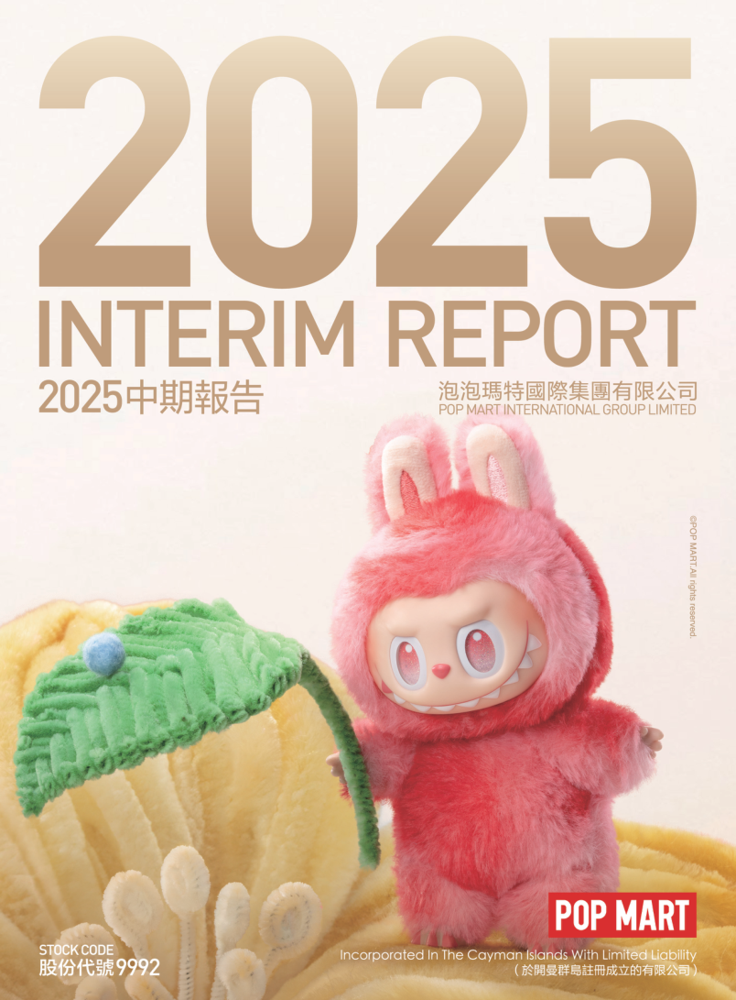
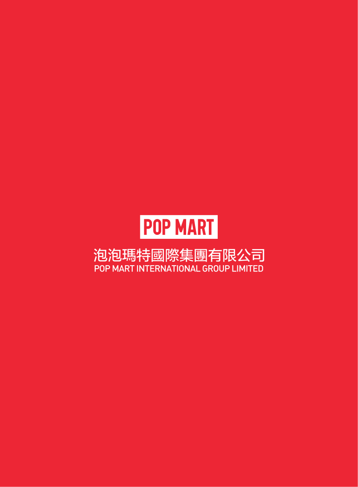

# 泡泡玛特2025年中期报告（简体中文）

> 披露日期：2025-09-25。来源：[泡泡玛特官方投资者关系](https://popwebsite.paquapp.com/pdf/a1c633d3-5a3a-4015-9792-46c0cde4fede-二零二五年中期报告.pdf)。
> [原始PDF](../2025年中期报告.pdf) · [历年财报索引](../泡泡玛特历年财报索引.md)
> 转换说明：保留中文正文、数字、单位和注释，仅做繁简转换及重复英文去除。外文专名、代码和网址照录；复杂表格用等宽文本保留列位置，插图保留原图。

## 原PDF第1页

[对照原PDF第1页](../2025年中期报告.pdf#page=1)




## 原PDF第2页

[对照原PDF第2页](../2025年中期报告.pdf#page=2)

2

公司资料

目录

财务概要

管理层讨论与分析

其他资料

中期简明综合损益及其他全面收益表

中期简明综合资产负债表

中期简明综合权益变动表

中期简明综合现金流量表

中期简明综合财务资料附注

释义

二零二五年中报  1

## 原PDF第3页

[对照原PDF第3页](../2025年中期报告.pdf#page=3)

公司资料

董事会

执行董事

王宁先生（董事会主席）

刘冉女士

司德先生

文德一先生

非执行董事

屠铮先生

何愚先生

独立非执行董事

张建君先生

吴联生先生

颜劲良先生

薪酬委员会

张建君先生（主席）

吴联生先生

王宁先生

提名委员会

王宁先生（主席）

张建君先生

吴联生先生

审核委员会

吴联生先生（主席）

屠铮先生

颜劲良先生

联席公司秘书

李鸿轩先生

李菁怡女士

授权代表

王宁先生

李菁怡女士

2  泡泡玛特国际集团有限公司

## 原PDF第4页

[对照原PDF第4页](../2025年中期报告.pdf#page=4)

公司资料

总部及中国主要营业地点

中国

北京市朝阳区

大望京科技商务园区

宏泰东街浦项中心A座36及37楼

香港主要营业地点

香港

德辅道中188号

金龙中心19楼

股份过户登记总处

Maples Fund Services (Cayman) Limited PO Box 1093 Boundary Hall Cricket Square Grand Cayman KY1-1102 Cayman Islands

香港股份过户登记处

香港中央证券登记有限公司香港

湾仔

皇后大道东183号

合和中心17楼

1712-1716号舖

主要往来银行

中国工商银行股份有限公司（珠市口支行）

中国北京市东城区

珠市口东大街15号

交通银行股份有限公司

（望京支行）中国北京市朝阳区望京街9号望京国际商业中心

中国民生银行股份有限公司（望京支行）

中国北京市朝阳区

广顺北大街南湖东园一区

122号楼博泰国际B座

二零二五年中报  3

## 原PDF第5页

[对照原PDF第5页](../2025年中期报告.pdf#page=5)

公司资料

公司网站

www.popmart.com

法律顾问

有关香港法律

达维律师事务所

香港

中环

遮打道三号A

香港会所大厦十楼

有关中国法律

竞天公诚律师事务所

中国

上海市徐汇区

淮海中路1010号

嘉华中心45层

邮政编码：200031

有关开曼群岛法律迈普达律师事务所（香港）有限法律责任合伙香港湾仔

港湾道18号

中环广场26楼

核数师

罗兵咸永道会计师事务所

执业会计师

注册公众利益实体核数师

香港中环

太子大厦22楼

股份代号

9992  9992

4  泡泡玛特国际集团有限公司

## 原PDF第6页

[对照原PDF第6页](../2025年中期报告.pdf#page=6)

财务概要

截至6月30日止六个月

```text
                                           未经审核       未经审核
                                               2025           2024
                                             2025年         2024年           变动
                                         人民币千元     人民币千元
收入                                     13,876,276       4,557,831        204.4%
毛利                                      9,761,064       2,919,105        234.4%
经营溢利                                  6,043,741       1,126,417        436.5%
除所得税前溢利                            6,156,872       1,228,438        401.2%
期内溢利                                  4,681,713        964,142         385.6%
本公司拥有人应占溢利
                                          4,574,368        921,333         396.5%
非国际财务报告会计准则经调整
  纯利                                    4,709,630       1,017,625        362.8%
毛利率                                        70.3%          64.0%
纯利率                                        33.7%          21.2%
非国际财务报告会计准则经调整
  纯利率                                      33.9%          22.3%
                                                          未经审核         经审核
                                                              2025           2024
                                                         于2025年       于2024年
                                                          6月30日       12月31日
                                                        人民币千元     人民币千元
资产
非流动资产                                               3,506,097       2,634,591
流动资产                                                17,850,582      12,236,081
资产总值                                                21,356,679      14,870,672
权益
权益总额                                                14,429,574      10,884,639
负债
非流动负债                                               1,003,907        616,005
流动负债                                                 5,923,198       3,370,028
负债总额                                                 6,927,105       3,986,033
```

二零二五年中报  5

## 原PDF第7页

[对照原PDF第7页](../2025年中期报告.pdf#page=7)

管理层讨论与分析

业务回顾

我们以成为世界的泡泡玛特为目标，致力于打造新一代世界级的消费品牌，坚定不移地推进集团化及国际化的战略。得益于本公司各部门的紧密协作，凭借出色的IP运营能力与产品研发能力，我们在为消费者提供优质服务的同时，推出了众多深受全球消费者青睐的新IP及新品系列，进一步提高了泡泡玛特品牌及其旗下IP在全球的认可度，从而取得了优异的销售业绩。我们首次入选美国《时代》周刊发布的2025 年「全球100家最具影响力企业」。

2025 年上半年，本公司的收入达到人民币13,876.3百万元，同比增速204.4%。通过满足用户多元化品类及IP需求、精细化提升运营效率，拉动了中国各渠道的销售增长，收入达到人民币8,282.8 百万元，同比增速135.2%；通过深度推进本土化运营，亚太收入达到人民币 2,850.9百万元，同比增长257.8%；通过加大市场开拓力度、进行差异化渠道定位，美洲收入达到人民币 2,264.9 百万元，同比增长 1,142.3%；凭借独特的产品设计，提升购物体验，欧洲及其他地区实现收入人民币 477.7 百万元，同比增长729.2%。

IP孵化与运营

IP运营与创意设计是推动泡泡玛特持续健康发展的关键因素。作为全球领先的潮玩 IP 平台，我们在全球范围内挖掘极具潜力的艺术家和设计师，凭借成熟的IP运营体系，已连续成功打造出多个广受青睐的潮流文化 IP 形象。同时，我们不断加大产品设计创新力度，持续丰富产品种类，以满足不同粉丝群体的多样化需求，进而创造潮流，向全球消费者传递更多美好与快乐。

6  泡泡玛特国际集团有限公司

## 原PDF第8页

[对照原PDF第8页](../2025年中期报告.pdf#page=8)

管理层讨论与分析

基于各 IP 的独特表达与设计，我们采取了差异化运营策略，持续提升 IP 热度，积极推动 IP 商业化，进而增强 IP 的生命力，最终取得了强劲的销售业绩。 2025 年上半年，共有 13 个艺术家IP收入过亿，其中THE MONSTERS、MOLLY、MONSTERS, MOLLY, SKULLPANDA, CRYBABY, and DIMOO generated revenues  SKULLPANDA、CRYBABY和DIMOO在报告期内分别实现收入人民币4,814.0百万元、人民币1,357.2百万元、人民币1,220.5 百万元、人民币1,218.2百万元和人民币1,105.1百万元。

LABUBU, a member of THE MONSTERS family, ascended to global IP  THE MONSTERS家族中的LABUBU凭借其独特的风格魅力，跻身世界级 IP 行列，成为 2025 年上半年全球最热门的IP之一。今年是THE MONSTERS诞生的第十个年头，经过我们对 IP 的积累沉淀与精心运营，以及对产品的不断打磨与创新，LABUBU第三代搪胶毛绒「前方高能」系列一经推出，便在全球各大国家和地区掀起热潮，成功俘获了全球粉丝的热爱。「怪味便利店」系列手办延续「看不见我」风格，充分展现了LABUBU的性格特征，深受粉丝青睐。我们将继续用心运营，持续推出设计更为精良的产品，深入挖掘IP价值，使LABUBU成为具有长生命周期的世界顶级IP。

MOLLY, our most iconic classic IP, continues to showcase strong vitality  MOLLY作为我们最具代表性的经典IP，通过多元化的商业化运营，始终保持着旺盛的生命力。我们基于情绪表达与表情变化打造的 ANGRY MOLLY形象，以更具突破性的风格尝试收获了MOLLY refreshed. In the first half of this year, we continued to deepen  更广泛的喜爱，也让 MOLLY 持续焕发全新活力；今年上半年我们持续深化运营，推出了BABY MOLLY 「口袋朋友」搪胶毛绒挂件，以陪伴和治愈粉丝；针对ROYAL MOLLY及SPACE MOLLY实施高端化策略，通过跨圈层的内容创新合作，进一步提升了 IP 文化符号价值和市场影响力。

二零二五年中报  7

## 原PDF第9页

[对照原PDF第9页](../2025年中期报告.pdf#page=9)

管理层讨论与分析

SKULLPANDA continued to take a diversified design approach to relentlessly  SKULLPANDA继续采用多元化的设计方法，不断产生新的创意，打破风格的限制。上半年推出的「光织园」毛绒挂件，设计灵感来自印象派的色彩，能让人感受到自然与内心共鸣带来的治愈体验。「进退之门」系列手办，设计理念围绕内外、围困展开，通过生命、情感、方向、财富、规则、探索这6组主题，用雕塑造型、矿石质感搭配渐变色彩，展现出艺术造型的魅力。为粉丝带来了更多不同类型的艺术和收藏体验。

CRYBABY, grounded in its philosophy that “Everybody Cries Sometimes! ”,  CRYBABY以「每个人都有哭泣的时候（Everybody Cries Sometimes！）」为创作理念，推出「爱神的眼泪」系列手办，化身为爱神，用眼泪诠释出不同的故事，表达爱的真谛，给粉丝力量。同时，CRYBABY持续探索，不断创新，推出了「豹豹猫猫」搪胶毛绒挂件。系列设计打破了常规，鼓励大家释放自己的天性，骄傲地做自己。

DIMOO continues to grow with more possibilities. The “DIMOO WORLD ×  DIMOO持续成长，延展出更多可能性。「DIMOO迪士尼 」联名系列 ， 以统一主题为核心，开发出全品类产品，深受全球粉丝喜爱。同时，我们推出了全球首款 55% 再生材料的DIMOO地球日手办，创新生物保护路径，呼吁全球粉丝与DIMOO一起成为地球守护者。

HIRONO cultivates a distinctive spiritual universe through its iconically  以极具辨识度的治愈设计语言构建起独特的精神图景，其世界成为众多粉丝的精神庇护所。我们于 2025 年 2 月 21 日在上海开设了小野品牌首店，店内全方位呈现了小野的世界，品类涵盖潮玩、服饰、艺术生活家居、雕塑等，致力于打造一种独属于小野的全新生活方式。

8  泡泡玛特国际集团有限公司

## 原PDF第10页

[对照原PDF第10页](../2025年中期报告.pdf#page=10)

管理层讨论与分析

Twinkle Twinkle (星星人), one of our emerging IPs with the most rapid  星星人是我们旗下成长最快的新锐IP之一，用一个个关于勇气、思念与爱的故事打动人心，希望每位粉丝都能从不同的星星人身上看见自己的影子。今年上半年推出的「123！星星人」手办及毛绒产品，以星星人独有的标志性口号为灵感，将勇气迸发的瞬间定格成可触摸的温暖，唤醒人们心中的童心，默默守护并持续激励著每一位粉丝。同时，乐园明星朋友互动表演使星星人形象更加生动鲜活，不仅拉近了与粉丝的距离，更深化了彼此间的情感连接。通过多维度的运营举措，星星人迅速收获了大众的喜爱与认可。

我们持续探索并拓展与授权IP的合作范畴，推出多种类型、风格多样的潮流玩具以及联名款产品，以满足不同消费者的需求和兴趣。通过与动漫、游戏、电影等众多版权方开展合作，为粉丝们提供更多选择并带来惊喜。春节期间，「哪吒之魔童闹海」天生羁绊系列手办与电影上映同步推出，凭借精美的设计受到广大观众的欢迎与好评。同时，我们不断拓展IP授权的地域范围，目前已获得大部分授权IP的全球授权，从而为全球消费者打造更具独特性的潮流玩具体验。

2025 年上半年，毛绒产品实现收入人民币6,139.2 百万元，同比增长 1,276.2%，占收入的44.2%。我们始终以IP为核心，通过精准把握不同IP的个性特征与精神内核，量身打造风格契合且具备显著差异化的毛绒产品线。同时，依托LABUBU搪胶毛绒的产品经验，以搪胶工艺为基础，结合喷色工艺及时装面料，呈现不同IP的特征，赋予IP更强的生命力与辨识度，提升产品竞争力。

二零二五年中报  9

## 原PDF第11页

[对照原PDF第11页](../2025年中期报告.pdf#page=11)

管理层讨论与分析

今年上半年，我们为10 个IP推出近20 款毛绒产品，涵盖软脸、硬脸款式，采用不同尺寸大小和材质。毛面料的升级丰富了产品的柔软质感，通过不同工艺实现互动功能，改变了软毛产品单一的陪伴属性，增加了更多可玩性。例如：搪胶毛绒搭配扎染工艺，成功打造出兼具LABUBU “Big into Energy” series offers both visual beauty and tactile  视觉美感与触觉体验的 LABUBU 「前方高能」；SKULLPANDA 「光织园」通过 PVC 注塑工艺生动SKULLPANDA “L’impressionnisme” series vividly portrays facial make-up  刻画面部妆容，可动眼睛更显精致灵动；BABY MOLLY化身掌心大小的猫咪，成为粉丝的「口袋朋友」；CRYBABY 「豹豹猫猫」搪胶毛绒采用长条小体积毛绒，成为穿搭的热门单品；PUCKY 「豆子冒泡」系列毛绒挂件采用内置气囊，可吹出彩色泡泡；HACIPUPU 「小熊软糖」系列搪胶毛绒挂件融合香甜软糖香气等。得益于产品出色的展示性与搭配功能，这一系列举措不仅持续加深了与现有粉丝的情感连接，也为品牌与IP拓展了更多来自不同国家及地区的年轻粉丝，使我们的毛绒产品在年轻消费者中牢固占据优势地位。

2025 年是我们推出 MEGA COLLECTION 的第五年，品牌运营已逐步迈入成熟阶段。在此期间，我们分别于成都 SKP 、北京 SKP-S 开设了一家 POPMARTCOLLECTION 臻藏店。MEGA专注于潮流、艺术与 I P 内容，以潮流收藏玩具为媒介，探寻审美表达，记录时代灵感，助力年轻人成为时代文化的收藏家。2025年上半年，MEGA COLLECTION实现收入人民币1,007.1百万元，占比达到7.3%。

消费者触达

－ 线下渠道

截止至 2025 年 6 月 30 日，我们于全球 18 个国家，运营571家门店，今年上半年净增40家，运营2,597 台机器人商店，今年上半年净增105台。

10  泡泡玛特国际集团有限公司

## 原PDF第12页

[对照原PDF第12页](../2025年中期报告.pdf#page=12)

管理层讨论与分析

中国市场聚焦提升顾客的品牌体验，持续提高服务质量及渠道精细化运营效率。报告期内，净增 12 家线下门店，门店数量从截至2024年12月31日的431家增至截至2025年 6 月 30 日的 443 家。亚太加强精细化运营，有效执行旅游零售战略，在全球知名旅游目的地及机场开设门店。报告期内，净增5家线下门店，报告期内门店数量从截至2024年12月31日的64家增至截至2025年6月30日的69家。美洲聚焦美国市场，快速实现市场覆盖范围拓展，扩大品牌及IP影响力。报告期内，净增 19 家线下门店，门店数量从截至2024 年12 月31 日的22 家增至截至2025年6月30日的41家。欧洲深化区域总部建设，提前布局全球知名地标，为未来高效发展稳筑基础。报告期内，净增4家线下门店，门店数量从截至2024 年12 月31 日的14家增至截至2025年6月30日的18家。

－ 线上渠道

2025 年上半年，泡泡玛特抽盒机持续发挥场景化、娱乐化购买体验的渠道优势，聚焦人群精细化运营，有效承接快速增长的新客流量，进一步提高交易转化率，优化营销节奏与全渠道协调一致，实现拉新规模的快速突破。内容电商渠道聚焦商品效能优化，注重消费者的使用场景，以满足多元化需求，高流量、高互动直播场次大幅增加。平台电商旗舰店多触点流量爆发，在平台行业访客排名中位居榜首，得益于不断强化精准营销和消费者互动形式的多样化，推动潜力 IP 和品类的增长，提升新老客户跨IP、跨品类的交叉体验。今年6.18期间，我们在天猫、抖音、京东平台的行业销售排名均位列第一。

二零二五年中报  11

## 原PDF第13页

[对照原PDF第13页](../2025年中期报告.pdf#page=13)

管理层讨论与分析

随着全球业务的稳步拓展，我们的官网已覆盖37 个国家，其中34 个国家同步上线了自研 APP。官网是我们品牌面向国际市场的重要窗口 ， 我们坚持「 以用户需求为核心」，在用户浏览路径、界面设计、产品展示以及售后服务等环节持续进行优化，系统性地提升用户体验并塑造良好的品牌形象。我们将自主研发的「抽盒机」嵌入官网及APP，独具品牌特色的玩法为消费者构建起有趣、好玩且便捷的购物场景，显著增强了与粉丝的互动和黏性。官网及APP的推广让更多海外消费者深入认识、了解并喜欢上泡泡玛特。

此外，针对不同市场特点与当地三方平台生态，我们实施差异化运营：在东南亚，通过Shopee与Lazada触达本地消费者，配合精细化营销与本地化服务，精准开展产品推广并获得良好口碑；在欧美市场，借助Amazon的规模与物流能力，叠加站内与站外投放，广泛触达用户、稳步提升当地影响力。与此同时，我们紧跟内容电商趋势，在多个国家入驻TikTok，打造高质量内容生态，结合富有创意的直播活动吸引年轻用户，以优质内容带动销售，扩大品牌曝光与互动。

－ 会员运营

随著全渠道高质量发展以及IP和产品种类的不断丰富，通过不断完善会员运营机制，升级消费者体验，会员规模快速增长，会员质量持续提升。截至2025年6月30日，中国内地累计注册会员总数从2024 年12 月31日的4,608万人增长至5,912万人，新增注册会员1,304 万人。2025 年上半年会员贡献销售额占比91.2%，会员复购率为50.8% 2 。

```text
2.                                                                            2、  报告期内，会员中购买过2次或以上的占比
```

12  泡泡玛特国际集团有限公司

## 原PDF第14页

[对照原PDF第14页](../2025年中期报告.pdf#page=14)

管理层讨论与分析

主题乐园与IP体验及创新业务孵化

泡泡玛特城市乐园于 2023 年 9 月在北京正式开园。开园以来，我们持续优化服务体验，丰富表演种类，不间断推出精彩纷呈的主题活动，联动全业态打造沉浸式主题场景。

2025年4月，乐园部分区域进行设备升级，将带来更丰富的主题区域和游乐设施，进一步提升园区游玩体验。6月，乐园推出「闪闪夏日」主题活动以及星星人的「好友见面会」。活动一经推出，便迅速吸引了大量关注，互动片段在各大平台广泛传播，IP热度持续上升。此前火遍全网的「精灵啦啦操」限时回归，ZIMOMO与LABUBU LABUBU danced again, attracting fans from all over the world to watch and  再次活力开跳，吸引全球粉丝纷纷前往乐园观看并打卡留念。

THE MONSTERS has been invited to participate in fashion shows, TV programs  THE MONSTERS精灵天团多次走出乐园，受邀参与时尚走秀、电视节目等活动，加强了与粉丝的互动，其表演持续受到广泛关注。DIMOO于中泰政府招待会上，被授予「中泰建交50周年特邀挚友」荣誉称号，并发布了融合中泰文化的限定形象及动画短片。以潮玩为媒介，以 IP 为纽带，见证了中泰两国在文化、情感与青年沟通层面的交流不断深化。

2025 年上半年，我们举办了多场大型线下主题展览活动，覆盖全球多个核心城市，持续深化IP运营及全球影响力。THE MONSTERS 「怪味便利店」展览强势露出，在中国多个城市带来了丰富IP interactions and shopping experience across multiple cities in the PRC.  的线下IP交互与购物体验；深耕在地文旅，我们将SKULLPANDA、Zsiga、Nyota等IP形象融入城市风景，通过艺术装置、商品零售、创新活动等多元形式，为消费者提供全新的场景体验。

二零二五年中报  13

## 原PDF第15页

[对照原PDF第15页](../2025年中期报告.pdf#page=15)

管理层讨论与分析

2025 年上半年，我们于北京、上海分别开设了一家「popop」饰品店。我们通过对IP进行解构与延展，采用不同的材质及工艺，塑造风格，彰显个性，打造兼具先锋创意与精湛工艺的作品，注重IP的内核表达，使每件饰品都成为消费者可佩戴的艺术符号。

未来，我们将持续以IP为核心，不断探寻其他延展的可能性，使每个 IP 都能释放出更深厚的价值，与粉丝形成更深远的连接。

财务回顾

销售收入

本公司收入从2024 年上半年的人民币4,557.8 百万元增长到2025年上半年的人民币13,876.3百万元，同比增长204.4%。

根据区域划分的收入

本公司的收入按照区域划分为：(1)中国，(2)亚太，(3)美洲，及(4)欧洲及其他地区。下表载列本公司2025 年上半年及2024 年上半年的按区域划分的收入：

```text
                               截至2025年6月30日             截至2024年6月30日
                                    止六个月                      止六个月
                                   收入       收入占比           收入       收入占比       收入变动
                             人民币千元                    人民币千元
中国                          8,282,812         59.7%        3,521,231         77.2%         135.2%
亚太                          2,850,902         20.6%         796,678          17.5%         257.8%
美洲                          2,264,882         16.3%         182,317           4.0%       1,142.3%
欧洲及其他地区                  477,680          3.4%          57,605           1.3%         729.2%
合计                         13,876,276        100.0%        4,557,831        100.0%         204.4%
```

14  泡泡玛特国际集团有限公司

## 原PDF第16页

[对照原PDF第16页](../2025年中期报告.pdf#page=16)

管理层讨论与分析

(1) 中国

中国收入从2024 年上半年的人民币3,521.2百万元增长到2025 年上半年的8,282.8 百万元，同比增长 135.2%。以下为按照渠道划分的收入明细：

```text
                           截至2025年6月30日             截至2024年6月30日
                                止六个月                      止六个月
                              收入       收入占比           收入       收入占比       收入变动
                        人民币千元                    人民币千元
线下渠道                  5,084,246         61.4%       2,341,629         66.5%         117.1%
零售店                    4,405,948         53.2%       2,004,054         56.9%         119.9%
机器人商店                 678,298           8.2%         337,575          9.6%         100.9%
线上渠道                  2,937,255         35.5%         940,718         26.7%         212.2%
泡泡玛特抽盒机            1,125,227         13.6%         399,197         11.3%         181.9%
天猫旗舰店                 657,503           7.9%         198,841          5.7%         230.7%
抖音平台                   561,138           6.8%         208,877          5.9%         168.6%
其他线上渠道               593,387           7.2%         133,803          3.8%         343.5%
批发及其他                 261,311           3.1%         238,884          6.8%           9.4%
合计                      8,282,812        100.0%       3,521,231        100.0%         135.2%
```

二零二五年中报  15

## 原PDF第17页

[对照原PDF第17页](../2025年中期报告.pdf#page=17)

管理层讨论与分析

中国线下渠道。收入由 2024 年上半年的人民币2,341.6 百万元增长到2025 年上半年的人民币5,084.2百万元，增长了117.1%。中国线下渠道分为：零售店和机器人商店。

```text
                                                                                零售店                                                          机器人商店
                                                                         截至6月30日止六个月                                               截至6月30日止六个月
                                                                 2025                             2024                            2025                             2024
                                                               2025年                           2024年                           2025年                           2024年
区域划分                                                     数量            收入            数量             收入            数量             收入            数量            收入
                                                                    （人民币千元）                  （人民币千元）                   （人民币千元）                   （人民币千元）
                                 中国内地                    409        3,648,359             374         1,723,631          2,396         643,440             2,189         314,974
                                 港澳台地区                   34          757,589              25          280,423              41           34,858              35           22,601
                                 合计                        443        4,405,948             399         2,004,054          2,437         678,298             2,224         337,575
```

－  零售店。零售店销售收入从 2024 年上半年的人民币2,004.1百万元增加到2025年上半年的人民币4,405.9百万元，同比增长了119.9%。一方面来自于店舖客流量的增长，丰富的产品种类和独特的产品设计受到了顾客的喜爱；另一方面来自于零售店数量的增加，2025 年上半年较去年同期增加了44间店舖。

16  泡泡玛特国际集团有限公司

## 原PDF第18页

[对照原PDF第18页](../2025年中期报告.pdf#page=18)

管理层讨论与分析

－  机器人商店。机器人商店销售收入从2024 年上半年的人民币337.6 百万元增长到2025 年上半年的人民币678.3 百万元，同比增长了100.9%。一方面得益于2025 年上半年产品的持续火爆，同时机器人商店开通「送到家」服务，为消费者提供更便利的购买服务；另一方面来自于机器人商店数量的增加，2025年上半年较去年同期增加了213间。

中国线上渠道。线上收入由 2024 年上半年的人民币940.7 百万元增长到2025 年上半年的人民币2,937.3 百万元，增长了212.2%。中国线上渠道的收入包括泡泡玛特抽盒机、天猫旗舰店、抖音平台以及其他线上渠道。泡泡玛特抽盒机通过不断优化平台玩法，扩大小程序访问规模，提升流量转化，2025 年上半年收入为人民币1,125.2 百万元，同比增长了 181.9%；其他线上平台差异化运行，精准匹配平台与用户需求提升运营效率，推动收入增长。

中国批发及其他。收入从 2024 年上半年的人民币238.9 百万元增长到2025 年上半年的人民币261.3百万元，增长了9.4%。

二零二五年中报  17

## 原PDF第19页

[对照原PDF第19页](../2025年中期报告.pdf#page=19)

管理层讨论与分析

(2) 亚太

亚太收入从2024 年上半年的人民币796.7 百万元增长到2025 年上半年的人民币2,850.9百万元，增长 257.8%。以下为按照渠道划分的收入明细：

```text
                               截至2025年6月30日                 截至2024年6月30日
                                    止六个月                          止六个月
                                   收入        收入占比             收入         收入占比         收入变动
                             人民币千元                       人民币千元
线下渠道                      1,525,588           53.5%           502,585           63.1%           203.5%
零售店                        1,492,991           52.4%           485,310           60.9%           207.6%
机器人商店                       32,597            1.1%            17,275            2.2%            88.7%
线上渠道                      1,069,214           37.5%           165,325           20.8%           546.7%
泡泡玛特官方网站                312,968           11.0%            39,600            5.0%           690.3%
                                280,778            9.8%            41,014            5.2%           584.6%
其他线上渠道                    475,468           16.7%            84,711           10.6%           461.3%
批发及其他                      256,100            9.0%           128,768           16.1%            98.9%
合计                          2,850,902          100.0%           796,678          100.0%           257.8%
```

18  泡泡玛特国际集团有限公司

## 原PDF第20页

[对照原PDF第20页](../2025年中期报告.pdf#page=20)

管理层讨论与分析

亚太线下渠道。收入从 2024 年上半年的人民币502.6 百万元增长到2025 年上半年的人民币1,525.6百万元，增长了203.5%。零售店收入占亚太区收入的52.4%，零售店数量从2024 年上半年的39 间增加到2025 年上半年的 69 间，我们持续增强品牌影响力，加强本地精细化运营，实现业务的快速扩张。

亚太线上渠道。线上收入由 2024 年上半年的人民币165.3 百万元增加到2025 年上半年的人民币1,069.2百万元，增长了546.7%。亚太线上渠道收入包括来自泡泡玛特官方网站、Shopee和其他线上渠道的收入。亚太依据不同国家的市场特点匹配电商平台，实施差异化运营策略，拓展更多的平台渠道加强本地化运营，随着品牌影响力的加深，进一步提升流量的获取和转化效率，实现多平台收入的快速增长。

亚太批发及其他。收入从 2024 年上半年的人民币128.8 百万元增长至2025 年上半年的人民币256.1百万元，增长了98.9%。

二零二五年中报  19

## 原PDF第21页

[对照原PDF第21页](../2025年中期报告.pdf#page=21)

管理层讨论与分析

(3) 美洲

美洲收入从2024 年上半年的人民币182.3 百万元增长到2025 年上半年的人民币2,264.9百万元，增长了1,142.3%。以下为按照渠道划分的收入明细：

```text
                               截至2025年6月30日                 截至2024年6月30日
                                    止六个月                         止六个月
                                  收入         收入占比             收入        收入占比         收入变动
                            人民币千元                        人民币千元
线下渠道                       842,390            37.2%           99,779            54.7%          744.3%
零售店                         736,961            32.5%           87,254            47.9%          744.6%
机器人                         105,429             4.7%           12,525             6.8%          741.7%
线上渠道                      1,326,565           58.6%           63,857            35.1%         1,977.4%
泡泡玛特官方网站               886,501            39.2%           28,743            15.8%         2,984.2%
TikTok平台                     315,025            13.9%           14,770             8.1%         2,032.9%
其他线上渠道                   125,039             5.5%           20,344            11.2%          514.6%
批发及其他                      95,927             4.2%           18,681            10.2%          413.5%
合计                          2,264,882         100.0%           182,317           100.0%         1,142.3%
```

20  泡泡玛特国际集团有限公司

## 原PDF第22页

[对照原PDF第22页](../2025年中期报告.pdf#page=22)

管理层讨论与分析

美洲线下渠道。线下收入由 2024 年上半年的人民币99.8百万元增长到2025年上半年的人民币842.4 百万元，增长了744.3%。主要由于我们业务的快速扩展和单店收入的增长。美洲零售店数量从2024 年上半年的10间增长到2025年上半年的41间。

美洲线上渠道。线上收入从 2024 年上半年的人民币63.9百万元增长到2025年上半年的人民币1,326.6百万元，增长了1,977.4%。美洲线上渠道收入包括泡泡玛特官方网站、TikTok平台和其他线上渠道。我们持续推进品牌官网的建设与优化，紧跟直播电商的潮流趋势，以用户需求为核心，提升用户体验加深品牌影响力。

美洲批发及其他。收入由 2024 年上半年的人民币18.7百万元增长到2025年上半年的人民币95.9百万元，增长了413.5%。

二零二五年中报  21

## 原PDF第23页

[对照原PDF第23页](../2025年中期报告.pdf#page=23)

管理层讨论与分析

(4) 欧洲及其他地区

欧洲及其他地区收入由2024 年上半年的人民币57.6百万元增长到2025年上半年的人民币477.7 百万元，增长了729.2%。以下为按照渠道划分的收入明细：

```text
                              截至2025年6月30日                 截至2024年6月30日
                                    止六个月                         止六个月
                                  收入        收入占比             收入        收入占比         收入变动
                            人民币千元                       人民币千元
线下渠道                       276,527           57.9%            41,300           71.7%          569.6%
零售店                         272,110           57.0%            40,518           70.3%          571.6%
机器人商店                       4,417            0.9%              782             1.4%          464.8%
线上渠道                       164,963           34.5%            11,309           19.6%         1,358.7%
泡泡玛特官方网站                84,694           17.7%             1,305            2.3%         6,390.0%
其他线上渠道                    80,269           16.8%            10,004           17.3%          702.4%
批发及其他                      36,190            7.6%             4,996            8.7%          624.4%
合计                           477,680          100.0%            57,605          100.0%          729.2%
```

欧洲及其他地区线下渠道。 收入由 2024年上半年的人民币 41.3 百万元增长到 2025年上半年的人民币 276.5 百万元，增长了569.6%。主要由于我们业务进入到更多的国家，零售店数量的增长和单店收入的提升。欧洲及其他地区零售店数量从2024 年上半年的9间增长到2025年上半年的18间。

欧洲及其他地区线上渠道。 收入由 2024年上半年的人民币 11.3 百万元增长到 2025年上半年的人民币 165.0 百万元，增长了1,358.7%。欧洲区的线上渠道做为新领域，我们加深本地化布局，同时加速线上多平台的建设，提升品牌在当地的影响力，促进收入的增长。

22  泡泡玛特国际集团有限公司

## 原PDF第24页

[对照原PDF第24页](../2025年中期报告.pdf#page=24)

管理层讨论与分析

根据IP划分的收入

泡泡玛特的自主产品是我们的主要商品类型，2025 年上半年自主产品收入占总收入的比例为99.1%，自主产品收入从 2024 年上半年的人民币4,382.7 百万元增加到2025 年上半年的人民币13,753.4百万元，增长了213.8%。

泡泡玛特的自主产品主要分为：艺术家IP和授权IP，以下为IP划分的收入明细：

```text
                                                                          截至6月30日止六个月
                                                                    2025                          2024
                                                                  2025年                        2024年
                                                                收入       收入占比           收入       收入占比
                                                           人民币千元                    人民币千元
                                  自主产品                13,753,405          99.1%       4,382,741         96.2%
                                  艺术家IP                12,228,565          88.1%       3,687,803         81.0%
                                     THE MONSTERS          4,814,017          34.7%         626,806         13.7%
MOLLY                                                      1,357,248           9.8%         782,160         17.2%
SKULLPANDA                                                 1,220,504           8.8%         574,562         12.6%
CRYBABY                                                    1,218,170           8.8%         349,382          7.7%
DIMOO                                                      1,105,135           8.0%         377,838          8.3%
HIRONO                                                       728,420           5.2%         245,247          5.4%
Twinkle Twinkle                      星星人                  389,363           2.8%              –              –
HACIPUPU                                                     332,122           2.4%          94,991          2.1%
                                     其他艺术家IP          1,063,586           7.6%         636,817         14.0%
                                  授权IP                   1,524,840          11.0%         694,938         15.2%
                                  外采及其他                 122,871           0.9%         175,090          3.8%
                                  合计                    13,876,276        100.0%        4,557,831        100.0%
```

二零二五年中报  23

## 原PDF第25页

[对照原PDF第25页](../2025年中期报告.pdf#page=25)

管理层讨论与分析

艺术家 IP。艺术家 I P 是本公司主要商品类型，主要包括 THE MONSTERS、MOLLY、SKULLPANDA、CRYBABY等。艺术家IP的收入占比由2024年上半年的81.0%上升到2025年上半年的 88.1%。艺术家 I P 收入从 2024年上半年的人民币 3,687.8 百万元，上升至MONSTERS generated revenue of RMB4,814.0 million in the first half of  2025 年上半年的人民币 12,228.6 百万元，增长了 231.6%，其中，2025 年上半年 THE MONSTERS收入人民币4,814.0百万元，同比增长了 668.0%。主要由于我们不断提升产品的设计创新能力，满足各类消费者的多元需求。

授权IP。授权IP收入从2024年上半年的人民币694.9 百万元，增加至2025 年上半年的人民币1,524.8百万元，增长了119.4%。主要由于我们不断加深与更多版权方的合作，持续扩大IP授权区域，同时推出更多风格、种类的产品，让全球消费者感受潮玩的乐趣。

根据产品类别划分的收入

本公司的产品按照类别主要划分为：毛绒、手MEGA and other IP-related products and others by category. The following  办、MEGA和衍生品及其他，以下为产品类别划分的收入明细：

```text
                                  截至2025年6月30日                  截至2024年6月30日
                                        止六个月                         止六个月
                                      收入         收入占比             收入        收入占比         收入变动
                                人民币千元                        人民币千元
毛绒                             6,139,236           44.2%           446,105             9.8%         1,276.2%
手办                             5,175,875           37.3%          2,656,781           58.3%            94.8%
                                 1,007,147            7.3%           586,130            12.9%            71.8%
衍生品及其他                     1,554,018           11.2%           868,815            19.0%            78.9%
合计                            13,876,276          100.0%          4,557,831          100.0%          204.4%
```

24  泡泡玛特国际集团有限公司

## 原PDF第26页

[对照原PDF第26页](../2025年中期报告.pdf#page=26)

管理层讨论与分析

我们不断在产品层面推陈出新，丰富产品品类，提升产品设计的能力。毛绒产品收入从2024 年上半年的人民币 446.1 百万元增长到2025 年上半年的人民币6,139.2 百万元，增长了1,276.2%，毛绒产品占总收入的44.2%，得益于产品出色的展示性以及毛绒材质特有的柔软触感，使毛绒产品成为现象级爆款产品。

销售成本

销售成本从2024 年上半年的人民币1,638.7 百万元上升到 2025 年上半年的人民币 4,115.2 百万元，增长了151.1%，增加主要由于(1)存货成本由2024 年上半年的人民币1,282.1 百万元增加到2025 年上半年的人民币3,272.9 百万元，其主要原因为销售增加；及(2)设计及授权成本由2024年上半年的人民币240.6百万元增加到2025年上半年的人民币524.1 百万元，主要由于自主产品占比增多，以及联名产品增加，需要支付更多的IP授权费以及产品设计费。

毛利

本公司的毛利由2024 年上半年的人民币2,919.1百万元上升到2025 年上半年的人民币9,761.1 百万元，增长了 234.4% ，主要由于我们的收入增加以及销售成本的控制。我们的毛利率由2024 年上半年的 64.0% 增长至 2025 年上半年的70.3%，主要由于(1)海外销售占比提升拉动毛利率的增长；(2)我们优化产品设计，加强了成本管控，提升对供应商的议价能力；及(3)外采商品占比逐渐下降。

二零二五年中报  25

## 原PDF第27页

[对照原PDF第27页](../2025年中期报告.pdf#page=27)

管理层讨论与分析

经销及销售开支

我们的经销及销售开支由2024 年上半年的人民币1,353.2 百万元增长至2025 年上半年的人民币3,192.6百万元，增长了135.9%，其中占比较高的为运输及物流开支和雇员福利开支。

－  运输及物流开支。运输及物流开支从 2024年上半年的人民币104.7 百万元增长到2025年上半年的人民币 677.1 百万元，增长了546.7%。主要由于(1)线上渠道收入增长，运费费用增加；及(2)亚太、美洲、欧洲及其他地区收入快速增加，海外运输成本增加。

－  雇员福利开支。雇员福利开支从 2024 年上半年的人民币370.5 百万元增长至2025 年上半年的人民币560.8百万元，增长了51.4%。主要由于我们的销售员工人数由2024 年上半年的4,232 名员工增加到2025 年上半年的6,219 名员工，主要用以支持我们全球业务扩张。

一般及行政开支

我们的一般及行政开支由2024 年上半年的人民币 434.4 百万元增长至 2025 年上半年的人民币770.4百万元，增长了77.3%。其中占比较高的为雇员福利开支，我们的行政员工及设计开发人员人数由2024年上半年的1,238名增加至2025年2025.  上半年的1,830名。

其他收入

本公司的其他收入由2024年上半年的人民币31.6百万元增长到 2025 年上半年的人民币 67.2 百万元，增长了112.9%。其中(1)政府补助由2024 年上半年的人民币10.3百万元增长至2025年上半年的人民币37.8百万元，及(2)IP授权费及其他服务收入由2024年上半年的人民币18.9百万元增长到2025年上半年的人民币25.8百万元。

26  泡泡玛特国际集团有限公司

## 原PDF第28页

[对照原PDF第28页](../2025年中期报告.pdf#page=28)

管理层讨论与分析

经营溢利

综上所述，本公司的经营溢利由2024 年上半年的人民币1,126.4 百万元增长至2025 年上半年的人民币6,043.7百万元，增长了436.5%。

财务收入 － 净额

我们的财务收入净额由2024 年上半年的净收益人民币83.8百万元下降到2025年上半年的净收益人民币65.5百万元，主要由于我们的利息收入减少和财务费用的增加。

所得税开支

我们的所得税开支由 2024 年上半年的人民币264.3 百万元增加到 2025 年上半年的人民币1,475.2 百万元，原因为我们的所得税前溢利增加。我们的实际税率由2024年上半年的21.5%上升至2025年上半年的24.0%。

期内盈利

由于上文所述，我们的期内盈利由2024 年上半年的人民币964.1 百万元增加至报告期间的人民币4,681.7百万元，增长了385.6%。

非国际财务报告会计准则经调整纯利

非国际财务报告会计准则经调整纯利未按照国际财务报告会计准则计算，视为非国际财务报告会计准则的财务指标，其定义为除以股份为IFRS Accounting Standards adjusted net profit refers to the net profit after  基础的薪酬后纯利，而非国际财务报告会计准则经调整纯利率的定义为非国际财务报告会计准则经调整纯利除以收益。我们认为，这些信息对于投资者在不影响本集团经营业绩或现金流的情况下比较本集团的业绩是有用的，并允许投资者考虑管理层在评估本集团业绩时使用的指标。投资者不应认为非国际财务报告会计准则的财务指标替代或优于本集团根据国际财务报告会计准则编制的业绩。此外，可能不是所有公司会以相同的方式计算该项非国际财务报告会计准则的财务指标，因此未必可与其他公司采用的相若计量比较。

二零二五年中报  27

## 原PDF第29页

[对照原PDF第29页](../2025年中期报告.pdf#page=29)

管理层讨论与分析

下表载列本公司各期间的非国际财务报告会计准则的财务指标对账情况。

```text
                                         截至2025年      截至2024年
                                            6月30日         6月30日
                                           止六个月         止六个月
                                         人民币千元       人民币千元
期内盈利                                   4,681,713         964,142
调整项目
以股份为基础的付款报酬                       27,917           53,483
非国际财务报告会计准则经调整
  纯利                                     4,709,630        1,017,625
非国际财务报告会计准则经调整
  纯利率                                      33.9%            22.3%
```

以股份为基础的付款开支属于非现金项目且并无直接反应我们的业务营运。因此，通过撇除该等项目对计算非国际财务报告会计准则经调整纯利影响的举措，可更好地反应我们的相关经营表现，并更加便于比较不同期间的经营表现。

流动资产、财务资源及资本开支

截至2025年6月30日止六个月，本公司及附属公司在整体业务经营方面采纳保守稳健的资金管理及财务政策。本集团维持以下资源以应付其营运资金需求：

流动资产及流动负债

我们的流动资产净值由截至2024 年12 月31 日的人民币8,866.1百万元增加至截至2025年6月30日的人民币11,927.4百万元。

28  泡泡玛特国际集团有限公司

## 原PDF第30页

[对照原PDF第30页](../2025年中期报告.pdf#page=30)

管理层讨论与分析

贸易应收款项

贸易应收款项指日常业务过程中我们应收客户的未结算款项。我们的贸易应收款项由截至2024年12月31日的人民币477.7百万元增加至截至2025 年6 月30 日的人民币971.6 百万元，主要由于业务扩张，线上渠道应收账款增加。贸易应收款项周转天数从2024 年的11 天减少至截至2025年6月30日止六个月的10天。

存货

我们的存货包括制成品。我们的存货由截至2024 年12 月31 日的人民币1,524.5 百万元增加至截至2025年6月30日的人民币2,273.7百万元。主要由于海外收入占比提升，且运输时间长，所以我们增加了库存以满足销售需求。存货周转天数从2024年的102天降低到截至2025年6月30日止六个月的83天。

现金及现金等价物

我们的现金及现金等价物主要包括银行现金。现金及现金等价物从截至2024 年12 月31 日的人民币6,109.0百万元增加至截至2025年6月30日的人民币11,922.7百万元，主要为(1)我们经营活动产生的现金增加，及(2)减少了部分定期存款。

贸易应付款项

贸易应付款项主要指我们在日常业务过程中向供应商支付货款的责任。贸易应付款项从截至2024 年12 月31 日的人民币1,010.1 百万元增加至截至2025年6月30日的人民币1,627.7百万元，主要原因为我们的业务增长，导致采购量增加，进而令应付供应商款项的余额有所增加。贸易应付款项周转天数从2024 年的74 天降低到截至2025年6月30日止六个月的73天。

银行借款

截至 2025 年 6 月 30 日，本集团并无任何银行借款。

二零二五年中报  29

## 原PDF第31页

[对照原PDF第31页](../2025年中期报告.pdf#page=31)

管理层讨论与分析

资产抵押

截至 2025 年 6 月 30 日，本集团并无任何资产抵押。

资产负债率

资产负债率为总负债除以总资产乘以 100% 。截至 2025 年 6 月 30 日，本集团的资产负债率为32.4%，而截至2024年12月31日的资产负债率为2024.  26.8%。

或有事件

我们目前并无涉及任何重大法律诉讼，亦不知悉我们涉及任何待决或潜在重大法律诉讼。倘我们涉及有关重大法律诉讼，则我们会于产生亏损且有关亏损金额有合理估计时，按当时所得资料记录任何亏损或或有负债。

外汇风险管理

本公司的附属公司在中国、亚太、美洲和欧洲及其他地区经营，面对若干货币敞口（主要有关美元、泰铢、新加坡币及港币）引致的外汇风险。由于本集团以我们经营实体各自功能货币以外货币计值的金融资产及负债不重大，故管理层认为业务并无任何重大外汇风险敞口。本集团并没有对冲外币波动，但是会紧密地监控有关情况，并在必要时采取措施以保证外汇风险在可控范围内。

30  泡泡玛特国际集团有限公司

## 原PDF第32页

[对照原PDF第32页](../2025年中期报告.pdf#page=32)

管理层讨论与分析

资本开支

本公司的资本开支包括购置物业、厂房及设备的款项和购置无形资产的款项。下表载列本公司2024 年上半年以及2025 年上半年的资本开支情况：

```text
                                        截至2025年       截至2024年
                                           6月30日          6月30日
                                           止六个月        止六个月
                                         人民币千元      人民币千元
购置物业、厂房和设备                       353,623           157,858
购置无形资产                                 20,900           28,587
合计                                       374,523           186,445
```

人力资源

截至2025 年6 月30 日，我们共有8,049 名员工，包括销售员工 6,219 名，行政及开发人员 1,830名。截至2025年6月30日止六个月，我们共发生员工成本（包括薪金、工资、津贴和福利）人民币992.7百万元。

应付雇员酬金包括薪金、花红及雇员福利计划供款。雇员薪金通常按雇员各自的职位、资历、经验及表现厘定。花红乃按雇员各自的职位、服务年期及雇员表现计算。为吸引并挽留雇员，我们每年评估提供予雇员的薪酬方案，以确定是否应对基本薪金及花红作出任何调整。

我们为所有雇员提供培训计划，以增强雇员与我们业务相关的知识、技能及能力。我们将为所有新员工提供入职培训课程，以使其熟悉本集团，其后根据部门需要及本集团发展战略进行在职培训。而由于我们已制定政策及程序，列明晋升的评估准则，故我们亦为有能力的雇员提供晋升机会。

二零二五年中报  31

## 原PDF第33页

[对照原PDF第33页](../2025年中期报告.pdf#page=33)

管理层讨论与分析

重大投资的未来计划

截至2025年6月30日，我们并无持有任何重大投资。

我们将继续广泛寻找潜在的策略性投资机会，并寻求可为本集团带来协同效应的潜在优质目标业务及资产。

重大收购及出售

截至2025年6月30日止六个月，我们并无进行任何重大收购或出售附属公司、联营公司及合营企业。

报告期间后事项

于本报告日期，本集团于报告期间后并无发生须进一步披露或调整的重大事项。

未来展望

IP is at the core of our business. Through our innovative products, delicate  IP 是我们业务的核心，我们通过创意的产品、精致的设计和优质的服务使消费者收获快乐美好、潮流体验和艺术熏陶，同时，通过不断提升品牌价值、拓展产品品类、创新产品模式，增加用户对泡泡玛特的品牌忠诚度，保持我们强势的市场地位及竞争力。

我们将致力于丰富IP类型，扩大IP库，保持高质量的设计创新水平，推出更多头部系列产品。对IP进行持续孵化及运营，强化IP内核，加深粉丝与IP之间的情感连接。我们将不断拓宽潮玩边界，进一步挖掘现有品类的价值，不断完善相关工艺及生产发售流程。在持续进行研发和改进流程的过程中，我们的供应链将在全球范围内进行布局，寻觅更合适、高效的工厂和供应商等合作伙伴，从而满足市场需求，保障高效的生产供应。我们还将关注可持续发展和环保理念，推出更多环保材质的产品及包装，为全球消费者提供更加安心、放心的产品选择。

32  泡泡玛特国际集团有限公司

## 原PDF第34页

[对照原PDF第34页](../2025年中期报告.pdf#page=34)

管理层讨论与分析

我们会持续扩张全球业务版图，在全球主要地标性位置，开设我们的线下渠道，增强消费者体验，提升品牌知名度。同时，我们将加大对官网及自研APP的投入，加速推广及功能的迭代优化，在更多的国家、地区给消费者提供更好的潮流体验。我们希望通过品牌影响力能与更多的品牌和全球艺术家合作，丰富产品线的同时，提高品牌知名度，从而提高潮流文化在全球范围内的影响力。

我们始终聚焦消费者体验的提升，通过持续强化渠道差异化定位和商品运营能力，满足消费者不同场景下的多元化需求，稳步提高运营效率。加强精细化运营会员的能力，不断丰富内容、互动及体验，提升服务质量，建立会员和品牌之间更强的连接。

我们将以更加丰富多样的形式和途径，感受和传播潮流玩具文化，持续影响整个行业，并不断提升消费者的品牌认知和价值认同。

在进一步深耕潮流玩具业务的同时，推动乐园等新业务的落地，打造以IP为核心的更完善、更丰富的商业生态。

上市所得款项净额用途

本公司股份于2020 年12 月11 日通过全球发售在联交所主板上市，经扣除专业费用、包销佣金及其他相关上市开支后，本公司自全球发售（包括悉数行使超额配股权）所收取所得款项净额总额（「所得款项净额」）约为5,781.7百万港元。

二零二五年中报  33

## 原PDF第35页

[对照原PDF第35页](../2025年中期报告.pdf#page=35)

管理层讨论与分析

诚如招股章程所述，所得款项净额的拟定用途及所得款项净额余额载列如下：

```text
                                                                                                             截至2025年
                                                                                         直至2024年           6月30日止         直至2025年             于2025年
                                                                                           12月31日              六个月            6月30日              6月30日
                                                                        占总所得            未动用的           已动用的            已动用的             的未动用    动用未动用
                                                       所得款项         款项净额            所得款项           所得款项            所得款项             所得款项    所得款项净额的
所得款项净额拟定用途                                 净额的分配           百分比            净额金额           净额金额            净额金额             净额余额    拟定时间表
                                                                           30.0%                  －                 －                                       －
       用于为我们的消费者触达渠道及海外市场       1,734.5百万港元          30.0%                                     －      1,734.5百万港元                  －
       扩展计划拨付部分资金
                                                                           16.5%                  －                 －                                       －    －
            用于开设新零售店                       954.0百万港元           16.5%                                     －       954.0百万港元                   －    －
                                                                            6.0%                  －                 －                                       －    －
            用于开设新机器人商店                   346.9百万港元            6.0%                                     －       346.9百万港元                   －    －
                                                                            7.5%                  －                 －                                       －    －
            用于扩展业务至海外市场                 433.6百万港元            7.5%                                     －       433.6百万港元                   －    －
                                                                           27.0%                                     －
```

```text
用于为潜在投资、收购本行业价值链上下游       1,561.1百万港元           27.0%      1,249.3百万港元                  －       311.8百万港元       1,249.3百万港元    2025年12月31日之前
公司及与该等公司建立战略联盟拨资
```

34  泡泡玛特国际集团有限公司

## 原PDF第36页

[对照原PDF第36页](../2025年中期报告.pdf#page=36)

管理层讨论与分析

```text
                                                                                                             截至2025年
                                                                                         直至2024年           6月30日止         直至2025年             于2025年
                                                                                           12月31日              六个月            6月30日              6月30日
                                                                        占总所得            未动用的           已动用的            已动用的             的未动用    动用未动用
                                                       所得款项         款项净额            所得款项           所得款项            所得款项             所得款项    所得款项净额的
所得款项净额拟定用途                                 净额的分配           百分比            净额金额           净额金额            净额金额             净额余额    拟定时间表
```

15.0%

```text
用于投资技术举措，以增强我们的营销及粉        867.2百万港元            15.0%        193.5百万港元        29.4百万港元        703.1百万港元        164.1百万港元
丝参与力度及提升业务的数字化程度
                                                                        3.0%                   －                  －                                        －     －
      用于人才招募                            173.5百万港元             3.0%                                       －        173.5百万港元                   －     －
                                                                        6.0%                                               HK$182.8 million      HK$164.1 million   Before 31 December 2025
```

```text
用于购买相关软件及硬件以加强数字        346.9百万港元              6.0%       193.5百万港元         29.4百万港元       182.8百万港元         164.1百万港元    2025年12月31日之前
化，并建立用于数字营销、客户服
```

务、物流、产品、供应链、仓储，会员、交易以及门店管理及营销的信息

```text
系统
                                                                   6.0%                  －                   －                                        －    －
```

```text
用于优化我们的线上营销工作，主要        346.8百万港元              6.0%                                      －        346.8百万港元                    －    －
包括战略性地在第三方推广平台上投
```

放广告、图标、链接及信息推送

二零二五年中报  35

## 原PDF第37页

[对照原PDF第37页](../2025年中期报告.pdf#page=37)

管理层讨论与分析

```text
                                                                                                             截至2025年
                                                                                         直至2024年           6月30日止         直至2025年             于2025年
                                                                                           12月31日              六个月            6月30日              6月30日
                                                                        占总所得            未动用的           已动用的            已动用的             的未动用    动用未动用
                                                       所得款项         款项净额            所得款项           所得款项            所得款项             所得款项    所得款项净额的
所得款项净额拟定用途                                 净额的分配           百分比            净额金额           净额金额            净额金额             净额余额    拟定时间表
                                                                           18.0%                                     －
       用于扩大我们的IP库                         1,040.7百万港元          18.0%       676.3百万港元                 －       364.4百万港元        676.3百万港元
                                                                            4.5%                  －                 －                                       －    －
            用于加强我们物色优秀艺术家的能力       260.3百万港元            4.5%                                     －       260.3百万港元                   －    －
                                                                            1.5%                  －                 －                                       －    －
```

```text
用于以提供具有竞争力的薪金的方式          86.6百万港元             1.5%                                       －        86.6百万港元                    －    －
招募有才华的设计师加入我们的内部
```

设计团队，以增强我们的内部原创IP发

```text
      掘实力
                                                                       12.0%                                      －
      用于收购受欢迎的IP以扩大我们的IP库      693.8百万港元            12.0%       676.3百万港元                  －         17.5百万港元        676.3百万港元    2025年12月31日之前
                                                                       10.0%                  －                  －                                        －    －
营运资金及一般公司用途                        578.2百万港元            10.0%                                      －        578.2百万港元                   －    －
```

本集团将遵照招股章程所载拟定目的动用首次公开发售所得款项净额。

中期股息

董事会不建议派付截至2025年6月30日止六个月的中期股息。

36  泡泡玛特国际集团有限公司

## 原PDF第38页

[对照原PDF第38页](../2025年中期报告.pdf#page=38)

其他资料

遵守企业管治守则

本集团致力维持高水平的企业管治，以保障股东权益并提升企业价值及问责性。本公司已采纳上市规则附录C1 所载的企业管治守则（「企业管治守则」），作为其本身的企业管治守则。截至 2025 年 6 月 30 日止六个月内一直遵守企业管治守则项下的所有适用守则条文，惟下文「主席及行政总裁」一段所述偏离守则条文第C.2.1条除外。

主席及行政总裁

企业管治守则的守则条文第C.2.1 条规定主席与行政总裁的职责应有所区分，不应由同一人士履行。根据董事会现行架构，本公司主席及行政总裁职位由王宁先生担任。

董事会相信，这种架构将不会削弱董事会与本公司管理层之间的权力及权限平衡，原因是：

(i) 董事会所作决定至少需要由大多数董事批准，而董事会九名董事当中有三名独立非执行董事，董事会认为董事会内部有足够的制衡作用；(ii)王宁先生及其他董事知悉并承诺履行彼等作为董事的受信责任，当中要求（其中包括）彼等为本公司的利益及最佳利益行事，并据此作出本集团决策；及(iii)权力及权限平衡乃以董事会运作加以保障，而董事会由经验丰富、高质素人士组成，彼等定期会面讨论影响本集团运作的事宜。此外，本集团的整体战略及其他主要业务、财务及营运政策乃经董事会及高级管理层层面全面商讨后共同作出。最后，由于王宁先生为我们的主要创办人，董事会认为由同一人士担任主席及行政总裁可确保本集团的领导贯彻一致，令本集团实现更为有效及高效的整体战略规划。董事会将继续检讨本集团企业管治架构的有效性，以评估是否需要区分主席与行政总裁的职责。

二零二五年中报  37

## 原PDF第39页

[对照原PDF第39页](../2025年中期报告.pdf#page=39)

其他资料

本公司致力提升适用于其经营行为及业务增长的企业管治常规，并不时审阅该等常规，以保证彼等符合法定及专业标准且与最新发展保持一致。

兹提述本公司于2025 年4 月23 日刊发的2024 年年报，内容有关联交所确认李鸿轩先生（「李先生」）合资格担任上市规则项下的公司秘书。于报告期内，本公司及李先生已(i)持续检讨本公司内部政策并与联交所及时沟通，(ii)频繁检查企业管治合规情况，以了解联交所最新指引，及

(iii)出席有关企业管治、内部控制及公司秘书责任等主题的公司秘书培训。

进行证券交易的标准守则

本公司采纳上市规则附录C3 所载上市发行人董事进行证券交易的标准守则（「标准守则」），作为本公司涉及董事证券交易的行为守则。经向全体董事作出具体查询后，各董事已确认于截至2025年6月30日止六个月一直遵守标准守则所载的规定。

2025.

可能拥有本公司未公布内幕消息的本公司雇员亦须遵守标准守则。

38  泡泡玛特国际集团有限公司

## 原PDF第40页

[对照原PDF第40页](../2025年中期报告.pdf#page=40)

其他资料

董事及行政总裁之资料变更

除本中期报告披露者外，并无根据上市规则第13.51B(1)条须予披露之董事及行政总裁资料之变动。

董事及行政总裁于股份、相关股份及债权证的权益及淡仓

于2025年6月30日，本公司董事及行政总裁于本公司或其任何相联法团（定义见《证券及期货条例》第XV部）的股份、相关股份及债权证中拥有根据《证券及期货条例》第XV部第7及第8分部已知会本公司及联交所（包括根据《证券及期货条例》的有关条文彼等被当作或视为拥有的权益及淡仓），或根据《证券及期货条例》第352条须予存置的登记册所记录或根据标准守则已另行知会本公司及联交所的权益及淡仓如下：

二零二五年中报  39

## 原PDF第41页

[对照原PDF第41页](../2025年中期报告.pdf#page=41)

其他资料

于本公司股份及相关股份的权益

```text
                                                                           所持股份 ╱ 相关股份    占本公司股权概约
董事姓名                           身份 ╱ 权益性质                                       总数  (1)      百分比(%) (1)
                                                                                  654,381,407 (L)           48.73%
王宁先生
```

信托的受益人及创办人；

```text
                                        及受控法团权益 (2)
                                                                                        10,338,126 (L)               0.77%
司德先生
                                     实益拥有人及酌情信托创办人 (3)
                                                                                         1,319,618 (L)               0.10%
文德一先生                                        (4)
                                     实益拥有人及受控法团权益 (4)
```

```text
                                                                                 附注：
(1)                                                                              (1)  于 2025 年 6 月 30 日，本公司合共已发行
                                                                                      1,342,943,150股股份。字母「L」代表有关人士于股
                                                                                      份的好仓。
(2)  GWF Holding Limited is a company with limited liability incorporated in the BVI  (2)  GWF Holding Limited为一家于英属维京群岛注册
                                                                                      成立的有限公司，由UBS Trustees (B.V.I.) Ltd.全资
```

拥有，而UBS Trustees (B.V.I.) Ltd.为由王宁先生（作为委托人）以其本身为受益人设立的信托的受托人。根据《证券及期货条例》，王宁先生被视为于GWF Holding Limited所持561,131,960股股份中拥有权益。Tianjin Paqu Holding Limited为一家根据英属维京群岛法律注册成立的有限公司，而王宁先生为唯一股东。根据《证券及期货条例》，王宁先生因而被视为于Tianjin Paqu Holding Limited所持本公司 31,196,420 股股份中拥有权益。Pop Limited为一家根据英属维京群岛法律注册成立的有限公司，并持有62,053,027股股份。王宁先生持有Pop Mart Hehuo Holding Limited已发行股本的40.96%。根据《证券及期货条例》，王宁先生因而被视为于Pop Mart Hehuo

```text
                                                                                       Holding Limited所持股份中拥有权益。
(3)  Sidsi Holding Limited is an investment holding company incorporated under the  (3)  Sidsi Holding Limited为一家根据英属维京群岛法
                                                                                       律注册成立的投资控股公司，由 TMF (Cayman)
```

Ltd. （作为由司德先生（作为委托人）以其本身为受益人设立的XM Family Trust的受托人）全资拥有。根据《证券及期货条例》，司德先生被视为于Sidsi Holding Limited所持8,833,075股股份中拥有权益。司德先生有权收取根据首次公开发售后股份奖励计划向其授出的609,851股奖励股份及其购买的895,200股股份。

40  泡泡玛特国际集团有限公司

## 原PDF第42页

[对照原PDF第42页](../2025年中期报告.pdf#page=42)

其他资料

```text
(4)                                                                           (4)  文德一先生直接持有本公司 823,290 股股份。
                                                                                                     Limited为一家根据英属维京
```

群岛法律注册成立的投资控股公司，并由文德一先生全资拥有。因此，根据《证券及期货条例》，文德一先生被视为于Justin Moon Holding Limited所持496,328股股份中拥有权益。

除上文所披露者外，于 2025 年 6 月 30 日，概无本公司董事于本公司或其任何相联法团（定义见《证券及期货条例》第XV部）的股份、相关股份或债权证中拥有或被视为拥有任何根据《证券及期货条例》第 XV 部第7 及第8 分部须知会本公司及联交所（包括根据《证券及期货条例》的有关条文彼等被当作或视为拥有的权益及淡仓），或须记入根据《证券及期货条例》第352条须由本公司存置的登记册，或根据标准守则须知会本公司及联交所的权益或淡仓。

主要股东于股份及相关股份的权益及淡仓

于2025年6月30日，据本公司董事及行政总裁所知，下列人士（本公司董事及行政总裁除外）于股份或相关股份拥有根据《证券及期货条例》第XV部第2及第3分部须向本公司披露或根据《证券及期货条例》第336 条须由本公司存置的登记册所记录的权益或淡仓：

二零二五年中报  41

## 原PDF第43页

[对照原PDF第43页](../2025年中期报告.pdf#page=43)

其他资料

于本公司股份及相关股份的权益

```text
                                                                                    所持股份 ╱     占本公司股权概约
股东姓名                           身份 ╱ 权益性质                               相关股份总数  (1)       百分比(%) (1)
UBS Trustees (B.V.I.) Limited                                                     561,131,960 (L)            41.78%
                                   受托人 (2)
GWF Holding Limited                                                                                          41.78%
                                   实益拥有人 (2)
```

```text
                                                                                 附注：
(1)                                                                              (1)  于 2025 年 6 月 30 日，本公司合共已发行
                                                                                      1,342,943,150股股份。字母「L」代表有关人士于股
                                                                                      份的好仓。
(2)  GWF Holding Limited is a company with limited liability incorporated in the BVI  (2)  GWF Holding Limited为一家于英属维京群岛注册
                                                                                      成立的有限公司，由UBS Trustees (B.V.I.) Ltd.全资
```

拥有，而UBS Trustees (B.V.I.) Ltd.为由王宁先生（作为委托人）以其本身为受益人设立的信托的受托人。根据《证券及期货条例》，王宁先生被视为于GWF Holding Limited所持561,131,960股股份中拥有权益。Tianjin Paqu Holding Limited为一家根据英属维京群岛法律注册成立的有限公司，而王宁先生为唯一股东。根据《证券及期货条例》，王宁先生因而被视为于Tianjin Paqu Holding Limited所持本公司31,196,420股股份中拥有权益。

42  泡泡玛特国际集团有限公司

## 原PDF第44页

[对照原PDF第44页](../2025年中期报告.pdf#page=44)

其他资料

除上文所披露者外，于 2025 年 6 月 30 日，本公司尚未接获任何其他人士（本公司董事除外）通知，表示其于本公司股份或相关股份拥有根据《证券及期货条例》第XV部第2及第3分部须予披露，或须记入根据《证券及期货条例》第336条须由本公司存置的登记册的权益或淡仓。

董事收购股份或债权证的权利

除本中期报告另行披露者外，本公司或其任何附属公司于截至 2025 年 6 月 30 日止六个月内任何时间概无订立任何安排以使董事可藉收购本公司或任何其他法团的股份或债权证而获得利益，且概无董事或任何彼等的配偶或未满 18 岁子女获授任何认购本公司或任何其他法团的股权或债权证的权利或已经行使任何有关权利。

购入、出售或赎回上市证券或出售库存股

于截至2025年6月30日止六个月，本公司或任何其附属公司并无购入、出售或赎回本公司的上市证券或出售任何库存股（定义见上市规则）。于2025年6月30日，本公司并未持有任何库存股（定义见上市规则）。

二零二五年中报  43

## 原PDF第45页

[对照原PDF第45页](../2025年中期报告.pdf#page=45)

其他资料

首次公开发售后股份奖励计划

本公司于2020年7月24日有条件采纳并于2023年5 月17 日（「修订日期」）修订首次公开发售后股份奖励计划。对于董事会根据首次公开发售后股份奖励计划授出的任何奖励（「奖励」），本公司委任恒泰信托（香港）有限公司为首次公开发售后股份奖励计划的受托人（「受托人」），以管理首次公开发售后股份奖励计划，有关奖励可以股份（「奖励股份」）或奖励股份之实际售价以现金的形式归属。于2025年6月30日，首次公开发售后股份奖励计划的剩余期限约为五年零一个月。除另有指明外，本节所用词汇具有本公司日期为2023年4月24日之通函所界定的相同涵义。

(a) 计划的目的

首次公开发售后股份奖励计划的目的为：

(i)透过股份所有权、股息及就股份支付的其他分派及 ╱ 或提升股份价值令合资格人士的利益与本集团的利益一致；及(ii)鼓励并挽留合资格人士，以就本集团的长期增长及溢利作出贡献。

(b) 计划的参与者

可能被选为首次公开发售后股份奖励计划参与者的合资格人士可为任何个人或公司实体（视情况而定），即(i)雇员参与者；(ii)关联实体参与者；及(iii)服务提供者中的任何一类，其经董事会或其代表全权酌情考虑后对本集团作出贡献或将作出贡献。倘有关个人所在地的法律法规不允许根据首次公开发售后股份奖励计划授予、接受或归属奖励，或董事会或其代表认为，为遵守所在地的适用法律法规将有关个人排除在外乃属必要或适宜，该等个人无权参与首次公开发售后股份奖励计划。

44  泡泡玛特国际集团有限公司

## 原PDF第46页

[对照原PDF第46页](../2025年中期报告.pdf#page=46)

其他资料

(c) 计划限额及服务提供者分项限额

除非股东批准进一步更新计划限额或根据上市规则取得股东批准，否则本公司不得进一步授予任何奖励，以致本公司就所有在修订日期后根据首次公开发售后股份奖励计划以及本公司采纳的任何其他计划授予的购股权及奖励（不包括根据相关计划规则失效的购股权或奖励）而将予发行的股份总数超过修订日期已发行及发行在外股份总数的10%。

除非股东批准进一步更新服务提供者分项限额或根据上市规则取得股东批准，否则本公司不得进一步授予服务提供者任何奖励，以致本公司就所有在修订日期后根据首次公开发售后股份奖励计划以及本公司采纳的任何其他计划授予服务提供者的购股权及奖励（不包括根据相关计划规则失效的购股权或奖励）而将予发行的股份总数超过修订日期已发行及发行在外股份总数的1%。

于报告期初及报告期末，根据首次公开发售后股份奖励计划可供授出的奖励股份数量分别为131,598,067 股及131,189,532 股，其中，根据服务提供者分项限额可供授出的奖励股份数目分别为 13,675,901 股及13,663,591股。

概无新股份会因根据首次公开发售后股份奖励计划于截至 2025 年 6 月 30 日止六个月内授予的奖励股份而发行，因为该等奖励股份将由受托人持有的先前发行的股份拨付。于 2025 年 6 月 30 日，首次公开发售后股份奖励计划项下可供发行的股份总数为123,646,217 股，约占已发行股份总数的9.21%。

二零二五年中报  45

## 原PDF第47页

[对照原PDF第47页](../2025年中期报告.pdf#page=47)

其他资料

(d) 个别限额

倘根据首次公开发售后股份奖励计划及本公司采纳的任何其他计划向选定参与者授出任何奖励将导致于截至有关授出日期（包括该日）止 12 个月期间向有关人士授出的所有购股权及奖励（不包括根据相关计划规则失效的购股权或奖励）涉及的已发行及将予发行的股份数目合共超过本公司于相关期间已发行及发行在外的股份总数的1%，则有关授出须经股东于股东大会上另行批准，而有关选定参与者及其紧密联系人（或倘选定参与者为关连人士，则为联系人）须放弃投票。

(e) 授出奖励

董事会或计划管理人可不时全权酌情决定以奖励函（「奖励函」）的方式向选定参与者（倘为董事会代表，则为向除本公司董事或高级职员以外的任何选定参与者 ）授出奖励。奖励函将列明授出日期、奖励涉及的奖励股份数目、归属标准及条件、归属日期以及董事会或计划管理人可能认为必要的有关其他详情。

选定参与者就申请或接纳奖励毋须支付代价。

46  泡泡玛特国际集团有限公司

## 原PDF第48页

[对照原PDF第48页](../2025年中期报告.pdf#page=48)

其他资料

(f) 归属期

董事会或计划管理人可在首次公开发售后股份奖励计划生效期间并在符合所有适用法律的情况下，不时决定计划项下待归属奖励的有关归属标准及条件或期限，惟奖励的归属期不得少于 12 个月，惟授予雇员参与者的任何奖励的归属期可更短，包括以下情况：

向新雇员参与者授出「补偿性」奖励，以取代有关雇员参与者离职时失去的奖励或购股权；

(ii) 授予因身故或残疾或不可抗力事件而被终止雇佣关系的雇员参与者；

(iii) 授出的奖励受达成其获授予的表现目标所限；

(iv) 授出奖励的时机由管理或合规要求厘定，与相关雇员参与者的表现无关，在该情况下，归属日期可参考奖励若非因有关管理或合规要求而本已授出的时间进行调整；

(v) 授出的奖励附带混合归属时间表，令奖励可在12个月期间内平均归属；或

(vi) 授出的奖励的总归属期超过 12 个月，例如，奖励可能分多批归属，第一批在授出日期 12 个月内归属，最后一批在授出日期的12个月后归属。

(g) 购买价

奖励股份的应付购买价（如有）由董事会或计划管理人经计及（包括但不限于）股份当前收市价及选定参与者的条件后根据首次公开发售后股份奖励计划之目的厘定并于奖励函中列明。

二零二五年中报  47

## 原PDF第49页

[对照原PDF第49页](../2025年中期报告.pdf#page=49)

其他资料

于报告期内，按首次公开发售后股份奖励计划授出之奖励股份的变动详情载列如下：

奖励股份数目

```text
                                                                                         2025                                                              2025
                                                                                            于                                                               于
                  授出奖励                                                             2025年        报告期       报告期       报告期       报告期       2025年
相关奖励对象      股份数目    授出日期              归属期间                           1月1日      内已授出     内已归属     内已失效     内已注销      6月30日
                    609,851                                                            304,925            0       152,463           0            0       152,462
司德先生                      2023年4月21日         授出日期及其后3年内分批次归属
                   2,683,326                                                               998            0            0            0            0           998
雇员                          2021年1月4日          授出日期后4年内分批次归属
                    721,290                                                             34,824            0        34,824           0            0             0
                              2021年4月1日          授出日期后4年内分批次归属
                    763,258                                                            150,973            0       150,473         500            0             0
                              2021年6月1日          授出日期后4年内分批次归属
                    160,752                                                             22,799            0        22,799           0            0             0
                              2021年7月2日          授出日期后4年内分批次归属
                    348,058                                                             79,810            0            0            0            0        79,810
                              2021年10月4日         授出日期后4年内分批次归属
                    113,489                                                             22,414            0            0            0            0        22,414
                              2022年1月3日          授出日期后4年内分批次归属
                   1,303,792                                                           623,316            0       221,673      366,817           0        34,826
                              2022年4月1日          授出日期后4年内分批次归属
```

48  泡泡玛特国际集团有限公司

## 原PDF第50页

[对照原PDF第50页](../2025年中期报告.pdf#page=50)

其他资料

奖励股份数目

```text
                                                                                                  2025                                                                     2025
                                                                                                     于                                                                      于
                    授出奖励                                                                    2025年         报告期        报告期         报告期        报告期        2025年
相关奖励对象        股份数目     授出日期                归属期间                               1月1日       内已授出      内已归属       内已失效      内已注销       6月30日
                      102,164                                                                    32,443             0         16,223             0              0        16,220
                                 2022年7月4日            授出日期后4年内分批次归属
                      407,277                                                                   117,351             0         58,678             0              0        58,673
                                 2022年7月4日            授出日期后4年内分批次归属
                      222,379                                                                   132,366             0         21,180         15,882             0        95,304
                                 2022年10月3日           授出日期后4年内分批次归属
                      102,906                                                                    26,461             0              0             0              0        26,461
                                 2022年12月30日          授出日期后4年内分批次归属
                    3,679,083                                                                  1,905,489            0        986,654             0              0       918,835
                                 2023年4月21日           自授出日期起4年内分批次归属
                       68,709                                                                    68,709             0          4,739             0              0        63,970
                                 2023年7月7日            自授出日期起4年内分批次归属
                    4,769,445                                                                  2,870,378            0              0       135,097              0      2,735,281
                                 2023年10月18日          自授出日期起4年内分批次归属
                      408,194                                                                   345,760             0        216,958             0              0       128,802
                                 2024年3月21日           自归属开始日期（即2024年1月
                                                           15日）起4年内分批次归属
                      164,659                                                                   164,659             0              0          8,553             0       156,106
                                 2024年4月26日           自授出日期起4年内分批次归属
```

二零二五年中报  49

## 原PDF第51页

[对照原PDF第51页](../2025年中期报告.pdf#page=51)

其他资料

奖励股份数目

```text
                                                                                         2025                                                              2025
                                                                                            于                                                               于
                  授出奖励                                                             2025年        报告期       报告期       报告期       报告期       2025年
相关奖励对象      股份数目    授出日期              归属期间                           1月1日      内已授出     内已归属     内已失效     内已注销      6月30日
                    177,013                                                            170,803            0            0            0            0       170,803
                              2024年7月20日         自授出日期起4年内分批次归属
                    159,361                                                            148,972            0            0            0            0       148,972
                              2024年11月1日         自授出日期起4年内分批次归属
                     51,476                                                                  0        51,476           0         9,512           0        41,964
                              2025年1月13日         自授出日期起4年内分批次归属
                    497,911                                                                  0       497,911           0            0            0       497,911
```

2025年4月11日  (i)自归属开始日期（即2026年2月1日）起4年内分批次归属，及(ii)自授出日期起4年内分批次归属

```text
                      12,310                                                                      0        12,310             0             0            0         12,310
服务提供者                      2025年1月13日         自授出日期起4年内分批次归属
```

50  泡泡玛特国际集团有限公司

## 原PDF第52页

[对照原PDF第52页](../2025年中期报告.pdf#page=52)

其他资料

附注：上表中所有奖励股份的购买价为零。就司德先生而言，紧接奖励股份于报告期奖励股份归属日期前的股份加权平均收市价为每股164.50港元。

就本集团雇员而言，紧接奖励股份于报告期奖励股份归属日期前的股份加权平均收市价为每股151.53港元。

于报告期内作出的授予的情况如下：

```text
                                                                                            于紧接授出        每股奖励股份
                                                                                          日期前之股份        于授出日期的
相关参与者           授出日期             归属期间               授出奖励股份数目        收市价（港元）   奖励公平值（港元）
                                                                            51,476               85.30                84.40
雇员                 2025年1月13日        自授出日期起4年内分
                                           批次归属
                                                                           497,911              143.80               149.50
```

2025年4月11日  (i)自归属开始日期（即2026年2月1日）起4年内分批次归属，及(ii)自授出日期起4年内

```text
                                           分批次归属
                                                                            12,310               85.30                84.40
服务提供者           2025年1月13日        自授出日期起4年内分
                                           批次归属
```

详情请参阅本公司日期分别为2025 年1 月13 日及2025年4月11日的公告。于报告期内，所有授出均须达到有关授予函件中所规定的若干个人绩效目标。

报告期内奖励股份的估值详情，包括首次公开发售后股份奖励计划采用的会计准则和政策，载于本报告中期简明综合财务资料附注21。

二零二五年中报  51

## 原PDF第53页

[对照原PDF第53页](../2025年中期报告.pdf#page=53)

其他资料

审核委员会

审核委员会由两名独立非执行董事和一名非执行董事组成，分别为吴联生先生、颜劲良先生及屠铮先生。审核委员会主席为吴联生先生，审核委员会成员颜劲良先生具专业会计资格。

审核委员会已与管理层审阅本集团采纳之会计准则及惯例，并讨论内部监控及财务汇报事宜，包括审阅截至2025年6月30日止六个月之中期财务资料。

本公司外聘核数师罗兵咸永道会计师事务所已根据国际审阅委聘准则第2410号「由实体的独立核数师执行中期财务资料审阅」，对本集团截至2025年6月30日止六个月的中期财务资料进行审阅。罗兵咸永道会计师事务所已确认，按照他们的审阅，并无发现任何事项致令他们相信中期财务资料在各重大方面未有根据国际会计准则第34号「中期财务报告」编制。

代表董事会

董事会主席

王宁先生

香港，2025年8月19日

52  泡泡玛特国际集团有限公司

## 原PDF第54页

[对照原PDF第54页](../2025年中期报告.pdf#page=54)

中期简明综合损益及其他全面收益表

```text
                                                 截至6月30日止六个月
                                                      2025             2024
                                                   2025年            2024年
                                                人民币千元       人民币千元
                                   附注       （未经审核）      （未经审核）
收益                                 5          13,876,276         4,557,831
销售成本                             6          (4,115,212)       (1,638,726)
毛利                                             9,761,064         2,919,105
经销及销售开支                       6          (3,192,590)       (1,353,206)
一般及行政开支                       6            (770,405)         (434,410)
金融资产减值亏损拨备
                                                      (746)           (2,589)
其他收入                             7              67,232            31,586
其他收益 ╱（亏损）－ 净额            8             179,186           (34,069)
经营溢利                                         6,043,741         1,126,417
财务收入                             9              93,870           105,993
财务开支                             9             (28,364)          (22,218)
财务收入 － 净额                     9              65,506            83,775
分占使用权益法入账的投资溢利
                                    16              47,625            18,246
除所得税前溢利                                   6,156,872         1,228,438
所得税开支                          10          (1,475,159)         (264,296)
期内溢利                                         4,681,713           964,142
以下应占期内溢利：
  本公司拥有人                                   4,574,368           921,333
  非控股权益                                       107,345            42,809
                                                 4,681,713           964,142
```

二零二五年中报  53

## 原PDF第55页

[对照原PDF第55页](../2025年中期报告.pdf#page=55)

中期简明综合损益及其他全面收益表

```text
              截至6月30日止六个月
                  2025             2024
                2025年          2024年
            人民币千元       人民币千元
附注       （未经审核）    （未经审核）
```

其他全面（亏损）╱ 收益

```text
可能重新分类至损益的项目
  － 货币换算差额                                  31,511             2,368
```

将不会重新分类至损益的项目

```text
  － 货币换算差额                                     (54,847)          103,338
期内其他全面（亏损）╱ 收益，
  除税后                                              (23,336)          105,706
期内全面收益总额
                                                    4,658,377          1,069,848
```

以下应占期内全面收益总额：

```text
－ 本公司拥有人                                 4,545,123         1,026,682
－ 非控股权益                                    113,254            43,166
                                                4,658,377         1,069,848
```

本公司拥有人应占溢利的每股盈利

```text
基本（以每股人民币分表示）         12              344.17             69.49
摊薄（以每股人民币分表示）         12              342.95             69.22
```

以上中期简明综合损益及其他全面收益表应与随附附注一并阅读。

54  泡泡玛特国际集团有限公司

## 原PDF第56页

[对照原PDF第56页](../2025年中期报告.pdf#page=56)

中期简明综合资产负债表

```text
                  2025            2024
              于2025年        于2024年
               6月30日        12月31日
            人民币千元      人民币千元
附注       （未经审核）      （经审核）
```

资产

```text
非流动资产
物业、厂房及设备                   13            941,575          739,378
无形资产                           14            207,473          135,400
使用权资产                         15           1,366,773         927,558
使用权益法入账的投资
                                   16            107,024          136,783
按公平值计入损益的金融资产
                                   4.4           421,934          411,880
预付款项及其他应收款项             17            127,886          136,563
递延所得税资产                                   333,432          147,029
总非流动资产                                    3,506,097        2,634,591
流动资产
贸易应收款项                       18            971,579          477,723
存货                                            2,273,691        1,524,521
预付款项及其他应收款项             17            748,214          576,594
按公平值计入损益的金融资产
                                   4.4            11,393           11,434
受限制现金                                        79,994           25,649
初步为期三个月以上及一年以内的
  定期存款                                      1,843,017        3,511,143
现金及现金等价物                               11,922,694        6,109,017
总流动资产                                     17,850,582       12,236,081
总资产                                         21,356,679       14,870,672
权益
股本                               19                882              882
就股份奖励计划持有的股份           20                  (8)             (9)
其他储备                                        3,213,856        4,280,527
保留盈利                                       10,969,312        6,402,105
本公司拥有人应占权益
                                               14,184,042       10,683,505
非控股权益                                       245,532          201,134
总权益                                         14,429,574       10,884,639
```

二零二五年中报  55

## 原PDF第57页

[对照原PDF第57页](../2025年中期报告.pdf#page=57)

中期简明综合资产负债表

```text
                  2025            2024
              于2025年        于2024年
               6月30日        12月31日
            人民币千元      人民币千元
附注       （未经审核）      （经审核）
```

负债

```text
非流动负债
应付授权费                          23               7,647           14,536
租赁负债                            15            996,260           601,469
总非流动负债                                     1,003,907          616,005
流动负债
贸易应付款项                        22           1,627,664        1,010,109
应付授权费                          23            546,245           341,835
其他应付款项                        24           1,445,057          904,274
合约负债                            25            855,216           188,577
租赁负债                            15            414,939           363,092
即期所得税负债                                   1,034,077          562,141
总流动负债                                       5,923,198        3,370,028
总负债                                           6,927,105        3,986,033
总权益及负债                                    21,356,679       14,870,672
```

以上中期简明综合资产负债表应与随附附注一并阅读。

第 53 页至第 114 页的中期简明综合财务资料于2025年8月19日获董事会批准及授权刊发，并由下列董事代表签署：

执行董事及主席  执行董事

56  泡泡玛特国际集团有限公司

## 原PDF第58页

[对照原PDF第58页](../2025年中期报告.pdf#page=58)

中期简明综合权益变动表

未经审核

本公司拥有人应占

```text
                                                    就股份奖励
                                             股本     计划持有
                                       （附注19）       的股份     其他储备     保留盈利         小计   非控股权益          合计
                               附注    人民币千元   人民币千元   人民币千元   人民币千元   人民币千元   人民币千元    人民币千元
于2025年1月1日的结余                          882           (9)   4,280,527     6,402,105   10,683,505     201,134    10,884,639
全面收益
期内溢利                                        –            –            –     4,574,368    4,574,368     107,345     4,681,713
其他全面（亏损）╱ 收益
货币换算差额                                    –            –      (29,245)           –       (29,245)       5,909      (23,336)
全面（亏损）╱ 收益总额
                                                –            –      (29,245)    4,574,368    4,545,123     113,254     4,658,377
```

与拥有人的交易

```text
溢利拨入法定储备
                                                 –             –        7,161        (7,161)           –            –             –
非控股权益注资
                                                 –             –            –            –             –       33,663        33,663
收购附属公司非控股权益
                                28               –             –       10,785            –        10,785       (57,545)     (46,760)
宣派股息                        11               –             –   (1,083,288)           –    (1,083,288)           –    (1,083,288)
支付非控股股东股息
                                                 –             –            –            –             –       (44,974)     (44,974)
根据股份奖励计划归属的股份
                                20               –            1            (1)           –             –            –             –
以股份为基础的报酬开支          21               –             –       27,917            –        27,917            –        27,917
与拥有人的交易总额                               –            1    (1,037,426)       (7,161)  (1,044,586)      (68,856)  (1,113,442)
于2025年6月30日的结余                          882            (8)   3,213,856   10,969,312    14,184,042      245,532    14,429,574
```

二零二五年中报  57

## 原PDF第59页

[对照原PDF第59页](../2025年中期报告.pdf#page=59)

中期简明综合权益变动表

未经审核

本公司拥有人应占

```text
                                                         就股份奖励
                                                 股本      计划持有
                                           （附注19）        的股份       其他储备      保留盈利           小计    非控股权益           合计
                                  附注     人民币千元    人民币千元    人民币千元     人民币千元    人民币千元     人民币千元    人民币千元
于2024年1月1日的结余                              885            (12)     4,438,448     3,330,606      7,769,927        10,455      7,780,382
全面收益
期内溢利                                             –             –             –        921,333       921,333         42,809       964,142
其他全面收益
货币换算差额                                         –             –       105,349              –       105,349            357       105,706
全面收益总额                                         –             –       105,349        921,333      1,026,682        43,166      1,069,848
与拥有人的交易
购回自身股份                                         –             –        (78,031)            –        (78,031)            –        (78,031)
注销股份                                            (3)            –             3              –             –              –             –
溢利拨入法定储备
                                                     –             –         12,836       (12,836)            –              –             –
宣派股息                           11                –             –       (373,025)            –       (373,025)            –       (373,025)
根据股份奖励计划归属的股份
                                   20                –             1             (1)            –             –              –             –
以股份为基础的报酬开支             21                –             –         53,483             –        53,483              –        53,483
与拥有人的交易总额                                  (3)            1       (384,735)      (12,836)      (397,573)            –       (397,573)
于2024年6月30日的结余                             882            (11)     4,159,062     4,239,103      8,399,036        53,621      8,452,657
```

上述中期简明综合权益变动表应与随附附注一并阅读。

58  泡泡玛特国际集团有限公司

## 原PDF第60页

[对照原PDF第60页](../2025年中期报告.pdf#page=60)

中期简明综合现金流量表

```text
                                               截至6月30日止六个月
                                                   2025             2024
                                                 2025年           2024年
                                              人民币千元      人民币千元
                                  附注       （未经审核）    （未经审核）
经营活动产生的现金流量
经营所得现金                                   6,975,420        1,908,029
已收利息                                         191,679          191,283
已付所得税                                    (1,189,626)        (194,041)
经营活动所得现金净额
                                               5,977,473        1,905,271
投资活动产生的现金流量
购买物业、厂房及设备                            (353,623)        (157,858)
购买无形资产                                     (20,900)         (28,587)
收购附属公司所产生的现金流入净
  额                               27             65,995               –
按公平值计入损益的金融资产增加
                                  4.4         (3,092,500)        (946,588)
处置按公平值计入损益的金融资产
  所得款项                        4.4          3,106,184          956,534
收到合营企业股息                                       –           15,623
出售物业、厂房及设备及无形资产
  所得款项                                         5,373            2,240
存入初步为期三个月以上及一年以
  内的定期存款                                (3,946,911)       (3,534,913)
赎回初步为期三个月以上及一年以
  内的定期存款                                 5,470,472        4,027,140
投资活动产生的现金净额                         1,234,090          333,591
```

二零二五年中报  59

## 原PDF第61页

[对照原PDF第61页](../2025年中期报告.pdf#page=61)

中期简明综合现金流量表

```text
                                                截至6月30日止六个月
                                                    2025             2024
                                                  2025年           2024年
                                              人民币千元       人民币千元
                                  附注       （未经审核）    （未经审核）
融资活动产生的现金流量
租赁负债付款                       15           (263,592)         (249,860)
偿还借款                                               –           (15,058)
非控股权益的注资
                                  28(a)           33,663                –
收购附属公司非控股权益
                                   28             (46,760)              –
已付股息                           11          (1,083,288)        (373,025)
已付予非控股股东股息
                                  28(a)           (44,974)              –
购买自身股份付款                   19                  –           (78,031)
融资活动所用现金净额                           (1,404,951)        (715,974)
现金及现金等价物增加净额                        5,806,612        1,522,888
期初的现金及现金等价物
                                                6,109,017        2,077,927
现金及现金等价物的汇兑收益                         7,065            7,859
期末的现金及现金等价物
                                              11,922,694         3,608,674
```

以上中期简明综合现金流量表应与随附附注一并阅读。

60  泡泡玛特国际集团有限公司

## 原PDF第62页

[对照原PDF第62页](../2025年中期报告.pdf#page=62)

中期简明综合财务资料附注

1 一般资料

泡泡玛特国际集团有限公司（「本公司」）于2019 年5 月9 日根据开曼群岛公司法第22 章（1961 年第 3 号法例，经综合及修订）在开曼群岛注册成立为获豁免有限公司。本公司注册办事处的地址为PO Box 309, Ugland House, Grand Cayman, KY1-1104, Cayman Islands。

本公司为投资控股公司。本公司及其附属公司（统称「本集团」）主要于中华人民共和国，包括中华人民共和国香港、澳门及台湾地区（「中国」）及若干海外国家及地区从事潮流玩具的产品设计与开发及销售。本公司的最终控股公司为GWF Holding Limited（前称为Grant Wang Holding Limited），后者由王宁先生及其配偶杨涛女士控制。

本公司股份自 2020 年 12 月 11 日（「上市日期」）起于香港联合交易所有限公司（「香港联交所」）主板上市。

除非另有说明，否则本中期简明综合财务资料以人民币（「人民币」）呈列。本中期简明综合财务资料已于2025年8月19日经本公司董事会批准刊发。

本截至2025年6月30日止六个月的中期简明综合财务资料尚未经审核。

二零二五年中报  61

## 原PDF第63页

[对照原PDF第63页](../2025年中期报告.pdf#page=63)

中期简明综合财务资料附注

2 编制基准

本截至2025年6月30日止六个月中期简明综合财务资料乃根据国际会计准则第34号「中期财务报告」  （「国际会计准则第 34 号」）编34”).  制。

中期简明综合财务资料并不包括通常载于全年综合财务报表的所有附注。因此，本中期简明综合财务资料应与本集团根据国际财务报告会计准则编制的截至2024 年12月 31 日止年度的全年综合财务报表一并阅读。

2.1 会计政策

编制本中期简明综合财务资料所采用的会计政策与截至2024 年12 月31 日止年度的年度财务报表所采用的会计政策一致，惟采纳以下载列的经修订准则除外：

本集团采纳的经修订准则

本集团自2025 年1 月1 日起首次应用以下修订：

国际会计准则第21号修订  缺乏可兑换性

上文列示的修订并未对过往期间确认的金额产生任何影响，且预期不会对当期或未来期间产生任何重大影响。

62  泡泡玛特国际集团有限公司

## 原PDF第64页

[对照原PDF第64页](../2025年中期报告.pdf#page=64)

中期简明综合财务资料附注

2 编制基准 （续）

2.1 会计政策 （续）

尚未获采纳的新订或经修订会计准则及年度改进

若干新订或经修订会计准则及年度改进已经颁布，但并不对自2025 年1 月1日起的报告期间强制生效，且并无获本集团提早采纳。

修订及诠释  生效日期

```text
国际财务报告准则第9号及国际    金融工具分类及计量的修订                       2026年1月1日
  财务报告准则第7号的修订本
```

```text
国际财务报告准则第9号及国际    关于依赖自然能源生产电力的合约的修订           2026年1月1日
  财务报告准则第7号的修订本
```

```text
年度改进                       国际财务报告会计准则的年度改进 － 第11卷       2026年1月1日
国际财务报告准则第18号         财务报表的呈列和披露                           2027年1月1日
国际财务报告准则第19号         非公共受托责任附属公司的披露                   2027年1月1日
```

预期该等新订或经修订会计准则及年度改进不会对本集团于当前或未来报告期间以及可预见的未来交易产生重大影响，惟如本集团截至 2024 年 12月 31 日止年度的年度综合财务报表所述，自国际财务报告准则第 18 号生效日期起采纳该准则预计将对本集团综合财务报表的呈列及披露产生若干普遍影响。

3 关键估计及判断

编制中期简明综合财务资料需要管理层作出判断、估计及假设，该等判断、估计及假设影响会计政策的应用以及资产及负债、收入及开支的报告金额。实际结果可能与估计不同。

二零二五年中报  63

## 原PDF第65页

[对照原PDF第65页](../2025年中期报告.pdf#page=65)

中期简明综合财务资料附注

3 关键估计及判断 （续）

在编制本中期简明综合财务资料时，管理层在应用本集团会计政策时作出的重大判断及估计不确定性的主要来源与截至2024年12 月31 日止年度综合财务报表所应用者相同。

4 财务风险管理

4.1 财务风险因素

本集团的活动使其面临各种财务风险：市场风险（包括外汇风险、现金流量及公平值利率风险）、信贷风险及流动资金风险。

中期简明综合财务资料并不包括年度财务报表要求的所有财务风险管理资料及披露，应与本集团截至 2024 年 12月31日止年度全年财务报表一并阅读。

自2024 年12 月31 日起，风险管理政策并无重大变动。

4.2 信贷风险

信贷风险指若本集团的顾客 ╱ 客户或交易对手未能履行其对本集团的合约责任而蒙受财务损失的风险。本集团的信用风险主要来自于从事经营活动的附属公司之贸易应收款项及其他应收款项。

本集团按照国际财务报告准则第 9 号「金融工具」的条文，对以摊销成本计量的债务工具减值评估采用「预期信贷亏损」模型。

于2025年6月30日，本集团现金及现金等价物、受限制现金及初步为期三个月以上及一年以内的定期存款为人民币13,845,705,000 元。该等银行存款的绝大部分均存放于国有银行或声誉良好的国内及国际商业银行，该等金融机构均为信用质量良好且并无重大信贷风险的金融机构。64  泡泡玛特国际集团有限公司

## 原PDF第66页

[对照原PDF第66页](../2025年中期报告.pdf#page=66)

中期简明综合财务资料附注

4 财务风险管理 （续）

4.3 流动资金风险

下表分析本集团按报告期末至合约到期日的剩余期间的相关到期组别将结付的金融负债（不包括非金融负债）。下表披露金额乃合约非贴现现金流量。由于贴现的影响并不重大，故于十二个月内到期的结余相等于账面结余。

```text
                                                     合约现金
   少于1年      1至2年       2至5年      5年以上     流量总额       账面值
人民币千元   人民币千元  人民币千元   人民币千元   人民币千元   人民币千元
```

于2025年6月30日

```text
 （未经审核）
贸易应付款项        1,627,664            –            –            –     1,627,664    1,627,664
应付授权费            546,245        4,569        1,736        2,924      555,474      553,892
其他应付款项（不
```

包括工资、薪金

及其他雇员福利

```text
  及应付税项）
                    1,041,874           –            –           –    1,041,874    1,041,874
租赁负债             467,083      333,884      424,488     348,905    1,574,360    1,411,199
总计                3,682,866     338,453      426,224     351,829    4,799,372    4,634,629
```

于2024年12月31日

```text
 （经审核）
贸易应付款项          1,010,109             –             –             –     1,010,109      1,010,109
应付授权费              341,835        13,285         3,460           728       359,308       356,371
其他应付款项（不
```

包括工资、薪金

及其他雇员福利

```text
  及应付税项）
                        599,866             –             –             –       599,866       599,866
租赁负债                400,547       261,186       296,108       107,139     1,064,980       964,561
总计                  2,352,357       274,471       299,568       107,867     3,034,263      2,930,907
```

二零二五年中报  65

## 原PDF第67页

[对照原PDF第67页](../2025年中期报告.pdf#page=67)

中期简明综合财务资料附注

4 财务风险管理 （续）

4.4 公平值估计

(i) 公平值层级

本节阐释厘定本中期简明综合财务资料内按公平值确认及计量的金融工具之公平值时所作判断及估计。为得出厘定公平值所用输入数据的可靠性指标，本集团已根据会计准则规定将其金融工具分类为三层。各层级之说明如下表所示。

```text
     层级1          层级2          层级3            总计
人民币千元     人民币千元     人民币千元      人民币千元
```

于2025年6月30日

（未经审核）

按公平值计入损益

的金融资产

－ 按公平值计入

```text
    损益的联营
    公司投资                –               –        138,104        138,104
－ 其他非上市
    投资                    –               –         31,334         31,334
－ 私募股权基金
    投资                    –               –        252,496        252,496
－ 上市股本
    证券 － 股票       11,393               –              –         11,393
                       11,393               –        421,934        433,327
```

66  泡泡玛特国际集团有限公司

## 原PDF第68页

[对照原PDF第68页](../2025年中期报告.pdf#page=68)

中期简明综合财务资料附注

4 财务风险管理 （续）

4.4 公平值估计 （续）

(i) 公平值层级 （续）

```text
     层级1          层级2          层级3            总计
人民币千元     人民币千元     人民币千元      人民币千元
```

于2024年12月31日（经审核）

按公平值计入损益

的金融资产

－ 按公平值计入

```text
    损益的联营
    公司投资                   –                –         189,222          189,222
－ 其他非上市
    投资                       –                –           41,597          41,597
－ 私募股权基金
    投资                       –                –         181,061          181,061
－ 上市股本
    证券 － 股票          11,434                –               –           11,434
                          11,434                –         411,880          423,314
```

二零二五年中报  67

## 原PDF第69页

[对照原PDF第69页](../2025年中期报告.pdf#page=69)

中期简明综合财务资料附注

4 财务风险管理 （续）

4.4 公平值估计 （续）

(i) 公平值层级 （续）

本集团采用估值方法分析以公平值列账的金融工具。不同层级的定义如下：

层级1：在活跃市场买卖的金融工具（如公开交易之衍生工具及股本证券）之公平值乃基于报告期末的市场报价。本集团持有的金融资产使用的市场报价为当前买入价。该等工具列入层级1中。

层级2：并非于活跃市场买卖的金融工具（如场外衍生工具）之公平值乃采用估值技术厘定，该等估值技术尽量使用可观察市场数据而极少依赖于实体的特定估计。倘计算工具之公平值所需的全部重大输入数据均为可观察数据，则该工具列入层级2中。

层级3：如一项或多项重大输入数据并非根据可观察市场数据得出，则该工具列入层级3 中。按公平值计量且其变动计入损益的联营公司投资、其他非上市投资及私募股权基金投资属该等情况。有关本集团使用层级3 输入值以公平值计量的金融资产的进一步详情载列于下文附注4.4(ii)及附注4.4(iii)。

68  泡泡玛特国际集团有限公司

## 原PDF第70页

[对照原PDF第70页](../2025年中期报告.pdf#page=70)

中期简明综合财务资料附注

4 财务风险管理 （续）

4.4 公平值估计 （续）

(ii) 使用重大不可观察输入数据进行公平值计量（层级3）

本报告期内并未出现不同公平值层级之间的转移。

下表列报层级3项目于截至2025年6 月30 日及2024 年6 月30 日止六个月的变动：

未经审核

```text
                       按公平值
                       计入损益
                     计量的联营           其他       私募股权
                       公司投资     非上市投资       基金投资       理财产品          总计
                     人民币千元     人民币千元     人民币千元     人民币千元    人民币千元
于2025年1月1日的
  期初结余              189,222         41,597        181,061              –       411,880
收购                          –              –         12,500      3,080,000      3,092,500
出售                          –              –           (989)    (3,105,195)    (3,106,184)
公平值变动               (51,118)      (10,263)        59,924         25,195        23,738
于2025年6月30日
  的期末结余            138,104         31,334        252,496              –       421,934
```

\* 包括于损益中确认

```text
   的报告期末持有
   结余应占未变现
  （亏损）╱ 收益           (51,118)        (10,263)         59,924                –          (1,457)
于2024年1月1日的
   期初结余                227,477           48,133         196,159               –         471,769
收购                             –               –                –         946,588         946,588
出售                             –               –             (716)       (955,818)        (956,534)
公平值变动                  (39,286)          3,572          (5,367)          9,230          (31,851)
于2024年6月30日
   的期末结余              188,191           51,705         190,076               –         429,972
```

\* 包括于损益中确认

```text
 的报告期末持有
 结余应占未变现
（亏损）╱ 收益             (39,286)           3,572           (5,367)               –          (41,081)
```

二零二五年中报  69

## 原PDF第71页

[对照原PDF第71页](../2025年中期报告.pdf#page=71)

中期简明综合财务资料附注

4 财务风险管理 （续）

4.4 公平值估计 （续）

(iii) 估值技术、输入数据及与公平值的关系

层级3 之估值工具主要包括按公平值计入损益计量的联营公司投资、其他非上市投资及私募股权基金投资。由于该等工具并无于活跃市场进行买卖，其公平值透过采用多种可适用估值技术（包括贴现现金流量法及市场法等）厘定。

```text
                                  公平值                                                                                              输入数据范围
                               2025          2024
                                                                                                                        2025                      2024
                          于2025年       于2024年
                           6月30日       12月31日                                                                   于2025年                 于2024年
                        （未经审核） （经审核）                                                                      6月30日                 12月31日
                                                                                                                                                          不可观察输入数据与
描述                     人民币千元人民币千元        估值方法              重大不可观察输入数据                                                           公平值的关系
                            127,376       178,649
                                                     市场法(a)
                                                                                                                                                          市销率或企业价值与销售
                                                                                                            市销率：0.37-3.85         市销率：0.69-2.56     额比率越高，公平值
按公平值计入损益计量的                                                     市销率、企业价值与销售     企业价值与销售额比率：    企业价值与销售额比率：      越高
  联营公司的投资                                                              额比率、缺乏适销性的                  0.42-3.45                 0.44-3.22
                                                                              折让率                    缺乏适销性的折让率：      缺乏适销性的折让率：
                                                                                                                19.0%-35.0%                20.0%-40.0%
```

缺乏适销性的折让率越

高，公平值越低

70  泡泡玛特国际集团有限公司

## 原PDF第72页

[对照原PDF第72页](../2025年中期报告.pdf#page=72)

中期简明综合财务资料附注

4 财务风险管理 （续）

4.4 公平值估计 （续）

(iii) 估值技术、输入数据及与公平值的关系 （续）

```text
                                  公平值                                                                                              输入数据范围
                               2025          2024
                                                                                                                        2025                      2024
                          于2025年       于2024年
                           6月30日       12月31日                                                                   于2025年                 于2024年
                        （未经审核） （经审核）                                                                      6月30日                 12月31日
                                                                                                                                                          不可观察输入数据与
描述                     人民币千元人民币千元        估值方法              重大不可观察输入数据                                                           公平值的关系
                                                                                                                      18.00%                    18.00%
                                                                           加权平均资本成本                                                               加权平均资本成本越高，
                                                                                                                                                            公平值越低
                             10,728        10,573                                                                      2.00%                     2.00%
                                                     收益法(b)             终期增长率
```

收入增长率或终期增长率

```text
                                                                                                                                                            越高，公平值越高
                                                                                                                 2.0%-38.1%                 6.8%-38.1%
                                                                           收入增长率
                            138,104       189,222
小计
```

二零二五年中报  71

## 原PDF第73页

[对照原PDF第73页](../2025年中期报告.pdf#page=73)

中期简明综合财务资料附注

4 财务风险管理 （续）

4.4 公平值估计 （续）

(iii) 估值技术、输入数据及与公平值的关系 （续）

```text
                                  公平值                                                                                              输入数据范围
                               2025          2024
                                                                                                                        2025                      2024
                          于2025年       于2024年
                           6月30日       12月31日                                                                   于2025年                 于2024年
                        （未经审核） （经审核）                                                                      6月30日                 12月31日
                                                                                                                                                          不可观察输入数据与
描述                     人民币千元人民币千元        估值方法              重大不可观察输入数据                                                           公平值的关系
                             31,334        41,597
                                                     市场法(a)             市销率、缺乏适销性的折
其他非上市投资                                                                让率                          市销率：1.01-1.39         市销率：0.69-1.47   市销率越高，公平值越高
                                                                                                        缺乏适销性的折让率：      缺乏适销性的折让率：
                                                                                                                    18%-19%                   15%-25%
                                                                                                                                                          缺乏适销性的折让率越
                                                                                                                                                            高，公平值越低
                            252,496       181,061
                                                     资产净值(c)           不适用                                     不适用                    不适用    不适用
私募股权基金投资
```

72  泡泡玛特国际集团有限公司

## 原PDF第74页

[对照原PDF第74页](../2025年中期报告.pdf#page=74)

中期简明综合财务资料附注

4 财务风险管理 （续）

4.4 公平值估计 （续）

(iii) 估值技术、输入数据及与公平值的关系 （续）

(a) 按公平值计入损益的联营公司的若干投资及其他非上市投资的公平值乃使用市场法厘定，可观察及不可观察输入数据包括市场倍数及缺乏市场流通性的折让。

(b) 按公平值计入损益的联营公司投资的公平值乃使用贴现现金流量法厘定，而不可观察输入数据主要包括对预期未来现金流量及贴现率的假设。

(c) 本集团根据基金普通合伙人所汇报的私募股权基金资产净值以及按公平值计量之相关资产及负债，厘定其私募股权基金投资于2025年6月30日及2024年12月31日的公平值。

二零二五年中报  73

## 原PDF第75页

[对照原PDF第75页](../2025年中期报告.pdf#page=75)

中期简明综合财务资料附注

5 分部及收益资料

本集团主要于中国及若干海外国家及地区从事玩具的品牌开发、设计及销售。主要经营决策者（「主要经营决策者」，为本集团执行董事）审阅本集团的内部报告，以评估表现及分配资源。管理层根据该等报告厘定经营分部。

根据本集团于截至2025年6月30日止六个月的组织架构升级，若干与中国业务（「中国业务」）及海外业务（「海外业务」，指除中国内地、港澳台以外的国家地区）财务表现有关的评价已向主要经营决策者逐一汇报。因此，本集团于本报告期间的可呈报分部组成已发生变动，且截至2024年6月30日止六个月的比较分部及收益资料已重新列示以符合当前列报方式。于2025年6月30日及截至该日止期间，本集团拥有两个可呈报分部：

•  中国业务；及

•  海外业务。

主要经营决策者主要根据收入及分部业绩来评估经营分部的表现。向主要经营决策者呈报的外部客户收入，作为分部收入计量，即各分部来自客户的收入。分部业绩指各分部所赚取的经营溢利，不计及若干未分配项目，主要包括本集团若干企业职能中心和后台职能应占若干开支。

由于主要经营决策者并不使用分部资产及分部负债资料以分配资源予经营分部或评估其表现，故并无向主要经营决策者单独提供此资料。

向主要经营决策者提供的截至 2025 年及2024年6月30日止期间之可呈报分部的分部业绩以及中期简明综合损益及其他全面收益表中载列的其他项目分别如下：

74  泡泡玛特国际集团有限公司

## 原PDF第76页

[对照原PDF第76页](../2025年中期报告.pdf#page=76)

中期简明综合财务资料附注

5 分部及收益资料 （续）

```text
                                                           截至6月30日止六个月
                                              2025                                              2024
                                            2025年                                            2024年
                                         人民币千元                                        人民币千元
                              中国业务         海外业务            总计         中国业务        海外业务             总计
                           （未经审核）     （未经审核）    （未经审核）     （未经审核）    （未经审核）     （未经审核）
来自外部客户的收入            8,282,812       5,593,464       13,876,276        3,521,231        1,036,600       4,557,831
分部业绩                      4,049,193       2,469,468        6,518,661        1,262,004         350,899        1,612,903
未分配费用及其他收益 ╱
   亏损                                                         (474,920)                                         (486,486)
财务收入 － 净额                                                 65,506                                             83,775
分占使用权益法入账的投
   资溢利
                                                                 47,625                                             18,246
除所得税前溢利                                                 6,156,872                                         1,228,438
所得税开支                                                    (1,475,159)                                         (264,296)
期内溢利                                                       4,681,713                                           964,142
```

重大非现金开支

```text
物业、厂房及设备折旧
                               143,592           33,979         177,571           137,108          10,048          147,156
使用权资产折旧                 179,215           74,969         254,184           188,758          24,983          213,741
无形资产摊销                    66,535           11,102          77,637            47,801           5,937           53,738
```

二零二五年中报  75

## 原PDF第77页

[对照原PDF第77页](../2025年中期报告.pdf#page=77)

中期简明综合财务资料附注

5 分部及收益资料 （续）

于2025年6月30日及2024年12月31日，有关本集团的非流动资产（按公平值计入损益的金融资产及递延所得税资产除外）的资料按资产地理位置呈列如下：

```text
                                          2025             2024
                                      于2025年         于2024年
                                       6月30日         12月31日
                                     人民币千元      人民币千元
中国业务                              1,853,138        1,653,212
海外业务                                897,593          422,470
```

76  泡泡玛特国际集团有限公司

## 原PDF第78页

[对照原PDF第78页](../2025年中期报告.pdf#page=78)

中期简明综合财务资料附注

5 分部及收益资料 （续）

按业务线划分的收益明细如下：

```text
                                       截至6月30日止六个月
                                            2025            2024
                                         2025年           2024年
                                      人民币千元      人民币千元
                                     （未经审核）    （未经审核）
来自中国业务的收益
零售店销售收益                         4,405,948         2,004,054
线上销售收益                           2,937,255          940,718
机器人商店销售收益                       678,298          337,575
批发及其他收益                           261,311          238,884
小计                                   8,282,812         3,521,231
来自海外业务的收益
零售店销售收益                         2,502,062          613,082
线上销售收益                           2,560,742          240,490
机器人商店销售收益                       142,443           30,582
批发及其他收益                           388,217          152,446
小计                                   5,593,464         1,036,600
总计                                  13,876,276         4,557,831
```

截至2025年及2024年6月30日止六个月，并无由单一客户的交易产生的收益占本集团总收益10%或以上。

二零二五年中报  77

## 原PDF第79页

[对照原PDF第79页](../2025年中期报告.pdf#page=79)

中期简明综合财务资料附注

6 按性质划分的开支

```text
                                       截至6月30日止六个月
                                            2025            2024
                                          2025年          2024年
                                      人民币千元      人民币千元
                                     （未经审核）    （未经审核）
计入销售成本的存货成本                 3,272,871         1,282,095
雇员福利开支                             992,685          657,748
运输及物流开支                           784,667          121,931
佣金及电商平台服务费
                                         642,451          206,785
未计入租赁负债的与短期租赁及
  可变租赁有关的开支（附注15）           513,331          162,848
设计及授权费                             451,171          192,352
广告及营销开支                           400,899          198,592
使用权资产折旧（附注15）                 254,184          213,741
物业、厂房及设备折旧（附注13）
                                         177,571          147,156
税金及附加费                             142,314           45,243
无形资产摊销（附注14）                    77,637           53,738
存货减值                                   4,302            1,185
核数师酬金                                 1,700            1,500
其他                                     362,424          141,428
总计                                   8,078,207         3,426,342
```

78  泡泡玛特国际集团有限公司

## 原PDF第80页

[对照原PDF第80页](../2025年中期报告.pdf#page=80)

中期简明综合财务资料附注

7 其他收入

```text
                                        截至6月30日止六个月
                                            2025             2024
                                          2025年           2024年
                                      人民币千元       人民币千元
                                     （未经审核）     （未经审核）
政府补贴(i)                               37,810           10,301
授权费及其他服务收入                      25,769           18,949
其他                                       3,653            2,336
总计                                      67,232           31,586
```

有关金额指政府补贴，与对当地经济增长作出贡献而自当地政府收到的收入有关。概无与该等补贴有关的未达成条件或或有事件。

8 其他收益 ╱（亏损）－ 净额

```text
                                       截至6月30日止六个月
                                            2025            2024
                                         2025年           2024年
                                      人民币千元      人民币千元
                                     （未经审核）    （未经审核）
按公平值计入损益的金融工具的
  公平值变动                              23,696          (33,305)
汇兑收益或亏损                           120,130           (9,868)
业务合并时重新计量于前合营企业
  现有50%权益的收益（附注27）
                                          42,165               –
捐赠                                      (3,351)            (131)
其他                                      (3,454)           9,235
总计                                     179,186          (34,069)
```

二零二五年中报  79

## 原PDF第81页

[对照原PDF第81页](../2025年中期报告.pdf#page=81)

中期简明综合财务资料附注

9 财务收入 － 净额

```text
                                        截至6月30日止六个月
                                            2025             2024
                                          2025年           2024年
                                      人民币千元       人民币千元
                                     （未经审核）     （未经审核）
财务收入
  － 现金及银行存款利息收入               93,870           105,993
财务开支
  － 租赁负债利息开支（附注15）           (28,275)         (19,766)
  － 其他                                     (89)          (2,452)
                                          (28,364)         (22,218)
财务收入 － 净额                          65,506            83,775
```

10 所得税开支

```text
                                       截至6月30日止六个月
                                            2025            2024
                                         2025年           2024年
                                      人民币千元      人民币千元
                                     （未经审核）    （未经审核）
即期所得税                             1,661,562          275,915
递延所得税抵免                          (186,403)         (11,619)
所得税开支                             1,475,159          264,296
```

所得税开支根据管理层对整个财政年度预期的加权平均实际年度所得税率的估计确认。截至2025年6月30日止六个月的估计平均年税率约为24.0% （截至2024年6月30日止六个月：21.5%）。

80  泡泡玛特国际集团有限公司

## 原PDF第82页

[对照原PDF第82页](../2025年中期报告.pdf#page=82)

中期简明综合财务资料附注

11 股息

截至2025年6月30日止六个月，派付的股息总额为人民币1,083,288,000元或每股人民币81.46分（截至2024年6月30日止六个月：人民币373,025,000元或每股人民币28.21分），扣除就首次公开发售后股份奖励计划（「股份奖励计划」）持有的股份应占股息人民币10,834,000 元（截至2024 年6 月30 日止六个月：人民币4,763,000元）。

董事会不建议派付截至2025年6月30日止六个月的中期股息。

12 每股盈利

(a) 每股基本盈利

每股基本盈利按截至2025年及2024年6月30日止六个月，本公司拥有人应占溢利除以已发行普通股加权平均数减就股份奖励计划持有的股份和本公司购回以注销的股份之差计算。

```text
                                       截至6月30日止六个月
                                            2025            2024
                                         2025年           2024年
                                     （未经审核）    （未经审核）
本公司拥有人应占溢利（人民币千元）
                                       4,574,368          921,333
已发行普通股加权平均数减就股份奖
```

励计划持有的股份和本公司购回以

```text
  注销的股份之差（千股）
                                         1,329,096         1,325,920
每股基本盈利（以每股人民币分表示）
                                            344.17            69.49
```

二零二五年中报  81

## 原PDF第83页

[对照原PDF第83页](../2025年中期报告.pdf#page=83)

中期简明综合财务资料附注

12 每股盈利 （续）

(b) 每股摊薄盈利

截至2025年6月30日止六个月每股摊薄盈利的计算载列如下：

```text
                                       截至6月30日止六个月
                                            2025            2024
                                         2025年           2024年
                                     （未经审核）    （未经审核）
本公司拥有人应占溢利
 （人民币千元）                        4,574,368          921,333
用于厘定每股摊薄盈利的溢利
 （人民币千元）                        4,574,368          921,333
```

已发行普通股加权平均数减就股份

```text
  奖励计划持有的股份和本公司购回
  以注销的股份之差（千股）
                                        1,329,096         1,325,920
调整
  － 已授出及假设已归属受限制股
    份（千股）                              4,721             5,181
每股摊薄盈利股份加权平均数
 （千股）                               1,333,817         1,331,101
每股摊薄盈利
 （以每股人民币分表示）                    342.95             69.22
```

截至 2025 年及 2024 年 6 月 30 日止六个月，每股摊薄盈利乃以假设所有具潜在摊薄影响的普通股获转换后调整发行在外普通股的加权平均数计算。本公司具潜在摊薄影响的普通股包含根据股份奖励计划已授出及假设已归属的股份。就股份奖励计划而言，计算时乃根据股份奖励计划项下授予的发行在外股份（「受限制股份」）所附认购权的货币价值，厘定可按公平值（按本公司普通股股份于报告期内平均市价厘定）购买的股份数目。根据上述方法计得的股数与假设行使受限制股份而应已发行的股数进行比较。

82  泡泡玛特国际集团有限公司

## 原PDF第84页

[对照原PDF第84页](../2025年中期报告.pdf#page=84)

中期简明综合财务资料附注

13 物业、厂房及设备

未经审核

```text
                              机器人
                          商店售货机          模具    设备及其他       租赁装修      在建工程          总计
                          人民币千元    人民币千元    人民币千元     人民币千元    人民币千元    人民币千元
2025年1月1日
成本                         114,989       212,733        85,261        920,037        27,091      1,360,111
累计折旧                     (80,294)      (77,817)       (36,941)     (425,681)            –       (620,733)
账面净值                      34,695       134,916        48,320        494,356        27,091       739,378
```

截至2025年6月30日止六

```text
  个月
期初账面净值                  34,695       134,916         48,320       494,356         27,091       739,378
收购附属公司（附注27）
                                   –              –         5,090           120              –          5,210
添置                           5,518         85,622        15,671        80,078        191,204       378,093
转让                               –              –             –       136,200       (136,200)            –
折旧费用（附注6）              (7,686)      (72,010)      (19,882)       (77,993)            –       (177,571)
出售                               –             (6)       (1,292)        (4,523)            –         (5,821)
货币换算差额                     114             6            646          1,520             –          2,286
期末账面净值                  32,641       148,528         48,553       629,758         82,095       941,575
于2025年6月30日
成本                         122,323       263,929        108,503       946,129         82,095      1,522,979
累计折旧                     (89,682)      (115,401)      (59,950)      (316,371)            –       (581,404)
账面净值                      32,641       148,528         48,553       629,758         82,095       941,575
```

二零二五年中报  83

## 原PDF第85页

[对照原PDF第85页](../2025年中期报告.pdf#page=85)

中期简明综合财务资料附注

13 物业、厂房及设备 （续）

未经审核

```text
                                 机器人
                            商店售货机             模具     设备及其他        租赁装修        在建工程            总计
                            人民币千元      人民币千元      人民币千元      人民币千元     人民币千元      人民币千元
于2024年1月1日
成本                            106,487         271,580          58,409         777,071            471        1,214,018
累计折旧                         (63,185)      (152,773)        (25,134)       (319,648)             –         (560,740)
账面净值                         43,302         118,807          33,275         457,423            471         653,278
```

截至2024年6月30日止六

```text
   个月
期初账面净值                      43,302         118,807          33,275         457,423             471         653,278
添置                               3,536          52,609          12,272          49,670           2,848         120,935
折旧费用（附注6）                (10,179)        (64,834)          (6,603)       (65,540)              –        (147,156)
出售                                (369)              –           (1,706)          (159)              –           (2,234)
货币换算差额                         272               –           1,461             527               –           2,260
期末账面净值                      36,562         106,582          38,699         441,921           3,319         627,083
于2024年6月30日
成本                             108,437         265,580          69,849         826,080           3,319        1,273,265
累计折旧                         (71,875)       (158,998)        (31,150)       (384,159)              –        (646,182)
账面净值                          36,562         106,582          38,699         441,921           3,319         627,083
```

84  泡泡玛特国际集团有限公司

## 原PDF第86页

[对照原PDF第86页](../2025年中期报告.pdf#page=86)

中期简明综合财务资料附注

13 物业、厂房及设备 （续）

(a) 物业、厂房及设备折旧已自中期简明综合损益及其他全面收益表扣除，如下所示：

```text
                                       截至6月30日止六个月
                                            2025            2024
                                         2025年           2024年
                                      人民币千元      人民币千元
                                     （未经审核）    （未经审核）
销售成本                                  72,010           64,834
经销及销售开支                            98,301           78,783
一般及行政开支                             7,260            3,539
                                         177,571          147,156
```

二零二五年中报  85

## 原PDF第87页

[对照原PDF第87页](../2025年中期报告.pdf#page=87)

中期简明综合财务资料附注

14 无形资产

未经审核

```text
                                    授权IP
                                 （附注a）       IP产权         软件          商誉         总计
                               人民币千元    人民币千元   人民币千元    人民币千元   人民币千元
于2025年1月1日
成本                              355,188        26,942       34,350            94      416,574
累计摊销                          (237,957)     (17,051)      (26,166)           –      (281,174)
期末账面净值                      117,231         9,891        8,184            94      135,400
截至2025年6月30日止年度
期初账面净值                      117,231         9,891        8,184            94      135,400
收购附属公司（附注27）                  –             –            –        71,319       71,319
添置                               71,931           783        5,204             –       77,918
摊销费用（附注6）                 (72,191)        (779)       (4,667)            –      (77,637)
货币换算差额                           33             –          (46)         486           473
期末账面净值                      117,004         9,895        8,675        71,899      207,473
于2025年6月30日
成本                              236,376        22,164       39,385        71,899      369,824
累计摊销                          (119,372)     (12,269)      (30,710)           –      (162,351)
期末账面净值                      117,004         9,895        8,675        71,899      207,473
```

86  泡泡玛特国际集团有限公司

## 原PDF第88页

[对照原PDF第88页](../2025年中期报告.pdf#page=88)

中期简明综合财务资料附注

14 无形资产 （续）

未经审核

```text
                                          授权IP
                                       （附注a）         IP产权           软件           商誉           总计
                                     人民币千元     人民币千元     人民币千元     人民币千元     人民币千元
于2024年1月1日
成本                                     326,801         24,442         28,288            103        379,634
累计摊销                                (232,774)       (15,614)        (15,358)            –        (263,746)
期末账面净值                              94,027          8,828         12,930            103        115,888
截至2024年6月30日止年度
期初账面净值                              94,027          8,828         12,930            103        115,888
添置                                      54,856          1,000          4,504              –         60,360
摊销费用（附注6）                        (47,490)          (717)         (5,531)            –         (53,738)
货币换算差额                                 488             (3)           144              (4)          625
期末账面净值                             101,881          9,108         12,047             99        123,135
于2024年6月30日
成本                                     275,865         25,442         33,011             99        334,417
累计摊销                                (173,984)       (16,334)        (20,964)            –        (211,282)
期末账面净值                             101,881          9,108         12,047             99        123,135
```

二零二五年中报  87

## 原PDF第89页

[对照原PDF第89页](../2025年中期报告.pdf#page=89)

中期简明综合财务资料附注

14 无形资产 （续）

附注：有关金额指本集团根据有关授权协议取得的独家及非独家授权。于初步确认后，授权IP按固定最低付款的现值确认，相应金额确认为应付授权费（附注23）。

无形资产摊销已自中期简明综合损益及其他全面收益表扣除，如下所示：

```text
                                              截至6月30日止六个月
                                                  2025               2024
                                                2025年             2024年
                                            人民币千元         人民币千元
                                           （未经审核）       （未经审核）
销售成本                                        72,970              48,207
一般及行政开支                                   4,667               5,531
                                                77,637              53,738
```

88  泡泡玛特国际集团有限公司

## 原PDF第90页

[对照原PDF第90页](../2025年中期报告.pdf#page=90)

中期简明综合财务资料附注

15 租赁

附注载列本集团为承租人的租赁资料。

(a) 资产负债表内确认与租赁有关的金额：

```text
                                            2025            2024
                                       于2025年         于2024年
                                        6月30日         12月31日
                                      人民币千元      人民币千元
                                     （未经审核）      （经审核）
使用权资产
办公室及仓库                             112,455           92,645
零售店                                 1,178,781          754,605
泡泡玛特城市乐园                          75,537           80,308
                                       1,366,773          927,558
租赁负债
流动                                     414,939          363,092
非流动                                   996,260          601,469
                                       1,411,199          964,561
```

二零二五年中报  89

## 原PDF第91页

[对照原PDF第91页](../2025年中期报告.pdf#page=91)

中期简明综合财务资料附注

15 租赁 （续）

(a) 资产负债表内确认与租赁有关的金额：  （续）

本集团使用权资产的变动如下：

```text
                                        截至6月30日止六个月
                                            2025             2024
                                          2025年           2024年
                                      人民币千元       人民币千元
                                     （未经审核）    （未经审核）
于1月1日
成本                                   1,491,115         1,235,890
累计折旧及减值                          (563,557)         (509,837)
期初账面净值                             927,558          726,053
截至6月30日止六个月
期初账面净值                             927,558          726,053
收购附属公司（附注27）                    33,628                –
添置                                     649,899          334,100
折旧费用                                (254,184)         (213,741)
租赁终止                                   (4,715)         (57,044)
货币换算差额                              14,587                –
期末账面净值                           1,366,773          789,368
于6月30日
成本                                   2,076,501         1,323,328
累计折旧及减值                          (709,728)         (533,960)
期末账面净值                           1,366,773          789,368
```

90  泡泡玛特国际集团有限公司

## 原PDF第92页

[对照原PDF第92页](../2025年中期报告.pdf#page=92)

中期简明综合财务资料附注

15 租赁 （续）

(b) 损益表内确认与租赁有关的金额：

```text
                                       截至6月30日止六个月
                                            2025            2024
                                         2025年           2024年
                                      人民币千元      人民币千元
                                     （未经审核）    （未经审核）
使用权资产折旧费用
办公室及仓库                              26,831           32,548
零售店                                   222,582          176,441
泡泡玛特城市乐园                           4,771            4,752
                                         254,184          213,741
利息开支（附注9）                         28,275           19,766
并非计入租赁负债之短期租赁及可变
  租赁相关开支（计入经销及销售开
  支）  （附注6）                        513,331          162,848
```

(c) 现金流量内确认与租赁有关的金额：

```text
                                       截至6月30日止六个月
                                           2025             2024
                                         2025年           2024年
                                      人民币千元      人民币千元
                                     （未经审核）    （未经审核）
租赁作为经营活动之现金流出               433,149          145,337
租赁作为融资活动之现金流出               263,592          249,860
```

二零二五年中报  91

## 原PDF第93页

[对照原PDF第93页](../2025年中期报告.pdf#page=93)

中期简明综合财务资料附注

16 使用权益法入账的投资

使用权益法入账的投资账面值于截至2025年及2024年6月30日止六个月变动如下：

```text
                                            于6月30日
                                            2025            2024
                                          2025年          2024年
                                      人民币千元      人民币千元
                                     （未经审核）    （未经审核）
期初余额                                 136,783          107,001
分占期内溢利                              47,625           18,246
来自合营企业的股息                             –          (15,623)
转入一间附属公司（附注27）               (74,527)              –
货币换算差额                              (2,857)           3,304
期末余额                                 107,024          112,928
```

92  泡泡玛特国际集团有限公司

## 原PDF第94页

[对照原PDF第94页](../2025年中期报告.pdf#page=94)

中期简明综合财务资料附注

17 预付款项及其他应收款项

```text
                                            2025            2024
                                       于2025年         于2024年
                                        6月30日         12月31日
                                      人民币千元      人民币千元
                                     （未经审核）      （经审核）
租赁按金                                 332,478          282,842
可收回增值税及其他税项                   172,799           85,748
预付存货款项                             124,830           97,218
预付设计费款项                            48,194          100,578
预付短期租赁及物业管理费款项
                                          43,653           28,663
预付广告及市场费
                                          39,741           24,369
预付物业、厂房及设备款项                  15,468           10,449
雇员预付款及其他雇员付款                  13,647           16,705
预付一间附属公司注册成立款项              11,978               –
其他                                      73,312           66,585
                                         876,100          713,157
```

减：预付款项及其他

```text
  应收款项 － 非流动部分
租赁按金                                    (100,440)         (126,114)
预付物业、厂房及设备款项                     (15,468)          (10,449)
预付一间附属公司注册成立款项                 (11,978)                –
                                            (127,886)         (136,563)
预付款项及其他资产 － 流动部分              748,214            576,594
```

二零二五年中报  93

## 原PDF第95页

[对照原PDF第95页](../2025年中期报告.pdf#page=95)

中期简明综合财务资料附注

18 贸易应收款项

```text
                                            2025            2024
                                       于2025年         于2024年
                                        6月30日         12月31日
                                      人民币千元      人民币千元
                                     （未经审核）      （经审核）
贸易应收款项(a)
  － 第三方                              969,945          442,605
  － 关联方（附注29 (e)）                 12,468           44,033
小计                                     982,413          486,638
减：减值拨备(b)                          (10,834)          (8,915)
贸易应收款项总额                         971,579          477,723
```

(a) 就来自零售店销售、机器人商店销售及线上销售的贸易应收款项而言，该等款项通常以现金、信用卡 ╱ 借记卡或通过线上支付平台结算。就批发交易而言，贸易应收款项于销售合约协定的信贷期内结算。大部分该等批发商的信贷期为 30 至 90 天。拥有良好历史及长期关系的若干客户获授最多180天的延长优惠信贷期。

94  泡泡玛特国际集团有限公司

## 原PDF第96页

[对照原PDF第96页](../2025年中期报告.pdf#page=96)

中期简明综合财务资料附注

18 贸易应收款项 （续）

(a) （续）按发票日期的贸易应收款项的账龄分析如下：

```text
                                            2025            2024
                                       于2025年         于2024年
                                        6月30日         12月31日
                                      人民币千元      人民币千元
                                     （未经审核）      （经审核）
3个月以内                                905,163          472,557
3个月至6个月                              70,351            9,752
6个月以上                                  6,899            4,329
总计                                     982,413          486,638
```

(b) 本集团采用国际财务报告准则第9号简化方法计量预期信贷亏损，该方法对所有贸易应收款项使用全期预期亏损拨备。

贸易应收款项的减值拨备变动如下：

```text
                                       截至6月30日止六个月
                                            2025            2024
                                         2025年           2024年
                                      人民币千元      人民币千元
                                     （未经审核）    （未经审核）
于1月1日                                   8,915            7,319
贸易应收款项减值拨备
                                           1,919            2,019
于6月30日                                 10,834            9,338
```

二零二五年中报  95

## 原PDF第97页

[对照原PDF第97页](../2025年中期报告.pdf#page=97)

中期简明综合财务资料附注

19 股本及库存股

```text
                                        普通股数目        普通股面值
法定：                                                        千美元
```

每股普通股0.0001美元

```text
于2024年1月1日、2024年6月30日、
  2024年12月31日及2025年6月30日     5,000,000,000              500
```

已发行及缴足普通股：

```text
                                   普通股数目       普通股面值       普通股面值       库存股数目     库存股账面值
                                                        千美元       人民币千元                        人民币千元
于2024年1月1日                   1,348,243,150             136              885          (600,000)         (10,468)
购买自身股份(i)                              –               –                –        (4,700,000)         (78,031)
注销购回之股份(ii)                  (5,300,000)              (1)              (3)       5,300,000           88,499
于2024年6月30日、2025年
1月1日及2025年6月30日            1,342,943,150             135              882                 –                –
```

于截至2024年6月30日止六个月，本公司透过公开市场购买购入 4,700,000 股本公司普通股。期内为购入股份而支付的总金额为85,827,000港元（相当于约人民币78,031,000元）。于本报告期间，就该等购回所支付的最高每股价格及最低每股价格分别为 17.00港元及19.96港元。于截至2024年6月30日止六个月，本公司注销 5,300,000 股购回之股份。因此，本公司确认股本支销530 美元（相当于人民币3,766元）、股份溢价支销人民币88,495,000元及库存股入账人民币88,499,000元。

96  泡泡玛特国际集团有限公司

## 原PDF第98页

[对照原PDF第98页](../2025年中期报告.pdf#page=98)

中期简明综合财务资料附注

20 就股份奖励计划持有的股份

```text
                                                         2025          2024
                               2025         2024
                                                     于2025年     于2024年
                           于2025年     于2024年      6月30日     12月31日
                            6月30日     12月31日 （未经审核）    （经审核）
                               股份         股份      人民币元     人民币元
就股份奖励计划所持每股
  0.0001美元的股份        12,905,437    14,781,511       8,282        9,374
```

本集团的股份奖励信托持有的该等股份目的为根据本集团的股份奖励计划发行股份（进一步详情见附注21）。

未经审核

```text
详情                                                                                股份数目         人民币元
                                            于2025年1月1日的结余                   14,781,511           9,374
                                            根据股份奖励计划归属的股份
                                             （附注21）                            (1,876,074)         (1,092)
                                            于2025年6月30日的结余                  12,905,437           8,282
```

未经审核

```text
详情                                                                                    股份数目         人民币元
                                              于2024年1月1日的结余                     18,384,576           11,936
                                              根据股份奖励计划归属的股份
                                               （附注21）                               (1,771,411)         (1,259)
                                              于2024年6月30日的结余                    16,613,165           10,677
```

二零二五年中报  97

## 原PDF第99页

[对照原PDF第99页](../2025年中期报告.pdf#page=99)

中期简明综合财务资料附注

21 以股份为基础的报酬

本公司于 2020 年 7 月 24 日采纳股份奖励计划，自采纳日期起计为期 10 年。股份奖励计划之目的乃使选定参与者的利益与本集团利益保持一致，鼓励及挽留选定参与者为本集团长远增长及溢利作出贡献。

根据股份奖励计划， Pop Mart Partner Limited （「股份奖励信托」）于2020年5月7日在英属维京群岛成立。由于股份奖励信托的财务及运营政策受本集团管理，且本集团从股份奖励信托的活动中受益，故股份奖励信托于本集团财务报表综合入账为特殊目的实体。

在未经股东批准下，受限制股份单位数目合共不得超过10%的股份，并受于采纳日期已发行股份总数5%的年度限额规限。

于2020年7月24日，本公司董事会批准以零代价向股份奖励信托发行2,442,873股本公司普通股，用于股份奖励计划的相关事宜。上述股份发行已于2020年7月28日完成，股份奖励信托持有的受限制股份单位将列账为「就股份奖励计划持有的股份」，并从权益中扣除，直至受限制股份单位归属或注销。于2020 年12 月11 日资本化发行后，股份奖励计划下的股份数量已变为24,428,730股。

根据股份奖励计划，本集团向选定参与者（包括本集团雇员、若干第三方供应商及一名服务提供者）授出受限制股份单位，并附有下文所述的各种归属时间表及条件。各受限制股份单位的归属条件一经达致，受限制股份单位将被视为按无代价正式及有效发行予选定参与者，且概无转让限制。

98  泡泡玛特国际集团有限公司

## 原PDF第100页

[对照原PDF第100页](../2025年中期报告.pdf#page=100)

中期简明综合财务资料附注

21 以股份为基础的报酬 （续）

上述已授出受限制股份单位归属时间表各有不同，包括：

若干受限制股份单位于授出日期即时全面归属；

若干受限制股份单位于授出日期后第78日或第90日以单一批次归属；

若干受限制股份单位的归属时间表约为300 日，当中50%已授出受限制股份单位于授出日期后第 90 日归属，而余下50%已授出受限制股份单位则于整个归属期到期时归属；

若干受限制股份单位的归属时间表 3年，当中25%已授出受限制股份单位于授出日期即时归属，而余下75%已授出受限制股份单位则于3年的归属期内分三期等额归属；及

余下受限制股份单位的归属时间表一般介乎 3 至 4 年，而已授出受限制股份单位于各归属期内分3至4批次归属。

二零二五年中报  99

## 原PDF第101页

[对照原PDF第101页](../2025年中期报告.pdf#page=101)

中期简明综合财务资料附注

21 以股份为基础的报酬 （续）

为评估达成归属条件的可能性，截至每个报告期均会进行评估。以股份为基础的报酬开支其后将予以调整，以反映原有估计的修订。

已授出受限制股份单位数目及相关公平值变动如下：

```text
        截至6月30日止六个月
 2025                         2024
2025年                       2024年
```

```text
                            加权平均     受限制股份        加权平均     受限制股份
                       公平值（每股）      单位数目   公平值（每股）      单位数目
                              人民币           千份          人民币           千份
于1月1日                       24.18          7,213            24.63         10,609
已授出                        104.34            562            27.34            573
已归属（附注20）               25.82          (1,876)          28.33         (1,771)
已没收                         27.28           (537)           27.83           (296)
于6月30日                      31.70          5,362            23.98          9,115
```

截至2025年及2024年6月30日止六个月，概无受限制股份单位已逾期。

已授出受限制股份单位的公平值乃根据本公司股份于各自授出日期的市价计算。

100  泡泡玛特国际集团有限公司

## 原PDF第102页

[对照原PDF第102页](../2025年中期报告.pdf#page=102)

中期简明综合财务资料附注

21 以股份为基础的报酬 （续）

就授予雇员及服务提供者的受限制股份单位而言，由于本集团将授出受限制股份单位以换取该等雇员及服务提供者的服务，有关已接收服务的以股份为基础的报酬开支将于归属期确认为开支。将予支销的总金额按受限制股份单位的公平值厘定，且已考虑预期将归属的受限制股份单位数目。截至2025年6月30日止六个月，根据股份奖励计划就向本集团雇员及服务提供者授出的受限制股份单位自损益扣除的开支总额为人民币27,917,000元（截至2024年6月30日止六个月：人民币53,483,000元）。

本集团透过受限制股份单位信托向若干第三方供应商授出部分受限制股份单位，作为收购资产的部分代价，且于各自授出日期随即悉数归属。上述交易入账为以股份为基础的付款交易，据此，受限制股份单位的公平值确认为收购资产的部分成本原值。截至 2025 年 6 月 30 日，根据股份奖励计划向本集团第三方供应商授出的受限制股份单位确认为资产的总金额为人民币13,325,000 元（2024 年 12 月 31 日：人民币13,325,000元）。

二零二五年中报  101

## 原PDF第103页

[对照原PDF第103页](../2025年中期报告.pdf#page=103)

中期简明综合财务资料附注

22 贸易应付款项

```text
                                            2025            2024
                                       于2025年         于2024年
                                        6月30日         12月31日
                                      人民币千元      人民币千元
                                     （未经审核）      （经审核）
商品应付款项                           1,627,664         1,010,109
```

供应商授予的商品应付款项的信贷期通常为即期至180天。于2025年6月30日及2024年12 月31 日，基于发票日期的商品应付款项的账龄分析如下：

```text
                                            2025            2024
                                       于2025年         于2024年
                                        6月30日         12月31日
                                      人民币千元      人民币千元
                                     （未经审核）      （经审核）
30天以内                               1,520,105          589,043
30至90天                                  45,435          370,583
90至180天                                 22,698           18,452
180天以上                                 39,426           32,031
                                       1,627,664         1,010,109
```

102  泡泡玛特国际集团有限公司

## 原PDF第104页

[对照原PDF第104页](../2025年中期报告.pdf#page=104)

中期简明综合财务资料附注

23 应付授权费

```text
                                            2025            2024
                                       于2025年         于2024年
                                        6月30日         12月31日
                                      人民币千元      人民币千元
                                     （未经审核）      （经审核）
应付授权费                               553,892          356,371
减：非即期部分                            (7,647)         (14,536)
即期部分                                 546,245          341,835
```

如附注14(a)所披露，本集团与艺术家订立若干授权协议，以取得独家及非独家授权IP。根据该等授权协议，固定最低付款须于合约期内分期支付而基于销量的可变付款须于触发该等付款的条件发生的期间内支付。

应付授权费分析：

```text
                                            2025            2024
                                       于2025年         于2024年
                                        6月30日         12月31日
                                      人民币千元      人民币千元
                                     （未经审核）      （经审核）
1至2年                                     4,096           11,703
2至5年                                     1,422            2,382
5年以上                                    2,129             451
非即期                                     7,647           14,536
即期                                     546,245          341,835
```

二零二五年中报  103

## 原PDF第105页

[对照原PDF第105页](../2025年中期报告.pdf#page=105)

中期简明综合财务资料附注

24 其他应付款项

```text
                                            2025            2024
                                       于2025年         于2024年
                                        6月30日         12月31日
                                      人民币千元      人民币千元
                                     （未经审核）      （经审核）
运输及物流开支                           335,533          150,117
应计销售及市场推广开支                   250,667          167,458
工资、薪金及其他雇员福利                 241,217          214,847
应付租赁装修款项                         174,359          144,870
其他应付税项                             161,966           89,561
应付短期及可变租金开支款项
                                         155,828           60,656
业务合并应付代价（附注27）
                                          33,503               –
应付押金                                  22,107            7,867
就注资一间非全资附属公司向非控股
  权益收取的垫款（附注28(a)）
                                               –           17,705
其他                                      69,877           51,193
总计                                   1,445,057          904,274
```

104  泡泡玛特国际集团有限公司

## 原PDF第106页

[对照原PDF第106页](../2025年中期报告.pdf#page=106)

中期简明综合财务资料附注

25 合约负债

```text
                                            2025            2024
                                       于2025年         于2024年
                                        6月30日         12月31日
                                      人民币千元      人民币千元
                                     （未经审核）      （经审核）
线上销售                                 633,339          102,525
客户忠诚度计划                           177,802           63,444
批发                                      30,247           11,000
授权收入                                  13,828           11,608
                                         855,216          188,577
```

于2025 年6 月30 日，合约负债的增加，主要是由于从线上销售所收到的预收款项增加，以及分配至客户忠诚度计划的已收代价的公平值增加（主要是由于本报告期内收入增加）。

26 承诺

```text
       2025            2024
   于2025年        于2024年
    6月30日        12月31日
 人民币千元      人民币千元
（未经审核）      （经审核）
```

已订约但未拨备

```text
－ 收购按公平值计入损益
    计量的投资                           28,500            41,000
－ 物业、厂房及设备                      56,237             1,301
                                         84,737            42,301
```

二零二五年中报  105

## 原PDF第107页

[对照原PDF第107页](../2025年中期报告.pdf#page=107)

中期简明综合财务资料附注

27 业务合并

(a) 收购概要

于2025年6月11日（「收购日期」），本集团以总代价20,000,000 新加坡元（相当于约人民币111,678,000元）收购Pop Mart South Asia Asia」，一家于新加坡注册成立并于新加坡从事潮流玩具销售的本集团合营企业） 50% 股权（「收购事项」）。

本集团因按公平值重新计量于收购事项前已持有的Pop Mart South Asia的50%股权而确认收益约人民币42,165,000 元（附注8）。收购事项完成后，Pop Mart South Asia成为本集团的全资附属公司。

有关收购代价、所收购资产净值及商誉之详情如下：

人民币千元

```text
收购代价（参阅下文(b)）：
已付现金代价                                        78,175
收购事项应付代价（附注24）                          33,503
于收购日期Pop Mart South Asia
  现有50%权益的公平值                              116,692
收购代价总额                                      228,370
```

106  泡泡玛特国际集团有限公司

## 原PDF第108页

[对照原PDF第108页](../2025年中期报告.pdf#page=108)

中期简明综合财务资料附注

27 业务合并 （续）

(a) 收购概要 （续）

于收购日期，收购所得可识别资产净值的临时公平值及因收购事项产生的商誉如下：

未经审核

临时公平值

人民币千元

```text
现金及现金等价物                                 144,170
贸易应收款项                                      10,461
存货                                              37,239
预付款项及其他应收款项                             5,656
物业、厂房及设备                                   5,210
使用权资产                                        33,628
贸易应付款项                                     (31,188)
其他应付款项                                     (13,032)
合约负债                                            (741)
租赁负债                                         (34,352)
收购所得可识别资产净值                          157,051
加：商誉                                          71,319
收购所得资产净值                                228,370
```

商誉乃归因于劳动力及市场份额提升。该商誉不可用于税务扣减。

(i) 收购所得应收款项

收购所得贸易应收款项的公平值为人民币10,461,000元。到期贸易应收款项的合约总额为人民币10,847,000元，于收购时已确认亏损拨备人民币386,000元。

二零二五年中报  107

## 原PDF第109页

[对照原PDF第109页](../2025年中期报告.pdf#page=109)

中期简明综合财务资料附注

27 业务合并 （续）

(a) 收购概要 （续）

(ii) 收益及溢利贡献

自收购日期至 2025 年 6 月 30 日期间，Asia为本集团贡献收入人民币 12,526,000 元及纯利人民币4,211,000元。

若Pop Mart South Asia自2025年1月1日起已并入本集团，截至 2025 年 6 月30 日止期间的中期简明综合损益及其他全面收益表将列示备考收益人民币 13,980,324,000 元及溢利人民币4,728,959,000 元，该等金额乃经汇总Asia与本集团的财务资料并进行集团内部抵销后计算得出。

(iii) 收购相关成本

收购相关成本人民币740,000 元已计入中期简明综合损益及其他全面收益表的行政开支以及中期简明现金流量表的经营活动现金流量。

(b) 收购代价 － 现金流入：

2025

2025年

人民币千元

现金流出，扣除收购现金

```text
现金代价                                          78,175
减：收购所得结余
    现金及现金等价物                            (144,170)
现金流入净额 － 投资活动                         (65,995)
```

108  泡泡玛特国际集团有限公司

## 原PDF第110页

[对照原PDF第110页](../2025年中期报告.pdf#page=110)

中期简明综合财务资料附注

28 未改变控制权的附属公司拥有权权益变动

(a) 收购Pop Mart (Thailand) Company Limited额外权益

根据 POPMART ( THAILAND ) COMPANY Thailand」，本公司非全资附属公司）于2024年11 月4 日通过的股东决议案，本集团与一名非控股股东分别同意向Pop Mart Thailand增注额外资本114.84百万泰铢及83.16 百万泰铢。注资于2025 年3月完成，Pop Mart Thailand的资本由此从42百万泰铢增加至240百万泰铢，本集团于Pop Mart Thailand的拥有权权益由49%增加至56.425%。

与此同时，完成注资后，本集团于2025年3月向一名非控股股东购买Pop Mart Thailand之1.575%拥有权权益，购买代价为4.08百万泰铢（相当于约人民币0.87百万元）。收购当日Pop Mart Thailand之1.575%非控股权益的账面值为178.11百万泰铢（相当于约人民币37.98百万元）。本集团分别确认非控股权益减少人民币37.98 百万元及本公司拥有人应占权益增加人民币37.11 百万元。股份收购完成后，本集团于Pop Mart Thailand的拥有权权益由56.425%增加至58%。58%.

二零二五年中报  109

## 原PDF第111页

[对照原PDF第111页](../2025年中期报告.pdf#page=111)

中期简明综合财务资料附注

28 未改变控制权的附属公司拥有权权益变动 （续）

(a) 收购Pop Mart (Thailand) Company Limited额外权益 （续）

于2025年6月，本集团与Pop Mart Thailand的一名非控股股东分别同意向 Pop Mart Thailand 增注额外资本 97.44 百万泰铢及70.56 百万泰铢。注资完成后，PopMart Thailand的资本由240百万泰铢增加至408百万泰铢，本集团于Pop Mart Thailand的拥有权权益仍为58%。

截至2025年6月30日止六个月，于中期简明综合权益变动表入账的非控股权益注资总额为153.72百万泰铢（相当于约人民币33.66百万元）。

截至 2025 年 6 月 30 日止六个月，Pop Mart Thailand已宣派股息合计488百万泰铢（相当于约人民币105.44 百万元），其中204.96 百万泰铢（相当于约人民币44.97百万元）已分派予Pop Mart Thailand的非控股股东。

110  泡泡玛特国际集团有限公司

## 原PDF第112页

[对照原PDF第112页](../2025年中期报告.pdf#page=112)

中期简明综合财务资料附注

28 未改变控制权的附属公司拥有权权益变动 （续）

(b) 收购Pop Mart Japan INC.额外权益

于 2025 年 3 月，本集团向非控股股东收购Japan」）合计40%股权，购买代价为960.00 百万日圆（相当于约人民币45.89百万元）。收购当日Pop Mart Japan之非控股权益的账面值为409.40百万日圆（相当于约人民币19.57百万元）。本集团确认非控股权益减少人民币19.57 百万元及本公司拥有人应占权益减少人民币26.32 百万元。股份购买完成后，Pop Mart Japan成为本集团的全资附属公司。

29 关联方交易

若一方有能力直接或间接控制另一方，或在作出财务及经营决策时对另一方发挥重大影响，即视为有关联。倘所涉各方受共同控制，则亦视为有关联。本集团的主要管理层成员及其近亲成员亦被视为关联方。

除本中期简明综合财务资料其他章节所披露者外，本集团亦有以下重大关联交易，该等交易乃于本集团日常业务过程中进行，并按共同商定的条款厘定。

与关联方的所有交易均按照本集团与关联方订立的合约条款进行。

二零二五年中报  111

## 原PDF第113页

[对照原PDF第113页](../2025年中期报告.pdf#page=113)

中期简明综合财务资料附注

29 关联方交易 （续）

与关联方进行的重大交易：

(a) 销售商品予

```text
                                       截至6月30日止六个月
                                            2025            2024
                                          2025年          2024年
                                      人民币千元      人民币千元
                                     （未经审核）    （未经审核）
合营企业                                  76,486           92,435
联营公司                                       –            9,150
                                          76,486          101,585
```

(b) 购买商品自

```text
                                       截至6月30日止六个月
                                            2025            2024
                                         2025年           2024年
                                      人民币千元      人民币千元
                                     （未经审核）    （未经审核）
联营公司                               1,519,722          377,497
```

112  泡泡玛特国际集团有限公司

## 原PDF第114页

[对照原PDF第114页](../2025年中期报告.pdf#page=114)

中期简明综合财务资料附注

29 关联方交易 （续）

与关联方进行的重大交易：  （续）

(c) 获得服务自

```text
                                       截至6月30日止六个月
                                            2025            2024
                                         2025年           2024年
                                      人民币千元      人民币千元
                                     （未经审核）    （未经审核）
联营公司                                  61,120           28,434
```

(d) 关键管理人员薪酬

```text
                                       截至6月30日止六个月
                                            2025            2024
                                         2025年           2024年
                                      人民币千元      人民币千元
                                     （未经审核）    （未经审核）
薪金及其他福利                             6,336            5,472
退休福利计划供款                             194             221
花红                                         530             785
以股份为基础的报酬开支                     4,142            6,635
                                          11,202           13,113
```

二零二五年中报  113

## 原PDF第115页

[对照原PDF第115页](../2025年中期报告.pdf#page=115)

中期简明综合财务资料附注

29 关联方交易 （续）

与关联方进行的重大交易：  （续）

(e) 与关联方的重大期末 ╱ 年结日结余：

```text
                                            2025            2024
                                       于2025年         于2024年
                                        6月30日         12月31日
                                      人民币千元      人民币千元
                                     （未经审核）      （经审核）
贸易应收款项
合营企业                                  12,468           44,024
联营公司                                       –               9
其他应收款项
合营企业                                     207             629
预付款项
联营公司                                   9,513             196
贸易应付款项
联营公司                                 480,734          327,029
应付授权费
联营公司                                  88,479           14,712
```

114  泡泡玛特国际集团有限公司

## 原PDF第116页

[对照原PDF第116页](../2025年中期报告.pdf#page=116)

释义

```text
「亚太」                          中国以外的其他亚洲及大洋洲国家和地区
「审核委员会」                    董事会审核委员会
「董事会」                        董事会
```

(泡泡玛特国际集团有限公司), an exempted company

「本公司」、「我们」、「泡泡玛特」  泡泡玛特国际集团有限公司，一家于2019年5月9日根据开曼群岛法律注册成立的获豁免有限公司，其股份于2020年12月11日首次在联交所主板上市（股份代号：9992）

```text
「董事」                          本公司董事
「本集团」                        本公司及其不时的附属公司及综合联属实体
「港元」                          香港的法定货币港元
「香港」                          中华人民共和国香港特别行政区
```

```text
「上市规则」                      香港联合交易所有限公司证券上市规则（经不时修订）
「中国内地」                      中华人民共和国，不包括香港、澳门及台湾地区
```

「首次公开发售后股份奖励计划」  本公司于2020年7月24日采纳及于2023年5月17日修订的首次公开发售后股份奖励计划

「中国」  中华人民共和国，包括中华人民共和国香港、澳门及台湾

二零二五年中报  115

## 原PDF第117页

[对照原PDF第117页](../2025年中期报告.pdf#page=117)

释义

```text
「招股章程」                      本公司日期为2020年12月1日的招股章程
「报告期」                        截至2025年6月30日止六个月
「人民币」                        中国法定货币人民币
```

「计划限额」  经股东批准的本公司所有股份计划授出的购股权及 ╱ 或新股份奖励的限额

「服务提供者分项限额」  根据本公司采纳的所有股份计划项下的购股权及 ╱ 或本公司新股份奖励的计划限额而授予服务提供者的分项限额

```text
「《证券及期货条例》」            香港法例第571章《证券及期货条例》，经不时修订
「股份」                          本公司股本中每股面值0.0001美元的普通股
「股东」                          本公司股东
「联交所」                        香港联合交易所有限公司
```

「受托人」  恒泰信托（香港）有限公司，于2020年7月24日获委任为首次公开发售后股份奖励计划的受托人

「美元」  美国的法定货币美元

“%”

百分比

116  泡泡玛特国际集团有限公司

## 原PDF第118页

[对照原PDF第118页](../2025年中期报告.pdf#page=118)



