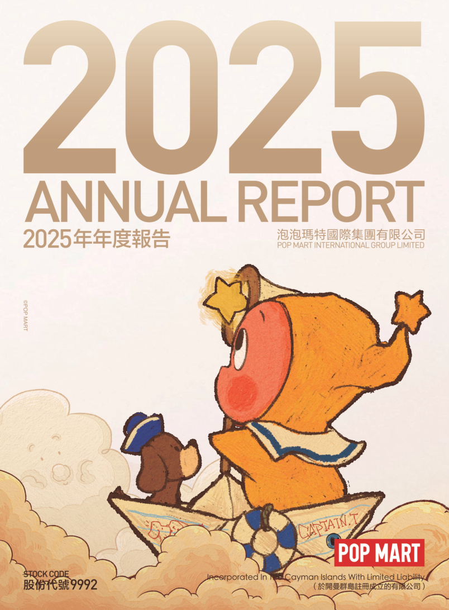
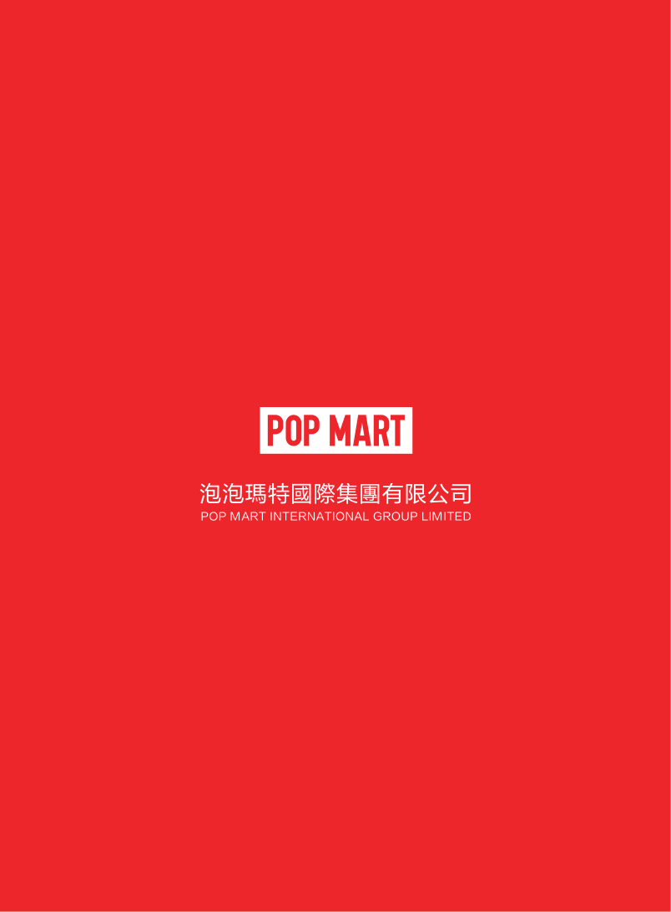

# 泡泡玛特2025年年度报告（简体中文）

> 披露日期：2026-04-21。来源：[泡泡玛特官方投资者关系](https://popwebsite.paquapp.com/pdf/e76d502d-c83e-40cc-bdaa-e27c4e16faed-二零二五年年报.pdf)。
> [原始PDF](../2025年年度报告.pdf) · [历年财报索引](../泡泡玛特历年财报索引.md)
> 转换说明：保留中文正文、数字、单位和注释，仅做繁简转换及重复英文去除。外文专名、代码和网址照录；复杂表格用等宽文本保留列位置，插图保留原图。

## 原PDF第1页

[对照原PDF第1页](../2025年年度报告.pdf#page=1)




## 原PDF第2页

[对照原PDF第2页](../2025年年度报告.pdf#page=2)

2

公司资料

目录

6

财务概要

8

董事长致辞

10

管理层讨论与分析

38

董事及高级管理层履历

45

董事会报告书

82

企业管治报告

106 2025年环境、社会及管治报告208

独立核数师报告

218

综合损益及其他全面收益表220

综合资产负债表

223

综合权益变动表

225

综合现金流量表

227

综合财务报表附注

367

释义

二零二五年年报  1

## 原PDF第3页

[对照原PDF第3页](../2025年年度报告.pdf#page=3)

公司资料

董事会

执行董事

王宁先生（董事会主席）

刘冉女士

司德先生

文德一先生

非执行董事

屠铮先生何愚先生（于2025年12月10日辞任）吴越先生（于2025年12月10日获委任）

独立非执行董事

张建君先生

吴联生先生

颜劲良先生

薪酬委员会

张建君先生（主席）

吴联生先生

王宁先生

提名委员会

张建君先生（主席）

吴联生先生

刘冉女士

审核委员会

吴联生先生（主席）

屠铮先生

颜劲良先生

联席公司秘书

李鸿轩先生

李菁怡女士

授权代表

王宁先生

李菁怡女士

2  泡泡玛特国际集团有限公司

## 原PDF第4页

[对照原PDF第4页](../2025年年度报告.pdf#page=4)

公司资料

总部及中国主要营业地点

中国

北京市朝阳区

大望京科技商务园区

宏泰东街浦项中心A座36及37楼

香港主要营业地点

香港

德辅道中188号

金龙中心19楼

股份过户登记总处

Maples Fund Services (Cayman) Limited PO Box 1093 Boundary Hall Cricket Square Grand Cayman KY1-1102 Cayman Islands

香港股份过户登记处

香港中央证券登记有限公司香港

湾仔

皇后大道东183号

合和中心17楼

1712-1716号舖

二零二五年年报  3

## 原PDF第5页

[对照原PDF第5页](../2025年年度报告.pdf#page=5)

公司资料

主要往来银行

中国工商银行股份有限公司（珠市口支行）

中国北京市东城区

珠市口东大街15号

交通银行股份有限公司

（望京支行）中国北京市朝阳区望京街9号望京国际商业中心

中国民生银行股份有限公司（望京支行）

中国北京市朝阳区

广顺北大街南湖东园一区

122号楼博泰国际B座

公司网站

www.popmart.com

法律顾问

有关香港法律

达维律师事务所

香港

中环

遮打道三号A

香港会所大厦十楼

有关中国法律

竞天公诚律师事务所

中国

上海市徐汇区

淮海中路1010号

嘉华中心45层

邮政编码：200031

有关开曼群岛法律迈普达律师事务所（香港）有限法律责任合伙香港湾仔

港湾道18号

中环广场26楼

4  泡泡玛特国际集团有限公司

## 原PDF第6页

[对照原PDF第6页](../2025年年度报告.pdf#page=6)

公司资料

核数师

罗兵咸永道会计师事务所

执业会计师

注册公众利益实体核数师

香港中环

太子大厦22楼

股份代号

9992  9992

二零二五年年报  5

## 原PDF第7页

[对照原PDF第7页](../2025年年度报告.pdf#page=7)

财务概要

财务业绩摘要

```text
                                       截至12月31日止年度
                             2025          2024          2023         2022          2021
                           2025年        2024年        2023年       2022年        2021年
                        人民币千元   人民币千元    人民币千元   人民币千元    人民币千元
收入                    37,120,052    13,037,749     6,301,002    4,617,324     4,490,651
毛利                    26,764,916     8,707,765     3,864,071    2,654,543     2,758,624
经营溢利                16,890,474     4,154,272     1,230,646      583,380     1,149,812
除所得税前溢利          17,036,622     4,365,812     1,415,755      639,529     1,171,191
年内溢利                13,012,042     3,308,345     1,088,771      475,801      854,567
本公司拥有人
  应占溢利              12,775,689     3,125,473     1,082,344      475,660      854,339
非国际财务报告准则
  经调整纯利            13,083,646     3,403,162     1,190,519      573,540     1,001,635
毛利率                      72.1%         66.8%         61.3%        57.5%         61.4%
纯利率                      35.1%         25.4%         17.3%        10.3%         19.0%
非国际财务报告准则
 经调整纯利率               35.2%         26.1%         18.9%        12.4%         22.3%
```

6  泡泡玛特国际集团有限公司

## 原PDF第8页

[对照原PDF第8页](../2025年年度报告.pdf#page=8)

财务概要

财务状况表摘要

```text
                                             于12月31日
                               2025          2024           2023          2022           2021
                            2025年         2024年         2023年        2022年        2021年
                        人民币千元     人民币千元    人民币千元     人民币千元    人民币千元
总流动资产               24,914,643     12,236,081      7,683,469     6,615,535      6,757,289
总非流动资产              7,186,711      2,634,591      2,285,394     1,964,527      1,566,337
总资产                   32,101,354     14,870,672      9,968,863     8,580,062      8,323,626
总流动负债                7,168,161      3,370,028      1,733,301     1,130,747      1,092,706
总非流动负债              2,280,826        616,005       455,180        483,990       410,914
总负债                    9,448,987      3,986,033      2,188,481     1,614,737      1,503,620
本公司拥有人
  应占权益               22,277,735     10,683,505      7,769,927     6,963,288      6,818,182
非控股权益
                            374,632        201,134        10,455          2,037         1,824
总权益                   22,652,367     10,884,639      7,780,382     6,965,325      6,820,006
总权益及负债             32,101,354     14,870,672      9,968,863     8,580,062      8,323,626
```

二零二五年年报  7

## 原PDF第9页

[对照原PDF第9页](../2025年年度报告.pdf#page=9)

董事长致辞

尊敬的各位股东及投资人朋友：

过去一年，对我们来说是具有里程碑意义的一年，以 LABUBU 为代表的泡泡玛特 I P 收获世界各地粉丝的喜爱，国际化和集团化战略落地生根，推动品牌影响力实现全球跃升。回顾这一年，泡泡玛特营收、净利润再创历史新高，实现营收371.2亿元，同比增长184.7%，经调整净利润130.8亿元，同比增长284.5%。

2025年，集团旗下IP呈现一超多强的发展格局，为公司业绩持续增长注入了强劲动能。这一年THE MONSTERS迎来了十周岁生日，LABUBU火爆全球，真正意义上成为了世界级的超级 IP。THE MONSTERS 收入跻身百亿俱乐部，全年实现营收141.6亿元，同比增长365.7%。我们认为LABUBU像一个金矿，其价值挖掘才刚刚开始。此外，包括SKULLPANDA、CRYBABY、MOLLY、DIMOO、星星人在内的6大IP营收突破20亿元，Twinkle Twinkle (星星人), exceeded RMB2 billion, while revenue of 17 IPs  17 个IP营收突破1 亿元。IP矩阵实现多元繁荣，证明了泡泡玛特持续打造爆款的能力，我们有信心通过对 IP 的长期孵化和运营，让 IP 历久弥新，不断焕发出新的生命力。

过去一年，公司国际化战略成果显著，年初我们进行了全球大规模组织架构调整，推动全球化布局不断深入。我们在德国、丹麦、加拿大以及菲律宾开设了首家线下门店，并在曼谷、上海、悉尼等全球核心城市的地标位置开设了旗舰店，我们看到了快乐与美好背后所蕴含的巨大市场潜力，希望将这份独特的消费体验持续传递给全球消费者。

8  泡泡玛特国际集团有限公司

## 原PDF第10页

[对照原PDF第10页](../2025年年度报告.pdf#page=10)

董事长致辞

去年，毛绒首次成为公司收入贡献最高的产品品类，我们也在积极探索更多IP创新表达，拓展包括饰品、甜品、电影等全新业务，希望可以用更多不同的形态去展现IP，实现更多商业化的可能性。近年来集团业绩的高速增长，一定程度上掩盖了子业务的光芒。但对于创新业务，我们始终保持细心呵护的态度，不追求激进增长，更注重在实践中积累经验、持续迭代。快乐的市场需求仍然广阔，我们对未来充满信心。

过去一年，我们构建了更强大的IP矩阵，品牌影响力持续攀升，成为了真正意义上具备全球影响力的世界级文化消费品牌。但经历了「F1直线冲刺」后，我们希望2026年是「进到维修站、加加油换换轮胎」的一年。经过了超高速的发展，我们希望稍作修整，积蓄力量，实现更健康的可持续发展。我们的理念一直是尊重时间、尊重经营，每年的规划和动作都是希望企业实现线性的成长，提升整个组织的健康度。

创造快乐不应止于商业，也需要承担更多社会责任。2025年，我们全球伙伴超过了1万人，为超过20 万家庭提供了稳定的就业支持，并在公益、美育和可持续实践中创造了更多元的社会价值。

再次感谢支持泡泡玛特的所有消费者、合作伙伴、投资人，感谢你们的信任和支持，也感谢每一个泡泡玛特员工的辛勤付出，让我们看见了越来越多全球消费者与IP相遇的美好瞬间。今年是泡泡玛特成立的第十六年，未来我们会继续「保持初心保持专注」，围绕以 IP为核心的集团化和国际化战略，持续迭代产品、服务与体验，实现品牌更健康的全球化增长。

泡泡玛特董事长兼CEO

王宁

二零二五年年报  9

## 原PDF第11页

[对照原PDF第11页](../2025年年度报告.pdf#page=11)

管理层讨论与分析

业务回顾

2025 年是泡泡玛特成立的第十五周年。在这个具有里程碑意义的年份，本集团全球化进程进一步提速，品牌知名度持续提升，创意表达边界不断拓宽，持续推动流行文化生态的发展。得益于各部门的紧密协作，以及持续提升的IP运营与产品研发能力，我们在为消费者提供优质服务的同时，推出多款深受全球消费者欢迎的新IP及新品系列。进一步提升了泡泡玛特品牌及旗下IP在全球范围内的认可度，并推动销售业绩实现高速增长。2025 年，我们实现收入人民币37,120.1百万元，同比增长184.7%。

184.7%.

IP孵化与运营

IP运营与创意设计是推动泡泡玛特持续健康发展的核心驱动力。作为全球领先的 IP 平台，本集团在全球范围内挖掘极具潜力的艺术家和设计师，凭借成熟的IP运营体系，成功打造出多个广受欢迎的IP形象。同时，本集团持续加大产品设计创新力度，不断丰富产品种类，以满足不同粉丝群体的多样化需求。2025年，本集团在IP表达与用户互动模式上持续探索与创新，让IP逐渐成为跨越国界、语言和文化的情感纽带，向全球消费者传递更多美好与快乐。

作为多元的IP平台，本集团已建立成熟的全链路生态体系，孵化和运营IP的能力稳步提高。基于各IP的独特表达与设计，本集团采取差异化运营策略，持续提升IP热度并积极推动IP商业化，进一步增强IP的生命力并取得了强劲的销售业绩。2025年，共有17个艺术家IP收入过亿，其中THE

THE MONSTERS, SKULLPANDA, CRYBABY, MOLLY, DIMOO, Twinkle Twinkle  DIMOO、星星人和 HIRONO 在报告期内分别实现收入人民币14,161.1百万元、3,539.5百万元、2,929.0百万元、2,897.1百万元、2,776.7百万元、2,055.6百万元及1,735.2百万元。

10  泡泡玛特国际集团有限公司

## 原PDF第12页

[对照原PDF第12页](../2025年年度报告.pdf#page=12)

管理层讨论与分析

在本集团多年的精心运营下，THE MONSTERS家族于诞生十周年之际成功跻身百亿IP俱乐部，成为2025年全球最具热度的IP之一。本集团通过不断对产品打磨与创新，LABUBU第三代搪胶毛绒「前方高能」系列在全球发售后引发广泛关注，进一步扩大了 IP 的文化影响力。我们持续探索产品的使用场景和玩法，首次推出更小尺寸的Mini LABUBU 「心底密码」系列，使IP产品以更轻盈、更日常的形式融入粉丝生活。2025年，THE MONSTERS进一步拓展线下活动场景，不仅受邀参与了杂志封面拍摄、时尚走秀、跨年晚会等大型活动，还前往纽约参加梅西百货感恩节游行，成为百年来首个参与该活动的潮玩 IP。同时，「MONSTERS BY MONSTERS此刻与未来」十周年全球巡展于上海开幕，吸引全球粉丝互动打卡，为期一年的周年庆典，将向更多粉丝讲述森林精灵的故事。

我们相信，成为世界级IP只是新的起点。未来，本集团将继续用心运营，持续推出高质量产品，内容创新不断深化 IP 内涵，增强其文化厚度与市场广度，共同探索此刻与未来的更多可能，使THE MONSTERS成为具有长生命周期的世界级IP。

SKULLPANDA constantly unleash boundless creativity, journeying through  SKULLPANDA始终保持创意的无限迸发，在广袤的时空探索中，抵达更真实的自我，持续打破风格与表达的边界，建立与情感共鸣的无限宇宙。潮玩手办产品坚持在场景艺术与工艺层面进行创新探索，为粉丝带来更加多元化的艺术收藏体验。毛绒产品则在保持IP核心风格的基础上不断突破，进一步扩大国际影响力并获得全球消费者关注。「围困计」主题空间展首次亮相新加坡国家博物馆，为全球观众呈现一场关于「选择与自我」的沉浸式艺术体验。

二零二五年年报  11

## 原PDF第13页

[对照原PDF第13页](../2025年年度报告.pdf#page=13)

管理层讨论与分析

CRYBABY凭借标志性的视觉形象，持续向世界传递「欢笑并非唯一解药，眼泪中也蕴含治愈的温度」的理念，在全球范围内引起广泛共鸣。本集团通过拓展主题内容与产品形态，并在毛绒系列产品中引入互动玩法，加强了IP与粉丝之间的连接，使其逐步从单一形象转化为具有情绪象征意义的IP符号。CRYBABY通过情绪表达与故事传递触达消费者内心，陪伴及鼓励大家，不必总是扮演坚强的大人，在流泪之后，依然拥有前行的勇气。

MOLLY, one of the Group’s most iconic classic IPs, continues to showcase  MOLLY作为本集团最具代表性的经典IP之一，通过持续的精细化运营，始终保持着蓬勃的生命力。通过多形态、多主题及多产品线的协同发展，展现出了极强的延展性。经典 MOLLY突出了原作的艺术性；小画家MOLLY充满天马行空的想象力，成为连接潮玩与艺术表达的重要载体；BABY MOLLY以童真个性持续拓展更广泛消费人群；ROYAL MOLLY与SPACE MOLLY则通过高端化策略与跨圈层合作持续提升品牌价值；ANGRY MOLLY通过更具突破性的设计表达，为IP注入新的活力。MOLLY不仅是一个形象，更承IP of ANGRY MOLLY. MOLLY is not merely an image, it also carries emotional  载着情感陪伴与时代记忆。

DIMOO以柔软的内核，围绕梦境与治愈，持续深化陪伴感与故事感。「DIMOO WORLDx 迪士尼」联名系列以统一的设计主题为核心推出多品类产品，深受全球粉丝喜爱。在「如果星期八」系列中，DIMOO首次尝试成长型叙事表达，陪伴粉丝慢慢长大，并获得良好的市场反馈。DIMOO于中泰政府招待会上，被授予「中泰建交50周年特邀挚友」荣誉称号，并发布了融合中泰文化的限定形象及动画短片。以潮玩为媒介，以IP为纽带，见证了中泰两国在文化、情感与青年沟通层面的交流不断深化。

12  泡泡玛特国际集团有限公司

## 原PDF第14页

[对照原PDF第14页](../2025年年度报告.pdf#page=14)

管理层讨论与分析

Twinkle Twinkle, one of our emerging IPs with the most rapid growth,  星星人是我们旗下成长最快的新锐IP之一，用一个个关于勇气、思念与爱的故事打动人心，创造有趣的童话世界，传递简单而坚定的陪伴，让更多粉丝从不同的星星人形象中看到自身的情感映射。2025年，星星人正式加入乐园「明星朋友」阵容，稚拙的动作表现，一经亮相即在社交媒体引发广泛讨论。「星星护梦队」深入 IP表达，使星星人形象更加生动鲜活，不仅拉近了与粉丝的距离，更深化了彼此间的情感联结，温暖了无数观众的心。通过我们多维度的运营举措，星星人迅速收获了大众的喜爱与认可，成为年度话题度较高的IP之一。

HIRONO cultivates a distinctive spiritual universe through its iconically  HIRONO以极具辨识度的治愈设计语言构建起独特的精神图景，在全球粉丝群体中形成强烈情感共鸣。在我们的运营下，HIRONO的世界观叙事更趋完整，情绪线索连贯而细腻，实现全球影响力的持续破圈与口碑沉淀。我们在上海与曼谷分别开设了HIRONO小野品牌店，品类涵盖潮玩、服饰、生活家居、雕塑等多品类，致力于打造一种融合艺术、情感与日常的「小野式生活方式」，推动IP影响力不断扩大。IP’s influence.

我们持续探索并拓展与授权 IP 的合作范畴，推出多种类型、风格多样的潮流玩具以及联名款产品，以满足不同消费者的兴趣和需求。通过与动漫、游戏、电影、明星等众多版权方开展合作，为粉丝们提供更多选择并带来惊喜。同时，我们不断拓展IP授权的地域范围，目前已获得大部分授权IP的全球授权，从而为全球消费者打造更具独特性的潮玩文化体验。

二零二五年年报  13

## 原PDF第15页

[对照原PDF第15页](../2025年年度报告.pdf#page=15)

管理层讨论与分析

2025年，毛绒产品实现收入人民币18,708.1百万元，同比增长560.6%，首次成为本集团收入贡献最高的产品品类。我们始终坚持以IP为核心，深入挖掘每个IP的特质，量身打造风格契合且具备显著差异化的毛绒产品。让产品成为IP故事的延伸触点，让用户感知IP的精神内核，建立深层的情感纽带。经过多年的探索与积累，我们不断拓展毛绒产品的使用场景，形成覆盖多尺寸与多形态的产品矩阵。得益于对IP内核的精准诠释，以及产品自身出色的展示性、互动性与搭配潜力，我们的毛绒系列产品不仅持续加深了与现有粉丝的情感联结，也帮助品牌在全球范围内吸引更多新用户。

消费者触达

2025 年，本集团进一步完善全球消费者触达网络，通过线下门店、机器人商店、自研APP、官网及主流电商平台等多元渠道，我们将潮流和快乐传递至近百个国家和地区的消费者，实现了品牌势能与市场覆盖范围拓展的双重提升。

－ 线下渠道

截至2025 年12 月31 日，本集团在全球20 个国家，运营630 家门店，全年净增109 家，运营2,637台机器人商店，全年净增165台。

报告期内，本集团在德国、丹麦、加拿大及菲律宾开设了首家线下门店，进一步拓展国际市场。同时，我们在曼谷、上海、悉尼等全球核心城市的地标商业体开设旗舰店，这些旗舰店的设计创意兼顾了全球影响力，又保留了本地文化特色。通过旗舰店的落成，让更多消费者在本地就能直接、沉浸地感受到泡泡玛特带来的想象力、情绪共鸣和艺术美感。

14  泡泡玛特国际集团有限公司

## 原PDF第16页

[对照原PDF第16页](../2025年年度报告.pdf#page=16)

管理层讨论与分析

中国市场聚焦门店的升级，将零售场景转向更具故事性、艺术性与互动性的品牌体验现场。通过提升服务质量与购买体验，加强顾客情感联结，带动高速高质量的业绩增长。报告期内，中国市场净增 14 家线下门店，门店数量从截至2024 年12 月31 日的431家增至截至2025年12月31日的445家。

亚太 1 市场加强本地化精细运营，有序推进旅游零售战略。在全球知名旅游目的地及机场开设门店巩固品牌势能，同时深耕本土市场的常态化消费需求，将渠道触角向高密度居住区与区域中心城市深度延伸，实现了对本地居民与游客的双重复盖。报告期内，亚太市场净增 31 家线下门店，门店数量从截至2024 年12 月31 日的54 家增至截至2025年12月31日的85家。

美洲市场处于拓展期，以美国为核心市场进行战略性布局，快速拓展市场覆盖范围，扩大品牌及IP影响力。报告期内，净增42 家线下门店，门店数量从截至2024 年12月31日的22家增至截至2025年12月31日的2025.  64家。

欧洲市场侧重品牌建设，通过入驻全球知名地标门店，以独特的 IP 体验赋能商业空间，在提升品牌知名度的同时，为未来的高效发展稳筑基础。报告期内，净增 22 家线下门店，门店数量从截至2024 年12 月31日的14家增至截至2025年12月31日的36家。

```text
1                                                                              1   指中国以外的其他亚洲及大洋洲国家和地区。
```

二零二五年年报  15

## 原PDF第17页

[对照原PDF第17页](../2025年年度报告.pdf#page=17)

管理层讨论与分析

－ 线上渠道

2025年，本集团持续完善以自研APP和官网为核心、主流电商平台全覆盖的线上渠道体系，强化品牌直接触达用户的能力，提升运营效率与消费者体验。

我们的自研APP和官网构成本集团直连全球消费者的数字化基础设施。本集团持续优化界面设计、产品展示、本地支付、物流及客户服务体系，为消费者提供一致且优质的品牌体验。同时，通过自研APP将包括门店购、门店抽选等线上线下(O2O)功能推广至全球，有效地搭建全渠道消费者触达生态，提升客流承接效率与用户体验。此外，我们持续强化「抽盒机」在中国市场场景化、游戏化的渠道体验优势，基于高商品效能有效优化流量结构，提高流量承接能力，渠道拉新势能在2025 年得到显著爆发。我们也将「抽盒机」引入自研 APP 及官网，为全球消费者提供更具趣味性的购物体验，并显著提升交易转化率与用户黏性。

我们通过电商平台触达更多不同消费习惯与偏好的用户，扩大品牌曝光。内容电商聚焦商品效能优化，注重消费者的使用和互动场景，以满足多元化需求。高流量、高互动直播场次的运营能力显著提升。通过沉浸式生动解读IP内涵，讲述设计理念及特色，将情感联结、内容种草与即时转化相结合。同时，我们联合TikTok研发，将中国市场成熟的「直播间在线拆盒」玩法推向全球，进一步提升消费者体验，增加用户黏性。在货架电商方面，我们实施区域差异化运营策略：在中国，天猫、京东等平台旗舰店持续保持行业领先地位，不断强化不同类型顾客的差异化运营，提升新老顾客多IP、多品类交叉购买，品牌忠诚进一步加强；在东南亚，通过Shopee与Lazada触达本地消费者，得益于不断提升的精细化运营与本地化服务质量，实现销售规模化增长并获得良好口碑；在欧美市场，借助 Amazon 的成熟基础设施 ， 高效拓展市场，稳步提升当地影响力。

16  泡泡玛特国际集团有限公司

## 原PDF第18页

[对照原PDF第18页](../2025年年度报告.pdf#page=18)

管理层讨论与分析

－ 会员运营

随着全渠道高质量发展，IP 和产品种类的不断丰富，通过持续优化会员权益，完善会员运营机制，新老会员均表现出强劲的购买意愿和高品牌黏性，会员规模和会员质量呈现共同提升的健康趋势。截至2025年12 月31 日，中国内地累计注册会员总数从2024年12月31日的4,608万人增长至7,258万人，新增注册会员2,650 万人。2025 年会员贡献销售额占比 93.7%，会员复购率 2 为55.7%。

2

主题乐园与IP体验及创新业务孵化

泡泡玛特城市乐园作为本集团以 IP 为核心的商业生态的重要延伸，自 2023 年 9 月在北京开园以来，持续优化服务体验、丰富表演内容，推出多场精彩纷呈的主题活动打造沉浸式主题场景，为粉丝及游客构建更具代入感的 IP 体验空间。

为进一步提升游客体验，乐园于 2025 年 4 月启动部分区域的设备升级，预计将于2026 年暑期完成。届时，园区将新增更加丰富的主题区域与互动游乐设施，整体游玩体验将得到显著提升。同时，我们已启动在现有位置扩建乐园的规划，致力于打造一个更加沉浸、被IP深度包裹的主题世界，让粉丝更近距离地感受IP带来的情感互动。2025 年，在乐园仅开放约三分之一区域的情况下，客流仍实现显著增长。其中，非亲子家庭游客、非本地游客占比均超过一半，并吸引了大量来自全球各地的粉丝前来打卡体验。

```text
2                                                                                   2    2025年，会员中购买过2次或以上的占比。
     2025.
```

二零二五年年报  17

## 原PDF第19页

[对照原PDF第19页](../2025年年度报告.pdf#page=19)

管理层讨论与分析

乐园作为粉丝与IP深度互动的重要场景，「明星朋友」演出全年覆盖，匹配相应主题见面会，每一场主题活动均引发广泛关注，在各大平台传播。「明星朋友」与每一位游客共同写下的故事和创造的互动瞬间，成为了乐园最珍贵的礼物。

乐园团队为星星人打造的首支单曲「星星人之歌」全网曝光量超过1,500 万，「ZIMOMO大首领之舞」亦成功登上音乐热歌榜，展现出IP内容的广阔潜力。2025 年，「明星朋友」走出乐园，全年开展外出特别活动达40 场，包括星星人带来演出「小小星光」；THE MONSTERS家族参与梅西百货感恩节游行，参加跨年晚会表演「无所 BU能，万事OK！」等。

2025 年，我们在全球多个核心城市举办多场大型线下主题展览，持续深化 IP 运营与全球影响力。THE MONSTERS 「怪味便利店」、星星人「美味时刻」、「你最珍贵」系列多城联展，聚焦 I P场景化表达，为消费者带来沉浸式的 IP 互动与购物体验。同时，我们将 MOLLY 、 DIMOO 、HIRONO、Zsiga等IP形象融入城市地标与文旅场景，通过艺术装置、主题零售与创新活动，为消费者创造别具一格的场景体验。

2025 年，我们于北京、上海分别开设首家「popop」饰品店。通过对IP进行解构与延展，采用不同的材质及工艺，塑造风格，彰显个性，打造兼具先锋创意与精湛工艺的作品，注重IP的内核表达，使每件饰品都成为消费者可佩戴的艺术符号。

「POP BAKERY」作为我们的独立甜品品牌，秉承「以最简单的方式传递最大化快乐」的理念，通过IP赋能与产品创新，打造集美味、视觉与趣味于一体的多维体验。「POP BAKERY」已在中国内地多个核心城市落地主题快闪活动10余场。

18  泡泡玛特国际集团有限公司

## 原PDF第20页

[对照原PDF第20页](../2025年年度报告.pdf#page=20)

管理层讨论与分析

未来，本集团将持续以IP为核心，积极探索多元业态延展路径，推动每个IP释放更深厚的价值，与粉丝建立更长久的联结，为大家带来更多美好的体验。

财务回顾

销售收入

本公司收入从2024年的人民币13,037.7百万元增长到2025年的人民币37,120.1百万元，同比增长184.7%。

根据区域划分的收入

本公司的收入按照区域划分为：(1)中国，(2)亚太，(3)美洲，及(4)欧洲及其他地区。下表载列本公司2025年及2024年的按区域划分的收入：

```text
                            截至2025年                 截至2024年
                          12月31日止年度             12月31日止年度
                            收入      收入占比         收入     收入占比      收入变动
                      人民币千元                 人民币千元
中国                  20,851,717        56.2%      8,886,483        68.2%       134.6%
亚太                    8,011,027       21.6%      3,109,700        23.8%       157.6%
美洲                    6,806,189       18.3%        802,219         6.2%       748.4%
欧洲及其他地区          1,451,119        3.9%        239,347         1.8%       506.3%
合计                  37,120,052       100.0%     13,037,749       100.0%       184.7%
```

二零二五年年报  19

## 原PDF第21页

[对照原PDF第21页](../2025年年度报告.pdf#page=21)

管理层讨论与分析

(1) 中国

中国收入从2024 年的人民币8,886.5 百万元增长到2025年的20,851.7百万元，同比增长134.6%。以下为按照渠道划分的收入明细：

```text
                     截至2025年12月31日止年度       截至2024年12月31日止年度
                             收入       收入占比           收入       收入占比       收入变动
                       人民币千元                    人民币千元
线下渠道               11,421,362         54.8%        5,351,613         60.2%         113.4%
零售店                 10,075,432         48.3%        4,600,798         51.8%         119.0%
机器人商店              1,345,930          6.5%         750,815           8.4%          79.3%
线上渠道                8,522,321         40.9%        2,771,950         31.2%         207.4%
泡泡玛特抽盒机          3,423,456         16.4%        1,113,741         12.5%         207.4%
天猫旗舰店              1,785,332          8.6%         627,788           7.1%         184.4%
抖音平台                1,589,842          7.6%         601,231           6.8%         164.4%
其他线上渠道            1,723,691          8.3%         429,190           4.8%         301.6%
批发及其他                908,034          4.3%         762,920           8.6%          19.0%
合计                   20,851,717        100.0%        8,886,483        100.0%         134.6%
```

中国线下渠道。 收入由 2024 年的人民币 5,351.6 百万元增长到 2025 年的人民币11,421.4百万元，增长了113.4%。中国线下渠道分为：零售店和机器人商店。

20  泡泡玛特国际集团有限公司

## 原PDF第22页

[对照原PDF第22页](../2025年年度报告.pdf#page=22)

管理层讨论与分析

```text
                                                零售店                                                 机器人商店
                                         截至12月31日止年度                                       截至12月31日止年度
                                  2025                         2024                        2025                         2024
                                 2025年                       2024年                      2025年                       2024年
区域划分
                               数量          收入          数量          收入           数量          收入          数量          收入
                                    （人民币千元）              （人民币千元）               （人民币千元）              （人民币千元）
中国内地                       410      8,502,705           401      3,827,861         2,350     1,285,644          2,300       698,416
港澳台地区                       35     1,572,727            30        772,937           46         60,286            39         52,399
合计                           445     10,075,432           431      4,600,798         2,396     1,345,930          2,339       750,815
```

零售店。零售店销售收入从 2024 年的人民币4,600.8 百万元增加到2025 年的人民币 10,075.4 百万元，同比增长了119.0%。一方面得益于品牌知名度的提升，店舖流量的增长；另一方面中国零售店聚焦门店优化升级，通过提升服务品质与空间体验，提升运营效率。截至2025 年12 月31 日，中国零售店合计445家。

机器人商店。机器人商店销售收入从2024 年的人民币 750.8 百万元增长到2025 年的人民币1,345.9 百万元，同比增长了79.3%。收入增长主要由于2025年产品的持续火爆，同时机器人商店也进入更多消费者可触达的场景中，为消费者提供更便利的购买服务。截至2025 年12 月31 日，中国机器人商店合计2,396家。

二零二五年年报  21

## 原PDF第23页

[对照原PDF第23页](../2025年年度报告.pdf#page=23)

管理层讨论与分析

中国线上渠道。 线上收入由 2024 年的人民币 2,772.0 百万元增长到 2025 年的人民币8,522.3 百万元，增长了207.4%。中国线上渠道的收入包括泡泡玛特抽盒机、天猫旗舰店、抖音平台以及其他线上渠道。泡泡玛特抽盒机持续优化玩法，聚焦消费者使用体验与互动场景建设，有效扩大小程序访问规模，提升流量转化效率，2025 年收入为人民币 3,423.5 百万元，同比增长了207.4%；其他线上平台差异化运营，精准匹配平台与用户需求提升运营效率，推动收入增长。

中国批发及其他。收入从 2024 年的人民币762.9百万元增长到2025年的人民币908.0百万元，增长了19.0%。主要由于泡泡玛特城市乐园业务商品、票务、餐饮等收入的增长。

(2) 亚太

亚太收入从2024 年的人民币3,109.7 百万元增长到2025 年的人民币8,011.0 百万元，增长 157.6%。以下为按照渠道划分的收入明细：

```text
                     截至2025年12月31日止年度       截至2024年12月31日止年度
                             收入       收入占比           收入       收入占比       收入变动
                       人民币千元                    人民币千元
线下渠道                4,414,062         55.1%        1,707,736         54.9%         158.5%
零售店                  4,318,886         53.9%        1,667,850         53.6%         158.9%
机器人商店                 95,176          1.2%          39,886           1.3%         138.6%
线上渠道                3,052,963         38.1%         971,631          31.3%         214.2%
自研APP及官方网站
                        1,458,282         18.2%         304,680           9.8%         378.6%
                          568,675          7.1%         284,502           9.2%          99.9%
其他线上渠道            1,026,006         12.8%         382,449          12.3%         168.3%
批发及其他                544,002          6.8%         430,333          13.8%          26.4%
合计                    8,011,027        100.0%        3,109,700        100.0%         157.6%
```

22  泡泡玛特国际集团有限公司

## 原PDF第24页

[对照原PDF第24页](../2025年年度报告.pdf#page=24)

管理层讨论与分析

亚太线下渠道。 收入从 2024 年的人民币1,707.7百万元增长到2025年的人民币4,414.1百万元，增长了 158.5% 。零售店数量从2024 年的 54 间增加到 2025 年的 85 间 ， 随着品牌影响力的不断增强，我们持续本地化、精细化运营，实现业务的快速扩张。

亚太线上渠道。 线上收入由 2024 年的人民币 971. 6 百万元增加到 2025 年的人民币3,053.0 百万元，增长了214.2%。亚太线上渠道收入包括来自自研 APP 及官方网站、Shopee 和其他线上渠道的收入。亚太依据不同国家的市场特点拓展更多的电商平台，实施差异化运营策略，加强本地化运营，进一步提升流量的获取和转化效率，实现多平台收入的快速增长。

亚太批发及其他。收入从 2024 年的人民币430.3百万元增长至2025年的人民币544.0百万元，增长了26.4%。

二零二五年年报  23

## 原PDF第25页

[对照原PDF第25页](../2025年年度报告.pdf#page=25)

管理层讨论与分析

(3) 美洲

美洲收入从2024 年的人民币802.2 百万元增长到2025 年的人民币6,806.2 百万元，增长了 748.4%。以下为按照渠道划分的收入明细：

```text
                     截至2025年12月31日止年度       截至2024年12月31日止年度
                             收入       收入占比           收入       收入占比       收入变动
                       人民币千元                    人民币千元
线下渠道                2,235,529         32.8%         379,581          47.3%         488.9%
零售店                  2,003,799         29.4%         341,148          42.5%         487.4%
机器人商店                231,730          3.4%          38,433           4.8%         502.9%
线上渠道                4,353,581         64.0%         364,345          45.4%       1,094.9%
自研APP及官方网站
                        2,870,016         42.2%         191,925          23.9%       1,395.4%
                        1,039,919         15.3%         107,662          13.4%         865.9%
其他线上渠道              443,646          6.5%          64,758           8.1%         585.1%
批发及其他                217,079          3.2%          58,293           7.3%         272.4%
合计                    6,806,189        100.0%         802,219         100.0%         748.4%
```

美洲线下渠道。 线下收入由 2024 年的人民币 379. 6 百万元增长到 2025 年的人民币2,235.5百万元，增长了488.9%。主要由于我们业务的快速拓展，店舖数量从2024 年的22 间增长到2025 年的64 间；另外随着品牌影响力的上升，单店收入增加。

24  泡泡玛特国际集团有限公司

## 原PDF第26页

[对照原PDF第26页](../2025年年度报告.pdf#page=26)

管理层讨论与分析

美洲线上渠道。 线上收入从 2024 年的人民币 364. 3 百万元增长到 2025 年的人民币4,353.6百万元，增长了1,094.9%。美洲线上渠道收入包括自研APP及官方网站、TikTok平台和其他线上渠道。我们持续推进自研APP及官方网站的建设与优化，紧跟直播电商的潮流趋势，以用户需求为核心，提升用户体验加强品牌影响力。

美洲批发及其他。收入由 2024 年的人民币58.3 百万元增长到2025 年的人民币217.1 百万元，增长了272.4%。

(4) 欧洲及其他地区

欧洲及其他地区收入由 2024 年的人民币239.3百万元增长到2025年的人民币1,451.1百万元，增长了 506.3%。以下为按照渠道划分的收入明细：

```text
                     截至2025年12月31日止年度      截至2024年12月31日止年度
                            收入       收入占比           收入      收入占比       收入变动
                      人民币千元                    人民币千元
线下渠道                 872,819          60.1%        159,294          66.6%        447.9%
零售店                   856,209          59.0%        157,065          65.7%        445.1%
机器人商店                16,610           1.1%          2,229           0.9%        645.2%
线上渠道                 504,964          34.8%         55,156          23.0%        815.5%
自研APP及官方网站
                         315,571          21.7%         20,841           8.7%       1,414.2%
其他线上渠道             189,393          13.1%         34,315          14.3%        451.9%
批发及其他                73,336           5.1%         24,897          10.4%        194.5%
合计                    1,451,119       100.0%         239,347         100.0%        506.3%
```

二零二五年年报  25

## 原PDF第27页

[对照原PDF第27页](../2025年年度报告.pdf#page=27)

管理层讨论与分析

欧洲及其他地区线下渠道。收入由2024 年的人民币159.3 百万元增长到2025 年的人民币872.8 百万元，增长了447.9%。主要由于我们的业务持续拓展至更多国家，陆续于多个国家知名地标开店，有效提升品牌知名度，实现零售店数量的增长和单店收入的持续提升。欧洲及其他地区零售店数量从2024年的14间增长到2025年的36间。

欧洲及其他地区线上渠道。收入由2024 年的人民币 55.2 百万元增长到 2025 年的人民币505.0 百万元，增长了815.5%。我们在欧洲搭建自研APP及官方网站，加深本地化布局，提升消费者体验；同时加速线上多平台的建设，提升品牌在当地的影响力，促进收入的增长。

根据IP划分的收入

泡泡玛特的自主产品是我们的主要商品类型，2025年自主产品收入占总收入的比例为99.1%，自主产品收入从2024年的人民币12,721.5百万元增加到2025年的人民币36,788.2百万元，增长了189.2%。

26  泡泡玛特国际集团有限公司

## 原PDF第28页

[对照原PDF第28页](../2025年年度报告.pdf#page=28)

管理层讨论与分析

泡泡玛特的自主产品主要分为：艺术家IP和授权IP，以下为IP划分的收入明细：

```text
                                                                          截至12月31日止年度
                                                                  2025                          2024
                                                                 2025年                        2024年
                                                               收入       收入占比           收入      收入占比
                                                         人民币千元                   人民币千元
                              自主产品                   36,788,244         99.1%       12,721,506         97.6%
                              艺术家IP                   33,406,250         90.0%       11,120,848         85.3%
THE MONSTERS                                             14,161,064         38.1%        3,040,664         23.3%
SKULLPANDA                                                3,539,542          9.5%        1,308,262         10.0%
CRYBABY                                                   2,929,006          7.9%        1,164,885          8.9%
MOLLY                                                     2,897,084          7.8%        2,093,172         16.1%
DIMOO                                                     2,776,695          7.5%         909,561           7.0%
Twinkle Twinkle                 星星人                    2,055,580          5.5%         120,788           0.9%
HIRONO                                                    1,735,235          4.7%         726,525           5.6%
                                                            848,021          2.3%         224,288           1.7%
                                其他艺术家IP              2,464,023          6.7%        1,532,703         11.8%
                              授权IP                      3,381,994          9.1%        1,600,658         12.3%
                              外采及其他                    331,808          0.9%         316,243           2.4%
                              合计                       37,120,052        100.0%       13,037,749        100.0%
```

艺术家 IP。艺术家 I P 是本公司主要商品类型，主要包括 THE MONSTERS、MOLLY、SKULLPANDA、CRYBABY等。艺术家IP的收入占比由 2024 年的 85.3% 上升到 2025 年的90.0%。艺术家 I P 收入从 2024 年的人民币THE MONSTERS generated revenue of RMB14,161.1 million in 2025,  11,120.8 百万元，上升至 2025 年的人民币33,406.3 百万元，增长了 200.4%，其中，2025年THE MONSTERS收入人民币14,161.1百万元，同比增长了 365.7%。主要由于我们持续提升产品的设计创新能力，不断丰富产品种类，满足各类消费者的多元需求，向全球消费者传达美好和快乐。

二零二五年年报  27

## 原PDF第29页

[对照原PDF第29页](../2025年年度报告.pdf#page=29)

管理层讨论与分析

－  授权 IP 。 授权 IP 收入从 2024 年的人民币1,600.7 百万元，增加至 2025 年的人民币3,382.0百万元，增长了111.3%。主要由于我们不断加深与更多版权方的合作，持续扩大IP授权区域，凭借IP广泛的知名度受到全球消费者的喜爱。

根据产品类别划分的收入

本公司的产品按照类别主要划分为：毛绒、手MEGA and other IP-related products and others. The following sets forth the  办、MEGA和衍生品及其他，以下为产品类别划分的收入明细：

```text
                                                      截至2025年12月31日止年度       截至2024年12月31日止年度
                                                              收入       收入占比           收入      收入占比       收入变动
                                                        人民币千元                    人民币千元
                              毛绒                      18,708,074         50.4%        2,832,078         21.7%         560.6%
                              手办                      12,022,569         32.4%        6,936,087         53.2%          73.3%
MEGA                                                     1,916,082          5.2%        1,683,780         12.9%          13.8%
                              衍生品及其他
                                                         4,473,327         12.0%        1,585,804         12.2%         182.1%
                              合计                      37,120,052        100.0%       13,037,749        100.0%         184.7%
```

我们不断在产品层面推陈出新，丰富产品品类，提升产品设计的能力。毛绒产品收入从2024 年的人民币2,832.1 百万元增长到2025 年的人民币18,708.1百万元，增长了560.6%，毛绒产品占总收入的50.4%，以IP为核心，依据每个IP的特质打造差异化的毛绒产品，凭借毛绒产品出色的展示性、互动性，持续强化品牌核心竞争力，实现收入的大幅增长。

28  泡泡玛特国际集团有限公司

## 原PDF第30页

[对照原PDF第30页](../2025年年度报告.pdf#page=30)

管理层讨论与分析

销售成本

销售成本从 2024 年的人民币 4,330.0 百万元上升到 2025 年的人民币 10,355.1 百万元，增长了139.1%，增加主要由于 (1) 商品成本由 2024 年的人民币3,474.2 百万元增加到2025 年的人民币8,507.0 百万元，其主要原因为销售增加；及(2)设计及授权成本由2024年的人民币506.8百万元增加到2025年的人民币950.5百万元，主要由于自主产品占比增多，以及联名产品增加，需要支付更多的IP授权费以及产品设计费。

毛利

本公司的毛利由2024 年的人民币8,707.8 百万元上升到2025年的人民币26,764.9百万元，增长了207.4%，主要由于我们的收入增加以及销售成本的控制。我们的毛利率由2024年的66.8%增长至2025年的72.1%，主要由于(1)海外销售占比提升拉动毛利率的增长；及(2)我们采用柔性供应链策略，增强对供应商的议价能力，集中向核心供应商采购以缩减采购成本。

经销及销售开支

我们的经销及销售开支由 2024 年的人民币3,650.5 百万元增长至2025 年的人民币8,082.4 百万元，增长了121.4%，其中占比较高的为运输及物流开支、佣金及电商平台服务费和雇员福利开支。

－  运输及物流开支。运输及物流开支从 2024年的人民币467.6 百万元增长到2025 年的人民币1,778.5百万元，增长了280.3%。主要由于(1)线上渠道收入增长，运费费用增加；及(2)亚太、美洲、欧洲及其他地区收入快速增加，海外运输成本增加。

－  佣金及电商平台服务费。佣金及电商平台服务费从2024 年的人民币614.4 百万元增长到2025 年的人民币1,438.0 百万元，增长了134.1%。主要由于平台电商收入的快速增长。

二零二五年年报  29

## 原PDF第31页

[对照原PDF第31页](../2025年年度报告.pdf#page=31)

管理层讨论与分析

－  雇员福利开支。雇员福利开支从 2024 年的人民币874.9 百万元增长至2025 年的人民币1,323.2百万元，增长了51.2%。主要由于我们的销售员工人数由2024 年的5,267 名员工增加到2025 年的8,685 名员工，主要用以支持我们全球业务扩张。

一般及行政开支

我们的一般及行政开支由2024年的人民币947.1百万元增长至2025 年的人民币1,770.1 百万元，增长了 86.9%。其中占比较高的为雇员福利开支，我们的行政员工及设计开发人员人数由2024年的1,435名增加至2025年的2,194名。

其他收入

本公司的其他收入由 2024 年的人民币84.3 百万元增长到2025年的人民币149.9百万元，增长了77.8%。其中(1)政府补助由2024年的人民币24.9百万元增长至 2025 年的人民币 65.3 百万元，及

(2)授权费及其他服务收入由2024年的人民币56.7百万元增长到2025年的人民币70.6百万元。

经营溢利

综上所述，本集团的经营溢利由2024 年的人民币4,154.3百万元增长至2025年的人民币16,890.5百万元，增长了306.6%。

财务收入 － 净额

我们的财务收入净额由2024 年的净收益人民币163.4 百万元下降到2025 年的净收益人民币76.5百万元，主要由于我们的利息收入减少和财务费用的增加。

所得税开支

我们的所得税开支由2024 年的人民币1,057.5 百万元增加到2025 年的人民币4,024.6 百万元，原因为我们的所得税前溢利增加。我们的实际税率由2024年的24.2%下降至2025年的23.6%。

年内盈利

由于上文所述，我们的年内盈利由 2024 年的人民币3,308.3 百万元增加至报告期间的人民币13,012.0百万元，增长了293.3%。

30  泡泡玛特国际集团有限公司

## 原PDF第32页

[对照原PDF第32页](../2025年年度报告.pdf#page=32)

管理层讨论与分析

非国际财务报告会计准则经调整纯利

非国际财务报告会计准则经调整纯利未按照国际财务报告会计准则计算，视为非国际财务报告会计准则的财务指标，其定义为除以股份为IFRS Accounting Standards adjusted net profit refers to the net profit after  基础的薪酬后纯利，而非国际财务报告会计准则经调整纯利率的定义为非国际财务报告会计准则经调整纯利除以收益。我们认为，这些信息对于投资者在不影响本集团经营业绩或现金流的情况下比较本集团的业绩是有用的，并允许投资者考虑管理层在评估本集团业绩时使用的指标。投资者不应认为非国际财务报告会计准则的财务指标替代或优于本集团根据国际财务报告会计准则编制的业绩。此外，可能不是所有公司会以相同的方式计算该项非国际财务报告会计准则的财务指标，因此未必可与其他公司采用的相若计量比较。

下表载列本公司各期间的非国际财务报告会计准则的财务指标对账情况。

```text
                                              截至2025年             截至2024年
                                          12月31日止年度         12月31日止年度
                                               人民币千元            人民币千元
年内溢利                                       13,012,042              3,308,345
调整项目
以股份为基础的付款报酬                             71,604                94,817
非国际财务报告会计准则经调整纯利
                                               13,083,646              3,403,162
非国际财务报告会计准则经调整纯利率
                                                   35.2%                  26.1%
```

二零二五年年报  31

## 原PDF第33页

[对照原PDF第33页](../2025年年度报告.pdf#page=33)

管理层讨论与分析

以股份为基础的付款开支属于非现金项目且并无直接反应我们的业务营运。因此，通过撇除该等项目对计算非国际财务报告会计准则经调整纯利影响的举措，可更好地反应我们的相关经营表现，并更加便于比较不同期间的经营表现。

流动资产、财务资源及资本开支

2025 年，本公司及附属公司在整体业务经营方面采纳保守稳健的资金管理及财务政策。本集团维持以下资源以应付其营运资金需求：

流动资产及流动负债

我们的流动资产净值由截至2024 年12 月31 日的人民币8,866.1 百万元增加至截至2025 年12 月31日的人民币17,746.5百万元。

贸易应收款项

贸易应收款项指日常业务过程中我们应收客户的未结算款项。我们的贸易应收款项由截至2024年12月31日的人民币477.7百万元增加至截至2025年12月31日的人民币921.2百万元，主要由于业务扩张，线上渠道应收账款增加。贸易应收款项周转天数从2024 年的11 天减少至截至2025.  2025年12月31日的7天。

存货

我们的存货包括制成品。我们的存货由截至2024 年12 月31 日的人民币1,524.5 百万元增加至截至2025年12月31日的人民币5,472.8 百万元。主要由于一方面海外收入占比提升，且货物运输时间长；另一方面全球店舖数量净增109家，所以我们增加了库存以满足销售需求。存货周转天数从2024年的102天增加到截至2025年12月31日的123天。

32  泡泡玛特国际集团有限公司

## 原PDF第34页

[对照原PDF第34页](../2025年年度报告.pdf#page=34)

管理层讨论与分析

现金及现金等价物

我们的现金及现金等价物主要包括银行现金。现金及现金等价物从截至2024 年12 月31 日的人民币6,109.0 百万元增加至截至2025年12月31 日的人民币13,775.1百万元，主要为我们经营活动产生的现金增加。

贸易应付款项

贸易应付款项主要指我们在日常业务过程中向供应商支付货款的责任。贸易应付款项从截至2024 年12 月31 日的人民币1,010.1 百万元增加至截至2025年12月31日的人民币1,858.2 百万元，主要原因为我们的业务增长，导致采购量增加，进而令应付供应商款项的余额有所增加。贸易应付款项周转天数从2024 年的61 天降低到截至2025年12月31日的51天。

银行借款

截至2025 年12 月31 日，本集团并无任何银行借款。

资产抵押

截至2025 年12 月31 日，本集团并无任何资产抵押。

资产负债率

资产负债率为总负债除以总资产乘以 100% 。截至2025 年12 月31 日，本集团的资产负债率为29.4%，而截至2024年12月31日的资产负债率为2024.  26.8%。

或有事件

我们目前并无涉及任何重大法律诉讼，亦不知悉我们涉及任何待决或潜在重大法律诉讼。倘我们涉及有关重大法律诉讼，则我们会于产生亏损且有关亏损金额有合理估计时，按当时所得资料记录任何亏损或或有负债。

二零二五年年报  33

## 原PDF第35页

[对照原PDF第35页](../2025年年度报告.pdf#page=35)

管理层讨论与分析

外汇风险管理

本公司的附属公司在中国、亚太、美洲和欧洲及其他地区经营，面对若干货币敞口（主要有关美元、泰铢、新加坡币及港币）引致的外汇风险。由于本集团以我们经营实体各自功能货币以外货币计值的金融资产及负债不重大，故管理层认为业务并无任何重大外汇风险敞口。本集团并没有对冲外币波动，但是会紧密地监控有关情况，并在必要时采取措施以保证外汇风险在可控范围内。

资本开支

本公司的资本开支包括购置物业、厂房及设备的款项和购置无形资产的款项。下表载列本公司2024年以及2025年的资本开支情况：

```text
                                   截至2025年             截至2024年
                               12月31日止年度        12月31日止年度
                                    人民币千元            人民币千元
购置物业、厂房和设备                   985,250               372,668
购置无形资产                           186,287               144,022
合计                                 1,171,537               516,690
```

人力资源

截至 2025 年 12 月 31 日 ， 我们共有 10, 87 9 名员工，包括销售员工8,685 名，行政及设计开发人员2,194名。截至2025年12月31日止年度，我们共发生员工成本（包括薪金、工资、津贴和福利）人民币2,252.3百万元。

34  泡泡玛特国际集团有限公司

## 原PDF第36页

[对照原PDF第36页](../2025年年度报告.pdf#page=36)

管理层讨论与分析

重大投资的未来计划

截至2025 年12 月31 日，我们并无持有任何重大投资。

我们将继续广泛寻找潜在的策略性投资机会，并寻求可为本集团带来协同效应的潜在优质目标业务及资产。

重大收购及出售

截至2025 年12 月31 日，我们并无进行任何重大收购或出售附属公司、联营公司及合营企业。

主要风险及不确定因素

我们面临的主要风险及不确定因素乃关于：(i)作为潮流文化娱乐公司，我们无法保证，我们将能够设计及开发受消费者欢迎的产品，或我们将能够保持成功产品的受欢迎程度；(ii)倘我们获授权的 IP 的市场吸引力低于预期，或使用该等IP的产品的销售额不足以满足最低保证特许权使用费，我们可能无法实现授权的全部利益；

(iii)我们的业务在很大程度上取决于我们「泡泡玛特」品牌的市场认知度，且对我们的品牌，商标或声誉的任何损害，或未能有效推广我们的品牌，均可能对我们的业务及经营业绩造成重大不利影响；(iv)我们通过第三方制造商生产所有的泡泡玛特品牌产品，未能控制产品质量可能会对我们的业务造成不利影响；及(v)宏观经济增速放缓可能削弱对我们产品的需求，从而可能给本公司经营业绩带来一定的负面影响。

未来展望

IP has always been the core of the Group’s business development. In the  IP始终是本集团业务发展的核心。未来，我们将继续通过高质量设计、创意产品和优质服务，向全球消费者传递快乐与美好，使IP成为跨越国界、语言和文化的情感纽带。同时，本集团将通过持续提升品牌价值、拓展产品品类及创新互动形式，加深与用户的情感联结，增强品牌影响力，并巩固我们在全球市场的地位与竞争力。

二零二五年年报  35

## 原PDF第37页

[对照原PDF第37页](../2025年年度报告.pdf#page=37)

管理层讨论与分析

本集团将持续丰富 IP 类型，扩大 IP 矩阵，与全球艺术家开展合作。在充满灵感与创造的旅程中，继续保持领先的高水准设计创新能力，推出更多优质产品。并通过长期、系统的 IP 孵化与运营，持续强化IP内核与深化IP内容建设。通过形式丰富的叙事维度，为IP注入更多与情感温度，拉近与粉丝的距离，引发更深层次的情感共鸣。

本集团始终致力于工艺创新和技术升级，探索新材质与新视觉效果的应用，并通过提高供应链自动化及数字化水平，不断完善研发、生产、发售及返单的全流程管理。我们的供应链已建立全球六大生产基地，并持续拓展更高效的制造及供应合作伙伴，以构建敏捷且高质量的生产供应体系，更好地响应市场需求。同时，本集团通过建立区域仓储与供应链网络，提升物流效率与服务质量。本集团还将继续关注可持续发展和环保理念，逐步扩大环保材质在产品及包装中的应用，为全球消费者提供更加安心的选择。

本集团将稳步拓展全球业务版图，在更多核心城市的地标性位置，开设线下渠道，提升消费者体验与品牌知名度。同时，本集团将加大对自研APP及官网的投入，加速推进功能的迭代优化，在更多国家和地区为消费者提供便捷且优质的购物体验。

本集团始终以提升消费者体验为核心，通过持续强化渠道差异化定位与商品运营能力，满足消费者不同场景下的多元化需求，稳步提高运营效率。我们将继续加强精细化运营会员的能力，不断丰富内容、互动及体验，提升服务质量，持续强化会员和品牌之间更强的联结。

36  泡泡玛特国际集团有限公司

## 原PDF第38页

[对照原PDF第38页](../2025年年度报告.pdf#page=38)

管理层讨论与分析

本集团将在深耕潮流玩具核心业务的同时，不断拓宽边界，一方面继续挖掘现有品类价值，另一方面探索孵化新的产品品类，使IP融入粉丝生活的更多场景。我们也将稳步推动乐园等新业务的发展，构建以IP为核心的更完善、更丰富的商业生态。

展望未来，我们将继续为 IP 探索多元的发展路径，推进以IP为核心的各项业务，向全球粉丝推出更优质的产品、更极致的服务、更丰富的内容与更具沉浸感的娱乐体验。本集团将始终秉持「创造潮流，传递美好」的初心，使IP成为连接情绪、生活与体验的重要载体，与全球粉丝共同探索IP的更多可能。

报告期间后事项

于本年报日期，除本年报所披露者外，本集团于报告期间后并无发生须进一步披露或调整的重大事项。

二零二五年年报  37

## 原PDF第39页

[对照原PDF第39页](../2025年年度报告.pdf#page=39)

董事及高级管理层履历

董事及高级管理层的履历详情载列如下：

执行董事

(王宁), aged 39, is our executive Director, Chairman of the  王宁先生，39 岁，本公司执行董事、董事会主席及行政总裁。王先生于2010 年10 月成立本集团，负责本公司整体战略规划及管理。

王先生于2009年6月获得中国郑州大学西亚斯国(郑州大学西亚斯国际学院) (currently  际学院（现为郑州西亚斯学院）广告专业学士学位，并于2017年6月获得中国北京大学光华管理学院工商管理硕士学位。University (北京大学光华管理学院) in the PRC in June 2017.

王先生目前担任本公司数家主要附属公司的董事，包括北京泡泡玛特及Pop Mart (Hong Kong)Holding Limited。

王先生为副总裁杨涛女士的配偶。

(刘冉), aged 38, is our executive Director and vice president. Ms.  刘冉女士，38 岁，本公司执行董事及副总裁。刘女士大学毕业后不久即于2011年7月加入本集团，负责本公司的总裁办。

刘女士于2010年7月获得中国郑州大学西亚斯国际学院（现为郑州西亚斯学院）旅游管理专业学士学位，并于2020年7月获得中国北京大学光华管理学院工商管理硕士学位。

刘女士目前担任本公司主要附属公司北京泡泡玛特的董事。

38  泡泡玛特国际集团有限公司

## 原PDF第40页

[对照原PDF第40页](../2025年年度报告.pdf#page=40)

董事及高级管理层履历

(司德), aged 37, is our executive Director and Chief Operating  司德先生，37 岁，本公司执行董事及首席运营官。司先生于2015年3月加入本集团，负责集团运营工作及大陆地区的整体业务。司先生入职本集团之初的职务为品牌总监，于2016年7月晋升为副总裁。

司先生于2011年7月在中国获得中国传媒大学法Communication University (中国传媒大学) in the PRC in July 2011, and  语专业学士学位，并于2017年7月获得中国北京大学光华管理学院工商管理硕士学位。

```text
                                                                       司先生目前担任本公司若干主要附属公司的董
                                           (上海葩趣贸易有限公司),     事，包括上海葩趣贸易有限公司、北京葩趣互
                                   (北京葩趣互娱科技有限公司) and      娱科技有限公司及天津泡泡玛特文化传播有限
                                            (天津泡泡玛特文化传播      公司。
有限公司).
                 (文德一), aged 47, is our executive Director and Chief  文德一先生，47 岁，本公司执行董事及首席增
```

长官。文先生于 2018 年 8 月加入本集团，负责监察本公司港澳台及海外业务部。在此之前，文先生于 2013 年 7 月至 2018 年 7 月先后担任 C J CheilJedang Corporation的业务发展部全球业务规划专员、全球业务规划高级专员及全球业务规划经理，及于2009年1月至2013年5月担任CJ ENM的全球战略部经理。于2004 年12 月至2008年12月，文先生任职于Lotte Cinema Co., Ltd. 的规划管理部。

文先生于2005年2月获得韩国建国大学中文学士学位，并于2018年7月获得中国北京大学工商管理硕士学位。

文先生目前担任本公司若干主要附属公司及合营企业的董事，包括 Pop Mart (Singapore)Holding Pte. Ltd.、POP MART SOUTH ASIA PTE.LTD.及POP MART (Thailand) CO., Ltd.。

二零二五年年报  39

## 原PDF第41页

[对照原PDF第41页](../2025年年度报告.pdf#page=41)

董事及高级管理层履历

非执行董事

(屠铮), aged 48, is our non-executive Director. Mr. Tu was  屠铮先生，48 岁，本公司非执行董事。屠先生于2019年5月获委任为本公司非执行董事，负责向董事会提供专业建议。

```text
                                                                   屠先生自2018年5月起担任上海蜂巧投资管理有
                   (上海蜂巧投资管理有限公司) since May 2018. He   限公司的合伙人。彼于2015年5月至2018年4月
                                                          (深圳    担任深圳市启赋资本管理有限公司的合伙人。
市启赋资本管理有限公司) from May 2015 to April 2018. From June 2007  于2007年6月至2015年4月，屠先生于深圳市达
                                                                   晨财智创业投资管理有限公司任职，先后担任
                   (深圳市达晨财智创业投资管理有限公司) where he   投资经理、投资总监及浙江分公司总经理、华
                                                                   东地区副总经理兼TMT部门负责人。
```

```text
                                                                     屠先生于2000年6月获得中国浙江大学英语专业
University (浙江大学) in the PRC in June 2000, and his master’s degree in  学士学位，并于2003年6月获得美国芝加哥大学
                                                                     公共政策硕士学位。屠先生目前持有由中国证
                                                                     券投资基金业协会于2017年8月授出的中国证券
                                                       (中国证券     投资基金执业证书。
投资基金业协会) in August 2017.
```

屠先生目前担任北京泡泡玛特的董事。

(吴越), aged 69, is our non-executive Director. Mr.  吴越先生，69 岁，为我们的非执行董事。吴先生于2025 年12 月获委任为非执行董事，负责向董事会提供专业意见。

吴先生自2005年11月起担任LVMH大中华区集团总裁，负责监督LVMH多品牌组合在中国市场的业务。在此之前，彼曾于2000年2月至2005年10月担任索尼国际音乐娱乐集团亚洲区副总裁，负责其在中国的业务；及于1993年8月至2000年2月担任LVMH集团旗下Parfums Christian Dior品牌的总经理及董事总经理，负责其在中国的业务。

吴先生于1984年5月获得加拿大约克大学国际关系与人文科学学士学位，并于1989 年11 月获得加拿大约克大学舒立克商学院国际商务与市场营销硕士学位。

40  泡泡玛特国际集团有限公司

## 原PDF第42页

[对照原PDF第42页](../2025年年度报告.pdf#page=42)

董事及高级管理层履历

独立非执行董事

(张建君), aged 59, is our independent non-executive  张建君先生，59岁，自2020年12月11日（「上市日期」）起为本公司独立非执行董事，负责向董事会提供独立意见及判断。

张先生现为北京大学光华管理学院组织与战略管理系教授。张先生的研究重点为企业社会责任、企业政治活动、领导及领导团队以及企业文化等课题。张先生自2004年3月起担任北京大学光华管理学院教职人员。彼在过去 15 年的研究中积累有关企业管治的深入知识。张先生的出版物「Marketization and Democracy in China」于2011年3月获北京大学第十一届人文社会科学研究优秀成果奖一等奖及中国教育部颁发的第六届高等学校科学研究优秀成果奖二等奖。张先生亦分别于2014年12月及2018年12月获北京大学光华管理学院颁发厉以宁教学奖及厉以宁研究奖。于2014年11月至2017年8月，张先生担任建信人寿保险股份有限公司的独立董事。

张先生分别于1989年7月及1992年7月获得中国北京大学法学学士及硕士学位。张先生于2003年12 月获得美国加州大学伯克利分校社会学博士学位。

(吴联生), aged 55, is our independent non-executive  吴联生先生，55 岁，自上市日期起为本公司独立非执行董事，负责向董事会提供独立意见及判断。吴先生于2001年9月至2022年3月担任北京大学光华管理学院教职人员，自2022年3月起担任南方科技大学商学院教职人员。

二零二五年年报  41

## 原PDF第43页

[对照原PDF第43页](../2025年年度报告.pdf#page=43)

董事及高级管理层履历

```text
                                                                      吴先生于若干上市公司担任董事职务。彼于
                                                      (华能国际电     2008年5月至2014年7月担任华能国际电力股份
力股份有限公司), a company listed on the Shanghai Stock Exchange (Stock  有限公司（一家于上海证券交易所（股份代号：
                                                                      600011）、联交所（股份代号：902）及纽约证券
                                                                      交易所（股份代号：HNP）上市的公司）的独立
                                                (荣盛房地产发展股     董事，于2009年1月至2012年1月担任荣盛房地
份有限公司), a company listed on the Shenzhen Stock Exchange (Stock   产发展股份有限公司（一家于深圳证券交易所
                                                                      上市的公司，股份代号：002146）的独立董事，
                        (西部矿业股份有限公司), a company listed on   于2011年2月至2015年9月担任西部矿业股份有
                                                                      限公司（一家于上海证券交易所上市的公司，股
                                                              (万     份代号：601168）的独立董事，于2011年1月至
达电影院线股份有限公司) (now known as Wanda Film Holding Co., Ltd (万  2015年11月担任万达电影院线股份有限公司（现
达电影股份有限公司)), a company listed on the Shenzhen Stock Exchange  称万达电影股份有限公司，一家于深圳证券交
                                                                      易所上市的公司，股份代号：002739）的独立董
                                                                      事，于2011 年11 月至2016 年5 月担任中国建材
(中国建材股份有限公司), a company listed on the Stock Exchange (Stock  股份有限公司（一家于联交所上市的公司，股份
                                                                      代号：3323）的独立非执行董事，以及于2014年
                (新华网股份有限公司), a company listed on the Shanghai  5 月至 2016 年 3 月担任新华网股份有限公司（一
                                                                      家于上海证券交易所上市的公司，股份代号：
                                                  (中银国际证券股     603888）的独立董事及于2018 年9 月至2021 年3
份有限公司), a company listed on the Shanghai Stock Exchange (Stock Code:  月担任中银国际证券股份有限公司（一家于上海
                                                                      证券交易所上市的公司，股份代号：601696）的
                           (正源控股股份有限公司), a company listed   独立董事。吴先生自2020年5月至2023年5月担
                                                                      任正源控股股份有限公司（一家于上海证券交
```

易所上市的公司，股份代号：600321）的独立董事，自2021 年11 月起担任中国农业银行股份有限公司（一家于上海证券交易所（股份代号：2021.  601288）、联交所（股份代号：1288）上市的公司）的独立董事。

吴先生分别于1993年7月及1996年6月获得中国武汉大学经济学学士及硕士学位，并于1999年6月获得中国中南财经大学（现称中南财经政法大(中南财经大学) (now known  学）管理学博士学位。(中南财经政法大学)) in the

42  泡泡玛特国际集团有限公司

## 原PDF第44页

[对照原PDF第44页](../2025年年度报告.pdf#page=44)

董事及高级管理层履历

(颜劲良), aged 42, is our independent non-  颜劲良先生，42 岁，自上市日期起为本公司独立非执行董事，负责向董事会提供独立意见及判断。

颜先生自2015年6 月起担任美图公司（一家于联交所上市的公司，股份代号：1357）的首席财务官。彼于2016 年8 月2 日获委任为美图公司的联席公司秘书之一，并自2019 年12 月15 日起成为美图公司的公司秘书。颜先生于 2012 年 5 月至2015年6 月担任云游控股有限公司（一家于联交所上市的公司，股份代号：484）的首席营运官、首席财务官及联席公司秘书。在此之前，彼于2006年7月至2012年4月担任UBS AG的董事2012.  和香港及中国互联网研究主管。

颜先生于2006 年获得美国宾夕法尼亚大学沃顿商学院经济学理学学士学位。彼自2010 年起一直为特许金融分析师。

高级管理层

(王宁), aged 39, is our executive Director, Chairman of  王宁先生，39 岁，本公司执行董事、董事会主席及行政总裁。有关其履历的详情，请参阅本节「执行董事」分节。

(司德), aged 37, is our executive Director and Chief Operating  司德先生，37 岁，本公司执行董事及首席运营官。有关其履历的详情，请参阅本节「执行董事」分节。

(文德一), aged 47, is our executive Director and Chief  文德一先生，47 岁，本公司执行董事及首席增长官。有关其履历的详情，请参阅本节「执行董事」分节。

(杨涛), aged 39, is our vice president. Ms. Yang joined our  杨涛女士，39 岁，本公司副总裁。杨女士在硕士学位课程结束后于2010 年10 月加入本集团，负责本公司IP运营、产品研发及Inner flow艺术机构。杨女士于2019年5月至2024年3月担任本公司执行董事。

杨女士于2009年5月获得美国福特海斯州立大学通识学学士学位，并于2010 年11 月获得香港浸会大学传播学硕士学位。

二零二五年年报  43

## 原PDF第45页

[对照原PDF第45页](../2025年年度报告.pdf#page=45)

董事及高级管理层履历

杨女士目前担任本公司主要附属公司北京泡泡玛特的董事。

杨女士为本公司执行董事、董事会主席及行政总裁王先生的配偶。

(刘冉), aged 38, is our executive Director and vice president.  刘冉女士，38 岁，本公司执行董事及副总裁。有关其履历的详情，请参阅本节「执行董事」分节。

(杨镜冰), aged 47, is the Chief Financial Officer of our  杨镜冰先生，47 岁，本公司首席财务官。杨先生于2017年8月加入本集团，负责本公司的财务管理。

于加入本集团之前，杨先生于2010年3月至2017年8 月先后担任北京金隅大成开发有限公司（现

```text
                                                                     称北京金隅房地产开发集团有限公司）的财务
Ltd. (北京金隅大成开发有限公司) (now known as Beijing BBMG Property  及资本部经理、总经理助理及首席财务官。于
                           (北京金隅房地产开发集团有限公司)) from    2009年3月至2010年3月，彼担任北京大成开发
                                                                     有限公司的财务规划部经理。于 2007 年 9 月至
                                              (北京大成开发有限公    2009年3月，杨先生担任北京金隅股份有限公司
司) from March 2009 to March 2010. From September 2007 to March 2009,  的上市办公室财务部成员。于2002年7月至2007
                                                                     年9月，杨先生担任北京金隅嘉业房地产开发公
BBMG Corporation (北京金隅股份有限公司). Mr. Yang served as a staff of the  司的财务部职员。
                                                            (北京
```

金隅嘉业房地产开发公司) from July 2002 to September 2007.

杨先生于2002年6月获得中国上海财经大学法学及管理学学士学位，并于2016年6月获得中国北京大学光华管理学院工商管理硕士学位。

44  泡泡玛特国际集团有限公司

## 原PDF第46页

[对照原PDF第46页](../2025年年度报告.pdf#page=46)

董事会报告书

本公司董事（「董事」）会（「董事会」）欣然提呈本公司年报连同本公司截至2025 年12 月31 日止年度之经审核综合财务报表。

主要业务

本公司是中国领先的潮流玩具公司，中国潮流玩具文化的开拓者及主要推广者。IP是我们业务的核心。我们建立了覆盖潮流玩具IP全产业链的综合运营平台，包括IP孵化与运营、潮流玩具与零售、主题乐园与体验、数字娱乐四大版块，通过该平台我们得以激发粉丝对潮流的热情，给他们带来快乐和美好。

业绩

本集团截至2025 年12 月31 日止年度之业绩载于本年报第218 至219 页之综合损益及其他全面收益表。

股息分派

我们拟每年向股东派付股息，数额不少于我们可分派纯利的20%，惟须经董事酌情决定。经股东于股东大会上批准后，董事会可指示通过分派任何类型的特定资产全部或部分偿付股息。任何股息的宣派和派付以及金额将须遵守我们的章程文件及开曼公司法。我们的股东可在股东大会上批准任何股息的宣派，但不得超过董事会推荐的金额。股息只能从本公司可合法作分派用途的溢利及储备（包括股份溢价）中宣派或派付。本公司不会就股息支付利息。

二零二五年年报  45

## 原PDF第47页

[对照原PDF第47页](../2025年年度报告.pdf#page=47)

董事会报告书

董事会将根据下列因素不时检讨股息政策，以决定是否宣派及派付股息：

•  我们的经营业绩；

•  我们的现金流量；

•  我们的财务状况；

•  我们的资金要求；

•  相关法律规定；及

•  董事会认为相关的其他因素。

根据第三次经修订及重述的组织章程细则，本公司可在股东大会宣布以任何货币派发股息，惟股息金额不得高于董事会所建议者。

董事会确认就股息作出的所有决定均符合本公司股息政策。

于2025 年12 月31 日，概无本公司股东放弃或同意放弃其股息之安排。

董事会已决定宣派截至2025 年12 月31 日止年度的末期股息每股已发行普通股人民币2.3817元。拟派末期股息须待股东在将于 2026 年 5 月 13 日（星期三）举行的本公司应届股东周年大会（「股东周年大会 」）上审议及批准 。 末期股息将向2026 年5 月22 日（星期五）名列本公司股东名册的股东派付。待股东周年大会批准，末期股息预计将于2026年5月28日（星期四）分派。

46  泡泡玛特国际集团有限公司

## 原PDF第48页

[对照原PDF第48页](../2025年年度报告.pdf#page=48)

董事会报告书

税务减免及豁免

董事并不知悉股东因其持有本公司证券而享有的任何税务减免及豁免。

股东周年大会

本公司股东周年大会将于2026年5月13日（星期三）举行。股东周年大会通告将按联交所证券上市规则（「上市规则」）规定的方式于适当时候刊发及派发予股东。

暂停办理股份过户登记

为确定出席股东周年大会并于会上投票之资格，本公司将于2026年5月8日（星期五）至2026年 5 月 1 3 日（ 星期三 ）  （ 包括首尾两天 ）暂停办理股份过户登记手续，在此期间将暂停股份过户。为符合资格出席股东周年大会并于会上投票，所有填妥之股份过户表格连同有关股票必须不迟于 2026 年 5 月 7 日（星期四）下午四时三十分前，一并送达本公司的香港股份过户登记分处香港中央证券登记有限公司以供登记，地址为香港湾仔皇后大道东 183 号合和中心 17 楼1712-1716号舖。

为确定获取建议末期股息之资格（须待股东于股东周年大会上批准），本公司将于2026 年5 月19日（星期二）至2026年5月22日（星期五）  （包括首尾两天）暂停办理股份过户登记手续，在此期间将暂停本公司股份过户。为符合资格获取末期股息，所有过户文件连同有关股票必须不迟于2026年5月18日（星期一）下午四时三十分前，一并送达本公司的香港股份过户登记分处香港中央证券登记有限公司以供登记，地址为香港湾仔皇后大道东183号合和中心17楼1712-1716号舖。

二零二五年年报  47

## 原PDF第49页

[对照原PDF第49页](../2025年年度报告.pdf#page=49)

董事会报告书

业务回顾

有关本集团业务的中肯回顾及本集团年内业绩的讨论与分析（使用主要财务表现指标）及影响其业绩及财政状况的重大因素以及本集团的业务前景载于本年报第10至37页的「管理层讨论与分析」。本集团面对的主要风险及不明确因素之描述载于本年报第35页的「管理层讨论与分析」。

环保政策及表现

促进可持续、保护环境是我们的企业及社会责任。就此，我们透过减少碳足迹，并以可持续方式进行企业发展，致力将我们对环境造成的影响降至最低。

于截至2025 年12 月31 日止年度期间，我们须遵守各种环保法例及规例。有关截至2025 年12 月31 日止年度期间我们在环保、社会及管治方面的工作详情，请参阅本年报「环境、社会及管治报告」。

法律程序及遵守相关法例及规例

我们可能不时成为一般业务过程引起的各类法律程序的一方。董事确认，于截至2025 年12 月31 日止年度及直至最后实际可行日期，我们并无涉及任何针对我们或任何董事作出且可能对我们的业务、财务状况或营运业绩造成重大不利影响的任何诉讼、仲裁或行政程序。此外，就董事所知，概无针对我们或任何董事作出且可能对我们的业务、财务状况或营运业绩造成重大不利影响的未决或可见诉讼、仲裁或行政程序。

于截至 2025 年 12 月 31 日止年度及直至最后实际可行日期，本集团在所有重大方面已遵守法例，包括香港公司条例（香港法例第622章）、上市规则、《证券及期货条例》及上市规则附录C1所载企业管治守则（「企业管治守则」）有关（其中包括）信息披露及企业管治的规定。

48  泡泡玛特国际集团有限公司

## 原PDF第50页

[对照原PDF第50页](../2025年年度报告.pdf#page=50)

董事会报告书

财务概要

本公司于过去五个财政年度的业绩、资产及负债的概要载于本年报第6 至7 页。该概要并不构成经审核综合财务报表的一部分。

与持份者的关系

雇员

截至 2025 年 12 月 31 日 ， 我们共有 10, 87 9 名雇员。我们的多数雇员常驻中国。

我们主要通过校园招聘会、招聘代理以及我们的公司网站及社交网络平台等线上渠道招聘雇员。我们已采用健全的内部培训政策，根据该等政策，内部主讲人或外聘顾问定期向雇员提供管理、技术及其他培训。

根据本公司营运所属各国家及地区之法律法规，我们严格参与并执行当地法定雇员福利计划，主要包括社会保险计划（含养老金、医疗保险、失业保险、工伤保险、生育保险等）、住房保障类计划（如住房公积金、住房补贴等）及其他当地强制性福利项目。我们须按当地标准，以员工薪资、奖金、特定津贴及符合当地法律定义的薪酬性收入为基数，按规定比例供款，且供款金额不超过当地政府不时修订之最高限额。

我们与所有最高行政人员及绝大多数员工订立有关保密、知识产权、雇佣、商业道德及不竞争的标准合约及协议。该等合约通常包括不竞争条文及在受雇于我们期间及之后有效的保密条文。

我们相信我们与雇员保持良好的工作关系，且我们于截至2025 年12 月31 日止年度及直至最后实际可行日期并无发生任何重大劳资纠纷，招聘经营所需员工时亦无遭遇任何难题。

二零二五年年报  49

## 原PDF第51页

[对照原PDF第51页](../2025年年度报告.pdf#page=51)

董事会报告书

客户

我们的客户主要包括粉丝，其次包括我们的经销商及批量采购公司客户。我们一般向批发客户提供30 至90 天的信贷期。信贷历史良好且保持长期关系的若干批发客户可享受最多180天的优惠信贷期。我们拥有多元化的客户基础。

截至2025 年12 月31 日止年度，本集团向五大客户的销售额占本集团总销售额的比例不足30%。

供应商

目前，我们的供应商主要包括中国境内的选定第三方制造商。我们根据质量、产能、价格、经营年资、声誉及对适用法律法规的遵守情况等因素选择第三方制造商。我们的大多数第三方制造商具备丰富的行业经验，并与中国及全球其他主要玩具品牌合作。此外，我们的供应商亦包括第三方品牌拥有人，我们购买彼等的产品并通过我们的网络进行销售。

我们通常与供应商订立至少一年的供应协议，惟须遵守我们的标准条款及条件。在大多数情况下，当与特定供应商签订的订单超过协定金额时，我们将在购买价基础上享有与供应商协定的一定百分比的回佣或折扣。我们的供应商可能授予我们最多180天的信贷期。

截至2025 年12 月31 日止年度，本集团向五大供应商作出的采购额占本集团总采购额的63.5%，向最大供应商作出的采购额则占34.6%。

于截至2025 年12 月31 日止年度期间及直至最后实际可行日期，就董事所知，董事或本公司或其附属公司的最高行政人员、彼等各自的联系人或紧随全球发售完成后持有本公司已发行股本超过5%的任何本公司股东概无于我们任何五大供应商中拥有任何权益。

50  泡泡玛特国际集团有限公司

## 原PDF第52页

[对照原PDF第52页](../2025年年度报告.pdf#page=52)

董事会报告书

股本

本公司股本于截至2025 年12 月31 日止年度期间的变动详情载于综合财务报表附注25。

于 2025 年 12 月 31 日 ， 本公司的已发行股本为1,342,943,150股股份。

储备

本集团截至2025 年12 月31 日止年度期间的储备变动详情载于本年报第223 至224 页的综合权益变动表。

可分派储备

于 2025 年 12 月 31 日 ， 本公司可向股东分派之储备约为人民币10,503,230,000元。有关更多详情，请参阅综合财务报表附注38。

物业、厂房及设备

本集团截至 2025 年 12 月 31 日止年度期间的物业、厂房及设备变动详情载于综合财务报表附注14。

充足公众持股量

于截至2025 年12 月31 日止年度期间及于最后实际可行日期，基于本公司公开可得资料及据董事所深知，本公司已遵照上市规则的规定维持25%的最低公众持股量。

优先认购权

组织章程细则或开曼群岛法律概无有关优先认购权的条文规定本公司须按比例向现有股东发售新股份。

二零二五年年报  51

## 原PDF第53页

[对照原PDF第53页](../2025年年度报告.pdf#page=53)

董事会报告书

董事及高级管理层

本公司于截至2025 年12 月31 日止年度期间及直至最后实际可行日期的董事及高级管理层载列如下：

姓名  于本公司的职位

董事

```text
王宁先生                                         执行董事、董事会主席及行政总裁
刘冉女士                                         执行董事及副总裁
司德先生                                         执行董事及首席运营官
文德一先生                                       执行董事及首席增长官
屠铮先生                                         非执行董事
何愚先生（于2025年12月10日辞任非执行董事）       非执行董事
吴越先生（于2025年12月10日获委任为非执行董事）   非执行董事
张建君先生                                       独立非执行董事
吴联生先生                                       独立非执行董事
颜劲良先生                                       独立非执行董事
```

高级管理层

```text
王宁先生                                         执行董事、董事会主席及行政总裁
司德先生                                         执行董事及首席运营官
文德一先生                                       执行董事及首席增长官
杨涛女士                                         副总裁
刘冉女士                                         执行董事及副总裁
杨镜冰先生                                       首席财务官
```

52  泡泡玛特国际集团有限公司

## 原PDF第54页

[对照原PDF第54页](../2025年年度报告.pdf#page=54)

董事会报告书

据董事所知、所悉及所信，除本年报所披露者外，董事及高级管理层之间并无任何关系。

根据组织章程细则第16.2 条及第16.19 条，吴越先生、文德一先生、屠铮先生及张建君先生将轮值告退，并符合资格及愿意于股东周年大会膺选连任为董事。

概无退任董事订有本公司或其任何附属公司于一年内未经支付赔偿（一般法定责任除外）则不可终止的未届满服务合约。

董事及高级管理层的履历详情载于本年报第38至44页。

董事的服务协议

各执行董事王宁先生、刘冉女士及司德先生已与本公司订立服务协议，任期自上市日期起计为期三年，并可根据其各自的条款予以终止。文德一先生已与本公司订立服务协议，任期自委任日期起计为期三年，并可根据其服务合约予以终止。服务合约将于届满时自动重续。

非执行董事各自与本公司订立服务协议，据此彼等同意担任非执行董事，初步年期为上市日期起计三年。非执行董事或本公司可发出不少于一个月的书面通知终止服务协议。吴越先生已与本公司订立服务协议，自其获委任日期起为期三年，可根据服务合约终止。服务合约将于届满时自动重续。

独立非执行董事各自与本公司签订任命书，年期为上市日期起计三年。独立非执行董事或本公司可发出不少于一个月的书面通知终止任命书。任命书将于届满时自动重续。

二零二五年年报  53

## 原PDF第55页

[对照原PDF第55页](../2025年年度报告.pdf#page=55)

董事会报告书

董事的任命须符合组织章程细则下有关董事轮席退任的条文。

概无董事订有或拟订立本公司或其任何附属公司于一年内未经支付赔偿（法定赔偿除外）则不可终止的服务协议。

独立非执行董事的独立性

本公司已接获各独立非执行董事根据上市规则第 3.13 条所作出有关其独立性的年度确认书。本公司认为，于截至2025 年12 月31 日止年度期间，全体独立非执行董事均属独立人士，且截至最后实际可行日期仍属独立人士。

董事资料变动

于2025 年12 月10 日，何先生因其他工作安排辞任本公司非执行董事。同日，吴越先生获董事会委任为本公司非执行董事。

吴先生已于 2025 年 12 月 8 日获取上市规则第3.09D条所述的法律意见，内容有关作为上市发行人董事适用的上市规则要求以及向联交所作出虚假声明或提供虚假信息的潜在后果，且彼确认已了解作为上市发行人董事的义务。

除本年报所披露者外，概无其他董事及行政总裁资料的变动须根据上市规则第13.51B(1)条予以披露。

54  泡泡玛特国际集团有限公司

## 原PDF第56页

[对照原PDF第56页](../2025年年度报告.pdf#page=56)

董事会报告书

董事及行政总裁于股份、相关股份及债权证的权益及淡仓

于2025 年12 月31 日，本公司董事及行政总裁于本公司或其任何相联法团（定义见《证券及期货条例》第XV部）的股份、相关股份及债权证中拥有根据《证券及期货条例》第XV部第7及第8分部已知会本公司及联交所（包括根据《证券及期货条例》的有关条文彼等被当作或视为拥有的权益及淡仓），或根据《证券及期货条例》第352条须予存置的登记册所记录或根据标准守则已另行知会本公司及联交所的权益及淡仓如下：

于本公司股份及相关股份的权益

```text
                                                                                   所持股份 ╱          占本公司股权
董事姓名              身份 ╱ 权益性质                                           相关股份总数 (1)    概约百分比(%) (1)
                                                                                   654,381,407 (L)           48.73%
王宁先生
                      信托的受益人及创办人；及受控法团权益 (2)
                                                                                    10,338,126 (L)            0.77%
司德先生              实益拥有人及酌情信托创办人 (3)
                                                                                     1,319,618 (L)            0.10%
文德一先生            实益拥有人及受控法团权益  (4)
                                                                                        8,609 (L)             0.00%
吴越先生              实益拥有人
                                                                        附注：
(1)                                                                     (1)  于 2025 年 12 月 31 日，本公司合共已发行
                                                                            1,342,943,150股股份。字母「L」代表有关人士于股
```

份的好仓。

二零二五年年报  55

## 原PDF第57页

[对照原PDF第57页](../2025年年度报告.pdf#page=57)

董事会报告书

```text
(2)                                                                              (2)  GWF Holding为一家于英属维京群岛注册成立的
                                                                                     有限公司，由UBS Trustees (B.V.I.) Ltd.全资拥有，
```

而UBS Trustees (B.V.I.) Ltd.为由王宁先生（作为委托人）以其本身为受益人设立的信托的受托人。根据《证券及期货条例》，王宁先生被视为于GWF Holding所持本公司561,131,960 股股份中拥有权益。Tianjin Paqu Holding Limited为一家根据英属维京群岛法律注册成立的有限公司，而王宁先生为唯一股东。根据《证券及期货条例》，王宁先生因而被视为于Tianjin Paqu Holding Limited所持本公司 31,196,420 股股份中拥有权益。Pop Limited为一家根据英属维京群岛法律注册成立的有限公司，并于本公司持有62,053,027股股份。王宁先生持有Pop Mart Hehuo Holding Limited已发行股本的40.96%。根据《证券及期货条例》，王宁先生被视为于Pop Mart Hehuo

```text
                                                                                       Holding Limited所持股份中拥有权益。
(3)  Sidsi Holding Limited is an investment holding company incorporated under the  (3)  Sidsi Holding Limited为一家根据英属维京群岛法
                                                                                       律注册成立的投资控股公司，由 TMF (Cayman)
```

Ltd. （作为由司德先生（作为委托人）以其本身为受益人设立的XM Family Trust的受托人）全资拥有。根据《证券及期货条例》，司德先生被视为于Sidsi holding Limited持有的8,833,075股股份中拥有权益。司德先生有权收取根据根据首次公开发售后股份奖励计划向其授予的609,851股奖励股份及彼

```text
                                                                                     购买的895,200股股份。
(4)                                                                             (4)  文德一先生直接持有本公司 823,290 股股份。
                                                                                                        Limited为一家根据英属维京
```

群岛法律注册成立的投资控股公司，并由文德一先生全资拥有。因此，根据《证券及期货条例》，文德一先生被视为于Justin Moon Holding Limited所持496,328股股份中拥有权益。

56  泡泡玛特国际集团有限公司

## 原PDF第58页

[对照原PDF第58页](../2025年年度报告.pdf#page=58)

董事会报告书

除上文所披露者外，于2025 年12 月31 日，概无本公司董事于本公司或其任何相联法团（定义见《证券及期货条例》第XV部）的股份、相关股份或债权证中拥有或被视为拥有任何根据《证券及期货条例》第 XV部第 7 及第 8 分部须知会本公司及联交所（包括根据《证券及期货条例》的有关条文彼等被当作或视为拥有的权益及淡仓），或须记入根据《证券及期货条例》第352条须由本公司存置的登记册，或根据标准守则须知会本公司及联交所的权益或淡仓。

主要股东于股份及相关股份的权益及淡仓

于2025 年12 月31 日，据本公司董事及行政总裁所知，下列人士（本公司董事及行政总裁除外）于股份或相关股份拥有根据《证券及期货条例》第 XV 部第 2 及第 3 分部须向本公司披露或根据《证券及期货条例》第336条须由本公司存置的登记册所记录的权益或淡仓：

于本公司股份及相关股份的权益

```text
                                                                                    所持股份 ╱         占本公司股权
股东名称                           身份 ╱ 权益性质                               相关股份总数  (1)  概约百分比(%) (1)
UBS Trustees (B.V.I.) Limited                                                     561,131,960 (L)            41.78%
                                   受托人 (2)
GWF Holding Limited                                                                                          41.78%
                                   实益拥有人 (2)
```

```text
                                                                              附注：
(1)                                                                           (1)  于 2025 年 12 月 31 日，本公司合共已发行
                                                                                   1,342,943,150股股份。字母「L」代表有关人士于股
```

份的好仓。

二零二五年年报  57

## 原PDF第59页

[对照原PDF第59页](../2025年年度报告.pdf#page=59)

董事会报告书

```text
(2)                                                                              (2)  GWF Holding为一家于英属维京群岛注册成立的
                                                                                     有限公司，由UBS Trustees (B.V.I.) Ltd.全资拥有，
```

而UBS Trustees (B.V.I.) Ltd.为由王宁先生（作为委托人）以其本身为受益人设立的信托的受托人。根据《证券及期货条例》，王宁先生被视为于GWF Holding所持本公司561,131,960 股股份中拥有权益。Tianjin Paqu Holding Limited为一家根据英属维京群岛法律注册成立的有限公司，而王宁先生为唯一股东。根据《证券及期货条例》，王宁先生因而被视为于Tianjin Paqu Holding Limited所持本公司31,196,420股股份中拥有权益。

除上文所披露者外，于2025 年12 月31 日，本公司尚未接获任何其他人士（本公司董事除外）通知，表示其于本公司股份或相关股份拥有根据《证券及期货条例》第XV部第2及第3分部须予披露，或须记入根据《证券及期货条例》第336条须由本公司存置的登记册的权益或淡仓。

董事收购股份或债权证的权利

除本年报另行披露者外，本公司或其任何附属公司于年内任何时间概无订立任何安排以使董事可藉收购本公司或任何其他法团的股份或债权证而获得利益，且概无董事或任何彼等的配偶或未满18 岁子女获授任何认购本公司或任何其他法团的股权或债权证的权利或已经行使任何有关权利。

发行债权证

截至2025 年12 月31 日止年度，本公司并无发行任何债权证。

58  泡泡玛特国际集团有限公司

## 原PDF第60页

[对照原PDF第60页](../2025年年度报告.pdf#page=60)

董事会报告书

董事及控股股东于竞争业务的权益

据董事会所知，截至2025 年12 月31 日止年度，董事、彼等的联系人或控股股东概无于任何与本集团业务直接或间接竞争或可能竞争的业务中拥有任何权益。

持续关连交易

合约安排

本集团订立根据上市规则第14A章构成非豁免持续关连交易的一系列合约安排。

背景

本公司不得直接拥有葩趣互娱的任何股权。因此，为使本集团有效控制及享有葩趣互娱全部经济利益，北京泡泡玛特、葩趣互娱及相关股东已订立一系列合约安排。合约安排使我们能够(i)获得葩趣互娱的绝大部分经济利益，作为北京泡泡玛特向葩趣互娱提供服务的代价；(ii)对葩趣互娱行使实际控制权；及(iii)在中国法律允许的情况下及在其允许的范围内持有购买葩趣互娱全部或部分股权的独家购买权。

下列简化图表说明于完成重组后，根据合约安排所订明的葩趣互娱对本集团的经济利益流向：

```text
                  (2)                                                           (2)
                                                            北京泡泡玛特                  相关股东 (3)
(1)       (1)                    100%                         (1)       (1)                    100%
```

葩趣互娱

“\_\_\_” 指于股权中的法定和实益所有权“......” 指合约安排

```text
(1)                                                                         (1)  北京泡泡玛特提供软件开发及其他技术咨询服
                                                                                务，以从葩趣互娱取得服务费。
```

二零二五年年报  59

## 原PDF第61页

[对照原PDF第61页](../2025年年度报告.pdf#page=61)

董事会报告书

```text
(2)                                                                           (2)  相关股东以北京泡泡玛特为受益人订立独家购买
                                                                                  权协议，以收购葩趣互娱全部股权及 ╱ 或资产。
```

相关股东向北京泡泡玛特质押（作为第一押记）彼等各自于葩趣互娱的全部股权，作为彼等支付结欠北京泡泡玛特的任何或所有款项并确保彼等履行于独家咨询和服务协议、独家购买权协议、股东表决权委托协议及授权书项下责任的抵押品。相关股东以北京泡泡玛特为受益人订立股东表决

```text
                                                                                   权委托协议及授权书。
(3)                                                                            (3)  王宁先生持有葩趣互娱 91.56% 股份。27 名其他
                                                                                   股东合共持有葩趣互娱 8.44% 股份，包括宋泉
```

先生 (0.31%)、吴忠福先生 (0.31%)、赵建宜先生(0.31%)、周丽霞女士(0.31%)、肖杨先生(0.31%)、麦刚先生 (0.31%)、杨镜冰先生 (0.31%)、李双双女士 (0.31%) 、王培先生 (0.31%) 、于春晓女士(0.31%)、陈华先生(0.31%)、杨桂芳女士(0.31%)、马红红女士(0.31%)、尹巍先生(0.31%)、司德先生(0.31%)、杨涛女士(0.31%)、周立峰先生(0.31%)、程富先生 (0.31%) 、张超先生 (0.31%) 、吴毅先生 (0.31%) 、邢宗宇先生 (0.31%) 、杨积敢先生(0.31%)、于晶女士(0.31%)、胡健先生(0.31%)、蔡晓东先生(0.31%)、宣毅郎先生(0.31%)及刘冉女士(0.31%)。王宁先生及27 名其他股东统称「相关股东」。

合约安排概要

独家购买权协议

葩趣互娱及其相关股东于2019 年12 月18 日与北京泡泡玛特订立独家购买权协议（统称「独家购买权协议」），据此，北京泡泡玛特（或其指定的第三方，「指定人士」）将获授一项不可撤销、无条件及独家权利可按名义价购买葩趣互娱全部股权及 ╱ 或资产，除非相关政府机关或中国法律要求使用另一金额作为购买价，在此情况下则采用该要求下的最低金额作为购买价。根据相关中国法律法规，相关股东须将彼等已收取的任何购买价款项退还予葩趣互娱。应北京泡泡玛特的要求，在北京泡泡玛特行使其购买权后，相关股东及 ╱ 或葩趣互娱将即时无条件转让彼等各自于葩趣互娱的股权及 ╱ 或相关资产予北京泡泡玛特或其指定人士。独家购买权协议初步为期10 年。倘北京泡泡玛特于独家购买权协议到期前要求延长，则相关股东及葩趣互娱须应北京泡泡玛特要求签订新独家购买权协议或继续履行独家购买权协议项下的责任。

60  泡泡玛特国际集团有限公司

## 原PDF第62页

[对照原PDF第62页](../2025年年度报告.pdf#page=62)

董事会报告书

独家咨询和服务协议

葩趣互娱于 2019 年 12 月 18 日与北京泡泡玛特订立独家咨询和服务协议（「独家咨询和服务协议」），据此，葩趣互娱将同意委聘北京泡泡玛特为其软件开发及推广、技术支援、业务合作咨询、市场咨询、客户管理咨询、公共关系及人力资源咨询、市场研究、制定市场开发计划以及葩趣互娱要求的其他相关咨询及服务的独家供应商，以换取服务费。根据该等安排，北京泡泡玛特可全权酌情调整服务费，该等服务费将于北京泡泡玛特发出付款通知后电汇至北京泡泡玛特指定账户。

除非由北京泡泡玛特于独家咨询和服务协议到期前终止，否则独家咨询和服务协议初步为期10 年，并可由北京泡泡玛特延长，有关期限由北京泡泡玛特厘定，并须应北京泡泡玛特要求签订新独家咨询和服务协议或继续履行独家咨询和服务协议项下的责任。

股权质押协议

葩趣互娱、相关股东及北京泡泡玛特于2019 年12月18日订立股权质押协议（统称「股权质押协议」）。根据股权质押协议，相关股东将向北京泡泡玛特质押（作为第一押记）彼等各自于葩趣互娱的全部股权，作为彼等支付结欠北京泡泡玛特的任何或所有款项及确保彼等履行于独家咨询和服务协议、独家购买权协议及股东表决权委托协议项下责任的抵押品。倘上述违约事件未能于书面要求后10 天内以令北京泡泡玛特满意的方式成功解决，则北京泡泡玛特有权实施股权质押协议项下的质押。根据股权质押协议作出的质押已根据中国法律法规向相关中国法律部门妥为办理登记手续。

二零二五年年报  61

## 原PDF第63页

[对照原PDF第63页](../2025年年度报告.pdf#page=63)

董事会报告书

股东表决权委托协议

相关股东、北京泡泡玛特及葩趣互娱于2019 年12 月18 日订立股东表决权委托协议，据此，相关股东将不可撤销、无条件及独家地委任北京泡泡玛特或一名指定人士为彼等的独家代理及授权代表，以代表彼等就与葩趣互娱相关的所有事项行事及行使其作为葩趣互娱登记股东的所有权利。根据授权书，我们透过北京泡泡玛特能够就对葩趣互娱经济表现具有最重大影响的业务活动行使管理控制权。股东表决权委托协议亦规定，为避免潜在利益冲突，倘相关股东为本集团的高级职员或董事，则授权书将以本集团其他无关联的高级职员或董事为受益人授出。

一旦北京泡泡玛特行使其于独家购买权协议项下购买葩趣互娱的所有股权或资产的权利，则股东表决权委托协议将于北京泡泡玛特发出30 天的书面通知后终止。葩趣互娱无权单方面终止股东表决权委托协议，惟法律所规定者则另作别论。股东表决权委托协议须于到期时终止，除非根据股东表决权委托协议的相关规定予以延长。仅当北京泡泡玛特因重大过失、欺诈、其他非法活动、宣告破产或进入清盘时，股东表决权委托协议方于到期前终止。倘北京泡泡玛特于股东表决权委托协议到期前宣告破产或进行清盘，则股东表决权委托协议将自动终止。尽管订有上述条文，北京泡泡玛特有权于向相关股东及葩趣互娱发出30 天书面通知后随时终止股东表决权委托协议。

62  泡泡玛特国际集团有限公司

## 原PDF第64页

[对照原PDF第64页](../2025年年度报告.pdf#page=64)

董事会报告书

配偶承诺函

相关股东各自的配偶于2019 年12 月18 日签立不可撤销的承诺函，据此，彼明确及不可撤销地承认并承诺(i)其配偶（作为登记股东）于葩趣互娱所持有的任何股权不属于夫妻共有财产的范畴；(ii)彼不会采取与合约安排有冲突之任何行动；及(iii)彼从未亦将不会参与葩趣互娱的营运或管理。

葩趣互娱的业务活动及对本集团的重要性

我们的增长可归功于我们致力推广潮流玩具文化，吸引了优质和热情的粉丝群。我们已制定会员计划，以建立我们的粉丝社区、提高忠诚度，并透过各种会员福利刺激重复购买。透过我们的会员计划，我们亦能够以频繁、高效及实时的方式与粉丝沟通。我们正在探索新颖有趣的方式与粉丝及我们线上社区建立一个综合社区，包括线上文化服务以及互联网信息服务。为拓展业务，我们推出葩趣互娱，其主要业务活动为向我们的粉丝及社区提供线上文化服务以及互联网信息服务（统称「相关业务」）。

采纳合约安排的理由

葩趣互娱的相关业务受相关中国法律法规之外商投资限制规限。葩趣互娱目前持有ICP许可证及 ICB 许可证，均为营运相关业务所必需的。经咨询我们的中国法律顾问后，我们认为本集团直接持有葩趣互娱的任何股权并不可行。相反，我们认为，根据受外商投资限制规限的中国行业惯例，透过北京泡泡玛特（本公司于中国成立的全资附属公司，作为一方）与葩趣互娱及相关股东（作为另一方）之间的合约安排，我们将获得对葩趣互娱的实际控制权，并取得葩趣互娱目前经营的业务所产生的所有经济利益。

二零二五年年报  63

## 原PDF第65页

[对照原PDF第65页](../2025年年度报告.pdf#page=65)

董事会报告书

与合约安排有关的风险

合约安排涉及若干风险，包括：

倘中国政府发现我们借以在中国建立业务经营架构的协议不符合适用中国法律法规，或该等法规或其诠释日后出现变更，我们或须承受严重后果，包括合约安排失效及放弃我们在葩趣互娱的权益。

我们的合约安排未必会在提供经营控制权方面如直接拥有权一样有效。葩趣互娱或其相关股东可能未能履行彼等于合约安排下的责任。

倘葩趣互娱宣布破产或牵涉解散或清盘程序，我们可能无法使用葩趣互娱所持有对我们的业务经营属重要的资产。

葩趣互娱的相关股东可能与我们存在利益冲突，从而对我们的业务产生重大不利影响。

倘我们行使选择权收购葩趣互娱的股权及资产，所有权或资产转让可能使我们受到若干限制及承担巨额成本。

《外商投资法》的诠释及实施及其可能对我们当前的公司架构、企业管治及业务营运的可行性造成的影响存在巨大不确定性。

我们的合约安排可能受中国税务机关审查，而若发现我们欠缴额外税款，则我们的综合净收入及阁下的投资价值可能大幅减少。

有关该等风险的进一步详情，请参阅本公司招股章程「风险因素 － 与我们的合约安排有关的风险」一节。

64  泡泡玛特国际集团有限公司

## 原PDF第66页

[对照原PDF第66页](../2025年年度报告.pdf#page=66)

董事会报告书

本集团已采取以下措施，确保通过实施合约安排及遵守合约安排维持本集团的有效营运：

实施及遵守合约安排或政府机构的任何监管查询引起的重大事宜将于发生时提交董事会（如需要）审阅及讨论；

董事会将最少每年一次审视合约安排的整体履行及遵守情况；

本公司将于年报披露合约安排的整体履行及遵守情况；及

如有需要，本公司将委聘外聘法律顾问或其他专业顾问，协助董事会审视合约安排的实施情况，以及审视北京泡泡玛特及葩趣互娱处理合约安排引起的特定事件或事宜的合规情况。

重大变动

截至最后实际可行日期，合约安排及 ╱ 或采用合约安排的情况概无重大变动。

解除合约安排

截至最后实际可行日期，概无任何合约安排被解除或在导致采用合约安排的限制被移除的情况下未能解除任何合约安排。

二零二五年年报  65

## 原PDF第67页

[对照原PDF第67页](../2025年年度报告.pdf#page=67)

董事会报告书

确认

独立非执行董事已审视合约安排并确认(i)概无于报告期内进行的交易未有根据合约安排相关条款订立；(ii)葩趣互娱并无向相关股东作出其后未有以其他方式指让或转让予本集团的股息或其他分派；(iii)于报告期内，本集团与葩趣互娱之间并无订立、重续或续订新合约；及(iv)合约安排乃于本集团一般及正常业务过程中按一般商业条款订立，就本集团而言属公平合理，且符合本公司及其股东的整体利益。

截至2025 年12 月31 日止年度，根据独家咨询和服务协议，葩趣互娱并无向北京泡泡玛特支付服务费。根据合约安排，截至2025 年12 月31 日止年度葩趣互娱的收益及亏损净额分别约为人民币2.7 百万元及人民币70.5 百万元。根据合约安排 ， 于 2025 年 12 月 31 日葩趣互娱的总资产及总负债分别约为人民币 36.6 百万元及人民币155.5百万元。

本公司核数师于致董事会函件中确认，就上述持续关连交易而言：

未留意到任何事项导致彼等认为该等已披露持续关连交易尚未经董事会批准；

(ii) 未留意到任何事项导致彼等认为该等交易未在所有重大方面按照规管该等交易的相关协议而订立；及

(iii) 未留意到任何事项致使彼等认为葩趣互娱对其股权持有人所派付股息或所作其他分派其后并未转拨或转让予本集团。

66  泡泡玛特国际集团有限公司

## 原PDF第68页

[对照原PDF第68页](../2025年年度报告.pdf#page=68)

董事会报告书

关联方交易

于一般正常业务过程中进行的关联方交易详情载于综合财务报表附注37。除涉及向若干董事支付薪酬的关联方交易根据上市规则第14A.76(1)条或第14A.95条构成获全面豁免遵守关连交易规定的持续关连交易外，于截至2025 年12 月31 日止年度期间，概无该等关联方交易构成上市规则所界定的关连交易或持续关连交易。本公司已遵守上市规则第十四A章的披露规定。

根据上市规则的持续披露责任

除本年报所披露者外，本公司根据上市规则第13.20、13.21及13.22条并无任何披露责任。

董事于重大交易、安排或合约的权益

除本年报披露者外，概无董事或与董事有关连的实体于本公司或其任何附属公司或同系附属公司所订立之任何对本集团业务属重大且于截至2025年12月31日止年度期间或于截至2025年12 月31 日止年度末仍然生效之交易、安排或合约中直接或间接拥有重大权益。

重大合约

截至2025 年12 月31 日止年度期间，本公司或其任何附属公司与控股股东或其任何附属公司概无订立任何重大合约。

管理合约

截至2025 年12 月31 日止年度期间，本公司概无与董事或本公司任何全职雇员以外的人士订立或存在任何有关本公司全部或重大部分业务之管理及行政之合约。

二零二五年年报  67

## 原PDF第69页

[对照原PDF第69页](../2025年年度报告.pdf#page=69)

董事会报告书

董事的获准许弥偿条文

有关董事及高级职员责任保险的获准许弥偿条文（定义见香港法例第622章公司条例）目前有效且于报告期内生效。

于截至2025 年12 月31 日止年度及直至最后实际可行日期期间，本公司已安排适当的保险以涵盖董事及高级人员因公司活动所产生针对本公司及其联营公司董事及高级人员的法律诉讼的相关责任。

员工、薪酬政策及董事酬金

本公司向董事提供具竞争力的薪酬待遇。薪酬待遇乃通过与行业、市场规模、工作量及复杂程度相近的公司进行基准测试厘定。其他酬金乃由董事会参考董事的职责、责任及表现以及本集团的业绩厘定。

应付雇员酬金包括薪金、花红及雇员福利计划供款。雇员薪金通常按雇员各自的职位、资历、经验及表现厘定。奖金乃按雇员各自的职位、服务年期及雇员表现计算。为吸引并挽留雇员，我们每年评估提供予雇员的薪酬方案，以确定是否应对基本薪金及花红作出任何调整。

根据中国法律法规的要求，我们参与各项政府法定雇员福利计划，包括社会保险基金（即养老金供款计划、医疗保险计划、失业保险计划、工伤保险计划及生育保险计划）及住房公积金。根据中国法律，我们须根据员工薪金、花红及特定津贴的特定百分比向员工福利计划供款，惟以当地政府不时规定的最高金额为限。于截至2025 年12 月31 日止年度，本集团定额供款计划项下供款概无遭没收，且本集团并无动用任何被没收的供款以减少既有供款水平。

68  泡泡玛特国际集团有限公司

## 原PDF第70页

[对照原PDF第70页](../2025年年度报告.pdf#page=70)

董事会报告书

我们为所有雇员提供培训计划，以增强雇员与我们业务相关的知识、技能及能力。我们将为所有新员工提供入职培训课程，以使其熟悉本集团，其后根据部门需要及本集团发展战略进行在职培训。而由于我们已制定政策及程序，列明晋升的评估准则，故我们亦为有能力的雇员提供晋升机会。

董事及五名最高酬金人士于截至2025 年12 月31日止年度的酬金详情分别载于综合财务报表附注39和附注33。于截至2025年12月31日止年度期间，本集团并无向任何董事、过往董事或五名最高薪酬人士支付酬金作为吸引其加入本集团或加入后的奖励或离职补偿。

有关高级管理人员酬金等级如下表所载列：

```text
                                                     截至2025年             截至2024年
                                                12月31日止年度         12月31日止年度
                                             （高级管理层人数）     （高级管理层人数）
酬金范围（以港元计）
1,000,001港元至1,500,000港元                                   –                      1
2,000,001港元至2,500,000港元                                   1                      1
3,500,001港元至4,000,000港元                                   –                      1
5,000,001港元至5,500,000港元                                   1                      –
5,500,001港元至6,000,000港元                                   1                      2
6,000,001港元至6,500,000港元                                   1                      –
8,000,001港元至8,500,000港元                                   –                      1
8,500,001港元至9,000,000港元                                   1                      –
```

二零二五年年报  69

## 原PDF第71页

[对照原PDF第71页](../2025年年度报告.pdf#page=71)

董事会报告书

首次公开发售后股份奖励计划

本公司于2020 年7 月24 日（「采纳日期」）有条件采纳并于2023 年5 月17 日（「修订日期」）修订首次公开发售后股份奖励计划。对于董事会根据首次公开发售后股份奖励计划授出的任何奖励（「奖励」）， 本公司委任恒泰信托（ 香港 ）有限公司为首次公开发售后股份奖励计划的受托人（「受托人」），以管理首次公开发售后股份奖励计划，有关奖励可以股份（「奖励股份」）或奖励股份之实际售价以现金的形式归属。于2025 年12 月31 日，首次公开发售后股份奖励计划的剩余期限约为四年零八个月。除另有指明外，本节所用词汇具有本公司日期为2023年4月24日之通函所界定的相同涵义。

(a) 计划的目的

首次公开发售后股份奖励计划的目的为：

(i)透过股份所有权、股息及就股份支付的其他分派及 ╱ 或提升股份价值令合资格人士的利益与本集团的利益一致；及(ii)鼓励并挽留合资格人士，以就本集团的长期增长及溢利作出贡献。

(b) 计划的参与者

可能被选为首次公开发售后股份奖励计划参与者的合资格人士可为任何个人或公司实体（视情况而定），即(i)雇员参与者；(ii)关联实体参与者；及(iii)服务提供者中的任何一类，其经董事会或其代表全权酌情考虑后对本集团作出贡献或将作出贡献。倘有关个人所在地的法律法规不允许根据首次公开发售后股份奖励计划授予、接受或归属奖励，或董事会或其代表认为，为遵守所在地的适用法律法规将有关个人排除在外乃属必要或适宜，该等个人无权参与首次公开发售后股份奖励计划。

70  泡泡玛特国际集团有限公司

## 原PDF第72页

[对照原PDF第72页](../2025年年度报告.pdf#page=72)

董事会报告书

(c) 计划限额及服务提供者分项限额

除非股东批准进一步更新计划限额或根据上市规则取得股东批准，否则本公司不得进一步授予任何奖励，以致本公司就所有在修订日期后根据首次公开发售后股份奖励计划以及本公司采纳的任何其他计划授予的购股权及奖励（不包括根据相关计划规则失效的购股权或奖励）发行的股份总数超过修订日期已发行及发行在外股份总数的10%。

除非股东批准进一步更新服务提供者分项限额或根据上市规则取得股东批准，否则本公司不得进一步授予服务提供者任何奖励，以致本公司就所有在修订日期后根据首次公开发售后股份奖励计划以及本公司采纳的任何其他计划授予服务提供者的购股权及奖励（不包括根据相关计划规则失效的购股权或奖励）发行的股份总数超过修订日期已发行及发行在外股份总数的1%。

于报告期初及期末，根据首次公开发售后股份奖励计划可供授出的奖励股份数量分别为131,598,067股及131,004,115股，其中根据服务提供者分项限额可供授出的奖励股份数目分别为13,675,901股及13,613,247股。

截至最后实际可行日期，概无新股份会因根据首次公开发售后股份奖励计划于截至2025 年12 月31 日止年度内授予的奖励股份而发行，因为该等奖励股份将由受托人持有的先前发行的股份拨付。于2025 年12 月31 日，首次公开发售后股份奖励计划项下可供发行的股份总数为123,582,682股，约占已发行股份总数的9.20%。

二零二五年年报  71

## 原PDF第73页

[对照原PDF第73页](../2025年年度报告.pdf#page=73)

董事会报告书

(d) 个别限额

倘根据首次公开发售后股份奖励计划及本公司采纳的任何其他计划向选定参与者授出任何奖励将导致于截至有关授出日期（包括该日）止 12 个月期间向有关人士授出的所有购股权及奖励（不包括根据相关计划规则失效的购股权或奖励）涉及的已发行及将予发行的股份数目合共超过本公司于相关期间已发行及发行在外的股份总数的1%，则有关授出须经股东于股东大会上另行批准，而有关选定参与者及其紧密联系人（或倘选定参与者为关连人士，则为联系人）须放弃投票。

(e) 授出奖励

董事会或计划管理人可不时全权酌情决定以奖励函（「奖励函」）的方式向选定参与者（倘为董事会代表，则为向除本公司董事或高级职员以外的任何选定参与者 ）授出奖励。奖励函将列明授出日期、奖励涉及的奖励股份数目、归属标准及条件、归属日期以及董事会或计划管理人可能不时认为必要的有关其他详情。

选定参与者就申请或接纳奖励毋须支付代价，并无有关付款或通知付款的期限或偿还用于有关用途的贷款的期限。

72  泡泡玛特国际集团有限公司

## 原PDF第74页

[对照原PDF第74页](../2025年年度报告.pdf#page=74)

董事会报告书

(f) 归属期

董事会或计划管理人可在首次公开发售后股份奖励计划生效期间并在符合所有适用法律的情况下，不时决定计划项下待归属奖励的有关归属标准及条件或期限，惟奖励的归属期不得少于 12 个月，惟授予雇员参与者的任何奖励的归属期可更短，包括以下情况：

向新雇员参与者授出「补偿性」奖励，以取代有关雇员参与者离职时失去的奖励或购股权；

(ii) 授予因身故或残疾或不可抗力事件而被终止雇佣关系的雇员参与者；

(iii) 授出的奖励受达成其获授予的表现目标所限；

(iv) 授出奖励的时机由管理或合规要求厘定，与相关雇员参与者的表现无关，在该情况下，归属日期可参考奖励若非因有关管理或合规要求而本已授出的时间进行调整；

(v) 授出的奖励附带混合归属时间表，令奖励可在12个月期间内平均归属；或

(vi) 授出的奖励的总归属期超过 12 个月，例如，奖励可能分多批归属，第一批在授出日期 12 个月内归属，最后一批在授出日期的12个月后归属。

(g) 购买价

奖励股份的应付购买价（如有）由董事会或计划管理人经计及（包括但不限于）股份当前收市价及选定参与者的条件后根据首次公开发售后股份奖励计划之目的厘定并于奖励函中列明。

二零二五年年报  73

## 原PDF第75页

[对照原PDF第75页](../2025年年度报告.pdf#page=75)

董事会报告书

截至2025 年12 月31 日止年度，按首次公开发售后股份奖励计划授出之奖励股份的变动详情载列如下：

奖励股份数目

```text
                                                                                           2025                                                                    2025
                     授出奖励                                                          于2025年      报告期间     报告期间     报告期间      报告期间         于2025年
相关参与者           股份数目     授出日期            归属期间                           1月1日        已授出       已归属       已失效        已注销         12月31日
                       609,851                                                           304,925            0       152,463            0            0            152,462
司德先生                          2023年4月21日
                                                      授出日期后3年内分批次归属
                     2,683,326                                                               998            0          998             0            0                  0
雇员                              2021年1月4日
                                                      授出日期后4年内分批次归属
                       721,290                                                            34,824            0        34,824            0            0                  0
                                  2021年4月1日
                                                      授出日期后4年内分批次归属
                       763,258                                                           150,973            0       150,473          500            0                  0
                                  2021年6月1日
                                                      授出日期后4年内分批次归属
                       160,752                                                            22,799            0        22,799            0            0                  0
                                  2021年7月2日
                                                      授出日期后4年内分批次归属
                       348,058                                                            79,810            0        77,599            0            0              2,211
                                  2021年10月4日
                                                      授出日期后4年内分批次归属
                       113,489                                                            22,414            0        22,414            0            0                  0
                                  2022年1月3日
                                                      授出日期后4年内分批次归属
                     1,303,792                                                           623,316            0       226,096      366,817            0             30,403
                                  2022年4月1日
                                                      授出日期后4年内分批次归属
                       102,164                                                            32,443            0        16,223            0            0             16,220
                                  2022年7月4日
                                                      授出日期后4年内分批次归属
                       407,277                                                           117,351            0        58,678            0            0             58,673
                                  2022年7月4日
                                                      授出日期后4年内分批次归属
                       222,379                                                           132,366            0        42,360       79,417            0             10,589
                                  2022年10月3日
                                                      授出日期后4年内分批次归属
                       102,906                                                            26,461            0        13,231            0            0             13,230
                                  2022年12月30日
                                                      授出日期后4年内分批次归属
                     3,679,083                                                          1,905,489           0       998,851            0            0            906,638
                                  2023年4月21日
                                                      授出日期后4年内分批次归属
                        68,709                                                            68,709            0        34,356            0            0             34,353
                                  2023年7月7日
                                                      授出日期后4年内分批次归属
                     4,769,445                                                          2,870,378           0     1,705,210      178,760            0            986,408
                                  2023年10月18日
```

授出日期后4年内分批次归属

74  泡泡玛特国际集团有限公司

## 原PDF第76页

[对照原PDF第76页](../2025年年度报告.pdf#page=76)

董事会报告书

奖励股份数目

```text
                                                                                     2025                                                               2025
                    授出奖励                                                     于2025年     报告期间     报告期间    报告期间    报告期间         于2025年
相关参与者          股份数目    授出日期           归属期间                        1月1日       已授出       已归属      已失效      已注销         12月31日
                     408,194                                                       345,760           0      216,958           0            0          128,802
                                2024年3月21日
                                                   自归属起始日（即2024年1月15
                                                   日）起4年内分批次归属
                     164,659                                                       164,659           0            0        8,553           0          156,106
                                2024年4月26日
                                                   自授出日期起4年内分批次归属
                     177,013                                                       170,803           0        8,072       31,052           0          131,679
                                2024年7月20日
                                                   授出日期后4年内分批次归属
                     159,361                                                       148,972           0       30,750           0            0          118,222
                                2024年11月1日
                                                   授出日期后4年内分批次归属
                      51,476                                                             0       51,476           0        9,512           0           41,964
                                2025年1月13日
                                                   授出日期后4年内分批次归属
                     497,911                                                             0      497,911           0       29,671           0          468,240
                                2025年4月11日
```

(i)自归属起始日（即2026年2月1

```text
                                日）起3年内分批次归属，及(ii)
                                授出日期后4年内分批次归属
199,443                                                                 0       199,443            0         6,291            0           193,152
           2025年7月18日
```

(i)自归属起始日（即2027年4月1日）起2年内分批次归属，(ii)自归属起始日（即2027年7月2日）

```text
                              起2年内分批次归属，及(iii)授出
                              日期后4年内分批次归属
8,018                                                                  0         8,018            0            0             0             8,018
         2025年8月29日
```

2027)

```text
                                                       自归属起始日（即2027年4月1
                                                       日）起2年内分批次归属
                        38,289                                                                   0       38,289             0            0             0             38,289
                                  2025年10月15日
                                                       授出日期后4年内分批次归属
                        12,310                                                                   0       12,310             0            0             0             12,310
                                  2025年1月13日
                                                       授出日期后4年内分批次归属
服务供应商              50,344                                                                   0       50,344             0            0             0             50,344
                                  2025年8月29日
```

于授出日期满一周年时归属

二零二五年年报  75

## 原PDF第77页

[对照原PDF第77页](../2025年年度报告.pdf#page=77)

董事会报告书

附注：上表中所有奖励股份的购买价为零。就司德先生而言，紧接奖励股份于 2025 年归属日期前的股份加权平均收市价为每股164.50港元。就本集团雇员而言，紧接奖励股份于 2025年归属日期前的股份加权平均收市价为每股215.19港元。

于2025年授出情况如下：

```text
                                                                                                                                       每股奖励股份
                                                                                                             于紧接授出日期前            于授出日期
                                                                                                                 之股份收市价          的奖励公平值
相关参与者         授出日期          归属期间                                         授出奖励股份数目               （港元）               （港元）
                                                                                                 51,476                 85.30                  84.40
雇员               2025年1月13日     授出日期后4年内分批次归属
                                                                                                497,911                143.80                 149.50
                   2025年4月11日
                                     (i)自归属起始日（即2026年2月1日）起3年内分批次归
                                     属，及(ii)授出日期后4年内分批次归属
                                                                                                199,443                250.40                 245.80
                   2025年7月18日
```

(i)自归属起始日（即2027年4月1日）起2年内分批次归

```text
                                          属，(ii)自归属起始日（即2027年7月2日）起2年内分批
                                          次归属，及(iii)授出日期后4年内分批次归属
                                                                                                              8,018                  324.40                   322.40
                     2025年8月29日
                                          自归属起始日（即2027年4月1日）起2年内分批次归属
                                                                                                            38,289                   263.00                   273.30
                     2025年10月15日       授出日期后4年内分批次归属
                                                                                                            12,310                     85.30                    84.40
服务供应商           2025年1月13日        授出日期后4年内分批次归属
                                                                                                            50,344                   324.40                   322.40
                     2025年8月29日        于授出日期满一周年时归属
```

有关更多详情，请参阅本公司日期分别为2025年1月13日、2025年4月11日、2025年7月18日、2025年8月29日及2025年10月15日的公告。截至2025年12月31日止年度之所有授出须待各自授出函所订明之若干个人绩效目标获达成后方可作实。有关年内奖励股份估值（包括首次公开发售后股份奖励计划所采用的会计准则及政策）之详情载于综合财务报表附注28。

76  泡泡玛特国际集团有限公司

## 原PDF第78页

[对照原PDF第78页](../2025年年度报告.pdf#page=78)

董事会报告书

股票挂钩协议

除本年报所披露者外，截至2025 年12 月31 日止年度期间或年度结束时，本公司概无订立任何股票挂钩协议。

慈善捐款

截至2025 年12 月31 日止年度期间，本集团作出的捐款为人民币15.0百万元。

购买、出售或赎回上市证券或出售库存股份

于截至2025 年12 月31 日止年度期间，本公司及其任何附属公司或综合联属实体并无购入、出售或赎回本公司的上市证券或出售任何库存股份（定义见上市规则）。于2025年12月31日，本公司并未持有任何库存股份（定义见上市规则）。

上市所得款项净额用途

本公司股份于2020 年12 月11 日通过全球发售在联交所主板上市，经扣除专业费用、包销佣金及其他相关上市开支后，所筹得总所得款项净额（包括悉数行使超额配股权）合共约为5,781.7百万港元（「所得款项净额」）。

二零二五年年报  77

## 原PDF第79页

[对照原PDF第79页](../2025年年度报告.pdf#page=79)

董事会报告书

诚如本公司日期为 2020 年 12 月 1 日的招股章程（「招股章程」）及本公司日期为2026年3月25日有关所得款项净额用途变更（「所得款项净额用途变更」）的公告所述，所得款项净额的拟定用途（经所得款项净额用途变更调整后）载列如下：

Balance of Balance of Net

```text
                                                                                                            2025                                                于2025年
                                                                                          2024        截至2025年               2025       所得款项净额          12月31日
                                                                                   直至2024年         12月31日止         直至2025年       用途变更前于    经所得款项净额
                                                                                     12月31日             12个月           12月31日    2025年12月31日     用途变更调整后    动用未动用
                                                    所得款项   占总所得款项       未动用的所得         已动用所得      已动用的所得       的未动用所得      的未动用所得    所得款项净额的
所得款项净额拟定用途                              净额的分配     净额百分比       款项净额金额       款项净额金额      款项净额金额       款项净额结余      款项净额余额    拟定时间表
                                                                       30.0%                                                                         –
                                              1,734.5百万港元                    263.3百万港元      263.3百万港元    1,734.5百万港元                        773.6百万港元 December 2026
                                                                                                                                                                            2026年12月31日
     用于为我们的消费者触达渠道及海外市场扩                                                                                                                                 之前
     展计划拨付部分资金
                                                                       16.5%                 –                  –                                    –                 –
         用于开设新零售店                       954.0百万港元                                                          954.0百万港元
                                                                        6.0%                                                                         –                 –
         用于开设新机器人商店                   346.9百万港元                     84.6百万港元       84.6百万港元      346.9百万港元
                                                                        7.5%                                                                         –
                                                433.6百万港元                    178.7百万港元      178.7百万港元      433.6百万港元                        773.6百万港元 December 2026
         用于扩展业务至海外市场                                                                                                                                             2026年12月31日
                                                                                                                                                                            之前
                                                                       27.0%                                   －
                                              1,561.1百万港元                   1,249.3百万港元                        311.8百万港元    1,249.3百万港元     386.9百万港元 31 December
                                                                                                                                                                            2026
```

2026年

12月31日之前

用于为潜在投资、收购本行业价值链上下游公司及与该等公司建立战略联盟拨资，以及建设及拓展IP商业化平台（如主题乐园、主题展览等）

78  泡泡玛特国际集团有限公司

## 原PDF第80页

[对照原PDF第80页](../2025年年度报告.pdf#page=80)

董事会报告书

Balance of Balance of Net

```text
                                                                                                            2025                                                于2025年
                                                                                          2024        截至2025年               2025       所得款项净额          12月31日
                                                                                   直至2024年         12月31日止         直至2025年       用途变更前于    经所得款项净额
                                                                                     12月31日             12个月           12月31日    2025年12月31日     用途变更调整后    动用未动用
                                                    所得款项   占总所得款项       未动用的所得         已动用所得      已动用的所得       的未动用所得      的未动用所得    所得款项净额的
所得款项净额拟定用途                              净额的分配     净额百分比       款项净额金额       款项净额金额      款项净额金额       款项净额结余      款项净额余额    拟定时间表
                                                                       15.0%                                                                                           –
                                                867.2百万港元                    370.7百万港元      177.2百万港元      673.7百万港元     121.8百万港元
```

```text
用于投资技术举措，以增强我们的营销及粉
丝参与力度及提升业务的数字化程度
                                                                     3.0%                                                                            –                  –    –
   用于人才招募                             173.5百万港元                       62.4百万港元        62.4百万港元      173.5百万港元
                                                                     6.0%                                                                                               –    –
                                            346.9百万港元                      242.0百万港元        48.5百万港元      153.4百万港元      121.8百万港元
```

用于购买相关软件及硬件以加强数字化，并建立用于数字营销、客户服务、

```text
物流、产品、供应链、仓储，会员、交
易以及门店管理及营销的信息系统
                                                                 6.0%                                                                             –                  –    –
                                        346.8百万港元                        66.3百万港元       66.3百万港元      346.8百万港元
```

用于优化我们的线上营销工作，主要包括战略性地在第三方推广平台上投放广

```text
   告、图标、链接及信息推送
                                                                    18.0%                                                                                               –
用于扩大我们的IP库                        1,040.7百万港元                      722.9百万港元        46.6百万港元      364.4百万港元      563.0百万港元
                                                                     4.5%                                                                            –                  –    –
                                            260.3百万港元                       29.1百万港元        29.1百万港元      260.3百万港元
   用于加强我们物色优秀艺术家的能力
```

二零二五年年报  79

## 原PDF第81页

[对照原PDF第81页](../2025年年度报告.pdf#page=81)

董事会报告书

Balance of Balance of Net

```text
                                                                                                            2025                                                于2025年
                                                                                          2024        截至2025年               2025       所得款项净额          12月31日
                                                                                   直至2024年         12月31日止         直至2025年       用途变更前于    经所得款项净额
                                                                                     12月31日             12个月           12月31日    2025年12月31日     用途变更调整后    动用未动用
                                                    所得款项   占总所得款项       未动用的所得         已动用所得      已动用的所得       的未动用所得      的未动用所得    所得款项净额的
所得款项净额拟定用途                              净额的分配     净额百分比       款项净额金额       款项净额金额      款项净额金额       款项净额结余      款项净额余额    拟定时间表
                                                                        1.5%                 –                  –                                    –                 –    –
                                                 86.6百万港元                                                           86.6百万港元
```

用于以提供具有竞争力的薪金的方式招募有才华的设计师加入我们的内部设计

```text
   团队，以增强我们的内部原创IP发掘实
   力
                                                                    12.0%                                                                                               –    –
                                            693.8百万港元                      693.8百万港元        17.5百万港元       17.5百万港元      563.0百万港元
   用于收购受欢迎的IP以扩大我们的IP库
                                                                    10.0%                  –                  –                                      –
                                            578.2百万港元                                                             578.2百万港元                          773.6百万港元 December 2026
营运资金及一般公司用途 3                                                                                                                                                     2026年12月31日
                                                                                                                                                                             之前
```

所得款项净额用途变动的原因乃基于董事会对本集团的经营需求及长远发展战略展开的审慎考虑及全面审阅，其详情载于本公司日期为2026 年 3 月 25 日的公告。本集团将遵照招股章程及本公司日期为2026年3月25日有关（其中包括）所得款项净额用途变更的公告所载拟定用途动用首次公开发售所得款项净额。

```text
3                                                                            3   营运资金及一般公司用途主要包括：员工薪酬、
                                                                                 租金及物业管理费、物流成本、差旅费用、法律
```

费用、客服外包费用以及渠道推广费用等。

80  泡泡玛特国际集团有限公司

## 原PDF第82页

[对照原PDF第82页](../2025年年度报告.pdf#page=82)

董事会报告书

遵守企业管治守则

致力维持高企业管治水平。有关本公司采纳的企业管治常规的资料载于本年报第82至105页的企业管治报告。

审核委员会

审核委员会已连同管理层及外部核数师审阅本集团采纳的会计政策及常规以及内部控制事宜，并已审阅本集团截至2025 年12 月31 日止年度的综合财务报表。

2025.

核数师

本集团截至2025 年12 月31 日止年度的综合财务报表已由罗兵咸永道会计师事务所审核。

罗兵咸永道会计师事务所将于股东周年大会上退任，并合资格应聘续任，就此将于股东周年大会上提呈有关决议案。

自上市日期起，本公司核数师并未更换。

代表董事会

董事会主席

王宁先生

香港，2026年3月25日

二零二五年年报  81

## 原PDF第83页

[对照原PDF第83页](../2025年年度报告.pdf#page=83)

企业管治报告

本公司董事会致力维持高水平的企业管治标准。董事会相信，高企业管治标准对于本公司提供框架以保障股东权益、提升企业价值及问责性方面发挥关键作用。

除下文所披露偏离守则条文第C.2.1 条外，本公司已采纳上市规则附录C1 所载企业管治守则的原则及守则条文，并于截至2025 年12 月31 日止年度期间遵守适用守则条文。

本公司致力提升适用于其经营行为及业务增长的企业管治常规，并不时审阅该等常规，以保证彼等符合法定及专业标准且与最新发展保持一致。

企业宗旨、文化及价值

作为中国潮流玩具文化的开拓者及主要推广者，我们以「创造潮流，传递美好」为使命，希望为更多的顾客带来快乐与美好。我们的管理团队以身作则，在日常运营中践行「担当」、「协作」、「极致」、「创新」和「正直」的核心价值理念，提高团队凝聚力，激发团队活力，促使我们在设计上不断突破，以丰富的产品品类满足各类顾客的需求，并最终致力于实现「成为全球领先的潮流文化娱乐公司」的愿景。

董事会致力于促进本集团上下共同践行核心价值理念，使其成为我们的企业文化根基，并将我们的使命贯彻于经营活动当中。本集团以稳健的管理体系、严谨的风险控制及有效的内部沟通为基础，积极实践我们的企业文化和价值，使本集团业务得以持续发展，为股东带来长远价值。

82  泡泡玛特国际集团有限公司

## 原PDF第84页

[对照原PDF第84页](../2025年年度报告.pdf#page=84)

企业管治报告

董事会

董事会监督本集团的业务、策略性决策及表现，并客观地作出符合本公司最佳利益的决策，以及确保本公司文化与其宗旨、价值观及策略一致。

董事会已向本集团高级管理层授权有关本集团日常管理及经营方面的权力及职责。董事会已成立三个董事委员会，包括审核委员会、薪酬委员会及提名委员会，以监督本公司特定范畴的事务。董事会已向董事委员会授权彼等各自职权范围所载的职责。所有董事委员会均获提供充足资源以履行其职责。

董事会定期检讨董事向本公司履行职责所需付出的贡献，以及有关董事有否付出足够时间履行职责。

董事会组成

董事会目前由九名董事组成，包括四名执行董事、两名非执行董事及三名独立非执行董事。于报告期内及直至最后实际可行日期，董事会

```text
成员组成列示如下：
姓名                于本公司职位
王宁先生            执行董事、董事会主席及
                      行政总裁
刘冉女士            执行董事及副总裁
司德先生            执行董事及
                      首席运营官
文德一先生          执行董事及
                      首席增长官
屠铮先生            非执行董事
何愚先生            非执行董事
 （于2025年12月10日
  辞任非执行董事）
吴越先生            非执行董事
 （于2025年12月10日
  获委任为非执行
  董事）
张建君先生          独立非执行董事
吴联生先生          独立非执行董事
颜劲良先生          独立非执行董事
```

二零二五年年报  83

## 原PDF第85页

[对照原PDF第85页](../2025年年度报告.pdf#page=85)

企业管治报告

董事名单（按类别划分）亦不时根据上市规则于本公司刊发的所有企业通讯中披露。根据上市规则，所有公司通讯亦已对独立非执行董事作出明确区分。

各董事履历资料载于本年报「董事及高级管理层履历」一节。

除招股章程及本年报所披露者外，据本公司所深知，董事会成员与高级管理人员之间概无财务、业务、家族或其他重大关系。

主席及行政总裁

根据企业管治守则第C.2.1 条守则条文，主席与行政总裁的角色应区别开来，不应由一个人履行。根据董事会现时架构，王宁先生同时担任本公司主席及行政总裁的角色。

鉴于以下情况，董事会认为此架构将不会损害董事会与本公司管理层之间的权力平衡及权限分布：(i)董事会作出的决定须至少经大多数董事批准，且董事会九名董事中的三名为独立非执行董事，故董事会认为董事会内有充足权力制衡；(ii)王宁先生及其他董事知悉并承诺履行其作为董事的受信职责，当中要求（其中包括）彼等为本公司的裨益及最佳利益行事，并将据此作出本集团决策；及(iii)董事会的运作确保权力平衡及权限分布，董事会由经验丰富且才华横溢的人士组成，彼等定期开会讨论影响本集团运作的事宜。此外，本集团的整体战略及其他主要业务、财务及营运政策乃于董事会及高级管理层层级进行全面讨论后共同制定。最后，由于王宁先生为我们的主要创始人，故董事会认为，由同一人士担任主席及行政总裁将有利于确保本集团内部领导贯彻一致，令本集团实现更为有效及高效的整体战略规划。董事会将持续检讨本集团企业管治架构的成效，以评估是否有必要分离主席及行政总裁的角色。

84  泡泡玛特国际集团有限公司

## 原PDF第86页

[对照原PDF第86页](../2025年年度报告.pdf#page=86)

企业管治报告

独立非执行董事

于上市日期至最后实际可行日期，董事会一直符合上市规则有关至少委聘三名独立非执行董事，即董事会的三分之一中有一名独立非执行董事须具备适当的专业资格或会计或相关财务管理专长的规定。

本公司已根据上市规则第 3.13 条所载独立性指引，接获各独立非执行董事有关其独立性的年度书面确认书。本公司认为，所有独立非执行董事均为独立人士，并于截至最后实际可行日期一直为独立人士。

独立观点

董事会已制定机制，以确保可向董事会提供独立观点及意见。董事会确保至少任命三名独立非执行董事，且至少三分之一的董事会成员为独立非执行董事。此外，独立非执行董事将根据上市规则的规定及在实际可行的情况下获委任为董事会委员会成员，以确保可提供独立观点及意见。提名委员会就提名及委任独立非执行董事严格遵守上市规则所载的独立性评估标准，并获授权每年对独立非执行董事的独立性进行评估，以确保其能够持续作出独立判断。全体董事亦可获取独立专业意见，以履行其职能，费用由本公司承担。

委任及重选董事

各执行董事王宁先生、刘冉女士及司德先生已与本公司订立服务协议，任期自上市日期起计为期三年，并可根据其各自的条款予以终止。文德一先生已与本公司订立服务协议，任期自委任日期起计为期三年，并可根据其服务合约予以终止。服务合约将于届满时自动重续。

二零二五年年报  85

## 原PDF第87页

[对照原PDF第87页](../2025年年度报告.pdf#page=87)

企业管治报告

各非执行董事已与本公司订立服务协议，任期自上市日期起计为期三年，并可根据其各自的条款予以终止。吴越先生已与本公司订立服务协议，自其获委任日期起为期三年，可根据服务合约终止。服务合约将于届满时自动重续。

各独立非执行董事均已接获任命书，任期自上市日期起计为期三年，可由独立非执行董事或本公司发出不少于一个月书面通知终止。任命书将于届满时自动重续。

所有董事的任期均受组织章程细则有关董事轮值告退之条文所规限。根据组织章程细则，于本公司各届股东周年大会上，当时三分之一董事（或倘若彼等的数目并非三或三的倍数，则最接近但不少于三分之一的数目）须轮值退任并合资格重新当选连任，惟每名董事（包括获委任于指定任期为董事者）必须至少每三年轮值退任一次。任何人士获董事会委任以填补董事会的临时空缺或增加董事会成员，须任职至本公司下届股东大会时止，并符合资格于股东大会上膺选连任。

董事会及管理层的职责、问责及贡献

董事会负责领导及控制本公司，并集体负责指导及监督本公司事务。

董事会直接及通过其委员会间接领导，并通过制定战略及监督战略的实施向管理层提供指导、监督本集团的营运及财务表现，并确保具备健全的内部控制及风险管理体系。

全体董事（包括独立非执行董事）为董事会的高效及有效运作提供广泛的宝贵商业经验、知识及专业精神。独立非执行董事负责确保本公司的高标准监管报告，并在董事会中提供平衡，以就企业行动及营运提出有效的独立判断。

86  泡泡玛特国际集团有限公司

## 原PDF第88页

[对照原PDF第88页](../2025年年度报告.pdf#page=88)

企业管治报告

全体董事均可全面并及时查阅本公司所有资料，以及可按要求于适当情况下征询独立的专业意见，以履行其对本公司的职责，费用由本公司承担。

董事应向本公司披露其所担任的其他职务详情。

董事会保留就与本公司政策事项、战略及预算、内部控制及风险管理、重大交易（尤其是可能涉及利益冲突的交易）、财务资料、董事任命以及其他重要营运事项有关的所有重大事项的决策权。董事会向管理层授权与执行董事会决策、指导以及协调本公司日常营运及管理有关的职责。

董事会已明确规定，管理层于代表本公司作出决策或作出任何承诺前，应先向董事会报告并获得事先批准。董事会定期审阅上述情况，并确保有关安排仍然适当。

本公司已就企业活动所引起针对董事及高级管理人员的法律诉讼，作出适当的投保安排。保险范围将每年进行审阅。

董事的持续专业发展

董事应紧贴监管发展及变动，以便有效履行其职责，并确保其对董事会作出适切贡献。

每名新委任董事于其获委任之初均已接受正式全面的入职培训，以确保其对本公司业务及营运有适当了解，并完全知悉其在上市规则及相关法律规定下的职责及责任。此等培训将以参观本公司的主要营业地点并与本公司的高级管理层会面辅助进行。

二零二五年年报  87

## 原PDF第89页

[对照原PDF第89页](../2025年年度报告.pdf#page=89)

企业管治报告

董事应持续参与适当的专业发展以提升及更新自身的知识及技能。本公司将在适当情况下为董事安排内部简介会及向董事发出相关主题的阅读材料。本公司鼓励所有董事出席相关培训课程，费用由本公司承担。

截至2025 年12 月31 日止年度期间，本公司为全体董事举办培训课程，课程由法律顾问讲授。培训课程涵盖的相关主题范围广泛，包括董事的职责及责任、持续关连交易、利益披露及法规更新。此外，我们已向董事提供相关阅读材料（包括合规手册 ╱ 法律及法规更新 ╱ 研讨会讲义），供彼等参考及研读。

截至2025 年12 月31 日止年度，董事的培训记录概述如下：

```text
                                     与本公司行业及业务、      阅读与本公司行业及业务、
                                   董事职责及 ╱ 或企业管治      董事职责及 ╱ 或企业管治
                              有关的培训、简介会、研讨会、       有关的新闻快讯、报章、
董事姓名                             会议及工作坊出席情况            期刊、杂志及出版物
```

执行董事王宁先生（董事会主席）  √  √刘冉女士  √  √

司德先生  √  √

文德一先生  √  √

非执行董事

屠铮先生  √  √何愚先生（于2025年12月10日辞任）  √  √

```text
吴越先生
 （于2025年12月10日获委任）                             √                             √
独立非执行董事
```

张建君先生  √  √

吴联生先生  √  √

颜劲良先生  √  √

88  泡泡玛特国际集团有限公司

## 原PDF第90页

[对照原PDF第90页](../2025年年度报告.pdf#page=90)

企业管治报告

董事委员会

董事会已成立三个委员会，即审核委员会、薪酬委员会及提名委员会，其各自已获董事会授权责任并向董事会报告。该等委员会的角色及职能已载列于其各自的职权范围。各委员会的职权范围将不时进行修订，以确保其继续满足本公司的需求，并确保于适当情况下遵守企业管治守则。审核委员会、薪酬委员会及提名委员会的职权范围登载于本公司网站及联交所网站，并可应要求向股东提供。

审核委员会

审核委员会由三名成员组成，包括两名独立非执行董事（即吴联生先生及颜劲良先生）以及一名非执行董事（即屠铮先生）。吴联生先生为审核委员会主席。

审核委员会的职权范围条文不逊于企业管治守则所载条文。审核委员会的主要职责是协助董事会审阅财务资料及报告流程、风险管理及内部控制系统、内部审核职能的有效性、审核范围及委任外部核数师、向董事会提供建议及意见，以及作出安排使本公司雇员能对本公司财务报告、内部控制或其他事项中可能存在的不当行为提出疑虑。

于截至 2025 年 12 月 31 日止年度期间 ， 审核委员会举行了三次会议，会议期间处理审阅截至2024 年 12 月 31 日止年度之年度财务业绩及报告、审阅截至 2025 年 6 月 30 日止六个月本集团未经审核中期业绩及与核数师讨论2025 财政年度之审核计划、有关财务报告、营运及合规控制、风险管理及内部控制系统以及内部审核职能有效性的重大问题等事宜。

审核委员会认为截至2025 年12 月31 日止年度全年财务业绩符合相关会计准则、规则及规例，并已妥为作出适当披露。

审核委员会亦在执行董事不在场的情况下与外部核数师会面一次。

二零二五年年报  89

## 原PDF第91页

[对照原PDF第91页](../2025年年度报告.pdf#page=91)

企业管治报告

薪酬委员会

薪酬委员会由三名成员组成，包括两名独立非执行董事（即张建君先生及吴联生先生）以及一名执行董事（即王宁先生）。张建君先生为薪酬委员会主席。

薪酬委员会的职权范围条文不逊于企业管治守则所载条文。薪酬委员会的主要职责包括就个别执行董事及高级管理层的薪酬待遇、全体董事及高级管理层的薪酬政策及架构向董事会提供推荐建议、建立正式透明的程序以制订薪酬政策，确保概无董事或其任何联系人将参与决定其本身的薪酬及 ╱ 或批准上市规则第十七章所述有关股份计划的事宜。

于截至2025 年12 月31 日止年度期间，薪酬委员会举行了两次会议，会议期间讨论董事及高级管理层的薪酬待遇、政策、架构、吴越先生的薪酬待遇及其他有关事宜。

于报告期间，概无上市规则第十七章下股份计划的有关事宜须经薪酬委员会审阅及 ╱ 或批准。

90  泡泡玛特国际集团有限公司

## 原PDF第92页

[对照原PDF第92页](../2025年年度报告.pdf#page=92)

企业管治报告

提名委员会

提名委员会由三名成员组成，包括一名执行董事（即刘冉女士）以及两名独立非执行董事（即张建君先生及吴联生先生）。张建君先生为提名委员会主席。

提名委员会的职权范围条文不逊于企业管治守则所载条文。提名委员会的主要职责包括每年检讨董事会的架构、规模及多元化、就任何为配合本公司企业策略而拟对董事会作出的变动向董事会提供推荐建议、协助董事会维持董事会技能矩阵、为本公司定期评估董事会表现提供支持、监督董事会成员多元化政策的实施，以及评估独立非执行董事的独立性。

于截至 2025 年 12 月 31 日止年度期间 ， 提名委员会举行了两次会议，会议期间讨论董事会架构、规模及组成、向董事会推荐重选董事、评估独立非执行董事的独立性、检讨董事会多元化政策及提名政策及向董事会推荐委任吴越先生为非执行董事。提名委员会认为已维持董事会多元化观点的适当平衡。

二零二五年年报  91

## 原PDF第93页

[对照原PDF第93页](../2025年年度报告.pdf#page=93)

企业管治报告

根据组织章程细则，董事应于股东大会上以选举产生，任期为三年，可获重选连任。任何人士获董事会委任以填补董事会的临时空缺或增加董事会成员，须任职至本公司下届股东大会时止，并符合资格于股东大会上膺选连任。

董事任期届满时，董事可膺选连任及重新委任。在遵守相关法律及行政法规规定的前提下，股东大会可通过普通决议罢免任何任期未届满的董事，惟任何合约项下的赔偿索偿概不受影响。

组织章程细则载列委任、重选及罢免董事的程序。提名委员会将物色合适合资格人选担任董事，并就甄选个人向董事会提供推荐建议。提名委员会将根据一系列多元化观点决定董事会成员的组成，包括但不限于性别、年龄、文化及教育背景、种族、专业经验、技能、知识及服务年期。提名委员会亦将考虑本公司企业策略以及日后所需的技能、知识、经验及多元化组合，就委任或重新委任董事以及董事（尤其是董事会主席及总经理）的继任计划向董事会提供推荐建议。

董事会亦已采纳提名政策，当中载列甄选本集团董事候选人的提名程序。有关政策经董事会采纳，并由提名委员会管理。

92  泡泡玛特国际集团有限公司

## 原PDF第94页

[对照原PDF第94页](../2025年年度报告.pdf#page=94)

企业管治报告

董事会候选人的遴选乃基于（其中包括）品格及诚信、资历、愿意投入足够的时间履职以及一系列多元化观点，经参考本公司的业务模式及特定需求。

候选人的遴选及推荐将基于提名程序、提名委员会采纳的流程及标准以及多项观点，包括但不限于性别、年龄、文化及教育背景、行业经验、技术及专业技能及 ╱ 或建议候选人的资历、知识、服务年期、个人操守及时间承诺。本公司亦应考虑与自身业务模式及不时的特定需求有关的因素。最终决定乃基于所选候选人将为董事会带来的功绩及贡献作出。

提名委员会应定期检讨提名政策以及可衡量目标（如适用），以确保董事会的持续有效性。

董事会及员工多元化

董事会已采纳董事会多元化政策，当中载列须遵循的基本原则，以确保董事会具有必要技能、经验及多元化观点之间的适当平衡，以提升董事会的有效性及维持高标准的企业管治。

根据董事会多元化政策，本公司寻求透过考虑若干因素，包括但不限于专业经验、技能、知识、性别、年龄、文化及教育背景、种族及服务年限，实现董事会多元化。我们董事拥有均衡的知识技能组合，包括商业管理、财务、投资、审计及会计。目前，董事会认为其多元化视角保持适当平衡及提名委员会已在专业经验、技能、知识、性别、年龄及服务年限等方面制定可衡量目标，以落实董事会多元化政策。该等目标将不时检讨，以确保其适当性及确定在实现该等目标方面取得的进展。

二零二五年年报  93

## 原PDF第95页

[对照原PDF第95页](../2025年年度报告.pdf#page=95)

企业管治报告

于报告期内，董事会由九名董事组成，包括一名女性及八名男性，符合联交所性别多元化的规定。我们将在招聘员工时实施确保性别多元化的政策，以培养董事会的女性潜在继任者。此外，我们将实施全面计划，旨在识别及培训我们具有领导力及潜力的女性员工，目标是将彼等晋升至董事会。

截至2025 年12 月31 日，我们共有10,434 名员工（包括全职员工及兼职工，不包含外包员工和  1实习生），其中中国内地员工6,698名，包括男性1,918名、女性4,780名。雇员（包括高级管理层）男女性别比例约为3 比7。本公司旨在达致更为均衡的性别比例，并以实现员工性别比例为目标。本公司并不知悉任何缓解因素或导致实现员工（包括高级管理层）性别多元化更具挑战性或偏离的情况。

我们亦致力于采用类似方式促进本公司管理层（包括但不限于高级管理层）的多元化，以提升本公司企业管治的整体成效。

企业管治职能

董事会负责履行企业管治守则守则条文第A.2.1条所载的职能。

于截至2025 年12 月31 日止年度期间，董事会已检讨本公司在遵守法律及监管规定方面的政策及常规、董事及高级管理层的培训及持续专业发展、企业管治政策及常规、标准守则的遵守情况、本公司遵守企业管治守则的情况以及于本企业管治报告的披露情况。

董事会会议及董事的出席记录

于截至2025 年12 月31 日止年度期间，根据企业管治守则守则条文第C.5.1 条，本公司已采取每年至少四次定期定期举行董事会会议之做法，大约每季一次，大多数董事亲自或通过电子通讯方式积极参与会议。

```text
1                                                                            1   统计范围涵盖本公司正式员工及兼职工，不包含
                                                                                 外包员工和实习生。其中，按性别划分的员工统
```

计范围为中国内地。

94  泡泡玛特国际集团有限公司

## 原PDF第96页

[对照原PDF第96页](../2025年年度报告.pdf#page=96)

企业管治报告

于截至2025 年12 月31 日止年度期间，各董事出席本公司董事会及董事委员会会议的记录载列如下：

出席情况 ╱ 会议次数

```text
                                                                        审核委员会       薪酬委员会     提名委员会
                            董事姓名                    董事会会议            会议             会议           会议       股东大会
                            执行董事
                            王宁先生                           4/4                              2/2            2/2             1/1
                                                                            不适用
                            刘冉女士                           4/4                                             0/2             1/1
                                                                            不适用           不适用
                            司德先生                           4/4                                                             1/1
                                                                            不适用           不适用         不适用
                            文德一先生                         3/3                                                             1/1
                                                                            不适用           不适用         不适用
                            非执行董事
                            屠铮先生                           4/4             3/3                                             1/1
                                                                                             不适用         不适用
                            何愚先生                           3/3                                                             1/1
                             （于2025年12月10日辞任）                       不适用           不适用         不适用
                            吴越先生                           1/1
                            （于2025年12月10日获委                         不适用            不适用         不适用         不适用
2025)                        任）
                            独立非执行董事
                            张建君先生                         4/4                              2/2            2/2             1/1
                                                                            不适用
                            吴联生先生                         4/4             3/3              2/2            2/2             1/1
                            颜劲良先生                         4/4             3/3                                             1/1
                                                                                             不适用         不适用
```

所有董事会定期会议的通知须于会议举行前至少十四天送呈全体董事，让全体董事有机会出席定期会议以及提呈将于会议议程中讨论的事宜。就其他董事会及董事委员会会议而言，本公司一般会发出合理通知。

二零二五年年报  95

## 原PDF第97页

[对照原PDF第97页](../2025年年度报告.pdf#page=97)

企业管治报告

董事会文件以及所有适当、完整及可靠资料须于各董事会会议或委员会会议举行前至少三天送呈全体董事，让董事了解本公司的最新动态及财务状况，并使其能作出知情决定。在必要情况下，董事会及各董事亦可分别及独立接触高级管理层。

高级管理层出席所有董事会定期会议，并在必要时出席其他董事会及委员会会议，以就业务发展、财务及会计事项、法规及监管合规、企业管治以及本公司其他主要方面提供建议。

公司秘书负责记录并保存所有董事会会议及委员会会议的会议记录。会议记录草稿一般会于每次会议后一段合理时间内供董事传阅，董事可借此提供意见，而会议记录的定稿亦公开予董事查阅。

组织章程细则载有条文，规定董事就批准有关该等董事或其各自任何联系人于当中拥有潜在或实际利益冲突的交易时放弃投票，且不计算在会议的法定人数内。

于报告期内，董事会主席在并无其他董事出席情况下与独立非执行董事举行一次会议。

风险管理及内部控制

董事会确认其对风险管理及内部控制系统负有责任，并负责检讨其成效。该等系统旨在管理而非消除未能达成业务目标的风险，且仅能就并无重大失实陈述或损失作出合理而非绝对保证。

董事会全面负责评估及厘定本公司达成战略目标时所愿意承担的风险性质及程度，并设立及维护适当而有效的风险管理及内部控制系统。

审核委员会协助董事会领导管理层并每半年审阅风险管理及内部控制系统的设计、实施及监控。部门主管透过识别、评估及降低已识别风险进行风险管理。

96  泡泡玛特国际集团有限公司

## 原PDF第98页

[对照原PDF第98页](../2025年年度报告.pdf#page=98)

企业管治报告

风险管理主要包括四个主要领域：风险识别、风险评估、风险应对以及风险监控及报告。

风险识别：各业务及职能部门以及其附属公司每年进行一次识别其各自营运流程中潜在的内部及外部风险。于识别风险期间，主要参考风险对本公司目标的影响以及过去一年业务活动中的重大问题或风险事件。

风险评估：根据风险评估标准，各业务及职能部门以及其附属公司对已识别风险进行审查，并评估发生的可能性及影响程度，以筛选出重大风险。本集团采纳自下而上及自上而下的风险评估程序，以全面识别本集团所有重大风险，其后对其进行排名。随后，向相应的管理层、审核委员会及董事会报告重大风险。进行充分沟通及讨论后，最终确认重大风险清单。

风险应对：经考虑本集团的风险承受能力，已识别风险的负责部门通过适当运用诸如规避风险、降低风险、分担风险及接受风险等方法制定风险应对计划。此举令本集团能适当分配资源以缓解风险或改善风险应对措施，借以将本集团的整体风险降至可接受水平。

风险监控及报告：风险监控及报告乃通过整合使用风险警告指标、内部审核及定期汇总风险报告进行。

我们通过于组织架构中维持内部控制体系，致力维持业务的完整性。我们的内部控制及风险管理体系涵盖（其中包括）企业管治、营运、管理、法律事务、财务及审核等方面。我们的审计部已审阅我们的内部控制体系，且我们已实施并将继续实施彼等提出 ╱ 提议的相关建议。我们的审计部（「内部审核及合规部门」）对主要业务流程中的风险管理及内部控制体系的充分性及有效性进行审查。本公司已建立风险管理体系，并制定我们认为适合我们业务营运的相关政策及程序。

二零二五年年报  97

## 原PDF第99页

[对照原PDF第99页](../2025年年度报告.pdf#page=99)

企业管治报告

审计部对（其中包括）控制环境、风险评估、控制活动、信息与沟通、监督活动（例如收入循环、采购循环、支出循环等）进行后续检查（「内部控制审查」），并提供建议以加强本集团的内部控制体系。

我们已采纳并执行审计部提供的建议，而审计部并无发现任何可能对我们内部控制体系的有效性产生重大影响的重大发现。

根据内部控制审查结果，在审核委员会的支持下，董事会已审阅截至2025 年12 月31 日止年度的风险管理及内部控制体系，包括财务、营运及合规控制，并认为该等体系属有效、充分。年度审查亦涵盖财务报告、内部审核职能、资源充足性、员工资历及经验，以及本公司会计、内部审核及财务报告职能的培训计划及预算。

检举政策

本公司已采取安排，以便雇员及其他利益相关者对财务报告、内部控制或其他事项中可能存在的不当行为提出保密举报。

审核委员会应定期审阅有关安排，确保备有适当安排以公平、独立调查该等事项，并采取适当的后续行动。

内幕消息

本公司了解并严格遵守现行适用法律、法规及指引的要求，包括于进行相关交易时遵守《证券及期货条例》及《上市规则》项下的内幕消息披露责任，以及遵守证券及期货事务监察委员会颁布的《内幕消息披露指引》。本集团已设立与内幕消息有关的授权及问责制以及处理及传播程序，且已与所有相关人员进行沟通并为其提供有关实施持续披露政策的专门培训。

98  泡泡玛特国际集团有限公司

## 原PDF第100页

[对照原PDF第100页](../2025年年度报告.pdf#page=100)

企业管治报告

董事会认为本公司有关内幕消息的处理及传播程序以及措施乃属有效。

证券交易标准守则

本公司已采纳上市规则附录 C3 所载的标准守则。已向全体董事作出具体查询，且全体董事均已确认彼等于截至2025 年12 月31 日止年度一直遵守标准守则。

可能拥有本公司未公布内幕资料的本公司雇员亦须遵守标准守则。

董事对财务报表的责任

董事知悉彼等有责任编制本公司截至2025 年12月31日止年度的财务报表。

董事会负责对年度及中期报告、与披露内幕资料有关的公告、上市规则以及其他法律法规要求规定的其他披露事项作出中肯、清晰及可理解的评估。

管理层已向董事会提供必要的解释及资料，致使董事会能对本公司的财务报表进行知情评估，并提交董事会批准。

董事并不知悉有任何可能会对本集团持续经营能力构成重大疑问的重大不明朗事件或情况。

本公司独立核数师就其对综合财务报表的申报责任所作声明载于本年报独立核数师报告。

二零二五年年报  99

## 原PDF第101页

[对照原PDF第101页](../2025年年度报告.pdf#page=101)

企业管治报告

核数师酬金

本公司外部核数师就其对财务报表的申报责任作出的声明载于本年报「独立核数师报告」一节。

截至2025年12月31日止年度期间，就截至2025年12 月31 日止年度获提供的审核服务向本公司外部核数师支付 ╱ 应支付的酬金为人民币5.9百万元。审核服务包括本集团及若干附属公司的法定审计及审阅。

截至2025年12月31日止年度期间，就截至2025年12 月31 日止年度的非审核服务向本公司外部核数师支付 ╱ 应支付的酬金为人民币 5.5 百万元。由外部核数师进行的非审核服务主要包括税务及其他咨询服务。

联席公司秘书

李鸿轩先生（「李先生」）及李菁怡女士（「李女士」）担任本公司的联席公司秘书。

李先生，本公司投资者关系副总监。李先生于2019年4月加入本集团，负责管理本公司的投资者关系部。在此之前，李先生于2014 年12 月至2019年1月担任中信建投证券股份有限公司投资银行部高级经理，并于2019年2月至2019年3月担任中信建投证券股份有限公司创新融资部高级经理。

李女士为全球专业服务公司恒泰商业服务有限公司的上市企业及受托人服务部高级经理。彼于公司秘书领域拥有逾10 年专业经验。李女士为英国特许公司治理公会（前称英国特许秘书及行政人员公会）及香港公司治理公会（前称香港特许秘书公会）的会员。李女士一直协助处理本公司公司秘书事宜，并与李先生（本公司之主要公司联系人）保持紧密联系。

截至 2025 年 12 月 31 日止年度 ， 李先生及李女士各自已接受不少于15 小时的相关专业培训。截至本年度报告日期，本公司已接获联交所确认，李先生合资格根据上市规则担任公司秘书。

100  泡泡玛特国际集团有限公司

## 原PDF第102页

[对照原PDF第102页](../2025年年度报告.pdf#page=102)

企业管治报告

与股东及投资者的沟通

本公司认为，与股东有效沟通对加强投资者关系及让投资者了解本集团业务表现及策略至关重要。本公司亦认识到透明且及时披露公司资料的重要性，此举将使股东及投资者作出最佳投资决策。为使股东能在明确了解本集团的经营、业务及财务资料的基础上，以知情方式行使其权利，本公司已采纳股东沟通政策，以保持与股东及其他利益相关方有效沟通。

本公司致力与股东保持持续对话，特别是透过股东周年大会及其他股东大会。本公司的股东大会为董事会与股东之间的交流提供平台。董事会主席以及审核委员会、薪酬委员会及提名委员会的主席或（ 在其缺席的情况下 ）各委员会的其他成员，亦可于股东大会上回答股东提问。本公司外部核数师亦获邀出席本公司的股东周年大会，以回答有关审核行为、核数师报告的编制及内容、会计政策及核数师独立性的问题。

除参与本公司股东大会外，有关本公司财务资料、企业管治常规、董事履历资料及其他事项的最新资料亦可于本公司网站(www.popmart.com)公开查阅。此外，股东及投资者可随时通过电子邮件(ir@popmart.com)与我们联系或向我们发送查询及疑虑。

于截至2025 年12 月31 日止年度期间，本公司已审阅股东沟通政策的落实及成效，包括设立多种股东沟通渠道及回应股东质询，认为股东沟通政策已妥为执行及具成效。

二零二五年年报  101

## 原PDF第103页

[对照原PDF第103页](../2025年年度报告.pdf#page=103)

企业管治报告

股东权利

为保障股东权益及权利，本公司应就各重大独立事项（包括选举董事）于股东大会上提呈独立决议案。根据上市规则，于股东大会提呈的所有决议案将以投票方式表决，投票结果将于各股东大会结束后在本公司及联交所网站登载。

股东召开临时股东大会的程序

组织章程细则第12.3条规定，任何一名或多名于提出要求当日共同持有代表不少于有权于本公司股东大会上投票的本公司实缴股本十分之一股份的股东，应以书面要求召开股东大会。书面要求应存放于本公司在香港的主办事处，或倘本公司不再拥有有关主办事处，则应存放于本公司的注册办事处。书面要求应注明会议目的，并由提出要求股东签署。

倘董事会于提出要求当日起计21 天内未正式进行召开于随后21 天内举行的大会，则提出要求股东本人或其中持有占总投票权超过二分之一的任何人士，可以与董事会召开大会方式尽可能相同的方式召开股东大会，惟如此召开的任何大会不得于提出要求当日起计三个月届满后举行，而提出要求股东因董事会未能召开大会而产生的所有合理费用，将由本公司向彼等作出补偿。

102  泡泡玛特国际集团有限公司

## 原PDF第104页

[对照原PDF第104页](../2025年年度报告.pdf#page=104)

企业管治报告

股东提名候选董事的程序

根据组织章程细则第16.4条的规定，就提名董事候选人而言，任何未获董事会推荐的人士概无资格于任何股东大会上获推选出任董事职务，除非有权出席大会并于会上投票的本公司股东（不得为获提名的人士）在就有关选举召开的大会通告日期后一天开始直至有关大会日期前七天的期间内，向秘书发出书面通知，以表明其提名有关候选人的意愿，而获提名候选人亦应向秘书发出已签署的书面通知，以表明彼愿意获选为董事。

在此基础上，倘股东希望于股东大会上提名人士选举为董事（「候选人」），则彼应向本公司位于香港的主要营业地点（地址为香港德辅道中188 号金龙中心19 楼）寄发书面通知。有关通知必须(i)包括上市规则第13.51(2)条所要求的候选人个人资料；及(ii)由有关股东签署并由候选人签署，以表明彼愿意获选为董事并同意公开其个人资料。

于股东大会提呈建议

组织章程细则或开曼群岛公司法概无有关股东于股东大会提呈新决议案建议。有意提呈决议案的股东可根据上文所述程序要求本公司召开股东大会。就建议某名人士竞选董事，请参阅前段所载程序。

二零二五年年报  103

## 原PDF第105页

[对照原PDF第105页](../2025年年度报告.pdf#page=105)

企业管治报告

向董事会作出查询

股东可将其向董事会作出的任何查询以书面方式发送至本公司。本公司通常不会处理口头或匿名查询。

股东可将上述查询或要求发送至以下地址：

地址：  中国

北京市朝阳区

大望京科技商务园区

宏泰东街浦项中心A座36及37楼（收件人：董事会）电邮：  ir@popmart.com

为免生疑问，股东须将正式签署的书面要求、通知或声明的正本或查询（视情况而定）送交至上述地址，并提供全名、详细联系方式及身份证明，方为有效。股东资料可能根据法律规定而予以披露。

104  泡泡玛特国际集团有限公司

## 原PDF第106页

[对照原PDF第106页](../2025年年度报告.pdf#page=106)

企业管治报告

组织章程文件变动

于截至2025 年12 月31 日止年度，并未对大纲及细则作出任何修订。第三次经修订及重述大纲及细则可于本公司及联交所网站查阅。

股息政策

本公司已就股息派付采纳股息政策，详情载于本年报第45至81页的「董事会报告书」。

二零二五年年报  105

## 原PDF第107页

[对照原PDF第107页](../2025年年度报告.pdf#page=107)

2025 年环境、社会及管治报告

一、 关于本报告

报告简介

本报告旨在客观披露泡泡玛特国际集团有限公司（ 以下简称「 泡泡玛特」或「 本公司」或「我们」）及其附属公司（「本集团」）于 2025 年在环境、社会及管治（以下简称「ESG」）领域开展的工作及所取得的成果。有关企业管治方面的详细信息，建议与本年报中《企业管治报告》章节一并阅读。

编制依据

本报告依据香港联合交易所有限公司（以下简称「香港联交所」）主板《上市规则》附录C2 《环境、社会及管治报告守则》  （以下简称「ESG报告守则」），并遵循其汇报原则汇报有关内容。

汇报原则

本报告回应并遵守以下原则：

「重要性」：本报告已在编制过程中识别主ESG issues of concern in the preparation process, and disclosed  要利益相关方及其关注的ESG议题，并依据其关注议题的重要性程度，在本报告中做有针对性的披露。

「 平衡 」： 本报告客观披露正面及负面信息，确保内容不偏不倚地反映本报告时间范围内的ESG表现。

「量化」：本报告所披露的环境与社会层面数据均采用量化方式展现，并附带说明，列出使用的有关标准、方法、假设及 ╱ 或计算工具的信息、以及关键绩效指标使用的转换系数的来源。

「一致性」：本报告的数据统计方法与往年保持一致，若存在可能影响与过往报告作有意义比较的变更，均已在对应位置进行了说明。

106  泡泡玛特国际集团有限公司

## 原PDF第108页

[对照原PDF第108页](../2025年年度报告.pdf#page=108)

2025 年环境、社会及管治报告

报告时间

本报告时间范围为2025 年1 月1 日至2025 年12月31日。

报告范围

如无特别说明，本报告的披露范围与年报所涵盖的范围一致。

二、 董事会声明

本公司始终将ESG工作置于重要位置，已构建完善的ESG管理体系，推动相关工作有序落实。董事会作为ESG事宜的最高责任及决策机构，负责审阅并批准ESG相关战略、政策、目标、重点任务及管理优先事项，听取对本公司业务及营运、股东及其他利益相关方产生影响的ESG事项汇报，并定期检讨ESG目标的设定与达成情况，督导ESG目标的科学制定与有效落实。

本公司设立ESG管理团队及ESG协同团队，明确职责分工与跨部门协作机制，推动ESG管理要求在日常营运及业务决策中的有效落地，持续提升ESG治理水平。

本公司高度重视利益相关方沟通和参与，依托多元化沟通渠道，与各方开展深入交流，全面了解并识别其关注的核心 ESG 议题，积极回应相关期望与需求，并广泛吸ESG issues, actively responds to their expectations and needs, and widely  纳建设性意见与建议。在此基础上，董事会结合宏观政策环境、行业发展趋势及本公司战略目标，审议ESG重要性评估结果，指导开展ESG相关风险的识别、评估与管理工作，审议ESG管理策略的制定、ESG目标的设定及其达成进度，进一步明确ESG治理工作的重点方向与优先事项，持续夯实公司可持续发展基础。

二零二五年年报  107

## 原PDF第109页

[对照原PDF第109页](../2025年年度报告.pdf#page=109)

2025 年环境、社会及管治报告

本报告旨在客观披露本公司2025年ESG领域的管理实践、工作进展及取得的成效，并于2026年3月25日经董事会会议审议通过。

三、 ESG管理体系

作为全球领先的潮流文化娱乐集团，泡泡玛特以IP为核心，为全球创作者打造全链路创意孵化与运营平台，为消费者提供有幸福感的产品、服务及美好的娱乐体验。

我们高度重视ESG相关管理在业务经营及风险管理中的影响，持续探索将ESG理念融入企业战略和日常管理。公司不断优化治理架构、提升管理能力，以ESG目标为导向，推动ESG管理举措的实践应用，注重降低合ESG management measures under the guidance of ESG goals, reduce  规风险和提升品牌价值，倾听各利益相关方的诉求与反馈，致力实现社会价值与商业价值的协同发展，为消费者、创作者及社会创造长期价值。

ESG Concept  ESG理念

本公司以「创造快乐，传递美好」为ESG顶层ESG concept, the Company systematically integrates sustainable  理念，将可持续发展系统性纳入公司战略与治理框架，围绕环境(E)、社会(S)与公司治理(G)三大支柱，明确董事会监督责任，持续强化长期价值创造与风险管理能力。

在环境层面，我们以「绿色潮玩」为方向，基于全生命周期视角推进碳排放管理与循环经济实践，持续开展范围1 及范围2 温室气体排放核算与管理，并推进国内园区绿色电力使用；加快再生及生物基材料在产品与包装中的应用，减少产品与运营过程中的碳足迹。

108  泡泡玛特国际集团有限公司

## 原PDF第110页

[对照原PDF第110页](../2025年年度报告.pdf#page=110)

2025 年环境、社会及管治报告

在社会层面，我们坚持「美好共生」，以员工、创作者、消费者及社区为核心利益相关方，持续完善产品安全、质量及消费者保护管理体系，对标适用的国际玩具安全及数据隐私相关标准；强化供应链社会责任管理，深化艺术创作者支持机制，将员工身心健康与多元包容纳入人力资源管理与日常运营。

在公司治理层面，我们秉持「阳光治理」原则，持续完善董事会层面的ESG治理架构与内部控制机制，将ESG相关职责纳入管理层ESG-related responsibilities into the division of work of management;  分工；加强合规、反舞弊、数据隐私及知识产权管理，提升治理透明度与问责水平。

通过「全球框架统一、本地实践深化」的管理路径，我们在遵循集团统一ESG政策的基础上，回应不同司法辖区的法规要求与市场期望，持续识别并回应海外市场在产品安全环保标准及供应链可持续性方面的重大议题，巩固利益相关方信任。

ESG Governance Structure  ESG管治架构

本公司构建了由董事会领导，ESG管理团队以及 ESG 协同团队共同参与的三层管治架构，为明确可持续管理方向、贯彻 ESG 战略、部署落实各项具体工作提供了坚实的组织保障。

二零二五年年报  109

## 原PDF第111页

[对照原PDF第111页](../2025年年度报告.pdf#page=111)

2025 年环境、社会及管治报告

董事会

作为本公司 ESG 工作的最高责任与决策机ESG work, assumes the responsibilities of formulating the Company’s  构，负责制定整体ESG战略及管理方针，监督ESG目标的实施进展，定期审阅ESG报告及相关事项，并指导管理层开展具体工作。

ESG management team  ESG管理团队

由总裁办、投资者关系部及公共事务部组成，负责协助董事会统筹战略及目标的落地实施，监督日常管理工作进展，并定期向董事会汇报ESG工作情况。

ESG collaboration team  ESG协同团队

由各职能部门组成，负责配合ESG管理团队执行各项具体工作，从各方面推动ESG管理在业务及运营中的有效落实。

利益相关方沟通

本公司建立常态化、多元化的利益相关方沟通渠道，与各方保持高效顺畅的互动交流，充分了解利益相关方的期望与诉求，并将其意见与建议充分融入 ESG 工作规划及日常管理。本年度，我们与政府及监管机构、股东及投资者、客户、员工、供应商、社区、媒体及非政府组织等利益相关方开展广泛深入交流，识别其关注的ESG议题，并给予积极回应。

110  泡泡玛特国际集团有限公司

## 原PDF第112页

[对照原PDF第112页](../2025年年度报告.pdf#page=112)

2025 年环境、社会及管治报告

```text
利益相关方                         主要关注事宜                        主要沟通途径
                                   •                                   •
                                       合规经营                        •   备案或书面文件报送
政府及监管机构                     •                                   •
```

企业发展

•  定期或不定期面对面沟通政策落实情况  •

•  调研 ╱ 交流会

突出社会贡献  •

```text
                                   •
                                       气候变化                        •   政企座谈会
                                   •                                   •
股东及投资者                           股东权益                        •   股东周年大会
```

•  •

企业业绩

•  业绩报告、业绩发布会企业管治  •

```text
•
    风险管理                        •   投资者会议及业绩路演
•                                   •
```

气候变化

•  香港联交所 ╱ 公司境内外官网

•

•  投资者关系页面及专用邮箱

```text
                                   •                                   •
客户                                   产品购买规则                    •   客户服务热线
                                   •                                   •
                                       产品售后服务                    •   日常运营及交流
                                   •                                   •
```

•  会员中心消费者个人信息保护  •市场调研提供优质产品与服务  •

•  公司官网

听取客户意见及建议

二零二五年年报  111

## 原PDF第113页

[对照原PDF第113页](../2025年年度报告.pdf#page=113)

2025 年环境、社会及管治报告

```text
利益相关方                         主要关注事宜                        主要沟通途径
                                   •                                   •
员工                                   员工权益
```

•  人事制度 ╱ 劳动合同薪酬福利  •

•  面对面沟通

发展及培训  •

•  雇员培训

健康与安全  •

•  绩效考核及反馈

```text
                                   •                                   •
供应商                                 供应链管理                      •   供应商管理制度
                                   •                                   •
                                       反贪污                          •   供应商评估程序
                                   •                                   •
                                       诚信合作                        •   供应商会议
                                   •                                   •
                                       社会发展                        •   参与公益活动
社区及非政府组织                   •                                   •
```

美育教育

•  与社区及非政府组织开展交流环境保护

•

校企共建

```text
                                   •                                    •
媒体                                   企业发展                         •  社交媒体
                                   •                                    •
                                       产品责任                         •  官方网站
                                   •                                    •
```

企业管治

•  新闻发布会、交流会信息披露  •

•  选题采访

112  泡泡玛特国际集团有限公司

## 原PDF第114页

[对照原PDF第114页](../2025年年度报告.pdf#page=114)

2025 年环境、社会及管治报告

关键议题识别

本公司遵循香港联交所ESG报告守则规定，持续加强与各利益相关方在ESG议题上的沟通与响应。本年度，我们以ESG报告守则的披露层面为基础，结合公司业务特性、行业发展趋势及战略目标，参考全球报告倡议组织(GRI)标准及主流ESG评级关注议题，通过问卷调查及交流的方式，系统收集利益相关方对各项ESG议题的关注和建议。ESG issues through questionnaires and exchanges during the year.

基于调研结果及各方反馈，我们识别出 21项与公司业务发展紧密相关的关键议题，涵盖消费者触达、员工健康与安全、商业道德等重点领域，形成实质性议题分析矩阵，为公司ESG战略规划、年度工作计划及行动优先级提供重要参考。

二零二五年年报  113

## 原PDF第115页

[对照原PDF第115页](../2025年年度报告.pdf#page=115)

2025 年环境、社会及管治报告

本公司ESG议题对利益相关方的重要性程度列示于下图：

High 高

1

```text
                                                                                                                          6
                                                                                                                                        3
                                                                                                                                                         2
                                                                                                          9
                                                                                                                            8                5
                                                                                                                                                       4
对外部利益相关方的重要性                                                       15                                                      7
                                                                                                                     10
                                                                                                  12
                                                                      16
                                                                                                               11
                                                 18                                        13
                                                         19                                                      14
                                                               20                                       17                                                                         环境议题
                               21
```

社会议题

治理议题

```text
Low 低
                                                                                                       行业议题
             Low 低                                                                         High 高
                                          对内部利益相关方的重要性
              高度重要性                               中度重要性                            一般重要性
     消费者触达                            IP孵化运营                                 排放物管理
     员工健康与安全                        ESG治理                                    资源使用管理
     商业道德                              产品碳足迹管理                             社区投资
     知识产权保护                          创新业务孵化与投资
     人权与劳工管理                        气候变化应对
```

产品质量与供应链管理

多元化与平等机会

潮玩文化推广

全球艺术家挖掘

客户投诉管理

客户隐私与信息安全管理

风险管理

员工发展及培训

实质性议题分析矩阵

114  泡泡玛特国际集团有限公司

## 原PDF第116页

[对照原PDF第116页](../2025年年度报告.pdf#page=116)

2025 年环境、社会及管治报告

四、 环境管理

本公司始终践行绿色运营理念，恪守《中华人民共和国环境保护法》  《中华人民共和国水污染防治法》  《中华人民共和国大气污染防治法》  《中华人民共和国固体废物污染环境防治法》  《中华人民共和国节约能源法》等法律法规，严格遵循运营所在国家和地区的管理要求。我们持续深化绿色发展战略，建立健全环境管理体系，推动节能减排，着力减少运营过程对自然环境产生的影响，全面落实生态环境保护责任。

排放物管理

本公司不断优化排放物治理策略，通过源头控制、过程优化与合规处置，多措并举持续推进减排降污，降低业务运营对环境的影响。

二零二五年年报  115

## 原PDF第117页

[对照原PDF第117页](../2025年年度报告.pdf#page=117)

2025 年环境、社会及管治报告

废气管理：

针对餐厨废气，我们严格执行各运营所在地关于餐饮业大气污染物排放的相关标准，确保大气污染物排放浓度受控，并要求餐厨废气须经排油烟罩及油烟净化装置处理达标后方可排放。在物流运输环节，我们不断提升车辆装载率，优先采用新能源车辆进行短途运输；科学优化长途运输路线与仓库调度，缩短运输总距离，从而降低产品在出库及运输过程中产生的废气排放量。

废水管理：

我们严格遵守运营所在国家及地区的废水处理法规，对产生的废水及中水进行合规处置，并排入市政管网体系，降低其对环境的负面影响。

116  泡泡玛特国际集团有限公司

## 原PDF第118页

[对照原PDF第118页](../2025年年度报告.pdf#page=118)

2025 年环境、社会及管治报告

废弃物管理：

我们建立覆盖办公区域、门店、仓储及城市乐园等运营场景的废弃物管理体系，对产生的生活垃圾、电子废弃物、有害废弃物等进行严格管理。我们严格执行各运营所在地的垃圾分类管理条例，专设垃圾回收处并进行垃圾分类宣导，提升员工与消费者的垃圾分类意识。

针对厨余垃圾，我们交由专业第三方垃圾转运公司处理，并接受属地行政主管部门的监管。针对电子废弃物，我们实施统一回收处置，并定期组织废旧电子设备内购会等活动，推动电子产品的回收再利用。针对废弃硒鼓、墨盒等有害废弃物，由具备回收资质的原供货厂商上门回收或所在写字楼的物业公司统一处理，确保100%安全合规处置。我们倡导通过加注墨粉等方式延长墨盒使用周期，减少废弃频次。针对部分含电池产品，我们明确标识电池丢弃警示，在产品说明书中列明产品型号、电池类型、化学成分及容量等信息，为消费者提供本地化回收指引。此外，我们推行办公用品领用登记与定额管理制度，从源头减少废弃物的产生。

在机器人商店运营中，我们为外观达到报废状态的旧机器更换全新外壳，有效延长机器使用周期。在城市乐园运营中，我们对游客产生的日常垃圾、包装材料及清洁物料等实施标准化管理，确保园区环境整洁有序。

我们运营所产生的废弃物100%由有资质的第三方进行回收处置。

二零二五年年报  117

## 原PDF第119页

[对照原PDF第119页](../2025年年度报告.pdf#page=119)

2025 年环境、社会及管治报告

资源使用管理

本公司将节能降耗与循环利用贯穿公司运营全场景，围绕办公区域、线下门店、机器人商店、仓储区域、泡泡玛特城市乐园等不同业务场景实施精细化能耗管控举措，优化产品包装材料，全面提升资源利用效率，持续降低能源使用成本。

办公区域：

我们全面推行节能高效的绿色办公运营模式，从用电、用水、用纸管理等方面实施节能降耗举措，积极构建低碳环保的办公环境。

•  用电管理：

淘汰高耗能设备，常态化运行智能节电设备，降低能源消耗；

优化办公区域照明系统，部分职场使用LED节能灯具；实施精细化空调控温策略，提升空调用电效能；

强化综合职场会议设备的电源管控，通过配备智能插座及插排、设置定时开关机等措施，实现设备耗电量降低50%以上；

持续开展「绿色泡泡低碳减排」节能活动，通过宣传引导与积分激励，鼓励员工践行人走关灯、双面打印、纸壳回收等绿色低碳行为。报告期内，累计记录低碳行为2,921次，促进公司资源节约实践。

118  泡泡玛特国际集团有限公司

## 原PDF第120页

[对照原PDF第120页](../2025年年度报告.pdf#page=120)

2025 年环境、社会及管治报告

用水管理：

由专人负责执行日常巡视与运维管理，定期安排维修人员对排水系统进行全面检修，及时发现并修复渗漏隐患；

安装节水龙头并要求直饮机供应商在茶水间配备节水桶，收集干净的废弃水、隔夜水用于绿植浇灌、地面清洁等，提升水资源循环利用率；

设定节水目标，开展节水宣传与培训，通过节水标识加强员工节水行为引导，杜绝跑、冒、滴、漏等水资源浪费现象发生。

二零二五年年报  119

## 原PDF第121页

[对照原PDF第121页](../2025年年度报告.pdf#page=121)

2025 年环境、社会及管治报告

•  用纸管理：

倡导双面打印，回收办公区域的纸张和纸壳；

增设彩色打印及大文件打印权限审批，审查管控打印用纸需求，避免资源浪费；

优化员工礼品包装方式，提升织物包装比例，降低纸质包装使用；

推进无纸化办公转型，引导员工使用电子文件及电子登记系统。

此外，公司在办公场地选址时，优先选用符合绿色建筑标准的楼宇。目前，我们位于上海的租赁办公楼星瀚广场已获得LEED金级认证。

线下门店：

我们强化对门店用电设备的使用管控，在非营业时段仅维持消防应急照明系统运行，关闭所有非必需的用电设备。此外，我们持续推进门店业务无纸化模式，采用电子发票，扩大可循环物流箱在门店间的试点范围，有效节约资源。

120  泡泡玛特国际集团有限公司

## 原PDF第122页

[对照原PDF第122页](../2025年年度报告.pdf#page=122)

2025 年环境、社会及管治报告

机器人商店：

我们对机器人商店实施精细化用电时序管理，基于对各点位机器人商店人流量与实际使用频率的监控分析，差异化设定科学营业时间。在营业时段，设备处于空闲状态时将自动切换至低功耗的待机或休眠模式，调节灯光亮度以降低能耗；在非营业时段，设备将自动关闭，减少无效电力消耗 。 我们依托「 RoboHub 」数字化运营中台，将线下纸质作业流程迁移至线上，从源头减少运营性纸张消耗。目前，北美机器人业务已实现100%无纸化运营。

我们坚持「维修优先，物尽其用」的观念，定期维修机器耗材，优选环保替代材料进行修复，并将可复用耗材调配至其他机器继续使用，延长资源使用寿命。此外，我们不断优化橱窗展示方式，试点推广全画面展示与通用道具替代传统实物产品展示，有效减少橱窗实物产品的更换频率、制作需求及物流运输资源消耗。

仓储区域：

我们制定《仓库能耗节约规定》，依据天气变化与各作业区域的实际需求，科学管理库区照明、风扇等用电设备的运行，充分利用日光照明，推动低能耗 LED 灯具对传统灯具的替代使用。2025 年，电商仓库持续推进无纸化拣选，累计节约A5纸4,269万张；线下仓库进一步扩大物流面单与仓库出货单融合的供应商范围，共节约热敏纸130万张。此外，我们对包装纸箱、卡板等材料进行回收再利用，推广使用可循环托盘替代一次性软木托盘，实现资源的循环高效利用。

二零二五年年报  121

## 原PDF第123页

[对照原PDF第123页](../2025年年度报告.pdf#page=123)

2025 年环境、社会及管治报告

泡泡玛特城市乐园：

泡泡玛特城市乐园在供冷供热、照明、用水等方面多措并举，保障运营的高效与节能。

供冷供热方面：乐园根据周边市政条件及节能规范要求，采用市政电力供能的多联机系统与直膨空调机组进行制冷与供热，通过电力替代化石能源实现无烟排放。空调的冷热源及末端设备均配备自控装置，具备远程启停、监测、报警、记录功能，依托机组群控与变频技术动态优化系统运行能效。应用温差送风技术降低送风量，减少空调机组能耗。目前，园区所有冷热源机组的能效均优于国家《GB 50189-2015公共建筑节能设计标准》及现行能效限定值要求。园区已全面覆盖精准控温、高效节能的可变制冷剂流量空调系统(VRV)，为园区持续提升能效水平夯实基础。

122  泡泡玛特国际集团有限公司

## 原PDF第124页

[对照原PDF第124页](../2025年年度报告.pdf#page=124)

2025 年环境、社会及管治报告

照明方面：乐园着力打造高效节能的照明系统，全面执行国家及行业相关标准。各场所的照明功率密度值(LPD)均符合《GB 50034-2013 建筑照明设计标准》，夜景照明严格遵从《JGJ/T 163-2008 城市夜景照明设计规范》限值要求，所有选用的光源与镇流器能效等级均不低于相应节能评价值。园区内采用直管荧光灯、具备高功率因数及低谐波的紧凑型荧光灯以及 LED 等光源，避免间接照明或漫反射发光顶棚等高能耗照明形式，在保障优质照明效果的同时，切实减少电力损耗。

用水方面：乐园为给水系统选用耐腐蚀、高耐久性的管材、阀门等零件，降低因管道渗漏导致的水资源损耗；对场地日常冲洗水体进行优化处理与循环回用，绿化浇洒采用高效节水灌溉方式，实现水资源的多级高效利用。城市乐园室外雨水排水系统采用三年重现期 1 的高标准设计，雨水被引1  流至河道或回渗至绿化区域，在保障极端天气下有效排水的同时，实现水资源的循环利用。

```text
1                                                                             1   平均每三年才会遇到一次与设计排水系统相匹配
                                                                                  的极端降雨事件。
```

二零二五年年报  123

## 原PDF第125页

[对照原PDF第125页](../2025年年度报告.pdf#page=125)

2025 年环境、社会及管治报告

产品包装：

本公司将绿色环保理念深度融入覆盖产品设计、生产、包装、物流及报废的全生命周期环节，全面评估产品的环保属性与节能需求，致力于降低产品对环境的影响。在包装方面，我们持续优化绿色创新与管理，优先选用可降解硅藻纯颗粒配重包、环保油墨、可回收纸托等环保材料，并在多个产品线试用PLA生物可降解袋替代传统塑料。2025 年，公司通过了 FSC 2 认证的年度监督审核，产品包装全面采用FSC认证材料，推动森林资源的可持续利用。

案例：2025年地球日限定吊卡

我们将可持续理念嵌入核心产品开发流3  程，成功推出获得 GRS 3 认证的吊卡产品。吊卡所使用的塑料或纺织品，其再生成分来源均经过 GRS 体系认证，实现从原料溯源到生产的全链条绿色透明。我们通过该产品向消费者传递环保价值，同时推动设计、采购等核心供应商协同改造工艺流程、升级环境管理体系，共同完成向循环生产模式的能力跃迁，为未来规模化应用循环环保材料积累实践经验。

```text
2                                                                                2                          Council，森林管理委员
                                                                                     会。
3                                                                                3                       Standard，全球回收标准。
```

124  泡泡玛特国际集团有限公司

## 原PDF第126页

[对照原PDF第126页](../2025年年度报告.pdf#page=126)

2025 年环境、社会及管治报告

环境及天然资源

本公司始终将环境及天然资源保护置于重要位置，在业务拓展与日常运营过程中，严格落实国家节能环保政策，践行绿色低碳发展理念，通过构建绿色运营体系最大限度降低对生态环境与自然资源的影响，促进自身与环境的可持续发展。基于公司业务特点，本公司对环境及天然资源的影响较小。

2025 年，我们未发生对环境及天然资源造成重大污染和影响的事项。

应对气候变化

管治

泡泡玛特依托ESG管治架构持续深化气候相关事项管理，搭建协同联动的气候相关事项管治架构，明确气候相关风险与机遇管理各环节职责，形成从战略规划到具体执行的完整管理闭环，为持续提升企业气候韧性夯实管治基础。

二零二五年年报  125

## 原PDF第127页

[对照原PDF第127页](../2025年年度报告.pdf#page=127)

2025 年环境、社会及管治报告

董事会作为 ESG 事项的最高决策与监督机构，负责督导气候相关风险与机遇管理，审议整体气候相关策略与管理方针，指导将气候因素纳入业务决策与风险管理，通过审阅专项报告和议案，审阅气候目标的实施进展及其对公司财务表现的潜在影响。为持续提升董事会气候相关事项的履职效能，董事会成员积极参与专项培训，内容涵盖气候披露规范、风险机遇识别及低碳战略等核心议题。我们邀请外部专家为董事会分享行业趋势与政策洞察，协助其及时掌握最新动态，为将气候因素有效融入战略决策与监督流程提供支持。

管理团队负责气候相关工作的统筹推进与日常督导，牵头制定气候相关行动方案，指导建立气候风险与机遇识别、评估与监控机制，协调推动跨部门气候行动落实，并定期向董事会汇报气候相关工作进展。

126  泡泡玛特国际集团有限公司

## 原PDF第128页

[对照原PDF第128页](../2025年年度报告.pdf#page=128)

2025 年环境、社会及管治报告

ESG collaboration team shall provide cooperation in the specific  ESG协同团队负责配合气候风险和机遇管理举措的具体实施。各职能部门根据统一部署，在职责范围内落实节能减排、绿色采购、可持续产品创新等具体工作，系统收集与上报相关绩效数据，确保气候管理要求全面融入日常运营，协同支撑公司整体气候目标的达成。

策略

气候相关风险和机遇

我们结合业务运营场景与价值链分布，参考公司整体ESG战略与发展规划，从多维度对气候相关风险与机遇开展系统识别评估与影响分析，界定开展气候相关风险和机遇评估的短期、中期、长期 4 范围，并综合考量气候相关事项对自身业务运营和价值链的影响程度，识别门店、机器人商店、城市乐园、供应链等重点业务运营场景涉及的气候相关风险和机遇，分析其财务影响传导路径并对影响程度进行评估。截至报告期末，由于当前气候风险敞口可控，公司目前暂未制定专项气候相关转型计划，我们将密切关注并动态评估气候相关影响，在运营策略和决策中逐步融入气候相关因素考量，整体提升企业气候韧性。

```text
4                                                                             4   短期：报告期至2030年；中期：2031－2050年；
                                                                                  长期：2050－2100年
```

二零二五年年报  127

## 原PDF第129页

[对照原PDF第129页](../2025年年度报告.pdf#page=129)

2025 年环境、社会及管治报告

气候相关风险评估

```text
               风险           风险           时间          影响                                                                    当期                         预期
风险类别       类型           因子           范围          范围          风险描述                     策略和决策                   财务影响                     财务影响
物理风险       急性风险
                                             短期、中期    自身业务运营 Beijing area in summer, as formulated the Extreme Weather fluctuations.
                                                          （城市乐园） well as blizzard and extreme Operation Adjustment Plan , and 极端天气导致客流量下降与营 in ticket revenue.
                                                                                                                                   收波动。                     极端天气（如暴雨红色预警）
                              暴雨、台风、                                                                                                                      天数增加，预计会导致门票收
                              洪涝、暴雪等                                                                                                                      入下降。
                              极端天气
```

2025年因极端天气导致乐园 probability and degree of闭园共5天，营业收入减少约 impact of rainstorms and北京地区夏季频发的短时强降 insurance for key assets.  500万元。雨、雷暴及大风，以及冬季的我们建立分级预警响应机制，暴雪、极端低温。这可能导致制定《 极端天气运营调整预 The account of income was control facilities or material户外游乐设施临时停运、游客案》，明确设施停运标准、游客 mainly affected.滞留或受伤、临时构筑物受疏散路线及退改票政策。针对主要影响收入科目。

```text
损，以及因道路积水导致的物户外电子设备进行防水加固，
流配送中断。                常态化储备应急物资（雨衣、
                            防滑垫），并为关键资产购买足                              在乐园规划与筹备建设中，评
                            额保险。                                                  估暴雨、洪水发生概率与影响
                                                                                      程度，配置用于防洪设施的建
```

设或物资储备的预算，未识别出具有重大财务影响的气候相关风险事项。

128  泡泡玛特国际集团有限公司

## 原PDF第130页

[对照原PDF第130页](../2025年年度报告.pdf#page=130)

2025 年环境、社会及管治报告

气候相关风险评估

```text
               风险           风险           时间          影响                                                                    当期                         预期
风险类别       类型           因子           范围          范围          风险描述                     策略和决策                   财务影响                     财务影响
```

全球变暖背景下，北京夏季持 venues and reduce dependence续高温天数增加，增加游客及 on the outdoor environment户外工作人员中暑风险。  在排队区及休息区增设喷雾降温系统及遮阳设施。推行「日+夜」运营模式，利用夜间低温时段延长营业时间；丰富室内场馆的互动体验，降低对户外环境的依赖。

同时，极端天气预警或实际发生的暴雨、雷电等会直接劝退计划到园的游客，导致门票收入损失，并打乱预定的运营活动安排。

二零二五年年报  129

## 原PDF第131页

[对照原PDF第131页](../2025年年度报告.pdf#page=131)

2025 年环境、社会及管治报告

气候相关机遇评估

```text
机遇类型           机遇因子          时间范围         影响范围        机遇描述                      策略和决策                   当期财务影响                  预期财务影响
资源效率           绿色运营
                                     中期、           自身业务运营
                                     长期                                                                                                                      持续优化绿色运营模式，将有
                                                                                                                                                               助于降低管理成本。
```

通过推行无纸化办公、使用节 establishment of energy-saving operating costs.能设备等措施，降低运营能耗 and emission reduction targets.  报告期内通过推行绿色办公，与物耗。  制定绿色办公行为准则，推广有效节约资源使用，提升资源数字化流程；采购具备节能认效率，节约运营成本。证的电器设备；推动设立节能减排目标。

130  泡泡玛特国际集团有限公司

## 原PDF第132页

[对照原PDF第132页](../2025年年度报告.pdf#page=132)

2025 年环境、社会及管治报告

气候相关机遇评估

```text
机遇类型           机遇因子          时间范围         影响范围        机遇描述                      策略和决策                   当期财务影响                  预期财务影响
```

市场

```text
                   中期、
                   长期            自身业务运营、 their consumption preferences, packaging and some accessories; and the concept of sustainable groups and enhance brand
开发低碳╱                          价值链
可持续产品
```

报告期内持续推广可持续包装开发低碳 ╱ 可持续产品预期将研发环保材料在产品包装和部材料使用、可持续产品理念， 吸引绿色消费群体并增强品牌分配件中的应用；策划与可持吸引绿色消费群体。  美誉度，持续带动收入增长。续发展相关的IP主题活动或限定产品。

响应消费者日益增长的环保需求与消费偏好，开发使用环保材料（如可再生材料、可降解包装）的潮玩产品；推出以环保为主题的IP系列或乐园活动。吸引绿色消费群体，开拓新的市场增长点，增强品牌美誉度。

二零二五年年报  131

## 原PDF第133页

[对照原PDF第133页](../2025年年度报告.pdf#page=133)

2025 年环境、社会及管治报告

气候韧性

为应对气候变化带来的长期风险与不确定性，围绕上述识别的重要气候相关风险，我们开展了气候相关情景分析，旨在评估本集团在未来不同气候与社会经济发展路径下的适应与恢复能力（即「气候韧性」），系统衡量气候变化可能带来的财务与战略影响，支持推动气候因素纳入战略规划、风险管理和投资决策流程，提升企业运营的气候韧性。

基于业务模式气候风险敞口，我们重点评估气候相关物理风险对公司核心业务的影响，并参考模型参数评估气候相关风险影响程度，为风险定价、资本管理和业务规划提供决策依据。

分析范围

本次分析聚焦泡泡玛特集团内受气候因素影响最直接的业务板块与价值链环节，因相关业务均拥有大量实体资产与固定运营场所，在地理上分布广泛且对自然环境暴露度较高，对台风、洪水、极端高温等气候相关物理风险的暴露最为直接和显著，是集团整体气候相关风险识别与适应性管理的重点领域。

分析对象

我们选取了零售业务（线下门店与机器人商店）、城市乐园及核心供应链作为核心分析对象。这三类业务形态具有共同的关键特征：其运营高度依赖固定的地理位置、实体资产与稳定的物理环境，均难以快速迁移，因此对台风、洪水、极端气温等气候相关物理风险的暴露最为直接，是评估气候风险财务影响与制定适应策略的核心维度。

132  泡泡玛特国际集团有限公司

## 原PDF第134页

[对照原PDF第134页](../2025年年度报告.pdf#page=134)

2025 年环境、社会及管治报告

情景选择

我们采用了由联合国政府间气候变化专门委员会(IPCC)第六次评估报告(AR6)采纳并广泛使用的「 共享社会经济路径 － 代表性浓度路径」 (SSP-RCP)框架。该框架将社会经济假设与相应的气候结果相结合，为我们提供了全面且标准化的分析基础。我们选择了低排放、高排放两种具有对比性的情景进行分析：

•  SSP1-2.6：此情景假设全球通力合作，成功向低碳与可持续发展转型，能将本世纪末全球温升控制在远低于2°C的水平。

•  SSP5-8.5：此情景假设世界继续高度依赖化石燃料，经济发展与能源需求持续高速增长，导致本世纪末温升可能超过4°C。

时间范围

我们将不同强度的灾害情景与未来的时间尺度进行关联分析，以评估气候风险在不同时间周期下对公司业务的潜在影响变化：

•  短期（ 至 2 0 3 0 年 ）： 评估在近期内，发生概率较高、强度相对较低的极端天气事件的潜在影响与直接损失。

•  中期（至 2050 年）：评估在气候变化背景下，中期内灾害强度可能提升、频率可能增加所带来的累积影响与业务连续性挑战。

二零二五年年报  133

## 原PDF第135页

[对照原PDF第135页](../2025年年度报告.pdf#page=135)

2025 年环境、社会及管治报告

•  长期（至 2100 年）：评估长期可能出现的低概率、高强度的极端灾害事件的潜在冲击，用以测试公司资产与业务的极端韧性及恢复能力。

假设

为确保分析能够聚焦于气候风险本身的影响，我们设定如下基础假设：即所选SSP-RCP情景所描述的社会经济与气候趋势基本成立，且本公司当前的业务地理布局、资产规模和主要运营模式在分析期内不发生重大战略性改变。此假设允许我们在控制业务结构变量的前提下，独立分析气候变化的影响与效应，从而更清晰揭示气候风险的财务相关性。

气候韧性评估结果

气候相关物理风险在不同时间周期下影响程度评估

```text
气候情景                         业务环节            短期（至2030年）   中期（至2050年）    长期（至2100年）
                                 零售业务            低                 低                  低
                                 城市乐园            低                 低                  低
                                 供应链              低                 低                  中
                                 零售业务            低                 低                  低
                                 城市乐园            低                 中                  中
                                 供应链              低                 低                  中
```

134  泡泡玛特国际集团有限公司

## 原PDF第136页

[对照原PDF第136页](../2025年年度报告.pdf#page=136)

2025 年环境、社会及管治报告

基于情景分析结果，泡泡玛特在重点业务环节的物理风险敞口整体可控，但仍需关注长期与特定情景下的风险累积。我们将持续监测气候变化对业务模式的影响，并采取前瞻性措施增强气候适应能力。将分析洞察系统融入企业风险管理、战略规划与资本配置流程，持续提升集团整体气候韧性、促进可持续稳定发展。

风险管理

为系统管理气候相关风险与机遇，泡泡玛特依托现有风险管理体系，构建了覆盖识别、评估、管理、报告与整合等环节的气候风险管理机制，推动将气候风险管理纳入公司战略与运营。我们制定《极端天气应急预案》  《极端天气运营调整预案》等气候影响相关管理制度，明确规范应对气候事件的实施规程。我们建立蓝、黄、橙、红四级应急响应机制，分别对应不同的行动要求与决策权限，确保在极端天气发生前、中、后期，能够快速、有序地采取设施管控、运营调整、人员疏散及事后恢复等措施，以保障人员与资产安全，并最大程度降低运营中断影响。

风险识别

我们全面识别气候变化对公司业务及价值链的潜在影响，系统梳理气候相关物理风险、转型风险及相关机遇。广泛开展部门交流调研与行业对标，结合历史运营数据和外部气候相关研究洞见，梳理形成覆盖多业务运营场景的气候风险机遇清单，并对清单进行定期检视更新。

二零二五年年报  135

## 原PDF第137页

[对照原PDF第137页](../2025年年度报告.pdf#page=137)

2025 年环境、社会及管治报告

风险评估

我们采用定性与定量相结合的方式，评估已识别风险与机遇在短期、中期与长期内对公司战略、财务、运营及品牌声誉的影响程度。我们逐步引入气候情景分析工具，参考国际主流情景框架，重点分析不同气候转型路径对零售门店、乐园运营、供应链等环节影响，为战略调整与业务连续性规划提供参考依据。

风险管理

我们致力于将气候因素系统纳入风险管理流程。依据公司整体风险偏好，对已识别的气候相关风险进行综合排序，明确资源分配与应对的优先次序。我们制定并实施相应的风险控制、风险转移、风险接受或风险缓释策略，研究设立关键风险指标，对风险因素及措施成效进行持续跟踪与监测，以实现气候相关风险的有效管控与常态化管理。

风险报告

我们建立常态化的气候风险信息汇报机制，明确董事会、管理层及各业务部门的报告路径、频率与内容要求。ESG管理团队定期向董事会汇报气候相关目标进展、风险管控成效及机遇转化情况，确保决策层及时掌握动态信息，有效履行监督与战略指导职能。

风险整合

我们积极探索将气候相关风险与机遇的管理流程融入战略决策与全球化运营体系。在各运营地的零售业务、运营办公及供应链管理中，主动遵循当地气候及环保等政策标准，积极评估各环节气候韧性。逐步将气候相关绩效指标纳入相关部门及岗位的考核体系，强化跨部门协同与责任落实。

136  泡泡玛特国际集团有限公司

## 原PDF第138页

[对照原PDF第138页](../2025年年度报告.pdf#page=138)

2025 年环境、社会及管治报告

指标及目标

气候相关目标

我们高度重视 ESG 管理，定期审视气候相关目标的适用性与实施进展，结合业务模式、运营范围的发展需求，动态优化行动方案。2025 年，我们对包括气候相关目标在内的环境目标完成检视与修订。鉴于公司的业务模式、运营范围的动态发展，环境数据统计边界和用能类型亦在进行相应调整。目前，我们正持续夯实ESG数据统计基础，研究制定契合公司发展战略与经营实际的节能、节水及温室气体减排目标，积极探索气候相关目标对业务运营的正向引导作用，预计于2026 年完成相关目标的设定。

二零二五年年报  137

## 原PDF第139页

[对照原PDF第139页](../2025年年度报告.pdf#page=139)

2025 年环境、社会及管治报告

基于零售、乐园及供应链等核心业务的运营与战略需求，结合门店、乐园及仓储网络的地理分布特征，我们深化探索应对气候变化、提升自身韧性的行动路径。我们持续推动职场 LED 节能灯具的更换，优化办公区照明与空调系统，实现智能节能控制，部分职场已配置智能电表实现能耗实时监控，有效助力减少办公碳排放。我们积极推行视频会议，减少差旅碳排放；鼓励员工使用公共交通并发放绿色出行补贴，开展「低碳办公月」活动以提升全员减排意识。在门店和机器人商店，我们强化非营业时段设备管控，基于客流数据优化供电模式；城市乐园在供冷、供热、照明等环节实施能耗智能精细化管理，提升能源使用效率，减少资源使用产生的温室气体排放。

在推进范围三减排的过程中，我们聚焦于价值链中碳排放密集的物流与仓储环节，通过创新合作与运营优化，已取得实质性减排成效，主要举措包括：

•  深化绿色物流合作：我们与顺丰等物流伙伴协作推行低碳方案，通过优化运输路径与模式，本年度实现减排2,001.97吨二氧化碳当量，其环境效益相当于植树5,661棵。

•  优化供应链物流网络：在订单履行环节，我们实施智能调度，优先由距消费地最近的仓库进行配送，显著缩短了运输里程，从源头减少了产品出库及运输过程中的碳排放。

138  泡泡玛特国际集团有限公司

## 原PDF第140页

[对照原PDF第140页](../2025年年度报告.pdf#page=140)

2025 年环境、社会及管治报告

•  推广循环包装应用：在仓储与工厂环节，我们大力推广可循环托盘替代一次性耗材。2025 年全年使用循环托盘超 76 万次，据此减排约 3,118.5 吨二氧化碳当量。

气候相关指标

我们持续夯实碳排放数据基础。随着全球化业务布局，业务运营范围不断扩大，环境数据的管理复杂度与覆盖要求也相应提高。为此，我们已尝试开展海外门店、职场的环境数据收集与统计工作，通过建立标准化收集流程以适配当地报告要求，并逐步推进数据系统的整合，以提升全球运营排放数据的完整性与可比性。

在完善范围一、范围二排放统计机制的同时，我们逐步开展范围三排放的识别与核算工作。我们遵循《温室气体核算体系：企业价值链（范围三）核算与报告标准》，并对员工通勤与商务旅行这两项与运营密切相关的范围三排放类别进行专项测算。2025年度，商务差旅温室气体排放为2,415.40吨二氧化碳当量，员工通勤温室气体排放为1,474.95吨二氧化碳当量。目前，相关测算方法已初步建立，所得数据为后续制定减排措施（如推广绿色通勤、优化差旅政策）提供了定量参考，并将在实践中不断优化数据质量与核算精度。

二零二五年年报  139

## 原PDF第141页

[对照原PDF第141页](../2025年年度报告.pdf#page=141)

2025 年环境、社会及管治报告

未来，我们将逐步拓展范围三排放核算的广度与深度，计划将更多上下游范围三类别纳入核算范畴，推动建立覆盖价值链主要活动的碳排放核算体系。同时，我们将积极探索碳排放数据在运营决策与低碳转型中的应用，推动与合作伙伴共同开展减排行动，构建绿色、协同、可持续的价值链生态体系。

为系统评估气候相关风险与机遇管理及目标进展，泡泡玛特持续丰富气候相关指标评估体系。我们逐步开展针对资产类型、资本配置等环节的气候风险敞口评估，持续推动气候相关因素纳入绩效薪酬评价机制，为动态追踪目标进展、提升气候治理质效提供有力支持，助力公司持续提升气候相关韧性。

指标名称  指标信息

气候相关物理风险 —— 易受气候相关物理风  本集团城市乐园户外大型装置、主题布景及部分配套设施易受暴雨及洪水等险影响的资产或者业务活动的金额和百分比  极端天气的直接影响。

2025年，我们结合城市乐园的发展建设规划与实际运营规模，对上述资产的气候风险暴露程度进行了专项评估。评估结果显示，在当前及可预见的运营条件下，气候相关物理风险对相关资产的影响不显著且整体可控。

140  泡泡玛特国际集团有限公司

## 原PDF第142页

[对照原PDF第142页](../2025年年度报告.pdf#page=142)

2025 年环境、社会及管治报告

指标名称  指标信息

气候相关转型风险 —— 易受气候相关转型风  本集团产品采购可能面临气候相关转型风险：第三方制造商若因碳排放等环险影响的资产或者业务活动的金额和百分比  保法规导致成本上升或停产，将影响产品供应。2025 年经评估显示，通过优化供应商管理、布局可持续包装研发等措施，当前及可预见周期内风险可控。

气候相关机遇 —— 与气候相关机遇有关的资  本集团在产品包装及部分产品线研发使用可再生、可降解等环保材料，可吸产或者业务活动的金额和百分比  引环保意识强的消费者，创造新业务机遇，有望带来长期业务增长。

```text
资本配置 —— 针对气候相关风险和机遇发生  2025年，本集团针对城市乐园业务的气候相关资本支出总额超200万元，主
的资本支出、融资或者投资金额            要用于建设配置降温取暖设施、提升排水系统能力、储备应急发电设备等。
内部碳定价                              本公司未在投资决策中应用内部碳定价。
```

薪酬  本公司将高管在可持续发展方面的绩效表现纳入长期激励计划，我们将持续探索将气候相关因素纳入相关管理人员的绩效考核中。

二零二五年年报  141

## 原PDF第143页

[对照原PDF第143页](../2025年年度报告.pdf#page=143)

2025 年环境、社会及管治报告

环境关键绩效指标 (1)

本公司2025 年环境类关键绩效指标列示如下。除另有说明外，环境类数据统计范围涵盖泡泡玛特在中国的主要运营场所，其余运营场所未来将适时加入统计范围。

排放物 (2)

```text
指标                                                                                                        2025年数据
温室气体排放总量（范围一及范围二） (3) （吨）                                                                   9,717.70
直接温室气体排放量（范围一）  （吨）                                                                               61.66
  汽油                                                                                                             18.42
  天然气                                                                                                           43.24
间接温室气体排放量（范围二）  （吨）                                                                            9,656.04
  外购电力                                                                                                      9,656.04
每百万元收入温室气体排放量（范围一及范围二）    （吨 ╱ 百万元）                                                     0.47
有害废弃物总量（吨） (4)                                                                                            1.79
每百万元收入有害废弃物总量（吨 ╱ 百万元）                                                                       0.00009
无害废弃物总量（吨） (5)                                                                                        1,103.60
每百万元收入无害废弃物总量（吨 ╱ 百万元）                                                                           0.05
```

142  泡泡玛特国际集团有限公司

## 原PDF第144页

[对照原PDF第144页](../2025年年度报告.pdf#page=144)

2025 年环境、社会及管治报告

```text
                                                                             注：
(1)                                                                          (1)  本公司自有公车数量较少，因此产生的氮氧
                                                                                  化物、硫氧化物等废气排放较少。基于本公
```

司的运营性质，其主要气体排放为温室气体排放，源自使用由化石燃料转化的电力及燃

```text
                                                                                  料。
(2)                                                                          (2)  温室气体清单包括二氧化碳、甲烷和氧化亚
                                                                                  氮，主要源自外购电力及燃料。温室气体核
```

算乃按二氧化碳当量呈列，并根据中华人民共和国生态环境部刊发的《关于发布2023年电力二氧化碳排放因子的公告》及政府间气候变化专门委员会(IPCC)刊发的《IPCC 2006年国家温室气体清单指南 2 0 1 9 修订版 》、Carbon Data Intelligence平台发布的港澳台地

```text
                                                                                  区电力二氧化碳排放因子进行核算。
(3)                                                                          (3)  本公司运营涉及的有害废弃物主要包括办公
                                                                                  打印设备废弃硒鼓、废弃墨盒、废弃碳粉
                                                                                  等，其更换或处置由打印服务供应商或有资
                                                                                  质的专业公司负责。
(4)                                                                          (4)  本公司运营涉及的无害废弃物主要为生活垃
                                                                                  圾、电子产品废弃物及废弃纸张。生活垃
```

圾由物业统一处理，我们依据国务院发布的《第一次全国污染源普查城镇生活源产排污系数手册》对生活垃圾数据进行估算；电子废弃物由有资质的专业公司负责处理；废弃纸张包括 A3 复印纸、A4 复印纸及热敏纸，由物业统一处理。

能源及资源消耗

```text
指标                                                                                                          2025年数据
能源消耗总量（兆瓦时） (1)                                                                                       18,271.76
直接能源消耗量（兆瓦时）                                                                                            285.88
  汽油                                                                                                               71.97
  天然气                                                                                                            213.91
间接能源消耗量（兆瓦时）                                                                                         17,985.87
  外购电力 (2)                                                                                                   17,985.87
```

二零二五年年报  143

## 原PDF第145页

[对照原PDF第145页](../2025年年度报告.pdf#page=145)

2025 年环境、社会及管治报告

能源及资源消耗

```text
指标                                                                                                           2025年数据
每百万元收入能源消耗量（兆瓦时 ╱ 百万元）                                                                              0.88
                         (3)
耗水量（吨） (3)                                                                                                  31,043.00
每百万元收入耗水量（吨 ╱ 百万元）                                                                                      1.49
                                                   (4)
制成品所用包装物总量（吨） (4)                                                                                    68,677.93
每百万元收入耗用制成品包装物量（吨 ╱ 百万元）                                                                          1.85
                                                                                 注：
(1)                                                                              (1)  能源消耗量数据是根据中华人民共和国国家
                                                                                     标准《综合能耗计算通则(GB/T 2589-2020)》
```

中提供的有关换算因子进行计算，包含外购电力、天然气和公车耗油。

```text
(2)                                                                          (2)  除公司在北京、上海、新乡办公区及泡泡玛
                                                                                  特城市乐园外，其余运营场所用水为物业控
```

制，水费包含在物业费中，用水量尚不能单独计量，故本报告期内，耗水量及耗水强度仅统计了北京、上海、新乡办公区以及泡泡玛特城市乐园的数据。本年度泡泡玛特城市乐园游客数量激增，同时披露数据包含乐园扩建施工期数据，故耗水量数据整体较上年度有所增加。我们的用水来自市政自来水管网供水，在求取适用水源上不存在问题。

```text
(3)                                                                          (3)  包装物主要包括塑料包装袋、纸箱、纸盒及
                                                                                  手提纸袋。制成品所用包装物总量及每百万
```

元收入耗用制成品包装物量统计口径为泡泡玛特中国、亚太、美洲、欧洲及其他地区。

144  泡泡玛特国际集团有限公司

## 原PDF第146页

[对照原PDF第146页](../2025年年度报告.pdf#page=146)

2025 年环境、社会及管治报告

五、 雇佣及劳工准则

本公司深知人才是企业可持续发展的核心资源。我们持续优化人才管理体系，推动多元化人才发展策略，拓宽人才引进渠道，提供多样化的激励机制及福利关怀，致力于为员工营造健康、安全、快乐的工作环境，全面保障员工合法权益，实现员工与企业的共同成长。

雇佣管理

本公司严格遵守《中华人民共和国劳动法》《中华人民共和国劳动合同法》等运营所在国家或地区的相关法律法规及管理条例，制定《人力资源管理制度》  《考勤管理制度》《试用期管理制度》  《出差管理制度》  《休假管理制度》等人事管理制度，依法规范劳动关系，对员工招聘、雇佣、薪酬、福利、晋升、解聘、劳动安全、工作时数、平等机会、多元化及反歧视等方面作出明确规定。我们每年检视上述制度，并进行更新修订，确保雇佣管理合法合规。

在招聘与人才发展方面，我们持续优化多元化招聘策略，广泛吸纳来自不同国家、地区、文化背景、性别及年龄的优秀人才。针对海外业务，本公司引入国际化招聘平台，根据不同国家业务发展特点，灵活采用 EOR 5 或直接雇用等模式招聘当地5  员工，并设立专门通道招聘海外归国校招生，以满足海外业务快速发展对人才的需求。

```text
5                                                                                5                     (EOR)：名义雇主。
```

二零二五年年报  145

## 原PDF第147页

[对照原PDF第147页](../2025年年度报告.pdf#page=147)

2025 年环境、社会及管治报告

我们积极营造多元、平等、包容的工作环境，在录用、薪酬、培训、工作安排、晋升及解聘等环节充分保障员工权益。公司坚决抵制任何形式的歧视行为，包括但不限于因种族、社会阶级、国籍、性别、性取向、年龄、外貌、宗教信仰、婚姻状况、身体情况等因素对员工进行骚扰或区别对待，确保每位员工在工作场所中获得应有的尊严与尊重。

我们遵循联合国《世界人权宣言》  《国际人权公约》及国际劳工组织核心公约所阐述的国际公认人权标准，严格遵循《中华人民共和国未成年人保护法》  《禁止使用童工规定》等法律法规，严禁雇佣童工、强迫劳动等违法用工行为。在招聘时，我们严格审查应聘者身份证件，并通过人力资源管理系统及入职审批流程进行多重核验。一旦发现雇佣童工或强迫劳动的情况，我们将立即采取措施，包括停止其工作、核实身份、联系监护人并协助安全返回。我们充分尊重员工意愿，科学分配工作时间，严禁使用暴力、威胁或非法限制人身自由等手段强迫员工劳动。如若发现存在强迫劳动情况，我们将依法严肃处理违规行为，保障员工平等自由的劳动权利。2025 年，本公司未发生雇佣童工或强迫劳动的情况。

146  泡泡玛特国际集团有限公司

## 原PDF第148页

[对照原PDF第148页](../2025年年度报告.pdf#page=148)

2025 年环境、社会及管治报告

我们持续推进民主管理，构建和谐稳定的劳动关系。公司依法设立工会、党委、妇联委员会等组织，保障员工参与民主管理和集体协商的权利，持续加强沟通与协调机制建设，倡导员工积极参与商讨，全面倾听各方意见并合理采纳建议。2025 年，公司参与上级工会组织的相关会议共4次，并按规定与员工代表完成集体合同签订，同时在西班牙、丹麦等海外运营地执行集体谈判协议安排。

为畅通员工沟通渠道 ， 公司通过「 泡泡留声机 」平台 、 公共邮箱 、 廉洁举报二维码及 HR 服务台等方式，持续完善多渠道意见反馈与沟通机制，支持中英双语沟通及匿名或公开提问，支持员工就工作环境、职业发展、福利及内部监察等事项反馈意见。2025 年，公司对通过工会及相关渠道收到的职场意见均及时予以回应，回复率100%。我们定期开展员工满意度调查，根据调查结果分析诉求并制定改进方案，推动管理优化与员工体验提升。

二零二五年年报  147

## 原PDF第149页

[对照原PDF第149页](../2025年年度报告.pdf#page=149)

2025 年环境、社会及管治报告

截至2025 年12 月31 日，本公司共有10,434名员工（包括全职员工及兼职工，不包含外包员工和实习生）。

员工雇佣情况 6

```text
指标                                                                                              截至2025年12月31日
按类别（人）                                全职                                                                   8,663
                                            兼职                                                                   1,771
按地区（人）                                中国内地                                                               6,698
                                            港澳台及海外地区                                                       3,736
                   6
按性别（人） 6                              男                                                                     1,918
                                            女                                                                     4,780
按年龄（人）                                30岁（不含）以下                                                       4,186
                                            30岁至50岁（不含）                                                     2,506
                                            50岁（含）以上                                                             6
```

```text
6                                                                          6   员工雇佣情况统计范围涵盖本公司全职员工及兼
                                                                               职工，不包含外包员工和实习生。其中，按性
```

别、年龄划分的员工统计范围为中国内地。

148  泡泡玛特国际集团有限公司

## 原PDF第150页

[对照原PDF第150页](../2025年年度报告.pdf#page=150)

2025 年环境、社会及管治报告

员工流失率情况 7

```text
指标                                                                                            截至2025年12月31日
员工流失率(%)                                                                                                   35.69
按地区(%)                                  中国内地                                                             32.92
                                           港澳台及海外                                                         42.04
按性别(%)                                  男                                                                   31.60
                                           女                                                                   32.91
按年龄(%)                                  30岁（不含）以下                                                     44.49
                                           30岁至50岁（不含）                                                   12.85
                                           50岁（含）以上                                                        0.00
```

关爱员工

本公司遵循《中华人民共和国社会保险法》《住房公积金管理条例》等法律法规，构建具有市场竞争力的薪酬福利体系，并结合全球化业务布局，兼顾不同国家和地区的法律要求与文化差异，持续打造有温度、负责任的雇主品牌形象。

```text
7                                                                            7   员工流失率情况为主动离职的员工流失比率，统
                                                                                 计范围涵盖本公司全职员工及兼职工，不包含外
```

包员工和实习生。其中，按性别、年龄划分的员工统计范围为中国内地。

二零二五年年报  149

## 原PDF第151页

[对照原PDF第151页](../2025年年度报告.pdf#page=151)

2025 年环境、社会及管治报告

在薪酬待遇方面，公司遵循同岗同责同酬原则，已建立完善的薪酬制度，为员工按时发放工资、缴纳五险一金，提供餐饮及交通补贴、绩效分配、季度激励、年终奖金、司龄奖金、十三薪等奖励措施，并持续优化薪资结构和岗位激励政策，兼顾员工基本收入和绩效激励。针对海外员工，公司制定符合当地法律法规及市场水平的薪酬政策，并根据不同地区业务特点进行动态调整。公司持续推进覆盖不同层级员工的股权激励计划，使员工能够分享公司成长带来的红利。公司将高管在可持续发展方面的绩效表现纳入长期激励计划，推动可持续发展相关目标与经营管理深度融合，并在高管绩效评价中纳入团队员工满意度、员工离职率等指标，强化管理层对员工关怀与团队稳定的责任。

在员工福利方面，我们依据各地法律法规向全体员工提供社会保险、公积金等法定福利，并在此基础上实施公司特色福利措施，涵盖补充商业保险、年度体检、生日及周年礼品、司庆礼品、结婚及生育礼金、春节开工红包、团建及家庭日活动、员工社团活动等。公司假期涵盖法定假日、带薪假期及特殊福利假。2025 年，公司新增优秀员工旅游假，完善少数民族特殊假期，并根据各城市政策更新生育假标准。对于生育女性员工，公司提供生育津贴、全薪育儿假及产后返岗过渡安排。外籍员工可享受所在地文化及节日安排的相应支持与福利。

150  泡泡玛特国际集团有限公司

## 原PDF第152页

[对照原PDF第152页](../2025年年度报告.pdf#page=152)

2025 年环境、社会及管治报告

我们持续优化工时与休假管理，科学规划员工工作时间，倡导高效、理性的工作模式，保障员工依法享有休息与休假权益。公司秉持不鼓励加班的原则，如因特殊情况确需加班，依法为员工提供调休或支付加班薪酬，切实维护员工合法权益。

在员工关怀方面，公司在工会及相关职能部门协同推进下，围绕健康促进与家庭友好，持续开展员工福利与文体活动，活动包括健身操、户外休闲、徒步及滑雪等，并为相关活动提供必要的组织保障与经费支持。2025 年，公司开展员工福利发放活动 5 次，共组织文体活动 34 次，累计参与972人次，并广泛邀请员工家属参与。活动主要覆盖北京、上海、新乡、深圳及东莞等地，促进员工身心健康与工作生活平衡。

健康安全

本公司始终将员工的健康与安全置于首位，严格遵守《中华人民共和国职业病防治法》  《公共场所卫生管理条例》  《工伤保险条例》等运营所在地适用的法律法规，建立覆盖全体员工的职业健康与安全管理机制，为员工营造安全、健康的职场环境。

我们从工作环境、安全培训、防护资源及健康保障等方面，系统推进员工职业健康与安全管理工作：

•  工作环境管理：要求新设门店及办公场所的物业方具备相应安全资质，确保工作环境符合安全与健康标准。并定期对工作区域开展安全检查，及时识别并消除潜在风险。

二零二五年年报  151

## 原PDF第153页

[对照原PDF第153页](../2025年年度报告.pdf#page=153)

2025 年环境、社会及管治报告

安全培训与演练：在新员工入职培训中强化安全意识，并针对不同岗位开展专项安全与健康培训。其中，我们每年组织店长开展消防安全培训，面向门店全体员工组织消防与急救培训等。将培训内容制作成标准化视频课程，支持员工灵活学习，持续提升员工的安全意识与应急处置能力。

防护资源支持：根据岗位需求为员工配备安全帽、安全鞋、防护手套及护目镜等劳动防护用品，并提供口罩、温度计、常用药品及急救医疗包等医疗物资，保障员工日常健康与应急需求；

健康福利保障：为全体员工购买补充医疗保险，并提供家属保险选择，甄选具备资质的服务供应商为员工提供健康保障。持续完善员工体检及商业保险方案，满足多样化健康保障需求。我们严格保护员工个人健康信息，体检报告及补充医疗保险报销信息仅限员工本人查阅和使用。

我们高度重视员工的心理健康，持续帮助员工疏解工作与生活压力。公司继续与专业机构合作开展员工帮助计划（EAP 8 ），通8  过「泡泡心驿」员工心理健康项目，为员工提供线上或线下一对一心理咨询服务，满足不同员工的心理支持需求。我们持续加强心理健康知识宣贯，每半个月向全员推送心理健康知识内容，并组织针对一线员工及基层管理者的心理疏导培训，帮助员工识别潜在心理风险，提升团队沟通与情绪管理能力，进一步排查职业健康与安全隐患。本年度，本公司未发生任何因工作原因导致的员工死亡事故。

```text
8                                                                              8                           Programs，员工帮助计
                                                                                    划。
```

152  泡泡玛特国际集团有限公司

## 原PDF第154页

[对照原PDF第154页](../2025年年度报告.pdf#page=154)

2025 年环境、社会及管治报告

2025 年，本公司中国内地员工职业健康与安全相关数据如下：

职业健康与安全 9

```text
指标                                                           2023年数据      2024年数据       2025年数据
因工亡故总人数（人）                                                    0                0               0
因工亡故比率(%)                                                         0                0               0
因工受伤人数（人）                                                      6               21              23
因工伤损失工作日数（天）                                              288              614             751
```

发展培训

本公司高度关注员工职业发展与能力提升，为员工提供清晰透明的晋升路径和多元化发展渠道。我们持续优化员工培训与发展体系，全面促进员工个人成长与企业协同发展。通过《人力资源管理制度》，我们明确规定员工培训与个人发展的基本原则，并根据不同岗位类别和层级需求，设计差异化、个性化的培训项目，涵盖企业文化、专业技能、管理能力及职业规划，持续夯实人才梯队建设。

```text
9                                                                             9   职业健康与安全数据统计范围涵盖本公司全职员
                                                                                  工及兼职工，不包含外包员工和实习生。
```

二零二五年年报  153

## 原PDF第155页

[对照原PDF第155页](../2025年年度报告.pdf#page=155)

2025 年环境、社会及管治报告

我们建立完善的员工专业能力提升支持机制，为取得内部资质认证的员工提供相应津贴及学习资源，针对外部资质认证和学位教育制定专项支持政策，鼓励员工考取项目管理专业人士资格认证(PMP)及相关专业资格，并提供相应学费补贴及考试费用报销，确保员工在专业能力和学术水平方面持续发展。

我们结合不同业务板块的特点与发展需求，为员工设计科学的职业发展路径，建立管理序列与专业序列并行的双通道晋升机制。公司持续推行覆盖全体员工的人才盘点与综合评估机制，由双主管或直接上级定期从业绩表现、专业能力、工作态度等多个维度对员工进行评价，基于晋升及更高岗位要求对员工发展进行综合评估。在管理实践中，我们坚持以能力与贡献为导向，高效灵活识别和培养优秀人才。对于因组织调整或阶段性表现不达预期的员工，公司将优先提供个人绩效提升管理计划(PIP)及针对性培训支持；若经评估仍需进一步调整岗位匹配度，公司将通过内部转岗机制为员工提供新的岗位机会，协助其更好地发挥个人潜力。

154  泡泡玛特国际集团有限公司

## 原PDF第156页

[对照原PDF第156页](../2025年年度报告.pdf#page=156)

2025 年环境、社会及管治报告

我们持续完善覆盖全体员工的发展与培训体系。 2025 年，我们开展语言培训、主题阅读及急救培训，支持员工能力均衡提升。我们引入高校、专业机构及服务管理咨询机构等外部资源，围绕服务理念、服务标准及岗位标准作业程序开展分层分类培训，累计开展集中赋能与专项培训约 36天，覆盖管理层及一线员工。我们设立泡泡玛特大学(POP MART UNIVERSITY)，开设管理者培训及艺术文化课程，推动管理者视野拓展与文化素养提升。此外，我们开展海外派遣与海外讲师培训项目，支持员工跨区域任职与学习，拓宽国际化视野和跨文化实践能力，促进文化交流与组织整体发展。

2025 年，本公司中国区员工参与培训总时长约86,331小时。其中，办公职能线员工参与培训总时长为69,217小时，门店员工参与培训总时长为16,250小时，机器人商店员工参与培训总时长为864小时。员工受训情况如下：

办公职能线员工受训情况

```text
                                                                                                (%)         hours (hours)
指标                                                                                受训百分比(%) 受训平均时数（小时）
按性别                    男                                                                  98.31                  23.28
                          女                                                                  98.17                  23.32
按类别                    管理层                                                             100.00                  95.89
                          非管理层                                                            98.12                  19.44
```

二零二五年年报  155

## 原PDF第157页

[对照原PDF第157页](../2025年年度报告.pdf#page=157)

2025 年环境、社会及管治报告

零售运营线员工受训情况

```text
                                                                                                (%)         hours (hours)
指标                                                                                受训百分比(%) 受训平均时数（小时）
按性别                   男                      门店                                          100                   4.09
                                                 机器人商店                                    100                   3.59
                         女                      门店                                          100                   4.09
                                                 机器人商店                                     0 (1)                   0
按类别                   管理层                  门店                                          100                   4.09
                                                 机器人商店                                    100                  13.12
                         非管理层                门店                                          100                   4.09
                                                 机器人商店                                    100                   2.48
                                                                               注：
(1)                                                                            (1)  机器人商店无女员工。
```

156  泡泡玛特国际集团有限公司

## 原PDF第158页

[对照原PDF第158页](../2025年年度报告.pdf#page=158)

2025 年环境、社会及管治报告

六、 供应链管理

本公司不断深化责任供应链体系建设，制定并实施《供应商管理制度》  《采购部标准作业程序文件》  《供应商审核标准》等制度，明确供应商筛选准入、审核评估、跟踪监测、绩效考核等管理规范，协同供应商及合作伙伴构建长期、共赢的合作关系。

公司对供应商实施全周期闭环管理，建立完善的供应商准入、评估和退出机制，保障供应链的安全与稳定。我们设立具备丰富行业经验的供应商管理团队，并由采购部、工程部、品质部、质量管理部及生产管理部负责人组建供应商验厂团队，监督供应商在质量、安全等方面严格遵从相关法规标准，推动供应链的可持续健康发展。

供应商准入

本公司已构建规范的供应商准入流程，覆盖采购寻源、资质审核、现场审核审批、联合验厂及准入五个关键阶段。我们设立专业的独立寻源团队进行全面尽职调查，重点关注供应商在环境与社会责任方面的表现，包括在能源消耗、碳排放、废弃物处理、环境污染防治、劳工权益保护、职业健康与安全、数据安全及社区参与等领域的履责能力。我们对供应商的生产场所、生产能力、技术实力、研发实力、品质控制及硬件设施等指标进行综合评分，优先考虑评分高、综合实力强、持有第三方认证的供应商。

二零二五年年报  157

## 原PDF第159页

[对照原PDF第159页](../2025年年度报告.pdf#page=159)

2025 年环境、社会及管治报告

在供应商准入考核中，公司基于《供应商审核标准》，从资源保障、质量管理体系、社会责任等维度开展系统审核与风险分级评估，并依据结果严格执行白名单制度。我们要求供应商遵守《中华人民共和国大气污染防治法》  《中华人民共和国固体废物污染环境防治法》  《中华人民共和国水污染防治法》等法律法规，提交环境影响报告书、排污许可证等合规文件，并提供 ISO 10 认证、网络安全等级资产等相关资质证明，严格落实准入标准。此外，我们推行以第三方权威认证与行业标准为导向的优选机制，优先选择获得国际玩具业协会（ ICTI 1 1 ）商业行为守则认证、SMETA 12 、FSC、Disney

审核等国际或行业认证的供应商。截至报告期末，本公司合作供应商中共有5家获得11  ICTI认证，22家获得Disney FAMA，36家获得SMETA资质认证。

16

```text
10                                                                               10
                                                                                     Standardization，国际标准化组织。
11                                                                               11                                Industries，国际
                                                                                     玩具业协会。
12                                                                               12
                                                                                     Sedex会员道德贸易审核。
13                                                                               13
                                                                                     Management Authorization，迪士尼品牌授权合
                                                                                     规。
14                                                                               14                     Verification，全球安全验证。
15                                                                               15
                                                                                     Standards，迪士尼国际劳工标准。
16                                                                               16                                 Initiative，商界
                                                                                     社会责任倡议。
```

158  泡泡玛特国际集团有限公司

## 原PDF第160页

[对照原PDF第160页](../2025年年度报告.pdf#page=160)

2025 年环境、社会及管治报告

供应商日常管理

公司对供应商实施常态化跟踪与动态管理，依托供应商关系管理系统，通过飞行检查、环保抽测、专项审计等方式，持续监测供应商风险表现与合规状态。同时，我们对合作供应商开展定期绩效考核与分级管理，并依据供应商级别采取差异化激励与约束措施。

我们持续强化供应链ESG风险管理，对在环境保护、员工关怀等维度表现优秀的供应商提供额外奖励；针对存在合规风险或其他问题的供应商，及时出具整改通知并要求其在三个月内完成不合格指标的整改；若供应商未通过整改检验或发生严重违法违规行为，将立即终止其合作关系。2025年，我们引入第三方认证机构对核心工厂进行全面审核，未通过审核的工厂均须在时限内完成整改。

此外，我们积极赋能供应商，通过提供资金与技术支持，推动合作工厂的自动化与数字化升级。我们定期为供应商提供可持续发展、社会责任相关培训，保证其对公司制度要求充分知悉，并鼓励其使用清洁能源，协同推进绿色运营实践。

二零二五年年报  159

## 原PDF第161页

[对照原PDF第161页](../2025年年度报告.pdf#page=161)

2025 年环境、社会及管治报告

供应链劳工权益保护

我们高度重视供应链劳工权益保障，制定合作供应商行为准则，并每年与其签署《供应商生产加工合作框架协议 》， 明确要求禁止雇佣童工和强迫劳动、严格遵守最低工资标准、保障工资与工作时间匹配、杜绝骚扰和歧视行为，充分保障女性员工权益、员工请休病假权利及结社自由，为员工提供必要的劳保防护用品。我们将供应商劳工标准及劳工权益管理纳入供应商准入审核和定期评估体系，供应商劳工标准相关社会责任审核已经覆盖我们所有一级供应商（成品工厂）、二级供应商（辅料供应商、零配件供应商）、三级供应商（原材料供应商、包装供应商等），并对所有核心供应商及新增供应商对劳工管理状况开展审查，并逐步提高社会责任因素在供应商评估中的比重。对于存在童工、强迫劳动等重大风险或红线问题的供应商，我们坚决将其排除在白名单范围外，维护供应链的高标准与可靠性。

绿色采购

本公司不断加强绿色供应链建设。在采购过程中，我们优先选用符合环保标准、生态环境影响较小或无害、资源利用率高且能耗较低的产品，并要求供应商在生产过程中遵循环境影响最小化原则。我们建立原材料白名单机制，结合日常监测结果对原材料及代工白名单进行定期评审与更新，及时清退不合格供应商，保证白名单内的供应商均具备完善的环保体系。为进一步推进绿色产品创新，我们引入获得GRS、FSC等环保相关认证的供应商，并设立新工艺部门，联合供应商推进循环环保材料的研发与应用。2025 年，我们的供应链全品类包装材料均获得FSC认证。

160  泡泡玛特国际集团有限公司

## 原PDF第162页

[对照原PDF第162页](../2025年年度报告.pdf#page=162)

2025 年环境、社会及管治报告

截至2025 年12 月31 日，本公司供应商数量及分布地区如下：

供应商数量及分布情况 17

```text
指标                                                                                         截至2025年12月31日
按地区（个）                          中国内地                                                             15,465
                                      港澳台及海外                                                            616
总计（个）                                                                                                 16,081
```

七、 产品责任管理

本公司恪守《中华人民共和国产品质量法》《中华人民共和国消费者权益保护法》等法律法规，严格把控产品质量，全面保障客户合法权益，致力于将产品责任管理贯穿从产品设计到售后的各个环节。我们重视隐私与信息安全管理，践行负责任营销原则，着力维护知识产权与品牌资产，持续提升产品信任度与品牌可持续影响力。

```text
17                                                                            17  供应商统计范围涵盖本公司在 OA 系统中录入并
                                                                                  完成准入审核的供客商数量。
```

二零二五年年报  161

## 原PDF第163页

[对照原PDF第163页](../2025年年度报告.pdf#page=163)

2025 年环境、社会及管治报告

产品质量管控及召回

本公司不断深化产品质量管控体系建设，严格遵循《T/CPQS C010-2024 鉴赏收藏用潮流玩偶及类似用途产品》C011-2023鉴赏收藏用潮流玩偶及类似用途产品挥发性有机物(VOC)安全限量及测试方法》  《GB 6675-2014玩具安全》等国家及行业标准，制定并检视修订《产品质量检测检验规范》  《手办产品质量标准手册》  《质检工作流程》等管理制度，明确潮流收藏手办、乐园商品、共鸣及衍生品等的质量检测与检验标准，严守质量安全底线。我们积极发挥行业引领作用，2025 年参与制定并联合发布涵盖二次元衍生产品、潮流服装、毛绒制品等领域的 10 项团体标准，全面对标国际前沿品质要求，为产品出口提供品质保证。

我们对产品实施全链条质量管控与监督。在产品设计阶段，我们依托产品结构安全评估与开发测试验证，保障产品结构安全可靠。在产品生产阶段，我们提升生产自动化水平，并对来料、注塑、喷油、装配等关键工序设立质量控制点，确保能够及时发现与纠正质量问题。所有产品均提前完成原材料环保测试，确保生产过程及工艺符合国家「三废」排放环保标准。我们严禁使用违规化学物质，设定产品及配件材料中可迁移元素、增塑剂、包装废弃物及重金属等限量标准，并对产成品执行远高于国内外水平的「泡泡玛特标准」抽检。在产品销售阶段，我们不断强化产品瑕疵外观评判标准要求，完善瑕疵品售后处理流程，优化常见瑕疵工艺环节。

162  泡泡玛特国际集团有限公司

## 原PDF第164页

[对照原PDF第164页](../2025年年度报告.pdf#page=164)

2025 年环境、社会及管治报告

针对海外出口产品的质量与责任管理，我们实施「设计即合规」的前置管控，在出海规划中前瞻布局目标市场的合规标准，确保产品设计、原材料选择及生产工艺均符合当地法律法规要求。产品上市前，委托等全球第三方检测机构完成安全、环保等全项目认证，确保产品从源头到出口的全流程质量可控。

本公司制定《产品召回程序》等制度流程，系统规范产品召回操作。我们组建专门产品质量风险监测 QA 小组，负责对生产流程、原材料、成品实行定期抽检，并建立应急方案与缓释措施。一旦发现质量问题，我们立即依据严重程度分级标准评估风险等级。对于高风险质量问题，立即停止相关生产线运行并暂停发货；对于已产出可能存在质量问题的产品，立即执行物理隔离，对于其中可修复的产品安排返工处理；对于无法修复的产品统一做报废处置，保证其不流入市场。同时，我们对质量问题开展深度调查与根源分析，制定整改方案与预防措施，经覆核确认质量问题彻底解决后，方可恢复产品生产与销售。

```text
18                                                                                  18                                       S.A.，通用
                                                                                         公证行。
19                                                                                  19   BV：Bureau Veritas，必维国际检验集团。
20                                                                                  20                      Services，天祥集团。
```

二零二五年年报  163

## 原PDF第165页

[对照原PDF第165页](../2025年年度报告.pdf#page=165)

2025 年环境、社会及管治报告

我们不断加强质量文化建设，通过系统性培训与考核全面提升员工的质量安全意识与专业技能素养，着力防范质量问题与安全事故发生。2025 年，我们共组织内部员工产品质量安全规范培训 23 次，工厂端培训372次。培训内容涵盖包品与手提袋类化学及物理特性、食品相关法规解读、欧美市场产品召回案例分析等方面，旨在强化员工对国内外法律法规的理解与应用，从而提升公司整体质量管控水平。

2025 年，本公司未发生与产品安全健康问题或质量相关的召回事件。

加强化学品安全管理

我们严格遵守运营及销售所在地的化学品安全管理相关法规与标准，包括但不限于欧盟 EC/1907/2006 《关于化学品注册、评估、授权和限制的法规》  法规）、《关于限制在电子电气设备中使用某些有害成分的指令》 (RoHS)、美国《消费品安全改进法案》  （CPSIA法规）、《加州第65 号提案》( C A 6 5 ) 、 美国《 华盛顿州儿童产品安全法案》、日本《玩具安全标准》  (ST 2016)、澳大利亚《2010年竞争与消费者法》  (Competition 2010)等有关化学品禁用、限用的标准。

164  泡泡玛特国际集团有限公司

## 原PDF第166页

[对照原PDF第166页](../2025年年度报告.pdf#page=166)

2025 年环境、社会及管治报告

为了确保产品合规，我们根据中国、欧盟、美国、澳大利亚、韩国、日本等不同国家相关法律法规要求及行业标准，制定《产品质量检测检验规范》等制度，推动化学安全管控规范化和流程化。我们列举出须减少或禁用的高风险化学品类目清单，包括铅、镉、甲醛、阻燃剂、偶氮染料、邻苯二甲酸酯、多环芳烃(PAHs)、持久性有机污染物(POPs)等。同时，我们承诺不开发密胺材料的产品及配件，在食品接触类产品及配件中不使用PC塑料，并要求供应商签署相应承诺。

我们致力于逐步减少直至停止使用有害及受限化学品，推动高风险物质的替代计划，积极研发创新引入更安全环保的材料。在产品层面，我们在食品接触产品中逐步淘汰 PC 材质塑料，替代为无双酚 A、无迁移风险、更环保安全的 PCT-G （改性）材质，确保消费者健康和环境生态绿色发展。2025 年，我们开发的所有塑料杯只用了 PCT-G （改性）材质和PP材质，禁止使用PC材质。此外，针对欧盟REACH法规对合成聚合物微粒（微塑料）的要求，我们对法规所涉产品进行了材质成分和外形尺寸的全面复盘，制定材料和产品切换计划，使销售至欧盟的产品严格按新规要求执行。针对包装材料，我们参照欧盟《包装与包装废弃物指令》  (94/62/EC)、美国《包装有毒物质管控要求》  (TPCH)、欧盟《持久性有机污染物法规》  (POPs)及高关注度物质清单(SVHC)，并综合产业承受度，对包装材料的化学品限制四项重金属元素、十二项邻苯二甲酸盐及氟化物，确保无化学品安全问题。

二零二五年年报  165

## 原PDF第167页

[对照原PDF第167页](../2025年年度报告.pdf#page=167)

2025 年环境、社会及管治报告

我们持续完善产品包装标识的规范性与透明度，在包装上清晰印制多国语言的产品信息、执行标准、安全使用说明及保养事项等警告和提示信息，如「产品不适合3 岁以下儿童使用标识」  「欧盟产品安全认证CE标识」  「英国UKCA标志及环保标识」  「衍生品或盲盒（非玩具）纽扣电池 & 硬币电池」  「法国包装环保设计Triman标识」  「产品包装和纸箱FSC标识」  「欧盟WEEE报废的电子电气设备指令」等。同时，我们主动披露产品主要材料成分，对含有化学品的产品详细列明相关成分信息，提醒消费者正确使用与处置产品，让消费者安心使用。

2025 年，我们进一步完善产品原材料安全管理要求，针对潮流玩具、毛绒玩具、积木及首饰类产品细化了部分重金属和塑料添加剂等物质的限值标准。截至报告期末，POP MART品牌所有开发及上市产品均未使用含有高风险或争议性化学物质的材料。

客户权益保障

本公司始终秉持客户至上的理念，不断强化服务质量管控，切实保障客户权益。我们严格遵守《中华人民共和国消费者权益保护法》  《侵害消费者权益行为处罚办法》等法律法规，制定并持续修订《售后服务政策》《全渠道售后问题客服处理规范》  《预升级处理机制》  《珠宝首饰售后服务政策》等制度规范，科学调整商品售后政策，更新瑕疵认定标准，简化退换货流程，扩大一、二线客服授权范围，有效提高客服处理效率，优化客户售后体验。

166  泡泡玛特国际集团有限公司

## 原PDF第168页

[对照原PDF第168页](../2025年年度报告.pdf#page=168)

2025 年环境、社会及管治报告

我们建立标准化、数字化的客户投诉闭环处理机制，对全渠道投诉问题及时沟通并调查处理，着力提升全渠道客户满意度。在门店，我们设置「消费者权益保护通道」二维码，便捷受理客户现场投诉反馈。针对平台客诉，我们梳理微信、支付宝、抽盒机等客诉入口，规范服务流程，确保及时响应并有效解决客户诉求。针对乐园客诉，我们组建乐园客服小组，提供电话、微信小程序、游客服务中心等多重反馈渠道，根据客诉等级实施标准化流程处理。2025年，我们进一步加深AI 21 技术在客服场景中的应用，支持智能填单、自助换货审核等功能，显著提升售后业务办理效率及服务体验。

针对海外市场，我们在当地设立海外客服中心，并在虾皮 (Shopee) 、速卖通(AliExpress)、TikTok等平台集成客服入口，形成本地化服务网络。客户可通过在线聊天、邮件等形式联系客服，客服团队联动海外运营与物流团队快速响应，保障海外客户能够及时获取帮助，持续巩固品牌信誉与客户信任。

```text
21                                                                                            21    AI：Artificial Intelligence，人工智能。
```

二零二五年年报  167

## 原PDF第169页

[对照原PDF第169页](../2025年年度报告.pdf#page=169)

2025 年环境、社会及管治报告

产品责任关键绩效指标

```text
指标                                                                                             2025年数据
接获关于产品或服务的市场监管投诉总数（次）                                                            19,279
市场监管投诉结案率(%)                                                                                    100
已售或已运送产品总数中因安全与健康理由而须回收的百分比(%)                                                  0
```

客户隐私及信息安全

本公司严格遵守《中华人民共和国网络安全法》  《中华人民共和国个人信息保护法》  《信息安全等级保护管理办法》等法律规定。我们制定《 网络安全预警与事件报备管理制度》  《信息系统安全等级保护备案制度》  《信息安全管理制度》  《数据安全管理制度》等制度协议，明确对数据信息保护、用户权利告知等方面的合规管理要求。

公司组建由首席运营官(COO)直接领导的网络安全与信息化领导小组，下设数据安全管理办公室与个人信息保护办公室，负责统筹推进公司数据安全与隐私保护相关工作。我们定期进行合规性审核与信息安全测试，每年至少开展一次外部审计和一次内部审计，并对审计过程中发现的问题及时完成整改。目前，公司已通过ISO 27001信息安全管理体系认证，该认证覆盖公司80%以上的业务范围。

168  泡泡玛特国际集团有限公司

## 原PDF第170页

[对照原PDF第170页](../2025年年度报告.pdf#page=170)

2025 年环境、社会及管治报告

在信息数据收集方面，我们承诺遵循个人信息最小化收集原则，清晰界定用户信息的收集范围和使用边界，严禁从未经授权的第三方渠道获取个人信息。未经用户本人同意，严禁向第三方以出售、出租、分享等形式提供任何用户个人信息。我们充分尊重并保障用户的选择权，支持用户随时访问、更正、删除其个人信息和注销账户。在用户声明不再使用我方服务后，我们将于承诺时限内完成个人数据清理。我们已通过微信小程序公示隐私政策，确保相关要求覆盖公司所有业务，全方位守护用户信息安全及合法权益。

在信息数据处理方面，我们对公司数据和用户个人信息的收集、传输、存储、使用、共享、删除、转让及披露等制定严格的安全防护规范，并要求所有接触客户交易信息的合作供应商必须签署保密协议，明确约定双方应尽的信息安全责任和义务。在技术层面，我们对用户敏感信息实施加密及脱敏处理，仅以泡泡玛特ID号码作为用户身份的唯一标识，降低信息泄露风险；全链路数据传输均采用高强度加密技术，由运维团队实时监控，保障公司系统稳定运行与数据安全。在权限管理方面，我们坚持系统权限最小化配置，依据岗位需求进行分级授权管理；查阅与导出等数据操作均需基于「必要性」原则进行审批；即时停用离职员工账号并提前收回其权限，以规避潜在数据泄露隐患。

二零二五年年报  169

## 原PDF第171页

[对照原PDF第171页](../2025年年度报告.pdf#page=171)

2025 年环境、社会及管治报告

为应对隐私与信息安全风险，我们采取主动防御与被动防护相结合的安全管理举措。通过应用Web应用防火墙(WAF)、BOT安全管理、安全加密网关、底层加密及加密传输、反识别技术及防病毒软件等多重技术手段，全面提升隐私与信息安全防护能力。我们制定信息或数据泄露事件的应急响应预案，并与第三方机构合作实施潜在风险实时监控。一旦发生泄露事件，我们将第一时间安排安全人员启动问题溯源、评估与修复流程，及时向公司安全管理层及监管部门上报；同时通过分析问题成因并制定落实整改措施，杜绝类似事件再次发生。我们每年至少组织两次覆盖网络故障、网络攻击、信息泄露等潜在威胁场景的应急演练，及时发现安全体系中的薄弱环节，持续强化应急处置效能。2025年，公司未发生信息数据泄露事件。

为应对海外市场的安全威胁与监管要求，我们与专业第三方机构合作强化地区合规

```text
                                  建设，严格遵循 GDPR 22 、CCPA 23 、日本及
22     23                         韩国《个人信息保护法》等法规标准开展业
                                  务，并与海外供应商补充签署《信息安全补
```

充条例》，确保海外业务的安全与合规。公司设立专业法务部门，由数据保护安全官(DPO)牵头进行隐私保护协议审核、海外相关法规解读等工作。针对跨境数据传输风险，我们明确员工数据使用流程，执行一事一议审核，确保最小化使用必要数据，禁止个人用户数据的跨境传输与存储。

```text
22                                                                                     22   GDPR：欧盟《通用数据保护条例》 (General Data
23                                                                                     23           美国《 加州消费者隐私法 》 ( California
                                                                                            Consumer Privacy Act of 2018)。
```

170  泡泡玛特国际集团有限公司

## 原PDF第172页

[对照原PDF第172页](../2025年年度报告.pdf#page=172)

2025 年环境、社会及管治报告

知识产权与品牌保护

本公司恪守《中华人民共和国专利法》  《中华人民共和国著作权法》  《中华人民共和国商标法》  《产品防伪监督管理办法》等法律法规，制定《知识产权及软件管理办法》等管理制度。我们建立健全知识产权保护体系，专设知识产权小组负责相关工作，完善商标注册、著作权登记及专利申请流程，持续强化品牌保护能力。

我们积极维护自身知识产权，持续优化知识产权申请流程、保护措施及侵权应对机制。我们不断提高内外部审查与监督水平，通过定期查询、检索信息及线下巡查等方式，对公司知识产权实施常态化监测，保障各项知识产权得到有效保护。若发现侵权迹象，我们将立即启动应对程序，坚决遏制恶意注册、盗版仿制等侵权行为，必要时通过行政或刑事手段维护公司知识产权与消费者权益。

二零二五年年报  171

## 原PDF第173页

[对照原PDF第173页](../2025年年度报告.pdf#page=173)

2025 年环境、社会及管治报告

我们尊重他人知识产权成果，不断优化产品设计、 LOGO 及物料素材使用的审核流程，保证所有品牌标识的使用均经过内部审批，并明确规范其出现区域、露出形式、出现比例、字体、颜色等。针对字体、图片等版权使用敏感内容，我们主动获取相关授权，并持续进行侵权审查。在品牌形象设计环节，我们与合作方签订合规协议，明确知识产权保护责任，并在许可条件及范围内使用相关元素，规避侵权风险。在商标注册及使用方面，公司建立规范化风险评估机制和全球商标监控体系，定期核查确保商标合规注册与使用，并通过全球共存协商等行动有效降低商标纠纷风险。

针对海外知识产权保护工作，我们组建海外品牌保护专项团队，联动当地运营团队严厉打击售假行为，并根据侵权严重程度实施分级处理。我们严格落实知识产权保护与侵权举报流程，主动在海外官网及全球电商平台公示公司知识产权权属，同时将投诉举报邮箱公布于泡泡玛特全球官网( www.popmart.com )的「知识产权保护」专区，广泛收集来自客户与公众的侵权线索，共同遏制侵权行为。

截至2025年12月31日，本公司拥有1,995项著作权、11,721 项商标 24 和67 项专利 25 。其中，2025年共登记403项著作权，申请9,744项商标和15 项专利。2025 年，我们共鉴别伪造授权函100余件，下架境外售卖侵权网站域名21个，提起侵权诉讼案件430起，并成功在海关拦截侵权产品超1,200 万个，全力维护公司知识产权及合作伙伴的创作成果。

```text
24                                                                           24  指已注册未被撤销或提交注册申请未驳回的商标
                                                                                 数量。
25                                                                           25  指已授予权利未被撤销或已提交申请未驳回的专
                                                                                 利（发明、实用新型、外观专利）数量。
```

172  泡泡玛特国际集团有限公司

## 原PDF第174页

[对照原PDF第174页](../2025年年度报告.pdf#page=174)

2025 年环境、社会及管治报告

营销与广告宣传管理

本公司坚持负责任营销原则，严格遵守《中华人民共和国广告法 》等法律法规 ， 持续完善涵盖素材选取、广告设计、投放宣传等环节的制度规范，以品牌定位为导向，强化营销与广告宣传管理，致力于构建诚信、透明的营销环境，保护消费者合法权益。

我们重视营销行为的合规性，建立对广告及营销物料的多层级审核机制，及时发现潜在违规风险并予以改正。我们禁止在广告标语中使用极限词汇或涉嫌欺诈消费者的违规表述，所有宣传文案在对外发布前均须提前交由多部门联合审核，确保内容准确、真实且不侵犯他人权益，杜绝隐瞒、夸大、欺骗等虚假宣传、误导消费者的问题发生。针对线下营销活动，我们着重核查现场活动使用的文字、图片、视频等素材的真实性。同时，我们对已投放的广告实行定期监测，若发现内容与事实不符或违反法律法规，将立即启动处置流程并确保妥善解决。此外，我们持续为市场营销和设计人员提供广告法规及公司规范相关培训，不断提升员工的合规营销意识。

在海外业务方面，我们严格规范海外合作方行为，监督其在宣传过程中严格遵循当地法律法规与公司规定。基于公司总部统一制定的广告宣传标准与审核流程，各区域法务团队结合当地法规要求实施多层级覆核与审批，保障宣传内容合规且符合品牌标准及当地文化规范。

二零二五年年报  173

## 原PDF第175页

[对照原PDF第175页](../2025年年度报告.pdf#page=175)

2025 年环境、社会及管治报告

八、 反贪污管理

反贪污管理是保障企业合规经营与可持续发展的重要基础。本公司严格遵守《中华人民共和国公司法》  《中华人民共和国反洗钱法》  《中华人民共和国反不正当竞争法》等运营所在地适用的法律法规，持续完善廉洁合规管理体系，强化对贪污腐败及不正当行为的防范与治理。公司制定并落实适用于全体员工的《反舞弊管理规定》  《反洗钱工作管理制度》  《利益冲突管理制度》  《员工行为规范管理制度》等内部管理制度，明确廉洁从业要求、违规行为界定及相应处理机制，持续防范和打击在公司相关商业活动中发生的违法违规或不正当行为。

公司持续开展反舞弊与商业道德相关管理工作，覆盖北京、东莞、深圳、上海、厦门、西安、港澳等国内主要运营地点，以及韩国、日本、美国、法国、英国、泰国等海外运营地区。通过官方网站公开披露《反舞弊与内部审计制度》，明确反贿赂、反贪污等管理要求，并编制《2025年反舞弊工作总结》，定期对相关制度执行情况进行回顾与总结。

我们高度重视与合作伙伴在廉洁合规方面的协同，持续向供应商及合作单位传递合规与诚信经营要求。与相关合作方签署《阳光合作协议》，要求其遵守运营所在地法律法规，禁止与公司员工及其亲属发生不当经济往来，严禁以任何形式提供或变相提供不正当利益。对于积极配合合规管理、支持审计调查及举报违规行为的合作伙伴，公司在同等条件下予以优先考虑。

174  泡泡玛特国际集团有限公司

## 原PDF第176页

[对照原PDF第176页](../2025年年度报告.pdf#page=176)

2025 年环境、社会及管治报告

报告期内，本公司发生1起对员工提出并已审结的贪污诉讼案件。

投诉举报管理

本公司鼓励员工、供应商及其他合作伙伴相互监督，对任何违反商业道德的行为进行举报，共同维护廉洁、公正的商业环境。我们通过电话、邮箱、官网、信函、海报二维码、「阳光泡泡」飞书订阅号、以及「泡泡留声机」  「小伙伴直通车」等多元举

```text
                                                                  报渠道，为内外部人员提供中英双语、线
Bubble”, Feishu (飞书), “Bubble Phonograph (泡泡留声机)” and “Direct  上线下多种实名及匿名举报途径。公司审
                   (小伙伴直通车)”. The Company’s Audit and Risk  计风控部直属董事会，独立负责受理内部
                                                                  员工及合作伙伴在公司经营活动中发生的
```

违法违规或不正当行为，包括贿赂、职务侵占、弄虚作假、利益冲突、围标串标及侵犯商业秘密等。公司鼓励各方监督举报潜在舞弊行为，审计风控部负责分析甄别举报，对符合调查条件的事项予以受理并跟进调查。经查实的举报，将依据公司制度处理或移交司法机关，严格保护举报人信息和内容的保密性，禁止任何形式的报复，违者将严肃处理。本公司高度重视举报人的安全与权益保护，在《内部审计管理制度 》中明确规定投诉与举报处理流程及举报人保护要求。公司承诺对举报人身份信息及举报内容严格保密，合理限制信息知悉范围，明确禁止任何形式的打击报复行为，包括但不限于阻挠、骚扰、侮辱、诽谤、威胁、恐吓、人身伤害或打击报复等。一经发现相关行为，公司将严肃追究责任，并依法维护举报人的合法权益。

二零二五年年报  175

## 原PDF第177页

[对照原PDF第177页](../2025年年度报告.pdf#page=177)

2025 年环境、社会及管治报告

反贪污培训

本公司持续推进廉洁文化建设，要求所有新入职员工接受包含反舞弊、反洗钱在内的商业道德培训，并通过系统化培训资源与多样化宣贯举措，强化全员对商业道德与合规要求的认知与理解。公司以核心价值观为引领，将廉洁从业要求融入员工行为规范，持续营造诚信、透明的经营环境。

公司已制定并持续更新中英双语版《阳光泡泡手册》，系统介绍举报管理制度、违规红线及违规舞弊举报等内容，为员工遵守商业道德提供行为指引。围绕已处理的违规案例，公司制作并发布 46 部廉洁合规主题的中英双语宣传视频，通过生动直观的方式强化廉洁文化传播；在办公区域布设中英双语廉洁宣传海报，使用廉洁主题投屏界面并通过「阳光泡泡」飞书订阅号持续发布 12 篇廉洁合规相关内容，累计阅读量超过6.7万次，提升员工日常合规意识。(飞书) has continuously published 12 integrity and compliance-related

公司通过开展廉洁文化相关调研，收集员工对廉洁文化建设的认知和需求，并结合反馈结果持续优化宣贯重点与工作安排。面向供应商、经销商开展廉洁培训与宣贯活动，明确廉洁合作要求，并通过节假日沟通等方式倡导不送礼、不收礼的合规理念，推动廉洁要求在合作伙伴中的有效传递。

176  泡泡玛特国际集团有限公司

## 原PDF第178页

[对照原PDF第178页](../2025年年度报告.pdf#page=178)

2025 年环境、社会及管治报告

本年度，公司在中国、欧洲、亚太、美洲等区域多次开展线上及线下廉洁教育宣贯及反贪污培训，覆盖全体执行董事、中高层管理人员以及所有全职与兼职员工。

反贪污关键绩效指标

```text
指标                                                                                              2025年数据
已审结贪污诉讼案件数量（起）                                                                                1
参与反贪污培训董事的人数（人）                                                                              4
参与反贪污培训员工的人数（人）                                                                         11,300
```

九、 社区投资管理

本公司始终秉持「 创造潮流 ， 传递美好 」的品牌初心，依托创意文化优势积极履行企业社会责任，推动文化传播与社会福祉同步提升。我们不断深化与政府、行业组织、客户和合作伙伴等利益相关方沟通协作，积极推动品牌跨界联动，助力建设和谐友爱社区，实现品牌发展与社会繁荣的同频共进。2025 年，公司社会公益捐赠总额约1,500万元。

泡泡玛特持续探索更加系统化、专业化的公益参与方式，持续推进企业基金会筹建工作，致力通过精准对接企业资源与社会需求，构建长效、多元的公益参与机制，推动社会问题的专业化、可持续解决，让潮玩的温暖力量融入社会发展，实现公益善意与品牌价值的双向赋能。

二零二五年年报  177

## 原PDF第179页

[对照原PDF第179页](../2025年年度报告.pdf#page=179)

2025 年环境、社会及管治报告

案例：「POP MART公益美育中心」品牌公益项目

围绕国家乡村振兴战略下的美育发展需求，泡泡玛特对「POP MART公益美育中心」品牌公益项目进行阶段性升级与拓展，探索融合潮流文化特色的公益美育路径。截至2025 年末，我们已在内蒙古自治区卓资县、科左后旗及察右后旗等地累计落成 13间美育中心，持续为欠发达地区乡村学校提供美育教学空间与课程资源支持，惠及超过1,500 名学生。2025 年，我们分别在内蒙古及北京延伸开展美育夏令营活动，通过绘画、雕塑、设计及跨学科课程，引导乡村儿童在多元场景中感受艺术、参与创作，推动乡村美育由基础供给向体验拓展升级。

案例：「星星的孩子•遇见星星人」关爱孤独症公益倡导项目

围绕孤独症群体社会融入与公众认知提升 ， 泡泡玛特以「 星星人 」 I P 为载体 ， 于2025年发起「星星的孩子•遇见星星人」关爱孤独症公益倡导项目，探索「线下互动+线上捐赠+IP赋能」的参与型公益模式。在第十八届世界孤独症关注日期间，我们联合壹基金及字节跳动公益，于泡泡玛特城市乐园开展线下公益活动，通过IP玩偶互动、主题画作共创等体验，为孤独症儿童营造包容、友好的参与环境；在抖音平台上线爱心好物专场，以产品销售联动公益捐赠，扩大公众参与度。依托「星星人」治愈系形象及「我们都是星星人」理念，将潮流文化转化为理解与沟通的桥梁，持续引导公众关注、理解并接纳孤独症群体，彰显企业以IP赋能公益、推动社会包容的责任实践。

178  泡泡玛特国际集团有限公司

## 原PDF第180页

[对照原PDF第180页](../2025年年度报告.pdf#page=180)

2025 年环境、社会及管治报告

案例：与LABUBU共攀珠峰

2025 年5 月，值LABUBU诞生十周年之际，泡泡玛特围绕其「 探索未知 、 勇敢追梦 」的精神内核，发起「少年与LABUBU共攀珠峰之巅 」公益行动 。 我们联合全国首支青少年登山队，在专业组织与安全保障前提下，尝试开展珠峰北坡攀登实践，以致敬1960 年中国登山队由北坡首次登顶的历史壮举，并支持青少年在规范体育训练与挑战中实现成长体验。行动中，LABUBU作为「勇气伙伴」全程参与，通过影像记录传递梦想、坚持与热爱的价值内涵；同时，我们联动公益资源，将项目影响力延伸至偏远地区青少年体育教育支持，探索以潮流IP赋能青少年发展与公益实践的创新路径。

案例：「守护童心」 MOLLY IP艺术公益计划

围绕特殊儿童艺术教育与心理成长需求，泡泡玛特于2025 年发起「守护童心」长期公益计划，以经典IP MOLLY为载体，探索以艺MOLLY as the carrier, we explored a sustainable public welfare path for  术共创支持儿童成长的可持续公益路径。儿童节期间，我们推出灵感源自儿童画作的「MEGA ROYAL MOLLY 400%童心」限定产品，践行「消费即公益」理念，每售出一件产品即向「童心童梦」公益项目捐赠对应善款，用于支持特殊儿童参与系统化艺术课程与创作活动。同时，我们联合壹基金、上濒教育等公益伙伴，通过年度限定产品、艺术工作坊等形式，为特殊儿童提供艺术课程与心理支持，推动公益项目由单次活动向长期陪伴机制升级。

二零二五年年报  179

## 原PDF第181页

[对照原PDF第181页](../2025年年度报告.pdf#page=181)

2025 年环境、社会及管治报告

案例：中国成都国际非物质文化遗产节

2025 年 5 月，泡泡玛特参与第九届中国成都国际非物质文化遗产节，以融合飞檐屋顶、灯笼、中式窗棂等传统元素的展陈空间，集中呈现非遗技艺与潮流文化融合的实践成果。其中，MEGA ROYAL MOLLY

```text
                                                                     1000%漫缦花落•绒与MEGA α SKULLPANDA
                                 1000%漫缦花落•绒) and MEGA α        1000% 邬建安 － 九重天等产品，通过以 IP
                                                                     为载体的跨界创作实践，将「绒花」、「扒
1000%邬建安 － 九重天) have transformed intangible cultural heritage  花」、皮影、雕漆等非遗技艺转化为当代潮
                                                                     流语境下的设计表达，持续推动非遗技艺
```

的活态传承与公众认知提升，为传统文化的当代表达注入新活力。

案例：新加坡国际潮流玩具展公益合作

2025年8月，我们参加新加坡国际潮流玩具展(PTS)，并联合Wings of Art开展公益筹款合作，支持新加坡红十字会「Young Hearts」项目。该计划面向居住于公共租赁住房的儿童，提供教育支持、素质提升、营养保障及导师帮扶等服务。通过本次公益联动，我们获得新加坡红十字会颁发的认可牌匾，进一步拓展海外市场的公益合作场景，探索潮流玩具品牌参与本地公益事业的合作模式。

180  泡泡玛特国际集团有限公司

## 原PDF第182页

[对照原PDF第182页](../2025年年度报告.pdf#page=182)

2025 年环境、社会及管治报告

案例：中国国际服务贸易交易会

2025 年 9 月，泡泡玛特作为中国国际服务贸易交易会独家潮流文化品牌合作伙伴参展 ， 在北京首钢园设置「 传统与潮流的对话」主题展位。展区融入灯盏、吉祥纹样和卷轴元素，集中展示了 MOLLY 拳韵咏春手

```text
                                              办、DIMOO一盏风月系列、SKULLPANDA庭
一盏风月系列), and the SKULLPANDA The Ink     前墨梅等融合传统文化的作品，呈现潮玩
    庭前墨梅), presenting the cultural depth  产品的文化深度。在潮流语境下演绎中华
                                              悠久文化，展现了古典和新潮融合的全新
```

表达。在展会期间，观众可近距离参与潮玩IP互动体验，包括装置拍照、产品触感体验及沉浸式展示活动，向国际观众展示中国潮流文化创新实力。

案例：驰援香港大埔救灾

2025 年 11 月 26 日，香港新界大埔区宏福苑多栋住宅发生火灾。泡泡玛特紧急捐赠1000 万港元，用于应急救援、居民安置、生活物资补给和灾后重建工作。公司启动内部协调机制，确保捐赠资金及时投入救援行动，并与当地政府及公益组织保持密切沟通，持续关注救援进展及灾后重建情况。本次紧急捐赠不仅是对救灾工作的实质性支持，更承载着品牌对香港同胞的深切关怀，与香港同胞并肩作战、共渡难关，用责任与温暖传递品牌力量，践行企业公民的使命与担当。

二零二五年年报  181

## 原PDF第183页

[对照原PDF第183页](../2025年年度报告.pdf#page=183)

2025 年环境、社会及管治报告

2025 年，泡泡玛特在社会责任与品牌影响力方面持续获得认可。2025年6月，公司入选美国《时代》周刊「全球100家最具影响力企业」榜单；2025年9 月，公司在2025 北京民营企业百强榜单中位列第 44 位，比去年提升30 个名次；2025 年11 月，在第二十一届中国公共关系行业最佳案例大赛中荣获「公益传播类金奖」，彰显品牌社会价值与综合实力的持续提升。

展望未来，本公司将持续发挥潮玩文化的社会影响力，加大社区投入，积极履行企业社会责任，通过品牌理念与实际行动向消费者、行业和社会传递更多美好。

香港联交所ESG报告守则索引

主要范畴、层面、一般披露及关键绩效指标  章节

管治架构

由董事会发出的声明，当中载有下列内容：  董事会声明

披露董事会对环境、社会及管治事宜的监管；

(ii) 董事会的环境、社会及管治管理方针及策略，包括评估、优次排列及管理重要的环境、社会及管治相关事宜（包括对发行人业务的风险）的过程；及

(iii) 董事会如何按环境、社会及管治相关目标检讨进度，并解释它们如何与发行人业务有关连。

182  泡泡玛特国际集团有限公司

## 原PDF第184页

[对照原PDF第184页](../2025年年度报告.pdf#page=184)

2025 年环境、社会及管治报告

主要范畴、层面、一般披露及关键绩效指标  章节

汇报原则

关于本报告描述或解释在编备环境、社会及管治报告时如何应用下列汇报原则：

重要性：环境、社会及管治报告应披露：(i)识别重要环境、社会及管治因素的过程及选择这些因素的准则；(ii)如发行人已进行持份者参与，已识别的重要持份者的描述及发行人持份者参与的过程及结果。

量化：有关汇报排放量 ╱ 能源耗用（如适用）所用的标准、方法、假设及 ╱ 或计算工具的资料，以及所使用的转换因素的来源应予披露。

一致性：发行人应在环境、社会及管治报告中披露统计方法或关键绩效指标的变更（如有）或任何其他影响有意义比较的相关因素。

汇报范围

关于本报告

解释环境、社会及管治报告的汇报范围，及描述挑选哪些实体或业务纳入环境、社会及管治报告的过程。若汇报范围有所改变，发行人应解释不同之处及变动原因。

二零二五年年报  183

## 原PDF第185页

[对照原PDF第185页](../2025年年度报告.pdf#page=185)

2025 年环境、社会及管治报告

主要范畴、层面、一般披露及关键绩效指标  章节

A.环境

层面A1：排放物

一般披露

环境管理

有关废气排放、向水及土地的排污、有害及无害废弃物的产生等的：

(a) 政策；及

(b) 遵守对发行人有重大影响的相关法律及规例的资料。

注：废气排放包括氮氧化物、硫氧化物及其他受国家法律及规例规管的污染物。

有害废弃物指国家规例所界定者。

关键绩效指标A1.1排放物种类及相关排放数据。

环境关键绩效指标

184  泡泡玛特国际集团有限公司

## 原PDF第186页

[对照原PDF第186页](../2025年年度报告.pdf#page=186)

2025 年环境、社会及管治报告

主要范畴、层面、一般披露及关键绩效指标  章节

关键绩效指标A1.3 所产生有害废弃物总量（以吨计算）及（如适用）密度（如以每产量单位、每项设施计算）。  环境关键绩效指标

关键绩效指标A1.4 所产生无害废弃物总量（以吨计算）及（如适用）密度（如以每产量单位、每项设施计算）。  环境关键绩效指标

关键绩效指标A1.5描述所订立的排放量目标及为达到这些目标所采取的步骤。环境管理

关键绩效指标A1.6描述处理有害及无害废弃物的方法，及描述所订立的减废目标及为达到这些目标所采  环境管理取的步骤。

层面A2：资源使用

一般披露

环境管理有效使用资源（包括能源、水及其他原材料）的政策。

注：资源可用于生产、储存、运输、楼宇、电子设备等。

关键绩效指标A2.1按类型划分的直接及 ╱ 或间接能源（如电、气或油）总耗量（以千个千瓦时计算）及密度（如以每产量单位、每项设施计算）。  环境关键绩效指标

关键绩效指标A2.2总耗水量及密度（如以每产量单位、每项设施计算）。

环境关键绩效指标

关键绩效指标A2.3描述所订立的能源使用效益目标及为达到这些目标所采取的步骤。环境管理

二零二五年年报  185

## 原PDF第187页

[对照原PDF第187页](../2025年年度报告.pdf#page=187)

2025 年环境、社会及管治报告

主要范畴、层面、一般披露及关键绩效指标  章节

关键绩效指标A2.4描述求取适用水源上可有任何问题，以及所订立的用水效益目标及为达到这些目标所  环境管理采取的步骤。

关键绩效指标A2.5制成品所用包装材料的总量（以吨计算）及（如适用）每生产单位占量。环境关键绩效指标

层面A3：环境及天然资源

一般披露

环境管理减低发行人对环境及天然资源造成重大影响的政策。

关键绩效指标A3.1描述业务活动对环境及天然资源的重大影响及已采取管理有关影响的行动。  环境管理

B.社会

雇佣及劳工常规

层面B1：雇佣

一般披露

雇佣及劳工准则

有关薪酬及解雇、招聘及晋升、工作时数、假期、平等机会、多元化、反歧视以及其他待遇及福利的：

(a) 政策；及

(b) 遵守对发行人有重大影响的相关法律及规例的资料。

关键绩效指标B1.1按性别、雇佣类型（如全职或兼职）、年龄组别及地区划分的雇员总数。  雇佣及劳工准则

186  泡泡玛特国际集团有限公司

## 原PDF第188页

[对照原PDF第188页](../2025年年度报告.pdf#page=188)

2025 年环境、社会及管治报告

主要范畴、层面、一般披露及关键绩效指标  章节

关键绩效指标B1.2按性别、年龄组别及地区划分的雇员流失比率。雇佣及劳工准则

层面B2：健康与安全

一般披露

雇佣及劳工准则

有关提供安全工作环境及保障雇员避免职业性危害的：

(a) 政策；及

(b) 遵守对发行人有重大影响的相关法律及规例的资料。

关键绩效指标B2.1过去三年（包括汇报年度）每年因工亡故的人数及比率。  雇佣及劳工准则

关键绩效指标B2.2因工伤损失工作日数。雇佣及劳工准则

关键绩效指标B2.3描述所采纳的职业健康与安全措施，以及相关执行及监察方法。  雇佣及劳工准则

层面B3：发展及培训

一般披露

雇佣及劳工准则

有关提升雇员履行工作职责的知识及技能的政策。描述培训活动。

注：培训指职业培训，可包括由雇主付费的内外部课程。

二零二五年年报  187

## 原PDF第189页

[对照原PDF第189页](../2025年年度报告.pdf#page=189)

2025 年环境、社会及管治报告

主要范畴、层面、一般披露及关键绩效指标  章节

关键绩效指标B3.1按性别及雇员类别（如高级管理层、中级管理层）划分的受训雇员百分比。  雇佣及劳工准则

关键绩效指标B3.2按性别及雇员类别划分，每名雇员完成受训的平均时数。雇佣及劳工准则

层面B4：劳工准则

一般披露

雇佣及劳工准则有关防止童工或强制劳工的：

(a) 政策；及

(b) 遵守对发行人有重大影响的相关法律及规例的资料。

关键绩效指标B4.1描述检讨招聘惯例的措施以避免童工及强制劳工。雇佣及劳工准则

关键绩效指标B4.2描述在发现违规情况时消除有关情况所采取的步骤。雇佣及劳工准则

188  泡泡玛特国际集团有限公司

## 原PDF第190页

[对照原PDF第190页](../2025年年度报告.pdf#page=190)

2025 年环境、社会及管治报告

主要范畴、层面、一般披露及关键绩效指标  章节

营运惯例

层面B5：供应链管理

一般披露

供应链管理管理供应链的环境及社会风险政策。

关键绩效指标B5.1按地区划分的供应商数目。供应链管理

关键绩效指标B5.2描述有关聘用供应商的惯例，向其执行有关惯例的供应商数目，以及相关执行及监察  供应链管理方法。

```text
关键绩效指标B5.3描述有关识别供应链每个环节的环境及社会风险的惯例，以及相关执行及监察方法。    供应链管理
关键绩效指标B5.4描述在拣选供应商时促使多用环保产品及服务的惯例，以及相关执行及监察方法。      供应链管理
```

二零二五年年报  189

## 原PDF第191页

[对照原PDF第191页](../2025年年度报告.pdf#page=191)

2025 年环境、社会及管治报告

主要范畴、层面、一般披露及关键绩效指标  章节

层面B6：产品责任

一般披露

产品责任管理有关所提供产品和服务的健康与安全、广告、标签及私隐事宜以及补救方法的：

(a) 政策；及

(b) 遵守对发行人有重大影响的相关法律及规例的资料。

关键绩效指标B6.1已售或已运送产品总数中因安全与健康理由而须回收的百分比。

产品责任管理

关键绩效指标B6.2接获关于产品及服务的投诉数目以及应对方法。

产品责任管理

关键绩效指标B6.3描述与维护及保障知识产权有关的惯例。

产品责任管理

关键绩效指标B6.4描述质量检定过程及产品回收程序。

产品责任管理

关键绩效指标B6.5描述消费者资料保障及私隐政策，以及相关执行及监察方法。产品责任管理

190  泡泡玛特国际集团有限公司

## 原PDF第192页

[对照原PDF第192页](../2025年年度报告.pdf#page=192)

2025 年环境、社会及管治报告

主要范畴、层面、一般披露及关键绩效指标  章节

层面B7：反贪污

一般披露

反贪污管理有关防止贿赂、勒索、欺诈及洗黑钱的：

(a) 政策；及

(b) 遵守对发行人有重大影响的相关法律及规例的资料。

```text
关键绩效指标B7.1于汇报期内对发行人或其雇员提出并已审结的贪污诉讼案件的数目及诉讼结果。        反贪污管理
关键绩效指标B7.2描述防范措施及举报程序，以及相关执行及监察方法。                              反贪污管理
```

关键绩效指标B7.3描述向董事及员工提供的反贪污培训。反贪污管理

社区

层面B8：社区投资

一般披露

社区投资管理有关以社区参与来了解营运所在社区需要和确保其业务活动会考虑社区利益的政策。

关键绩效指标B8.1专注贡献范畴（如教育、环境事宜、劳工需求、健康、文化、体育）。社区投资管理

关键绩效指标B8.2在专注范畴所动用资源（如金钱或时间）。

社区投资管理

二零二五年年报  191

## 原PDF第193页

[对照原PDF第193页](../2025年年度报告.pdf#page=193)

2025 年环境、社会及管治报告

D部分：气候相关披露

(I)管治

19.发行人须披露有关以下方面的资料：

应对气候变化 － 管治

负责监督气候相关风险和机遇的治理机构（可包括董事会、委员会或其他同等治理机构）或个人的资讯。具体而言，发行人须指出有关机构或个人及披露以下资讯：

该机构或个人如何厘定当前或将来是否有适当的技能和胜任能力来监督应对气候相关风险和机遇的策略；

(ii) 该机构或个人获悉气候相关风险和机遇的方式和频率；

(iii) 该机构或个人在监督发行人的策略、重大交易决策和风险管理程序及相关政策的过程中，如何考虑气候相关风险和机遇，包括该机构或个人是否有考虑与该等气候相关风险和机遇相关的权衡评估；

(iv) 该机构或个人如何监督有关气候相关风险和机遇的目标制订并监察达标进度（见第37段至第40段），包括是否将相关绩效指标纳入薪酬政策以及如何纳入（见第35段）；及

192  泡泡玛特国际集团有限公司

## 原PDF第194页

[对照原PDF第194页](../2025年年度报告.pdf#page=194)

2025 年环境、社会及管治报告

D部分：气候相关披露

管理层在用以监察、管理及监督气候相关风险和机遇的管治流程、监控措施及程序中的角色，包括以下资讯：

该角色是否被委托给特定的管理层人员或管理层委员会以及如何对该人员或委员会进行监督；及

(ii) 管理层可有使用监控措施及程序协助监督气候相关风险和机遇；如有，这些监控措施及程序如何与其他内部职能部门进行整合。

二零二五年年报  193

## 原PDF第195页

[对照原PDF第195页](../2025年年度报告.pdf#page=195)

2025 年环境、社会及管治报告

D部分：气候相关披露

(II)策略

气候相关风险和机遇

20.

发行人须披露其资讯，以让人理解其合理预期可能在短期、中期或长期影响其现金流量、融资渠道或资本成本的气候相关风险和机遇。具体而言，发行人须：

应对气候变化 － 策略描述合理预期可能在短期、中期或长期影响发行人的现金流量、融资渠道或资本成本的气候相关风险和机遇；

就发行人已识别的每项气候相关风险，解释发行人是否认为该风险是与气候相关物理风险或与气候相关转型风险；

就发行人已识别的每项气候相关风险和机遇，具体说明其合理预期可能影响发行人的时间范围（短期、中期或长期）；及

解释发行人如何定义短期、中期及长期，以及这些定义如何与其策略决定规划范围挂钩。

194  泡泡玛特国际集团有限公司

## 原PDF第196页

[对照原PDF第196页](../2025年年度报告.pdf#page=196)

2025 年环境、社会及管治报告

D部分：气候相关披露

业务模式和价值链

21.

发行人须披露让人了解气候相关风险和机遇对其业务模式和价值链的当前和预期影响的资讯。具体而言，发行人须作如下披露：

描述气候相关风险和机遇对发行人的业务模式和价值链的当前和预期影  应对气候变化 － 策略响；及

描述在发行人的业务模式和价值链中，气候相关风险和机遇集中的地方（例如，地理区域、设施及资产类型）。

二零二五年年报  195

## 原PDF第197页

[对照原PDF第197页](../2025年年度报告.pdf#page=197)

2025 年环境、社会及管治报告

D部分：气候相关披露

策略和决策

22.

发行人须披露让人了解气候相关风险和机遇对其策略和决策的影响的资讯。具体而言，发行人须披露：

应对气候变化 － 策略

有关发行人已经及将来计划在其策略和决策中如何应对气候相关风险和机遇的资讯，包括发行人计划如何实现任何其所设定的气候相关目标，以及任何法律或法规要求达到的目标。具体而言，发行人须披露以下资讯：

因应气候相关风险和机遇而在当前及预期将来对发行人业务模式（包括资源配置）作出的变动；

(ii) 已经或预期将进行的任何适应或减缓工作（直接或间接）；

(iii) 发行人任何与气候相关转型计划（包括制定转型计划时使用的主要假设的资讯，以及该计划所依赖的因素），或若发行人并未有这样的计划，则作适当的否定声明；

应对气候变化 － 指标及目标

(iv) 发行人计划如何实现第37至40段所述的任何气候相关目标（包括任何温室气体排放目标（如有））；及

有关发行人当前及将来计划如何为根据第22(a)段披露的行动提供资源。  应对气候变化 － 策略

196  泡泡玛特国际集团有限公司

## 原PDF第198页

[对照原PDF第198页](../2025年年度报告.pdf#page=198)

2025 年环境、社会及管治报告

D部分：气候相关披露

23

发行人须披露先前各汇报期内按照第22(a)段所披露计划的进度。  应对气候变化 － 策略

财务状况、财务表现及现金流量 － 当前财务影响24.发行人须披露以下定性和量化资料：

气候相关风险和机遇如何影响发行人在汇报期的财务状况、财务表现及现  应对气候变化 － 策略金流量；及

当存在将导致下一汇报年度相关财务报表中的资产和负债帐面价值发生重要调整的重大风险时，关于第24(a)段中识别的气候相关风险和机遇的资讯。

财务状况、财务表现及现金流量 － 预期财务影响25.发行人须披露以下定性和量化资料：

应对气候变化 － 策略发行人经考虑其管理气候相关风险和机遇的策略后，并考虑到以下各项，预期其财务表现在短期、中期及长期内将如何变化：

其投资及处置计划；及

(ii) 其为实施策略所需的资金的计划资金来源；及

基于发行人管理气候相关风险和机遇的策略，其预计其财务业绩及现金流量在短期、中期及长期的变化。

二零二五年年报  197

## 原PDF第199页

[对照原PDF第199页](../2025年年度报告.pdf#page=199)

2025 年环境、社会及管治报告

D部分：气候相关披露

气候韧性

26.

在考虑发行人已识别的气候相关风险和机遇后，发行人须披露资讯，使他人了解发行人的策略及业务模式对气候相关变化、发展或不确定性的韧性。发行人须按与其情况相称的做法，使用与气候相关的情景分析来评估其气候韧性。提供量化资讯时，发行人可披露单一数额或区间范围。具体而言，发行人须披露：

发行人截至汇报日对其气候韧性的评估，其有助于了解：  应对气候变化 － 策略

发行人的分析结果对其策略和业务模式的影响（如有），包括发行人需要如何应对气候相关情景分析中确定的影响；

(ii) 发行人对气候韧性的评估中考虑的重大不确定因素的范畴；及

(iii) 发行人根据气候发展调整其短期、中期和长期策略和业务模式的能力；

198  泡泡玛特国际集团有限公司

## 原PDF第200页

[对照原PDF第200页](../2025年年度报告.pdf#page=200)

2025 年环境、社会及管治报告

D部分：气候相关披露

如何及何时进行气候相关情景分析，包括：

使用的输入数据，包括：(1)发行人在分析中使用的气候相关情景及其来源；(2)分析是否涵盖多种不同的气候相关情景；(3)分析所使用的气候相关情景是否与气候相关转型风险或气候相关物理风险有关；(4)发行人在其情景中是否使用了与最新气候变化国际协议相一致的情景；

(5)发行人为何认为所选择的气候相关情景与评估其气候相关变化、发展或不确定性的韧性相关；(6)发行人在分析中所使用的时间范围；及

(7)发行人分析所涵盖的营运范围（例如分析所涵盖的营运地点及业务单位）；

(ii) 发行人在分析中所作的关键假设；及

(iii) 进行气候相关情景分析的汇报期。

二零二五年年报  199

## 原PDF第201页

[对照原PDF第201页](../2025年年度报告.pdf#page=201)

2025 年环境、社会及管治报告

D部分：气候相关披露

(III)风险管理

27.

发行人须披露以下资讯：

发行人用于识别、评估气候相关风险，以及厘定当中轻重缓急并保持监察  应对气候变化 － 风险管理的流程及相关政策，包括有关以下方面的资讯；

发行人使用的输入资料及参数（例如资料来源及程序所涵盖的业务范围）；

(ii) 发行人可有及如何使用气候相关情景分析来识别气候相关风险；

(iii) 发行人如何评估有关风险的影响的性质、可能性及程度（例如发行人可有考虑定性因素、量化门槛或其他所用标准）；

(iv) 发行人可有及如何就气候相关风险相对于其他类型风险的优次排列；

(v) 发行人如何监察其气候相关风险；及

(vi) 与上一个汇报期相比，发行人可有及如何改变其使用的流程；

发行人用于识别、评估气候相关机遇，以及厘定当中轻重缓急并保持监察的流程（包括发行人可有及如何使用气候相关情景分析来确定气候相关机遇的资讯）；及

气候相关风险和机遇的识别、评估、优次排列和监察流程，是如何融入发行人的整体风险管理流程，以及融入的程度如何。

200  泡泡玛特国际集团有限公司

## 原PDF第202页

[对照原PDF第202页](../2025年年度报告.pdf#page=202)

2025 年环境、社会及管治报告

D部分：气候相关披露

(IV)指标及目标

温室气体排放

28

应对气候变化 － 指标及目标发行人须披露汇报期内的温室气体绝对总排放量（以公吨二氧化碳当量表示），并分为：

范围1温室气体排放；

范围2温室气体排放；及

范围3温室气体排放。

二零二五年年报  201

## 原PDF第203页

[对照原PDF第203页](../2025年年度报告.pdf#page=203)

2025 年环境、社会及管治报告

D部分：气候相关披露

29.

发行人须：

应对气候变化 － 指标及目标

除非管辖机关或发行人上市之另一交易所另有要求，否则发行人须根据《温室气体核算体系：企业核算与报告标准（2004年）》计量其温室气体排放；

披露其用于计量温室气体排放的方法，包括：

发行人用于计量其温室气体排放的计量方法、输入资料及假设；(ii)发行人为何选择该计量方法、输入资料及假设计量温室气体排放；及(iii)发行人在汇报期对计量方法、输入资料及假设进行的任何变更以及变更原因；

就根据第28(b)段披露的范围2温室气体排放，披露其以地域为基准的范围2温室气体排放，并提供有助于了解该排放的任何所需合约文书的资讯；及

就根据第28(c)段披露的范围3温室气体排放，根据《温室气体核算体系：企业价值链（范围3）核算与报告标准（2011年）》所述的范围3类别披露发行人计量范围3温室气体排放中包含的类别。

202  泡泡玛特国际集团有限公司

## 原PDF第204页

[对照原PDF第204页](../2025年年度报告.pdf#page=204)

2025 年环境、社会及管治报告

D部分：气候相关披露

气候相关转型风险

30

发行人须披露容易受气候相关转型风险影响的资产或业务活动的金额及百  应对气候变化 － 指标及目标分比。

气候相关物理风险

31

发行人须披露容易受气候相关物理风险影响的资产或业务活动的金额及百  应对气候变化 － 指标及目标分比。

气候相关机遇

32

发行人须披露涉及气候相关机遇的资产或业务活动的金额及百分比。  应对气候变化 － 指标及目标

资本运用

33

发行人须披露用于气候相关风险和机遇的资本开支、融资或投资的金额。  应对气候变化 － 指标及目标

内部碳定价

34.

发行人须披露如下：

应对气候变化 － 指标及目标阐释发行人可有及如何在决策中应用碳定价（例如投资决策、转移定价及情景分析）；及

发行人用于评估其温室气体排放成本的每公吨温室气体排放量定价；或适当的否定声明，确认发行人没有在决策中应用碳定价。

二零二五年年报  203

## 原PDF第205页

[对照原PDF第205页](../2025年年度报告.pdf#page=205)

2025 年环境、社会及管治报告

D部分：气候相关披露

薪酬

35

应对气候变化 － 指标及目标发行人须披露气候相关考虑因素可有及如何纳入薪酬政策，或提供适当的否定声明。这可能构成根据第19(a)(iv)段作出的披露的一部分。

行业指标

36

环境管理

本交易所鼓励发行人披露与一项或多项特定的业务模式和活动有关的行业指标，或与参与有关行业常见特征有关的行业指标。在决定披露哪些行业指标时，本交易所鼓励发行人参考《〈国际财务报告可持续披露准则S2号〉行业披露指南》和其他国际环境、社会及管治报告框架规定的行业披露要求所述的与披露主题相关的行业指标，并考虑其是否适用。

204  泡泡玛特国际集团有限公司

## 原PDF第206页

[对照原PDF第206页](../2025年年度报告.pdf#page=206)

2025 年环境、社会及管治报告

D部分：气候相关披露

气候相关目标

37

应对气候变化 － 指标及目标

发行人须披露(a)其为监察实现其策略目标的进展而设定的与气候相关的定性及量化目标；及(b)法律或法规要求发行人达到的任何目标，包括任何温室气体排放目标。发行人须就每个目标逐一披露：

用以设定目标的指标；

目标的目的（例如减缓、适应或以科学为基础的举措）；

目标的适用范围（例如目标是适用于发行人整个集团还是部分（如仅适用于某个业务单位或地理区域））；

目标的适用期间；

衡量进度的基准期间；

阶段性目标或中期目标（如有）；

如属量化目标，其属绝对目标还是强度目标；及

最新气候变化国际协议（包括该协议产生的司法承诺）如何帮助发行人设定目标。

二零二五年年报  205

## 原PDF第207页

[对照原PDF第207页](../2025年年度报告.pdf#page=207)

2025 年环境、社会及管治报告

D部分：气候相关披露

38

发行人须披露其设定及审核每项目标的方法，以及其如何监察达标进度，  应对气候变化 － 指标及目标包括：

目标本身及设定目标的方法是否经第三方验证；

发行人审核目标的程序；

用于监察达标进度的指标；及

任何修订目标的内容及原因。39

应对气候变化 － 指标及目标发行人须披露有关每项气候相关目标的绩效的资讯以及对发行人绩效的趋势或变化分析。

40

就按第37至39段披露的每一项温室气体排放目标，发行人须披露：  应对气候变化 － 指标及目标

目标涵盖哪些温室气体；

目标是否涵盖范围1、范围2或范围3温室气体排放；

此目标是温室气体排放总量目标还是温室气体排放净额目标。如为温室气体排放净额目标，发行人须另外披露相关的温室气体排放总量目标；

206  泡泡玛特国际集团有限公司

## 原PDF第208页

[对照原PDF第208页](../2025年年度报告.pdf#page=208)

2025 年环境、社会及管治报告

D部分：气候相关披露

目标是否是采用行业脱碳方法得出的；及

发行人计划使用碳信用抵销温室气体排放以实现任何温室气体排放净额目标。关于使用碳信用的计划，发行人须披露：

依赖使用碳信用以实现任何温室气体排放净额目标的程度及方式；

该碳信用将由哪些第三方计划验证或认证；

碳信用的类型，包括相关抵销是否是基于自然还是基于科技的碳消除，以及相关抵销是通过减碳还是碳消除实现；及

为让人了解发行人计划使用的碳信用的可信度和完整性所必需的任何其他重要因素（例如，对碳抵销效果的假设）。

跨行业指标及行业指标的适用性41

应对气候变化

36).在编制披露内容以符合第21至26及37至38段的规定时，发行人须参考(i)跨行业指标（见第28至35段）及(ii)行业指标（见第36段）并考虑其是否适用。

二零二五年年报  207

## 原PDF第209页

[对照原PDF第209页](../2025年年度报告.pdf#page=209)

独立核数师报告

致泡泡玛特国际集团有限公司股东（于开曼群岛注册成立的有限公司）

意见

我们已审计的内容

泡泡玛特国际集团有限公司（ 以下简称「 贵公司」）及其附属公司（以下统称「贵集团」）列载于第218至366页的综合财务报表，包括：

•  截至2025 年12 月31 日止年度的综合损益及其他全面收益表；

•  于2025年12月31日的综合资产负债表；

•  截至该日止年度的综合权益变动表；

•  截至该日止年度的综合现金流量表；及

•  综合财务报表附注，包括重大会计政策信息及其他解释信息。

我们的意见

我们认为，该等综合财务报表已根据《国际财务报告会计准则》真实而中肯地反映了贵集团于2025 年12 月31 日的综合财务状况及其截至该日止年度的综合财务表现及综合现金流量，并已遵照香港《公司条例》的披露规定妥为拟备。

208  泡泡玛特国际集团有限公司

## 原PDF第210页

[对照原PDF第210页](../2025年年度报告.pdf#page=210)

独立核数师报告

意见的基础

我们已根据《国际审计准则》进行审计。我们在该等准则下承担的责任已在本报告「核数师就审计综合财务报表承担的责任」部分中作进一步阐述。

我们相信，我们所获得的审计凭证能充足及适当地为我们的审计意见提供基础。

独立性

根据香港会计师公会颁布的《专业会计师道德守则》  （以下简称「守则」）中适用于公众利益实体财务报表审计的相关要求，我们独立于  贵集团。我们亦已履行守则中的其他专业道德责任。

关键审计事项

关键审计事项是根据我们的专业判断，认为对本期综合财务报表的审计最为重要的事项。这些事项是在我们审计整体综合财务报表及出具意见时进行处理的。我们不会对这些事项提供单独的意见。

我们在审计中识别的关键审计事项概述如下：

•  销售货物的收益确认

•  存货减值拨备

二零二五年年报  209

## 原PDF第211页

[对照原PDF第211页](../2025年年度报告.pdf#page=211)

独立核数师报告

关键审计事项 （续）

关键审计事项  我们的审计如何处理关键审计事项

销售货物的收益确认我们针对销售商品的收益确认的审计程序包括以下各项：

•请参阅综合财务报表附注2.1(k)及6。

我们了解并评估贵集团就不同销售渠道之货物销售收益确认相关内部控制的设计，并测试相关内部控制（包括截至 2025 年 12 月 31 日止年度，贵集团收益约为人民币  信息技术一般控制及自动化控制）的运行有效性；37,120.1百万元，主要来自货物销售收益。货物销售收益于货物控制权转移予客户之时点确认。  •

```text
                                                          我们参照现行适用会计准则的规定，透过抽样检查不同
我们将此视为一项关键审计事项，主要由于销售渠道种类繁      销售渠道下与客户订立的销售合同，评估贵集团有关货
多（包括零售店销售、线上销售、机器人商店销售及批发），    物销售收益确认之会计政策的恰当性；
且涉及大量客户之庞大交易数量，因此我们于此领域投入大
```

量审计时间及资源。

210  泡泡玛特国际集团有限公司

## 原PDF第212页

[对照原PDF第212页](../2025年年度报告.pdf#page=212)

独立核数师报告

关键审计事项 （续）

关键审计事项  我们的审计如何处理关键审计事项

•

我们按各销售渠道所适用的方式，透过追查至相关佐证文件（包括销售订单、货物发出及收货记录、银行单据或线上支付平台结单），对不同销售渠道的收益交易进行抽样测试；及

•

我们透过追查至相关底层佐证文件（如货物发出记录或收货记录），对资产负债表日前后入账的不同销售渠道收益交易进行抽样测试，以评估有关交易是否记录于恰当的会计期间。

基于执行上述程序，我们认为经测试的贵集团收益交易均有我们所取得的凭证支持。

二零二五年年报  211

## 原PDF第213页

[对照原PDF第213页](../2025年年度报告.pdf#page=213)

独立核数师报告

关键审计事项 （续）

关键审计事项  我们的审计如何处理关键审计事项

存货减值准备我们针对存货减值准备的审计程序包括以下各项：

•请参阅综合财务报表附注2.1(g)、4(a)及22。

我们考虑了估计的不确定性和其他固有风险因素的水准，以评估重大错报的固有风险；

于2025年12月31日，贵集团的存货结余原值为人民币5,472.8  •百万元，并计提存货减值准备人民币52.7百万元。

我们了解并评估了管理层对存货减值准备的内部控制和评估过程，测试了管理层对存货减值准备估计的关键控存货按成本和可变现净值两者中较低者列报。可变现净值是  制；指在正常经营过程中的估计售价减去估计的完工成本和估计的销售所需成本。  •

我们与管理层讨论并评估了存货减值准备所使用的方法和假设的适当性；

•存货的减值准备估计涉及管理层重大判断，该等判断需考虑款龄结构、未来销售预测、预估未来售价以及销售开支等关键因素。  我们对以前期间存货减值准备的评估结果进行了评价，以衡量管理层估计过程的有效性；

•

鉴于减值评估涉及管理层重大判断，我们认为这是一个关键审计事项。  通过核查相关产品的推出日期，我们在抽样的基础上对存货的款龄结构进行了测试；

212  泡泡玛特国际集团有限公司

## 原PDF第214页

[对照原PDF第214页](../2025年年度报告.pdf#page=214)

独立核数师报告

关键审计事项 （续）

关键审计事项  我们的审计如何处理关键审计事项

•

我们通过对年末以后的销售情况进行审查，在抽样的基础上将存货的账面价值与可变现净值进行了比较；

•

我们通过质疑管理层的未来销售预测、未来销售价格和销售费用的估计，参考根据历史资料制定的经审批预算及年结日后的实际销售，评估拨备方法和假设的合理性；

•

我们检查了存货减值准备计算的准确性；及

•

我们在存货盘点期间查看了存货的物理状况，以确定存货是否出现损坏或报废，并询问管理层是否已作出适当的存货减值准备。

基于执行上述程序，我们认为管理层在厘定存货减值准备时采用的假设及作出的判断，与我们所收集的证据相符。

二零二五年年报  213

## 原PDF第215页

[对照原PDF第215页](../2025年年度报告.pdf#page=215)

独立核数师报告

其他信息

贵公司董事须对其他信息负责。其他信息包括所有包含在泡泡玛特国际集团有限公司2025 年年报（「年报」）除综合财务报表及我们的核数师报告外的信息。我们在本核数师报告日前已取得部分其他信息包括管理层讨论与分析。余下的其他信息包括财务概要、董事会报告、董事长致辞、企业管治报告、董事及高级管理层履历以及环境、社会及管治报告，将预期会在本核数师报告日后取得。

我们对综合财务报表的意见并不涵盖其他信息，我们既不也将不对该等其他信息发表任何形式的鉴证结论。

结合我们对综合财务报表的审计，我们的责任是阅读上述其他信息，在此过程中，考虑其他信息是否与综合财务报表或我们在审计过程中所了解的情况存在重大抵触或者似乎存在重大错误陈述的情况。

基于我们对在本核数师报告日前取得的其他信息所执行的工作，如果我们认为其他信息存在重大错误陈述，我们需要报告该事实。在这方面，我们没有任何报告。

当我们阅读该等将包括在年报内余下的其他信息后，如果我们认为其中存在重大错误陈述，我们需要将有关事项与审计委员会沟通，并考虑我们的法律权利和义务后采取适当行动。

214  泡泡玛特国际集团有限公司

## 原PDF第216页

[对照原PDF第216页](../2025年年度报告.pdf#page=216)

独立核数师报告

董事及审计委员会就综合财务报表须承担的责任

贵公司董事须负责根据《国际财务报告会计准则》及香港《公司条例》的披露规定拟备真实而中肯的综合财务报表，并对其认为为使综合财务报表的拟备不存在由于欺诈或错误而导致的重大错误陈述所需的内部控制负责。

在拟备综合财务报表时，董事负责评估贵集团持续经营的能力，并在适用情况下披露与持续经营有关的事项，以及使用持续经营为会计基础，除非董事有意将贵集团清盘或停止经营，或别无其他实际的替代方案。

审计委员会须负责监督贵集团的财务报告过程。

核数师就审计综合财务报表承担的责任

我们的目标，是对综合财务报表整体是否不存在由于欺诈或错误而导致的重大错误陈述取得合理保证，并出具包括我们意见的核数师报告。我们仅向  阁下（作为整体）报告我们的意见，除此之外本报告别无其他目的。我们不会就本报告的内容向任何其他人士负上或承担任何责任。合理保证是高水平的保证，但不能保证按照《国际审计准则》进行的审计，在某一重大错误陈述存在时总能发现。错误陈述可以由欺诈或错误引起，如果合理预期它们单独或汇总起来可能影响综合财务报表使用者依赖综合财务报表所作出的经济决定，则有关的错误陈述可被视作重大。

二零二五年年报  215

## 原PDF第217页

[对照原PDF第217页](../2025年年度报告.pdf#page=217)

独立核数师报告

核数师就审计综合财务报表承担的责任 （续）

在根据《国际审计准则》进行审计的过程中，我们运用了专业判断，保持了专业怀疑态度。我们亦：

识别和评估由于欺诈或错误而导致综合财务报表存在重大错误陈述的风险，设计及执行审计程序以应对这些风险，以及获取充足和适当的审计凭证，作为我们意见的基础。由于欺诈可能涉及串谋、伪造、蓄意遗漏、虚假陈述，或凌驾于内部控制之上，因此未能发现因欺诈而导致的重大错误陈述的风险高于未能发现因错误而导致的重大错误陈述的风险。

了解与审计相关的内部控制，以设计适当的审计程序，但目的并非对贵集团内部控制的有效性发表意见。

评价董事所采用会计政策的恰当性及作出会计估计和相关披露的合理性。

对董事采用持续经营会计基础的恰当性作出结论。根据所获取的审计凭证，确定是否存在与事项或情况有关的重大不确定性，从而可能导致对贵集团的持续经营能力产生重大疑虑。如果我们认为存在重大不确定性，则有必要在核数师报告中提请使用者注意综合财务报表中的相关披露。假若有关的披露不足，则我们应当发表非无保留意见。我们的结论是基于核数师报告日止所取得的审计凭证。然而，未来事项或情况可能导致贵集团不能持续经营。

评价综合财务报表的整体列报方式、结构和内容，包括披露，以及综合财务报表是否中肯反映交易和事项。

216  泡泡玛特国际集团有限公司

## 原PDF第218页

[对照原PDF第218页](../2025年年度报告.pdf#page=218)

独立核数师报告

核数师就审计综合财务报表承担的责任 （续）

•  计划和执行集团审计，以获取关于贵集团内实体或业务单位财务信息的充足和适当的审计凭证，以对综合财务报表形成审计意见提供基础。我们负责指导、监督和覆核为集团审计而执行的审计工作。我们为审计意见承担总体责任。

除其他事项外，我们与审计委员会沟通了计划的审计范围、时间安排、重大审计发现等，包括我们在审计中识别出内部控制的任何重大缺陷。

我们还向审计委员会提交声明，说明我们已符合有关独立性的相关专业道德要求，并与他们沟通有可能合理地被认为会影响我们独立性的所有关系和其他事项，以及在适用的情况下，用以消除对独立性产生威胁的行动或采取的防范措施。

从与审计委员会沟通的事项中，我们确定哪些事项对本期综合财务报表的审计最为重要，因而构成关键审计事项。我们在核数师报告中描述这些事项，除非法律法规不允许公开披露这些事项，或在极端罕见的情况下，如果合理预期在我们报告中沟通某事项造成的负面后果超过产生的公众利益，我们决定不应在报告中沟通该事项。

出具本独立核数师报告的审计项目合伙人是梁伟坚。

罗兵咸永道会计师事务所

执业会计师

香港，2026年3月25日

二零二五年年报  217

## 原PDF第219页

[对照原PDF第219页](../2025年年度报告.pdf#page=219)

综合损益及其他全面收益表

```text
                                                截至12月31日止年度
                                                    2025             2024
                                                  2025年           2024年
                                  附注        人民币千元       人民币千元
收益                               6           37,120,052        13,037,749
销售成本                           7          (10,355,136)       (4,329,984)
毛利                                           26,764,916         8,707,765
经销及销售开支                     7           (8,082,433)       (3,650,464)
一般及行政开支                     7           (1,770,114)        (947,093)
金融资产减值亏损拨备
                                                  (11,805)          (3,446)
其他收入                           8             149,921            84,288
其他亏损 － 净额                   9             (160,011)         (36,778)
经营溢利                                       16,890,474         4,154,272
财务收入                           10            158,966           212,335
财务开支                           10             (82,471)         (48,983)
财务收入 － 净额                   10              76,495          163,352
分占使用权益法入账的投资溢利
                                   18              69,653           48,188
除所得税前溢利                                 17,036,622         4,365,812
所得税开支                         11          (4,024,580)       (1,057,467)
年内溢利                                       13,012,042         3,308,345
以下应占溢利：
  － 本公司拥有人                              12,775,689         3,125,473
  － 非控股权益                                  236,353           182,872
                                               13,012,042         3,308,345
```

218  泡泡玛特国际集团有限公司

## 原PDF第220页

[对照原PDF第220页](../2025年年度报告.pdf#page=220)

综合损益及其他全面收益表

```text
              截至12月31日止年度
                  2025            2024
                2025年          2024年
附注        人民币千元      人民币千元
```

年内其他全面（亏损）╱ 收益

```text
可能重新分类至损益的项目
  － 货币换算差额                                   (33,627)           25,837
```

将不会重新分类至损益的项目

```text
  － 货币换算差额                                  (145,957)           126,314
年内其他全面（亏损）╱ 收益，
  除税后                                           (179,584)           152,151
年内全面收益总额                                 12,832,458          3,460,496
```

以下应占年内全面收益总额：

```text
－ 本公司拥有人                               12,590,104         3,269,817
－ 非控股权益                                    242,354           190,679
                                              12,832,458         3,460,496
```

本公司拥有人应占溢利的每股盈利

```text
－ 基本（以每股人民币元表示）     13                 9.61              2.36
－ 摊薄（以每股人民币元表示）     13                 9.58              2.35
```

以上综合损益及其他全面收益表应与随附附注一并阅读。

二零二五年年报  219

## 原PDF第221页

[对照原PDF第221页](../2025年年度报告.pdf#page=221)

综合资产负债表

```text
                  于12月31日
                  2025            2024
                2025年          2024年
附注        人民币千元      人民币千元
```

资产

```text
非流动资产
物业、厂房及设备                    14          1,417,556           739,378
无形资产                            15            208,665           135,400
使用权资产                          16          2,791,171           927,558
受限制现金                          24            256,265                –
使用权益法入账的投资
                                    18            128,124           136,783
按公平值计入损益的金融资产
                                    23            356,906           411,880
预付款项及其他应收款项              21            274,473           136,563
递延所得税资产                      19          1,753,551           147,029
总非流动资产                                    7,186,711         2,634,591
流动资产
贸易应收款项                        20            921,240           477,723
存货                                22          5,472,839         1,524,521
预付款项及其他应收款项              21          1,283,154           576,594
按公平值计入损益的金融资产
                                    23              9,743            11,434
受限制现金                          24              2,658            25,649
初步为期三个月以上及一年以内
  的定期存款                        24          3,449,922         3,511,143
现金及现金等价物                    24         13,775,087         6,109,017
总流动资产                                     24,914,643        12,236,081
总资产                                         32,101,354        14,870,672
```

220  泡泡玛特国际集团有限公司

## 原PDF第222页

[对照原PDF第222页](../2025年年度报告.pdf#page=222)

综合资产负债表

```text
                                                    于12月31日
                                                   2025             2024
                                                 2025年           2024年
                                  附注        人民币千元      人民币千元
权益
股本                               25                882             882
就股份奖励计划持有的股份           26                 (7)              (9)
其他储备                           27          3,123,058        4,280,527
保留盈利                                      19,153,802        6,402,105
本公司拥有人应占权益
                                              22,277,735       10,683,505
非控股权益                                       374,632          201,134
总权益                                        22,652,367       10,884,639
```

负债

```text
非流动负债
应付授权费                          30               5,525            14,536
租赁负债                            16           2,275,301           601,469
总非流动负债                                     2,280,826           616,005
流动负债
贸易应付款项                        29           1,858,216         1,010,109
应付授权费                          30             437,247           341,835
其他应付款项                        31           1,777,317           904,274
合约负债                            32             393,119           188,577
租赁负债                            16             586,274           363,092
即期所得税负债                                   2,115,988           562,141
总流动负债                                       7,168,161         3,370,028
总负债                                           9,448,987         3,986,033
总权益及负债                                    32,101,354        14,870,672
```

二零二五年年报  221

## 原PDF第223页

[对照原PDF第223页](../2025年年度报告.pdf#page=223)

综合资产负债表

以上综合资产负债表应与随附附注一并阅读。

第218页至第366页的综合财务报表于2026年3月25日获董事会批准，并由下列董事代表签署：

```text
   王宁先生                                                司德先生
执行董事及主席                                             执行董事
```

222  泡泡玛特国际集团有限公司

## 原PDF第224页

[对照原PDF第224页](../2025年年度报告.pdf#page=224)

综合权益变动表

本公司拥有人应占

就股份奖励

```text
       计划持有的
股本         股份     其他储备     保留盈利         小计    非控股权益         合计
```

（附注25）  （附注26）  （附注27）

```text
                             附注    人民币千元   人民币千元   人民币千元   人民币千元   人民币千元   人民币千元    人民币千元
于2025年1月1日的结余                        882           (9)   4,280,527     6,402,105   10,683,505     201,134    10,884,639
全面收益
年内溢利                                      –            –            –    12,775,689   12,775,689     236,353    13,012,042
其他全面收益
货币换算差额                                  –            –     (185,585)           –      (185,585)       6,001     (179,584)
全面收益总额                                  –            –     (185,585) 12,775,689     12,590,104     242,354    12,832,458
```

与拥有人的交易

```text
溢利拨入法定储备
                                              –             –       23,992      (23,992)           –             –            –
非控股权益注资
                                              –             –            –            –            –        33,663       33,663
收购附属公司非控股权益
                                              –             –       10,785            –       10,785       (57,545)     (46,760)
宣派股息                      12              –             –   (1,083,288)           –    (1,083,288)           –   (1,083,288)
支付非控股股东股息
                                              –             –            –            –            –       (44,974)     (44,974)
根据股份奖励计划归属的股份
                              28              –            2            (2)           –            –             –            –
以股份为基础的报酬            28              –             –       76,629            –       76,629             –       76,629
与拥有人的交易总额                            –            2      (971,884)     (23,992)     (995,874)     (68,856)  (1,064,730)
于2025年12月31日的结余                      882            (7)   3,123,058   19,153,802   22,277,735      374,632    22,652,367
```

二零二五年年报  223

## 原PDF第225页

[对照原PDF第225页](../2025年年度报告.pdf#page=225)

综合权益变动表

本公司拥有人应占

就股份奖励

```text
       计划持有的
股本         股份     其他储备     保留盈利         小计    非控股权益         合计
```

（附注25）  （附注26）  （附注27）

```text
                                附注     人民币千元     人民币千元     人民币千元    人民币千元     人民币千元     人民币千元    人民币千元
于2024年1月1日的结余                             885            (12)     4,438,448      3,330,606      7,769,927        10,455      7,780,382
全面收益
年内溢利                                           –              –              –      3,125,473      3,125,473       182,872      3,308,345
其他全面收益
货币换算差额                                       –              –        144,344             –        144,344          7,807        152,151
全面收益总额                                       –              –        144,344      3,125,473      3,269,817       190,679      3,460,496
与拥有人的交易
回购自身股份                    25, 27             –              –        (78,031)            –         (78,031)            –        (78,031)
注销股份                        25, 27             (3)            –              3             –              –              –              –
拨入法定储备                                       –              –         53,974        (53,974)            –              –              –
宣派的股息                       12                –              –       (373,025)            –       (373,025)             –       (373,025)
根据股份奖励计划归属
  的股份                         28                –              3             (3)            –              –              –              –
以股份为基础的报酬               28                –              –         94,817             –         94,817              –         94,817
与拥有人的交易总额                                 (3)            3       (302,265)       (53,974)     (356,239)             –       (356,239)
于2024年12月31日的结余                           882             (9)     4,280,527      6,402,105    10,683,505        201,134     10,884,639
```

以上综合权益变动表应与随附附注一并阅读。

224  泡泡玛特国际集团有限公司

## 原PDF第226页

[对照原PDF第226页](../2025年年度报告.pdf#page=226)

综合现金流量表

```text
                                              截至12月31日止年度
                                                  2025             2024
                                                2025年           2024年
                                附注        人民币千元       人民币千元
经营活动产生的现金流量
经营所得现金                    34(a)        14,704,780        5,415,453
已收利息                                       237,628           227,247
已付所得税                                   (4,077,256)        (688,480)
经营活动所得现金净额
                                             10,865,152        4,954,220
```

投资活动产生的现金流量

```text
按公平值计入损益的
  金融资产增加                   3.3(a)      (11,344,669)       (4,351,977)
购买物业、厂房及设备                            (985,250)         (372,668)
购买无形资产                                    (186,287)         (144,022)
处置按公平值计入损益的
  金融资产所得款项               3.3(a)       11,486,858         4,386,142
收到合营企业及
  一间联营公司股息                                     –           18,001
出售物业、厂房及设备、
  无形资产所得款项               34(b)            14,507            5,424
收购附属公司产生的
  现金流入净额                    36              43,386                –
存入初步为期三个月以上及
  一年以内的定期存款                          (5,593,675)       (4,945,685)
赎回初步为期三个月以上及
  一年以内的定期存款                           5,576,234         5,413,742
投资活动（所使用）╱ 产生
  现金净额                                      (988,896)           8,957
```

二零二五年年报  225

## 原PDF第227页

[对照原PDF第227页](../2025年年度报告.pdf#page=227)

综合现金流量表

```text
                                                截至12月31日止年度
                                                    2025              2024
                                                  2025年            2024年
                                  附注        人民币千元       人民币千元
融资活动产生的现金流量
租赁负债付款                    16, 34(c)        (608,288)         (505,104)
偿还借款                          34(c)                 –           (15,058)
已付股息                          34(c)        (1,083,288)         (378,015)
向一名非控股股东派付股息
                                17(a)(iv)         (44,974)               –
回购自身股份付款                   25                   –           (78,031)
就注资一间非全资附属公司
  向非控股权益收取的垫款
                                17(a)(iv)               –           17,705
非控股权益注资                  17(a)(iv)          15,958                –
收购附属公司非控股权益
                                                  (46,760)               –
融资活动所用现金净额                           (1,767,352)         (958,503)
现金及现金等价物增加净额                        8,108,904         4,004,674
年初的现金及现金等价物
                                                6,109,017         2,077,927
现金及现金等价物的
  汇兑（亏损）╱ 收益                             (442,834)          26,416
年末的现金及现金等价物
                                               13,775,087         6,109,017
```

以上综合现金流量表应与随附附注一并阅读。

226  泡泡玛特国际集团有限公司

## 原PDF第228页

[对照原PDF第228页](../2025年年度报告.pdf#page=228)

综合财务报表附注

1 一般资料

泡泡玛特国际集团有限公司（「本公司」）于2019 年5 月9 日根据开曼群岛公司法第22 章（1961 年第 3 号法例，经综合及修订）在开曼群岛注册成立为获豁免有限公司。本公司注册办事处的地址为P.O. Box 309, Ugland House, Grand Cayman, KY1-1104, Cayman Islands。

本公司为投资控股公司。本公司及其附属公司（统称「本集团」）主要于中华人民共和国（包括中华人民共和国（「中国」）香港、澳门及台湾地区）及若干海外国家及地区从事潮流玩具的产品设计与开发及销售。本公司的最终控股公司为GWF Holding Limited（前称为Grant Wang Holding Limited），由王宁先生及其配偶杨涛女士控制。

于2020 年12 月11 日，本公司成功在香港联合交易所有限公司（「联交所」）主板上市。

除非另有说明，否则本综合财务报表以人民币（「人民币」）呈列。

本综合财务报表已于2026年3月25日经董事会批准刊发。

二零二五年年报  227

## 原PDF第229页

[对照原PDF第229页](../2025年年度报告.pdf#page=229)

综合财务报表附注

2 会计政策概要

编制本综合财务报表时所采纳的会计政策载列如下。除另有所指外，该等会计政策于所有呈列年度一直贯彻应用。综合财务报表乃为本集团（由本公司及其附属公司组成）所编制。

2.1 重大会计政策概要

(a) 编制基准

(i) 遵守国际财务报告会计准则及香港公司条例的披露规定

本集团的综合财务报表乃根据国际财务报告会计准则及第622 章香港公司条例（「香港公司条例」）的披露规定所编制。国际财务报告会计准则包括以下权威文献：

•  国际财务报告准则，

IAS Standards, and  •  国际会计准则，及

•  国际财务报告准则诠释委员会制定的诠释（国际财务报告准则诠释委员会诠释）或其前身机构常设诠释委员会制定的诠释（常设诠释委员会诠释）。

(ii) 历史成本法

综合财务报表乃根据历史成本法编制，并根据按公平值计入损益的金融资产的重估（按公平值列账）作出修订。

228  泡泡玛特国际集团有限公司

## 原PDF第230页

[对照原PDF第230页](../2025年年度报告.pdf#page=230)

综合财务报表附注

2 会计政策概要 （续）

2.1 重大会计政策概要 （续）

(a) 编制基准 （续）

(iii) 本集团采纳的经修订准则

本集团于 2025 年 1 月 1 日开始的年度报告期间首次应用下列经修订准则：

国际会计准则第21号修订  缺乏可兑换性

上述经修订准则并无对先前期间确认的金额产生任何重大影响，预计亦不会对当前或未来期间产生重大影响。

(iv) 尚未采纳的新订及经修订准则以及年度改进

以下新订及经修订会计准则以及年度改进于 2025 年12 月31 日之报告期内已颁布但并非强制执行，且并未获本集团提早采纳：

二零二五年年报  229

## 原PDF第231页

[对照原PDF第231页](../2025年年度报告.pdf#page=231)

综合财务报表附注

2 会计政策概要 （续）

2.1 重大会计政策概要 （续）

(a) 编制基准 （续）

(iv) 尚未采纳的新订及经修订准则以及年度改进 （续）

生效日期

国际财务报告准则第9号及国际财务报告准则第7号修订  2026年1月1日－ 金融工具分类及计量的修订

```text
国际财务报告准则第9号及国际财务报告准则第7号修订                                      2026年1月1日
  － 关于依赖自然能源生产电力的合约的修订
国际财务报告会计准则的年度改进 － 第11卷                                              2026年1月1日
国际财务报告准则第18号「财务报表的呈列和披露」                                        2027年1月1日
国际财务报告准则第19号及国际财务报告准则第19号修订                                    2027年1月1日
 「非公共受托责任附属公司的披露」
国际会计准则第21号修订 － 换算为恶性通货膨胀呈列货币                                  2027年1月1日
国际会计准则第28号及国际财务报告准则第10号修订 －                                              待定
  投资者与其联营公司或合营企业之间的资产出售或注资
```

该等新订及经修订会计准则及年度改进预计不会对本集团当前或未来的报告期间以及可预见未来的交易产生重大影响，惟于生效日期采纳国际财务报告准则第 18 号则预期会对本集团财务报表的呈列及披露产生下文所述的若干普遍影响。

230  泡泡玛特国际集团有限公司

## 原PDF第232页

[对照原PDF第232页](../2025年年度报告.pdf#page=232)

综合财务报表附注

2 会计政策概要 （续）

2.1 重大会计政策概要 （续）

(a) 编制基准 （续）

(iv) 尚未采纳的新订及经修订准则以及年度改进 （续）

IFRS 18 will replace IAS 1 Presentation of financial statements ,  国际财务报告准则第 18 号将取代国际会计准则第1 号财务报表的呈列 ，引入新规定以助实现类近实体的财务表现可比性及向使用者提供更多相关资料及透明度。尽管国际财务报告准则第 18 号将不会影响财务报表项目的确认或计量，但预计其将普遍影响呈列及披露，尤其是与综合损益及其他全面收益表有关的影响，以及在财务报表范围内提供管理层界定的绩效计量。

管理层目前正评估应用新准则对本集团综合财务报表的具体影响。根据高水准初步评估，已确定以下潜在影响：

•  尽管采纳国际财务报告准则第18 号对本集团的净利润并无影响，惟本集团预期将综合损益及其他全面收益表内的收入及开支项目按新类别分类将影响经营溢利的计算及报告。根据本集团进行的高水准影响评估，以下项目可能会影响经营溢利：

目前合计于经营溢利内「 其他收益或亏损 」项下的若干项目（例如按公平

值计入损益的金融资产的

公平值变动）须在经营溢

利内呈列。

二零二五年年报  231

## 原PDF第233页

[对照原PDF第233页](../2025年年度报告.pdf#page=233)

综合财务报表附注

2 会计政策概要 （续）

2.1 重大会计政策概要 （续）

(a) 编制基准 （续）

(iv) 尚未采纳的新订及经修订准则以及年度改进 （续）

目前合计于经营溢利内「 其他收益或亏损 」项下的汇兑差额或须分拆，部

分外汇收益或亏损将于经

营溢利中呈列，而余下则

于经营溢利之下呈列。

•  主要财务报表上呈报的项目可能会因应采用「有用结构概要」概念及合计及分拆原则加强而出现变动。此外，由于商誉将须在资产负债表中单独列示，本集团将把商誉与其他无形资产分开，并在资产负债表中单独呈列。

•  由于披露重大资料的规定维持不变，本集团预期目前于附注内披露的资料不会有重大变动；然而，加强合计 ╱ 分拆原则可能会改变资料分类方式。此外，对于以下方面将有重大的新披露规定：

管理层界定的绩效计量IFRS adjusted net profit);  （非国际财务报告准则经调整纯利）；

于综合损益及其他全面收

益表的经营类别中按功能

呈列的项目开支性质明细 － 只有若干性质的开支须列出相关明细；及

232  泡泡玛特国际集团有限公司

## 原PDF第234页

[对照原PDF第234页](../2025年年度报告.pdf#page=234)

综合财务报表附注

2 会计政策概要 （续）

2.1 重大会计政策概要 （续）

(a) 编制基准 （续）

(iv) 尚未采纳的新订及经修订准则以及年度改进 （续）

就首个应用国际财务报告准则第18号的年度期间而言，综合损益及其他全面

收益表各项目的对账（按

应用国际财务报告准则第18号呈列的重列金额对比先前应用国际会计准则第

1号呈列的金额）。

•  从现金流量表角度而言，已收利息及已付利息的呈列方式将改变。已收利息将呈列为投资现金流量，与目前作为经营现金流量的一部分呈列不同。

本集团将自强制生效日期2027 年1月1 日起应用新准则，并须追溯应用。因此，将根据国际财务报告准则第18 号重列截至2026 年12 月31日止财政年度的比较资料。

二零二五年年报  233

## 原PDF第235页

[对照原PDF第235页](../2025年年度报告.pdf#page=235)

综合财务报表附注

2 会计政策概要 （续）

2.1 重大会计政策概要 （续）

(b) 综合账目及权益会计处理原则

(i) 附属公司

附属公司为本集团控制的所有实体（包括结构实体）。倘本集团须承担或享有参与实体所获可变回报的风险及权利，且有能力透过其指导实体活动之权力影响该等回报时，则本集团对该实体拥有控制权。附属公司自控制权转入本集团之日起全面综合入账，自停止控制之日起取消综合入账。

公司间交易、集团公司间交易的结余及未变现收益予以对销。除非交易提供所转让资产的减值证据，否则未变现亏损亦将予以对销。附属公司的会计政策已作出必要之更改，以确保与本集团所采纳的政策一致。

于附属公司业绩及股权的非控股权益分别于综合损益及其他全面收益表、综合权益变动表及综合资产负债表单独列示。

234  泡泡玛特国际集团有限公司

## 原PDF第236页

[对照原PDF第236页](../2025年年度报告.pdf#page=236)

综合财务报表附注

2 会计政策概要 （续）

2.1 重大会计政策概要 （续）

(b) 综合账目及权益会计处理原则（续）

(i) 附属公司 （续）

通过合约安排控制的附属公司

本集团根据合约安排控制一家实体。本集团对结构实体的股权并无合法所有权。尽管如此，根据与结构实体的登记股东订立的合约安排，本公司透过一家其合法拥有的附属公司，透过控制投票权、规管其财务及经营政策、委任或罢免其控制权力部门的大部分成员，以及于有关部门的会议上行使过半数投票权，从而控制结构实体。因此，本集团有权对结构实体行使权力、参与结构实体获得可变回报，因此作为本集团的控制结构实体呈列。

(ii) 合营安排

根据国际财务报告准则第 11 号合营安排，合营安排的投资分类为合营业务或合营企业。有关分类乃视乎每名投资者的合约权利及责任（而非合营安排的法律结构）而定。本集团已评估其合营安排的性质，并将该等合营安排厘定为合营企业。

二零二五年年报  235

## 原PDF第237页

[对照原PDF第237页](../2025年年度报告.pdf#page=237)

综合财务报表附注

2 会计政策概要 （续）

2.1 重大会计政策概要 （续）

(b) 综合账目及权益会计处理原则（续）

(ii) 合营安排 （续）

合营企业

于合营企业的权益初始按成本于综合资产负债表确认后，使用权益法入账（见下文(iv)）。

(iii) 联营公司

联营公司指本集团对其有重大影响力而无控制权或共同控制权的所有实体，通常情况乃本集团持有20%至50%表决权。

于联营公司中以普通股形式的投资

于联营公司中普通股形式的投资初始按成本确认后，使用权益会计法入账（见下文(iv)）。

于联营公司中以附带优先权的普通股或可转换可赎回优先股形式的投资

于联营公司中以附带优先权的普通股或可转换可赎回优先股形式的投资按公平值计入损益计量的金融资产入账（附注2.1(f)及附注23）。

236  泡泡玛特国际集团有限公司

## 原PDF第238页

[对照原PDF第238页](../2025年年度报告.pdf#page=238)

综合财务报表附注

2 会计政策概要 （续）

2.1 重大会计政策概要 （续）

(b) 综合账目及权益会计处理原则（续）

(iv) 权益法

根据权益会计法，投资初步按成本确认，其后进行调整以确认本集团在损益中分占被投资方的收购后损益，以及本集团在其他全面收益中分占被投资方的其他全面收益变动。已收或应收合营企业股息确认为投资账面值的减少。

本集团分占以权益入账投资亏损等于或超过其于实体中的权益（包括任何其他无抵押长期应收款项），本集团不会确认进一步亏损，除非其已产生责任或代表其他实体作出付款则例外。

本集团与其合营企业及联营公司间交易的未变现收益以本集团于该等实体的权益为限予以对销。除非交易提供所转移资产的减值证据，否则未变现亏损亦将予以对销。以权益入账被投资方的会计政策已作出必要之更改，以确保与本集团所采纳的政策一致。

以权益入账投资的账面值按照附注2.1(e)中所述的政策进行减值测试。

二零二五年年报  237

## 原PDF第239页

[对照原PDF第239页](../2025年年度报告.pdf#page=239)

综合财务报表附注

2 会计政策概要 （续）

2.1 重大会计政策概要 （续）

(b) 综合账目及权益会计处理原则（续）

(v) 拥有权权益变动

本集团将不会引致失去控制权的非控股权益交易视为与本集团权益持有人的交易。拥有权权益变动导致控股权益与非控股权益账面值之间之调整以反映彼等于附属公司之相对权益。非控股权益调整数额与任何已付或已收代价间之任何差额于本公司权益持有人应占权益中之单独储备项目内确认。

倘本集团因丧失控制权、共同控制权或重大影响力而终止就投资合并入账或按权益入账，其于该实体之任何保留权益按其公平值重新计量，而账面值变动则于损益内确认。就随后入账列作于联营公司、合营企业或金融资产之保留权益而言，公平值成为初步账面值。此外，先前于其他全面收益内确认与该实体有关的任何金额按犹如本集团已直接出售有关资产或负债之方式入账。这可能代表先前在其他全面收益内确认之金额重新分类至损益或转拨至适用国际财务报告会计准则所指 ╱ 准许之另一权益类别。

倘于一家合营企业或联营公司的拥有权权益减少但保留共同控制权或重大影响力，则先前于其他全面收益确认的金额仅有一定比例份额重新分类至损益（如适用）。

238  泡泡玛特国际集团有限公司

## 原PDF第240页

[对照原PDF第240页](../2025年年度报告.pdf#page=240)

综合财务报表附注

2 会计政策概要 （续）

2.1 重大会计政策概要 （续）

(c) 外币换算

(i) 功能及呈列货币

本集团各实体的财务报表中所列的项目均以实体营运所在的主要经济环境的货币计量（「 功能货币」）。本公司的功能货币为美元（「美元」）。综合财务报表以人民币（「 人民币 」）呈列 ， 人民币为本公司及本集团之呈列货币。本公司的主要附属公司在中国内地（「中国内地」）注册成立，该等附属公司以人民币为其功能货币。部分附属公司可能以其他货币作为其功能货币，例如美元、港元（「港元」）、新加坡元（「新元」）、泰铢（「泰铢」）、韩元（「韩元」）、澳门元（「澳门元」）、印尼盾（「印尼盾」）、澳元（「澳元」）、新台币（「新台币」）、英镑（「英镑」）、日圆（「日圆」）及欧元（「欧元」）。

(ii) 交易及结余

以外币进行的交易采用交易日期的汇率换算为功能货币。结算该等交易产生的外汇盈亏，及以外币计值的货币性资产及负债以年末的汇率换算所产生的外汇盈亏一般于损益中确认。如该等外汇盈亏与合资格现金流量对冲及合资格净投资对冲有关，或归因于境外业务的部分净投资，则将其于权益中递延。

与借款有关的外汇盈亏于综合损益及其他全面收益表内「 财务收入 － 净额」呈列。所有其他外汇盈亏则于综合损益及其他全面收益表内「其他（亏损）╱ 收益 － 净额」呈列。

二零二五年年报  239

## 原PDF第241页

[对照原PDF第241页](../2025年年度报告.pdf#page=241)

综合财务报表附注

2 会计政策概要 （续）

2.1 重大会计政策概要 （续）

(c) 外币换算 （续）

(ii) 交易及结余 （续）

以外币为单位按公平值计量之非货币性项目，按照确定公平值当日之汇率换算。按公平值列账的资产及负债之换算差额呈报为公平值收益或亏损之一部分。例如非货币性资产及负债（如按公平值计入损益的金融资产）的换算差额在损益中确认为公平值收益或亏损的一部分。

(iii) 集团公司

功能货币与呈列货币不同的海外业务（均非超高通胀地区之货币）的业绩及财务状况按以下方式换算为呈列货币：

•  各资产负债表所呈列之资产及负债按结算日的收市汇率换算

•  各损益及其他全面收益表之收入及开支按平均汇率换算（除非此数值并非该等交易日期适用汇率累计影响的合理约数，否则收入及开支将于交易日期换算），及

•  产生的所有汇兑差额将于其他全面收益内确认。

240  泡泡玛特国际集团有限公司

## 原PDF第242页

[对照原PDF第242页](../2025年年度报告.pdf#page=242)

综合财务报表附注

2 会计政策概要 （续）

2.1 重大会计政策概要 （续）

(c) 外币换算 （续）

(iii) 集团公司 （续）

于综合入账时，换算海外实体任何净投资以及借款及指定作该等投资之对冲的其他金融工具所产生的汇兑差额均于其他全面收益确认。当出售海外业务或偿还构成该净投资部分的任何借款，相关的汇兑差额重新分类至损益，作为出售收益或亏损的一部分。

因收购海外业务而产生的商誉及公平值调整，均当作海外业务的资产及负债，并按收市汇率换算。

(d) 无形资产

(i) 商誉

商誉按附注 40(o) 所述计量。收购附属公司的商誉计入无形资产。商誉不予摊销，惟每年进行减值测试，或当有事件发生或情况变动显示可能出现减值时进行更频密减值测试，并按成本减去累计减值亏损列账。出售一间实体的收益及亏损包括有关所售实体商誉的账面值。

商誉会被分配至现金产生单位以进行减值测试。有关分配乃对预期将从商誉产生的业务合并中获益的现金产生单位或现金产生单位组别作出。现金产生单位或现金产生单位组别乃就内部管理目的而于监察商誉的最低层次（即经营分部）识别。

二零二五年年报  241

## 原PDF第243页

[对照原PDF第243页](../2025年年度报告.pdf#page=243)

综合财务报表附注

2 会计政策概要 （续）

2.1 重大会计政策概要 （续）

(d) 无形资产 （续）

(ii) 软件

所购软件根据购买及使用特定软件所产生的成本予以资本化。

(iii) 知识产权（「IP产权」）

所收购IP产权根据收购产生的成本予以资本化。该等IP产权具有有限的可使用年期，随后按成本减累计摊销及减值亏损列账。与购买IP产IP rights that depend on sales are recognised in profit or loss in  权有关且视乎销量而定的可变付款于触发该等付款的条件发生期间于损益确认。

(iv) 特许知识产权（「授权IP」）

授权IP的历史成本按各特许权购买日期的固定最低付款的现值计量。特许权按历史成本减累计摊销及累计减值亏损列账。与特许权有关且视乎销量而定的可变付款于触发该等付款的条件发生期间于损益确认。

242  泡泡玛特国际集团有限公司

## 原PDF第244页

[对照原PDF第244页](../2025年年度报告.pdf#page=244)

综合财务报表附注

2 会计政策概要 （续）

2.1 重大会计政策概要 （续）

(d) 无形资产 （续）

(v) 研发成本

研究成本于产生期间在损益中确认。仅当满足以下所有条件时，开发成本方予以资本化：

•  完成该软件使其可供使用在技术上可行

•  管理层有意完成该软件并使用或出售该软件

•  有能力使用或出售该软件

•  能证明该软件如何产生可能出现的未来经济利益

•  有足够的技术、财务及其他资源完成开发并可使用或出售该软件，及

•  该软件在开发期内应占支出能可靠地计量。

不符合该等标准的其他开发成本于产生时支销。

二零二五年年报  243

## 原PDF第245页

[对照原PDF第245页](../2025年年度报告.pdf#page=245)

综合财务报表附注

2 会计政策概要 （续）

2.1 重大会计政策概要 （续）

(d) 无形资产 （续）

(vi) 摊销方法及期间

本集团采用直线法将可使用年期有限的无形资产于以下期间摊销：

```text
                                                                            软件                         5年
IP rights                                                                   IP产权                   10-30年
                                                                            授权IP                    2-10年
```

本集团根据IP产权及授权IP可为本集团带来经济效益的估计年期估计该等资产的可使用年期。本集团估计主要IP的预期生命周期将超过十年。在与各项收购的IP产权有关的权利当中，商标的有效期为十年且于届满后可予重续。就收购的IP产权而言，可使用年期按IP产权的预期生命周期及有效期中的较短者厘定。就授权IP而言，可使用年期按IP的预期生命周期及各授权协议的合约年期中的较短者厘定（附注4(b)）。

244  泡泡玛特国际集团有限公司

## 原PDF第246页

[对照原PDF第246页](../2025年年度报告.pdf#page=246)

综合财务报表附注

2 会计政策概要 （续）

2.1 重大会计政策概要 （续）

(e) 非金融资产减值

可使用年期无限的商誉及无形资产不予摊销，并每年进行减值测试，或当有事件发生或情况变化显示其可能已减值时进行更频密减值测试。倘因事件发生或情况变化显示其他资产的账面值可能无法收回，则对其进行减值测试。减值亏损按资产账面值超过其可收回金额之部分予以确认。可收回金额为资产公平值减出售成本与使用价值两者中的较高者。就减值评估而言，资产按可单独识别现金流入（大体独立于其他资产或资产组别（现金产生单位）产生的现金流入）产生的最低水平予以分组。遭受减值的非金融资产（不包括商誉）于各报告期末检讨拨回减值的可能性。

(f) 投资及其他金融资产

(i) 分类

本集团将其金融资产分类为以下计量类别：

•  其后按公平值（计入其他全面收益（「其他全面收益」）或损益）计量，及

•  按摊销成本计量。

二零二五年年报  245

## 原PDF第247页

[对照原PDF第247页](../2025年年度报告.pdf#page=247)

综合财务报表附注

2 会计政策概要 （续）

2.1 重大会计政策概要 （续）

(f) 投资及其他金融资产 （续）

(i) 分类 （续）

该分类取决于本集团管理金融资产的业务模式及现金流量的合约条款。

对于以公平值计量的资产，其收益及亏损将计入损益或其他全面收益。对于非持作买卖的权益工具投资，其将取决于本集团于初步确认时是否作出不可撤销的选择，以将权益投资按公平值计入其他全面收益（「按公平值计入其他全面收益」）入账。

本集团在及仅在其管理该等资产的业务模式发生变化时方将债务投资重新分类。

(ii) 确认及终止确认

常规买卖的金融资产于交易日期（即本集团承诺买卖该资产的日期）确认。当收取来自金融资产的现金流量的权利已届满或转让，且本集团已转移拥有权的绝大部分风险及回报时，金融资产即会终止确认。

246  泡泡玛特国际集团有限公司

## 原PDF第248页

[对照原PDF第248页](../2025年年度报告.pdf#page=248)

综合财务报表附注

2 会计政策概要 （续）

2.1 重大会计政策概要 （续）

(f) 投资及其他金融资产 （续）

(iii) 计量

于初步确认时，本集团按金融资产的公平值加（就并非按公平值计入损益的金融资产而言）收购金融资产直接应占的交易成本计量金融资产。按公平值计入损益（「按公平值计入损益」）的金融资产的交易成本于损益内支销。

当厘定具有嵌入式衍生工具的金融资产的现金流量是否仅为支付本金及利息时，需从其整体进行考虑。

债务工具

债务工具的后续计量取决于本集团管理资产的业务模式及资产的现金流量特性。本集团将其债务工具分类为以下三个计量类别：

•  摊销成本：为收回仅作为支付本金及利息的合约现金流量而持有的资产按摊销成本计量。其后按摊销成本计量且不属对冲关系一部分的债务投资之收益或亏损，会于资产终止确认或出现减值时于综合损益及其他全面收益表确认。该等金融资产的利息收入使用实际利率法计入利息收入。减值亏损于综合损益及其他全面收益表呈列为单独项目。

二零二五年年报  247

## 原PDF第249页

[对照原PDF第249页](../2025年年度报告.pdf#page=249)

综合财务报表附注

2 会计政策概要 （续）

2.1 重大会计政策概要 （续）

(f) 投资及其他金融资产 （续）

(iii) 计量 （续）

债务工具 （续）

•  按公平值计入其他全面收益：持作收回合约现金流量及出售金融资产之资产，倘该等资产之现金流量仅指支付本金及利息，则按公平值计入其他全面收益计量。账面值之变动乃计入其他全面收益，惟于损益确认之减值收益或亏损、利息收入及外汇收益及亏损之确认除外。金融资产终止确认时，先前于其他全面收益确认之累计收益或亏损自权益重新分类至损益并于「其他（亏损）╱ 收益 － 净额」内确认。该等金融资产之利息收入乃按实际利率法计入财务收入。外汇收益及亏损于「其他（亏损）╱ 收益 －净额」呈列，而减值开支于损益及其他全面收益中按个别项目单独呈列。

248  泡泡玛特国际集团有限公司

## 原PDF第250页

[对照原PDF第250页](../2025年年度报告.pdf#page=250)

综合财务报表附注

2 会计政策概要 （续）

2.1 重大会计政策概要 （续）

(f) 投资及其他金融资产 （续）

(iii) 计量 （续）

债务工具（续）

•  按公平值计入损益：未达摊销成本标准的资产或按公平值计入其他全面收益的金融资产乃按公平值计入损益计量。其后按公平值计入损益计量且不属对冲关系一部分的债务投资之收益或亏损于损益内确认，并于产生期间在综合损益及其他全面收益表内「其他（亏损）╱收益 － 净额」列报净额。

权益工具

•  本集团以公平值对所有权益投资进行后续计量。倘本集团管理层选择于其他全面收益呈列权益工具的公平值收益及亏损，则当终止确认该项投资后，不会将公平值收益及亏损其后重新分类至损益。当本集团收取派付的权利确立时，该等投资的股息继续于损益中确认为「其他（亏损）╱ 收益 － 净额」。权益投资减值亏损（以及减值亏损拨回）不会与其他公平值变动分别列报。

•  按公平值计入损益的金融资产的公平值变动于综合损益及其他全面收益表的「其他（亏损）╱ 收益 － 净额」确认。

二零二五年年报  249

## 原PDF第251页

[对照原PDF第251页](../2025年年度报告.pdf#page=251)

综合财务报表附注

2 会计政策概要 （续）

2.1 重大会计政策概要 （续）

(f) 投资及其他金融资产 （续）

(iv) 减值

本集团按前瞻性基准评估与其以摊销成本列账的债务工具相关的预期信贷亏损。所应用的减值方法取决于信贷风险是否显著增加。

对于贸易应收款项，本集团应用国际财务报告准则第9 号允许的简化方法，该方法要求于初始确认应收款项时确认预期全期亏损（详情请参阅附注3.1(b)）。

(g) 存货

存货以成本及可变现净值两者中的较低者列账。成本使用加权平均法厘定。购买存货的成本乃于扣除回扣及折扣后厘定，不包括借款成本。可变现净值为在日常业务过程中的估计售价减去估计的完工成本和估计的销售所需成本。

(h) 贸易应收款项

贸易应收款项为在日常业务过程中就所售商品或所提供服务而应收客户的款项。如贸易及其他应收款项预期在一年或以内（如仍在正常业务经营周期中，则可更长时间）收回，其被分类为流动资产，否则分类为非流动资产。

贸易应收款项初步按有关无条件代价金额确认，但当其包含重大融资部分时，则按公平值确认。本集团持有贸易应收款项之目的为收取合约现金流量，因此其后对其采用实际利率法按摊销成本计量。

250  泡泡玛特国际集团有限公司

## 原PDF第252页

[对照原PDF第252页](../2025年年度报告.pdf#page=252)

综合财务报表附注

2 会计政策概要 （续）

2.1 重大会计政策概要 （续）

(h) 贸易应收款项 （续）

有关本集团减值政策及亏损拨备的计算之详情载于附注3.1(b)。

(i) 合约负债

本集团于商品的控制权被转移或服务获提供前已收到客户的代价时，会确认合约负债。

(j) 即期及递延所得税

期内所得税开支或抵免指就本期间应课税收入按各司法权区适用所得税税率应付的税项，并就暂时性差额及未动用税项亏损应占递延税项资产及负债变动作出调整。

(i) 即期所得税

即期所得税支出根据本集团及其附属公司业务经营及产生应课税收入的所在国家于结算日已颁布或实质上已颁布的税务法例计算。管理层就适用税务法例诠释所规限的情况定期评估报税状况，并在适用情况下根据预期须向税务机关支付的税款作出拨备。

二零二五年年报  251

## 原PDF第253页

[对照原PDF第253页](../2025年年度报告.pdf#page=253)

综合财务报表附注

2 会计政策概要 （续）

2.1 重大会计政策概要 （续）

(j) 即期及递延所得税 （续）

(ii) 递延所得税

递延所得税按资产及负债的税基与其在综合财务报表中的账面值之间产生的暂时性差额采用负债法悉数计提拨备。然而，若递延税项负债来自初步确认商誉，则不予确认。若递延所得税来自在交易（不包括业务合并）中对资产或负债的初步确认，而在交易时不影响会计或应课税损益且不会产生相等应课税及可扣税暂时性差额，则亦不予以入账。递延所得税采用在报告期末前已颁布或实质上已颁布，并在有关递延所得税资产变现或递延所得税负债结算时预期将会应用的税率（及法例）而厘定。

递延税项资产仅于未来可能取得应课税款项而可动用该等暂时性差额及亏损时方会确认。

倘本集团可控制暂时性差额的拨回时间及很有可能在可预见未来不会拨回有关差额的情况下，则不会就于境外业务投资的账面值与税基之间的暂时性差额确认递延税项负债及资产。

252  泡泡玛特国际集团有限公司

## 原PDF第254页

[对照原PDF第254页](../2025年年度报告.pdf#page=254)

综合财务报表附注

2 会计政策概要 （续）

2.1 重大会计政策概要 （续）

(j) 即期及递延所得税 （续）

(ii) 递延所得税 （续）

当存在合法可强制执行权利以抵销即期税项资产及负债以及当递延税项结余与同一税务机关有关连时，会抵销递延税项资产及负债。倘有关实体拥有合法可强制执行权利以抵销且有意按净额基准进行结算或同时变现资产及结算负债，则抵销即期税项资产及税项负债。

即期及递延税项于损益内确认，惟以与于其他全面收益或直接于权益内确认的项目相关者为限。就此而言，税项亦分别于其他全面收益或直接于权益内确认。

(k) 收益确认

收益按已收或应收代价的公平值计量，表示就所提供商品或服务的应收款项，并于扣除折扣及相关增值税后列账。

(i) 商品销售 － 零售店销售及机器人商店销售

本集团经营连锁零售店及机器人商店售货机以销售潮流玩具。当产品的控制权已转移至客户时确认商品销售收益。销售予终端客户的产品并无退货权。零售销售通常以现金、信用 ╱ 借记卡或通过在线支付平台结算。

二零二五年年报  253

## 原PDF第255页

[对照原PDF第255页](../2025年年度报告.pdf#page=255)

综合财务报表附注

2 会计政策概要 （续）

2.1 重大会计政策概要 （续）

(k) 收益确认 （续）

(ii) 商品销售 － 线上销售

潮流玩具亦通过自营在线平台或其他第三方电商平台出售，而收益于产品的控制权已转移至客户时（即客户接纳产品时）确认。该等销售的收益乃根据价格（ 扣除销售时的估计销售折扣）确认。交易以信用 ╱ 借记卡或通过在线支付平台结算。第三方电商平台的佣金为获得合约的增量成本。本集团以实际权宜法将预期摊销期限为一年或以下的佣金在产生时支销。

(iii) 商品销售 － 客户忠诚度计划

本集团实行一项忠诚度计划，据此零售及在线客户通过积累购物积分，可凭此兑换产品或在未来购物时享受折扣。本集团将奖励积分作为授予奖励积分的销售交易（「最初销售」）的单独履约义务入账。就最初销售已收或应收代价的公平值在奖励积分（基于考虑破损的独立销售价格，计入合约负债）及所售产品之间分配。奖励积分被兑换或到期时，将确认奖励积分的收益。截至 2025 年及 2024 年止年度，大部分奖励积分于最初销售发生后12个月内到期。

(iv) 商品销售 － 批发

在货物的控制权已转让时确认销售。控制被认为在产品已交付给批发商的时间点转让，批发商可全权酌情决定渠道及价格以出售产品，且概无可能影响批发商接受产品的未履行责任。产品交付至特定地点而过时及损失的风险已转移给批发商，以及批发商已接纳产品，则始能作为交付。

254  泡泡玛特国际集团有限公司

## 原PDF第256页

[对照原PDF第256页](../2025年年度报告.pdf#page=256)

综合财务报表附注

2 会计政策概要 （续）

2.1 重大会计政策概要 （续）

(k) 收益确认 （续）

(iv) 商品销售 － 批发 （续）

应收款项于货品交付时确认，原因为代价于该时间点成为无条件，仅须待时间推移便可收取到期付款。

(v) 其他收益

其他收益主要来自在本集团经营的游乐园及本集团举办的展会上销售商品及提供服务。就商品销售而言，收益于产品的控制权已转移至客户时确认，请参阅上文附注2.1(k)(i)。就提供服务（包括销售门票及其他服务）而言，大部分收益于提供有关服务及客户同时获得并耗用本集团所提供的利益时确认。

(l) 租赁

租赁乃于租赁资产可供本集团使用之日确认为使用权资产及相应负债。

本集团已租赁各种物业、仓库及办公室物业。租赁合约的固定期限一般为1至15年。

二零二五年年报  255

## 原PDF第257页

[对照原PDF第257页](../2025年年度报告.pdf#page=257)

综合财务报表附注

2 会计政策概要 （续）

2.1 重大会计政策概要 （续）

(l) 租赁 （续）

租赁条款乃单独磋商达致，当中包含各种不同的条款及条件。租赁协议并不强加任何契诺（于出租人持有的租赁资产中之抵押权益除外）。租赁资产不得用作借款的抵押。

租赁产生的资产及负债初步以现值基准计量。租赁负债包括下列租赁付款的净现值：

•  固定付款（ 包括实质上的固定付款），减去任何应收租赁优惠

•  基于指数或利率的可变租赁付款，采用于开始日期的指数或利率初步计量

•  本集团于剩余价值担保下预计应付的金额

•  倘本集团合理确定行使购买选择权，则为该选择权的行使价，及

•  倘租期反映本集团行使该选择权，则为终止租赁的罚款付款。

256  泡泡玛特国际集团有限公司

## 原PDF第258页

[对照原PDF第258页](../2025年年度报告.pdf#page=258)

综合财务报表附注

2 会计政策概要 （续）

2.1 重大会计政策概要 （续）

(l) 租赁 （续）

根据合理确定延期选择权支付的租赁付款亦计入负债计量之内。

租赁付款采用租赁隐含的利率贴现。倘现时无法厘定该利率（本集团的租赁通常如此），则使用承租人的增量借款利率予以贴现，即个别承租人在类似经济环境中以类似条款、抵押及条件获得与使用权资产价值相近的资产所需借入资金而须支付的利率。

为厘定增量借款利率，本集团：

•  使用累加法，首先就本集团所持有租赁的信贷风险（最近并无第三方融资）调整无风险利率，及

•  对租赁进行特定调整，例如期限、国家、货币及抵押。

本集团未来可能根据指数或利率增加可变租赁付款额，而有关指数或利率在生效前不会计入租赁负债。当根据指数或利率对租赁付款作出的调整生效时，租赁负债会根据使用权资产进行重新评估及调整。

租赁付款于本金及财务成本之间作出分配。财务成本在租赁期间于损益扣除，借以令各期间的负债余额的期间利率一致。

二零二五年年报  257

## 原PDF第259页

[对照原PDF第259页](../2025年年度报告.pdf#page=259)

综合财务报表附注

2 会计政策概要 （续）

2.1 重大会计政策概要 （续）

(l) 租赁 （续）

使用权资产按成本计量，包括以下各项：

•  租赁负债的初始计量金额

•  于开始日期或之前的任何租赁付款减任何已收租赁优惠

•  任何初始直接成本，及

•  复原成本。

使用权资产一般于资产可使用年期及租期（以较短者为准）按直线法折旧。倘本集团合理确定行使购买选择权，则使用权资产于相关资产的可使用年期内予以折旧。

与短期设备及汽车租赁及所有低价值资产租赁相关的付款以直线法于损益中确认为开支。短期租赁指租期为 12个月或以内的租赁。

若干物业租赁包含可变付款条款，该等条款与店舖产生的销售相关联。对于若干同时包含固定及可变租赁付款条款的店舖，其租赁付款乃基于可变付款条款，比例介乎销售的 9% 至18% 。可变付款条款的使用有多种原因，包括尽量减低新建商店的固定成本基础。依赖于销售的可变租赁付款在触发该等付款的条件发生的期间于损益中确认。

258  泡泡玛特国际集团有限公司

## 原PDF第260页

[对照原PDF第260页](../2025年年度报告.pdf#page=260)

综合财务报表附注

2 会计政策概要 （续）

2.1 重大会计政策概要 （续）

(m) 以股份为基础的报酬

通过首次公开发售后股份奖励计划（「股份奖励计划」）将向雇员提供以股份为基础的报酬福利。有关计划的资料载于附注 28。用以交换所授限制性股份而获得的服务的公平值确认为开支。将支销的总额乃参考于授出日期所授限制性股份的公平值厘定，不包括任何服务及非市场表现归属条件的影响（倘适用）。所支销的总额于所有规定的归属条件均达成的归属期间确认。

亦将向若干第三方提供以股份为基础的报酬福利。就为换取第三方提供服务而授予的以股份为基础的支付而言，相关开支按所获服务的公平值计量。若该等货品或服务的公平值无法可靠计量，则相关开支参照所授予权益工具于获得服务当日的公平值进行计量。开支总额于获得服务期间或归属条件达成期间内确认。

于各报告期末，本集团根据非市场归属条件修订其预期归属的股份数目的估计，其于综合损益及其他全面收益表确认修订原先估计的影响（如有），并对权益作出相应调整。

当股份归属时，所收取的所得款项于扣除任何直接应占交易成本后计入股本（面值）及股份溢价（计入综合资产负债表的其他储备）。

二零二五年年报  259

## 原PDF第261页

[对照原PDF第261页](../2025年年度报告.pdf#page=261)

综合财务报表附注

2 会计政策概要 （续）

2.2 其他会计政策

除上述重大会计政策外，本集团在编制综合财务报表时还采用其他会计政策。其他会计政策摘要见附注40。

3 财务风险管理

3.1 财务风险因素

本集团的活动使其面临各种财务风险：市场风险（包括外汇风险及现金流量 ╱ 公平值利率风险）、信贷风险及流动资金风险。本集团的整体风险管理计划著重于金融市场的不可预测性，力求将对本集团财务业绩的潜在不利影响降至最低。

```text
风险                      风险敞口产生于                                           计量方式
```

```text
市场风险 － 外汇          以与其功能货币不同的外币计值的金融资产及负债。          现金流量预测、敏感性分析
```

```text
信贷风险                  现金及现金等价物、受限制现金、定期存款、按公平值计入    账龄分析、信贷评级、
                            损益的金融资产、贸易应收款项及其他应收款项。            按公平值计入损益的
                                                                                    金融资产投资多元化
```

```text
流动资金风险              金融负债                                                 滚动现金流量预测
```

260  泡泡玛特国际集团有限公司

## 原PDF第262页

[对照原PDF第262页](../2025年年度报告.pdf#page=262)

综合财务报表附注

3 财务风险管理 （续）

3.1 财务风险因素 （续）

(a) 市场风险

(i) 外汇风险

本公司的交易以功能货币美元呈列及结算。本集团的附属公司在中国内地、香港、澳门、台湾及海外开展业务，面临不同货币（主要为美元及港元）的外汇风险。因此，外汇风险主要来自本集团在中国内地的附属公司从香港、澳门、台湾及海外的交易对手收取或接收外币，或支付或偿付外币时所确认的资产及负债，以及本集团在香港、澳门、台湾及海外的附属公司从中国内地或其他不同地区或国家的交易对手收取或接收外币，或支付或偿付外币时所确认的资产及负债。截至2025 年及2024 年12 月31 日止年度，本集团概无订立任何远期合约以对冲其外币风险敞口。

风险敞口

本集团于2025 年及2024 年12 月31日的外币风险敞口（以人民币元列示）如下：

2025年12月31日

```text
                               美元         港元      新加坡元          欧元
                         人民币千元   人民币千元    人民币千元    人民币千元
现金及现金等价物             92,693      109,399         4,487         1,548
定期存款                          –      719,440             –             –
按公平值计入损益
  的金融资产                      –        9,743             –             –
应付授权费                  (21,751)       (3,607)           –          (318)
```

二零二五年年报  261

## 原PDF第263页

[对照原PDF第263页](../2025年年度报告.pdf#page=263)

综合财务报表附注

3 财务风险管理 （续）

3.1 财务风险因素 （续）

(a) 市场风险 （续）

(i) 外汇风险 （续）

风险敞口 （续）

2024年12月31日

```text
                               美元         港元      新加坡元          欧元
                         人民币千元   人民币千元    人民币千元    人民币千元
现金及现金等价物            115,882        11,398        12,049        29,776
按公平值计入损益
  的金融资产                      –        11,434            –             –
应付授权费                   (25,811)      (9,436)           –           (65)
```

262  泡泡玛特国际集团有限公司

## 原PDF第264页

[对照原PDF第264页](../2025年年度报告.pdf#page=264)

综合财务报表附注

3 财务风险管理 （续）

3.1 财务风险因素 （续）

(a) 市场风险 （续）

(i) 外汇风险 （续）

敏感度

如下表所示，本集团主要面临港元兑人民币汇率、美元兑人民币汇率、新加坡元兑人民币汇率及欧元兑人民币汇率变动。

对除税后溢利的影响

```text
                                       截至12月31日止年度
                                           2025             2024
                                         2025年           2024年
                                     人民币千元       人民币千元
港元兑人民币汇率 － 上升10%              62,623             1,005
港元兑人民币汇率 － 下降10%              (62,623)          (1,005)
美元兑人民币汇率 － 上升10%               5,321             6,755
美元兑人民币汇率 － 下降10%               (5,321)          (6,755)
新加坡元兑人民币汇率 － 上升10%             337              904
新加坡元兑人民币汇率 － 下降10%            (337)             (904)
欧元兑人民币汇率 － 上升10%                  92             2,228
欧元兑人民币汇率 － 下降10%                  (92)          (2,228)
```

(ii) 现金流量及公平值利率风险

固定利率的金融资产及负债使本集团面临公平值利率风险，而浮动利率的金融资产及负债使本集团面临现金流量利率风险。

本集团的收入及经营现金流量基本上独立于市场利率的变化，因为本集团并无重大资产 ╱ 负债产生重大利息。本集团目前并无对冲利率风险。

二零二五年年报  263

## 原PDF第265页

[对照原PDF第265页](../2025年年度报告.pdf#page=265)

综合财务报表附注

3 财务风险管理 （续）

3.1 财务风险因素 （续）

(b) 信贷风险

信贷风险来自现金及现金等价物、受限制现金、定期存款、按公平值计入损益的金融资产以及来自批发及零售业务的信贷风险，包括未偿还的贸易及其他应收款项。

(i) 风险管理

信贷风险按组别基准管理。就贸易应收款项而言，各当地实体负责于提供标准付款及交付条款及条件前管理及分析其各自新客户的信贷风险。本集团仅允许具有良好信贷记录之客户进行赊购。本集团概无任何重大信贷风险集中。现金及银行结余、受限制现金、定期存款、按公平值计入损益的金融资产、贸易应收款项以及其他应收款项之账面值乃指本集团就金融资产面临的最高信贷风险。

于2025 年及2024 年12 月31 日，几乎所有现金及现金等价物、受限制现金、银行存款及理财产品乃存放于国有或具声誉的国内或国际商业银行（均为并无重大信贷风险的高信贷质素的金融机构）或由其管理。

就零售及在线销售而言，贸易应收款项主要包括信用卡应收款项及第三方付款平台。本集团管理层认为信贷风险有限，原因为在途存款由高信贷质素的金融机构或其他第三方持有。该等金融机构及第三方近期并无过往违约记录，有关贸易应收款项本身信贷风险较低。

264  泡泡玛特国际集团有限公司

## 原PDF第266页

[对照原PDF第266页](../2025年年度报告.pdf#page=266)

综合财务报表附注

3 财务风险管理 （续）

3.1 财务风险因素 （续）

(b) 信贷风险 （续）

(i) 风险管理 （续）

对于应收批发商的贸易应收款项，管理层根据彼等财务状况、过往经验、基于销售付款情况的预期亏损率以及其他因素来评估该等批发商的信贷风险质素。本集团设有适当政策以确保信贷条款授予可靠的批发商。本集团过往收回的应收款项并未超出其入账拨备，故董事认为已就不可收回的应收款项作出充分拨备。

本集团亦面临按公平值计入损益的金融资产的信贷风险。报告期末的最大风险敞口为附注 23 中列出的该等投资的账面价值。

(ii) 金融资产减值

本集团拥有两种类型的金融资产，彼等符合预期信贷亏损模式。

•  贸易应收款项，及

•  其他应收款项

尽管现金及现金等价物、受限制现金以及银行存款亦须遵守国际财务IFRS 9, the identified impairment losses were immaterial.  报告准则第9 号的减值规定，惟已识别的减值亏损并不重大。

二零二五年年报  265

## 原PDF第267页

[对照原PDF第267页](../2025年年度报告.pdf#page=267)

综合财务报表附注

3 财务风险管理 （续）

3.1 财务风险因素 （续）

(b) 信贷风险 （续）

(ii) 金融资产减值 （续）

贸易应收款项

本集团采用国际财务报告准则第9号的简化方法计量预期信贷亏损，该方法对所有应收账款使用全期预期亏损拨备。为了计量预期信贷亏损，贸易应收款项已根据共同的信贷风险特征及逾期天数进行分组。

预期亏损率乃基于十二个月时间内的销售付款情况以及该期间内的相应历史信贷亏损或信贷评级而得出。历史亏损率会作出调整，以反映有关影响客户结算应收款项能力的宏观经济因素的当前及前瞻性资料。

在此基础上，按以下方法厘定贸易应收款项于2025 年及2024 年12 月31日作出的亏损拨备：

2025年12月31日

```text
按集体基准拨备                                       0至90天   91至180天     180天以上         总计
                           全期预期信贷亏损率
                                                       0.99%       1.94%*      100.00%        2.00%
                           总账面值                  726,257      206,148        7,663      940,068
                           亏损拨备                    (7,167)      (3,998)      (7,663)     (18,828)
                                                     719,090      202,150            –      921,240
```

266  泡泡玛特国际集团有限公司

## 原PDF第268页

[对照原PDF第268页](../2025年年度报告.pdf#page=268)

综合财务报表附注

3 财务风险管理 （续）

3.1 财务风险因素 （续）

(b) 信贷风险 （续）

(ii) 金融资产减值 （续）

贸易应收款项（续）

2024年12月31日

```text
按集体基准拨备                                            0至90天      91至180天     180天以上           总计
                              全期预期信贷亏损率
                                                             0.79%         8.97%*       100.00%         1.83%
                              总账面值                     472,557          9,752         4,329        486,638
                              亏损拨备                       (3,711)         (875)        (4,329)       (8,915)
                                                           468,846          8,877             –        477,723
                                                                             *   就账龄类别 91 至 180 天而言，于
                                                                                 2025 年 12 月 31 日的存续期预期
```

信贷亏损率为 1 . 9 4 % （ 2 0 2 4 年 ：8.97%），此乃由于截至2025 年12月31日账龄在91至180天内的贸易应收款项主要来自与若干客户的交易，而根据管理层基于相关历史模式作出的评估，该等客户的亏损率相对较低。

贸易应收款项于并无合理收回预期时撇销。并无合理收回预期的迹象包括（其中包括）债务人未能与本集团达成还款计划，以及于逾期超过180 天的期间内未能作出合约付款。

贸易应收款项的减值亏损在经营溢利内列为减值亏损净额。随后收回的先前撇销金额计入同一项目。

二零二五年年报  267

## 原PDF第269页

[对照原PDF第269页](../2025年年度报告.pdf#page=269)

综合财务报表附注

3 财务风险管理 （续）

3.1 财务风险因素 （续）

(b) 信贷风险 （续）

(ii) 金融资产减值 （续）

其他应收款项

其他应收款项主要包括租赁按金。本集团管理层定期根据历史结算记录及过往经验对其他应收款项的可收回性进行统一评估以及个别评估。本集团使用违约概率（「违约概率」）、违约风险敞口（「违约风险敞口」）及违约损失率（「违约损失率」）计量信贷风险。这与国际财务报告准则第9 号项下计量预期信贷亏损所用方法类似。

•  初始确认时未发生信贷减值的其他应收款项被分类为「阶段1 」且本集团会持续监控其信贷风险。预期信贷亏损按12个月基准计量。

•  倘于初始确认后发现信贷风险大幅增加（具体而言，当债务人的合约付款逾期三十天以上 ）， 金融工具被移至「 阶段2」，但仍未被视为已发生信贷减值。预期信贷亏损按整个存续期基准计量。

•  倘金融工具发生信贷减值（具体而言，当债务人的合约付款逾期90 天以上），则金融工具被移至「阶段3」。预期信贷亏损按整个存续期基准计量。

268  泡泡玛特国际集团有限公司

## 原PDF第270页

[对照原PDF第270页](../2025年年度报告.pdf#page=270)

综合财务报表附注

3 财务风险管理 （续）

3.1 财务风险因素 （续）

(b) 信贷风险 （续）

(ii) 金融资产减值 （续）

其他应收款项（续）

鉴于过往曾与债务人合作及向债务人收款，本集团管理层认为，本集团所有其他应收款项于 2025 年及2024年12月31日均分类为阶段1，而本集团未偿还之其他应收款项固有的信贷风险并不重大。于 2025年及 2024 年 12 月 31 日，所采用的平均亏损率分别为1.30%及1.21%。

于损益内确认金融资产的减值亏损净额

```text
  截至12月31日止年度
      2025            2024
    2025年          2024年
人民币千元      人民币千元
```

减值亏损：

```text
贸易应收款预期信贷亏损拨备
                                          9,913             1,596
其他应收款项预期信贷亏损拨备
                                          1,892             1,850
金融资产预期信贷亏损拨备
                                         11,805             3,446
```

二零二五年年报  269

## 原PDF第271页

[对照原PDF第271页](../2025年年度报告.pdf#page=271)

综合财务报表附注

3 财务风险管理 （续）

3.1 财务风险因素 （续）

(c) 流动资金风险

本集团旨在维持足够的现金及现金等价物。由于相关业务的动态性质，本集团的财务部透过维持足够的现金及现金等价物来维持资金的灵活性。

现金流量预测由本集团财务部进行。本集团财务部监控本集团流动资金需求的滚动预测，以确保其有足够的现金来满足运营需求以及对其他方的负债。

下表根据结算日至合约到期日的剩余期限，将本集团的金融负债按照有关到期日分组进行分析。表中披露的金额为合约未贴现现金流量。

270  泡泡玛特国际集团有限公司

## 原PDF第272页

[对照原PDF第272页](../2025年年度报告.pdf#page=272)

综合财务报表附注

3 财务风险管理 （续）

3.1 财务风险因素 （续）

(c) 流动资金风险 （续）

```text
                                                                                  合约现金
                              少于一年     一至两年     两至五年     五年以上     流量总额       账面值
                            人民币千元   人民币千元   人民币千元   人民币千元   人民币千元   人民币千元
于2025年12月31日
贸易应付款项                 1,858,216            –            –            –     1,858,216    1,858,216
应付授权费                     437,247        2,248        1,709        2,878      444,082      442,772
其他应付款项（不包括工资、
```

薪金及其他雇员福利以及应

```text
  付税项）
                              1,320,830             –             –            –     1,320,830     1,320,830
租赁负债                        687,130       559,713     1,123,169      927,448     3,297,460     2,861,575
总计                          4,303,423       561,961     1,124,878      930,326     6,920,588     6,483,393
于2024年12月31日
贸易应付款项                   1,010,109            –             –            –      1,010,109     1,010,109
应付授权费                       341,835       13,285         3,460          728       359,308       356,371
其他应付款项（不包括工资、
```

薪金及其他雇员福利以及应

```text
  付税项）
                                   599,866             –             –              –       599,866        599,866
租赁负债                           400,547       261,186       296,108        107,139      1,064,980       964,561
总计                             2,352,357       274,471       299,568        107,867      3,034,263     2,930,907
```

二零二五年年报  271

## 原PDF第273页

[对照原PDF第273页](../2025年年度报告.pdf#page=273)

综合财务报表附注

3 财务风险管理 （续）

3.2 资本管理

本集团管理资本之目的为维持其持续经营的能力，以便为本集团拥有人提供回报，并维持最佳的资本架构以提高拥有人的长期价值。

本集团按照资本负债率监控资本。该比率按债务净额除以总资本计算。债务净额按借款总额减去现金及现金等价物计算。总资本按资产负债表所示「 权益 」加债务净额计算。于2025 年12 月31 日，本集团并无债务净额。有关截至2025 年及2024 年12 月2024.  31 日止年度现金净额的对账，请参阅附注

3.3 公平值估计

本节阐释厘定于财务报表内按公平值确认及计量的金融工具之公平值时所作判断及估计。

(a) 金融资产及负债

(i) 公平值层级

本节阐释厘定于财务报表内按公平值确认及计量的金融工具之公平值时所作判断及估计。为得出厘定公平值所用输入数据的可靠性指标，本集团已根据会计准则规定将其金融工具分类为三层。各层级之说明如下表所示。

272  泡泡玛特国际集团有限公司

## 原PDF第274页

[对照原PDF第274页](../2025年年度报告.pdf#page=274)

综合财务报表附注

3 财务风险管理 （续）

3.3 公平值估计 （续）

(a) 金融资产及负债 （续）

(i) 公平值层级 （续）

```text
     层级1          层级2         层级3           总计
人民币千元     人民币千元    人民币千元     人民币千元
```

于2025年12月31日按公平值计入损益的金融资产

```text
  － 按公平值计入损益计量的
      联营公司投资                       –              –        151,728       151,728
  － 其他非上市投资                      –              –         27,694        27,694
  － 私募股权基金投资                    –              –        177,484       177,484
  － 上市股本证券 － 股票            9,743              –              –          9,743
总计                                 9,743              –        356,906       366,649
```

于2024年12月31日按公平值计入损益的金融资产

```text
  － 按公平值计入损益计量的
       联营公司投资                          –               –         189,222         189,222
  － 其他非上市投资                          –               –          41,597          41,597
  － 私募股权基金投资                        –               –         181,061         181,061
  － 上市股本证券 － 股票               11,434               –               –          11,434
总计                                    11,434               –         411,880         423,314
```

二零二五年年报  273

## 原PDF第275页

[对照原PDF第275页](../2025年年度报告.pdf#page=275)

综合财务报表附注

3 财务风险管理 （续）

3.3 公平值估计 （续）

(a) 金融资产及负债 （续）

(i) 公平值层级 （续）

本集团采用估值方法分析以公平值列账的金融工具。不同的层级定义如下：

层级1：在活跃市场买卖的金融工具（如公开交易之衍生工具及股本证券）之公平值乃基于报告期末的市场报价。本集团持有的金融资产使用的市场报价为当前买入价。该等工具列入层级1中。

层级2：并非于活跃市场买卖的金融工具（如场外衍生工具）之公平值乃采用估值技术厘定，该等估值技术尽量使用可观察市场数据而极少依赖于实体的特定估计。倘计算工具之公平值所需的全部重大输入数据均为可观察数据，则该工具列入层级2中。

层级3：如一项或多项重大输入数据并非根据可观察市场数据得出，则该工具列入层级3 中。私募股权基金投资、其他非上市投资及按公平值计入损益计量的联营公司投资属于该种情况。有关本集团使用层级3 输入数据进行公平值计量之金融资产及金融负债之进一步详情，见下文附注3.3(a)(ii)。

年内公平值层级之间并无转移。

274  泡泡玛特国际集团有限公司

## 原PDF第276页

[对照原PDF第276页](../2025年年度报告.pdf#page=276)

综合财务报表附注

3 财务风险管理 （续）

3.3 公平值估计 （续）

(a) 金融资产及负债 （续）

(ii) 使用重大不可观察输入数据进行公平值计量（层级3）

下表列报层级3项目于截至2025年12 月31 日及2024 年12 月31 日止年度的变动：

```text
                                    按公平值计入                                                 理财产品
                                      损益计量的         其他非上市           私募股权     （「理财产品」）
                                    联营公司投资               投资           基金投资               投资               总计
                                      人民币千元         人民币千元         人民币千元         人民币千元         人民币千元
于2025年1月1日的年初余额                  189,222            41,597            181,061                  –            411,880
收购                                            –                 –             12,500         11,332,169         11,344,669
出售                                            –                 –            (55,320)       (11,431,538)       (11,486,858)
公平值变动                                (37,494)           (13,903)           39,243             99,369             87,215
于2025年12月31日的年末结余                151,728            27,694            177,484                  –            356,906
于2024年1月1日的年初余额                  227,477             48,133            196,159                 –            471,769
收购                                            –                 –                  –           4,351,977          4,351,977
出售                                            –                 –              (8,573)        (4,377,569)        (4,386,142)
公平值变动                                 (38,255)           (6,536)            (6,525)           25,592             (25,724)
于2024年12月31日的年末结余                189,222             41,597            181,061                 –            411,880
```

包括于损益中确认的报告期末持有结余应占未变现亏损

```text
2025                                                    2025年                                            (37,494)               (13,903)                (5,373)                     –                (56,770)
2024                                                    2024年                                            (38,255)                (6,536)                (6,525)                     –                (51,316)
```

二零二五年年报  275

## 原PDF第277页

[对照原PDF第277页](../2025年年度报告.pdf#page=277)

综合财务报表附注

3 财务风险管理 （续）

3.3 公平值估计 （续）

(a) 金融资产及负债 （续）

(iii) 估值技术、输入数据及与公平值的关系

层级3 之估值工具主要包括按公平值计入损益计量的联营公司投资、其他非上市投资及私募股权基金投资。由于该等工具并无于活跃市场进行买卖，其公平值透过采用多种可适用估值技术（包括贴现现金流量法及市场法等）厘定。

下表概述使用层级3 进行公平值计量之重大不可观察输入数据之定量资料：

```text
                                         公平值                                                                       输入数据范围
                                       于12月31日                                                                     于12月31日
                                     2025          2024                                                              2025            2024
                                   2025年        2024年                                                            2025年          2024年
描述                            人民币千元人民币千元       估值技术               重大不可观察输入数据         人民币千元      人民币千元     不可观察输入数据与公平值的关系
                                   151,728      178,649
                                                           市场法(1)
按公平值计入损益计量的于联营
  公司的投资                                                                                                                        40.0%
                                                                                                                                              市销率或企业价值与销售额比率越高，公平
                                                                                                                    33.0%
                                                                                  市销率、企业价值与销售                     市销率：0.69-
                                                                                                                                                值越高
                                                                                    额比率、缺乏适销性的市销率：0.33-
                                                                                                                                     2.56
```

缺乏适销性的折现率越高，公平值越低2.11 企业价值与销

折让率

企业价值与销

售额比率：

售额比率：

0.44-3.22

0.35-3.66

缺乏适销性

缺乏适销性

的折现率：

的折现率：

20.0%-40.0%

19.0%-33.0%

276  泡泡玛特国际集团有限公司

## 原PDF第278页

[对照原PDF第278页](../2025年年度报告.pdf#page=278)

综合财务报表附注

3 财务风险管理 （续）

3.3 公平值估计 （续）

(a) 金融资产及负债 （续）

(iii) 估值技术、输入数据及与公平值的关系 （续）

```text
                                         公平值                                                                       输入数据范围
                                       于12月31日                                                                     于12月31日
                                     2025          2024                                                              2025            2024
                                   2025年        2024年                                                            2025年          2024年
描述                            人民币千元人民币千元       估值技术               重大不可观察输入数据         人民币千元      人民币千元     不可观察输入数据与公平值的关系
                                         –       10,573                                                                            18.00%
                                                           收益法(2)                                               不适用
```

加权平均资本成本

加权平均资本成本越高，公平值越低收入增长率或终期增长率越高，公平值越高

```text
                                                                                                                                    2.00%
                                                                                  终期增长率                        不适用
                                                                                                                                6.8%-38.1%
                                                                                  收入增长率                        不适用
                                   151,728       189,222
小计
                                    27,694        41,597
其他非上市投资                                              市场法(1)             市销率、缺乏适销性的
                                                                                    折让率                          20.0%           25.0%     市销率越高，公平值越高
                                                                                                             市销率：0.96- 市销率：0.69-      缺乏适销性的折现率越高，公平值越低
                                                                                                                      1.44            1.47
                                                                                                              缺乏适销性的缺乏适销性的
                                                                                                                  折现率：       折现率：
                                                                                                              13.0%-20.0%      15.0%-25.0%
                                   177,484       181,061
私募股权基金投资                                            资产净值(3)           不适用                            不适用         不适用     不适用
```

二零二五年年报  277

## 原PDF第279页

[对照原PDF第279页](../2025年年度报告.pdf#page=279)

综合财务报表附注

3 财务风险管理 （续）

3.3 公平值估计 （续）

(a) 金融资产及负债 （续）

(iii) 估值技术、输入数据及与公

```text
                                                                          平值的关系 （续）
(1)                                                                       (1)  按公平值计入损益的联营公司的
                                                                              若干投资及其他非上市投资的公
```

平值乃使用市场法厘定，可观察及不可观察输入数据包括市场倍

```text
                                                                                   数及缺乏市场流通性的折让。
(2)                                                                            (2)  于2024 年12 月31 日，按公平值计
                                                                                   入损益的于一间联营公司的投资
```

的公平值乃使用贴现现金流量法厘定，而不可观察输入数据主要包括对收入增长率或终期增长率

```text
                                                                              及贴现率的假设。
(3)                                                                       (3)  本集团根据基金普通合伙人所汇
                                                                              报的私募股权基金资产净值以及
```

按公平值计量之相关资产及负债，厘定其私募股权基金投资于2025 年及2024 年12 月31 日的公平估值。

4 关键会计估计及判断

我们根据过往经验及其他因素（包括在有关情况下对未来事件作出相信属合理之预期）持续评估估计及判断。

本集团就未来作出有关估计及假设。顾名思义，该等会计估计甚少与有关实际结果相同。有重大风险可能导致于下个财政年度内须对资产及负债之账面值作出重大调整之估计及假设讨论如下。

278  泡泡玛特国际集团有限公司

## 原PDF第280页

[对照原PDF第280页](../2025年年度报告.pdf#page=280)

综合财务报表附注

4 关键会计估计及判断 （续）

(a) 存货减值拨备

存货的减值拨备估计涉及管理层的重大判断，该等判断需考虑相关存货的款龄结构、未来销售预测、预估未来售价及销售开支等关键因素。管理层于每个结算日重新评估存货减值拨备的该等预测。

(b) 授权IP及IP产权的可使用年期

本集团拥有授权IP及IP产权，主要用于设计及销售潮流玩具。根据合约及预期的经济利益，本集团估计该等授权IP及IP产权的可使用年期为两至三十年。然而，实际的可使用年期可能短于或长于管理层的估计，其取决于市场竞争情况。定期检讨可能导致可使用年期发生变动，从而导致未来期间的摊销开支变动。

(c) 金融资产的公平值

未在活跃市场交易的金融资产的公平值采用估值法厘定。这些方法包括使用市场法、现金流贴现模型、近期投资的价格及相关私募股权基金提供的资产净值等。在可行的情况下，模型使用可观察到的数据。本集团主要根据报告期末的市场情况，判断选择各种方法并做出假设。详情请参阅附注3.3。

二零二五年年报  279

## 原PDF第281页

[对照原PDF第281页](../2025年年度报告.pdf#page=281)

综合财务报表附注

4 关键会计估计及判断 （续）

(d) 当期和递延所得税

本集团在各司法权区均须缴纳所得税。在厘定全球所得税的拨备时，需要作出重大判断。日常业务过程中存在若干不能确定最终税项的交易及计算。本集团根据对是否需要缴付额外税项的估计确认负债。倘该等事宜的最终税务结果有别于初步入账的金额，则有关差额将于作出有关厘定期内的所得税开支及递延税项拨备中反映。另外，未来所得税资产的变现取决于本集团未来年度产生充足应课税收入的能力，以使用所得税优惠及税项亏损结转。未来盈利能力偏离估计或所得税税率的偏离将造成对未来所得税资产及负债的价值进行调整，这可能对所得税开支产生重大影响。

支付予本公司中国内地附属公司外国投资者的股息通常须按10%税率缴纳预扣税。倘于香港注册成立的外国投资者满足中国内地与香港之间订立的双边税务条约安排项下的条件及规定，则相关的预扣税税率将为5%。本集团定期评估自中国内地附属公司作出分派的需要。就此而言，预扣税将于分派股息的期间或就预期于未来进行分派的未分派股息计提拨备。

280  泡泡玛特国际集团有限公司

## 原PDF第282页

[对照原PDF第282页](../2025年年度报告.pdf#page=282)

综合财务报表附注

5 分部资料

根据本集团于截至2025 年12 月31 日止年度的组织架构升级，若干与中国业务（「中国业务」）及海外业务（「海外业务」，指除中国内地、港澳台以外的国家地区）财务表现有关的措施已向主要经营决策者逐一汇报。因此，本集团于本报告期间的可呈报分部组成已发生变动，且截至2024 年12 月31 日止年度的比较分部及收益资料已重新列示以符合当前列报方式。于2025 年12 月31 日及截至该日止年度，本集团拥有两个可呈报分部：

•  中国业务；及

•  海外业务。

主要经营决策者主要根据收入及分部业绩来评估经营分部的表现。向主要经营决策者呈报的外部客户收入，作为分部收入计量，即各分部来自客户的收入。分部业绩指各分部所赚取的经营溢利（不包括其他收益 ╱ 亏损），不计及若干未分配项目，主要包括本集团若干企业职能中心和后台职能应占若干开支。

由于主要经营决策者并不使用分部资产及分部负债资料以分配资源予经营分部或评估其表现，故并无向主要经营决策者单独提供此资料。

二零二五年年报  281

## 原PDF第283页

[对照原PDF第283页](../2025年年度报告.pdf#page=283)

综合财务报表附注

5 分部资料 （续）

向主要经营决策者提供的截至2025 年12 月31 日止年度及截至2024 年12 月31 日止年度之可呈报分部的分部业绩以及综合损益及其他全面收益表中载列的其他项目分别如下：

```text
                     截至12月31日止年度
 2025                                                   2024
2025年                                                 2024年
```

```text
                              中国业务       海外业务        未分配           总计      中国业务       海外业务         未分配          总计
                                                              项目*                                                      项目*
                            人民币千元                                  人民币千元    人民币千元                                  人民币千元
来自外部客户的收入          20,851,717     16,268,335             –     37,120,052       8,886,483     4,151,266             –     13,037,749
销售成本、营运开支
  及未分配项目              (10,402,288)   (8,268,285)    (1,398,994) (20,069,567)      (5,328,567)    (2,541,484)     (976,648)    (8,846,699)
分部业绩                    10,449,429      8,000,050     (1,398,994)   17,050,485       3,557,916     1,609,782       (976,648)    4,191,050
其他亏损                                                                  (160,011)                                                   (36,778)
财务收入－净额                                                              76,495                                                    163,352
分占使用权益法入账
  的投资溢利                                                                69,653                                                     48,188
除所得税前溢利                                                          17,036,622                                                  4,365,812
所得税开支                                                              (4,024,580)                                                 (1,057,467)
年内溢利                                                                13,012,042                                                  3,308,345
重大非现金开支
物业、厂房及设备折旧           291,899         93,792        12,511        398,202        248,242         30,927         7,312        286,481
使用权资产折旧                 365,749        180,098        46,866        592,713        326,071         71,364        54,883        452,318
无形资产摊销                    90,981         27,295         8,774        127,050         92,146         22,180         9,698        124,024
```

\*  未分配项目主要包括本集团若干企业职能中心和后台职能应占若干开支。

282  泡泡玛特国际集团有限公司

## 原PDF第284页

[对照原PDF第284页](../2025年年度报告.pdf#page=284)

综合财务报表附注

5 分部资料 （续）

于2025年及2024年12月31 日，有关本集团非流动资产（ 按公平值计入损益的金融资产、受限制现金及递延税项资产除外）的资料按资产地理位置呈列如下：

```text
                                           于12月31日
                                          2025             2024
                                        2025年           2024年
                                     人民币千元      人民币千元
中国业务                              2,147,156        1,534,836
海外业务                              2,672,833          540,846
```

6 收益

按业务线划分的收益明细如下：

```text
                                        截至12月31日止年度
                                            2025             2024
                                          2025年           2024年
                                      人民币千元       人民币千元
来自中国业务的收益
零售店销售收益                        10,075,432         4,600,798
线上销售收益                            8,522,321        2,771,950
机器人商店销售收益                      1,345,930         750,815
批发及其他收益                           908,034          762,920
小计                                  20,851,717         8,886,483
来自海外业务的收益
零售店销售收益                          7,178,894        2,166,063
线上销售收益                            7,911,508        1,391,132
机器人商店销售收益                       343,516           80,548
批发及其他收益                           834,417          513,523
小计                                  16,268,335         4,151,266
总计                                  37,120,052        13,037,749
```

二零二五年年报  283

## 原PDF第285页

[对照原PDF第285页](../2025年年度报告.pdf#page=285)

综合财务报表附注

6 收益 （续）

截至2025年及2024年12月31日止年度，并无由单一客户的交易产生的收益占本集团总收益10%或以上。

7 按性质划分的开支

```text
                                         截至12月31日止年度
                                             2025             2024
                                           2025年           2024年
                                       人民币千元       人民币千元
计入销售成本的存货成本
 （附注22）                             8,507,015         3,474,213
雇员福利开支（附注33）                  2,252,340         1,462,406
佣金及电商平台服务费
                                        1,438,036           614,399
广告及营销开支                          1,194,368           567,630
物业、厂房及
  设备折旧（附注14）                      398,202           286,481
使用权资产折旧（附注16）                  592,713           452,318
未计入租赁负债的与短期租赁
  及可变租赁有关的
  开支（附注16）                        1,338,240           457,906
运输及物流开支                          2,043,181           543,180
授权费                                    833,481           393,499
无形资产摊销（附注15）                    127,050           124,024
税金及附加费                              427,269           117,010
银行手续费                                344,736            71,685
使用年限为一年内的模具成本                 22,697            48,505
存货减值（附注22）                         21,183            14,432
设计服务费                                 86,446            37,646
信息科技服务费                             52,942            39,541
核数师酬金
  － 审计服务                               5,900             5,300
  － 非审计服务                             5,507             2,343
其他                                      516,377           215,023
总计                                   20,207,683         8,927,541
```

284  泡泡玛特国际集团有限公司

## 原PDF第286页

[对照原PDF第286页](../2025年年度报告.pdf#page=286)

综合财务报表附注

8 其他收入

```text
                                        截至12月31日止年度
                                            2025             2024
                                          2025年           2024年
                                      人民币千元       人民币千元
授权费及其他服务收入                      70,607           56,662
政府补贴(i)                               65,273           24,925
其他                                      14,041            2,701
总计                                     149,921           84,288
```

有关金额指政府补贴，与对当地经济增长作出贡献而自当地政府收到的收入有关。该等补贴于收到后于综合损益及其他全面收益表确认。概无与该等补贴有关的未达成条件或或然事项。

9 其他亏损 － 净额

```text
                                        截至12月31日止年度
                                            2025             2024
                                          2025年           2024年
                                      人民币千元       人民币千元
按公平值计入损益的金融工具公平值
  变动的收益 ╱（亏损）  （附注23）        85,978           (23,382)
捐款                                      (14,993)           (865)
业务合并时重新计量于前合营
  企业现有50%权益的
  收益（附注36）                          42,165                –
汇兑亏损                                 (264,591)         (16,053)
其他                                       (8,570)           3,522
总计                                     (160,011)         (36,778)
```

二零二五年年报  285

## 原PDF第287页

[对照原PDF第287页](../2025年年度报告.pdf#page=287)

综合财务报表附注

10 财务收入 － 净额

```text
                                        截至12月31日止年度
                                            2025             2024
                                          2025年           2024年
                                      人民币千元       人民币千元
财务收入
  － 利息收入                            158,966           212,335
财务开支
  － 租赁负债利息开支                     (81,887)         (42,628)
  － 其他                                   (584)           (6,355)
财务收入 － 净额                          76,495           163,352
```

11 所得税开支

```text
                                        截至12月31日止年度
                                            2025            2024
                                         2025年           2024年
                                      人民币千元      人民币千元
即期所得税                             5,631,102         1,135,499
递延所得税                             (1,606,522)        (78,032)
所得税开支                             4,024,580         1,057,467
```

(a) 开曼群岛及英属维京群岛所得税

本公司根据开曼群岛公司法于开曼群岛注册成立为获豁免有限公司，根据开曼群岛现行法律，本公司无须缴纳开曼群岛所得税。根据英属维京群岛现行法律，根据英属维京群岛商业公司法注册成立或注册的集团实体获豁免缴纳英属维京群岛所得税。

286  泡泡玛特国际集团有限公司

## 原PDF第288页

[对照原PDF第288页](../2025年年度报告.pdf#page=288)

综合财务报表附注

11 所得税开支 （续）

(b) 来自港澳台及海外业务的所得税

(i) 香港利得税

根据两级制利得税税率制度，合资格集团实体的首 2 百万港元溢利将按8.25% 的税率征税，而 2 百万港元以上的溢利将按16.5%的税率征税。不符合两级制利得税税率制度的集团实体的溢利将继续按统一税率16.5%征税。截至2025 年12 月31 日止年度，本集团已(2024: 16.5%).  就估计应课税溢利按16.5%的税率计提香港利得税拨备（2024年：16.5%）。

(ii) 美国所得税

根据美国国内税收法，于美国成立之集团实体须按统一联邦企业所得税率21%缴纳企业所得税，而可变州收入介乎 0% 至 15%，视乎附属公司与哪个州有关联而定。

(iii) 泰国所得税

于泰国注册成立的集团实体须就截至2025 年12 月31 日止年度的应课税溢利按 2 0 % 的税率缴纳企业所得税（ 2 0 2 4年：20%）。

(iv) 其他司法权区

于其他司法权区的应课税溢利的税项乃按本集团经营所在国家及地区的现行税率计算，并基于该等国家及地区的现行法例、诠释及惯例而定。

(c) 中国内地企业所得税（「 企业所得税」）

本集团就中国内地业务的所得税拨备根据截至2025 年12 月31 日止年度的估计应课税溢利按25%的税率（2024年：25%）计算，并基于中国的现行法例、诠释及惯例而定。

二零二五年年报  287

## 原PDF第289页

[对照原PDF第289页](../2025年年度报告.pdf#page=289)

综合财务报表附注

11 所得税开支 （续）

(c) 中国内地企业所得税（「 企业所得税」）  （续）

截至2025年及2024年12月31日止年度，若干集团实体已获中国内地税务机关授予小规模纳税实体的若干税收优惠，据此在各自司法权区经营的附属公司有权享受税收优惠。

(d) 中国内地预扣税（「预扣税」）

根据适用的中国内地税收法规，在中国内地成立的公司就于2008 年1 月1 日之后产生的溢利向外国投资者分派的股息通常须缴纳10%的预扣税。倘于香港注册成立的外国投资者满足中国内地与香港之间订立的双边税务条约安排项下的条件及规定，则相关的预扣税税率将为5%。

于 2025 年 12 月 31 日，本集团在中国内地注册成立的附属公司的未分配盈利总额为人民币20,163,244,000 元（于2024 年12 月31日：人民币5,685,934,000 元）。董事认为，该等附属公司不大可能于可预见的将来分配该等盈利，并且本公司有能力控制该等附属公司分配盈利的时间。因此，尽管存在该等保留盈利的应课税暂时性差额，但并未于综合财务报表确认任何递延所得税负债。

(e) 自截至2025 年12 月31 日止年度起，本集团已纳入经济合作与发展组织（「经合组织」）支柱二立法范本的范围内，该范本已于本集团部分海外附属公司注册成立的若干司法权区颁布。根据法例，本集团有责任就集团实体经营所在的各司法权区的全球反侵蚀税基（「GloBE」）提案实际税率与15%的最低税率之间的差额支付补足税。

288  泡泡玛特国际集团有限公司

## 原PDF第290页

[对照原PDF第290页](../2025年年度报告.pdf#page=290)

综合财务报表附注

11 所得税开支 （续）

(e) （续）

根据对第二支柱过渡性安全港规则的初步评估及已履行的全部第二支柱规则，本集团已作出若干即期所得税拨备，以反映截至2025 年12 月31 日止年度第二支柱法例的影响。

本集团的实际税收费用与根据中国内地法定所得税税率25%计算的金额之间的对账如下：

```text
                                        截至12月31日止年度
                                            2025             2024
                                          2025年          2024年
                                      人民币千元       人民币千元
除所得税前溢利                        17,036,622         4,365,812
按适用税率25%计算的税项                4,259,156         1,091,453
其他司法权区不同税率的影响              (239,166)          (14,228)
未确认递延所得税资产
  的税项亏损                              13,525              144
分占以权益法入账的投资
  的税项影响                             (17,413)          (12,047)
不可扣税开支                              19,662           41,253
无须课税收入                             (11,184)          (49,108)
税收费用                               4,024,580         1,057,467
```

二零二五年年报  289

## 原PDF第291页

[对照原PDF第291页](../2025年年度报告.pdf#page=291)

综合财务报表附注

12 股息

于 2025 年派付的股息总额为人民币1,083,288,000元或每股人民币81.46分（2024年：人民币 373,025,000 元或每股人民币28.21分）  （扣除就股份奖励计划持有的股份应占股息人民币10,834,000 元（2024 年：人民币4,763,000元））。

董事会建议就截至2025 年12 月31 日止年度派付末期股息每股本公司已发行普通股人民币2.3817元，根据截至本综合财务报表批准日期本公司已发行股本总数计算，相当于合共为人民币3,193,962,000元。倘于派息记录日期前本公司已发行股本总数有所变动，则股息将按每股分派而分派总额将相应调整。

拟派股息并未于综合财务报表中反映为应付股息，而将反映为截至2026 年12 月31 日止年度的拨入可分派储备。2026.

13 每股盈利

(a) 每股基本盈利

每股基本盈利乃根据截至2025 年及2024 年12 月31 日止年度，本公司拥有人应占溢利除以已发行普通股加权平均数减就股份奖励计划所持股份及本公司购回以注销之股份之差而计算得出。

```text
                                        截至12月31日止年度
                                           2025             2024
                                         2025年           2024年
本公司拥有人应占溢利
 （人民币千元）                       12,775,689        3,125,473
已发行普通股加权平均数减就股份
  奖励计划所持股份及本公司购回
  以注销之股份之差（千股）
                                       1,330,007        1,326,541
每股基本盈利
 （以每股人民币元表示）                     9.61             2.36
```

290  泡泡玛特国际集团有限公司

## 原PDF第292页

[对照原PDF第292页](../2025年年度报告.pdf#page=292)

综合财务报表附注

13 每股盈利 （续）

(b) 每股摊薄盈利

截至2025年12月31日及2024年12月31日止年度每股摊薄盈利的计算载列如下：

```text
                                        截至12月31日止年度
                                           2025             2024
                                         2025年           2024年
本公司拥有人应占溢利
 （人民币千元）                       12,775,689        3,125,473
用于厘定每股摊薄盈利的溢利
 （人民币千元）                       12,775,689        3,125,473
```

已发行普通股加权平均数减股份奖励计划所持股份及本公司

```text
  购回以注销之股份之差（千股）
                                         1,330,007         1,326,541
调整
  － 已授出及假设已归属
      受限制股份（千股）                     3,138            5,539
每股摊薄盈利股份
  加权平均数（千股）                     1,333,145         1,332,080
每股摊薄盈利
 （以每股人民币元表示）                       9.58             2.35
```

截至2025年及2024年12月31日止年度，每股摊薄盈利乃以假设所有具摊薄影响的潜在普通股获转换后调整发行在外普通股的加权平均数计算。本公司具潜在摊薄影响的普通股包含根据股份奖励计划已授予及假设已归属的股份。计算时乃根据股份奖励计划授予的已发行股份（定义为「受限制股份」）所附认购权的货币价值，厘定可按公平值（ 按本公司股份的年内平均市价厘定）购买的股份数目。根据上述方法计得的股数与假设行使受限制股份所发行的股数比较。

二零二五年年报  291

## 原PDF第293页

[对照原PDF第293页](../2025年年度报告.pdf#page=293)

综合财务报表附注

14 物业、厂房及设备

```text
                                机器人商店
                                    售货机            模具      设备及其他        租赁装修        在建工程            总计
                                人民币千元      人民币千元      人民币千元      人民币千元      人民币千元      人民币千元
于2024年12月31日
成本                               114,989         212,733          85,261         920,037           27,091       1,360,111
累计折旧                            (80,294)        (77,817)        (36,941)       (425,681)             –         (620,733)
账面净值                            34,695         134,916          48,320         494,356           27,091         739,378
截至2025年12月31日止年度
年初账面净值                        34,695         134,916          48,320         494,356          27,091         739,378
收购附属公司（附注36）                   –               –           5,090             120               –           5,210
添置                                15,445         271,963          55,690         180,249         571,529       1,094,876
转拨                                     –               –               –         408,348        (408,348)              –
折旧费用                           (15,742)       (170,701)        (10,887)       (200,872)              –        (398,202)
出售                                (1,573)           (337)         (2,254)        (10,491)              –         (14,655)
货币换算差额                          (146)             (1)            241          (8,288)           (857)         (9,051)
年末账面净值                        32,679         235,840          96,200         863,422         189,415       1,417,556
于2025年12月31日
成本                               128,293         389,793         151,353       1,209,908         189,415       2,068,762
累计折旧                           (95,614)       (153,953)        (55,153)       (346,486)              –        (651,206)
账面净值                            32,679         235,840          96,200         863,422         189,415       1,417,556
```

292  泡泡玛特国际集团有限公司

## 原PDF第294页

[对照原PDF第294页](../2025年年度报告.pdf#page=294)

综合财务报表附注

14 物业、厂房及设备 （续）

```text
                                  机器人商店
                                       售货机              模具      设备及其他          租赁装修          在建工程              总计
                                  人民币千元        人民币千元       人民币千元        人民币千元       人民币千元        人民币千元
于2023年12月31日
成本                                  106,487           271,580            58,409          777,071              471          1,214,018
累计折旧                               (63,185)        (152,773)          (25,134)        (319,648)               –          (560,740)
账面净值                               43,302           118,807            33,275          457,423              471           653,278
截至2024年12月31日止年度
年初账面净值                           43,302           118,807            33,275          457,423              471           653,278
添置                                   14,761           119,683            27,986          189,628            26,620          378,678
折旧费用                               (21,115)        (103,458)          (12,692)        (149,216)               –          (286,481)
出售                                    (2,521)            (116)             (429)           (2,926)              –             (5,992)
货币换算差额                              268                 –              180              (553)               –              (105)
年末账面净值                           34,695           134,916            48,320          494,356            27,091          739,378
于2024年12月31日
成本                                  114,989           212,733            85,261          920,037            27,091         1,360,111
累计折旧                               (80,294)         (77,817)          (36,941)        (425,681)               –          (620,733)
账面净值                               34,695           134,916            48,320          494,356            27,091          739,378
```

二零二五年年报  293

## 原PDF第295页

[对照原PDF第295页](../2025年年度报告.pdf#page=295)

综合财务报表附注

14 物业、厂房及设备 （续）

(a) 物业、厂房及设备折旧已自综合损益及其他全面收益表扣除，如下所示：

```text
                                        截至12月31日止年度
                                            2025            2024
                                         2025年           2024年
                                      人民币千元      人民币千元
销售成本                                 170,701          103,458
经销及销售开支                           210,361          174,908
一般及行政开支                            17,140            8,115
                                         398,202          286,481
```

294  泡泡玛特国际集团有限公司

## 原PDF第296页

[对照原PDF第296页](../2025年年度报告.pdf#page=296)

综合财务报表附注

15 无形资产

```text
                                        授权IP
                                     （附注a）        IP产权          软件          商誉          总计
                                   人民币千元     人民币千元    人民币千元    人民币千元    人民币千元
于2024年12月31日
成本                                   355,188        26,942        34,350            94       416,574
累计摊销                               (237,957)      (17,050)      (26,167)           –       (281,174)
年末账面净值                           117,231         9,892         8,183            94       135,400
截至2025年12月31日止年度
年初账面净值                          117,231          9,892         8,183            94       135,400
收购附属公司（附注36）                       –             –             –        71,319        71,319
添置                                  117,623          2,421        10,936             –       130,980
摊销费用                              (112,258)       (4,756)      (10,036)            –      (127,050)
货币换算差额                              (312)         187           (107)       (1,752)       (1,984)
年末账面净值                          122,284          7,744         8,976        69,661       208,665
于2025年12月31日
成本                                  253,752         10,314        44,997        69,661       378,724
累计摊销                              (131,468)       (2,570)      (36,021)            –      (170,059)
年末账面净值                          122,284          7,744         8,976        69,661       208,665
```

二零二五年年报  295

## 原PDF第297页

[对照原PDF第297页](../2025年年度报告.pdf#page=297)

综合财务报表附注

15 无形资产 （续）

```text
                                            授权IP
                                         （附注a）         IP产权            软件           商誉            总计
                                       人民币千元     人民币千元      人民币千元     人民币千元      人民币千元
于2023年12月31日
成本                                       326,801          24,440         28,288            103         379,632
累计摊销                                  (232,774)        (15,612)       (15,358)             –        (263,744)
年末账面净值                                94,027           8,828         12,930            103         115,888
截至2024年12月31日止年度
年初账面净值                                94,027           8,828         12,930            103         115,888
添置                                       134,529           2,500          5,842              –         142,871
摊销费用                                  (111,874)         (1,436)       (10,714)             –        (124,024)
出售                                           (36)             –             (51)             –             (87)
货币换算差额                                  585               –            176              (9)           752
年末账面净值                               117,231           9,892          8,183             94         135,400
于2024年12月31日
成本                                     355,188            26,942         34,350             94         416,574
累计摊销                                  (237,957)        (17,050)       (26,167)             –        (281,174)
年末账面净值                               117,231           9,892          8,183             94         135,400
```

296  泡泡玛特国际集团有限公司

## 原PDF第298页

[对照原PDF第298页](../2025年年度报告.pdf#page=298)

综合财务报表附注

15 无形资产 （续）

有关金额指本集团根据有关授权协议取得的独家及非独家授权。于初步确认后，授权IP按固定最低付款的现值确认，相应金额确认为应付授权费（附注30）。

无形资产摊销已自综合损益及其他全面收益表扣除，如下所示：

```text
                                              截至12月31日止年度
                                                  2025               2024
                                                2025年             2024年
                                            人民币千元         人民币千元
销售成本                                       117,014            113,310
一般及行政开支                                  10,036             10,714
                                               127,050            124,024
```

商誉减值测试

于 2025 年 12 月 31 日，商誉为人民币69,661,000元，主要为收购Pop Mart South Asia」，为本集团前合营企业，于新加坡注册成立，主要在新加坡从事销售潮流玩具）所产生的商誉。有关该收购的进一步详情载于附注36。管理层已根据国际会计准则第 3 6 号「 资产减值」对于2025年12月31日分配至Pop Mart South Asia的商誉进行减值测试。该现金产生单位的可收回金额根据使用价值计算厘定。根据减值测试结果，管理层认为于2025年12月31日无需确认任何商誉减值。

二零二五年年报  297

## 原PDF第299页

[对照原PDF第299页](../2025年年度报告.pdf#page=299)

综合财务报表附注

16 租赁

(a) 资产负债表内确认之金额

以下金额在综合资产负债表中确认：

```text
                                              于12月
                                            2025             2024
                                          2025年           2024年
                                      人民币千元       人民币千元
使用权资产
办公室及仓库                             237,223           92,645
零售店                                  2,483,182         754,605
泡泡玛特城市乐园                          70,766           80,308
                                        2,791,171         927,558
租赁负债
流动                                     586,274          363,092
非流动                                  2,275,301         601,469
                                        2,861,575         964,561
```

298  泡泡玛特国际集团有限公司

## 原PDF第300页

[对照原PDF第300页](../2025年年度报告.pdf#page=300)

综合财务报表附注

16 租赁 （续）

(a) 资产负债表内确认之金额 （续）

本集团使用权资产的变动如下：

```text
                                        截至12月31日止年度
                                            2025             2024
                                          2025年           2024年
                                      人民币千元       人民币千元
于1月1日
成本                                    1,491,115        1,235,890
累计折旧及减值                           (563,557)        (509,837)
年初账面净值                             927,558           726,053
截至12月31日止年度
年初账面净值                             927,558           726,053
收购一间附属公司（附注36）                33,628                –
添置                                    2,419,286          699,560
折旧费用                                 (592,713)        (452,318)
租赁终止                                   (6,873)         (45,737)
货币换算差额                              10,285                –
年末账面净值                            2,791,171          927,558
于12月31日
成本                                    3,682,378        1,491,115
累计折旧及减值                           (891,207)        (563,557)
年末账面净值                            2,791,171          927,558
```

二零二五年年报  299

## 原PDF第301页

[对照原PDF第301页](../2025年年度报告.pdf#page=301)

综合财务报表附注

16 租赁 （续）

(b) 损益及其他全面收益表确认之金额

以下金额于综合损益及其他全面收益表中确认：

```text
                                       截至12月31日止年度
                                          2025             2024
                                        2025年           2024年
                                     人民币千元      人民币千元
使用权资产折旧费用
办公室及仓库                             63,771           69,241
零售店                                  519,400          373,554
泡泡玛特城市乐园                          9,542            9,523
                                        592,713          452,318
利息开支                                 81,887           42,628
短期租赁之有关开支
 （计入经销及销售开支
  以及行政开支）                        210,264          140,514
未计入租赁负债的可变租赁付款
  之有关开支（计入经销
  及销售开支）                        1,127,976          317,392
租赁作为经营活动之现金流出            1,284,337          424,926
租赁作为融资活动之现金流出              608,288          505,104
```

本集团已租赁各种办公室、仓库、零售店及泡泡玛特城市乐园。租赁合约的固定期限一般为1至12年。租赁条款乃单独磋商达致，当中包含各种不同的条款及条件。租赁协议并不强加任何契诺，惟租赁资产不得用作借款的抵押。

就若干零售店的租赁合约而言，其包含基于销售量的可变租赁付款的条款，使本集团须承担可变租赁付款。截至2025 年12 月31 日止年度，本集团附有该等可变租赁合约之所有门店的销售增长 10%，将使租赁付款总额增加约人民币142,177,000元（截至2024年12月31日止年度：人民币55,042,000元）。

300  泡泡玛特国际集团有限公司

## 原PDF第302页

[对照原PDF第302页](../2025年年度报告.pdf#page=302)

综合财务报表附注

17 于附属公司的投资

(a) 附属公司

```text
                                                                                                             本集团持有的       非控股权益持有
                                                                                                              拥有权权益         之拥有权权益
                                                                                                             于12月31日           于12月31日
                                                                                                            2025      2024       2025      2024
                                                                                           已发行及缴足
                                   成立╱注册成立国家╱                                      普通股股本╱
公司名称                           地点及日期                    法定实体类型                  注册资本   2025年     2024年    2025年    2024年    主要业务╱经营地点
```

```text
直接持有
Pop Mart (BVI) Holding Limited                                                                                     100%        100%          –          –
                                     英属维京群岛（「英属维京群       有限责任公司               3,829,051美元                                                投资控股╱英属维京群岛
                                        岛」），2019年5月10日
```

```text
间接持有
                                                                                                                 100%       100%          –          –
北京泡泡玛特文化创意有限公司（「北  中国，2010年10月20日            有限责任公司          人民币200,000,000元                                             设计及销售潮流玩具╱中国
  京泡泡玛特」） (i)
                                                                                                                     –         –          –          –
北京葩趣互娱科技有限公司（「北京葩  中国，2016年3月8日              有限责任公司          人民币10,000,000元                                              互联网技术服务╱中国
  趣互娱」） (ii)
                                                                                                                 100%       100%          –          –
北京葩趣科技有限公司                中国，2016年4月21日             有限责任公司           人民币1,000,000元                                              技术开发╱中国
                                                                                                                 100%       100%          –          –
天津泡泡玛特文化传播有限公司        中国，2016年11月29日            有限责任公司           人民币5,000,000元                                              销售潮流玩具╱中国
                                                                                                                 100%       100%          –          –
                                    香港特别行政区，2017年1月27日   有限责任公司               1,000,000港元                                              海外营运及销售潮流玩具╱
                                                                                                                                                            香港特别行政区
                                                                                                                 100%       100%          –          –
上海葩趣贸易有限公司                中国，2017年9月21日             有限责任公司           人民币2,000,000元                                              销售潮流玩具╱中国
                                                                                                                 100%       100%          –          –
北京泡泡玛特商贸有限公司            中国，2017年10月11日            有限责任公司           人民币5,000,000元                                              销售潮流玩具╱中国
                                                                                                                 100%       100%          –          –
深圳泡泡玛特贸易有限公司            中国，2017年10月31日            有限责任公司           人民币1,000,000元                                              销售潮流玩具╱中国
```

二零二五年年报  301

## 原PDF第303页

[对照原PDF第303页](../2025年年度报告.pdf#page=303)

综合财务报表附注

17 于附属公司的投资 （续）

(a) 附属公司 （续）

```text
                                                                                                             本集团持有的       非控股权益持有
                                                                                                              拥有权权益         之拥有权权益
                                                                                                             于12月31日           于12月31日
                                                                                                            2025      2024       2025      2024
                                                                                           已发行及缴足
                                   成立╱注册成立国家╱                                      普通股股本╱
公司名称                           地点及日期                    法定实体类型                  注册资本   2025年     2024年    2025年    2024年    主要业务╱经营地点
```

```text
间接持有
                                                                                                                 100%       100%          –          –
成都泡泡玛特贸易有限公司            中国，2017年11月22日            有限责任公司           人民币1,000,000元                                              销售潮流玩具╱中国
                                                                                                                 100%       100%          –          –
重庆葩趣贸易有限公司                中国，2017年11月23日            有限责任公司           人民币1,000,000元                                              销售潮流玩具╱中国
                                                                                                                 100%       100%          –          –
北京葩趣贸易有限公司                中国，2017年12月29日            有限责任公司           人民币1,000,000元                                              销售潮流玩具╱中国
                                                                                                                 100%       100%          –          –
沈阳葩趣商贸有限公司                中国，2018年3月1日              有限责任公司           人民币1,000,000元                                              销售潮流玩具╱中国
                                                                                                                 100%       100%          –          –
郑州泡泡玛特贸易有限公司            中国，2018年4月4日              有限责任公司           人民币1,000,000元                                              销售潮流玩具╱中国
                                                                                                                 100%       100%          –          –
青岛泡泡玛特贸易有限公司            中国，2018年4月17日             有限责任公司           人民币1,000,000元                                              销售潮流玩具╱中国
                                                                                                                 100%       100%          –          –
北京偲徕艺术设计有限公司            中国，2019年4月26日             有限责任公司           人民币1,000,000元                                              销售潮流玩具╱中国
                                                                                                                 100%       100%          –          –
泡泡玛特（香港）控股有限公司        香港特别行政区，2019年5月27日   有限责任公司                     1港元                                                投资控股╱香港特别行政区
                                                                                                                 100%       100%          –          –
                                    韩国，2019年7月11日             有限责任公司           1,500,000,000韩圆                                              销售潮流玩具╱韩国
                                                                                                                 100%       100%          –          –
山东葩趣贸易有限公司                中国，2019年10月24日            有限责任公司           人民币3,000,000元                                              销售潮流玩具╱中国
                                                                                                                 100%       100%          –          –
西安泡泡玛特贸易有限公司            中国，2019年12月25日            有限责任公司           人民币1,000,000元                                              销售潮流玩具╱中国
                                                                                                                 100%       100%          –          –
武汉泡泡玛特贸易有限公司            中国，2019年12月17日            有限责任公司           人民币1,000,000元                                              销售潮流玩具╱中国
```

302  泡泡玛特国际集团有限公司

## 原PDF第304页

[对照原PDF第304页](../2025年年度报告.pdf#page=304)

综合财务报表附注

17 于附属公司的投资 （续）

(a) 附属公司 （续）

```text
                                                                                                             本集团持有的       非控股权益持有
                                                                                                              拥有权权益         之拥有权权益
                                                                                                             于12月31日           于12月31日
                                                                                                            2025      2024       2025      2024
                                                                                           已发行及缴足
                                   成立╱注册成立国家╱                                      普通股股本╱
公司名称                           地点及日期                    法定实体类型                  注册资本   2025年     2024年    2025年    2024年    主要业务╱经营地点
```

```text
间接持有
                                                                                                                 100%       100%          –          –
贵阳泡泡玛特贸易有限公司            中国，2020年1月10日             有限责任公司           人民币1,000,000元                                              销售潮流玩具╱中国
                                                                                                                 100%       100%          –          –
长沙葩趣商贸有限公司                中国，2020年1月2日              有限责任公司           人民币1,000,000元                                              销售潮流玩具╱中国
                                                                                                                 100%       100%          –          –
太原泡泡玛特贸易有限公司            中国，2020年3月23日             有限责任公司           人民币1,000,000元                                              销售潮流玩具╱中国
                                                                                                                 100%       100%          –          –
福州葩趣贸易有限公司                中国，2020年3月25日             有限责任公司           人民币1,000,000元                                              销售潮流玩具╱中国
                                                                                                                 100%       100%          –          –
天津葩趣文化传播有限公司            中国，2020年3月27日             有限责任公司           人民币5,000,000元                                              销售潮流玩具╱中国
                                                                                                                 100%       100%          –          –
哈尔滨葩趣商贸有限公司              中国，2020年4月10日             有限责任公司           人民币1,000,000元                                              销售潮流玩具╱中国
                                                                                                                 100%       100%          –          –
大连泡泡玛特贸易有限公司            中国，2020年4月13日             有限责任公司           人民币1,000,000元                                              销售潮流玩具╱中国
                                                                                                                 100%       100%          –          –
厦门葩趣贸易有限公司                中国，2020年4月14日             有限责任公司           人民币1,000,000元                                              销售潮流玩具╱中国
                                                                                                                 100%       100%          –          –
长春泡泡玛特贸易有限公司            中国，2020年4月15日             有限责任公司           人民币1,000,000元                                              销售潮流玩具╱中国
                                                                                                                 100%       100%          –          –
江西葩趣贸易有限公司                中国，2020年5月21日             有限责任公司           人民币2,000,000元                                              销售潮流玩具╱中国
                                                                                                                 100%       100%          –          –
广州泡泡玛特贸易有限公司            中国，2020年5月6日              有限责任公司           人民币1,000,000元                                              销售潮流玩具╱中国
```

二零二五年年报  303

## 原PDF第305页

[对照原PDF第305页](../2025年年度报告.pdf#page=305)

综合财务报表附注

17 于附属公司的投资 （续）

(a) 附属公司 （续）

```text
                                                                                                             本集团持有的       非控股权益持有
                                                                                                              拥有权权益         之拥有权权益
                                                                                                             于12月31日           于12月31日
                                                                                                            2025      2024       2025      2024
                                                                                           已发行及缴足
                                   成立╱注册成立国家╱                                      普通股股本╱
公司名称                           地点及日期                    法定实体类型                  注册资本   2025年     2024年    2025年    2024年    主要业务╱经营地点
```

```text
间接持有
                                                                                                                 100%       100%          –          –
                                    英国，2020年6月23日             有限责任公司                    10英镑                                                销售潮流玩具╱英国
                                                                                                                 100%        60%          –       40%
                                    日本，2020年7月1日              有限责任公司              30,000,000日元                                              销售潮流玩具╱日本
                                                                                                                 100%       100%          –          –
云南葩趣贸易有限公司                中国，2020年9月4日              有限责任公司           人民币1,000,000元                                              销售潮流玩具╱中国
                                                                                                                 100%       100%          –          –
佛山泡泡玛特贸易有限公司            中国，2020年12月7日             有限责任公司           人民币1,000,000元                                              销售潮流玩具╱中国
                                                                                                                 100%       100%          –          –
                                    加拿大，2021年1月11日           有限责任公司                     1加元                                                销售潮流玩具╱加拿大
                                                                                                                 100%       100%          –          –
东莞泡泡玛特贸易有限公司            中国，2021年1月26日             有限责任公司           人民币1,000,000元                                              销售潮流玩具╱中国
                                                                                                                 100%       100%          –          –
北京泡泡玛特科技有限公司            中国，2021年2月12日             有限责任公司           人民币2,000,000元                                              销售潮流玩具╱中国
                                                                                                                 100%       100%          –          –
                                    英属维京群岛，2021年3月9日      有限责任公司                 50,000美元                                               投资╱英属维京群岛
                                                                                                                 100%       100%          –          –
杭州泡泡玛特贸易有限公司            中国，2021年4月29日             有限责任公司           人民币1,000,000元                                              销售潮流玩具╱中国
                                                                                                                 100%       100%          –          –
甘肃葩趣贸易有限公司                中国，2021年5月17日             有限责任公司           人民币1,000,000元                                              销售潮流玩具╱中国
```

304  泡泡玛特国际集团有限公司

## 原PDF第306页

[对照原PDF第306页](../2025年年度报告.pdf#page=306)

综合财务报表附注

17 于附属公司的投资 （续）

(a) 附属公司 （续）

```text
                                                                                                             本集团持有的       非控股权益持有
                                                                                                              拥有权权益         之拥有权权益
                                                                                                             于12月31日           于12月31日
                                                                                                            2025      2024       2025      2024
                                                                                           已发行及缴足
                                   成立╱注册成立国家╱                                      普通股股本╱
公司名称                           地点及日期                    法定实体类型                  注册资本   2025年     2024年    2025年    2024年    主要业务╱经营地点
```

```text
间接持有
                                                                                                                 100%       100%          –          –
上海葩趣文化创意有限公司            中国，2021年5月21日             有限责任公司          人民币10,000,000元                                              销售潮流玩具╱中国
                                                                                                                 100%       100%          –          –
石家庄葩趣贸易有限公司              中国，2021年6月11日             有限责任公司           人民币1,000,000元                                              销售潮流玩具╱中国
                                                                                                                 100%       100%          –          –
安徽泡泡玛特贸易有限公司            中国，2021年6月15日             有限责任公司           人民币5,000,000元                                              销售潮流玩具╱中国
                                                                                                                 100%       100%          –          –
青海葩趣贸易有限公司                中国，2021年7月23日             有限责任公司           人民币1,000,000元                                              销售潮流玩具╱中国
                                                                                                                 100%       100%          –          –
广西南宁葩趣贸易有限公司            中国，2021年8月11日             有限责任公司           人民币1,000,000元                                              销售潮流玩具╱中国
                                                                                                                 100%       100%          –          –
                                    澳大利亚，2021年8月17日         有限责任公司               1,260,000澳元                                              销售潮流玩具╱澳大利亚
                                                                                                                 100%       100%          –          –
北京泡泡玛特乐园管理有限公司        中国，2021年8月18日             有限责任公司          人民币10,000,000元                                              游乐场╱中国
Pop Mart USA Inc.                                                                                                100%       100%          –          –
                                    美国，2021年8月27日             有限责任公司                    20美元                                                销售潮流玩具╱美国
                                                                                                                 100%       100%          –          –
                                    英国，2021年8月31日             有限责任公司                    10英镑                                                销售潮流玩具╱英国
                                                                                                                 100%       100%          –          –
宁波玩心回归投资有限公司            中国，2021年9月13日             有限责任公司          人民币100,000,000元                                             投资╱中国
                                                                                                                 100%       100%          –          –
乌鲁木齐泡泡玛特贸易有限公司        中国，2021年10月14日            有限责任公司           人民币1,000,000元                                              销售潮流玩具╱中国
                                                                                                                 100%       100%          –          –
                                    新西兰，2021年11月3日           有限责任公司                 1新西兰元                                                销售潮流玩具╱新西兰
```

二零二五年年报  305

## 原PDF第307页

[对照原PDF第307页](../2025年年度报告.pdf#page=307)

综合财务报表附注

17 于附属公司的投资 （续）

(a) 附属公司 （续）

```text
                                                                                                             本集团持有的       非控股权益持有
                                                                                                              拥有权权益         之拥有权权益
                                                                                                             于12月31日           于12月31日
                                                                                                            2025      2024       2025      2024
                                                                                           已发行及缴足
                                   成立╱注册成立国家╱                                      普通股股本╱
公司名称                           地点及日期                    法定实体类型                  注册资本   2025年     2024年    2025年    2024年    主要业务╱经营地点
```

```text
间接持有
                                                                                                                 100%       100%          –          –
上海葩趣科技有限公司                中国，2021年11月4日             有限责任公司           人民币1,000,000元                                              展览业务╱中国
                                                                                                                 100%       100%          –          –
                                    澳门，2021年11月22日            有限责任公司               25,000澳门元                                               销售潮流玩具╱澳门
                                                                                                                 100%       100%          –          –
                                    新加坡，2021年12月14日          有限责任公司               6,080,001新元                                              海外营运及销售潮流玩具╱新加坡
                                                                                                                 100%       100%          –          –
南京葩趣文化创意有限公司            中国，2022年1月4日              有限责任公司           人民币1,000,000元                                              客户服务╱中国
                                                                                                                 100%       100%          –          –
                                    新加坡，2022年1月6日            有限责任公司               4,000,000新元                                              尚未开始营运╱新加坡
                                                                                                                 100%       100%          –          –
北京一幅商贸有限公司                中国，2022年1月19日             有限责任公司           人民币1,000,000元                                              销售潮流玩具╱中国
POP MART Americas Inc.                                                                                   –       100%       100%          –          –
                                    美国，2022年1月27日             有限责任公司                                                                          销售潮流玩具╱美国
                                                                                                                     –      100%          –          –
                                    韩国，2022年2月24日             有限责任公司           3,100,000,000韩圆                                              销售潮流玩具╱韩国
                                                                                                                 100%       100%          –          –
上海零作文化创意有限公司            中国，2022年4月18日             有限责任公司           人民币1,000,000元                                              销售潮流玩具╱中国
                                                                                                                 100%       100%          –          –
海南泡泡玛特商贸有限公司            中国，2022年4月21日             有限责任公司           人民币1,000,000元                                              销售潮流玩具╱中国
```

306  泡泡玛特国际集团有限公司

## 原PDF第308页

[对照原PDF第308页](../2025年年度报告.pdf#page=308)

综合财务报表附注

17 于附属公司的投资 （续）

(a) 附属公司 （续）

```text
                                                                                                             本集团持有的       非控股权益持有
                                                                                                              拥有权权益         之拥有权权益
                                                                                                             于12月31日           于12月31日
                                                                                                            2025      2024       2025      2024
                                                                                           已发行及缴足
                                   成立╱注册成立国家╱                                      普通股股本╱
公司名称                           地点及日期                    法定实体类型                  注册资本   2025年     2024年    2025年    2024年    主要业务╱经营地点
```

```text
间接持有
                                                                                                                  60%        60%       40%        40%
                                    中国台湾，2022年5月6日          有限责任公司             6,000,000新台币                                              销售潮流玩具╱台湾
                                                                                                                 100%       100%          –          –
杭州共鸣魔法科技有限公司            中国，2022年8月17日             有限责任公司           人民币1,000,000元                                              销售潮流玩具╱中国
                                                                                                                 100%       100%          –          –
                                    法国，2022年9月6日              有限责任公司               1,000,000欧元                                              销售潮流玩具╱法国
                                                                                                                 100%       100%          –          –
                                    马来西亚，2023年1月18日         有限责任公司                   2,000,000                                              销售潮流玩具╱马来西亚
                                                                                               马来西亚令吉
                                                                                                                 100%       100%          –          –
内蒙古葩趣贸易有限公司              中国，2023年4月7日              有限责任公司           人民币1,000,000元                                              销售潮流玩具╱中国
                                                                                                                 100%       100%          –          –
                                    越南，2023年5月19日             有限责任公司                100,000美元                                               销售潮流玩具╱越南
                                                                                                                  58%        49%        42%       51%
                                    泰国，2023年6月29日             有限责任公司              42,000,000泰铢                                              销售潮流玩具╱泰国
                                                                                                                 100%       100%          –          –
北京福赏福赏科技有限公司            中国，2023年7月10日             有限责任公司           人民币1,000,000元                                              销售潮流玩具╱中国
                                                                                                                 100%       100%          –          –
北京里面空间艺术文化有限公司        中国，2023年7月24日             有限责任公司           人民币1,000,000元                                              展览业务╱ 中国
                                                                                                                 100%       100%          –          –
                                    意大利，2023年8月9日            有限责任公司                 10,000欧元                                               销售潮流玩具╱意大利
```

二零二五年年报  307

## 原PDF第309页

[对照原PDF第309页](../2025年年度报告.pdf#page=309)

综合财务报表附注

17 于附属公司的投资 （续）

(a) 附属公司 （续）

```text
                                                                                                             本集团持有的       非控股权益持有
                                                                                                              拥有权权益         之拥有权权益
                                                                                                             于12月31日           于12月31日
                                                                                                            2025      2024       2025      2024
                                                                                           已发行及缴足
                                   成立╱注册成立国家╱                                      普通股股本╱
公司名称                           地点及日期                    法定实体类型                  注册资本   2025年     2024年    2025年    2024年    主要业务╱经营地点
```

```text
间接持有
                                                                                                                 100%       100%          –          –
新乡泡泡玛特文化创意有限公司        中国，2023年8月28日             有限责任公司           人民币1,000,000元                                              客户服务╱中国
                                                                                                                 100%       100%          –          –
                                    荷兰，2023年9月29日             有限责任公司                100,000欧元                                               销售潮流玩具╱荷兰
                                                                                                                 100%       100%          –          –
上海葩趣互娱科技有限公司（「上海葩  中国，2023年10月25日            有限责任公司          人民币10,000,000元                                              互联网技术服务╱中国
  趣互娱」） (ii)
                                                                                                                 100%       100%          –          –
                                    印尼，2024年1月25日             有限责任公司          110,000,000印尼卢比                                             销售潮流玩具╱印度尼西亚
Pop Mart Germany GmbH                                                                                            100%       100%          –          –
                                    德国，2024年5月28日             有限责任公司                700,000欧元                                               销售潮流玩具╱德国
                                                                                                                 100%       100%          –          –
                                    西班牙，2024年11月26日          有限责任公司                  3000欧元                                                销售潮流玩具╱西班牙
                                                                                                                 100%       100%          –          –
                                    中东，2024年8月27日             有限责任公司                   2,500,000                                              销售潮流玩具╱阿联酋
                                                                                               阿联酋迪拉姆
                                                                                                                 100%       100%          –          –
辽宁泡泡玛特文化创意有限公司        中国，2024年4月11日             有限责任公司           人民币5,000,000元                                              销售潮流玩具╱中国
                                                                                                                 100%       100%          –          –
西藏葩趣贸易有限公司                中国，2024年5月6日              有限责任公司           人民币1,000,000元                                              销售潮流玩具╱中国
                                                                                                                 100%       100%          –          –
四川泡泡玛特文化创意有限公司        中国，2024年5月20日             有限责任公司           人民币5,000,000元                                              销售潮流玩具╱中国
                                                                                                                 100%       100%          –          –
北京泡泡玛特礼品文化创意有限公司    中国，2024年7月8日              有限责任公司           人民币1,000,000元                                              设计及销售潮流玩具╱中国
```

308  泡泡玛特国际集团有限公司

## 原PDF第310页

[对照原PDF第310页](../2025年年度报告.pdf#page=310)

综合财务报表附注

17 于附属公司的投资 （续）

(a) 附属公司 （续）

```text
                                                                                                                  本集团持有的        非控股权益持有
                                                                                                                   拥有权权益          之拥有权权益
                                                                                                                  于12月31日            于12月31日
                                                                                                                 2025       2024       2025      2024
                                                                                               已发行及缴足
                                    成立╱注册成立国家╱                                         普通股股本╱
公司名称                            地点及日期                      法定实体类型                   注册资本    2025年     2024年     2025年    2024年     主要业务╱经营地点
间接持有
                                                                                                                 100%       100%          –          –
宁夏泡泡玛特贸易有限公司            中国，2024年9月10日             有限责任公司           人民币1,000,000元                                              销售潮流玩具╱中国
                                                                                                                 100%       100%          –          –
                                    新加坡，2024年12月27日          有限责任公司                200,000新元                                               尚未开始营运╱新加坡
                                                                                                                 100%                     –
                                    墨西哥，2025年2月19日           有限责任公司                    500,000               不适用                不适用    销售潮流玩具╱墨西哥
                                                                                                墨西哥比索
                                                                                                                 100%                     –
                                    菲律宾，2025年6月24日           有限责任公司                  40,000,000              不适用                不适用    销售潮流玩具╱菲律宾
                                                                                                菲律宾比索
                                                                                                                 100%                     –
                                    泰国，2025年4月4日              有限责任公司             100,000,000泰铢              不适用                不适用    销售潮流玩具╱泰国
                                                                                                                 100%                     –
                                    印尼，2025年3月25日             有限责任公司              11,000,000,000              不适用                不适用    销售潮流玩具╱印尼
                                                                                                  印尼卢比
                                                                                                                 100%                     –
                                    瑞典，2025年8月15日             有限责任公司             25,000瑞典克朗               不适用                不适用    销售潮流玩具╱瑞典
                                                                                                                 100%                     –
                                    爱尔兰，2025年8月14日           有限责任公司                     1欧元                不适用                不适用    销售潮流玩具╱爱尔兰
                                                                                                                 100%                     –
                                    比利时，2025年7月25日           有限责任公司                800,000欧元               不适用                不适用    销售潮流玩具╱比利时
```

二零二五年年报  309

## 原PDF第311页

[对照原PDF第311页](../2025年年度报告.pdf#page=311)

综合财务报表附注

17 于附属公司的投资 （续）

(a) 附属公司 （续）

```text
                                                                                                                  本集团持有的        非控股权益持有
                                                                                                                   拥有权权益          之拥有权权益
                                                                                                                   于12月31日           于12月31日
                                                                                                                 2025       2024       2025      2024
                                                                                               已发行及缴足
                                    成立╱注册成立国家╱                                         普通股股本╱
公司名称                            地点及日期                      法定实体类型                   注册资本    2025年     2024年     2025年    2024年     主要业务╱经营地点
间接持有
                                                                                                                 100%                     –
                                    丹麦，2025年6月30日             有限责任公司           6,000,000丹麦克朗              不适用                不适用    销售潮流玩具╱丹麦
                                                                                                                 100%                     –
                                    巴西，2025年10月31日            有限责任公司          5,720,400巴西雷亚尔             不适用                不适用    销售潮流玩具╱巴西
                                                                                                                 100%                     –
                                    新加坡，2019年11月26日          有限责任公司             10,000新加坡元               不适用                不适用    销售潮流玩具╱新加坡
                                                                                                                 100%                     –
泡泡玛特供应链(广东) 有限公司(iii)  中国，2025年9月8日              有限责任公司          人民币10,000,000元              不适用                不适用    供应链服务╱中国
                                                                                                                 100%                     –
北京泡泡玛特食品有限公司(iii)       中国，2025年3月18日             有限责任公司           人民币1,000,000元              不适用                不适用    销售流行甜品╱中国
                                                                                                                 100%                     –
北京创潮传美珠宝有限公司(iii)       中国，2025年4月3日              有限责任公司           人民币1,000,000元              不适用                不适用    销售潮流饰品╱中国
                                                                                                                 100%                     –
南京创潮传美珠宝有限公司(iii)       中国，2025年11月24日            有限责任公司           人民币1,000,000元              不适用                不适用    销售潮流饰品╱中国
                                                                                                                 100%                     –
四川创潮传美珠宝有限公司(iii)       中国，2025年12月10日            有限责任公司           人民币1,000,000元              不适用                不适用    销售潮流饰品╱中国
                                                                                                                 100%                     –
武汉创潮传美珠宝有限公司(iii)       中国，2025年12月16日            有限责任公司           人民币1,000,000元               不适用               不适用    销售潮流饰品╱中国
```

310  泡泡玛特国际集团有限公司

## 原PDF第312页

[对照原PDF第312页](../2025年年度报告.pdf#page=312)

综合财务报表附注

17 于附属公司的投资 （续）

(a) 附属公司 （续）

该附属公司为在中国内地成立的外商独资有限责任企业。

(ii) 本公司并无直接或间接于北京葩趣互娱权益中拥有合法拥有权。尽管如此，根据与北京葩趣互娱登记拥有人订立的若干合约安排，本公司（透过其合法拥有的一间附属公司 ）透过控制投票权、规管其财务及经营政策、委任或罢免其控制权力部门的大部分管理层成员，以及于有关部门的会议上行使过半数投票权，从而控制北京葩趣互娱。因此，本集团有权对北京葩趣互娱行使权力、参与北京葩趣互娱获得可变回报、且有能力透过其对北京葩趣互娱之权力影响该等回报。因此，北京葩趣互娱及其附属公司上海葩趣互娱作为本公司的结构实体呈列。

(iii) 截至2025年12月31日止年度登记。

(iv) 收购Pop Mart Thailand额外权益

管理层得出结论，于截至2024 年 12 月31 日止年度，尽管本集团仅持有 Pop Mart Thailand 49%股权，本集团对Pop Mart Thailand有控制权，因为本集团有权在Pop Mart Thailand的股东大会以及董事会中拥有多数表决权，而根据组织章程细则，确定与Pop Mart Thailand相关活动有关的事项需要简单多数票通过。

二零二五年年报  311

## 原PDF第313页

[对照原PDF第313页](../2025年年度报告.pdf#page=313)

综合财务报表附注

17 于附属公司的投资 （续）

(a) 附属公司 （续）

(iv) （续）

根据Pop Mart Thailand于2024 年11 月4 日通过的股东决议案，本集团与一名非控股股东分别同意向 Pop Mart增注额外资本 114.84 百万泰铢及 83.16 百万泰铢。于 2024 年，Pop Mart Thailand已收取非控股权益支付的预付款项 83.16 百万泰铢（相当于约人民币 17.7 百万元）。注资于 2025 年 3 月完成，Pop Mart Thailand的资本由此从42百万泰铢增加至240百万泰铢，本集团于Pop Mart Thailand的拥有权权益由49%增加至56.425%。

与此同时，完成注资后，本集团于2025 年3 月向一名非控股股东购买Pop Mart Thailand之1.575%拥有权权益，购买代价为4.08 百万泰铢（相当于约人民币0.87 百万元）。收购当日Pop Mart Thailand 之 1.575% 非控股权益的账面值为178.11 百万泰铢（相当于约人民币37.98 百万元）。本集团分别确认非控股权益减少人民币37.98 百万元及本公司拥有人应占权益增加人民币37.11 百万元。股份收购完成后，本集团于Pop Mart Thailand的拥有权权益由56.425%增加至58%。

于 2025 年 6 月，本集团与 Pop Mart Thailand的一名非控股股东分别同意向Pop Mart Thailand增注额外资本97.44百万泰铢及 70.56 百万泰铢（相当于约人民币37.98 百万元）。注资完成后，Pop Mart Thailand的资本由240百万泰铢增加至408百万泰铢，本集团于Pop Mart Thailand的拥有权权益仍为58%。

312  泡泡玛特国际集团有限公司

## 原PDF第314页

[对照原PDF第314页](../2025年年度报告.pdf#page=314)

综合财务报表附注

17 于附属公司的投资 （续）

(a) 附属公司 （续）

(iv) 收购 PopMart ( Thailand ) Company Limited额外权益（续）截至2025 年12 月31 日止年度，于综合权益变动表入账的非控股权益注资总额为153.72 百万泰铢（相当于约人民币33.66百万元）。

截至2025年12月31日止年度，Pop Mart Thailand已宣派股息合计488 百万泰铢（相当于约人民币105.44百万元），其中204.96百万泰铢（相当于约人民币44.97百万元）已分派予Pop Mart Thailand的非控股股东。

(v) 收购Pop Mart Japan额外权益

于 2025 年 3 月，本集团向非控股股东收购Pop Mart Japan合计40%股权，购买代价为960.00 百万日圆（相当于约人民币45.89百万元）。收购当日Pop Mart Japan之非控股权益的账面值为409.40百万日圆（相当于约人民币 19.57 百万元）。本集团确认非控股权益减少人民币19.57 百万元及本公司拥有人应占权益减少人民币26.32 百万元。股份购买完成后，Pop Mart Japan成为本集团的全资附属公司。

(vi) 截至2025 年12 月31 日止年度，本集团前合营企业Pop Mart South Asia透过业务合并成为本集团的全资附属公司（附注36）。

(vii) 概无附属公司于年末发行任何债务证券。

二零二五年年报  313

## 原PDF第315页

[对照原PDF第315页](../2025年年度报告.pdf#page=315)

综合财务报表附注

17 于附属公司的投资 （续）

(b) 非控股权益

于2025 年12 月31 日，非控股权益总额为人民币374,632,000元（于2024年12月31日：人民币201,134,000元）。概无附属公司拥有对本集团属重大的非控股权益。

(c) 附属公司的英文名称乃管理层根据其官方中文名称尽力翻译所得。

18 使用权益法入账的投资

于2025 年12 月31 日，管理层认为本集团合营企业及联营公司个别而言对本集团不属重大。于合营企业及联营公司投资的账面值变动（包括本集团个别不重要合营企业及联营公司的合计资料）如下：

```text
                                          2025             2024
                                        2025年           2024年
                                     人民币千元      人民币千元
于1月1日的年初结余                      136,783          107,001
上游抵销影响                             (1,090)          (2,016)
分占年度溢利                             69,653           48,188
来自合营企业的股息                            –          (18,001)
转拨至附属公司（附注36）                (74,527)              –
汇兑差额                                 (2,695)           1,611
于12月31日的年末结余                    128,124          136,783
```

314  泡泡玛特国际集团有限公司

## 原PDF第316页

[对照原PDF第316页](../2025年年度报告.pdf#page=316)

综合财务报表附注

18 使用权益法入账的投资 （续）

于2025年及2024年12月31 日，本集团的合营企业及联营公司详情如下所示：

```text
                                                         占所有权权益的百分比                                                                                投资账面值
                                                             于12月31日                                                                                      于12月31日
                               营业地点╱注册
公司名称                       成立国家                     2025                2024    主营业务           关系性质           计量方法                      2025               2024
                                                                                                                                                      人民币千元         人民币千元
                                                             52%                52%                                                                        67,788             44,269
南京金鹰泡泡玛特商贸有限公司中国                             52%                52%     销售潮流玩具       合营企业           权益法
 （「南京泡泡玛特」）
                                                            100%                50%                                                                                           52,159
                （附注36）     新加坡                       100%                50%     销售潮流玩具       合营企业           权益法                      不适用
How2work Limited                                             25%                25%                                                                        31,333             20,835
                               香港特区                      25%                25%     设计及销售         联营公司           权益法
                                                                                          潮流玩具
                                                             10%                10%                                                                        29,003             19,520
丹尼玩具（龙川）有限公司       中国                          10%                10%     制造玩具           联营公司           权益法
 （「丹尼」） (i)
```

尽管本集团于丹尼的股权少于20%，但根据其组织章程细则，本集团可透过其合约权利于丹尼董事会委派董事，能够对丹尼施加重大影响。

二零二五年年报  315

## 原PDF第317页

[对照原PDF第317页](../2025年年度报告.pdf#page=317)

综合财务报表附注

19 递延所得税

(a) 递延税项资产

递延税项资产结余包括暂时性差额，其归因于：

```text
                                            于12月31日
                                            2025             2024
                                          2025年           2024年
                                      人民币千元       人民币千元
租赁负债                                 729,438          241,140
税项亏损                                  14,842           40,163
减值亏损                                  18,524           11,292
集团间销售未变现溢利                    1,602,765          86,201
应计开支及其他                           103,258           16,017
递延税项资产总值                        2,468,827         394,813
抵销递延税项负债(b)                      (715,276)        (247,784)
递延税项资产净值                        1,753,551         147,029
```

```text
                                            于12月31日
                                            2025             2024
                                          2025年           2024年
                                      人民币千元       人民币千元
递延所得税资产：
  － 将于12个月内收回                   1,720,614         121,900
  － 将于超过12个月后收回                 32,937           25,129
                                        1,753,551         147,029
```

316  泡泡玛特国际集团有限公司

## 原PDF第318页

[对照原PDF第318页](../2025年年度报告.pdf#page=318)

综合财务报表附注

19 递延所得税 （续）

(a) 递延税项资产 （续）

未计入同一税务司法权区内的结余冲销后期内递延所得税资产的变动如下：

```text
                                                                                         集团间销售
                               减值亏损       税项亏损       租赁负债       应计开支     未变现溢利           总计
                             人民币千元     人民币千元     人民币千元     人民币千元     人民币千元     人民币千元
于2025年1月1日                   11,292         40,163        241,140         16,017         86,201        394,813
于综合损益及其他
   全面收益表
   计入 ╱（扣除）                  7,232        (25,321)      488,298         87,241       1,516,564      2,074,014
于2025年12月31日                 18,524         14,842        729,438        103,258       1,602,765      2,468,827
于2024年1月1日                     6,762        56,725        194,438          8,260              –        266,185
```

于综合损益及其他

```text
   全面收益
   表计入 ╱（扣除）                4,530        (16,562)        46,702          7,757         86,201        128,628
于2024年12月31日                  11,292         40,163        241,140         16,017         86,201        394,813
```

本集团仅于很可能有未来应课税金额可动用税项亏损时就累计税项亏损确认递延所得税资产。管理层将继续评估未来报告期间的递延所得税资产确认情况。截至2025 年 12 月 31 日，本集团并无就累计税项亏损人民币13,525,000 元（2024 年：人民币 580,000 元）确认递延所得税资产人民币54,101,000元（2024年：人民币145,000元）。该等税项亏损将于2026年至2030年到期。

二零二五年年报  317

## 原PDF第319页

[对照原PDF第319页](../2025年年度报告.pdf#page=319)

综合财务报表附注

19 递延所得税 （续）

(b) 递延税项负债

递延税项负债结余包括暂时性差额，其归因于：

```text
                                           于12月31日
                                          2025           2024年
                                        2025年           2024年
                                     人民币千元      人民币千元
使用权资产                              711,343          231,889
金融资产投资公平值变动                    3,933           15,895
递延税项负债总额                        715,276          247,784
抵销递延税项资产(a)                    (715,276)        (247,784)
```

递延税项负债净额  –  –

318  泡泡玛特国际集团有限公司

## 原PDF第320页

[对照原PDF第320页](../2025年年度报告.pdf#page=320)

综合财务报表附注

19 递延所得税 （续）

(b) 递延税项负债 （续）

截至 2025 年及 2024 年 12 月 31 日止年度期间，递延所得税负债的变动如下：

```text
                                            金融资产投资
                            使用权资产        公平值变动              总计
                            人民币千元        人民币千元        人民币千元
于2025年1月1日                 231,889            15,895           247,784
```

于综合损益及其他

```text
  全面收益表
  扣除 ╱（计入）               479,454           (11,962)          467,492
于2025年12月31日               711,343             3,933           715,276
于2024年1月1日                 182,769            14,419           197,188
于综合损益及其他
  全面收益表扣除                49,120             1,476            50,596
于2024年12月31日               231,889            15,895           247,784
```

二零二五年年报  319

## 原PDF第321页

[对照原PDF第321页](../2025年年度报告.pdf#page=321)

综合财务报表附注

20 贸易应收款项

```text
                                            于12月31日
                                            2025             2024
                                          2025年           2024年
                                      人民币千元       人民币千元
贸易应收款项(a)
  － 第三方                              920,339          442,605
  － 关联方（附注37(e)）                  19,729           44,033
小计                                     940,068          486,638
减：减值拨备(b)                           (18,828)          (8,915)
贸易应收款项总额                         921,240          477,723
```

(a) 就来自零售店销售、机器人商店销售及线上销售的贸易应收款项而言，该等款项通常以现金、信用卡 ╱ 借记卡或通过线上支付平台结算。就批发交易而言，贸易应收款项于销售合约协定的信贷期内结算。大部分该等批发商的信贷期为 30 至 90 天。拥有良好历史及长期关系的若干客户获授最多180天的延长优惠信贷期。

320  泡泡玛特国际集团有限公司

## 原PDF第322页

[对照原PDF第322页](../2025年年度报告.pdf#page=322)

综合财务报表附注

20 贸易应收款项 （续）

(a) （续）按发票日期的贸易应收款项的账龄分析如下：

```text
                                            于12月31日
                                           2025             2024
                                         2025年           2024年
                                      人民币千元      人民币千元
3个月以内                                726,257          472,557
3个月至6个月                             206,148            9,752
6个月以上                                  7,663            4,329
总计                                     940,068          486,638
```

(b) 本集团采用国际财务报告准则第9号简化方法计量预期信贷亏损，该方法对所有贸易应收款项使用全期预期亏损拨备。附注3.1 提供有关拨备计算的详情。

有关贸易应收款项减值以及本集团面临的信贷风险、外汇风险及利率风险的资料，请参见附注3.1。

贸易应收款项的减值拨备变动如下：

```text
                                        截至12月31日止年度
                                            2025            2024
                                         2025年           2024年
                                      人民币千元      人民币千元
于1月1日                                   8,915            7,319
减值拨备                                   9,913            1,596
于12月31日                                18,828            8,915
```

二零二五年年报  321

## 原PDF第323页

[对照原PDF第323页](../2025年年度报告.pdf#page=323)

综合财务报表附注

20 贸易应收款项 （续）

(c) 贸易应收款项以下列货币计值：

```text
                                            于12月31日
                                            2025             2024
                                          2025年           2024年
                                      人民币千元       人民币千元
人民币                                   206,463           221,489
新元                                     197,327            25,396
美元                                     132,700            36,191
港元                                     129,522            48,481
新台币                                    76,105            75,212
日元                                      72,490            21,379
韩元                                      54,742            11,866
印尼盾                                     5,201            17,163
其他                                      46,690            20,546
                                         921,240           477,723
```

(d) 由于贸易应收款项的短期性质，其账面值被视为与其公平值合理相若。

322  泡泡玛特国际集团有限公司

## 原PDF第324页

[对照原PDF第324页](../2025年年度报告.pdf#page=324)

综合财务报表附注

21 预付款项及其他应收款项

(a) 预付款项及其他：

```text
                                         于12月31日
                                         2025             2024
                                       2025年          2024年
                                   人民币千元       人民币千元
 出口退税及其他可收回税项             646,565           85,748
 预付存货款项                         141,800           97,218
 预付授权费                            84,131          100,578
 预付短期租赁及物业管理费款项
                                       52,739           28,663
 预付商标注册费                        45,711                –
 预付广告及市场费
                                       22,182           24,369
 预付物业、厂房及设备款项               4,774           10,449
 其他                                  57,007           35,994
总计
 小计                               1,054,909          383,019
 减：预付款项 － 非流动部分
 预付商标注册费                       (45,711)               –
 预付物业、厂房及设备款项              (4,774)          (10,449)
 预付款项 － 非流动部分               (50,485)          (10,449)
 预付款项及其他 － 流动部分         1,004,424          372,570
```

二零二五年年报  323

## 原PDF第325页

[对照原PDF第325页](../2025年年度报告.pdf#page=325)

综合财务报表附注

21 预付款项及其他应收款项 （续）

(b) 其他应收款项 － 流动部分：

```text
                                      于12月31日
                                     2025             2024
                                   2025年           2024年
                                人民币千元      人民币千元
租赁按金(i)                        234,279          159,387
雇员预付款及其他雇员付款            12,022           16,705
其他                                35,793           30,591
小计                               282,094          206,683
减：其他应收款项减值拨备(ii)
                                    (3,364)          (2,659)
其他应收款项 － 流动部分           278,730          204,024
```

(c) 其他应收款项 － 非流动部分：

```text
                                     于12月31日
                                     2025             2024
                                   2025年           2024年
                               人民币千元       人民币千元
租赁按金(i)                       227,251           128,190
减：其他应收款项减值拨备(ii)
                                    (3,263)          (2,076)
其他应收款项 － 非流动部分        223,988           126,114
```

324  泡泡玛特国际集团有限公司

## 原PDF第326页

[对照原PDF第326页](../2025年年度报告.pdf#page=326)

综合财务报表附注

21 预付款项及其他应收款项 （续）

附注：

租赁按金主要以人民币、韩元、港元、泰铢、英镑及美元计值。其他应收款项减值拨备的变动如下：

```text
                                              截至12月31日止年度
                                                  2025               2024
                                                2025年             2024年
                                            人民币千元         人民币千元
于1月1日                                         4,735               2,885
减值拨备                                         1,892               1,850
于12月31日                                       6,627               4,735
```

由于其他应收款项流动部分的短期性质，其账面值被视为与其公平值合理相若。

二零二五年年报  325

## 原PDF第327页

[对照原PDF第327页](../2025年年度报告.pdf#page=327)

综合财务报表附注

22 存货

```text
                                              于12月31日
                                             2025              2024
                                           2025年            2024年
                                        人民币千元       人民币千元
商品(a)                                  5,525,542         1,556,041
减：减值拨备(b)                            (52,703)          (31,520)
总计                                     5,472,839         1,524,521
```

(a) 截至 2 0 2 5 年及 2 0 2 4 年 1 2 月 3 1 日止年度，确认为销售成本的商品成本分别约为人民币 8,507,015,000 元及人民币3,474,213,000元。

(b) 就存货之账面值超出其可变现净值的金额确认减值拨备，并计入综合损益及其他全面收益表的「销售成本」。截至2025 年及2024 年12 月31 日止年度，存货减值拨备分别为人民币21,183,000元及人民币14,432,000元。

326  泡泡玛特国际集团有限公司

## 原PDF第328页

[对照原PDF第328页](../2025年年度报告.pdf#page=328)

综合财务报表附注

23 按公平值计入损益的金融资产

```text
                                                        于12月31日
                                                        2025               2024
                                                     2025年              2024年
                                                  人民币千元         人民币千元
流动资产
  － 上市股本证券 － 股票(a)                           9,743              11,434
非流动资产
  － 按公平值计入损益的于联营公司的投资(b)           151,728             189,222
  － 其他非上市投资(c)                                27,694              41,597
  － 私募股权基金投资                                177,484             181,061
小计                                                 356,906             411,880
总计                                                 366,649             423,314
```

二零二五年年报  327

## 原PDF第329页

[对照原PDF第329页](../2025年年度报告.pdf#page=329)

综合财务报表附注

23 按公平值计入损益的金融资产

（续）上市证券公平值乃根据活跃市场所报收市价厘定。上市证券按基于市场报价（层级1：活跃市场报价（未经调整））的公平值入账，未扣除任何交易成本。于2025年12月31日，本集团投资于若干非上市公司。本集团因其有合约权利委任该等被投资方董事会的董事，对该等联营公司拥有重大影响力。此外，本集团有权在发生被投资方无法控制的赎回事件时，优先要求被投资方以预先厘定的保证金额赎回本集团持有的全部股份。因此，该等投资入账作债务工具及确认为按公平值计入损益的金融资产。

本集团对该等被投资方并无重大影响力，该等投资确认为按公平值计入损益的金融资产。按公平值计入损益的金融资产主要以人民币计值。

于损益确认的金额

```text
                                             截至12月31日止年度
                                                 2025               2024
                                               2025年             2024年
                                           人民币千元         人民币千元
上市股本证券 － 股票的公平值变动                (1,237)             2,342
按公平值计入损益的于联营公司的
  投资公平值变动                               (37,494)           (38,255)
其他非上市投资的公平值变动                     (13,903)            (6,536)
私募股权基金投资的公平值变动                   39,243              (6,525)
理财产品的公平值变动                           99,369              25,592
总计                                           85,978             (23,382)
```

328  泡泡玛特国际集团有限公司

## 原PDF第330页

[对照原PDF第330页](../2025年年度报告.pdf#page=330)

综合财务报表附注

24 现金及现金等价物

```text
      于12月31日
      2025            2024
    2025年          2024年
人民币千元      人民币千元
```

银行现金及手头现金

```text
计值货币
  － 美元                                  6,671,709          4,664,377
  － 人民币                                4,375,035          3,016,112
  － 新元                                  1,500,553            256,263
  － 港元                                  1,036,730            482,848
  － 泰铢                                    945,044            514,559
  － 日元                                    799,039            108,882
  － 欧元                                    539,212            105,023
  － 澳元                                    494,350            100,800
  － 澳门币                                  262,565             75,676
  － 新台币                                  191,758             58,607
  － 英镑                                    182,660             49,622
  － 印尼盾                                   83,364             44,720
  － 韩元                                     77,597             73,033
  － 其他                                    324,316             95,287
减：
受限制现金
  － 就信用证作抵押                            (2,658)          (25,649)
  － 就租金担保函作抵押                     (256,265)                 –
初始期限超过三个月但于
  一年内的定期存款(i)                     (3,449,922)         (3,511,143)
现金及现金等价物                          13,775,087          6,109,017
```

于2025年12月31日，结余包括初始期限超过三个月但于一年内的定期存款的应计利息人民币47,211,000 元（2024 年12 月31 日：人民币125,874,000元）。截至2025年12月31日止年度，该等定期存款的实际年利率为1.70%至4.35% （2024年：4.41%至5.25%）。

将人民币计值的结余兑换成外币，以及将该等外币计价的银行结余及现金汇出中国内地，必须遵守中国政府颁布的外汇管制的有关规则及规例。

二零二五年年报  329

## 原PDF第331页

[对照原PDF第331页](../2025年年度报告.pdf#page=331)

综合财务报表附注

25 股本及库存股

法定：

普通股数目  普通股面值

千美元

每股普通股0.0001美元

```text
于2024年1月1日、2024年
  12月31日及2025年12月31日       5,000,000,000          500
```

已发行及缴足普通股变动如下：

库存股账面值

```text
                                                                                               （计入其他储备）
                              普通股数目       普通股面值       普通股面值       库存股数目          （附注27）
                                                   千美元       人民币千元                           人民币千元
于2024年1月1日               1,348,243,150            136              885          (600,000)            (10,468)
购买自身股份                           –                –                –         (4,700,000)           (78,031)
注销购回之股份                  (5,300,000)           (0.5)             (3)        5,300,000             88,499
于2024年及2025年
  12月31日                  1,342,943,150             135              882                –                   –
```

330  泡泡玛特国际集团有限公司

## 原PDF第332页

[对照原PDF第332页](../2025年年度报告.pdf#page=332)

综合财务报表附注

26 就股份奖励计划持有的股份

```text
                                  2025           2024          2025           2024
                              于2025年       于2024年      于2025年      于2024年
                              12月31日       12月31日      12月31日      12月31日
                                  股份           股份      人民币元       人民币元
就股份奖励计划所持每股
  0.0001美元的股份           10,979,746     14,781,511        6,657          9,374
```

本集团的股份奖励信托持有的该等股份目的为根据本集团的股份奖励计划发行股份（进一步详情见附注28）。

```text
详情                                   股份数量         人民币元
于2024年1月1日的结余                  18,384,576           11,936
根据股份奖励计划归属的股份
 （附注28）                            (3,603,065)         (2,562)
于2024年12月31日的结余                14,781,511            9,374
根据股份奖励计划归属的股份
 （附注28）                            (3,801,765)         (2,717)
于2025年12月31日的结余               10,979,746            6,657
```

二零二五年年报  331

## 原PDF第333页

[对照原PDF第333页](../2025年年度报告.pdf#page=333)

综合财务报表附注

27 其他储备

(a) 本集团的其他储备变动

以股份

```text
                                                                                                 为基础的
                                  股份溢价        资本储备       法定储备        汇兑储备        报酬储备         库存股            总计
                                人民币千元      人民币千元     人民币千元      人民币千元      人民币千元     人民币千元      人民币千元
于2025年1月1日                   10,944,659      (7,383,710)      132,790         476,920         109,868              –       4,280,527
货币换算差额                              –              –               –       (185,585)              –              –        (185,585)
宣派股息（附注12）               (1,083,288)             –               –              –               –              –      (1,083,288)
拨入法定储备                              –              –          23,992              –               –              –          23,992
收购一间附属公司的非控股权益
 （附注17(a)(iv)(v)）                     –         10,785               –              –               –              –          10,785
根据股份奖励计划归属的股份
                                     93,767              –               –              –         (93,769)             –              (2)
以股份为基础的报酬                        –              –               –              –          76,629              –          76,629
于2025年12月31日的结余            9,955,138      (7,372,925)      156,782         291,335          92,728              –       3,123,058
于2024年1月1日                    11,304,842      (7,383,710)       78,816         332,576        116,392         (10,468)      4,438,448
货币换算差额                              –              –               –         144,344              –              –         144,344
宣派股息（附注12）                 (373,025)             –               –              –               –              –         (373,025)
拨入法定储备                              –              –          53,974              –               –              –           53,974
回购自身股份（附注25）                    –              –               –              –               –         (78,031)        (78,031)
注销回购股份（附注25）
                                    (88,496)             –               –              –               –          88,499              3
根据股份奖励计划归属的股份
                                    101,338              –               –              –         (101,341)            –              (3)
以股份为基础的报酬                        –              –               –              –          94,817              –          94,817
于2024年12月31日的结余            10,944,659      (7,383,710)      132,790         476,920        109,868              –        4,280,527
```

332  泡泡玛特国际集团有限公司

## 原PDF第334页

[对照原PDF第334页](../2025年年度报告.pdf#page=334)

综合财务报表附注

27 其他储备 （续）

(a) 本集团的其他储备变动 （续）

(i) 法定储备

根据中国相关法律及法规的规定，分配各年度纯利时，根据中国法定财务报表并冲减往年的累计亏损后，本集团应提取其除所得税后溢利的10%作为法定盈余储备金（惟储备结余已达到实缴资本的50%则除外）。

获得主管当局审批后，法定储备可用于弥补亏损或增加实缴资本。

28 以股份为基础的报酬

本公司于 2020 年 7 月 24 日采纳股份奖励计划，自采纳日期起为期 10 年。股份奖励计划之目的乃使选定参与者的利益与本集团利益保持一致，鼓励及挽留选定参与者为本集团长远增长及溢利作出贡献。

根据股份奖励计划， Pop Mart Partner Limited （「股份奖励信托」）于2020年5月7日在英属维京群岛成立。由于股份奖励信托的财务及运营政策受本集团管理，且本集团从股份奖励信托的活动中受益，故股份奖励信托于本集团财务报表综合入账为特殊目的实体。

在未经股东批准下，受限制股份单位（「受限制股份单位」）数目合共不得超过10%的股份，并受于采纳日期已发行股份总数5%的年度限额规限。

于2020年7月24日，本公司董事会批准以零代价向股份奖励信托发行2,442,873股本公司普通股，用于股份奖励计划的相关事宜。上述股份发行已于 2020 年 7 月 28 日完成，股份奖励信托持有的受限制股份单位列账为「就股份奖励计划持有的股份」，并从权益中扣除，直至受限制股份单位归属或注销。于2020 年12 月11 日资本化发行后，股份奖励计划下的股份数量已变为24,428,730股。

二零二五年年报  333

## 原PDF第335页

[对照原PDF第335页](../2025年年度报告.pdf#page=335)

综合财务报表附注

28 以股份为基础的报酬 （续）

根据股份奖励计划，本集团向选定参与者（ 包括本集团雇员及第三方供应商 ）授出受限制股份单位，并附有下文所述的各种归属时间表及条件。各受限制股份单位的归属条件一经达致，受限制股份单位将被视为按零代价正式及有效发行予选定参与者，且概无转让限制。

上述已授出受限制股份单位归属时间表各有不同，包括：

•  若干受限制股份单位于授出日期即时全面归属；

•  若干受限制股份单位于授出日期后第78日或第90日以单一批次归属；

•  若干受限制股份单位的归属时间表约为300 日，当中50%已授出受限制股份单位于授出日期后第 90 日归属，而余下50%已授出受限制股份单位则于整个归属期到期时归属；

•  若干受限制股份单位的归属时间表为3年，当中25%已授出受限制股份单位于授出日期的首个周年日归属，而余下75%已授出受限制股份单位于3 年归属期内分3等份归属；及

•  剩余受限制股份单位的归属时间表通常为 3 至 4 年，已授出的受限制股份单位须于相应归属期内分3批或4批归属。

为评估达成归属条件的可能性，截至每个报告期均会进行评估。以股份为基础的报酬开支其后将予以调整，以反映原有估计的修订。

334  泡泡玛特国际集团有限公司

## 原PDF第336页

[对照原PDF第336页](../2025年年度报告.pdf#page=336)

综合财务报表附注

28 以股份为基础的报酬 （续）

已授出受限制股份单位数目及相关公平值变动如下：

```text
       截至12月31日止年度
 2025                     2024
2025年                   2024年
```

```text
                            每股平均                   每股平均
                              公平值     股份数目        公平值     股份数目
                                                          (RMB)
                        （人民币元）      （千股） （人民币元）      （千股）
于1月1日的年初结余             24.18        7,213         24.63        10,609
授出                          169.61          858         36.09          909
归属                           24.67        (3,802)       28.03        (3,603)
失效                           32.75         (705)        26.66          (702)
于12月31日的年末结余           56.97        3,564         24.18         7,213
加权平均剩余合约年期
                                           0.94年                      1.03年
```

截至2025年及2024年12月31日止年度，概无受限制股份单位已到期。

已授出受限制股份单位的公平值乃根据本公司股份于各自授出日期的市价计算。

由于本集团将授出受限制股份单位以换取该等雇员的雇佣或服务，有关雇员服务收取的以股份为基础的报酬开支将于归属期确认为开支。将予支销的总金额按受限制股份单位的公平值厘定，且已考虑预期将归属的受限制股份单位数目。截至2025 年12 月 31 日止年度，根据股份奖励计划就向本集团雇员授出的受限制股份单位自损益扣除的开支总额为人民币 71,604,000 元（2024年12月31日：人民币94,817,000元）。

二零二五年年报  335

## 原PDF第337页

[对照原PDF第337页](../2025年年度报告.pdf#page=337)

综合财务报表附注

28 以股份为基础的报酬 （续）

由于本集团收取第三方供应商提供的服务，并以授出受限制股份单位作为交换，故与所收取服务相关的以股份为基础的报酬开支须于归属期内确认为开支。须列作开支的总额，按受限制股份单位的公平值厘定。于截至 2025 年 12 月 31 日止年度内，就授予本集团第三方供应商之受限制股份单位于损益扣除之开支总额为人民币5,025,000元（2024年12月31日：无）。

29 贸易应付款项

```text
                                         于12月31日
                                        2025             2024
                                      2025年           2024年
                                   人民币千元      人民币千元
商品应付款项                        1,858,216        1,010,109
```

供应商授予的商品应付款项的信贷期通常为即期至180天。由于贸易应付款项具短期性质，其账面值可被合理地视为与其公平值相若。

于2025年及2024年12月31 日，基于发票日期的商品应付款项的账龄分析如下：

```text
                                         于12月31日
                                        2025             2024
                                      2025年           2024年
                                   人民币千元      人民币千元
30天以内                            1,002,320          589,043
30至90天                              790,562          370,583
90至180天                              21,683           18,452
180天以上                              43,651           32,031
总计                                1,858,216        1,010,109
```

贸易应付款项主要以人民币计值。

336  泡泡玛特国际集团有限公司

## 原PDF第338页

[对照原PDF第338页](../2025年年度报告.pdf#page=338)

综合财务报表附注

30 应付授权费

```text
                                         于12月31日
                                        2025             2024
                                      2025年           2024年
                                   人民币千元      人民币千元
应付授权费                            442,772          356,371
减：非即期部分                         (5,525)         (14,536)
即期部分                              437,247          341,835
```

如附注15(a)所披露，本集团与艺术家订立若干授权协议，以取得授权IP。根据授权协议，固定最低付款须于合约期内分期支付而基于销量的可变付款须于触发该等付款的条件发生的期间内支付。

```text
      于12月31日
      2025            2024
    2025年          2024年
人民币千元      人民币千元
```

应付授权费分析：

```text
非即期
  － 第一至第二年                         1,141            11,703
  － 第二至第五年                         1,582             2,382
  － 五年以上                             2,802              451
                                          5,525            14,536
即期                                    437,247          341,835
```

应付授权费主要以人民币、美元及港元计值。

本集团基于合约未贴现现金流量的授权费到期情况于附注3.1(c)披露。

二零二五年年报  337

## 原PDF第339页

[对照原PDF第339页](../2025年年度报告.pdf#page=339)

综合财务报表附注

31 其他应付款项

```text
                                         于12月31日
                                        2025             2024
                                      2025年           2024年
                                   人民币千元      人民币千元
工资、薪金及其他雇员福利              347,356          214,847
物流费用                              372,155          150,117
应付租赁装修款项                      246,575          144,870
应计销售及营销开支                    249,714          167,458
应付短期及可变租金开支                170,628           60,656
应付其他税项                          109,131           89,561
应付押金                               22,956            7,867
业务合并应付代价（附注36）
                                       10,894               –
其他                                  247,908           68,898
总计                                1,777,317          904,274
```

于2025年及2024年12月31 日，由于其他应付款项具短期性质，其账面值可被合理地视为与其公平值相若。

338  泡泡玛特国际集团有限公司

## 原PDF第340页

[对照原PDF第340页](../2025年年度报告.pdf#page=340)

综合财务报表附注

32 合约负债

```text
                                           于12月31日                       于1月1日
                                           2025               2024              2024
                                         2025年             2024年            2024年
                                     人民币千元         人民币千元        人民币千元
线上销售                                208,055            102,525            49,352
客户忠诚度计划(i)                       161,296             63,444            26,271
批发                                     13,747             11,000            30,504
授权收入                                 10,021             11,608             6,016
                                        393,119            188,577           112,143
```

于2025 年度及2024 年度内，大多数奖励积分会于最初销售发生后的不超过12个月内到期。

(ii) 本集团应用实际权宜方法，不披露分配至合约期限少于 12 个月的未完成履约责任的交易价格。

(iii) 2025 年合约负债的增加，主要是由于从线上销售所收到的预收款项增加，以及分配至客户忠诚度计划的已收代价的公平值增加（主要是由于本报告期内收入增加）。

就年初合约负债结余确认的收益及其他收入：

```text
                                        截至12月31日止年度
                                            2025             2024
                                          2025年           2024年
                                      人民币千元       人民币千元
计入综合损益及其他全面收益表
                                         183,225          106,345
```

二零二五年年报  339

## 原PDF第341页

[对照原PDF第341页](../2025年年度报告.pdf#page=341)

综合财务报表附注

33 工资、薪金及其他雇员福利

```text
                                       截至12月31日止年度
                                           2025             2024
                                         2025年          2024年
                                     人民币千元      人民币千元
工资、花红及津贴                      2,029,674         1,265,428
退休金计划供款(a)                       151,062          102,161
以股份为基础的报酬开支（附注28）         71,604           94,817
                                      2,252,340         1,462,406
```

(a) 退休金计划供款

本集团中国内地公司的雇员须参加由当地市政府管理及运作的定额供款退休金计划。本集团向当地各计划供款（按当地市政府设定的雇员薪金的固定百分比（设有下限及上限）计算），为雇员的退休福利提供资金。关于本集团对中国内地以外的各个国家和地区的退休金计划供款，请参阅附注

除上文所披露作界定供款者外，本集团并无其他向雇员或退休人士支付退休金及其他退休后福利的责任。

340  泡泡玛特国际集团有限公司

## 原PDF第342页

[对照原PDF第342页](../2025年年度报告.pdf#page=342)

综合财务报表附注

33 工资 、 薪金及其他雇员福利

（续）

(b) 五名最高酬金人士

截至2025 年12 月31 日止年度，本集团酬金最高的五名人士中包括一名董事（2024年：两名），其酬金反映在附注39所示分析中。截至2025 年12 月31 日止年度，应付予其余四名（2024年：三名）人士的酬金如下：

```text
                                         截至12月31日止年度
                                            2025             2024
                                          2025年           2024年
                                       人民币千元      人民币千元
工资及津贴                                 11,044            5,941
花红                                        4,123            1,941
退休金计划供款                               449              199
以股份为基础的报酬开支                     17,838           13,731
                                           33,454           21,812
```

酬金属于以下范围：

```text
                                            截至12月31日止年度
                                                2025              2024
                                             2025年            2024年
酬金范围（以港元计）
5,500,001港元至6,000,000港元                       –                 1
6,500,001港元至7,000,000港元                       1                 –
7,000,001港元至7,500,000港元                       1                 –
7,500,001港元至8,000,000港元                       –                 1
8,500,001港元至9,000,000港元                       1                 –
10,000,001港元至10,500,000港元                     –                 1
14,000,001港元至14,500,000港元                     1                 –
```

二零二五年年报  341

## 原PDF第343页

[对照原PDF第343页](../2025年年度报告.pdf#page=343)

综合财务报表附注

34 综合现金流量表附注

(a) 除所得税前溢利与经营活动产生的现金流量净额之对账：

```text
                                     截至12月31日止年度
                                         2025             2024
                                       2025年           2024年
                                   人民币千元       人民币千元
除所得税前溢利                      17,036,622         4,365,812
就以下各项作出调整：
按公平值计入损益的金融资产的
  公平值变动（附注23）                 (85,978)          23,382
以股份为基础的报酬（附注33）            76,629           94,817
分占合营企业及联营公司（附注
  18）                                 (69,653)         (48,188)
物业、厂房及设备折旧（附注14）
                                      398,202           286,481
无形资产摊销（附注15）                127,050           124,024
处置租赁装修及其他设备的亏损
                                          148              655
使用权资产折旧（附注16）              592,713           452,318
金融资产减值拨备                        11,805            3,446
存货减值亏损（附注22）                  21,183           14,432
业务合并时重新计量于前合
  营企业现有50%权益的收益
 （附注36）                            (42,165)              –
财务收入净额（附注10）                 (76,495)        (163,352)
外汇损益（附注9）                     264,591            16,053
营运资金变动：
存货                                (3,932,264)        (634,245)
贸易应收款项                          (442,970)        (157,982)
预付款项及其他应收款项                (821,231)        (110,692)
贸易应付款项及应付授权费              917,857           715,141
其他应付款项                          758,209           364,407
合约负债                              203,801            76,434
受限制银行存款                        (233,274)          (7,490)
经营活动产生的现金                  14,704,780         5,415,453
```

342  泡泡玛特国际集团有限公司

## 原PDF第344页

[对照原PDF第344页](../2025年年度报告.pdf#page=344)

综合财务报表附注

34 综合现金流量表附注 （续）

(b) 处置物业、厂房及设备所得款项：

```text
                                     截至12月31日止年度
                                         2025             2024
                                      2025年           2024年
                                   人民币千元      人民币千元
账面净值（附注14）                     14,655            5,992
处置租赁装修及其他设备的
  亏损                                   (148)            (655)
                                       14,507            5,337
```

(c) 现金净额对账

```text
                                        于12月31日
                                       2025             2024
                                     2025年           2024年
                                 人民币千元       人民币千元
现金及现金等价物                  13,775,087         6,109,017
流动性投资                             9,743           11,434
租赁负债 － 一年以内到期            (586,274)        (363,092)
租赁负债 － 一年后到期            (2,275,301)        (601,469)
现金净额                          10,923,255         5,155,890
```

二零二五年年报  343

## 原PDF第345页

[对照原PDF第345页](../2025年年度报告.pdf#page=345)

综合财务报表附注

34 综合现金流量表附注 （续）

(c) 现金净额对账 （续）

```text
                                  现金及现金
                                       等价物      流动性投资         租赁负债            股息             借款        现金净额
                                  人民币千元       人民币千元      人民币千元       人民币千元      人民币千元       人民币千元
于2025年1月1日的现金净额            6,109,017          11,434         (964,561)               –               –       5,155,890
现金流量                            8,108,904                –         608,288       1,083,288                –       9,800,480
添置                                        –                –      (2,388,832)      (1,083,288)              –       (3,472,120)
租赁负债之应计利息                          –                –         (81,887)               –               –          (81,887)
收购附属公司                                –                –         (34,352)               –               –          (34,352)
外汇调整                             (442,834)            (454)              –                –               –        (443,288)
其他非现金变动                              –           (1,237)           (231)               –               –           (1,468)
于2025年12月31日的现金净额         13,775,087            9,743      (2,861,575)               –               –      10,923,255
于2024年1月1日的现金净额             2,077,927           8,415         (777,753)              –          (15,058)      1,293,531
现金流量                             4,004,674               –         505,104          378,015          15,058        4,902,851
添置                                        –                –         (695,021)       (373,025)              –        (1,068,046)
租赁负债之应计利息                          –                –          (42,628)              –               –          (42,628)
外汇调整                               26,416              677               –           (4,990)              –           22,103
其他非现金变动                              –            2,342          45,737                –               –           48,079
于2024年12月31日的现金净额           6,109,017          11,434         (964,561)              –               –        5,155,890
```

344  泡泡玛特国际集团有限公司

## 原PDF第346页

[对照原PDF第346页](../2025年年度报告.pdf#page=346)

综合财务报表附注

35 承诺

(a) 资本承诺

```text
      于12月31日
      2025            2024
    2025年          2024年
人民币千元      人民币千元
```

已订约但未拨备

```text
－ 于私募股权基金投资的
    承诺投资                           128,500           41,000
－ 物业、厂房及设备                    172,508            1,301
                                       301,008           42,301
```

36 业务合并

(a) 收购概述

于2025年6月11日（「收购日期」），本集团以代价总额20,000,000 新加坡元（相当于约人民币111,678,000元）收购Pop Mart South Asia（本集团于新加坡注册成立的合营企业，主要于新加坡从事潮流玩具销售）的50%股权（「收购事项」）。

本集团因对收购事项前持有的 Pop Mart South Asia 50%股权按公平值重新计量而确认收益约人民币42,165,000 元（附注9）。收购事项完成后，Pop Mart South Asia成为本集团的全资附属公司。

二零二五年年报  345

## 原PDF第347页

[对照原PDF第347页](../2025年年度报告.pdf#page=347)

综合财务报表附注

36 业务合并 （续）

(a) 收购概述 （续）

购买代价、收购所得资产净值及商誉的详情如下：

人民币千元

```text
购买代价（参阅下文(b)）：
已付现金代价                                  100,784
收购事项应付代价                                10,894
于收购日期Pop Mart South Asia
  现有50%股权的公平值                         116,692
购买代价总额                                  228,370
```

于收购日期所收购可识别资产净值的公平值及收购事项产生的商誉如下：

公平值

人民币千元

```text
现金及现金等价物                             144,170
贸易应收款项                                  10,461
存货                                          37,239
预付款项及其他应收款项                         5,656
物业、厂房及设备                               5,210
使用权资产                                    33,628
贸易应付款项                                 (31,188)
其他应付款项                                 (13,032)
合约负债                                        (741)
租赁负债                                     (34,352)
所收购可识别资产净值                        157,051
加：商誉                                      71,319
所收购资产净值                              228,370
```

346  泡泡玛特国际集团有限公司

## 原PDF第348页

[对照原PDF第348页](../2025年年度报告.pdf#page=348)

综合财务报表附注

36 业务合并 （续）

(a) 收购概述 （续）

该商誉归因于员工团队及市场份额的提升，且不可作税务抵扣。

(i) 已收购应收款项

已收购贸易应收款项的公平值为人民币10,461,000元。贸易应收款项的到期合约总额为人民币10,847,000元。

(ii) 收益及利润贡献

Asia于收购日期至2025年 12 月 31 日期间，为本集团贡献收益人民币 135,268,000 元及净利润人民币31,743,000元。

倘Pop Mart South Asia自2025年1月1日起综合入账，则截至2025 年12 月31 日止年度的综合损益及其他全面收益表将显示备考收益人民币37,224,100,000元及利润人民币13,008,897,000 元，该等金额乃透过合并Pop Mart South Asia及本集团的财务资料并经集团内部抵销后计算得出。

(iii) 收购相关成本

收购相关成本人民币854,000 元已计入综合损益及其他全面收益表的行政开支，以及综合现金流量表的经营现金流量。

(b) 购买代价 － 现金流入：

2025

2025年

人民币千元

```text
现金流出，扣除已收购现金
现金代价                                      100,784
减：已收购结余
    现金及现金等价物                          (144,170)
现金流入净额 － 投资活动                      (43,386)
```

二零二五年年报  347

## 原PDF第349页

[对照原PDF第349页](../2025年年度报告.pdf#page=349)

综合财务报表附注

37 关联方交易

若一方有能力直接或间接控制另一方，或在作出财务及经营决策时对另一方发挥重大影响，即视为有关联。倘所涉各方受共同控制，则亦视为有关联。泡泡玛特的主要管理层成员及其近亲成员亦被视为关联方。

下列交易乃于本集团日常业务过程中进行，并根据于有关期间共同协定的条款厘定。

```text
主要关联方名称                                                                                    关系的性质
王宁先生                                                                                     本集团执行董事
南京泡泡玛特                                                                                        合营企业
```

合营企业(i)

联营企业

联营企业

```text
海南搜特吉商贸有限公司                                                                             联营企业
深圳市猫宇星河文化创意有限公司                                                                     联营企业
上海骑形网络科技有限公司                                                                           联营企业
```

于2025年6月11日之前的合营企业

348  泡泡玛特国际集团有限公司

## 原PDF第350页

[对照原PDF第350页](../2025年年度报告.pdf#page=350)

综合财务报表附注

37 关联方交易 （续）

与关联方进行的重大交易：

(a) 销售商品予

```text
                                     截至12月31日止年度
                                        2025             2024
                                      2025年           2024年
                                   人民币千元      人民币千元
合营企业                              149,862          227,541
联营企业                                    –           25,774
总计                                  149,862          253,315
```

(b) 购买商品自

```text
                                     截至12月31日止年度
                                        2025             2024
                                      2025年           2024年
                                   人民币千元      人民币千元
联营企业                            3,808,327        1,425,157
```

(c) 获得服务自

```text
                                     截至12月31日止年度
                                        2025             2024
                                      2025年           2024年
                                   人民币千元      人民币千元
联营企业                               95,234           38,660
```

二零二五年年报  349

## 原PDF第351页

[对照原PDF第351页](../2025年年度报告.pdf#page=351)

综合财务报表附注

37 关联方交易 （续）

与关联方进行的重大交易：  （续）

(d) 关键管理人员薪酬

```text
                                     截至12月31日止年度
                                        2025             2024
                                      2025年           2024年
                                   人民币千元      人民币千元
薪金及其他福利                         13,602           10,220
花红                                    4,169            2,141
社保、住房公积金及退休计划
  相关供款                               387              332
以股份为基础的报酬开支                  7,017           10,035
                                       25,175           22,728
```

上述所披露金额包括于年末未支付的应付工资、薪金及花红人民币5,145,000元（2024年：人民币2,988,000元），并计入其他应付款项及应计费用。

350  泡泡玛特国际集团有限公司

## 原PDF第352页

[对照原PDF第352页](../2025年年度报告.pdf#page=352)

综合财务报表附注

37 关联方交易 （续）

与关联方进行的重大交易：  （续）

(e) 与关联方的重大年结日结余：

```text
   于12月31日止年度
      2025            2024
    2025年          2024年
人民币千元      人民币千元
```

资产

```text
贸易应收款项
合营企业                               19,729           44,024
联营公司                                    –               9
其他应收款项
一家合营企业                             952              629
预付款项
联营公司                                 396              196
贸易应付款项
联营公司                              381,304          327,029
应付授权费
联营公司                               18,790           14,712
```

除与关联方的贸易应收 ╱ 应付款项的信贷期为30-180天外，所有与关联方的结余均为无抵押、免息且无固定还款期。

二零二五年年报  351

## 原PDF第353页

[对照原PDF第353页](../2025年年度报告.pdf#page=353)

综合财务报表附注

38 本公司的资产负债表及其他储备变动

本公司资产负债表

```text
                                     于2025年         于2024年
                                     12月31日         12月31日
                                    人民币千元      人民币千元
资产
非流动资产
使用权益法入账的投资                    29,507           21,133
于附属公司的投资                     7,971,811         8,249,179
总非流动资产                         8,001,318         8,270,312
流动资产
按公平值计入损益的金融资产               9,743           11,434
其他应收款项                            33,400           23,882
初步为期三个月以上及一年
  以内的定期存款                     3,344,822         3,314,062
现金及现金等价物                     1,423,616          666,291
总流动资产                           4,811,581         4,015,669
总资产                              12,812,899        12,285,981
权益
股本                                       882              882
其他储备(a)                         10,236,751        11,748,462
保留盈利                               567,264          423,274
总权益                              10,804,897        12,172,618
负债
流动负债
应付附属公司款项                     1,983,542          112,984
即期所得税负债                          24,094                –
其他应付款项                               366              379
总流动负债                           2,008,002          113,363
总负债                               2,008,002          113,363
总权益及负债                        12,812,899        12,285,981
```

本公司资产负债表已获董事会于2026年3月25日批准并由下列董事代表董事会签署：

王宁先生  司德先生

Mr. Si De

352  泡泡玛特国际集团有限公司

## 原PDF第354页

[对照原PDF第354页](../2025年年度报告.pdf#page=354)

综合财务报表附注

38 本公司的资产负债表及其他储备变动 （续）

附注(a)本公司的其他储备变动

```text
                                                                             以股份为基础
                                    库存股       股份溢价        汇兑储备      的报酬储备            总计
                                人民币千元     人民币千元      人民币千元      人民币千元      人民币千元
于2025年1月1日                           –      10,936,189        702,405         109,868      11,748,462
货币换算差额                             –               –        (494,348)             –        (494,348)
宣派股息                                 –      (1,093,990)             –               –       (1,093,990)
根据股份奖励计划归属
  之股份                                 –          93,767              –          (93,769)            (2)
以股份为基础的报酬                       –               –              –          76,629          76,629
于2025年12月31日的结余                   –       9,935,966        208,057          92,728      10,236,751
于2024年1月1日                      (10,468)     11,301,143        338,406         116,392      11,745,473
货币换算差额                             –               –         363,999              –          363,999
宣派股息                                 –         (377,796)            –               –         (377,796)
回购自身股份                        (78,031)             –              –               –          (78,031)
注销股份                            88,499          (88,496)            –               –               3
根据股份奖励计划归属
  之股份                                 –         101,338              –         (101,341)             (3)
以股份为基础的报酬                       –               –              –           94,817          94,817
于2024年12月31日的结余                   –       10,936,189        702,405         109,868      11,748,462
```

二零二五年年报  353

## 原PDF第355页

[对照原PDF第355页](../2025年年度报告.pdf#page=355)

综合财务报表附注

39 董事福利及权益

(a) 董事酬金

```text
                                               雇主对退休          以股份
                                                 福利计划        为基础的
  董事袍金      工资及津贴            花红     作出之供款        报酬开支            总计
人民币千元      人民币千元     人民币千元      人民币千元      人民币千元      人民币千元
```

截至2025年12月31日止年度的董事酬金

如下：

```text
董事
王宁先生                         –            3,599            900               83               –            4,583
司德先生                         –            3,307           1,125              83           1,184            5,700
刘冉女士                         –            1,287            500               68               –           1,856
文德一先生                       –            3,137            783               68           1,184           5,173
屠铮先生                         –                –               –               –               –               –
何愚先生(ii)                     –                –               –               –               –               –
吴越先生(i)                      –              61                –               –               –              61
吴联生先生                     137                –               –               –               –             137
张建君先生                     137                –               –               –               –             137
颜劲良先生                     137                –               –               –               –             137
```

354  泡泡玛特国际集团有限公司

## 原PDF第356页

[对照原PDF第356页](../2025年年度报告.pdf#page=356)

综合财务报表附注

39 董事福利及权益 （续）

(a) 董事酬金 （续）

```text
                                               雇主对退休          以股份
                                                 福利计划        为基础的
  董事袍金      工资及津贴           花红      作出之供款        报酬开支            总计
人民币千元      人民币千元     人民币千元      人民币千元      人民币千元      人民币千元
```

截至2024年12月31日止年度的董事酬金

如下：

```text
董事
王宁先生                    –        2,816          450            66             –        3,332
司德先生                    –        2,155          622            66         2,278        5,121
刘冉女士                    –        1,225           70            66             –        1,361
文德一先生                  –        2,318          520            66         4,654        7,558
杨涛女士                    –          320             –           18             –          338
屠铮先生                    –            –             –            –             –            –
何愚先生                    –            –             –            –             –            –
吴联生先生               137             –             –            –             –          137
张建君先生               137             –             –            –             –          137
颜劲良先生               137             –             –            –             –          137
```

吴越先生于2025年12月10日获委任为本公司非执行董事。

(ii) 何愚先生于2025年12月10日辞任本公司非执行董事。

二零二五年年报  355

## 原PDF第357页

[对照原PDF第357页](../2025年年度报告.pdf#page=357)

综合财务报表附注

39 董事福利及权益 （续）

(b) 截至2025及2024 年12月31日止年度，非执行董事并无收取任何酬金。截至2025 年及2024 年12 月31 日止年度，概无其他董事放弃或同意放弃任何酬金。

(c) 董事退休福利

概无任何董事就管理本公司或其附属公司事务而提供之其他服务获支付或应收取退休福利。

(d) 董事离职补偿

年内概无就提前终止委任向董事支付补偿金。

(e) 提供予第三方以提供董事服务的代价

概无就担任本公司董事提供服务向该等董事的前雇主作出付款。

(f) 有关以董事、董事之受控制法团及关连实体为受益人之贷款、准贷款及其他交易之资料

于年内，概无以董事、董事之受控制法团及关连实体为受益人之贷款、准贷款或其他交易。

(g) 董事在交易、安排或合约中的重大权益

并无有关本集团业务而本集团作为其中一方且本集团董事于其中（不论直接或间接）拥有重大权益的重大交易、安排及合约（于年底或于年内任何时间存续）。

356  泡泡玛特国际集团有限公司

## 原PDF第358页

[对照原PDF第358页](../2025年年度报告.pdf#page=358)

综合财务报表附注

40 其他会计政策概要

本附注载列编制该等综合财务报表时所采用的其他可能重要的会计政策。除非另有说明，该等政策始终适用于呈列的全部年份。

(a) 物业、厂房及设备

物业、厂房及设备（在建工程除外）乃按历史成本减累计折旧及减值列账。历史成本包括收购项目的直接应占支出。

后续成本仅在项目的相关未来经济利益很可能流入本集团，且项目的成本能可靠计量之情况下，方计入有关资产之账面值或确认为独立资产（如适用）。替换零件的账面值不予确认。所有其他维修及保养费在其产生的财政期间自综合损益及其他全面收益表扣除。

物业、厂房及设备以直线法按以下估计可使用年期分配成本（扣除剩余价值）计算折旧：

```text
机器人商店售货机 5年
模具              1.5至3年
设备及其他        5年
租赁装修          余下租期或可使用
                    年期，以较短者为准
```

资产的剩余价值及可使用年期于各结算日均会进行检讨，并在适当情况下作出调整。

倘资产账面值高于其估计可收回金额，则会立即将该资产的账面值撇减至其可收回金额。

二零二五年年报  357

## 原PDF第359页

[对照原PDF第359页](../2025年年度报告.pdf#page=359)

综合财务报表附注

40 其他会计政策概要 （续）

(a) 物业、厂房及设备 （续）

出售的收益及亏损透过将所得款项与账面值比较而厘定，并于综合损益及其他全面收益表「其他（亏损）╱ 收益 － 净额」内确认。

在建工程指正在建设或有待安装的楼宇、厂房及机械，并按成本减累计减值亏损列账。成本包括建造楼宇、厂房成本及机械、安装、测试及其他直接成本。在建工程暂不计提折旧准备，直至有关资产建成及可供拟定用途为止。

(b) 独立财务报表

于附属公司之投资按成本扣除减值入账。成本包括投资的直接应占成本。附属公司的业绩由本集团按已收股息及应收款项入账。

倘自附属公司就有关投资所收取的股息超出宣派股息期间该附属公司的全面收益总额，或倘独立财务报表的投资账面值超出财务资料所示被投资方之资产净值（包括商誉）账面值，则须对该等附属公司的投资进行减值测试。

(c) 分部报告

经营分部的呈报方式与提供予主要经营决策者的内部报告的方式一致。主要经营决策者（ 负责分配资源及评估经营分部的表现）已被确认为本集团执行董事。

358  泡泡玛特国际集团有限公司

## 原PDF第360页

[对照原PDF第360页](../2025年年度报告.pdf#page=360)

综合财务报表附注

40 其他会计政策概要 （续）

(d) 抵销金融工具

当有合法可强制执行权利抵销已确认金额，并有意按净额基准结算或同时变现资产和结算负债时，金融资产与负债可互相抵销，并在资产负债表呈报其净额。合法可强制执行权利不得依赖未来事件而定，而在一般业务过程中以及倘本集团或对手方一旦出现违约、无偿债能力或破产时，其必须为可强制执行。

(e) 现金及现金等价物

于综合现金流量表中，现金及现金等价物包括手头现金、银行活期存款及其他原到期日为三个月或以内的高流动性短期投资。

(f) 股本及就股份奖励计划持有的股份

普通股分类为权益。

发行新股份直接应占增量成本在权益内列为所得款项（除税后）的扣减。

就股份奖励计划持有的股份披露于「就股份奖励计划持有的股份」，且自权益扣除，直至股份归属或注销为止。

(g) 贸易应付款项

该等金额指于财政年度结束前向本集团提供商品及服务的未支付负债。有关金额乃无抵押且呈列为流动负债，除非付款于报告期后 12 个月内并无到期。贸易应付款项初步按公平值确认，其后采用实际利率法按摊销成本计量。

二零二五年年报  359

## 原PDF第361页

[对照原PDF第361页](../2025年年度报告.pdf#page=361)

综合财务报表附注

40 其他会计政策概要 （续）

(h) 应付授权费

应付授权费按公平值初步入账，即以后各年固定最低定期付款之现值。其随后采用实际利率法按摊销成本减付款呈列。

应付授权费产生之利息作为利息开支记入综合收益表。

(i) 雇员福利

(i) 短期责任

预期在雇员提供相关服务的期末后 12个月内悉数清算的工资及薪金负债于截至报告期末就雇员服务予以确认，并按结算有关负债之预期所支付金额计量。负债于资产负债表内呈列为即期雇员福利责任。

(ii) 退休金责任

本集团按月向中国相关省市政府所组织的退休金计划供款。市政府承诺承担该等计划下所有现有及未来退休职工的退休福利责任，而本集团除作出供款外并无进一步承担退休后福利的责任。

本集团于香港根据强制性公积金（「强基金」）计划条例向计划供款，有关资产一般以独立形式由受托人管理的基金持有。退休金计划一般由雇员及本集团所作供款提供资金。本集团向该等定额供款计划所作的供款于产生时支销，而雇员因在取得全数供款前退出计划而被没收的供款将不会用作扣减该等供款。本集团毋须承担雇员合约的任何其他退休后福利责任。

360  泡泡玛特国际集团有限公司

## 原PDF第362页

[对照原PDF第362页](../2025年年度报告.pdf#page=362)

综合财务报表附注

40 其他会计政策概要 （续）

(i) 雇员福利 （续）

(ii) 退休金责任 （续）

于香港，2022 年 6 月 17 日颁布取消使用雇主对强积金及职业退休计划条例（「职业退休计划条例」）的「强制性」供款所产生的累计权益，以抵销自过渡日期（不迟于2025 年）累积的长期服务金（「长期服务金」）及遣散费（「修订」）的规定。由于长期服务金为定额福利计划，修订变更雇主的法律责任，根据国际会计准则第 19 条被视为一项计划修订。由于本集团仅有少量雇员属于修订内范围，本集团认为修订将对本集团的财务状况及业绩影响甚微。

本集团按月向中国内地和香港以外多个国家及地区的相关政府部门组织的多项界定供款计划供款。本集团有关该等计划的负债以各期期末的应付供款为限。该等计划的供款于产生时支销。

(j) 借款

借款初步按公平值并扣除产生的交易成本确认。借款其后按摊销成本计量；所得款项（扣除交易成本）与赎回价值的任何差额于借款期间内采用实际利率法于收益表确认。

当合约中规定的责任解除、取消或届满时，借款自资产负债表中剔除。已消除或转让予另一方的金融负债的账面值与已付代价（包括任何已转让的非现金资产或所承担的负债）之间的差额，于收益表中确认为其他收入或融资成本。

二零二五年年报  361

## 原PDF第363页

[对照原PDF第363页](../2025年年度报告.pdf#page=363)

综合财务报表附注

40 其他会计政策概要 （续）

(j) 借款 （续）

除非本集团有无条件权利将负债的结算递延至报告期间后最少 12 个月，否则借款分类为流动负债。

(k) 借款成本

可直接归属于购置、兴建或生产合资格资产（需经较长时间方能达至拟定用途或出售状态）的一般及特定借款成本，计入该等资产的成本，直至资产大致达至其拟定用途或出售状态为止。

所有其他借款成本于其产生期间在综合损益及其他全面收益表确认。

(l) 利息收入

按公平值计入损益的金融资产所得利息收入计入「其他（亏损）╱ 收益 － 净额」。

倘自为持作现金管理用途的金融资产赚取利息收入，利息收入则呈列为财务收入（请参阅上文附注10）。任何其他利息收入乃计入其他收入。

利息收入的计算方法是将实际利率应用于金融资产的账面总值，但随后发生信贷减值的金融资产除外。对于信贷减值的金融资产，实际利率应用于金融资产的账面净值（经扣除亏损拨备）。

(m) 股息

就于报告期末或之前已宣派股息但于报告期末并未分派之任何股息金额（经适当授权及不再由实体酌情决定）作出拨备。

362  泡泡玛特国际集团有限公司

## 原PDF第364页

[对照原PDF第364页](../2025年年度报告.pdf#page=364)

综合财务报表附注

40 其他会计政策概要 （续）

(n) 每股盈利

(i) 每股基本盈利

每股基本盈利按：

本公司拥有人应占溢利（不包括普通股以外的任何服务权益成本）

除以财政年度内发行在外普通股加权平均数计算，并就年内已发行普通股（不包括库存股）的红股因素进行调整。

(ii) 每股摊薄盈利

每股摊薄盈利调整厘定每股基本盈利所用之数字以计及：

与潜在摊薄普通股相关的利息及其他融资成本的除所得税后影响，及

假设所有潜在摊薄普通股获转换后将予发行的额外普通股加权平均数。

二零二五年年报  363

## 原PDF第365页

[对照原PDF第365页](../2025年年度报告.pdf#page=365)

综合财务报表附注

40 其他会计政策概要 （续）

(o) 业务合并

非共同控制下的业务合并使用收购会计法入账，而不论是否已收购权益工具或其他资产。就收购一家附属公司转让的代价包括：

•  所转让资产的公平值

•  所收购业务的前拥有人所产生的负债

•  本集团发行的股权

•  由或然代价安排产生的任何资产或负债之公平值；及

•  附属公司任何先前存在股权的公平值

于业务合并中收购的可识别资产以及承担的负债及或然负债初步按其于收购日期的公平值计量（少数例外情况除外）。本集团以公平值或非控股权益所占被收购实体的可识别资产净值之适当比例按逐项收购基准确认于被收购实体的任何非控股权益。

收购相关成本于产生时支销。

364  泡泡玛特国际集团有限公司

## 原PDF第366页

[对照原PDF第366页](../2025年年度报告.pdf#page=366)

综合财务报表附注

40 其他会计政策概要 （续）

(o) 业务合并 （续）

于：

•  所转让代价，

•  被收购实体的任何非控股权益金额，及

•  被收购实体的任何先前股权于收购日期的公平值

超过所收购可识别资产净值的公平值部分入账列作商誉。倘该等金额低于所收购业务的可识别资产净值的公平值，则差额将直接于损益中确认为议价购买收益。

如现金代价任何部分的结算被延期，则未来应付金额将按交换日的现值贴现。所用贴现率为实体的增量借款利率，即可资比较条款及条件下独立融资人可获得类似借贷的利率。或然代价分类为权益或金融负债。分类为金融负债的金额随后按公平值重新计量，公平值变动计入损益。

如业务合并分阶段进行，收购方之前在被收购方持有的权益于收购日期的账面值，按收购日期的公平值重新计量。重新计量产生的任何盈亏在损益中确认。

二零二五年年报  365

## 原PDF第367页

[对照原PDF第367页](../2025年年度报告.pdf#page=367)

综合财务报表附注

40 其他会计政策概要 （续）

(p) 授权费收入

本集团向第三方授权角色以供于某期间内就有关产品使用。收入于合约期内按比例确认，并计入综合损益及其他全面收益表的其他收入内。

(q) 政府补贴

倘能够合理确定本集团将收到政府补贴及本集团将符合所有附带条件，则政府补贴将按其公平值确认。

有关成本的政府补贴将予递延，并在按配合拟补偿的成本所需期间内于综合损益及其他全面收益表确认。

41 期后事项

于 2026 年 1 月 19 日，本公司在联交所回购合共1,400,000 股本公司股份，总代价约为251,437,000港元。每股最高及最低回购价格分别为181.2港元及177.7港元。1,400,000股回购股份已于2026年1月全部注销。

于 2026 年 1 月 21 日，本公司在联交所回购合共 500,000 股本公司股份，总代价约为96,490,000港元。每股最高及最低回购价格分别为194.9港元及191.1港元。500,000股回购股份已于2026年2月全部注销。

除上文所披露者外，概无其他重大期后事项。

366  泡泡玛特国际集团有限公司

## 原PDF第368页

[对照原PDF第368页](../2025年年度报告.pdf#page=368)

释义

```text
「组织章程细则」                  本公司组织章程细则
「审核委员会」                    董事会审核委员会
「董事会」                        董事会
「中国内地」                      中华人民共和国，就本年报而言，不包括香港、澳门及台湾地区
```

(泡泡玛特国际集团有限公司), an exempted company

```text
「本公司」、「我们」、「泡泡玛特」  泡泡玛特国际集团有限公司，一家于2019年5月9日根据开曼群岛法律注册成立的获豁免
                                  有限公司，其股份于2020年12月11日首次在联交所主板上市（股份代号：9992）
「董事」                          本公司董事
「本集团」                        本公司及其不时的附属公司及综合联属实体
「港元」                          香港的法定货币港元
「香港」                          中华人民共和国香港特别行政区
「最后实际可行日期」              2026年4月17日
「上市规则」                      香港联合交易所有限公司证券上市规则（经不时修订）
「大纲及细则」                    本公司组织章程大纲及细则
「提名委员会」                    董事会提名委员会
「首次公开发售后股份奖励计划」    本公司于2020年7月24日有条件采纳及于2023年5月17日修订的首次公开发售后股份奖励
                                  计划
```

二零二五年年报  367

## 原PDF第369页

[对照原PDF第369页](../2025年年度报告.pdf#page=369)

释义

```text
「招股章程」                      本公司日期为2020年12月1日的招股章程
「薪酬委员会」                    董事会薪酬委员会
「报告期」                        截至2025年12月31日止年度
「人民币」                        中国法定货币人民币
「计划限额」                      根据经股东批准的本公司所有股份计划授出涉及新股份的购股权及 ╱ 或奖励的限额
「服务提供者分项限额」            根据本公司采纳的所有股份计划项下涉及本公司新股份的购股权及 ╱ 或奖励的计划限额
                                  而授予服务提供者的分项限额
```

```text
「《证券及期货条例》」            香港法例第571章《证券及期货条例》，经不时修订
「股份」                          本公司股本中每股面值0.0001美元的普通股
「股东」                          本公司股东
「联交所」                        香港联合交易所有限公司
「受托人」                        恒泰信托（香港）有限公司，于2020年7月24日获委任为首次公开发售后股份奖励计划的受
                                  托人
「美元」                          美国的法定货币美元
```

“%”

百分比

368  泡泡玛特国际集团有限公司

## 原PDF第370页

[对照原PDF第370页](../2025年年度报告.pdf#page=370)



