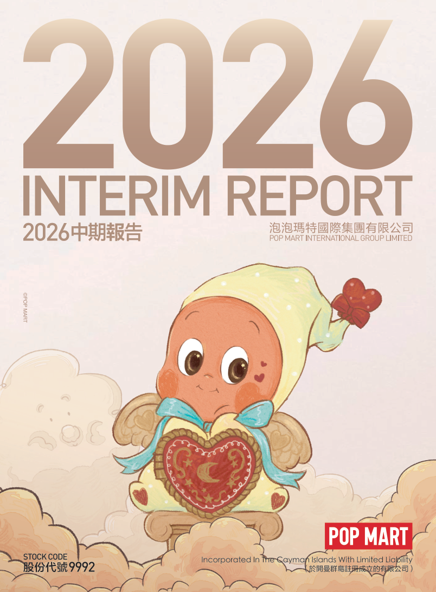

# 泡泡玛特2026年中期报告（简体中文）

> 披露日期：2026-09-24。来源：[泡泡玛特官方投资者关系](https://popwebsite.paquapp.com/pdf/21354ffc-d198-4a30-a045-b7384282bb7d-2026中期报告.pdf)。
> [原始PDF](../2026年中期报告.pdf) · [历年财报索引](../泡泡玛特历年财报索引.md)
> 转换说明：保留中文正文、数字、单位和注释，仅做繁简转换及重复英文去除。外文专名、代码和网址照录；复杂表格用等宽文本保留列位置，插图保留原图。

## 原PDF第1页

[对照原PDF第1页](../2026年中期报告.pdf#page=1)




## 原PDF第2页

[对照原PDF第2页](../2026年中期报告.pdf#page=2)

2

公司资料

目录

财务概要

管理层讨论与分析

其他资料

中期简明综合损益及其他全面收益表

中期简明综合资产负债表

中期简明综合权益变动表

中期简明综合现金流量表

中期简明综合财务资料附注

释义

二零二六年中报  1

## 原PDF第3页

[对照原PDF第3页](../2026年中期报告.pdf#page=3)

公司资料

董事会

执行董事

王宁先生（董事会主席）

刘冉女士

司德先生

文德一先生

非执行董事

屠铮先生

吴越先生

独立非执行董事

张建君先生

吴联生先生

颜劲良先生

薪酬委员会

张建君先生（主席）

吴联生先生

王宁先生

提名委员会

王宁先生（主席）

张建君先生

吴联生先生

审核委员会

吴联生先生（主席）

屠铮先生

颜劲良先生

联席公司秘书

李鸿轩先生

李菁怡女士

授权代表

王宁先生

李菁怡女士

2  泡泡玛特国际集团有限公司

## 原PDF第4页

[对照原PDF第4页](../2026年中期报告.pdf#page=4)

公司资料

总部及中国主要营业地点

中国

北京市朝阳区

大望京科技商务园区

宏泰东街浦项中心A座36及37楼

香港主要营业地点

香港

德辅道中188号

金龙中心19楼

股份过户登记总处

Maples Fund Services (Cayman) Limited PO Box 1093 Boundary Hall Cricket Square Grand Cayman KY1-1102 Cayman Islands

香港股份过户登记处

香港中央证券登记有限公司香港

湾仔

皇后大道东183号

合和中心17楼

1712-1716号舖

主要往来银行

中国工商银行股份有限公司（珠市口支行）

中国北京市东城区

珠市口东大街15号

交通银行股份有限公司

（望京支行）中国北京市朝阳区望京街9号望京国际商业中心

中国民生银行股份有限公司（望京支行）

中国北京市朝阳区

广顺北大街南湖东园一区

122号楼博泰国际B座

二零二六年中报  3

## 原PDF第5页

[对照原PDF第5页](../2026年中期报告.pdf#page=5)

公司资料

公司网站

www.popmart.com

法律顾问

有关香港法律

达维律师事务所

香港

中环

遮打道三号A

香港会所大厦十楼

有关中国法律

竞天公诚律师事务所

中国

上海市徐汇区

淮海中路1010号

嘉华中心45层

邮政编码：200031

有关开曼群岛法律迈普达律师事务所（香港）有限法律责任合伙香港湾仔

港湾道18号

中环广场26楼

核数师

罗兵咸永道会计师事务所

执业会计师

注册公众利益实体核数师

香港中环

太子大厦22楼

股份代号

9992  9992

4  泡泡玛特国际集团有限公司

## 原PDF第6页

[对照原PDF第6页](../2026年中期报告.pdf#page=6)

财务概要

截至6月30日止六个月

```text
                                           未经审核       未经审核
                                               2026           2025
                                             2026年         2025年           变动
                                         人民币千元     人民币千元
收入                                     17,172,921      13,876,276         23.8%
毛利                                     11,965,740       9,761,064         22.6%
经营溢利                                  6,724,746       6,043,741         11.3%
除所得税前溢利                            6,766,858       6,156,872          9.9%
期内溢利                                  5,100,310       4,681,713          8.9%
本公司拥有人应占溢利
                                          5,038,384       4,574,368         10.1%
非国际财务报告会计准则经调整
  纯利                                    5,155,777       4,709,630          9.5%
毛利率                                        69.7%          70.3%
纯利率                                        29.7%          33.7%
非国际财务报告会计准则经调整
  纯利率                                      30.0%          33.9%
                                                          未经审核         经审核
                                                              2026           2025
                                                         于2026年        于2025年
                                                          6月30日       12月31日
                                                        人民币千元     人民币千元
资产
非流动资产                                               8,935,797       7,186,711
流动资产                                                22,092,339      24,914,643
总资产                                                  31,028,136      32,101,354
权益
总权益                                                  23,288,475      22,652,367
负债
非流动负债                                               3,067,111       2,280,826
流动负债                                                 4,672,550       7,168,161
总负债                                                   7,739,661       9,448,987
```

二零二六年中报  5

## 原PDF第7页

[对照原PDF第7页](../2026年中期报告.pdf#page=7)

管理层讨论与分析

业务回顾

2026 年上半年，本集团将发展重点聚焦于组织能力建设与管理体系升级，持续优化组织架构与职能设置，强化中台赋能与全球协同，不断提升组织运营效率及全球化管理能力，为长期稳健发展夯实基础。报告期内，本集团实现收入人民币17,172.9百万元，同比增长23.8%。

IP孵化与运营

IP运营与创意设计是推动本集团持续健康发展的核心驱动力。作为全球领先的IP平台，本集团持续发掘具有潜力的艺术家及设计师，并依托成熟的全链路运营体系，不断提升IP孵化、创意设计、产品开发及全球化运营能力，成功打造多个广受消费者喜爱的IP形象，向全球消费者传递美好与快乐。

基于不同IP的独特内涵与艺术表达，本集团采取差异化的运营策略，持续丰富产品品类及消费场景，深化IP与粉丝之间的情感联结，不断提升IP的全球影响力及长期生命力。2026年上半年，共有11个艺术家IP收入超过人民币一亿元，其中THE MONSTERS、星星人、CRYBABY、DIMOO、SKULLPANDA、HIRONO及MOLLY在报告期内分别SKULLPANDA, HIRONO and MOLLY generated revenues of RMB4,454.4 million,  实现收入人民币4,454.4百万元、2,650.0百万元、1,632.6百万元、1,619.2百万元、1,551.2百万元、1,008.9百万元及900.6百万元。

6  泡泡玛特国际集团有限公司

## 原PDF第8页

[对照原PDF第8页](../2026年中期报告.pdf#page=8)

管理层讨论与分析

THE MONSTERS家族以LABUBU为代表，持续拓展多元化的内容表达与全球合作，不断提升 IP的全球影响力。2026 年 4 月，本集团正式推出26联名产品，开启 LABUBU 与全球顶级体育赛事的合作； 5 LABUBU participated in the production of the official music video for “Goals”,  月，LABUBU参与2026世界杯官方专辑收录歌曲《Goals》的MV录制；6月，LABUBU作为特邀嘉宾亮相世界杯开幕式，成为世界杯历史上首个受邀的中国原创IP，并于世界杯决赛当天亮相闭幕式，与全球球迷共同见证冠军诞生。除场内活动外，本集团亦将LABUBU的世界杯之旅延伸至球迷互动、城市文化及线下零售等多元场景，通过FIFA球迷嘉年华、主题快闪及墨西哥城当地文化体验等活动，与全球消费者广泛互动。此外，设计师龙家升携LABUBU与巴西传奇球星罗纳尔多共同参与品牌活动。通过一系列场内外Lung (龙家升), along with LABUBU and the Brazilian football legend Ronaldo,  活动，本集团持续拓展IP的全球触达范围，深化THE MONSTERS与全球体育文化及消费者之间的情感联结。

THE MONSTERS “Hair Salon” series provides consumers with more interactive  THE MONSTERS 「复古理发店」系列，通过手办及搪胶毛绒等不同产品形态，结合可梳理、可塑形的发丝设计，为消费者带来更具互动性和个性化的产品体验 。 同时 ，「 MONSTERS BY MONSTERS此刻与未来」十周年全球巡展陆续登陆巴黎及东京，持续向全球粉丝呈现 THE MONSTERS to global fans, thereby further enriching the cultural connotation  MONSTERS的创作历程与IP故事，进一步丰富IP的文化内涵，提升其长期生命力。

二零二六年中报  7

## 原PDF第9页

[对照原PDF第9页](../2026年中期报告.pdf#page=9)

管理层讨论与分析

Twinkle Twinkle, the fastest-growing IP of the Group, touches hearts with  星星人是本集团旗下成长最快的 IP，以关于勇气、思念与爱的故事打动人心。 2026 年上半年推出的「 怦然星动 」系列 ， 以千百种爱的表达为创作灵感，将跨越时间与空间的情感化作星光，记录一亿次心动，获得消费者的广泛喜爱。经过持续精细化运营，星星人已成为本集Twinkle Twinkle has become one of the most popular IPs of the Group. Going  团旗下最受欢迎的IP之一。未来，本集团将继续丰富星星人的内容表达，加深其与消费者之间的情感共鸣，并进一步拓展其影响力。

CRYBABY 凭借标志性的视觉形象，通过「泪流成海 」系列向世界传递「 在情绪的海洋里 ， 做不被定义的自己」的理念。主题展览「Letting Go...Holding On...」成为粉丝们所有情绪的去处，把哭泣与欢笑一并安放，让大家在展览中重新获得守护、勇气与自由，完成与自己的对话。

DIMOO continued to accompany consumers with warmth and healing. The  DIMOO以温暖治愈持续陪伴消费者。「瞬间的奇遇」系列以春日的微风、花朵与光影为灵感，记录生活中不期而遇的美好。「秘密话剧社」系列以充满趣味的舞台表演为主题，演绎别样的新奇故事，解锁意外惊喜，收获勇气。

8  泡泡玛特国际集团有限公司

## 原PDF第10页

[对照原PDF第10页](../2026年中期报告.pdf#page=10)

管理层讨论与分析

SKULLPANDA continued to push the boundaries of artistic styling and  SKULLPANDA 持续突破风格与表达的边界，与「小马宝莉」推出联名系列，将双方差异化的视觉风格与创作理念相融合，以缤纷色彩呈现友谊与创造力的无限可能，获得全球粉丝的广泛喜爱。「花的四幕戏」系列兼具美学张力与哲思内涵，以花与植物为创作载体，借鉴莎士比亚四部经典戏剧，通过花朵由萌芽、盛放至衰败的自然循环，呈现时间流转、命运起伏与生命更迭，进一步丰富IP的艺术表达与叙事内涵。

HIRONO cultivates a distinctive spiritual universe through its iconically  HIRONO以极具辨识度的治愈系设计语言构建起独特的精神图景，品牌门店进入英国及韩国市场，并持续以多品类呈现专属于小野的世界，推动品牌向更广泛的生活方式领域延伸。

2026年，MOLLY迎来诞生二十周年，「一颗不变的星」主题展先后在香港、上海和北京举办，全面、生动地呈现了MOLLY的成长轨迹、不同阶MOLLY, the creative contexts across different stages, and the more diversified  段的创作脉络和未来更加多元的可能性，沉浸式展览体验唤起了粉丝与MOLLY共同成长的情感记忆。未来，「一颗不变的星」将继续巡展至其他国家，与全球粉丝一起开启回忆之旅。

二零二六年中报  9

## 原PDF第11页

[对照原PDF第11页](../2026年中期报告.pdf#page=11)

管理层讨论与分析

我们持续拓展与授权 IP 的合作领域，通过与动漫、游戏、电影及明星艺人等众多版权方开展合作，推出品类丰富、风格多元的潮流玩具及联名产品，满足不同消费者的兴趣与需求。同时，我们不断拓展IP授权的地域范围，目前已取得大部分授权IP的全球授权，为全球消费者提供更加丰富、独特的潮玩文化体验。

2026 年上半年，毛绒产品实现收入人民币9,824.9百万元，同比增长60%，延续强劲增长势头。我们始终坚持以 IP 为核心，深入挖掘每个IP 的特质，量身打造风格契合且具备显著差异化的毛绒产品线，使产品成为 IP 故事讲述与情感表达的重要载体。报告期内，Nyota、Zsiga、Peach Riot等多个IP推出首款毛绒产品，获得消费者的广泛喜爱。PUCKY于年初推出的「敲敲」系列搪胶毛绒挂件，凭借富有趣味的互动设计在社交平台获得广泛关注，并被粉丝亲切称为「电子木鱼」，成为报告期内具有代表性的热门产品之一。得益于对IP内涵的精准诠释，以及在材质工艺、互动玩法与使用场景等方面的持续创新，我们的毛绒产品进一步丰富了消费者体验，不仅深化了与现有粉丝的情感联结，也帮助品牌在全球范围内触达更多新消费者。

10  泡泡玛特国际集团有限公司

## 原PDF第12页

[对照原PDF第12页](../2026年中期报告.pdf#page=12)

管理层讨论与分析

消费者触达

－ 线下渠道

截至2026年6月30日，本集团在全球共运营676家门店及2,827台机器人商店，报告期内分别净增46家及190台。

中国市场聚焦顾客体验的全方位创新，通过提升门店服务品质，开展多元化、沉浸式互动营销，持续强化消费者与品牌之间的情感联结，推动业务实现稳健、高质量增长。报告期内，净增 10 家线下门店，门店数量从截至2025年12月31日的445家增至截至2026年6月30日的455家。

亚太市场持续优化本地运营并推动本地零售与旅游零售协同发展，进一步完善本地零售网络。报告期内，净增5家线下门店，门店数量从截至2025 年12 月31 日的85 家增至截至2026年6月30日的90家。

美洲市场以美国为核心持续推进战略布局，线下渠道持续稳健扩张，扩大品牌覆盖范围，提升IP的认知度和影响力。报告期内，净增 22 家线下门店，门店数量从截至2025年12月31日的64家增至截至2026年6月30日的86家。

二零二六年中报  11

## 原PDF第13页

[对照原PDF第13页](../2026年中期报告.pdf#page=13)

管理层讨论与分析

欧洲市场持续深化品牌建设，聚焦重点国家核心区域，通过在全球核心城市开设地标性门店提升品牌曝光，以沉浸式 IP 体验深化消费者对品牌及旗下 IP 的认知。报告期内，净增9家线下门店，门店数量从截至2025年12月31日的36家增至截至2026年6月30日的45家。

－ 线上渠道

2026年上半年，本集团持续完善以自研APP和官网为核心、覆盖主流电商平台的全球线上渠道体系，强化品牌直接触达消费者的能力，不断提升运营效率，优化消费者体验。

自研APP和官网是本集团连接全球消费者的数字化基础设施。报告期内，本集团持续提升全球线上运营能力，优化 IP 及商品展示、互动玩法、本地支付、物流配送及客户服务体系，提供更加便捷、一致且独特的品牌体验。同时，我们将门店购买、门店抽选等线上线下(O2O)功能和「抽盒机」玩法推广至更多国家和地区，为消费者带来更具趣味性的购物体验。在中国市场，我们进一步发挥「抽盒机」互动式消费体验的独特优势，不断优化线下会员的跨渠道体验，提升购买转化并增强会员黏性。

12  泡泡玛特国际集团有限公司

## 原PDF第14页

[对照原PDF第14页](../2026年中期报告.pdf#page=14)

管理层讨论与分析

本集团通过电商平台触达更多具有不同消费习惯与偏好的消费者。在内容电商方面，我们不断强化直播运营能力，围绕「内容互动和情感联结 」， 持续升级沉浸式的品牌体验，有效提升流量转化效率。在货架电商方面，我们坚持区域差异化运营策略：中国市场继续提高天猫、京东等平台旗舰店精细化运营能力，进一步强化第三方平台和自有渠道之间的协同，不断提升会员渗透和黏性；亚太市场持续完善本地化运营体系，通过Shopee、Lazada等主流电商平台服务当地消费者，扩大品牌影响力；欧美市场充分发挥Amazon等平台的渠道优势，广泛触达用户，进一步增强品牌知名度。

－ 会员运营

随著全球业务版图稳步拓展，本集团品牌知名度及旗下 IP 影响力不断提升，会员规模持续扩大。截至2026年6月30日，本集团全球累计注册会员已超过一亿人。在中国内地市场，随着全渠道业务更加健康、有序地发展，我们持续满足会员多元化的 IP及产品需求，不断升级会员体验及运营机IP and product demands and kept upgrading member experience  制，推动新老会员规模稳步增长，促进跨品类、跨渠道消费转化，进一步增强会员对品牌的黏性。截至2026年6月30日，中国内地累计注册会员由截至2025 年12 月31 日的7,258万人增至8,244万人，新增注册会员986万。2026年上半年，中国内地会员贡献的销售额占中国内地收入的92.9%，中国内地会员复购率为51.6% 1 。

```text
1.                                                                            1.  2026年上半年，购买两次及以上的会员人数占同
                                                                                  期购买会员总人数的比例
```

二零二六年中报  13

## 原PDF第15页

[对照原PDF第15页](../2026年中期报告.pdf#page=15)

管理层讨论与分析

主题乐园与IP体验及创新业务孵化

泡泡玛特城市乐园是本集团以IP为核心的商业生态的重要延展。历时一年，升级改造区域正式向游客开放，更加丰富的园区主题场景、互动游乐设施、演艺内容及系列活动，持续提升的服务品质与沉浸式游园体验，让游客全方位感受泡泡玛特旗下IP的独特魅力。

在保留原有经典场景的基础上，园区围绕 THE MONSTERS 和 DIMOO 两大 IP，打造并开放云之湖、奇遇森林市集、LABUBU勇士峡湾及LABUBU精灵部落四大全新区域，将IP的角色设定与艺术特色融入游乐设施及场景设计，为游客营造更具代入感的IP体验空间。伴随新区域开放，园区同步升级演艺内容，在保留经典节目的基础上新增演艺点位，并安排更多「明星朋友」亮相，带来更有趣的互动体验。同时，乐园推出「星夜奇遇」夜游项目，通过多元演艺节目及主题活动，拓展夜间游园场景，为游客带来更丰富的夏夜体验。

2026 年上半年，THE MONSTERS 「明星朋友」从泡泡玛特城市乐园出发，走进全球多个城市及国际体育文化场景。米兰冬奥会期间，LABUBU LABUBU made an appearance in Milan, participating in the opening event  亮相米兰，参与国际滑联滑冰之家开幕活动，并与运动员及志愿者开展互动；同时，本集团围绕FIFA World Cup 26，通过内容共创、线下活动及在地文化体验等多种形式，不断丰富THE MONSTERS的内容表达与互动方式，深化与全球消费者的情感联结，进一步提升IP的全球知名度及影响力。

14  泡泡玛特国际集团有限公司

## 原PDF第16页

[对照原PDF第16页](../2026年中期报告.pdf#page=16)

管理层讨论与分析

2026 年上半年，我们在全球多个核心城市举办多场大型线下主题展览，持续深化IP运营与全球声量。星星人「怦然星动」、THE MONSTERS 「复古理发店」等主题展先后在多个城市落地，通过富有IP特色的场景设计，为消费者带来充满趣味IP experiences through IP-specific experiential scene design. CRYBABY’s “Cry  的IP互动体验。CRYBABY 「Cry Me An Ocean」活动于新加坡海洋生态馆举办，大型主题气膜装置亦先后亮相北京、泰国芭提雅海滩及印度尼西亚望加锡洛萨里海滩，通过融合当地特色的场景体验，生动呈现IP的故事内涵与性格特质，拉近与粉丝的情感距离，带来更多关于 IP 的想象。

「POP BAKERY」甜品品牌持续扩大市场覆盖，在中国多个核心城市落地快闪点位，并于阿那亚开设全国首家门店。门店以星星人为核心主题，将IP形象与烘焙产品、空间设计及消费体验相融合，进一步丰富IP的场景化表达，为消费者带来兼具情感温度与品牌特色的体验。

未来，本集团将持续以IP为核心，积极探索多元业态延展路径，不断拓展IP的内容表达与价值边界，与粉丝建立更长久的联结，为消费者带来更多美好的体验。

二零二六年中报  15

## 原PDF第17页

[对照原PDF第17页](../2026年中期报告.pdf#page=17)

管理层讨论与分析

财务回顾

销售收入

本公司收入从2025年上半年的人民币13,876.3百万元增长到2026年上半年的人民币17,172.9百万元，同比增长23.8%。

根据区域划分的收入

本公司的收入按照区域划分为：(1)中国、(2)亚太、(3)美洲、及(4)欧洲及其他地区。下表载列本公司2026 年上半年及2025 年上半年的按区域划分的收入：

```text
                               截至2026年6月30日             截至2025年6月30日
                                    止六个月                      止六个月
                                   收入       收入占比           收入       收入占比       收入变动
                             人民币千元                    人民币千元
中国                         12,200,509         71.0%        8,282,812         59.7%          47.3%
亚太                          2,575,045         15.0%        2,850,902         20.6%          -9.7%
美洲                          1,891,637         11.0%        2,264,882         16.3%         -16.5%
欧洲及其他地区                  505,730          3.0%         477,680           3.4%           5.9%
合计                         17,172,921        100.0%       13,876,276        100.0%          23.8%
```

16  泡泡玛特国际集团有限公司

## 原PDF第18页

[对照原PDF第18页](../2026年中期报告.pdf#page=18)

管理层讨论与分析

(1) 中国

中国收入从2025 年上半年的人民币8,282.8百万元增长到 2026 年上半年的人民币12,200.5百万元，同比增长47.3%。以下为按照渠道划分的收入明细：

```text
                           截至2026年6月30日             截至2025年6月30日
                                止六个月                      止六个月
                              收入       收入占比           收入       收入占比       收入变动
                        人民币千元                    人民币千元
线下渠道                  6,868,639         56.3%       5,084,246         61.4%          35.1%
零售店                    6,089,686         49.9%       4,405,948         53.2%          38.2%
机器人商店                 778,953           6.4%         678,298          8.2%          14.8%
线上渠道                  4,778,746         39.2%       2,937,255         35.5%          62.7%
泡泡玛特抽盒机            2,062,871         16.9%       1,125,227         13.6%          83.3%
抖音平台                   976,376           8.0%         561,138          6.8%          74.0%
天猫旗舰店                 901,303           7.4%         657,503          7.9%          37.1%
其他线上渠道               838,196           6.9%         593,387          7.2%          41.3%
批发及其他                 553,124           4.5%         261,311          3.1%         111.7%
合计                    12,200,509         100.0%       8,282,812        100.0%          47.3%
```

二零二六年中报  17

## 原PDF第19页

[对照原PDF第19页](../2026年中期报告.pdf#page=19)

管理层讨论与分析

中国线下渠道。收入由 2025 年上半年的人民币5,084.2 百万元增长到2026 年上半年的人民币6,868.6百万元，增长了35.1%。中国线下渠道分为：零售店和机器人商店。

```text
                                                                                零售店                                                          机器人商店
                                                                         截至6月30日止六个月                                               截至6月30日止六个月
                                                                 2026                             2025                            2026                             2025
                                                               2026年                           2025年                           2026年                           2025年
区域划分                                                     数量            收入            数量             收入            数量             收入            数量            收入
                                                                    （人民币千元）                  （人民币千元）                   （人民币千元）                   （人民币千元）
                                 中国内地                    419        5,427,444             409         3,648,359          2,436         757,958             2,396         643,440
                                 港澳台地区                   36          662,242              34          757,589              46           20,995              41           34,858
                                 合计                        455        6,089,686             443         4,405,948          2,482         778,953             2,437         678,298
```

－  零售店。零售店销售收入从 2025 年上半年的人民币4,405.9百万元增加到2026年上半年的人民币6,089.7百万元，同比增长了38.2%。一方面店舖更加关注运营服务，通过店舖换新升级提升顾客进店感受，也吸引了更多新会员；另一方面来自于零售店数量的增加，2026年上半年较去年同期增加了12间店舖。

18  泡泡玛特国际集团有限公司

## 原PDF第20页

[对照原PDF第20页](../2026年中期报告.pdf#page=20)

管理层讨论与分析

－  机器人商店。机器人商店销售收入从2025 年上半年的人民币678.3 百万元增长到2026 年上半年的人民币779.0 百万元，同比增长了14.8%。一方面我们精细化运营关注每台机器的运营效率，及时进行商务调整；另一方面来自于机器人商店数量的增加，2026 年上半年较去年同期增加了45间。

中国线上渠道。线上收入由 2025 年上半年的人民币2,937.3 百万元增长到2026 年上半年的人民币4,778.7百万元，增长了62.7%。中国线上渠道的收入包括泡泡玛特抽盒机、抖音平台、天猫旗舰店以及其他线上渠道。泡泡玛特抽盒机不断创新互动玩法，提升客流转化，为消费者提供更有趣的消费体验，2026 年上半年收入为人民币2,062.9百万元，同比增长了83.3%；其他线上平台差异化运行，精准匹配平台与用户需求提升运营效率，推动收入增长。

中国批发及其他。收入从 2025 年上半年的人民币 261. 3 百万元增长到 2026 年上半年的人民币 553.1 百万元，增长了 111.7% 。主要来自于泡泡玛特城市乐园业务、POP BAKERY甜品业务以及POPOP饰品业务收入增长。

二零二六年中报  19

## 原PDF第21页

[对照原PDF第21页](../2026年中期报告.pdf#page=21)

管理层讨论与分析

(2) 亚太

亚太收入从2025 年上半年的人民币2,850.9百万元下降到 2026 年上半年的人民币2,575.0百万元，下降了9.7%。以下为按照渠道划分的收入明细：

```text
                               截至2026年6月30日                 截至2025年6月30日
                                    止六个月                         止六个月
                                  收入         收入占比             收入        收入占比         收入变动
                            人民币千元                        人民币千元
线下渠道                      1,772,694           68.8%         1,525,588           53.5%           16.2%
零售店                        1,716,171           66.6%         1,492,991           52.4%           14.9%
机器人商店                      56,523             2.2%           32,597             1.1%           73.4%
线上渠道                       643,551            25.0%         1,069,214           37.5%           -39.8%
自研APP及官方网站
                               338,397            13.1%          312,968            11.0%            8.1%
                               106,528             4.1%          280,778             9.8%           -62.1%
其他线上渠道                   198,626             7.8%          475,468            16.7%           -58.2%
批发及其他                     158,800             6.2%          256,100             9.0%           -38.0%
合计                          2,575,045         100.0%          2,850,902          100.0%            -9.7%
```

20  泡泡玛特国际集团有限公司

## 原PDF第22页

[对照原PDF第22页](../2026年中期报告.pdf#page=22)

管理层讨论与分析

亚太线下渠道。收入从 2025 年上半年的人民币1,525.6 百万元增长到2026 年上半年的人民币1,772.7百万元，增长了16.2%。零售店收入占亚太区收入的66.6%，零售店数量从2025 年上半年的69 间增加到2026 年上半年的 90 间，我们将持续加强本地精细化运营，针对亚太各国家差异化消费客群，持续提升消费者购物体验。

亚太线上渠道。线上收入由 2025 年上半年的人民币1,069.2 百万元降低到2026 年上半年的人民币643.6百万元，下降了39.8%。亚太线上渠道收入包括来自自研APP及官方网站、Shopee和其他线上渠道的收入。线上渠道来自外部流量红利在逐渐消退，业务上从「规模扩张」转向「精细化运营」，平台整合聚焦到更核心的渠道。

亚太批发及其他。收入从 2025 年上半年的人民币256.1 百万元降低至2026 年上半年的人民币158.8百万元，下降了38.0%。

二零二六年中报  21

## 原PDF第23页

[对照原PDF第23页](../2026年中期报告.pdf#page=23)

管理层讨论与分析

(3) 美洲

美洲收入从2025 年上半年的人民币2,264.9百万元降低到 2026 年上半年的人民币1,891.6百万元，下降了16.5%。以下为按照渠道划分的收入明细：

```text
                              截至2026年6月30日                 截至2025年6月30日
                                    止六个月                         止六个月
                                  收入        收入占比             收入        收入占比         收入变动
                            人民币千元                       人民币千元
线下渠道                     1,007,007           53.2%           842,390           37.2%           19.5%
零售店                         903,063           47.7%           736,961           32.5%           22.5%
机器人商店                     103,944            5.5%           105,429            4.7%           -1.4%
线上渠道                       722,144           38.2%         1,326,565           58.6%          -45.6%
自研APP及官方网站
                               491,235           26.0%           886,501           39.2%          -44.6%
亚马逊                         168,318            8.9%           125,039            5.5%           34.6%
其他线上渠道                    62,591            3.3%           315,025           13.9%          -80.1%
批发及其他                     162,486            8.6%            95,927            4.2%           69.4%
合计                         1,891,637          100.0%         2,264,882          100.0%          -16.5%
```

22  泡泡玛特国际集团有限公司

## 原PDF第24页

[对照原PDF第24页](../2026年中期报告.pdf#page=24)

管理层讨论与分析

美洲线下渠道。线下收入由 2025 年上半年的人民币842.4 百万元增长到2026 年上半年的人民币1,007.0百万元，增长了19.5%。收入增长主要来自业务扩张。美洲零售店数量从2025 年上半年的41 间增长到2026 年上半年的86间。

美洲线上渠道。线上收入从 2025 年上半年的人民币1,326.6 百万元降低到2026 年上半年的人民币722.1百万元，下降了45.6%。美洲线上渠道收入包括自研APP及官方网站、亚马逊和其他线上渠道。随著核心IP热度回归常态，线上渠道通用流量和获客能力都在建设阶段；未来将强化用户运营、恢复流量增长及转化。

美洲批发及其他。收入由 2025 年上半年的人民币95.9百万元增长到2026年上半年的人民币162.5百万元，增长了69.4%。

二零二六年中报  23

## 原PDF第25页

[对照原PDF第25页](../2026年中期报告.pdf#page=25)

管理层讨论与分析

(4) 欧洲及其他地区

欧洲及其他地区收入由2025 年上半年的人民币477.7 百万元增长到2026 年上半年的人民币505.7 百万元，增长了5.9%。以下为按照渠道划分的收入明细：

```text
                               截至2026年6月30日                截至2025年6月30日
                                    止六个月                         止六个月
                                  收入         收入占比            收入         收入占比        收入变动
                            人民币千元                       人民币千元
线下渠道                       414,172           81.9%           276,527           57.9%           49.8%
零售店                         403,066           79.7%           272,110           57.0%           48.1%
机器人商店                      11,106            2.2%             4,417            0.9%          151.4%
线上渠道                        67,631           13.4%           164,963           34.5%           -59.0%
自研APP及官方网站
                                52,991           10.5%            84,694           17.7%           -37.4%
其他线上渠道                    14,640            2.9%            80,269           16.8%           -81.8%
批发及其他                      23,927            4.7%            36,190            7.6%           -33.9%
合计                           505,730          100.0%           477,680          100.0%            5.9%
```

欧洲及其他地区线下渠道。收入由2025 年上半年的人民币 276.5 百万元增长到 2026年上半年的人民币 414.2 百万元，增长了49.8%。欧洲及其他地区零售店数量从2025年上半年的18 间增长到2026 年上半年的45间。

欧洲及其他地区线上渠道。收入由2025 年上半年的人民币 165.0 百万元降低到 2026年上半年的人民币 67.6 百万元，下降了59.0% 。我们正在完善欧洲线上渠道的建设，推进本地化运营，提升当地的仓储物流能力，以更好地服务消费者。

24  泡泡玛特国际集团有限公司

## 原PDF第26页

[对照原PDF第26页](../2026年中期报告.pdf#page=26)

管理层讨论与分析

根据IP划分的收入

泡泡玛特的自主产品是我们的主要商品类型，2026 年上半年自主产品收入占总收入的比例为99.3%，自主产品收入从 2025 年上半年的人民币13,753.4百万元增加到2026年上半年的人民币17,060.7百万元，增长了24.0%。

泡泡玛特的自主产品主要分为：艺术家IP和授权IP，以下为IP划分的收入明细：

```text
                                                                           截至6月30日止六个月
                                                                    2026                          2025
                                                                   2026年                        2025年
                                                                收入       收入占比           收入       收入占比
                                                           人民币千元                    人民币千元
                                   自主产品                17,060,668         99.3%      13,753,405         99.1%
                                   艺术家IP                15,289,469         89.0%      12,228,565         88.1%
THE MONSTERS                                                4,454,361         26.0%       4,814,017         34.7%
Twinkle Twinkle                      星星人                 2,649,969         15.4%         389,363          2.8%
                                     CRYBABY                1,632,570          9.5%       1,218,170          8.8%
DIMOO                                                       1,619,217          9.4%       1,105,135          8.0%
SKULLPANDA                                                  1,551,211          9.0%       1,220,504          8.8%
HIRONO                                                      1,008,855          5.9%         728,420          5.2%
MOLLY                                                        900,631           5.3%       1,357,248          9.8%
Zsiga                                                        298,341           1.7%         211,256          1.5%
                                     其他艺术家IP           1,174,314          6.8%       1,184,452          8.5%
                                   授权IP                   1,771,199         10.3%       1,524,840         11.0%
                                   外采及其他                112,253           0.7%         122,871          0.9%
                                   合计                    17,172,921        100.0%      13,876,276        100.0%
```

二零二六年中报  25

## 原PDF第27页

[对照原PDF第27页](../2026年中期报告.pdf#page=27)

管理层讨论与分析

艺术家 IP。艺术家 I P 是本公司主要商品类型，主要包括 THE MONSTERS、星星人、DIMOO. The proportion of revenue from artist IPs increased from 88.1%  CRYBABY、DIMOO 等。艺术家 IP 的收入占比由 2025 年上半年的 88.1% 上升到 2026 年上半年的89.0%。艺术家IP收入从2025年上半年的人民币12,228.6百万元，上升至2026年上半年的人民币15,289.5百万元，增长了25.0%，其中，2026年上半年星星人收入人民币2,650.0百万元，同比增长了580.6%。我们不断提升产品的创新设计，以多样化的产品为载体，传递IP的艺术表达。

授权IP。授权IP收入从2025年上半年的人民币1,524.8 百万元，增加至2026 年上半年的人民币1,771.2百万元，增长了16.2%。主要由于我们持续扩大IP授权领域，推出更多风格、种类的产品。

根据产品类别划分的收入

本公司的产品主要划分为：毛绒、手办和衍生品及其他，以下为产品类别划分的收入明细：

```text
                                  截至2026年6月30日                  截至2025年6月30日
                                        止六个月                         止六个月
                                      收入         收入占比             收入        收入占比         收入变动
                                人民币千元                        人民币千元
毛绒                             9,824,944           57.2%          6,139,236           44.2%           60.0%
手办                             5,192,493           30.2%          5,175,875           37.3%            0.3%
衍生品及其他                     2,155,484           12.6%          2,561,165           18.5%           -15.8%
合计                            17,172,921          100.0%         13,876,276          100.0%           23.8%
```

26  泡泡玛特国际集团有限公司

## 原PDF第28页

[对照原PDF第28页](../2026年中期报告.pdf#page=28)

管理层讨论与分析

我们不断在产品层面推陈出新，丰富产品品类，提升产品设计的能力。毛绒产品收入从2025 年上半年的人民币 6,139.2 百万元增长到2026 年上半年的人民币9,824.9 百万元，增长了60.0%，毛绒产品占总收入的57.2%，得益于产品出色的展示性以及毛绒材质特有的柔软触感，同时我们在工艺、玩法上不断创新，使毛绒产品深受消费者的喜爱。

销售成本

销售成本从 2025 年上半年的人民币 4,115.2 百万元上升到 2026 年上半年的人民币 5,207.2 百万元，增长了 26.5%，增加主要由于存货成本由2025 年上半年的人民币3,272.9 百万元增加到2026 年上半年的人民币4,303.2 百万元，其主要原因为销售增加。

毛利

本公司的毛利由2025 年上半年的人民币9,761.1百万元上升到 2026 年上半年的人民币 11,965.7百万元，增长了22.6%，主要由于我们的收入增加。我们的毛利率由2025年上半年的70.3%下降到2026年上半年的69.7%，主要由于(1)海外为高毛利销售地区，海外销售占比下降带动毛利率的降低；及(2)原材料价格上涨导致商品采购成本的增长，进而毛利率下降。

二零二六年中报  27

## 原PDF第29页

[对照原PDF第29页](../2026年中期报告.pdf#page=29)

管理层讨论与分析

经销及销售开支

我们的经销及销售开支由2025 年上半年的人民币3,192.6 百万元增长至2026 年上半年的人民币3,931.1百万元，增长了23.1%，其中占比较高的为租赁相关开支、雇员福利开支和运输及物流开支。

租赁相关开支。租赁相关开支包括使用权资产折旧，以及未计入租赁负债的与短期租赁及可变租赁有关的开支，由2025 年上半年人民币728.4 百万元增长到2026 年上半年的人民币1,044.1百万元，增长了43.3%，主要由于线下零售店数量较2025 年上半年净增加了105间。

雇员福利开支。雇员福利开支从 2025 年上半年的人民币560.8 百万元增长至2026 年上半年的人民币817.1百万元，增长了45.7%，主要由于全球店舖数量增长，为了满足业务扩张的需求，我们的销售员工人数由2025年上半年的6,219名员工增加到2026年上半年的9,734名员工。

运输及物流开支。运输及物流开支从 2025年上半年的人民币677.1 百万元下降到2026年上半年的人民币 644.7 百万元，下降了4.8%，主要因为国际物流成本较高，而海外地区收入下降，进而整体运输及物流费用减少。

28  泡泡玛特国际集团有限公司

## 原PDF第30页

[对照原PDF第30页](../2026年中期报告.pdf#page=30)

管理层讨论与分析

一般及行政开支

我们的一般及行政开支由2025 年上半年的人民币 770.4 百万元增长至 2026 年上半年的人民币926.5百万元，增长了20.3%。其中占比较高的为雇员福利开支，我们的行政员工及设计开发人员人数由2025年上半年的1,830名增加至2026年2026.  上半年的2,322名。

其他收入

本公司的其他收入由2025年上半年的人民币67.2百万元增长到2026年上半年的人民币302.8百万元，增长了350.4%。其中(1)政府补助由2025 年上半年的人民币37.8百万元增长至2026年上半年的人民币239.5 百万元，及(2)IP授权费及其他服务收入由2025年上半年的人民币25.8百万元增长到2026年上半年的人民币60.6百万元。

其他（亏损）╱ 收益 － 净额

本公司的其他收益由2025 年上半年的净利得人民币179.2百万元下降到2026上半年的净损失人民币688.8百万元。其中(1)受汇率波动，2026年上半年汇兑损失人民币720.3百万元，而2025年上半年汇兑收益人民币120.1百万元；及(2)按公平值计入损益的金融工具公平值变动的收益由2025年上半年的人民币23.7百万元增长到2026年上半年的人民币37.4百万元。

二零二六年中报  29

## 原PDF第31页

[对照原PDF第31页](../2026年中期报告.pdf#page=31)

管理层讨论与分析

经营溢利

综上所述，本公司的经营溢利由2025 年上半年的人民币6,043.7 百万元增长至2026 年上半年的人民币6,724.7百万元，增长了11.3%。

财务收入 － 净额

我们的财务收入净额由2025 年上半年的净收益人民币65.5百万元下降到2026年上半年的净收益人民币11.5百万元，主要由于租赁负债利息费用的增加。

所得税开支

我们的所得税开支由 2025 年上半年的人民币1,475.2 百万元增加到 2026 年上半年的人民币1,666.5 百万元，原因为我们的所得税前溢利增加。我们的实际税率由2025年上半年的24.0%上升至2026年上半年的24.6%。

期内溢利

由于上文所述，我们的期内溢利由2025 年上半年的人民币4,681.7 百万元增加至报告期间的人民币5,100.3百万元，增长了8.9%。

非国际财务报告会计准则经调整纯利

非国际财务报告会计准则经调整纯利未按照国际财务报告会计准则计算，视为非国际财务报告会计准则的财务指标，其定义为除以股份为基础的薪酬后纯利，而非国际财务报告会计准则经调整纯利率的定义为非国际财务报告会计准则经调整纯利除以收益。我们认为，这些信息对于投资者在不影响本集团经营业绩或现金流的情况下比较本集团的业绩是有用的，并允许投资者考虑管理层在评估本集团业绩时使用的指标。投资者不应认为非国际财务报告会计准则的财务指标替代或优于本集团根据国际财务报告会计准则编制的业绩。此外，可能不是所有公司会以相同的方式计算该项非国际财务报告会计准则的财务指标，因此未必可与其他公司采用的相若计量比较。

30  泡泡玛特国际集团有限公司

## 原PDF第32页

[对照原PDF第32页](../2026年中期报告.pdf#page=32)

管理层讨论与分析

下表载列本公司各期间的非国际财务报告会计准则的财务指标对账情况。

```text
                                         截至2026年      截至2025年
                                            6月30日         6月30日
                                           止六个月         止六个月
                                         人民币千元       人民币千元
期内溢利                                   5,100,310        4,681,713
调整项目
以股份为基础的付款报酬                       55,467           27,917
非国际财务报告会计准则经调整纯利           5,155,777        4,709,630
非国际财务报告会计准则经调整纯利率            30.0%            33.9%
```

以股份为基础的付款开支属于非现金项目且并无直接反应我们的业务营运。因此，通过撇除该等项目对计算非国际财务报告会计准则经调整纯利影响的举措，可更好地反应我们的相关经营表现，并更加便于比较不同期间的经营表现。

流动资产、财务资源及资本开支

截至2026年6月30日止六个月，本公司及附属公司在整体业务经营方面采纳保守稳健的资金管理及财务政策。本集团维持以下资源以应付其营运资金需求：

流动资产及流动负债

我们的流动资产净值由截至2025 年12 月31 日的人民币17,746.5 百万元降低至截至2026 年6 月30日的人民币17,419.8百万元。

二零二六年中报  31

## 原PDF第33页

[对照原PDF第33页](../2026年中期报告.pdf#page=33)

管理层讨论与分析

贸易应收款项

贸易应收款项指日常业务过程中我们应收客户的未结算款项。我们的贸易应收款项由截至2025年12月31日的人民币921.2百万元下降至截至2026 年6 月30 日的人民币627.3 百万元，主要由于若干线上平台收入降低进而贸易应收款项减少。贸易应收款项周转天数从2025年的7天增加至截至2026年6月30日止六个月的8天。

存货

我们的存货包括制成品。我们的存货由截至2025 年12 月31 日的人民币5,472.8 百万元增加至截至2026年6月30日的人民币6,101.5百万元，主要由于海外市场扩张的前置备货。存货周转天数从2025年的123天增加到截至2026年6月30日止六个月的201天。

现金及现金等价物

我们的现金及现金等价物主要包括银行现金。现金及现金等价物从截至2025 年12 月31 日的人民币13,775.1 百万元降低至截至2026年6月30 日的人民币 12,442.1 百万元，主要为 (1) 经营活动现金净流入人民币3,637.3 百万元，(2)投资活动现金净流入人民币 673.1 百万元，主要是因为赎回定期存款，同时被购买固定资产和金融资产部分抵销，及(3)筹资活动现金净流出人民币5,382.3百万元，主要是支付股利和购回股票。

贸易应付款项

贸易应付款项主要指我们在日常业务过程中向供应商支付货款的责任。贸易应付款项从截至2025 年12 月31 日的人民币1,858.2 百万元下降至截至2026 年6 月30 日的人民币905.2 百万元，主要因为2025 年末为满足销售的库存储备，货品集中采购的金额较大。贸易应付款项周转天数从2025年的51天降低到截至2026年6月30日止六个月的48天。

银行借款

截至 2026 年 6 月 30 日，本集团并无任何银行借款。

32  泡泡玛特国际集团有限公司

## 原PDF第34页

[对照原PDF第34页](../2026年中期报告.pdf#page=34)

管理层讨论与分析

资产抵押

截至 2026 年 6 月 30 日，本集团并无任何资产抵押。

资产负债率

资产负债率为总负债除以总资产乘以 100% 。截至 2026 年 6 月 30 日，本集团的资产负债率为24.9%，而截至2025年12月31日的资产负债率为2025.  29.4%。

或有事件

我们目前并无涉及任何重大法律诉讼，亦不知悉我们涉及任何待决或潜在重大法律诉讼。倘我们涉及有关重大法律诉讼，则我们会于产生亏损且有关亏损金额有合理估计时，按当时所得资料记录任何亏损或或有负债。

外汇风险管理

本公司的附属公司在中国、亚太、美洲和欧洲及其他地区经营，面对若干货币敞口（主要有关美元、泰铢、新加坡币及港币）引致的外汇风险。由于本集团以我们经营实体各自功能货币以外货币计值的金融资产及负债不重大，故管理层认为业务并无任何重大外汇风险敞口。本集团并没有对冲外币波动，但是会紧密地监控有关情况，并在必要时采取措施以保证外汇风险在可控范围内。

二零二六年中报  33

## 原PDF第35页

[对照原PDF第35页](../2026年中期报告.pdf#page=35)

管理层讨论与分析

资本开支

本公司的资本开支包括购置物业、厂房及设备的款项和购置无形资产的款项。下表载列本公司2025 年上半年以及2026 年上半年的资本开支情况：

```text
                                        截至2026年       截至2025年
                                           6月30日          6月30日
                                           止六个月        止六个月
                                         人民币千元      人民币千元
购置物业、厂房和设备                       673,560           353,623
购置无形资产                                 50,579           20,900
合计                                       724,139           374,523
```

人力资源

截至2026年6月30日，我们共有12,056名员工，包括销售员工 9,734 名，行政及设计开发人员2,322 名。截至2026 年6 月30 日止六个月，我们共发生员工成本（包括薪金、工资、津贴和福利）人民币1,405.0百万元。

34  泡泡玛特国际集团有限公司

## 原PDF第36页

[对照原PDF第36页](../2026年中期报告.pdf#page=36)

管理层讨论与分析

重大投资的未来计划

截至2026年6月30日，我们并无持有任何重大投资。

我们将继续广泛寻找潜在的策略性投资机会，并寻求可为本集团带来协同效应的潜在优质目标业务及资产。

重大收购及出售

截至2026年6月30日止六个月，我们并无进行任何重大收购或出售附属公司、联营公司及合营企业。

报告期间后事项

于本报告日期，本集团于报告期间后并无发生须进一步披露或调整的重大事项。

未来展望

IP始终是本集团业务发展的核心。未来，我们将继续通过高质量设计、创意产品和优质服务，向全球消费者传递快乐与美好，让IP成为跨越国界、语言和文化的情感纽带。同时，本集团将通过持续提升品牌价值、拓展产品品类及创新互动形式，不断深化与消费者的情感联结，进一步增强品牌及旗下IP的全球影响力和长期竞争力。

本集团将持续丰富IP类型，完善IP矩阵，并与全球优秀艺术家及设计师开展合作，不断提升设计创新和产品研发能力，为消费者推出更多优质产品。我们将坚持长期、系统的 IP 孵化与运营，深入挖掘 IP 的精神内核，持续加强内容建设。我们将通过更加丰富的叙事表达和多元化的内容形式，为IP注入更多情感温度，拉近与粉丝的距离，引发更深层次的情感共鸣。

二零二六年中报  35

## 原PDF第37页

[对照原PDF第37页](../2026年中期报告.pdf#page=37)

管理层讨论与分析

本集团持续推进工艺创新与技术升级，积极探索新材质、新工艺与新视觉效果的应用，并通过提升供应链自动化和数字化水平，持续完善从研发设计、生产制造到产品发售、补货及全球调拨的全链路管理。我们持续筛选优质、高效的制造及供应链合作伙伴，进一步构建敏捷、稳定且高质量的全球生产供应体系，更好地响应不同市场的需求。同时，我们将持续完善区域仓储及供应链网络，提高全球库存配置、物流履约及服务效率。本集团牵头启动潮玩行业首项国家标准编制工作，未来将继续推进行业标准化建设，促进相关标准的制定、落地与实施。本集团亦将继续践行可持续发展理念，逐步扩大环保材质在产品及包装中的应用，为全球消费者提供更加安心的选择。

本集团将稳步拓展全球业务版图，根据不同市场的发展阶段和消费者需求，持续完善全球渠道网络，在更多核心城市的地标性位置布局旗舰店，并因地制宜拓展门店、机器人商店等，通过沉浸式IP场景和多元互动形式，提升消费者体验，增强品牌认知度。同时，本集团将继续加大对自研APP及官网的投入，推进全球线上功能的迭代、优化与整合，为更多国家和地区的消费者提供便捷、优质且富有趣味性的购物体验。

36  泡泡玛特国际集团有限公司

## 原PDF第38页

[对照原PDF第38页](../2026年中期报告.pdf#page=38)

管理层讨论与分析

本集团始终以提升消费者体验为核心，未来将通过持续强化渠道的差异化定位与商品运营能力，满足消费者在不同场景下的多元化需求，稳步提升全渠道运营效率。我们将继续加强会员精细化运营，不断丰富内容、互动及体验，提升服务品质，深化会员与品牌之间的情感联结，推动消费者对产品的喜爱逐步沉淀为对品牌及旗下IP的长期认同。

未来，本集团将在深耕潮流玩具核心业务、持续挖掘现有品类价值的同时，积极探索IP更加多元的内容表达和商业化路径，孵化具有发展潜力的新产品及新品类，使IP融入粉丝生活的更多场景。我们也将稳步推动泡泡玛特城市乐园、POP BAKERY等新业务的发展，持续探索不同业态之间的协同效应，构建以IP为核心、更加完善和丰富的商业生态。

科学与技术让我们得以生存，而艺术与文化赋予我们生命的意义。作为一家以IP为核心的潮流文化娱乐集团，我们将继续努力搭建世界级的艺术家平台，为IP探索多元化、长期化的发展路IP-led businesses, delivering products and services with higher-quality, richer  径，持续推进以IP为核心的各项业务，为全球粉丝带来更优质的产品、更优质的服务、更丰富的内容与更具沉浸感的娱乐体验。我们将始终秉持「创造潮流，传递美好」的初心，持续拓展IP与情绪、生活及体验的连接，与全球粉丝共同探索IP的更多可能。

上市所得款项净额用途

本公司股份于2020 年12 月11 日通过全球发售在联交所主板上市，经扣除专业费用、包销佣金及其他相关上市开支后，本公司自全球发售（包括悉数行使超额配股权）所收取所得款项净额总额（「所得款项净额」）约为5,781.7 百万港元。截至2026年6月30日，本公司已动用所得款项净额约5,541.7百万港元，占所得款项净额约95.8%。

二零二六年中报  37

## 原PDF第39页

[对照原PDF第39页](../2026年中期报告.pdf#page=39)

管理层讨论与分析

诚如招股章程及本公司日期为2026年3月25日有关所得款项净额用途变更（「所得款项净额用途变更」）的公告所述，所得款项净额的拟定用途及所得款项净额余额载列如下：

Intended timetable

```text
                                                       所得款项         所得款项                             截至2026年
                                                       净额用途         净额用途         直至2025年           6月30日止         直至2026年             于2026年
                                                       变更后的         变更后占           12月31日              六个月            6月30日              6月30日
                                                         未动用       未动用所得            未动用的           已动用的            已动用的             的未动用    动用未动用
                                                       所得款项         款项净额            所得款项           所得款项            所得款项             所得款项    所得款项净额的
所得款项净额拟定用途                                 净额的分配           百分比            净额金额           净额金额            净额金额             净额余额    拟定时间表
                                                                           40.0%                                                                              －    －
       用于为我们的消费者触达渠道及海外市场扩              773.6           40.0%               773.6               773.6               773.6                  －    －
       展计划拨付部分资金                              百万港元                             百万港元           百万港元            百万港元
                                                              －              －                  －                 －                  －                   －    －
```

用于开设新零售店  －  －  －  －  －  －  －－  －  －  －  －  －  －

```text
用于开设新机器人商店                               －               －                  －                   －                  －                   －     －
                                                                 40.0%                                                                                －     －
用于扩展业务至海外市场                           773.6           40.0%                773.6               773.6               773.6                   －     －
                                             百万港元                             百万港元            百万港元             百万港元
                                                                 20.0%                                               HK$146.9 million     HK$240.0 million   Before 31 December
                                                                                                                                                               2026
```

```text
用於潜在投资、收购本行业价值链上下游公               386.9          20.0%                386.9              146.9               146.9                240.0   2026年
司及与该等公司建立战略联盟，以及建设及           百万港元                            百万港元            百万港元           百万港元             百万港元      12月31日前
拓展IP商业化平台（如主题乐园、主题展览
```

等）

38  泡泡玛特国际集团有限公司

## 原PDF第40页

[对照原PDF第40页](../2026年中期报告.pdf#page=40)

管理层讨论与分析

Intended timetable

```text
                                                       所得款项         所得款项                             截至2026年
                                                       净额用途         净额用途         直至2025年           6月30日止         直至2026年             于2026年
                                                       变更后的         变更后占           12月31日              六个月            6月30日              6月30日
                                                         未动用       未动用所得            未动用的           已动用的            已动用的             的未动用    动用未动用
                                                       所得款项         款项净额            所得款项           所得款项            所得款项             所得款项    所得款项净额的
所得款项净额拟定用途                                 净额的分配           百分比            净额金额           净额金额            净额金额             净额余额    拟定时间表
```

－  －  －  －  －  －  －

用于投资技术举措，以增强我们的营销及粉  －  －  －  －  －  －  －丝参与力度及提升业务的数字化程度－  －  －  －  －  －  －用于人才招募  －  －  －  －  －  －  －－  －  －  －  －  －  －

用于购买相关软件及硬件以加强数字  －  －  －  －  －  －  －化，并建立用于数字营销、客户服务、物流、产品、供应链、仓储、会员、交易以及门店管理及营销的信息系统－  －  －  －  －  －  －

用于优化我们的线上营销工作，主要  －  －  －  －  －  －  －包括战略性地在第三方推广平台上投放广告、图标、链接及信息推送

二零二六年中报  39

## 原PDF第41页

[对照原PDF第41页](../2026年中期报告.pdf#page=41)

管理层讨论与分析

Intended timetable

```text
                                                       所得款项         所得款项                             截至2026年
                                                       净额用途         净额用途         直至2025年           6月30日止         直至2026年             于2026年
                                                       变更后的         变更后占           12月31日              六个月            6月30日              6月30日
                                                         未动用       未动用所得            未动用的           已动用的            已动用的             的未动用    动用未动用
                                                       所得款项         款项净额            所得款项           所得款项            所得款项             所得款项    所得款项净额的
所得款项净额拟定用途                                 净额的分配           百分比            净额金额           净额金额            净额金额             净额余额    拟定时间表
```

－  －  －  －  －  －  －用于扩大我们的IP库  －  －  －  －  －  －  －－  －  －  －  －  －  －

用于加强我们物色优秀艺术家的能力  －  －  －  －  －  －  －－  －  －  －  －  －  －

用于以提供具有竞争力的薪金的方式  －  －  －  －  －  －  －招募有才华的设计师加入我们的内部设计团队，以增强我们的内部原创IP发掘实力－  －  －  －  －  －  －

```text
      用于收购受欢迎的IP以扩大我们的IP库                 －               －                  －                  －                  －                    －    －
                                                                       40.0%                                                                                －    －
营运资金及一般公司用途 2                              773.6            40.0%               773.6                773.6               773.6                   －    －
                                                  百万港元                              百万港元            百万港元            百万港元
```

2.

2.  营运资金及一般公司用途主要包括：员工薪酬、租金及物业管理费、物流成本、差旅费用、法律费用、客服外包费用以及渠道推广费用等。

40  泡泡玛特国际集团有限公司

## 原PDF第42页

[对照原PDF第42页](../2026年中期报告.pdf#page=42)

管理层讨论与分析

所得款项净额用途变更的原因乃基于董事会对本集团的经营需求及长远发展战略展开的审慎考虑及全面审阅，其详情载于本公司日期为2026 年 3 月 25 日的公告。本集团将遵照招股章程及本公司日期为2026年3月25日有关（其中包括）所得款项净额用途变更的公告所载拟定用途动用所得款项净额。

中期股息

董事会不建议派付截至2026年6月30日止六个月的中期股息。

二零二六年中报  41

## 原PDF第43页

[对照原PDF第43页](../2026年中期报告.pdf#page=43)

其他资料

遵守企业管治守则

本集团致力维持高水平的企业管治，以保障股东权益并提升企业价值及问责性。本公司已采纳上市规则附录C1 所载的企业管治守则（「企业管治守则」），作为其本身的企业管治守则。截至 2026 年 6 月 30 日止六个月内本公司一直遵守企业管治守则项下的所有适用守则条文，惟下文「主席及行政总裁」一段所述偏离守则条文第C.2.1条除外。

主席及行政总裁

企业管治守则的守则条文第C.2.1 条规定主席与行政总裁的职责应有所区分，不应由同一人士履行。根据董事会现行架构，本公司主席及行政总裁职位由王宁先生担任。

董事会相信，这种架构将不会削弱董事会与本公司管理层之间的权力及权限平衡，原因是：

(i) 董事会所作决定至少需要由大多数董事批准，而董事会九名董事当中有三名独立非执行董事，董事会认为董事会内部有足够的制衡作用；(ii)王宁先生及其他董事知悉并承诺履行彼等作为董事的受信责任，当中要求（其中包括）彼等为本公司的利益及最佳利益行事，并据此作出本集团决策；及(iii)权力及权限平衡乃以董事会运作加以保障，而董事会由经验丰富、高质素人士组成，彼等定期会面讨论影响本集团运作的事宜。此外，本集团的整体战略及其他主要业务、财务及营运政策乃经董事会及高级管理层层面全面商讨后共同作出。最后，由于王宁先生为我们的主要创办人，董事会认为由同一人士担任主席及行政总裁可确保本集团的领导贯彻一致，令本集团实现更为有效及高效的整体战略规划。董事会将继续检讨本集团企业管治架构的有效性，以评估是否需要区分主席与行政总裁的职责。

42  泡泡玛特国际集团有限公司

## 原PDF第44页

[对照原PDF第44页](../2026年中期报告.pdf#page=44)

其他资料

本公司致力提升适用于其经营行为及业务增长的企业管治常规，并不时审阅该等常规，以保证彼等符合法定及专业标准且与最新发展保持一致。

兹提述本公司于2026 年4 月21 日刊发的2025 年年报，内容有关联交所确认李鸿轩先生（「李先生」）合资格担任上市规则项下的公司秘书。于报告期内，本公司及李先生已(i)持续检讨本公司内部政策并与联交所及时沟通，(ii)频繁检查企业管治合规情况，以了解联交所最新指引，及

(iii)出席有关企业管治、内部控制及公司秘书责任等主题的公司秘书培训。

进行证券交易的标准守则

本公司采纳上市规则附录C3 所载上市发行人董事进行证券交易的标准守则（「标准守则」），作为本公司涉及董事证券交易的行为守则。经向全体董事作出具体查询后，各董事已确认于截至2026年6月30日止六个月一直遵守标准守则所载的规定。

2026.

可能拥有本公司未公布内幕消息的本公司雇员亦须遵守标准守则。

二零二六年中报  43

## 原PDF第45页

[对照原PDF第45页](../2026年中期报告.pdf#page=45)

其他资料

董事及行政总裁之资料变更

并无根据上市规则第13.51B(1)条须予披露之董事及行政总裁资料之变动。

董事及行政总裁于股份、相关股份及债权证的权益及淡仓

于2026年6月30日，本公司董事及行政总裁于本公司或其任何相联法团（定义见《证券及期货条例》第XV部）的股份、相关股份及债权证中拥有根据《证券及期货条例》第XV部第7及第8分部已知会本公司及联交所（包括根据《证券及期货条例》的有关条文彼等被当作或视为拥有的权益及淡仓），或根据《证券及期货条例》第352条须予存置的登记册所记录或根据标准守则已另行知会本公司及联交所的权益及淡仓如下：

44  泡泡玛特国际集团有限公司

## 原PDF第46页

[对照原PDF第46页](../2026年中期报告.pdf#page=46)

其他资料

于本公司股份及相关股份的权益

```text
                                                                           所持股份 ╱ 相关股份    占本公司股权概约
董事姓名                           身份 ╱ 权益性质                                       总数  (1)      百分比(%) (1)
                                                                                  654,381,407 (L)           49.14%
王宁先生
```

信托的受益人及创办人；

```text
                                        及受控法团权益 (2)
                                                                                         10,616,060 (L)               0.80%
司德先生
                                      实益拥有人及酌情信托创办人 (3)
                                                                                          1,319,618 (L)               0.10%
文德一先生                                         (4)
                                      实益拥有人及受控法团权益 (4)
                                                                                              8,609 (L)               0.00%
吴越先生                              实益拥有人
                                                                             附注：
(1)                                                                          (1)  于 2026 年 6 月 30 日，本公司合共已发行
                                                                                 1,331,723,150股股份。字母「L」代表有关人士于股
                                                                                 份的好仓。
(2)  GWF Holding Limited is a company with limited liability incorporated in the BVI  (2)  GWF Holding Limited为一家于英属维京群岛注册
                                                                                 成立的有限公司，由UBS Trustees (B.V.I.) Ltd.全资
```

拥有，而UBS Trustees (B.V.I.) Ltd.为由王宁先生（作为委托人）以其本身为受益人设立的信托的受托人。根据《证券及期货条例》，王宁先生被视为于GWF Holding Limited所持561,131,960股股份中拥有权益。Tianjin Paqu Holding Limited为一家根据英属维京群岛法律注册成立的有限公司，而王宁先生为唯一股东。根据《证券及期货条例》，王宁先生因而被视为于Tianjin Paqu Holding Limited所持本公司 31,196,420 股股份中拥有权益。Pop Limited为一家根据英属维京群岛法律注册成立的有限公司，并持有62,053,027股股份。王宁先生持有Pop Mart Hehuo Holding Limited已发行股本的40.96%。根据《证券及期货条例》，王宁先生因而被视为于Pop Mart Hehuo

```text
                                                                                       Holding Limited所持股份中拥有权益。
(3)  Sidsi Holding Limited is an investment holding company incorporated under the  (3)  Sidsi Holding Limited为一家根据英属维京群岛法
                                                                                       律注册成立的投资控股公司，由 TMF (Cayman)
```

Ltd. （作为由司德先生（作为委托人）以其本身为受益人设立的XM Family Trust的受托人）全资拥有。根据《证券及期货条例》，司德先生被视为于Sidsi Holding Limited所持8,833,075股股份中拥有权益。司德先生有权收取根据首次公开发售后股份奖励计划向其授出的887,785股奖励股份及其购买的895,200股股份。

二零二六年中报  45

## 原PDF第47页

[对照原PDF第47页](../2026年中期报告.pdf#page=47)

其他资料

```text
(4)                                                                           (4)  文德一先生直接持有本公司 823,290 股股份。
                                                                                                     Limited为一家根据英属维京
```

群岛法律注册成立的投资控股公司，并由文德一先生全资拥有。因此，根据《证券及期货条例》，文德一先生被视为于Justin Moon Holding Limited所持496,328股股份中拥有权益。

除上文所披露者外，于 2026 年 6 月 30 日，概无本公司董事于本公司或其任何相联法团（定义见《证券及期货条例》第XV部）的股份、相关股份或债权证中拥有或被视为拥有任何根据《证券及期货条例》第 XV 部第7 及第8 分部须知会本公司及联交所（包括根据《证券及期货条例》的有关条文彼等被当作或视为拥有的权益及淡仓），或须记入根据《证券及期货条例》第352条须由本公司存置的登记册，或根据标准守则须知会本公司及联交所的权益或淡仓。

主要股东于股份及相关股份的权益及淡仓

于2026年6月30日，据本公司董事及行政总裁所知，下列人士（本公司董事及行政总裁除外）于股份或相关股份拥有根据《证券及期货条例》第XV部第2及第3分部须向本公司披露或根据《证券及期货条例》第336 条须由本公司存置的登记册所记录的权益或淡仓：

46  泡泡玛特国际集团有限公司

## 原PDF第48页

[对照原PDF第48页](../2026年中期报告.pdf#page=48)

其他资料

于本公司股份及相关股份的权益

```text
                                                                                            所持股份 ╱      占本公司股权概约
股东姓名 ╱ 名称                        身份 ╱ 权益性质                                   相关股份总数  (1)        百分比(%) (1)
UBS Trustees (B.V.I.) Limited                                                             561,131,960 (L)              42.14%
                                       受托人 (2)
GWF Holding Limited                                                                       561,131,960 (L)              42.14%
                                       实益拥有人 (2)
H&H International Investment, LLC                                                          80,682,800 (L)                6.06%
                                       投资经理                                             2,910,000 (S)                0.22%
                                                                                           80,682,800 (L)                6.06%
                                       受控法团权益                                         2,910,000 (S)                0.22%
                                                                               附注：
(1)                                                                            (1)  于 2026 年 6 月 30 日，本公司合共已发行
                                                                                   1,331,723,150股股份。字母「L」代表有关人士于股
                                                                                   份的好仓。
(2)  GWF Holding Limited is a company with limited liability incorporated in the BVI  (2)  GWF Holding Limited为一家于英属维京群岛注册
                                                                                   成立的有限公司，由UBS Trustees (B.V.I.) Ltd.全资
```

拥有，而UBS Trustees (B.V.I.) Ltd.为由王宁先生（作为委托人）以其本身为受益人设立的信托的受托人。根据《证券及期货条例》，王宁先生被视为于GWF Holding Limited所持561,131,960股股份中拥有权益。Tianjin Paqu Holding Limited为一家根据英属维京群岛法律注册成立的有限公司，而王宁先生为唯一股东。根据《证券及期货条例》，王宁先生因而被视为于Tianjin Paqu Holding Limited所持本公司31,196,420股股份中拥有权益。

二零二六年中报  47

## 原PDF第49页

[对照原PDF第49页](../2026年中期报告.pdf#page=49)

其他资料

除上文所披露者外，于 2026 年 6 月 30 日，本公司尚未接获任何其他人士（本公司董事除外）通知，表示其于本公司股份或相关股份拥有根据《证券及期货条例》第XV部第2及第3分部须予披露，或须记入根据《证券及期货条例》第336条须由本公司存置的登记册的权益或淡仓。

董事收购股份或债权证的权利

除本中期报告另行披露者外，本公司或其任何附属公司于截至 2026 年 6 月 30 日止六个月内任何时间概无订立任何安排以使董事可藉收购本公司或任何其他法团的股份或债权证而获得利益，且概无董事或任何彼等的配偶或未满 18 岁子女获授任何认购本公司或任何其他法团的股权或债权证的权利或已经行使任何有关权利。

购入、出售或赎回上市证券或出售库存股

于截至2026年6月30日止六个月，本公司已于联交所购回合共11,220,000股本公司股份，总代价约为1,744,493,320港元。进行购回乃为长远提升股东价值。购回股份其后被注销。购回股份的具体情况如下：

48  泡泡玛特国际集团有限公司

## 原PDF第50页

[对照原PDF第50页](../2026年中期报告.pdf#page=50)

其他资料

每股支付

```text
                                                                                 最高价             最低价            总代价
购回月份                                                购回股份数目            （港元）          （港元）           （港元）
                                                             1,900,000            194.90             177.70       347,927,000
2026年1月
                                                             7,950,000            157.80             141.40     1,197,961,120
2026年3月
                                                             1,370,000            150.20             140.90       198,605,200
2026年4月
                                                           11,220,000                                          1,744,493,320
总计
```

除上文所披露者外, 于截至2026年6月30日止六个月,本公司或任何其附属公司并无购入、出售或赎回本公司的上市证券或出售任何库存股（定义见上市规则）。于2026年6月30日, 本公司并未持有任何库存股（定义见上市规则）。

二零二六年中报  49

## 原PDF第51页

[对照原PDF第51页](../2026年中期报告.pdf#page=51)

其他资料

首次公开发售后股份奖励计划

本公司于2020年7月24日有条件采纳并于2023年5 月17 日（「修订日期」）修订首次公开发售后股份奖励计划。对于董事会根据首次公开发售后股份奖励计划授出的任何奖励（「奖励」），本公司委任恒泰信托（香港）有限公司为首次公开发售后股份奖励计划的受托人（「受托人」），以管理首次公开发售后股份奖励计划，有关奖励可以股份（「奖励股份」）或奖励股份之实际售价以现金的形式归属。于2026年6月30日，首次公开发售后股份奖励计划的剩余期限约为五年零一个月。除另有指明外，本节所用词汇具有本公司日期为2023年4月24日之通函所界定的相同涵义。

(a) 计划的目的

首次公开发售后股份奖励计划的目的为：

(i)透过股份所有权、股息及就股份支付的其他分派及 ╱ 或提升股份价值令合资格人士的利益与本集团的利益一致；及(ii)鼓励并挽留合资格人士，以就本集团的长期增长及溢利作出贡献。

(b) 计划的参与者

可能被选为首次公开发售后股份奖励计划参与者的合资格人士可为任何个人或公司实体（视情况而定），即(i)雇员参与者；(ii)关联实体参与者；及(iii)服务提供者中的任何一类，其经董事会或其代表全权酌情考虑后对本集团作出贡献或将作出贡献。倘有关个人所在地的法律法规不允许根据首次公开发售后股份奖励计划授予、接受或归属奖励，或董事会或其代表认为，为遵守所在地的适用法律法规将有关个人排除在外乃属必要或适宜，该等个人无权参与首次公开发售后股份奖励计划。

50  泡泡玛特国际集团有限公司

## 原PDF第52页

[对照原PDF第52页](../2026年中期报告.pdf#page=52)

其他资料

(c) 计划限额及服务提供者分项限额

除非股东批准进一步更新计划限额或根据上市规则取得股东批准，否则本公司不得进一步授予任何奖励，以致本公司就所有在修订日期后根据首次公开发售后股份奖励计划以及本公司采纳的任何其他计划授予的购股权及奖励（不包括根据相关计划规则失效的购股权或奖励）而将予发行的股份总数超过修订日期已发行及发行在外股份总数的10%。

除非股东批准进一步更新服务提供者分项限额或根据上市规则取得股东批准，否则本公司不得进一步授予服务提供者任何奖励，以致本公司就所有在修订日期后根据首次公开发售后股份奖励计划以及本公司采纳的任何其他计划授予服务提供者的购股权及奖励（不包括根据相关计划规则失效的购股权或奖励）而将予发行的股份总数超过修订日期已发行及发行在外股份总数的1%。

于报告期初及期末，根据首次公开发售后股份奖励计划可供授出的奖励股份数量分别为131,004,115股及129,995,878股，其中，根据服务提供者分项限额可供授出的奖励股份数目分别为13,613,247 股及13,613,247股。

于 2026 年 6 月 30 日，根据首次公开发售后股份奖励计划于截至 2026 年 6 月 30 日止六个月内授予的奖励股份将以 (i) 由受托人持有的先前发行的股份；及 ╱ 或(ii)为满足该等奖励的归属而将予配发或发行的新股份拨付。于 2026 年 6 月 30 日，首次公开发售后股份奖励计划项下可供发行的股份总数为123,582,682 股，约占已发行股份总数的9.28%。

二零二六年中报  51

## 原PDF第53页

[对照原PDF第53页](../2026年中期报告.pdf#page=53)

其他资料

(d) 个别限额

倘根据首次公开发售后股份奖励计划及本公司采纳的任何其他计划向选定参与者授出任何奖励将导致于截至有关授出日期（包括该日）止 12 个月期间向有关人士授出的所有购股权及奖励（不包括根据相关计划规则失效的购股权或奖励）涉及的已发行及将予发行的股份数目合共超过本公司于相关期间已发行及发行在外的股份总数的1%，则有关授出须经股东于股东大会上另行批准，而有关选定参与者及其紧密联系人（或倘选定参与者为关连人士，则为联系人）须放弃投票。

(e) 授出奖励

董事会或计划管理人可不时全权酌情决定以奖励函（「奖励函」）的方式向选定参与者（倘为董事会代表，则为向除本公司董事或高级职员以外的任何选定参与者 ）授出奖励。奖励函将列明授出日期、奖励涉及的奖励股份数目、归属标准及条件、归属日期以及董事会或计划管理人可能认为必要的有关其他详情。

选定参与者就申请或接纳奖励毋须支付代价。

52  泡泡玛特国际集团有限公司

## 原PDF第54页

[对照原PDF第54页](../2026年中期报告.pdf#page=54)

其他资料

(f) 归属期

董事会或计划管理人可在首次公开发售后股份奖励计划生效期间并在符合所有适用法律的情况下，不时决定计划项下待归属奖励的有关归属标准及条件或期限，惟奖励的归属期不得少于 12 个月，惟授予雇员参与者的任何奖励的归属期可更短，包括以下情况：

向新雇员参与者授出「补偿性」奖励，以取代有关雇员参与者离职时失去的奖励或购股权；

(ii) 授予因身故或残疾或不可抗力事件而被终止雇佣关系的雇员参与者；

(iii) 授出的奖励受达成其获授予的表现目标所限；

(iv) 授出奖励的时机由管理或合规要求厘定，与相关雇员参与者的表现无关，在该情况下，归属日期可参考奖励若非因有关管理或合规要求而本已授出的时间进行调整；

(v) 授出的奖励附带混合归属时间表，令奖励可在12个月期间内平均归属；或

(vi) 授出的奖励的总归属期超过 12 个月，例如，奖励可能分多批归属，第一批在授出日期 12 个月内归属，最后一批在授出日期的12个月后归属。

(g) 购买价

奖励股份的应付购买价（如有）由董事会或计划管理人经计及（包括但不限于）股份当前收市价及选定参与者的条件后根据首次公开发售后股份奖励计划之目的厘定并于奖励函中列明。

二零二六年中报  53

## 原PDF第55页

[对照原PDF第55页](../2026年中期报告.pdf#page=55)

其他资料

于报告期内，按首次公开发售后股份奖励计划授出之奖励股份的变动详情载列如下：

奖励股份数目

```text
                                                                                         2026                                                              2026
                                                                                            于                                                               于
                  授出奖励                                                             2026年        报告期       报告期       报告期       报告期       2026年
相关参与者        股份数目    授出日期              归属期间                           1月1日      内已授出     内已归属     内已失效     内已注销      6月30日
                    609,851                                                            152,462            0       152,462           0            0             0
司德先生                      2023年4月21日         授出日期及其后3年内分批次归属
                    277,934                                                                  0       277,934           0            0            0       277,934
                              2026年5月28日         自归属起始日（即2027年4月20日）
                                                      起3年内分批次归属
                      8,609                                                                  0         8,609           0            0            0         8,609
吴越先生                      2026年1月9日          于授出日期满一周年时归属
                    348,058                                                              2,211            0         2,211           0            0             0
雇员                          2021年10月4日         授出日期后4年内分批次归属
                   1,303,792                                                            30,403            0        30,403           0            0             0
                              2022年4月1日          授出日期后4年内分批次归属
```

54  泡泡玛特国际集团有限公司

## 原PDF第56页

[对照原PDF第56页](../2026年中期报告.pdf#page=56)

其他资料

奖励股份数目

```text
                                                                                           2026                                                               2026
                                                                                             于                                                                 于
                   授出奖励                                                              2026年        报告期       报告期       报告期        报告期       2026年
相关参与者         股份数目    授出日期             归属期间                             1月1日      内已授出     内已归属     内已失效      内已注销      6月30日
                    102,164                                                               16,220            0        16,220            0            0            0
                               2022年7月4日         授出日期后4年内分批次归属
                    407,277                                                               58,673            0        58,673            0            0            0
                               2022年7月4日         授出日期后4年内分批次归属
                    222,379                                                               10,589            0            0             0            0        10,589
                               2022年10月3日        授出日期后4年内分批次归属
                    102,906                                                               13,230            0            0             0            0        13,230
                               2022年12月30日       授出日期后4年内分批次归属
                   3,679,083                                                             906,638            0       809,065            0            0        97,573
                               2023年4月21日        自授出日期起4年内分批次归属
                     68,709                                                               34,353            0         2,370            0            0        31,983
                               2023年7月7日         自授出日期起4年内分批次归属
                   4,769,445                                                             986,408            0         8,895       18,906            0       958,607
                               2023年10月18日       自授出日期起4年内分批次归属
                    408,194                                                              128,802            0        68,817            0            0        59,985
                               2024年3月21日        自归属起始日（即2024年1月
                                                       15日）起4年内分批次归属
                    164,659                                                              156,106            0        24,592            0            0       131,514
                               2024年4月26日        自授出日期起4年内分批次归属
```

二零二六年中报  55

## 原PDF第57页

[对照原PDF第57页](../2026年中期报告.pdf#page=57)

其他资料

奖励股份数目

```text
                                                                                         2026                                                              2026
                                                                                            于                                                               于
                  授出奖励                                                             2026年        报告期       报告期       报告期       报告期       2026年
相关参与者        股份数目    授出日期              归属期间                           1月1日      内已授出     内已归属     内已失效     内已注销      6月30日
                    177,013                                                            131,679            0            0            0            0       131,679
                              2024年7月20日         自授出日期起4年内分批次归属
                    159,361                                                            118,222            0            0            0            0       118,222
                              2024年11月1日         自授出日期起4年内分批次归属
                     51,476                                                             41,964            0            0            0            0        41,964
                              2025年1月13日         自授出日期起4年内分批次归属
                    497,911                                                            468,240            0       161,345           0            0       306,895
```

2025年4月11日  (i)自归属起始日（即2026年2月1日）起4年内分批次归属，及(ii)自授出日期起4年内分批次归属

```text
199,443                                                                   193,152              0             0             0              0       193,152
```

2025年7月18日  (i)自归属起始日（即2027年4月1日）起2年内分批次归属，(ii)自归属起始日（即2027年7月2日）起2年内分批次归属，及(iii)自授出日期起4年内分批次归属

56  泡泡玛特国际集团有限公司

## 原PDF第58页

[对照原PDF第58页](../2026年中期报告.pdf#page=58)

其他资料

奖励股份数目

```text
                                                                                         2026                                                              2026
                                                                                            于                                                               于
                  授出奖励                                                             2026年        报告期       报告期       报告期       报告期       2026年
相关参与者        股份数目    授出日期              归属期间                           1月1日      内已授出     内已归属     内已失效     内已注销      6月30日
                      8,018                                                              8,018            0            0            0            0         8,018
                              2025年8月29日         自归属起始日（即2027年4月1日）
                                                     起2年内分批次归属
                     38,289                                                             38,289            0            0         3,842           0        34,447
                              2025年10月15日        自授出日期起4年内分批次归属
                     43,473                                                                  0        43,473           0         5,194           0        38,279
                              2026年1月9日          自授出日期起满二周年至四周年时
                                                     分批次归属
                     24,972                                                                  0        24,972           0            0            0        24,972
                              2026年1月14日         于授出日期满一周年时归属
                    370,449                                                                  0       370,449           0            0            0       370,143
```

二零二六年中报  57

## 原PDF第59页

[对照原PDF第59页](../2026年中期报告.pdf#page=59)

其他资料

奖励股份数目

```text
                                                                                         2026                                                              2026
                                                                                            于                                                               于
                  授出奖励                                                             2026年        报告期       报告期       报告期       报告期       2026年
相关参与者        股份数目    授出日期              归属期间                           1月1日      内已授出     内已归属     内已失效     内已注销      6月30日
                              2026年4月20日         (i)自授出日期起4年内分批次归属，
                                                     (ii)自授出日期起满二周年至四周
```

年时分批次归属，(iii)自授出日期起3年内分批次归属，(iv)于授出日期满一周年时归属，及(v)自归属起始日（即2027年10月15日）起2年内分批次归属

```text
311,048                                                                         0        311,048             0             0              0       311,048
```

2026年5月28日  (i)自归属起始日（即2027年4月20日）起3年内分批次归属，及(ii)自归属起始日（即2028年4月20日）起2年内分批次归属

```text
                       12,310                                                                      12,310              0             0              0              0        12,310
服务提供者                        2025年1月13日           自授出日期起4年内分批次归属
                       50,344                                                                      50,344              0             0              0              0        50,344
                                  2025年8月29日           于授出日期满一周年时归属
```

58  泡泡玛特国际集团有限公司

## 原PDF第60页

[对照原PDF第60页](../2026年中期报告.pdf#page=60)

其他资料

附注：上表中所有奖励股份的购买价为零。就司德先生而言，紧接奖励股份于报告期归属日期前的股份加权平均收市价为每股164.40港元。

就本集团雇员而言，紧接奖励股份于报告期归属日期前的股份加权平均收市价为每股170.29港元。

于报告期内授出情况如下：

```text
                                                                                            于紧接授出        每股奖励股份
                                                                                          日期前之股份        于授出日期的
相关参与者           授出日期             归属期间               授出奖励股份数目        收市价（港元）   奖励公平值（港元）
                                                                           277,934              154.20               161.50
```

```text
司德先生              2026年5月28日        自归属起始日（即2027
                                            年4月20日）起3年内
                                            分批次归属
                                                                              8,609               199.40               197.00
吴越先生              2026年1月9日         于授出日期满一周年时
                                            归属
                                                                             43,473               199.40               197.00
```

```text
员工                 2026年1月9日         自授出日期起满二周年
                                           至四周年时分批次归
                                           属
                                                                           24,972               191.30              192.00
                     2026年1月14日        于授出日期满一周年时
                                            归属
```

二零二六年中报  59

## 原PDF第61页

[对照原PDF第61页](../2026年中期报告.pdf#page=61)

其他资料

```text
                                                                                            于紧接授出        每股奖励股份
                                                                                          日期前之股份        于授出日期的
相关参与者           授出日期             归属期间               授出奖励股份数目        收市价（港元）   奖励公平值（港元）
                                                                           370,449              159.10               160.90
```

2026年4月20日  (i)自授出日期起4年内分批次归属，(ii)自

授出日期起满二周年

至四周年时分批次归属，(iii)自授出日期起3年内分批次归

属，(iv)于授出日期

满一周年时归属，及

(v)自归属起始日（即2027年10月15日）起2年内分批次归属

60  泡泡玛特国际集团有限公司

## 原PDF第62页

[对照原PDF第62页](../2026年中期报告.pdf#page=62)

其他资料

```text
                                                                                            于紧接授出        每股奖励股份
                                                                                          日期前之股份        于授出日期的
相关参与者           授出日期             归属期间               授出奖励股份数目        收市价（港元）   奖励公平值（港元）
                                                                           311,048              154.20               161.50
```

2026年5月28日  (i)自归属起始日（即2027年4月20日）起3年内分批次归属，及

(ii)自归属起始日（即2028年4月20日）起2年内分批次归属有关更多详情，请参阅本公司日期分别为 2026年1 月9 日、2026 年1 月14 日、2026 年4 月20 日及2026年5月28日的公告。于报告期内，所有授出均须达到有关授予函件中所规定的若干个人绩效目标。

报告期内奖励股份的估值详情，包括首次公开发售后股份奖励计划采用的会计准则和政策，载于本报告中期简明综合财务资料附注22。

二零二六年中报  61

## 原PDF第63页

[对照原PDF第63页](../2026年中期报告.pdf#page=63)

其他资料

审核委员会

审核委员会由两名独立非执行董事和一名非执行董事组成，分别为吴联生先生、颜劲良先生及屠铮先生。审核委员会主席为吴联生先生，审核委员会成员颜劲良先生具专业会计资格。

审核委员会已与管理层审阅本集团采纳之会计准则及惯例，并讨论内部监控及财务汇报事宜，包括审阅截至2026年6月30日止六个月之中期财务资料。

本公司外聘核数师罗兵咸永道会计师事务所已根据国际审阅委聘准则第2410号「由实体的独立核数师执行中期财务资料审阅」，对本集团截至2026年6月30日止六个月的中期财务资料进行审阅。罗兵咸永道会计师事务所已确认，按照他们的审阅，并无发现任何事项致令他们相信中期财务资料在各重大方面未有根据国际会计准则第34号「中期财务报告」编制。

代表董事会

董事会主席

王宁先生

香港，2026年8月20日

62  泡泡玛特国际集团有限公司

## 原PDF第64页

[对照原PDF第64页](../2026年中期报告.pdf#page=64)

中期简明综合损益及其他全面收益表

```text
                                                 截至6月30日止六个月
                                                      2026             2025
                                                   2026年            2025年
                                                人民币千元       人民币千元
                                   附注       （未经审核）      （未经审核）
收益                                 5          17,172,921        13,876,276
销售成本                             6          (5,207,181)       (4,115,212)
毛利                                            11,965,740         9,761,064
经销及销售开支                       6          (3,931,123)       (3,192,590)
一般及行政开支                       6            (926,526)         (770,405)
金融资产预期信贷亏损
  拨回 ╱（拨备）净额                                 2,651             (746)
其他收入                             7             302,837            67,232
其他（亏损）╱ 收益 － 净额           8            (688,833)          179,186
经营溢利                                         6,724,746         6,043,741
财务收入                             9              92,652            93,870
财务开支                             9             (81,173)          (28,364)
财务收入 － 净额                     9              11,479            65,506
分占使用权益法入账的投资溢利
                                    16              30,633            47,625
除所得税前溢利                                   6,766,858         6,156,872
所得税开支                          10          (1,666,548)       (1,475,159)
期内溢利                                         5,100,310         4,681,713
以下应占期内溢利：
  本公司拥有人                                   5,038,384         4,574,368
  非控股权益                                        61,926           107,345
                                                 5,100,310         4,681,713
```

二零二六年中报  63

## 原PDF第65页

[对照原PDF第65页](../2026年中期报告.pdf#page=65)

中期简明综合损益及其他全面收益表

```text
              截至6月30日止六个月
                  2026             2025
                2026年          2025年
            人民币千元       人民币千元
附注       （未经审核）    （未经审核）
```

期内其他全面收益 ╱（亏损）

```text
可能重新分类至损益的项目
  － 货币换算差额                                 347,266           31,511
```

将不会重新分类至损益的项目

```text
  － 货币换算差额                                   12,441            (54,847)
期内其他全面收益 ╱（亏损），
  除税后                                           359,707            (23,336)
期内全面收益总额
                                                  5,460,017         4,658,377
```

以下应占期内全面收益总额：

```text
－ 本公司拥有人                                 5,420,889         4,545,123
－ 非控股权益                                     39,128           113,254
                                                5,460,017         4,658,377
```

本公司拥有人应占溢利的每股盈利

```text
基本（以每股人民币元表示）           12                3.80              3.44
摊薄（以每股人民币元表示）           12                3.79              3.43
```

以上中期简明综合损益及其他全面收益表应与随附附注一并阅读。

64  泡泡玛特国际集团有限公司

## 原PDF第66页

[对照原PDF第66页](../2026年中期报告.pdf#page=66)

中期简明综合资产负债表

```text
                   2026             2025
               于2026年         于2025年
                6月30日         12月31日
             人民币千元       人民币千元
附注        （未经审核）       （经审核）
```

资产

```text
非流动资产
物业、厂房及设备                    13            1,770,206          1,417,556
无形资产                            14              236,368           208,665
使用权资产                          15            3,602,656          2,791,171
受限制现金                                          224,018           256,265
使用权益法入账的投资
                                    16              159,359           128,124
按公平值计入损益的金融资产          4.4             620,762           356,906
预付款项及其他应收款项              17              306,974           274,473
初步为期一年以上的定期存款                          201,773                 –
递延所得税资产                                    1,813,681          1,753,551
总非流动资产                                      8,935,797          7,186,711
流动资产
贸易应收款项                        18              627,306           921,240
存货                                19            6,101,530          5,472,839
预付款项及其他应收款项              17            1,388,205          1,283,154
按公平值计入损益的金融资产
                                    4.4               9,662             9,743
受限制现金                                            3,384             2,658
初步为期三个月以上及一年
  以内的定期存款                                  1,520,187          3,449,922
现金及现金等价物                                 12,442,065         13,775,087
总流动资产                                       22,092,339         24,914,643
总资产                                           31,028,136         32,101,354
权益
股本                                20                  875               882
就股份奖励计划持有的股份            21                   (6)               (7)
其他储备                                         (1,131,526)         3,123,058
保留盈利                                         24,189,681         19,153,802
本公司拥有人应占权益                             23,059,024         22,277,735
非控股权益                                          229,451           374,632
总权益                                           23,288,475         22,652,367
```

二零二六年中报  65

## 原PDF第67页

[对照原PDF第67页](../2026年中期报告.pdf#page=67)

中期简明综合资产负债表

```text
                   2026             2025
               于2026年         于2025年
                6月30日         12月31日
             人民币千元       人民币千元
附注        （未经审核）       （经审核）
```

负债

```text
非流动负债
应付授权费                          24                5,275             5,525
租赁负债                            15            3,061,836          2,275,301
总非流动负债                                      3,067,111          2,280,826
流动负债
贸易应付款项                        23              905,150          1,858,216
应付授权费                          24              513,583           437,247
其他应付款项                        25            1,451,670          1,777,317
合约负债                            26              513,419           393,119
租赁负债                            15              665,736           586,274
即期所得税负债                                      622,992          2,115,988
总流动负债                                        4,672,550          7,168,161
总负债                                            7,739,661          9,448,987
总权益及负债                                     31,028,136         32,101,354
```

以上中期简明综合资产负债表应与随附附注一并阅读。

第 63 页至第 126 页的中期简明综合财务资料于2026年8月20日获董事会批准及授权刊发，并由下列董事代表签署：

执行董事及主席  执行董事

66  泡泡玛特国际集团有限公司

## 原PDF第68页

[对照原PDF第68页](../2026年中期报告.pdf#page=68)

中期简明综合权益变动表

未经审核

本公司拥有人应占

Non-

```text
                                                      就股份
                                            股本    奖励计划
                                      （附注20） 持有的股份     其他储备    保留盈利         小计非控股权益          合计
                                                                                                                 RMB’000
                               附注   人民币千元人民币千元人民币千元人民币千元人民币千元人民币千元人民币千元
于2026年1月1日的结余                         882          (7)   3,123,058 19,153,802 22,277,735       374,632 22,652,367
全面收益
期内溢利                                       –           –           –    5,038,384   5,038,384      61,926   5,100,310
其他全面收益 ╱（亏损）
货币换算差额                                   –           –     382,505           –      382,505     (22,798)    359,707
全面收益 ╱（亏损）总额                         –           –     382,505    5,038,384   5,420,889      39,128   5,460,017
与拥有人的交易
购买自身股份                    20             –           –   (1,545,689)         –   (1,545,689)          –   (1,545,689)
注销股份                        20            (7)          –           7           –            –           –           –
溢利拨入法定储备                               –           –       2,505       (2,505)          –           –           –
非控股权益注资
                                               –           –           –           –            –         514         514
宣派股息                        11             –           –   (3,149,378)         –   (3,149,378)          –   (3,149,378)
支付非控股股东股息
                                29             –           –           –           –            –    (184,823)   (184,823)
根据股份奖励计划归属的股份      21             –           1           (1)         –            –           –           –
以股份为基础的报酬              22             –           –      55,467           –       55,467           –      55,467
与拥有人的交易总额                            (7)          1   (4,637,089)     (2,505) (4,639,600)   (184,309) (4,823,909)
于2026年6月30日的结余                        875          (6) (1,131,526) 24,189,681 23,059,024       229,451 23,288,475
```

二零二六年中报  67

## 原PDF第69页

[对照原PDF第69页](../2026年中期报告.pdf#page=69)

中期简明综合权益变动表

未经审核

本公司拥有人应占

Non-

```text
               就股份
     股本    奖励计划
（附注20） 持有的股份     其他储备    保留盈利        小计非控股权益          合计
                                                                           RMB’000
```

附注  人民币千元人民币千元人民币千元人民币千元人民币千元人民币千元人民币千元

```text
于2025年1月1日的结余                               882             (9)    4,280,527     6,402,105   10,683,505       201,134    10,884,639
全面收益
期内溢利                                             –             –             –      4,574,368    4,574,368       107,345     4,681,713
其他全面（亏损）╱ 收益
货币换算差额                                         –             –        (29,245)           –       (29,245)        5,909       (23,336)
全面（亏损）╱ 收益总额                               –             –        (29,245)    4,574,368    4,545,123       113,254     4,658,377
与拥有人的交易
溢利拨入法定储备                                     –             –         7,161         (7,161)           –             –             –
非控股权益注资
                                                     –             –             –             –             –        33,663        33,663
收购附属公司非控股权益
                                                     –             –        10,785             –        10,785       (57,545)      (46,760)
宣派股息                            11               –             –     (1,083,288)           –     (1,083,288)           –     (1,083,288)
支付非控股股东股息
                                    29               –             –             –             –             –       (44,974)      (44,974)
根据股份奖励计划归属的股份          21               –             1             (1)           –             –             –             –
以股份为基础的报酬                  22               –             –        27,917             –        27,917             –        27,917
与拥有人的交易总额                                   –             1     (1,037,426)       (7,161)   (1,044,586)     (68,856)    (1,113,442)
于2025年6月30日的结余                              882             (8)    3,213,856   10,969,312    14,184,042       245,532    14,429,574
```

上述中期简明综合权益变动表应与随附附注一并阅读。

68  泡泡玛特国际集团有限公司

## 原PDF第70页

[对照原PDF第70页](../2026年中期报告.pdf#page=70)

中期简明综合现金流量表

```text
                                                截至6月30日止六个月
                                                    2026             2025
                                                  2026年           2025年
                                              人民币千元       人民币千元
                                  附注       （未经审核）    （未经审核）
经营活动产生的现金流量
经营所得现金                                    6,764,282        6,975,420
已收利息                                          92,716          191,679
已付所得税                                     (3,219,674)      (1,189,626)
经营活动所得现金净额
                                                3,637,324        5,977,473
投资活动产生的现金流量
购买物业、厂房及设备                            (673,560)         (353,623)
购买无形资产                                      (50,579)         (20,900)
收购附属公司所产生的现金（ 流
  出）╱ 流入净额                   28             (10,894)         65,995
按公平值计入损益的金融资产增加
                                   4.4         (8,527,543)      (3,092,500)
处置按公平值计入损益的金融资产
  所得款项                         4.4          8,301,150        3,106,184
出售物业、厂房及设备及无形资产
  所得款项                                         4,325            5,373
存入定期存款                                    (640,149)       (3,946,911)
赎回定期存款                                    2,270,316        5,470,472
投资活动产生的现金净额                           673,066         1,234,090
```

二零二六年中报  69

## 原PDF第71页

[对照原PDF第71页](../2026年中期报告.pdf#page=71)

中期简明综合现金流量表

```text
                                                截至6月30日止六个月
                                                    2026             2025
                                                  2026年           2025年
                                               人民币千元      人民币千元
                                  附注       （未经审核）     （未经审核）
融资活动产生的现金流量
租赁负债付款                       15            (502,889)        (263,592)
非控股权益的注资
                                                     514            33,663
收购附属公司非控股权益
                                                        –          (46,760)
已付股息                           11          (3,149,378)       (1,083,288)
已付予非控股股东股息
                                   29            (184,823)         (44,974)
购买自身股份付款                   20          (1,545,689)              –
融资活动所用现金净额                           (5,382,265)       (1,404,951)
现金及现金等价物
 （减少）╱ 增加净额                            (1,071,875)        5,806,612
期初的现金及现金等价物
                                               13,775,087         6,109,017
现金及现金等价物的汇兑
 （亏损）╱ 收益                                  (261,147)           7,065
期末的现金及现金等价物
                                               12,442,065        11,922,694
```

以上中期简明综合现金流量表应与随附附注一并阅读。

70  泡泡玛特国际集团有限公司

## 原PDF第72页

[对照原PDF第72页](../2026年中期报告.pdf#page=72)

中期简明综合财务资料附注

1 一般资料

泡泡玛特国际集团有限公司（「本公司」）于2019 年5 月9 日根据开曼群岛公司法第22 章（1961 年第 3 号法例，经综合及修订）在开曼群岛注册成立为获豁免有限公司。本公司注册办事处的地址为P.O. Box 309, Ugland House, Grand Cayman, KY1-1104, Cayman Islands。

本公司为投资控股公司。本公司及其附属公司（统称「本集团」）主要于中华人民共和国（包括中华人民共和国（「中国」）香港、澳门及台湾地区）及若干海外国家及地区从事潮流玩具的产品设计与开发及销售。本公司的最终控股公司为GWF Holding Limited（前称为Grant Wang Holding Limited），由王宁先生及其配偶杨涛女士控制。

本公司股份自 2020 年 12 月 11 日（「上市日期」）起于香港联合交易所有限公司（「香港联交所」）主板上市。

除非另有说明，否则本中期简明综合财务资料以人民币（「人民币」）呈列。本中期简明综合财务资料已于2026年8月20日经本公司董事会批准刊发。

本截至2026年6月30日止六个月的中期简明综合财务资料尚未经审核。

二零二六年中报  71

## 原PDF第73页

[对照原PDF第73页](../2026年中期报告.pdf#page=73)

中期简明综合财务资料附注

2 编制基准

本截至2026年6月30日止六个月的中期简明综合财务资料乃根据国际会计准则第 34 号「中期财务报告」  （「国际会计准则第34 号」）34”).  编制。

中期简明综合财务资料并不包括通常载于全年综合财务报表的所有附注。因此，本中期简明综合财务资料应与本集团根据国际财务报告会计准则编制的截至2025 年12月 31 日止年度的全年综合财务报表一并阅读。

2.1 会计政策

编制本中期简明综合财务资料所采用的会计政策与本集团截至2025 年 12 月31 日止年度的年度综合财务报表所采用的会计政策一致，惟采纳以下载列的经修订准则除外：

本集团采纳的经修订准则

本集团自2026 年1 月1 日起首次应用以下经修订准则以及年度改进：

```text
国际财务报告准则第9号及国际财务        金融工具分类及计量的修订
  报告准则第7号修订
国际财务报告准则第9号及国际财务        关于依赖自然能源生产电力的合约的修订
  报告准则第7号修订
年度改进                               国际财务报告会计准则的年度改进 － 第11卷
```

72  泡泡玛特国际集团有限公司

## 原PDF第74页

[对照原PDF第74页](../2026年中期报告.pdf#page=74)

中期简明综合财务资料附注

2 编制基准 （续）

2.1 会计政策 （续）

上文列示的经修订准则以及年度改进并未对过往期间确认的金额产生任何影响，且预期不会对当期或未来期间产生任何重大影响。

尚未获采纳的新订或经修订准则

以下新订或经修订会计准则已经颁布，但并不对自2026 年1 月1 日起的报告期间强制生效，且并无获本集团提早采纳：

生效日期

```text
国际财务报告准则第18号          财务报表的呈列和披露                              2027年1月1日
国际财务报告准则第19号及        非公共受托责任附属公司的披露                      2027年1月1日
  国际财务报告准则第19号修订
国际会计准则第21号修订          换算为恶性通货膨胀呈列货币                        2027年1月1日
国际会计准则第28号修订          于联营公司及合营企业投资的公平值选择权            2027年1月1日
国际财务报告准则第20号          管制资产与管制负债                                2029年1月1日
国际会计准则第28号及国际        投资者与其联营公司或合营企业之间的资产出售或注资  待定
  财务报告准则第10号修订
```

该等新订或经修订会计准则预计不会对本集团当前或未来的报告期间以及可预见未来的交易产生重大影响，惟于生效日期采纳国际财务报告准则第18 号则预期会对本集团截至2025 年12月31 日止年度的年度综合财务报表所述的本集团综合财务报表的呈列及披露产生若干普遍影响。

二零二六年中报  73

## 原PDF第75页

[对照原PDF第75页](../2026年中期报告.pdf#page=75)

中期简明综合财务资料附注

3 关键估计及判断

编制中期简明综合财务资料需要管理层作出判断、估计及假设，该等判断、估计及假设影响会计政策的应用以及资产及负债、收入及开支的报告金额。实际结果可能与估计不同。

在编制本中期简明综合财务资料时，管理层在应用本集团会计政策时作出的重大判断及估计不确定性的主要来源与截至2025年12 月31 日止年度综合财务报表所应用者相同。

4 财务风险管理

4.1 财务风险因素

本集团的活动使其面临各种财务风险：市场风险（包括外汇风险、现金流量及公平值利率风险）、信贷风险及流动资金风险。

中期简明综合财务资料并不包括年度财务报表要求的所有财务风险管理资料及披露，应与本集团截至 2025 年 12月31日止年度全年财务报表一并阅读。

自2025 年12 月31 日起，风险管理政策并无重大变动。

74  泡泡玛特国际集团有限公司

## 原PDF第76页

[对照原PDF第76页](../2026年中期报告.pdf#page=76)

中期简明综合财务资料附注

4 财务风险管理 （续）

4.2 信贷风险

信贷风险指若本集团的顾客 ╱ 客户或交易对手未能履行其对本集团的合约责任而蒙受财务损失的风险。本集团的信用风险主要来自于从事经营活动的附属公司之贸易应收款项及其他应收款项。

本集团按照国际财务报告准则第 9 号「金融工具」的条文，对以摊销成本计量的债务工具减值评估采用「预期信贷亏损」模型。

于2026年6月30日，本集团现金及现金等价物、受限制现金及定期存款为人民币14,391,427,000 元。该等银行存款的绝大部分均存放于国有银行或声誉良好的国内及国际商业银行，该等金融机构均为信用质量良好且并无重大信贷风险的金融机构。

4.3 流动资金风险

下表分析本集团按报告期末至合约到期日的剩余期间的相关到期组别将结付的金融负债（不包括非金融负债）。下表披露金额乃合约非贴现现金流量。由于贴现的影响并不重大，故于十二个月内到期的结余相等于账面结余。

二零二六年中报  75

## 原PDF第77页

[对照原PDF第77页](../2026年中期报告.pdf#page=77)

中期简明综合财务资料附注

4 财务风险管理 （续）

4.3 流动资金风险 （续）

```text
                                            合约现金
少于1年     1至2年     2至5年    5年以上    流量总额     账面值
```

RMB’000人民币千元人民币千元人民币千元人民币千元人民币千元人民币千元

于2026年6月30日

```text
 （未经审核）
贸易应付款项        905,150           –          –           –    905,150    905,150
应付授权费          513,583       2,099      1,782       2,513    519,977    518,858
其他应付款项（不
```

包括工资、薪金

及其他雇员福利

```text
  及应付税项）
                   1,107,210           –           –           –   1,107,210   1,107,210
租赁负债             821,582     725,214   1,580,060   1,320,734   4,447,590   3,727,572
总计               3,347,525     727,313   1,581,842   1,323,247   6,979,927   6,258,790
```

于2025年12月31日

```text
 （经审核）
贸易应付款项         1,858,216            –           –            –    1,858,216    1,858,216
应付授权费             437,247        2,248       1,709        2,878     444,082      442,772
其他应付款项（不
```

包括工资、薪金

及其他雇员福利

```text
  及应付税项）
                       1,320,830            –            –            –     1,320,830    1,320,830
租赁负债                687,130       559,713    1,123,169      927,448     3,297,460    2,861,575
总计                   4,303,423      561,961    1,124,878      930,326     6,920,588    6,483,393
```

76  泡泡玛特国际集团有限公司

## 原PDF第78页

[对照原PDF第78页](../2026年中期报告.pdf#page=78)

中期简明综合财务资料附注

4 财务风险管理 （续）

4.4 公平值估计

(i) 公平值层级

本节阐释厘定本中期简明综合财务资料内按公平值确认及计量的金融工具之公平值时所作判断及估计。为得出厘定公平值所用输入数据的可靠性指标，本集团已根据会计准则规定将其金融工具分类为三层。各层级之说明如下表所示。

```text
     层级1         层级2          层级3          总计
人民币千元    人民币千元     人民币千元    人民币千元
```

于2026年6月30日

（未经审核）

按公平值计入损益

的金融资产

－ 按公平值计入

```text
    损益的联营
    公司投资               –             –        139,275       139,275
－ 其他非上市
    投资                   –             –         21,288         21,288
－ 私募股权基金
    投资                   –             –        460,199       460,199
－ 上市股本证券
    － 股票            9,662             –              –          9,662
                       9,662             –        620,762       630,424
```

二零二六年中报  77

## 原PDF第79页

[对照原PDF第79页](../2026年中期报告.pdf#page=79)

中期简明综合财务资料附注

4 财务风险管理 （续）

4.4 公平值估计 （续）

(i) 公平值层级 （续）

```text
     层级1         层级2          层级3          总计
人民币千元    人民币千元     人民币千元    人民币千元
```

于2025年12月31日（经审核）

按公平值计入损益

的金融资产

－ 按公平值计入

```text
    损益的联营
    公司投资                  –               –         151,728         151,728
－ 其他非上市
    投资                      –               –          27,694          27,694
－ 私募股权基金
    投资                      –               –         177,484         177,484
－ 上市股本证券
    － 股票               9,743               –               –           9,743
                          9,743               –         356,906         366,649
```

78  泡泡玛特国际集团有限公司

## 原PDF第80页

[对照原PDF第80页](../2026年中期报告.pdf#page=80)

中期简明综合财务资料附注

4 财务风险管理 （续）

4.4 公平值估计 （续）

(i) 公平值层级 （续）

本集团采用估值方法分析以公平值列账的金融工具。不同层级的定义如下：

层级1：在活跃市场买卖的金融工具（如公开交易之衍生工具及股本证券）之公平值乃基于报告期末的市场报价。本集团持有的金融资产使用的市场报价为当前买入价。该等工具列入层级1中。

层级2：并非于活跃市场买卖的金融工具（如场外衍生工具）之公平值乃采用估值技术厘定，该等估值技术尽量使用可观察市场数据而极少依赖于实体的特定估计。倘计算工具之公平值所需的全部重大输入数据均为可观察数据，则该工具列入层级2中。

层级3：如一项或多项重大输入数据并非根据可观察市场数据得出，则该工具列入层级3 中。按公平值计量且其变动计入损益的联营公司投资、其他非上市投资及私募股权基金投资属该等情况。有关本集团使用层级3 输入值以公平值计量的金融资产的进一步详情载列于下文附注4.4(ii)及附注4.4(iii)。

二零二六年中报  79

## 原PDF第81页

[对照原PDF第81页](../2026年中期报告.pdf#page=81)

中期简明综合财务资料附注

4 财务风险管理 （续）

4.4 公平值估计 （续）

(ii) 使用重大不可观察输入数据进行公平值计量（层级3）

本报告期内并未出现不同公平值层级之间的转移。

下表列报层级3项目于截至2026年6 月30 日及2025 年6 月30 日止六个月的变动：

中期简明综合财务资料附注未经审核

```text
                             按公平值计入
                               损益计量的          其他非        私募股权
                             联营公司投资        上市投资        基金投资        理财产品            总计
                               人民币千元      人民币千元      人民币千元      人民币千元      人民币千元
于2026年1月1日的期初结余          151,728          27,694         177,484               –         356,906
收购                                    –               –         271,405       8,256,138       8,527,543
出售                                    –               –           (4,438)     (8,296,712)     (8,301,150)
公平值变动                         (12,453)         (6,406)        15,748          40,574          37,463
于2026年6月30日的期末结余         139,275          21,288         460,199               –         620,762
```

\* 包括于损益中确认的

```text
   报告期末持有结余应
   占未变现（亏损）╱ 收益
                                       (12,453)           (6,406)          13,674                  –           (5,185)
于2025年1月1日的期初结余               189,222            41,597           181,061                 –          411,880
收购                                         –                 –            12,500         3,080,000         3,092,500
出售                                         –                 –              (989)       (3,105,195)       (3,106,184)
公平值变动                             (51,118)          (10,263)           59,924            25,195            23,738
于2025年6月30日的期末结余              138,104            31,334           252,496                 –          421,934
```

\* 包括于损益中确认的

```text
报告期末持有结余应
占未变现（亏损）╱ 收益
                                      (51,118)           (10,263)           59,924                  –             (1,457)
```

80  泡泡玛特国际集团有限公司

## 原PDF第82页

[对照原PDF第82页](../2026年中期报告.pdf#page=82)

中期简明综合财务资料附注

4 财务风险管理 （续）

4.4 公平值估计 （续）

(iii) 估值技术、输入数据及与公平值的关系

层级3 之估值工具主要包括按公平值计入损益计量的联营公司投资、其他非上市投资及私募股权基金投资。由于该等工具并无于活跃市场进行买卖，其公平值透过采用多种可适用估值技术厘定。

```text
                                     公平值                                                                                     输入数据范围
                                 2026          2025
                                                                                                                    2026                2025
                             于2026年
                                           于2025年
                              6月30日      12月31日                                                             于2026年            于2025年 unobservable inputs to
                          （未经审核） （经审核） Valuation                                                      6月30日            12月31日 fair value
                                                                                                                                              不可观察输入数据
描述                        人民币千元人民币千元估值方法                  重大不可观察输入数据                                                与公平值的关系
```

139,275

```text
                                                       市场法(a)
                                                                                                                                                 市销率或企业价值与
按公平值计入损益计量的                                                     市销率、企业价值与销售          市销率：0.75-1.78 市销率：0.33-2.11 销售额比率越高，
  联营公司的投资                                                             额比率、缺乏适销性的                 企业价值与         企业价值与公平值越高
                                                                             折让率                             销售额比率：       销售额比率： The higher the DLOM, the
                                                                                                                   0.31-3.45
                                                                                                                                        0.35-3.66
                                                                                                                  缺乏适销性                     缺乏适销性的折让率
                                                                                                                  的折让率：         缺乏适销性越高，公平值越低
                                                                                                                15.0%-33.0%          的折让率：
                                                                                                                                     19.0%-33.0%
                                21,288
其他非上市投资                                         市场法(a)           市销率、缺乏适销性的折让率
                                                                                                                市销率：0.88 市销率：0.96-1.44 市销率越高，公平值越高
                                                                                                                缺乏适销性的       缺乏适销性的 The higher the DLOM, the
                                                                                                             折让率：15.50% 折让率：13.0%-20.0% lower the fair value
```

缺乏适销性的折让率

```text
                                                                                                                                                   越高，公平值越低
                               460,199
私募股权基金投资                                       资产净值(b)         不适用                                    不适用              不适用不适用
```

二零二六年中报  81

## 原PDF第83页

[对照原PDF第83页](../2026年中期报告.pdf#page=83)

中期简明综合财务资料附注

4 财务风险管理 （续）

4.4 公平值估计 （续）

(iii) 估值技术、输入数据及与公平值的关系 （续）

(a) 按公平值计入损益的联营公司的投资及其他非上市投资的公平值乃使用市场法厘定，可观察及不可观察输入数据包括市场倍数及缺乏市场流通性的折让。

(b) 本集团根据基金普通合伙人所汇报的私募股权基金资产净值以及按公平值计量之相关资产及负债，厘定其私募股权基金投资于2026年6月30日及2025年12月31日的公平值。

82  泡泡玛特国际集团有限公司

## 原PDF第84页

[对照原PDF第84页](../2026年中期报告.pdf#page=84)

中期简明综合财务资料附注

5 分部及收益资料

本集团主要于中国及若干海外国家及地区从事玩具的品牌开发、设计及销售。主要经营决策者（「主要经营决策者」，为本公司执行董事）审阅本集团的内部报告，以评估表现及分配资源。管理层根据该等报告厘定经营分部。

于2026年6月30日及截至该日止期间，本集团拥有两个可呈报分部：

•  中国业务；及

•  海外业务（指除中国内地、港澳台以外的国家地区）。

主要经营决策者主要根据收入及分部业绩来评估经营分部的表现。向主要经营决策者呈报的外部客户收入，作为分部收入计量，即各分部来自客户的收入。分部业绩指各分部所赚取的经营溢利（不包括其他收入和其他（亏损）╱ 收益），不计及若干未分配项目，主要包括本集团若干企业职能中心和后台职能应占若干开支。

由于主要经营决策者并不使用分部资产及分部负债资料以分配资源予经营分部或评估其表现，故并无向主要经营决策者单独提供此资料。

向主要经营决策者提供的截至 2026 年及2025年6月30日止期间之可呈报分部的分部业绩以及中期简明综合损益及其他全面收益表中载列的其他项目分别如下：

二零二六年中报  83

## 原PDF第85页

[对照原PDF第85页](../2026年中期报告.pdf#page=85)

中期简明综合财务资料附注

5 分部及收益资料 （续）

```text
                                    截至6月30日止六个月
                   2026                                            2025
                  2026年                                          2025年
                                                                          items*
中国业务    海外业务未分配项目*         总计    中国业务   海外业务未分配项目*         总计
```

（未经审核）（未经审核）（未经审核）（未经审核）（未经审核）（未经审核）（未经审核）（未经审核）RMB’000人民币千元人民币千元人民币千元人民币千元人民币千元人民币千元人民币千元人民币千元

```text
来自外部客户的收入        12,200,509    4,972,412            – 17,172,921        8,282,812    5,593,464           –    13,876,276
销售成本、营运开支
  及未分配项目            (5,729,187) (3,463,920)     (869,072) (10,062,179)    (4,295,893)  (3,128,954)   (654,106)   (8,078,953)
分部业绩                   6,471,322    1,508,492     (869,072)   7,110,742      3,986,919    2,464,510    (654,106)    5,797,323
其他收入                                                            302,837                                               67,232
其他（亏损）╱ 收益                                                 (688,833)                                             179,186
财务收入 － 净额                                                     11,479                                               65,506
分占使用权益法入账
  的投资溢利                                                         30,633                                               47,625
除所得税前溢利                                                    6,766,858                                             6,156,872
所得税开支                                                        (1,666,548)                                          (1,475,159)
期内溢利                                                          5,100,310                                             4,681,713
```

重大非现金开支

```text
物业、厂房及设备折旧
                            203,940      88,377        9,674     301,991       137,147      33,979        6,445     177,571
使用权资产折旧              211,286     210,028       30,620     451,934       160,348      74,969       18,867     254,184
无形资产摊销                 38,933      23,638        4,765      67,336        62,323      11,102        4,212      77,637
```

未分配项目主要包括本集团若干企业职能中心和后台职能应占若干开支。

84  泡泡玛特国际集团有限公司

## 原PDF第86页

[对照原PDF第86页](../2026年中期报告.pdf#page=86)

中期简明综合财务资料附注

5 分部及收益资料 （续）

于2026 年6 月30 日及2025 年12 月31 日，有关本集团非流动资产（金融工具及递延所得税资产除外）的资料按资产地理位置呈列如下：

```text
                                            2026            2025
                                       于2026年         于2025年
                                        6月30日         12月31日
                                      人民币千元      人民币千元
中国业务                               2,361,470         2,147,156
海外业务                               3,714,093         2,672,833
```

二零二六年中报  85

## 原PDF第87页

[对照原PDF第87页](../2026年中期报告.pdf#page=87)

中期简明综合财务资料附注

5 分部及收益资料 （续）

按业务线划分的收益明细如下：

```text
                                       截至6月30日止六个月
                                            2026            2025
                                         2026年           2025年
                                      人民币千元      人民币千元
                                     （未经审核）    （未经审核）
来自中国业务的收益
零售店销售收益                         6,089,686         4,405,948
线上销售收益                           4,778,746         2,937,255
机器人商店销售收益                       778,953          678,298
批发及其他收益                           553,124          261,311
小计                                  12,200,509         8,282,812
来自海外业务的收益
零售店销售收益                         3,022,301         2,502,062
线上销售收益                           1,433,325         2,560,742
机器人商店销售收益                       171,572          142,443
批发及其他收益                           345,214          388,217
小计                                   4,972,412         5,593,464
总计                                  17,172,921        13,876,276
```

截至2026年及2025年6月30日止六个月，并无由单一客户的交易产生的收益占本集团总收益10%或以上。

86  泡泡玛特国际集团有限公司

## 原PDF第88页

[对照原PDF第88页](../2026年中期报告.pdf#page=88)

中期简明综合财务资料附注

6 按性质划分的开支

```text
                                        截至6月30日止六个月
                                            2026             2025
                                          2026年           2025年
                                      人民币千元       人民币千元
                                     （未经审核）     （未经审核）
计入销售成本的存货成本                  4,303,215        3,272,871
雇员福利开支                            1,405,025         992,685
运输及物流开支                           754,346          784,667
未计入租赁负债的与短期租赁及
  可变租赁有关的开支（附注15）           673,120          513,331
佣金及电商平台服务费
                                         561,961          642,451
使用权资产折旧（附注15）                 451,934          254,184
广告及营销开支                           444,073          400,899
授权费                                   376,247          451,171
物业、厂房及设备折旧（附注13）
                                         301,991          177,571
税金及附加费                             206,207          142,314
银行手续费                               149,496          141,094
无形资产摊销（附注14）                    67,336           77,637
存货减值（附注19）                        22,806            4,302
核数师酬金                                 1,800            1,700
其他                                     345,273          221,330
总计                                   10,064,830        8,078,207
```

二零二六年中报  87

## 原PDF第89页

[对照原PDF第89页](../2026年中期报告.pdf#page=89)

中期简明综合财务资料附注

7 其他收入

```text
                                       截至6月30日止六个月
                                            2026            2025
                                         2026年           2025年
                                      人民币千元      人民币千元
                                     （未经审核）    （未经审核）
政府补贴(i)                              239,476           37,810
授权费及其他服务收入                      60,599           25,769
其他                                       2,762            3,653
总计                                     302,837           67,232
```

有关金额指政府补贴，与对当地经济增长作出贡献而自当地政府收到的收入有关。概无与该等补贴有关的未达成条件或或有事件。

8 其他（亏损）╱ 收益 － 净额

```text
                                        截至6月30日止六个月
                                            2026             2025
                                          2026年           2025年
                                      人民币千元       人民币千元
                                     （未经审核）     （未经审核）
按公平值计入损益的金融工具
  公平值变动的收益                        37,382           23,697
汇兑（亏损）╱ 收益                       (720,270)        120,130
业务合并时重新计量于前合营企业
  现有50%权益的收益（附注28）
                                               –           42,165
捐赠                                       (3,387)          (3,351)
其他                                       (2,558)          (3,455)
总计                                     (688,833)        179,186
```

88  泡泡玛特国际集团有限公司

## 原PDF第90页

[对照原PDF第90页](../2026年中期报告.pdf#page=90)

中期简明综合财务资料附注

9 财务收入 － 净额

```text
                                        截至6月30日止六个月
                                            2026             2025
                                          2026年           2025年
                                      人民币千元       人民币千元
                                     （未经审核）     （未经审核）
财务收入
  － 现金及银行存款利息收入               92,652            93,870
财务开支
  － 租赁负债利息开支（附注15）           (81,056)         (28,275)
  － 其他                                   (117)             (89)
                                          (81,173)         (28,364)
财务收入 － 净额                          11,479            65,506
```

二零二六年中报  89

## 原PDF第91页

[对照原PDF第91页](../2026年中期报告.pdf#page=91)

中期简明综合财务资料附注

10 所得税开支

```text
                                       截至6月30日止六个月
                                            2026            2025
                                         2026年           2025年
                                      人民币千元      人民币千元
                                     （未经审核）    （未经审核）
即期所得税                             1,726,678         1,661,562
递延所得税抵免                           (60,130)        (186,403)
所得税开支                             1,666,548         1,475,159
```

所得税开支根据管理层对整个财政年度预期的加权平均实际年度所得税率的估计确认。截至2026年6月30日止六个月的估计平均年税率约为24.6% （截至2025年6月30日止六个月：24.0%）。

11 股息

截至2026年6月30日止六个月，派付的股息总额为人民币3,149,378,000元或每股人民币2.3817 元（截至2025 年6 月30 日止六个月：人民币1,083,288,000 元或每股人民币81.46分），扣除就首次公开发售后股份奖励计划（「股份奖励计划」）持有的股份应占股息人民币23,318,000元（截至2025年6月30日止六个月：人民币10,834,000元）。

董事会不建议派付截至2026年6月30日止六个月的中期股息。

90  泡泡玛特国际集团有限公司

## 原PDF第92页

[对照原PDF第92页](../2026年中期报告.pdf#page=92)

中期简明综合财务资料附注

12 每股盈利

(a) 每股基本盈利

每股基本盈利乃根据截至 2026 年及2025年6月30日止六个月，本公司拥有人应占溢利除以已发行普通股加权平均数减就股份奖励计划所持股份及本公司购回以注销之股份之差而计算得出。

```text
                                       截至6月30日止六个月
                                            2026            2025
                                         2026年           2025年
                                     （未经审核）    （未经审核）
本公司拥有人应占溢利（人民币千元）
                                       5,038,384         4,574,368
已发行普通股加权平均数减就股份
```

奖励计划所持股份及本公司购回

```text
  以注销之股份之差（千股）
                                         1,325,990          1,329,096
每股基本盈利（以每股人民币元表示）
                                               3.80             3.44
```

二零二六年中报  91

## 原PDF第93页

[对照原PDF第93页](../2026年中期报告.pdf#page=93)

中期简明综合财务资料附注

12 每股盈利 （续）

(b) 每股摊薄盈利

截至2026年6月30日止六个月每股摊薄盈利的计算载列如下：

```text
                                     截至6月30日止六个月
                                          2026              2025
                                       2026年             2025年
                                   （未经审核）      （未经审核）
本公司拥有人应占溢利
 （人民币千元）                      5,038,384          4,574,368
用于厘定每股摊薄盈利的溢利
 （人民币千元）                      5,038,384          4,574,368
```

已发行普通股加权平均数减

```text
  就股份奖励计划所持股份
  及本公司购回以注销之
  股份之差（千股）                     1,325,990           1,329,096
调整
  － 已授出及假设已归属受限制
     股份（千股）                          1,876              4,721
每股摊薄盈利股份加权平均数
 （千股）                              1,327,866           1,333,817
每股摊薄盈利（以每股
  人民币元表示）                            3.79               3.43
```

截至2026年及2025年6月30日止六个月，每股摊薄盈利乃以假设所有具潜在摊薄影响的普通股获转换后调整发行在外普通股的加权平均数计算。本公司具潜在摊薄影响的普通股包含根据股份奖励计划已授予及假设已归属的股份。计算时乃根据股份奖励计划项下授予的发行在外股份（定义为「受限制股份」）所附认购权的货币价值，厘定可按公平值（按本公司普通股于报告期内平均市价厘定）购买的股份数目。根据上述方法计得的股数与假设行使受限制股份而应已发行的股数进行比较。

92  泡泡玛特国际集团有限公司

## 原PDF第94页

[对照原PDF第94页](../2026年中期报告.pdf#page=94)

中期简明综合财务资料附注

13 物业、厂房及设备

未经审核

```text
                                  机器人商店售货机                模具         设备及其他           租赁装修           在建工程                总计
                                        人民币千元         人民币千元          人民币千元         人民币千元         人民币千元          人民币千元
于2026年1月1日
成本                                       128,293            389,793             151,353          1,209,909            189,415           2,068,763
累计折旧                                    (95,614)          (153,954)           (55,153)          (346,486)                  –           (651,207)
账面净值                                    32,679            235,839              96,200            863,423            189,415           1,417,556
截至2026年6月30日止六个月
期初账面净值                                32,679            235,839              96,200            863,423            189,415           1,417,556
添置                                         4,633            114,940              27,525             49,352            483,804             680,254
转拨                                             –                   –             12,385            431,095            (443,480)                 –
折旧费用（附注6）                            (6,200)          (122,291)           (17,169)          (156,331)                  –           (301,991)
出售                                          (670)               (674)            (3,197)             (1,261)                 –             (5,802)
货币换算差额                                  (429)                 (3)            (2,267)            (17,112)                 –            (19,811)
期末账面净值                                30,013            227,811             113,477          1,169,166            229,739           1,770,206
于2026年6月30日
成本                                       131,067            394,067             183,043          1,621,518            229,739           2,559,434
累计折旧                                   (101,054)          (166,256)           (69,566)          (452,352)                  –           (789,228)
账面净值                                    30,013            227,811             113,477          1,169,166            229,739           1,770,206
```

二零二六年中报  93

## 原PDF第95页

[对照原PDF第95页](../2026年中期报告.pdf#page=95)

中期简明综合财务资料附注

13 物业、厂房及设备 （续）

未经审核

```text
                                     机器人商店售货机                   模具           设备及其他             租赁装修             在建工程                  总计
                                            人民币千元           人民币千元            人民币千元           人民币千元           人民币千元           人民币千元
于2025年1月1日
成本                                            114,989              212,733                85,261              920,037               27,091             1,360,111
累计折旧                                         (80,294)             (77,817)             (36,941)            (425,681)                   –              (620,733)
账面净值                                         34,695              134,916                48,320              494,356               27,091              739,378
截至2025年6月30日止六个月
期初账面净值                                     34,695              134,916                48,320              494,356               27,091              739,378
收购附属公司（附注28）                                –                    –                 5,090                  120                    –                 5,210
添置                                              5,518                85,622               15,671               80,078              191,204              378,093
转拨                                                  –                    –                     –              136,200             (136,200)                   –
折旧费用（附注6）                                 (7,686)             (72,010)             (19,882)             (77,993)                   –              (177,571)
出售                                                  –                    (6)              (1,292)              (4,523)                   –                (5,821)
货币换算差额                                        114                    6                  646                 1,520                    –                 2,286
期末账面净值                                     32,641              148,528                48,553              629,758               82,095              941,575
于2025年6月30日
成本                                            122,323              263,929               108,503              946,129               82,095             1,522,979
累计折旧                                         (89,682)            (115,401)             (59,950)            (316,371)                   –              (581,404)
账面净值                                         32,641              148,528                48,553              629,758               82,095              941,575
```

94  泡泡玛特国际集团有限公司

## 原PDF第96页

[对照原PDF第96页](../2026年中期报告.pdf#page=96)

中期简明综合财务资料附注

13 物业、厂房及设备 （续）

(a) 物业、厂房及设备折旧已自中期简明综合损益及其他全面收益表扣除，如下所示：

```text
                                       截至6月30日止六个月
                                            2026            2025
                                         2026年           2025年
                                      人民币千元      人民币千元
                                     （未经审核）    （未经审核）
销售成本                                 122,291           72,010
经销及销售开支                           170,190           98,301
一般及行政开支                             9,510            7,260
                                         301,991          177,571
```

二零二六年中报  95

## 原PDF第97页

[对照原PDF第97页](../2026年中期报告.pdf#page=97)

中期简明综合财务资料附注

14 无形资产

未经审核

```text
                                          授权IP
                                       （附注a）         IP产权           软件           商誉           商标           总计
                                     人民币千元     人民币千元      人民币千元     人民币千元     人民币千元     人民币千元
于2026年1月1日
成本                                    253,752         10,313          44,998         69,661              –        378,724
累计摊销                                (131,469)        (2,570)       (36,020)             –              –       (170,059)
期末账面净值                            122,283           7,743          8,978         69,661              –        208,665
截至2026年6月30日止六个月
期初账面净值                            122,283           7,743          8,978         69,661              –        208,665
添置                                     75,906           2,416          9,932              –         10,071         98,325
摊销费用（附注6）                        (57,812)        (4,279)        (5,069)             –           (176)       (67,336)
出售                                          –              –            (509)             –              –           (509)
货币换算差额                               (127)            (25)          (171)        (2,454)             –         (2,777)
期末账面净值                            140,250           5,855         13,161         67,207          9,895        236,368
于2026年6月30日
成本                                    287,283           6,617         53,903         67,207         10,071        425,081
累计摊销                                (147,033)         (762)        (40,742)             –           (176)      (188,713)
期末账面净值                            140,250           5,855         13,161         67,207          9,895        236,368
```

96  泡泡玛特国际集团有限公司

## 原PDF第98页

[对照原PDF第98页](../2026年中期报告.pdf#page=98)

中期简明综合财务资料附注

14 无形资产 （续）

未经审核

```text
                                              授权IP
                                           （附注a）           IP产权            软件             商誉            商标             总计
                                         人民币千元       人民币千元      人民币千元       人民币千元      人民币千元       人民币千元
于2025年1月1日
成本                                         355,188           26,942          34,350               94               –          416,574
累计摊销                                    (237,957)         (17,051)         (26,166)              –               –         (281,174)
期末账面净值                                 117,231            9,891           8,184               94               –          135,400
截至2025年6月30日止六个月
期初账面净值                                 117,231            9,891           8,184               94               –          135,400
收购附属公司（附注28）                             –                –               –           71,319               –           71,319
添置                                          71,931             783            5,204                –               –           77,918
摊销费用（附注6）                            (72,191)            (779)          (4,667)              –               –           (77,637)
货币换算差额                                      33                –             (46)             486               –              473
期末账面净值                                 117,004            9,895           8,675           71,899               –          207,473
于2025年6月30日
成本                                         236,376           22,164          39,385           71,899               –          369,824
累计摊销                                    (119,372)         (12,269)         (30,710)              –               –         (162,351)
期末账面净值                                 117,004            9,895           8,675           71,899               –          207,473
```

二零二六年中报  97

## 原PDF第99页

[对照原PDF第99页](../2026年中期报告.pdf#page=99)

中期简明综合财务资料附注

14 无形资产 （续）

附注：有关金额指本集团根据有关授权协议取得的独家及非独家授权。于初步确认后，授权IP按固定最低付款的现值确认，相应金额确认为应付授权费（附注24）。

无形资产摊销已自中期简明综合损益及其他全面收益表扣除，如下所示：

```text
                                              截至6月30日止六个月
                                                  2026               2025
                                                2026年             2025年
                                            人民币千元         人民币千元
                                           （未经审核）       （未经审核）
销售成本                                        62,091              72,970
一般及行政开支                                   5,245               4,667
                                                67,336              77,637
```

98  泡泡玛特国际集团有限公司

## 原PDF第100页

[对照原PDF第100页](../2026年中期报告.pdf#page=100)

中期简明综合财务资料附注

15 租赁

附注载列本集团为承租人的租赁资料。

(a) 资产负债表内确认与租赁有关的金额：

```text
                                            2026            2025
                                       于2026年         于2025年
                                        6月30日         12月31日
                                      人民币千元      人民币千元
                                     （未经审核）      （经审核）
使用权资产
办公室及仓库                             224,464          237,223
零售店                                 3,312,197         2,483,182
泡泡玛特城市乐园                          65,995           70,766
                                       3,602,656         2,791,171
租赁负债
流动                                     665,736          586,274
非流动                                 3,061,836         2,275,301
                                       3,727,572         2,861,575
```

二零二六年中报  99

## 原PDF第101页

[对照原PDF第101页](../2026年中期报告.pdf#page=101)

中期简明综合财务资料附注

15 租赁 （续）

(a) 资产负债表内确认与租赁有关的金额：  （续）

本集团使用权资产的变动如下：

```text
                                         截至6月30日止六个月
                                             2026              2025
                                           2026年            2025年
                                        人民币千元       人民币千元
                                      （未经审核）     （未经审核）
于1月1日
成本                                     3,682,378         1,491,115
累计折旧及减值                            (891,207)         (563,557)
期初账面净值                             2,791,171          927,558
截至6月30日止六个月
期初账面净值                             2,791,171          927,558
收购附属公司（附注28）                           –           33,628
添置                                     1,373,884          649,899
折旧费用                                  (451,934)         (254,184)
租赁终止                                   (28,213)           (4,715)
货币换算差额                               (82,252)          14,587
期末账面净值                             3,602,656         1,366,773
于6月30日
成本                                     4,725,162         2,076,501
累计折旧及减值                          (1,122,506)         (709,728)
期末账面净值                             3,602,656         1,366,773
```

100  泡泡玛特国际集团有限公司

## 原PDF第102页

[对照原PDF第102页](../2026年中期报告.pdf#page=102)

中期简明综合财务资料附注

15 租赁 （续）

(b) 损益表内确认与租赁有关的金额：

```text
                                       截至6月30日止六个月
                                            2026            2025
                                         2026年           2025年
                                      人民币千元      人民币千元
                                     （未经审核）    （未经审核）
使用权资产折旧费用
办公室及仓库                              69,344           26,831
零售店                                   377,819          222,582
泡泡玛特城市乐园                           4,771            4,771
                                         451,934          254,184
利息开支（附注9）                         81,056           28,275
并非计入租赁负债之短期租赁及可变
```

租赁相关开支（计入经销及销售开支）  （附注6）673,120  513,331

(c) 现金流量内确认与租赁有关的金额：

```text
                                       截至6月30日止六个月
                                           2026             2025
                                         2026年           2025年
                                      人民币千元      人民币千元
                                     （未经审核）    （未经审核）
租赁作为经营活动之现金流出
                                         708,255          433,149
租赁作为融资活动之现金流出
                                         502,889          263,592
```

二零二六年中报  101

## 原PDF第103页

[对照原PDF第103页](../2026年中期报告.pdf#page=103)

中期简明综合财务资料附注

16 使用权益法入账的投资

使用权益法入账的投资账面值于截至2026年及2025年6月30日止六个月变动如下：

```text
                                            于6月30日
                                            2026            2025
                                         2026年           2025年
                                      人民币千元      人民币千元
                                     （未经审核）    （未经审核）
期初余额                                 128,124          136,783
分占期内溢利                              30,633           47,625
转入一间附属公司（附注28）                     –          (74,527)
货币换算差额                                 602           (2,857)
期末余额                                 159,359          107,024
```

102  泡泡玛特国际集团有限公司

## 原PDF第104页

[对照原PDF第104页](../2026年中期报告.pdf#page=104)

中期简明综合财务资料附注

17 预付款项及其他应收款项

(a) 预付款项及其他：

```text
                                            2026             2025
                                        于2026年         于2025年
                                         6月30日         12月31日
                                      人民币千元       人民币千元
                                     （未经审核）       （经审核）
出口退税及其他可收回税项                 747,295           646,565
预付存货款项                             111,676           141,800
预付授权费                                74,496            84,131
预付短期租赁及物业管理费款项
                                          73,294            52,739
预付商标注册费                            45,402            45,711
预付广告及市场费
                                          28,304            22,182
预付物业、厂房及设备款项                    7,428            4,774
其他                                      85,125            57,007
小计                                    1,173,020        1,054,909
减：预付款项 － 非流动部分
预付商标注册费                            (45,402)         (45,711)
预付物业、厂房及设备款项                   (7,428)          (4,774)
预付款项 － 非流动部分                    (52,830)         (50,485)
预付款项及其他 － 流动部分              1,120,190        1,004,424
```

二零二六年中报  103

## 原PDF第105页

[对照原PDF第105页](../2026年中期报告.pdf#page=105)

中期简明综合财务资料附注

17 预付款项及其他应收款项 （续）

(b) 其他应收款项：

```text
                                            2026            2025
                                       于2026年         于2025年
                                        6月30日         12月31日
                                      人民币千元      人民币千元
                                     （未经审核）      （经审核）
租赁按金                                 245,715          234,279
雇员预付款及其他雇员付款
                                          12,988           12,022
其他                                      13,235           35,793
小计                                     271,938          282,094
减：其他应收款项减值拨备
                                          (3,923)          (3,364)
其他应收款项 － 流动部分                 268,015          278,730
```

(c) 其他应收款项 － 非流动部分：

```text
                                            2026            2025
                                       于2026年         于2025年
                                        6月30日         12月31日
                                      人民币千元      人民币千元
                                     （未经审核）      （经审核）
租赁按金                                 258,268          227,251
减：其他应收款项减值拨备
                                          (4,124)          (3,263)
其他应收款项 － 非流动部分               254,144          223,988
```

104  泡泡玛特国际集团有限公司

## 原PDF第106页

[对照原PDF第106页](../2026年中期报告.pdf#page=106)

中期简明综合财务资料附注

18 贸易应收款项

```text
                                            2026            2025
                                       于2026年         于2025年
                                        6月30日         12月31日
                                      人民币千元      人民币千元
                                     （未经审核）      （经审核）
贸易应收款项(a)
  － 第三方                              628,719          920,339
  － 关联方（附注30(e)）                  13,344           19,729
小计                                     642,063          940,068
减：减值拨备(b)                          (14,757)         (18,828)
贸易应收款项总额                         627,306          921,240
```

(a) 就来自零售店销售、机器人商店销售及线上销售的贸易应收款项而言，该等款项通常以现金、信用卡 ╱ 借记卡或通过线上支付平台结算。就批发交易而言，贸易应收款项于销售合约协定的信贷期内结算。大部分该等批发商的信贷期为 30 至 90 天。拥有良好历史及长期关系的若干客户获授最多180天的延长优惠信贷期。

二零二六年中报  105

## 原PDF第107页

[对照原PDF第107页](../2026年中期报告.pdf#page=107)

中期简明综合财务资料附注

18 贸易应收款项 （续）

(a) （续）按发票日期的贸易应收款项的账龄分析如下：

```text
                                            2026            2025
                                       于2026年         于2025年
                                        6月30日         12月31日
                                      人民币千元      人民币千元
                                     （未经审核）      （经审核）
3个月以内                                522,732          726,257
3个月至6个月                              72,394          206,148
6个月以上                                 46,937            7,663
总计                                     642,063          940,068
```

(b) 本集团采用国际财务报告准则第9号简化方法计量预期信贷亏损，该方法对所有贸易应收款项使用全期预期亏损拨备。

贸易应收款项的预期信贷亏损拨备变动如下：

```text
                                       截至6月30日止六个月
                                            2026            2025
                                         2026年           2025年
                                      人民币千元      人民币千元
                                     （未经审核）    （未经审核）
于1月1日                                  18,828            8,915
贸易应收款项预期信贷亏损
 （拨回）╱ 拨备净额                       (4,071)           1,919
于6月30日                                 14,757           10,834
```

106  泡泡玛特国际集团有限公司

## 原PDF第108页

[对照原PDF第108页](../2026年中期报告.pdf#page=108)

中期简明综合财务资料附注

19 存货

```text
                                            2026             2025
                                        于2026年        于2025年
                                         6月30日        12月31日
                                      人民币千元       人民币千元
                                     （未经审核）      （经审核）
商品(a)                                6,177,039         5,525,542
减：减值拨备(b)                          (75,509)          (52,703)
总计                                   6,101,530         5,472,839
```

截至2026 年及2025 年6月30日止期间，确认为销售成本的商品成本分别约为人民币4,303,215,000元及人民币3,272,871,000元。就存货之账面值超出其可变现净值的金额确认减值拨备，并计入中期简明综合损益及其他全面收益表的「销售成本」。截至2026年及2025年6月30日止期间，存货减值拨备分别为人民币22,806,000元及人民币4,302,000元。

二零二六年中报  107

## 原PDF第109页

[对照原PDF第109页](../2026年中期报告.pdf#page=109)

中期简明综合财务资料附注

20 股本及库存股

```text
                                        普通股数目        普通股面值
法定：                                                        千美元
```

每股普通股0.0001美元

```text
于2025年1月1日、2025年6月30日、
  2025年12月31日及2026年6月30日     5,000,000,000              500
```

已发行及缴足普通股：

```text
                             普通股数目     普通股面值     普通股面值     库存股数目  库存股账面值
                                                千美元     人民币千元                   人民币千元
于2025年1月1日、2025年6
  月30日及2026年1月1日     1,342,943,150           135            882              –             –
购买自身股份(a)                       –              –              –    (11,220,000)    (1,545,689)
注销购回之股份(b)            (11,220,000)           (1)            (7)    11,220,000      1,545,689
于2026年6月30日            1,331,723,150           134            875              –             –
```

108  泡泡玛特国际集团有限公司

## 原PDF第110页

[对照原PDF第110页](../2026年中期报告.pdf#page=110)

中期简明综合财务资料附注

20 股本及库存股 （续）

(a) 于截至2026年6月30日止六个月，本公司透过公开市场购买购入11,220,000股本公司普通股。期内为购入股份而支付的总金额为1,744,493,320港元（相当于约人民币1,545,689,420 元）。购回之股份其后已注销（见下文(b)）。购回之股份的详情如下：

```text
                                     购回之      每股已付       每股已付
                                  股份数目       最高价格       最低价格       已付总价
                                                  （港元）       （港元）           港元
购回月份
1月                                1,900,000         194.9          177.7    347,927,000
3月                                7,950,000         157.8          141.4   1,197,961,120
4月                                1,370,000         150.2          140.9    198,605,200
总计                             11,220,000                                 1,744,493,320
```

(b) 于截至 2026 年 6 月 30 日止六个月，本公司注销11,220,000股购回之股份。因此，本公司确认股本支销1,122美元（相当于约人民币7,000元）、股份溢价支销人民币1,545,682,000元及库存股入账人民币1,545,689,000元。

二零二六年中报  109

## 原PDF第111页

[对照原PDF第111页](../2026年中期报告.pdf#page=111)

中期简明综合财务资料附注

21 就股份奖励计划持有的股份

```text
                                                          2026           2025
                               2026
                                                      于2026年       于2025年
                           于2026年       于2025年     6月30日       12月31日
                            6月30日       12月31日 （未经审核）     （经审核）
                               股份           股份    人民币元       人民币元
就股份奖励计划所持每股
  0.0001美元的股份         9,644,693     10,979,746       5,739          6,657
```

本集团的股份奖励信托持有的该等股份目的为根据本集团的股份奖励计划发行股份（进一步详情见附注22）。

未经审核

```text
详情                                   股份数量         人民币元
于2026年1月1日的结余                 10,979,746            6,657
根据股份奖励计划归属的股份
 （附注22）                           (1,335,053)           (918)
于2026年6月30日的结余                  9,644,693           5,739
```

未经审核

```text
详情                                     股份数量          人民币元
于2025年1月1日的结余                    14,781,511             9,374
根据股份奖励计划归属的股份
 （附注22）                              (1,876,074)          (1,092)
于2025年6月30日的结余                   12,905,437             8,282
```

110  泡泡玛特国际集团有限公司

## 原PDF第112页

[对照原PDF第112页](../2026年中期报告.pdf#page=112)

中期简明综合财务资料附注

22 以股份为基础的报酬

本公司于 2020 年 7 月 24 日采纳股份奖励计划，自采纳日期起为期 10 年。股份奖励计划之目的乃使选定参与者的利益与本集团利益保持一致，鼓励及挽留选定参与者为本集团长远增长及溢利作出贡献。

根据股份奖励计划， Pop Mart Partner Limited （「股份奖励信托」）于2020年5月7日在英属维京群岛成立。由于股份奖励信托的财务及运营政策受本集团管理，且本集团从股份奖励信托的活动中受益，故股份奖励信托于本集团财务报表综合入账为特殊目的实体。

在未经股东批准下，受限制股份单位数目合共不得超过10%的股份，并受于采纳日期已发行股份总数5%的年度限额规限。

于2020年7月24日，本公司董事会批准以零代价向股份奖励信托发行2,442,873股本公司普通股，用于股份奖励计划的相关事宜。上述股份发行已于 2020 年 7 月 28 日完成，股份奖励信托持有的受限制股份单位列账为「就股份奖励计划持有的股份」，并从权益中扣除，直至受限制股份单位归属或注销。于2020 年12 月11 日资本化发行后，股份奖励计划下的股份数量已变为24,428,730股。

根据股份奖励计划，本集团向选定参与者（ 包括本集团雇员及第三方供应商 ）授出受限制股份单位，并附有下文所述的各种归属时间表及条件。各受限制股份单位的归属条件一经达致，受限制股份单位将被视为按零代价正式及有效发行予选定参与者，且概无转让限制。

二零二六年中报  111

## 原PDF第113页

[对照原PDF第113页](../2026年中期报告.pdf#page=113)

中期简明综合财务资料附注

22 以股份为基础的报酬 （续）

上述已授出受限制股份单位归属时间表各有不同，包括：

若干受限制股份单位于授出日期即时全面归属；

若干受限制股份单位于授出日期后第78日或第90日以单一批次归属；

若干受限制股份单位的归属时间表约为300 日，当中50%已授出受限制股份单位于授出日期后第 90 日归属，而余下50%已授出受限制股份单位则于整个归属期到期时归属；

若干受限制股份单位的归属时间表为3年，当中25%已授出受限制股份单位于授出日期即时归属，而余下75%已授出受限制股份单位于 3 年归属期内分 3 等份归属；及

剩余受限制股份单位的归属时间表通常为 3 至 4 年，已授出的受限制股份单位须于相应归属期内分3批或4批归属。

112  泡泡玛特国际集团有限公司

## 原PDF第114页

[对照原PDF第114页](../2026年中期报告.pdf#page=114)

中期简明综合财务资料附注

22 以股份为基础的报酬 （续）

为评估达成归属条件的可能性，截至每个报告期均会进行评估。以股份为基础的报酬开支其后将予以调整，以反映原有估计的修订。

已授出受限制股份单位数目及相关公平值变动如下：

```text
        截至6月30日止六个月
 2026                        2025
2026年                      2025年
```

```text
                             加权平均         受限制       加权平均         受限制
                        公平值（每股） 股份单位数目   公平值（每股） 股份单位数目
                             人民币元           千份       人民币元           千份
于1月1日                        56.97          3,564           24.18         7,213
授出                           143.42          1,036          104.34           562
归属（附注21）                  32.93         (1,335)          25.82         (1,876)
没收                            71.16            (34)          27.28          (537)
于6月30日                       94.47          3,231           31.70         5,362
加权平均剩余合约年期
                                              1.23年                        1.86年
```

二零二六年中报  113

## 原PDF第115页

[对照原PDF第115页](../2026年中期报告.pdf#page=115)

中期简明综合财务资料附注

22 以股份为基础的报酬 （续）

截至2026年及2025年6月30日止六个月，概无受限制股份单位已到期。

已授出受限制股份单位的公平值乃根据本公司股份于各自授出日期的市价计算。

由于本集团将授出受限制股份单位以换取该等雇员的雇佣或服务，有关雇员服务收取的以股份为基础的报酬开支将于归属期确认为开支。将予支销的总金额按受限制股份单位的公平值厘定，且已考虑预期将归属的受限制股份单位数目。截至2026 年6 月 30 日止六个月，根据股份奖励计划就向本集团雇员授出的受限制股份单位自损益扣除的开支总额为人民币 55,467,000 元（截至 2025 年 6 月 30 日止六个月：人民币27,917,000元）。

由于本集团收取第三方供应商提供的服务，并以授出受限制股份单位作为交换，故与所收取服务相关的以股份为基础的报酬开支须于归属期内确认为开支。须列作开支的总额，按受限制股份单位的公平值厘定。于截至 2026 年 6 月 30 日止六个月内，就授予本集团第三方供应商之受限制股份单位于损益扣除之开支总额为人民币7,398,000 元（截至 2025 年 6 月 30 日止六个月：零）。

114  泡泡玛特国际集团有限公司

## 原PDF第116页

[对照原PDF第116页](../2026年中期报告.pdf#page=116)

中期简明综合财务资料附注

23 贸易应付款项

```text
                                            2026            2025
                                       于2026年         于2025年
                                        6月30日         12月31日
                                      人民币千元      人民币千元
                                     （未经审核）      （经审核）
商品应付款项                             905,150         1,858,216
```

供应商授予的商品应付款项的信贷期通常为即期至180天。于2026年6月30日及2025年12 月31 日，基于发票日期的商品应付款项的账龄分析如下：

```text
                                            2026            2025
                                       于2026年         于2025年
                                        6月30日         12月31日
                                      人民币千元      人民币千元
                                     （未经审核）      （经审核）
30天以内                                 780,940         1,002,320
30至90天                                  45,172          790,562
90至180天                                 24,053           21,683
180天以上                                 54,985           43,651
                                         905,150         1,858,216
```

二零二六年中报  115

## 原PDF第117页

[对照原PDF第117页](../2026年中期报告.pdf#page=117)

中期简明综合财务资料附注

24 应付授权费

```text
                                            2026            2025
                                       于2026年         于2025年
                                        6月30日         12月31日
                                      人民币千元      人民币千元
                                     （未经审核）      （经审核）
应付授权费                               518,858          442,772
减：非即期部分                            (5,275)          (5,525)
即期部分                                 513,583          437,247
```

如附注14(a)所披露，本集团与艺术家订立若干授权协议，以取得独家及非独家授权IP。根据该等授权协议，固定最低付款须于合约期内分期支付，而基于销量的可变付款须于触发该等付款的条件发生的期间内支付。

应付授权费分析：

```text
                                            2026            2025
                                       于2026年         于2025年
                                        6月30日         12月31日
                                      人民币千元      人民币千元
                                     （未经审核）      （经审核）
1至2年                                     2,026            1,141
2至5年                                     1,421            1,582
5年以上                                    1,828            2,802
非即期                                     5,275            5,525
即期                                     513,583          437,247
```

116  泡泡玛特国际集团有限公司

## 原PDF第118页

[对照原PDF第118页](../2026年中期报告.pdf#page=118)

中期简明综合财务资料附注

25 其他应付款项

```text
                                            2026            2025
                                       于2026年         于2025年
                                        6月30日         12月31日
                                      人民币千元      人民币千元
                                     （未经审核）      （经审核）
物流费用                                 305,916          372,155
应付租赁装修款项                         255,923          246,575
工资、薪金及其他雇员福利                 238,236          347,356
应计销售及营销开支                       237,757          249,714
应付短期及可变租金开支
                                         156,048          170,628
应付其他税项                             106,224          109,131
应付押金                                  31,853           22,956
业务合并应付代价（附注28）
                                               –           10,894
其他                                     119,713          247,908
总计                                   1,451,670         1,777,317
```

二零二六年中报  117

## 原PDF第119页

[对照原PDF第119页](../2026年中期报告.pdf#page=119)

中期简明综合财务资料附注

26 合约负债

```text
                                            2026            2025
                                       于2026年         于2025年
                                        6月30日         12月31日
                                      人民币千元      人民币千元
                                     （未经审核）      （经审核）
客户忠诚度计划(i)                        257,405          161,296
线上销售                                 232,465          208,055
授权收入                                  17,104           10,021
批发                                       6,445           13,747
                                         513,419          393,119
```

于2026年6月30日合约负债的增加，主要是由于分配至客户忠诚度计划的已收代价的公平值增加，以及从线上销售所收到的预收款项增加（主要是由于本报告期内收入增加）。

27 承诺

```text
       2026            2025
   于2026年        于2025年
    6月30日        12月31日
 人民币千元      人民币千元
（未经审核）      （经审核）
```

已订约但未拨备

```text
－ 于私募股权基金投资的
    承诺投资                             75,000           128,500
－ 物业、厂房及设备                      91,567           172,508
                                        166,567           301,008
```

118  泡泡玛特国际集团有限公司

## 原PDF第120页

[对照原PDF第120页](../2026年中期报告.pdf#page=120)

中期简明综合财务资料附注

28 业务合并

(a) 收购概述

于 2025 年 6 月 11 日（「收购日期」），本集团以代价总额 20,000,000 新加坡元（相当于约人民币111,678,000 元）收购Pop Mart South Asia Pte. Ltd. （「Pop Mart South Asia」，为本集团于新加坡注册成立的合营企业，主要于新加坡从事潮流玩具销售 ）的 5 0 % 股权（「 收购事项」）。

本集团因对收购事项前持有的Pop Mart South Asia 50% 股权按公平值重新计量而确认收益约人民币 42,165,000 元（附注8）。收购事项完成后，Pop Mart South Asia成为本集团的全资附属公司。

购买代价、收购所得资产净值及商誉的详情如下：

人民币千元

```text
购买代价（参阅下文(b)）：
现金代价                                            111,678
于收购日期Pop Mart South Asia现有50%股权
  的公平值                                          116,692
购买代价总额                                        228,370
```

二零二六年中报  119

## 原PDF第121页

[对照原PDF第121页](../2026年中期报告.pdf#page=121)

中期简明综合财务资料附注

28 业务合并 （续）

(a) 收购概述 （续）

于收购日期所收购可识别资产净值的公平值及收购事项产生的商誉如下：

公平值

人民币千元

```text
现金及现金等价物                                   144,170
贸易应收款项                                        10,461
存货                                                37,239
预付款项及其他应收款项                               5,656
物业、厂房及设备                                     5,210
使用权资产                                          33,628
贸易应付款项                                        (31,188)
其他应付款项                                        (13,032)
合约负债                                              (741)
租赁负债                                            (34,352)
所收购可识别资产净值                               157,051
加：商誉                                            71,319
所收购资产净值                                     228,370
```

该商誉归因于员工团队及市场份额的提升，且不可作税务抵扣。

(i) 已收购应收款项

已收购贸易应收款项的公平值为人民币 10,461,000 元。贸易应收款项的到期合约总额为人民币10,847,000 元，于收购时已确认亏损拨备人民币386,000元。

120  泡泡玛特国际集团有限公司

## 原PDF第122页

[对照原PDF第122页](../2026年中期报告.pdf#page=122)

中期简明综合财务资料附注

28 业务合并 （续）

(a) 收购概述 （续）

(ii) 收益及利润贡献

Asia于收购日期至2025年6月30日期间，为本集团贡献收益人民币12,526,000 元及净利润人民币4,211,000元。

倘Pop Mart South Asia自2025年1月1日起综合入账，则截至2025年6月30 日止期间的中期简明综合损益及其他全面收益表将显示备考收益人民币13,980,324,000 元及利润人民币4,728,959,000元，该等金额乃透过合并Pop Mart South Asia及本集团的财务资料并经集团内部抵销后计算得出。

(iii) 收购相关成本

截至2025年6月30日止六个月，收购相关成本人民币740,000 元已计入中期简明综合损益及其他全面收益表的行政开支，以及中期简明综合现金流量表的经营现金流量。

二零二六年中报  121

## 原PDF第123页

[对照原PDF第123页](../2026年中期报告.pdf#page=123)

中期简明综合财务资料附注

28 业务合并 （续）

(b) 购买代价 － 现金流入：

```text
   截至6月30日止六个月
       2026             2025
     2026年           2025年
 人民币千元       人民币千元
（未经审核）    （未经审核）
```

现金流出，扣除已收购现金

```text
现金代价                                  10,894            78,175
减：已收购结余
    现金及现金等价物                           –          (144,170)
现金流出 ╱（流入）净额 － 投资活动
                                          10,894           (65,995)
```

122  泡泡玛特国际集团有限公司

## 原PDF第124页

[对照原PDF第124页](../2026年中期报告.pdf#page=124)

中期简明综合财务资料附注

29 派付予非控股权益的股息

截至2026 年6月30日止六个月，POP MART

Thailand」，本公司非全资附属公司）已宣派股息合计 2,000 百万泰铢（相当于约人民币427.14百万元），其中840.00百万泰铢（相当于约人民币184.82 百万元）已分派予Pop Mart Thailand的非控股股东。

截至 2025 年 6 月 30 日止六个月，Pop Mart Thailand已宣派股息合计488百万泰铢（相当于约人民币105.44 百万元），其中204.96 百万泰铢（相当于约人民币44.97百万元）已分派予Pop Mart Thailand的非控股股东。

30 关联方交易

若一方有能力直接或间接控制另一方，或在作出财务及经营决策时对另一方发挥重大影响，即视为有关联。倘所涉各方受共同控制，则亦视为有关联。本集团的主要管理层成员及其近亲成员亦被视为关联方。

除本中期简明综合财务资料其他章节所披露者外，本集团亦有以下重大关联交易，该等交易乃于本集团日常业务过程中进行，并按共同商定的条款厘定。

与关联方的所有交易均按照本集团与关联方订立的合约条款进行。

二零二六年中报  123

## 原PDF第125页

[对照原PDF第125页](../2026年中期报告.pdf#page=125)

中期简明综合财务资料附注

30 关联方交易 （续）

与关联方进行的重大交易：

(a) 销售商品予

```text
                                       截至6月30日止六个月
                                            2026            2025
                                         2026年           2025年
                                      人民币千元      人民币千元
                                     （未经审核）    （未经审核）
合营企业                                  79,066           76,486
```

(b) 购买商品自

```text
                                       截至6月30日止六个月
                                            2026            2025
                                         2026年           2025年
                                      人民币千元      人民币千元
                                     （未经审核）    （未经审核）
联营公司                               1,154,605         1,519,722
```

124  泡泡玛特国际集团有限公司

## 原PDF第126页

[对照原PDF第126页](../2026年中期报告.pdf#page=126)

中期简明综合财务资料附注

30 关联方交易 （续）

与关联方进行的重大交易：  （续）

(c) 获得服务自

```text
                                       截至6月30日止六个月
                                            2026            2025
                                         2026年           2025年
                                      人民币千元      人民币千元
                                     （未经审核）    （未经审核）
联营公司                                  43,129           61,120
```

(d) 关键管理人员薪酬

```text
                                       截至6月30日止六个月
                                            2026            2025
                                         2026年           2025年
                                      人民币千元      人民币千元
                                     （未经审核）    （未经审核）
薪金及其他福利                             8,499            6,336
退休福利计划供款                             194             194
花红                                         784             530
以股份为基础的报酬开支                     3,953            4,142
                                          13,430           11,202
```

二零二六年中报  125

## 原PDF第127页

[对照原PDF第127页](../2026年中期报告.pdf#page=127)

中期简明综合财务资料附注

30 关联方交易 （续）

与关联方进行的重大交易：  （续）

(e) 与关联方的重大期末 ╱ 年结日结余：

```text
                                            2026            2025
                                       于2026年         于2025年
                                        6月30日         12月31日
                                      人民币千元      人民币千元
                                     （未经审核）      （经审核）
贸易应收款项
合营企业                                  13,344           19,729
其他应收款项
合营企业                                   2,162             952
预付款项
联营公司                                   7,367             396
贸易应付款项
联营公司                                 172,553          381,304
应付授权费
联营公司                                  54,111           18,790
```

126  泡泡玛特国际集团有限公司

## 原PDF第128页

[对照原PDF第128页](../2026年中期报告.pdf#page=128)

释义

```text
「亚太」                          中国以外的其他亚洲及大洋洲国家和地区
「审核委员会」                    董事会审核委员会
「董事会」                        董事会
「中国内地」                      中华人民共和国，不包括香港、澳门及台湾地区
```

(泡泡玛特国际集团有限公司), an exempted company

「本公司」、「我们」、「泡泡玛特」  泡泡玛特国际集团有限公司，一家于2019年5月9日根据开曼群岛法律注册成立的获豁免有限公司，其股份于2020年12月11日首次在联交所主板上市（股份代号：9992）

```text
「董事」                          本公司董事
「本集团」                        本公司及其不时的附属公司及综合联属实体
「港元」                          香港的法定货币港元
「香港」                          中华人民共和国香港特别行政区
```

「上市规则」  香港联合交易所有限公司证券上市规则（经不时修订）

「首次公开发售后股份奖励计划」  本公司于2020年7月24日采纳及于2023年5月17日修订的首次公开发售后股份奖励计划

「中国」  中华人民共和国，包括中华人民共和国香港、澳门及台湾

二零二六年中报  127

## 原PDF第129页

[对照原PDF第129页](../2026年中期报告.pdf#page=129)

释义

```text
「招股章程」                      本公司日期为2020年12月1日的招股章程
「报告期」                        截至2026年6月30日止六个月
「人民币」                        中国法定货币人民币
```

「计划限额」  根据经股东批准的本公司所有股份计划授出涉及新股份的购股权及 ╱ 或奖励的限额

「服务提供者分项限额」  根据本公司采纳的所有股份计划项下涉及本公司新股份的购股权及 ╱ 或奖励的计划限额而授予服务提供者的分项限额

```text
「《证券及期货条例》」            香港法例第571章《证券及期货条例》，经不时修订
「股份」                          本公司股本中每股面值0.0001美元的普通股
「股东」                          本公司股东
「联交所」                        香港联合交易所有限公司
```

「受托人」  恒泰信托（香港）有限公司，于2020年7月24日获委任为首次公开发售后股份奖励计划的受托人

「美元」  美国的法定货币美元

“%”

百分比

128  泡泡玛特国际集团有限公司

## 原PDF第130页

[对照原PDF第130页](../2026年中期报告.pdf#page=130)


