# 泡泡玛特新三板时期2016年公开转让说明书（简体中文）

> 披露日期：2016-12-30。来源：[东方财富所存公司披露原文](https://pdf.dfcfw.com/pdf/H2_AN201612300223662768_1.pdf)。
> [原始PDF](../新三板时期/2016年公开转让说明书.pdf) · [历年财报索引](../泡泡玛特历年财报索引.md)
> 转换说明：保留中文正文、数字、单位和注释，仅做繁简转换及重复英文去除。外文专名、代码和网址照录；复杂表格用等宽文本保留列位置，插图保留原图。

## 原PDF第1页

[对照原PDF第1页](../新三板时期/2016年公开转让说明书.pdf#page=1)

北京泡泡玛特文化创意

股份有限公司

公开转让说明书

（申报稿）

主办券商

中信建投证券股份有限公司

二〇一六年十二月


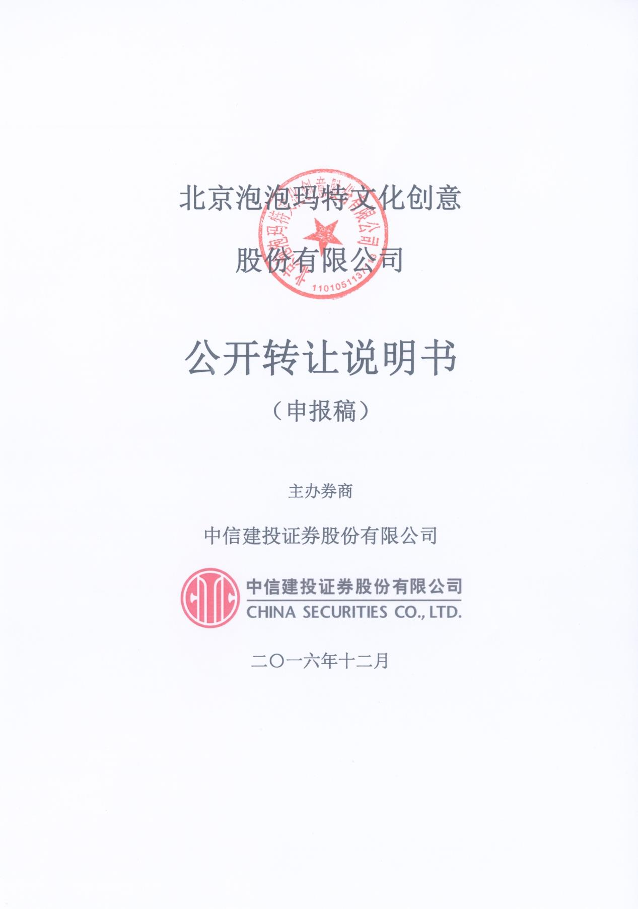

## 原PDF第2页

[对照原PDF第2页](../新三板时期/2016年公开转让说明书.pdf#page=2)

北京泡泡玛特文化创意股份有限公司公开转让说明书

声明

本公司及全体董事、监事、高级管理人员承诺公开转让说明书不存在虚假记

载、误导性陈述和重大遗漏，并对其真实性、准确性、完整性承担个别和连带的

法律责任。

本公司负责人和主管会计工作的负责人、会计机构负责人保证公开转让说明

书中财务会计资料真实、完整。

中国证监会、全国中小企业股份转让系统有限责任公司（以下简称“全国股

份转让系统公司”）对本公司股票公开转让所作的的任何决定或意见，均不表明

其对本公司股票的价值或投资者的收益作出实质性判断或者保证。任何与之相反

的声明均属虚假不实陈述。

根据《证券法》的规定，本公司经营与收益的变化，由本公司自行负责，由

此变化引致的投资风险，由投资者自行承担。

2

## 原PDF第3页

[对照原PDF第3页](../新三板时期/2016年公开转让说明书.pdf#page=3)

北京泡泡玛特文化创意股份有限公司公开转让说明书

重大事项提示

一、特别提醒投资者注意“风险因素”中的下列风险

本节扼要披露特别提醒投资者注意的风险因素。投资者应认真阅读公开转让

说明书“第四节公司财务”之“十一、风险因素”的全部内容，充分了解本公司所披

露的风险因素。

（一）经济行业整体发展增速放缓的风险

零售行业受宏观经济周期性波动影响较大，宏观经济增长时，居民人均可支

配收入增加，消费者信心提升，当期消费增长；宏观经济衰退时，居民收入受到

负面影响，对于未来收入的预期也会降低，往往减少当期消费。近年来，伴随着

国际金融危机的影响，全球总需求进行收缩式调整，我国宏观经济也出现结构调

整及增速放缓，行业景气度整体趋于稳定，社会消费品零售总额增长速度虽高于

GDP 增速，但也呈现放缓趋势。行业发展速度放缓，降低了跨国零售企业的扩

张速度，给本土企业留下了较为充分的生长空间，但如果宏观经济出现持续性恶

化，行业发展速度持续降低，则不利于公司长远发展。

（二）新兴商业业态的风险

近几年，随着科技的进步、电子商务和网络经济的发展，以及第三方物流配

送的兴起，网络购物的行为方式越来越受到消费者的欢迎。对于消费者而言，网

络购物搜索商品的功能快捷便利，为消费者节省了大量时间；而对于生产商和零

售商，网络购物可以减少交易环节，拓宽销售渠道，因而网络购物成为近几年发

展较快的新兴零售业态。泡泡玛特虽然致力于精心打造线下购物体验，倡导回归

体验消费的商业本质，但是公司线上社群 APP 配合线下连锁的立体化经营模式

如果未能得到市场的普遍认可，在电子商务抢占传统零售市场份额的趋势下，公

司难免会有受到新兴商业业态冲击的风险。

（三）行业激烈竞争的风险

零售业是我国开放早、市场化程度高、竞争激烈的行业之一。随着我国经济

的高速发展，特别是 2004 年 12 月 11 日后全面取消了对外资投资国内零售企业

在地域及持股比例等方面的限制，外资企业以多种形式进入中国百货零售市场，

3

## 原PDF第4页

[对照原PDF第4页](../新三板时期/2016年公开转让说明书.pdf#page=4)

北京泡泡玛特文化创意股份有限公司公开转让说明书

其先进的运营理念和管理方式加剧了国内市场的竞争。公司的主要国际竞争对手

日本零售商 LOFT 已经尝试在上海开店，如果国内同业态的竞争进一步加剧，公

司细分市场的先发优势将有受到挑战的风险。

（四）新开门店选址的风险

零售百货企业的发展一方面要通过提高现有门店的经营管理水平和现有门

店每平方米的使用效率，从而促进经营业绩的内涵式增长；另一方面通常会选择

新设门店来扩大经营规模，从而实现规模效益的外延式扩张。在外延式扩张中，

门店的选址极为重要，需要综合考虑目标消费群体的构成、居民消费支付能力、

预期客流量、交通便利条件、商业辐射能力、可选用的门店面积和附近已有或潜

在的商业竞争程度，以及是否能以合适的价格购买或租赁经营场地等多种因素。

门店选址一旦失当，不仅会使既定的目标市场地位难以实现，而且也会因开店前

期产生的装修费等资本性支出和筹办费不能收回等因素而给公司带来较大的经

营损失。

（五）经营区域相对集中的风险

公司作为时尚百货的连锁零售企业，经营区域相对集中，28 家门店中，10

家门店分布在北京市，12 家门店分布在江苏省。受宏观经济环境、人均收入、

竞争情况等因素的影响，各区域门店呈现不同的发展趋势。未来，如果公司集中

销售地区的经济发展速度、消费水平及市场规模等发生不利变化，可能会对公司

带来不利影响。

（六）人才短缺的风险

公司所从事的百货零售属于竞争性行业，公司经营成功与否，很大程度上与

各级管理人员的业务管理能力有关。尽管公司的经营日渐规范化、标准化和程序

化，公司的人才培养机制也日趋成熟，降低了对个别人才的依赖程度，但如果发

生了核心人员大量流失或者出现大规模扩张导致人才不足的情形，很可能影响公

司发展战略的顺利执行和业务的正常运营，增加经营的不确定性风险。

（七）公司管理能力不能支持业务拓展的风险

截至本说明书签署日，公司共有 28 家门店正在经营之中，虽然公司拥有较

强的管理能力与较完善的管理制度体系，但未来随着公司规模不断扩大，将对公

4

## 原PDF第5页

[对照原PDF第5页](../新三板时期/2016年公开转让说明书.pdf#page=5)

北京泡泡玛特文化创意股份有限公司公开转让说明书

司资源配置能力以及日常管理能力提出更高的要求，如果公司管理水平的提升不

能支持公司业务拓展的需要，则可能对公司日常运营和发展造成不利影响。

（八）供应商渠道的风险

公司属于时尚百货业态的零售连锁业，该行业内企业毛利率波动较大，能否

以较低的成本获得稳定货源对公司的业绩影响较大。公司能否在未来较长一段时

间内维持与知名时尚潮流品牌商的合作，并不断拓展深化合作关系，对公司的持

续发展至关重要。公司与品牌供应商的合约通常一年一签，如果大量主要供应商

终止与公司的合约或者未续约，而公司未能及时找到其他合适的品牌供应商替代，

可能会对公司的经营产生一定的风险。

（九）品牌运营风险

潮流品牌具有较强的时效性特点，这要求企业必须准确把握流行趋势、推出

符合甚至带动市场潮流的产品，从而在激烈的市场竞争中生存。如若不能准确把

握流行趋势，将直接影响到公司的持续盈利能力。另外，多品牌也给公司带来了

一定的管理风险；此外，多个品牌在市场中也存在着一定程度的竞争，如何对各

个品牌进行定位和管理，从而最大程度地实现各品牌的市场价值，将对公司的品

牌运营管理能力提出了一定的挑战性。

（十）已签约品牌授权被临时终止风险

报告期内公司与日本品牌授权方签署的授权协议里均没有约定授权期间，公

司解释此为日本方面签署品牌授权协议的行业惯例，虽然公司承诺今后都会在新

协议中要求加入授权期间条款，从以往的合作历史看也并没有授权被终止的情况

发生，但是项目组认为公司报告期内签署的品牌授权被临时终止的风险依旧存在。

（十一）公司存货周转率降低的风险

2016 年 1-5 月、2015 年、2014 年，公司的存货周转率分别为 1.70 次、4.04

次和 4.97 次，而存货余额分别为 9,165,590.74 元、 10,657,358.94 元和 2,846,523.80

元。存货周转率虽然目前呈稳定趋势发展，但公司以自营为主的连锁经营模式决

定了公司库存量较高。加之，公司连锁门店数量较多并处于扩张阶段，存货管理

与配送难度会不断加大，若届时存货周转率降低，存货周转速度变慢，导致资金

占用水平偏高，存货积压，企业的变现能力以及资金使用效率可能会受到一定的

5

## 原PDF第6页

[对照原PDF第6页](../新三板时期/2016年公开转让说明书.pdf#page=6)

北京泡泡玛特文化创意股份有限公司公开转让说明书

负面影响。

（十二）对个别商品品类、品牌依赖的风险

2015 年开始，公司所售 SonnyAngel 系列商品销售额占主营业务收入比重迅

速攀升，公司零售业务出现了对热销商品依赖的迹象，虽然公司在 2016 年签署

了多个新的收藏类玩具授权，努力摆脱对个别品类的依赖，但是在热销商品种类

足够丰富、收入贡献逐渐均衡前，SonnyAngel 系列商品授权如若被终止，将对

公司的营收产生不利影响。

（十三）经营性现金流量净额为负的风险

2016 年 1-5 月、2015 年、2014 年，公司的经营性现金流量净额分别为

-4,012,968.85 元、-16,643,471.00 元和-8,237,819.23 元。经营性现金流量为负主

要是因新增门店的经营性现金流出较大所致。如果未来几年新增门店销售收入产

生的经营性现金流入不能覆盖应付供应商的货款和主要的固定成本支出，公司的

经营性现金流量净额仍可能出现负数，进而对公司的持续经营能力产生不利影响。

（十四）突发事件的风险

公司门店是面向社会公众开放的公共场所，而且经常举行大型促销活动，包

括公共卫生事件和社会安全事件等在内的突发公共事件，很可能对事件所涉及门

店的正常经营带来风险。在事件发生后，公司仍有可能继续面临公众在安全、质

量等方面的信任危机，并在一段时间内对公司经营产生不利影响。消费者若在公

司门店内发生意外或受到不法伤害，有可能会将责任归咎于公司。如果公司依法

须承担消费者的损失赔偿责任，将会对公司造成损失并产生负面影响。

（十五）商品责任风险

向消费者销售产品时，本公司属于销售者一方，需要承担产品质量安全以及

产品售后服务等义务。根据《中华人民共和国产品质量法》的规定，由于销售者

的过错使产品存在缺陷，造成人身、他人财产损害的，销售者应当承担赔偿责任。

根据该规定，公司所属门店售出商品存在缺陷的，消费者可依法对本公司提出赔

偿。如果公司依法需要承担消费者的损害赔偿责任，将可能给公司带来一定损失，

并对公司的声誉产生负面影响。

6

## 原PDF第7页

[对照原PDF第7页](../新三板时期/2016年公开转让说明书.pdf#page=7)

北京泡泡玛特文化创意股份有限公司公开转让说明书

目录

声明 ................................................................................................................................ 2

重大事项提示 ................................................................................................................ 3

释义 ................................................................................................................................ 9

一、普通名词释义 .................................................................................................... 9

二、专业名词释义 .................................................................................................. 10

第一节基本情况 ......................................................................................................... 12

一、公司基本情况 .................................................................................................. 12

二、本次挂牌情况 .................................................................................................. 13

三、公司股权结构图 .............................................................................................. 14

四、公司控股股东、实际控制人及主要股东情况 .............................................. 16

五、历史沿革 .......................................................................................................... 24

六、公司子公司设立及变更情况 .......................................................................... 32

七、重大资产重组情况 .......................................................................................... 40

八、公司董事、监事和高级管理人员情况 .......................................................... 41

九、最近两年一期主要会计数据和财务指标 .......................................................... 43

十、与本次挂牌有关的机构 .................................................................................. 45

第二节公司业务 ......................................................................................................... 47

一、公司主要业务及产品和服务的情况 .............................................................. 47

二、公司组织结构及主要运营流程 ...................................................................... 55

三、公司主要技术、资产和资质情况 .................................................................. 57

四、公司员工情况 .................................................................................................. 76

五、销售及采购情况 .............................................................................................. 78

六、商业模式 .......................................................................................................... 85

七、公司所处行业基本情况 .................................................................................. 93

八、公司所处行业的竞争情况和公司优劣势 .................................................... 111

九、公司未来两年的发展计划 ............................................................................ 117

第三节公司治理 ....................................................................................................... 120

一、股东大会、董事会、监事会的建立健全及运行情况 ................................ 120

二、公司投资者权益保护情况 ............................................................................ 121

三、公司及控股股东、实际控制人报告期内违法违规情况 ............................ 123

四、公司与控股股东、实际控制人及其控制的其他企业在业务、资产、人员、财务和机构方面的分开情况 ................................................................................ 126

五、同业竞争 ........................................................................................................ 127

六、公司报告期内资金占用和对外担保情况 .................................................... 129

七、董事、监事、高级管理人员 ........................................................................ 130

第四节公司财务 ....................................................................................................... 138

一、最近两年一期的财务会计报表 .................................................................... 138

7

## 原PDF第8页

[对照原PDF第8页](../新三板时期/2016年公开转让说明书.pdf#page=8)

北京泡泡玛特文化创意股份有限公司公开转让说明书

二、最近两年一期财务会计报告的审计意见 .................................................... 163

三、报告期内采用的主要会计政策﹑会计估计及其变更情况和对公司利润的影响 ............................................................................................................................ 163

四、报告期主要财务指标及利润形成的有关情况 ............................................ 193

五、财务状况分析 ................................................................................................ 218

六、关联方、关联方关系及关联交易 ................................................................ 246

七、股份支付 ........................................................................................................ 254

八、提请投资者关注的财务报表附注中的期后事项、或有事项及其他重要事项................................................................................................................................ 255

九、报告期内资产评估情况 ................................................................................ 255

十、报告期内股利分配政策﹑实际股利分配情况及公开转让后的股利分配政策................................................................................................................................ 256

十一、风险因素 .................................................................................................... 257

第五节有关声明 ....................................................................................................... 265

一、挂牌公司全体董事、监事、高级管理人员声明 ........................................ 265

三、律师事务所声明 ............................................................................................ 267

四、会计师事务所声明 ........................................................................................ 268

五、评估机构声明 ................................................................................................ 269

第六节附件 ............................................................................................................... 270

8

## 原PDF第9页

[对照原PDF第9页](../新三板时期/2016年公开转让说明书.pdf#page=9)

北京泡泡玛特文化创意股份有限公司公开转让说明书

释义

在本说明书中，除非另有所指，下列词语具有如下含义：

一、普通名词释义

```text
公司、本公司、股份公司、泡泡玛特            北京泡泡玛特文化创意股份有限公司
     泡泡玛特有限、有限公司                 公司前身“北京泡泡玛特贸易有限公司”
       金鹰泡泡、南京泡泡           南京金鹰泡泡玛特商贸有限公司，即公司的控股子公司
            葩趣科技                    北京葩趣科技有限公司，即公司的全资子公司
       金鹰集团、金鹰商贸                   金鹰国际商贸集团（中国）有限公司
             墨池山                      北京墨池山创业投资管理中心（有限合伙）
            启赋创业                        北京启赋创业投资中心（有限合伙）
            金慧丰倍                       北京金慧丰倍盈投资企业（有限合伙）
            中青合睿                    北京中青合睿创业投资合伙企业（有限合伙）
            凤博汇鑫                        北京凤博汇鑫投资中心（有限合伙）
            精舍科技                     深圳市精舍科技投资合伙企业（有限合伙）
            启赋聚通                   广州市启赋聚通创业投资合伙企业（有限合伙）
            国睿中青                        北京国睿中青创业投资管理有限公司
            上海华强                               上海华强投资有限公司
            浙江中赢                        浙江中赢股权投资基金管理有限公司
            金慧丰泰                     宁波金慧丰泰盈投资合伙企业（有限合伙）
            横琴合享                    珠海横琴合享创新投资合伙企业（有限合伙）
            宁波梅山                宁波梅山保税港区愿创投资合伙企业（有限合伙）
            泡泡投资                        北京泡泡玛特投资企业（有限合伙）
            股东大会                    北京泡泡玛特文化创意股份有限公司股东大会
             股东会                          北京泡泡玛特贸易有限公司股东会
             董事会                      北京泡泡玛特文化创意股份有限公司董事会
             监事会                      北京泡泡玛特文化创意股份有限公司监事会
              三会                             股东（大）会、董事会、监事会
```

《股东大会议事规则》、《董事会议事规则》、《监事“三会”议事规则

会议事规则》

公司章程  《北京泡泡玛特文化创意股份有限公司章程》

9

## 原PDF第10页

[对照原PDF第10页](../新三板时期/2016年公开转让说明书.pdf#page=10)

北京泡泡玛特文化创意股份有限公司公开转让说明书

```text
     高级管理人员                           公司总经理、财务负责人
主办券商、中信建投证券                     中信建投证券股份有限公司
         律师                                北京市中银律师事务所
  会计师、申报会计师                 北京兴华会计师事务所（特殊普通合伙）
        评估师                               银信资产评估有限公司
 全国股份转让系统公司                全国中小企业股份转让系统有限责任公司
      《公司法》                           《中华人民共和国公司法》
      《证券法》                           《中华人民共和国证券法》
 报告期、最近两年一期                    2014 年、2015 年和 2016 年 1-5 月
```

二、专业名词释义

IP  Intellectual Property，知识产权，是一种无形的财产权，也称智力成果权在以向消费者销售商品为主并提供相关服务的零售行业中，零售企业为满足不同的消费需求进行进行相应的要素组合而形成的不同经营形态。零售业按零售店铺的经营方式、商品结构、服务功能，以及选址、商圈、规模、零售业态店堂设施、目标顾客和有无固定营业场所进行分类，分为食杂店、便利店、折扣店、超市、仓储会员店、百货店、专业店、专卖店、购物中心、厂家

```text
                直销中心、电视购物、邮购、网上商店、自动售货亭、直销、电话购物等
电子商务        以电子交易方式进行交易活动和相关服务的活动
                零售环节属于直接向消费者提供商品及服务的环节，零售环节位于商品流
  零售          通终端，是流通过程与消费领域的结合点，也是商品流通的最后关口，当
                商品经过零售送达消费者手中，商品运动也就最后终止
商场联营        供应商借用商场内部场地进行经营，由商场统一管理的经营
  自营          生产者直接经营自己的产品
                一种以一定费用借贷实物的经济行为，出租人将自己所拥有的某种物品交
  租赁          与承租人使用，承租人由此获得在一段时期内使用该物品的权利，但物品
                的所有权仍保留在出租人手中
```

消费粘性是指消费者基于对品牌或产品的认知与情感，在面临转换压力或消费粘性其他因素影响时不改变其持续消费该品牌产品的性质

VF 集团是全球最大的上市成衣公司之一。该公司拥有一系列的国际品牌VF 集团  产品：牛仔休闲服饰、内衣、工装服饰、针织品、童装、背包及泳装等等，该公司大部分品牌在全球 150 多个国家的的销售市场上处于领先地位。

Wal-Mart Stores,Inc，上市公司(NYSE:WMT), 包括沃尔玛(中国)投资有限沃尔玛公司等在中国经营业务的子公司,全球最大的零售集团

京东  北京京东世纪贸易有限公司，是中国赴美上市的大型综合型电商平台

天猫（英语：Tmall，亦称淘宝商城、天猫商城），是中国最大的企业提天猫供消费者购物的网站，由淘宝网分离而成

10

## 原PDF第11页

[对照原PDF第11页](../新三板时期/2016年公开转让说明书.pdf#page=11)

北京泡泡玛特文化创意股份有限公司公开转让说明书

```text
陌陌科技        北京陌陌科技有限公司
咖啡之翼        北京咖啡之翼品牌管理有限公司
```

Carrefour Group，法国最大的零售企业,全球第二大零售集团,包括其在中国家乐福

```text
                   经营所有业务,如家乐福(中国)管理咨询服务有限公司
   大商集团        大商集团股份有限公司，上市代码为 600694
   万达集团        大连万达集团股份有限公司，上市代码为 03699
王府井百货集团     北京王府井百货(集团)股份有限公司，上市代码为 600859
```

英文 Point of Sales 的缩写，意为销售点终端。将其安装在银行卡的特约商POS  户和受理网点中与计算机联成网络，可以实现电子资金自动转账，具有支持消费、预授权、余额查询、转账等功能

O2O 即 Online To Offline（在线离线／线上到线下），是指将线下的商务O2O机会与互联网结合，让互联网成为线下交易的前台

本公开转让说明书中任何表格中若出现总数与表格所列数值总和不符，均为

采用四舍五入所致。

11

## 原PDF第12页

[对照原PDF第12页](../新三板时期/2016年公开转让说明书.pdf#page=12)

北京泡泡玛特文化创意股份有限公司公开转让说明书

第一节基本情况

一、公司基本情况

中文名称：北京泡泡玛特文化创意股份有限公司

英文名称：Beijing Pop Mart Cultural & Creative Corp., Ltd.

法定代表人：王宁

有限公司设立日期：2010 年 10 月 20 日

股份公司设立日期：2016 年 07 月 05 日

统一社会信用代码：911101055636846881

注册资本：2549.5047 万元

实收资本：2549.5047 万元

住所：北京市朝阳区阜通东大街 1 号院 3 号楼 3 单元 23 层 132707

邮编：100102

电话：010-57076701

传真：010-57076701-8044

网址：http://www.popmart.com

邮箱：popmart@popmart.com

信息披露事务负责人：司德

所属行业：根据中国证监会 2012 年修订的《上市公司行业分类指引》，公司所

处行业属于“F 批发和零售业”下的“F52 零售业”。按照国家统计局发

布的《国民经济行业分类》（GB/T 4754-2011），公司所在行业属于

“F 批发和零售业-F52 零售业- F521 综合零售- F5211 百货零售”。根据

全国中小企业股份转让系统 2015 年发布的《挂牌公司管理型行业分

类指引》，公司所处的行业属于“F 批发和零售业-F52 零售业- F521

综合零售- F5211 百货零售”；根据全国中小企业股份转让系统 2015

年发布的《挂牌公司投资型行业分类指引》，公司所处的行业属于“13

12

## 原PDF第13页

[对照原PDF第13页](../新三板时期/2016年公开转让说明书.pdf#page=13)

北京泡泡玛特文化创意股份有限公司公开转让说明书

非日常生活消费品-1314 零售业-131412 多元化零售-13141210 百货商

店”。

经营范围：组织文化艺术交流活动（不含演出）；销售工艺品、花卉、文具用品、

计算机、软件及辅助设备、服装、装饰、鞋帽、箱包、日用品、电子

产品、照相器材、钟表眼镜、饰品、化妆品、玩具；出租商业用房；

包装服务（不含气体包装）；企业管理咨询；企业策划；产品设计；

货物进出口、技术进出口、代理进出口；餐饮服务（限分支机构经营）；

销售食品。（企业依法自主选择经营项目，开展经营活动；依法须经

批准的项目，经相关部门批准后依批准的内容开展经营活动；不得从

事本市产业政策禁止和限制类项目的经营活动。）

主营业务：泡泡玛特（POP MART）是一家集设计、采购、销售于一体的时尚潮

品零售公司。主要从事时尚潮品的连锁经营零售业务、定制业务及批

发业务。其中零售业务包括 IP 收藏类、自主品牌类、家居生活类、

数码影音类、食品糖果类、服饰配饰类等。公司意在为都市潮流青年

打造全新的 Life Style（生活风格）体验。

二、本次挂牌情况

（一）挂牌股票情况

股票代码：【】

股票简称：泡泡玛特

股票种类：人民币普通股

每股面值：1.00 元

股票总量：25,495,047 股

挂牌日期：【】

挂牌后的转让方式：协议转让

（二）股票限售安排

根据《公司法》第一百四十一条规定：“发起人持有的本公司股份，自公司

13

## 原PDF第14页

[对照原PDF第14页](../新三板时期/2016年公开转让说明书.pdf#page=14)

北京泡泡玛特文化创意股份有限公司公开转让说明书

成立之日起一年内不得转让。公司公开发行股份前已发行的股份，自公司股票在

证券交易所上市交易之日起一年内不得转让。公司董事、监事、高级管理人员应

当向公司申报所持有的本公司的股份及其变动情况，在任职期间每年转让的股份

不得超过其所持有本公司股份总数的百分之二十五；所持本公司股份自公司股票

上市交易之日起一年内不得转让。上述人员离职后半年内，不得转让其所持有的

本公司股份。公司章程可以对公司董事、监事、高级管理人员转让其所持有的本

公司股份作出其他限制性规定。”

《全国中小企业股份转让系统业务规则（试行）》2.8 条规定：“挂牌公司控

股股东及实际控制人在挂牌前直接或间接持有的股份分三批解除转让限制，每批

解除转让限制的数量均为其挂牌前所持股票的三分之一，解除转让限制的时间分

别为挂牌之日、挂牌期满一年和两年。

挂牌前十二个月以内控股股东及实际控制人直接或间接持有的股票进行过

转让的，该股票的管理按照前款规定执行，主办券商为开展做市业务取得的做市

初始库存股票除外。

因司法裁决、继承等原因导致有限售期的股票持有人发生变更的，后续持有

人应继续执行股票限售规定。”

此外，《公司章程》第十一条规定：“公司董事、监事、高级管理人员应当

向公司申报所持有的本公司的股份及其变动情况，在任职期间每年转让的股份不

得超过其所持有本公司股份总数的 25%。上述人员离职后半年内，不得转让其所

持有的本公司股份。”

公司股东出具承诺，承诺将按照上述规定履行股份锁定义务。除此之外，公

司股东对其所持股份未作出其他自愿锁定的承诺。

公司股东持股及挂牌后可转让股份基本情况如下：

```text
                                                           可转让股
序                       持股数量   持股比例    限售股份               限售原
         股东姓名                                           份数量
号                        （股）      （%）    数量（股）                因
                                                            （股）
                                                                      发起人、
 1         王宁          12,128,000   47.5700   12,128,000     -      董事长、
                                                                      总经理
```

14

## 原PDF第15页

[对照原PDF第15页](../新三板时期/2016年公开转让说明书.pdf#page=15)

北京泡泡玛特文化创意股份有限公司公开转让说明书

```text
     金鹰国际商贸集团
 2                        4,646,667   18.2258    4,646,667     -       发起人
     （中国）有限公司
                                                                      发起人、
 3         麦刚           1,570,000    6.1581    1,570,000     -
                                                                      董事
     北京墨池山创业投
 4   资管理中心（有限     1,200,600    4.7092    1,200,600     -       发起人
          合伙）
     北京泡泡玛特投资
 5                        1,178,947    4.6242    1,178,947     -       发起人
     企业（有限合伙）
     北京启赋创业投资
 6                        1,121,400    4.3985    1,121,400     -       发起人
     中心（有限合伙）
     北京金慧丰倍盈投
 7                         533,333     2.0919     533,333      -       发起人
     资企业（有限合伙）
     广州市启赋聚通创
 8    业投资合伙企业       333,333     1.3074     333,333      -       发起人
       （有限合伙）
     北京中青合睿创业
 9   投资合伙企业（有      266,667     1.0459     266,667      -       发起人
         限合伙）
     北京凤博汇鑫投资
10                         266,667     1.0459     266,667      -       发起人
     中心（有限合伙）
     深圳市精舍科技投
11   资合伙企业（有限      200,000     0.7845     200,000      -       发起人
          合伙）
     北京国睿中青创业
12                         133,333     0.5230     133,333      -       发起人
     投资管理有限公司
     上海华强投资有限
13                         589,600     2.3126           -    589,600
           公司
     浙江中赢股权投资
14                         589,600     2.3126           -    589,600
     基金管理有限公司
     珠海横琴合享创新
15   投资合伙企业（有      265,300     1.0406           -    265,300
         限合伙）
     宁波梅山保税港区
16   愿创投资合伙企业      176,800     0.6935           -    176,800
       （有限合伙）
     宁波金慧丰泰盈投
17   资合伙企业（有限      294,800     1.1563           -    294,800
          合伙）
         合计           25,495,047     100.00   23,578,947  1,916,100
```

15

## 原PDF第16页

[对照原PDF第16页](../新三板时期/2016年公开转让说明书.pdf#page=16)

北京泡泡玛特文化创意股份有限公司公开转让说明书

三、公司股权结构图

四、公司控股股东、实际控制人及主要股东情况

（一）控股股东基本情况

1、控股股东的认定

王宁先生现直接持有公司股份 1,212.8 万股，占公司总股本的 47.5701%；间

接持有公司股份 14.3832 万股，占公司总股本的 0.5642%。合计持有公司

1,227.1832 万股，占公司总股本的 48.1343%。现任公司董事长、总经理，为公

司的第一大股东，故认定为公司的控股股东。

2、控股股东的基本情况

王宁先生，董事长、总经理，中国国籍，无境外永久居留权，1987 年生，

本科学历。2005 年 9 月至 2009 年 6 月，就读于郑州大学西亚斯国际学院，主修

广告学，取得学士学位；2014 年至今，就读于北京大学，主修工商管理硕士。

2010 年 10 月至 2016 年 7 月，任北京泡泡玛特贸易有限公司董事、总经理； 2016

年 7 月至今，任北京泡泡玛特文化创意股份有限公司董事长、总经理。

3、报告期内，控股股东的变化情况

自 2014 年 1 月 1 日至公开转让说明书出具之日，公司控股股东始终为王宁，

控股股东未发生变化。

16

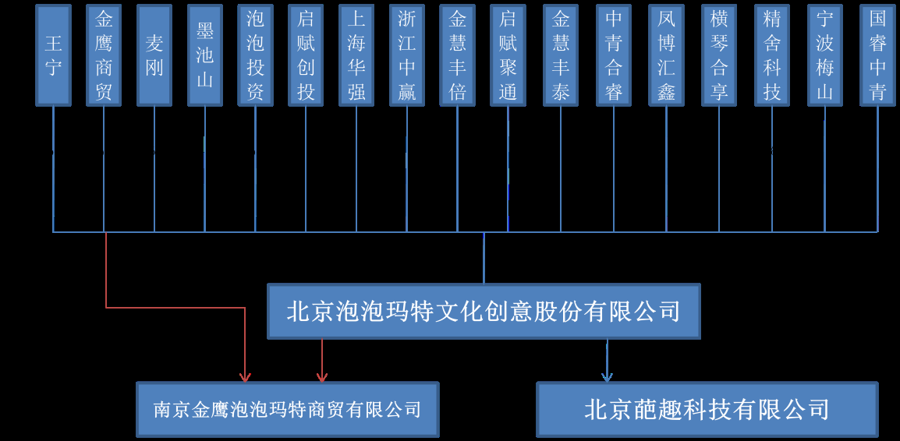

## 原PDF第17页

[对照原PDF第17页](../新三板时期/2016年公开转让说明书.pdf#page=17)

北京泡泡玛特文化创意股份有限公司公开转让说明书

（二）实际控制人基本情况

1、实际控制人的认定

王宁先生现直接持有公司股份 1,212.8 万股，占公司总股本的 47.5701%，间

接持有公司股份 14.3832 万股，占公司总股本的 0.5642%，合计持有公司

1,227.1832 万股，占公司总股本的 48.1343%，是公司第一大股东，现任公司董

事长、总经理；杨涛女士间接持有公司股份 20.7966 万股，占公司总股本的

0.8157%,现任公司董事、商品总监；王宁、杨涛为夫妻关系，二人合计持有公司

1,247.9798 万股，占公司总股本 48.95%，实际控制着公司的经营管理，故认定

王宁、杨涛夫妻二人为公司实际控制人。

2、实际控制人基本情况

王宁先生，具体情况详见本节之“四、公司控股股东、实际控制人及主要股

东情况”之“（一）控股股东基本情况”。

杨涛女士，董事，中国国籍，无境外永久居留权，1987 年生，研究生学历。

2005 年 9 月至 2009 年 6 月，就读于郑州大学西亚斯国际学院，主修商务英语，

取得学士学位；2009 年 9 月至 2010 年 11 月，就读于香港浸会大学，取得大众

传媒管理硕士学位。2010 年至 2016 年 7 月，任北京泡泡玛特贸易有限公司商品

总监；2016 年 7 月至今，任北京泡泡玛特文化创意股份有限公司董事、商品总

监。

3、报告期内，实际控制人的变化情况

自 2014 年 1 月 1 日至公开转让说明书出具之日，公司实际控制人始终为王

宁和杨涛夫妇，实际控制人未发生变化。

（三）主要股东情况

1、本公司股东及其持股情况

```text
序号            股东名称             持股数（股）     持股比例（%）  出资方式
  1               王宁                    12,128,000        47.57       净资产
        金鹰国际商贸集团（中国）
  2                                        4,646,667      18.2258       净资产
                有限公司
  3               麦刚                     1,570,000       6.1581       净资产
  4     北京墨池山创业投资管理             1,200,600       4.7092       净资产
```

17

## 原PDF第18页

[对照原PDF第18页](../新三板时期/2016年公开转让说明书.pdf#page=18)

北京泡泡玛特文化创意股份有限公司公开转让说明书

```text
          中心（有限合伙）
       北京泡泡玛特投资企业（有
 5                                        1,178,947       4.6242       净资产
               限合伙）
       北京启赋创业投资中心（有
 6                                        1,121,400       4.3985       净资产
               限合伙）
 7      上海华强投资有限公司                589,600       2.3126         货币
       浙江中赢股权投资基金管
 8                                          589,600       2.3126         货币
             理有限公司
       北京金慧丰倍盈投资企业
 9                                          533,333       2.0919       净资产
            （有限合伙）
       广州市启赋聚通创业投资
10                                          333,333       1.3074       净资产
        合伙企业（有限合伙）
       宁波金慧丰泰盈投资合伙
11                                          294,800       1.1563         货币
          企业（有限合伙）
       北京中青合睿创业投资合
12                                          266,667       1.0459       净资产
         伙企业（有限合伙）
       北京凤博汇鑫投资中心（有
13                                          266,667       1.0459       净资产
               限合伙）
       珠海横琴合享创新投资合
14                                          265,300       1.0406         货币
         伙企业（有限合伙）
       深圳市精舍科技投资合伙
15                                          200,000       0.7845       净资产
          企业（有限合伙）
       宁波梅山保税港区愿创投
16                                          176,800       0.6935         货币
       资合伙企业（有限合伙）
       北京国睿中青创业投资管
17                                          133,333        0.523       净资产
             理有限公司
            合计                         25,495,047       100.00            -
```

2 、公司前五大股东基本情况

（1）王宁先生，具体情况参见本节“四、公司控股股东、实际控制人及主要

股东情况”。

（2）金鹰国际商贸集团（中国）有限公司，持股 464.6667 万股，占公司股

本的 18.2258%。为公司持股 5%以上的股东，基本信息如下：

名称金鹰国际商贸集团（中国）有限公司

统一社会信用代码91320100721756748P

主要经营场所南京市秦淮区汉中路 89 号

类型有限责任公司(外国法人独资)

法定代表人

王恒

18

## 原PDF第19页

[对照原PDF第19页](../新三板时期/2016年公开转让说明书.pdf#page=19)

北京泡泡玛特文化创意股份有限公司公开转让说明书

注册资本  113,700 万

日用百货、针纺织品、五金交电、保健品、摩托车及配件、工艺品（不含名人字画）、照相器材、钟表眼镜、鞋帽、箱包、通讯器材（不含卫星地面设施）、体育用品、初级农产品、预包装食品兼散装食品、乳制品（含婴儿配方乳粉）、酒、医疗器械具、金银制品、家具、装饰材料、建筑材料的批发、零售、佣金代理（拍卖除外）；物业服务；经营范围美容服务；图书、报刊零售；对国内法人企业进行柜台出租；自营商品的加工、分级包装；商品的进出口业务，以及相关的仓储、送货、安装、维修、停车等配套服务和相关的咨询服务。（涉及法律、法规禁止经营的不得经营）（依法须经批准的项目，经相关部门批准后方

```text
                                     可开展经营活动）
成立日期                             2000 年 05 月 12 日
经营期限                   2000 年 05 月 12 日至 2035 年 10 月 10 日
```

金鹰国际商贸集团（中国）有限公司的股权结构如下：

```text
序号              股东名称                 持股数量（万股）       出资比例（%）
  1         金鹰国际贸易有限公司                      113,700.00           100.00
                合计                                  113,700.00           100.00
```

（3）麦刚先生，董事，中国国籍，无境外永久居留权，1974 年生，硕士学

历。1992 年 9 月至 1996 年 6 月，就读于中国人民大学，主修经济学，取得学士

学位；2001 年 9 月至 2003 年 6 月，就读于加州大学洛杉矶分校，取得工商管理

硕士学位。1996 年至 1998 年，任职于深圳高速股份有限公司证券部；1998 年至

2000 年，任上海浦东科创投资有限公司副总经理；2000 年至 2001 年，任深圳国

际控股有限公司投资部总经理；2002 年至 2005 年，任美国 DFJ Dragon 基金董

事；2003 年至 2006 年，任北京亿友网络科技有限公司董事长；2007 年至今，任

万里播（北京）网络技术有限公司董事长。2014 年 5 月至 2016 年 7 月，任北京

泡泡玛特贸易有限公司董事；2016 年 7 月至今，任北京泡泡玛特文化创意股份

有限公司董事。

（4）北京墨池山创业投资管理中心（有限合伙）持股数量为 120.06 万股，

占本公司总股本的 4.7092%。基本信息如下：

名称  北京墨池山创业投资管理中心（有限合伙）

19

## 原PDF第20页

[对照原PDF第20页](../新三板时期/2016年公开转让说明书.pdf#page=20)

北京泡泡玛特文化创意股份有限公司公开转让说明书

```text
   住所              北京市通州区潞苑南大街 1093 号商-093 路东(办公楼六楼)
  注册号                              110112014996272
法定代表人                                  程富
 企业类型                               有限合伙企业
```

投资管理、投资咨询；企业管理咨询。（依法须经批准的项目，经相

```text
经营范围
                         关部门批准后依批准的内容开展经营活动。）
成立日期                             2012 年 06 月 12 日
经营期限                   2012 年 06 月 12 日至 2032 年 06 月 11 日
```

北京墨池山创业投资管理中心（有限合伙）的出资情况如下：

```text
序号           合伙人姓名或名称               认缴出资额（万元）        出资比例（%）
  1                   于晶                                   3,000.00              30.00
  2                   程富                                   3,000.00              30.00
  3                  蔡晓东                                  4,000.00              40.00
                 合计                                       10,000.00             100.00
```

（5）北京泡泡玛特投资企业（有限合伙）持股数量为 117.8947 万股，占本

公司总股本的 4.6242%。基本信息如下：

```text
      名称                       北京泡泡玛特投资企业（有限合伙）
      住所             北京市朝阳区阜通东大街 1 号院 3 号楼 3 单元 23 层 132707
统一社会信用代码                       91110105MA001HT899
 执行事务合伙人                                王宁
    企业类型                               有限合伙企业
```

项目投资；投资管理；资产管理；投资咨询；企业管理咨询。（“1、未经有关部门批准，不得以公开方式募集资金；2、不得公开开展证券类产品和金融衍生品交易活动；3、不得发放贷款；4、不得对所投资经营范围企业以外的其他企业提供担保； 5、不得向投资者承诺投资本金不受损失或者承诺最低收益”；下期出资时间为 2035 年 06 月 08 日；企业依法自主选择经营项目，开展经营活动；依法须经批准的项目，经相关

20

## 原PDF第21页

[对照原PDF第21页](../新三板时期/2016年公开转让说明书.pdf#page=21)

北京泡泡玛特文化创意股份有限公司公开转让说明书

部门批准后依批准的内容开展经营活动；不得从事本市产业政策禁止

```text
                                和限制类项目的经营活动。）
成立日期                             2015 年 10 月 29 日
经营期限                       2015 年 10 月 29 日至无固定期限
```

北京泡泡玛特投资企业（有限合伙）的出资情况如下：

```text
序号      合伙人姓名或名称         认缴出资额（万元）         出资比例（%）
  1              肖杨                             18.0379                   15.30
  2             宣毅郎                            15.2084                   12.90
  3              张超                              4.0674                    3.45
  4              杨涛                             20.7966                   17.64
  5              司德                             11.3768                    9.65
  6              王宁                             14.3832                   12.20
  7              刘冉                             21.8813                   18.56
  8             李长如                             8.8421                    7.50
  9             傅文文                             0.9432                    0.80
 10             杨晓宽                             2.3579                    2.00
            合计                                 117.8947                  100.00
```

3、法人股东私募基金备案情况的核查

经核查，墨池山、启赋创业、启赋聚通、金慧丰、凤博汇鑫、横琴合享、金

慧丰泰七名股东属于私募投资基金，已根据《私募投资基金监督管理暂行办法》

及《私募投资基金管理人登记和基金备案办法（试行）》的规定履行了私募基金

备案登记手续。

私募备案情况：北京墨池山创业投资管理中心（有限合伙）已在中国证券投

资基金业协会备案，备案编码为 S29736，其管理人深圳市启赋资本管理有限公

司亦在中国证券投资基金业协会登记，登记编号为 P1001181；

北京启赋创业投资中心（有限合伙）已在中国证券投资基金业协会备案，备

案编码为 SD3271，其管理人深圳市启赋资本管理有限公司亦在中国证券投资基

金业协会登记，登记编号为 P1001181；

广州市启赋聚通创业投资合伙企业（有限合伙）已在中国证券投资基金业协

会备案，备案编码为 S62953，其管理人深圳市启赋资本管理有限公司亦在中国

证券投资基金业协会登记，登记编号为 P1001181；

北京金慧丰倍盈投资企业（有限合伙）已在中国证券投资基金业协会备案，

21

## 原PDF第22页

[对照原PDF第22页](../新三板时期/2016年公开转让说明书.pdf#page=22)

北京泡泡玛特文化创意股份有限公司公开转让说明书

备案编码为 S62673，其管理人北京金慧丰投资管理有限公司亦在中国证券投资

基金业协会登记，登记编号为 P1008307；

北京凤博汇鑫投资中心（有限合伙）已在中国证券投资基金业协会备案，备

案编码为 SD2177，其管理人北京凤博汇富投资管理有限公司亦在中国证券投资

基金业协会登记，登记编号为 P1001160。

珠海横琴合享创新投资合伙企业（有限合伙）已在中国证券投资基金业协

会备案，备案编码为 SK9904，其管理人广东合享投资管理有限公司亦在中国证

券投资基金业协会登记，登记编号为 P1024245。

宁波金慧丰泰盈投资合伙企业（有限合伙）尚未完成备案，宁波金慧丰泰

盈投资合伙企业（有限合伙）的私募基金管理人北京金慧丰投资管理有限公司

已出具承诺函：北京金慧丰投资管理有限公司作为宁波金慧丰泰盈投资合伙企

业（有限合伙）的基金管理人，已于 2016 年 12 月 16 日提交私募投资基金备案

申请，预计 2016 年 12 月 23 日前取得《私募投资基金备案证明》。

4、特殊条款或利益安排核查

公司历次增资中，有 2 次增资协议中存在特殊条款。

1）增资协议中特殊条款的情况如下：

一、2014 年 4 月，公司与金鹰商贸签订的《泡泡玛特项目投资协议书》，

其中第四条第 2 款“泡泡玛特在未来进行股权融资时，甲方享有同等条件下的优

先购买权。原股东如转让全部或部分泡泡玛特的股权时，甲方享有同等条件下的

优先受让权。乙方如要出售其持有的全部或部分股权时，甲方享有优先出售同比

例所持股权的权利”。

二、2015 年 6 月，与金鹰商贸、金慧丰倍、中青合睿、凤博汇鑫、启赋聚

通、精舍科技、国睿中青签订的《泡泡玛特项目投资协议书》中第二条第 4 款“各

方的任何一方如将出资权（股权）的全部或一部分进行转让时，应先行通知其他

股东（投资方）并征得其他股东（投资方）的同意，且其他股东（投资方）有优

先购买权；如其他股东（投资方）在接到通知后的 30 个工作日内不行使优先购

买权则视为同意转让”。

22

## 原PDF第23页

[对照原PDF第23页](../新三板时期/2016年公开转让说明书.pdf#page=23)

北京泡泡玛特文化创意股份有限公司公开转让说明书

2）关于增资协议中之补充协议的情况如下：

一、根据公司与金鹰商贸于 2016 年 9 月签署的关于 2014 年 4 月《泡泡玛特

项目投资合作协议书》之补充协议各方约定如下：

“各方已于 2014 年 4 月 29 日在中国南京市签订了《泡泡玛特项目投资合作

协议书》，根据该协议第八条第 5 款之规定，对该协议未尽事宜，各方通过共同

协商可以作出相关补充协议。

为此，协议各方本着平等互利的原则，经过友好协商，就《泡泡玛特项目投

资合作协议书》，达成以下补充协议：

鉴于北京泡泡玛特文化创意股份有限公司（原北京泡泡玛特贸易有限公司）

已由有限责任公司整体并变更为股份有限公司，并拟申请股票进入全国中小企业

股份转让系统挂牌。各方为北京泡泡玛特文化创意股份有限公司股票成功进入全

国中小企业股份转让系统挂牌及公开转让，一致同意删除原《泡泡玛特项目投资

协议书》中第四条第 2 款“泡泡玛特在未来进行股权融资时，甲方享有同等条件

下的优先购买权。原股东如转让全部或部分泡泡玛特的股权时，甲方享有同等条

件下的优先受让权。乙方如要出售其持有的全部或部分股权时，甲方享有优先出

售同比例所持股权的权利”之规定；

若北京泡泡玛特文化创意股份有限公司在 2016 年 12 月 31 日仍未取得全国

中小企业股份转让系统有限责任公司出具的《同意挂牌函》，本补充协议不再履

行并追溯至本补充协议签署时，本补充协议项下约定的各方权利义务关系终止，

各方继续执行原《泡泡玛特项目投资协议书》所规定的各项条款；

本补充协议签署方为法人的由其法定代表人（或授权代表）签字并加盖公章，

签署方为自然人的，由其本人签字；

本补充协议自在全国中小企业股份转让系统有限责任公司出具北京泡泡玛

特文化创意股份有限公司挂牌的《受理通知书》之日起生效。”

二、根据公司与金鹰商贸、金慧丰倍、中青合睿、凤博汇鑫、启赋聚通、精

舍科技、国睿中青于 2016 年 9 月签署的关于 2015 年 6 月《泡泡玛特项目投资合

作协议书》之补充协议各方约定如下：

23

## 原PDF第24页

[对照原PDF第24页](../新三板时期/2016年公开转让说明书.pdf#page=24)

北京泡泡玛特文化创意股份有限公司公开转让说明书

“各方已于 2015 年 6 月 30 日签署了《北京泡泡玛特贸易有限公司投资协议》，

协议各方本着平等互利的原则，经过友好协商，就《北京泡泡玛特贸易有限公司

投资协议》，达成以下补充协议：

1、鉴于北京泡泡玛特文化创意股份有限公司（原北京泡泡玛特贸易有限公

司）已由有限责任公司整体并变更为股份有限公司，并拟申请股票进入全国中小

企业股份转让系统挂牌。各方为北京泡泡玛特文化创意股份有限公司股票成功进

入全国中小企业股份转让系统挂牌及公开转让，一致同意删除原《北京泡泡玛特

贸易有限公司投资协议》中第二条第 4 款“各方的任何一方如将出资权（股权）

的全部或一部分进行转让时，应先行通知其他股东（投资方）并征得其他股东（投

资方）的同意，且其他股东（投资方）有优先购买权；如其他股东（投资方）在

接到通知后的 30 个工作日内不行使优先购买权则视为同意转让”之规定；

2、若北京泡泡玛特文化创意股份有限公司在 2016 年 12 月 31 日仍未取得全

国中小企业股份转让系统有限责任公司出具的《同意挂牌函》，本补充协议不再

履行并追溯至本补充协议签署时，本补充协议项下约定的各方权利义务关系终止，

各方继续执行原《泡泡玛特项目投资协议书》所规定的各项条款；

3、本补充协议签署方为法人的由其法定代表人（或授权代表）签字并加盖公

章，签署方为自然人的，由其本人签字；

本补充协议自在全国中小企业股份转让系统有限责任公司出具北京泡泡玛

特文化创意股份有限公司挂牌的《受理通知书》之日起生效。”

截止本说明书出具时，除此上述协议外，公司不存在股东签署其他特殊条款。

本公司所持股份不存在质押或其他争议事项，上述股东中，除王宁为北京泡

泡玛特投资企业（有限合伙）的执行事务合伙人之外，其他股东之间不存在关联

关系。

五、历史沿革

（一）2010 年 10 月，一人有限公司成立

北京泡泡玛特贸易有限公司（以下简称“有限公司”）是由王宁以货币形式出

资设立，设立时注册资本为 50.00 万元，实缴 50.00 万元。

24

## 原PDF第25页

[对照原PDF第25页](../新三板时期/2016年公开转让说明书.pdf#page=25)

北京泡泡玛特文化创意股份有限公司公开转让说明书

2010 年 9 月 27 日，泡泡玛特有限向北京市工商局朝阳分局领取了编号为（京

朝）名称预核（内）字\[2010\]第 0133960 号《企业名称预先核准通知书》，核准

企业名称为“北京泡泡玛特贸易有限公司”。

2010 年 10 月 18 日，北京润鹏冀能会计师事务所对泡泡玛特贸易有限公司

股东出资情况进行验审，并出具《验资报告》（京润（验）字【2010】-220395

号）。截至 2010 年 10 月 18 日，公司已收到全体股东缴纳的注册资本（实收资

本）合计人民币 50.00 万元，其中，股东王宁以货币出资 50.00 万元。

2010 年 10 月 20 日，泡泡玛特在北京市工商行政管理局朝阳分局领取了《企

业法人营业执照》。

公司设立时的股权结构如下表：

```text
序号            股东名称           出资金额（元）    出资比例（%）     出资方式
  1               王宁                   500,000.00           100.00     货币
            合计                         500,000.00           100.00       -
```

（二）2012 年 9 月，有限公司第一次股权转让

根据公司 2012 年 9 月 13 日股东会议决议，同意增加新股东麦刚，麦刚、王

宁组成新的股东会；同意王宁将 16%的股权转让给新股东麦刚，王宁持有公司

84%股权，注册资本不变，双方签署出资转让协议书。

2012 年 9 月 21 日，泡泡玛特在北京市工商行政管理局朝阳分局领取了换发

的《企业法人营业执照》。

此次股权转让后，公司的股权结构如下：

```text
序号             股东名称             出资金额（元）    出资比例（%）       出资方式
  1                王宁                     420,000.00            84.00       货币
  2                麦刚                      80,000.00            16.00       货币
               合计                         500,000.00           100.00         -
```

（三）2013 年 5 月，有限公司第一次增资

根据公司 2013 年 5 月 1 日股东会决议，同意有限公司注册资本由 50 万元增

加至 54.0541 万元，新股东北京墨池山创业投资管理中心（有限合伙）以 148 元

/注册资本进行增资，出资人民币 600 万元获得公司 7.50%的股权，其中 4.0541

25

## 原PDF第26页

[对照原PDF第26页](../新三板时期/2016年公开转让说明书.pdf#page=26)

北京泡泡玛特文化创意股份有限公司公开转让说明书

万元计入注册资本，剩余溢价部分 595.9459 万元计入资本公积金。

本次公司引入机构投资者定价，主要参照了企业发展趋势，综合考虑公司的

行业水平、财务和业务状况、未来成长性等，并经投资方与原全体股东协商一致

按照增资后公司整体估值 8,000 万元定价。

本次增资由北京润鹏冀能会计师事务所出具了京润（验）字【2013】-210358

号《验资报告》审验，截至 2013 年 4 月 26 日，公司已收到实收资本 54.0541 万

元。

有限公司修改了《公司章程》，并于 2013 年 5 月 23 日，在北京市工商行政

管理局朝阳分局领取了换发的《企业法人营业执照》。

本次增资后，公司的股权结构如下：

```text
序号              股东名称              出资金额（元）     出资比例（%） 出资方式
                    王宁                       420,000.00            77.70     货币
  1
                    麦刚                        80,000.00            14.80     货币
  2
         北京墨池山创业投资管理中
  3                                             40,541.00             7.50     货币
               心（有限合伙）
               合计                            540,541.00           100.00       -
```

（四）2014 年 5 月，有限公司第二次股权转让、第二次增资

根据公司 2014 年 5 月 6 日的股东会决议，同意王宁将泡泡玛特的出资 1.0811

万元出资额转让给北京墨池山创业投资管理中心（有限合伙）；同意麦刚将持有

泡泡玛特 2.7027 万元出资额转让给北京墨池山创业投资管理中心（有限合伙）；

同意有限公司注册资本由 54.0541 万元增加至 67.4841 万元，新股东金鹰国际商

贸集团（中国）有限公司以 148.18 元/注册资本进行增资。分两批出资人民币 1,990

万元获得公司 19.90%的股权，其中 13.43 万元计入注册资本，剩余溢价部分

1,976.57 万元计入资本公积金。

本次出资未履行验资程序，根据中国工商银行出具的《业务回单（收款）》，

证实金鹰国际商贸集团（中国）有限公司出资的第一笔投资款 1,000 万元已于 2014

年 5 月 4 日转入公司银行账户完成缴纳；第二笔投资款 990 万元已于 2014 年 9

月 16 日转入公司银行账户完成缴纳。

本次公司引入机构投资者定价，主要参照了企业发展趋势，综合考虑公司的

26

## 原PDF第27页

[对照原PDF第27页](../新三板时期/2016年公开转让说明书.pdf#page=27)

北京泡泡玛特文化创意股份有限公司公开转让说明书

行业水平、财务和业务状况、未来成长性等，并经投资方与原全体股东协商一致

按照增资后公司整体估值 10,000 万元定价。

有限公司修改了《公司章程》，并于 2014 年 6 月 25 日，在北京市工商行政

管理局朝阳分局领取了换发的《营业执照》。

本次变更后,公司的股权结构如下:

```text
序号            股东名称            出资金额（元）     出资比例（%）     出资方式
  1               王宁                     409,189.00          60.64       货币
          金鹰国际商贸集团（中
  2                                        134,300.00          19.90       货币
              国）有限公司
          北京墨池山创业投资管
  3                                         78,379.00          11.61       货币
           理中心（有限合伙）
  4               麦刚                      52,973.00           7.85       货币
            合计                           674,841.00         100.00         -
```

（五）2014 年 7 月，有限公司第三次股权转让、第三次增资

根据 2014 年 7 月 28 日股东会决议，同意北京墨池山投资管理中心（有限合

伙）将持有泡泡玛特的出资 3.7838 万元出资额转让给北京启赋创业投资中心；

同意公司注册资本由 67.4841 万元增至 1,000 万元。其中新增注册资本 932.5159

万元由公司“资本公积-溢价”转增”。

2014 年 8 月 15 日，泡泡玛特在北京市工商行政管理局朝阳分局领取了换发

的《营业执照》。

本次变更后,公司的股权结构如下:

```text
序号              股东名称             出资金额（元）     出资比例（%）    出资方式
  1                 王宁                    6,064,000.00          60.64      货币
         金鹰国际商贸集团（中国）
  2                                         1,990,000.00           19.9      货币
                  有限公司
  3                 麦刚                     785,000.00            7.85      货币
         北京墨池山创业投资管理中
  4                                          600,300.00           6.003      货币
              心（有限合伙）
         北京启赋创业投资中心（有
  5                                          560,700.00           5.607      货币
                  限合伙）
               合计                        10,000,000.00         100.00        -
```

27

## 原PDF第28页

[对照原PDF第28页](../新三板时期/2016年公开转让说明书.pdf#page=28)

北京泡泡玛特文化创意股份有限公司公开转让说明书

（六）2015 年 1 月，有限公司第四次增资

根据 2015 年 1 月 1 日股东会决议，同意注册资本由 1,000 万元至 2,000 万元，

其中新增注册资本 1,000 万元由公司“资本公积-溢价”转增”。

2015 年 2 月 10 日，泡泡玛特在北京市工商行政管理局朝阳分局领取了换发

的《营业执照》。

本次变更后,公司的股权结构如下:

```text
序号           股东名称            出资金额（元）      出资比例（%）     出资方式
  1               王宁                  12,128,000.00          60.64       货币
           金鹰国际商贸集团
  2                                      3,980,000.00          19.90       货币
           （中国）有限公司
  3               麦刚                   1,570,000.00           7.85       货币
          北京墨池山创业投资
  4                                      1,200,600.00          6.003       货币
         管理中心（有限合伙）
          北京启赋创业投资中
  5                                      1,121,400.00          5.607       货币
            心（有限合伙）
            合计                        20,000,000.00         100.00         -
```

（七）2015 年 7 月，有限公司第五次增资

根据 2015 年 7 月 20 日股东会决议，同意增加注册资本由 2,000 万元增至 2,240

万元，其中金鹰国际商贸集团中国有限公司以 15 元/注册资本进行增资，出资人

民币 1,000 万元获得公司 2.9762%的股权，其中 66.6667 万元计入注册资本，剩

余溢价部分 933.3333 万元计入资本公积金；北京金慧丰倍盈投资企业（有限合

伙）以 15 元/注册资本进行增资，出资人民币 800 万元获得公司 2.3811%的股权，

其中 53.3333 万元计入注册资本，剩余溢价部分 746.6667 万元计入资本公积金；

广州市启赋聚通创业投资合伙企业（有限合伙）以 15 元/注册资本进行增资，出

资人民币 500 万元获得公司 1.4881%的股权，其中 33.3333 万元计入注册资本，

466.6667 万元计入资本公积金；北京中青合睿创业投资合伙企业（有限合伙）以

15 元/注册资本进行增资，出资人民币 400 万元获得公司 1.1905%的股权，其中

26.6667 万元计入注册资本，剩余溢价部分 373.3333 万元计入资本公积金；北京

凤博汇鑫投资中心（有限合伙）以 15 元/注册资本进行增资，出资人民币 400 万

元获得公司 1.1905%的股权，其中 26.6667 万元计入注册资本，剩余溢价部分

373.3333 万元计入资本公积金；深圳市精舍科技投资合伙企业（有限合伙）以

15 元/注册资本进行增资，出资人民币 300 万元获得公司 0.8929%的股权，其中

28

## 原PDF第29页

[对照原PDF第29页](../新三板时期/2016年公开转让说明书.pdf#page=29)

北京泡泡玛特文化创意股份有限公司公开转让说明书

20 万元计入注册资本，剩余溢价部分 280 万元计入资本公积金；北京国睿中青

创业投资管理有限公司以 15 元/注册资本进行增资，出资人民币 200 万元获得公

司 0.5952%的股权，其中 13.3333 万元计入注册资本，剩余溢价部分 186.6667 万

元计入资本公积金。

本次出资未履行验资程序。交通银行北京市分行开具了《电子回单凭证》，

证实金鹰国际商贸集团中国有限公司出资 1,000 万元投资款已于 2015 年 7 月 30

日转入公司银行账户完成缴纳；北京金慧丰倍盈投资企业（有限合伙）出资 800

万元投资款已于 2015 年 7 月 21 日转入公司银行账户完成缴纳；广州市启赋聚通

创业投资合伙企业（有限合伙）出资 500 万元投资款已于 2015 年 7 月 8 日转入

公司银行账户完成缴纳；北京中青合睿创业投资合伙企业（有限合伙）出资 400

万元投资款已于 2015 年 7 月 17 日转入公司银行账户完成缴纳；北京凤博汇鑫投

资中心（有限合伙）出资 400 万元投资款已于 2015 年 7 月 17 日转入公司银行账

户完成缴纳；深圳市精舍科技投资合伙企业（有限合伙）出资 300 万元投资款已

于 2015 年 7 月 16 日转入公司银行账户完成缴纳；北京国睿中青创业投资管理有

限公司出资 200 万元投资款已于 2015 年 7 月 17 日转入公司银行账户完成缴纳。

本次公司引入机构投资者定价，主要参照了企业发展趋势，综合考虑公司的

行业水平、财务和业务状况、未来成长性等，并经投资方与原全体股东协商一致

按照增资后公司整体估值 33,600 万元定价。2015 年 8 月 7 日，泡泡玛特在北京

市工商行政管理局朝阳分局领取了换发的《营业执照》。

本次增资后，公司的股权结构如下：

```text
序号          股东名称          出资金额（元）     出资比例（%）      出资方式
  1             王宁                 12,128,000.00         54.1428      货币
          金鹰国际商贸集团
  2                                   4,646,667.00          20.744      货币
          （中国）有限公司
  3             麦刚                  1,570,000.00          7.0089      货币
         北京墨池山创业投资
  4                                   1,200,600.00          5.3598      货币
         管理中心（有限合伙）
         北京启赋创业投资中
  5                                   1,121,400.00          5.0062      货币
           心（有限合伙）
         北京金慧丰倍盈投资
  6                                     533,333.00          2.3811      货币
          企业（有限合伙）
         广州市启赋聚通创业
  7      投资合伙企业（有限             333,333.00          1.4881      货币
               合伙）
```

29

## 原PDF第30页

[对照原PDF第30页](../新三板时期/2016年公开转让说明书.pdf#page=30)

北京泡泡玛特文化创意股份有限公司公开转让说明书

```text
        北京中青合睿创业投
 8      资合伙企业（有限合              266,667.00           1.1905       货币
                伙）
        北京凤博汇鑫投资中
 9                                      266,667.00           1.1905       货币
          心（有限合伙）
        深圳市精舍科技投资
10                                      200,000.00           0.8929       货币
        合伙企业（有限合伙）
        北京国睿中青创业投
11                                      133,333.00           0.5952       货币
          资管理有限公司
          合计                       22,400,000.00           100.00        -
```

（八）2015 年 12 月，有限公司第六次增资

根据 2015 年 12 月 1 日股东会决议，同意注册资本由 2,240 万元增至

2,357.8947 万元；增加新的股东北京泡泡玛特投资企业（有限合伙）认缴 117.8947

万元，其中 117.8947 万元计入注册资本。

2016 年 1 月 15 日，泡泡玛特在北京市工商行政管理局朝阳分局领取了换发

的《营业执照》。

本次增资后，公司的股权结构如下：

```text
序号              股东名称             出资金额（元）    出资比例（%） 出资方式
  1                 王宁                  12,128,000.00        51.4357     货币
         金鹰国际商贸集团（中国）
  2                                        4,646,667.00        19.7068     货币
                  有限公司
  3                 麦刚                   1,570,000.00          6.6585    货币
         北京墨池山创业投资管理中
  4                                        1,200,600.00          5.0918    货币
               心（有限合伙）
         北京泡泡玛特投资企业（有
  5                                        1,178,947.00          5.0000    货币
                  限合伙）
         北京启赋创业投资中心（有
  6                                        1,121,400.00          4.7559    货币
                  限合伙）
           北京金慧丰倍盈投资企业
  7                                          533,333.00          2.2619    货币
                （有限合伙）
         广州市启赋聚通创业投资合
  8                                          333,333.00          1.4137    货币
             伙企业（有限合伙）
         北京中青合睿创业投资合伙
  9                                          266,667.00          1.1310    货币
              企业（有限合伙）
         北京凤博汇鑫投资中心（有
 10                                          266,667.00          1.1310    货币
                  限合伙）
         深圳市精舍科技投资合伙企
 11                                          200,000.00          0.8482    货币
               业（有限合伙）
         北京国睿中青创业投资管理
 12                                          133,333.00          0.5655    货币
                  有限公司
              合计                        23,578,947.00          100.00      -
```

30

## 原PDF第31页

[对照原PDF第31页](../新三板时期/2016年公开转让说明书.pdf#page=31)

北京泡泡玛特文化创意股份有限公司公开转让说明书

（九）股份公司成立

2016 年 3 月 31 日，北京市工商局朝阳分局核发了编号为（京朝）名称变核

（内）字\[2016\]第 0013254 号的《企业名称变更核准通知书》。根据该核准通知

书，北京市工商局朝阳分局核准将泡泡玛特有限的名称由“北京泡泡玛特贸易有

限公司”变更为“北京泡泡玛特文化创意股份有限公司”。

2016 年 6 月 18 日，有限公司召开股东会，通过决议，同意公司以 2016 年 1

月 31 日为基准日，整体变更为股份有限公司。北京兴华会计师事务所（特殊普

通合伙）出具“\[2016\]京会兴审字第 08010962 号”审计报告，公司经审计后的净资

产为 43,256,618.15 元。同时，有限公司截至 2016 年 1 月 31 日的净资产已经由

银信资产评估有限公司评估，并出具了“银信评报字\[2016\]沪第 0556 号” 《资产评

估报告》，评估后的净资产价值为 4,328.94 万元。

2016 年 6 月 18 日，公司召开发起人大会，审议通过成立股份有限公司以及

公司章程等议案。

2016 年 7 月 3 日，北京兴华会计师事务所（特殊普通合伙）出具了“\[2016\]

京会兴审字第 08010064 号” 《验资报告》，以公司 2016 年 1 月 31 日净资产折股，

折为股本 2357.8947 万股，每股面值 1.00 元，其余 19,677,671.15 元净资产进入

资本公积。

2016 年 7 月 3 日，公司召开了创立大会，审议并通过了关于设立公司的相

关议案并形成决议。

2016 年 7 月 5 日，公司取得北京市工商局朝阳分局核发的统一社会信用代

码为 911101055636846881 的《营业执照》。

本次变更后，公司股权结构如下：

```text
序号              股东名称             出资金额（元）    出资比例（%） 出资方式
  1                 王宁                  12,128,000.00        51.4357    净资产
         金鹰国际商贸集团（中国）
  2                                        4,646,667.00        19.7068    净资产
                  有限公司
  3                 麦刚                   1,570,000.00          6.6585   净资产
         北京墨池山创业投资管理中
  4                                        1,200,600.00          5.0918   净资产
               心（有限合伙）
         北京泡泡玛特投资企业（有
  5                                        1,178,947.00            5.00   净资产
                  限合伙）
```

31

## 原PDF第32页

[对照原PDF第32页](../新三板时期/2016年公开转让说明书.pdf#page=32)

北京泡泡玛特文化创意股份有限公司公开转让说明书

```text
        北京启赋创业投资中心（有
 6                                         1,121,400.00         4.7559    净资产
                 限合伙）
          北京金慧丰倍盈投资企业
 7                                          533,333.00          2.2619    净资产
               （有限合伙）
        广州市启赋聚通创业投资合
 8                                          333,333.00          1.4137    净资产
            伙企业（有限合伙）
        北京中青合睿创业投资合伙
 9                                          266,667.00          1.1310    净资产
             企业（有限合伙）
        北京凤博汇鑫投资中心（有
10                                          266,667.00          1.1310    净资产
                 限合伙）
        深圳市精舍科技投资合伙企
11                                          200,000.00          0.8482    净资产
              业（有限合伙）
        北京国睿中青创业投资管理
12                                          133,333.00          0.5655    净资产
                 有限公司
             合计                        23,578,947.00          100.00       -
```

（十）2016 年 11 月，股份公司第一次增资

根据公司 2016 年 11 月 9 日股东大会，决议同意有限公司注册资本由

2,357.8947 万元增加至 2,549.5047 万元，新股东上海华强投资有限公司以每股

16.96 元的价格，认购公司 58.96 万股股份，共计 999.9616 万元，占公司注册

资本的 2.3126%；新股东浙江中赢股权投资基金管理有限公司以每股 16.96 元的

价格，认购公司 58.96 万股股份，共计 999.9616 万元，占公司注册资本的 2.3126%；

新股东宁波金慧丰泰盈投资合伙企业（有限合伙）以每股 16.96 元的价格，认

购公司 29.48 万股股份，共计 499.9808 万元，占公司注册资本的 1.1563%；新

股东珠海横琴合享创新投资合伙企业（有限合伙）以每股 16.96 元的价格，认

购公司 26.53 万股股份，共计 449.9488 万元占公司注册资本的 1.0406%；新股

东宁波梅山保税港区愿创投资合伙企业（有限合伙）以每股 16.96 元的价格，

认购公司认购 17.68 万股股份，共计 299.8528 万元，占公司注册资本的 0.6935%。

本次公司引入机构投资者定价，主要参照了企业发展趋势，综合考虑公司

的行业水平、财务和业务状况、未来成长性等，并经投资方与原全体股东协商

一致按照增资前公司整体估值 40,000 万元定价。

本次出资未履行验资程序。交通银行开具了《电子回单凭证》，证实上海

华强投资有限公司出资 999.9616 万元投资款已于 2016 年 11 月 17 日转入公司

银行账户完成缴纳；浙江中赢股权投资基金管理有限公司出资 999.9616 万元投

资款已于 2016 年 11 月 24 日转入公司银行账户完成缴纳；宁波金慧丰泰盈投资

合伙企业（有限合伙）出资 499.9808 万元投资款已于 2016 年 11 月 23 日转入

32

## 原PDF第33页

[对照原PDF第33页](../新三板时期/2016年公开转让说明书.pdf#page=33)

北京泡泡玛特文化创意股份有限公司公开转让说明书

公司银行账户完成缴纳；珠海横琴合享创新投资合伙企业（有限合伙）出资

449.9488 万元投资款已于 2016 年 11 月 24 日转入公司银行账户完成缴纳；宁波

梅山保税港区愿创投资合伙企业（有限合伙）第一笔出资 89.95584 万元投资款

已于 2016 年 11 月 21 日转入公司银行账户，第二笔出资 209.89696 万元投资款

已于 2016 年 11 月 24 日转入公司银行账户完成缴纳。

2016 年 11 月 30 日，泡泡玛特在北京市工商行政管理局朝阳分局领取了换

发的《营业执照》。

本次增资完成后，泡泡玛特股份的股权结构如下：

```text
序号               股东名称               持股数（股）    持股比例（%）  出资方式
  1                  王宁                  12,128,000.00         47.57      净资产
  2    金鹰国际商贸集团（中国）有限公司     4,646,667.00       18.2258      净资产
  3                  麦刚                   1,570,000.00        6.1581      净资产
       北京墨池山创业投资管理中心（有限
  4                                         1,200,600.00        4.7092      净资产
                    合伙）
  5    北京泡泡玛特投资企业（有限合伙）     1,178,947.00        4.6242      净资产
  6    北京启赋创业投资中心（有限合伙）     1,121,400.00        4.3985      净资产
  7          上海华强投资有限公司             589,600.00        2.3126        货币
        浙江中赢股权投资基金管理有限公
  8                                           589,600.00        2.3126        货币
                      司
        北京金慧丰倍盈投资企业（有限合
  9                                           533,333.00        2.0919      净资产
                     伙）
        广州市启赋聚通创业投资合伙企业
 10                                           333,333.00        1.3074      净资产
                 （有限合伙）
       宁波金慧丰泰盈投资合伙企业（有限
 11                                           294,800.00        1.1563        货币
                    合伙）
       北京中青合睿创业投资合伙企业（有
 12                                           266,667.00        1.0459      净资产
                   限合伙）
 13    北京凤博汇鑫投资中心（有限合伙）       266,667.00        1.0459      净资产
       珠海横琴合享创新投资合伙企业（有
 14                                           265,300.00        1.0406        货币
                   限合伙）
       深圳市精舍科技投资合伙企业（有限
 15                                           200,000.00        0.7845      净资产
                    合伙）
        宁波梅山保税港区愿创投资合伙企
 16                                           176,800.00        0.6935        货币
                业（有限合伙）
        北京国睿中青创业投资管理有限公
 17                                           133,333.00         0.523      净资产
                      司
                 合计                      25,495,047.00        100.00           -
```

六、公司子公司设立及变更情况

截至本公开转让说明书签署日，公司设有一家全资子公司、一家控股子公司，

33

## 原PDF第34页

[对照原PDF第34页](../新三板时期/2016年公开转让说明书.pdf#page=34)

北京泡泡玛特文化创意股份有限公司公开转让说明书

具体情况如下：

（一）南京金鹰泡泡玛特商贸有限公司

1、金鹰泡泡的基本情况：

```text
        名称                       南京金鹰泡泡玛特商贸有限公司
统一社会信用代码                        91320100302620846N
      类型              有限责任公司        法定代表人            苏凯
    注册资本              2,000 万元         成立日期       2014 年 6 月 25 日
      住所                        南京市玄武区珠江路 1 号 4801 室
   营业期限自          2014 年 6 月 25 日   营业期限至      2044 年 6 月 24 日
```

工艺品、花卉、文具用品、办公用品、计算机、软件及辅助设备、服装、装饰、鞋帽、箱包、日用百货、电子产品、照相器材、钟表眼镜、饰品、化妆品、玩具销售及相关的仓储、维修、咨询等经营范围配套服务；餐饮服务（按许可证所列范围经营）；图书、报纸、期刊销售；预包装食品及散装食品销售。  （依法须经批准的项目，经相关部门批准后方可开展经营活动）

2、金鹰泡泡历史沿革：

（1）2014 年 6 月金鹰泡泡设立

根据金鹰泡泡于 2014 年 6 月 13 日召开的股东会议，形成如下决议：金鹰泡

泡系由金鹰国际商贸集团（中国）有限公司和北京泡泡玛特贸易有限公司共同出

资设立，成立时注册资本为 1,000 万元，其中：金鹰国际商贸集团（中国）有限

公司出资 801 万元，占注册资本的 80.1%；北京泡泡玛特贸易有限公司出资 199

万元，占注册资本的 19.9%。

2014 年 6 月 25 日，金鹰泡泡领取了江苏省南京市工商行政管理局出具的《营

业执照》。金鹰泡泡设立时的股权结构如下：

```text
序号                 股东名称                 出资额（万元） 出资比例（%） 出资方式
  1     金鹰国际商贸集团（中国）有限公司              801.00            80.10    货币
  2         北京泡泡玛特贸易有限公司                  199.00            19.90    货币
                   合计                             1,000.00           100.00      -
```

（2）2015 年 7 月金鹰泡泡第一次股权转让

根据公司 2015 年 7 月 29 日股东会决议，同意金鹰国际商贸集团（中国）有

限公司将其持有的 32.1%股权转让给北京泡泡玛特贸易有限公司。

本次股权转让后，金鹰泡泡的股权结构如下：

34

## 原PDF第35页

[对照原PDF第35页](../新三板时期/2016年公开转让说明书.pdf#page=35)

北京泡泡玛特文化创意股份有限公司公开转让说明书

```text
序号                股东名称               出资额（万元） 出资比例（%） 出资方式
  1        北京泡泡玛特贸易有限公司                520.00            52.00     货币
  2    金鹰国际商贸集团（中国）有限公司            480.00            48.00     货币
                  合计                            1,000.00         100.00       -
```

（3）2015 年 8 月金鹰泡泡第一次增资

根据公司 2015 年 8 月 20 日股东会决议，做出如下决议：公司注册资本由人

民币 1,000 万元增加至人民币 2,000 万元。

2015 年 8 月 27 日，金鹰泡泡领取了江苏省南京市工商行政管理局出具的《营

业执照》。本次增资后，金鹰泡泡的股权结构如下：

```text
序号                股东名称               出资额（万元） 出资比例（%） 出资方式
  1        北京泡泡玛特贸易有限公司               1,040.00           52.00     货币
  2    金鹰国际商贸集团（中国）有限公司            960.00            48.00     货币
                  合计                            2,000.00         100.00       -
```

3、金鹰泡泡的财务情况

最近一年及一期金鹰泡泡的财务状况及经营成果如下：

单位：元

```text
            项目                  2016 年 5 月 31 日            2015 年 12 月 31 日
资产合计                                   18,997,462.78                    18,300,778.11
债务合计                                    3,301,519.40                     1,363,148.83
所有者权益                                 15,695,943.38                    16,937,629.28
其中：实收资本                             20,000,000.00                    20,000,000.00
            项目                    2016 年 1-5 月                   2015 年度
营业收入                                   10,079,183.04                     5,379,435.47
净利润                                     -1,241,685.90                     -1,121,628.63
经营活动现金流量                              294,767.81                     -3,486,343.18
```

```text
（1）营业收入按照业务类别列示
                   2016 年 1-5 月        2015 年 9-12 月          2014 年度
    项目                       比例                  比例                   比例
                 金额（元）            金额（元）            金额（元）
                               （%）                 （%）                 （%）
主营业务收入   10,079,183.04    100   5,379,435.47    100         -          -
其他业务收入         -           -          -          -          -          -
    合计       10,079,183.04    100   5,379,435.47    100         -          -
```

（2）主营业务按产品及服务性质分类

```text
                                                                      单位：元
产品名称         2016年1-5月               2015年9-12月            2014年度
```

35

## 原PDF第36页

[对照原PDF第36页](../新三板时期/2016年公开转让说明书.pdf#page=36)

北京泡泡玛特文化创意股份有限公司公开转让说明书

```text
                                                                           占比
              营业收入     占比（%）    营业收入      占比（%） 营业收入
                                                                          （%）
零售业务   10,079,183.04     100      5,379,435.47      100        -        -
批发业务         -            -            -             -         -        -
```

定制业务  -  -  -  -  -  -

```text
其他收入         -            -            -             -         -        -
  合计     10,079,183.04     100      5,379,435.47      100        -        -
```

（3）主营业务收入按经营模式分类

单位：元

```text
                  2016年1-5月              2015年9-12月             2014年度
   模式
             营业收入      占比（%）   营业收入     占比（%） 营业收入占比（%）
自营模式    4,347,407.67     43         285,822.65      5         -        -
联营模式    5,731,775.37     57       5,093,612.82     95         -        -
线上销售         -            -            -            -         -        -
  合计     10,079,183.04     100      5,379,435.47     100        -        -
```

报告期子公司主要客户情况如下表:

```text
                                                                    占营业总收入
  年份                 客户名称                     营业收入
                                                                    的比例（%）
                                                     1,860,268.05          18.46
           南京国际商贸集团（中国）有限公司
                                                       937,725.84           9.30
            南京金鹰珠江路购物中心有限公司
                 徐州金鹰国际实业有限公司              766,585.33           7.61
 2016 年
 1-5 月
               南京江宁金鹰购物中心有限公司            620,614.98           6.16
               南通金鹰圆融购物中心有限公司            456,249.98           4.53
                            合计                     4,641,444.18          46.05
               南京国际商贸集团（中国）有限公
                                                     1,553,229.02          28.87
                          司
               南京金鹰珠江路购物中心有限公
                                                       819,071.58          15.23
                          司
2015 年          徐州金鹰国际实业有限公司              601,967.10          11.19
9-12 月
               南京江宁金鹰购物中心有限公司            484,543.57           9.01
               盐城金鹰聚龙湖购物中心有限公
                                                       374,082.13           6.95
                          司
                            合计                     3,832,893.40          71.25
```

4、收购金鹰泡泡的必要性及影响、控制情况

36

## 原PDF第37页

[对照原PDF第37页](../新三板时期/2016年公开转让说明书.pdf#page=37)

北京泡泡玛特文化创意股份有限公司公开转让说明书

收购金鹰泡泡的必要性：

①商圈和选址对零售企业的经营和发展至关重要。华东地区是中国经济发

展最快的地区之一，尤其是长三角地区，近年来经济发展速度一直高于全国平

均值。公司看好华东市场，而对南京金鹰泡泡玛特子公司的收购正是帮助了公

司快速拓展业务占据华东地区经济带；②收购了南京金鹰泡泡子公司，使得公

司可以在公司及子公司整体合并范围内进行所有产品的集中采购，增强了与上

游供应商谈判的议价能力；③收购了南京金鹰泡泡玛特子公司有效地增加公司

的话语权，如新开店决定权及不良店铺关店的决定，为公司集成资源统一管理

提供基础，助力公司实现向文化创意收藏类 IP 运营商转型。

对公司业务及经营的影响：

在业务方面，收购子公司后，公司快速地梳理了业务流程与相关岗位设定，

与供应商进行了沟通，修订了与供应商的采购合同。

在经营方面，带来一系列的正面影响：① 整体可支配资金更加充裕，便于

公司统一筹划资金；②优化了集团内商品流转效率，提升库存管理效率；③增

强了与上游供应商的议价能力，降低了部分产品成本；④优化了管理部门职责，

减少部分重合岗位，整体上减少了部分总部职能费用。

对子公司在人员、财务、业务上的控制:

人员控制：目前子公司总经理由母公司委派，子公司所有部门向子公司总

经理及母公司对应职能部门汇报，实现双线管理，能够实现母公司对子公司在

人员上的控制。同时，依据《公司法》等相关法律法规的规定，股东会为子公

司的最高权力机关，公司能够有效、决定性的行使股东权力。因此，公司在决

策机制上能够实现对子公司的有效控制。

财务控制：公司建立了子公司财务管理制度，重要财务管理制度如下：

①资金管理公司系统内的资金管理采取集中管理的原则，公司的筹资、集

资、融资和内部自有资金的分配由公司决策层根据需要统一调度使用。子公司

正常的生产经营活动所需要的周转资金应由子公司财务部负责管理。子公司资

金管理应按照资金预算计划执行，重大资金支出项目必须履行审批手续。公司

财务部门定期对子公司银行账户使用情况、资金支出的审批权限控制、资金计

划的制定和控制是否有效执行等情况进行检查；严格禁止子公司未经申报、审

37

## 原PDF第38页

[对照原PDF第38页](../新三板时期/2016年公开转让说明书.pdf#page=38)

北京泡泡玛特文化创意股份有限公司公开转让说明书

批程序向外单位提供借款或对外担保事项；子公司向银行或其他单位融资经所

在公司的《公司章程》规定的法定程序审批后，报公司财务部门审批，由公司

财务部负责资金管理的人员指导办理，子公司财务人员给予配合。②存货价值

的确定采用实际成本入账，具体为按母公司存货成本价加价 5%计算。存货发出

月末一次加权平均法计价。母子公司均使用易神软件作为存货 ERP，并定时结出

其结存数量，每月末盘点。子公司收入确认方式与母公司一致。

业务控制：对子公司业务的控制

子公司经营范围：工艺品、花卉、文具用品、办公用品、计算机、软件及

辅助设备、服装、装饰、鞋帽、箱包、日用百货、电子产品、照相器材、钟表

眼镜、饰品、化妆品、玩具销售及相关的仓储、维修、咨询等配套服务；餐饮

服务（按许可证所列范围经营）；图书、报纸、期刊销售；预包装食品及散装

食品销售。（依法须经批准的项目，经相关部门批准后方可开展经营活动）。

子公司目前负责泡泡玛特江苏与上海地区门店运营销售等相关工作。子公

司的存货由母公司负责采购，商品零售价也由母公司制定。母公司相关职能部

门决定子公司门店的品牌营销、商品采购、拓展营建等工作，以及江苏与上海

地区外所有门店的运营销售工作。

5、收购金鹰泡泡的具体情况

南京金鹰泡泡系由金鹰国际商贸集团（中国）有限公司和北京泡泡玛特贸

易有限公司共同出资设立，成立时注册资本为 1,000 万元，其中：金鹰国际商

贸集团（中国）有限公司出资 801 万元，占注册资本的 80.1%；北京泡泡玛特贸

易有限公司出资 199 万元，占注册资本的 19.9%。2014 年 6 月 25 日，金鹰泡泡

领取了江苏省南京市工商行政管理局出具的《营业执照》。南京金鹰泡泡自成

立之日起至公司对其进行非同一控制下收购日之间，未发生过股权融资行为。

2015 年 7 月 20 日，公司召开了股东会进行了决策程序，股东会决议同意金

鹰国际商贸集团（中国）有限公司向北京泡泡玛特贸易有限公司转让其持有的

南京金鹰泡泡玛特商贸有限公司累计 32.1%的股权比例。股权转让价格合计为人

民币 693 万元。此次股权转让定价依据为：根据南京金鹰泡泡的实际业务开展

和经营情况，协商确定总估值为初始投资股本溢价两倍左右。商定南京金鹰泡

泡的总估值约为 2,161 万元，即 32.1%股份作价 693 万元。

38

## 原PDF第39页

[对照原PDF第39页](../新三板时期/2016年公开转让说明书.pdf#page=39)

北京泡泡玛特文化创意股份有限公司公开转让说明书

截至收购日，南京金鹰泡泡拥有门店 10 家，占据了重要的东部市场。公司

非同一控制下的收购南京金鹰泡泡，对公司在全国进行规模化快速发展、全面

整合资源具有重要的战略意义。另外，由于当期非同一控制收购，收购日至当

期期末的营业收入、营业成本、销售费用、管理费用、财务费用等合并计入，

使得公司相应科目数据有一定的增加。

2015 年度合并南京金鹰泡泡的财务状况及经营成果如下：

单位：元

```text
          项目                   2015 年 12 月 31 日
资产合计                                  18,300,778.11
    债务合计                               1,363,148.83
    所有者权益                            16,937,629.28
    其中：实收资本                        20,000,000.00
            项目                       2015 年度
    营业收入                               5,379,794.44
    净利润                                -1,121,628.63
    经营活动现金流量                      -3,486,343.18
```

具体科目受到非同一控制收购影响的情况，请参见本公开转让说明书“第

一节公司财务”之“四、报告期主要财务指标及利润形成的有关情况”及“五、

财务状况分析”。南京金鹰泡泡的经营业务与公司一致，非同一控制收购后，

由公司进行统一战略规划、经营管理，提高了业务规模化管理效率。

南京金鹰泡泡自成立之日至收购日，不存在重大诉讼事项及其它可能产生

或有负债的事项，不存在需要公司承担或有负债的情形。另外，南京金鹰泡泡

也取得了相关主管部门开具的报告期内无违法违规的证明

（二）北京葩趣科技有限公司

1、葩趣科技的基本情况：

39

## 原PDF第40页

[对照原PDF第40页](../新三板时期/2016年公开转让说明书.pdf#page=40)

北京泡泡玛特文化创意股份有限公司公开转让说明书

```text
     名称                           北京葩趣科技有限公司
  注册号                           91110105MA004YNN6W
   类型         有限责任公司（法人独资）   法定代表人            王宁
 注册资本               100 万元            成立日期       2016 年 4 月 21 日
   住所             北京市朝阳区阜通东大街 1 号院 3 号楼 3 单元 23 层 132706
营业期限自          2016 年 4 月 21 日     营业期限至     2046 年 04 月 20 日
```

技术开发、技术咨询、技术服务、技术转让；产品设计；计算机技术培训（不得面向全国招生）；设计、制作、代理、发布广告；企业管理咨询；经济贸易咨询；计算机系统服务；基础软件服务；应用软件服务（不含医用软件）；销售电子产品、日用品、玩具、化妆品、钟经营范围表、眼镜（不含隐形眼镜）、服装、鞋帽、箱包、照相器材。（企业依法自主选择经营项目，开展经营活动；依法须经批准的项目，经相关部门批准后依批准的内容开展经营活动；不得从事本市产业政策禁止和限制类项目的经营活动。）

2、葩趣科技历史沿革如下：

2016 年 03 月 21 日，公司取得企业名称预先核准通知书，企业名称预先核

准为北京葩趣科技有限公司，（京朝）企名预核（内）字\[2016\]第 0082228 号。

葩趣由北京泡泡玛特贸易有限公司以货币形式出资发起，于 2016 年 4 月 21

日注册成立有限责任公司（法人独资），注册资本为 100 万。北京泡泡玛特贸易

有限公司同意以无偿方式为北京葩趣科技有限公司提供办公地点至北京泡泡玛

特贸易有限公司，时长 2 年。依据《公司法》有关规定及国家有关法律行政法规

的要求，选举王宁先生为执行董事，王宁先生为总经理。

2016 年 04 月 21 日，公司取得北京市工商行政管理局朝阳分局核发的企业

法人营业执照。公司成立时的股权结构如下：

```text
                                                                    占注册资本
序号         股东姓名/名称        认缴出资（万元） 实缴出资（万元）
                                                                    总额的比例
  1    北京泡泡玛特贸易有限公司            100.00           100.00        100%
             合计                          100.00           100.00        100%
```

七、重大资产重组情况

报告期内，公司无重大资产重组情况。

40

## 原PDF第41页

[对照原PDF第41页](../新三板时期/2016年公开转让说明书.pdf#page=41)

北京泡泡玛特文化创意股份有限公司公开转让说明书

八、公司董事、监事和高级管理人员情况

（一）董事基本情况

王宁先生，董事长，具体情况参见本节“四、公司控股股东、实际控制人及

主要股东情况”。

杨涛女士，具体情况参见本节“四、公司控股股东、实际控制人及主要股东

情况”。

苏凯先生，董事，中国国籍，无境外永久居留权，1977 年生，研究生学历。

1995 年 9 月至 1999 年 7 月，就读于河南科技大学，主修自动化专业，取得学士

学位；2005 年 3 月至 2007 年 9 月，就读于上海交通大学，取得工商管理硕士学

位。2008 年 8 月至 2011 年 6 月，任 IBM 全球企业咨询服务事业部南京分公司

总经理；2011 年 6 月至 2014 年 7 月，三福百货有限公司首席执行官；2014 年至

今，任金鹰国际商贸集团（中国）有限公司首席执行官。2014 年 5 月至 2016 年

7 月，任北京泡泡玛特贸易有限公司董事；2016 年 7 月至今，任北京泡泡玛特文

化创意股份有限公司董事。

肖扬先生，董事，中国国籍，无境外永久居留权，1985 年生，大专学历。

2003 年 9 月至 2006 年 7 月，就读于沈阳职业技术学院，主修计算机信息与管理

专业； 2007 年 5 月至 2008 年 6 月，任北京赫尔墨斯科技有限公司区域经理； 2008

年 6 月至 2010 年 3 月，任北京爱尼特科技教育有限公司区域经理；2010 年 4 月

至 2011 年 9 月，任天下智慧教育集团分公司经理； 2011 年 10 月至 2016 年 7 月，

任北京泡泡玛特贸易有限公司拓展部总监；2014 年 5 月至 2016 年 7 月，任北京

泡泡玛特贸易有限公司董事；2016 年 7 月至今，任北京泡泡玛特文化创意股份

有限公司董事、拓展部总监。

刘冉女士，董事，中国国籍，无境外永久居留权，1988 年生，本科学历。

2006 年 9 月至 2010 年 6 月，就读于郑州大学西亚斯国际学院，主修旅游管理。

2014 年 5 月至 2016 年 7 月，任北京泡泡玛特贸易有限公司南京子公司总经理、

泡泡有限董事， 2016 年 7 月至今，任北京泡泡玛特文化创意股份有限公司董事、

南京子公司总经理。

宣毅郎先生，董事，中国国籍，无境外永久居留权，1988 年生，本科学历。

41

## 原PDF第42页

[对照原PDF第42页](../新三板时期/2016年公开转让说明书.pdf#page=42)

北京泡泡玛特文化创意股份有限公司公开转让说明书

2010 年至 2011 年，任北京奥尔普拉斯国际商用设计设计师；2011 年至 2016 年

7 月，任北京泡泡玛特贸易有限公司设计总监，2014 年 5 月至 2016 年 7 月，任

北京泡泡玛特贸易有限公司董事；2016 年 7 月至今，任北京泡泡玛特文化创意

股份有限公司董事。

周丽霞女士，董事，中国国籍，无境外永久居留权，1969 年生，研究生学

历。1988 年 9 月至 1991 年 6 月，就读于北京工业大学，主修会计学，取得大专

学位；2001 年 9 月至 2003 年 6 月，就读于北京市委党校，取得工商管理硕士学

位。1987 年 10 月至 1992 年 4 月，任北京市税务局团委团总支书记；1993 年 1

月至 2002 年 4 月，任北京东大电子技术开发有限公司总经理； 2002 年 8 月至今，

任北京波利瑞斯国际投资顾问有限公司总经理；2010 年 12 月至今，任北京金惠

丰投资管理有限公董事长。2015 年 7 月至 2016 年 7 月，任北京泡泡玛特贸易有

限公司董事；2016 年 7 月至今，任北京泡泡玛特文化创意股份有限公司董事。

程富先生，董事，中国国籍，无境外永久居留权，1976 年生，硕士学历。

1996 年 9 月至 2000 年 6 月，就读于东北财经大学，主修资产管理与资产评估专

门化，取得学士学位；2010 年 9 月至 2012 年 6 月，就读于长江商学院，取得工

商管理硕士学位。2000 年 7 月至 2012 年 9 月，任中国网络通信集团公司吉林省

分公司财务部业务主管； 2012 年 10 月至今，任北京墨池山创业投资管理中心（有

限合伙）执行事务合伙人。2014 年 5 月至 2016 年 7 月，任北京泡泡玛特贸易有

限公司董事；2016 年 7 月至今，任北京泡泡玛特文化创意股份有限公司董事。

麦刚先生，董事，具体情况请见“四、公司控股股东、实际控制人及主要股

东情况” 之“（三）主要股东情况”。

（1）监事基本情况

司德先生，监事会主席，中国国籍，无境外永久居留权，1988 年生，本科

学历。2007 年 9 月至 2010 年 7 月，就读于中国传媒大学，主修法语，获得学士

学位；2014 年 9 月至今，就读于北京大学，主修工商管理。2010 年 7 月至 2014

年 3 月，任群邑（上海）广告有限公司北京分公司策划部媒介策划主管；2014

年 3 月至 2015 年 3 月，任海恩斯莫里斯（上海）贸易有限公司市场部市场主管；

2015 年 3 月至 2016 年 7 月，任北京泡泡玛特贸易有限公司品牌总监；2016 年 7

42

## 原PDF第43页

[对照原PDF第43页](../新三板时期/2016年公开转让说明书.pdf#page=43)

北京泡泡玛特文化创意股份有限公司公开转让说明书

月至今，任北京泡泡玛特文化创意股份有限公司监事、品牌总监。

杨晓宽先生，监事，中国国籍，无境外永久居留权，1983 年生，本科学历。

2001 年 8 月至 2004 年 7 月，就读于天津机电职业技术学院，主修计算机，取得

专科学位；2009 年 9 月至 2011 年 7 月，就读于北京国际商务学院，主修电子商

务，取得学士学位。2009 年 9 月至 2012 年 11 月，任宝胜国际天津分公司 NIKE

品牌商品经理；2012 年 11 月至 2015 年 11 月，任宝胜国际华北大区 NIKE 品牌

商品经理；2015 年 11 月至 2016 年 7 月，任北京泡泡玛特贸易有限公司商品副

总监；2016 年 7 月至今，任北京泡泡玛特文化创意股份有限公司监事、商品副

总监。

傅文文女士，监事，中国国籍，无境外永久居留权，1980 年生，本科学历。

1999 年 9 月至 2003 年 7 月，就读于西安财经学院，主修工商管理专业，取得学

士学位。2007 年 9 月至 2012 年 7 月，任宝胜国际人力资源经理；2012 年 8 月至

2014 年 3 月，任新疆中煤人力资源总监；2014 年 4 月至 2016 年 4 月，任金鹰国

际商贸集团人力资源经理；2016 年 4 至 2016 年 7 月，任北京泡泡玛特贸易有限

公司人力资源总监；2016 年 7 月至今，任北京泡泡玛特文化创意股份有限公司

监事、人力资源总监。

（2）高级管理人员基本情况

王宁先生，总经理，具体情况请见“四、公司控股股东、实际控制人及主要

股东情况”。

党小鹏先生，财务负责人，中国国籍，无境外永久居留权，1979 年生，本

科学历。2003 年毕业于陕西科技大学；2004 年至 2016 年 7 月，任西安金鹰国际

购物中心有限公司财务经理；2016 年 7 月至今，任北京泡泡玛特文化创意股份

有限公司财务负责人。

九、最近两年一期主要会计数据和财务指标

```text
           项目              2016 年 5 月 31 日  2015 年 12 月 31 日  2014 年 12 月 31 日
资产总计（元）                    48,460,142.85        55,185,431.87        25,093,655.45
股东权益合计（元）                43,149,812.90        50,300,891.69        21,612,836.22
归属于申请挂牌公司的股
                                  35,615,760.07        42,170,829.63        21,612,836.22
东权益合计（元）
每股净资产（元）                           1.83                 2.25                 2.16
```

43

## 原PDF第44页

[对照原PDF第44页](../新三板时期/2016年公开转让说明书.pdf#page=44)

北京泡泡玛特文化创意股份有限公司公开转让说明书

```text
归属于申请挂牌公司股东
                                           1.51                  1.88                 2.16
的每股净资产（元）
资产负债率（%）  （母公司）                9.79                  9.97                13.87
流动比率（倍）                             6.11                  8.09                 5.63
速动比率（倍）                             3.79                  5.17                 3.97
           项目                2016 年 1-5 月         2015 年度             2014 年度
营业收入（元）                    29,426,068.17        45,375,322.04         17,032,059.91
净利润（元）                      -24,835,283.79       -15,980,388.33        -2,772,927.17
归属于申请挂牌公司股东
                                  -24,239,274.56       -15,442,006.59        -2,772,927.17
的净利润（元）
扣除非经常性损益后的净
                                   -8,305,702.70       -15,680,845.09        -2,776,448.74
利润（元）
归属于申请挂牌公司股东
的扣除非经常性损益后的             -7,709,278.59       -15,142,463.54        -2,776,448.74
净利润（元）
毛利率（%）                               42.85                39.85                 47.32
净资产收益率（%）                         -54.84               -59.64               -26.22
扣除非经常性损益后净资
                                          -17.44               -58.48               -26.26
产收益率（%）
基本每股收益（元/股）                      -1.04                -0.81                -0.75
稀释每股收益（元/股）                      -1.04                -0.81                -0.75
应收账款周转率（次）                      10.55                35.02                131.10
存货周转率（次）                           1.70                  4.04                 4.97
经营活动产生的现金流量
                                   -4,012,968.85       -16,643,471.00        -8,237,819.23
净额（元）
每股经营活动产生的现金
                                           -0.34                -0.96                -2.16
流量净额（元/股）
```

注：计算上述财务指标时，有限公司阶段以实收资本模拟股本进行计算，股份公司阶段以改制后的股本计算。

1、资产负债率按照“期末母公司负债/期末母公司资产”计算；

2、流动比率按照“流动资产/流动负债”计算；

3、速动比率按照“（流动资产-存货-其他流动资产中变现能力差的部分）/流动负债”计算；

4、毛利率按照“（营业收入-营业成本）/营业收入”计算；

5、净资产收益率按照“当期归属于申请挂牌公司股东的净利润/归属于申请挂牌公司股东的加权平均净资产”计算；

6、扣除非经常性损益后的净资产收益率按照“当期归属于申请挂牌公司股东的扣除非经常性损益的净利润/归属于申请挂牌公司股东的加权平均净资产”计算；

7、每股收益按照“当期归属于申请挂牌公司股东的净利润/加权平均股本”计算；8、扣除非经常性损益后的每股收益按照“当期归属于申请挂牌公司股东的扣除非经常性损益的净利润/加权平均股本”计算；

9、每股净资产按照“期末净资产/期末股本总额”计算；

10、每股经营活动产生的现金流量净额按照“当期经营活动产生的现金流量净额/加权平均股本”计算；

44

## 原PDF第45页

[对照原PDF第45页](../新三板时期/2016年公开转让说明书.pdf#page=45)

北京泡泡玛特文化创意股份有限公司公开转让说明书

11、应收账款周转率按照“当期营业收入/（期初应收账款账面余额+期末应收账款账面余额）/2）”计算；

12、存货周转率按照“当期营业成本/（期初存货账面余额+期末存货账面余额）/2）”计算。

十、与本次挂牌有关的机构

（一）主办券商

名称：中信建投证券股份有限公司

法定代表人：王常青

注册地址：北京市朝阳区安立路66号4号楼

办公地址：北京市东城区朝内大街2号凯恒中心B、E座3层

联系电话：（010）85156465

传真：（010）65608450

项目负责人：李鸿轩

项目组成员：孙中凯、高可雅、刘园园

（二）律师事务所

名称：北京市中银律师事务所

负责人：李炬

联系地址：北京市朝阳区东三环中路39号建外SOHO-A座31层

联系电话：（010）58698899

传真：（010）58699666

经办律师：王庭、谈俊

（三）会计师事务所

名称：北京兴华会计师事务所（特殊普通合伙）

负责人：陈胜华

联系地址：北京市西城区裕民路18号1008房间

45

## 原PDF第46页

[对照原PDF第46页](../新三板时期/2016年公开转让说明书.pdf#page=46)

北京泡泡玛特文化创意股份有限公司公开转让说明书

联系电话：（010）82250666-6100

传真：（010）82254437

经办注册会计师：韩雪艳、张如星

（四）资产评估机构

名称：银信资产评估有限公司

法定代表人：梅惠民

联系地址：上海市黄浦区九江路69号

联系电话：（021）63391088

传真：（021）63391116

经办注册资产评估师：程伟、郭辉

（五）证券交易场所

名称：全国中小企业股份转让系统有限责任公司

法定代表人：杨晓嘉

联系地址：北京市西城区金融大街丁26号金阳大厦全国股份转让系统

联系电话：（010）63889512

传真：（010）63889674

（六）证券登记结算机构

名称：中国证券登记结算有限责任公司北京分公司

联系地址：北京市西城区金融大街26号金阳大厦5层

联系电话：（010）58598980

传真：（010）58598977

46

## 原PDF第47页

[对照原PDF第47页](../新三板时期/2016年公开转让说明书.pdf#page=47)

北京泡泡玛特文化创意股份有限公司公开转让说明书

第二节公司业务

一、公司主要业务及产品和服务的情况

（一）主营业务情况

1、泡泡玛特（POP MART）是一家集设计、采购、销售于一体的时尚潮品

零售公司。主要从事时尚潮品的连锁经营零售业务、定制业务及批发业务。其中

零售业务包括 IP 收藏类、自主品牌类、家居生活类、数码影音类、食品糖果类、

服饰配饰类等。公司意在为都市潮流青年打造全新的 Life Style（生活方式）体

验。

报告期内，公司的主营业务未发生变更。

2、子公司的主营业务具体如下：

南京金鹰泡泡玛特商贸有限公司（以下简称“金鹰泡泡”）与公司的主营业务

相同，主要从事时尚潮品的连锁经营零售业务。

北京葩趣科技有限公司成立于 2016 年 4 月 21 日，主营业务为开发运营潮流

玩具社交平台。

报告期内，子公司的主营业务未发生重大变化。

3、公司设立/收购子公司的必要性及业务衔接

葩趣科技的主营业务为开发运营潮流玩具社交平台（APP）。该 APP 致力于

搭建潮流玩具社区，为潮流艺术家与粉丝之间提供交流平台，为粉丝之间提供

潮流玩具的交换平台，增加用户对潮流玩具的了解、喜爱与粘性，从而可协助

泡泡玛特的品牌营销工作，促进泡泡玛特该类商品销售。

金鹰泡泡玛目前负责江苏与上海地区门店运营与销售工作，下设运营、陈

列、财务、人事等职能部门，各部门向泡泡玛特对应部门汇报，泡泡玛特负责

全国所有门店的品牌营销、商品采购、拓展营建等工作。

（二）主要产品和服务

1、零售业务

公司的零售业务按品种分为七类，具体如下：

47

## 原PDF第48页

[对照原PDF第48页](../新三板时期/2016年公开转让说明书.pdf#page=48)

北京泡泡玛特文化创意股份有限公司公开转让说明书

（1）IP 收藏类产品

IP 收藏类产品拥有独特的设计理念，形象本身具有较强延伸性，不断的按

系列推陈出新，并有节奏的创作限量版本，以少量经典带动全系列销售，由于部

分模具和部分产品版本生产后不具备复制性，所以收藏性也不断的提高。公司典

型 IP 收藏类产品如下：

```text
典型产品                   产品介绍                          产品图片
```

Sonny Angel 是戴了头饰的 Angel

男孩，采用盲盒包装，在打开之前

并不知道里面装的哪一个小天使。

自推出以来， Sonny Angel 拥有多达

270 种不同的小天使。

Molly 来自于 Kennyswork 香港设计

师 Kenny 之手，第一版上市时间为

2006 年，Molly 以限量版本及盲盒

类产品的形式出现，泡泡玛特在

2016 年成为 Molly 大中华区的独家

代理商。

48


## 原PDF第49页

[对照原PDF第49页](../新三板时期/2016年公开转让说明书.pdf#page=49)

北京泡泡玛特文化创意股份有限公司公开转让说明书

Tomica 仿照日本制造的汽车，大小

适合在孩子的手掌上玩，模具本身

给人们一个真实的感觉，Tomica 使

用相同的用于真正的汽车的烧搪瓷

装修漆。

（2）自主类产品

除了引进品牌合作产品外，公司拥有自己的设计师团队，不断推出自主设计

类产品。典型产品如下：

```text
典型产品                    产品介绍                         产品图片
```

POP PANDA 以憨态可掬的熊猫为原型，特

POP PANDA  征为：椭圆的脑袋，架着黑框眼镜，胖短的

身材，呆萌的神态

```text
                POP PANDA 毛绒玩具属于 POP MART 旗
POP PANDA 毛    下自主品牌 POP PANDA 的衍生品类，毛绒
    绒玩具      玩具采用环保填充棉，松软弹性高，不易变
```

形；短毛绒，手感细腻，分布均匀。

POP PANDA 冰箱贴，原创设计，分为男女

冰箱贴  两款系列，每个系列 5 个图案。制作材质由

无毒硅胶材质和磁铁组成。

49


## 原PDF第50页

[对照原PDF第50页](../新三板时期/2016年公开转让说明书.pdf#page=50)

北京泡泡玛特文化创意股份有限公司公开转让说明书

```text
   Rainbow      2015 年 10 月，泡泡玛特推出自主产品
Animals 彩虹系  Rainbow Animals 彩虹系列毛绒玩具，推出
  列毛绒玩具    彩虹兔、彩虹猩、彩虹小熊三款动物形象。
```

（3）家居类产品

家居生活类产品涵盖了消费者日常生活的大部分需求，不断的提升大众的生

活品质，注重生活细节的乐趣，是公司产品选择的方向。典型商品如下：

```text
典型产品                  产品介绍                           产品图片
```

Zuny 是一个简单、有趣、有创意的皮革家

饰品牌，产品以书挡及纸镇为主。每款 Zuny

在制造上摒弃机器大量化生产，由裁缝师傅

Zuny  依照每只动物特性制作而成。基于对环境友

善的概念，产品材质上坚持采用不伤害环境

的复合材料让每一只 Zuny 呈现出细腻、且

人性化的独特生命质感。

FUN GLOBE 来自台湾，该产品的主要特

地球仪  征：仿古球体；不同于传统的地球仪；兼具

摆饰和教育的用途；体积小不占空间。

50

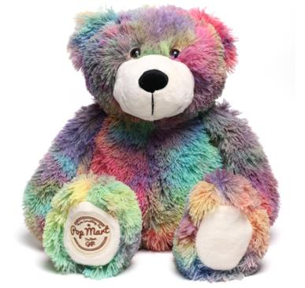


## 原PDF第51页

[对照原PDF第51页](../新三板时期/2016年公开转让说明书.pdf#page=51)

北京泡泡玛特文化创意股份有限公司公开转让说明书

troy 与 traci 夫妇在 1999 年创立了美国顶级

香氛品牌 voluspa，  traci 香水师的鼻子与 troy Voluspa 香工程技术的背景相结合，首次将椰子蜡应用薰到香氛蜡烛制造领域，设计出一系列燃烧纯

净、芳香持久的香氛系列。

（4）数码类产品

公司数码类产品主要如下：

```text
典型产品                  产品介绍                           产品图片
```

Apple Watch 是苹果公司于 2014 年 9 月推出

的一款智能手表，有 Apple Watch、Apple

Watch Sport 和 Apple Watch Edition 三种风Apple Watch  格不同的系列。Apple Watch 采用人造蓝宝

石水晶屏幕与 Force Touch 触摸技术，有多种

颜色可供选择。

Beats by Dr. Dre (Beats)是世界领先的音频设备公司。自成立以来，Beats 推出了一系列顶

级头戴式、入耳式耳机以及扬声器，将最无

与伦比的音质体验带给新一代的年轻人。通Beats过无数成功的产品，Beats 将录音室里的能

量、情感以及激情, 全部如实还原给世界各地

的音乐爱好者。Beats 于 2014 年 7 月被苹果

公司收购。

51


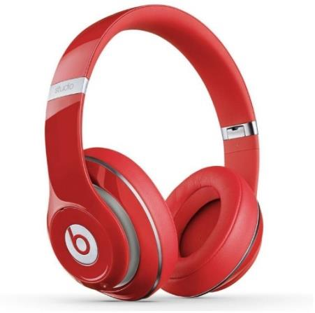

## 原PDF第52页

[对照原PDF第52页](../新三板时期/2016年公开转让说明书.pdf#page=52)

北京泡泡玛特文化创意股份有限公司公开转让说明书

JBL 音箱的服务范围非常广泛，在专业领域

上包括了电影院、大型音响工程、大型流动JBL演出、录音室监听、乐队用的音响，以至娱

乐场所如迪士科、歌舞厅、卡拉 OK、酒吧

（5）糖果类产品

公司糖果类产品主要如下：

```text
典型产品                  产品介绍                           产品图片
```

Jelly Belly 是制造 Jelly Beans（啫哩豆）的

品牌之一，吉力贝的啫哩豆中心和外层的糖

Jelly Belly  衣都有味道。而且比起美国传统啫哩豆，吉

力贝的啫哩豆体型更小一些，味觉更加逼真

浓郁，而且味道品种众多。

（6）玩具娱乐

公司主要的玩具娱乐类的产品为：

```text
典型产品                  产品介绍                            产品图片
```

LOZ 钻石积木(DimondBlock)是一种潮流的

LOZ  微积木，Mini 积木。LOZ 积木最小的尺寸是

4mmX4mmX5mm。

52

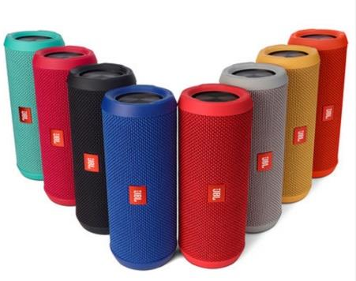


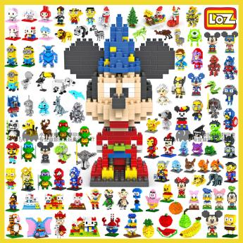

## 原PDF第53页

[对照原PDF第53页](../新三板时期/2016年公开转让说明书.pdf#page=53)

北京泡泡玛特文化创意股份有限公司公开转让说明书

Funko 是美国 FUNKO POP 品牌中国地区总

代理。该品牌与迪斯尼、漫威、皮克斯、梦

工厂、环球影业、NBA、暴雪娱乐等公司合FUNKO作，拥有电影、美剧、体育球星、游戏、歌POP星等广泛形象授权，其公司出品的 POP 系列

产品是目前全球最畅销的搪胶收藏玩偶品牌

之一。

（7）服饰配饰

公司主要服饰配饰类的产品为：

```text
典型产品                  产品介绍                           产品图片
```

JanSport 是一个由 VF 集团所有的流行背包品

牌，VF 集团为全球最大的服装公司之一。

JanSport  JanSport 于 1967 年由 Jan Lewis(公司以他的

名字命名)、Skip Yowell 与 Murray Pletz 在华

盛顿西雅图创立。

2、定制业务

公司针对合作企业的不同需求，设计并生产出符合企业理念的独一无二的周

边衍生品。具体情况如下：

主要合作企业  主要产品图片

陌陌科技

金鹰商贸

53


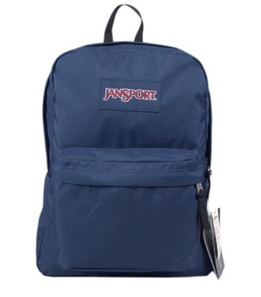

## 原PDF第54页

[对照原PDF第54页](../新三板时期/2016年公开转让说明书.pdf#page=54)

北京泡泡玛特文化创意股份有限公司公开转让说明书

中信出版集团

钱方科技

乐视集团

咖啡之翼

3、批发业务

批发业务是公司通过团购的方式将公司自营品牌产品（POP PANDA 创意潮

流品牌）及代理品牌产品（富士、亿觅等）批发给有需求的客户。

54

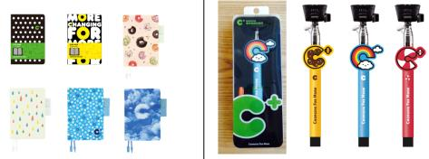


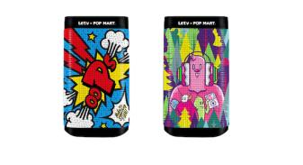

## 原PDF第55页

[对照原PDF第55页](../新三板时期/2016年公开转让说明书.pdf#page=55)

北京泡泡玛特文化创意股份有限公司公开转让说明书

二、公司组织结构及主要运营流程

（一）组织结构图

1、公司的组织结构图为：

```text
 部门                                     职责
           负责公司店铺的经营规划、流程管理、营运培训、营运稽核、市场策划及
运营部
           人员发展等工作
陈列部     负责公司店铺的视觉规划、产品陈列及培训管理等工作
           负责公司供应商的开发及管理、产品规划、商品采购、商品运作、数据分
```

商品部

析、库存管理等工作负责组织公司自有产品项目设计、把握设计方向、提升设计品质、控制设设计部计时间，建立公司在产品设计上的核心能力等工作；负责公司市场资讯的收集与分析、品牌规划及品牌传播的管理、媒介宣传、品牌部APP 维护、产品策略研究及线上电商业务的运营管理等工作；负责公司店铺通路的规划和拓展、工程招投标管理、工程质量管理、工程

```text
  拓展部
             预决算管理、工程维修、资产管理、资讯管理、IT 管理等工作；
 大客户部    负责公司大客户的开发及管理、团购销售业绩等工作；
  财务部     负责公司资金管理、财务分析、预算管理、财务核算、财务稽核等工作；
人事行政部   负责公司人力资源管理、行政管理等工作；
  物流部     负责公司仓储管理、物流运输等工作
```

2、金鹰泡泡的组织结图为：

55

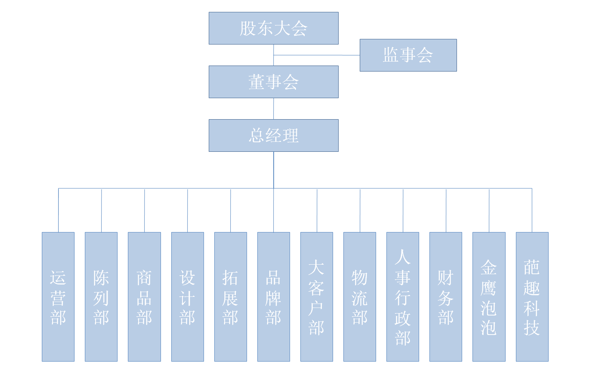

## 原PDF第56页

[对照原PDF第56页](../新三板时期/2016年公开转让说明书.pdf#page=56)

北京泡泡玛特文化创意股份有限公司公开转让说明书

```text
 部门                                     职责
           负责公司店铺的经营规划、流程管理、营运培训、营运稽核、市场策划及
运营部
           人员发展等工作
陈列部     负责公司店铺的视觉规划、产品陈列及培训管理等工作
           负责公司供应商的开发及管理、产品规划、商品采购、商品运作、数据分
```

商品部

析、库存管理等工作负责公司店铺通路的规划和拓展、工程招投标管理、工程质量管理、工程

```text
  拓展部
             预决算管理、工程维修、资产管理、资讯管理、IT 管理等工作；
人事行政部   负责公司人力资源管理、行政管理等工作；
  财务部     负责公司资金管理、财务分析、预算管理、财务核算、财务稽核等工作；
  物流部     负责公司仓储管理、物流运输等工作
```

56

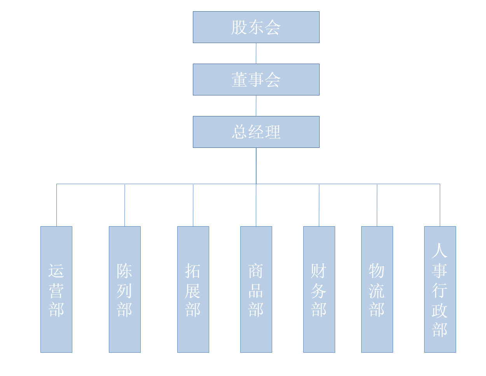

## 原PDF第57页

[对照原PDF第57页](../新三板时期/2016年公开转让说明书.pdf#page=57)

北京泡泡玛特文化创意股份有限公司公开转让说明书

（二）主要业务流程图

选择供应商  设计商品

（）

设计部

商品部

采购  外部加工

收货

物流部

发货

```text
             零售店铺          团购客户            线上商城
运营部                                                             品牌部
```

大客户部

部

消费者

三、公司主要技术、资产和资质情况

（一）公司主要资产情况

1、固定资产

（1）公司租赁房产

截至本公开转让说明书签署日，公司及各子公司租赁房屋情况如下表：

```text
序                                                                            面积
       承租方       出租方       租赁房屋位置               租金                      租赁期限
号                                                                           （㎡）
```

57

## 原PDF第58页

[对照原PDF第58页](../新三板时期/2016年公开转让说明书.pdf#page=58)

北京泡泡玛特文化创意股份有限公司公开转让说明书

```text
序                                                                            面积
       承租方       出租方       租赁房屋位置               租金                      租赁期限
号                                                                           （㎡）
                                北京市朝阳区望
                                                                                      2016年1
     北京泡泡玛                 京 B29商业金融
                                                                                      月24日至
 1   特贸易有限      梁鑫      项目1号塔楼（办         129,837.04元/月       502.19
                                                                                      2018年2
        公司                   公商业）23层3单
                                                                                       月12日
                                      元
                                                 自承租开始至租赁期的第12个
                                北京市朝阳区酒   月止，87,000元/月，自租赁期的        2016年6
     北京泡泡玛
                  北京麟联置   仙桥路18号“颐提   第13个月起至租赁期的第24个           月10日至
 2   特贸易有限                                                                145
                  业有限公司   港”商场 LG 楼45   月止，每月101,500元，自租赁          2019年6
        公司
                                     单元        期的第25个月起至租赁期的第            月9日
                                                 36个月止，每月116,000元
```

租金按固定租金与扣率租金两者取其高的方式收取。自2016年6月14日起至2017年6月13日

```text
                                                止，固定租金为103,125元／月，
                                                扣率为该月营业额的13%。自             2016年6
     北京泡泡玛   北京国瑞兴   北京市东城区崇
                                                2017年6月14日起至2018年6月           月14日至
3    特贸易有限   业地产股份    外大街18号1幢                                 375
                                                13日止，固定租金为108,000元           2019年6
        公司       有限公司     LG 层34号商铺
                                                ／月，扣率为该月营业额的              月13日
                                                13% 。 自 2018 年 6 月 14 日起至
```

2019年6月13日止，固定租金为113,625元／月，扣率为该月营业额的13%。分为基本租金和提成租金。基本

```text
                                                租金：第一个租赁年度月租金为
                                                600元/月，第二个租赁年度月租
                  益飒美置业   北京市海淀区丹
                                                金为630元/月，第三个租赁年度         2013年10
     北京泡泡玛  （天津）有限  棱街甲1号的欧美
                                                月租金为680元/月；提成租金比          月8日至
4    特贸易有限   公司北京欧    汇购物中心第                                  126
                                                率为13%。                            2019年10
        公司      美汇咨询分   [B1]层第[-101-26]
                                                第四个租赁年度月租金为714元            月7日
                     公司           单元
                                                /月，第五个租赁年度为749.70
                                                元/月，第六个租赁年度为787.19
                                                元/月；提成比率为13%；
                                                                                      2015年7
     北京泡泡玛   北京二十一   北京市朝阳区十
                                                                                      月1日至
5    特贸易有限   世纪华夏物   八里店乡小武基   438,000元/年                 1,200
                                                                                      2019年4
        公司      资有限公司       村1号库
                                                                                      月30日
```

基本租金与营业租金二者之中较高者为适用租金，基本租金：于交付日起算的第一年内，

```text
                                                21,300元/月，于交付日起算的第
                                                二年内，25,560元/月，于交付日         2015年7
     北京泡泡玛
                  大连恒隆地   大连恒隆广场商   起算的第三年内，29,820元/月，        月20日至
6    特贸易有限                                                               142
                  产有限公司    场 B09号铺位    于交付日起算的第四年起至合            2019年9
        公司
                                                同期届满之日止，34,080元/月。         月19日
                                                营业租金：于交付日起算8的第
```

一年内，当月营业额的12%，于交付日起算的第二年内，当月营业额的12%，于交付日起算的第

58

## 原PDF第59页

[对照原PDF第59页](../新三板时期/2016年公开转让说明书.pdf#page=59)

北京泡泡玛特文化创意股份有限公司公开转让说明书

```text
序                                                                            面积
       承租方       出租方       租赁房屋位置               租金                      租赁期限
号                                                                           （㎡）
```

三年内，当月营业额的13%，于交付日起算的第四年起至合同期届满之日止，当月营业额的13%。自起租日至 2017 年4 月 28 日 ，31,500元/月，月提成租金为当月

```text
                                                营业额的11%,租金以上述二者
                                                较高者为准；2017年4月29日至
                               北京市朝阳区曙                                         2016年3
                                                2018年4月28日，32,400元/月，
     北京泡泡玛   北京华润曙
                               光西里甲5号院24  月提成租金为当月营业额的             月15日至
7    特贸易有限   光房地产开                                                   90
                               号楼凤凰汇购物   12%,租金以上述二者较高者为            2019年4
        公司      发有限公司
                                 中心 B109B     准；2018年4月29日至2019年4            月28日
                                                月28日，33,300元/月，月提成租
```

金为当月营业额的13%,租金以上述二者较高者为准；

基本租金：于交付日起算的第一年内，0元/月，于交付日起算的第二年内，每月基本租金为第一年实际收取的月平均营业租金的80%；于交付日起算的第三年

```text
                                                内，每月基本租金在第二年实际
                                                收取的每月基本租金上递增              2015年8
                               沈阳市沈河区青
     北京泡泡玛                                 8%；于交付日起算的第四年起           月20日至
                  辽宁恒隆地   年大街1号沈阳市
8    特贸易有限                                 至合同届满，每月基本租金在第  246     2019年8
                  产有限公司     府恒隆广场
        公司                                    三年实际收取的每月基本租金            月19日
                                  B119-1-2
                                                上递增10%。营业租金：
```

于交付日起算的第一年内，当月营业额12%，于交付日起算的第二年内，当月营业额13%，于交付日起算的第三年内，当月营业额13%，于交付日起算的第四年起至合同期满，当月营业额13%

```text
                                                每月租金按照基本租金和营业
                                                租金二者较高者为准，
                               北京市东城区王                                         2014年9
     北京泡泡玛                                 第1-4年：237,615元/月，或每月
                  北京新东安   府井大街138号新                                       月15日至
9    特贸易有限                                 每平方米365元；第5-6年：以市  651
                   有限公司      东安广场3层                                          2018年9
        公司                                    场价格计算，但不低于237,615
                                306-307号店铺                                         月14日
                                                元/月，或365元/月；每月毛计营
```

业额之15%每月租金按照基本租金和营业租金二者较高者为准，基本租

```text
                                                 金：于交付日起算的第一年内，
                                                 30,660元/月，于交付日起算的第        2014年7
     北京泡泡玛
                  天津恒隆地     天津恒隆广场    二年内，40,880元/月，于交付日        月8日至
10   特贸易有限                                                                168
                  产有限公司      B024号铺位     起算的第三年内，45,990元/月。        2017年7
        公司
                                                 营业租金：于交付日起算的第一          月7日
                                                 年内，当月营业额的15%，于交
```

付日起算的第二年内，当月营业额的16%，于交付日起算的第三

59

## 原PDF第60页

[对照原PDF第60页](../新三板时期/2016年公开转让说明书.pdf#page=60)

北京泡泡玛特文化创意股份有限公司公开转让说明书

```text
序                                                                            面积
       承租方       出租方       租赁房屋位置               租金                      租赁期限
号                                                                           （㎡）
```

年内，当月营业额的16%。

每月租金按照基本租金和营业租金二者较高者为准，基本租

```text
                                                 金：第一个租赁年度，6.5元/日/
                                                 平方米；第二个租赁年度，7.02
                                天津市南开区南                                        2015年9
     北京泡泡玛                                  元/日/平方米；第三个租赁年度，
                  大悦城（天   门外大街6号天津                                        月25日至
11   特贸易有限                                  7.58元/日/平方米。营业租金：  441
                 津）有限公司   大悦城购物中心                                        2018年9
        公司                                     于交付日起算的第一年内，当月
                               南区1F-A2号商铺                                         月24日
                                                 销售额的12%，于交付日起算的
```

第二年内，当月销售额的12%，于交付日起算的第三年内，当月营业额的13%。

```text
                                                 每月租金按照基本租金和抽成
                                                 租金二者较高者为准。第一个租
                                                                                      2015年8
     北京泡泡玛   北京弘泰基    北京市朝阳区大   赁年度，23元/日/平方米；第二
                                                                                      月30日至
12   特贸易有限   业房地产有     悦城购物中心    个租赁年度，24元/日/平方米；  78.43
                                                                                      2017年8
        公司        限公司       B1-12号商铺     抽成租金：第一个租赁年度，销
                                                                                       月29日
                                                 售额抽成扣率17%，第二个租赁
```

年度，销售额抽成扣率为17%。

```text
                                                 每月租金按照基本租金和分成
                                                 租金二者较高者为准。基本租
                                北京市朝阳区建   金：第一年，每月每平方米租金         2015年11
     北京泡泡玛   北京金地鸿
                                国路91号金地中   为300元，第二年，每月每平方          月1日至
13   特贸易有限   运房地产开                                                 166.95
                                 心项目 B1层     米租金为330元，第三年至租赁          2018年12
        公司      发有限公司
                                 B110B 号商铺    期满，每月每平方米为363元。           月15日
                                                 分成租金：月分成租金为月含税
```

营业额的15%。每月租金按照固定租金和提成租金二者较高者为准。固定租金：2015.9.19-2016.8.31，0元/㎡\*178.58㎡=0元，2016.9.1-2017.8.31，70元/㎡\*178.58㎡=12500.60元，

```text
                                                 2017.9.1-2018.8.31，100元/㎡
                                                 *178.58㎡=17858元，
                  永旺梦乐城                                                          2015年9
                                                 2018.9.1-2019.8.31，130元/㎡
     北京泡泡玛
                 优雅（北京） 北京市丰台区丰                                          月19日至
                                                 *178.58㎡=23215.4元，
14   特贸易有限                                                              178.58
                  商业管理有葆路88号院1号楼      提成租金：2015.9.19-2016.8.31，      2019年8
        公司
                    限公司                       该月销售额的10%，且月最低销           月31日
                                                 售额应达到0元；
```

2016.9.1-2017.8.31，且月最低销售额应达到125,006元；2017.9.1-2018.8.31，且月最低销售额应达到178,580元；2018.9.1-2019.8.31，且月最低销售额应达到232,154元。

60

## 原PDF第61页

[对照原PDF第61页](../新三板时期/2016年公开转让说明书.pdf#page=61)

北京泡泡玛特文化创意股份有限公司公开转让说明书

```text
序                                                                            面积
       承租方       出租方       租赁房屋位置               租金                      租赁期限
号                                                                           （㎡）
```

每月租金按照保底租金和提成租金二者较高者为准。保底租金：2015.12.25-2016.11.09，

```text
                                                 41,654元/月；
                                                 2016.11.10-2017.11.09，47,554
                                北京市西城区金   元/月；                              2015年11
     北京泡泡玛   金融街控股
                                城坊街2号楼“购   2017.11.10-2018.11.09,53,454元/      月10日至
15   特贸易有限   股份有限公                                                   118
                                 物中心”-01层    月；抽成租金：                       2018年11
        公司          司
                               -102-B138号商铺   2015.12.25-2016.11.09，营业收          月9日
                                                 入的13%/月；
```

2016.11.10-2017.11.09，营业收入的14%/月；2017.11.10-2018.11.09，营业收入的15%/月；每月租金按照基本租金和营业租金二者较高者为准，基本租

```text
                                                 金：第一个租赁年度，8元/日/
                                                 平方米；第二个租赁年度，8.8          2016年8
     北京泡泡玛   沈阳大悦城    辽宁省沈阳市大
                                                 元/日/平方米；第三个租赁年度，       月5日至
16   特贸易有限   房产开发有    东区沈阳大悦城                                137.7
                                                 9.68元/日/平方米。抽成租金：         2019年8
        公司        限公司         购物中心
                                                 第一个租赁年度，销售额抽成扣          月4日
                                                 率12%，第二个租赁年度，销售
```

额抽成扣率为12%，第三个租赁年度，销售额抽成扣率为13%租金分为固定租金和提成租金两部分。固定租金：自起租日起至装修期，每月固定租金为

```text
                                                 33,600元; 自装修期届满起至租
                                                 赁期第2个月止，每月固定租金
                                                                                      2016年7
     北京泡泡玛   北京三里屯    北京市朝阳区三   为33,600元；自租赁期第3个月
                                                                                      月17日至
17   特贸易有限   南区物业管    里屯路19号院地   起至租赁期第12月，每月固定租  48
                                                                                      2018年7
        公司      理有限公司     下一层 SLG47    金为67,200元；自租赁期第13个
                                                                                       月16日
                                                 月起至租赁期第24月，每月固定
```

租金为69,600元.提成租金：自起租日起至租赁期第24月，每月提成租金百分比为

```text
                                                 12%。
                                                                                      2014年12
     南京金鹰泡   南京珠江壹
                                南京珠江壹号大                                        月1日至
18   泡玛特商贸   号实业有限                     34,493元/季度                 126
                                 厦41层 A2座                                          2016年11
      有限公司       公司
                                                                                       月30日
                                                 自交付日起第一个月：15,797.2
                                                 元；第二个月至第一个租赁年的         2015年11
     南京金鹰泡   无锡海岸新    无锡市滨湖区海
                                                 第十二个月：15,797.2元；第二         与1日至
19   泡玛特商贸   城投资有限    岸城39-1002第                                259.68
                                                 个租赁年：19,746.5元/月；第三        2018年12
      有限公司       公司         b110号商铺
                                                 个租赁年至合同期届满：                月15日
                                                 23,695.8元/月
     南京金鹰泡                 无锡市崇安区人   第一年：0元；第二年：19,467          2015年11
                  无锡恒隆地
20   泡玛特商贸                民中路139号无锡   元/月；第三年：24,333元/月；  160    月10日至
                  产有限公司
      有限公司                   恒隆广场商场    第四年至合同期满：29,200元/          2019年11
```

61

## 原PDF第62页

[对照原PDF第62页](../新三板时期/2016年公开转让说明书.pdf#page=62)

北京泡泡玛特文化创意股份有限公司公开转让说明书

```text
序                                                                            面积
       承租方       出租方       租赁房屋位置               租金                      租赁期限
号                                                                           （㎡）
                                                 月                                    月9日
```

按固定租金或提成租金较高者为准：第一年固定租金为156.21元/平方米/月，提成租金每月为

```text
                                                 含税营业额的12%；第二租金年
                                                 度固定租金同第一年租金，提成         2015年12
     南京金鹰泡   苏州深国投    江苏省苏州市工
                                                 租金为每月为含税营业额的             月23日至
21   泡玛特商贸   商用置业有    业园区现代大道                               334.16
                                                 13%；第三年固定租金为164.89          2020年2
      有限公司      限公司          1699号
                                                 元/平方米/月，提成租金为每月          月5日
                                                 为含税营业额的14%；第四年固
```

定租金为167.06元/平方米/月，提成租金为每月为含税营业额的15%

```text
                                                 按基本租金或营业租金较高者
                                                 为准。基本租金为于交付期起算         2016年6
     南京金鹰泡   上海港汇房    上海市徐汇区虹
                                                 的第一年起至合同期届满之日           月10日至
22   泡玛特商贸   地产开发有    桥路港汇恒隆广                                 64
                                                 止，每月165,467元；营业租金          2017年7
      有限公司      限公司     场[B108L]号铺位
                                                 为于交付日起至合同期届满之            月9日
                                                 日止，当月营业额的13%
                                                 仓储服务费按半年支付，每半年
                                                                                      2015年11
     南京金鹰泡   江苏新华物    南京市经济技术   115,200元整，运营自费按季度
                                                                                      月20日至
23   泡玛特商贸   流配送有限    开发区仙新路98   实际发生额收取，外部运输费由  600
                                                                                      2016年11
      有限公司       公司       号号生产5号库    双方补充协议约定，合同首期付
                                                                                       月19日
                                                 款总费用为115,200元。
                                                 第一个租赁年度：16,060 元；          2016年10
     南京金鹰泡                 浦东新区丁香路
                  上海山川置                     第二个租赁年度：18,736.67；          月25日至
24   泡玛特商贸                880 弄丁香国际商                                88
                  业有限公司                     第三个租赁年度：21,413.33            2019年10
      有限公司                   业中心 B112
                                                             元                        月24日
```

（2）公司所有门店信息

截至本公开转让说明书出具之日，公司共有 28 家门店，所有的门店信息如下:

```text
序号      地区     省/市       店铺                          地址                     销售模式
  1                北京       欧美汇        北京市海淀区欧美汇购物中心 B1 层 26 号      自营
  2                北京       国瑞城       北京市东城区崇外大街国瑞购物中心 LG-34       自营
  3                北京       颐堤港      北京市朝阳区酒仙桥颐堤港购物中心 LG 层 45     自营
                                          北京市东城区王府井大街新东安广场 F3 层 306
  4                北京     王府井 APM                                                  自营
                                                              号
                           丰台永旺梦乐   北京市丰台区丰葆路 88 号丰台永旺梦乐城购物
  5                北京                                                                 自营
        华北地区                城                     中心 1 层 158 号
  6                北京     朝阳大悦城       北京市朝阳区大悦城购物中心 B1-12 号        自营
                                          北京市朝阳区建国路 91 号金地中心 B1-B110B
  7                北京      金地中心                                                   自营
                                                              号
                                          北京市西城区金城坊街 2 号金融街购物中心一
  8                北京       金融街                                                    自营
                                                          期 B138 号
  9                北京       凤凰汇       北京市朝阳区三元桥凤凰汇购物中心 B109B       自营
```

62

## 原PDF第63页

[对照原PDF第63页](../新三板时期/2016年公开转让说明书.pdf#page=63)

北京泡泡玛特文化创意股份有限公司公开转让说明书

```text
10                北京       太古里               北京市朝阳区三里屯太古里             自营
11                天津       恒隆店        天津市和平区兴安路恒隆广场 B 层 024 号      自营
                                         天津市南开区南门外大街 2-6 号天津大悦城 F1
12                天津      大悦城店                                                   自营
                                                           层 A2
13                辽宁      沈阳恒隆     沈阳市沈河区青年大街 1 号恒隆广场 B119-1-2    自营
14                辽宁     沈阳大悦城       沈阳大悦城购物中心【C227/228】号商铺       自营
       东北地区
                                         大连市西岗区五四路 66 号恒隆广场 B1-09 号商
15                辽宁      大连恒隆                                                   自营
                                                             铺
                                         江苏省盐城市解放南路 268 号金鹰聚龙湖 1 楼
16                江苏    盐城聚龙湖店                                                 联营
                                                        popmart 专柜
                                         江苏省南京市秦淮区汉中路 89 号金鹰国际购物
17                江苏     南京店一楼                                                  联营
                                                  中心 B 座 1 楼 popmart 专柜
                                         江苏省南京市秦淮区汉中路 89 号金鹰国际购物
18                江苏     南京店九楼                                                  联营
                                                  中心 B 座 9 楼 popmart 专柜
                                         江苏省南京市玄武区珠江路一号金鹰大厦 2 楼
19                江苏       天地店                                                    联营
                                                        popmart 专柜
                                         江苏省南通市工农路 57 号南通金鹰圆融购物中
20                江苏       南通店                                                    联营
                                                     心 3 楼 popmart 专柜
                                         江苏省丹阳市新民中路 99 号金鹰购物中心 1 楼
21                江苏       丹阳店                                                    联营
       东部地区                                         popmart 专柜
                                          江苏省徐州市鼓楼区彭城广场北侧中山北路 2
22                江苏       徐州店                                                    联营
                                             号金鹰国际购物中心 6 楼 popmart 专柜
23                江苏       昆山店      江苏省昆山市珠江中路 199 号 1 楼 popmart 专柜  联营
                                         江苏南京江宁经济开发区双龙大道 1680 号金鹰
24                江苏     南京江宁店                                                  联营
                                               国际购物中心 popmart 专柜 B1 楼
                          无锡恒隆广场
25                江苏                        江苏省无锡市崇安区恒隆广场 B1 层         自营
                               店
26                江苏    无锡海岸城店         江苏省无锡市滨湖区海岸城 B1 层          自营
                                         江苏省苏州工业园区现代大道 1699 号印象城 3
27                江苏    苏州印象城店                                                 自营
                                                  楼 3002 商铺 popmart 专柜
28                上海     港汇恒隆店           上海市徐汇区虹桥路 1 号 B108L          自营
```

（3）公司其他固定资产情况

截至 2016 年 5 月 31 日，公司固定资产账面价值如下表所示：

```text
                                                                          单位：元
  类别             折旧年限         账面原值        累计折旧          账面净值
办公家具               5           387,353.93       76,375.65        310,978.28
电子设备               5           1,189,453.84     179,831.72       1,009,622.12
运输设备               5            57,948.72       13,907.69         44,041.03
  其他                 5             18,941.2       15,315.45          3,625.75
```

2、无形资产

（1）注册商标

截至本公开转让说明书签署日，公司已经完成注册的商标共计 61 个，正在

申请中的注册商标共计 18 个，具体如下：

63

## 原PDF第64页

[对照原PDF第64页](../新三板时期/2016年公开转让说明书.pdf#page=64)

北京泡泡玛特文化创意股份有限公司公开转让说明书

```text
序号         申请商标           类别        申请号        有效期         受理单位
                                                                       国家工商行政
                                                       2011 年 11 月 14
                                                                       管理总局商标
  1                            第 35 类    8723242      日-2021 年 11
                                                                            局
                                                          月 13 日
                                                                       国家工商行政
                                                       2011 年 2 月 14
                                                                       管理总局商标
  2                            第 14 类    7933482     日-2021 年 2 月
                                                                            局
                                                           13 日
                                                                       国家工商行政
                                                       2011 年 9 月 7
                                                                       管理总局商标
  3                            第 25 类    7933480     日-2021 年 9 月
                                                                            局
                                                            6 日
                                                                       国家工商行政
                                                                       管理总局商标
  4                            第 21 类    17126592       申请中
                                                                            局
                                                                       国家工商行政
                                                       2011 年 12 月 28
                                                                       管理总局商标
  5                            第 3 类     8969697      日-2021 年 12
                                                                            局
                                                          月 27 日
```

```text
                                                                            国家工商行政
                                                           2011 年 12 月 28
                                                                            管理总局商标
6                               第 14 类      8969215       日-2021 年 12
                                                                                  局
                                                              月 27 日
```

```text
                                                                            国家工商行政
                                                          2012 年 4 月 28
                                                                            管理总局商标
7                               第 18 类      8969244     日-2022 年 4 月
                                                                                 局
                                                               27 日
```

```text
                                                                            国家工商行政
                                                          2012 年 7 月 14
                                                                            管理总局商标
8                               第 25 类      8969419     日-2022 年 7 月
                                                                                 局
                                                               13 日
```

```text
                                                                            国家工商行政
                                                           2015 年 07 月 07
                                                                            管理总局商标
 9                               第 25 类     15081885      日-2025 年 07
                                                                                  局
                                                              月 06 日
                                                                            国家工商行政
                                                           2015 年 3 月 28
                                                                            管理总局商标
10                               第 35 类     10557560     日-2025 年 3 月
                                                                                  局
                                                                27 日
```

```text
                                                                         国家工商行政
                                                         2014 年 3 月 7
                                                                         管理总局商标
11                             第 16 类     11540790     日-2024 年 3 月
                                                                               局
                                                              6 日
```

```text
                                                                      国家工商行政
12                            第 20 类    11540862       申请中       管理总局商标
                                                                           局
                                                                      国家工商行政
                                                      2014 年 8 月 28
                                                                      管理总局商标
13                            第 28 类    11541042    日-2024 年 8 月
                                                                           局
                                                          27 日
```

64

## 原PDF第65页

[对照原PDF第65页](../新三板时期/2016年公开转让说明书.pdf#page=65)

北京泡泡玛特文化创意股份有限公司公开转让说明书

```text
                                                           2015 年 6 月 28  国家工商行政
14                               第 9 类      15081422     日-2025 年 6 月  管理总局商标
                                                                27 日             局
```

```text
                                                                      国家工商行政
15                            第 14 类    15081441       申请中       管理总局商标
                                                                           局
```

```text
                                                                      国家工商行政
16                            第 16 类    15081533       申请中       管理总局商标
                                                                           局
```

```text
                                                           2015 年 10 月 14  国家工商行政
17                               第 18 类     15081652      日-2025 年 10    管理总局商标
                                                               月 13 日           局
```

```text
                                                           2015 年 06 月 28  国家工商行政
18                              第 20 类      15081690     日 -2025 年 06   管理总局商标
                                                              月 27 日            局
```

```text
                                                                             国家工商行政
                                                           2014 年 07 月 21
                                                                             管理总局商标
19                               第 25 类     11797588      日-2024 年 07
                                                                                  局
                                                               月 20 日
```

```text
                                                         2015 年 7 月 7  国家工商行政
20                             第 28 类     15081778     日-2025 年 7 月  管理总局商标
                                                              6 日             局
```

```text
                                                                      国家工商行政
                                                                      管理总局商标
21                            第 14 类    13089041       申请中
                                                                           局
```

65


## 原PDF第66页

[对照原PDF第66页](../新三板时期/2016年公开转让说明书.pdf#page=66)

北京泡泡玛特文化创意股份有限公司公开转让说明书

```text
                                                                            国家工商行政
                                                           2015 年 1 月 14
                                                                            管理总局商标
22                              第 18 类      13089129     日-2025 年 1 月
                                                                                  局
                                                                13 日
```

```text
                                                                            国家工商行政
                                                           2014 年 7 月 21
                                                                            管理总局商标
23                              第 25 类      11992022     日-2024 年 7 月
                                                                                  局
                                                                20 日
```

```text
                                                                      国家工商行政
                                                                      管理总局商标
24                            第 28 类    13089187       申请中
                                                                           局
```

```text
                                                         2014 年 5 月 7  国家工商行政
                                             11797689
                                第 32 类
25                                                       日-2024 年 5 月  管理总局商标
                                                              6 日             局
```

```text
                                                           2015 年 10 月 1
                                                                            经济部智慧财
26                              第 35 类      01731664     日-2025 年 9 月
                                                                                 产局
                                                                30 日
                                                           平成 27 年 6 月   THE JAPAN
27                              第 35 类      5768976
                                                                5 日           OFFICE
```

```text
                                                                      知识产权署商
                                                                        标注册处
                                                      2012 年 11 月 26
28                            第 35 类   302445778
                                                           日
                                                                      香港特别行政
```

区政府

```text
                                                           2015 年 11 月 21  国家工商行政
29                               第 1 类      14858866      日-2025 年 11    管理总局商标
                                                               月 20 日           局
```

```text
                                                             2015 年 09 月 14  国家工商行政
30                                第 2 类      14858943      日- 2025 年 09    管理总局商标
                                                                月 13 日            局
```

66

## 原PDF第67页

[对照原PDF第67页](../新三板时期/2016年公开转让说明书.pdf#page=67)

北京泡泡玛特文化创意股份有限公司公开转让说明书

```text
                                                                      国家工商行政
                                                                      管理总局商标
31                            第 3 类     15081241       申请中
                                                                           局
```

```text
                                                                             国家工商行政
                                                           2015 年 09 月 14
                                                                             管理总局商标
32                               第 4 类      14859048      日-2025 年 09
                                                                                  局
                                                               月 13 日
```

```text
                                                                             国家工商行政
                                                           2015 年 09 月 14
                                                                             管理总局商标
33                               第 5 类      14859089      日-2025 年 09
                                                                                  局
                                                               月 13 日
```

```text
                                                                             国家工商行政
                                                           2015 年 09 月 14
                                                                             管理总局商标
34                               第 6 类      14866908      日-2025 年 09
                                                                                  局
                                                               月 13 日
```

```text
                                                                             国家工商行政
                                                           2015 年 09 月 14
                                                                             管理总局商标
35                               第 7 类      14866972      日-2025 年 09
                                                                                  局
                                                               月 13 日
```

```text
                                                                             国家工商行政
                                                           2015 年 09 月 14
                                                                             管理总局商标
36                               第 8 类      14867065      日-2025 年 09
                                                                                  局
                                                               月 13 日
```

```text
                                                                             国家工商行政
                                                           2015 年 09 月 14
                                                                             管理总局商标
37                               第 10 类     14867123      日-2025 年 09
                                                                                  局
                                                               月 13 日
```

```text
                                                           2015 年 11 月 21  国家工商行政
38                               第 11 类     14868341      日-2025 年 11    管理总局商标
                                                               月 20 日           局
```

67

## 原PDF第68页

[对照原PDF第68页](../新三板时期/2016年公开转让说明书.pdf#page=68)

北京泡泡玛特文化创意股份有限公司公开转让说明书

```text
                                                           2015 年 11 月 21  国家工商行政
39                               第 12 类     14868481      日-2025 年 11    管理总局商标
                                                               月 20 日           局
```

```text
                                                           2015 年 09 月 14  国家工商行政
40                               第 13 类     14868546      日-2025 年 09    管理总局商标
                                                               月 13 日           局
```

```text
                                                           2015 年 09 月 14  国家工商行政
41                               第 15 类     14868629      日-2025 年 09    管理总局商标
                                                               月 13 日           局
```

```text
                                                            2015 年 11 月 21  国家工商行政
42                               第 17 类      14868714      日 2025 年 11    管理总局商标
                                                                月 20 日           局
```

```text
                                                           2015 年 11 月 21  国家工商行政
43                               第 19 类     14868829      日-2025 年 11    管理总局商标
                                                               月 20 日           局
```

```text
                                                                      国家工商行政
                                                                      管理总局商标
44                            第 21 类    14868940       申请中
                                                                           局
```

```text
                                                           2015 年 11 月 21  国家工商行政
45                              第 22 类      14869126     日 -2025 年 11   管理总局商标
                                                              月 20 日            局
```

```text
                                                           2015 年 09 月 14  国家工商行政
46                              第 23 类      14869219     日 -2025 年 09   管理总局商标
                                                              月 13 日            局
```

68

## 原PDF第69页

[对照原PDF第69页](../新三板时期/2016年公开转让说明书.pdf#page=69)

北京泡泡玛特文化创意股份有限公司公开转让说明书

```text
                                                                      国家工商行政
47                            第 24 类    14869322       申请中       管理总局商标
                                                                           局
```

```text
                                                                            国家工商行政
                                                           2015 年 11 月 21
                                                                            管理总局商标
48                              第 26 类      14869390     日 -2025 年 11
                                                                                  局
                                                              月 20 日
```

```text
                                                                            国家工商行政
                                                           2015 年 09 月 14
                                                                            管理总局商标
49                              第 27 类      14869484     日 -2025 年 09
                                                                                  局
                                                              月 13 日
```

```text
                                                                             国家工商行政
                                                           2015 年 09 月 14
                                                                             管理总局商标
50                               第 29 类     14904545      日-2025 年 09
                                                                                  局
                                                               月 13 日
```

```text
                                                                             国家工商行政
                                                           2015 年 09 月 14
                                                                             管理总局商标
51                               第 30 类     14904619      日-2025 年 09
                                                                                  局
                                                               月 13 日
```

```text
                                                                             国家工商行政
                                                           2015 年 09 月 14
                                                                             管理总局商标
52                               第 31 类     14904706      日-2025 年 09
                                                                                  局
                                                               月 13 日
```

```text
                                                                             国家工商行政
                                                           2015 年 09 月 14
                                                                             管理总局商标
53                               第 33 类     14904770      日-2025 年 09
                                                                                  局
                                                               月 13 日
```

```text
                                                                             国家工商行政
                                                           2015 年 09 月 14
                                                                             管理总局商标
54                               第 34 类     14904749      日-2025 年 09
                                                                                  局
                                                               月 13 日
```

69

## 原PDF第70页

[对照原PDF第70页](../新三板时期/2016年公开转让说明书.pdf#page=70)

北京泡泡玛特文化创意股份有限公司公开转让说明书

```text
                                                                             国家工商行政
                                                           2015 年 09 月 14
                                                                             管理总局商标
55                               第 36 类     14904860      日-2025 年 09
                                                                                  局
                                                               月 13 日
```

```text
                                                                             国家工商行政
                                                           2015 年 09 月 14
                                                                             管理总局商标
56                               第 37 类     14905020      日-2025 年 09
                                                                                  局
                                                               月 13 日
```

```text
                                                                             国家工商行政
                                                           2015 年 09 月 14
                                                                             管理总局商标
57                               第 38 类     14905082      日-2025 年 09
                                                                                  局
                                                               月 13 日
```

```text
                                                                             国家工商行政
                                                           2015 年 09 月 14
                                                                             管理总局商标
58                               第 39 类     14905136      日-2025 年 09
                                                                                  局
                                                               月 13 日
```

```text
                                                                             国家工商行政
                                                           2015 年 09 月 14
                                                                             管理总局商标
59                               第 40 类     14905205      日-2025 年 09
                                                                                  局
                                                               月 13 日
```

```text
                                                                             国家工商行政
                                                           2015 年 09 月 14
                                                                             管理总局商标
60                               第 41 类     14905423      日-2025 年 09
                                                                                  局
                                                               月 13 日
```

```text
                                                                             国家工商行政
                                                           2015 年 11 月 21
                                                                             管理总局商标
61                               第 42 类     14905529      日-2025 年 11
                                                                                  局
                                                               月 20 日
```

```text
                                                                             国家工商行政
                                                           2015 年 11 月 21
                                                                             管理总局商标
62                               第 43 类     14905532      日-2025 年 11
                                                                                  局
                                                               月 20 日
```

70

## 原PDF第71页

[对照原PDF第71页](../新三板时期/2016年公开转让说明书.pdf#page=71)

北京泡泡玛特文化创意股份有限公司公开转让说明书

```text
                                                                             国家工商行政
                                                           2015 年 11 月 21
                                                                             管理总局商标
63                               第 44 类     14905612      日-2025 年 11
                                                                                  局
                                                               月 20 日
```

```text
                                                                             国家工商行政
                                                           2015 年 09 月 14
                                                                             管理总局商标
64                               第 45 类     14905681      日-2025 年 09
                                                                                  局
                                                               月 13 日
```

```text
                                                           2015 年 11 月 21  国家工商行政
65                               第 14 类     14833274      日-2025 年 11    管理总局商标
                                                               月 20 日           局
```

```text
                                                                      国家工商行政
66                            第 16 类    14833354       申请中       管理总局商标
                                                                           局
```

```text
                                                                               国家工商行政
                                                             2015 年 09 月 14
                                                                               管理总局商标
67                               第 25 类      14833465      日- 2025 年 09
                                                                                    局
                                                                月 13 日
```

```text
                                                                      国家工商行政
68                            第 20 类    14833407       申请中       管理总局商标
                                                                           局
```

```text
                                                                            国家工商行政
                                                           2015 年 11 月 21
                                                                            管理总局商标
69                              第 28 类      14833519     日 -2025 年 11
                                                                                  局
                                                              月 20 日
```

```text
                                                                      国家工商行政
                                                                      管理总局商标
70                            第 3 类     14833225       申请中
                                                                           局
```

```text
                                                                             国家工商行政
                                                           2015 年 09 月 14
                                                                             管理总局商标
71                               第 32 类     14833618      日-2025 年 09
                                                                                  局
                                                               月 13 日
```

71

## 原PDF第72页

[对照原PDF第72页](../新三板时期/2016年公开转让说明书.pdf#page=72)

北京泡泡玛特文化创意股份有限公司公开转让说明书

```text
                                                         2014 年 3 月 7  国家工商行政
72                             第 25 类     11547053     日-2024 年 3 月  管理总局商标
                                                              6 日             局
```

```text
                                                                      国家工商行政
                                                                      管理总局商标
73                            第 30 类    15285208       申请中
                                                                           局
                                                                      国家工商行政
                                                      2015 年 12 月 21
                                                                      管理总局商标
74                            第 43 类    15285275     日-2025 年 12
                                                                           局
                                                         月 20 日
```

```text
                                                                      国家工商行政
                                                                      管理总局商标
75                            第 38 类    18873970       申请中
                                                                           局
```

```text
                                                                      国家工商行政
                                                                      管理总局商标
76                            第 35 类    18873835       申请中
                                                                           局
```

```text
                                                                      国家工商行政
                                                                      管理总局商标
77                            第 45 类    18873862       申请中
                                                                           局
```

```text
                                                                      国家工商行政
                                                                      管理总局商标
78                            第 9 类     18873796       申请中
                                                                           局
```

```text
                                                                      国家工商行政
                                                                      管理总局商标
79                            第 28 类    18873979       申请中
                                                                           局
```

（2）《著作权登记证书》

北京泡泡玛特贸易有限公司对宣毅郎于 2012 年 10 月 20 日创作完成的美术

作品《POP PANDA》（共 4 幅）以职务作品著作权人身份依法享有著作权，登

记号为国作登字-2013-F-00080956，登记日期为 2013 年 01 月 21 日，该证书由中

华人民共和国国家版权局颁发。

北京泡泡玛特贸易有限公司对宣毅郎于 2014 年 4 月 10 日创作完成的美术作

品《POP PANDA》，以职务作品著作权人身份依法享有著作权，登记号为国作

登字-2014-F-00149074，登记日期为 2014 年 9 月 1 日，该证书由中华人民共和国

国家版权局颁发。

72


## 原PDF第73页

[对照原PDF第73页](../新三板时期/2016年公开转让说明书.pdf#page=73)

北京泡泡玛特文化创意股份有限公司公开转让说明书

（3）《作品登记证书》

中华人民共和国国家版权局根据北京泡泡玛特贸易有限公司的申请，及《作

品自愿登记试行办法》的规定，于 2014 年 1 月 6 日向北京泡泡玛特贸易有限公

司颁发《作品登记证书》，作品类别为美术作品，作品名称为 skull fancy，登记

号为国作登字-2013-F-00139258，作者为宣毅郎，创作完成时间为 2012 年 11 月

11 日。

（4）域名信息备案

截至公开转让说明书出具日，公司共有 6 个域名备案信息，具体如下：

```text
              网站备案                                   网站域名
序   主办单
              ／许可证    网站名称     网站首页网址                   审核时间
号   位名称
                 号
              京 ICP 备
     泡泡玛               POPMART
 1            11028233                 www.popmart.cn   popmart.cn    2016-05-03
     特有限               泡泡玛特
                号-2
              京 ICP 备
     泡泡玛               POPMART      www.popmart.co
 2            11028233                                  popmart.com   2016-05-03
     特有限               泡泡玛特           m
                号-3
              京 ICP 备
     泡泡玛               POPMART      www.popmart.co  popmart.com.
 3            11028233                                                2016-05-03
     特有限               泡泡玛特          m.cn            cn
                号-4
              京 ICP 备                                 skullfancy.co
     泡泡玛              skullfancy 骷  www.skullfancy.c
 4            11028233                                      m         2016-05-03
     特有限                 髅花            om
                号-5                                    skullfancy.cn
              京 ICP 备
     泡泡玛              poppanda 泡  www.poppanda.co   poppanda.co
 5            11028233                                                2016-05-03
     特有限                泡熊猫           m.cn           m.cn
                号-6
              京 ICP 备
     泡泡玛                           www.paquapp.co
 6            11028233   葩趣 PAQU                      paquapp.com   2016-05-03
     特有限                                  m
                号-7
```

（二）业务许可和资质情况

公司及子公司按照相关法律法规规定取得了相应的资质证照及业务许可，主

要包括：《餐饮服务许可证》、《食品经营许可证》、《食品流通许可证》。

```text
序
        持证单位       证书名称           编号            有效期     发证机关
号
     北京泡泡玛特贸                                                 北京市东城
                      《食品经营                        2021 年 2 月
 1   易有限公司东城                 JY11101120174997                区食品药品
                       许可证》                           24 日
       第一分公司                                                   监督管理局
```

73

## 原PDF第74页

[对照原PDF第74页](../新三板时期/2016年公开转让说明书.pdf#page=74)

北京泡泡玛特文化创意股份有限公司公开转让说明书

```text
     北京泡泡玛特贸                                                 北京市东城
                      《餐饮服务    （京食药）餐证字    2017 年 12
 2   易有限公司东城                                                 区食品药品
                       许可证》     2014110101003983     月 28 日
       第二分公司                                                   监督管理局
     北京泡泡玛特贸                                                 北京市朝阳
                      《食品经营                        2021 年 1 月
 3   易有限公司朝阳                 JY11105230119505                区食品药品
                       许可证》                           20 日
       第二分公司                                                   监督管理局
     北京泡泡玛特贸                                                 北京市朝阳
                      《食品经营                        2021 年 2 月
 4   易有限公司朝阳                 JY11105290161657                区食品药品
                       许可证》                           15 日
       第三分公司                                                   监督管理局
     北京泡泡玛特贸                                                 北京市朝阳
                      《食品经营                        2021 年 2 月
 5   易有限公司朝阳                 JY11105010161597                区食品药品
                       许可证》                           15 日
       第四分公司                                                   监督管理局
     北京泡泡玛特贸                                                 北京市朝阳
                      《食品经营                        2021 年 6 月
 6   易有限公司朝阳                 JY11105050489907                区食品药品
                       许可证》                           28 日
       第五分公司                                                   监督管理局
     北京泡泡玛特贸                                                 北京市西城
                      《食品经营                        2021 年 1 月
 7   易有限公司西城                 JY11102110109507                区食品药品
                       许可证》                           17 日
       第三分公司                                                   监督管理局
     北京泡泡玛特贸                                                 北京市海淀
                      《食品经营                        2021 年 3 月
 8   易有限公司海淀                 JY11108120236005                区食品药品
                       许可证》                           23 日
       第一分公司                                                   监督管理局
                                                                    天津市南开
     北京泡泡玛特贸
                      《餐饮服务        津餐证字        2018 年 9 月  区市场和质
 9   易有限公司天津
                       许可证》     2015120104000181      24 日     量监督管理
       第二分公司
                                                                        局
     南京金鹰泡泡玛                                                 南京市江宁
                      《餐饮服务        [2015]第        2018 年 7 月
10   特商贸有限公司                                                 区食品药品
                       许可证》       320115006256         1 日
       江宁分公司                                                   监督管理局
                                                                    江苏省苏州
     南京金鹰泡泡玛
                      《食品经营                        2021 年 1 月  工业园区工
11   特商贸有限公司                 JY13205940000933
                       许可证》                           26 日     商行政管理
       苏州分公司
                                                                        局
     南京金鹰泡泡玛                                                 无锡市崇安
                      《食品经营                        2021 年 1 月
12   特商贸有限公司                 JY13202020001653                区市场监督
                       许可证》                            6 日
     无锡第二分公司                                                   管理局
     南京金鹰泡泡玛                                                 无锡市滨湖
                      《食品经营                        2021 年 2 月
13   特商贸有限公司                 JY13202110005765                区市场监督
                       许可证》                           28 日
       无锡分公司                                                     管理局
```

74

## 原PDF第75页

[对照原PDF第75页](../新三板时期/2016年公开转让说明书.pdf#page=75)

北京泡泡玛特文化创意股份有限公司公开转让说明书

（三）公司具备的关键业务资源

公司所售商品均来自品牌授权，公司与国内诸多零售品牌签署了授权协议，

其中，主要的授权品牌如下：

```text
序号    品牌授权协议        授权方        供应商       有效期        授权方式
                                                                 授权泡泡玛特旗
        Dreams/Sonny    多丽梦（深圳） 多丽梦（深
                                                    2016.1.14-20  下的连锁门店销
  1   Angel 经销商特许  国际贸易有限圳）国际贸
                                                    17.1.13      售供应商生产的
          经营合同      公司            易有限公司
                                                                 产品
                                                                 独家授权 Molly
         Kennyswork     Kennyswork      Kennyswork
                                                    2016.4.1-202  盲抽公仔系列在
  2    &POP MART 合     Company         Company
                                                    0.3.31       中国大陆地区的
           作协议       Limited         Limited
                                                                 生产权和销售权
```

```text
                                      深圳市宝安
                                                                在泡泡玛特经营
      “杯缘子”采购合   早明发展有限   区松岗田洋   2016.4.20-20
3                                                               商圈代理经营
            同         公司           塑胶玩具制   19.4.21
                                                                “杯缘子”品牌
                                      品厂
```

在中国大陆境内

POP MART 泡

```text
                                      PPW                       泡玛特自营实体
           有关
                                      SPORTS&E
                       Medicom Toy                              店及其自营电商
4    BE@EBRICK 商                     NTERTAIN     永久
                       Corporation                              平台（天猫及京
      品合法销售证明                  MENT
```

东 ） 销售

LIMITED

BE@EBRICK 品

牌的部分产品

授权泡泡玛特在

```text
                                                                北京及其旗下连
                                      北京梦之城
                       北京梦之城文                2016.7.1-201  锁店铺区域按照
5     阿狸代理商协议                  文化有限公
                       化有限公司                  6.12.31      约定的权限从事
                                      司
                                                                阿狸品牌周边产
```

品的销售活动

```text
                                                                授权泡泡玛特在
                       苏州工业园区   苏州工业园                其经营商圈独家
     Robotime/若态采                               2016.3.9-201
6                      若态科技有限   区若态科技                   代理经营
          购合同                                     6.12.31
                           公司        有限公司                 “Robotime/若态”
                                                                     品牌
```

```text
                                                                     授权
                                      万代南梦宫                TAKARATOMY
     TAKARATOMY        广东瑞华行贸                2016.1.1-201
7                                     亚洲有限公                多美卡系列、日
        多美卡系列      易有限公司                   6.12.31
                                          司                    本万代敢达模型
                                                                     系列
```

75

## 原PDF第76页

[对照原PDF第76页](../新三板时期/2016年公开转让说明书.pdf#page=76)

北京泡泡玛特文化创意股份有限公司公开转让说明书

```text
                                       广东振丰科
                        广东振丰科教               2016.6.23-20  授权部分店面的
 8    LOZ 俐智授权书                   教玩具有限
                        玩具有限公司                  17.6.22        销售权
                                          公司
                        迪克地玩具礼   迪克地玩具
                                                   2016.5.1-201  授权部分店面的
 9     “GUND”品牌      品（上海）有限  礼品（上海）
                                                      7.4.30         销售权
                            公司        有限公司
                                                                授权泡泡玛在其
                        深圳市玩意生   北京宏文顺                所有经营场所/
                                                   2013.8.1-201
10      “玩意”品牌      活用品有限公   商贸有限公               限定商场商圈销
                                                      7.7.31
                             司            司                   售供应商提供的
                                                                      商品
```

四、公司员工情况

（一）员工结构

截至 2016 年 5 月 31 日，公司及子公司共有员工 198 人。具体员工专业结构、

受教育程度、年龄结构见下表：

1、岗位结构

岗位结构

19.70%  营业人员

管理人员

3.54%

财务人员

5.05%

56.56%

行政人员

15.15%

其他辅助人员

```text
  岗位结构                     人数                占员工总数比例（%）
  营业人员                      112                       56.56
  管理人员                      30                        15.15
  财务人员                      10                         5.05
  行政人员                       7                         3.54
其他辅助人员                    39                        19.70
```

76

## 原PDF第77页

[对照原PDF第77页](../新三板时期/2016年公开转让说明书.pdf#page=77)

北京泡泡玛特文化创意股份有限公司公开转让说明书

```text
合计                          198                         100.00
```

2、学历结构

学历结构

2.02%

硕士37.88%  29.80%本科

大专

高中以下

30.30%

```text
学历结构                        人数                 占员工总数比例（%）
  硕士                           4                            2.02
  本科                           59                          29.80
  大专                           60                          30.30
高中以下                         75                          37.88
  合计                          198                          100.00
```

3、年龄结构

年龄结构

0.51%

19.19%

30岁以下

30－40岁

40－45岁

80.30%

```text
年龄结构                       人数                占员工总数比例（%）
30 岁以下                      159                         80.30
30－40 岁                       38                         19.19
40－45 岁                        1                          0.51
```

77

## 原PDF第78页

[对照原PDF第78页](../新三板时期/2016年公开转让说明书.pdf#page=78)

北京泡泡玛特文化创意股份有限公司公开转让说明书

```text
合计                          198                         100.00
```

（二）主要技术人员情况

宣毅郎先生，具体情况参见第一节“七、公司董事、监事和高级管理人员情

况”。

司德先生，具体情况参见第一节“七、公司董事、监事和高级管理人员情况”。

杨晓宽先生，具体情况参见第一节“七、公司董事、监事和高级管理人员情

况”。

五、销售及采购情况

（一）销售情况

1、按产品及服务性质分类

```text
                                                                              单位：元
                  2016年1-5月                2015年度                    2014年度
产品名称                     占比                                                  占比
              营业收入                  营业收入     占比（%）     营业收入
                            （%）                                                 （%）
零售业务    28,880,362.09     98.15   42,315,870.65      93.26     13,743,403.1     80.69
批发业务                -          -              -       0.00     1,806,823.35     10.61
定制业务       475,540.43       1.61   2,243,845.21       4.94     1,481,833.46       8.70
其他收入        70,165.65       0.24     815,606.18       1.80                -          -
  合计      29,426,068.17    100.00   45,375,322.04     100.00    17,032,059.91    100.00
```

2、产品及服务按地区分类

```text
                                                                          单位：元
                2016 年 1-5 月            2015 年度                2014 年度
项目                        占比                    占比                     占比
             营业收入                 营业收入                营业收入
                           （%）                   （%）                    （%）
华北        19,346,885.13   65.75   39,995,527.60    88.14   17,032,059.91   100.00
华东        10,079,183.04   34.25    5,379,794.44    11.86               -        -
合计        29,426,068.17 100.00    45,375,322.04   100.00   17,032,059.91   100.00
```

3、主要客户群体

公司主要从事零售业务，自营模式下，公司直接面向终端消费者，故客户主

要为个人消费者，较为分散；联营模式下，公司主要与金鹰集团采取联营模式，

故公司客户主要为金鹰集团。

除此之外，还有部分有定制及团购需求的企业客户。

78

## 原PDF第79页

[对照原PDF第79页](../新三板时期/2016年公开转让说明书.pdf#page=79)

北京泡泡玛特文化创意股份有限公司公开转让说明书

4、报告期内向前五名客户销售情况

```text
                                                                               单位：元
                                                                       占营业总收入的
  年份                      客户名称                    营业收入
                                                                          比例（%）
            金鹰国际商贸集团（中国）有限公司
                                                          2,170,857.11              7.27
             南京金鹰珠江路购物中心有限公司
                                                           937,725.84               3.14
                 徐州金鹰国际实业有限公司
2016年                                                     766,585.33               2.57
 1-5月
              南通金鹰圆融购物中心有限公司
                                                           456,249.98               1.53
              昆山金鹰国际购物中心有限公司
                                                           438,378.07               1.47
                            合计                          4,769,796.33             15.98
            金鹰国际商贸集团（中国）有限公司
                                                          3,722,715.26              7.38
             南京金鹰珠江路购物中心有限公司
                                                           819,071.58               1.62
                 徐州金鹰国际实业有限公司
                                                           601,967.10               1.19
2015年
              南京江宁金鹰购物中心有限公司
                                                           484,543.57               0.96
             盐城金鹰聚龙湖购物中心有限公司
                                                           374,082.13               0.74
                            合计
                                                          6,002,379.64             11.89
            金鹰国际商贸集团（中国）有限公司
                                                          1,481,833.46             11.76
2014年        天津美至拓客网络技术有限公司
                                                            39,017.09               0.31
                            合计
                                                          1,520,850.55             12.07
```

报告期内，公司销售集中度适中，2016年1-5月、2015年、2014年公司对前五

大客户累计营业收入占当期营业收入总额的比重分别为15.98%、11.89%和

12.07%。报告期内公司前五大客户占比适中，不存在对单一客户重大依赖的情况。

（二）采购情况

1、主营业务成本情况

```text
                                                                                单位：元
                  2016年1-5月                 2015年度                    2014年度
产品名称
              营业成本     占比（%）     营业成本     占比（%）    营业成本     占比（%）
零售业务    16,381,192.58      97.40   25,223,342.19       92.41  6,456,634.62       71.96
批发业务                -          -               -           -  1,633,887.66       18.21
定制业务       339,024.86       2.02    1,772,871.00        6.50    882,429.15        9.83
其他收入        97,771.49       0.58      298,718.80        1.09             -           -
  合计      16,817,988.93     100.00   27,294,931.99     100.00   8,972,951.43      100.00
```

79

## 原PDF第80页

[对照原PDF第80页](../新三板时期/2016年公开转让说明书.pdf#page=80)

北京泡泡玛特文化创意股份有限公司公开转让说明书

2、报告期内向前五名供应商采购情况

```text
                                                                        占采购总额的比
   年份                   供应商名称                  采购额（元）
                                                                           例（%）
               多丽梦（深圳）国际贸易有限公司          8,996,937.28          45.54
                  北京利丹装饰工程有限公司             1,565,536.00          7.92
2016 年 1-5     北京主导展览展示有限责任公司           1,290,735.20          6.53
    月              北京炅灜科贸有限公司               625,776.90            3.17
                   广东瑞华行贸易有限公司              462,456.40            2.34
                             合计                     12,941,441.78          65.51
               多丽梦（深圳）国际贸易有限公司          6,605,988.91          15.17
                    北京炅灜科贸有限公司               2,647,693.71          6.08
                  北京利丹装饰工程有限公司             1,606,700.00          3.69
  2015 年
                北京主导展览展示有限责任公司           2,451,978.00          5.63
                   北京宏文顺商贸有限公司              843,771.60            1.94
                             合计                     14,156,132.22          32.51
                   上海成颜丰商贸有限公司              1,169,892.90          7.94
                    北京炅灜科贸有限公司               1,040,193.30          7.06
                  北京利丹装饰工程有限公司             914,500.00            6.21
  2014 年
                北京主导展览展示有限责任公司           908,056.00            6.16
                  东莞市多梦丽贸易有限公司             799,345.60            5.42
                             合计                     4,831,987.80           32.79
```

报告期内，公司采购集中度适中， 2016年1-5月、2015年、2014年公司对前

五大供应商累计采购额占当期采购总额的比重分别为65.51%、32.51%和32.79%。

上述前五大供应商包括采购产品的供应商及公司新开门店进行装修的供应商。报

告期内公司前五大供应商采购占比适中，不存在对单一供应商重大依赖的情况。

3、报告期内外协厂商情况

（1）外协厂商名称

经核查，公司存在外协加工的情况，报告期内，公司外协厂商主要如下（采

购金额在 10 万以上）：

2014 年外协厂商名称如下：

```text
序号                             2014 年外协厂商名称
  1                              义乌市梦蕾工艺品厂
  2                        高阳县泽光纺织品制造有限公司
  3                            苍南县金邦印业有限公司
  4                          余姚光莹电器制造有限公司
  5                            深圳市艺都洋伞有限公司
```

80

## 原PDF第81页

[对照原PDF第81页](../新三板时期/2016年公开转让说明书.pdf#page=81)

北京泡泡玛特文化创意股份有限公司公开转让说明书

2015 年外协厂商名称如下：

```text
序号                             2015 年外协厂商名称
  1                          东莞市茶山尚美汽车精品厂
  2                          东莞市天润纺织品有限公司
  3                        福建省德化县恒生瓷业有限公司
  4                          上海佑幼母婴用品有限公司
  5                            义乌市百弓箱包有限公司
```

2016 年 1-5 月外协厂商名称如下：

```text
序号                         2016 年 1-5 月外协厂商名称
  1                          东莞市茶山尚美汽车精品厂
  2                            苍南县金邦印业有限公司
  3                            义乌市聚力箱包有限公司
  4                         深圳市新力文具礼品有限公司
  5                          东莞市朱紫贵制罐有限公司
```

（2）外协厂商与公司董事、监事、高级管理人员的关联关系情况

经核查外协厂商的工商信息，并结合公司董监高、持股 5%以上股东的关联

关系调查表、外协厂商的情况调查表可知，外协厂商与公司董事、监事、高级

管理人员均没有任何关联关系。

（3）与外协厂商的定价机制

公司设计部、商品部根据对多家供应商的地理位置、规模、管理、诚信、

供货能力确定合适的供应商，公司的外协采购成本包括：定制产品的原材料及

加工费用。

（4）外协成本占比情况如下：

```text
                                                                      单位：元
       项目                2014 年           2015 年          2016 年 1-5 月
  外协产品成本           882,429.15       1,783,602.79         441,895.09
  主营业务成本         8,972,951.43       27,294,931.99         16,817,988.93
外协产品成本占比           9.83%              6.53%               2.63%
```

（5）外协产品的质量控制措施

有限公司阶段，公司未建立完善的供应商管理体系和产品质量控制体系，

主要控制措施如下：

81

## 原PDF第82页

[对照原PDF第82页](../新三板时期/2016年公开转让说明书.pdf#page=82)

北京泡泡玛特文化创意股份有限公司公开转让说明书

1）合作工厂的确定，综合考虑外协工厂的地理位置、规模、管理、诚信、

供货能力等，由公司设计部、商品部考察确认；

2）合同签订过程中，确定产量、交货时间、付款、质量标准等细节；

3）手模、打样、试产，计划安排和进度控制

4）质量控制体系是以工厂自己管理为主，严格执行国家相关质量管理标准

及行业标准等规定，公司派技术人员不定期回访工厂及驻厂检查；

5）产品接收和发货后，发现质量瑕疵由工厂免费补发新产品，公司负责给

消费者兑换。

企业将尽快制定供应商管理体系和产品质量控制体系，为公司业务开展提

供制度支持，控制因产品质量把控不当为企业带来的风险。

（6）外协在公司整个业务中所处环节和所占地位重要性

涉及外协加工部分的业务流程为：公司接到客户对产品的要求—设计部根

据客户要求设计商品—委托外协加工产品—外协产品检验合格—公司物流部收

货并发货给客户。

（三）报告期内对持续经营有重大影响的业务合同及履行情况

1、借款合同

2015年5月10日，金鹰国际商贸集团（中国）有限公司与南京金鹰泡泡玛特

商贸有限公司签订了《借款合同》，约定金鹰国际商贸集团（中国）有限公司向

南京金鹰泡泡玛特商贸有限公司提供贷款人民币80万元，全部贷款金额于2015

年6月1日全部到位，资金只用于江宁店开业所用，本次贷款为无息贷款，贷款期

限为半年，到期日为2015年11月30日，公司已于到期日归还借款。

2、采购合同

报告期内，公司主要采购合同如下：

```text
                                                                           履行
序号           卖方             签订日期       合同内容     合同金额（元）
                                                                           情况
       多丽梦（深圳）国际贸                 Dreams 品牌销
  1                             2015.5.12                    6,802,825.30  完毕
            易有限公司                            售
```

82

## 原PDF第83页

[对照原PDF第83页](../新三板时期/2016年公开转让说明书.pdf#page=83)

北京泡泡玛特文化创意股份有限公司公开转让说明书

```text
                                              HELLO
      上海成颜丰商贸有限
2                             2014.11.1    KITTY 产品销    1,534,381.28   完毕
             公司
                                                售
      汕头市乐立方玩具实                   乐立方产品销
3                             2014.9.01                     478,859.80    完毕
          业有限公司                            售
      北京影舟子文化传媒                    FUNKO 品牌
4                             2014.6.17                     445,862.68    完毕
           有限公司                            销售
      春田花花文化传播（深
5                             2014.9.15    麦兜品牌礼品     429,953.48    完毕
         圳）有限公司
                                           SKullcandy 耳
      骷髅音响（上海）有限                 机、音响设备
6                             2014.10.15                    419,982.05    完毕
             公司                          及配件、配饰
                                           等产品的销售
      上海冠军贸易有限公                   JanSport 品牌
7                             2014.12.01                    408,680.91    完毕
              司                               经销
```

3、装修合同

报告期内，公司主要的装修合同如下：

```text
                                                                          履行
序号      合同相对方         签订日期         合同内容     合同金额（元）
                                                                          情况
                                          承建 POP MART
        北京利丹装饰工   2014.10.20-2014.1  APM 店基础装
  1                                                          1,100,000    完毕
          程有限公司           2.10        修工程与空调安
                                               装工程
                                          承建 POP MART
        北京主导展览展   2014.10.20-2014.1  APM 店项目的
  2                                                           850,000     完毕
        示有限责任公司         2.10        展柜道具定制与
                                            安装装修工程
                                          承建 POP MART
                                           天津大悦城店项
        北京主导展览展   2015.8.10-2015.9.
  3                                        目的展柜道具定     680,000     完毕
        示有限责任公司          19
                                           制与安装装修工
```

程

```text
                                         承建 POP MART
                                         天津大悦城店项
      北京利丹装饰工    2015.7.22-2015.9.
4                                        目的展柜道具定      660,000     完毕
        程有限公司            10
                                         制与安装装修工
                                               程
                                         承建 POP MART
      北京主导展览展    2016.3.1-2016.3.2  APM 店展柜道
5                                                            130,000     完毕
      示有限责任公司           0         具定制与安装装
                                             修工程
```

4、销售合同

报告期内，公司销售金额在 10 万以上的合同如下：

83

## 原PDF第84页

[对照原PDF第84页](../新三板时期/2016年公开转让说明书.pdf#page=84)

北京泡泡玛特文化创意股份有限公司公开转让说明书

```text
序                                                                        履行
             买方            签订日期        合同内容      合同金额（元）
号                                                                        情况
     金鹰国际商贸集团（中
 1                           2015.5.21    旅行套装包销售     343,750.00   完毕
         国）有限公司
     金鹰国际商贸集团（中
 2                           2015.8.20       礼品采购        226,820.00   完毕
         国）有限公司
     金鹰国际商贸集团（中
 3                           2015.10.21     帆布包销售       140,225.00   完毕
         国）有限公司
                                          新年礼品定制合
 4   北京陌陌科技有限公司    2015.12.17                      218,868.10   完毕
                                                同
                                          礼盒产品设计与
 5   中信出版集团有限公司    2015.8.14                       138,500.00   完毕
                                               订购
```

5、联营合同

报告期内，南京金鹰泡泡玛特签定的联营合同如下，共计 9 个:

```text
序号       公司         联营方           位置              费用         合作期限
                      金鹰国际商   江苏省南京市秦淮
       南京金鹰泡泡                                   提成租金逐年营   2014年11月1
                      贸集团（中   区汉中路89号金鹰
  1    玛特商贸有限                                    业额的13%、    日至2017年10
                      国）有限公   国际购物中心 B 座1
           公司                                        14%、15%；        月31日
                          司        楼 popmart 专柜
                      金鹰国际商   江苏省南京市秦淮
       南京金鹰泡泡                                   提成租金逐年营   2014年11月1
                      贸集团（中   区汉中路89号金鹰
  2    玛特商贸有限                                    业额的13%、    日至2017年10
                      国）有限公   国际购物中心 B 座9
           公司                                        14%、15%；        月31日
                          司        楼 popmart 专柜
                                   江苏南京江宁经济
                                                      提成租金逐年营
       南京金鹰泡泡   南京江宁金    开发区双龙大道                    2015年7月3日
                                                       业额的11%、
  3    玛特商贸有限   鹰购物中心   1680号金鹰国际购                    至2020年6月
                                                       12%、13%、
           公司        有限公司    物中心 popmart 专                      30日
                                                         14%、；
                                        柜 B1楼
       南京金鹰泡泡   昆山金鹰国   江苏省昆山市珠江   提成租金逐年营  2015年1月1日
  4    玛特商贸有限   际购物中心     中路199号1楼      业额的13%、    至2017年12月
           公司        有限公司       popmart 专柜     14%、15%；         31日
                                   江苏省徐州市鼓楼
       南京金鹰泡泡   徐州金鹰国   区彭城广场北侧中   提成租金逐年营  2015年2月6日
  5    玛特商贸有限   际实业有限   山北路2号金鹰国际   业额的13%、    至2018年2月6
           公司          公司         购物中心6楼      14%、15%；          日
                                      popmart 专柜
                                   江苏省南京市玄武
       南京金鹰泡泡   南京金鹰天                      提成租金逐年营   2014年12月1
                                   区珠江路一号金鹰
  6    玛特商贸有限   地购物中心                       业额的11%、    日至2017年11
                                   大厦2楼 popmart 专
           公司        有限公司                        12%、13%；        月30日
                                          柜
                                   江苏省南通市工农
       南京金鹰泡泡   南通金鹰圆                      提成租金逐年营   2014年11月8
                                   路57号南通金鹰圆
  7    玛特商贸有限   融购物中心                       业额的11%、    日至2017年10
                                     融购物中心3楼
           公司        有限公司                        12%、13%；        月31日
                                      popmart 专柜
```

84

## 原PDF第85页

[对照原PDF第85页](../新三板时期/2016年公开转让说明书.pdf#page=85)

北京泡泡玛特文化创意股份有限公司公开转让说明书

```text
序号       公司         联营方           位置              费用         合作期限
                                   江苏省丹阳市新民
       南京金鹰泡泡   丹阳金鹰国                      提成租金逐年营  2014年12月18
                                   中路99号金鹰购物
  8    玛特商贸有限   际购物中心                       业额的11%、    日至2017年12
                                   中心1楼 popmart 专
           公司        有限公司                        12%、13%；        月17日
                                          柜
                                   江苏省盐城市解放
       南京金鹰泡泡   盐城金鹰聚                      提成租金逐年营   2014年8月30
                                   南路268号金鹰聚龙
  9    玛特商贸有限   龙湖购物中                       业额的11%、     日至2017年8
                                   湖 1楼 popmart 专
           公司       心有限公司                       12%、13%；        月31日
                                          柜
```

六、商业模式

泡泡玛特（POP MART）是一家集设计、采购、销售于一体的时尚潮品零售

公司。主要从事时尚潮品的连锁经营零售业务、定制业务及批发业务。南京金鹰

泡泡玛特的主营业务与公司一致。

公司及南京金鹰泡泡玛特的商业模式一致，主要分为采购模式、设计模式、

销售模式三种。具体如下：

（一）采购模式

公司的采购模式分为经销与代销两种采购模式，经销模式指公司向供应商采

购商品，商品验收入库后作为库存商品管理，商品所有权归公司所有，公司承担

商品所有权上的风险和报酬，供应商凭商品送达验收单据在采购合同约定日期进

行结算；代销模式指公司向供应商采购商品，商品验收入库后作为库存商品管理，

代销商品出现质量问题由供应商承担，公司与供应商采取账期结算的方式合作，

按当期商品在门店的实际销售额在采购合同约定日期进行结算。

经销模式下，公司向品牌商直接采购商品，并使用订单方式管理。即公司与

品牌商确定经销协议后，与其签订框架采购协议，约定采购商品的单价，然后通

过下达订单方式确定采购数量，由品牌商发货给公司，公司支付款项给品牌商。

经销模式下的采购约占总采购金额的 95%左右。

代销模式下，供应商收到代销清单时视为实现产品销售，供应商根据定期收

到的公司提供的代销清单确认收入，公司可以将未销售的代销产品退回供应商。

代销模式的采购金额约占总采购金额的 5%左右。

85

## 原PDF第86页

[对照原PDF第86页](../新三板时期/2016年公开转让说明书.pdf#page=86)

北京泡泡玛特文化创意股份有限公司公开转让说明书

（二）设计模式

公司设计部门根据目标消费群体的需求，结合分析市场调研情况以及产品生

产等因素，进行公司产品设计。公司研发分为定向设计和自主设计：定向设计是

根据客户需求进行开发制作，开发制作过程中，根据与客户沟通情况，对产品进

行技术改进及形象修改，最终投入生产；自主设计为公司根据自身设计能力，根

据市场需求进行设计及生产制作，最终进行投入市场进行推广及销售。

86

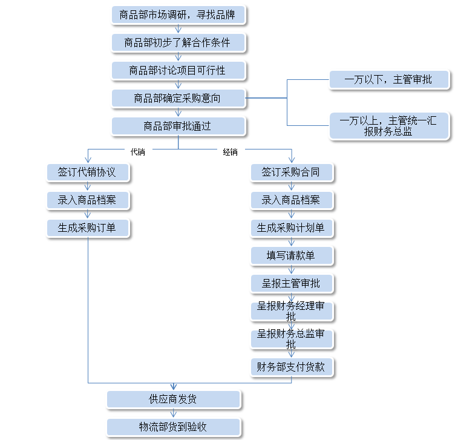

## 原PDF第87页

[对照原PDF第87页](../新三板时期/2016年公开转让说明书.pdf#page=87)

北京泡泡玛特文化创意股份有限公司公开转让说明书

（三）销售模式

销售模式分为自营模式、联营模式、网络销售三类，其中泡泡玛特的销售模

式主要为自营模式，南京金鹰泡泡玛特的销售模式包括自营模式和联营模式，葩

趣科技目前不存在销售业务。

自营模式是公司在商场租赁场地，直接向供应商采购商品，并自行负责商品

的物流、存货管理和销售，公司承担与商品相关的风险和收益，并以赚取进销差

价为盈利模式，自营模式下公司的利润来源主要是商品进销差价。

联营模式是公司在商场设立店面，与商场联合经营。公司不交纳商场租金，

店面形象由公司负责按统一形象标准装修，货品由公司自主统一配送及摆置，并

聘请销售员销售。顾客购买货品后，由商场收取货款，商场每月按公司门店上月

销售额收取一定比例扣点后与公司进行结算，所收取货款在扣除商场按照商品销

87

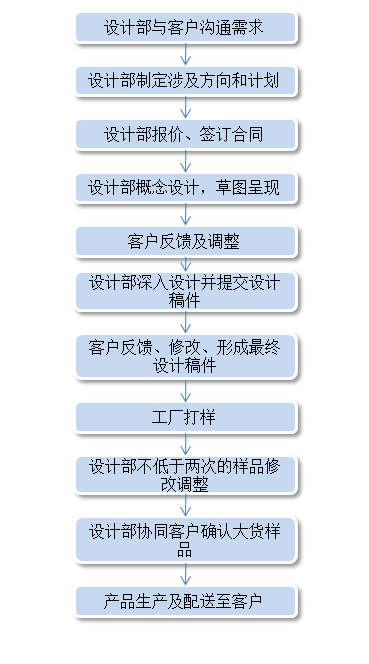

## 原PDF第88页

[对照原PDF第88页](../新三板时期/2016年公开转让说明书.pdf#page=88)

北京泡泡玛特文化创意股份有限公司公开转让说明书

售收入一定比例计算的分成后，返款给公司。

网络销售主要是通过天猫、京东进行产品展示、在线交易，网站硬件、软件

及服务由公司自行管理，销售货款先支付到网络销售平台，由网络销售平台按照

条款约定扣除一定比例的销售额后，再返款给公司，收到款项后发货给顾客，完

成商品销售。

关于公司销售是否附有条件、是否存在退货等情况如下：

1）附有条件销售情况

关于自营销售模式，公司未与终端消费者签订合同的零售业务中，客户对

商品签收并支付货款，公司确认收入的实现；公司签订合同销售给定制客户、

批发客户等的销售业务，公司与客户的业务合同在“交货及验收”一节中明确

约定了验收方式“甲方收货前，货物风险由乙方承担。甲方收货时仅对货物外

包装数量和外观进行确认，乙方保证外包装完好无缺、外包装数量无误、附件

齐全。甲方若对货物内件及双方约定的其他方面有异议，包括但不限于数量短

缺、规格不符、内件受损，壳子收入之日起一定日期内要求乙方更换或退货；

对质量有异议的，可在质量保证期内提出。”并且在 “违约责任”一节中明确

约定了“甲方、乙方不能按合同约定履行自己的各项义务时应承担相应的违约

责任，包含支付赔偿金，赔偿因违约给对方造成的经济损失。”或“甲乙双方

应按本合同的条款严格履行。如有一方违约，由违约方承担由此给守约方造成

的全部损失。”公司根据合同条款，在对方确认收货并且不存在约定异议的情

况下确认收入。

关于联营销售模式，公司与联营方在合同中约定了销售商品的种类、合约

期限以及结算方式，并按照合同的约定按月对账借款。合同条款中未见对销售

附有其他条件。

关于网上销售模式，公司未与终端消费者签订合同，在产品交付予客户时，

产品的风险和报酬已经转移至客户，并以客户对商品签收并支付货款时确认主

营业务收入。

综上，公司不存在附有条件销售的情况

2）退货情况

公司最主要的产品为潮流收藏类产品，非消耗品，其在正常使用环境下出

88

## 原PDF第89页

[对照原PDF第89页](../新三板时期/2016年公开转让说明书.pdf#page=89)

北京泡泡玛特文化创意股份有限公司公开转让说明书

现产品质量的几率较低。公司一般根据供应商的质量保证条款给予客户一至十

二个月的退货期。报告期内公司的退货发生较为零星、金额较小，发生退货时

直接冲减当期收入，公司的会计处理方式如下：

借：银行存款/现金/应收账款（红冲）

贷：主营业务收入（红冲）

贷：应交税费-销项税（红冲）

借：主营业务成本（红冲）

贷：存货-库存商品（红冲）

报告期内，公司发生退货的金额及占销售总额比例的情况如下：

```text
      项目              2014 年            2015 年         2016 年 1-5 月
退换货金额（元）         169,525.69          474,016.25         292,090.43
 占当期收入比率               0.58%               1.04%              1.71%
```

发生退货后，公司会首先与供应商沟通进行退换货；如果不能进行退换货

的情况下，会采取折扣销售或报废处理。

（四）门店体系建设

店址选址

泡泡玛特建立了一套动态的选址评估体系及流程来提高开店成功率。同时

随着公司的发展根据大环境变化也在不断的调整，以下为店铺投资选址评估的

体系流程：

1、数据：泡泡玛特目前选址主要着重于优选国内综合销售业绩较为突出及

经营能力成熟的商业项目（即购物中心）和城市级别优先、前景有较好判断的

新商业项目。目前对商业项目年销售的要求至少在 12 亿人民币以上；

2、城市级别：泡泡玛特目前主要进驻的城市，其人口总量要求在 600 万人

口以上、城市 GDP 排全国前 20 名、人均 GDP 在 80,000 元人民币以上等指标；

3、地理位置：泡泡玛特选址要求的商业项目必须处于城市核心商圈或优质

高消费力群体聚集的城市区域商圈。目前中国主要城市商业商圈分布，除北上

广等一线城市外，基本都有三个或以上主要核心商圈，泡泡玛特的选址要求一

定是商圈内商业项目无论是项目级别还是经营业绩都是最好的，因此公司会对

89

## 原PDF第90页

[对照原PDF第90页](../新三板时期/2016年公开转让说明书.pdf#page=90)

北京泡泡玛特文化创意股份有限公司公开转让说明书

各商圈内项目有充分的考察与分析；

4、目标客群：公司对商业项目所处在的城市商圈半径 3 分里范围人口分布

及人口组成、人均收入等指标进行分析。目前要求项目 3 公里范围可辐射常住

人口至少 80 万，重点客群以企业家、优质白领、时尚达人与高校等密集区为优

先。

5、交通：泡泡玛特选址对商业项目的交通极其重视，一个商业的成功与交

通便利是密切相关的。地铁作为发达城市或经济良好的城市的标配，是非常重

要的出行方式之一，地铁上的商业项目会优先考虑。

6、商业体量：商业项目的体量决定了业态组合的丰富性，泡泡玛特选址对

商业项目的体量要求至少商业租赁面积在 8 万平方米以上；并且商业项目开发

者同时配套了 A 级写字楼、高端酒店及公寓等以及停车位在 1， 000 辆以上为佳；

7、业态组合：泡泡玛特选址要求业态规划齐全的商业项目，业态分布比例

合理。轻奢时尚以上定位、零售比例至少占 30%以上的份额。影院、精品超市、

人气餐饮、生活休闲、书店等业态为标配的商业项目。

8、店铺落位：泡泡玛特所有门店的选址都要求必须在强客流楼层，和客流

的主要入口处。对楼层业态的要求是潮流年轻时尚的业态组合，同时需要有非

常良好的零售氛围。泡泡玛特秉持着千金买地万金择邻的信条，对所选店铺位

置前后左右的邻居品牌的要求非常严格。目前的要求至少是快时尚品牌、潮牌

零售以及人气餐饮或影院等。

9、销售预测：泡泡玛特目前有比较好的行业资源，对所计划进驻的所有商

业项目和已进驻该商业项目内经营期中的大部分品牌皆可以获得实际销售业绩

数据，同时对目标店铺落位楼层进行实时客群统计。通过上述掌握的数据可以

测算出泡泡玛特进驻开业后的销售水平。

10、财务分析：泡泡玛特会对计划投资开设的店铺通过自有财务模型进行

专业的投资营收分析，通常我们会根据上述数据进行有效销售预估，并会设置

ABC 三个维度的未来销售可能性进行判断，根据报表生成分析的结果进行最终投

资决策。公司对已进驻该商业项目内经营期中的大部分品牌皆可以获得实际销

售业绩数据，同时对目标店铺落位楼层进行实时客群统计。通过综上所述掌握

90

## 原PDF第91页

[对照原PDF第91页](../新三板时期/2016年公开转让说明书.pdf#page=91)

北京泡泡玛特文化创意股份有限公司公开转让说明书

的数据可以测算出泡泡玛特进驻开业后的销售水平。

申请发货：

分货主要分为新货第一次配货和已有货品配货。

1、新货分货：根据商圈级别，店铺属性并结合店铺面积、业绩制定相应的

商品组合。结合陈列需要调整 SKU 宽度及深度，并匹配仓容制定合理备货系数

2、老品补货：补货逻辑不仅参考店铺的整体业绩排名，同时考虑某一相同

属性产品的销售排名，将二者结合确定最终的补货顺序，补货量综合考量单店

单周销售量，当前库存量及在途库存量。补货周期为一周 1-2 次，如遇节假日，

商场活动等适当调整。

仓储

1.商品入库：新品通过供应商送货或物流站点提货的方式进入仓库待检区

域。仓库人员按照先进先出原则对待检区域的商品进行查验（清点数量、核对

款型），对到货残次品拒绝入库，并通知对应买手做退货处理，检验合格商品

进行条码粘贴及分类上架处理。

2.商品出库:仓库根据商品部每天下达的配货订单，通过 ERP 系统打印出来

交给拣货人员按单从货架区进行拣选，配货完成的商品码放在指定的出货区域，

由出人员进行扫码复检，确定无误后打包装箱并放于指定的门店出货区域待第

三方物流进行提货配送。

配送

商品调拨分为“店-店”调拨、“店-仓”调拨，调拨双方在发生调拨任务

前均会提前接到商品部下达的调拨通知，接到调拨指令后调出方在系统中做调

拨单据，将所调拨的商品进行打包并通知第三方物流进行商品运输，调入方收

到货后在系统的在途功能里进行收货。

结算

在收银系统中，每个收银员都有唯一的工号编码及密码，其他人员不得操

作收银机。顾客在挑选商品并确认购买后，收银员用扫描枪扫描商品条码，并

告知顾客总消费金额，同时询问顾客使用哪种支付方式付款。如果是现金付款，

91

## 原PDF第92页

[对照原PDF第92页](../新三板时期/2016年公开转让说明书.pdf#page=92)

北京泡泡玛特文化创意股份有限公司公开转让说明书

收银员接过顾客现金后进行验钞，并将收取金额录入收银系统，钱箱打开，把

找零金额交付给顾客，并询问顾客是否需要开具发票，如需要按发票开具管理

办法操作。如果是刷卡支付，请顾客确认消费金额，并将密码键盘交与顾客，

请顾客输入密码。刷卡确认成功后，打印消费单据，请顾客在单据上签字确认，

并询问顾客是否需要开具发票，如需要按发票开具管理办法操作。每日下班前，

从收银系统打印营业汇总，与当日现金及刷卡单据核对，如果在检查中发现假

币或短款，由当班收银员补齐。每周一、三、五门店收银员将门店销售现金存

公司银行帐号，公司财务部进行每日核对。

店员管理

1、员工的选拔：由于零售店铺销售人员的录用门槛相对较低，通过对面试

者形象、沟通能力、过往经验等的判断即可入职，故试用期的培训考核尤为重

要，试用期间通过在岗培训、考核，包括企业文化、公司制度、产品知识、销

售技巧、服务态度、客诉处理等，快速进行优胜劣汰。

2、员工的培养与发展：通过建立泡泡玛特零售学院管理制度，根据公司发

展战略和人才培养计划，基于店铺销售、管理岗位的工作任务和能力提升需求，

搭建涵盖职业素养、专业技能、管理发展的课程体系，培养匹配公司发展战略

的店铺销售骨干及管理者，促进优秀人才与公司共同发展。

3、员工的激励与绩效管理：通过对外有竞争力、对内公平的薪酬体系设计，

包括销售奖金及灵活的激励奖金等，有效地激励店铺员工；通过绩效管理体系，

包括店长/店员绩效管理及公开公正公平的奖惩制度，将公司目标与员工行为相

关联，帮助员工正确认识自己的绩效表现，明确自身的绩效提升目标，促进绩

效改进和持续发展，实现公司和员工的共赢。

92

## 原PDF第93页

[对照原PDF第93页](../新三板时期/2016年公开转让说明书.pdf#page=93)

北京泡泡玛特文化创意股份有限公司公开转让说明书

4、员工的关怀：公司提倡“快乐生活，快乐工作”，让员工充分感受工作

带来的乐趣。公司为员工提供了丰富的业余活动机会，如技能竞赛、拓展训练、

生日会、年会等，还为优秀店铺员工提供出境游的机会等。为使每位员工都能

顺畅地表达想法，公司开辟了多种沟通渠道，如鼓励员工直接与所属领导交流、

定期组织员工座谈会、改进建议征集活动、开通“绿色通道”信箱等。

七、公司所处行业基本情况

（一）行业监管体制与相关政策法规

1、行业分类

按照国家统计局发布的《国民经济行业分类》（GB/T 4754-2011），公司所

在行业属于“F 批发和零售业-F52 零售业- F521 综合零售- F5211 百货零售”。根据

中国证监会 2012 年修订的《上市公司行业分类指引》，公司所处行业属于“F52

零售业”。根据全国中小企业股份转让系统 2015 年发布的《挂牌公司管理型行业

分类指引》，公司所处的行业属于“F 批发和零售业-F52 零售业- F521 综合零售-

F5211 百货零售”；根据全国中小企业股份转让系统 2015 年发布的《挂牌公司投

资型行业分类指引》，公司所处的行业属于“13 非日常生活消费品-1314 零售业

-131412 多元化零售-13141210 百货商店”。

2、行业主管部门及监管体制

公司所属的行业为零售业,该行业竞争较为激烈,各企业面向市场自主经营,

已经形成市场化的竞争格局。我国对综合零售行业的监管采取的是政府部门监督

和行业自律相结合的管理体制。政府管理部门主要负责研究行业规章、法规、制

定相关发展规划、建立行业技术标准以及对行业规范进行监管。行业协会负责行

业的协调、指导、管理和监督。

行业的行政主管部门为发改委、商务部和省、市商业管理部门。发改委其主

要职能对行业发展提供政策性指导,如负责研究拟定零售行业的行业规划和法规,

组织制订行业规章、规范和技术标准等。商务部其主要职能制定行业的发展战略、

拟订并推进方针政策、负责重要消费品的调控和监管。国家质监总局，主管产品

的质量检验及标准化等工作。

行业自律组织包括中国商业联合会、中国百货商业协会、中国连锁经营协会

93

## 原PDF第94页

[对照原PDF第94页](../新三板时期/2016年公开转让说明书.pdf#page=94)

北京泡泡玛特文化创意股份有限公司公开转让说明书

及其省、市分支机构等，其主要职能是协调成员之间以及成员与政府部门之间的

沟通交流,制定、修改行业标准规范并推进其贯彻实施。

3、行业主要法律法规及政策

（1）行业主要法律法规

商品零售业行业除受到《产品质量法》、《食品卫生法》、《消费者权益保

护法》、《反不正当竞争法》、《发票管理办法》等法律法规管理外，还主要受

到以下相关法律法规的管理：

1）商务部制订的《流通领域食品安全管理办法》  （商务部令\[2007\]第 1 号），

规范食品流通秩序，加强食品流通的行业管理，规范食品经营行为，保障食品消

费安全。

2）商务部制订的《超市食品安全操作规范（试行）》  （商运字\[2006\]122 号），

推动连锁超市的规范化运营，提高超市食品安全管理水平，增强消费者购物信心，

提升整个行业的食品安全管理水平。

3）商务部发布的《零售商供应商公平交易管理办法》  （商务部令\[2006\]第 17

号），规范零售商和供应商的交易行为，维护公平交易秩序和保护消费者的合法

权益。

4）商务部与中国连锁经营协会联合发布的《超市购物环境标准》，其对对

超级卖场环境、营销设施、附属设施等的基本要求作了严格的规定。

5）商务部等五部委联合发布的《零售商促销行为管理办法》  （商务部令\[2006\]

第 18 号），规范零售商的促销行为，维护公平竞争秩序和社会公共利益。

此外，国家对某些类别的零售商品的销售实行许可或备案管理，零售商须为

其店铺出售该等商品取得相应的许可证或进行备案登记，有关具体规定包括：

1）《食品卫生许可证管理办法》规定，食品生产经营需向当地卫生行政部

门申请取得《卫生许可证》。

2）《酒类流通管理办法》规定，从事酒类批发、零售需向商务主管部门办

理备案登记。

3）《烟草专卖许可证管理办法》规定，从事烟草销售须取得《烟草专卖零

售许可证》。

4）《盐业管理条例》及各省制定的盐业管理规章规定，食盐的批发、零售

94

## 原PDF第95页

[对照原PDF第95页](../新三板时期/2016年公开转让说明书.pdf#page=95)

北京泡泡玛特文化创意股份有限公司公开转让说明书

实行许可证制度。

5）《出版物市场管理规定》规定，从事出版物零售业务须向当地新闻出版

行政部门申请取得《出版物经营许可证》。

6）《中华人民共和国音像制品管理条例》规定，从事音像制品零售业务，

应向当地文化行政部门申请取得《音像制品经营许可证》。

（2）行业主要政策

```text
                     颁发部
序号       日期                文件名称                  主要内容
                       门
```

近年来,我国服务贸易发展较快,但总体上国际竞争力相对不足,仍是对外贸易“短板”。大

```text
                                        力发展服务贸易,是扩大开放、拓展发展空间
                            《加快发展
                                        的重要着力点,有利于稳定和增加就业、调整
     2015 年 1 月           服务贸易的
1                   国务院              经济结构、提高发展质量效率、培育新的增
                            若干意见》
                                         长点。为适应经济新常态,加快发展服务贸
```

易,扩大服务贸易规模,优化服务贸易结构,规划建设服务贸易功能区,进一步扩大服务业开放。

```text
                             《2014 年  深化流通领域改革，大力发展商贸物流，完
2    2014 年 4 月   商务部  流通业发展  善中小商贸流通企业公共服务体系，推动传
                            工作要点》          统商贸企业转型升级等。
```

《商务部关

```text
                            于促进电子
                                        加强农村和农产品电子商务应用体系建设，
                            商务应用的
      2013 年 11                        支持城市社区电子商务应用体系建设，鼓励
3                   商务部  实施意见》
          月                            中小企业电子商务应用，加强电子商务物流
                            （商电函
                                        配送基础设施建设等。
```

\[2013\]911

号）

《降低流通降低农产品生产流通环节用水电价格和运

```text
                            费用提高流
                                        营费用，规范和降低农产品市场收费，强化
                            通效率综合
4    2013 年 1 月   国务院              零售商供应商交易监管，加大价格监督检查
                            工作方案》
                                        和反垄断监管力度，保障必要的流通行业用
```

（国办发

地，便利物流配送等。

```text
                            [2013]5号）
                            《国内贸易  表示推动连锁经营向多行业、多业态延伸，
                            发展“十二   提高流通规模化、组织化程度，鼓励发展直
                            五”规划》   营连锁，规范发展特许连锁，扶持发展自愿
5    2012 年 9 月   国务院
                            （国办发    连锁。提升统一采购、统一管理、统一核算、
                            [2012]47    统一配送水平。运用信息化手段，优化供应
                            号）        链，提高经营管理水平。
                            《国务院关  提出：构建全国骨干流通网络，建设一批辐
                            于深化流通  射带动能力强的商贸中心、专业市场以及全
6    2012 年 8 月   国务院
                            体制改革加  国性和区域性配送中心。优化城市流通网络
                            快流通产业  布局，有序推进贸易中心城市和商业街建
```

95

## 原PDF第96页

[对照原PDF第96页](../新三板时期/2016年公开转让说明书.pdf#page=96)

北京泡泡玛特文化创意股份有限公司公开转让说明书

```text
发展的意    设，支持特色商业适度集聚，鼓励便利店、
见》（国发  中小综合超市等发展，构建便利消费、便民
[2012]39    生活服务体系。
号）
```

“十二五”时期的发展目标为:商品零售规模

```text
                                        保持稳定较快增长,社会消费品零售总额年
                            商务部关于  均增长15%,零售业增加值年均增长 15%;增
                            十二五时期  强中低端百货店竞争力,拓宽品牌商品销售
                            促进零售业  渠道,满足不同层次消费需求;支持社区商业
                            发展的指导  中心加快发展完善服务功能,保障社区居民
7     2012 年 1 月  商务部
                            意见》 (商流  消费安全;鼓励零售企业提高专业化程度,开
                            通发        展差异化经营,形成专项优势;鼓励零售企业
                            [2012]27    深入分析当地消费特点,开展区域营销,形成
                            号)         区域性竞争优势促进零售企业由注重门店
                                        数量和营业面积扩张转向注重质量提升,提
```

高企业核心竞争力。支持流通企业做大做强，尽快形成若干家有《关于搞活较强竞争力的大型流通企业和企业集团，鼓

```text
                            流通扩大消
                                        励流通企业发展连锁经营和电子商务等现
                            费的意见》
8    2008 年 12 月  商务部              代流通方式，形成统一规范管理、批量集中
                            （国办发
                                        采购和及时快速配货的经营优势，降低企业
```

\[2008\]134经营成本和销售价格，让利于消费者，促进号）

居民消费。

4、零售行业定义及其业态分类

零售是将商品及相关服务提供给消费者作为最终消费之用的活动。零售业是

指通过买卖形式将工农业生产者生产的产品直接售给居民作为生活消费用或售

给社会集团供公共消费用的商品销售行业。百货店是指在一个建筑物内，经营若

干大类商品，实行统一管理，分区销售，满足顾客对时尚商品多样化选择需求零

售业态。例如，超市是指开架售货，集中收款，以顾客自选方式满足消费者日常

生活需要的零售业态，是许多国家特别是经济发达国家的主要商业零售组织形式，

也是零售行业发展到一定阶段演变而来的零售业态。

20 世纪 90 年代以前，受政策环境影响制约，国内长期保持以国有大型百货

业态为主体的单一业态；从 90 年代开始，超级市场、专业商店、便利商店、仓

储商店等新型零售业态纷纷出现，首先在经济比较发达的大城市迅速扩展，成为

中国零售业规模增长的主要动力；2004 年以来零售行业差异化经营更加明显、

业态细分更加具体。

2010 年应商务部和国家标准委员会要求，中国连锁经营协会对 2004 年的零

售业态分类标准进行了一次修订，并最终形成新标准《零售业态分类》

96

## 原PDF第97页

[对照原PDF第97页](../新三板时期/2016年公开转让说明书.pdf#page=97)

北京泡泡玛特文化创意股份有限公司公开转让说明书

（GB/T18106－2010），本次修订首次对超市业态细分为便利超市、社区超市、

综合超市、大型超市四大类，具体如下：

```text
                                 有店铺零售业态
                                                                 经营商品及基本
       业态              经营面积                选址
                                                                      特点
                                                                以烟酒、饮料、休
      食杂店            100m 2 以下        居住区或商业区内
                                                                   闲食品为主
                                                                日用小百货为主、
                                         商业中心、交通要道及公
      便利店            200m 2 以下                              营业 16 个小时以
                                              共活动区域
                                                                       上
                                                                 商品均价低于市
                                         租金较便宜的居住区和
      折扣店             300-500m 2                             场均价，重视自有
                                              交通要道等
                                                                      品牌
                                                                自有品牌 4,000 多
    仓储会员店          6000m 2 以上      城乡结合部交通要道    种，低价、批量消
                                                                       费
                                                                 某一品牌系列商
                                         市、区商业中心、专业街
      专卖店           按商品特点定                             品为主，量少质优
                                          及百货、购物中心内
                                                                     高毛利
                                                                 品牌商品生产商
   厂家直销中心     建筑面积 100-200m 2        远离市区         直接设立，500 车
                                                                       位
                                                                 经营某一类商品
        专业市场       按商品特点定                -
                                                                 为主，摊位管理
专业
                                                                某一类商品为主，
 店
        专业超市       按商品特点定                -             采用集中收款方
                                                                       式
                                         市、区商业中心及商业聚
       高档百货店     6,000-20,000m 2                             高档百货商品
                                                 集地
百货                                     市、区商业中心及商业聚
       时尚百货店     6,000-20,000m 2                             时尚百货商品
店                                               集地
                                         市、区商业中心及商业聚
       大众百货店     6,000-20,000m 2                             大众百货商品
                                                 集地
       社区购物中   建筑面积 50,000m 2 以                       20-40 个租赁店独
                                            市、区商业中心
       心           内                                               立经营
购物市区购物中      建筑面积 100,000m 2                          40-100 个租赁店
                                              市商业中心
中心心              以内                                            独立经营
       城郊购物中   建筑面积 100,000m 2                         200 个租赁店独立
                                          城乡结合部交通要道
       心           以内                                              经营
                                                                即食品、日用小百
       便利超市                          商业中心、交通要道及公
                    200-500m 2                                   货为主，营业 12
                                              共活动区域
                                                                    小时以上
                                                                生鲜食品为主，营
超市   社区超市     200-2,000m 2         市、区商业中心及居住区
                                                                  业 12 小时以上
                                                                日常生活必需品，
       综合超市     2,000-6,000m 2       市、区商业中心及居住区
                                                                 营业 12 小时以上
       大型超市     6000m2 以上          市、区商业中心、交通要  大众化衣食日用
```

97

## 原PDF第98页

[对照原PDF第98页](../新三板时期/2016年公开转让说明书.pdf#page=98)

北京泡泡玛特文化创意股份有限公司公开转让说明书

```text
道、城乡结合部及大型居  品一次购齐、设停
         住区                 车场
```

根据《零售业态分类》（GB/T18106－2010），泡泡玛特归类于时尚百货店零售业态。

（二）行业发展概况及市场规模

1、行业发展现状和发展趋势

1918 年 9 月 5 日，国内首家百货企业上海永安百货创办。到了 90 年代初

期，百货企业的发展速度加快。20 世纪 90 年代以来，中国的零售业态己经开始

出现多元化的趋势，超级市场、大型综合超市、便利店、专业店、专卖店、大型

购物中心等零售业态纷纷出现，不断从百货公司中分流顾客，抢占市场份额。现

在的中国大型百货商店经过多年的调整，组合和定位开始走向成熟，竞争已经非

常充分。

零售业具有两个显著特点，其一，零售业每笔交易量较小网点比较多，零售

交易本身就是终端的零售交易,交易的对象是众多而分散的单个消费者,这就决定

了零售交易每笔交易量不会太大。同时,零售交易频率较高,因此,零售商必须严格

控制库存量。由于消费的广泛性、分散性与多样性,也使零售业设立的网点相对

较多；其二，零售业受消费者购买行为的影响比较大，零售业的对象是最终消费

者,而消费者的购买行为随机性较强,面对着这随机性购买行为明显的消费者,零

售商欲达到扩大销售商品的目的,要特别注意激发消费者的购买欲望和需求兴趣。

为此,零售商会在货物、商品陈列、广告促销等方面投入较大。

零售业态是零售企业为满足不同的消费需求进行相应的要素组合而形成的

不同经营形态。

国际现代零售业态发展历史如下图所示：

第一阶段，百货商场充分利用各部类生产的社会化分工和明码标价优势取得

98

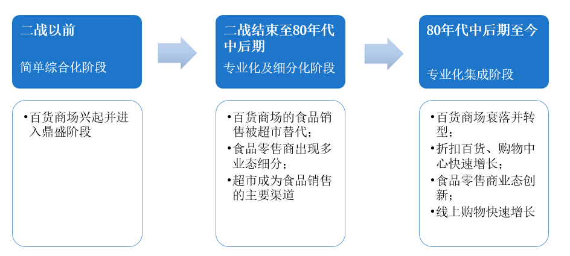

## 原PDF第99页

[对照原PDF第99页](../新三板时期/2016年公开转让说明书.pdf#page=99)

北京泡泡玛特文化创意股份有限公司公开转让说明书

了迅速发展，百货商场兴起并进入鼎盛阶段；第二阶段，由于消费者对不同品类

的需求差异导致了专业化业态的发展，消费者核心需求的多样化拉动了零售业态

多样化；各种专业零售商运用连锁技术获得规模经济，从而在这一阶段得以迅速

壮大；第三阶段，百货商场可以通过专业化集成演变为购物中心，而其他零售业

态的专业化进一步加强，从而形成深度专业化和专业化集成两大发展趋势。

我国零售行业的发展历程如下图所示：

第一阶段为改革开放初期，零售市场尚处于单一业态形式的萌芽阶段，实行

以统一分配制度为主的消费模式，当时的零售企业主要以国有企业为主；第二阶

段为转型期，零售企业从单一的国有所有制企业转变为多种所有制共同发展的格

局，外资、私营的快速发展替代了国企、联营的垄断龙头地位；第三阶段为纵横

拓展高峰期，我国零售业呈现多业态（百货、零售、专卖店、仓储店、便利店、

购物中心、电子商务等）协同发展的趋势。

我国零售业发展趋势主要表现在以下方面：

（1）零售行业发展迅速，经营渠道进一步拓宽

国家统计局网站显示，2016 年 1-6 月份,社会消费品零售总额 156,138 亿元,

同比增长 10.3%,其中,限额以上单位消费品零售额 71,075 亿元,增长 7.5%。其中，

城镇消费品零售额 134,249 亿元，同比增长 10.2%；乡村消费品零售额 21,889 亿

元，增长 11%。按消费类型分，2015 年 1-4 月份商品零售 139,455 亿元，增长

10.2%。

随着消费需求的多样化，零售行业企业已不仅限于传统的百货商店，大型超

市、购物中心、专卖店、连锁便利店、网上商城等的快速发展极大地丰富了零售

业渠道，为居民消费提供了更多便利和选择。各种业态和渠道分别确立自己的市

99

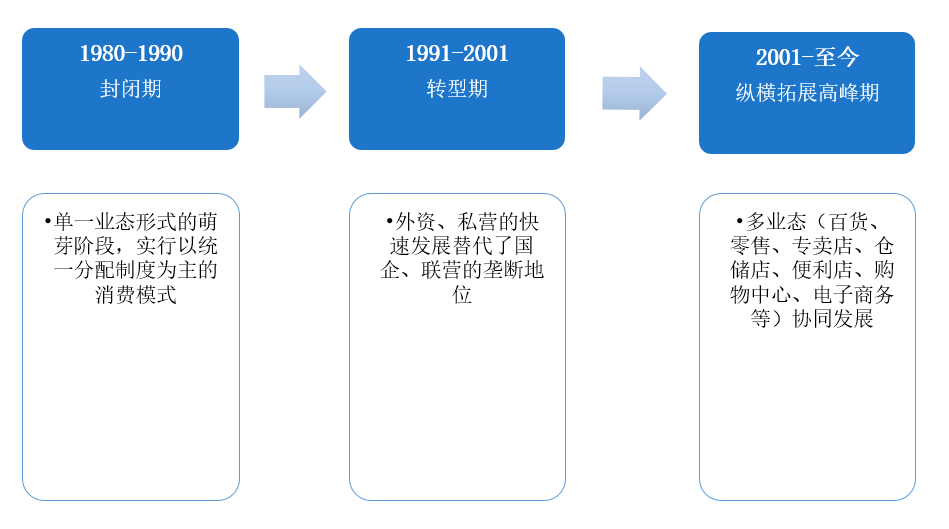

## 原PDF第100页

[对照原PDF第100页](../新三板时期/2016年公开转让说明书.pdf#page=100)

北京泡泡玛特文化创意股份有限公司公开转让说明书

场定位和消费群体，成为零售行业销售增长的主要动力。如大型超市提供各类食

品和生活用品，便于消费者一站式购物；购物中心设有餐饮和游乐设施，便于顾

客购物之余的休闲和娱乐；专卖店销售某一品牌的系列商品，受到品牌忠诚度较

高的顾客和追求时尚年轻人的青睐；连锁便利店提供小型日用百货商品，为附近

社区居民日常购物提供便利。

（2）新型城镇化为零售业发展创造机会

随着国家新型城镇化规划（2014-2020 年)的出台，二三线城市、县乡镇消

费水平逐步提高，居民消费能力增强，这都为零售业发展提供了良好的机遇。目

前，中央正努力缩小东西部差距、城乡差距，随着我国城市化进程的不断加快，

三四线城市交通将更加便利，社区配套的成熟也将激发当地居民巨大的购买潜力。

另外，当地商业资源丰富，经营成本较低，再加上大型零售企业较少，竞争尚不

充分，进驻到三四线城市的大型零售企业将成为城市化进程的受益者，不仅有利

于商业经营突破传统商圈限制，同时能够带动新商圈的建立和发展，吸引更多的

投资和消费。 2015 年中国按照常住人口计算的城镇化率达到 52.6%，与世界城市

化平均水平持平。加之收入的增加，中小城市消费潜力进一步被激发，零售行业

在三、四线城市发展潜力巨大，区域型连锁零售企业处于规模扩张期。

（3）国内零售行业集中度不高，竞争仍将加剧

从零售结构中可以看出，中国的零售结构规模中小商场比例较高，特别是个

体商店的比重达到了百分之九十以上，每个个体商店员工人数不多。即使是大型

零售企业，其组织规模仍然偏小。目前，国内企业的规模扩张更多的是向外发展，

对各个网点的资源抢占比较看重，标志性的国内百货公司如大商集团、万达集团、

银座集团、王府井百货集团等。外商的规模化也制约着我国零售业大规模的发展，

标志性的沃尔玛、家乐福等。截至 2012 年，全国限额以上零售企业数量达到 65,921

家，较上一年增长 7,450 家，该指标是 2007 年 26,691 家的 2.47 倍。2012 年百强

连锁的销售市场份额占社会零售总额（即行业集中度 CR100）为 8.87%，这一指

标较 2011 年 8.98%下降了 0.11%，较 2008 年 11.06%下降了 2.19%，总体来说，

行业集中度有下降的趋势。在国内范围内横向比较，零售业的行业集中度一直处

于较低水平。与国际其他国家相比，我国的零售行业集中度也处于较低水平，据

天拓咨询测算，美国零售业的前十强占零售总额(即行业集中度 CR10)在 2011 年

达到 63.38%，这一指标在 1998 年就达到了 50.95%。说明我国零售行业仍属于

100

## 原PDF第101页

[对照原PDF第101页](../新三板时期/2016年公开转让说明书.pdf#page=101)

北京泡泡玛特文化创意股份有限公司公开转让说明书

竞争性行业，区域型零售企业仍有较多机会。

另一方面，2013 年 7 月 4 日商务部流通业发展司发布的《2012 年度零售业

发展报告》指出，2012 年我国零售依然企业营业利润有所增长，但毛利率和净

利润率均有小幅下降，进一步确认了我国零售行业竞争加剧的事实。

（4）市场定位更加趋向高端、时尚名品

近年来，随着国内消费需求的不断发展，传统百货零售行业经营的一些品种

逐步从百货业态中分离出去，形成新的零售业态，例如以经营食品为主的超市、

家电专业店、家具建材专业店、服装专卖店、经营普通消费品的网店等。这种经

营品种的分离既体现了零售行业业态趋于多元化的趋势，更好的满足了消费者的

个性化需求，也促使百货零售行业形成了更为专注的经营定位和方向。

从国际经验来看，未来高端、时尚、名品将成为国内百货零售行业市场定位

的重要方向。这是因为，一方面，长期以来百货业态已经在国内消费者心目中形

成了较高的商业信誉，更适合承载价值量较大的高端、时尚、名品，并且，百货

零售行业在购物环境、购物体验和客户服务等方面相比其他业态更有优势，更能

够适应高端、时尚、名品的市场定位。另一方面，高端、时尚、名品的经济附加

值更高，市场竞争程度相对较低，能够为百货零售行业创造更为有利的经营环境。

（5）经营业态多元化方向发展

市场需求在总量不断扩张的基础上，也呈现出个性化和多样化的特点。随着

国内居民人均收入水平的不断提高，包括服务性消费需求在内的消费者个性化和

多样化消费需求被不断释放出来。为迎合和应对市场需求的变化，国内百货零售

行业在经营业态上也在不断向多元化方向发展。

一方面，传统业态向高端百货、时尚百货和名品百货发展，通过向消费者提

供差异化和特色化的消费感受，来确立主题商场的百货零售业态新模式；另一方

面，针对消费者越来越多的餐饮、住宿、休闲、娱乐和观光等服务性消费需求，

传统零售业态正在通过功能开发的方式升级购物体验，向购物中心等综合业态模

式转变。除此之外，随着信息和物流技术手段的不断提升，百货零售业也正在通

过拓展网络购物业态模式紧紧贴合消费者需求。

（6）零售业的现代化水平逐步提高

近年来，我国百货零售业的现代化水平显著提高，现代流通方式和新型百货

零售经营模式发展较快。POS系统、电子订货系统、客户关系管理系统、管理信

101

## 原PDF第102页

[对照原PDF第102页](../新三板时期/2016年公开转让说明书.pdf#page=102)

北京泡泡玛特文化创意股份有限公司公开转让说明书

息系统的广泛使用，使得百货零售业的采购、销售等业务流程和库存、结算等管

理方式都发生了巨大的变化，由此促使了百货零售业在流通和管理环节朝着信息

化、现代化方向发展，逐步赶上国外发达国家管理水平，与国际接轨。

根据Choice财富数据，将社会消费品零售总额按照销售渠道划分， 2016年

1-3月份，全国网上商品和服务零售额10,251亿元，同比增长27.8%。其中，实物

商品网上零售额8,241亿元，增长25.9%，占社会消费品零售总额的比重为10.6%；

网上服务零售额2,010亿元。在网上商品零售额中，吃、穿和用类商品分别增长

35.5%、16.0%和29.5%。网上消费增势明显，O2O（线上到线下）概念蔓延至整

个零售业。近两年，多数百货企业将全渠道纳入战略层面。以王府井百货、银泰

商业为首的百货公司纷纷与互联网巨头开启战略合作。银泰商业与阿里巴巴成立

合资公司，用于在中国发展与购物中心、百货、超市相关的线上线下业务。阿里

巴巴以53.7 亿港元战略投资银泰商业集团。王府井百货与腾讯在移动支付领域

取得突破后，双方将以融合联动的商业模式继续推进全渠道建设。

（7）中国百货业的长期发展是联营模式转向自营模式经营

上世纪 90 年代中期，中国百货流通领域推进对外开放，外资品牌百货店进

入国内市场，内资百货也纷纷转型品牌百货店，采取与品牌商或代理商联营的模

式；同时，为了在日益激烈的市场环境中扩大市场占有率，品牌商也非常乐意通

过联营的方式进入零售终端。凭借联营模式，中国百货实现了快速的连锁扩张，

但如今在商业渠道竞争加剧及网购比价效应下，中国百货“联销”弊端逐渐凸显。

中国在联营模式下，经销商通过品牌招商进驻百货店自行销售，对同一区域

的百货店而言品牌经销商重合度高，致使各百货店内品类同质化，“千店一面”

让消费者审美疲劳。另一方面，区域代理格局下，中国商品分销、加价环节多，

百货联销实际上再增加一环，致使终端价格高，消费者望而却步。

而在以欧美百货为代表的自营模式下，欧美百货通常买断某品牌某个产品周

期的产品，以独家经销的形式售予消费者；或者自己设计开发品牌产品（通常将

生产外包）并独家直营销售。这样的经营模式具有两个鲜明特点：1）所售品类

独特，紧随时尚前沿；2）供应链扁平化，零售效率高。

美国百货在经历行业下滑/洗牌后，龙头企业如 Macy's，Nordstrom 通过苦练

“商品经营”能力，以“买手制+自主品牌”的模式实现差异化定位，围绕目标客户

加强精细化管理，重新实现了业绩稳健增长。借鉴国际经验，中国百货业的长期

102

## 原PDF第103页

[对照原PDF第103页](../新三板时期/2016年公开转让说明书.pdf#page=103)

北京泡泡玛特文化创意股份有限公司公开转让说明书

发展是重拾“商品经营”功能，采用自营模式经营。

（8）买手制成为百货行业经营的趋势.

目前，在主流精品品牌纷纷放缓在国内开店步伐的背景下，来自国内外侧重

提供小众、低调、上档次产品的买手制精品店、百货商集体到来。如成都连卡佛

店也开始营业；同样二次登陆中国市场的老佛爷（Lafayette）百货与香港 I.T 集

团合作以买手制模式为主面向更为大众的消费者，在未来制定新开十余家店的计

划。买手制百货的优点是实现个性化采购和错位竞争，为消费者提供多元化的选

择；对于商场来说，由于绕过了代理商，减少流通环节，也可以提高利润率。目

前，买手制已成为国内百货行业经营的趋势。

（9）网络零售稳定增长成闪光点，占比首次突破 10%

传统零售业务和互联网的碰撞、融合，催生了具有巨大发展千里的电子商务，

网络销售快速增长，国家统计局统计公报显示：“2015 年全年网上零售额 27898

亿元，比上年增长 49.7%，其中限额以上单位网上零售额 4400 亿元，增长

56.2%。 ”。 “全年邮政业务比上年增长 35.6%，其中快递业务量比上年增长 51.9%，

快递业务收入增长 41.9%。 ”根据国家统计局数据，2014 年全国网上零售额增

速与社会消费品零售总额相比，高出 37.7 %。与此同时，网上销售额占社会消费

品零售总额的 10.6%，首次突破 10%。

此前，商务部监测数据也显示，在传统零售业态增速放缓的同时，网络零售

的增速稳中有进。2014 年 1-12 月 5000 家重点零售企业销售额增长 6.3%，较

上年回落 2.6 个百分点；专业店、超市和百货店的销售额增速分别达到了 5.8%、

5.5%和 4.1%，比上年相比，分别回落了 1.7、2.8 和 6.2 个百分点；购物中心

的销售额增速虽然达到了 7.7%，但也比上年放缓 4.5 个百分点。然而，5000 家

重点零售企业的网络零售增速明显快于其他传统零售业态，达到了 33.2%，并且

比上年相比，增加了 1.3 个百分点。

2、行业市场规模

近年来，我国经济持续高速增长。2005-2014 年，我国国内生产总值从

185,895.80 亿元增长至 636,139.00 亿元，社会消费品零售总额从 68,352.60 亿元

增长至 271,896.10 亿元。

103

## 原PDF第104页

[对照原PDF第104页](../新三板时期/2016年公开转让说明书.pdf#page=104)

北京泡泡玛特文化创意股份有限公司公开转让说明书

社会消费品零售总额（城镇）  社会消费品零售总额（农村）社会消费品零售总额

350,000.00

300,000.00

250,000.00

200,000.00

150,000.00

100,000.00

50,000.00

```text
0.00
       2010     2011    2012     2013    2014    2015
```

数据来源：Choice 财富

从上图可以看出，社会消费品零售总额增长率持续高于国内生产总值增长率，

且持续保持在较高水平。麦肯锡在其《2011 年度中国消费者调查报告：消费新

力量》预测，到 2020 年，中国的真实消费将达到 4.8 万亿美元，成为仅次于美

国的全球第二大消费市场。

我国限额以上零售业企业商品销售额虽然增长率放缓，但也保持了较快的增

长。2006 年我国限额以上零售业企业商品销售额为 22,460.50 亿元，到 2014 年

达到 110，641.39 亿元，增长率达到 12.34%。

零售业企业商品销售额及增长率

120,000.00

100,000.00

80,000.00

60,000.00

零售业企业商品销售额40,000.00  (亿元)

20,000.00

0.00

数据来源：国家统计局

2006 年我国限额以上零售业企业百货零售商品销售额为 4,436.24 亿元，到

2014 年达到 14，685.38 亿元，增长率达到 6.53%。

104


## 原PDF第105页

[对照原PDF第105页](../新三板时期/2016年公开转让说明书.pdf#page=105)

北京泡泡玛特文化创意股份有限公司公开转让说明书

百货零售商品销售额

16,000.00

14,000.00

12,000.00

10,000.00

8,000.00

6,000.00

4,000.00

2,000.00

0.00 2007年 2008年 2009年 2010年 2011年 2012年 2013年 2014年

数据来源：国家统计局

随着经济增长方式转变、居民消费结构加快升级以及城镇化、信息化、新型

工业化加快推进特别是电子商务方兴未艾，势必带来零售业态结构、经营模式乃

至整体格局新的调整与变化。未来，零售企业将加快转型升级，实体与网络零售

加快融合，通过全渠道、复合式、差异化经营，加强供应链管理，跨区域并购重

组，加快业态创新、品牌建设以及绿色循环发展，提高行业组织化程度与整体质

量水平。

（三）行业壁垒

1、品牌壁垒

良好的零售企业品牌是商品与服务质量的保证，是维持稳定消费群体的重要

保证，因此良好的品牌是决定零售企业在激烈的市场竞争中能否生存和发展至关

重要的因素。品牌影响力是通过多年的经营积累，在行业内和消费者心中逐渐形

成的。对新进入者而言，树立公司品牌不仅需要漫长的时间积累和完善的制度建

设，而且需要大量的人力、物力和财力等资源的持续投入。

2、规模与资金壁垒

企业规模在一定程度上决定其竞争力和盈利能力。经营规模较大的零售企业

既能够增强其对上游供应商的采购优势，又能够增强品牌影响力、发挥规模效应、

降低运营成本、节约费用。

随着连锁经营的日益普遍以及不断追求规模效应，对于现阶段以外延扩张为

105


## 原PDF第106页

[对照原PDF第106页](../新三板时期/2016年公开转让说明书.pdf#page=106)

北京泡泡玛特文化创意股份有限公司公开转让说明书

主的零售企业来说资金实力就变得尤其重要，门店扩张、存货增加、物流中心及

信息系统建设、人才培养等都需要大量的资金支持。另外，现代的零售企业开始

逐渐意识到稀缺性经营网点的重要性，逐步通过购置、自建等方式来获得稳定的

门店资源，降低对租赁物业经营超市的依赖，减少租赁物业到期不能续租或租金

上涨的风险，这也将增加对资金的需求。

3、商圈和选址壁垒

商圈和选址对零售企业的经营和发展至关重要，百货行业的销售状况受制于

其所处商圈的人流量水平，优质的商业物业具有地理位置优越、交通便利、营商

环境良好等天然优势。而一个城市优势商圈的形成和发展成熟需要较长的时间，

并受到城市商业规划、交通设施等众多配套因素的影响。如果某一家大型零售企

业在某一地区或城市的优势商圈开设多家商场，就很容易在商场位置、客流量和

顾客认知度等方面占据竞争优势，在形成网点后产生排他性的影响，从而在同一

区域内对同行业构成挤压性的竞争压力，并可有效遏制新竞争者的加入。

4、人才及管理经验壁垒

成功经营大型连锁零售企业需要一套科学和完善的组织结构、标准化的业务

管理流程、专业的管理人才及大批熟练员工，以形成低成本的业务复制能力，准

确把握不同市场的需求，这些是零售企业进入大规模扩张的必备条件。

人才储备对劳动密集型的零售行业来说具有重大的战略意义。在竞争激烈、

发展迅速的零售行业,缺少充足人才储备的零售企业将不具备长远发展的能力,未

来将难以在零售行业立足。对于零售行业而言,经营和管理需要一批经验丰富的

管理团队和优秀人才,尤其是一些行业，还需要长期培养一支优秀的买手团队。

培养零售经营管理人才需要较长的周期,需要学习营销、运营和管理等多方面的

专业知识。

5、优质供应商壁垒

广泛优质的供应商资源对零售企业提升品牌定位、客户资源、收入水平、盈

利能力以及把控经营风险至关重要。优质供应商与零售商长期稳定的合作关系是

保证零售企业正常经营、减少资金占用、保证商品质量和为顾客提供满意的售后

服务的必要条件。但是，广泛的供应商网络和信任关系需要双方经过长期的合作

106

## 原PDF第107页

[对照原PDF第107页](../新三板时期/2016年公开转让说明书.pdf#page=107)

北京泡泡玛特文化创意股份有限公司公开转让说明书

才能达到，这对于新进入者形成较大的障碍。

（四）行业发展的有利和不利因素

1、有利因素

（1） 城市化进程稳步推进

根据纳萨姆曲线的规律，一个国家的城市化率在达到 30%后将进入一个高速

发展阶段，这一阶段一直要持续到城市化率达到 70%时才有所放缓。我国城市化

率在 1998 年首次突破 30% ，17 年间增长了 26%，在 2015 年我国城市化率达到

56.1%。虽然该指标与欧洲美国等发达国家超过 70%的城市化了相差仍然较大，

但已达到世界平均水平，并且与其发达国家差距正在缩小。城市化的推进使大中

型城市不断扩容，中小型城市不断向现代城市转变，新增城市人口，尤其是在中

小型城市，创造了极大了消费需求，为零售业长期稳定增长提供了可以预计广阔

空间。我国城镇居民的收入与消费水平明显高于农村居民，城市人口的增加和城

市化率的不断提高将持续拉动消费增长。2014 年，我国城镇居民人均消费支出

为 19,968.10 元，是农村居民人均消费支出 8,382.60 元的 2.38 倍，城镇化的推进

将带来消费支出的更大增长。

```text
         2004     2006     2008     2010      2012     2014     2016
90,000.00                                                           60
80,000.00
                                                                    50
70,000.00
60,000.00                                                           40
50,000.00
                                                                    30
40,000.00
30,000.00                                                           20
20,000.00
                                                                    10
10,000.00
     0.00                                                           0
           2005 2006 2007 2008 2009 2010 2011 2012 2013 2014 2015
                城镇总人口（万人）           城镇总人口比重
```

数据来源：Choice 财富

（2） 国民经济的稳定发展及居民收入水平的提升推动国内消费需求增长

随着我国经济持续快速增长，人均国内生产总值和国内居民人均可支配收入

稳步上升，这直接带动了居民人均消费性支出的增加。2005-2014 年，我国人均

国内生产总值从 14,259.00 元增长到 46,652.00 元，年复合增长率为 12.58%，城

镇居民人均消费性支出从 7,942.88 元增长至 19,968.00 元，年复合增长率为 9.66%，

107


## 原PDF第108页

[对照原PDF第108页](../新三板时期/2016年公开转让说明书.pdf#page=108)

北京泡泡玛特文化创意股份有限公司公开转让说明书

经济的持续稳定增长和人民生活水平的不断提高促进了消费增长，这为居民消费

能力的增强奠定了坚实基础。

2005 年以来我国人均国内生产总值、城镇居民人均可支配收入和城镇居民

人均消费性支出增长趋势如下：

城镇居民家庭人均可支配收入  城镇居民家庭人均消费性支出

35,000.00

30,000.00

25,000.00

20,000.00

15,000.00

10,000.00

5,000.00

0.00 2006 2007 2008 2009 2010 2011 2012 2013 2014 2015

数据来源：Choice 财富

（3） 消费结构转型提升行业发展动力

我国城镇居民生活水平持续提高和人口结构变动推动了消费需求快速增

长和升级，消费升级换代加快，消费结构不断优化，居民消费从满足基本生存需

求向提高生活质量转变，城镇居民消费需求也由生存型向享受型、发展型转变，

高端消费比重不断增加。消费者的品牌意识更为强烈，对商品品质、服务品质、

购物环境等的要求更高。品牌消费、网络消费、信贷消费、健康消费和体验消费

等新兴消费概念和消费方式不断发展，新兴的零售业态随之涌现，传统业态也在

自我创新。消费升级为零售企业的发展提供了巨大的空间和持续的动力。

（4） 国家产业政策的不断支持

“十二五”期间，国家将“扩大内需”作为促进经济增长的重要手段，国务院发

布的《国民经济和社会发展第十二个五年规划纲要》中明确提出建立扩大消费需

求的长效机制，把扩大消费需求作为扩大内需的战略重点，通过积极稳妥推进城

镇化等政策，健全社会保障体系并营造良好的消费环境。增强居民消费能力，改

善居民消费预期，促进消费结构升级，进一步释放城乡居民消费潜力，逐步使我

国国内市场总体规模位居世界前列。《十三五规划》提出，到 2020 年社会消费

品零售总额接近 48 万亿元，年均增长 10%左右。

商务部《关于“十二五”时期促进零售业发展的指导意见》，提出“十二五”时

108


## 原PDF第109页

[对照原PDF第109页](../新三板时期/2016年公开转让说明书.pdf#page=109)

北京泡泡玛特文化创意股份有限公司公开转让说明书

期，社会消费品零售总额年均增长 15%，零售业增加值年均增长 15%的目标，

大型零售企业整体优势进一步增强，跨区域发展成效显著，零售业结构布局更趋

完善，城乡、区域间协调发展，基本形成结构合理、布局科学、竞争有序的现代

零售业。零售行业的地位将随着国家宏观和产业政策的支持进一步提高。

2、不利因素

（1）恶性竞争制约零售行业发展

近年来，由于国内零售企业实现品牌化、差异化的能力不足，价格战在国内

零售行业内竞争中屡见不鲜。另外，部分电子商务企业利用过低的产品价格吸引

消费者，获取市场份额，损害了包括自身在内的零售企业利益，对市场秩序造成

了不利影响。恶性竞争不仅不能提高整个行业的创新能力，而且还损害了零售行

业与上下游产业的相关利益，从全国范围上看，不利于为我国超市百货零售业持

续健康的发展。

（2）租金上涨为零售行业发展带来不确定性

租金上涨连锁零售企业多以租赁物业来扩张经营网点，租金成为超市企业的

主要经营成本之一。由于位置优越的商业物业的稀缺性以及我国房地产价格的不

断上涨，近年来商业物业的租金也呈现上涨趋势，这将不利于百货及超市企业的

经营和快速扩张，从而对行业的发展形成制约。

（3）区域代理模式增加了零售行业扩张的难度

区域代理体系不利于连锁企业发展，经销商通过独家买断区域代理权，从而

获得该区域的垄断经销权。同时，随着品牌的销售渠道下沉，代理层级甚至区分

到乡镇级，这为连锁企业进入这些地区增加了谈判成本。

（4）物流配送体系建设滞后

近年来，零售连锁企业向“三四线城市”扩张步伐不断加快，对物流配送和售

后服务体系的要求也越来越高。零售行业的转型发展，离不开完善的物流网络和

高效的配送中心。而我国大部分零售连锁企业在物流配送方面的信息化程度相对

滞后，仓储和运输能力不足，物流配送体系的建设亟需改善。物流配送体系难以

与零售门店的扩张相匹配，对了零售连锁企业外延性扩张产生制约。

（五）行业基本风险特征

1、宏观经济影响引起的行业风险

109

## 原PDF第110页

[对照原PDF第110页](../新三板时期/2016年公开转让说明书.pdf#page=110)

北京泡泡玛特文化创意股份有限公司公开转让说明书

下游消费者消费能力受个人收入影响较大。未来受到宏观经济变动以及经济

周期波动的影响,消费者收入可能发生较大波动,下游消费能力的波动必然影响到

上游商城购物的发展,因此,公司存在未来受到宏观经济和市场波动影响的风险。

2、互联网加剧行业竞争风险

从外部竞争环境看,实体百货店最大的竞争“敌人”便是来势汹汹的电商对于

实体零售市场的大肆“瓜分”。电子商务作为商业贸易中的一种先进的交易方式,

对传统零售业的观念和行为方式产生了巨大的影响和冲击。电商的蓬勃发展将取

代部分传统零售渠道的市场份额,从而对包括公司在内的传统零售企业带来一定

冲击,并造成市场格局和销售方式的转化。互联网带来的跨界经营和行业无序发

展使市场竞争异常激烈,毛利水平提升困难,新开门店培育期延长。

另外,互联网打破了信息的不对称,充分满足了消费者的个性化需求,并为消

费者提供极大的便利。对于零售业而言,互联网带来的最大变化就是改变了消费

者的行为习惯,颠覆了零售商与消费者的地位,使“消费者为中心”的时代迅速到来。

移动互联时代的消费者追求的是综合价值的提升、个性化和全渠道的体验、产品

决策的参与感以及购物效率的提升。零售行业正因此发生着重大而深远的转变,

传统零售企业商业模式的变革已经迫在眉睫。

3、高级管理人才匮乏的风险

针对不同类型的百货零售企业，具备较高敬业精神、服务意识和行业经验的

管理人员，以及具备一定的连锁经营管理知识、现代营销技术、物流管理及信息

技术管理等专业知识的人才，是将企业向标准化、专业化、规模化的方向发展的

关键因素。同时，面对业内激烈竞争以及多变的市场环境，要求企业决策人员、

市场策划人员、业务人员从各自专业角度对新型消费观念进行研究并形成自己的

企业风格。在外资企业拥有较多优秀的商业专业人才的同时，国内百货企业却面

临着人才匮乏的局面。行业的快速膨胀和增长与高级管理人才和技术人才的相对

缺乏形成较大矛盾，人才因素成为现阶段制约着百货行业快速健康发展的重要风

险之一。

4、门店租赁与选址的风险

经营场所的选取对零售企业具有重要影响,为降低投入,大多连锁型零售企业

110

## 原PDF第111页

[对照原PDF第111页](../新三板时期/2016年公开转让说明书.pdf#page=111)

北京泡泡玛特文化创意股份有限公司公开转让说明书

采用租赁的方式取得门店,因此门店租赁期满后能够续租对企业经营非常重要。

公司取得门店时往往签订长期合同,加之公司现有门店与物流中心的品牌影响力

较强,信誉度较高,业主为获取长期稳定的租金收入,一般愿意以较为优惠的价格

与公司签订租赁协议。为了降低租赁期限届满而不能续租的风险,公司往往也会

提前准备续租工作,但依然不能完全规避门店依赖租赁的风险。

由于连锁零售企业往往倾向签订长期租赁协议,因此门店选址不仅关系到新

开店未来的经营效益,而且对现实投入具有重要影响。门店选址失当,将会对连锁

企业造成经营风险,直接影响企业发展。

八、公司所处行业的竞争情况和公司优劣势

1、行业中的竞争情况

零售行业内竞争情况较为复杂，竞争层次也较为丰富，行业内不同零售业态

之间有竞争，同业态下的内部零售企业亦有竞争。

与公司同处于零售行业的国内主要零售商及特点如下：

```text
 证券代码      名称         营收        业务分类及特点        主要零售模式
                                      涉及商业和房地产，
                                      山东省规模最大的商
                                                           线下，山东全省及河
600858.SH    银座股份       146 亿     业零售企业之一，
                                                                北石家庄
                                       “百货+超市”发展模
```

式

涉及商业、医药、酒

```text
                                      店，上海南京路上集
600628.SH     新世界        31 亿     购物、娱乐、宾馆、     线下，只在上海
                                      餐饮、商务、休闲为
```

一体的生活中心

涉及百货、房地产、

```text
                                      家电、彩票、宾馆，
                                      湖南省最大的百货零
002277.SZ    友阿股份       62 亿                           线下，主要在长沙
                                      售企业，百货门店覆
```

盖长沙市五大商圈之

主要四个

涉及百货，是上海地

```text
                                      区销售规模最大的百
002561.SZ     徐家汇        20 亿     货零售企业之一，在     线下，只在上海
                                      徐家汇商圈的市场份
```

额处于领先位置

```text
                                      涉及百货、家电、超
834898.OC    株百股份       19 亿     市，是湖南省大型零     线下，只在株洲
                                          售商场之一
```

111

## 原PDF第112页

[对照原PDF第112页](../新三板时期/2016年公开转让说明书.pdf#page=112)

北京泡泡玛特文化创意股份有限公司公开转让说明书

```text
                                      涉及百货、家电、超
                                      市，安徽本土最早成
835433.OC     商之都        27 亿                           线下，主要在合肥
                                      立的商业连锁企业之
```

一注：以上公众公司数据基于 2015 年，来自 WIND

与公司处于相似零售业态的主要零售商及特点如下：

```text
品牌图标       名称         营收           业务特点          主要零售模式
                                     是日本知名的以销售
                         51 亿（2015
              LOFT                   创意生活杂货为主的   线下连锁，开放加盟
                           财年）
                                          大型连锁店
                                                          PC 端网站和手机端
                          约 1 亿元  一家以创意家居为主
              趣玩网                                             APP
                         （2014 年）  的创意百货零售平台
```

注：以上非公众公司数据来自网络公开信息、控股母公司年报

对比泡泡玛特情况如下：

```text
品牌图标       名称         营收          业务特点           主要零售模式
                                     时尚小百货连锁，定
                                                           线下连锁和线上社
                          4500 万元   位于 15-30 岁的大学
             泡泡玛特                                     群手机端 APP，全直
                         （2015 年）  生、白领和创意、收
                                                          营模式，未开放加盟
                                       藏类玩具爱好者
```

从国内看，零售行业的公众公司多为综合性传统商贸企业，规模普遍较大，

以多业态、多门店为发展趋势，多传统线下零售模式并根植于发源地，而与泡泡

玛特处于相似零售业态的零售企业尚未出现公众公司，业内企业从创立起，多放

眼全国市场，除采用线下连锁外，多尝试线上销售模式。

泡泡玛特目标客户定位于具有一定消费能力的白领和创意杂货、收藏类玩具

爱好者，采用全直营线下连锁和移动端社群 APP 立体营销模式，无论是目标市

场定位、企业发展战略定位、经营模式定位均不同于其他企业，经过 6 年的发展，

泡泡玛特已经成为行业内时尚百货细分品类的领导企业。

放眼国外，与泡泡玛特业态最为相似的零售企业是日本知名的以销售创意生

活杂货为主的零售品牌 LOFT，其隶属于亚洲大型上市零售集团 Seven&I 控股，

泡泡玛特根植中国市场，致力于成为国内收藏类 IP 的综合运营商，与其形成错

位竞争。

2、公司竞争优势

112

## 原PDF第113页

[对照原PDF第113页](../新三板时期/2016年公开转让说明书.pdf#page=113)

北京泡泡玛特文化创意股份有限公司公开转让说明书

（1）线上线下立体化融合的模式优势

葩趣 APP 是公司开发的 IP 线上社区平台，APP1.0 版本已于 2016 年 6 月上

线。葩趣 APP 第一阶段将聚焦潮流玩具市场，通过社交、电商、游戏等功能打

造集社群、娱乐与电商为一体的潮流玩具线上社区平台。葩趣 APP 第二阶段将

由潮流玩具市场扩展至二次元动漫、电影等 IP 类市场，致力于打造中国优质的

IP 线上社区平台之一。

葩趣 app 界面概览

对收藏玩家而言，葩趣 APP 致力于打造分享型平台，及时对收藏类 IP 系列

新品进行报道。不断的制作有价值的资讯和小游戏从而吸引更多用户，打造社群

经济。

对品牌商而言，葩趣 APP 可以帮助构建合理的宣传渠道，扩大品牌及产品

的知名度，此营销渠道可以帮助品牌商在目标消费群聚集地精准投放信息，并陆

续收到来自精准市场的反馈，迅速收集这些信息，分析目标消费群，此时，线上

113

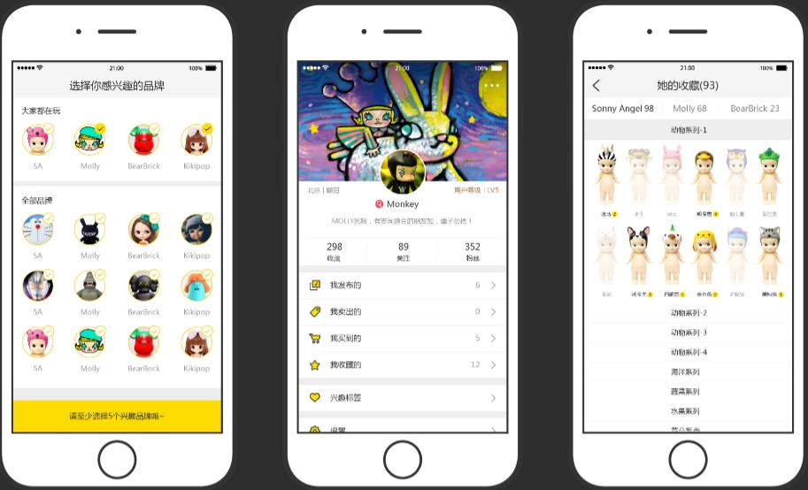

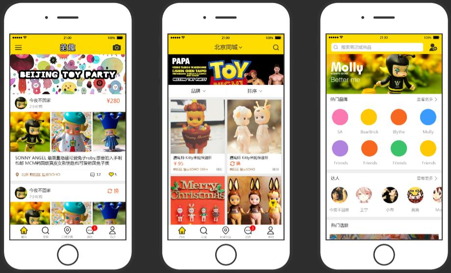

## 原PDF第114页

[对照原PDF第114页](../新三板时期/2016年公开转让说明书.pdf#page=114)

北京泡泡玛特文化创意股份有限公司公开转让说明书

社群、线下实体营销渠道同时搭建的多维性就打造了泡泡玛特的特有竞争优势。

（2）致力于回归商业本质的优势

品牌重复率高、无创意，以及电商对零售行业的肆虐，让传统商业不断变革，

由此开创了一个“体验经济”的时代，而文化创意类品牌作为一种十分有吸引力的

文化体验式业态，逐渐受到了消费者的欢迎，购物中心也对其抛向橄榄枝。

此背景下，零售企业对市场需求是否有深刻理解和清晰判断，是否能提供高

质量的产品和精准的服务，是否能持续满足用户不断变化的需求，是否有明晰的

赢利模式和商业构想就显得尤为重要，商业企业的可持续发展，一方面要积极应

用新技术，探索模式创新；另一方面，要深修内功，回归商业本质，将核心竞争

力放在不断提高商品质量和服务水平上。

个性化需求被满足，是零售行业都应该思考的问题，单纯的网上消费取代传

统零售业态是极不现实的。未来，互联网的商业影响绝不仅仅在于有多少百分比

销售能在网上发生，相反，线上和线下的定义会越来越模糊。面对互联网技术所

有的商业形态、各行各业，都希望能够做出一些改变，利用互联网的思想和技术

去武装、更新自己的产业。综合当前的发展情况，通过互联网思想和技术，最终

将能够帮助整个零售业实现与消费者的连接变得更有效率；越来越多的企业开始

接触互联网，不仅是把互联网定位成一个销售渠道，更多的是把它定义成一个营

销渠道，触达消费者越来越多的企业不仅会把互联网看成是一个销售通路，更多

会把它看成是和用户做各种各样互动的管道。最终，它的效果并不一定在网上实

现交易，也可能会在线下反应出来。线上和线下最终将是一个完全融合的方式，

在这种融合方式下，零售业的效率将实现大幅度提高。

泡泡玛特提倡回归商业本质，注重“商品经营”和“消费体验”功能，除子公司

部分门店与金鹰商贸体系内商场属于商场联营模式，公司其余门店均采用自营模

式经营，公司全部门店亦未采用联营模式。泡泡玛特在利用互联网工具提升自身

零售效率外，还借鉴国际经验，坚持采用自营模式经营，重视顾客消费体验的同

时保障了公司毛利率水平。

（3）顺应新文化潮流崛起的优势

二次元、吃货战队、生活家、玩具收藏、奇葩杂货等已经成为了我国新生代

消费升级的重要组成部分。中国的 90 后新生代大概有 3.5 亿人，他们有着极强

的消费能力。新文化崛起，使脱胎于该文化的诸多商业模式得以形成并飞速发展，

114

## 原PDF第115页

[对照原PDF第115页](../新三板时期/2016年公开转让说明书.pdf#page=115)

北京泡泡玛特文化创意股份有限公司公开转让说明书

新文化是次文化的衍生品，是一种更加符合年轻人审美的新潮文化，早期主要变

现为受美国、日本流行文化较深影响的超级英雄以及动漫、Cosplay 等二次元文

化；其后，中韩年轻偶像所引领的潮流、明星动态加入其中，渐渐地，能够展示

新生代个性与活力的文化，体现在一些新奇特的产品设计中。在这些文化逐渐受

到人们广泛认可的同时，新文化的相关产品也变得愈加丰富，显示出新生代消费

力度的大幅增强。凭借着强大的购买力，新生代们正在悄悄发起一场消费革命，

年轻消费生态正在被各个消费领域关注。泡泡玛特凭借对年轻人兴趣及消费心理

的深度观察，使公司能够及时顺应新文化潮流崛起。

（4）细分市场优势

新文化已经开始逐步踏上主流文化的阶梯，并在这个过程中引领着文化领域

的消费升级。针对成年人、女性的购物平台比比皆是，专做母婴、海外的也有不

少，但还没有一个综合平台专门服务年轻的新生代群体、传播他们喜爱的新文化。

在商品层面，新文化体现为二次元商品、潮流商品、明星同款、原创品牌、具有

概念的科技品牌和各种新奇特物件等，这些都是新生代最感兴趣的。为了向用户

提供符合心意的商品，泡泡玛特的优秀买手团队，从世界各地精心搜罗了多种潮

流精致的新文化品牌，涵盖了年轻人吃、穿、行的各个方面；通过葩趣 APP 推

送新生代感兴趣的各方面信息，用好的内容提高用户的活跃度及粘性。他们大部

分追求个性，欣赏创意，大多数是知识层次较高，拥有稳定的收入的上班族，年

轻人的购物需求非常突出，具体说来，是 85 后到 90 后的年轻人，目前还没有明

确的百货购物场所，他们追求个性鲜明的、创意的、潮的、非主流的，并且质量

好的商品。而这群人，将会在未来三五年内，成为消费市场上巨大的生力军。因

此，泡泡玛特选择了年轻人，选择了年轻人所钟爱的创意商品。

（5）文化生态圈优势

泡泡玛特文化生态圈优势，是泡泡玛特线上线下立体化经营优势的延伸，泡

泡玛特将持续在二次元收藏文化方面发力，从引入国际优质收藏类 IP 入手，线

上丰富二次元文化板块，让二次元收藏客户发现更多全世界的好玩具，和爱玩具

的人交朋友，交换分享闲置玩具，掌握全球玩具资讯等等。在线下也不时开展各

种有趣的二次元玩具交流活动，打造二次元文化的生态圈。

（6）品牌创意优势:

时尚潮品零售商和收藏 IP 综合运营商最重要的就是创意，没有创意无疑自

115

## 原PDF第116页

[对照原PDF第116页](../新三板时期/2016年公开转让说明书.pdf#page=116)

北京泡泡玛特文化创意股份有限公司公开转让说明书

断前途，那么创意也就是公司支出的重要部分。为了在互联网时代长久生存，就

必须有自己的创意团队，有自己的品牌源动力。泡泡玛特目前注册商标近 70 个，

公司创意团队拥有多年创意执行经验，保障公司在品牌和商品创意持续保持竞争

优势。

（7）门店位置优越

优越的门店位置对零售连锁企业来说至关重要，意味着丰富的客源和良好的

经营业绩。公司目前大部分门店都位于当地的知名商场、商圈之内或黄金地段之

内。从公司角度而言，目前拥有的位置优越的门店，不仅能带来丰富的客源，而

且意味着较低的租赁成本。

（8）良好的供应商关系

对于零售连锁业而言，能否以较低的成本获得稳定货源对公司的毛利和业绩

影响非常重大。公司在与供应商的关系处理上，一是注重“公司、供应商、消费

者”共赢的经营模式，坚持利益合理分配的原则；二是注重与供应商进行及时准

确的货款结算，在供应商中保持了很好的信誉。一直和供应商保持良好的沟通和

合作保证了能够从供应商获得较具有竞争力的采购价格，保障了公司毛利水平。

与此同时，公司发力国际收藏 IP 国内代理运营业务，与供应商良好的合作可以

帮助企业打通 IP 零售产业链上游，为企业发展成为综合 IP 运营商奠定基础。

（9）经验丰富且稳定的优秀管理团队

公司目前的管理团队中多数人员是随公司一起成长起来的，具备极高的忠诚

度和丰富的管理经验。公司的经营管理团队对零售连锁行业有深入的见地，主要

管理人员来自 H&M 和优衣库等知名时尚快消连锁企业，对连锁经营的各个环节

有清晰的了解。管理层现代的经营意识，按市场发展趋势，创建了合乎市场规律

的全新经营模式和管理体制，使公司在激烈的市场竞争中保持了较强的竞争力。

（10）清晰准确的业态定位、务实有效的差异化竞争

公司定位于时尚小百货类零售业态，创造无可替代的线下购物体验，与大型

综合类零售企业和线上电商形成有效的错位竞争。

（11）较高的品牌影响力、美誉度和顾客忠诚度

良好的公司品牌对于商业流通企业至关重要，是维系稳定的消费群体与客户

的重要保障。公司在多年经营中，始终重视服务质量和品牌建设。公司官方微信

公众号已经拥有粉丝数十万。

116

## 原PDF第117页

[对照原PDF第117页](../新三板时期/2016年公开转让说明书.pdf#page=117)

北京泡泡玛特文化创意股份有限公司公开转让说明书

3、公司竞争劣势

（1）内部管理有待加强

随着外资零售进入的提速、市场竞争的加剧和公司发展规模的扩大，良好的

内部管理制度是确保企业生存、发展的基础。公司在企业形象、市场营销、营运

标准和人员培训等内部管理上还需提升，以加强公司抵御风险的能力，确保在激

烈的市场竞争中持续稳步的发展。

（2）物流配送体系亟待加强

公司采用商品全自营模式，物流配送体系的建设，是企业供应链整合的基础，

这直接影响企业的竞争能力，高效的物流配送体系零售商核心竞争力的主要体现。

随着公司发展规模的扩大、连锁网络的拓宽，现有物流配送体系已不能满足公司

业务发展的需求，而更加完善、快速反应、高效的物流配送体系及信息系统将更

加有助于提升公司的竞争力，降低运营成本，进一步提高效率。

（3）公司融资渠道单一

受限于融资渠道的单一，公司主要依靠自有资金积累来拓展门店。随着公司

扩张速度的加快，单一的融资渠道已经难以满足公司对资金的需求，这一定程度

上制约了公司业务拓展的步伐。

九、公司未来两年的发展计划

（一）公司定位和发展战略

公司将在现有规模与基础上，继续扩大在潮流商品领域的线下连锁零售优势，

加速线上电商业务发展；继续整合潮流玩具 IP 资源，不断孵化优质潮流玩具 IP；

继续整合供应链；搭建线上潮流玩具社交平台。通过一系列手段和努力，不断促

进中国潮流文化的发展，潮流产业的繁荣，促进公司规模和业务的长足发展，使

公司成为中国潮流产业的一流企业，并使股东获得持续、稳定的投资回报。

公司将以本次股票在全国中小企业股份转让系统挂牌为契机，立足于现有的

业务模式，积极开拓新的市场机会及盈利点，进一步加大在潮流玩具、知名 IP

孵化与衍生、动漫、游戏等领域的投资，不断扩大公司所拥有 IP 的品牌影响力

与市场占有率，为公司成为中国乃至世界一流 IP 综合运用服务商做好积极准备。

（二）未来两年内的发展计划

未来两年，公司将继续秉承企业宗旨，发挥核心竞争优势，稳步推进 IP 综

117

## 原PDF第118页

[对照原PDF第118页](../新三板时期/2016年公开转让说明书.pdf#page=118)

北京泡泡玛特文化创意股份有限公司公开转让说明书

合运营服务的战略，通过积累蓄势，在不断扩大零售渠道的基础上，更游刃有余

地孵化更多潮流玩具 IP，实现潮流玩具 IP 的价值创造，引领行业价值的提升。

未来两年公司将继续推进线上电商业务与线下零售业务的整合与升级，确保业绩

快速增长。

公司将继续以潮流市场为导向，深度挖掘市场需求，优化供应链结构，利用

资源整合优势，孵化优秀潮流玩具 IP，开发优质 IP 商品与衍生物，同时继续开

拓潮流玩具 IP 与动漫、电影、网络剧及游戏等重要业务领域的合作，不断推出

现象级 IP，获得市场的口碑与价值。

1、扩大线下零售渠道布局，加速线上电商业务发展

（1）公司将在现有近 28 家直营连锁门店的基础上，深耕北京、上海、广州、

深圳等一线市场，全面布局二线市场，在未来两年内使门店数量达到 100 家，达

到较强的规模效应。同时，公司将不断优化门店模型，提高单店盈利能力，不断

扩大公司营业额与营业利润。

（2）公司线上电商业务将在未来两年迎来高速发展，自 2016 年 6 月开设天

猫店以来，公司线上销售情况增速显著，月均销售额达到 200 万元，2017 年线

上销售额预计超过 5,000 万元，2018 年预计将再翻一番。同时，线上业务也将与

线下业务有机结合，通过线上与线下的相互导流，获取公司收益与品牌知名度的

最大提升。

2、打造国内领先的 IP 综合运营服务平台

（1）公司将继续大量签约国内外优质的潮流玩具 IP，不断设计、生产深受

市场欢迎的潮流玩具产品以及周边衍生产品。

（2）公司将孵化一批具有潜力的潮流玩具 IP，通过公司优质的供应链、强

大的销售网络以及出色的营销能力，打造市场认可并欢迎的新 IP。

（3）公司将依托与众多玩具工厂的良好合作关系，继续整合供应链，为每

个 IP 提供最好的供应链支持，提高产品质量，降低生产成本，为市场带来最好

的产品。

（4）公司将建立艺术家经纪的模式与体系，通过签约优质潮流玩具 IP 的艺

术家与设计师，为期提供全方位的包装与营销推广，帮助其作品受到市场追捧，

同时也可展开其他诸多衍生合作。

（5）公司通过打造潮流玩具社区平台“葩趣”，为潮流玩具粉丝提供了交流、

118

## 原PDF第119页

[对照原PDF第119页](../新三板时期/2016年公开转让说明书.pdf#page=119)

北京泡泡玛特文化创意股份有限公司公开转让说明书

交换、交易的平台，为潮流玩具艺术家提供了与粉丝接触、推广自身品牌的机会。

通过“葩趣”，公司将不断推动国内潮流玩具行业的快速发展。

（6）公司与诸多游戏公司、动漫公司、互联网电影公司保持了良好的合作

关系，通过与他们的合作，公司签约的 IP 资源将获得更高的知名度与发展空间，

比如推出以某款 IP 形象为主题的游戏或动漫电影。

3、加强人力资源开发，培养高素质的业务团队和设计团队

公司将通过内部培养和外部引进的方法扩充公司高素质的业务团队，继续完

善对员工的培训机制，不断提高员工素质，改善人才结构，建立一支与公司发展

战略相适应的梯队人才队伍。同时，公司将进一步完善各类岗位专业人员，特别

是关键经营管理岗位、设计创作岗位和营销宣传岗位人员的薪酬体系和激励机制，

将员工的职业生涯规划和公司的发展规划有机地结合起来,努力营造吸引人才、

留住人才和鼓励人才脱颖而出的机制和环境，吸引和鼓励优秀人才为企业长期服

务。

4、以在全国中小企业股份转让系统挂牌为契机，提高公司资本运作能力。

公司将通过在全国中小企业股份转让挂牌并融资，扩宽公司的融资渠道，提升公

司的资本实力。同时，在成为社会公众公司后，公司的知名度和品牌价值也将得

到进一步提升，更有利于公司未来业务的开展。

5、进一步完善公司治理结构

公司将进一步完善法人治理结构，建立适应现代企业制度要求的决策机制和

用人机制。以加强董事会建设为重点，充分发挥独立董事和专门委员会的作用，

更好地发挥董事会在重大决策、经理人员选聘等方面的作用。公司还将建立和完

善高级管理人员及核心员工的激励和约束机制，更好地吸收和利用社会各界的优

秀人才。

119

## 原PDF第120页

[对照原PDF第120页](../新三板时期/2016年公开转让说明书.pdf#page=120)

北京泡泡玛特文化创意股份有限公司公开转让说明书

第三节公司治理

一、股东大会、董事会、监事会的建立健全及运行情况

北京泡泡玛特创意文化股份有限公司系由北京泡泡玛特贸易有限公司整体

变更而来。有限公司期间，公司依据《公司法》的相关法律法规以及《公司章程》

的相关规定设立股东会，任命监事，全体股东选举产生执行董事，并详细规定了

相应的职权。对于公司资本调整、股权转让以及其他需要召开股东会进行决议的

事项都做出了规定。

2016 年 6 月 18 日，有限公司召开股东会，全体股东一致同意以 2016 年 1

月 31 日为基准日，以经审计的净资产按照一定比例折成股份，将有限公司整体

变更为股份有限公司。股份公司成立后，公司按照《公司法》等法律法规的要求

重新修订了《公司章程》，成立了股东大会、董事会和监事会（以下简称“三会”），

制定了股东大会、董事会、监事会的议事规则，逐步建立起规范的公司治理结构。

完善了关联交易、对外担保、对外投资的管理制度，建立了信息披露管理制度以

及投资者关系管理制度。

股份公司自创立大会召开之日至本公开转让说明书签署之日，制定并审议通

过了“三会”议事细则、《关联交易管理办法》、《对外担保制度》、《投资管理

制度》、《对外投资管理制度》、《总经理工作细则》、、《信息披露管理制度》、

《投资者关系管理制度》、《委托理财管理制度》等制度。会议的召集和召开程

序，决议内容没有违反《公司法》、《公司章程》等规定的情形，也没有损害股

东、债权人及第三人合法利益的情况。公司股东大会、董事会、监事会制度的规

范运行情况良好。

（一）股东大会制度建立健全及运行情况

根据《公司章程》规定，股东大会是本公司的最高权力机构，依法决定公司

的经营方针和投资计划，对公司增加或者减少注册资本、发行公司债券、公司合

并、分立、解散、清算以及法律、行政法规、部门规章或章程授予的其他职权。

自股份公司设立以来，股东大会根据《公司法》、《公司章程》、《股东大会议

事规则》等的规定规范运作。截至本公开转让说明书签署之日，公司共召开了4

120

## 原PDF第121页

[对照原PDF第121页](../新三板时期/2016年公开转让说明书.pdf#page=121)

北京泡泡玛特文化创意股份有限公司公开转让说明书

次股东大会。

（二）董事会制度建立健全及运行情况

根据《公司章程》规定，公司设董事会，对股东大会负责；董事会由9名董

事组成；董事会设董事长1名。在股东大会授权范围内，公司董事会决定公司的

经营计划和投资方案，制订需由公司股东大会审议批准的公司对外投资、收购出

售资产、资产抵押、对外担保、委托理财、关联交易等方案以及国家法律、法规

或本章程规定，以及股东大会授予的其他职权。自股份公司设立以来，历次董事

会的通知、召开、审议程序、表决均符合《公司法》、《公司章程》、《董事会

议事规则》等规定，会议记录、会议档案完整，董事会制度运行规范、有效。截

至本公开转让说明书签署之日，公司共召开了4次董事会会议。

（三）监事会制度建立健全及运行情况

根据《公司章程》规定，公司设监事会，由3名监事组成，其中1名职工监事，

由职工代表大会选举产生，监事会设主席1人。公司监事会依法对董事会编制的

公司定期报告进行审核并提出书面审核意见，检查公司财务等法律、行政法规、

部门规章或章程授予的其他职权。自股份公司设立以来，监事会的通知、召开、

审议程序、表决均符合《公司法》、《公司章程》、《监事会议事规则》等规定，

会议记录、会议档案完整，监事会制度运行规范、有效。截至本公开转让说明书

签署之日，本公司共召开了1次监事会会议。

二、公司投资者权益保护情况

《公司章程》中对于投资者关系管理制度做出了明确的说明，并制定了《投

资者关系管理制度》。投资者关系管理是指公司通过信息披露与交流，加强与投

资者之间的沟通，增进投资者对公司的了解和认同，提升公司治理水平，以实现

公司整体利益最大化和保护投资者合法权益的管理行为。公司投资者关系管理工

作由公司董事会统一领导。公司董事会秘书负责公司投资者关系管理的日常工作，

截至本说明书出具时公司尚未任命董秘一职。在公司任名董秘前，暂由证券事务

代表代理相关工作。具体的投资者关系管理事务包括公司的发展战略，信息披露

及其说明，公司依法可以披露的经营管理信息，公司依法可以披露的重大事项等。

《信息披露管理制度》要求公司应在全国股份转让系统公司要求的平台披露信息。

121

## 原PDF第122页

[对照原PDF第122页](../新三板时期/2016年公开转让说明书.pdf#page=122)

北京泡泡玛特文化创意股份有限公司公开转让说明书

公司及其董事、监事、高级管理人员应当保证信息披露的内容真实、准确、完整，

没有虚假记载、误导性陈述或者重大遗漏。

《公司章程》中对于公司治理期间发生的纠纷解决办法做出了明确的规定。

公司、股东、董事、监事、高级管理人员涉及本章程规定的纠纷事项，应当先通

过协商方式解决，协商不成的，任何一方均有权向有管辖权的人民法院提起诉讼

予以解决。《公司章程》自生效之日起，即成为规范公司的组织与行为、公司与

股东及股东与股东之间权利义务关系的具有法律约束力的文件,对公司、股东、

董事、监事、高级管理人员具有法律约束力。股东可以依据章程起诉公司；公司

可以依据章程起诉股东、董事、监事、高级管理人员；股东可以依据章程起诉股

东；股东可以依据章程起诉公司的董事、监事、高级管理人员；股东可以依据章

程起诉其他侵犯公司合法权益的自然人或法人。

公司实行累积投票制。累积投票制是指股东大会选举董事或者股东代表监事

时，每一股份拥有与应选董事或者股东代表监事人数相同的表决权，股东拥有的

表决权可以集中使用，对每位董事、监事候选人应当以单项提案提出。根据股东

大会的决议，可以实行累积投票制。

公司依照法律、行政法规和国家有关部门的规定，制定公司的财务管理等一

系列规章制度，涵盖了公司人力资源管理、财务管理、研发管理、销售管理、物

资采购、行政管理、内部审计等生产经营过程和各个具体环节，确保各项工作都

有章可循，形成了规范的管理体系。公司的财务管理和内部控制制度在完整性、

有效性、合理性方面不存在重大缺陷，内部控制制度有效的保证了公司经营业务

的有效进行，保护了公司资产的安全完整，能够防止、发现、纠正错误，保证了

公司财务资料的真实性、合法性、完整性，促进了公司经营效率的提高和经营目

标的实现，符合公司发展的要求。

董事会对公司治理机制的执行情况讨论认为，公司现有的治理机制能够有效

的提高公司治理水平和决策质量、有效地识别和控制经营管理中的重大风险，能

够给所有股东提供合适保护以及保证股东充分行使知情权、参与权、质询权和表

决权等权利，便于接受投资者及社会公众的监督，符合公司发展的要求。

122

## 原PDF第123页

[对照原PDF第123页](../新三板时期/2016年公开转让说明书.pdf#page=123)

北京泡泡玛特文化创意股份有限公司公开转让说明书

三、公司及控股股东、实际控制人报告期内违法违规情况

报告期内公司严格按照《公司章程》及相关法律法规的规定开展经营活动，

不存在违法违规行为，也不存在被相关主管机关处罚的情况。报告期末公司员工

全部正常缴纳社保。公司不存在其他如劳动社保、消防、食品安全、海关、工商、

质检等合规经营方面的问题和法律风险。公司目前不存在尚未了结或可预见的重

大诉讼、仲裁及行政处罚案件。

1、公司报告期内公司不存在重大违法违规的情况

（1）根据公司及其股东的确认并经核查，公司及其股东存在尚未了结的或

可预见的诉讼、仲裁及行政处罚案件，具体情况如下：

```text
序号       案号           当事人          诉讼请求        事由           进度
                     原告：泡泡玛特股  退还租金及保
                     份                证金，并支付                  2016 年 8 月 8
  1         -        被告：芜湖魔方网  违约金等其他   租赁合同纠纷   日立案，尚未
                     络信息服务有限公  损失共计                      开庭
                     司                812,415 元
```

（2）报告期内，公司存在的行政处罚情况如下：

2015 年 1 月 13 日，泡泡玛特有限因丢失发票而受到税务部门简易行政处罚

400 元。根据公司确认，该行为系因泡泡玛特有限员工疏忽所致，泡泡玛特有限

及时缴纳了罚款，并对该员工进行了批评教育。

根据《中华人民共和国发票管理办法》第 36 条的规定，跨规定的使用区域

携带、邮寄、运输空白发票，以及携带、邮寄或者运输空白发票出入境的，由税

务机关责令改正，可以处 1 万元以下的罚款；情节严重的，处 1 万元以上 3 万元

以下的罚款；有违法所得的予以没收。丢失发票或者擅自损毁发票的，依照前款

规定处罚。公司因丢失发票被罚款 400 元的行为，不属于情节严重的行为，且应

属于情节一般的情形中比较轻微的情形，不构成重大行政处罚。

根据《标准指引》的规定，重大违法违规情形是指，凡被行政处罚的实施机

关给予没收违法所得、没收非法财物以上行政处罚的行为，属于重大违法违规情

形，但处罚机关依法认定不属于的除外；被行政处罚的实施机关给予罚款的行为，

除主办券商和律师能依法合理说明或处罚机关认定该行为不属于重大违法违规

行为的外，都视为重大违法违规情形。

123

## 原PDF第124页

[对照原PDF第124页](../新三板时期/2016年公开转让说明书.pdf#page=124)

北京泡泡玛特文化创意股份有限公司公开转让说明书

上述行政处罚情节轻微，数额很小，不构成重大违法违规行为，且该处罚未

对公司的持续经营产生不良影响。公司于 2016 年 7 月份股份制改造后制定了完

善的内部控制制度，公司将严格执行财务管理制度，杜绝类似情形的发生。

综上，上述行政处罚情形不构成公司本次挂牌的实质性障碍。

（3）报告期内，公司及子公司无违法违规情况：

北京市朝阳区人力资源和社会保障局出具证明：“北京泡泡玛特贸易有限公

司，社会保险登记号码为：110105131459，在 2014 年 1 月至 2016 年 5 月期间未

发现有违反劳动保障法律、法规和规章的行为，也未有因违法受到本行政机关给

予行政处罚或行政处理的不良记录。”

北京市工商行政管理局朝阳分局出具证明：“北京泡泡玛特贸易有限公司，

统一社会信用代码为：911101055636846881，成立于 2010 年 10 月 20 日。经查

询，该企业近三年没有因违反工商行政管理法律、法规受到查处的案件记录。”

北京住房公积金管理中心海淀管理部出具证明：“北京泡泡玛特贸易有限公

司，单位住房公积金缴存登记号为 116344，住房公积金缴存登记办理时间为 2013

年 1 月 24 日，申请证明的住房公积金缴存期间为 2014 年 1 月 1 日至 2016 年 6

月 15 日。经查询，在上述住房公积金缴存期间，该单位没有因住房公积金缴存

违法违规行为受到行政处罚，没有发现单位存在住房公积金违法违规行为。”

北京市朝阳区国家税务局出具《纳税证明》，证明公司已依法办理税务登记，

暂未发现公司在 2014 年 1 月 1 日至 2016 年 5 月 31 日期间存在逾期申报、欠税

情形记录。2015 年 1 月 13 日，公司因丢失发票受到税务部门简易行政处罚 400

元。

南京市工商行政管理局出具证明：“南京金鹰泡泡玛特商贸有限公司，统一

社会信用代码为： 91320100302620846N，成立于 2014 年 6 月 25 日，现为开业

状态，经查询，自 2014 年 6 月 25 日至 2016 年 6 月 30 日，该企业在江苏省工商

系统市场主体信用数据库中没有违法、违规记录。”

南京市住房公积金管理中心出具证明：“南京金鹰泡泡玛特商贸有限公司于

2014 年 8 月 28 日在我中心办理了职工住房公积金开户登记，正常汇缴至 2016

年 6 月”；“截至目前该单位没有因为违反公积金法律法规而受到行政处罚。”

124

## 原PDF第125页

[对照原PDF第125页](../新三板时期/2016年公开转让说明书.pdf#page=125)

北京泡泡玛特文化创意股份有限公司公开转让说明书

南京市劳动保障监察支队出具证明：“自 2014 年 1 月 1 日至 2016 年 5 月 31

日，南京金鹰泡泡玛特商贸有限公司，劳动保障证号（10086879），未发现有违

反劳动保障法律法规行为发生。”

南京市社会保险管理中心出具证明：“南京金鹰泡泡玛特商贸有限公司，劳

动和社会保障号 10086879，经核实，截至 2016 年 6 月底前无社会保险欠缴。”

南京市玄武区国家税务局出具《税收证明》，证明金鹰泡泡玛特自 2016 年

1 月 1 日至 2016 年 5 月 31 日期间，暂未发现存在逾期申报等违法违规记录。

公司及金鹰泡泡玛特最近两年没有因违反有关环境保护、安全生产、产品质

量、社会保险方面法律法规而被主管部门处罚的情况。

2、控股股东、实际控制人不存在违法违规的情况

2016 年 5 月 5 日，北京市公安局海淀分出具了王宁的无犯罪记录证明。

2016 年 5 月 22 日，北京市公安局西城分局出具了杨涛的无犯罪记录证明。

公司控股股东、实际控制人最近两年内不存在违法违规及受处罚情况。公司

控股股东、实际控制人王宁出具声明，郑重承诺：“最近两年内本人没有因违反

国家法律、行政法规、部门规章、自律规则等受到刑事、民事、行政处罚或纪律

处分。”

公司实际控制人王宁、杨涛承诺：“本人为北京泡泡玛特文化创意股份有限

公司（以下简称“公司”）的控股股东、实际控制人，本人就公司为员工缴纳社保

公积金事项作承诺如下：若公司因为员工缴纳的各项社会保险及住房公积金不符

合规定而承担任何滞纳金、罚款或损失，本人承诺承担相关连带责任，为员工补

缴各项应当由公司承担的社会保险及住房公积金，并承担任何滞纳金、罚款等一

切可能给公司造成的损失。”

报告期内，公司控股股东、实际控制人不存在重大违法违规行为，也不存在

重大诉讼、仲裁、行政处罚及未决诉讼、仲裁事项。

125

## 原PDF第126页

[对照原PDF第126页](../新三板时期/2016年公开转让说明书.pdf#page=126)

北京泡泡玛特文化创意股份有限公司公开转让说明书

四、公司与控股股东、实际控制人及其控制的其他企业在业务、资产、人员、

财务和机构方面的分开情况

（一）业务分开情况

公司主要从事时尚潮品的连锁经营零售业务、定制业务及批发业务；公司建

立了完善的法人治理结构，拥有独立的经营决策权和实施权，独立于控股股东、

实际控制人及其控制的其他企业，能够独立面向市场。公司股东在业务上与公司

之间均不存在竞争关系，且公司实际控制人已签署承诺书，承诺不经营与公司可

能发生同业竞争的业务。

（二）资产分开情况

公司系由北京泡泡玛特贸易有限公司整体变更设立，有限公司的资产和人员

全部进入股份公司。整体变更后，公司依法办理相关资产和产权的变更登记，公

司具备与经营有关的上下游资源，拥有与经营有关的房产、办公设备等资产的所

有权或使用权，具有独立的运营体系。报告期内存在控股股东占用公司资金的情

况，且已经归还，截至本说明书出具时,公司现有的资产独立、完整，不存在控

股股东、实际控制人占用公司的资产和资源的情况。

（三）人员分开情况

公司已经按照国家有关规定建立了独立的劳动、人事和分配制度，目前公司

财务资产部负责进行劳动、人事和工资管理。公司的董事、监事、高级管理人员

均依照《公司法》、《公司章程》等有关规定产生，不存在股东超越公司董事会

和股东大会作出人事任免决定的情况。本公司总经理、财务负责人专职在公司工

作并领取报酬，不存在在控股股东、实际控制人及其控制的其他企业兼任除董事

之外其他职务及领取薪酬的情形。公司财务人员不存在在控股股东、实际控制人

及其控制的其他企业兼职的情形。

（四）财务分开情况

公司设立了独立的财务部门，配备了专职的财务人员并进行了适当的分工授

权，拥有比较完善的财务管理制度与会计核算体系并依法独立纳税。公司已开立

了独立的银行基本账户，不存在与控股股东、实际控制人及其控制的其他企业共

126

## 原PDF第127页

[对照原PDF第127页](../新三板时期/2016年公开转让说明书.pdf#page=127)

北京泡泡玛特文化创意股份有限公司公开转让说明书

用银行账户的情况。公司根据经营需要独立作出财务决策，财务上与控股股东、

实际控制人及其控制的其他企业相互独立。

子公司设置了财务部门并配备相应的会计人员作为会计工作的承担者和实

施者，参照公司制定了相应的财务制度并进行了适当的分工授权，拥有较完善

的财务管理制度与会计核算体系；按照《中华人民共和国会计法》和《会计基

础工作规范》的规定建立会计账册；根据实际发生的交易和事项，按照《企业

会计准则》及其他相关规定,及时收集会计信息、编制会计凭证和编制财务报告；

要求会计人员遵守职业道德,不断提高业务技能和执业水平。因此,公司会计核

算规范符合现行会计基础规范要求。根据子公司目前的业务规模,财务部门设置

了会计和出纳两个不同的岗位,分别由不同的人员担任,各司其职,相互制约。出

纳人员主要负责公司资金管理、编制银行日记账和现金日记账、定期与银行对

账、每日盘点现金等;会计人员主要负责编制会计凭证及银行存款余额调节表、

录入明细账和总账、与供应商以及客户对账、审核费用报销单据、申报纳税、

定期对存货与固定资产的监盘与核对、每月编制财务报表等；公司使用财务电

算化软件, 已依法建账，按规定填制会计凭证、登记会计账簿、编制财务报告。

目前子公司会计核算相对单一,公司现有财务核算力量能够满足当前财务核算

的需要。

（五）机构分开情况

公司具有健全的组织结构，已建立了股东大会、董事会、监事会等完备的法

人治理结构。公司具有完备的内部管理制度，设有财务部、运营部、设计部、人

事行政部等职能管理部门。公司内部经营管理机构健全，能够独立行使经营管理

职权，与控股股东、实际控制人及其控制的其他企业间不存在机构混同的情形。

五、同业竞争

（一）同业竞争情况

北京泡泡玛特创意文化股份有限公司的控股股东为王宁、实际控制人为王宁、

杨涛夫妇。王宁、杨涛夫妇无其他参股、控股或实际控制的企业。故不存在潜在

的同业竞争主体。

127

## 原PDF第128页

[对照原PDF第128页](../新三板时期/2016年公开转让说明书.pdf#page=128)

北京泡泡玛特文化创意股份有限公司公开转让说明书

（二）避免同业竞争的承诺

为了避免与公司之间的同业竞争，公司实际控制人王宁、杨涛出具了《避免

同业竞争承诺函》，承诺内容如下：

“作为北京泡泡玛特文化创意股份有限公司（以下简称“公司”）的董事/监事/

高级管理人员, 本人现就公司申请股票公开转让的有关事项郑重承诺如下：

截至本承诺函出具之日，本人并未以任何方式直接或间接从事与公司相竞争

的业务，并未拥有与公司可能产生同业竞争企业的股份、股权或在任何竞争企业

中拥有任何权益；将来也不会以任何方式直接或间接从事与公司相竞争的业务，

不会直接或间接投资、收购竞争企业，也不会以任何方式为竞争企业提供任何业

务上的帮助。

自本承诺函出具之日起，本人将不从事与公司构成同业竞争的经营活动；也

不通过投资、持股、参股、联营、合作、技术转让或其他任何方式参与与公司相

竞争的业务；不向与公司构成竞争的公司、企业或其他组织提供专有技术、销售

渠道、客户信息等商业秘密。

未经公司股东大会同意，不利用职务便利为自己或者他人谋取属于公司的商

业机会，不自营或者为他人经营与公司同类的业务。

本人应采取必要措施维护本人在公司任职期间所知悉或持有的营业秘密，并

保持其机密性，除非职务之正常使用外，非经公司事前书面同意，不泄漏、告知、

交付或移转予第三人、或对外发表、或为自己或第三人使用、利用该营业秘密；

本人在公司任职期间，本人所产生或创作之与职务有关的构想、概念、发现、

发明、制造技术及程序、著作或营业秘密等，无论有无取得专利权、商标专用权、

著作权，其相关权利与利益均归公司所有，如公司拟就前条各项权利于国内外注

册、登记，本人应无条件协助公司完成；

所有记载营业信息的资料都归公司所有，离职或公司要求时，本人应立即交

予公司或其指定人并办妥相关的交接手续。

本人声明：上述承诺是真实、完整和准确的，不存在任何遗漏、虚假陈述或

误导性说明。如果违反上述陈述和保证，本人愿意承担相应法律责任。

128

## 原PDF第129页

[对照原PDF第129页](../新三板时期/2016年公开转让说明书.pdf#page=129)

北京泡泡玛特文化创意股份有限公司公开转让说明书

本承诺内容为不可撤销承诺，一经签署即生效”

六、公司报告期内资金占用和对外担保情况

（一）资金占用和对外担保情况

报告期，公司的资金存被股东占用的情况，控股股东、实际控制人王宁占用

资金合计6,836,425.62元，被占用资金于2016年1月已经全部归还。

截至本说明书出具时，公司不存在资金被控股股东、实际控制人及其控制的

其他企业占用，或者为控股股东、实际控制人及其控制的其他企业提供担保的情

况，且公司控股股东、实际控制人已做出不发生资金占用及非经营性资金往来的

承诺。

（二）公司为防止股东及其关联方占用或转移公司资金采取的具体安排

为防止股东及其关联方占用或转移公司资金，公司所采取的具体制度安排如

下：

1、公司在《公司章程》和《对外担保制度》中明确了对外担保的审批权限

和审议程序，其中公司下列对外担保行为，须经股东大会审议通过：

（一）本公司及本公司控股子公司的对外担保总额，达到或超过最近一期经

审计净资产的 50%以后提供的任何担保；

（二）公司的对外担保总额，达到或超过最近一期经审计总资产的 30%以后

提供的任何担保；

（三）为资产负债率超过 70%的担保对象提供的担保；

（四）单笔担保额超过最近一期经审计净资产 10%的担保；

（五）对股东、实际控制人及其关联方提供的担保。

2、公司已制订《关于防范控股股东及其他关联方占用公司资金的制度》，

对防止公司资金占用措施做出了具体规定，包括：公司不得以下列方式将资金直

接或间接地提供给控股股东及关联方使用：

（一）有偿或无偿地拆借公司的资金给股东及关联方使用；

（二）通过银行或非银行金融机构向股东及关联方提供委托贷款；

（三）委托股东及关联方进行投资活动；

129

## 原PDF第130页

[对照原PDF第130页](../新三板时期/2016年公开转让说明书.pdf#page=130)

北京泡泡玛特文化创意股份有限公司公开转让说明书

（四）为股东及关联方开具没有真实交易背景的商业承兑汇票；

（五）代股东及关联方偿还债务；

（六）以其他方式占用公司的资金和资源。

七、董事、监事、高级管理人员

（一）董事、监事、高级管理人员及其直系亲属持股情况

截至本说明书签署日，公司董事、监事、高级管理人员及其近亲属持股情

况如下：

```text
 姓名          任职情况     持股数量（万股）     持股形式     持股比例（%）
                                     1,212.80    直接持股              47.57
 王宁       董事长、总经理
                                     14.3832     间接持股               0.56
 麦刚            董事                    157     直接持股               6.16
 程富            董事                12.0060     间接持股               0.47
 苏凯            董事                      0         -                     -
周丽霞           董事                      0         -                     -
 肖杨            董事                18.0379     间接持股               0.71
宣毅郎           董事                15.2084     间接持股               0.60
 杨涛            董事                20.7966     间接持股               0.82
 司德         监事会主席             11.3769     间接持股               0.45
 刘冉            董事                21.8812     间接持股               0.86
傅文文           监事                 0.9432     间接持股               0.04
杨晓宽         职工监事               2.3579     间接持股               0.09
党小鹏        财务负责人                   0         -                     -
         合计                      1,486.7913        -                 58.32
```

除上述情况外，其他董事、监事、高级管理人员及其直系亲属未以任何方式

直接或间接持有本公司股份。

（二）董事、监事、高级管理人员之间存在的亲属关系

王宁与杨涛为夫妻关系，其他公司董事、监事、高级管理人员之间不存在亲

属关系。

130

## 原PDF第131页

[对照原PDF第131页](../新三板时期/2016年公开转让说明书.pdf#page=131)

北京泡泡玛特文化创意股份有限公司公开转让说明书

（三）公司与董事、监事、高级管理人员的相关协议﹑承诺及履行情况

公司与部分董事、监事、高级管理人员签订了《劳动合同》、《保密协议》，

不存在违约的情况。除此之外，未签订重要协议或做出重要承诺。

（四）董事、监事、高级管理人员的兼职情况

截至本《公开转让说明书》签署之日，公司董事、监事、高级管理人员的兼

职情况如下：

```text
       本公
姓名   司职             兼职单位                 兼任职务          与公司的关联关系
        务
                                              法定代表人、董事
              南京金鹰泡泡玛特商贸有限公司                         公司的参股子公司
                                                     长
             金鹰国际商贸集团（中国）有限公
                                                    董事               公司股东
                           司
                依洛（中国）商贸有限公司         副董事长
                                              法定代表人、执行
```

扬州金鹰新城市中心开发有限公司董事、总经理

```text
             南京金鹰珠江路购物中心有限公司
                南京金鹰国际贸易有限公司      法定代表人、董事
苏凯   董事  马鞍山金鹰国际购物中心有限公司     长、总经理
              昆山金鹰国际购物中心有限公司
                昆明金鹰购物广场有限公司                          董事任职的其他企业
              上海金鹰国际购物广场有限公司
              南京仙林金鹰购物中心有限公司
              南京江宁金鹰购物中心有限公司    法定代表人、董事
                南京金鹰奇迹商贸有限公司             长
```

南京金鹰购电子商务有限公司上海苏星汽车销售服务有限公司扬州金鹰新城市中心实业有限公司

```text
                                                    董事
              南京建邺金鹰购物中心有限公司
               北京金慧丰投资管理有限公司     法定代表人、执行
                北京赛润投资管理有限公司        董事、经理
                                                                    董事控制的企业
             施普兰迪（北京）文化交流发展有
                                                    监事
                         限公司
                  北京嘉松贸易有限公司        法定代表人、执行
             瀛洲润泰（北京）科技发展有限公     董事、经理
周丽
       董事                司
 霞
             北京金慧丰睿新投资企业（有限合
                          伙）                                      董事任职的企业
             北京金慧丰新越投资企业（有限合   执行事务合伙人
                          伙）                      代表
             北京金慧丰皓盈投资企业（有限合
```

伙）

131

## 原PDF第132页

[对照原PDF第132页](../新三板时期/2016年公开转让说明书.pdf#page=132)

北京泡泡玛特文化创意股份有限公司公开转让说明书

北京金慧丰倍盈投资企业（有限合伙）北京丰丞投资企业（有限合伙）苏州金慧丰投资管理有限公司北京金慧丰国泰投资管理有限公司监事北京金慧丰永安投资管理有限公司北京帕冉工程咨询有限公司

```text
 尚隽商业保理（上海）有限公司
     北京叶氏投资有限公司             董事
 北京农投东方小额贷款有限公司
北京墨池山创业投资管理中心（有
                                 执行事务合伙人   公司股东、董事控制的企业
           限合伙）
                                 法定代表人、执行
 北京龙驿传奇文化传媒有限公司
                                   董事、经理
 北京清晨· 泰阳广告传媒有限公司  执行董事、经理        董事控制的企业
 北京市程铂瀚创业投资管理中心
```

执行事务合伙人

（有限合伙）

法定代表人、执行北京清晨· 雨露生物科技有限公司

```text
                                                董事、经理
                北京奇诺软通科技有限公司
程富   董事
              北京畅聊天下科技股份有限公司
             新能动力（北京）电气科技有限公
                           司
                                                    董事
                北京智游网安科技有限公司                            董事任职的企业
              盈姿生物科技（上海）有限公司
```

深圳市一站网络科技有限公司北京慧融久润能源科技有限公司

```text
                北京厚普聚益科技有限公司
             辽宁百草益寿中药房连锁有限责任         监事
                          公司
              北京豆丁新创科技股份有限公司         董事长
             豆丁世纪（北京）网络技术有限公   法定代表人、董事
                           司                    长、经理
                                                                    董事控制的企业
              西藏星创伟业投资管理合伙企业
                                              执行事务合伙人
                      （有限合伙）
              西藏先锋基源投资管理有限公司          监事
             深圳市创业创富投资管理有限合伙   普通合伙人、执行
                      企业(有限合伙)            事务合伙人
             嘉兴长天微头条二十一号投资管理
麦刚   董事                                     普通合伙人
                  合伙企业（有限合伙）
```

畅香利泰（北京）餐饮管理有限公副董事长

司

董事任职的企业深圳市红火电子商务有限公司深圳市企企通科技有限公司深圳锐驰互动科技有限公司董事深圳市泰捷软件技术有限公司北京千阳远望信息技术有限公司北京易查无限信息技术有限公司

132

## 原PDF第133页

[对照原PDF第133页](../新三板时期/2016年公开转让说明书.pdf#page=133)

北京泡泡玛特文化创意股份有限公司公开转让说明书

上海美市科技有限公司常州雅尚文化传媒有限公司北京和聚网络科技有限公司考工新器(北京)文化有限公司北京茶马国际文化传播有限公司北京欧凯联创网络科技有限公司监事北京卡联无限信息技术有限公司广州小标网络科技有限公司深圳市欧凯世纪网络科技有限公司

除上述情况外，公司董事、监事、高级管理人员均未存在其他对外兼职情况。

（五）董事、监事、高级管理人员的对外投资情况

截至本《公开转让说明书》签署之日，公司董事、监事、高级管理人员，除

持有本公司股权外，存在其他对外投资情况如下：

```text
         任职情                                   投资比   与公司的关联关
 姓名                     对外投资单位
           况                                       例           系
                   北京金慧丰投资管理有限公司     65.00%
                    北京赛润投资管理有限公司      65.00%
                                                           董事控制的企业
                  施普兰迪（北京）文化交流发展
                                                  50.00%
                            有限公司
                    北京帕冉工程咨询有限公司      30.00%
周丽霞    董事        北京嘉松贸易有限公司        21.00%
                  瀛洲润泰（北京）科技发展有限
                                                  15.00%
                              公司                         董事参股的企业
                  北京农投东方小额贷款有限公司    12.00%
                    北京和聚网络科技有限公司      3.00%
                  内蒙古伊赫塔拉牧业股份有限公
                                                  0.89%
                               司
                  北京清晨· 泰阳广告传媒有限公司  100.00%
                  北京龙驿传奇文化传媒有限公司    99.00%
                   北京墨池山创业投资管理中心              董事控制的企业
                                                  30.00%
                          （有限合伙）
```

北京市程铂瀚创业投资管理中心

```text
                                                29.66%
                         （有限合伙）
程富     董事
                   北京智游网安科技有限公司     24.65%
                  深圳市一站网络科技有限公司    15.00%
                  深圳市夸克信息技术有限公司    10.00%
                                                          董事参股的企业
                   北京厚普聚益科技有限公司      8.90%
                   北京奇诺软通科技有限公司      8.20%
                 北京畅聊天下科技股份有限公司    7.50%
                 北京慧融久润能源科技有限公司    5.20%
```

133

## 原PDF第134页

[对照原PDF第134页](../新三板时期/2016年公开转让说明书.pdf#page=134)

北京泡泡玛特文化创意股份有限公司公开转让说明书

新能动力（北京）电气科技有限

```text
                                                 3.75%
                             公司
                 西藏先锋基源投资管理有限公司   50.00%
                 西藏星创伟业投资管理合伙企业
                                                50.00%    董事控制的企业
                         （有限合伙）
                 北京豆丁新创科技股份有限公司   35.86%
                 深圳市创业创富投资管理有限合
                                                40.00%
                        伙企业(有限合伙)
                 北京欧凯联创网络科技有限公司   32.00%
                 北京金岩鼎力投资中心（有限合
                                                30.00%
                             伙）
                 北京卡联无限信息技术有限公司   30.00%
                  深圳市红火电子商务有限公司    24.96%
                 深圳市鑫尚友信息技术有限公司   20.83%
                     成都华略科技有限公司       15.00%
                   北京有连网络科技有限公司     13.95%
                 深圳市欧凯世纪网络科技有限公
                                                12.50%
                              司
                  深圳市泰捷软件技术有限公司    12.29%
                     上海美市科技有限公司       12.00%
                   深圳锐驰互动科技有限公司     10.79%
                   考工新器(北京)文化有限公司   10.00%
                   广州易约信息科技有限公司     10.00%
                   广州小标网络科技有限公司      8.80%
麦刚     董事    才俊青年（北京）科技有限公司    8.28%
                  广州百构思信息科技有限公司     8.02%
                 北京茶马国际文化传播有限公司    8.00%    董事参股的企业
                 北京易查无限信息技术有限公司    7.52%
                   深圳市企企通科技有限公司      7.50%
                   北京创想开盈科贸有限公司      6.87%
                 至德讯通（北京）科技有限公司    6.79%
                 北京千阳远望信息技术有限公司    3.86%
                 天津惠德汽车进气系统有限公司    3.84%
                 湖南嘉盛电陶新材料股份有限公
                                                 3.50%
                              司
                 易采（北京）网络科技有限公司    2.15%
                 深圳市书香世家电子商务有限公
                                                 1.80%
                              司
                     北京锦鲤科技有限公司        1.06%
                 深圳市光合力影视传媒有限公司    0.93%
                 广州微投科技信息咨询有限公司    0.89%
                  西藏源代码股权投资合伙企业
```

0.42%

（有限合伙）中文在线数字出版集团股份有限0.34%

公司嘉兴长天微头条二十一号投资管0.005%

理合伙企业（有限合伙）

134

## 原PDF第135页

[对照原PDF第135页](../新三板时期/2016年公开转让说明书.pdf#page=135)

北京泡泡玛特文化创意股份有限公司公开转让说明书

除上述情况外，公司其他董事、监事、高级管理人员无与本公司存在利益冲

突的对外投资。

公司董事、监事、高级管理人员、核心技术人员不存在有关法律、法规、规

范性文件和公司章程及有关监管部门所禁止的兼职情形，未违反有关竞业禁止的

法律规定；该等人员与其他单位之间不存在有关竞业禁止和/或侵犯原任职单位

知识产权、商业秘密的纠纷或潜在纠纷。

（六）董事、监事、高级管理人员的违法违规情况

公司董事、监事、高级管理人员最近两年未受到中国证监会行政处罚或者被

采取证券市场禁入措施、受到全国股份转让系统公司公开谴责；无因违反国家法

律、行政法规、部门规章、自律规则等受到刑事、民事、行政处罚或纪律处分的

情况；无因涉嫌违法违规行为处于调查之中尚无定论的情形；无因对所任职（包

括现任职和曾任职）公司因重大违法违规行为被处罚负有责任的情况；无个人负

有较大数额债务到期未清偿的情形；无欺诈或其他不诚信行为。公司董事、监事、

高级管理人员已对此作出了书面声明并签字承诺。

（七）董事、监事、高级管理人员报告期内的变动情况

1、报告期内董事的变动情况

报告期内有限责任公司阶段，王宁担任董事长，程富、刘冉、麦刚、苏凯、

肖杨、周丽霞任董事。

2016 年 7 月 3 日公司召开创立大会，审议通过成立股份有限公司以及公司

章程等议案，并决议成立董事会，选举王宁、麦刚、杨涛、刘冉、肖杨、宣毅郎、

苏凯、程富、周丽霞为公司第一届董事会董事，王宁任董事长。

```text
             期间                                董事                   公司性质
 2014 年 1 月 1 日至 2014 年 5 月 6
                                                 王宁                   有限公司
              日
2014 年 5 月 6 日至 2015 年 7 月 20  王宁、麦刚、刘冉、肖杨、宣毅郎、苏凯、
                                                                        有限公司
              日                                 程富
                                                                        有限公司
2015 年 7 月 20 日至 2016 年 7 月 3  王宁、麦刚、刘冉、肖杨、苏凯、程富、
```

135

## 原PDF第136页

[对照原PDF第136页](../新三板时期/2016年公开转让说明书.pdf#page=136)

北京泡泡玛特文化创意股份有限公司公开转让说明书

```text
        日                                周丽霞
                           王宁、麦刚、杨涛、刘冉、肖杨、宣毅郎、
2016 年 7 月 3 日至今                                              股份公司
                                    苏凯、程富、周丽霞
```

截至本公开转让说明书出具之日，公司董事的任职符合法律、法规和规范性

文件以及公司章程的规定，且已履行了必要的法律程序。股份制改造时的董事变

化系公司完善法人治理结构的需要，对公司的正常经营不会产生重大实质性影响。

2、报告期内监事的变动情况

报告期内有限公司阶段，公司未设监事会，设一名监事。

2016 年 7 月 3 日公司召开创立大会，审议通过成立股份有限公司以及公司

章程等议案，并决议成立监事会，选举司德、傅文文和杨晓宽为公司第一届监事

会监事，2016 年 6 月 18 日职工代表大会选举杨晓宽为职工代表监事，2016 年 7

月 3 日第一届监事会选举司德为监事会主席。此后，公司监事未发生变动。

```text
              期间                           监事                  公司性质
2014 年 1 月 1 日至 2014 年 5 月 6 日        杨涛                  有限公司
2014 年 5 月 6 日至 2016 年 7 月 3 日       王庆成                 有限公司
      2016 年 7 月 3 日至今          司德、傅文文、杨晓宽          股份公司
```

截至本公开转让说明书出具之日，公司监事的任职符合法律、法规和规范性

文件以及公司章程的规定，且已履行了必要的法律程序。公司最近两年监事的变

化系根据《公司法》及公司章程而设置，公司上述监事的变化系因公司的企业类

型由有限责任公司变更为股份有限公司后完善法人治理结构的需要而致，对公司

的正常经营不会产生重大实质性影响。

3、报告期内高级管理人员的变动情况

报告期内有限责任公司阶段，王宁任公司总经理。

2016 年 7 月 3 日，股份公司通过第一届董事会第一次会议决议，选举王宁

担任公司总经理，聘任党小鹏财务负责人，任期均为三年。

136

## 原PDF第137页

[对照原PDF第137页](../新三板时期/2016年公开转让说明书.pdf#page=137)

北京泡泡玛特文化创意股份有限公司公开转让说明书

```text
              期间                   高级管理人员              公司性质
2014 年 1 月 1 日至 2016 年 7 月 3 日    王宁                  有限公司
      2016 年 7 月 3 日至今          王宁、党小鹏              股份公司
```

截至本公开转让说明书出具之日，公司高级管理人员的任职符合法律、法规

和规范性文件以及公司章程的规定，且已履行了必要的法律程序。期间高级管理

人员变动系公司完善法人治理结构所需，对公司的正常经营不会产生重大实质性

影响。

（八）董事、监事、高级管理人员的竞业禁止情况

公司共计有 3 名核心技术人员，于 2016 年 5 月 31 日，均签署了《竞业禁止

声明》，声明如下：

“本人作为北京泡泡玛特文化创意股份有限公司（以下简称“公司”）的董事、

监事、高管、核心技术人员,本人现就公司申请股票公开转让的有关事项郑重承

诺如下：

截至本承诺函出具之日，本人并未与曾任职单位或公司签订任何保密或竞业

禁止协议，不存在违反竞业禁止的法律规定或与原单位约定的情形，不存在有关

竞业禁止事项的纠纷或潜在纠纷；不存在与原任职单位知识产权、商业秘密方面

的侵权纠纷或潜在纠纷，本人目前在公司的任职不会给公司造成潜在的侵权风险

或损失。

本人声明：上述承诺是真实、完整和准确的，不存在任何遗漏、虚假陈述或

误导性说明。如果违反上述陈述和保证，本人愿意承担相应法律责任。本承诺内

容为不可撤销承诺，一经签署即可生效。”

137

## 原PDF第138页

[对照原PDF第138页](../新三板时期/2016年公开转让说明书.pdf#page=138)

北京泡泡玛特文化创意股份有限公司公开转让说明书

第四节公司财务

一、最近两年一期的财务会计报表

（一）合并财务报表

1、合并资产负债表

单位：元

```text
          资产              2016 年 05 月 31 日    2015 年 12 月 31 日    2014 年 12 月 31 日
流动资产：
货币资金                            3,379,062.24         10,789,343.22            7,984,988.71
```

以公允价值计量且其变

动计入当期损益的金融

资产

衍生金融资产

```text
应收票据
应收账款                            3,232,879.41          2,314,215.87              259,823.24
预付款项                            3,162,752.93          3,602,169.36            2,939,749.29
应收利息
应收股利
其他应收款                          6,913,045.31          7,131,636.30            5,579,572.52
存货                                9,165,590.74         10,657,358.94            2,846,523.80
划分为持有待售的资产
```

一年内到期的非流动资

```text
产
其他流动资产                        6,610,000.00          5,000,000.00
流动资产合计                       32,463,330.63         39,494,723.69          19,610,657.56
非流动资产：
```

可供出售金融资产

持有至到期投资

```text
长期应收款
长期股权投资                                                             1,990,000.00
投资性房地产
固定资产                        1,368,267.19        1,218,679.87          195,031.57
在建工程
```

工程物资

固定资产清理

生产性生物资产

```text
油气资产
无形资产                             112,042.23            124,941.26
开发支出
商誉                               4,349,478.21          4,349,478.21
长期待摊费用                      10,140,668.09          9,976,894.88           3,284,960.06
递延所得税资产                        26,356.50             20,713.96              13,006.26
其他非流动资产
```

138

## 原PDF第139页

[对照原PDF第139页](../新三板时期/2016年公开转让说明书.pdf#page=139)

北京泡泡玛特文化创意股份有限公司公开转让说明书

```text
非流动资产合计                     15,996,812.22         15,690,708.18           5,482,997.89
资产总计                           48,460,142.85         55,185,431.87          25,093,655.45
```

139

## 原PDF第140页

[对照原PDF第140页](../新三板时期/2016年公开转让说明书.pdf#page=140)

北京泡泡玛特文化创意股份有限公司公开转让说明书

2、合并资产负债表（续）

```text
                                                                                 单位：元
负债和所有者权益（或股东权                             2015 年 12 月 31   2014 年 12 月 31
                                  2016 年 05 月 31 日
益）                                                          日                日
```

流动负债：

短期借款以公允价值计量且其变动计入当期损益的金融负债

衍生金融负债

```text
应付票据
应付账款                                1,611,661.06      1,152,368.18       194,840.66
预收款项                                   19,695.00       186,116.21        210,900.01
应付职工薪酬                            1,327,360.72      1,780,243.75       839,641.23
应交税费                                 426,916.74        461,107.56        801,842.48
应付利息
应付股利
其他应付款                              1,491,421.28      1,304,704.48     1,433,594.85
划分为持有待售的负债
一年内到期的非流动负债
其他流动负债                             433,275.15
流动负债合计                            5,310,329.95      4,884,540.18     3,480,819.23
非流动负债：
```

长期借款

应付债券

其中：优先股

永续债

长期应付款

长期应付职工薪酬

专项应付款

预计负债

递延收益

递延所得税负债

其他非流动负债

```text
非流动负债合计                                                                          -
负债合计                                 5,310,329.95      4,884,540.18      3,480,819.23
所有者权益（或股东权益）：
实收资本（或股本）                     23,578,947.00      22,400,000.00     10,000,000.00
资本公积                               56,505,258.00      40,000,000.00     16,400,000.00
减：库存股
```

其他综合收益

专项储备

盈余公积

```text
一般风险准备
未分配利润                             -44,468,444.93    -20,229,170.37     -4,787,163.78
归属于母公司所有者权益合计             35,615,760.07      42,170,829.63     21,612,836.22
少数股东权益                             7,534,052.83      8,130,062.06
所有者权益（或股东权益）合计           43,149,812.90      50,300,891.69     21,612,836.22
```

140

## 原PDF第141页

[对照原PDF第141页](../新三板时期/2016年公开转让说明书.pdf#page=141)

北京泡泡玛特文化创意股份有限公司公开转让说明书

```text
负债和所有者权益（或股东权
                                       48,460,142.85      55,185,431.87     25,093,655.45
益）总计
```

141

## 原PDF第142页

[对照原PDF第142页](../新三板时期/2016年公开转让说明书.pdf#page=142)

北京泡泡玛特文化创意股份有限公司公开转让说明书

3、合并利润表

```text
                                                                                单位：元
项目                                      2016 年 1-5 月    2015 年度       2014 年度
一、营业收入                              29,426,068.17    45,375,322.04   17,032,059.91
    减：营业成本                          16,817,988.93    27,294,931.99    8,972,951.43
    营业税金及附加                           271,426.21      431,098.37       172,873.45
    销售费用                              14,987,316.72    22,675,875.93    7,679,915.17
    管理费用                              22,064,981.46    10,120,871.71    2,877,629.05
    财务费用                                  67,440.11      178,830.24        67,371.65
    资产减值损失                              22,570.16        16,412.65       50,357.21
    加：公允价值变动收益（损失以“-”
号填列）
    投资收益（损失以“-”号填列）               14,534.61      -322,563.85
    其中：对联营企业和合营企业的投
```

资收益

```text
    汇兑收益（损失以“-”号填列）
二、营业利润（亏损以“-”号填列）           -24,791,120.81  -15,665,262.70    -2,789,038.05
    加：营业外收入                            16,884.44        52,291.25        3,521.57
    其中：非流动资产处置利得
    减：营业外支出                            41,207.53      351,834.49
    其中：非流动资产处置损失
三、利润总额（亏损总额以“-”号填列）       -24,815,443.90  -15,964,805.94    -2,785,516.48
    减：所得税费用                            19,839.89        15,582.39      -12,589.31
四、净利润（净亏损以“-”号填列）           -24,835,283.79  -15,980,388.33    -2,772,927.17
    归属于母公司所有者的净利润            -24,239,274.56  -15,442,006.59    -2,772,927.17
    少数股东损益                            -596,009.23      -538,381.74
```

五、其他综合收益的税后净额

（一）以后不能重分类进损益的其他综合收益1. 重新计量设定受益计划净负债或净资产的变动2. 权益法下在被投资单位不能重分类进损益的其他综合收益中享有的份额

（二）以后将重分类进损益的其他综合收益1. 权益法下在被投资单位以后将重分类进损益的其他综合收益中享有的份额2. 可供出售金融资产公允价值变动损益3. 持有至到期投资重分类为可供出售金融资产损益4. 现金流量套期损益的有效部分

142

## 原PDF第143页

[对照原PDF第143页](../新三板时期/2016年公开转让说明书.pdf#page=143)

北京泡泡玛特文化创意股份有限公司公开转让说明书

5. 外币财务报表折算差额

```text
     6. 其他
六、综合收益总额                          -24,835,283.79   -15,980,388.33    -2,772,927.17
     归属于母公司所有者的综合收益总
                                          -24,239,274.56   -15,442,006.59    -2,772,927.17
额
     归属于少数股东的综合收益总额            -596,009.23      -538,381.74                -
```

七、每股收益：

（一）基本每股收益

（二）稀释每股收益

143

## 原PDF第144页

[对照原PDF第144页](../新三板时期/2016年公开转让说明书.pdf#page=144)

北京泡泡玛特文化创意股份有限公司公开转让说明书

4、合并现金流量表

```text
                                                                                单位：元
项目                                    2016 年 1-5 月      2015 年度         2014 年度
一、经营活动产生的现金流量
销售商品、提供劳务收到的现金             29,816,060.90      54,624,460.88     20,924,901.97
收到的税费返还
收到其他与经营活动有关的现金
经营活动现金流入小计                     29,816,060.90      54,624,460.88     20,924,901.97
购买商品、接受劳务支付的现金             16,313,170.81      37,269,346.22     15,801,684.64
支付给职工以及为职工支付的现金             8,400,935.74     11,287,809.98      1,902,122.79
支付的各项税费                             2,824,463.41      4,163,282.97        616,844.41
支付其他与经营活动有关的现金               6,290,459.79     18,547,492.71     10,842,069.36
经营活动现金流出小计                     33,829,029.75      71,267,931.88     29,162,721.20
经营活动产生的现金流量净额                -4,012,968.85    -16,643,471.00     -8,237,819.23
二、投资活动产生的现金流量
```

收回投资收到的现金取得投资收益所收到的现金处置固定资产、无形资产和其他长期资产收回的现金净额处置子公司及其他营业单位收到的现

```text
金净额
收到其他与投资活动有关的现金               4,000,000.00     25,000,000.00
投资活动现金流入小计                       4,000,000.00     25,000,000.00
购建固定资产、无形资产和其他长期
                                           2,966,259.13     10,707,332.35      2,442,249.10
资产支付的现金
投资支付的现金                                                                 1,990,000.00
取得子公司及其他营业单位支付的现
                                                             5,644,842.14
金净额
支付其他与投资活动有关的现金               5,610,000.00     30,000,000.00
投资活动现金流出小计                       8,576,259.13     46,352,174.49      4,432,249.10
投资活动产生的现金流量净额                -4,576,259.13    -21,352,174.49     -4,432,249.10
三、筹资活动产生的现金流量
吸收投资收到的现金                         1,178,947.00     40,800,000.00     19,900,000.00
其中：子公司吸收少数股东投资收到
```

4,800,000.00的现金

取得借款收到的现金

发行债券收到的现金

```text
收到其他与筹资活动有关的现金
筹资活动现金流入小计                    1,178,947.00    40,800,000.00    19,900,000.00
偿还债务支付的现金
```

分配股利、利润或偿付利息支付的现金其中：  子公司支付给少数股东的股利、利润支付其他与筹资活动有关的现金

```text
筹资活动现金流出小计                              -                 -                -
筹资活动产生的现金流量净额              1,178,947.00    40,800,000.00    19,900,000.00
四、汇率变动对现金及现金等价物的
```

144

## 原PDF第145页

[对照原PDF第145页](../新三板时期/2016年公开转让说明书.pdf#page=145)

北京泡泡玛特文化创意股份有限公司公开转让说明书

```text
影响
五、现金及现金等价物净增加额              -7,410,280.98      2,804,354.51       7,229,931.67
加：期初现金及现金等价物余额              10,789,343.22      7,984,988.71        755,057.04
  六、期末现金及现金等价物余额             3,379,062.24     10,789,343.22       7,984,988.71
```

145

## 原PDF第146页

[对照原PDF第146页](../新三板时期/2016年公开转让说明书.pdf#page=146)

北京泡泡玛特文化创意股份有限公司公开转让说明书

5、合并股东权益变动表

（1）2016 年 1-5 月合并股东权益变动表

单位：元

2016 年 1-5 月

```text
                                                                                       归属于母公司所有者权益
                                        其他权益工具                       其
                                                                     减： 他    专    盈
项目                                                                                      一般
                             实收资本    优   永                       库综     项    余                         少数股东权益   所有者权益合计
                                                  其       资本公积                       风险      未分配利润
                           （或股本）    先   续                       存合     储    公
                                                  他                                      准备
                                         股   债                       股收     备    积
                                                                           益
一、上年年末余额          22,400,000.00                 40,000,000.00                                             8,130,062.06    50,300,891.69
                                                                                                 -20,229,170.37
```

：会计政策变更

期差错更正

同一控制下企业合并

```text
其他
二、本年年初余额             22,400,000.00                    40,000,000.00                                                     8,130,062.06      50,300,891.69
                                                                                                             -20,229,170.37
三、本期增减变动金额
                              1,178,947.00                    16,505,258.00                                  -24,239,274.56      -596,009.23       -7,151,078.79
（减少以“-”号填列）
（一）综合收益总额                                                                                           -24,239,274.56      -596,009.23      -24,835,283.79
（二）所有者投入和减少
                              1,178,947.00                    16,505,258.00                                                                       17,684,205.00
资本
股东投入的普通股              1,178,947.00                                                                                                         1,178,947.00
```

2．其他权益工具持有者

投入资本

146

## 原PDF第147页

[对照原PDF第147页](../新三板时期/2016年公开转让说明书.pdf#page=147)

北京泡泡玛特文化创意股份有限公司公开转让说明书

```text
3．股份支付计入所有者
                                                        16,505,258.00                                                             16,505,258.00
权益的金额
4．其他
（三）利润分配                      -     -    -   -              -     -   -    -      -     -              -              -                -
1．提取盈余公积                                                                                                                              -
2．提取一般风险准备                                                                                                                          -
3．对所有者（或股东）
                                                                                                                                             -
的分配
4．其他                                                                                                                                      -
（四）所有者权益内部结
```

-  -  -  -  -  -  -  -  -  -  -  -  -转1．资本公积转增资本（或-

股本）2．盈余公积转增资本（或

```text
                                                                                                                                             -
股本）
3．盈余公积弥补亏损                                                                                                                          -
4．其他                                                                                                                                      -
（五）专项储备                      -     -    -   -              -     -   -    -      -     -              -              -                -
1．本期提取                                                                                                                                  -
2．本期使用                                                                                                                                  -
（六）其他                                                                                                                                   -
四、本期期末余额          23,578,947.00   -    -   -    56,505,258.00   -   -    -      -     -  -44,468,444.93   7,534,052.83    43,149,812.90
```

147

## 原PDF第148页

[对照原PDF第148页](../新三板时期/2016年公开转让说明书.pdf#page=148)

北京泡泡玛特文化创意股份有限公司公开转让说明书

（2）2015 年度合并股东权益变动表

单位：元

2015 年度

```text
                                                                                       归属于母公司所有者权益
                                           其他权益工具                                     一
                                                                        减
                                                                                   专盈     般
项目                                                                    ：   其他
                                实收资本   优    永                                项余     风                  少数股东权益   所有者权益合计
                                                     其       资本公积  库   综合                  未分配利润
                              （或股本）   先    续                                储公     险
                                                     他                 存   收益
                                           股    债                                备积     准
                                                                        股
                                                                                            备
一、上年年末余额             10,000,000.00   -    -   -   16,400,000.00  -      -   -   -     -   -4,787,163.78             -    21,612,836.22
```

加：会计政策变更  -

前期差错更正  -同一控制下企业合并  -

```text
其他                                                                                                                                                         -
二、本年年初余额                10,000,000.00     -     -    -   16,400,000.00    -       -   -    -     -    -4,787,163.78               -     21,612,836.22
三、本期增减变动金额（减
                                12,400,000.00     -     -    -   23,600,000.00    -       -   -    -     -                     8,130,062.06     28,688,055.47
少以“-”号填列）                                                                                              -15,442,006.59
（一）综合收益总额                                                                                                              -538,381.74     -15,980,388.33
                                                                                                             -15,442,006.59
（二）所有者投入和减少资
                                 2,400,000.00     -     -    -   33,600,000.00    -       -   -    -     -                -    8,668,443.80     44,668,443.80
本
 1．股东投入的普通股             2,400,000.00                    33,600,000.00                                                                  36,000,000.00
 2．其他权益工具持有者投
```

-

入资本3．股份支付计入所有者权-

益的金额

148

## 原PDF第149页

[对照原PDF第149页](../新三板时期/2016年公开转让说明书.pdf#page=149)

北京泡泡玛特文化创意股份有限公司公开转让说明书

```text
 4．其他                                                                                                          8,668,443.80    8,668,443.80
（三）利润分配                          -    -    -   -              -   -      -   -   -     -              -              -               -
 1．提取盈余公积                                                                                                                            -
 2．提取一般风险准备                                                                                                                        -
 3．对所有者（或股东）的
                                                                                                                                            -
分配
 4．其他                                                                                                                                    -
（四）所有者权益内部结转     10,000,000.00   -    -   -   -10,000,000.00  -     -   -   -     -              -              -               -
 1．资本公积转增资本（或
                             10,000,000.00                -10,000,000.00                                                                    -
股本）
 2．盈余公积转增资本（或
                                                                                                                                            -
股本）
 3．盈余公积弥补亏损                                                                                                                        -
 4．其他                                                                                                                                    -
（五）专项储备                          -    -    -   -              -   -      -   -   -     -              -              -               -
1．本期提取                                                                                                                                 -
2．本期使用                                                                                                                                 -
（六）其他                                                                                                                                  -
四、本期期末余额             22,400,000.00   -    -   -   40,000,000.00  -      -   -   -     -  -20,229,170.37   8,130,062.06   50,300,891.69
```

149

## 原PDF第150页

[对照原PDF第150页](../新三板时期/2016年公开转让说明书.pdf#page=150)

北京泡泡玛特文化创意股份有限公司公开转让说明书

（3）2014 年度合并股东权益变动表

单位：元

2014 年度

```text
                                                    归属于母公司所有者权益
                                    其他权益工具                       其                一
                                                                  减
                                                                       他   专           般
       项目                                                       ：                                         少数股东权   所有者权益
                       实收资本            永                          综   项   盈余    风
                                   优先        其     资本公积    库                           未分配利润        益          合计
                      （或股本）           续                          合   储   公积    险
                                    股         他                 存
                                           债                          收   备           准
                                                                  股
                                                                       益                备
一、上年年末余额        540,541.00                    5,959,459.00                             -2,014,236.61              4,485,763.39
加：会计政策变更                                                                                                                    -
```

前期差错更正  -

同一控制下企业合

-

并

```text
其他                                                                                                                                                -
二、本年年初余额           540,541.00       -     -   -     5,959,459.00         -     -        -     -    -2,014,236.61            -    4,485,763.39
                                                                           -
三、本期增减变动金
额 （减少以 “-” 号填     9,459,459.00       -     -   -    10,440,541.00         -     -        -     -    -2,772,927.17            -
                                                                           -                                                            17,127,072.83
列）
（一）综合收益总额                                                                                         -2,772,927.17
                                                                                                                                        -2,772,927.17
（二）所有者投入和
                           134,300.00       -     -   -    19,765,700.00         -     -        -     -               -             -
减少资本                                                                   -                                                            19,900,000.00
 1．股东投入的普通
                           134,300.00                      19,765,700.00
股                                                                                                                                      19,900,000.00
 2．其他权益工具持                                                                                                                                  -
```

150

## 原PDF第151页

[对照原PDF第151页](../新三板时期/2016年公开转让说明书.pdf#page=151)

北京泡泡玛特文化创意股份有限公司公开转让说明书

有者投入资本

3．股份支付计入所

```text
                                                                                                                                    -
有者权益的金额
 4．其他                                                                                                                            -
（三）利润分配                  -      -     -   -              -        -    -       -    -              -           -             -
                                                                   -
 1．提取盈余公积                                                                                                                    -
 2．提取一般风险准
```

-

备

3．对所有者（或股

```text
                                                                                                                                    -
东）的分配
 4．其他                                                                                                                            -
（四）所有者权益内
                      9,325,159.00     -     -   -   -9,325,159.00       -    -       -    -              -           -             -
部结转                                                             -
 1．资本公积转增资
                      9,325,159.00                   -9,325,159.00                                                                  -
本（或股本）
```

2．盈余公积转增资

-

本（或股本）

3．盈余公积弥补亏

```text
                                                                                                                                    -
损
 4．其他                                                                                                                            -
（五）专项储备                  -      -     -   -              -        -    -       -    -              -           -             -
                                                                   -
1．本期提取                                                                                                                         -
2．本期使用                                                                                                                         -
（六）其他                                                                                                                          -
四、本期期末余额     10,000,000.00     -     -   -   16,400,000.00       -    -       -    -   -4,787,163.78          -  21,612,836.22
                                                                   -
```

151

## 原PDF第152页

[对照原PDF第152页](../新三板时期/2016年公开转让说明书.pdf#page=152)

北京泡泡玛特文化创意股份有限公司公开转让说明书

（二）母公司财务报表

1、母公司资产负债表

```text
                                                                                 单位：元
                                  2016 年 5 月 31                         2014 年 12 月 31
             资产                                   2015 年 12 月 31 日
                                         日                                     日
流动资产：
货币资金                              2,148,518.06         3,711,926.85       7,984,988.71
以公允价值计量且其变动计入
```

当期损益的金融资产

衍生金融资产

```text
应收票据
应收账款                             2,404,332.53           703,147.00         259,823.24
预付款项                             3,109,161.33          4,033,951.20      2,939,749.29
应收利息
应收股利
其他应收款                           6,209,575.33          6,655,830.01      5,579,572.52
存货                                 4,920,528.81          5,819,203.21      2,846,523.80
划分为持有待售的资产
一年内到期的非流动资产
其他流动资产                         1,000,000.00          5,000,000.00
流动资产合计                        19,792,116.06        25,924,058.27      19,610,657.56
非流动资产：
```

可供出售金融资产

持有至到期投资

```text
长期应收款
长期股权投资                       14,126,500.00        14,126,500.00      1,990,000.00
投资性房地产
固定资产                             1,058,539.15          949,134.13        195,031.57
在建工程
```

工程物资

固定资产清理

生产性生物资产

```text
油气资产
无形资产                               112,042.23           124,941.26
开发支出
商誉
长期待摊费用                         6,159,594.10         6,778,297.96      3,284,960.06
递延所得税资产                          22,661.56            16,497.89         13,006.26
其他非流动资产
非流动资产合计                      21,479,337.04        21,995,371.24      5,482,997.89
资产总计                            41,271,453.10        47,919,429.51     25,093,655.45
```

152

## 原PDF第153页

[对照原PDF第153页](../新三板时期/2016年公开转让说明书.pdf#page=153)

北京泡泡玛特文化创意股份有限公司公开转让说明书

2、母公司资产负债表（续）

```text
                                                                            单位：元
                                   2016 年 5 月 31  2015 年 12 月 31  2014 年 12 月 31
负债和所有者权益（或股东权益）
                                         日               日               日
流动负债：
```

短期借款以公允价值计量且其变动计入当期损益的金融负债

衍生金融负债

```text
应付票据
应付账款                                1,596,999.90      1,745,750.76       194,840.66
预收款项                                    6,345.00        182,149.00       210,900.01
应付职工薪酬                              950,275.10      1,251,579.33       839,641.23
应交税费                                  292,345.80        447,673.07       801,842.48
应付利息
应付股利
其他应付款                                761,320.84      1,151,993.15      1,433,594.85
划分为持有待售的负债
一年内到期的非流动负债
其他流动负债                              433,275.15
流动负债合计                            4,040,561.79      4,779,145.31      3,480,819.23
非流动负债：
```

长期借款

应付债券

其中：优先股

永续债

长期应付款

长期应付职工薪酬

专项应付款

预计负债

递延收益

递延所得税负债

其他非流动负债

```text
非流动负债合计                                                                          -
负债合计                                 4,040,561.79      4,779,145.31      3,480,819.23
所有者权益（或股东权益）：
实收资本（或股本）                      23,578,947.00     22,400,000.00     10,000,000.00
其他权益工具
```

其中：优先股

```text
永续债
资本公积                                56,505,258.00     40,000,000.00     16,400,000.00
减：库存股
```

其他综合收益

专项储备

```text
盈余公积
未分配利润                             -42,853,313.69    -19,259,715.80     -4,787,163.78
所有者权益（或股东权益）合计            37,230,891.31     43,140,284.20     21,612,836.22
负债和所有者权益（或股东权益）          41,271,453.10     47,919,429.51     25,093,655.45
```

153

## 原PDF第154页

[对照原PDF第154页](../新三板时期/2016年公开转让说明书.pdf#page=154)

北京泡泡玛特文化创意股份有限公司公开转让说明书

总计

154

## 原PDF第155页

[对照原PDF第155页](../新三板时期/2016年公开转让说明书.pdf#page=155)

北京泡泡玛特文化创意股份有限公司公开转让说明书

3、母公司利润表

```text
                                                                                单位：元
                 项目                    2016 年 1-5 月     2015 年度       2014 年度
一、营业收入                              25,649,236.25    43,184,631.48   17,032,059.91
减：营业成本                              16,882,094.91    27,117,262.89    8,972,951.43
营业税金及附加                               181,418.98      411,537.79       172,873.45
销售费用                                  10,682,879.11    20,269,061.75    7,679,915.17
管理费用                                  21,454,741.14     9,414,733.89    2,877,629.05
财务费用                                          38.37      134,569.44        67,371.65
资产减值损失                                  24,654.66        13,966.53       50,357.21
加：公允价值变动收益（损失以“－”号
```

填列）投资收益（损失以“-”号填列）其中：对联营企业和合营企业的投资收

```text
益
二、营业利润（亏损以“-”填列）             -23,576,590.92   -14,176,500.81    -2,789,038.05
加：营业外收入                                 16,569.42        51,857.75         3,521.57
其中：非流动资产处置利得
减：营业外支出                                 39,740.06      351,400.59
其中：非流动资产处置损失
三、利润总额（亏损总额以“-”号填列）       -23,599,761.56   -14,476,043.65    -2,785,516.48
减：所得税费用                                 -6,163.67        -3,491.63       -12,589.31
四、净利润（净亏损以“-”号填列）           -23,593,597.89   -14,472,552.02    -2,772,927.17
```

五、其他综合收益的税后净额

（一）以后不能重分类进损益的其他综合收益1.重新计量设定受益计划净负债或净资产的变动2.权益法下在被投资单位不能重分类进损益的其他综合收益中享有的份额

（二）以后将重分类进损益的其他综合收益1.权益法下在被投资单位以后将重分类进损益的其他综合收益中享有的份额2.可供出售金融资产公允价值变动损益3.持有至到期投资重分类为可供出售金融资产损益4.现金流量套期损益的有效部分5.外币财务报表折算差额

```text
6.其他
六、综合收益总额                          -23,593,597.89   -14,472,552.02     -2,772,927.17
```

七、每股收益：

（一）基本每股收益

（二）稀释每股收益

155

## 原PDF第156页

[对照原PDF第156页](../新三板时期/2016年公开转让说明书.pdf#page=156)

北京泡泡玛特文化创意股份有限公司公开转让说明书

4、母公司现金流量表

```text
                                                                                   单位：元
                项目                    2016 年 1-5 月     2015 年度           2014 年度
一、经营活动产生的现金流量
销售商品、提供劳务收到的现金             24,666,883.14     48,588,351.26         20,924,901.97
收到的税费返还                                        -                -                     -
收到其他与经营活动有关的现金                111,104.38                 -                     -
经营活动现金流入小计                     24,777,987.52     48,588,351.26         20,924,901.97
购买商品、接受劳务支付的现金             17,973,321.16     31,383,855.65         15,801,684.64
支付给职工以及为职工支付的现金            5,830,461.19      9,261,789.02          1,051,833.83
支付的各项税费                            1,960,600.28      3,973,273.89            616,844.41
支付其他与经营活动有关的现金              4,441,993.63     18,839,836.95         11,692,358.32
经营活动现金流出小计                     30,206,376.26     63,458,755.51         29,162,721.20
经营活动产生的现金流量净额                -5,428,388.74   -14,870,404.25         -8,237,819.23
二、投资活动产生的现金流量                            -
收回投资收到的现金                        4,000,000.00     25,000,000.00                     -
取得投资收益所收到的现金                              -                -                     -
```

处置固定资产、无形资产和其他长期-  -  -

资产收回的现金净额处置子公司及其他营业单位收到的现-  -  -

金净额

```text
收到其他与投资活动有关的现金                          -                -
投资活动现金流入小计                      4,000,000.00     25,000,000.00                     -
购建固定资产、无形资产和其他长期
                                          1,313,967.05      8,266,157.61          2,442,249.10
资产支付的现金
投资支付的现金                                        -     5,200,000.00          1,990,000.00
取得子公司及其他营业单位支付的现
                                                      -     6,936,500.00                     -
金净额
支付其他与投资活动有关的现金                          -    30,000,000.00                     -
投资活动现金流出小计                      1,313,967.05     50,402,657.61          4,432,249.10
投资活动产生的现金流量净额                2,686,032.95    -25,402,657.61         -4,432,249.10
三、筹资活动产生的现金流量                            -
吸收投资收到的现金                        1,178,947.00     36,000,000.00         19,900,000.00
取得借款收到的现金                                    -                -                     -
```

发行债券收到的现金  -  -  -

```text
收到其他与筹资活动有关的现金                      -                -                    -
筹资活动现金流入小计                    1,178,947.00   36,000,000.00        19,900,000.00
偿还债务支付的现金                                -                -                    -
```

分配股利、利润或偿付利息支付的现-  -  -

金支付其他与筹资活动有关的现金  -  -  -

```text
筹资活动现金流出小计                                  -                -                      -
筹资活动产生的现金流量净额                 1,178,947.00    36,000,000.00         19,900,000.00
四、汇率变动对现金及现金等价物的
                                                      -                -                      -
影响
五、现金及现金等价物净增加额              -1,563,408.79    -4,273,061.86           7,229,931.67
加：期初现金及现金等价物余额               3,711,926.85     7,984,988.71            755,057.04
六、期末现金及现金等价物余额               2,148,518.06     3,711,926.85           7,984,988.71
```

156

## 原PDF第157页

[对照原PDF第157页](../新三板时期/2016年公开转让说明书.pdf#page=157)

北京泡泡玛特文化创意股份有限公司公开转让说明书

5、母公司股东权益表

（1）2016 年 1-5 月母公司股东权益变动表

单位：元

2016 年 1-5 月

```text
                                            其他权益工
                                                                        减：
                                                具
           项目                实收资本                                  库其他综     专项储                                所有者权益合
                                           优    永        资本公积                             盈余公积      未分配利润
                              （或股本）             其                  存合收益       备                                       计
                                           先    续
                                                     他                  股
                                           股    债
一、上年年末余额              22,400,000.00  -    -   -   40,000,000.00    -       -       -              -  -19,259,715.80  43,140,284.20
加：会计政策变更                                                                                                                        -
```

前期差错更正  -

```text
其他                                                                                                                                                     -
二、本年年初余额                 22,400,000.00    -     -    -   40,000,000.00      -        -        -                -   -19,259,715.80    43,140,284.20
三、本期增减变动金额（减少
                                  1,178,947.00    -     -    -   16,505,258.00      -        -        -                -   -23,593,597.89    -5,909,392.89
以“-”号填列）
（一）综合收益总额                                                                                                         -23,593,597.89   -23,593,597.89
（二）所有者投入和减少资本        1,178,947.00                                                                                                1,178,947.00
1．股东投入的普通股               1,178,947.00                                                                                                1,178,947.00
```

2．其他权益工具持有者投入资本3．股份支付计入所有者权益的金额

4．其他

（三）利润分配

157

## 原PDF第158页

[对照原PDF第158页](../新三板时期/2016年公开转让说明书.pdf#page=158)

北京泡泡玛特文化创意股份有限公司公开转让说明书

1．提取盈余公积2．对所有者（或股东）的分配

3．其他

（四）所有者权益内部结转

1．资本公积转增资本（或股本）2．盈余公积转增资本（或股本）

3．盈余公积弥补亏损

4．其他

（五）专项储备  -  -  -  -  -  -  -  -  -  -  -1．本期提取

```text
2．本期使用
（六）其他                                                       16,505,258.00                                                              16,505,258.00
四、本期期末余额                 23,578,947.00    -     -    -   56,505,258.00     -         -        -               -   -42,853,313.69    37,230,891.31
```

158

## 原PDF第159页

[对照原PDF第159页](../新三板时期/2016年公开转让说明书.pdf#page=159)

北京泡泡玛特文化创意股份有限公司公开转让说明书

（2）2015 年母公司股东权益变动表

单位：元

```text
                                                                          2015 年度
                                        其他权益工具                         其
                                                                        减： 他
        项目            实收资本                                         库综专项
                                     优先   永续           资本公积                        盈余公积       未分配利润    所有者权益合计
                       （或股本）                 其他                   存合储备
                                      股     债
                                                                         股收
                                                                             益
一、上年年末余额       10,000,000.00     -     -      -   16,400,000.00    - -       -                -   -4,787,163.78   21,612,836.22
加：会计政策变更                                                                                                                     -
```

前期差错更正  -

```text
其他                                                                                                                                                 -
二、本年年初余额         10,000,000.00       -       -       -   16,400,000.00     -   -       -                  -    -4,787,163.78     21,612,836.22
三、本期增减变动金额
                         12,400,000.00       -       -       -   23,600,000.00     -   -       -                  -   -14,472,552.02     21,527,447.98
（减少以“-”号填列）
（一）综合收益总额                                                                                                    -14,472,552.02    -14,472,552.02
（二）所有者投入和减
                           2,400,000.00      -       -       -   33,600,000.00     -   -       -                  -                -     36,000,000.00
少资本
1．股东投入的普通股        2,400,000.00                          33,600,000.00                                                           36,000,000.00
2．其他权益工具持有
```

-

者投入资本

3．股份支付计入所有

```text
                                                                                                                                     -
者权益的金额
4．其他                                                                                                                              -
（三）利润分配                    -      -     -      -              -     -  -      -                -              -               -
1．提取盈余公积                                                                                                                      -
2．对所有者（或股东）                                                                                                                -
```

159

## 原PDF第160页

[对照原PDF第160页](../新三板时期/2016年公开转让说明书.pdf#page=160)

北京泡泡玛特文化创意股份有限公司公开转让说明书

```text
的分配
3．其他                                                                                                                              -
（四）所有者权益内部
                       10,000,000.00     -     -      -   -10,000,000.00   -  -      -                -              -               -
结转
1．资本公积转增资本
                       10,000,000.00                      -10,000,000.00                                                             -
（或股本）
2．盈余公积转增资本
                                                                                                                                     -
（或股本）
3．盈余公积弥补亏损                                                                                                                  -
4．其他                                                                                                                              -
（五）专项储备                    -      -     -      -              -     -  -      -                -              -               -
1．本期提取                                                                                                                          -
2．本期使用                                                                                                                          -
（六）其他                                                                                                                           -
四、本期期末余额       22,400,000.00     -     -      -   40,000,000.00    -  -      -                -  -19,259,715.80   43,140,284.20
```

160

## 原PDF第161页

[对照原PDF第161页](../新三板时期/2016年公开转让说明书.pdf#page=161)

北京泡泡玛特文化创意股份有限公司公开转让说明书

（3）2014 年母公司股东权益变动表

单位：元

```text
                                                                          2014 年度
                                        其他权益工具                           其
                                                                         减： 他
        项目             实收资本                                         库   综    专项                                所有者权益合
                                      优先   永续   其      资本公积                         盈余公积      未分配利润
                        （或股本）                                        存   合    储备                                     计
                                       股     债    他
                                                                          股   收
                                                                               益
一、上年年末余额           540,541.00                        5,959,459.00                                   -2,014,236.61  4,485,763.39
加：会计政策变更                                                                                                                     -
```

前期差错更正  -

```text
其他                                                                                                                                                 -
二、本年年初余额              540,541.00       -      -      -      5,959,459.00     -     -       -               -    -2,014,236.61     4,485,763.39
三、本期增减变动金额
                            9,459,459.00       -      -      -     10,440,541.00     -     -       -               -    -2,772,927.17    17,127,072.83
（减少以“-”号填列）
（一）综合收益总额                                                                                                      -2,772,927.17    -2,772,927.17
（二）所有者投入和减
                              134,300.00       -      -      -     19,765,700.00     -     -       -               -                -    19,900,000.00
少资本
1．股东投入的普通股           134,300.00                           19,765,700.00                                                         19,900,000.00
2．其他权益工具持有者
```

-

投入资本

3．股份支付计入所有者

-

权益的金额

4．其他  -

（三）利润分配  -  -  -  -  -  -  -  -  -  -  -

161

## 原PDF第162页

[对照原PDF第162页](../新三板时期/2016年公开转让说明书.pdf#page=162)

北京泡泡玛特文化创意股份有限公司公开转让说明书

```text
1．提取盈余公积                                                                                                                      -
2．对所有者（或股东）
                                                                                                                                     -
的分配
3．其他                                                                                                                              -
（四）所有者权益内部
                         9,325,159.00     -      -    -     -9,325,159.00   -    -      -              -              -              -
结转
1．资本公积转增资本
                         9,325,159.00                       -9,325,159.00                                                            -
（或股本）
2．盈余公积转增资本
                                                                                                                                     -
（或股本）
3．盈余公积弥补亏损                                                                                                                  -
4．其他                                                                                                                              -
（五）专项储备                     -      -      -    -                -    -    -      -              -              -              -
1．本期提取                                                                                                                          -
2．本期使用                                                                                                                          -
（六）其他                                                                                                                           -
四、本期期末余额        10,000,000.00     -      -    -     16,400,000.00   -    -      -              -    -4,787,163.78  21,612,836.22
```

162

## 原PDF第163页

[对照原PDF第163页](../新三板时期/2016年公开转让说明书.pdf#page=163)

北京泡泡玛特文化创意股份有限公司公开转让说明书

二、最近两年一期财务会计报告的审计意见

（一）最近两年财务会计报告的审计意见

公司 2014 年、 2015 年和 2016 年 1-5 月的财务会计报告已经北京兴华会计师

事务所（特殊普通合伙）审计，并由其出具“\[2016\]京会兴审字第 08011009 号”

标准无保留意见的《审计报告》。

（二）合并报表范围

2016 年纳入合并财务报表范围的主体 3 家，新增北京葩趣科技有限公司，

不存在因处置或转让的公司，净增加 1 家；2015 年纳入合并财务报表范围的主

体 2 家，新增南京金鹰泡泡玛特商贸有限公司，不存在因处置或转让的公司，净

增加 1 家。

三、报告期内采用的主要会计政策﹑会计估计及其变更情况和对公司利润的影

响

（一）报告期内采用的主要会计政策﹑会计估计

1、遵循企业会计准则的声明

本公司所编制的财务报表符合企业会计准则的要求，真实、完整地反映了报

告期公司的财务状况、经营成果、现金流量等有关信息。

2、会计期间

自公历 1 月 1 日至 12 月 31 日止为一个会计年度。本报告期间为 2014 年 1

月 1 日至 2016 年 5 月 31 日。

3、营业周期

本公司以 12 个月作为一个营业周期，并以其作为资产和负债的流动性划分

标准。

4、记账本位币

本公司的记账本位币为人民币，编制财务报表采用的货币为人民币。本公司

163

## 原PDF第164页

[对照原PDF第164页](../新三板时期/2016年公开转让说明书.pdf#page=164)

北京泡泡玛特文化创意股份有限公司公开转让说明书

及子公司选定记账本位币的依据是主要业务收支的计价和结算币种。

5、同一控制下和非同一控制下企业合并的会计处理方法

（1）同一控制下企业合并

参与合并的企业在合并前后均受同一方或相同的多方最终控制且该控制并

非暂时性的，为同一控制下的企业合并。合并日为合并方实际取得对被合并方控

制权的日期。

在企业合并中取得的资产和负债，按照合并日被合并方在最终控制方合并财

务报表中的账面价值计量。被合并各方采用的会计政策与本公司不一致的，合并

方在合并日按照本公司会计政策进行调整，在此基础上按照调整后的账面价值确

认。

在合并中取得的净资产账面价值与支付的合并对价账面价值（或发行股份面

值总额）的差额，调整资本公积中的股本溢价，资本公积中的股本溢价不足冲减

的，调整留存收益。

为进行企业合并而发生的各项直接相关费用，包括为进行合并而支付的审计

费用、评估费用、法律服务费等，于发生时计入当期损益。

企业合并中发行权益性证券发生的手续费、佣金等，抵减权益性证券溢价收

入，溢价收入不足冲减的，冲减留存收益。

通过多次交易分步实现的同一控制下企业合并，属于“一揽子交易”的，本公

司将各项交易作为一项取得控制权的交易进行会计处理。不属于“一揽子交易”

的，取得控制权日，按照下列步骤进行会计处理：

○ 确定同一控制下企业合并形成的长期股权投资的初始投资成本。在合并日，1

根据合并后应享有被合并方净资产在最终控制方合并财务报表中的账面价值的

份额，确定长期股权投资的初始投资成本。

○ 长期股权投资初始投资成本与合并对价账面价值之间的差额的处理。合并2

日长期股权投资的初始投资成本，与达到合并前的长期股权投资账面价值加上合

并日进一步取得股份新支付对价的账面价值之和的差额，调整资本公积（资本溢

价或股本溢价），资本公积（资本溢价或股本溢价）不足冲减的，冲减留存收益。

164

## 原PDF第165页

[对照原PDF第165页](../新三板时期/2016年公开转让说明书.pdf#page=165)

北京泡泡玛特文化创意股份有限公司公开转让说明书

○ 3 合并日之前持有的股权投资，因采用权益法核算或金融工具确认和计量准

则核算而确认的其他综合收益，暂不进行会计处理，直至处置该项投资时采用与

被投资单位直接处置相关资产或负债相同的基础进行会计处理；因采用权益法核

算而确认的被投资单位净资产中除净损益、其他综合收益和利润分配以外的所有

者权益其他变动，暂不进行会计处理，直至处置该项投资时转入当期损益。其中，

处置后的剩余股权采用成本法或权益法核算的，其他综合收益和其他所有者权益

应按比例结转，处置后的剩余股权改按金融工具确认和计量准则进行会计处理的，

其他综合收益和其他所有者权益应全部结转。

（2）非同一控制下企业合并

参与合并的各方在合并前后不受同一方或相同的多方最终控制的，为非同一

控制下的企业合并。

购买方在购买日对作为企业合并对价付出的资产、发生或承担的负债按照公

允价值计量。公允价值与其账面价值的差额，计入当期损益。

购买方在购买日对合并成本进行分配，确认所取得的被购买方各项可辨认资

产、负债及或有负债的公允价值。

购买方对合并成本大于合并中取得的被购买方可辨认净资产公允价值份额

的差额，确认为商誉；合并成本小于合并中取得的被购买方可辨认净资产公允价

值份额的差额，经复核后，计入当期损益。

企业合并中取得的被购买方除无形资产外的其他各项资产（不仅限于被购买

方原已确认的资产），其所带来的经济利益很可能流入本公司且公允价值能够可

靠计量的，单独确认并按公允价值计量；公允价值能够可靠计量的无形资产，单

独确认为无形资产并按公允价值计量；取得的被购买方除或有负债以外的其他各

项负债，履行有关义务很可能导致经济利益流出本公司且公允价值能够可靠计量

的，单独确认并按照公允价值计量；取得的被购买方或有负债，其公允价值能可

靠计量的，单独确认为负债并按照公允价值计量。

对合并中取得的被购买方资产进行初始确认时，对被购买方拥有的但在其财

务报表中未确认的无形资产进行充分辨认和合理判断，满足以下条件之一的，应

确认为无形资产：（1）源于合同性权利或其他法定权利；（2）能够从被购买方

165

## 原PDF第166页

[对照原PDF第166页](../新三板时期/2016年公开转让说明书.pdf#page=166)

北京泡泡玛特文化创意股份有限公司公开转让说明书

中分离或者划分出来，并能单独或与相关合同、资产和负债一起，用于出售、转

移、授予许可、租赁或交换。

购买方在企业合并中取得的被购买方的可抵扣暂时性差异，在购买日不符合

递延所得税资产确认条件的，不予以确认。购买日后 12 个月内，如取得新的或

进一步的信息表明购买日的相关情况已经存在，预期被购买方在购买日可抵扣暂

时性差异带来的经济利益能够实现的，确认相关的递延所得税资产，同时减少商

誉，商誉不足冲减的，差额部分确认为当期损益；除上述情况以外，确认与企业

合并相关的递延所得税资产，计入当期损益。

非同一控制下企业合并，购买方为企业合并发生的审计、法律服务、评估咨

询等中介费用以及其他相关管理费用，于发生时计入当期损益；购买方作为合并

对价发行的权益性证券或债务性证券的交易费用，计入权益性证券或债务性证券

的初始确认金额。

购买方通过多次交易分步实现非同一控制下企业合并的，属于“一揽子交易”

的，本公司将各项交易作为一项取得控制权的交易进行会计处理。不属于“一揽

子交易”的，在个别财务报表中，以购买日之前所持被购买方的股权投资的账面

价值与购买日新增投资成本之和，作为改按成本法核算的初始投资成本；购买日

之前持有的被购买方的股权投资因采用权益法核算而确认的其他综合收益，在处

置该项投资时采用与被投资单位直接处置相关资产或负债相同的基础进行会计

处理，因被投资方除净损益、其他综合收益和利润分配以外的其他所有者权益变

动而确认的所有者权益，在处置该项投资时转入处置期间的当期损益。其中，处

置后的剩余股权根据长期股权投资准则采用成本法或权益法核算的，其他综合收

益和其他所有者权益应按比例结转，处置后的剩余股权改按金融工具确认和计量

准则进行会计处理的，其他综合收益和其他所有者权益应全部结转。

购买日之前持有的股权投资，采用金融工具确认和计量准则进行会计处理的，

将该股权投资的公允价值加上新增投资成本之和，作为改按成本法核算的初始投

资成本，原持有股权的公允价值与账面价值的差额与原计入其他综合收益的累计

公允价值变动全部转入改按成本法核算的当期投资损益。

6、合并财务报表

166

## 原PDF第167页

[对照原PDF第167页](../新三板时期/2016年公开转让说明书.pdf#page=167)

北京泡泡玛特文化创意股份有限公司公开转让说明书

本公司合并财务报表的合并范围以控制为基础确定，控制是指投资方拥有被

投资方的权力，通过参与被投资方的相关活动而享有可变回报，并且有能力运用

对被投资方的权力影响其回报金额。相关活动，是指对被投资方的回报产生重大

影响的活动。

被投资方的相关活动根据具体情况进行判断，通常包括商品或劳务的销售和

购买、金融资产的管理、资产的购买和处置、研究与开发活动以及融资活动等。

在综合考虑被投资方的设立目的、被投资方的相关活动以及如何对相关活动

作出决策、本公司享有的权利是否使其目前有能力主导被投资方的相关活动、是

否通过参与被投资方的相关活动而享有可变回报、是否有能力运用对被投资方的

权力影响其回报金额以及与其他方的关系等基础上对是否控制被投资方进行判

断。一旦相关事实和情况的变化导致控制所涉及的相关要素发生变化的，将进行

重新评估。

在判断是否拥有对被投资方的权力时，仅考虑与被投资方相关的实质性权利，

包括自身所享有的实质性权利以及其他方所享有的实质性权利。

本公司以自身和子公司的财务报表为基础，根据其他有关资料将整个企业集

团视为一个会计主体，依据相关企业会计准则的确认、计量和列报要求，已按照

统一的会计政策及会计期间，反映企业集团整体财务状况、经营成果和现金流量。

合并程序具体包括：合并母公司与子公司的资产、负债、所有者权益、收入、费

用和现金流等项目；抵销母公司对子公司的长期股权投资与母公司在子公司所有

者权益中所享有的份额；抵销母公司与子公司、子公司相互之间发生的内部交易

的影响，内部交易表明相关资产发生减值损失的，全额确认该部分损失；站在企

业集团角度对特殊交易事项予以调整。

子公司所有者权益中不属于母公司的份额，作为少数股东权益，在合并资产

负债表中所有者权益项目下以“少数股东权益”项目列示。

子公司当期净损益中属于少数股东权益的份额，在合并利润表中净利润项目

下以“少数股东损益”项目列示。子公司当期综合收益中属于少数股东权益的份额，

在合并利润表中综合收益总额项目下以“归属于少数股东的综合收益总额”项目

列示。

167

## 原PDF第168页

[对照原PDF第168页](../新三板时期/2016年公开转让说明书.pdf#page=168)

北京泡泡玛特文化创意股份有限公司公开转让说明书

子公司少数股东分担的当期亏损超过了少数股东在该子公司期初所有者权

益中所享有的份额的，其余额仍冲减少数股东权益。

向子公司出售资产所发生的未实现内部交易损益，全额抵销“归属于母公司

所有者的净利润”。子公司向母公司出售资产所发生的未实现内部交易损益，按

照母公司对该子公司的分配比例在“归属于母公司所有者的净利润”和“少数股东

损益”之间分配抵销。子公司之间出售资产所发生的未实现内部交易损益，按照

母公司对出售方子公司的分配比例在“归属于母公司所有者的净利润”和“少数股

东损益”之间分配抵销。

本公司在报告期内因同一控制下企业合并增加的子公司以及业务，编制合

并报表时，调整合并资产负债表的期初数，将该子公司以及业务合并当期期初

至报告期末的收入、费用、利润纳入合并利润表，现金流量纳入合并现金流量

表，同时对比较报表的相关项目进行调整，视同合并后的报告主体自最终控制

方开始控制时点起一直存在。

本公司在报告期内因非同一控制下企业合并或其他方式增加的子公司以

及业务，编制合并资产负债表时，不调整合并资产负债表的期初数，将该子公

司以及业务购买日至报告期末的收入、费用、利润、现金流量纳入合并利润表

和合并现金流量表。

本公司在报告期内处置子公司以及业务，编制合并资产负债表时，不调整

合并资产负债表的期初数，该子公司以及业务期初至处置日的收入、费用、利

润纳入合并利润表，现金流量纳入合并现金流量表。

母公司购买子公司少数股东拥有的子公司股权，在合并财务报表中，因购

买少数股权新取得的长期股权投资与按照新增持股比例计算应享有子公司自

购买日或合并日开始持续计算的净资产份额之间的差额，调整资本公积（资本

溢价或股本溢价），资本公积不足冲减的，调整留存收益。

通过多次交易分步实现的同一控制下企业合并，不属于“一揽子交易”的，

取得控制权日，合并方在达到合并之前持有的长期股权投资，在取得日与合并

方与被合并方同处于同一方最终控制之日熟晚日与合并日之间已确认有关损

益、其他综合收益和其他所有者权益变动，分别冲减比较报表期间的期初留存

收益或当期损益。

168

## 原PDF第169页

[对照原PDF第169页](../新三板时期/2016年公开转让说明书.pdf#page=169)

北京泡泡玛特文化创意股份有限公司公开转让说明书

通过多次交易分步实现非同一控制下企业合并，不属于“一揽子交易”的，

在合并财务报表中，对于购买日之前持有的被购买方的股权，按照该股权在购

买日的公允价值进行重新计量，公允价值与其账面价值的差额计入当期投资收

益；购买日之前持有的被购买方的股权涉及权益法核算下的其他综合收益等的，

与其相关的其他综合收益等转为购买日所属当期收益。由于被投资方重新计量

设定收益计划净负债或资产变动而产生的其他综合收益除外。

母公司在不丧失控制权的情况下部分处置对子公司的长期股权投资，在合

并财务报表中，处置价款与处置长期股权投资相对应享有子公司自购买日或合

并日开始持续计算的净资产份额之间的差额，调整资本公积（资本溢价或股本

溢价），资本公积不足冲减的，调整留存收益。

因处置部分股权投资等原因丧失了对被投资方的控制权的，在编制合并财

务报表时，对于剩余股权，按照其在丧失控制权日的公允价值进行重新计量。

处置股权取得的对价与剩余股权公允价值之和，减去按原持股比例计算应享有

原有子公司自购买日或合并日开始持续计算的净资产的份额之间的差额，计入

丧失控制权当期的投资收益，同时冲减商誉。与原有子公司股权投资相关的其

他综合收益等，在丧失控制权时转为当期投资收益。

通过多次交易分步处置对子公司股权投资直至丧失控制权的，如果处置对

子公司股权投资直至丧失控制权的各项交易属于一揽子交易的，将各项交易作

为一项处置子公司并丧失控制权的交易进行会计处理；但是，在丧失控制权之

前每一次处置价款与处置投资对应的享有该子公司净资产份额的差额，在合并

财务报表中确认为其他综合收益，在丧失控制权时一并转入丧失控制权当期的

损益。

合并所有者权益变动表根据合并资产负债表和合并利润表编制。

7、合营安排

合营安排指一项由两个或两个以上的参与方共同控制的安排。共同控制，是

指按照相关约定对某项安排所共有的控制，并且该安排的相关活动必须经过分享

控制权的参与方一致同意后才能决策。在判断是否存在共同控制时，应该首先判

断所有参与方或参与方组合是否集体控制该安排，其次判断该安排相关活动的决

策是否必须经过这些集体控制该安排的参与方一致同意。

169

## 原PDF第170页

[对照原PDF第170页](../新三板时期/2016年公开转让说明书.pdf#page=170)

北京泡泡玛特文化创意股份有限公司公开转让说明书

本公司根据在合营安排中享有的权利和承担的义务确定合营安排的分类。合

营安排分为共同经营和合营企业。

共同经营，是指合营方享有该安排相关资产且承担该安排相关负债的合营安

排。本公司确认其与共同经营中利益份额相关的下列项目，并按照相关企业会计

准则的规定进行会计处理：

（1） 确认单独所持有的资产，以及按其份额确认共同持有的资产；

（2） 确认单独所承担的负债，以及按其份额确认共同承担的负债；

（3） 确认出售其享有的共同经营产出份额所产生的收入；

（4） 按其份额确认共同经营因出售产出所产生的收入；

（5） 确认单独所发生的费用，以及按其份额确认共同经营发生的费用。

8、现金及现金等价物的确定标准

在编制现金流量表时，将库存现金以及可以随时用于支付的存款确认为现金。

现金等价物是指持有的期限短（一般是指从购买日起三个月内到期）、流动性强、

易于转换为已知金额现金及价值变动风险很小的投资。

9、外币业务和外币报表折算

（1）外币交易折算

外币业务采用交易发生日的即期汇率作为折算汇率将外币金额折合成人民

币记账。

外币货币性项目余额按资产负债表日即期汇率折算，由此产生的汇兑差额，

除属于与购建符合资本化条件的资产相关的外币专门借款产生的汇兑差额按照

借款费用资本化的原则处理外，均计入当期损益。以历史成本计量的外币非货币

性项目，仍采用交易发生日的即期汇率折算，不改变其记账本位币金额。以公允

价值计量的外币非货币性项目，采用公允价值确定日的即期汇率折算，由此产生

的汇兑差额计入当期损益或其他综合收益。

（2）外币报表折算

资产负债表中的资产和负债项目，采用资产负债表日的即期汇率折算；所有

170

## 原PDF第171页

[对照原PDF第171页](../新三板时期/2016年公开转让说明书.pdf#page=171)

北京泡泡玛特文化创意股份有限公司公开转让说明书

者权益项目除“未分配利润”项目外，其他项目采用发生时的即期汇率折算。利润

表中的收入和费用项目，采用交易发生日的即期汇率折算。按照上述折算产生的

外币财务报表折算差额，在其他综合收益项目下单独列示“外币报表折算差额”

项目。

处置境外经营时，将资产负债表中其他综合收益项目下列示的、与该境外经

营相关的外币财务报表折算差额，自其他综合收益项目转入处置当期损益；部分

处置境外经营的，按处置的比例计算处置部分的外币财务报表折算差额，转入处

置当期损益。

10、金融工具

金融工具包括金融资产、金融负债和权益工具。

（1）金融工具的分类

管理层按照取得持有金融资产和承担金融负债的目的，将其划分为：以公允

价值计量且其变动计入当期损益的金融资产或金融负债，包括交易性金融资产或

金融负债和直接指定为以公允价值计量且其变动计入当期损益的金融资产或金

融负债；持有至到期投资；应收款项；可供出售金融资产；其他金融负债等。

（2）金融工具的确认依据和计量方法

①以公允价值计量且其变动计入当期损益的金融资产（金融负债）

取得时以公允价值（扣除已宣告但尚未发放的现金股利或已到付息期但尚未

领取的债券利息）作为初始确认金额，相关的交易费用计入当期损益。

持有期间将取得的利息或现金股利确认为投资收益，期末将公允价值变动计

入当期损益。

处置时，其公允价值与初始入账金额之间的差额确认为投资收益，同时调整

公允价值变动损益。

②持有至到期投资

取得时按公允价值（扣除已到付息期但尚未领取的债券利息）和相关交易费

用之和作为初始确认金额。

171

## 原PDF第172页

[对照原PDF第172页](../新三板时期/2016年公开转让说明书.pdf#page=172)

北京泡泡玛特文化创意股份有限公司公开转让说明书

持有期间按照摊余成本和实际利率计算确认利息收入，计入投资收益。实际

利率在取得时确定，在该预期存续期间或适用的更短期间内保持不变。

处置时，将所取得价款与该投资账面价值之间的差额计入投资收益。

③应收款项

对外销售商品或提供劳务形成的应收债权，以及持有的其他企业的不包括在

活跃市场上有报价的债务工具的债权，包括应收账款、其他应收款等，以向购货

方应收的合同或协议价款作为初始确认金额；具有融资性质的，按其现值进行初

始确认。

收回或处置时，将取得的价款与该应收款项账面价值之间的差额计入当期损

益。

④可供出售金融资产

取得时按公允价值（扣除已宣告但尚未发放的现金股利或已到付息期但尚未

领取的债券利息）和相关交易费用之和作为初始确认金额。

持有期间将取得的利息或现金股利确认为投资收益。期末以公允价值计量且

将公允价值变动计入其他综合收益。对被投资单位不具有控制、共同控制或重大

影响并且在活跃市场中没有报价、公允价值不能可靠计量的股权投资，作为可供

出售金融资产列报，按成本进行后续计量。

处置时，将取得的价款与该金融资产账面价值之间的差额，计入投资损益；

同时，将原其他综合收益的公允价值变动累计额对应处置部分的金额转出，计入

投资损益。

⑤其他金融负债

按其公允价值和相关交易费用之和作为初始确认金额。采用摊余成本进行后

续计量。

（3）金融资产转移的确认依据和计量方法

发生金融资产转移时，如已将金融资产所有权上几乎所有的风险和报酬转移

给转入方，则终止确认该金融资产；如保留了金融资产所有权上几乎所有的风险

172

## 原PDF第173页

[对照原PDF第173页](../新三板时期/2016年公开转让说明书.pdf#page=173)

北京泡泡玛特文化创意股份有限公司公开转让说明书

和报酬的，则不终止确认该金融资产。

在判断金融资产转移是否满足上述金融资产终止确认条件时，采用实质重于

形式的原则。公司将金融资产转移区分为金融资产整体转移和部分转移。金融资

产整体转移满足终止确认条件的，将下列两项金额的差额计入当期损益

①所转移金融资产的账面价值；

②因转移而收到的对价，与原直接计入所有者权益的公允价值变动累计额

（涉及转移的金融资产为可供出售金融资产的情形）之和。

金融资产部分转移满足终止确认条件的，将所转移金融资产整体的账面价值，

在终止确认部分和未终止确认部分之间，按照各自的相对公允价值进行分摊，并

将下列两项金额的差额计入当期损益：

①终止确认部分的账面价值；

②终止确认部分的对价，与原直接计入所有者权益的公允价值变动累计额中

对应终止确认部分的金额（涉及转移的金融资产为可供出售金融资产的情形）之

和。

金融资产转移不满足终止确认条件的，继续确认该金融资产，所收到的对价

确认为一项金融负债。

（4）金融负债终止确认条件

金融负债的现时义务全部或部分已经解除的，则终止确认该金融负债或其一

部分；本公司若与债权人签定协议，以承担新金融负债方式替换现存金融负债，

且新金融负债与现存金融负债的合同条款实质上不同的，则终止确认现存金融负

债，并同时确认新金融负债。

对现存金融负债全部或部分合同条款作出实质性修改的，则终止确认现存金

融负债或其一部分，同时将修改条款后的金融负债确认为一项新金融负债。

金融负债全部或部分终止确认时，终止确认的金融负债账面价值与支付对价

（包括转出的非现金资产或承担的新金融负债）之间的差额，计入当期损益。

若回购部分金融负债的，在回购日按照继续确认部分与终止确认部分的相对

173

## 原PDF第174页

[对照原PDF第174页](../新三板时期/2016年公开转让说明书.pdf#page=174)

北京泡泡玛特文化创意股份有限公司公开转让说明书

公允价值，将该金融负债整体的账面价值进行分配。分配给终止确认部分的账面

价值与支付的对价（包括转出的非现金资产或承担的新金融负债）之间的差额，

计入当期损益。

（5）金融资产和金融负债公允价值的确定方法

采用公允价值计量的金融资产和金融负债全部直接参考期末活跃市场中的

报价。

（6）金融资产（不含应收款项）减值

除以公允价值计量且其变动计入当期损益的金融资产外，于资产负债表日对

金融资产的账面价值进行检查，如果有客观证据表明某项金融资产发生减值的，

计提减值准备。

①可供出售金融资产的减值

期末如果可供出售金融资产的公允价值发生较大幅度下降，或在综合考虑各

种相关因素后，预期这种下降趋势属于非暂时性的，就认定其已发生减值，将原

直接计入其他综合收益的公允价值下降形成的累计损失一并转出，确认减值损失。

对于可供出售金融资产由于下列损失事项影响其预计未来现金流量减少,并

且能够可靠计量，将认定其发生减值:

a.  债务人发生严重财务困难；

b. 债务人违反了合同条款,如偿付利息或本金发生违约或逾期；

c.  本公司出于经济或法律等方面因素的考虑,对发生财务困难的债务人做出让

步；

d. 债务人很可能倒闭或进行其他财务重组；

e.  因发行方发生重大财务困难,该金融资产无法在活跃市场继续交易；

f.  权益工具发行方经营所处的技术、市场、经济或法律环境等发生重大不利变

化，使权益工具投资人可能无法收回投资成本；

g.  权益工具投资的公允价值发生严重或非暂时性下跌。

174

## 原PDF第175页

[对照原PDF第175页](../新三板时期/2016年公开转让说明书.pdf#page=175)

北京泡泡玛特文化创意股份有限公司公开转让说明书

认定其已发生减值，将原直接计入所有者权益的公允价值下降形成的累计损

失一并转出，确认减值损失。对于已确认减值损失的可供出售债务工具，在随后

的会计期间公允价值已上升且客观上与确认原减值损失确认后发生的事项有关

的，原确认的减值损失予以转回，计入当期损益。

可供出售权益工具投资发生的减值损失，不得通过损益转回。

②持有至到期投资的减值准备

持有至到期投资减值损失的计量比照应收款项减值损失计量方法处理。

11、应收款项坏账准备

期末如果有客观证据表明应收款项发生减值，则将其账面价值减记至可收回

金额，减记的金额确认为资产减值损失，计入当期损益。可收回金额是通过对其

未来现金流量（不包括尚未发生的信用损失）按原实际利率折现确定，并考虑相

关担保物的价值（扣除预计处置费用等）。原实际利率是初始确认该应收款项时

计算确定的实际利率。短期应收款项的预计未来现金流量与其现值相差很小，在

确定相关减值损失时，不对其预计未来现金流量进行折现。

（1）单项金额重大并单项计提坏账准备的应收款项

期末对于单项金额重大的应收款项（包括应收账款、其他应收款）单独进行减值测试。如有客观证据表明其发生了减值的，根据其单项金额重大的判断依据或金额标准：  未来现金流量现值低于其账面价值的差额，确认减值损失，计提坏账准备。单项金额重大是指：余额超 100 万（含 100

```text
                                          万）
单项金额重大并单项计提坏账准备的计提方    根据其未来现金流量现值低于其账面价值
法：                                      的差额，确认减值损失，计提坏账准备。
```

（2）按信用风险特征组合计提坏账准备应收款项

对于单项金额非重大的应收款项，与经单独测试后未减值的应收款项一起按

信用风险特征划分为若干组合，根据以前年度与之相同或相类似的、具有类似信

用风险特征的应收账款组合的实际损失率为基础，结合现时情况确定本期各项组

合计提坏账准备的比例，据此计算本期应计提的坏账准备。

175

## 原PDF第176页

[对照原PDF第176页](../新三板时期/2016年公开转让说明书.pdf#page=176)

北京泡泡玛特文化创意股份有限公司公开转让说明书

```text
确定组合的依据
组合 1                           无风险（关联方、备用金、押金、保证金）
组合 2                           风险
按组合计提坏账准备的计提方法
组合 1                           不计提坏账
组合 2                           账龄分析法
```

组合中，采用账龄分析法计提坏账准备的：

```text
            账龄                应收账款计提比例（%）       其他应收款计提比例（%）
1 年以内（含 1 年）                       5.00                         5.00
1－2 年                                   10.00                        10.00
2－3 年                                   20.00                        20.00
3－4 年                                   50.00                        50.00
4－5 年                                   80.00                        80.00
5 年以上                                 100.00                       100.00
```

（3）单项金额不重大但单独计提坏账准备的应收款项

客户公司财务状况恶化、涉及诉讼且金额不属于重大的应收单项计提坏账准备的理由

款项。

单独进行减值测试，按预计未来现金流量现值低于其账面价坏账准备的计提方法值的差额计提坏账准备，计入当期损益。

12、存货

（1）存货的分类

存货分类为：原材料、库存商品等。

（2）取得和发出存货的计价方法

取得存货时按照成本进行计量。存货成本包括采购成本、加工成本和其他成

本。

存货发出时按加权平均法计价。

（3）存货可变现净值的确定依据及存货跌价准备的计提方法

期末对存货进行全面清查后，按存货的成本与可变现净值孰低提取或调整存

货跌价准备。

产成品、库存商品和用于出售的材料等直接用于出售的商品存货，在正常生

产经营过程中，以该存货的估计售价减去估计的销售费用和相关税费后的金额，

176

## 原PDF第177页

[对照原PDF第177页](../新三板时期/2016年公开转让说明书.pdf#page=177)

北京泡泡玛特文化创意股份有限公司公开转让说明书

确定其可变现净值；需要经过加工的材料存货，在正常生产经营过程中，以所生

产的产成品的估计售价减去至完工时估计将要发生的成本、估计的销售费用和相

关税费后的金额，确定其可变现净值；为执行销售合同或者劳务合同而持有的存

货，其可变现净值以合同价格为基础计算，若持有存货的数量多于销售合同订购

数量的，超出部分的存货的可变现净值以一般销售价格为基础计算。

期末按照单个存货项目计提存货跌价准备；但对于数量繁多、单价较低的存

货，按照存货类别计提存货跌价准备；与在同一地区生产和销售的产品系列相关、

具有相同或类似最终用途或目的，且难以与其他项目分开计量的存货，则合并计

提存货跌价准备。

（4）存货的盘存制度

采用永续盘存制。

（5）低值易耗品和包装物的摊销方法

○ 低值耗品采用一次转销法1

○ 包装物采用一次转销法2

13、划分持有待售资产的确认标准

同时满足下列条件的企业组成部分（或非流动资产，下同）确认为持有待售：

该组成部分必须在其当前状况下仅根据出售此类组成部分的惯常条款即可立即

出售；企业已经就处置该组成部分作出决议，如按规定需得到股东批准的，已经

取得股东大会或相应权力机构的批准；企业已经与受让方签订了不可撤销的转让

协议；该项转让将在一年内完成。

14、长期股权投资

一、长期股权投资的分类及其判断依据

（1）长期股权投资的分类

长期股权投资分为三类，即是指投资方对被投资单位实施控制、重大影响的

权益性投资，以及对其合营企业的权益性投资。

177

## 原PDF第178页

[对照原PDF第178页](../新三板时期/2016年公开转让说明书.pdf#page=178)

北京泡泡玛特文化创意股份有限公司公开转让说明书

（2）长期股权投资类别的判断依据

① 确定对被投资单位控制的依据；

② 确定对被投资单位具有重大影响的依据：

重大影响，是指对一个企业的财务和经营决策有参与决策的权力，但并不能

够控制或者与其他方一起共同控制这些政策的制定。

公司通常通过以下一种或几种情形判断是否对被投资单位具有重大影响：

A、在被投资单位的董事会或类似权力机构中派有代表。在这种情况下，由

于在被投资单位的董事会或类似权力机构中派有代表，并相应享有实质性的参与

决策权，投资方可以通过该代表参与被投资单位财务和经营政策的制定，达到对

被投资单位施加重大影响。

B、参与被投资单位财务和经营政策制定过程。这种情况下，在制定政策过

程中可以为其自身利益提出建议和意见，从而可以对被投资单位施加重大影响。

C、与被投资单位之间发生重要交易。有关的交易因对被投资单位的日常经

营具有重要性，进而一定程度上可以影响到被投资单位的生产经营决策。

D、向被投资单位派出管理人员。在这种情况下，管理人员有权力主导被投

资单位的相关活动，从而能够对被投资单位施加重大影响。

E、向被投资单位提供关键技术资料。因被投资单位的生产经营需要依赖投

资方的技术或技术资料，表明投资方对被投资单位具有重大影响。

公司在判断是否对被投资方具有重大影响时，不限于是否存在上述一种或多

种情形，还需要综合考虑所有事实和情况来做出综合的判断。

投资方对被投资单位具有重大影响的权益性投资，即对联营企业投资。

③ 确定被投资单位是否为合营企业的依据：

本公司的合营企业是指本公司仅对合营安排的净资产享有权利。

二、长期股权投资初始成本的确定

（1）企业合并形成的长期股权投资

178

## 原PDF第179页

[对照原PDF第179页](../新三板时期/2016年公开转让说明书.pdf#page=179)

北京泡泡玛特文化创意股份有限公司公开转让说明书

同一控制下的企业合并：公司以支付现金、转让非现金资产或承担债务方式

以及以发行权益性证券作为合并对价的，在合并日按照取得被合并方所有者权益

在最终控制方合并财务报表中的账面价值的份额作为长期股权投资的初始投资

成本。长期股权投资初始投资成本与支付合并对价之间的差额，调整资本公积（资

本溢价或股本溢价）；资本公积（资本溢价或股本溢价）不足冲减的，调整留存

收益。合并方以发行权益性证券作为合并对价的，按照发行股份的面值总额作为

股本，长期股权投资初始投资成本与所发行股份面值总额之间的差额，调整资本

公（资本溢价或股本溢价）；资本公积（资本溢价或股本溢价）不足冲减的，调

整留存收益。

非同一控制下的企业合并：公司按照购买日确定的合并成本作为长期股权投

资的初始投资成本。合并成本为购买日购买方为取得对被购买方的控制权而付出

的资产、发生或承担的负债以及发行的权益性证券的公允价值。购买方作为合并

对价发行的权益性证券或债务性证券的交易费用，计入权益性证券或债务性证券

的初始确认金额。通过多次交易分步实现的非同一控制下企业合并，以购买日之

前所持被购买方的股权投资的账面价值与购买日新增投资成本之和，作为该项投

资的初始投资成本。本公司将合并协议约定的或有对价作为企业合并转移对价的

一部分，按照其在购买日的公允价值计入企业合并成本。

合并方或购买方为企业合并而发生的审计、法律服务、评估咨询等中介费用

以及其他相关管理费用于发生时计入当期损益。

（2）其他方式取得的长期股权投资

以支付现金方式取得的长期股权投资，按照实际支付的购买价款作为初始投

资成本。初始投资成本包括与取得长期股权投资直接相关的费用、税金及其他必

要支出。

以发行权益性证券取得的长期股权投资，按照发行权益性证券的公允价值作

为初始投资成本。

在非货币性资产交换具备商业实质和换入资产或换出资产的公允价值能够

可靠计量的前提下，非货币性资产交换换入的长期股权投资以换出资产的公允价

值为基础确定其初始投资成本，除非有确凿证据表明换入资产的公允价值更加可

179

## 原PDF第180页

[对照原PDF第180页](../新三板时期/2016年公开转让说明书.pdf#page=180)

北京泡泡玛特文化创意股份有限公司公开转让说明书

靠；不满足上述前提的非货币性资产交换，以换出资产的账面价值和应支付的相

关税费作为换入长期股权投资的初始投资成本。

通过债务重组取得的长期股权投资，其初始投资成本按照公允价值为基础确

定。

三、长期股权投资的后续计量及损益确认方法

本公司能够对被投资单位实施控制的长期股权投资采用成本法核算。

采用成本法核算的长期股权投资按照初始投资成本计价。追加或收回投资调

整长期股权投资的成本。被投资单位宣告分派的现金股利或利润，确认为当期投

资收益。

对合营企业和联营企业的长期股权投资，采用权益法核算。初始投资成本大

于投资时应享有被投资单位可辨认净资产公允价值份额的差额，不调整长期股权

投资的初始投资成本；初始投资成本小于投资时应享有被投资单位可辨认净资产

公允价值份额的差额，计入当期损益，同时调整长期股权投资的成本。

本公司取得长期股权投资后，按照应享有或应分担的被投资单位实现的净损

益和其他综合收益的份额，分别确认投资收益和其他综合收益，同时调整长期股

权投资的账面价值；本公司按照被投资单位宣告分派的利润或现金股利计算应享

有的部分，相应减少长期股权投资的账面价值；本公司对于被投资单位除净损益、

其他综合收益和利润分配以外所有者权益的其他变动，调整长期股权投资的账面

价值并计入所有者权益。

本公司在确认应享有被投资单位净损益的份额时，以取得投资时被投资单位

可辨认净资产的公允价值为基础，对被投资单位的净利润进行调整后确认。

被投资单位采用的会计政策及会计期间与本公司不一致的，按照本公司的会

计政策及会计期间对被投资单位的财务报表进行调整，并据以确认投资收益和其

他综合收益等。

本公司确认被投资单位发生的净亏损，以长期股权投资的账面价值以及其他

实质上构成对被投资单位净投资的长期权益减记至零为限，本公司负有承担额外

损失义务的除外。

180

## 原PDF第181页

[对照原PDF第181页](../新三板时期/2016年公开转让说明书.pdf#page=181)

北京泡泡玛特文化创意股份有限公司公开转让说明书

被投资单位以后实现净利润的，本公司在其收益分享额弥补未确认的亏损分

担额后，恢复确认收益分享额。

本公司计算确认应享有或应分担被投资单位的净损益时，与联营企业、合营

企业之间发生的未实现内部交易损益按照应享有的比例计算归属于本公司的部

分，予以抵销，在此基础上确认投资收益。

本公司与被投资单位发生的未实现内部交易损失，按照《企业会计准则第 8

号——资产减值》等的有关规定属于资产减值损失的，全额确认交易损失。

本公司因追加投资等原因能够对被投资单位施加重大影响或实施共同控制

但不构成控制的，按照《企业会计准则第 22 号——金融工具确认和计量》确定

的原持有的股权投资的公允价值加上新增投资成本之和，作为改按权益法核算的

初始投资成本。原持有的股权投资分类为可供出售金融资产的，其公允价值与账

面价值之间的差额，以及原计入其他综合收益的累计公允价值变动转入改按权益

法核算的当期损益。

本公司因处置部分股权投资等原因丧失了对被投资单位的共同控制或重大

影响的，处置后的剩余股权改按《企业会计准则第 22 号——金融工具确认和计

量》核算，其在丧失共同控制或重大影响之日的公允价值与账面价值之间的差额

计入当期损益。原股权投资因采用权益法核算而确认的其他综合收益，在终止采

用权益法核算时采用与被投资单位直接处置相关资产或负债相同的基础进行会

计处理。

本公司因处置部分权益性投资等原因丧失了对被投资单位的控制的，在编制

个别财务报表时，处置后的剩余股权能够对被投资单位实施共同控制或施加重大

影响的，改按权益法核算，并对该剩余股权视同自取得时即采用权益法核算进行

调整；处置后的剩余股权不能对被投资单位实施共同控制或施加重大影响的，改

按《企业会计准则第 22 号——金融工具确认和计量》的有关规定进行会计处理。

处置长期股权投资，其账面价值与实际取得价款之间的差额，计入当期损益。

采用权益法核算的长期股权投资，在处置该项投资时，采用与被投资单位直接处

置相关资产或负债相同的基础，按相应比例对原计入其他综合收益的部分进行会

计处理。

181

## 原PDF第182页

[对照原PDF第182页](../新三板时期/2016年公开转让说明书.pdf#page=182)

北京泡泡玛特文化创意股份有限公司公开转让说明书

15、固定资产

（1）固定资产确认条件

固定资产指为生产商品、提供劳务、出租或经营管理而持有，并且使用寿命

超过一个会计年度的有形资产。固定资产分类为：房屋及建筑物、机器设备、电

子设备、运输设备、其他设备。固定资产在同时满足下列条件时予以确认：固定

资产在同时满足下列条件时予以确认：

①与该固定资产有关的经济利益很可能流入企业；

②该固定资产的成本能够可靠地计量。

（2）折旧方法

固定资产折旧采用年限平均法分类计提，根据固定资产类别、预计使用寿命

和预计净残值率确定折旧率。如固定资产各组成部分的使用寿命不同或者以不同

方式为企业提供经济利益，则选择不同折旧率或折旧方法，分别计提折旧。

```text
              类别                折旧年限（年）      残值率（%）      年折旧率（%）
办公家具                                 5                5.00                    19.00
电子设备                                 5                5.00                    19.00
运输设备                                 5                10.00                   18.00
其他                                     5                5.00                    19.00
```

每年年度终了，应对固定资产的预计使用寿命、预计净残值和折旧方法进行

复核。必要时，作适当调整。

16、无形资产

（1）无形资产的计价方法

①取得无形资产时按成本进行初始计量

外购无形资产的成本，包括购买价款、相关税费以及直接归属于使该项资产

达到预定用途所发生的其他支出。购买无形资产的价款超过正常信用条件延期支

付，实质上具有融资性质的，无形资产的成本以购买价款的现值为基础确定。

债务重组取得债务人用以抵债的无形资产，以该无形资产的公允价值为基础

182

## 原PDF第183页

[对照原PDF第183页](../新三板时期/2016年公开转让说明书.pdf#page=183)

北京泡泡玛特文化创意股份有限公司公开转让说明书

确定其入账价值，并将重组债务的账面价值与该用以抵债的无形资产公允价值之

间的差额，计入当期损益；

在非货币性资产交换具备商业实质且换入资产或换出资产的公允价值能够

可靠计量的前提下，非货币性资产交换换入的无形资产以换出资产的公允价值为

基础确定其入账价值，除非有确凿证据表明换入资产的公允价值更加可靠；不满

足上述前提的非货币性资产交换，以换出资产的账面价值和应支付的相关税费作

为换入无形资产的成本，不确认损益。

以同一控制下的企业吸收合并方式取得的无形资产按被合并方的账面价值

确定其入账价值；以非同一控制下的企业吸收合并方式取得的无形资产按公允价

值确定其入账价值。

内部自行开发的无形资产，其成本包括：开发该无形资产时耗用的材料、劳

务成本、注册费、在开发过程中使用的其他专利权和特许权的摊销以及满足资本

化条件的利息费用，以及为使该无形资产达到预定用途前所发生的其他直接费用。

本公司的无形资产包括软件。

②后续计量

在取得无形资产时分析判断其使用寿命。

对于使用寿命有限的无形资产，在为企业带来经济利益的期限内按直线法摊

销；无法预见无形资产为企业带来经济利益期限的，视为使用寿命不确定的无形

资产，不予摊销。

（2）使用寿命有限的无形资产的使用寿命估计情况

```text
项目                   预计使用寿命                    依据
软件                       5 年                       合同等
```

每期末，对使用寿命有限的无形资产的使用寿命及摊销方法进行复核。

经复核，本年期末无形资产的使用寿命及摊销方法与以前估计未有不同。

（3）使用寿命不确定的无形资产使用寿命复核

每期末，对使用寿命不确定的无形资产的使用寿命采用以下程序进行复核：

183

## 原PDF第184页

[对照原PDF第184页](../新三板时期/2016年公开转让说明书.pdf#page=184)

北京泡泡玛特文化创意股份有限公司公开转让说明书

经复核，该类无形资产的使用寿命仍为不确定。

17、长期待摊费用

对于已经发生但应由本期和以后各期负担的分摊期限在 1 年以上的各项费

用，包括经营租入固定资产改良支出，作为长期待摊费用按预计受益年限分期摊

销。如果长期待摊费用项目不能使以后会计期间受益的，则将其尚未摊销的摊余

价值全部转入当期损益。

18、附回购条件的资产转让

销售产品或转让其他资产时，与购买方签订了所销售的产品或转让资产回购

协议，根据协议条款判断销售商品是否满足收入确认条件。如售后回购属于融资

交易，则在交付产品或资产时，不确认销售收入。回购价款大于销售价款的差额，

在回购期间按期计提利息，计入财务费用。

19、职工薪酬

职工薪酬是指为获得职工提供的服务或解除劳动关系而给予的各种形式的

报酬或补偿。包括短期薪酬、离职后福利、辞退福利和其他长期职工福利。

（1）短期薪酬的会计处理方法

在职工为公司提供服务的会计期间，将实际发生的短期薪酬确认为负债，并

计入当期损益或相关资产成本。

（2）离职后福利的会计处理方法

离职后福利计划分类为设定提存计划和设定受益计划。

在职工为公司提供服务的会计期间，将根据设定提存计划计算的应缴存金额

确认为负债，并计入当期损益或相关资产成本。根据设定提存计划，预期不会在

职工提供相关服务的年度报告期结束后十二个月内支付全部应缴存金额的，根据

资产负债表日与设定受益计划义务期限和币种相匹配的国债或活跃市场上的高

质量公司债券的市场收益率，将全部应缴存金额以折现后的金额计量应付职工薪

酬。

公司根据资产负债表日与设定受益计划义务期限和币种相匹配的国债或活

184

## 原PDF第185页

[对照原PDF第185页](../新三板时期/2016年公开转让说明书.pdf#page=185)

北京泡泡玛特文化创意股份有限公司公开转让说明书

跃市场上的高质量公司债券的市场收益率对所有设定受益计划义务予以折现，包

括预期在职工提供服务的年度报告期间结束后的十二个月内支付的义务。

设定受益计划存在资产的，将设定受益计划义务现值减去设定受益计划资产

公允价值所形成的赤字或盈余确认为一项设定受益计划净负债或净资产。设定受

益计划存在盈余的，企业以设定受益计划的盈余和资产上限两项的孰低者计量设

定受益计划净资产。其中，资产上限，是指企业可从设定受益计划退款或减少未

来对设定受益计划缴存资金而获得的经济利益的现值。

报告期末，将设定受益计划产生的职工薪酬成本中的服务成本和设定受益计

划净负债或净资产的利息净额部分计入当期损益或资产成本；重新计量设定受益

计划净负债或净资产所产生的变动。计入其他综合收益，并且在后续会计期间不

允许转回至损益，可以在权益范围内转移。

在设定受益计划下，在修改设定受益计划与确认相关重组费用或辞退福利孰

早日将过去服务成本确认为当期费用。

企业在设定受益计划结算时，确认结算利得或损失。该利得或损失是在结算

日确定的设定受益计划义务现值与结算价格的差。

（3）辞退福利的会计处理方法

在下列两者孰早日确认辞退福利产生的职工薪酬负债，并计入当期损益：

①企业不能单方面撤回因解除劳动关系计划或裁减建议所提供的辞退福利

时；

②企业确认与涉及支付辞退福利的重组相关的成本或费用时。

辞退福利预期在其确认的年度报告期结束后十二个月内完全支付的，适用短

期薪酬的相关规定；辞退福利预期在年度报告期结束后十二个月内不能完全支付

的，适用其他长期职工福利的有关规定。

（4）其他长期职工福利的会计处理方法

其他长期职工福利，符合设定提存计划条件的，根据上述相关内容处理。不

符合设定提存计划的，适用关于设定受益计划的有关规定，确认和计量其他长期

职工福利净负债或净资产。在报告期末，将其他长期职工福利中的服务成本、净

185

## 原PDF第186页

[对照原PDF第186页](../新三板时期/2016年公开转让说明书.pdf#page=186)

北京泡泡玛特文化创意股份有限公司公开转让说明书

负债或净资产的利息净额、重新计量其他长期职工福利净负债或净资产所产生的

变动的总净额计入当期损益或相关资产成本。

20、收入

（1）销售商品收入的确认

公司已将商品所有权上的主要风险和报酬转移给购买方；既没有保留与所有

权相联系的继续管理权，也没有对已售出的商品实施有效控制；收入的金额能够

可靠地计量；相关的经济利益很可能流入企业；相关的已发生或将发生的成本能

够可靠地计量时，确认商品销售收入实现。

（2）提供劳务收入的确认

在资产负债表日提供劳务交易的结果能够可靠估计的，采用完工百分比法确

认提供劳务收入。提供劳务交易的完工进度，依据已完工作的测量确定。

在资产负债表日提供劳务交易结果不能够可靠估计的，分别下列情况处理：

①已发生的劳务成本预计能够得到补偿，应按已经发生的劳务成本金额确认

提供劳务收入，并按相同金额结转劳务成本。

②已经发生的劳务成本预计不能够得到补偿的，将已经发生的劳务成本计入

当期损益，不确认提供劳务收入。

（3）建造合同收入的确认

A、建造合同的结果能够可靠估计

在资产负债表日，建造合同的结果能够可靠估计的，根据完工百分比法确认

合同收入和费用。完工百分比法，是指根据合同完工进度确认收入与费用的方法。

采用累计实际发生的合同成本占合同预计总成本的比例确定合同完工进度根据

累计实际发生的合同成本占合同预计总成本的比例确定。

固定造价合同的结果能够可靠估计确定依据为：

① 合同总收入能够可靠地计量；

② 与合同相关的经济利益很可能流入本公司；

③ 实际发生的合同成本能够清楚地区分和可靠地计量；

186

## 原PDF第187页

[对照原PDF第187页](../新三板时期/2016年公开转让说明书.pdf#page=187)

北京泡泡玛特文化创意股份有限公司公开转让说明书

④ 合同完工进度和为完成合同尚需发生的成本能够可靠地确定。

成本加成合同的结果能够可靠估计，确定依据为：

① 与合同相关的经济利益很可能流入本公司；

② 实际发生的合同成本能够清楚地区分和可靠地计量。

B、建造合同的结果不能可靠估计

建造合同的结果不能可靠估计的，分别情况进行处理：

①合同成本能够收回的，合同收入根据能够收回的实际合同成本予以确认，

合同成本在其发生的当期确认为合同费用；

③ 合同成本不可能收回的，在发生时立即确认为合同费用，不确认合同收入。

21、政府补助

政府补助分为与资产相关的政府补助和与收益相关的政府补助。

（1）与资产相关的政府补助判断依据及会计处理方法

公司取得的、用于购建或以其他方式形成长期资产的政府补助属于与资产相

关的政府补助。

与资产相关的政府补助，确认为递延收益，并在相关资产使用寿命内平均分

配，计入当期损益。

（2）与收益相关的政府补助判断依据及会计处理方法

除与资产相关的政府补助之外的政府补助为与收益相关的政府补助。与收益

相关的政府补助，分别下列情况处理：

①用于补偿公司以后期间的相关费用或损失的，确认为递延收益，并在确认

相关费用的期间，计入当期损益。

②用于补偿公司已发生的相关费用或损失的，直接计入当期损益。

政府补助在实际收到款项时按照到账的实际金额确认和计量。只有存在确凿

证据表明该项补助是按照固定的定额标准拨付的以及有确凿证据表明能够符合

财政扶持政策规定的相关条件且预计能够收到财政扶持资金时，可以按应收金额

187

## 原PDF第188页

[对照原PDF第188页](../新三板时期/2016年公开转让说明书.pdf#page=188)

北京泡泡玛特文化创意股份有限公司公开转让说明书

予以确认和计量。

22、递延所得税资产和递延所得税负债

对于某些资产、负债项目的账面价值与其计税基础之间的差额，以及未作为

资产和负债确认但按照税法规定可以确定其计税基础的项目的账面价值与计税

基础之间的差额产生的暂时性差异，采用资产负债表债务法确认递延所得税资产

及递延所得税负债。

一般情况下所有暂时性差异均确认相关的递延所得税。但对于可抵扣暂时性

差异，以很可能取得用来抵扣可抵扣暂时性差异的应纳税所得额为限，确认相关

的递延所得税资产。此外，与商誉的初始确认相关的，以及与既不是企业合并、

发生时也不影响会计利润和应纳税所得额(或可抵扣亏损)的交易中产生的资产

或负债的初始确认有关的暂时性差异，不予确认有关的递延所得税资产或负债。

对于能够结转以后年度的可抵扣亏损及税款抵减，以很可能获得用来抵扣可

抵扣亏损和税款抵减的未来应纳税所得额为限，确认相应的递延所得税资产。

确认与子公司、联营企业及合营企业投资相关的应纳税暂时性差异产生的递

延所得税负债，除非本公司能够控制暂时性差异转回的时间，而且该暂时性差异

在可预见的未来很可能不会转回。对于与子公司、联营企业及合营企业投资相关

的可抵扣暂时性差异，只有当暂时性差异在可预见的未来很可能转回，且未来很

可能获得用来抵扣可抵扣暂时性差异的应纳税所得额时，才确认递延所得税资产。

资产负债表日，对于递延所得税资产和递延所得税负债，根据税法规定，按照预

期收回相关资产或清偿相关负债期间的适用税率计量。

除与直接计入其他综合收益或股东权益的交易和事项相关的当期所得税和

递延所得税计入其他综合收益或股东权益，以及企业合并产生的递延所得税调整

商誉的账面价值外，其余当期所得税和递延所得税费用或收益计入当期损益。

资产负债表日，对递延所得税资产的账面价值进行复核，如果未来很可能无

法获得足够的应纳税所得额用以抵扣递延所得税资产的利益，则减记递延所得税

资产的账面价值。在很可能获得足够的应纳税所得额时，减记的金额予以转回。

当拥有以净额结算的法定权利，且意图以净额结算或取得资产、清偿负债同

时进行时，本集团当期所得税资产及当期所得税负债以抵销后的净额列报。

当拥有以净额结算当期所得税资产及当期所得税负债的法定权利，且递延所

188

## 原PDF第189页

[对照原PDF第189页](../新三板时期/2016年公开转让说明书.pdf#page=189)

北京泡泡玛特文化创意股份有限公司公开转让说明书

得税资产及递延所得税负债是与同一税收征管部门对同一纳税主体征收的所得

税相关或者是对不同的纳税主体相关，但在未来每一具有重要性的递延所得税资

产及负债转回的期间内，涉及的纳税主体意图以净额结算当期所得税资产和负债

或是同时取得资产、清偿负债时，本集团递延所得税资产及递延所得税负债以抵

销后的净额列报。

23、经营租赁与融资租赁

（1）经营租赁会计处理

①租入资产所支付的租赁费，在不扣除免租期的整个租赁期内，按直线法进

行分摊，计入当期费用。支付的与租赁交易相关的初始直接费用，计入当期费用。

资产出租方承担了应由承担的与租赁相关的费用时，将该部分费用从租金总

额中扣除，按扣除后的租金费用在租赁期内分摊，计入当期费用。

②出租资产所收取的租赁费，在不扣除免租期的整个租赁期内，按直线法进

行分摊，确认为租赁收入。支付的与租赁交易相关的初始直接费用，计入当期费

用；如金额较大的，则予以资本化，在整个租赁期间内按照与租赁收入确认相同

的基础分期计入当期收益。

承担了应由承租方承担的与租赁相关的费用时，将该部分费用从租金收入总

额中扣除，按扣除后的租金费用在租赁期内分配。

（2）融资租赁会计处理

①融资租入资产：公司在承租开始日，将租赁资产公允价值与最低租赁付款

额现值两者中较低者作为租入资产的入账价值，将最低租赁付款额作为长期应付

款的入账价值，其差额作为未确认的融资费用。

采用实际利率法对未确认的融资费用，在资产租赁期间内摊销，计入财务费

用。公司发生的初始直接费用，计入租入资产价值。

②融资租出资产：公司在租赁开始日，将应收融资租赁款，未担保余值之和

与其现值的差额确认为未实现融资收益，在将来收到租金的各期间内确认为租赁

收入。公司发生的与出租交易相关的初始直接费用，计入应收融资租赁款的初始

189

## 原PDF第190页

[对照原PDF第190页](../新三板时期/2016年公开转让说明书.pdf#page=190)

北京泡泡玛特文化创意股份有限公司公开转让说明书

计量中，并减少租赁期内确认的收益金额。

24、  终止经营

终止经营，是指满足下列条件之一的已被企业处置或被企业划归为持有待售

的、在经营和编制财务报表时能够单独区分的组成部分：

（1） 该组成部分代表一项独立的主要业务或一个主要经营地区；

（2） 该组成部分是拟对一项独立的主要业务或一个主要经营地区进行处

置计划的一部分；

（3） 该组成部分是仅仅为了再出售而取得的子公司。

25、股份回购

为减少注册资本或奖励本公司职工等原因而收购本公司股份时，按实际支付

的金额记入库存股。

根据以权益结算的股份支付协议将收购的股份奖励给本公司职工时，按奖励

库存股账面余额与职工所支付现金及授予权益工具时确认的资本公积之间的差

额，计入资本公积（股本溢价）。

注销库存股时，按所注销库存股面值总额注销股本，按所注销库存股的账面

余额，冲减库存股，按其差额冲减资本公积（股本溢价），股本溢价不足冲减的，

调整留存收益。

26、持有待售的非流动资产及处置组

（1）持有待售的非流动资产及处置组标准

将同时符合下列条件的非流动资产确认为持有待售的非流动资产及处置组：

a. 公司已就该资产出售事项作出决议

b. 公司已与对方签订了不可撤消的转让协议

c. 该资产转让将在一年内完成。

（2）持有待售的非流动资产及处置组的会计处理方法

符合持有待售条件的非流动资产被划分为持有待售的非流动资产及被划分

190

## 原PDF第191页

[对照原PDF第191页](../新三板时期/2016年公开转让说明书.pdf#page=191)

北京泡泡玛特文化创意股份有限公司公开转让说明书

为持有待售的处置组中的资产 (不包括金融资产及递延所得税资产)，不计提折

旧或进行摊销，以账面价值与公允价值减去处置费用孰低的金额列示。公允价值

减去处置费用低于原账面价值的金额，确认为资产减值损失。

27、关联方

一方控制、共同控制另一方或对另一方施加重大影响，以及两方或两方以上

同受一方控制、共同控制的，构成关联方。关联方可为个人或企业。仅仅同受国

家控制而不存在其他关联方关系的企业，不构成的关联方。

本公司关联方包括但不限于：

```text
（1）   母公司；
（2）   子公司；
（3）   受同一母公司控制的其他企业；
（4）   实施共同控制的投资方；
（5）   施加重大影响的投资方；
（6）   合营企业，包括合营企业的子公司；
（7）   联营企业，包括联营企业的子公司；
（8）   主要投资者个人及与其关系密切的家庭成员；
（9）   本公司或其母公司的关键管理人员及与其关系密切的家庭成员；
```

（10） 本公司主要投资者个人、关键管理人员或与其关系密切的家庭成员

控制、共同控制的其他企业。

除上述按照企业会计准则的有关要求被确定为本公司的关联方以外，根据证

监会颁布的《上市公司信息披露管理办法》的要求，以下企业或个人 (包括但不

限于) 也属于本公司的关联方：

（11） 持有本公司 5% 以上股份的企业或者一致行动人；

（12） 直接或者间接持有本公司 5%以上股份的个人及与其关系密切的家

191

## 原PDF第192页

[对照原PDF第192页](../新三板时期/2016年公开转让说明书.pdf#page=192)

北京泡泡玛特文化创意股份有限公司公开转让说明书

庭成员，上市公司监事及与其关系密切的家庭成员；

（13） 在过去 12 个月内或者根据相关协议安排在未来 12 月内，存在上述

第 1、3 和 11 项情形之一的企业；

（14） 在过去 12 个月内或者根据相关协议安排在未来 12 月内，存在上述

第 9、12 项情形之一的个人；

（15） 由上述第 9、12 和 14 项直接或者间接控制的、或者担任董事、高级

管理人员的，除本公司及其控股子公司以外的企业。

28、主要会计政策、会计估计的变更

a)  会计政策变更

本报告期本公司主要会计政策未发生变更。

b)  会计估计变更

本报告期本公司主要会计估计未发生变更。

（二）税项

公司本报告期适用的主要税种及其税率列示如下：

```text
                                                       税率
税种               计税依据
                                    2016 年 1-5 月  2015 年度      2014 年度
```

按税法规定计算的销售

```text
                  货物和应税劳务收入为
                  基础计算销项税额，在扣
增值税                                    17%、6%[注]        17%           17%
                  除当期允许抵扣的进项
                  税额后，差额部分为应交
                  增值税
营业税            应纳税营业收入               5%            5%            5%
                  实缴增值税、消费税、营
城市维护建设税                                 7%            7%            7%
                  业税
教育费附加        实缴流转税                   3%            3%            3%
地方教育费附加    实缴流转税                   2%            2%            2%
防洪费            实缴流转税                   1%            1%            1%
企业所得税        应纳税所得额                25%            25%           25%
```

192

## 原PDF第193页

[对照原PDF第193页](../新三板时期/2016年公开转让说明书.pdf#page=193)

北京泡泡玛特文化创意股份有限公司公开转让说明书

注：公司营业范围增加设计费项目，增值税税率为 6%。

四、报告期主要财务指标及利润形成的有关情况

（一）主要会计数据及财务指标比较

```text
           项目              2016 年 5 月 31 日  2015 年 12 月 31 日  2014 年 12 月 31 日
资产总计（元）                    48,460,142.85        55,185,431.87        25,093,655.45
股东权益合计（元）                43,149,812.90        50,300,891.69        21,612,836.22
归属于申请挂牌公司的股
                                  35,615,760.07        42,170,829.63        21,612,836.22
东权益合计（元）
每股净资产（元）                           1.83                 2.25                 2.16
归属于申请挂牌公司股东
                                           1.51                 1.88                 2.16
的每股净资产（元）
资产负债率（%）  （母公司）                9.79                 9.97                13.87
流动比率（倍）                             6.11                 8.09                 5.63
速动比率（倍）                             3.79                 5.17                 3.97
           项目                2016 年 1-5 月         2015 年度            2014 年度
营业收入（元）                    29,426,068.17        45,375,322.04        17,032,059.91
净利润（元）                     -24,835,283.79       -15,980,388.33         -2,772,927.17
归属于申请挂牌公司股东
                                 -24,239,274.56       -15,442,006.59         -2,772,927.17
的净利润（元）
扣除非经常性损益后的净
                                  -8,305,702.70       -15,680,845.09         -2,776,448.74
利润（元）
归属于申请挂牌公司股东
的扣除非经常性损益后的            -7,709,278.59       -15,142,463.54         -2,776,448.74
净利润（元）
毛利率（%）                               42.85                39.85                47.32
净资产收益率（%）                        -54.84               -59.64               -26.22
扣除非经常性损益后净资
                                         -17.44               -58.48               -26.26
产收益率（%）
基本每股收益（元/股）                     -1.04                -0.81                 -0.75
稀释每股收益（元/股）                     -1.04                -0.81                 -0.75
应收账款周转率（次）                      10.55                35.02               131.10
存货周转率（次）                           1.70                 4.04                 4.97
经营活动产生的现金流量
                                  -4,012,968.85       -16,643,471.00         -8,237,819.23
净额（元）
每股经营活动产生的现金
                                          -0.34                -0.96                 -2.16
流量净额（元/股）
```

注：计算上述财务指标时，有限公司阶段以实收资本模拟股本进行计算，股份公司阶段以改制后的股本计算。

193

## 原PDF第194页

[对照原PDF第194页](../新三板时期/2016年公开转让说明书.pdf#page=194)

北京泡泡玛特文化创意股份有限公司公开转让说明书

1、资产负债率按照“期末母公司负债/期末母公司资产”计算；

2、流动比率按照“流动资产/流动负债”计算；

3、速动比率按照“（流动资产-存货-其他流动资产中变现能力差的部分）/流动负债”计算；

4、毛利率按照“（营业收入-营业成本）/营业收入”计算；

5、净资产收益率按照“当期归属于申请挂牌公司股东的净利润/归属于申请挂牌公司股东的加权平均净资产”计算；

6、扣除非经常性损益后的净资产收益率按照“当期归属于申请挂牌公司股东的扣除非经常性损益的净利润/归属于申请挂牌公司股东的加权平均净资产”计算；

7、每股收益按照“当期归属于申请挂牌公司股东的净利润/加权平均股本”计算；

8、扣除非经常性损益后的每股收益按照“当期归属于申请挂牌公司股东的扣除非经常性损益的净利润/加权平均股本”计算；

9、每股净资产按照“期末净资产/期末股本总额”计算；

10、每股经营活动产生的现金流量净额按照“当期经营活动产生的现金流量净额/加权平均股本”计算；

11、应收账款周转率按照“当期营业收入/（期初应收账款账面余额+期末应收账款账面余额）/2）”计算；

12、存货周转率按照“当期营业成本/（期初存货账面余额+期末存货账面余额）/2）”计算。

1、盈利能力分析

```text
         项目              2016 年 1-5 月           2015 年度              2014 年度
净利润（元）                  -24,835,283.79         -15,980,388.33           -2,772,927.17
归属于申请挂牌公司
                              -24,239,274.56         -15,442,006.59           -2,772,927.17
股东的净利润（元）
毛利率（%）                           42.85                   39.85                   47.32
净资产收益率（%）                     -54.84                 -59.64                  -26.22
每股收益（元/股）                      -1.04                  -0.81                   -0.75
```

2016 年 1-5 月、2015 年、2014 年公司归属于申请挂牌公司股东的净利润分

别是-24,239,274.56、-15,442,006.59 和-2,772,927.17，扣除非经常性损益后的净利

润分别为-8,305,702.70、-15,680,845.09 和-2,776,448.74。公司扣除非经常性损益

后净资产收益率分别为-17.44%、 -58.48%和-26.26%，公司每股收益分别为-1.04、

-0.81 和-0.75。公司 2015 年比 2014 年净利润有较大幅度降低，主要原因是公司

处在高速发展的投入阶段，新开门店增多，销售费用和管理费用大幅增加，而新

194

## 原PDF第195页

[对照原PDF第195页](../新三板时期/2016年公开转让说明书.pdf#page=195)

北京泡泡玛特文化创意股份有限公司公开转让说明书

开门店初期需要时间培育，收入需逐步实现，销售收入产生的毛利在短期内难以

覆盖新门店的主要支出，使得公司 2015 年净利润出现较大下滑，另外，2015 年

公司合并了非同一控制下的子公司南京金鹰泡泡玛特贸易有限公司，当期合并了

亏损，对 2015 年的净利润也产生了一定的下滑影响。2015 年净利润大幅下滑的

同时，净资产收益率出现下滑，由于 2015 年公司进行了增资，所以每股收益未

显示出较大变动。

2016 年 1-5 月公司在期内进行了股权激励，确定了相关股份支付的金额

16,505,258.00 元，计入了当期管理费用，造成净利润有大幅降低。

泡泡玛特（POPMART）是一家集设计、采购、销售于一体的时尚潮品零售公

司。主要从事时尚潮品的连锁经营零售业务、定制业务及批发业务。其中零售

业务包括 IP 收藏类、自主品牌类、家居生活类、数码影音类、食品糖果类、服

饰配饰类等。公司目标客户定位于具有一定消费能力的白领和创意杂货、收藏

类玩具爱好者，采用全直营线下连锁和移动端社群 APP 立体营销模式，目标市

场和战略定位明确，经过 6 年的发展，泡泡玛特已经成为行业内时尚百货细分

品类的领导企业。

时尚百货业态，作为传统零售业态的升级，市场前景广阔，业内竞争不断

加剧，因此，泡泡玛特立足在现有规模与基础上，需要继续扩大在潮流商品领

域的线下连锁零售优势，并加速线上电商业务发展；继续整合潮流玩具 IP 资源，

孵化优质潮流玩具 IP；继续整合供应链；搭建线上潮流玩具社交平台。通过一

系列手段和努力，不断促进公司规模和业务的长足发展，伴随公司对经营业务

的进一步布局，营业收入高速增长的同时，扩张所需的销售和管理费用也大幅

增加，然而新开门店初期需要时间培育，收入需逐步实现，新 IP 资源、供应链

以及线上社交平台的整合效益在后期才会逐步显现，从而导致报告期内持续亏

损的情况出现。

公司在零售行业时尚百货业态具有非常明显的品牌优势和独特的品类零售

经验，随着公司连锁门店的扩张，公司设计、采购、销售团队的业务水平趋于成

熟、连锁零售经验不断积累、工作更加高效，公司盈利水平将不断提高。

公司毛利率分析详见本节之“（二）营业收入及毛利率的变化趋势及原因分

析”

195

## 原PDF第196页

[对照原PDF第196页](../新三板时期/2016年公开转让说明书.pdf#page=196)

北京泡泡玛特文化创意股份有限公司公开转让说明书

2、偿债能力分析

```text
          项目            2016 年 5 月 31 日    2015 年 12 月 31 日      2014 年 12 月 31 日
母公司资产负债率（%）                   9.79                     9.97                   13.87
流动比率（倍）                          6.11                     8.09                    5.63
速动比率（倍）                          3.79                     5.17                    3.97
```

2016 年 5 月 31 日、2015 年 12 月 31 日和 2014 年 12 月 31 日，母公司资产

负债率分别为 9.79%、9.97%和 13.87%，公司 2015 年的股权融资导致公司资产

负债率较 2014 年有所下降，公司资产负债率总体不高主要是由于：（1）报告期

内公司融资顺畅，营运能力不断提高，现金流充足。（2）为了营运所需债务方

式的资金较少，负债较低。公司流动资产占总资产比重较高，主要包括货币资金，

预付款项和存货。

2016 年 5 月 31 日、2015 年 12 月 31 日和 2014 年 12 月 31 日，公司流动比

率分别为 6.11、8.09 和 5.63，速动比率分别为 3.79、5.17 和 3.97，均保持在较高

水平。公司流动负债较低，而流动资产较高，主要包括货币资金、预付款项和存

货。公司主营业务是时尚百货零售，以自营模式为主，因此存货较高。

公司属于零售行业，主营业务收入主要是零售业务，现款结算，报告期内公

司没有短期借款，从公司所处行业发展阶段和公司业务特性考虑，公司没有长期

偿债风险，公司短期偿债能力较强。与此同时，公司将提高存货的精细化管理，

优化供应链系统、提高采购销售的及时性，降低存货金额，提高现金流水平。

3、营运能力分析

```text
         项目               2016 年 1-5 月          2015 年度            2014 年度
应收账款周转率（次）                    10.55                35.02               131.10
存货周转率（次）                         1.70                 4.04                  4.97
```

2016 年 1-5 月、2015 年、2014 年，公司应收账款周转率分别为 10.55、35.02

和 131.10，应收账款周转率较高，主要原于公司为零售行业，客户账期短，回款

情况良好。2015 年北京泡泡玛特增持南京金鹰泡泡玛特股权比例到 52%，合并

南京金鹰泡泡玛特报表，南京大部分门店在金鹰体系商场内是联营合作方式，南

京泡泡与金鹰的结算周期较长，每月的销售款在次月结算，导致公司 2015 年后

平均应收账款增加，整体应收账款周转率较 2014 年显著降低。

2016 年 1-5 月、2015 年度、2014 年度，公司存货周转率分别为 1.70、4.04

196

## 原PDF第197页

[对照原PDF第197页](../新三板时期/2016年公开转让说明书.pdf#page=197)

北京泡泡玛特文化创意股份有限公司公开转让说明书

和 4.97，存货周转率呈稳定趋势发展，公司的存货周转速度较快，符合公司行业

及业务特点。公司以自营为主的连锁经营模式决定了公司库存量较高，公司连锁

门店数量较多并处于扩张阶段，存货管理与配送难度较大，但公司通过引进领先

的物流仓储管理技术，不断优化采购制度和配送体系，提升精细化的管理水平，

发挥规模优势，进一步加快存货周转速度，使得库存商品保持在相对合理的水平。

4、获取现金流能力分析

```text
                                                                               单位：元
            项目                  2016 年 1-5 月        2015 年度           2014 年度
经营活动现金流入                    29,816,060.90       54,624,460.88       20,924,901.97
经营活动现金流出                    33,829,029.75       71,267,931.88       29,162,721.20
经营活动产生的现金流量净额           -4,012,968.85      -16,643,471.00       -8,237,819.23
投资活动产生的现金流量净额           -4,576,259.13      -21,352,174.49       -4,432,249.10
筹资活动产生的现金流量净额           1,178,947.00       40,800,000.00       19,900,000.00
现金及现金等价物净增加额             -7,410,280.98       2,804,354.51        7,229,931.67
```

公司 2016 年 1-5 月、2015 年、2014 年经营活动产生的现金流量净额分别为

-4,012,968.85 元、-16,643,471.00 元和-8,237,819.23 元。公司处在零售行业，经

营活动产生的现金流入充足且增长明显，但是公司经营活动产生的现金流量净额

持续为负，主要原因系公司正处在高速发展、占领市场的投入阶段，新开门店增

多，销售费用和管理费用大幅增加，而新开门店初期需要时间培育，收入需逐步

实现，销售收入产生的现金流入在短期内难以覆盖新增门店的现金支出。

公司 2016 年 1-5 月、2015 年、2014 年投资活动现金流量净额分别为

-4,576,259.13 元、-21,352,174.49 元和 -4,432,249.10 元。公司 2015 年投资活动

现金净流出额较大，主要是公司购买理财产品所致。

公司 2016 年 1-5 月、2015 年、2014 年筹资活动现金流量净额分别为

1,178,947.00 元、40,800,000.00 元、19,900,000.00 元，均为公司吸收投资收到的

现金，主要系因公司在报告期内进行了增资和股权激励。

从公司近两年一期经营、投资、筹资现金流量分析来看，公司总体现金流入

充足，虽然经营性现金流量净流出，但是公司显示出良好的筹资能力，公司经营

状况良好。

197

## 原PDF第198页

[对照原PDF第198页](../新三板时期/2016年公开转让说明书.pdf#page=198)

北京泡泡玛特文化创意股份有限公司公开转让说明书

5、持续经营能力分析

1、零售行业发展稳步增长，长期向好

国家统计局网站显示， 2016 年 1-6 月份,社会消费品零售总额 156,138 亿元,

同比增长 10.3%,其中,限额以上单位消费品零售额 71,075 亿元,增长 7.5%。城

镇消费品零售额 134,249 亿元，同比增长 10.2%；乡村消费品零售额 21,889 亿

元，增长 11%。按消费类型分，2015 年 1-4 月份商品零售 139,455 亿元，增长

10.2%。我国零售行业表现出复苏并稳步上升的态势。

社会消费品零售总额（城镇）  社会消费品零售总额（农村）社会消费品零售总额

350,000.00

300,000.00

250,000.00

200,000.00

150,000.00

100,000.00

50,000.00

```text
0.00
       2010     2011    2012     2013    2014    2015
```

数据来源：Choice 财富

从上图可以看出，社会消费品零售总额增长率持续高于国内生产总值增长

率，且持续保持在较高水平。麦肯锡预测,到 2020 年，中国的真实消费将达到

4.8 万亿美元，成为仅次于美国的全球第二大消费市场。“十三五”规划提出，

到 2020 年社会消费品零售总额接近 48 万亿元人民币，年均增长 10%左右。中国

城镇化的推进将带来消费支出的更大增长。国民经济的稳定发展及居民收入水

平的提升将继续推动国内消费需求增长。

与此同时，我国城镇居民生活水平持续提高和人口结构变动推动了消费需

求快速增长和升级，消费升级换代加快，消费结构不断优化，居民消费从满足

基本生存需求向提高生活质量转变，城镇居民消费需求也由生存型向享受型、

发展型转变，高端消费比重不断增加。消费者的品牌意识更为强烈，对商品品

质、服务品质、购物环境等的要求更高。消费升级为零售企业细分业态的发展

提供了巨大的空间和持续的动力。

198


## 原PDF第199页

[对照原PDF第199页](../新三板时期/2016年公开转让说明书.pdf#page=199)

北京泡泡玛特文化创意股份有限公司公开转让说明书

2、公司业务发展方向明确，市场前景广阔，竞争优势明显

泡泡玛特凭借对年轻人兴趣及消费心理的深度观察，使公司能够及时顺应

二次元等新文化潮流崛起，享受中国消费升级带来的红利。随着公司战略对时

尚潮品品类的有所侧重，以“SonnyAngel”为代表的潮流玩具类产品在近两年

内迎来了高速增长，仅“SonnyAngel”一款产品的月销售额就超过了三百万元。

2015 年至今，经过谈判，泡泡玛特与超过 20 个世界知名的潮流玩具品牌建立了

深度合作。以香港知名潮流玩具品牌“Molly”为例，泡泡玛特与其签订了长期

的独家销售以及独家生产的合约，双方合作的第一个系列在泡泡玛特天猫网店

预售的第一天（2016 年 7 月 7 日）就卖出了近四十五万元。双方计划每年推出

八到十个系列，预计年销售额不低于三千万元。这款产品的毛利高达 75%，每年

将为公司带来可观利润。

泡泡玛特致力于回归商业本质，注重零售业的“商品经营”和“消费体验”

功能，除子公司部分门店与金鹰商贸体系内商场属于商场联营模式，公司其余

门店均采用自营模式经营。

上世纪九十年代，凭借联营模式，中国百货虽然实现了快速的连锁扩张，

但如今在商业渠道竞争加剧及网购比价效应下，中国百货“联销”弊端逐渐凸

显。经销商品牌重合度高、品类同质化，“千店一面”等让消费者审美疲劳。

区域代理格局下，中国商品分销、加价环节多，百货联销实际上再增加一环，

致使终端价格高，消费者望而却步，零售商毛利也不高。

然而，在以欧美百货为代表的自营模式下，欧美百货通常买断某品牌某个

产品周期的产品，以独家经销的形式售予消费者；或者自己设计开发品牌产品

（通常将生产外包）并独家直营销售。这样的经营模式具有两个鲜明特点：1）

所售品类独特，紧随时尚前沿；2）供应链扁平化，零售效率高。美国百货在经

历行业下滑、洗牌后，龙头企业如 Macy's，Nordstrom 以“买手制+自主品牌”

的模式实现差异化定位，围绕目标客户加强精细化管理，重新实现了业绩稳健

增长。

泡泡玛特借鉴国际经验，坚持采用自营模式经营，重视顾客消费体验的同

时保障了公司毛利率水平。

公司致力于满足顾客的个性化需求，认为单纯的网上消费取代传统零售业

199

## 原PDF第200页

[对照原PDF第200页](../新三板时期/2016年公开转让说明书.pdf#page=200)

北京泡泡玛特文化创意股份有限公司公开转让说明书

态是极不现实的。未来，互联网的商业影响绝不仅仅在于有多少百分比销售能

在网上发生，相反，线上和线下的定义会越来越模糊。最终效果并不一定在网

上实现交易，也可能会在线下反应出来。线上和线下最终将是一个完全融合的

方式，在这种融合方式下，零售业的效率将实现大幅度提高。因此，泡泡玛特

进行营销的线上线下立体化融合，线上社群、线下实体营销渠道同时搭建。通

过“SonnyAngel”、“Molly”等产品的热销，泡泡玛特积累了大量的潮流玩具

粉丝，仅泡泡玛特微信公众号粉丝就达到了数十万。基于对潮流玩具市场的理

解以及对粉丝的研究，泡泡玛特投资开发了潮流玩具社群平台葩趣 APP。利用泡

泡玛特多年品牌知名度与粉丝的积累，葩趣 APP 自上线以来，迅速获得了大量

用户。通过葩趣 APP，潮流玩具粉丝可以获得最新潮流玩具咨询，结识其他潮流

玩具玩家，买卖交换潮流玩具；而潮流玩具品牌则可以通过葩趣 APP 迅速扩大

品牌影响力，维护品牌粉丝，售卖品牌产品等。葩趣 APP 将成为中国最大最专

业的潮流玩具平台之一，也将帮助泡泡玛特打造集 IP 品牌资源、供应链、销售

渠道以及社交平台于一体的生态闭环，泡泡玛特也将力争成为国内最成功的 IP

综合运营服务商之一。

此外，泡泡玛特作为文化创意类时尚潮品零售商，目前持有注册商标近 70

个，公司创意团队拥有多年创意执行经验，保障公司在品牌和商品创意方面持

续保持竞争优势。公司主要管理人员来自 H&M 和优衣库等知名时尚快消连锁企

业，对连锁经营的各个环节均有清晰的了解，保障公司能持续稳定发展。

3、公司主营业务尚未盈利，但营业收入可持续性较好且增长趋势明显

公司 2015 年营业收入较 2014 年增长了 166.41%，实现了大幅增长，营业收

入按季度划分增长趋势如下：

200

## 原PDF第201页

[对照原PDF第201页](../新三板时期/2016年公开转让说明书.pdf#page=201)

北京泡泡玛特文化创意股份有限公司公开转让说明书

季度营收走势

14000000

12000000

10000000

8000000

6000000

4000000

2000000

0 2014Q1 2014Q2 2014Q3 2014Q4 2015Q1 2015Q2 2015Q3 2015Q4

公司处在高速发展和占领市场的投入阶段，新开门店增多，销售费用和管

理费用大幅增加，而新开门店初期需要时间培育，收入需逐步实现，随着新开

门店的逐渐成熟，其销售收入将成为公司营业收入新的增长来源，公司营业收

入将继续保持高增长态势。

公司期后收入情况如下：

单位：元

```text
    月份                                   营业收入
 2016 年 6 月                            6,318,324.29
 2016 年 7 月                            7,774,424.84
 2016 年 8 月                            9,977,709.37
 2016 年 9 月                            7,412,996.73
2016 年 10 月                            7,538,800.27
    合计                                39,022,255.50
```

注：以上数据未经审计

2016 年 1-5 月公司主营业务收入为 29,426,068.17 元，2016 年 6-10 月公

司主营业务收入合计为 39,022,255.50 元，较前五月增长 32.61%，且每月未有

较大波动，公司报告期后收入增长稳定。

4、公司偿债能力较强

公司流动比率和速动比率较高，资产负债率较低，公司属于零售行业，主

营业务收入主要是零售业务，现款结算，报告期内公司没有短期借款，公司短

期偿债能力较强。从公司所处行业发展阶段和公司业务特性考虑，公司没有长

201

## 原PDF第202页

[对照原PDF第202页](../新三板时期/2016年公开转让说明书.pdf#page=202)

北京泡泡玛特文化创意股份有限公司公开转让说明书

期偿债风险。

5、期后主要财务指标情况稳定

2016 年 1-10 月数据未经审计

```text
盈利能力
        项目          2016 年 1-10 月      2016 年 1-5 月         2015 年度
净利润（元）          -28,324,301.65       -24,835,283.79       -15,980,388.33
归属于申请挂牌公
司股东的净利润        -27,329,900.16       -24,239,274.56       -15,442,006.59
（元）
毛利率（%）                      46.94               42.85                39.85
净资产收益率（%）              -68.30               -54.84               -59.64
每股收益（元/股）                -1.17               -1.04                -0.81
```

偿债能力

```text
                      2016 年 10 月 31
        项目                             2016 年 5 月 31 日  2015 年 12 月 31 日
                             日
母公司资产负债率
                                 17.39                9.79                 9.97
（%）
流动比率（倍）                    3.31                6.11                 8.09
速动比率（倍）                    1.39                3.79                 5.17
营运能力
        项目            2016 年 1-10 月     2016 年 1-5 月        2015 年度
应收账款周转率（次）               26.67              10.55               35.02
存货周转率（次）                    3.47                1.70               4.04
获取现金流能力
           项目             2016 年 1-10 月    2016 年 1-5 月       2015 年度
经营活动现金流入             77,311,496.62     29,816,060.90       54,624,460.88
经营活动现金流出             81,019,079.79     33,829,029.75       71,267,931.88
经营活动产生的现金流量
                             -3,707,583.17     -4,012,968.85      -16,643,471.00
净额
投资活动产生的现金流量
                             -3,788,534.45     -4,576,259.13      -21,352,174.49
净额
筹资活动产生的现金流量
                              1,178,947.00      1,178,947.00       40,800,000.00
净额
现金及现金等价物净增加
                             -6,317,170.62     -7,410,280.98        2,804,354.51
额
```

从以上主要财务数据可以看出，公司期后盈利能力保持稳定水平，毛利率

有所提升，获取现金流能力和营运能力均有所提高，然而偿债能力有所下降，

202

## 原PDF第203页

[对照原PDF第203页](../新三板时期/2016年公开转让说明书.pdf#page=203)

北京泡泡玛特文化创意股份有限公司公开转让说明书

但仍保持在合理水平，随着公司新一轮 3250 万元的股权融资完成，公司的偿债

能力将会得到改善，公司属于零售行业，主营业务收入主要是零售业务，现款

结算，报告期内公司没有短期借款，从公司所处行业发展阶段和公司业务特性

考虑，公司没有长期偿债风险。

5、公司自成立以来显示出良好的融资能力

公司自设立以来即受到资本市场的扶持，先后获得天使投资人、中国青年

天使会会长麦刚的天使投资，大型零售集团香港上市公司金鹰国际的战略投资，

启赋资本、金慧丰等投资机构的投资。随着公司 IP 运营战略的布局和零售门店

的扩张，在 2016 年下半年资本市场呈观望态势之下，公司报告期后新一轮 3250

万元的融资也已完成，公司后续融资能力展望良好。

综上所述，主办券商认为，公司报告期内在每一个会计期间内形成与同期

业务相关的持续营运记录，主营业务突出，且主营业务收入与公司发展相匹配，

公司 2015 年营业收入较 2014 年营业收入有较大提升。公司报告期虽然连续亏

损，但业务发展不受产业政策限制，符合国民消费升级的需求。公司报告期末

净资产额不为负数，且期内、期后显示出良好的融资能力。公司具有稳定的市

场，目标客户质量和忠诚度较高。公司所处的行业长期发展趋势良好，细分市

场前景广阔，公司竞争优势明显，具有多元化、综合化业务发展潜力。

公司已经按照《企业会计准则》的规定编制并披露报告期内的财务报表，

公司不存在《中国注册会计师审计准则第 1324 号——持续经营》中列举的财务、

经营、其他方面可能导致对持续经营假设产生重大疑虑的事项或情况。公司财

务报表业经北京兴华会计师事务所（特殊普通合伙）审计，由具有证券期货相

关业务资格的会计师事务所出具了标准无保留意见的审计报告。根据北京兴华

会计师事务所（特殊普通合伙）出具的标准无保留意见的《审计报告》，公司

报告期内包括现金流量、营业收入、交易客户等营运记录持续、完整，不存在

仅仅偶发性的交易等事项。

公司是永久存续的股份有限公司，公司历次股东大会亦未作出过解散公司

的决定。公司的生产经营活动及财务处于正常状况，未出现《公司章程》规定

的需要解散的情形，公司未被吊销营业执照、责令关闭或者被撤销，公司未被

203

## 原PDF第204页

[对照原PDF第204页](../新三板时期/2016年公开转让说明书.pdf#page=204)

北京泡泡玛特文化创意股份有限公司公开转让说明书

法院依法受理重整、和解或者破产申请。公司不存在依据《公司法》第一百八

十一条规定解散的情形，或法院依法受理重整、和解或者破产申请的情形。

综上所述，根据《全国中小企业股份转让系统股票挂牌条件适用基本标准

指引（试行）》以及《全国中小企业股份转让系统挂牌业务问答—关于挂牌条

件适用若干问题的解答（一）》的规定，公司具备持续经营能力，不存在可预

见的对公司持续经营能力产生重大怀疑的事项。

（二）营业收入及毛利率的变化趋势及原因分析

1、营业收入的主要构成及比例

```text
（1）营业收入按照业务类别列示
                     2016 年 1-5 月             2015 年度               2014 年度
    项目                           比例                   比例                     比例
                  金额（元）               金额（元）              金额（元）
                                  （%）                   （%）                  （%）
主营业务收入       29,366,330.83   99.80   45,154,432.27   99.51  16,984,845.91    99.72
其他业务收入           59,737.34    0.20     220,889.77     0.49      47,214.00     0.28
    合计           29,426,068.17  100.00   45,375,322.04  100.00  17,032,059.91   100.00
```

公司自成立以来，主要从事时尚潮品的连锁经营，主要包括零售业务、定制

业务及批发业务。其中零售业务包括 IP 收藏类、自主品牌类、家居生活类、数

码影音类、食品糖果类、服饰配饰类等。公司旗下除了拥有多个知名自主品牌，

买手旅居世界各地，洞悉时尚潮流，同时从欧美、日本、韩国、香港等地独家引

进众多一线潮流品牌。报告期内，公司及其子公司的主营业务未发生重大变化。

公司的主营业务收入主要来源于连锁经营零售业务、定制业务及批发业务。

2016 年 1-5 月、 2015 年和 2014 年，公司主营业务收入占营业收入比分别为：

99.80%、99.51%和 99.72%。公司业务明确，收入结构稳定。

（2）主营业务按产品及服务性质分类

```text
                                                                               单位：元
                  2016年1-5月               2015年度                   2014年度
产品名称                     占比                     占比
              营业收入                  营业收入                 营业收入      占比（%）
                            （%）                    （%）
零售业务    28,880,362.09     98.15   42,315,870.65    93.26     13,743,403.1       80.69
批发业务                -          -              -        -     1,806,823.35       10.61
定制业务       475,540.43       1.61   2,243,845.21     4.94     1,481,833.46         8.70
```

204

## 原PDF第205页

[对照原PDF第205页](../新三板时期/2016年公开转让说明书.pdf#page=205)

北京泡泡玛特文化创意股份有限公司公开转让说明书

```text
其他收入        70,165.65       0.24     815,606.18      1.80                -            -
  合计       29,426,068.17    100.00   45,375,322.04   100.00    17,032,059.91       100.00
```

公司的零售业务主要来源于时尚潮品的销售。2014 年、2015 年和 2016 年

1-5 月，公司的零售业务占主营业务收入的比重分别为 80.69%， 93.26%和 98.15%。

伴随公司连锁门店的不断增多，公司零售业务占主营业务比重呈逐年递增趋势。

公司的批发业务收入，主要来自于 2014 年的给南京泡泡玛特商品销售，由

于 2015 年开始合并报表，因此 2015 年和 2016 年 1-5 月该项业务类型收入为零。

公司的定制业务收入，主要来源于给企业设计、生产吉祥物及衍生品，主要

客户有金鹰商贸、陌陌科技、中信出版集团、钱方科技等。2014 年、2015 年和

2016 年 1-5 月，定制业务收入占比逐年下降，主要是因为（1）零售业务发展迅

猛，收入占比逐年升高。（2）从 2015 年开始公司更加明确业务发展重点，加强

零售产品的自主开发，在企业定制项目投入人力减少。（3）2016 年开始，公司

更加侧重 IP 类产品的代理，如 Molly，其设计、建模、打样等工序均由企业设计

团队自主完成。

（3）主营业务收入按经营模式分类

```text
                                                                             单位：元
                   2016年1-5月                2015年度                 2014年度
  经营模
                             占比                     占比                      占比
   式         营业收入                 营业收入                  营业收入
                            （%）                    （%）                     （%）
自营模式    22,801,553.16     77.49    39225977.61      86.45   17,032,059.91   100.00
联营模式     6,001,137.76     20.39    5,002,181.85     11.02               -         -
线上销售       623,377.25      2.12    1,147,162.58      2.53               -         -
  合计      29,426,068.17    100.00   45,375,322.04    100.00   17,032,059.91   100.00
```

公司的主营业务收入主要来自于自营模式门店，联营模式门店只存在金鹰商

贸体系内商场，全部来自金鹰泡泡，于 2015 年合并报表。

（4）营业收入按门店分类

2014 年主要门店情况

单位：元

```text
                             单位面积营
序号       门店     省/市                   主营业务收入          净利润
                                收
  1       欧美汇     北京    24,533.17      3,091,179.74        -60,345.48
```

205

## 原PDF第206页

[对照原PDF第206页](../新三板时期/2016年公开转让说明书.pdf#page=206)

北京泡泡玛特文化创意股份有限公司公开转让说明书

```text
2        国瑞城    北京     13,426.31     2,765,819.83        -281,139.67
3        颐堤港    北京     14,811.35     2,147,645.60        -331,049.88
4       通州万达   北京      1,255.02      251,003.55         -38,353.90
5      王府井 APM  北京        353.40      230,064.49         -29,104.19
6        西直门    北京     16,836.61     2,123,770.09        -944,090.27
7        太阳宫    北京      7,953.45     1,765,665.93        -583,044.45
8         恒隆     天津      7,715.94     1,296,277.32        224,545.40
        合计                 7,413.44     13,671,426.55      -2,042,582.44
```

2015 年主要门店情况：

单位：元

```text
序                                    单位面积营
              门店            省/市                  主营业务收入        净利润
号                                        收
 1          欧美汇店          北京     31,998.83     4,031,852.73      219,240.89
 2          国瑞城店          北京     18,219.52     3,753,220.52      -47,749.79
 3          颐堤港店          北京     22,622.66     3,280,285.86       2,723.09
 4          通州万达          北京     10,346.03     2,069,206.15      -936,244.30
 5         王府井 APM         北京     9,824.92      6,396,023.49     -2,588,126.71
 6           西直门           北京     11,174.66     1,409,571.50      -679,672.06
 7           太阳宫           北京     9,632.74      2,138,467.70      -533,186.21
 8       丰台永旺梦乐城       北京     3,202.06       571,824.38       -28,634.82
 9         朝阳大悦城         北京     9,408.50       737,908.54        21,872.90
10          金地中心          北京     1,871.81       312,498.29        28,069.09
11           金融街           北京     2,613.96       308,447.86        75,648.10
12            恒隆            天津     23,579.98     3,961,436.37      364,588.81
13           大悦城           天津     2,651.66      1,169,383.29      -184,197.06
14          沈阳恒隆          辽宁     2,530.04       622,389.75       -20,454.93
15          大连恒隆          辽宁     1,046.29       133,925.64       -22,520.71
16        盐城聚龙湖店        江苏     2,137.61       374,082.13       -59,853.90
17         南京店一楼         江苏     10,151.82     1,035,486.01      118,994.80
18         南京店九楼         江苏     5,337.56       517,743.01        59,497.38
19           南通店           江苏     2,480.28       307,554.42       -31,530.09
20           天地店           江苏     5,460.48       819,071.58        22,142.48
21           徐州店           江苏     3,459.58       601,967.10        17,618.85
22           丹阳店           江苏     1,904.52       228,542.88       -43,531.87
23        盐城建军路店        江苏     2,955.36       295,535.60       -39,461.39
24           昆山店           江苏     1,607.88       337,655.55       -50,513.01
25         南京江宁店         江苏      904.00        484,543.57       -185,207.00
26        无锡海岸城店        江苏     1,133.37       147,111.97        28,782.16
27       无锡恒隆广场店       江苏      866.94        138,710.68        30,244.50
                合计                   11,774.58    36,184,446.57     -4,461,460.80
```

206

## 原PDF第207页

[对照原PDF第207页](../新三板时期/2016年公开转让说明书.pdf#page=207)

北京泡泡玛特文化创意股份有限公司公开转让说明书

2016 年 1-5 月主要门店情况：

单位：元

```text
序                              单位面积营
          门店         省/市                   主营业务收入         净利润
号                                  收
 1       欧美汇         北京     12,506.38     1,575,803.35        9,437.06
 2       国瑞城         北京      7,697.05     1,585,592.59       77,239.11
 3       颐堤港         北京     10,792.45     1,564,905.79       41,371.56
 4      通州万达        北京      2,920.75      584,150.43       -588,341.92
 5      王府井 APM      北京      3,527.50     2,296,404.29     -1,019,248.17
 6       凤凰汇         北京      3,473.96      312,656.60        22,620.43
 7   丰台永旺梦乐城     北京      4,111.77      734,279.35        -27,953.53
 8     朝阳大悦城       北京     18,237.44     1,430,362.31       53,467.57
 9      金地中心        北京      6,893.88     1,150,932.50       -27,380.97
10       金融街         北京     13,555.33     1,599,528.44       143,373.42
11       恒隆店         天津      9,000.02     1,512,003.70       59,051.04
12      大悦城店        天津      3,587.61     1,582,134.26      -293,190.38
13      沈阳恒隆        辽宁      4,932.50     1,213,396.09       76,788.84
14      大连恒隆        辽宁      3,481.42      445,621.76       -175,201.55
15    盐城聚龙湖店      江苏      2,325.28      406,924.79        -57,032.58
16     南京店一楼       江苏     12,158.61     1,240,178.70       125,812.92
17     南京店九楼       江苏      6,392.67      620,089.35        62,906.46
18       南通店         江苏      3,679.44      456,249.98        -35,636.28
19       天地店         江苏      6,251.51      937,725.84        45,532.27
20       徐州店         江苏      4,405.66      766,585.33        25,387.54
21       丹阳店         江苏      2,513.40      301,607.58        -68,591.41
22    盐城建军路店      江苏      2,127.83      212,783.13       -165,655.60
23       昆山店         江苏      2,087.51      438,378.07        -39,711.13
24     南京江宁店       江苏      1,157.86      620,614.98       -227,391.87
25    无锡海岸城店      江苏      7,690.41      998,215.37        -99,955.76
26   无锡恒隆广场店     江苏     17,933.79     2,869,406.84       -72,389.98
27    苏州印象城店      江苏      3,530.60     1,179,785.46      -131,558.33
            合计                 9,730.45     28,636,316.88     -2,286,251.23
```

由以上数据可知，和 2014 年相比，报告期公司已有 12 家盈利门店，欧美

汇店、颐堤港店自 2015 年起即扭亏为盈，国瑞城店于 2016 年 1-5 月扭亏为盈，

天津恒隆店自当年即实现盈利，王府井 APM 店和通州万达店为公司的旗舰展示

店，所以报告期费用较高，2015 年未实现盈利。南京江宁店单位面积营业收入

明显低于当期门店平均水平主要原因系为该区域形象店，费用较高，同为区域

形象店的王府井 APM 店 2015 年单位面积收入较 2014 年已经有显著提升，说明

207

## 原PDF第208页

[对照原PDF第208页](../新三板时期/2016年公开转让说明书.pdf#page=208)

北京泡泡玛特文化创意股份有限公司公开转让说明书

随着门店的日趋成熟，各门店扭亏前景较好。

新旧店情况：

单位：元

```text
      年度      门店业态             收入                       净利润
                    旧店              11,894,081.19                -2,199,669.75
   2014 年          新店               1,777,345.36                   157,087.31
                    合计              13,671,426.55                -2,042,582.44
                    旧店              27,040,064.32                -4,198,426.28
   2015 年          新店               9,144,382.25                  -263,034.52
                    合计              36,184,446.57                -4,461,460.80
                    旧店              27,143,874.82                -2,177,313.34
2016 年 1-5 月      新店               1,492,442.06                  -108,937.89
                    合计              28,636,316.88                -2,286,251.23
```

报告期内，当期新增店铺对当期营业收入贡献不大，但对下一报告期的营

业收入贡献明显，说明随着新开店面的成熟，品牌知名度在当地的提升，以及

公司管理层选址经验增加及经营能力增强，公司销售业绩呈逐渐上升态势。因

与泡泡玛特处于相同零售业态的公司尚未出现公众公司，因此没有可比较门店

数据。

2、营业收入和利润的变动趋势分析

```text
               2016 年 1-5 月                 2015 年度                    2014 年度
   项目
                金额（元）           金额（元）      年增长率（%）        金额（元）
营业收入          29,426,068.17       45,375,322.04            166.41       17,032,059.91
营业成本          16,817,988.93       27,294,931.99            204.19        8,972,951.43
营业毛利          12,608,079.24       18,080,390.05            124.35        8,059,108.48
营业利润         -24,791,120.81      -15,665,262.70           -461.67       -2,789,038.05
利润总额         -24,815,443.90      -15,964,805.94           -473.13       -2,785,516.48
```

208

## 原PDF第209页

[对照原PDF第209页](../新三板时期/2016年公开转让说明书.pdf#page=209)

北京泡泡玛特文化创意股份有限公司公开转让说明书

```text
净利润           -24,835,283.79       -15,980,388.33           -476.30        -2,772,927.17
```

公司 2015 年营业收入较 2014 年增长了 166.41%，实现了大幅增长，主要原

因是：（1）母公司新增门店收入，其中 2014 年增加了 3 家，2015 年增加了 7

家。（2）老店日趋成熟，进入收入增长期。（3）2015 年公司开始对金鹰泡泡

进行并表。

与此同时，公司 2015 年营业成本较 2014 年增长了 204.19%，高于营业收入

增长率，主要原因是：由于公司规模快速扩展，原有供应商供应的商品毛利较高，

但公司规模较小，不能支撑公司继续发展，公司进而选取了一些规模较大的供应

商，但这些供应商经销的商品均为标准化产品，商品具有很高的识别度和美誉度，

但是毛利率较原有供应商水平有一定幅度降低。随着公司业务的升级，16 年公

司通过加大自主产品及独家授权产品的销售，逐步提升了公司整体毛利率水平。

2015 年营业毛利较 2014 年增长了 124.35%，但是净利润却大幅降低主要原

因是公司正处在高速发展、占领市场的投入阶段，团队扩大，新开门店增多，销

售费用和管理费用大幅增加。

2016 年 1-5 月公司在股权激励授予日按照权益工具的公允价值，确定了相关

股份支付的金额 16,505,258.00 元，同时，计入相关管理费用，相应增加资本公

积，该股份支付影响公司 2016 年 1-5 月业绩，从而导致公司净利润大幅降低。

3、毛利率分析

（1）公司主营业务收入、成本、毛利率之间的变化趋势：

```text
                                                                               单位：元
                  2016 年 1-5 月                2015 年度                 2014 年度
    项目
                      金额                 金额         增长率（%）          金额
营业收入              29,426,068.17      45,375,322.04        166.41       17,032,059.91
营业成本              16,817,988.93      27,294,931.99        204.19        8,972,951.43
毛利率（%）                   42.85              39.85             -              47.32
```

2014 年度、2015 年度和 2016 年 1-5 月公司毛利率分别为 42.85%、39.85%

和 43.68%。2015 年度的毛利率较 2014 年度有所下降，主要原因是由于：（1）

公司规模快速扩展，原有供应商供应的商品毛利较高，但公司规模较小，不能支

209

## 原PDF第210页

[对照原PDF第210页](../新三板时期/2016年公开转让说明书.pdf#page=210)

北京泡泡玛特文化创意股份有限公司公开转让说明书

撑公司继续发展，公司进而选取了一些规模较大的供应商，但这些供应商经销的

商品均为标准化产品，商品具有很高的识别度和美誉度，但是毛利率较原有供应

商水平有一定幅度降低。（2）2015 年公司定制业务收入毛利较低，一定程度上

拉低了总体毛利率。（3）2015 年公司 SonnyAngle 系列商品销售开始占据主营

业务收入的 30%-40%，其毛利率相比其他品类较低，从而影响了 2015 年总体毛

利率。然而，随着公司业务的升级，16 年公司开拓市场的同时，加强成本控制，

通过加大自主产品及独家授权产品的销售，逐步提升了公司整体毛利率水平，

2016 年 1-5 月的毛利率较 2015 年度已经有明显的上升。

泡泡玛特与国外同行业相似公司的毛利率比较：

```text
                                                                              单位： %
           公司                        2014 年                      2015 年
    Seven&I（3382.T）                   34.40                         34.99
FASTRETAIL（6288.HK）                   50.60                         50.45
        泡泡玛特                        47.32                         39.85
```

数据来源：Wind

泡泡玛特与国内同行业公众公司毛利率比较

```text
                                                                             单位： %
          公司                        2014 年                      2015 年
银座股份（600858.SH）                  19.18                        18.72
 新世界（600628.SH）                   26.94                        28.97
友阿股份（002277.SZ）                  16.74                        17.67
 徐家汇（002561.SZ）                   30.35                        30.71
株百股份（834898.OC）                  17.41                        18.43
 商之都（835433.OC）                   14.95                        14.95
     行业平均水平                      20.93                        21.58
       泡泡玛特                        47.32                        39.85
```

数据来源：Wind

从国内看，泡泡玛特的毛利水平显著高于同行业公众公司及行业平均水平，

主要是由于：（1）泡泡玛特所处的时尚百货零售业态的毛利率普遍较高（2）公

司未开放加盟连锁，未开展商品联营，部分品类商品是独家垄断或区域垄断模式

（3）公司逐步向文化创意收藏类 IP 运营商转型，其业务特点也决定了公司将保

持较高的毛利率水平。

210

## 原PDF第211页

[对照原PDF第211页](../新三板时期/2016年公开转让说明书.pdf#page=211)

北京泡泡玛特文化创意股份有限公司公开转让说明书

从国际看 ， 国际知名综合连锁零售运营商 Seven&I （ 旗下拥有品牌

Seven-Eleven） ,知名时尚服装零售运营商 FASTRETAIL  （旗下拥有品牌优衣库），

二者毛利率明显高于国内行业平均水平，泡泡玛特毛利率水平处于二者之间。与

泡泡玛特处于相同行业及相同零售业态的日本零售商 LOFT，其毛利率常年维持

在 40%左右（数据来源：母公司年报），公司毛利率水平与同行业竞争对手相当。

（2）毛利率按产品及服务性质分类

不同产品及服务的业务收入、成本、毛利率之间的变化趋势表：

```text
                         2016 年 1-5 月                               2015 年度
   项目
                                             毛利率                                      毛利率
               收入（元）       成本（元）               收入（元）      成本（元）
                                             （%）                                       （%）
零售业务     28,880,362.09    16381,192.58     43.28   42,315,870.65    25,223,342.19      40.39
批发业务                 -                -                        -                -
定制业务        475,540.43       339,024.86    28.71    2,243,845.21     1,772,871.00      20.99
其他收入         70,165.65        97,771.49   -39.34      815,606.18      298,718.80       63.37
合计         29,426,068.17    16,817,988.93    42.85   45,375,322.04    27,294,931.99      39.85
    续：
                             2015 年度                                2014 年度
     项目                                      毛利率                                  毛利率
                 收入（元）      成本（元）               收入（元）     成本（元）
                                               （%）                                   （%）
  零售业务     42,315,870.65   2,522,3342.19    40.39     13,743,403.1   6,456,634.62   53.02
  批发业务                 -               -              1,806,823.35   1,633,887.66     9.57
  定制业务      2,243,845.21    1,772,871.00    20.99     1,481,833.46     882,429.15   40.45
  其他收入         81,606.18      298,718.80    63.37                -              -
  合计         45,375,322.04   27,294,931.99    39.85    17,032,059.91   8,972,951.43   47.32
```

2014 年公司零售业务和定制业务毛利率相对于 2015 年较高，分别为 53.02%、

40.45%，与前述公司总体毛利率降低原因一致。公司定制业务毛利波动较大主要

是因为个性化产品不同于标准化产品，公司出于维护大客户的角度考虑会灵活定

价。2014 年批发业务毛利仅为 9.57%，是由批发业务性质决定的。

由于公司零售业务占比逐年递增，2016 年 1-5 月已达到主营业务收入的

98.10%，随着公司业务体系逐渐成熟，零售业务毛利率趋于稳定，将带领公司总

体毛利率维持在稳定水平。

（三）期间费用分析

```text
项目         2016 年 1-5 月             2015 年度                 2014 年度
```

211

## 原PDF第212页

[对照原PDF第212页](../新三板时期/2016年公开转让说明书.pdf#page=212)

北京泡泡玛特文化创意股份有限公司公开转让说明书

```text
                    金额（元）        金额（元）     年增长率（%）       金额（元）
   营业收入          29,426,068.17    45,375,322.04            166.41     17,032,059.91
   销售费用          14,987,316.72    22,675,875.93            195.26      7,679,915.17
   管理费用          22,064,981.46    10,120,871.71            251.71      2,877,629.05
   财务费用              67,440.11       178,830.24            165.44         67,371.65
   三费合计          37,119,738.29    32,975,577.88            210.36     10,624,915.87
销售费用占营业
                            50.19             49.97                 -             45.09
收入比例（%）
管理费用占营业
                            73.90             22.30                 -             16.90
收入比例（%）
财务费用占营业
                             0.23              0.39                 -              0.40
收入比例（%）
 三费占比合计
                           124.32             72.67                 -             62.38
    （%）
```

公司 2014 年三项费用合计为 10,624,915.87 元，占营业收入的比例为 62.38%；

2015 年三项费用合计为 32,975,577.88 元，占营业收入的比例为 72.67%。三项费

用合计占营业收入的比例呈上升趋势，主要原因是（1）2015 年公司团队规模扩

大，职工薪酬大幅上涨。（2） 2015 年公司办公场所面积增加，租赁费增加。（3）

公司为了提升办公效率，2015 年对企业 ERP 及电商业务进行升级，发生了信息

咨询服务费。（4）由于 2015 年公司布局 IP 类产品，考察国际 IP 版权和代工厂

商等工作增加，因此相关部门差旅费较 2014 年增加。（5）2014 年 12 月底开业

北京王府井 apm 店，2015 年下半年开业的南京江宁店、天津大悦城店，这 3 家

旗舰店相应配置较大，主要用于展示企业品牌形象，费用较其他门店偏高。2016

年 1-5 月三费合计占营业收入比例大幅攀升至 126.15%，主要原因是公司在期内

进行了股权激励，确定了相关股份支付的金额 16,505,258.00 元，计入了当期管

理费用。

1、销售费用

报告期内，公司销售费用主要包含租赁费、工资、水电装修待摊费等。报告期内

销售费用明细情况如下：

```text
                                                                                 单位：元
            项目                 2016 年 1-5 月         2015 年度           2014 年度
租赁费                                5,213,828.06        9,771,705.02        5,204,127.24
工资                                  4,337,197.05        6,038,712.07        1,024,584.16
水电装修待摊费                        3,075,116.08        3,391,704.58          985,973.33
```

212

## 原PDF第213页

[对照原PDF第213页](../新三板时期/2016年公开转让说明书.pdf#page=213)

北京泡泡玛特文化创意股份有限公司公开转让说明书

```text
物业管理费                           1,193,270.75        1,850,025.19          151,771.20
业务招待费                               7,294.88            5,546.00          -
广告宣传费                             226,360.71          354,278.28           46,503.42
劳保费                                 109,953.21           34,963.46          -
交通差旅费                             226,842.69          411,237.02           86,584.87
修理费                                  43,544.13           21,197.95            5,202.00
折旧费                                  82,635.29           88,382.64            1,229.68
办公费                                 165,257.98          171,468.94           11,628.79
物料消耗                               224,565.13           41,281.79          -
服务费                                  26,890.46          130,764.32           19,378.54
其他                                    54,560.30          267,065.75            54959.1
           合计                     14,987,316.72       22,675,875.93        7,679,915.17
```

2015年公司销售费用较2014年大幅增长195.26%，主要原因为：（1）公司连

锁门店快速扩张导致商场的租赁费、人员工资、水电装修和物业费大幅上涨；  （ 2）

公司2015年非同一控制收购了金鹰泡泡，当期并入了金鹰泡泡的销售费用。

开办费情况列示：

单位：元

```text
                                        开办费情况列示
                       2014                         2015                        2016
   店名
              开办费     会计处理情况      开办费     会计处理情况     开办费     会计处理情况
                       开业一次性入费                 开业一次性入                开业一次性入
通州万达     3,019.00
                       用                             费用                        费用
                       开业一次性入费                 开业一次性入                开业一次性入
王府井       1,430.50
                       用                             费用                        费用
                       开业一次性入费                 开业一次性入                开业一次性入
凤凰汇                                                                   888.26
                       用                             费用                        费用
                       开业一次性入费                  开业一次性入               开业一次性入
丰台永旺                                    6,696.15
                       用                             费用                        费用
                       开业一次性入费                 开业一次性入                开业一次性入
朝阳大悦城                                    405.15
                       用                             费用                        费用
                       开业一次性入费                 开业一次性入                开业一次性入
金地                                        7,235.43
                       用                             费用                        费用
                       开业一次性入费                 开业一次性入                开业一次性入
金融街                                      2,804.15
                       用                             费用                        费用
                       开业一次性入费                 开业一次性入                开业一次性入
天津恒隆       143.00
                       用                             费用                        费用
                       开业一次性入费                 开业一次性入                开业一次性入
天津大悦城                                 12,537.77
                       用                             费用                        费用
```

213

## 原PDF第214页

[对照原PDF第214页](../新三板时期/2016年公开转让说明书.pdf#page=214)

北京泡泡玛特文化创意股份有限公司公开转让说明书

```text
                       开业一次性入费                 开业一次性入                开业一次性入
沈阳恒隆                                    3,051.00
                       用                             费用                        费用
                       开业一次性入费                 开业一次性入                开业一次性入
大连恒隆                                    9,559.97
                       用                             费用                        费用
无锡海岸城                                            开业一次性入
                                            9,244.80
店                                                    费用
                                                      开业一次性入
无锡恒隆店                                 15,945.19
                                                      费用
苏州印象城                                                                        开业一次性入
                                                                      15,372.06
店                                                                                费用
```

2、管理费用

报告期内，公司管理费用主要包括职工薪酬、租赁费、差旅费、水电装修费、

办公费等。报告期内管理费用明细情况如下：

```text
                                                                               单位：元
           项目                 2016 年 1-5 月        2015 年度           2014 年度
股权激励                           16,505,258.00           -                  -
职工薪酬                            3,703,049.80        6,263,782.93        1,717,179.86
服务费                                235,390.30        1,634,105.48           40,989.97
租赁费                                875,886.30          919,676.16          456,182.10
差旅费                                314,150.15          355,416.58          127,543.25
仓储保管费                             11,320.00           57,735.85
水电装修费                             55,128.91          108,288.58          149,025.96
折旧费                                 30,896.60           50,825.33           10,834.11
邮电费                                 52,161.77           85,655.80           11,688.40
业务招待费                             10,175.50          107,976.80           16,769.80
设计服务费                            117,704.20           17,100.80           27,916.31
办公费                                142,098.36          368,381.49          147,869.61
其他                                   11,761.57          151,925.91          171,629.68
           合计                    22,064,981.46       10,120,871.71        2,877,629.05
```

2015 年公司管理费用较 2014 年上涨 251.71%，主要原因为：（1）公司团队

规模扩大，职工薪酬大幅上涨；（2）公司 2015 年非同一控制收购了金鹰泡泡，

当当期并入了金鹰泡泡的管理费用；（3）公司办公场所面积增加，租赁费增加；

（4）为了提升办公效率，公司投入了信息咨询服务费 82 万元用于企业 ERP 和

公司电商业务升级。（5）公司 2015 年发生了财务顾问融资费用 40 万元。2016

年 1 月公司进行了股权激励，确定了相关股份支付的金额 16,505,258.00 元，计

入了当期管理费用。

214

## 原PDF第215页

[对照原PDF第215页](../新三板时期/2016年公开转让说明书.pdf#page=215)

北京泡泡玛特文化创意股份有限公司公开转让说明书

3、财务费用

报告期内公司财务费用主要为手续费，具体明细如下：

```text
                                                                              单位：元
       项目              2016 年 1-5 月          2015 年度                2014 年度
利息支出                               -                          -                    -
利息收入                     113,696.68                  174,813.89            24,358.39
手续费                       207,370.77                  184,725.63            52,352.40
其他                          -26,233.98                 168,918.50            39,377.64
合计                           67,440.11                 178,830.24            67,371.65
```

2015 年财务费用增加主要是由于：（1）公司 2015 年非同一控制收购了金

鹰泡泡，当期并入了金鹰泡泡的财务费用。（2）公司销售收入增长迅速，同时

刷卡销售占比上升较快，导致刷卡手续费上涨。

（四）报告期内重大投资收益情况

报告期内，公司除购买理财产品获得投资收益合计-308,029.24 元外，无重大

投资收益。

（五）报告期非经常性损益情况

```text
                                                                                 单位：元
               项目                   2016 年 1-5 月       2015 年度         2014 年度
其他营业外收入和支出                       -24,323.09       -299,543.24           3,521.57
其他符合非经常性损益定义的损益
                                       -16,505,258.00                  -                 -
项目（股份支付）
非经常性损益合计                       -16,529,995.97       -299,543.05           3,521.57
```

报告期内，公司其他符合非经常性损益定义的损益项目（股份支付）计入了

管理费用，公营业外收入、营业外支出项目全部计入非经常性损益。

2014 年公司不存在营业外支出，2015 年和 2016 年 1-5 月公司发生的营业

外支出情况如下：

```text
                                                                        单位：元
                                                占比                   占比
            项目              2016 年 1-5 月             2015 年度
                                               （%）                   （%）
员工一次性伤残就业补助金          38,485.47     93.39              -        -
     闭店存货报废损失                      -        -   191,615.92      54.46
```

215

## 原PDF第216页

[对照原PDF第216页](../新三板时期/2016年公开转让说明书.pdf#page=216)

北京泡泡玛特文化创意股份有限公司公开转让说明书

```text
补缴社保                    442.30     1.07     96,199.79     27.34
 滞纳金                      57.30     0.14     62,585.17     17.79
  其他                    2,222.46     5.39      1,433.61       0.41
  合计                  41,207.53 100.00       351,834.49    100.00
```

1、2016 年 1-5 月主要明细情况：

员工一次性伤残就业补助金 38， 485.47 元，主要是支付门店员工工伤补助；

补交社保 442.3 元；

滞纳金 57.3 元，主要原因是缴税人员工作疏忽，延迟纳税造成；

交通违章 700 元，主要原因是司机因工作原因违章停车产生；

租金滞纳金 1，140.81 元，主要原因是延迟缴纳商场租金造成；

存货丢失 381.65 元。

员工工伤补助的具体情况：

2014 年 11 月 21 日，泡泡玛特有限通州万达店导购员韩静雯在打扫橱窗玻

璃时不慎跌落，右膝着地，导致其右膝关节多发损伤。2014 年 11 月 22 日，经

北京老年医院诊断为膝关节内侧副韧带、前交叉韧带、半月板损伤、右膝股骨

髓软骨损伤，应激性骨溃疡。

2015 年 2 月 3 日，公司就上述情况向北京市朝阳区人力资源与社会保障局

提交了《工伤认定申请表》。2015 年 2 月 6 日，北京市朝阳区人力资源与社会

保障局出具了编号为京朝人社工伤认（1050T0285977）号《认定工伤决定书》，

认定韩静雯受到的事故伤害，符合《工伤保险条例》第十四条第（一）项之规

定，属于工伤认定范围，予以认定为工伤。

根据《北京市工伤康复申请表》，北京老年医院同意韩静雯康复期限至 2015

年 8 月 5 日。2015 年 10 月 10 日，泡泡玛特有限向北京市朝阳区劳动能力鉴定

委员会提出劳动能力鉴定、确认申请。2015 年 10 月 28 日，北京市朝阳区劳动

能力鉴定委员会出具了编号为北京市朝阳区（2015 年）劳鉴第 02116 号《劳动

能力鉴定、确认结论通知书》，根据医疗专家组按照鉴定标准提出的鉴定意见，

对韩静雯的鉴定确认结论为：不同意延长停工留薪期。

216

## 原PDF第217页

[对照原PDF第217页](../新三板时期/2016年公开转让说明书.pdf#page=217)

北京泡泡玛特文化创意股份有限公司公开转让说明书

鉴于韩静雯自 2016 年 2 月 1 日连续旷工 37 天，严重违反了《店铺员工人

力资源管理制度》有关规定，公司与韩静雯签署相关文件并于 2016 年 3 月 9 日

解除了劳动合同关系，后续不存在纠纷的情况。

根据公司提供的《北京市工伤保险基金支付月报表》、《北京市一至十级

工伤职工待遇核准表》及支付凭证等资料及主办券商及律师核查，公司已按照

《工伤保险条例》相关规定向韩静雯足额支付了一次性伤残补助金 38,485.47

元。

2、2015 年主要明细情况：

闭店存货报废损失 191,615.92 元；

补交社保 96,199.79 元；

滞纳金 62，585.17 元，主要原因是缴税人员工作疏忽，延迟纳税造成；

交通违章 1,000 元，主要原因是司机因工作原因违章停车产生；

存货丢失 433.61 元。

报告期内，公司营业外收入和支出主要为闭店损失，不存在财政补贴收入、

不存在没收违法所得及以上行政处罚的支出、 不存在罚款等未披露情况，也不存

在罚款事项计入其他项的情况。

（六）适用的主要税收政策

```text
                                                        税率（%）
    税种               计税依据
                                          2016 年 1-5 月  2015 年度   2014 年度
             按税法规定计算的销售货物和
             应税劳务收入为基础计算销项
增值税       税额，在扣除当期允许抵扣的     17、6[注]        17           17
             进项税额后，差额部分为应交
             增值税
营业税       应纳税营业收入                     5             5           5
城市维护建
             实缴增值税、消费税、营业税         7             7           7
设税
教育费附加   实缴流转税                         3             3           3
地方教育费
             实缴流转税                         2             2           2
附加
防洪费       实缴流转税                         1             1           1
企业所得税   应纳税所得额                      25            25           25
```

217

## 原PDF第218页

[对照原PDF第218页](../新三板时期/2016年公开转让说明书.pdf#page=218)

北京泡泡玛特文化创意股份有限公司公开转让说明书

注：本公司营业范围增加设计费项目，增值税税率为 6%。

五、财务状况分析

（一）资产情况及变动分析

公司资产构成情况如下：

```text
                    2016 年 5 月 31 日      2015 年 12 月 31 日       2014 年 12 月 31 日
     项目                         比例                    比例
                  金额（元）               金额（元）               金额（元）     比例（%）
                                 （%）                   （%）
流动资产：
货币资金           3,379,062.24    10.41  10,789,343.22    27.32     7,984,988.71       40.72
应收票据
应收账款           3,232,879.41     9.96   2,314,215.87     5.86       259,823.24        1.32
预付款项           3,162,752.93     9.74   3,602,169.36     9.12     2,939,749.29       14.99
其他应收款         6,913,045.31    21.29   7,131,636.30    18.06     5,579,572.52       28.45
存货               9,165,590.74    28.23  10,657,358.94    26.98     2,846,523.80       14.52
其他流动资产       6,610,000.00    20.36   5,000,000.00    12.66                -
小计             32,463,330.63   100.00   39,494,723.69   100.00    19,610,657.56      100.00
非流动资产：
固定资产           1,368,267.19     8.35   1,218,679.87     7.58       195,031.57        3.56
长期待摊费用     10,140,668.09     61.90   9,976,894.88    62.06     3,284,960.06       59.91
长期股权投资                                                         1,990,000.00       36.29
无形资产            112,042.23      0.68     124,941.26     0.78
商誉               4,349,478.21    28.91   4,349,478.21    29.46
递延所得税资
                     26,356.50      0.16      20,713.96     0.13        13,006.26        0.24
产
```

其他非流动资

```text
产
小计             15,996,812.22   100.00  15,690,708.18   100.00     5,482,997.89     100.00
合计             48,460,142.85   100.00  55,185,431.87   100.00    25,093,655.45     100.00
```

1、货币资金

（1）货币资金明细

```text
                                                                            单位：元
            项目              2016 年 5 月 31 日  2015 年 12 月 31 日   2014 年 12 月 31 日
库存现金                              97,408.66            87,346.17             63,117.00
银行存款                           3,085,603.06        10,404,105.12          7,702,476.76
其他货币资金                         196,050.52           297,891.93            219,394.95
            合计                   3,379,062.24        10,789,343.22          7,984,988.71
```

218

## 原PDF第219页

[对照原PDF第219页](../新三板时期/2016年公开转让说明书.pdf#page=219)

北京泡泡玛特文化创意股份有限公司公开转让说明书

```text
项目                2016 年 5 月 31 日   2015 年 12 月 31 日    2014 年 12 月 31 日
```

其中：存放在境外的款项总额  -  -  -

报告期内，公司的货币资金余额分别为 3,379,062.24 元、10,789,343.22 元、

7,984,988.71 元。2015 年 12 月 31 日货币资金余额较 2014 年 12 月 31 日有所增

加，主要系 2015 年北京泡泡玛特增持南京金鹰泡泡玛特股权比例达到 52%，并

成为泡泡玛特的控股子公司。

为确保公司现金收款入账的及时性、完整性，防范店员占用或挪用公司资

金，公司制定并严格执行《北京泡泡玛特文化创意股份有限公司现金管理制度》

及《POP MART 门店财务管理规范》，具体如下：

“《北京泡泡玛特文化创意股份有限公司现金管理制度》

一、公司现金管理

1.1 公司库存现金限额为 2 万元，出纳人员必须严格执行公司现金管理规定，

除日常零星支出或突发事件用款需通过现金结算以外，其余款项必须通过银行

转账方式进行。

1.2 公司出纳员需严格审核各种现金收付原始凭证。各种原始凭证必须真实、

合法、准确，审批手续必须齐全，不符合要求的凭证，出纳员拒绝受理。出纳

员必须设置现金日记帐，对每笔收付款必须序时登记，逐日结出余额，每日下

班前，必须核对现金帐面余额及库存余额。

1.3 严禁白条抵库，白条抵库视同挪用公款。公司每月安排财务部非出纳岗

员工进行现金盘点。

二、 现金营业款的管理。

2.1 每日下班前，收银员从易神收银系统打印营业汇总，与当日现金及刷卡

单据核对，如果在检查中发现假币或短款，由当班收银员补齐。

2.2 各门店需按照现金营业额存款，两天存款一次（周一、三、五），周末

及节假日顺延。月初存款时需要把本月销售现金与上月销售现金分开存款。

2.3 门店的银行存款回单等资料请妥善保存，于每周二店长会时交到财务部

出纳处；外地店铺快递回单。

2.4 营业额统计表（按周统计）务必与易神系统数据一致，如不一致请提前

向财务部出纳说明原因，并在此表备注栏说明。

219

## 原PDF第220页

[对照原PDF第220页](../新三板时期/2016年公开转让说明书.pdf#page=220)

北京泡泡玛特文化创意股份有限公司公开转让说明书

2.5 公司财务部出纳每日对门店营业汇总表、易神系统收款表及银行流水进

行核对，如果发现门店漏存、少存，需要及时纠正收银员改正；对重复出现存

款差错的情况，通知运营部计入员工当月考核。

2.6 公司每季对门店进行现金抽盘，如发现有长款或短款，应进一步查明原

因，及时进行处理。如果经查明长款属于漏存、未入账等，应及时补办手续相

关手续，如属少付顾客则应退还，如果确实无法退还，上交公司财务部；短款

如查明属于存款错误应于次日进行调整；如果属于个人原因，视同挪用公款，

除按差额赔付外，需要参照员工管理手册相关条款处理。

《POP MART 门店财务管理规范》

一、资金管理

1、各门店需按照现金营业额存款，两天存款一次（周一、三、五），周末

及节假日顺延。月初存款时需要把本月销售现金与上月销售现金分开存款，如

发生存现金额混乱情况而影响公司账务核对，每次罚款 10 元（拾元）。

2、门店的银行存款回单等资料请妥善保存，于每周二店长会时交到财务部

出纳处。

3、店铺活动的优惠券及生日卡等（视同现金管理）请妥善保存，于每周二

店长会时交到财务部传处。并标明使用日期、使用店铺、接收人并附小票（最

好单独包装好）。

4、营业额统计表（按周统计）务必与易神系统数据一致，如不一致请提前

向财务部出纳说明原因，并在此表备注栏说明。（提醒：核对公式不要修改，

便于大家发现问题）

5、公司财务部进行每日门店营业汇总表核对。

二、票据管理

1、每月收到商场给到的租金等费用缴款单，请及时交到财务部陈曦处，外

地店铺可以发送租金等费用缴款单扫描件邮件。由于店铺没能及时传递缴款单

而产生的滞纳金须由责任人承担。

2、每月请及时向商场索要租金管理费等的发票，于每月初前两周交到财务

部相关会计。

三、费用报销

220

## 原PDF第221页

[对照原PDF第221页](../新三板时期/2016年公开转让说明书.pdf#page=221)

北京泡泡玛特文化创意股份有限公司公开转让说明书

3.1 本规定所指费用项目包含交通费、快递费、办公用品费用、盘点伙食

补助、电话网络费、零星修理支出等，不包含店铺租金、物业费、促销宣传费

等合同费用；

3.2 经办人在填写“费用报销单”时，应遵照“实事求是、准确无误”的原

则，将费用的发生原因、发生金额、发生时间等要素填写齐全，并签署自己的

名字；报销单据必须注明个人姓名及银行卡号，如因付款信息错误产生的付款

纠纷，由责任人自行承担；打车费发票需注明起始地点；

3.3 发生经济事项的票据必须是合法或合规票据，同时必须有公司全称及费

用事项，否则财务拒绝报销相关费用；

3.4 门店费用报销单据审批及报销流：发起人（经手）---运营总监（审核）

---财务负责人（审核）---总经理（审批）---出纳（支付录入）---财务经理

（支付审核）

四、POS 机管理

店铺员工应该及时领取 POS 机收银纸， POS 机如有故障需及时通知财务部或

银行相关部门处理，确保 POS 机使用状态良好。对于人为原因致使 POS 机损坏

（含相关配件），责任人按价赔偿。

五、资产管理

店铺员工应该爱惜公司资产，店长为门店资产管理人，门店资产的验收、

调拨均需要由店长确认，店长负责门店资产清单的管理。同时需要协助财务部

进行固定资产盘点，确保门店资产使用状态良好。”

与公司存在业务关系的第三方支付平台的基本情况：

公司的第三方线上销售平台主要为天猫、淘宝、京东、陌陌、金鹰购，其

中 2016 年 5 月 31 日之后入驻。公司在第三方电子商务平台的收款账户均以公

司唯一名义开立，相关收付款行为符合公司内部资金管理规定。

报告期内，公司通过第三方支付平台收款占比情况如下：

```text
                                                                       单位：元
              2014 年               2015 年                  2016 年 1-5 月
平台名称
           收款    占比         收款           占比         收款         占比
  陌陌       -      0%           848,169.40    1.55%       298,481.71    1.43%
  淘宝       -      0%            52,272.69    0.10%        54,787.92    0.26%
```

221

## 原PDF第222页

[对照原PDF第222页](../新三板时期/2016年公开转让说明书.pdf#page=222)

北京泡泡玛特文化创意股份有限公司公开转让说明书

```text
  京东       -      0%            50,102.47    0.09%        75,728.58    0.36%
明星衣橱     -      0%            44,670.94    0.08%         6,563.48    0.03%
  微信       -      0%            38,666.67    0.07%                -    0.00%
 金鹰购      -      0%                    -    0.00%        36,687.70    0.18%
  合计       -      0%      1,033,882.17       1.89%     472,249.39      2.26%
```

报告期内，第三方支付平台的业务收入及收款金额占公司总的销售收入及

收款的比例较小。

公司通过第三方支付平台相关款项收付与公司账户对应具有唯一性。第三

方支付平台账户、转入银行对公账户的周期和频率具体情况如下：

```text
平台名称              账号              转入银行对公账户的周期和频率
  陌陌       lidongdong@popmart.com                 15 天
  淘宝          popmart@yeah.net                    10 天
  京东              泡泡玛特                        15 天
明星衣橱            POP MART                        15 天
  微信               Popmart                        5 天
 金鹰购             801504017                       30 天
```

2、应收账款

（1）报告期内公司应收账款坏账准备情况表

单位：元

```text
                                    2016 年 5 月 31 日
                       账面余额             坏账准备
类别
                                比例               比例      账面价值
                     金额      （%）     金额     （%）
```

单项金额重大并单独计提坏-  -  -  -  -账准备的应收款

```text
按信用风险特征组合计提坏账准备的应收款
组合 1-无风险组合              2,935,178.85    90.35          -          -   2,935,178.85
组合 2-风险组合                  313,369.01     9.65  15,668.45    100.00      297,700.56
单项金额不重大但单独计提
                                          -        -          -          -              -
坏账准备的应收款
           合计                3,248,547.86  100.00   15,668.45    100.00    3,232,879.41
 续表 1
             类别                                   2015 年 12 月 31 日
```

222

## 原PDF第223页

[对照原PDF第223页](../新三板时期/2016年公开转让说明书.pdf#page=223)

北京泡泡玛特文化创意股份有限公司公开转让说明书

```text
   账面余额             坏账准备
           比例                比例     账面价值
金额                  金额
           （%）              （%）
```

单项金额重大并单独计提坏-  -  -  -  -账准备的应收账款

```text
按信用风险特征组合计提坏账准备的应收账款
组合 1-无风险组合关联方        1,980,238.52     84.92           -        -   1,980,238.52
组合 2-风险组合非关联方          351,555.11     15.08   17,577.76   100.00     333,977.35
单项金额不重大但单独计提
                                          -         -           -        -              -
坏账准备的应收账款
            合计               2,331,793.63    100.00   17,577.76   100.00   2,314,215.87
```

续表 2

```text
                                   2014 年 12 月 31 日
                       账面余额             坏账准备
类别
                                 比例              比例     账面价值
                     金额                 金额
                                （%）              （%）
```

单项金额重大并单独计提坏-  -  -  -  -账准备的应收账款

```text
按信用风险特征组合计提坏账准备的应收账款
组合 1-无风险组合                259,823.24   100.00           -      -     259,823.24
组合 2-风险组合                                                -      -
单项金额不重大但单独计提
                                          -        -           -      -              -
坏账准备的应收账款
           合计                  259,823.24   100.00           -      -     259,823.24
```

报告期内，公司应收账款余额分别为 3,248,547.86 元、2,331,793.63 元、

259,823.24 元。2015 年 12 月 31 日的应收账款余额较 2014 年 12 月 31 日增长了

2,071,970.39 元，主要系 2015 年泡泡玛特增持南京金鹰泡泡玛特股权比例达到

52%后，成为泡泡玛特的控股子公司，泡泡玛特与南京金鹰泡泡玛特合并报表，

南京金鹰泡泡玛特与金鹰国际商贸集团（中国）有限公司采取联营的合作模式，

当月的销售收入结转到次月结算，故导致 2015 年 12 月 31 日的应收账款余额高

于 2014 年 12 月 31 日应收账款余额。报告期内，应收账款余额占当期营业收入

的比例分别为 10.88% 、5.14%、1.53%；未来，公司进一步加强对应收款项的管

理，公司管理层对款项的收回进行严格监督，确保应收账款回款效率。

（2）按账龄分析法计提坏账准备的应收账款

单位：元

223

## 原PDF第224页

[对照原PDF第224页](../新三板时期/2016年公开转让说明书.pdf#page=224)

北京泡泡玛特文化创意股份有限公司公开转让说明书

```text
                                               2016 年 5 月 31 日
       项目
                              应收账款              坏账准备         计提比例（%）
1 年以内（含 1 年）                313,369.01            15,668.45                5.00
       合计                        313,369.01            15,668.45                   -
```

续表 1

```text
                                                  2015 年 12 月 31 日
           项目
                                  应收账款              坏账准备         计提比例（%）
1 年以内（含 1 年）                     351,555.11           17,577.76                5.00
           合计                         351,555.11           17,577.76                   -
（3）计提、收回或转回的坏账准备情况
              项目                        2016 年 1-5 月                2015 年度
        计提坏账准备金额                                     -                    17,577.76
    收回或转回坏账准备金额                            1,909.31                            -
```

（4）报告期各期期末，应收账款前五名单位如下：

①截至2016年5月31日，应收账款前五名情况如下表：

单位：元

```text
                                                                   占应收账
                                款项的                             款余额合     坏账准备
           单位名称                           余额         账龄
                                 性质                              计数的比       余额
                                                                     例(%)
金鹰国际商贸集团（中国）有限
                                 货款        842,874.58  1 年以内       25.95           -
             公司
 南京金鹰珠江路购物中心有限
                                 货款        280,018.58  1 年以内        8.62           -
             公司
 南京江宁金鹰购物中心有限公
                                 货款        279,346.86  1 年以内        8.60           -
              司
 北京弘泰基业房地产有限公司      货款        214,313.30  1 年以内        6.60   10,715.67
  徐州金鹰国际实业有限公司       货款        172,420.86  1 年以内        5.31           -
             合计                     -    1,788,974.18         -       55.07           -
```

与北京弘泰基业房地产有限公司的应收货款主要是公司北京朝阳大悦城店

的每月代收货款，该代收货款次月会结算。

②截至2015年12月31日，应收账款前五名情况如下表：

```text
                                                               单位：元
单位名称            款项的       余额         账龄    占应收账   坏账准备
```

224

## 原PDF第225页

[对照原PDF第225页](../新三板时期/2016年公开转让说明书.pdf#page=225)

北京泡泡玛特文化创意股份有限公司公开转让说明书

```text
                                 性质                               款余额合       余额
                                                                    计数的比
                                                                      例(%)
金鹰国际商贸集团（中国）有
                                 货款        582,129.12  1 年以内       24.96            -
           限公司
南京金鹰珠江路购物中心有限
                                 货款        276,810.63  1 年以内       11.87            -
            公司
北京弘泰基业房地产有限公司       货款        254,733.00  1 年以内       10.92    12,736.65
 徐州金鹰国际实业有限公司        货款        238,733.40  1 年以内       10.24            -
盐城金鹰国际购物中心有限公
                                 货款        191,305.26  1 年以内          8.2           -
             司
            合计                  -         1,717,864.41     -          73.66    12,736.65
```

③截至2014年12月31日，应收账款前五名情况如下表：

```text
                                                             占应收账款
                             款项的                                       坏账准备
         单位名称                        余额        账龄    余额合计数
                              性质                                          余额
                                                             的比例(%)
南京金鹰泡泡玛特商贸有限公
                              货款      259,823.24  1 年以内     100.00           -
            司
           合计                 -       259,823.24    -          100.00           -
```

各报告期末，公司应收账款占公司总资产比例较低。2015 年 12 月 31 日，

公司应收账款为 2,331,793.63 元，较上期增加 2,071,970.39 元，增幅为 797.45%，

主要原因为金鹰国际商贸集团（中国）有限公司与南京金鹰泡泡玛特要采取联营

的合作模式，南京金鹰泡泡玛特当月的销售收入先由金鹰国际商贸集团（中国）

有限公司代收，并于次月与南京金鹰泡泡玛特进行结算。公司前五名客户账龄都

在一年以内，且均与公司长期合作，信誉良好，未发生大额坏账损失的情况。

报告期各期期末，应收账款中持本单位 5%（含 5%）以上表决权股份的股

东单位及其他关联方款项情况详见本节“六”之“（二）”之“3、关联方应收应付余

额”。

3、预付账款

（1）预付账款账龄分析

```text
                                                                             单位：元
               2016 年 5 月 31 日        2015 年 12 月 31 日        2014 年 12 月 31 日
  账龄                    占总额比                    占总额                    占总额比例
               金额                       金额                       金额
                           例（%）                   比例（%）                    （%）
1 年以内    3,139,829.77       97.78    3,602,169.36    100.00    2,939,749.29       100.00
```

225

## 原PDF第226页

[对照原PDF第226页](../新三板时期/2016年公开转让说明书.pdf#page=226)

北京泡泡玛特文化创意股份有限公司公开转让说明书

```text
 1-2 年         22,923.16        2.22                -          -         -              -
 2-3 年           -             -             -             -             -              -
3 年以上          -             -             -             -             -              -
  合计       3,162,752.93      100.00     3,602,169.36     100.00    2,939,749.29        100.00
```

截至 2016 年 5 月 31 日、2015 年 12 月 31 日、2014 年 12 月 31 日，公司的

预付账款余额分别为 3,162,752.93 元、 3,602,169.36 元、 2,939,749.29 元，其中 2015

年 12 月 31 日较 2014 年 12 月 31 日有所增长，主要系 2015 年门店增加，货物采

购规模增加；账龄为 1 年以内的预付账款分别为 3,139,829.77 元、3,602,169.36

元和 2,939,749.29 元，分别占预付账款当年期末余额的 97.78%、100.00%和

100.00%，其中，预付账款 1-2 年，主要为货款及门店租金。

（2）报告期各期期末，预付账款前五名单位如下：

①截至2016年5月31日，预付账款前五名情况如下表：

单位：元

```text
                                                   占预付款
                                                              预付
                            与本公                 项余额合
         单位名称                       余额                  款时       未结算原因
                            司关系                 计数的比
                                                               间
                                                   例（%）
           梁晶             供应商    259,674.08     8.21     2016        预付租金
Kennyswork Company Limited  供应商    249,442.01     7.89     2016     预付项目设计费
 深圳市宝安区松岗田洋塑胶
                            供应商    223,445.00     7.06     2016    货款已付，货未到
        玩具制品厂
多丽梦（深圳）国际贸易有限
                            供应商    187,426.62     5.93     2015    货款已付，货未到
           公司
                                                                     预付租金、物业费、
  大悦城（天津）有限公司    供应商    114,860.00     3.63     2016
                                                                           推广费
           合计                      1,034,847.71    32.72      -             -
```

②截至 2015 年 12 月 31 日，预付账款前五名情况如下表：

单位：元

```text
                                                   占预付款
                                                              预付
                            与本公                 项余额合
         单位名称                       余额                  款时       未结算原因
                            司关系                 计数的比
                                                               间
                                                   例（%）
多梦丽（深圳）国际贸易有限
                            供应商     786,702.15      21.84  2015  货款已付，货未到
公司
```

226

## 原PDF第227页

[对照原PDF第227页](../新三板时期/2016年公开转让说明书.pdf#page=227)

北京泡泡玛特文化创意股份有限公司公开转让说明书

```text
北京新东安有限公司          供应商     302,007.00       8.38  2015  预付租金和物业费
芜湖魔方网络信息服务有限
                            供应商     268,835.84       7.46  2015  预付租金
公司
北京万达广场置业有限公司    供应商     179,299.80       4.98  2015  预付租金和物业费
北京二十一世纪华夏物资有
                            供应商     138,330.20       3.84  2015  预付租金和物业费
限公司
           合计                      1,675,174.99      46.50    -            -
```

③截至 2014 年 12 月 31 日，预付账款前五名情况如下表：

单位：元

```text
                                                 占预付
                                                 款项余    预付
                           与本公
        单位名称                       余额      额合计    款时     未结算原因
                           司关系
                                                 数的比     间
                                                 例（%）
 上海成颜丰商贸有限公司    供应商    514,430.90     17.50  2014  货款已付，货未到。
东莞市天润纺织品有限公司   供应商    463,302.86     15.76  2014  货款已付，货未到。
  北京炅瀛科贸有限公司     供应商    453,092.90     15.41  2014  货款已付，货未到。
   北京新东安有限公司      供应商    320,661.00     10.91  2014  预付租金和物业费
 义乌市百弓箱包有限公司    供应商    144,550.00      4.92  2014  货款已付，货未到。
          合计                -     1,896,037.66    64.50   -            -
```

报告期各期期末，无预付持公司 5%以上（含 5%）表决权股份股东的账款。

4、其他应收款

（1）报告期内公司其他应收款坏账准备情况表

单位：元

```text
                                   2016 年 5 月 31 日
                    账面余额               坏账准备
类别
                             比例                    比例     账面价值
                  金额                   金额
                            （%）                   （%）
```

单项金额重大并单独计提坏账准备的其他应收  -  -  -  -  -款

```text
按信用风险特征组合计提坏账准备的其他应收款
组合 1-无风险组合         5,252,619.30    75.01                -        -   5,252,619.30
组合 2-风险组合           1,750,183.53    24.99        89,757.52  100.00    1,660,426.01
```

单项金额不重大但单独  -  -  -  -  -

227

## 原PDF第228页

[对照原PDF第228页](../新三板时期/2016年公开转让说明书.pdf#page=228)

北京泡泡玛特文化创意股份有限公司公开转让说明书

计提坏账准备的其他应

```text
收款
         合计              7,002,802.83  100.00      89,757.52     100.00    6,913,045.31
```

续表 1

```text
                                   2015 年 12 月 31 日
                    账面余额               坏账准备
类别
                             比例                    比例    账面价值
                  金额                   金额
                            （%）                   （%）
```

单项金额重大并单独计提坏账准备的其他应收  -  -  -  -  -款

```text
按信用风险特征组合计提坏账准备的其他应收款
组合 1-无风险组合         5,897,213.63    81.94                -        -  5,897,213.63
组合 2-风险组合           1,299,700.72    18.06        65,278.05  100.00   1,234,422.67
```

单项金额不重大但单独计提坏账准备的其他应  -  -  -  -  -

```text
收款
         合计              7,196,914.35  100.00        65,278.05   100.00    7,131,636.30
```

续表 2

```text
                                   2014 年 12 月 31 日
                    账面余额               坏账准备
类别
                             比例                    比例    账面价值
                  金额                   金额
                            （%）                   （%）
```

单项金额重大并单独计提坏账准备的其他应收  -  -  -  -  -款

```text
按信用风险特征组合计提坏账准备的其他应收款
组合 1-无风险组合         4,591,097.22    81.52                -        -  4,591,097.22
组合 2-风险组合           1,040,500.31    18.48        52,025.01  100.00     988,475.30
```

单项金额不重大但单独计提坏账准备的其他应  -  -  -  -  -

```text
收款
         合计              5,631,597.53  100.00        52,025.01   100.00    5,579,572.52
```

公司其他应收款主要为保证金、往来款等。截至 2016 年 5 月 31 日、2015

年 12 月 31 日和 2014 年 12 月 31 日，公司其他应收款余额分别为 7,002,802.83

元、7,196,914.35 元和 5,631,597.53 元，其中，2015 年 12 月 31 日其他应收款较

2014 年 12 月 31 日有所增加，主要系应收保证金；账龄 1 年以内的其他应收账

228

## 原PDF第229页

[对照原PDF第229页](../新三板时期/2016年公开转让说明书.pdf#page=229)

北京泡泡玛特文化创意股份有限公司公开转让说明书

款占总余额的比例分别为 97.43%、99.55%和 100.00%，账龄合理。本公司其他

应收款至今没有发生大额坏账，账款回收情况良好。

（2）报告期内公司其他应收款账龄分析表：

单位：元

```text
                                               2016 年 5 月 31 日
        项目
                            其他应收款               坏账准备           计提比例（%）
1 年以内（含 1 年）              1,705,216.60               85,260.83                  5
       1-2 年                       44,966.93                4,496.69                 10
        合计                     1,750,183.53               89,757.52                   -
```

续表 1

```text
                                              2015 年 12 月 31 日
        项目
                            其他应收款               坏账准备           计提比例（%）
1 年以内（含 1 年）              1,293,840.51               64,692.03               5.00
1－2 年                             5,860.21                   586.02              10.00
        合计                     1,299,700.72               65,278.05           -
```

续表 2

```text
                                               2014 年 12 月 31 日
        项目
                            其他应收款                坏账准备           计提比例（%）
1 年以内（含 1 年）              1,040,500.31                52,025.01               5.00
        合计                     1,040,500.31                52,025.01          -
```

（3）计提、收回或转回的坏账准备情况

```text
              项目                        2016 年 5 月                 2015 年度
计提坏账准备金额                                   24,479.47                    13,253.04
```

收回或转回坏账准备金额  -  -

（4）报告期各期期末，其他应收款前五名单位如下：

①截至 2016 年 5 月 31 日，其他应收款前五名情况如下表：

单位：元

```text
                                                          占其他应收
                        款项的
       单位名称                     余额         账龄     款余额合计   坏账准备余额
                         性质
                                                         数的比例(%)
北京新东安有限公司     保证金      917,286.00     1-2 年        13.10        -
```

229

## 原PDF第230页

[对照原PDF第230页](../新三板时期/2016年公开转让说明书.pdf#page=230)

北京泡泡玛特文化创意股份有限公司公开转让说明书

```text
                                                              占其他应收
                          款项的
       单位名称                        余额         账龄      款余额合计    坏账准备余额
                           性质
                                                              数的比例(%)
北京麟联置业有限公司     保证金       396,600.00      2-3 年          5.66        -
益飒美置业（天津）有
限公司北京欧美汇咨询     保证金       325,907.82      1-2 年          4.65        -
分公司
芜湖魔方网络信息服务
                         保证金       284,966.00   1 年以内           4.07        -
有限公司
北京国瑞兴业地产股份
                         保证金       270,000.00      2-3 年          3.86        -
有限公司
         合计                -      2,194,759.82           -         31.34        -
```

②截至 2015 年 12 月 31 日，其他应收款前五名情况如下表：

单位：元

```text
                                                             占其他应收
                        款项的
       单位名称                       余额         账龄      款余额合计    坏账准备余额
                          性质
                                                             数的比例(%)
北京新东安有限公司      保证金       907,521.00   1 年以内          12.61        -
王宁                    往来款       605,000.00   1 年以内           8.41        -
北京麟联置业有限公司    保证金       396,600.00   1 年以内           5.51        -
芜湖魔方网络信息服务
                        保证金       284,966.00   1 年以内           3.96        -
有限公司
益飒美置业（天津）有
限公司北京欧美汇咨询    保证金       282,101.40   1 年以内           3.92        -
分公司
         合计              -        2,476,188.40     -              34.41        -
```

③截至 2014 年 12 月 31 日，其他应收款前五名情况如下表：

单位：元

```text
                                                             占其他应收
                        款项的
       单位名称                      余额          账龄      款余额合计    坏账准备余额
                          性质
                                                             数的比例(%)
王宁                    往来款    1,823,771.59    1 年以内          32.38        -
北京新东安有限公司      保证金      927,303.00    1 年以内          16.47        -
北京凯德嘉茂太阳宫房
                        保证金      303,120.00    1 年以内           5.38        -
地产经营管理有限公司
北京麟联置业有限公司    保证金      222,300.00    1 年以内           3.95        -
陆立伟                  保证金      122,276.00    1 年以内           2.17        -
         合计              -      3,398,770.59       -              60.35        -
```

230

## 原PDF第231页

[对照原PDF第231页](../新三板时期/2016年公开转让说明书.pdf#page=231)

北京泡泡玛特文化创意股份有限公司公开转让说明书

报告期各期期末，其他应收款中应收持本单位 5%（含 5%）以上表决权股

份的股东单位及其他关联方款项详见本节“六”之“（二）”之“3、应收关联方款项

余额”。

5、存货

（1）报告期内公司的存货情况如下：

单位：元

```text
                                              2016 年 5 月 31 日
      项目
                         账面余额                 跌价准备                 账面价值
原材料                        124,071.09              -                          124,071.09
库存商品                     9,041,519.65             -                        9,041,519.65
      合计                   9,165,590.74             -                        9,165,590.74
```

续表 1

```text
                                              2015 年 12 月 31 日
     项目
                         账面余额                  跌价准备                 账面价值
原材料                          143,204.84             -                           143,204.84
库存商品                     10,514,154.10             -                        10,514,154.10
     合计                    10,657,358.94             -                        10,657,358.94
```

续表 2

```text
                                              2014 年 12 月 31 日
      项目
                         账面余额                 跌价准备                  账面价值
原材料                          15,086.50             -                            15,086.50
库存商品                     2,831,437.30             -                         2,831,437.30
      合计                   2,846,523.80             -                         2,846,523.80
```

报告期各期期末，公司的存货余额分别为 9,165,590.74 元、 10,657,358.94 元、

2,846,523.80 元，公司 2015 年 12 月 31 日存货余额较 2014 年 12 月 31 日有所增

加，主要系公司于 2015 年门店增加，导致存货增加。公司的存货为商品，工艺

品、花卉、文具用品、服装服饰、鞋帽、箱包、日用品、电子产品、照相器材、

钟表眼镜、饰品、化妆品、玩具等，其中原材料主要包括办公用品及咖啡原材料。

（2）存货跌价准备计提情况

公司经营状况良好，不存在存货计提跌价准备的情况。

截至 2016 年 5 月 31 日，公司存货中无抵押、担保等使用受限情况。

231

## 原PDF第232页

[对照原PDF第232页](../新三板时期/2016年公开转让说明书.pdf#page=232)

北京泡泡玛特文化创意股份有限公司公开转让说明书

6、其他流动资产

```text
                                                                                单位：元
        项目             2016 年 5 月 31 日     2015 年 12 月 31 日     2014 年 12 月 31 日
理财产品                        6,610,000.00            5,000,000.00             -
        合计                    6,610,000.00            5,000,000.00             -
```

注：公司利用流动资金购买银行的短期理财产品，包括交通银行“日增利”及”G70920 季

安享”等。

7、长期股权投资

单位：元

本期增减变动

```text
                                                                                         减
                                              其
                                                                                         值
                                      权益    他    其    宣告   计
           2013                                                                          准
                                 减   法下    综    他    发放   提
被投资    年 12                                                           2014 年 12 月  备
                                 少   确认    合    权    现金   减   其
 单位     月 31     追加投资                                                  31 日      期
                                 投   的投    收    益    股利   值   他
            日                                                                           末
                                 资   资损    益    变    或利   准
                                                                                         余
                                       益     调    动     润    备
                                                                                         额
                                              整
```

南京金

```text
鹰泡泡
玛特商       -       1,990,000.00    -      -     -      -      -     -       1,990,000.00
```

贸有限

公司

```text
合计        -      1,990,000.00    -       -     -     -       -    -       1,990,000.00
```

2015 年 8 月公司非同一控制下收购了南京金鹰泡泡玛特，自此，南京金鹰

泡泡玛特成为了公司的非全资子公司，纳入了合并范围。

8、固定资产

（1）报告期内固定资产原值、折旧、净值等见下表：

```text
                                                                             单位：元
             项目                电子设备    办公家具   运输工具     其他         合计
一、账面原值：
    1.2015 年 12 月 31 日余额   1,159,893.90 157,785.91 57,948.72    14,950.35 1,390,578.88
    2.本期增加金额                 29,559.94 229,568.02    -          3,990.85   263,118.81
```

232

## 原PDF第233页

[对照原PDF第233页](../新三板时期/2016年公开转让说明书.pdf#page=233)

北京泡泡玛特文化创意股份有限公司公开转让说明书

```text
              项目                 电子设备     办公家具   运输工具      其他         合计
       （1）购置                     29,559.94 229,568.02      -          3,990.85   263,118.81
       （2）在建工程转入               -            -          -           -            -
       （3）企业合并增加               -            -          -           -            -
      3.本期减少金额                   -            -          -           -            -
       （1）处置或报废                 -            -          -           -            -
    4.2016 年 5 月 31 日余额      1,189,453.84 387,353.93 57,948.72      18,941.20 1,653,697.69
二、累计折旧                           -            -          -           -            -
    1.2015 年 12 月 31 日余额       121,639.57   33,028.56  9,561.54      7,669.34   171,899.01
    2.本期增加金额                   58,192.15   43,347.09  4,346.15      7,646.11   113,531.49
       （1）计提                     58,192.15   43,347.09  4,346.15      7,646.11   113,531.49
    3.本期减少金额                     -            -          -           -            -
       （1）处置或报废                 -            -          -           -            -
    4.2016 年 5 月 31 日余额        179,831.72   76,375.65 13,907.69     15,315.45   285,430.50
三、减值准备                           -            -          -           -            -
    1.2015 年 12 月 31 日余额          -            -          -           -            -
    2.本期增加金额                     -            -          -           -            -
       （1）计提                       -            -          -           -            -
    3.本期减少金额                     -            -          -           -            -
       （1）处置或报废                 -            -          -           -            -
    4.2016 年 5 月 31 日余额           -            -          -           -            -
四、账面价值                           -            -          -           -            -
    1.2016 年 5 月 31 日账面价值 1,009,622.12 310,978.28 44,041.03        3,625.75 1,368,267.19
    2.2015 年 12 月 31 日账面价值 1,038,254.33 124,757.35 48,387.18       7,281.01 1,218,679.87
   续表 1
               项目                 电子设备     办公家具    运输工具      其他        合计
 一、账面原值：                         -            -           -           -           -
      1.2014 年 12 月 31 日余额      122,942.75   88,595.01      -           -       211,537.76
      2.本期增加金额                1,036,951.15  69,190.90   57,948.72  14,950.35 1,179,041.12
        （1）购置                   1,036,951.15  69,190.90   57,948.72  14,950.35 1,179,041.12
        （2）在建工程转入               -            -           -           -           -
        （3）企业合并增加               -            -           -           -           -
       3.本期减少金额                   -            -           -           -           -
        （1）处置或报废                 -            -           -           -           -
      4.2015 年 12 月 31 日余额     1,159,893.90 157,785.91   57,948.72  14,950.35 1,390,578.88
 二、累计折旧                           -            -           -           -           -
      1.2014 年 12 月 31 日余额         5,619.67  10,886.52      -           -        16,506.19
      2.本期增加金额                 116,019.90   22,142.04    9,561.54    7,669.34  155,392.82
        （1）计提                    116,019.90   22,142.04    9,561.54    7,669.34  155,392.82
      3.本期减少金额                    -            -           -           -           -
```

233

## 原PDF第234页

[对照原PDF第234页](../新三板时期/2016年公开转让说明书.pdf#page=234)

北京泡泡玛特文化创意股份有限公司公开转让说明书

```text
              项目                 电子设备     办公家具    运输工具     其他        合计
       （1）处置或报废                 -            -           -          -           -
    4.2015 年 12 月 31 日余额     1,038,254.33 124,757.35    48,387.18   7,281.01 1,218,679.87
三、减值准备                           -            -           -          -           -
    1.2014 年 12 月 31 日余额          -            -           -          -           -
    2.本期增加金额                     -            -           -          -           -
       （1）计提                       -            -           -          -           -
    3.本期减少金额                     -            -           -          -           -
       （1）处置或报废                 -            -           -          -           -
    4.2015 年 12 月 31 日余额          -            -           -          -           -
四、账面价值                           -            -           -          -           -
    1.2015 年 12 月 31 日账面价值 1,038,254.33 124,757.35    48,387.18   7,281.01 1,218,679.87
    2.2014 年 12 月 31 日账面价值   117,323.08   77,708.49      -          -        195,031.57
 续表 2
               项目                 电子设备    办公家具     运输工具     其他       合计
一、账面原值：                          -           -            -          -          -
    1.2013 年 12 月 31 日余额           -          6,266.00      -          -         6,266.00
    2.本期增加金额                  122,942.75    82,329.01      -          -       205,271.76
       （1）购置                    122,942.75    82,329.01      -          -       205,271.76
       （2）在建工程转入                -           -            -          -          -
       （3）企业合并增加                -           -            -          -          -
      3.本期减少金额                    -           -            -          -          -
       （1）处置或报废                  -           -            -          -          -
    4.2014 年 12 月 31 日余额       122,942.75    88,595.01      -          -       211,537.76
二、累计折旧                            -           -            -          -          -
    1.2013 年 12 月 31 日余额           -           -            -          -          -
    2.本期增加金额                    5,619.67    10,886.52      -          -        16,506.19
       （1）计提                      5,619.67    10,886.52      -          -        16,506.19
    3.本期减少金额                      -           -            -          -          -
       （1）处置或报废                  -           -            -          -          -
    4.2014 年 12 月 31 日余额         5,619.67    10,886.52      -          -        16,506.19
三、减值准备                            -           -            -          -          -
    1.2013 年 12 月 31 日余额           -           -            -          -          -
    2.本期增加金额                      -           -            -          -          -
       （1）计提                        -           -            -          -          -
    3.本期减少金额                      -           -            -          -          -
       （1）处置或报废                  -           -            -          -          -
    4.2014 年 12 月 31 日余额           -           -            -          -          -
四、账面价值                            -           -            -          -          -
    1.2014 年 12 月 31 日账面价值   117,323.08    77,708.49      -          -       195,031.57
    2.2013 年 12 月 31 日账面价值       -          6,266.00      -          -         6,266.00
```

（2）截至 2016 年 5 月 31 日，公司不存在闲置的固定资产情况。

234

## 原PDF第235页

[对照原PDF第235页](../新三板时期/2016年公开转让说明书.pdf#page=235)

北京泡泡玛特文化创意股份有限公司公开转让说明书

（3）截至 2016 年 5 月 31 日，公司各项固定资产使用状态良好，不存在减

值迹象，故未计提固定资产减值准备。

9、无形资产

```text
                                                                              单位：元
                      项目                               软件               合计
一、账面原值                                               -                  -
    1.2015 年 12 月 31 日余额                              127,594.01      127,594.01
    2.本期增加金额                                         -                  -
       (1)购置                                             -                  -
       (2)内部研发                                         -                  -
       (3)企业合并增加                                     -                  -
                                                           -                  -
    3.本期减少金额                                         -                  -
       (1)处置                                             -                  -
    4. 2016 年 5 月 31 日余额                              127,594.01      127,594.01
二、累计摊销                                               -                  -
    1.2015 年 12 月 31 日余额                                2,652.75        2,652.75
    2.本期增加金额                                          12,899.03       12,899.03
       (1)计提                                              12,899.03       12,899.03
                                                           -                  -
    3.本期减少金额                                         -                  -
        (1)处置                                            -                  -
    4. 2016 年 5 月 31 日余额                               15,551.78       15,551.78
三、减值准备                                               -                  -
    1.2015 年 12 月 31 日余额                              -                  -
    2.本期增加金额                                         -                  -
       （1）计提                                           -                  -
    3.本期减少金额                                         -                  -
       (1)处置                                             -                  -
    4. 2016 年 5 月 31 日余额                              -                  -
四、账面价值                                               -                  -
    1.2016 年 5 月 31 日账面价值                           112,042.23      112,042.23
    2.2015 年 12 月 31 日账面价值                          124,941.26      124,941.26
   续表 1
                      项目                                软件             合计
一、账面原值                                                -                -
    1.2014 年 12 月 31 日余额                               -                -
    2.本期增加金额                                         127,594.01     127,594.01
```

235

## 原PDF第236页

[对照原PDF第236页](../新三板时期/2016年公开转让说明书.pdf#page=236)

北京泡泡玛特文化创意股份有限公司公开转让说明书

```text
                      项目                                软件             合计
       (1)购置                                             127,594.01     127,594.01
       (2)内部研发                                          -                -
       (3)企业合并增加                                      -                -
    3.本期减少金额                                          -                -
       (1)处置                                              -                -
    4.2015 年 12 月 31 日余额                              127,594.01     127,594.01
二、累计摊销                                                -                -
    1.2014 年 12 月 31 日余额                               -                -
    2.本期增加金额                                           2,652.75        2,652.75
       (1)计提                                              -                -
    3.本期减少金额                                          -                -
        (1)处置                                             -                -
    4.2015 年 12 月 31 日余额                                2,652.75        2,652.75
三、减值准备                                                -                -
    1.2014 年 12 月 31 日余额                               -                -
    2.本期增加金额                                          -                -
       （1）计提                                            -                -
    3.本期减少金额                                          -                -
       (1)处置                                              -                -
    4.2015 年 12 月 31 日余额                               -                -
四、账面价值                                                -                -
    1.2015 年 12 月 31 日账面价值                          124,941.26     124,941.26
    2.2014 年 12 月 31 日账面价值                           -                -
```

报告期内，公司无形资产主要为软件，公司无形资产不存在需计提减值准备

的情况。

10、长期待摊费用

```text
                                                                               单位：元
                   2015 年 12 月    本期增加金     本期摊销金     其他减少金    2016 年 5 月 31
      项目
                       31 日             额             额            额             日
装修费               9,976,894.88   2,703,140.32    2,539,367.11       -        10,140,668.09
      合计           9,976,894.88   2,703,140.32    2,539,367.11       -        10,140,668.09
   续表 1
                  2014 年 12 月    本期增加金                     其他减少金    2015 年 12 月
      项目                                       本期摊销金额
                      31 日            额                             额            31 日
装修费             3,284,960.06    9,528,291.23    2,836,356.41        -          9,976,894.88
      合计         3,284,960.06    9,528,291.23    2,836,356.41        -          9,976,894.88
```

续表 2

236

## 原PDF第237页

[对照原PDF第237页](../新三板时期/2016年公开转让说明书.pdf#page=237)

北京泡泡玛特文化创意股份有限公司公开转让说明书

```text
               2013 年 12 月                                                   2014 年 12 月
    项目                       本期增加金额    本期摊销金额    其他减少金额
                   31 日                                                           31 日
装修费           1,831,615.12    2,236,977.34      783,532.40         -         3,284,960.06
    合计         1,831,615.12    2,236,977.34      783,532.40         -         3,284,960.06
```

报告期内，公司的长期待摊费用主要为装修费，2015 年 12 月 31 日的长期

待摊费用较 2014 年 12 月 31 日有所增加，主要系 2015 年泡泡玛特与南京金鹰泡

泡玛特合并报表，同时北京公司新增 7 家门店。

11、递延所得税资产/递延所得税负债

（1）未经抵销的递延所得税资产

单位：元

```text
                                                    2016 年 5 月 31 日
            项目
                                    可抵扣暂时性差异                递延所得税资产
资产减值准备                                     105,426.00                       26,356.50
            合计                                 105,426.00                       26,356.50
```

续表 1

```text
                                                    2015 年 12 月 31 日
            项目
                                    可抵扣暂时性差异                 递延所得税资产
资产减值准备                                       82,855.84                       20,713.96
            合计                                   82,855.84                       20,713.96
```

续表 2

```text
                                                    2014 年 12 月 31 日
            项目
                                    可抵扣暂时性差异                 递延所得税资产
资产减值准备                                       52,025.04                       13,006.26
            合计                                   52,025.04                       13,006.26
```

12、商誉

```text
                                                                          单位：元
                                       本期增加              本期减少
 被投资单位名称或   2015 年 12 月                                         2016 年 5 月
                                   企业合并
  形成商誉的事项        31 日                  其他     处置      其他       31 日
                                    形成的
南京金鹰泡泡玛特
                     4,349,478.21          -       -         -         -   4,349,478.21
商贸有限公司
       合计          4,349,478.21          -       -         -         -   4,349,478.21
```

续表

237

## 原PDF第238页

[对照原PDF第238页](../新三板时期/2016年公开转让说明书.pdf#page=238)

北京泡泡玛特文化创意股份有限公司公开转让说明书

```text
                                        本期增加              本期减少
 被投资单位名称或    2014 年 12                                               2015 年 12 月
                                  企业合并形
  形成商誉的事项       月 31 日                   其他      处置      其他        31 日
                                      成的
南京金鹰泡泡玛特
                               -  4,349,478.21                                 4,349,478.21
商贸有限公司
       合计                    -  4,349,478.21                                 4,349,478.21
```

2015 年 8 月合并南京金鹰泡泡玛特的成本及商誉

```text
                                                                        单位：元
                   合并成本                         南京金鹰泡泡玛特商贸有限公司
-现金                                                                    6,936,500.00
```

-非现金资产的公允价值  --发行或承担的债务的公允价值  --发行的权益性证券的公允价值  -

```text
-或有对价的公允价值                                                                -
-购买日之前持有的股权于购买日的公允价值                                  1,603,792.32
-其他                                                                              -
合并成本合计                                                             8,540,292.32
减：取得的可辨认净资产公允价值份额                                       4,190,814.11
```

商誉/合并成本小于取得的可辨认净资产公允价值份4,349,478.21额的金额

（二）负债情况及变动分析

公司负债构成情况如下：

```text
              2016 年 5 月 31 日      2015 年 12 月 31 日    2014 年 12 月 31 日
项目                                               比例                   比例
          金额（元）    比例（%） 金额（元）               金额（元）
                                                  （%）                  （%）
```

流动负债：  -  -  -  -  -  -

```text
短期借款                 -            -             -         -             -          -
应付账款      1,611,661.06        30.35 1,152,368.18      23.59    194,840.66       5.60
预收款项         19,695.00         0.37    186,116.21      3.81    210,900.01       6.06
应付职工薪
              1,327,360.72        25.00  1,780,243.75     36.45    839,641.23      24.12
酬
应交税费        426,916.74         8.04    461,107.56      9.44    801,842.48      23.04
应付利息
其他应付款    1,491,421.28        28.09  1,304,704.48     26.71  1,433,594.85      41.19
一年内到期
的非流动负      433,275.15         8.15             -         -             -          -
```

债

238

## 原PDF第239页

[对照原PDF第239页](../新三板时期/2016年公开转让说明书.pdf#page=239)

北京泡泡玛特文化创意股份有限公司公开转让说明书

```text
小计          5,310,329.95       100.00  4,884,540.18    100.00   3,480,819.23    100.00
```

非流动负  -  -  -  --  -

债：

```text
长期借款                 -           -             -         -             -         -
小计          5,310,329.95      100.00  4,884,540.18    100.00  3,480,819.23    100.00
    合计      5,310,329.95      100.00  4,884,540.18    100.00  3,480,819.23    100.00
```

1、应付账款

（1）应付账款列示

```text
                                                                              单位：元
        项目               2016年5月31日          2015年12月31日         2014年12月31日
货款                             1,611,661.06           1,078,654.73             194,840.66
其他                                        -              73,713.45                       -
        合计                     1,611,661.06           1,152,368.18             194,840.66
```

（2）应付账款按账龄列示

```text
                                                                                单位：元
              2016 年 5 月 31 日         2015 年 12 月 31 日         2014 年 12 月 31 日
                           占总额
  账龄                                              占总额比例                   占总额比
               金额         比例        金额                          金额
                                                      （%）                      例（%）
                           （%）
1 年以内    1,611,661.06    100.00   1,152,368.18        100.00     194,840.66       100.00
  合计      1,611,661.06    100.00   1,152,368.18        100.00     194,840.66       100.00
```

公司应付账款主要为应付供应商的货款，2016 年 5 月 31 日、2015 年 12 月

31 日和 2014 年 12 月 31 日，公司应付账款金额分别为 1,611,661.06 元、

1,152,368.18 元、194,840.66 元，各期账龄在一年以内应付账款占当期总额的比

例分别为 100.00%、100.00%和 100.00%。

（3）截至 2016 年 5 月 31 日，应付账款余额中存在应付持有本公司 5% （含 5%）

以上表决权的股份的股东单位款项情况，详见本说明书“第四节公司财务”之“六、

关联方、关联方关系及关联交易”。

2、预收账款

（1）预收账款项列示

```text
                                                                         单位：元
        项目             2016年5月31日       2015年12月31日        2014年12月31日
往来款                            1,095.00           122,726.42           210,900.01
```

239

## 原PDF第240页

[对照原PDF第240页](../新三板时期/2016年公开转让说明书.pdf#page=240)

北京泡泡玛特文化创意股份有限公司公开转让说明书

```text
        项目             2016年5月31日       2015年12月31日        2014年12月31日
货款                             18,600.00            63,389.79                    -
```

```text
其他                                        -                      -                       -
        合计                        19,695.00             186,116.21             210,900.01
```

（2）预收账款账龄分析

```text
                                                                                单位：元
               2016 年 5 月 31 日        2015 年 12 月 31 日         2014 年 12 月 31 日
   账龄                  占总额比                   占总额比例                   占总额比
               金额                     金额                          金额
                         例（%）                      （%）                      例（%）
1 年以内      19,695.00     100.00     186,116.21        100.00     210,900.01       100.00
1-2 年                -          -              -              -             -            -
   合计       19,695.00     100.00     186,116.21        100.00     210,900.01       100.00
```

截至 2016 年 5 月 31 日，预收账款为 19,695.00 元，预收账款账龄均在 1 年

以内。

（3）截至 2016 年 5 月 31 日，预收账款中无持有公司 5%（含 5%）以上表

决权股份的股东单位的款项，预收账款余额中无预收关联方款项。

3、应付职工薪酬

1、应付职工薪酬分类情况

```text
                                                                             单位：元
                                2015 年 12 月                                    2016 年 5 月
             项目                                 本期增加        本期减少
                                    31 日                                           31 日
一、短期薪酬                     1,772,833.09     7,290,055.86    7,755,810.59   1,307,078.36
二、离职后福利-设定提存计划          7,410.66      657,996.85       645,125.15      20,282.36
三、辞退福利                          -               -                      -        -
四、一年内到期的其他福利              -               -                -              -
             合计                1,780,243.75     7,948,052.71    8,400,935.74   1,327,360.72
   续表 1
                                2014 年 12 月                                  2015 年 12 月
             项目                                 本期增加        本期减少
                                    31 日                                          31 日
一、短期薪酬                       839,641.23    10,966,174.62  10,032,982.76   1,772,833.09
二、离职后福利-设定提存计划           -           1,262,237.88   1,254,827.22       7,410.66
```

三、辞退福利  -  -  -  -

四、一年内到期的其他福利  -  -  -  -

240

## 原PDF第241页

[对照原PDF第241页](../新三板时期/2016年公开转让说明书.pdf#page=241)

北京泡泡玛特文化创意股份有限公司公开转让说明书

```text
                                2014 年 12 月                                 2015 年 12 月
            项目                                 本期增加        本期减少
                                   31 日                                          31 日
            合计                  839,641.23    12,228,412.50  11,287,809.98   1,780,243.75
   续表 2
                                 2013 年 12 月                                2014 年 12 月
             项目                                 本期增加       本期减少
                                     31 日                                        31 日
一、短期薪酬                           -         2,200,674.71   1,361,033.48     839,641.23
二、离职后福利-设定提存计划            -           541,089.31     541,089.31
```

三、辞退福利  -  -  -  -

```text
四、一年内到期的其他福利               -              -             -              -
                                                               1,902,122.79
             合计                      -        2,741,764.02                   839,641.23
```

2、短期薪酬列示

```text
                                                                              单位：元
                              2015 年 12 月                                   2016 年 5 月
            项目                                本期增加        本期减少
                                  31 日                                           31 日
一、工资、奖金、津贴和补贴     1,702,381.18     6,304,197.62    6,723,770.61   1,282,808.19
二、职工福利费                      -            354,235.23       354,235.23        -
三、社会保险费                     2,941.36      386,859.93       385,867.07       3,934.22
其中：医疗保险费                   2,101.81      340,162.78       339,203.06       3,061.53
       工伤保险费                    792.94       22,177.60        22,157.20        813.34
       生育保险费                     46.61       24,519.55        24,506.81          59.35
四、住房公积金                      -            177,465.00       176,804.00        661.00
五、工会经费和职工教育经费        67,510.55       67,298.08       115,133.68      19,674.95
```

六、短期带薪缺勤  -  -  -  -

七、短期利润分享计划  -  -  -  -

八、其他  -

```text
 其中：以现金结算的股份支付          -                     -                -        -
             合计               1,772,833.09     7,290,055.86    7,755,810.59   1,307,078.36
续表 1
                                2014 年 12                                  2015 年 12 月 31
             项目                              本期增加       本期减少
                                 月 31 日                                          日
 一、工资、奖金、津贴和补贴      839,641.23   9,398,829.74    8,536,089.79      1,702,381.18
 二、职工福利费                      -           42,100.00       42,100.00         -
 三、社会保险费                      -          999,969.36      997,028.00          2,941.36
 其中：医疗保险费                    -          936,698.91      934,597.10          2,101.81
        工伤保险费                   -           28,346.26       27,553.32           792.94
        生育保险费                   -           34,924.19       34,877.58             46.61
 四、住房公积金                      -          292,136.45      292,136.45         -
```

241

## 原PDF第242页

[对照原PDF第242页](../新三板时期/2016年公开转让说明书.pdf#page=242)

北京泡泡玛特文化创意股份有限公司公开转让说明书

```text
                               2014 年 12                                  2015 年 12 月 31
            项目                              本期增加       本期减少
                                月 31 日                                          日
五、工会经费和职工教育经费          -          233,139.07      165,628.52         67,510.55
```

六、短期带薪缺勤  -  -  -  -

七、短期利润分享计划  -

八、其他  -  -  -  -

```text
 其中：以现金结算的股份支付          -             -              -                -
             合计                839,641.23  10,966,174.62   10,032,982.76      1,772,833.09
续表 2
                                2013 年 12 月 31                                2014 年 12 月
             项目                                   本期增加       本期减少
                                       日                                          31 日
 一、工资、奖金、津贴和补贴            -           1,566,927.99    727,286.76     839,641.23
 二、职工福利费                        -             114,242.23    114,242.23        -
 三、社会保险费                        -             504,342.49    504,342.49        -
 其中：医疗保险费                      -             386,210.43    386,210.43        -
        工伤保险费                     -             117,965.20    117,965.20        -
        生育保险费                     -                166.86         166.86        -
 四、住房公积金                        -              15,162.00     15,162.00        -
```

五、工会经费和职工教育经费  -  -  -  -

六、短期带薪缺勤  -  -  -  -

七、短期利润分享计划  -  -  -  -

八、其他  -  -  -  -

```text
其中：以现金结算的股份支付             -                -              -             -
            合计                       -           2,705,017.20   1,865,375.97    839,641.23
```

公司应付职工薪酬主要包括应付工资、社保以及年末计提的年终奖等。截至

2016 年 5 月 31 日，应付职工薪酬中无拖欠性质的金额。

（3）设定提存计划

```text
                                                                               单位：元
                                  2015 年 12 月                                2016 年 5 月
              项目                                 本期增加       本期减少
                                      31 日                                        31 日
 1、基本养老保险                       6,948.32     623,355.16    610,697.47       19,606.01
 2、企业年金缴费                       --              -              -              -
 3、失业保险                             462.34    34,641.69      34,427.68          676.35
              合计                     7,410.66   657,996.85      645,125.15       20,282.36
续表 1
                                  2014 年 12 月                                2015 年 12 月
              项目                                 本期增加       本期减少
                                      31 日                                        31 日
```

242

## 原PDF第243页

[对照原PDF第243页](../新三板时期/2016年公开转让说明书.pdf#page=243)

北京泡泡玛特文化创意股份有限公司公开转让说明书

```text
                                  2014 年 12 月                                2015 年 12 月
              项目                                 本期增加       本期减少
                                      31 日                                        31 日
 1、基本养老保险                        -           667,220.95     660,272.63       6,948.32
 2、企业年金缴费                        -           546,981.95     546,981.95        -
 3、失业保险                            -            48,034.98      47,572.64        462.34
              合计                      -         1,262,237.88   1,254,827.22       7,410.66
续表 2
                                  2013 年 12 月                                2014 年 12 月
              项目                                 本期增加       本期减少
                                      31 日                                        31 日
 1、基本养老保险                        -           288,411.05     288,411.05        -
 2、企业年金缴费                        -           129,890.09     129,890.09        -
 3、失业保险                            -           122,788.17     122,788.17        -
              合计                      -           541,089.31     541,089.31        -
```

报告期内，公司设定提存计划包括基本养老保险费、企业年金缴费和失业保

险。

4、应交税费

```text
                                                                               单位：元
         项目             2016 年 5 月 31 日     2015 年 12 月 31 日   2014 年 12 月 31 日
个人所得税                          36,715.39              24,289.83             13,879.21
城市维护建设税                      29,411.44              41,187.85             46,780.59
教育费附加                          21,009.13              30,670.03             34,046.42
企业所得税                          41,134.38              19,685.55                     -
营业税                                       -              6,905.14             18,641.40
房产税                                       -                     -             22,009.68
增值税                             298,414.93             337,946.61            665,285.42
其他                                   231.47                 422.55              1,199.76
         合计                      426,916.74             461,107.56            801,842.48
```

报告期内，公司税款均正常申报缴纳，目前无涉及税务部门的重大违法违规

处罚情况。

5、其他应付款

（1）按款项性质列示其他应付款

```text
                                                               单位：元
项目             2016年5月31日        2015年12月31日       2014年12月31日
```

243

## 原PDF第244页

[对照原PDF第244页](../新三板时期/2016年公开转让说明书.pdf#page=244)

北京泡泡玛特文化创意股份有限公司公开转让说明书

```text
        项目               2016年5月31日          2015年12月31日         2014年12月31日
往来款                             677,595.16             730,835.57            1,433,394.85
工程款                             496,639.00             466,273.85                       -
押金                                36,324.24              16,992.00                       -
质保金                                      -                      -                       -
其他                               280,862.88              90,603.06                 200.00
        合计                      1,491,421.28          1,304,704.48            1,433,594.85
```

（2）其他应付款账龄分析

```text
                                                                               单位：元
                2016 年 5 月 31 日         2015 年 12 月 31 日         2014 年 12 月 31 日
  账龄                     占总额比例                  占总额比                    占总额比
                金额                        金额                       金额
                             （%）                      例（%）                    例（%）
1 年以内     1,483,759.37       100.00   1,288,385.53       98.75     231,674.85       16.16
1-2 年           7661.91             -      16,318.95        1.25   1,191,920.00       83.14
2-3 年                  -            -              -           -      10,000.00         0.70
  合计       1,491,421.28       100.00   1,304,704.48      100.00   1,433,594.85      100.00
```

2016 年 5 月 31 日、2015 年 12 月 31 日和 2014 年 12 月 31 日，公司其他应

付金额分别为 1,491,421.28 元、 1,304,704.48 元和 1,433,594.85 元，各期账龄在一

年以内其他应付款占当期总额的比例分别为 100.00%、98.75%和 16.16%。公司

其他应付款主要为应付装修费、往来款等。

（3）报告期内，关联方其他应付款情况

2016 年 5 月 31 日、2015 年 12 月 31 日和 2014 年 12 月 31 日，其他应付款

余额中无应付持有本公司 5% （含 5%）以上表决权的股份的股东单位款项情况。

6、其他流动负债

```text
                                                                       单位：元
       项目            2016年5月31日       2015年12月31日      2014年12月31日
其他                          433,275.15                   -                  -
       合计                   433,275.15                   -                  -
```

注：其他流动负债是由于企业的积分政策产生。

244

## 原PDF第245页

[对照原PDF第245页](../新三板时期/2016年公开转让说明书.pdf#page=245)

北京泡泡玛特文化创意股份有限公司公开转让说明书

（三）股东权益情况

1、股东权益情况

```text
                                                                                单位：元
      项目             2016 年 5 月 31 日          2015 年 12 月 31 日       2014 年 12 月 31 日
股本                           23,578,947.00                 22,400,000.00         10,000,000.00
资本公积                       56,505,258.00                 40,000,000.00         16,400,000.00
其他综合收益                               -                             -                      -
盈余公积                                   -                             -                      -
未分配利润                    -44,468,444.93                -20,229,170.37          -4,787,163.70
归属于母公司所
                               35,615,760.07                 42,170,829.63         21,612,836.22
有者权益合计
少数股东权益                    7,534,052.83                  8,130,062.06
所有者权益合计                 43,149,812.90                 50,300,891.69         21,612,836.22
```

股本的变化原因详见本说明书“第一节基本情况”之“五、历史沿革”。

2、资本公积

（1）资本公积增减变动明细

```text
                                                                                单位：元
         项目           2015 年 12 月 31 日     本期增加      本期减少     2016 年 5 月 31 日
资本溢价（股本溢价）          40,000,000.00         -              -             40,000,000.00
其他资本公积                     -             16,505,258.00       -             16,505,258.00
合计                          40,000,000.00    16,505,258.00       -             56,505,258.00
```

说明：其他资本公积为股权激励股份支付形成。

```text
     续表 1
        项目           2014 年 12 月 31 日    本期增加        本期减少     2015 年 12 月 31 日
资本溢价（股本溢价）         16,400,000.00  33,600,000.00   10,000,000.00        40,000,000.00
其他资本公积                    -                 -               -                 -
合计                         16,400,000.00  33,600,000.00   10,000,000.00        40,000,000.00
```

3、未分配利润

```text
                                                                              单位：元
                 项目                     2016 年 1-5 月      2015 年度        2014 年度
调整前上期末未分配利润                      -20,229,170.37    -4,787,163.78   -2,014,236.61
```

调整期初未分配利润合计数（调增+，调  -  -  -

245

## 原PDF第246页

[对照原PDF第246页](../新三板时期/2016年公开转让说明书.pdf#page=246)

北京泡泡玛特文化创意股份有限公司公开转让说明书

```text
减-）
调整后期初未分配利润                          -20,229,170.37     -4,787,163.78    -2,014,236.61
加：本期归属于母公司所有者的净利润            -24,239,274.56    -15,442,006.59    -2,772,927.17
```

减：提取法定盈余公积  -  -  -提取任意盈余公积  -  -  -提取一般风险准备  -  -  -应付普通股股利  -  -  -

```text
转作股本的普通股股利                                       -                 -                -
期末未分配利润                                -44,468,444.93    -20,229,170.37    -4,787,163.78
```

六、关联方、关联方关系及关联交易

（一）关联方和关联关系

1、实际控制人

本公司实际控制人为王宁和杨涛夫妇。具体情况详见本说明书第一节之“四、

公司控股股东、实际控制人及主要股东情况”。

2、持有公司 5%及以上股份的股东

```text
                                        直接持股数
              股东名称                                持股比例（%）   出资方式
                                         （万股）
王宁                                   12,128,000.00     47.5700     净资产折股
金鹰国际商贸集团（中国）有限公司         4,646,667       18.2258     净资产折股
麦刚                                     1,570,000       6.1581      净资产折股
```

3、本公司控股子公司

本公司的控股子公司南京金鹰泡泡玛特商贸有限公司、北京葩趣科技有限公

司为公司的关联方。上述子公司的具体情况详见本说明书“第一节基本情况”之

“六、公司子公司设立及变更情况”。

4、董事、监事、高级管理人员及核心技术人员

```text
 姓名         任职情况        持股数量（万股）    持股形式     持股比例（%）
                                     1,212.8000   直接持股               47.57
 王宁      董事长、总经理
                                        14.3832   间接持股                0.56
 麦刚           董事                   157.0000   直接持股                6.16
 程富           董事                    12.0060   间接持股                0.47
周丽霞          董事                    34.6666   间接持股                0.71
 肖杨           董事                    18.0379   间接持股                 0.6
```

246

## 原PDF第247页

[对照原PDF第247页](../新三板时期/2016年公开转让说明书.pdf#page=247)

北京泡泡玛特文化创意股份有限公司公开转让说明书

```text
宣毅郎          董事                    15.2084   间接持股                0.82
 张超           董事                     4.0674   间接持股                0.45
 杨涛           董事                    20.7966   间接持股                0.86
 司德        监事会主席                 11.3769   间接持股                0.04
 刘冉           董事                    21.8812   间接持股                0.09
傅文文          监事                     0.9432   间接持股               47.57
杨晓宽        职工监事                   2.3579   间接持股                0.56
```

5、其他关联方

公司其他关联方主要为控股股东、实际控制人、5%以上股东、董监高控制

的其他企业，具体如下表所示：

```text
              关联方名称                              与本公司关系
金鹰国际商贸集团（中国）有限公司         本公司股东
徐州金鹰国际实业有限公司                 本公司股东控制的其他企业
盐城金鹰国际购物中心有限公司             本公司股东控制的其他企业
南京金鹰珠江路购物中心有限公司           本公司股东控制的其他企业
昆山金鹰国际购物中心有限公司             本公司股东控制的其他企业
丹阳金鹰国际购物中心有限公司             本公司股东控制的其他企业
盐城金鹰聚龙湖购物中心有限公司           本公司股东控制的其他企业
南通金鹰圆融购物中心有限公司             本公司股东控制的其他企业
南京江宁金鹰购物中心有限公司             本公司股东控制的其他企业
泰州金鹰商贸有限公司                     本公司股东控制的其他企业
宿迁金鹰国际购物中心有限公司             本公司股东控制的其他企业
南京金鹰苏星汽车销售服务有限公司         本公司股东控制的其他企业
南京苏星汽车销售服务有限公司             本公司股东控制的其他企业
南京金鹰苏星机动车检测有限公司           本公司股东控制的其他企业
马鞍山金鹰国际购物中心有限公司           本公司股东控制的其他企业
南京仙林金鹰购物中心有限公司             本公司股东控制的其他企业
南京金鹰国际贸易有限公司                 本公司股东控制的其他企业
合肥金鹰国际购物中心有限公司             本公司股东控制的其他企业
安徽金鹰商贸有限公司                     本公司股东控制的其他企业
淮北金鹰国际购物中心有限公司             本公司股东控制的其他企业
徐州金鹰人民广场有限公司                 本公司股东控制的其他企业
常州武进金鹰购物中心有限公司             本公司股东控制的其他企业
连云港金鹰国际购物中心有限公司           本公司股东控制的其他企业
南京建邺金鹰购物中心有限公司             本公司股东控制的其他企业
南京金鹰优享餐饮管理有限公司             本公司股东控制的其他企业
南通金鹰国际房地产开发有限公司           本公司股东控制的其他企业
芜湖金鹰国际实业有限公司                 本公司股东控制的其他企业
扬州金鹰新城市中心实业有限公司           本公司股东控制的其他企业
```

247

## 原PDF第248页

[对照原PDF第248页](../新三板时期/2016年公开转让说明书.pdf#page=248)

北京泡泡玛特文化创意股份有限公司公开转让说明书

```text
南通金鹰国际购物中心有限公司             本公司股东控制的其他企业
苏州金鹰国际购物中心有限公司             本公司股东控制的其他企业
苏州高新金鹰商业广场有限公司             本公司股东控制的其他企业
常州金鹰国际购物中心有限公司             本公司股东控制的其他企业
溧阳金鹰国际购物中心有限公司             本公司股东控制的其他企业
淮安金鹰国际购物中心有限公司             本公司股东控制的其他企业
昆明金鹰南亚购物中心有限公司             本公司股东控制的其他企业
昆明金鹰购物广场有限公司                 本公司股东控制的其他企业
西安金鹰北城购物中心有限公司             本公司股东控制的其他企业
西安金鹰国际购物中心有限公司             本公司股东控制的其他企业
西安金鹰雁塔购物中心有限公司             本公司股东控制的其他企业
上海金鹰国际购物广场有限公司             本公司股东控制的其他企业
米斯特比萨金鹰餐饮管理（上海）有限公司   本公司股东控制的其他企业
```

公司其他关联方的具体情况详见本说明书“七、董事、监事、高级管理人员”

之（四）董事、监事、高级管理人员的兼职情况和（五）董事、监事、高级管理

人员的对外投资情况。

（二）报告期的关联交易

1、购销商品、提供和接受劳务的关联交易

（1） 联营代收性质的关联交易

```text
                                                                       单位：元
                                             关联交易定          2016 年 1-5 月
                               关联交易内
           关联方                            价方式及决                占同类交易金
                                   容                        金额
                                               策程序                  额的比例（%）
金鹰国际商贸集团（中国）有限
                                销售商品       市场价     2,170,857.11          7.27
            公司
  徐州金鹰国际实业有限公司      销售商品       市场价       766,585.33          2.57
盐城金鹰国际购物中心有限公司    销售商品       市场价       212,783.13          0.71
南京金鹰珠江路购物中心有限公    销售商品
                                               市场价       937,725.84          3.14
             司
昆山金鹰国际购物中心有限公司    销售商品       市场价       438,378.07          1.47
丹阳金鹰国际购物中心有限公司    销售商品       市场价       301,607.58          1.01
盐城金鹰聚龙湖购物中心有限公    销售商品
                                               市场价       406,924.79          1.36
             司
南通金鹰圆融购物中心有限公司    销售商品       市场价       456,249.98          1.53
```

续表 1

248

## 原PDF第249页

[对照原PDF第249页](../新三板时期/2016年公开转让说明书.pdf#page=249)

北京泡泡玛特文化创意股份有限公司公开转让说明书

```text
                                             关联交易定            2015 年度
                               关联交易内
           关联方                            价方式及决                占同类交易金
                                   容                        金额
                                               策程序                  额的比例（%）
金鹰国际商贸集团（中国）有限
                                  销售商品        市场价  3,722,715.26          7.38
            公司
  徐州金鹰国际实业有限公司        销售商品        市场价    601,967.10          1.19
盐城金鹰国际购物中心有限公司      销售商品        市场价    295,535.60          0.59
南京金鹰珠江路购物中心有限公
                                  销售商品        市场价    819,071.58          1.62
             司
昆山金鹰国际购物中心有限公司      销售商品        市场价    337,655.55          0.67
丹阳金鹰国际购物中心有限公司      销售商品        市场价    228,542.88          0.45
盐城金鹰聚龙湖购物中心有限公
                                  销售商品        市场价    374,082.13          0.74
             司
南通金鹰圆融购物中心有限公司      销售商品        市场价    307,554.42          0.61
南京江宁金鹰购物中心有限公司      销售商品        市场价    484,543.57          0.96
宿迁金鹰国际购物中心有限公司      销售商品        市场价     22,564.11          0.04
```

续表 2

```text
                                             关联交易定            2014 年度
                               关联交易内
           关联方                            价方式及决                占同类交易金
                                   容                        金额
                                               策程序                  额的比例（%）
金鹰国际商贸集团（中国）有限
                                销售商品       市场价     1,481,833.46          8.72
            公司
```

（2）关键管理人员报酬

```text
       项目            2016 年 1-5 月发生额      2015 年度发生额       2014 年度发生额
关键管理人员报酬                  603,500.00           1,101,500.00            691,100.00
```

（3）购买关联方金鹰商贸持有的南京金鹰泡泡玛特 32.1%股权

```text
                                                             2015 年度
                        关联交易内   关联交易定价
       关联方                                                      占同类交易金
                            容           原则           金额
                                                                   额的比例（%）
金鹰国际商贸集团（中
                         购买股权       市场价      6,936,500.00         100.00
    国）有限公司
```

根据公司 2015 年 7 月 29 日股东会决议，同意金鹰国际商贸集团（中国）有

限公司将其持有的南京金鹰泡泡玛特的 32.1%股权转让给北京泡泡玛特贸易有

限公司。

（4）关联方资金拆借

249

## 原PDF第250页

[对照原PDF第250页](../新三板时期/2016年公开转让说明书.pdf#page=250)

北京泡泡玛特文化创意股份有限公司公开转让说明书

```text
     关联方        拆借金额（元）      起始日        到期日            说明
                                       拆入
金鹰国际商贸集团                                                只用于江宁店开业所
                        800,000.00   2015/06/01    2015/11/30
（中国）有限公司                                                        用
```

2015 年 5 月 10 日，金鹰国际商贸集团（中国）有限公司与南京金鹰泡泡玛

特商贸有限公司签订了《借款合同》，约定金鹰国际商贸集团（中国）有限公

司向南京金鹰泡泡玛特商贸有限公司提供贷款人民币 80 万元，全部贷款金额于

2015 年 6 月 1 日全部到位，资金只用于江宁店开业所用，本次贷款为无息贷款，

贷款期限为半年，到期日为 2015 年 11 月 30 日。

公司与关联方签署了相应的借款协议，尽管履行了公司内部财务审批程序，

但未履行执行董事或股东层面的等内部决策程序，主要因为事项均发生在有限

公司阶段，鉴于当时公司未建立有效的治理机制，未就关联交易履行完整决策

程序，亦未约定利息。

截至 2015 年 12 月 31 日，款项已全部偿清。由于拆借资金金额较小，拆借

资金归还后，并不影响公司正常运营。上述借款归还前后对公司财务状况影响

较小，不会影响公司的持续经营能力。

公司为关联方提供借款属于民间借贷。其中，公司与关联法人之间的借贷

关系虽不符合《贷款通则》第六十一条规定“企业之间不得违反国家规定办理

借贷或者变相借贷融资业务”的规定，但根据《最高人民法院关于审理民间借

贷案件适用法律若干问题的规定》的规定，法人之间、其他组织之间以及它们

相互之间为生产、经营需要订立的民间借贷合同，除存在《中华人民共和国合

同法》第五十二条、《最高人民法院关于审理民间借贷案件适用法律若干问题

的规定》第十四条规定的情形外，当事人主张民间借贷合同有效的，人民法院

应予支持。除此之外，由于《贷款通则》第二条规定“本通则所称贷款人，系

指在中国境内依法设立的经营贷款业务的中资金融机构。”有限公司报告期内

资金拆出及资金拆入对方均不是“经营贷款业务的中资金融机构”，故有限公

司报告期内资金拆借不属于《贷款通则》的调整范围。

2、关联方应收应付余额

（1）应收关联方款项

250

## 原PDF第251页

[对照原PDF第251页](../新三板时期/2016年公开转让说明书.pdf#page=251)

北京泡泡玛特文化创意股份有限公司公开转让说明书

单位：元

```text
                                                          2016 年 5 月 31 日
项目名称                   关联方
                                                     账面余额         坏账准备
应收账款      金鹰国际商贸集团（中国）有限公司         842,874.58                 -
应收账款       南京金鹰珠江路购物中心有限公司          280,018.58                 -
应收账款        昆山金鹰国际购物中心有限公司           123,026.31                 -
应收账款          徐州金鹰国际实业有限公司             172,420.86                 -
应收账款        盐城金鹰国际购物中心有限公司            34,744.86                 -
应收账款        丹阳金鹰国际购物中心有限公司            68,963.25                 -
应收账款        南通金鹰圆融购物中心有限公司           113,646.90                 -
应收账款            泰州金鹰商贸有限公司                    86.00                 -
应收账款       盐城金鹰聚龙湖购物中心有限公司           88,322.76                 -
```

续表 1

```text
                                                           2015 年 12 月 31 日
 项目名称                   关联方
                                                      账面余额          坏账准备
 应收账款      金鹰国际商贸集团（中国）有限公司         582,129.12                 -
 应收账款       南京金鹰珠江路购物中心有限公司          276,810.63                 -
 应收账款          徐州金鹰国际实业有限公司             238,733.40                 -
 应收账款        盐城金鹰国际购物中心有限公司           191,305.26                 -
 应收账款        南京江宁金鹰购物中心有限公司           109,099.12                 -
 应收账款       盐城金鹰聚龙湖购物中心有限公司          119,959.12                 -
其他应收款                   王宁                       605,000.00                 -
```

续表 2

```text
                                                           2014 年 12 月 31 日
 项目名称                   关联方
                                                      账面余额          坏账准备
其他应收款                   王宁                      1,823,771.59                -
```

（2）应付关联方款项

单位：元

```text
                                                          2016 年 5 月 31 日
项目名称                   关联方
                                                     账面余额         坏账准备
应付账款    南京金鹰购电子商务有限公司                     412.79                 -
应付账款    南京金鹰国际贸易有限公司                      3554.42                 -
```

251

## 原PDF第252页

[对照原PDF第252页](../新三板时期/2016年公开转让说明书.pdf#page=252)

北京泡泡玛特文化创意股份有限公司公开转让说明书

3、关联交易对公司财务状况和经营成果的影响

本公司与关联方的交易主要为联营合作模式下与金鹰集团未结算的款项，未

来仍将继续发生，但该业务因公司正常经营过程产生的，故不会对本公司的财务

状况和经营成果产生不利影响。

4、关联交易决策程序执行情况

（1）关联交易决策制度的制定和执行情况

为保证关联交易的公允性，公司《公司章程》对关联交易的决策权限与程序

做出了明确的规定。2016 年 7 月 3 日，公司创立大会审议通过了《关联交易管

理办法》。

（2）《公司章程》对关联交易决策权力和程序的规定

《公司章程》第七十八条规定，股东大会审议有关关联交易事项时，关联股

东不应当参与投票表决，其所代表的有表决权的股份数不计入有效表决总数。股

东大会决议的公告应当充分披露非关联股东的表决情况。如公司的股东均为有关

关联交易事项的关联方时，应将该事项提交公司董事会审议，该董事会会议由过

半数的无关联关系董事出席即可举行，董事会会议所作决议须经无关联关系董事

过半数通过。出席董事会的无关联关系董事人数不足三人的，应将该事项提交监

事会审议。该监事会会议由全体监事出席方可举行，监事会会议所作决议须经全

体监事一致通过。

（3）《关联交易管理办法》对关联交易决策程序的规定

《关联交易管理办法》第八条规定，公司董事会审议关联交易事项时，关联

董事应当回避表决，也不得代理其他董事行使表决权。该董事会会议由过半数的

非关联董事出席即可举行，董事会会议所做决议须经非关联董事过半数通过。出

席董事会的非关联董事人数不足三人的，公司应当将该交易提交股东大会审议。

如公司的股东均为有关关联交易事项的关联方时，应将该事项提交监事会审议。

该监事会会议由全体监事出席方可举行，监事会会议所作决议须经全体监事一致

通过。

《关联交易管理办法》第九条，股东大会审议关联交易事项时，下列股东应

当回避表决：

252

## 原PDF第253页

[对照原PDF第253页](../新三板时期/2016年公开转让说明书.pdf#page=253)

北京泡泡玛特文化创意股份有限公司公开转让说明书

1）交易对方；

2）拥有交易对方直接或间接控制权的；

3）被交易对方直接或间接控制的；

4）与交易对方受同一法人或自然人直接或间接控制的；

5）在交易对方任职，或在能直接或间接控制该交易对方的法人单位或者该

交易对方直接或间接控制的法人单位任职的（适用于股东为自然人的）；

6）因与交易对方或者其关联人存在尚未履行完毕的股权转让协议或者其他

协议而使其表决权受到限制或影响的；

7）可能造成公司对其利益倾斜的法人或自然人。

《关联交易管理办法》第十一条规定，股东大会审议有关关联交易事项时，

关联股东不应当参与投票表决，其所代表的有表决权的股份数不计入有效表决总

数。

关联股东在公司股东大会审议有关关联交易之前，应事先将其关联关系向股

东大会充分披露；关联股东事先未告知公司董事会，董事会在得知其与股东大会

审议事项有关联关系时，应及时向股东大会说明该关联关系。

若股东如对自身关联关系提出异议，股东大会可就其异议进行表决，该股东

不参与此事项表决。若参加表决的股东以所持表决权的三分之二以上通过其异议，

则该股东可以参加该事项的表决。

（4）规范关联交易的措施

公司根据相关法律法规和《公司章程》的规定，制定了《关联交易管理办法》。

公司将严格执行《公司章程》、三会议事规则、《关联交易管理办法》、《对外

担保管理制度》中关于关联交易的规定，规范关联交易。

公司控股股东、实际控制人王宁和杨涛分别以书面形式向本公司出具了《关

于规范关联交易的承诺函》，承诺内容如下：

“本人作为北京泡泡玛特文化创意股份有限公司全体股东（以下简称“泡泡玛

特”）的控股股东、实际控制人，为保护泡泡玛特的利益，规范本人及控制的其

他企业与泡泡玛特的关联交易，不通过关联交易损害泡泡玛特的合法权益，特此

承诺：

253

## 原PDF第254页

[对照原PDF第254页](../新三板时期/2016年公开转让说明书.pdf#page=254)

北京泡泡玛特文化创意股份有限公司公开转让说明书

1、本人及控制的其他企业将充分尊重泡泡玛特的独立法人地位，保障泡泡

玛特独立经营、自主决策，确保泡泡玛特的业务独立、资产完整、人员独立、财

务独立，以避免、减少不必要的关联交易；本人及控制的其他企业将严格控制与

泡泡玛特及其子公司之间发生的关联交易。

2、本人及控制的其他企业承诺不以借款、代偿债务、代垫款项或者其他方

式占用、挪用泡泡玛特及其子公司资金，也不要求泡泡玛特及其子公司为本人及

控制的其他企业进行违规担保。

4、对于潜在可能发生的与正常经营相关不可避免的关联交易，本人承诺将

促使此等交易按照国家有关法律法规的要求，严格执行泡泡玛特《公司章程》和

《关联交易管理办法》中所规定的决策权限、决策程序、回避制度等内容，充分

发挥监事会的作用，并认真履行信息披露义务，保证遵循市场交易的公开、公平、

公允原则及正常的商业条款进行交易，保护泡泡玛特和股东利益不受损害。

特此承诺！”

七、股份支付

（一）股份支付总体情况

```text
                                     2016 年 1-5 月      2015 年度          2014 年度
公司本期授予的各项权益工具总额         16,505,258.00                 -                  -
公司本期行权的各项权益工具总额         16,505,258.00                 -                  -
```

公司本期失效的各项权益工具总额  -  -  -公司期末发行在外的股票期权行权-  -  -价格的范围和合同剩余期限公司期末发行在外的其他权益工具-  -  -行权价格的范围和合同剩余期限

（二）以权益结算的股份支付情况

```text
                项目                       2016 年 1-5 月     2015 年度     2014 年度
  授予日权益工具公允价值的确定方法      最近一次股权交易价             -              -
    可行权权益工具数量的确定依据               实际股份数              -              -
 本期估计与上期估计有重大差异的原因                     无             -              -
以权益结算的股份支付计入资本公积的累
                                               16,505,258.00           -              -
               计金额
本期以权益结算的股份支付确认的费用总
                                               16,505,258.00           -              -
                 额
```

254

## 原PDF第255页

[对照原PDF第255页](../新三板时期/2016年公开转让说明书.pdf#page=255)

北京泡泡玛特文化创意股份有限公司公开转让说明书

（三）股份支付的修改、终止情况

本报告期未发生股份支付修改、终止情况。

八、提请投资者关注的财务报表附注中的期后事项、或有事项及其他重要事项

（一）承诺事项

1、重大承诺事项

本公司无需要披露的重大承诺事项。

2、前期承诺履行情况

本公司无需要披露的前期承诺事项。

（二）或有事项

截至 2016 年 5 月 31 日，公司不存在对外担保等或有事项，但存在未决诉讼，

详情请见本说明书“第三节公司治理”之“三、公司及控股股东、实际控制人报告

期内违法违规情况”。公司目前不存在尚未了结或可预见的重大诉讼、仲裁及行

政处罚案件。

（三）资产负债表日后事项

2016 年 7 月，公司股份制改制，更改为北京泡泡玛特文化创意股份有限公

司。

九、报告期内资产评估情况

报告期内，公司未进行过资产评估。

有限公司为整体变更设立股份公司，银信资产评估有限公司接受委托，以

2016年1月31日为评估基准日，对北京泡泡玛特贸易有限公司的股东全部权益价

值采用资产基础法进行了评估，并于2016年6月15日出具了《北京泡泡玛特贸易

有限公司拟股份制改制所涉及的北京泡泡玛特贸易有限公司净资产公允价值资

产评估报告》（银信评报字\[2016\]沪第0556号），评估值为4,328.94万元。本次

资产评估仅作为有限公司整体变更设立股份公司的工商登记提供参考，公司未根

据该评估结果调账。

255

## 原PDF第256页

[对照原PDF第256页](../新三板时期/2016年公开转让说明书.pdf#page=256)

北京泡泡玛特文化创意股份有限公司公开转让说明书

单位：万元

```text
  项目                账面价值           评估价值         增值率（%）
资产总计                   4,167.65          4,620.92               0.07
负债总计                    291.98             291.98                  -
 净资产                    4,325.67          4,328.94               0.08
```

十、报告期内股利分配政策﹑实际股利分配情况及公开转让后的股利分配政策

（一）报告期内股利分配政策

有限公司期间，原公司章程未规定股利分配政策。

（二）报告期内的股利分配情况

报告期内，公司不存在股利分配的情况。

（三）公开转让后的股利分配政策

根据原《公司章程》，第 157 条规定，公司当年税后利润按下列顺序分配：

1、提取法定公积金。法定公积金按税后利润的 10%提取（法定公积金累计

额为公司注册资本 50%以上的，可以不再提取）。经股东同意，还可以从税后利

润中提取任意公积金。

2、弥补公司亏损。公司的法定公积金不足以弥补以前年度亏损的，在依照前款规定提取法定公积金之前，应当先用当年利润弥补亏损。

3、剩余利润，由股东处置。公司弥补亏损和提取公积金后所余税后利润，按照股东持有的股份比例分配，但章程规定不按持股比例分配的除外。

（四）公司控股子公司或纳入合并报表的其他企业的基本情况

截至本公开转让说明书签署日，公司设有一家全资子公司、一家控股子公司，

情况如下：

```text
                                                       持股比例
  子公司名称     主要经营地   注册地    业务性质                     取得方式
                                                     直接    间接
南京金鹰泡泡玛                                                      同一控制下
                    南京       南京       零售       52%       -
特商贸有限公司                                                       企业合并
```

256

## 原PDF第257页

[对照原PDF第257页](../新三板时期/2016年公开转让说明书.pdf#page=257)

北京泡泡玛特文化创意股份有限公司公开转让说明书

```text
                                       开发运营潮
北京葩趣科技有                         流玩具社交
                    北京       北京                 100%       -     投资设立
    限公司                              平台“葩趣
```

APP”

公司纳入合并财务报表范围内子公司的基本情况、历史沿革及主要财务数据，

请参见本公开转让说明书“第一节基本情况”之“六、公司子公司设立及变更情况”

十一、风险因素

（一）经济行业整体发展增速放缓的风险

零售行业受宏观经济周期性波动影响较大，宏观经济增长时，居民人均可支

配收入增加，消费者信心提升，当期消费增长；宏观经济衰退时，居民收入受到

负面影响，对于未来收入的预期也会降低，往往减少当期消费。近年来，伴随着

国际金融危机的影响，全球总需求进行收缩式调整，我国宏观经济也出现结构调

整及增速放缓，行业景气度整体趋于稳定，社会消费品零售总额增长速度虽高于

GDP 增速，但也呈现放缓趋势。行业发展速度放缓，降低了跨国零售企业的扩

张速度，给本土企业留下了较为充分的生长空间，但如果宏观经济出现持续性恶

化，行业发展速度持续降低，则不利于公司长远发展。

处理措施：

从成本角度，如果经济形势持续下行，商业地产租金势必会下降；员工工资

下调，用人成本降低；商品与工厂面临不利经济形势，可能会下调供货价，由此

公司运营成本降低，获得更多利润空间。从销售角度，经济学中有个现象叫“口

红效应”，即在经济不景气的时候，口红销量会直线上升，因为，在经济下行时

期，人们仍然会有强烈的消费欲望，口红作为一种廉价而非必要之物，可以对消

费者起到一种慰藉。泡泡玛特现在主推的潮流玩具，正具有这一功能，在经济上

行期，会促使大量消费者购买用以收藏玩乐，在经济下行期，消费者购买潮流玩

具，可以满足消费欲望，慰藉心灵。另外，潮流玩具在国内的发展刚刚开始，还

会经历较长的高速发展期。

（二）新兴商业业态的风险

近几年，随着科技的进步、电子商务和网络经济的发展，以及第三方物流配

送的兴起，网络购物的行为方式越来越受到消费者的欢迎。对于消费者而言，网

257

## 原PDF第258页

[对照原PDF第258页](../新三板时期/2016年公开转让说明书.pdf#page=258)

北京泡泡玛特文化创意股份有限公司公开转让说明书

络购物搜索商品的功能快捷便利，为消费者节省了大量时间；而对于生产商和零

售商，网络购物可以减少交易环节，拓宽销售渠道，因而网络购物成为近几年发

展较快的新兴零售业态。泡泡玛特虽然致力于精心打造线下购物体验，倡导回归

体验消费的商业本质，但是公司线上社群 APP 配合线下连锁的立体化经营模式

如果未能得到市场的普遍认可，在电子商务抢占传统零售市场份额的趋势下，公

司难免会有受到新兴商业业态冲击的风险。

处理措施：

潮流玩具具有天然的线下销售属性，盲抽、摇盒等体验式购买方式是线上无

法替代的。所以在当前电商与线下竞争如此激烈的情况下，公司潮流玩具市场并

未受到重大冲击。同时，公司也在积极开展线上业务，目前电商销量已经达到公

司总营收的 10%，未来计划增长至三分之一，电商业务很好的补充了线下业务暂

未覆盖的区域。公司 APP 业务目前也处于高速增长期，已在粉丝群中拥有较强

影响力，同时公司也在尝试各种新兴销售模式，如直播购物等。此外，根据公司

战略，通过签约 IP 的方式掌握供应链，无论通过哪种销售渠道，货源都是泡泡

玛特。通过线下店品牌展示与推广功能，配合线上无界限的销售能力，最终达到

公司收益最大化。

（三）行业激烈竞争的风险

零售业是我国开放早、市场化程度高、竞争激烈的行业之一。随着我国经济

的高速发展，特别是 2004 年 12 月 11 日后全面取消了对外资投资国内零售企业

在地域及持股比例等方面的限制，外资企业以多种形式进入中国百货零售市场，

其先进的运营理念和管理方式加剧了国内市场的竞争。公司的主要国际竞争对手

日本零售商 LOFT 已经尝试在上海开店，如果国内同业态的竞争进一步加剧，公

司细分市场的先发优势将有受到挑战的风险。

处理措施：

公司在引进产品上，除了考虑国外同期流行趋势，也会结合中国市场的发展

来选择商品的的引入，避免品牌“水土不服”。对于中国消费者渴望而市场又存

在空白的产品领域，公司会采用独家代理经营的方式引入，以便于避免市场竞争。

另外，公司在粉丝维护及发展上已经大幅度超越了同类竞争品牌，除线下门店布

局全国外，还开发了葩趣 APP 来进行粉丝维护和发展，并加大员工服务培训力

258

## 原PDF第259页

[对照原PDF第259页](../新三板时期/2016年公开转让说明书.pdf#page=259)

北京泡泡玛特文化创意股份有限公司公开转让说明书

度，提高一线员工工作质量和服务水平。

（四）新开门店选址的风险

零售百货企业的发展一方面要通过提高现有门店的经营管理水平和现有门

店每平方米的使用效率，从而促进经营业绩的内涵式增长；另一方面通常会选择

新建门店来扩大经营规模，从而实现规模效益的外延式扩张。在外延式扩张中，

门店的选址极为重要，需要综合考虑目标消费群体的构成、居民消费支付能力、

预期客流量、交通便利条件、商业辐射能力、可选用的门店面积和附近已有或潜

在的商业竞争程度，以及是否能以合适的价格购买或租赁经营场地等多种因素。

门店选址一旦失当，不仅会使既定的目标市场地位难以实现，而且也会因开店前

期产生的装修费等资本性支出和筹办费不能收回等因素而给公司带来较大的经

营损失。

处理措施：

公司建立了一套动态的选址评估体系及流程以提高开店成功率，即随着市场

环境变化，通过大数据、城市级别、地理位置等方面进行多方位分析，以避险选

址失误带来的风险。

（五）经营区域相对集中的风险

公司作为时尚百货的连锁零售企业，经营区域相对集中，28 家门店中，10

家门店分布在北京市，12 家门店分布在江苏省，受宏观经济环境、人均收入、

竞争情况等因素的影响，各区域门店呈现不同的发展趋势。未来，如果公司集中

销售地区的经济发展速度、消费水平及市场规模等发生不利变化，可能会对公司

带来不利影响。

处理措施：

公司未来将根据市场需求，继续在北京、上海等一线城市以开设店铺的方式

扩大公司规模，目前随店铺数量的逐渐增多，各店铺同比依旧保持较好的增长趋

势，公司计划未来也将要进入广州、深圳等更多的经济较发达城市。

（六）人才短缺的风险

公司所从事的百货零售属于竞争性行业，公司经营成功与否，很大程度上与

259

## 原PDF第260页

[对照原PDF第260页](../新三板时期/2016年公开转让说明书.pdf#page=260)

北京泡泡玛特文化创意股份有限公司公开转让说明书

各级管理人员的业务管理能力有关。尽管公司的经营日渐规范化、标准化和程序

化，公司的人才培养机制也日趋成熟，降低了对个别人才的依赖程度，但如果发

生了核心人员大量流失或者出现大规模扩张导致人才不足的情形，很可能影响公

司发展战略的顺利执行和业务的正常运营，增加经营的不确定性风险。

处理措施：

公司将采取以下措施：第一、建立健全人才培养体系，制定完善的培训及人

员发展制度，包括办公室及店铺各级别的员工培训、考核、晋升；第二、充分了

解各地人才市场情况、拓展多种招聘渠道，做好新员工招聘及转正工作，为公司

异地规模扩张做好人员储备；第三、通过建立良好的职业发展平台、设计完整的

薪酬激励方案，包括股权激励等，做好核心员工的激励和保留。

（七）公司管理能力不能支持业务拓展的风险

截至本说明书签署日，公司共有 28 家门店正在经营之中，虽然公司拥有较

强的管理能力与较完善的管理制度体系，但未来随着公司规模不断扩大，将对公

司资源配置能力以及日常管理能力提出更高的要求，如果公司管理水平的提升不

能支持公司业务拓展的需要，则可能对公司日常运营和发展造成不利影响。

处理措施：

随着公司规模的扩大，公司也将定期或不定期的对公司管理人员进行培训，

同时，根据不同时期公司的发展需求，也将不断引进优秀人才，提升管理能力，

应对公司在发展过程中面临的挑战。

（八）供应商渠道的风险

公司属于时尚百货业态的零售连锁业，该行业内企业毛利率波动较大，能否

以较低的成本获得稳定货源对公司的业绩影响较大。公司能否在未来较长一段时

间内维持与知名时尚潮流品牌商的合作，并不断拓展深化合作关系，对公司的持

续发展至关重要。公司与品牌供应商的合约通常一年一签，如果大量主要供应商

终止与公司的合约或者未续约，而公司未能及时找到其他合适的品牌供应商替代，

可能会对公司的经营产生一定的风险。

处理措施：

时尚百货零售行业产品的更新速度较快，公司采买商品的敏感度及上架速度

260

## 原PDF第261页

[对照原PDF第261页](../新三板时期/2016年公开转让说明书.pdf#page=261)

北京泡泡玛特文化创意股份有限公司公开转让说明书

是保证公司拥有热度产品和销售的核心，公司每年不定期的参加日本、韩国、香

港、台湾、泰国等地的产品展览会，公司对供应商设立了合作的标准，对于优秀

的品牌方及供应商，公司将进一步规划、确立较为深入的合作；对于不合格的供

应商，施行淘汰制。

（九）品牌运营风险

潮流品牌具有较强的时效性特点，这要求企业必须准确把握流行趋势、推出

符合甚至带动市场潮流的产品，从而在激烈的市场竞争中生存。如若不能准确把

握流行趋势，将直接影响到公司的持续盈利能力。另外，多品牌也给公司带来了

一定的管理风险；此外，多个品牌在市场中也存在着一定程度的竞争，如何对各

个品牌进行定位和管理，从而最大程度地实现各品牌的市场价值，将对公司的品

牌运营管理能力提出了一定的挑战性。

处理措施：

第一，签约有发展潜力的品牌，塑造行业领先优势；第二，打造粉丝社群，

掌握最新市场动向；第三，品牌联动，多数潮流玩具品牌的粉丝是可以互相转化

的，而且转化门槛很低，公司可以通过强势品牌带动知名度低的品牌，达到一加

一大于二的效果。

（十）已签约品牌授权被临时终止风险

报告期内公司与日本品牌授权方签署的授权协议里均没有约定授权期间，公

司解释此为日本方面签署品牌授权协议的行业惯例，虽然公司承诺今后都会在新

协议中要求加入授权期间条款，从以往的合作历史看也并没有授权被终止的情况

发生，但是项目组认为公司报告期内签署的品牌授权被临时终止的风险依旧存在。

处理措施：

针对日本供应商存在的此问题，公司已与供应商沟通并补签附加协议，注明

合作期限或说明惯例定义，此外，公司虽未出现过品牌授权被临时终止的情况，

但公司日后将加强与供应商合同的管理，避免出现品牌授权被临时终止的风险。

（十一）公司存货周转率降低的风险

2016 年 1-5 月、2015 年、2014 年，公司的存货周转率分别为 1.70 次、4.04

261

## 原PDF第262页

[对照原PDF第262页](../新三板时期/2016年公开转让说明书.pdf#page=262)

北京泡泡玛特文化创意股份有限公司公开转让说明书

次和 4.97 次，而存货余额分别为 9,165,590.74 元、 10,657,358.94 元和 2,846,523.80

元。存货周转率虽然目前呈稳定趋势发展，但公司以自营为主的连锁经营模式决

定了公司库存量较高，加之，公司连锁门店数量较多并处于扩张阶段，存货管理

与配送难度会不断加大，若届时存货周转率降低，存货周转速度变慢，导致资金

占用水平偏高，存货积压，企业的变现能力以及资金使用效率可能会受到一定的

负面影响。

处理措施：.

公司针对采买总量进行严格把控，并针对不同级别店铺的库存以及南北区两

仓的存储总量，通过面积业绩双维度的测算得出合理的存货指标，使库存在总量

以及结构方面都得到改善。

（十二）对个别商品品类、品牌依赖的风险

2015 年开始，公司所售 SonnyAngel 系列商品销售额占主营业务收入比重迅

速攀升，公司零售业务出现了对热销商品依赖的迹象，虽然公司在 2016 年签署

了多个新的收藏类玩具授权，努力摆脱对个别品类的依赖，但是在热销商品种类

足够丰富、收入贡献逐渐均衡前，SonnyAngel 系列商品授权如若被终止，将对

公司的营收产生不利影响。

处理措施：

第一，Molly 的出现：自 Molly 产品问世以来，就迅速取得了销售与利润的

双丰收，实现了营业收入与经营收益新的增量，不再单一依赖 SonnyAngel，日

后公司将继续开发新的顺应市场潮流的品牌；第二，公司也将加大对其他重点产

品开发与销售的力度，根据引进品牌的市场销量，进行适当调整。

（十三）经营性现金流量净额为负的风险

2016 年 1-5 月、2015 年、2014 年，公司的经营性现金流量净额分别为

-4,012,968.85 元、-16,643,471.00 元和-8,237,819.23 元。经营性现金流量为负主

要是因新增门店的经营性现金流出较大所致。如果未来几年新增门店销售收入产

生的经营性现金流入不能覆盖应付供应商的货款和主要的固定成本支出，公司的

经营性现金流量净额仍可能出现负数，进而对公司的持续经营能力产生不利影响。

处理措施：

262

## 原PDF第263页

[对照原PDF第263页](../新三板时期/2016年公开转让说明书.pdf#page=263)

北京泡泡玛特文化创意股份有限公司公开转让说明书

第一，公司战略对时尚潮品品类的有所侧重，以“Sonny Angel”为代表的潮

流玩具类产品在近两年内迎来了高速增长。2015 年至今，泡泡玛特与超过 20 个

世界知名的潮流玩具品牌建立了深度合作。以香港知名潮流玩具品牌“Molly”为

例，泡泡玛特与其签订了长期的独家销售以及独家生产的合约；第二，公司处在

高速发展和占领市场的投入阶段，新开门店增多，销售费用和管理费用大幅增加，

而新开门店初期需要时间培育，收入需逐步实现，随着新开门店的逐渐成熟，其

销售收入将成为公司营业收入新的增长来源，公司营业收入将继续保持高增长态

势。同时公司下一阶段的店铺均以 80 平米左右的 IP 概念店为主，坪效大幅提升，

费用率控制较好，例如上海港汇恒隆、北京三里屯、朝阳大悦城等小面积店铺均

取得较好的财务收益；第三，公司资产负债率较低，所属行业为零售行业，主营

业务收入主要是零售业务，无短期借款，公司短期偿债能力较强。从公司所处行

业发展阶段和公司业务特性考虑，公司没有长期偿债风险。

（十四）突发事件的风险

公司门店是面向社会公众开放的公共场所，而且经常举行大型促销活动，包

括公共卫生事件和社会安全事件等在内的突发公共事件，很可能对事件所涉及门

店的正常经营带来风险。在事件发生后，公司仍有可能继续面临公众在安全、质

量等方面的信任危机，并在一段时间内对公司经营产生不利影响。消费者若在公

司门店内发生意外或受到不法伤害，有可能会将责任归咎于公司。如果公司依法

须承担消费者的损失赔偿责任，将会对公司造成损失并产生负面影响。

处理措施：

第一、公司建立了健全店铺食品卫生安全管理体系，包括事前预防、事中应

对及公关善后处理，做好及时的风险防范，及最大限度的降低突发事件的负面影

响；第二、通过购买公众责任险，减少消费者在店铺发生意外或受到不法伤害的

损失，意外发生后及时按照程序上报及处理；第三、加强对店铺管理人员及各级

员工的培训，增强风险防范意识，能够及时发现隐患，并给予正确的处理，同时

做到分工明确、责任到人。

（十五）商品责任风险

向消费者销售产品时，本公司属于销售者一方，需要承担产品质量安全以及

263

## 原PDF第264页

[对照原PDF第264页](../新三板时期/2016年公开转让说明书.pdf#page=264)

北京泡泡玛特文化创意股份有限公司公开转让说明书

产品售后服务等义务。根据《中华人民共和国产品质量法》的规定，由于销售者

的过错使产品存在缺陷，造成人身、他人财产损害的，销售者应当承担赔偿责任。

根据该规定，公司所属门店售出商品存在缺陷的，消费者可依法对本公司提出赔

偿。如果公司依法需要承担消费者的损害赔偿责任，将可能给公司带来一定损失，

并对公司的声誉产生负面影响。

处理措施：

首先，公司合作的供应商提供的产品都是拥有国家认可并通过产品检验资质

的；其次，公司与供应商签署的合同中约定了安全赔付条款，权责分明。最后，

公司将在商品引进的过程中更加严格把控商品质量。

264

## 原PDF第265页

[对照原PDF第265页](../新三板时期/2016年公开转让说明书.pdf#page=265)

北京泡泡玛特文化创意股份有限公司公开转让说明书

第五节有关声明

一、挂牌公司全体董事、监事、高级管理人员声明

本公司全体董事、监事、高级管理人员承诺本公开转让说明书不存在虚假记

载、误导性陈述或重大遗漏，并对其真实性、准确性、完整性承担个别和连带的

法律责任。

全体董事签字：

王宁刘冉肖杨

杨涛宣毅郎麦刚

苏凯程富周丽霞

全体监事签字：

司德杨晓宽傅文文

全体高级管理人员签字：

王宁党小鹏

北京泡泡玛特文化创意股份有限公司（公章）

年月日

265

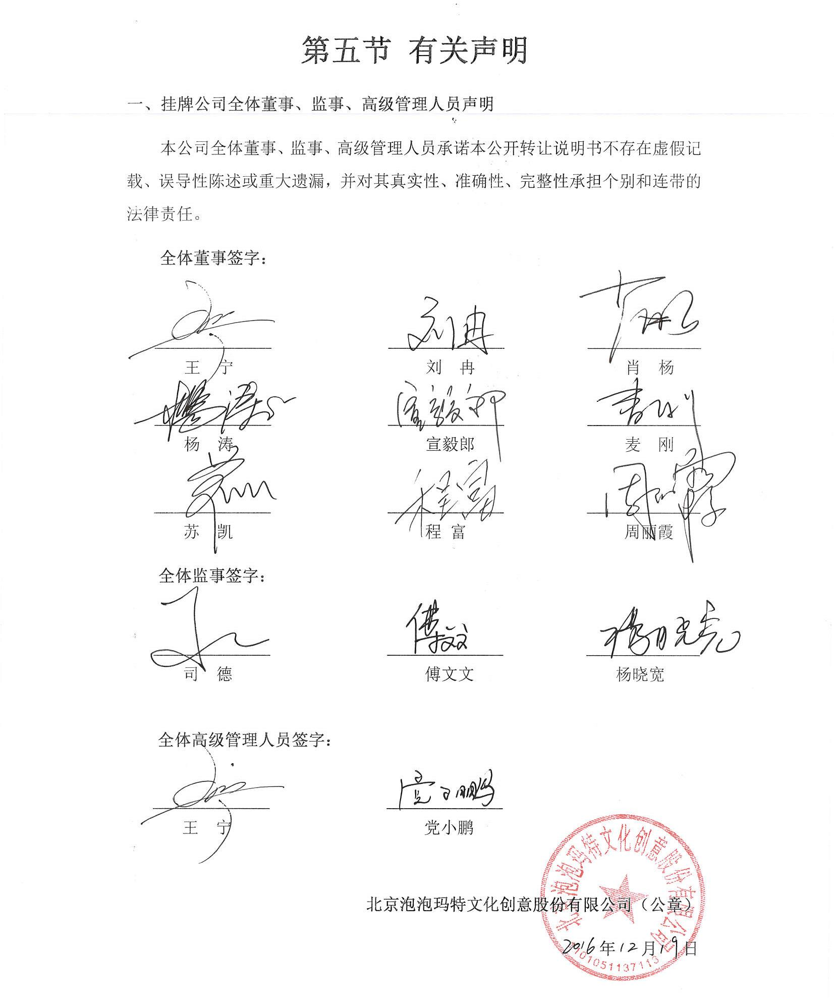

## 原PDF第266页

[对照原PDF第266页](../新三板时期/2016年公开转让说明书.pdf#page=266)

北京泡泡玛特文化创意股份有限公司公开转让说明书

二、主办券商声明

本公司已对公开转让说明书进行了核查，确认不存在虚假记载、误导性陈述

或重大遗漏，并对其真实性、准确性和完整性承担相应的法律责任。

项目负责人签字：

李鸿轩

项目小组人员签字：

孙中凯高可雅刘园园

法定代表人签字：

王常青

中信建投证券股份有限公司（公章）

年月日

266

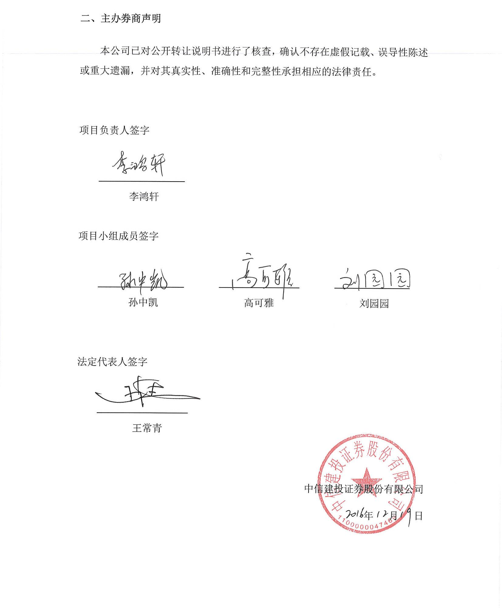

## 原PDF第267页

[对照原PDF第267页](../新三板时期/2016年公开转让说明书.pdf#page=267)

北京泡泡玛特文化创意股份有限公司公开转让说明书

三、律师事务所声明

本所及经办律师已阅读公开转让说明书，确认公开转让说明书与本所出具的

法律意见书无矛盾之处。本所及经办律师对发行人在公开转让说明书中引用的法

律意见书的内容无异议，确认公开转让说明书不致因上述内容而出现虚假记载、

误导性陈述或重大遗漏，并对其真实性、准确性和完整性承担相应的法律责任。

律师事务所负责人签名：

李炬

经办律师签名：

王庭谈俊

北京市中银律师事务所（公章）

年月日

267

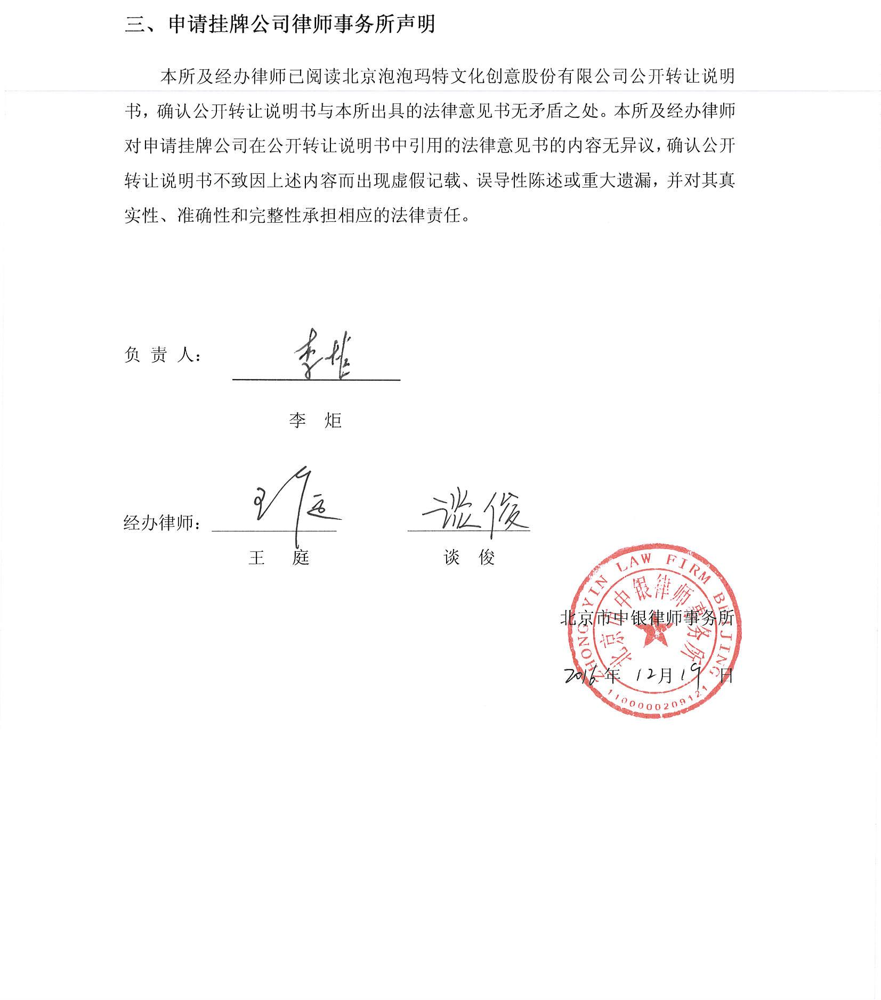

## 原PDF第268页

[对照原PDF第268页](../新三板时期/2016年公开转让说明书.pdf#page=268)

北京泡泡玛特文化创意股份有限公司公开转让说明书

四、会计师事务所声明

本所及签字注册会计师已阅读公开转让说明书，确认公开转让说明书与本所

出具的审计报告无矛盾之处。本所及签字注册会计师对发行人在公开转让说明书

中引用的审计报告的内容无异议，确认公开转让说明书不致因上述内容而出现虚

假记载、误导性陈述或重大遗漏，并对其真实性、准确性和完整性承担相应的法

律责任。

会计师事务所负责人签名：

陈胜华

经办注册会计师签名：

韩雪艳张如星

北京兴华会计师事务所（特殊普通合伙）（公章）

年月日

268

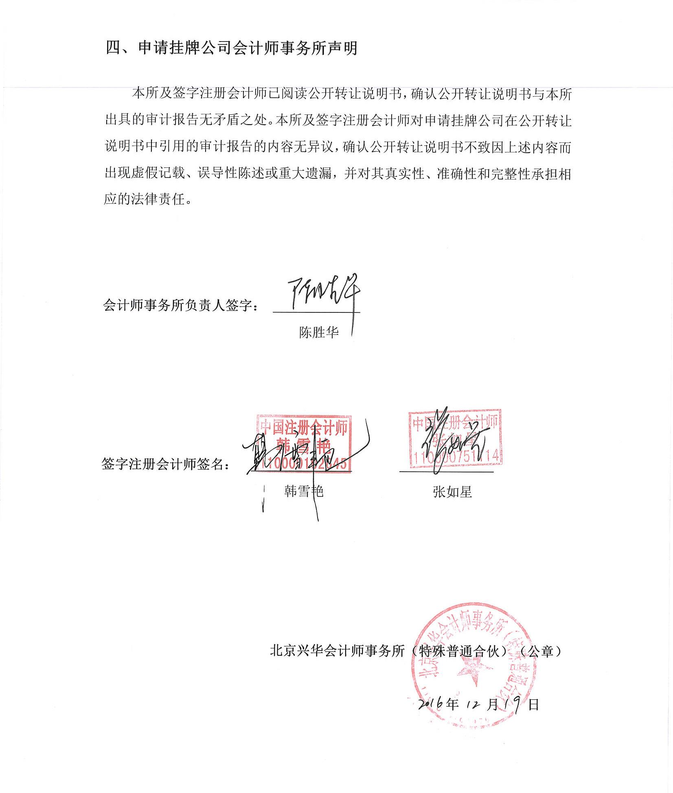

## 原PDF第269页

[对照原PDF第269页](../新三板时期/2016年公开转让说明书.pdf#page=269)

北京泡泡玛特文化创意股份有限公司公开转让说明书

五、评估机构声明

本机构及签字注册资产评估师已阅读公开转让说明书，确认公开转让说明书

与本机构出具的资产评估报告无矛盾之处。本机构及签字注册资产评估师对发行

人在公开转让说明书中引用的资产评估报告的内容无异议，确认公开转让说明书

不致因上述内容而出现虚假记载、误导性陈述或重大遗漏，并对其真实性、准确

性和完整性承担相应的法律责任。

评估机构负责人签名：

梅惠民

注册评估师签名：

程伟郭辉

银信评估有限责任公司（公章）

年月日

269

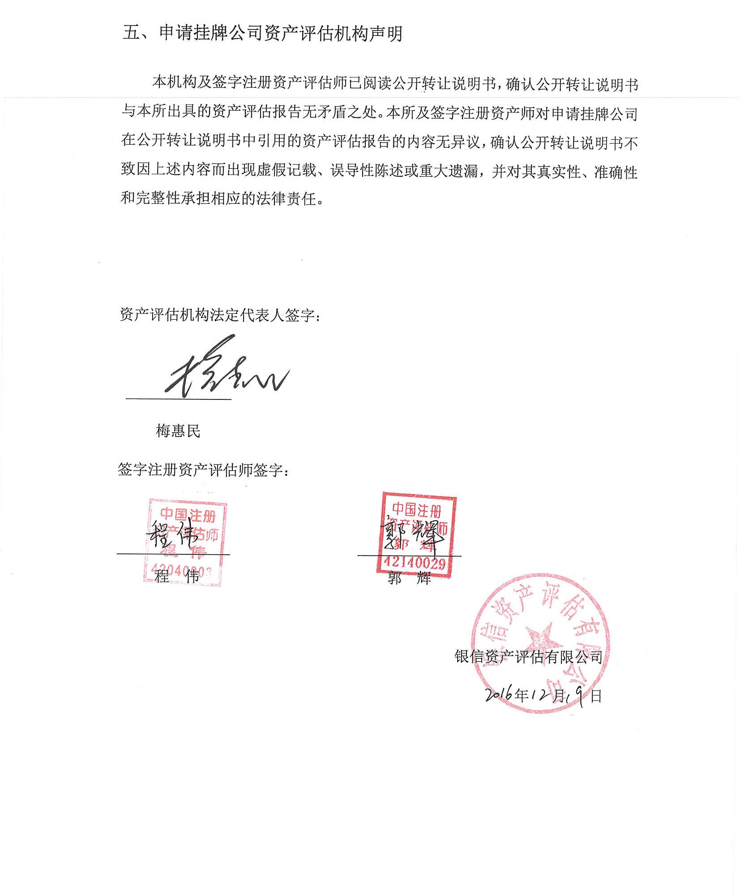

## 原PDF第270页

[对照原PDF第270页](../新三板时期/2016年公开转让说明书.pdf#page=270)

北京泡泡玛特文化创意股份有限公司公开转让说明书

第六节附件

一、主办券商推荐报告；

二、财务报表及审计报告；

三、法律意见书；

四、公司章程；

五、全国股份转让系统公司同意挂牌的审查意见；

六、其他与公开转让有关的重要文件。

270
