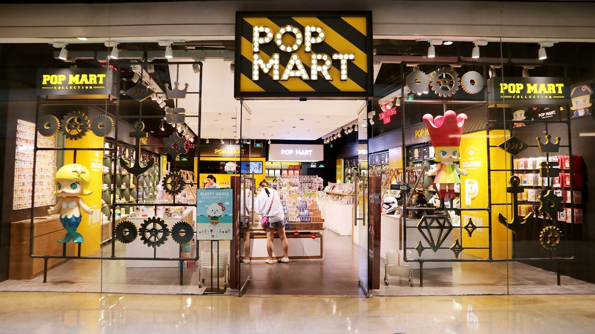
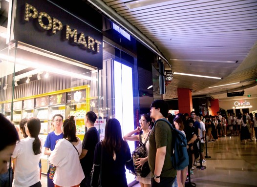
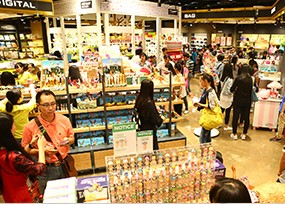
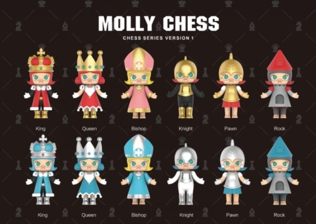
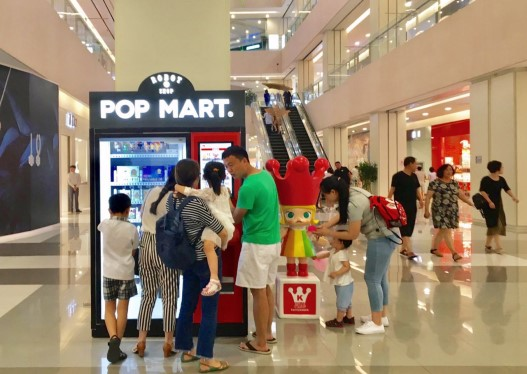

# 泡泡玛特新三板时期2017年半年度报告（简体中文）

> 披露日期：2017-08-24。来源：[东方财富所存公司公告原文](https://pdf.dfcfw.com/pdf/H2_AN201708240825144860_1.pdf)。
> [原始PDF](../新三板时期/2017年半年度报告.pdf) · [历年财报索引](../泡泡玛特历年财报索引.md)
> 转换说明：保留中文正文、数字、单位和注释，仅做繁简转换及重复英文去除。外文专名、代码和网址照录；复杂表格用等宽文本保留列位置，插图保留原图。


###### 原PDF第1页

[对照原PDF第1页](../新三板时期/2017年半年度报告.pdf#page=1)

公告编号：2017-025

泡泡玛特

NEEQ :870578

北京泡泡玛特文化创意股份有限公司

Beijing Pop Mart Cultural & Creative Corp., Ltd.

半年度报告

2017

XX





###### 原PDF第2页

[对照原PDF第2页](../新三板时期/2017年半年度报告.pdf#page=2)

## 公司半年度大事记

```text
报告期内，公司营业收入 6,279.46 万元，  报告期内，公司加速线下门店的战略部署，
净利润 105.68 万元，实现盈利。          先后在北京、上海、深圳等城市开设 10 家
```

门店。

```text
报告期内，公司推出“Molly”水果、国际象  报告期内，公司新增机器人商店业务，目
棋等 4 个系列，新品的发售屡次突破历史  前已投放 6 个商场，销售一路攀升，其低
销售记录，对公司业绩增长贡献很大。     成本、高收入、可复制化的模式也将成为
```

公司未来的重要业绩增长点之一。










###### 原PDF第3页

[对照原PDF第3页](../新三板时期/2017年半年度报告.pdf#page=3)

目录

【声明与提示】

一、基本信息

```text
第一节   公司概览
第二节   主要会计数据和关键指标
第三节   管理层讨论与分析
```

二、非财务信息

```text
第四节   重要事项
第五节   股本变动及股东情况
第六节   董事、监事、高管及核心员工情况
```

三、财务信息

```text
第七节   财务报表
第八节   财务报表附注
```


###### 原PDF第4页

[对照原PDF第4页](../新三板时期/2017年半年度报告.pdf#page=4)

北京泡泡玛特文化创意股份有限公司  2017 半年度报告

## 声明与提示

【 声明 】

公司董事会及其董事、监事会及其监事、公司高级管理人员保证本报告所载资料不存在任何

虚假记载、误导性陈述或者重大遗漏，并对其内容的真实性、准确性和完整性承担个别及连带责

任。

公司负责人、主管会计工作负责人及会计机构负责人（会计主管人员）保证半年度报告中财

务报告的真实、完整。

```text
                                     事项                                          是或否
是否存在董事、监事、高级管理人员对半年度报告内容存在异议或无法保证其真实、准确、     否
完整
是否存在未出席董事会审议半年度报告的董事                                             否
是否存在豁免披露事项                                                                 否
是否审计                                                                             否
    【备查文件目录】
 文件存放地点    公司董事会办公室
                 （一）载有公司负责人、主管会计工作负责人、会计机构负责人（会计主管人员）
备查文件         签名并盖章的财务报表。
```

（二）年度内在指定信息披露平台上公开披露过的所有公司文件的正本及公告的原稿。

（三）公司第一届董事会第八次会议决议

（四）公司第一届监事会第三次会议决议

………………分页符………………

1/84


###### 原PDF第5页

[对照原PDF第5页](../新三板时期/2017年半年度报告.pdf#page=5)

北京泡泡玛特文化创意股份有限公司  2017 半年度报告

## 第一节公司概览

一、公司信息

| 公司中文全称 | 北京泡泡玛特文化创意股份有限公司 |
| --- | --- |
| 英文名称及缩写 | Beijing Pop Mart Cultural Creative Corp., Ltd. |
| 证券简称 | 泡泡玛特 |
| 证券代码 | 870578 |
| 法定代表人 | 王宁 |
| 注册地址 | 北京市朝阳区阜通东大街 1 号院 3 号楼 3 单元 23 层 132707 |
| 办公地址 | 北京市朝阳区阜通东大街 1 号院 3 号楼 3 单元 23 层 132707 |
| 主办券商 | 中信建投证券股份有限公司 |
| 会计师事务所 | 无 |

二、联系人

| 董事会秘书或信息披露负责人 | 司德 |
| --- | --- |
| 电话 | 010-57076701 |
| 传真 | 010-57076701-8044 |
| 电子邮箱 | side@popmart.com |
| 公司网址 | http://www.popmart.com |
| 联系地址及邮政编码 | 北京市朝阳区阜通东大街 1 号院 3 号楼 3 单元 23 层 132707；邮 |

编 100102

三、运营概况

| 股票公开转让场所 | 全国中小企业股份转让系统 |
| --- | --- |
| 挂牌时间 | 2017-01-25 |
| 分层情况 | 基础层 |
| 行业（证监会规定的行业大类） | F52 零售业 |
| 主要产品与服务项目 | 公司是一家集设计、采购、销售于一体的时尚潮品零售公司。主 |

要从事时尚潮品的连锁经营零售业务、定制业务及批发业务。其中零售业务包括 IP 收藏类、自主品牌类、家居生活类、数码影音类、食品糖果类、服饰配饰类等。公司意在为都市潮流青年打造

|  | 全新的 Life Style（生活风格）体验。 |
| --- | ---: |
| 普通股股票转让方式 | 协议转让 |
| 普通股总股本（股） | 25,495,047 |
| 控股股东 | 王宁 |
| 实际控制人 | 王宁、杨涛 |
| 是否拥有高新技术企业资格 | 否 |
| 公司拥有的专利数量 | 0 |
| 公司拥有的“发明专利”数量 | 0 |

2/84


###### 原PDF第6页

[对照原PDF第6页](../新三板时期/2017年半年度报告.pdf#page=6)

北京泡泡玛特文化创意股份有限公司  2017 半年度报告

## 第二节主要会计数据和关键指标

一、盈利能力

```text
                                                                                        单位：元
                                                      本期                 上年同期           增减比例
营业收入                                           62,794,590.07         35,518,673.49         76.79%
毛利率                                               55.81%                 42.95%                -
归属于挂牌公司股东的净利润                         1,401,620.47          -25,592,452.52           -
归属于挂牌公司股东的扣除非经常性损益后的净         1,508,906.19          -25,568,816.46           -
利润
加权平均净资产收益率（依据归属于挂牌公司股            2.18%                 -87.12%               -
东的净利润计算）
加权平均净资产收益率（依据归属于挂牌公司股            2.35%                 -87.04%               -
东的扣除非经常性损益后的净利润计算）
基本每股收益（元/股）                                  0.05                  -1.14                -
```

二、偿债能力

```text
                                                                                        单位：元
                                                    本期期末               本期期初           增减比例
资产总计                                           81,504,002.67         78,027,886.19         4.45%
负债总计                                           9,995,237.56           7,575,918.07         31.93%
归属于挂牌公司股东的净资产                         64,863,250.81         63,461,630.34         2.21%
归属于挂牌公司股东的每股净资产（元/股）                2.54                  2.49              2.21%
资产负债率（母公司）                                 12.86%                  8.15%                -
资产负债率（合并）                                   12.26%                  9.71%                -
流动比率                                               6.60                  8.33                 -
利息保障倍数                                         3,037.36                  -                  -
```

三、营运情况

```text
                                                                                             单位：元
                                                       本期                   上年同期             增减比例
经营活动产生的现金流量净额                        -21,476,345.47            -5,656,587.05              -
应收账款周转率                                        20.86                     11.17                  -
存货周转率                                             2.04                     2.09                   -
```

四、成长情况

```text
                                                    本期                  上年同期            增减比例
总资产增长率                                       4.45%                   -12.19%               -
营业收入增长率                                     76.79%                  18.79%                -
```

净利润增长率  -  -  -3/84


###### 原PDF第7页

[对照原PDF第7页](../新三板时期/2017年半年度报告.pdf#page=7)

北京泡泡玛特文化创意股份有限公司  2017 半年度报告

## 第三节管理层讨论与分析

一、商业模式

根据中国证监会 2012 年修订的《上市公司行业分类指引》，公司所处行业属于“F 批发和零售业”下的“F52 零售业”。公司是一家集设计、采购、销售于一体的时尚潮品零售公司。主要从事时尚潮品的连锁经营零售业务、定制业务及批发业务。其中零售业务包括 IP 收藏类、自主品牌类、家居生活类、数码影音类、食品糖果类、服饰配饰类等。公司意在为都市潮流青年打造全新的 Life Style（生活风格）体验。公司的关键资源为公司签署的独家 IP 资源，报告期内公司推出“Molly”新年、水果等 4 个系列，新品的成功发售对公司业绩增长贡献很大。客户类型：公司主要从事零售业务，自营模式和网络销售模式下，公司直接面向终端消费者，故客户主要为个人消费者，较为分散；联营模式下，公司主要与金鹰集团采取联营模式，故公司客户主要为金鹰集团。除此之外，还有部分有定制及团购需求的企业客户。公司的盈利模式分为设计模式、采购模式、销售模式三类，具体盈利模式如下：1、设计模式公司设计部门根据目标消费群体的需求，结合分析市场调研情况以及产品生产等因素，进行公司产品设计。公司研发分为定向设计和自主设计：定向设计是根据客户需求进行开发制作，开发制作过程中，根据与客户沟通情况，对产品进行技术改进及形象修改，最终投入生产；自主设计为公司根据自身设计能力，根据市场需求进行设计及生产制作，最终进行投入市场进行推广及销售。2、采购模式公司的采购模式分为经销与代销两种采购模式。经销模式下，公司向品牌商直接采购商品，并使用订单方式管理，经销模式下的采购约占总采购金额的 95%左右；代销模式下，供应商收到代销清单时视为实现产品销售，代销模式的采购金额约占总采购金额的 5%左右。3、销售模式销售模式分为自营模式、联营模式、网络销售三类，其中泡泡玛特的销售模式主要为自营模式，南京金鹰泡泡玛特的销售模式包括自营模式和联营模式，截止报告期末葩趣科技因新设立不存在销售业务。自营模式下公司的利润来源主要是商品进销差价；联营模式是公司在商场设立店面，与商场联合经营，顾客购买货品后，由商场收取货款，商场每月按公司门店上月销售额收取一定比例扣点后与公司进行结算，所收取货款在扣除商场按照商品销售收入一定比例计算的分成后，返款给公司；网络销售主要是通过天猫、京东进行产品展示、在线交易，网站硬件、软件及服务由公司自行管理，销售货款先支付到网络销售平台，由网络销售平台按照条款约定扣除一定比例的销售额后，再返款给公司，收到款项后发货给顾客，完成商品销售。报告期内，公司签约多个国内外知名潮流玩具 IP，对 IP 资源进行整合；建立完善的供应链体系；不断拓宽线上线下销售渠道，新增机器人商店业务，完善公司的零售渠道，并自主开发 IP 衍生品拓展授权市场；通过子公司葩趣科技研发的葩趣 APP 创建线上社群，并基于这一社区借助 IP 的虚拟化、游戏化，打造 IP 娱乐化线上平台。公司已逐步转型成为集 IP 商品零售、IP 授权衍生和 IP 娱乐化于一体的 IP 综合运营服务集团。报告期内公司的商业模式未发生变化。报告期后至报告披露之日公司的商业模式未发生变化。

二、经营情况

4/84


###### 原PDF第8页

[对照原PDF第8页](../新三板时期/2017年半年度报告.pdf#page=8)

北京泡泡玛特文化创意股份有限公司  2017 半年度报告

2017 年上半年在董事会及管理团队的带领下，公司各项经济指标迅速攀升，截至报告期末，公司业绩经历了爆发式的增长，实现营业收入 6,279.46 万元，同比增涨 76.79%；净利润 105.68 万元，同比增涨 104.00%。

经营成果分析:1、营业收入报告期内，营业收入 6,279.46 万元，同比上升 76.79%。主要变动原因：公司经营的相关 IP 收藏类玩具品类销售较快增长，带动单店销售稳步提升；同时报告期内公司新增 11 家直营店；2016 年下半年布局线上销售，2017 年上半年实现营业收入 6,279.46 万元，其中线上收入 345.07 万元。2、营业成本报告期内，营业成本 2,774.62 万元，同比上升 36.93%，低于营业收入增长率。主要变动原因：报告期内公司新增多家直营店，同时 2017 年上半年门店的迅速扩张使产品销售数量大幅增长。3、毛利率报告期内，公司顺应 IP 收藏类玩具发展趋势，不断引进优秀 IP 产品，积极调整品类结构，使商品毛利率同比有较大增长。4、管理费用报告期内，发生管理费用 783.43 万元，同比下降 66.49%，主要原因是 2016 年上半年高管股权激励产生股份支付 1,650 万元（剔除股权激励费用， 2017 年上半年管理费用同比上升 13.93%）；另一方面，随着门店数量及葩趣业务的不断发展，总部人员增加及人均人力成本上升，同时租金费用也有一定数量的增加。5、销售费用报告期内，发生销售费用 2,565.78 万元，同比上升 43.38%。主要原因是 2016 年新增多家门店，门店数量同比大幅度增加影响租赁费、装修费摊销、工资等相关费用同比增长较大。6、财务费用报告期内，发生财务费用 24.43 万元，同比上升 166.17%。主要原因是随着销售规模的大幅度增长，刷卡手续费增加较多，同时利息收入有所下降。7、净利润报告期内，净利润 105.68 万元，同比增加 2,749.59 万元。一方面原因是 2016 年上半年股权激励增加管理费用 1,650 万元，影响公司亏损较大；另一方面随着销售坪效及销售毛利率的提升，单店盈利水平有了很大的提升。财务状况分析资产总计：报告期内，公司资产总计较期初增加 347.61 万元，上升 4.45%，主要原因是预付账款增加较多。负债总计：报告期内，公司负债总计较期初增加 241.93 万元，上升 31.93%，主要原因是应付供应商货款增加。1、货币资金：报告期内，公司货币资金余额较期初减少 2,189.07 万元，下降 83.06%，主要原因是资本性支出较高，新店较多，另外对 bts 投入和葩趣投入也是新增加项目。2、预付账款：报告期内，公司预付账款较期初增加 689.12 万元，上升 109.04%，主要原因是门店数量进一步增多，预付租金增加；同时增加预付 IP 产品（MOLLY）产品设计费；3、应收账款：报告期内，公司应收账款较期初减少 28.27 万元，主要是销售回款更好。4、存货：报告期内，公司存货较期初增加 230.05 万元，上升 18.47%，主要原因是门店数量增多影响。5、固定资产：报告期内，公司固定资产较期初增加 64.21 万元，上升 35.45%，主要原因是门店数量进一步增多，门店使用设备增多；另一方面增加了 MOLLY 产品的模具。现金流量分析：报告期内，经营活动产生的现金流量净额-2,147.63 万元，其中经营活动现金流入 6,306.25 万元，主要是销售商品、提供劳务收到的现金；经营活动现金流出 8,453.89 万元，主要是购买商品、接受劳务支付的现金 3,661.55 万元，支付给职工以及为职工支付的现金 1,235.79 万元。投资活动产生的现金流量净额-41.44 万元，其中投资活动现金流入 1,427.49 万元，主要是银行理财收到的投资现金及收回理财产品本金；投资活动现金流出 1,468.93 万元，主要是门店及总部资本性支出的现金，主要原因是随着门店的增多采购固定资产增加以及购买银行理财产品的支出。

5/84


###### 原PDF第9页

[对照原PDF第9页](../新三板时期/2017年半年度报告.pdf#page=9)

北京泡泡玛特文化创意股份有限公司  2017 半年度报告

三、风险与价值

1、新开门店选址的风险零售百货企业的发展一方面要通过提高现有门店的经营管理水平和现有门店每平方米的使用效率，从而促进经营业绩的内涵式增长；另一方面通常会选择新设门店来扩大经营规模，从而实现规模效益的外延式扩张。在外延式扩张中，门店的选址极为重要，需要综合考虑目标消费群体的构成、居民消费支付能力、预期客流量、交通便利条件、商业辐射能力、可选用的门店面积和附近已有或潜在的商业竞争程度，以及是否能以合适的价格购买或租赁经营场地等多种因素。门店选址一旦失当，不仅会使既定的目标市场地位难以实现，而且也会因开店前期产生的装修费等资本性支出和筹办费不能收回等因素而给公司带来较大的经营损失。应对措施：公司建立了一套动态的选址评估体系及流程以提高开店成功率，即随着市场环境变化，通过大数据、城市级别、地理位置等方面进行多方位分析，以避险选址失误带来的风险。2、经营区域相对集中的风险公司作为时尚百货的连锁零售企业，经营区域相对集中，42 家门店中，24 家门店分布在北区，18家门店分布在东区。受宏观经济环境、人均收入、竞争情况等因素的影响，各区域门店呈现不同的发展趋势。未来，如果公司集中销售地区的经济发展速度、消费水平及市场规模等发生不利变化，可能会对公司带来不利影响。应对措施：公司未来将根据市场需求，继续在北京、上海等一线城市以开设店铺的方式扩大公司规模，目前随店铺数量的逐渐增多，各店铺同比依旧保持较好的增长趋势，公司计划未来也将要进入广州、深圳等更多的经济较发达城市。3、公司管理能力不能支持业务拓展的风险报告期内公司共有 42 家门店正在经营之中，虽然公司拥有较强的管理能力与较完善的管理制度体系，但未来随着公司规模不断扩大，将对公司资源配置能力以及日常管理能力提出更高的要求，如果公司管理水平的提升不能支持公司业务拓展的需要，则可能对公司日常运营和发展造成不利影响。应对措施：随着公司规模的扩大，公司也将定期或不定期的对公司管理人员进行培训，同时，根据不同时期公司的发展需求，也将不断引进优秀人才，提升管理能力，应对公司在发展过程中面临的挑战。4、已签约品牌授权被临时终止风险报告期内公司与日本品牌授权方签署的授权协议里均没有约定授权期间，此为日本方面签署品牌授权协议的行业惯例，虽然公司承诺今后都会在新协议中要求加入授权期间条款，从以往的合作历史看也并没有授权被终止的情况发生，但是公司报告期内签署的品牌授权被临时终止的风险依旧存在。应对措施：针对日本供应商存在的此问题，公司已与供应商沟通并补签附加协议，注明合作期限或说明惯例定义，此外，公司虽未出现过品牌授权被临时终止的情况，但公司日后将加强与供应商合同的管理，避免出现品牌授权被临时终止的风险。5、公司存货周转率降低的风险2016 年、2015 年、2014 年，公司的存货周转率分别为 3.84 次、4.04 次和 4.97 次，而存货余额分别为 12,454,081.73 元、10,657,358.94 元和 2,846,523.80 元。存货周转率虽然目前呈稳定趋势发展，但公司以自营为主的连锁经营模式决定了公司库存量较高。加之，公司连锁门店数量较多并处于扩张阶段，存货管理与配送难度会不断加大，若届时存货周转率降低，存货周转速度变慢，导致资金占用水平偏高，存货积压，企业的变现能力以及资金使用效率可能会受到一定的负面影响。应对措施：公司针对采买总量进行严格把控，并针对不同级别店铺的库存以及南北区两仓的存储总量，通过面积业绩双维度的测算得出合理的存货指标，使库存在总量以及结构方面都得到改善。

四、对非标准审计意见审计报告的说明

6/84


###### 原PDF第10页

[对照原PDF第10页](../新三板时期/2017年半年度报告.pdf#page=10)

北京泡泡玛特文化创意股份有限公司  2017 半年度报告

不适用………………分页符………………

7/84


###### 原PDF第11页

[对照原PDF第11页](../新三板时期/2017年半年度报告.pdf#page=11)

北京泡泡玛特文化创意股份有限公司  2017 半年度报告

## 第四节重要事项

一、重要事项索引

```text
                           事项                                是或否           索引
是否存在利润分配或公积金转增股本的情况                           否               -
是否存在股票发行事项                                             否               -
是否存在重大诉讼、仲裁事项                                       否               -
是否存在对外担保事项                                             否               -
是否存在股东及其关联方占用或转移公司资金、资产及其他资源         否               -
的情况
是否存在日常性关联交易事项                                       是        本节、二、  （一）
是否存在偶发性关联交易事项                                       是        本节、二、  （二）
是否存在经股东大会审议过的收购、出售资产、对外投资、企业         否               -
合并事项
是否存在股权激励事项                                             否               -
是否存在已披露的承诺事项                                         是        本节、二、  （三）
是否存在资产被查封、扣押、冻结或者被抵押、质押的情况             否               -
是否存在被调查处罚的事项                                         否               -
是否存在公开发行债券的事项                                       否               -
```

二、重要事项详情

（一）报告期内公司发生的日常性关联交易情况

单位：元

```text
                                     日常性关联交易事项
                        具体事项类型                            预计金额         发生金额
1．购买原材料、燃料、动力                                           -                -
2．销售产品、商品、提供或者接受劳务委托，委托或者受托销售      18,460,000.00    3,926,587.72
3．投资（含共同投资、委托理财、委托贷款）                           -                -
4．财务资助（挂牌公司接受的）                                       -                -
5．公司章程中约定适用于本公司的日常关联交易类型                     -                -
6．其他                                                             -                -
                            总计                               18,460,000.00    3,926,587.72
```

（二）报告期内公司发生的偶发性关联交易情况

单位：元

```text
                                     偶发性关联交易事项
              关联方                  交易内容          交易金额       是否履行必要决策程序
金鹰国际商贸集团（中国）有限公司      销售商品         1,370,000.00             是
徐州金鹰国际实业有限公司              销售商品          700,000.00              是
```

8/84


###### 原PDF第12页

[对照原PDF第12页](../新三板时期/2017年半年度报告.pdf#page=12)

```text
      北京泡泡玛特文化创意股份有限公司                                 2017 半年度报告
南京金鹰珠江路购物中心有限公司        销售商品          580,000.00              是
昆山金鹰国际购物中心有限公司          销售商品          350,000.00              是
丹阳金鹰国际购物中心有限公司          销售商品          140,000.00              是
盐城金鹰聚龙湖购物中心有限公司        销售商品          320,000.00              是
南通金鹰圆融购物中心有限公司          销售商品          270,000.00              是
南京江宁金鹰购物中心有限公司          销售商品          330,000.00              是
西安金鹰国际购物中心有限公司          销售商品          90,000.00               是
马鞍山金鹰国际购物中心有限公司        销售商品          40,000.00               是
               总计                       -            4,190,000.00              -
```

偶发性关联交易的必要性、持续性以及对公司生产经营的影响：上述为联营代收性质的关联交易。2017 年 4 月 24 日，公司召开第一届董事会第六次会议，审议通过了《关于补充确认关联交易的议案》，并披露《关于补充确认关联交易的公告》（公告编号：2017-009），2017 年 5 月 17 日，公司召开 2016 年年度股东大会，审议通过了《关于补充确认关联交易的议案》。因子公司南京金鹰泡泡采取联营的模式销售，在关联方金鹰集团的商场设立店面，与商场联合经营。子公司不交纳商场租金。顾客购买货品后，由商场收取货款，商场每月按子公司门店上月销售额收取一定比例扣点后与公司进行结算，所收取货款在扣除商场按照商品销售收入一定比例计算的分成后，返款给子公司。偶发性关联交易的产生系公司日常经营所需，该业务因公司正常经营过程产生的，未来仍将继续发生，故不会对公司生产经营产生不利影响。

（三）承诺事项的履行情况

2016 年，公司控股股东、实际控制人、公司董事、监事、高级管理人员对如下承诺严格执行，未有任何违背承诺的事项：1、公司发起人出具承诺，承诺将按照《公司法》、《全国中小企业股份转让系统业务规则》规定履行股份锁定义务；公司董事、监事、高级管理人员出具承诺，承诺将按照《公司法》、《公司章程》规定履行股份锁定义务。2、公司控股股东、实际控制人王宁和杨涛分别以书面形式向本公司出具了《关于规范关联交易的承诺函》。3、为了避免同业竞争，公司控股股东、实际控制人王宁、杨涛以书面形式向公司出具了《避免同业竞争承诺函》。4、公司的董事、监事、高级管理人员，向公司出具了《关于避免同业竞争的承诺函》。5、公司核心技术人员签署了《竞业禁止声明》，对于竞业禁止做出相关承诺。6、董事、监事及高级管理人员分别以书面形式签署了《董事、监事、高级管理人员声明及承诺书》。以上承诺在报告期内均严格履行，未有任何违背。

9/84


###### 原PDF第13页

[对照原PDF第13页](../新三板时期/2017年半年度报告.pdf#page=13)

北京泡泡玛特文化创意股份有限公司  2017 半年度报告

## 第五节股本变动及股东情况

一、报告期期末普通股股本结构

```text
                                                                                           单位：股
                                                  期初                                        期末
                股份性质                                             本期变动
                                             数量       比例                            数量         比例
           无限售股份总数                  1,916,100    7.52%           0             1,916,100      7.52%
无限售条   其中：控股股东、实际控制人          0        0.00%           0                0           0.00%
 件股份          董事、监事、高管              0        0.00%           0                0           0.00%
                 核心员工                      0        0.00%           0                0           0.00%
           有限售股份总数                  23,578,947  92.48%           0            23,578,947     92.48%
有限售条   其中：控股股东、实际控制人      12,128,000  47.57%           0            12,128,000     47.57%
 件股份          董事、监事、高管          13,698,000  53.73%           0            13,698,000     53.73%
                 核心员工                      0        0.00%           0                0           0.00%
                   总股本                  25,495,047     -             0            25,495,047        -
               普通股股东人数                                             17
```

注：2017 年 7 月 5 日股份公司成立满一年，公司已于 2017 年 7 月 24 日办理完股票解除转

让限售业务，  本批次股票解除限售数量总额为 12,519,482 股,占公司总股本的比例是 49.11%。

二、报告期期末普通股前十名股东情况

```text
                                                                                           单位：股
                                                                     期末持    期末持有限售    期末持有无限售
 序号     股东名称      期初持股数    持股变动      期末持股数
                                                                     股比例      股份数量         股份数量
1           王宁        12,128,000        0          12,128,000      47.57%      12,128,000          0
        金鹰国际商贸
2       集团（中国）     4,646,667        0          4,646,667       18.23%      4,646,667           0
          有限公司
3           麦刚         1,570,000        0          1,570,000       6.16%       1,570,000           0
        北京墨池山创
        业投资管理中
4                        1,200,600        0          1,200,600       4.71%       1,200,600           0
         心（有限合
```

伙）

```text
        北京泡泡玛特
5       投资企业（有     1,178,947        0          1,178,947       4.62%       1,178,947           0
          限合伙）
        北京启赋创业
6       投资中心（有     1,121,400        0          1,121,400       4.40%       1,121,400           0
          限合伙）
7       上海华强投资     589,600          0           589,600        2.31%           0            589,600
```

10/84


###### 原PDF第14页

[对照原PDF第14页](../新三板时期/2017年半年度报告.pdf#page=14)

北京泡泡玛特文化创意股份有限公司  2017 半年度报告

有限公司

```text
        浙江中赢股权
8       投资基金管理     589,600          0           589,600        2.31%           0            589,600
          有限公司
        北京金慧丰倍
9        盈投资企业      533,333          0           533,333        2.09%        533,333            0
```

（有限合伙）

```text
         广州市启赋聚
         通创业投资合
10                         333,333           0            333,333         1.31%         333,333              0
         伙企业（有限
            合伙）
         合计             23,891,480         -          23,891,480        93.71%       22,712,280        1,179,200
```

前十名股东间相互关系说明：股东王宁为股东北京泡泡玛特投资企业（有限合伙）的执行事务合伙人。股东北京启赋创业投资中心（有限合伙）的执行事务合伙人北京启赋投资咨询中心有限合伙与股东广州市启赋聚通创业投资合伙企业（有限合伙）同属于一家执行事务合伙人深圳市启赋资本管理有限公司。除此之外，各股东之间互相不存在其他关联关系。

三、控股股东、实际控制人情况

（一）控股股东情况

公司控股股东为王宁先生。王宁先生，董事长、总经理，中国国籍，无境外永久居留权，1987 年生，本科学历。2005 年 9 月至2009 年 6 月，就读于郑州大学西亚斯国际学院，主修广告学，取得学士学位；2014 年 9 月至 2017 年 7月，就读于北京大学光华管理学院，主修工商管理硕士，取得硕士学位。2010 年 10 月至 2016 年 7 月，任北京泡泡玛特贸易有限公司董事、总经理；2016 年 7 月至今，任北京泡泡玛特文化创意股份有限公司董事长、总经理。王宁先生现直接持有公司股份 1,212.8 万股，占公司总股本的 47.5701%；通过北京泡泡玛特投资企业（有限合伙）间接持有公司股份 14.3832 万股，占公司总股本的 0.5642%。合计持有公司 1,227.1832万股，占公司总股本的 48.1343%，为公司的第一大股东，故认定为公司的控股股东。报告期内无变动。

（二）实际控制人情况

公司控股股东为王宁先生和杨涛女士。王宁、杨涛为夫妻关系，二人合计持有公司 1,247.9798 万股，占公司总股本 48.95%，实际控制着公司的经营管理，故认定王宁、杨涛夫妻二人为公司实际控制人。王宁先生，具体情况详见“第五节股本变动及股东情况”之“三、控股股东、实际控制人情况（一）控股股东情况”。杨涛女士，董事，中国国籍，无境外永久居留权，1987 年生，研究生学历。2005 年 9 月至 2009 年 6月，就读于郑州大学西亚斯国际学院，主修商务英语，取得学士学位；2009 年 9 月至 2010 年 11 月，就读于香港浸会大学，取得大众传媒管理硕士学位。2010 年至 2016 年 7 月，任北京泡泡玛特贸易有限公司商品总监；2016 年 7 月至今，任北京泡泡玛特文化创意股份有限公司董事、商品总监。报告期内无变动。

11/84


###### 原PDF第15页

[对照原PDF第15页](../新三板时期/2017年半年度报告.pdf#page=15)

北京泡泡玛特文化创意股份有限公司  2017 半年度报告

……………… 第六节  董事、监事、高管及核心员工情况

一、基本情况

```text
      姓名                职务           性别        年龄           学历               任期            是否在公司领取薪酬
王宁                董事长、总经理        男          30            硕士         2016.7.3-2019.7.2               是
麦刚                      董事            男          43            硕士         2016.7.3-2019.7.2               否
杨涛                      董事            女          30            硕士         2016.7.3-2019.7.2               是
刘冉                      董事            女          29            本科         2016.7.3-2019.7.2               是
肖杨                      董事            男          32            大专         2016.7.3-2019.7.2               是
宣毅郎                    董事            男          29            本科         2016.7.3-2019.7.2               是
苏凯                      董事            男          40            硕士         2016.7.3-2019.7.2               否
周丽霞                    董事            女          48            硕士         2016.7.3-2019.7.2               否
司德                  监事会主席          男          29            本科         2016.7.3-2019.7.2               是
傅文文                    监事            女          37            本科         2016.7.3-2019.7.2               是
杨晓宽                    监事            男          34            本科         2016.7.3-2019.7.2               是
杨镜冰                 财务总监           男          38            本科         2017.8.9-2019.7.2               是
                                          董事会人数：                                                           8
                                          监事会人数：                                                           3
                                       高级管理人员人数：                                                        2
```

公司于 2017 年 8 月 8 日收到财务负责人党小鹏先生的离职申请，党小鹏先生因个人原因，

申请辞去公司财务负责人职务。公司于 2017 年 8 月 9 日召开第一届董事会第七次会议，审

议通过《关于任命杨镜冰先生为公司财务总监的议案》，并披露《高级管理人员离职公告》

（公告编号：2017-020）及《高级管理人员任命公告》（公告编号：2017-022）  。

二、持股情况

```text
                                                                                      单位：股
                              期初持普通股                   期末持普通股   期末普通股持   期末持有股票
姓名             职务                          数量变动
                                  股数                           股数          股比例        期权数量
王宁        董事长、总经理     12,128,000          0          12,128,000       47.57%            0
麦刚             董事           1,570,000          0           1,570,000       6.16%             0
合计              -            13,698,000          -          13,698,000       53.73%            0
```

三、变动情况

```text
                                      董事长是否发生变动                                    否
信息统计                              总经理是否发生变动                                    否
                                    董事会秘书是否发生变动                                  否
```

12/84


###### 原PDF第16页

[对照原PDF第16页](../新三板时期/2017年半年度报告.pdf#page=16)

```text
   北京泡泡玛特文化创意股份有限公司                                          2017 半年度报告
                                    财务总监是否发生变动                                   是
                                  变动类型（新任、换
 姓名             期初职务                                     期末职务               简要变动原因
                                      届、离任）
 程富               董事                 离任                     无                    个人原因
党小鹏           财务负责人              离任                     无                    个人原因
杨镜冰               无                  新任                  财务总监                 选举产生
```

四、员工数量

```text
                                      期初员工数量                              期末员工数量
       核心员工                             0                                        0
     核心技术人员                           3                                        4
截止报告期末的员工人数                     238                                      319
```

核心员工变动情况：报告期内公司核心员工未发生变动。

………………分页符………………

13/84


###### 原PDF第17页

[对照原PDF第17页](../新三板时期/2017年半年度报告.pdf#page=17)

北京泡泡玛特文化创意股份有限公司  2017 半年度报告

## 第七节财务报表

一、审计报告

是否审计  否

二、财务报表

（一）合并资产负债表

```text
                                                                                          单位：元
              项目                       附注                  期末余额                    期初余额
流动资产：                               -
货币资金                              六、  （一）            4,463,257.43               26,353,998.41
```

结算备付金  -  -  -拆出资金  -  -  -以公允价值计量且其变动计入当期  -  --

损益的金融资产衍生金融资产  -  -  -

```text
应收票据                                        -                           -                              -
应收账款                                   六、  （二）               2,779,156.91                    3,061,918.96
预付款项                                   六、  （三）               13,210,937.75                   6,319,706.60
```

应收保费  -  -  -应收分保账款  -  -  -应收分保合同准备金  -  -  -应收利息  -  -  -

```text
应收股利                                        -                           -                              -
其他应收款                                 六、  （四）               13,036,845.05                   7,731,543.08
买入返售金融资产                                -                           -                              -
存货                                       六、  （五）               14,754,587.65                  12,454,081.73
划分为持有待售的资产                            -                           -                              -
一年内到期的非流动资产                          -                           -                              -
其他流动资产                               六、  （六）               17,727,036.52                   7,216,412.32
           流动资产合计                         -                     65,971,821.31                  63,137,661.10
```

非流动资产：  -发放贷款及垫款  -  -  -可供出售金融资产  -  -  -持有至到期投资  -  -  -长期应收款  -  -  -长期股权投资  -  -  -

```text
投资性房地产                                 -                         -                            -
固定资产                                六、  （七）              2,453,707.98                 1,811,575.81
在建工程                                     -                     47,169.81                        -
```

14/84


###### 原PDF第18页

[对照原PDF第18页](../新三板时期/2017年半年度报告.pdf#page=18)

北京泡泡玛特文化创意股份有限公司  2017 半年度报告

工程物资  -  -  -固定资产清理  -  -  -生产性生物资产  -  -  -

```text
油气资产                                       -                          -                              -
无形资产                                  六、  （八）                103,208.50                    118,014.26
开发支出                                       -                          -                              -
商誉                                      六、  （九）               3,751,526.99                   3,751,526.99
长期待摊费用                              六、  （十）               9,101,380.99                   8,957,408.25
递延所得税资产                           六、  （十一）               75,187.09                     251,699.78
其他非流动资产                                 -                          -                              -
          非流动资产合计                       -                    15,532,181.36                  14,890,225.09
             资产总计                          -                    81,504,002.67                  78,027,886.19
```

流动负债：  -短期借款  -  -  -向中央银行借款  -  -  -吸收存款及同业存放  -  -  -拆入资金  -  -  -以公允价值计量且其变动计入当期  -  --

损益的金融负债衍生金融负债  -  -  -

```text
应付票据                                   -                       -                           -
应付账款                             六、  （十二）           4,514,752.13                3,290,424.94
预收款项                             六、  （十三）            27,140.87                   41,947.27
卖出回购金融资产款                         -                       -                           -
应付手续费及佣金                           -                       -                           -
应付职工薪酬                         六、  （十四）           2,045,277.60                2,444,994.09
应交税费                             六、  （十五）           1,475,855.44                 685,492.40
应付利息                                   -                       -                           -
应付股利                                   -                       -                           -
其他应付款                           六、  （十六）           1,932,211.52                1,113,059.37
```

应付分保账款  -  -  -保险合同准备金  -  -  -代理买卖证券款  -  -  -代理承销证券款  -  -  -划分为持有待售的负债  -  -  -一年内到期的非流动负债  -  -  -

```text
其他流动负债                                  -                        -                             -
          流动负债合计                        -                   9,995,237.56                  7,575,918.07
```

非流动负债：  -长期借款  -  -  -应付债券  -  -  -其中：优先股  -  -  -永续债  -  -  -15/84


###### 原PDF第19页

[对照原PDF第19页](../新三板时期/2017年半年度报告.pdf#page=19)

北京泡泡玛特文化创意股份有限公司  2017 半年度报告

长期应付款  -  -  -长期应付职工薪酬  -  -  -专项应付款  -  -  -预计负债  -  -  -递延收益  -  -  -递延所得税负债  -  -  -其他非流动负债  -  -  -

```text
         非流动负债合计                      -                         -                            -
            负债合计                         -                    9,995,237.56                 7,575,918.07
所有者权益（或股东权益）  ：                 -
股本                                   六、  （十七）            25,495,047.00                 25,495,047.00
```

其他权益工具  -  -  -其中：优先股  -  -  -

```text
      永续债                                 -                         -                            -
资本公积                               六、  （十八）            50,258,627.15                 50,258,627.15
```

减：库存股  -  -  -其他综合收益  -  -  -专项储备  -  -  -盈余公积  -  -  -

```text
一般风险准备                                    -                           -                              -
未分配利润                               六、  （十九）              -10,890,423.34                  -12,292,043.81
归属于母公司所有者权益合计                      -                     64,863,250.81                  63,461,630.34
少数股东权益                                    -                     6,645,514.30                    6,990,337.78
          所有者权益合计                        -                     71,508,765.11                  70,451,968.12
       负债和所有者权益总计                     -                     81,504,002.67                  78,027,886.19
```

法定代表人： 王宁  主管会计工作负责人： 杨镜冰  会计机构负责人： 杨镜冰

（二）母公司资产负债表

```text
                                                                                          单位：元
              项目                       附注                  期末余额                    期初余额
流动资产：                                 -
货币资金                                   -                  1,717,270.81               24,339,379.25
```

以公允价值计量且其变动计入当期  -  --

损益的金融资产衍生金融资产  -  -  -

```text
应收票据                                         -                          -                               -
应收账款                                  十三、  （一）               5,826,407.85                   2,894,815.08
预付款项                                         -                    11,046,308.71                   6,281,758.39
应收利息                                         -                          -                               -
应收股利                                         -                          -                               -
其他应收款                                十三、  （二）               9,976,218.59                   6,384,818.83
存货                                             -                     9,218,360.45                   7,053,153.38
```

16/84


###### 原PDF第20页

[对照原PDF第20页](../新三板时期/2017年半年度报告.pdf#page=20)

北京泡泡玛特文化创意股份有限公司  2017 半年度报告

划分为持有待售的资产  -  -  -

```text
一年内到期的非流动资产                          -                           -                              -
其他流动资产                                    -                     14,087,704.74                   5,017,527.06
           流动资产合计                         -                     51,872,271.15                  51,971,451.99
```

非流动资产：  -可供出售金融资产  -  -  -持有至到期投资  -  -  -

```text
长期应收款                                   -                         -                            -
长期股权投资                           十三、  （三）            19,926,500.00                15,126,500.00
投资性房地产                                 -                         -                            -
固定资产                                     -                    2,105,501.33                 1,491,330.14
在建工程                                     -                    47,169.81                         -
```

工程物资  -  -  -固定资产清理  -  -  -生产性生物资产  -  -  -

```text
油气资产                                       -                          -                              -
无形资产                                       -                      103,208.50                    118,014.26
开发支出                                       -                          -                              -
商誉                                           -                          -                              -
长期待摊费用                                   -                     4,924,768.35                   5,220,105.90
递延所得税资产                                 -                      51,614.25                     140,908.63
其他非流动资产                                 -                          -                              -
          非流动资产合计                       -                    27,158,762.24                  22,096,858.93
             资产总计                          -                    79,031,033.39                  74,068,310.92
```

流动负债：  -短期借款  -  -  -以公允价值计量且其变动计入当期  -  --

损益的金融负债衍生金融负债  -  -  -

```text
应付票据                                       -                          -                              -
应付账款                                       -                     4,858,488.73                   3,279,730.99
预收款项                                       -                      16,803.00                      31,609.40
应付职工薪酬                                   -                     1,007,797.83                   1,505,678.86
应交税费                                       -                      755,287.19                    617,865.54
应付利息                                       -                          -                              -
应付股利                                       -                          -                              -
其他应付款                                     -                     3,525,737.94                   600,674.86
```

划分为持有待售的负债  -  -  -一年内到期的非流动负债  -  -  -

```text
其他流动负债                                 -                         -                             -
          流动负债合计                       -                   10,164,114.69                 6,035,559.65
```

非流动负债：  -长期借款  -  -  -17/84


###### 原PDF第21页

[对照原PDF第21页](../新三板时期/2017年半年度报告.pdf#page=21)

北京泡泡玛特文化创意股份有限公司  2017 半年度报告

应付债券  -  -  -其中：优先股  -  -  -永续债  -  -  -长期应付款  -  -  -长期应付职工薪酬  -  -  -专项应付款  -  -  -预计负债  -  -  -递延收益  -  -  -递延所得税负债  -  -  -其他非流动负债  -  -  -

```text
          非流动负债合计                        -                           -                              -
             负债合计                           -                     10,164,114.69                   6,035,559.65
所有者权益：                                    -
股本                                            -                     25,495,047.00                  25,495,047.00
```

其他权益工具  -  -  -其中：优先股  -  -  -

```text
       永续债                                   -                           -                              -
资本公积                                        -                     50,258,627.15                  50,258,627.15
```

减：库存股  -  -  -其他综合收益  -  -  -专项储备  -  -  -

```text
盈余公积                                        -                           -                              -
未分配利润                                      -                     -6,886,755.45                  -7,720,922.88
          所有者权益合计                        -                     68,866,918.70                  68,032,751.27
      负债和所有者权益合计                      -                     79,031,033.39                  74,068,310.92
```

法定代表人： 王宁  主管会计工作负责人： 杨镜冰  会计机构负责人： 杨镜冰

18/84


###### 原PDF第22页

[对照原PDF第22页](../新三板时期/2017年半年度报告.pdf#page=22)

北京泡泡玛特文化创意股份有限公司  2017 半年度报告

（三）合并利润表

```text
                                                                                           单位：元
                    项目                           附注             本期金额                 上期金额
一、营业总收入                                       -             62,794,590.07           35,518,673.49
                                                 六、（二          62,794,590.07           35,518,673.49
其中：营业收入
```

十）利息收入  -  -  -已赚保费  -  -  -

```text
      手续费及佣金收入                                  -                    -                        -
二、营业总成本                                          -              61,720,716.92             61,928,172.08
                                                    六、（二           27,746,237.54             20,262,454.42
其中：营业成本
```

十）利息支出  -  -  -手续费及佣金支出  -  -  -退保金  -  -  -赔付支出净额  -  -  -提取保险合同准备金净额  -  -  -保单红利支出  -  -  -

```text
      分保费用                                       -                  -                       -
                                                六、（二十          551,317.12              279,841.09
      税金及附加
                                                   一）
                                                六、（二十         25,657,782.51           17,894,855.77
      销售费用
                                                   二）
                                                六、（二十         7,834,285.81            23,376,652.82
      管理费用
                                                   三）
                                                六、（二十          244,342.35               91,797.82
      财务费用
                                                   四）
                                                六、（二十          -313,248.41              22,570.16
      资产减值损失
                                                   五）
加：公允价值变动收益（损失以“－”号填列）             -                  -                       -
                                                六、（二十          274,906.47               14,534.61
    投资收益（损失以“－”号填列）
```

六）其中：对联营企业和合营企业的投资收益  -  -  -汇兑收益（损失以“-”号填列）  -  -  -

```text
    其他收益                                           -                   -                         -
三、营业利润（亏损以“－”号填列）                       -              1,348,779.62             -26,394,963.98
                                                  六、（二十            7,164.06                 16,914.39
加：营业外收入
                                                     七）
    其中：非流动资产处置利得                           -                 344.00                      -
                                                  六、（二十           122,634.01                41,241.92
减：营业外支出
                                                     八）
    其中：非流动资产处置损失                           -               96,599.62                     -
```

19/84


###### 原PDF第23页

[对照原PDF第23页](../新三板时期/2017年半年度报告.pdf#page=23)

```text
        北京泡泡玛特文化创意股份有限公司                                                   2017 半年度报告
四、利润总额（亏损总额以“－”号填列）                      -                1,233,309.67              -26,419,291.51
                                                     六、（二十            176,512.68                  19,839.89
减：所得税费用
                                                        九）
五、净利润（净亏损以“－”号填列）                          -                1,056,796.99              -26,439,131.4
其中：被合并方在合并前实现的净利润                        -                     -                          -
归属于母公司所有者的净利润                                -                1,401,620.47              -25,592,452.52
少数股东损益                                              -                -344,823.48                -846,678.88
```

六、其他综合收益的税后净额  -  -  -归属于母公司所有者的其他综合收益的税后净额  -  -  -

（一）以后不能重分类进损益的其他综合收益  -  -  -1.重新计量设定受益计划净负债或净资产的变动  -  -  -2.权益法下在被投资单位不能重分类进损益的其他  -  --

综合收益中享有的份额

（二）以后将重分类进损益的其他综合收益  -  -  -1.权益法下在被投资单位以后将重分类进损益的其  -  --

他综合收益中享有的份额2.可供出售金融资产公允价值变动损益  -  -  -3.持有至到期投资重分类为可供出售金融资产损益  -  -  -

```text
4.现金流量套期损益的有效部分                            -                    -                         -
5.外币财务报表折算差额                                  -                    -                         -
6.其他                                                  -                    -                         -
归属于少数股东的其他综合收益的税后净额                  -                    -                         -
七、综合收益总额                                        -               1,056,796.99             -26,439,131.4
归属于母公司所有者的综合收益总额                        -               1,401,620.47            -25,592,452.52
归属于少数股东的综合收益总额                            -               -344,823.48               -846,678.88
八、每股收益：                                          -
（一）基本每股收益                                      -                  0.05                      -1.14
（二）稀释每股收益                                      -                  0.05                      -1.14
```

法定代表人： 王宁  主管会计工作负责人： 杨镜冰  会计机构负责人： 杨镜冰

（四）母公司利润表

```text
                                                                                                     单位：元
                      项目                               附注               本期金额                   上期金额
                                                       十三、             51,114,376.38              30,903,190.51
一、营业收入
                                                       （四）
                                                       十三、             28,774,109.30              20,052,568.77
减：营业成本
                                                       （四）
    税金及附加                                            -                371,745.13                 187,356.92
    销售费用                                              -               15,311,899.72              12,659,464.94
    管理费用                                              -               6,107,768.83               22,614,278.52
    财务费用                                              -                159,708.17                  22,025.47
    资产减值损失                                          -                -357,177.66                 24,654.66
```

20/84


###### 原PDF第24页

[对照原PDF第24页](../新三板时期/2017年半年度报告.pdf#page=24)

```text
       北京泡泡玛特文化创意股份有限公司                                      2017 半年度报告
加：公允价值变动收益（损失以“－”号填列）         -                 -                      -
                                              十三、           274,906.47                 -
    投资收益（损失以“－”号填列）
```

（五）其中：对联营企业和合营企业的投资收益  -  -  -

```text
    其他收益                                              -                     -                          -
二、营业利润（亏损以“－”号填列）                          -               1,021,229.36              -24,657,158.77
加：营业外收入                                            -                  511.62                    16,599.37
    其中：非流动资产处置利得                              -                     -                          -
减：营业外支出                                            -                 98,279.17                  39,774.45
    其中：非流动资产处置损失                              -                 73,346.12                      -
三、利润总额（亏损总额以“－”号填列）                      -                923,461.81               -24,680,333.85
减：所得税费用                                            -                 89,294.38                  -6,163.67
四、净利润（净亏损以“－”号填列）                          -                834,167.43               -24,674,170.18
```

五、其他综合收益的税后净额  -  -  -

（一）以后不能重分类进损益的其他综合收益  -  -  -1.重新计量设定受益计划净负债或净资产的变动  -  -  -2.权益法下在被投资单位不能重分类进损益的其他  -  --

综合收益中享有的份额

（二）以后将重分类进损益的其他综合收益  -  -  -1.权益法下在被投资单位以后将重分类进损益的其  -  --

他综合收益中享有的份额2.可供出售金融资产公允价值变动损益  -  -  -3.持有至到期投资重分类为可供出售金融资产损益  -  -  -

```text
4.现金流量套期损益的有效部分                         -                  -                       -
5.外币财务报表折算差额                               -                  -                       -
6.其他                                               -                  -                       -
六、综合收益总额                                     -              834,167.43             -24,674,170.18
```

七、每股收益：  -

（一）基本每股收益  -  -  -

（二）稀释每股收益  -  -  -法定代表人： 王宁  主管会计工作负责人： 杨镜冰  会计机构负责人： 杨镜冰

21/84


###### 原PDF第25页

[对照原PDF第25页](../新三板时期/2017年半年度报告.pdf#page=25)

北京泡泡玛特文化创意股份有限公司  2017 半年度报告

（五）合并现金流量表

```text
                                                                                          单位：元
                       项目                               附注             本期金额            上期金额
一、经营活动产生的现金流量：                                -
销售商品、提供劳务收到的现金                                -             63,062,545.72      35,518,546.72
```

客户存款和同业存放款项净增加额  -  -  -向中央银行借款净增加额  -  -  -向其他金融机构拆入资金净增加额  -  -  -收到原保险合同保费取得的现金  -  -  -收到再保险业务现金净额  -  -  -保户储金及投资款净增加额  -  -  -处置以公允价值计量且其变动计入当期损益的金融资产  -  --

净增加额收取利息、手续费及佣金的现金  -  -  -拆入资金净增加额  -  -  -回购业务资金净增加额  -  -  -收到的税费返还  -  -  -

```text
收到其他与经营活动有关的现金                                        -                     -                     -
                 经营活动现金流入小计                               -               63,062,545.72         35,518,546.72
购买商品、接受劳务支付的现金                                        -               36,615,494.66         20,262,454.42
```

客户贷款及垫款净增加额  -  -  -存放中央银行和同业款项净增加额  -  -  -支付原保险合同赔付款项的现金  -  -  -支付利息、手续费及佣金的现金  -  -  -

```text
支付保单红利的现金                                                -                     -                     -
支付给职工以及为职工支付的现金                                    -               12,357,874.95         9,180,935.74
支付的各项税费                                                    -                3,550,110.30         3,204,304.50
支付其他与经营活动有关的现金                                六、（三十）          32,015,411.28         8,527,439.11
                经营活动现金流出小计                              -               84,538,891.19         41,175,133.77
             经营活动产生的现金流量净额                           -               -21,476,345.47        -5,656,587.05
二、投资活动产生的现金流量：                                      -
收回投资收到的现金                                                -                     -                5,480,000
取得投资收益收到的现金                                            -                274,906.47                 -
处置固定资产、无形资产和其他长期资产收回的现金净额                -                     -                     -
处置子公司及其他营业单位收到的现金净额                            -                     -                     -
收到其他与投资活动有关的现金                                六、（三十）          14,000,000.00         4,000,000.00
                投资活动现金流入小计                              -               14,274,906.47          9,480,000
购建固定资产、无形资产和其他长期资产支付的现金                    -                689,301.98           3,132,606.00
```

投资支付的现金  -  -  -质押贷款净增加额  -  -  -

```text
取得子公司及其他营业单位支付的现金净额                      -                  -                   -
支付其他与投资活动有关的现金                          六、（三十）        14,000,000.00       5,610,000.00
```

22/84


###### 原PDF第26页

[对照原PDF第26页](../新三板时期/2017年半年度报告.pdf#page=26)

```text
        北京泡泡玛特文化创意股份有限公司                                          2017 半年度报告
               投资活动现金流出小计                         -             14,689,301.98       8,742,606.00
            投资活动产生的现金流量净额                      -              -414,395.51         737,394.00
三、筹资活动产生的现金流量：                                -
吸收投资收到的现金                                          -                  -              1,178,947.00
```

其中：子公司吸收少数股东投资收到的现金  -  -  -取得借款收到的现金  -  -  -发行债券收到的现金  -  -  -

```text
收到其他与筹资活动有关的现金                                -                  -                   -
               筹资活动现金流入小计                         -                  -              1,178,947.00
```

偿还债务支付的现金  -  -  -分配股利、利润或偿付利息支付的现金  -  -  -其中：子公司支付给少数股东的股利、利润  -  -  -支付其他与筹资活动有关的现金  -  -  -

```text
                 筹资活动现金流出小计                               -                     -                     -
             筹资活动产生的现金流量净额                             -                     -               1,178,947.00
四、汇率变动对现金及现金等价物的影响                                -                     -                     -
五、现金及现金等价物净增加额                                        -              -21,890,740.98         -3,740,246.05
加：期初现金及现金等价物余额                                        -               26,353,998.41         10,789,343.22
六、期末现金及现金等价物余额                                        -               4,463,257.43          7,049,097.17
```

法定代表人： 王宁  主管会计工作负责人： 杨镜冰  会计机构负责人： 杨镜冰

（六）母公司现金流量表

```text
                                                                                                     单位：元
                         项目                                    附注               本期金额              上期金额
一、经营活动产生的现金流量：                                      -
销售商品、提供劳务收到的现金                                      -               51,114,376.38         30,903,063.74
收到的税费返还                                                    -                     -                     -
收到其他与经营活动有关的现金                                      -                     -                111,104.38
                经营活动现金流入小计                              -               51,114,376.38         31,014,168.12
购买商品、接受劳务支付的现金                                      -               33,538,659.62         20,052,568.77
支付给职工以及为职工支付的现金                                    -                6,708,361.46         6,390,461.19
支付的各项税费                                                    -                3,396,208.54         3,196,208.54
支付其他与经营活动有关的现金                                      -               24,906,820.67          7,584,470.6
                经营活动现金流出小计                              -               68,550,050.29         37,223,709.1
             经营活动产生的现金流量净额                           -               -17,435,673.91        -6,209,540.98
二、投资活动产生的现金流量：                                      -
收回投资收到的现金                                                -                     -               4,000,000.00
取得投资收益收到的现金                                            -                274,906.47                 -
处置固定资产、无形资产和其他长期资产收回的现金净额                -                     -                     -
处置子公司及其他营业单位收到的现金净额                            -                     -                     -
收到其他与投资活动有关的现金                                      -               14,000,000.00               -
                投资活动现金流入小计                              -               14,274,906.47         4,000,000.00
```

23/84


###### 原PDF第27页

[对照原PDF第27页](../新三板时期/2017年半年度报告.pdf#page=27)

```text
        北京泡泡玛特文化创意股份有限公司                                          2017 半年度报告
购建固定资产、无形资产和其他长期资产支付的现金              -              661,341.00         1428757.49
投资支付的现金                                              -             4,800,000.00             -
取得子公司及其他营业单位支付的现金净额                      -                  -                   -
支付其他与投资活动有关的现金                                -             14,000,000.00            -
               投资活动现金流出小计                         -             19,461,341.00       1,428,757.49
            投资活动产生的现金流量净额                      -             -5,186,434.53       2,571,242.51
三、筹资活动产生的现金流量：                                -
吸收投资收到的现金                                          -                  -              1,178,947.00
```

取得借款收到的现金  -  -  -发行债券收到的现金  -  -  -

```text
收到其他与筹资活动有关的现金                                -                  -                   -
               筹资活动现金流入小计                         -                  -              1,178,947.00
```

偿还债务支付的现金  -  -  -分配股利、利润或偿付利息支付的现金  -  -  -支付其他与筹资活动有关的现金  -  -  -

```text
                筹资活动现金流出小计                             -                    -                    -
             筹资活动产生的现金流量净额                          -                    -               1,178,947.00
四、汇率变动对现金及现金等价物的影响                             -                    -                    -
五、现金及现金等价物净增加额                                     -              -22,622,108.44        -2459351.47
加：期初现金及现金等价物余额                                     -              24,339,379.25         3,711,926.85
六、期末现金及现金等价物余额                                     -               1,717,270.81         1,252,575.38
```

法定代表人： 王宁  主管会计工作负责人： 杨镜冰  会计机构负责人： 杨镜冰

………………分页符………………

24/84


###### 原PDF第28页

[对照原PDF第28页](../新三板时期/2017年半年度报告.pdf#page=28)

北京泡泡玛特文化创意股份有限公司  2017 半年度报告

## 第八节财务报表附注

一、附注事项

| 事项 | 是或否 |
| --- | --- |
| 1．半年度报告所采用的会计政策与上年度财务报表是否变化 | 是 |
| 2．半年度报告所采用的会计估计与上年度财务报表是否变化 | 否 |
| 3．是否存在前期差错更正 | 否 |
| 4．企业经营是否存在季节性或者周期性特征 | 否 |
| 5．合并财务报表的合并范围是否发生变化 | 是 |
| 6．是否存在需要根据规定披露分部报告的信息 | 否 |
| 7．是否存在半年度资产负债表日至半年度财务报告批准报出日之间的非调整事项 | 否 |
| 8．上年度资产负债表日以后所发生的或有负债和或有资产是否发生变化 | 否 |
| 9．重大的长期资产是否转让或者出售 | 否 |
| 10．重大的固定资产和无形资产是否发生变化 | 否 |
| 11．是否存在重大的研究和开发支出 | 否 |
| 12．是否存在重大的资产减值损失 | 否 |

附注详情

1、半年度报告所采用的会计政策与上年度财务报表发生变化根据财政部 2017 年 5 月 10 日修订并发布《企业会计准则第 16 号-政府补助》（财会（2017）15 号）的规定，公司对 2017 年 1 月 1 日存在的政府补助采用未来适用法处理，对 2017 年 1 月 1 日至本准则施行日之间新增的政府补助根据本准则进行调整。本准则自 2017 年 6 月 12 日起实行。该政策变化对公司报告期无影响。2、合并财务报表的合并范围是否发生变化报告期内公司财务报表合并范围新增一家子公司，公司全资子香港泡泡玛特国际集团有限公司于 2017 年 1月 27 日设立，注册资本 100 万港币，占比 100%。

二、报表项目注释

北京泡泡玛特文化创意股份有限公司

2017半年度财务报表附注

（金额单位：人民币元）

一、公司基本情况

（一）公司注册地、组织形式、总部地址

北京泡泡玛特贸易有限公司（以下简称“本公司”或“公司”）于 2010 年 10 月 20 日由自

然人王宁独资设立，北京市工商行政管理局朝阳分局向本公司核发了 110105013293223 号

《企业法人营业执照》  ，初始注册资本为 50 万元人民币。2016 年度公司进行股份制改制，

25/84


###### 原PDF第29页

[对照原PDF第29页](../新三板时期/2017年半年度报告.pdf#page=29)

北京泡泡玛特文化创意股份有限公司  2017 半年度报告

2016 年 7 月 5 日公司名称变更为北京泡泡玛特文化创意股份有限公司，统一社会信用代码

为 911101055636846881，  经过增资扩股后，  截至 2017 年 06 月 30 日，  本公司股本为 2,549.5047

万元人民币。

（二）经营范围

本公司主要经营范围为:组织文化艺术交流活动（不含演出）  ；销售工艺品、花卉、文具

用品、计算机、软件及辅助设备、服装、装饰、鞋帽、箱包、日用品、电子产品、照相器材、

钟表眼镜、饰品、化妆品、玩具；出租商业用房；包装服务（不含气体包装）  ；企业管理咨

询；企业策划；产品设计；货物进出口、技术进出口、代理进出口；软件开发；餐饮服务（限

分支机构经营）  ；销售食品；从事互联网文化活动；出版物零售。  （企业依法自主选择经营项

目，开展经营活动；从事互联网文化活动、出版物零售以及依法须经批准的项目，经相关部

门批准后依批准的内容开展经营活动；不得从事本市产业政策禁止和限制类项目的经营活

动。  ）

（三）公司业务性质和主要经营活动

公司主营玩具娱乐、家居生活、数码影音、办公文具、时尚箱包、潮流饰品、美容美妆、

食品糖果等产品。旗下除了拥有多个知名自主品牌，买手旅居世界各地，洞悉时尚潮流，从

欧美、日本、韩国、香港等地独家引进众多一线潮流品牌。

（四）股权情况

2010 年 10 月 20 日，自然人王宁出资 50 万元设立本公司，出资方式为货币出资，王宁

持有公司 100%的股权。

2016 年 7 月，本公司股份制改制，更改为北京泡泡玛特文化创意股份有限公司。股改

基准日为 2016 年 1 月 31 日。本公司全体发起人按北京泡泡玛特贸易有限公司发起人协议、

章程的规定，以原有限公司截止至 2016 年 1 月 31 日止不高于审计值且不高于评估值的净

资产，折合成 23,578,947.00 万股作为股份公司股本，股票总量 23,578,947.00 股，每股面值

为人民币 1 元，折股后净资产中的剩余部分 19,677,718.15 元计入公司的资本公积，属全体

股东享有。

注册资本经过多次增减变动，截至 2017 年 06 月 30 日，本公司注册资本 2,549.5047 万

元。

```text
       股权设置及比例如下：
              股东姓名/名称                 出资额（万元）     出资方式     出资比例（%）
王宁                                            1,212.80          货币           47.57
金鹰国际商贸集团（中国）有限公司                464.6667          货币           18.23
麦刚                                             157.00           货币           6.16
北京墨池山创业投资管理中心（有限合伙）           120.06           货币           4.71
北京启赋创业投资中心（有限合伙）                 112.14           货币           4.40
```

26/84


###### 原PDF第30页

[对照原PDF第30页](../新三板时期/2017年半年度报告.pdf#page=30)

```text
   北京泡泡玛特文化创意股份有限公司                                     2017 半年度报告
              股东姓名/名称                 出资额（万元）     出资方式     出资比例（%）
北京金慧丰倍盈投资企业（有限合伙）              53.3333           货币           2.09
北京中青合睿创业投资合伙企业（有限合
                                                26.6667           货币           1.05
伙）
北京凤博汇鑫投资中心（有限合伙）                26.6667           货币           1.05
深圳市精舍科技投资合伙企业（有限合伙）          20.0000           货币           0.78
广州市启赋聚通创业投资合伙企业（有限合
                                                33.3333           货币           1.31
伙）
北京国睿中青创业投资管理有限公司                13.3333           货币           0.52
北京泡泡玛特投资企业（有限合伙）                117.8947          货币           4.62
上海华强投资有限公司                              58.96           货币           2.31
浙江中赢股权投资基金管理有限公司                  58.96           货币           2.31
珠海横琴合享创新投资合伙企业（有限合
                                                  26.53           货币           1.04
伙）
宁波梅山保税港区愿创合伙企业（有限合
                                                  17.68           货币           0.69
伙）
宁波金慧丰泰盈投资合伙企业（有限合伙）            29.48           货币           1.16
                   合计                        2,549.5047         货币          100.00
```

（五）财务报表批准报出

本财务报表业经公司全体董事于 2017 年 8 月 24 日批准报出。

二、本年度合并财务报表范围

2017 年纳入合并财务报表范围的主体 4 家，新增香港泡泡玛特国际集团有限公司，不

存在因处置或转让的公司，净增加 1 家。

三、财务报表编制基础

（一）编制基础

公司以持续经营为基础，根据实际发生的交易和事项，按照财政部发布的《企业会计准

则—基本准则》及 41 项具体会计准则、企业会计准则应用指南、企业会计准则解释及其他

相关规定（以下简称“企业会计准则”），以及中国证券监督管理委员会《公开发行证券的公

司信息披露编报规则第 15 号——财务报告的一般规定》  （2014 年修订）的披露规定编制财

务报表。

（二）持续经营

本公司以持续经营为基础编制财务报表。

四、重要会计政策及会计估计

（一）遵循企业会计准则的声明

本公司所编制的财务报表符合企业会计准则的要求，真实、完整地反映了报告期公司的

27/84


###### 原PDF第31页

[对照原PDF第31页](../新三板时期/2017年半年度报告.pdf#page=31)

北京泡泡玛特文化创意股份有限公司  2017 半年度报告

财务状况、经营成果、现金流量等有关信息。

（二）会计期间

自公历 1 月 1 日至 12 月 31 日止为一个会计年度。

（三）营业周期

本公司以 12 个月作为一个营业周期，并以其作为资产和负债的流动性划分标准。

（四）记账本位币本公司的记账本位币为人民币，编制财务报表采用的货币为人民币。本公司及子公司选

定记账本位币的依据是主要业务收支的计价和结算币种。

（五）同一控制下和非同一控制下企业合并的会计处理方法1、同一控制下企业合并参与合并的企业在合并前后均受同一方或相同的多方最终控制且该控制并非暂时性的，

为同一控制下的企业合并。合并日为合并方实际取得对被合并方控制权的日期。

在企业合并中取得的资产和负债，按照合并日被合并方在最终控制方合并财务报表中的

账面价值计量。被合并各方采用的会计政策与本公司不一致的，合并方在合并日按照本公司

会计政策进行调整，在此基础上按照调整后的账面价值确认。

在合并中取得的净资产账面价值与支付的合并对价账面价值（或发行股份面值总额）的

差额，调整资本公积中的股本溢价，资本公积中的股本溢价不足冲减的，调整留存收益。

为进行企业合并而发生的各项直接相关费用，包括为进行合并而支付的审计费用、评估

费用、法律服务费等，于发生时计入当期损益。

企业合并中发行权益性证券发生的手续费、佣金等，抵减权益性证券溢价收入，溢价收

入不足冲减的，冲减留存收益。

通过多次交易分步实现的同一控制下企业合并，属于“一揽子交易”的，本公司将各项交

易作为一项取得控制权的交易进行会计处理。不属于“一揽子交易”的，取得控制权日，按照

下列步骤进行会计处理：

确定同一控制下企业合并形成的长期股权投资的初始投资成本。在合并日，根据合并后

应享有被合并方净资产在最终控制方合并财务报表中的账面价值的份额，确定长期股权投资

的初始投资成本。

长期股权投资初始投资成本与合并对价账面价值之间的差额的处理。合并日长期股权投

资的初始投资成本，与达到合并前的长期股权投资账面价值加上合并日进一步取得股份新支

付对价的账面价值之和的差额，调整资本公积（资本溢价或股本溢价），资本公积（资本溢

价或股本溢价）不足冲减的，冲减留存收益。

合并日之前持有的股权投资，因采用权益法核算或金融工具确认和计量准则核算而确认

的其他综合收益，暂不进行会计处理，直至处置该项投资时采用与被投资单位直接处置相关

28/84


###### 原PDF第32页

[对照原PDF第32页](../新三板时期/2017年半年度报告.pdf#page=32)

北京泡泡玛特文化创意股份有限公司  2017 半年度报告

资产或负债相同的基础进行会计处理；因采用权益法核算而确认的被投资单位净资产中除净

损益、其他综合收益和利润分配以外的所有者权益其他变动，暂不进行会计处理，直至处置

该项投资时转入当期损益。其中，处置后的剩余股权采用成本法或权益法核算的，其他综合

收益和其他所有者权益应按比例结转，处置后的剩余股权改按金融工具确认和计量准则进行

会计处理的，其他综合收益和其他所有者权益应全部结转。

在合并财务报表中的会计处理见本附注四、（六）。

2、非同一控制下企业合并参与合并的各方在合并前后不受同一方或相同的多方最终控制的，为非同一控制下的企

业合并。

购买方在购买日对作为企业合并对价付出的资产、发生或承担的负债按照公允价值计量。

公允价值与其账面价值的差额，计入当期损益。

购买方在购买日对合并成本进行分配，确认所取得的被购买方各项可辨认资产、负债及

或有负债的公允价值。

购买方对合并成本大于合并中取得的被购买方可辨认净资产公允价值份额的差额，确认

为商誉；合并成本小于合并中取得的被购买方可辨认净资产公允价值份额的差额，经复核后，

计入当期损益。

企业合并中取得的被购买方除无形资产外的其他各项资产（不仅限于被购买方原已确认

的资产）  ，其所带来的经济利益很可能流入本公司且公允价值能够可靠计量的，单独确认并

按公允价值计量；公允价值能够可靠计量的无形资产，单独确认为无形资产并按公允价值计

量；取得的被购买方除或有负债以外的其他各项负债，履行有关义务很可能导致经济利益流

出本公司且公允价值能够可靠计量的，单独确认并按照公允价值计量；取得的被购买方或有

负债，其公允价值能可靠计量的，单独确认为负债并按照公允价值计量。

对合并中取得的被购买方资产进行初始确认时，对被购买方拥有的但在其财务报表中未

确认的无形资产进行充分辨认和合理判断，满足以下条件之一的，应确认为无形资产：  （1）

源于合同性权利或其他法定权利；  （2）能够从被购买方中分离或者划分出来，并能单独或与

相关合同、资产和负债一起，用于出售、转移、授予许可、租赁或交换。

购买方在企业合并中取得的被购买方的可抵扣暂时性差异，在购买日不符合递延所得税

资产确认条件的，不予以确认。购买日后 12 个月内，如取得新的或进一步的信息表明购买

日的相关情况已经存在，预期被购买方在购买日可抵扣暂时性差异带来的经济利益能够实现

的，确认相关的递延所得税资产，同时减少商誉，商誉不足冲减的，差额部分确认为当期损

益；除上述情况以外，确认与企业合并相关的递延所得税资产，计入当期损益。

非同一控制下企业合并，购买方为企业合并发生的审计、法律服务、评估咨询等中介费

用以及其他相关管理费用，于发生时计入当期损益；购买方作为合并对价发行的权益性证券

或债务性证券的交易费用，计入权益性证券或债务性证券的初始确认金额。

29/84


###### 原PDF第33页

[对照原PDF第33页](../新三板时期/2017年半年度报告.pdf#page=33)

北京泡泡玛特文化创意股份有限公司  2017 半年度报告

购买方通过多次交易分步实现非同一控制下企业合并的，属于“一揽子交易”的，本公司

将各项交易作为一项取得控制权的交易进行会计处理。不属于“一揽子交易”的，在个别财务

报表中，以购买日之前所持被购买方的股权投资的账面价值与购买日新增投资成本之和，作

为改按成本法核算的初始投资成本；购买日之前持有的被购买方的股权投资因采用权益法核

算而确认的其他综合收益，在处置该项投资时采用与被投资单位直接处置相关资产或负债相

同的基础进行会计处理，因被投资方除净损益、其他综合收益和利润分配以外的其他所有者

权益变动而确认的所有者权益，在处置该项投资时转入处置期间的当期损益。其中，处置后

的剩余股权根据长期股权投资准则采用成本法或权益法核算的，其他综合收益和其他所有者

权益应按比例结转，处置后的剩余股权改按金融工具确认和计量准则进行会计处理的，其他

综合收益和其他所有者权益应全部结转。在合并财务报表中的会计处理见本附注四、（六）  。

购买日之前持有的股权投资，采用金融工具确认和计量准则进行会计处理的，将该股权

投资的公允价值加上新增投资成本之和，作为改按成本法核算的初始投资成本，原持有股权

的公允价值与账面价值的差额与原计入其他综合收益的累计公允价值变动全部转入改按成

本法核算的当期投资损益。

3、将多次交易事项判断为一揽子交易的判断标准

本公司将多次交易事项判断为一揽子交易的判断标准如下：

（1）这些交易是同时或者在考虑了彼此影响的情况下订立的；

（2）这些交易整体才能达成一项完整的商业结果；

（3）一项交易的发生取决于其他至少一项交易的发生；

（4）一项交易单独考虑时是不经济的，但是和其他交易一并考虑时是经济的。

（六）合并财务报表的编制方法

本公司合并财务报表的合并范围以控制为基础确定，控制是指投资方拥有被投资方的权

力，通过参与被投资方的相关活动而享有可变回报，并且有能力运用对被投资方的权力影响

其回报金额。相关活动，是指对被投资方的回报产生重大影响的活动。

被投资方的相关活动根据具体情况进行判断，通常包括商品或劳务的销售和购买、金融

资产的管理、资产的购买和处置、研究与开发活动以及融资活动等。

在综合考虑被投资方的设立目的、被投资方的相关活动以及如何对相关活动作出决策、

本公司享有的权利是否使其目前有能力主导被投资方的相关活动、是否通过参与被投资方的

相关活动而享有可变回报、是否有能力运用对被投资方的权力影响其回报金额以及与其他方

的关系等基础上对是否控制被投资方进行判断。一旦相关事实和情况的变化导致控制所涉及

的相关要素发生变化的，将进行重新评估。

在判断是否拥有对被投资方的权力时，仅考虑与被投资方相关的实质性权利，包括自身

所享有的实质性权利以及其他方所享有的实质性权利。

30/84


###### 原PDF第34页

[对照原PDF第34页](../新三板时期/2017年半年度报告.pdf#page=34)

北京泡泡玛特文化创意股份有限公司  2017 半年度报告

本公司以自身和子公司的财务报表为基础，根据其他有关资料将整个企业集团视为一个

会计主体，依据相关企业会计准则的确认、计量和列报要求，已按照统一的会计政策及会计

期间，反映企业集团整体财务状况、经营成果和现金流量。合并程序具体包括：合并母公司

与子公司的资产、负债、所有者权益、收入、费用和现金流等项目；抵销母公司对子公司的

长期股权投资与母公司在子公司所有者权益中所享有的份额；抵销母公司与子公司、子公司

相互之间发生的内部交易的影响，内部交易表明相关资产发生减值损失的，全额确认该部分

损失；站在企业集团角度对特殊交易事项予以调整。

子公司所有者权益中不属于母公司的份额，作为少数股东权益，在合并资产负债表中所

有者权益项目下以“少数股东权益”项目列示。

子公司当期净损益中属于少数股东权益的份额，在合并利润表中净利润项目下以“少数

股东损益”项目列示。子公司当期综合收益中属于少数股东权益的份额，在合并利润表中综

合收益总额项目下以“归属于少数股东的综合收益总额”项目列示。

子公司少数股东分担的当期亏损超过了少数股东在该子公司期初所有者权益中所享有

的份额的，其余额仍冲减少数股东权益。

向子公司出售资产所发生的未实现内部交易损益，全额抵销“归属于母公司所有者的净

利润”。子公司向母公司出售资产所发生的未实现内部交易损益，按照母公司对该子公司的

分配比例在“归属于母公司所有者的净利润”和“少数股东损益”之间分配抵销。子公司之间出

售资产所发生的未实现内部交易损益，按照母公司对出售方子公司的分配比例在“归属于母

公司所有者的净利润”和“少数股东损益”之间分配抵销。

本公司在报告期内因同一控制下企业合并增加的子公司以及业务，编制合并报表时，调

整合并资产负债表的期初数，将该子公司以及业务合并当期期初至报告期末的收入、费用、

利润纳入合并利润表，现金流量纳入合并现金流量表，同时对比较报表的相关项目进行调整，

视同合并后的报告主体自最终控制方开始控制时点起一直存在。

本公司在报告期内因非同一控制下企业合并或其他方式增加的子公司以及业务，编制合

并资产负债表时，不调整合并资产负债表的期初数，将该子公司以及业务购买日至报告期末

的收入、费用、利润、现金流量纳入合并利润表和合并现金流量表。

本公司在报告期内处置子公司以及业务，编制合并资产负债表时，不调整合并资产负债

表的期初数，该子公司以及业务期初至处置日的收入、费用、利润纳入合并利润表，现金流

量纳入合并现金流量表。

母公司购买子公司少数股东拥有的子公司股权，在合并财务报表中，因购买少数股权新

取得的长期股权投资与按照新增持股比例计算应享有子公司自购买日或合并日开始持续计

算的净资产份额之间的差额，调整资本公积（资本溢价或股本溢价）  ，资本公积不足冲减的，

调整留存收益。

通过多次交易分步实现的同一控制下企业合并，不属于“一揽子交易”的，取得控制权日，

31/84


###### 原PDF第35页

[对照原PDF第35页](../新三板时期/2017年半年度报告.pdf#page=35)

北京泡泡玛特文化创意股份有限公司  2017 半年度报告

合并方在达到合并之前持有的长期股权投资，在取得日与合并方与被合并方同处于同一方最

终控制之日熟晚日与合并日之间已确认有关损益、其他综合收益和其他所有者权益变动，分

别冲减比较报表期间的期初留存收益或当期损益。

通过多次交易分步实现非同一控制下企业合并，不属于“一揽子交易”的，在合并财务报

表中，对于购买日之前持有的被购买方的股权，按照该股权在购买日的公允价值进行重新计

量，公允价值与其账面价值的差额计入当期投资收益；购买日之前持有的被购买方的股权涉

及权益法核算下的其他综合收益等的，与其相关的其他综合收益等转为购买日所属当期收益。

由于被投资方重新计量设定收益计划净负债或资产变动而产生的其他综合收益除外。

母公司在不丧失控制权的情况下部分处置对子公司的长期股权投资，在合并财务报表中，

处置价款与处置长期股权投资相对应享有子公司自购买日或合并日开始持续计算的净资产

份额之间的差额，调整资本公积（资本溢价或股本溢价），资本公积不足冲减的，调整留存

收益。

因处置部分股权投资等原因丧失了对被投资方的控制权的，在编制合并财务报表时，对

于剩余股权，按照其在丧失控制权日的公允价值进行重新计量。处置股权取得的对价与剩余

股权公允价值之和，减去按原持股比例计算应享有原有子公司自购买日或合并日开始持续计

算的净资产的份额之间的差额，计入丧失控制权当期的投资收益，同时冲减商誉。与原有子

公司股权投资相关的其他综合收益等，在丧失控制权时转为当期投资收益。

通过多次交易分步处置对子公司股权投资直至丧失控制权的，如果处置对子公司股权投

资直至丧失控制权的各项交易属于一揽子交易的，将各项交易作为一项处置子公司并丧失控

制权的交易进行会计处理；但是，在丧失控制权之前每一次处置价款与处置投资对应的享有

该子公司净资产份额的差额，在合并财务报表中确认为其他综合收益，在丧失控制权时一并

转入丧失控制权当期的损益。

合并所有者权益变动表根据合并资产负债表和合并利润表编制。

（七）合营安排的分类及共同经营的会计处理方法

合营安排指一项由两个或两个以上的参与方共同控制的安排。共同控制，是指按照相关

约定对某项安排所共有的控制，并且该安排的相关活动必须经过分享控制权的参与方一致同

意后才能决策。在判断是否存在共同控制时，应该首先判断所有参与方或参与方组合是否集

体控制该安排，其次判断该安排相关活动的决策是否必须经过这些集体控制该安排的参与方

一致同意。

本公司根据在合营安排中享有的权利和承担的义务确定合营安排的分类。合营安排分为

共同经营和合营企业。

共同经营，是指合营方享有该安排相关资产且承担该安排相关负债的合营安排。本公司

确认其与共同经营中利益份额相关的下列项目，并按照相关企业会计准则的规定进行会计处

理：

32/84


###### 原PDF第36页

[对照原PDF第36页](../新三板时期/2017年半年度报告.pdf#page=36)

北京泡泡玛特文化创意股份有限公司  2017 半年度报告

（1）确认单独所持有的资产，以及按其份额确认共同持有的资产；

（2）确认单独所承担的负债，以及按其份额确认共同承担的负债；

（3）确认出售其享有的共同经营产出份额所产生的收入；

（4）按其份额确认共同经营因出售产出所产生的收入；

（5）确认单独所发生的费用，以及按其份额确认共同经营发生的费用。

（八）现金及现金等价物的确定标准

在编制现金流量表时，将库存现金以及可以随时用于支付的存款确认为现金。现金等价

物是指持有的期限短（一般是指从购买日起三个月内到期）、流动性强、易于转换为已知金

额现金及价值变动风险很小的投资。

（九）外币业务和外币报表折算

1、外币业务折算

外币业务采用交易发生日的即期汇率作为折算汇率将外币金额折合成人民币记账。

外币货币性项目余额按资产负债表日即期汇率折算，由此产生的汇兑差额，除属于与购

建符合资本化条件的资产相关的外币专门借款产生的汇兑差额按照借款费用资本化的原则

处理外，均计入当期损益。以历史成本计量的外币非货币性项目，仍采用交易发生日的即期

汇率折算，不改变其记账本位币金额。以公允价值计量的外币非货币性项目，采用公允价值

确定日的即期汇率折算，由此产生的汇兑差额计入当期损益或其他综合收益。

2、外币报表折算

资产负债表中的资产和负债项目，采用资产负债表日的即期汇率折算；所有者权益项目

除“未分配利润”项目外，其他项目采用发生时的即期汇率折算。利润表中的收入和费用项目，

采用交易发生日的即期汇率折算。按照上述折算产生的外币财务报表折算差额，在其他综合

收益项目下单独列示“外币报表折算差额”项目。

处置境外经营时，将资产负债表中其他综合收益项目下列示的、与该境外经营相关的外

币财务报表折算差额，自其他综合收益项目转入处置当期损益；部分处置境外经营的，按处

置的比例计算处置部分的外币财务报表折算差额，转入处置当期损益。

（十）金融工具

金融工具包括金融资产、金融负债或权益工具。在本公司成为金融工具合同的一方时确

认一项金融资产或金融负债。

1、金融工具的分类

管理层按照取得持有金融资产和承担金融负债的目的，将其划分为：以公允价值计量且

其变动计入当期损益的金融资产或金融负债，包括交易性金融资产或金融负债和直接指定为

33/84


###### 原PDF第37页

[对照原PDF第37页](../新三板时期/2017年半年度报告.pdf#page=37)

北京泡泡玛特文化创意股份有限公司  2017 半年度报告

以公允价值计量且其变动计入当期损益的金融资产或金融负债；持有至到期投资；应收款项；

可供出售金融资产；其他金融负债等。

2、金融工具的确认依据和计量方法

( 1 ) 以公允价值计量且其变动计入当期损益的金融资产（金融负债）

取得时以公允价值（扣除已宣告但尚未发放的现金股利或已到付息期但尚未领取的债券

利息）作为初始确认金额，相关的交易费用计入当期损益。

持有期间将取得的利息或现金股利确认为投资收益，期末将公允价值变动计入当期损益。

处置时，其公允价值与初始入账金额之间的差额确认为投资收益，同时调整公允价值变

动损益。

( 2 ) 持有至到期投资

取得时按公允价值（扣除已到付息期但尚未领取的债券利息）和相关交易费用之和作为

初始确认金额。

持有期间按照摊余成本和实际利率计算确认利息收入，计入投资收益。实际利率在取得

时确定，在该预期存续期间或适用的更短期间内保持不变。

处置时，将所取得价款与该投资账面价值之间的差额计入投资收益。

( 3 ) 应收款项

对外销售商品或提供劳务形成的应收债权，以及持有的其他企业的不包括在活跃市场上

有报价的债务工具的债权，包括应收账款、其他应收款等，以向购货方应收的合同或协议价

款作为初始确认金额；具有融资性质的，按其现值进行初始确认。

收回或处置时，将取得的价款与该应收款项账面价值之间的差额计入当期损益。

( 4 ) 可供出售金融资产

取得时按公允价值（扣除已宣告但尚未发放的现金股利或已到付息期但尚未领取的债券

利息）和相关交易费用之和作为初始确认金额。

持有期间将取得的利息或现金股利确认为投资收益。期末以公允价值计量且将公允价值

变动计入其他综合收益。对被投资单位不具有控制、共同控制或重大影响并且在活跃市场中

没有报价、公允价值不能可靠计量的股权投资，作为可供出售金融资产列报，按成本进行后

续计量。

处置时，将取得的价款与该金融资产账面价值之间的差额，计入投资损益；同时，将原

其他综合收益的公允价值变动累计额对应处置部分的金额转出，计入投资损益。

( 5 ) 其他金融负债

按其公允价值和相关交易费用之和作为初始确认金额。采用摊余成本进行后续计量。

34/84


###### 原PDF第38页

[对照原PDF第38页](../新三板时期/2017年半年度报告.pdf#page=38)

北京泡泡玛特文化创意股份有限公司  2017 半年度报告

3、金融资产转移的确认依据和计量方法

发生金融资产转移时，如已将金融资产所有权上几乎所有的风险和报酬转移给转入方，

则终止确认该金融资产；如保留了金融资产所有权上几乎所有的风险和报酬的，则不终止确

认该金融资产。

在判断金融资产转移是否满足上述金融资产终止确认条件时，采用实质重于形式的原则。

公司将金融资产转移区分为金融资产整体转移和部分转移。金融资产整体转移满足终止确认

条件的，将下列两项金额的差额计入当期损益：

( 1 ) 所转移金融资产的账面价值；

( 2 ) 因转移而收到的对价，与原直接计入所有者权益的公允价值变动累计额（涉及转移的金融资产为可供出售金融资产的情形）之和。

金融资产部分转移满足终止确认条件的，将所转移金融资产整体的账面价值，在终止确

认部分和未终止确认部分之间，按照各自的相对公允价值进行分摊，并将下列两项金额的差

额计入当期损益：

( 1 ) 终止确认部分的账面价值；

( 2 ) 终止确认部分的对价，与原直接计入所有者权益的公允价值变动累计额中对应终止确认部分的金额（涉及转移的金融资产为可供出售金融资产的情形）之和。

金融资产转移不满足终止确认条件的，继续确认该金融资产，所收到的对价确认为一项

金融负债。

4、金融负债终止确认条件

金融负债的现时义务全部或部分已经解除的，则终止确认该金融负债或其一部分；本公

司若与债权人签定协议，以承担新金融负债方式替换现存金融负债，且新金融负债与现存金

融负债的合同条款实质上不同的，则终止确认现存金融负债，并同时确认新金融负债。

对现存金融负债全部或部分合同条款作出实质性修改的，则终止确认现存金融负债或其

一部分，同时将修改条款后的金融负债确认为一项新金融负债。

金融负债全部或部分终止确认时，终止确认的金融负债账面价值与支付对价（包括转出

的非现金资产或承担的新金融负债）之间的差额，计入当期损益。

若回购部分金融负债的，在回购日按照继续确认部分与终止确认部分的相对公允价值，

将该金融负债整体的账面价值进行分配。分配给终止确认部分的账面价值与支付的对价（包

括转出的非现金资产或承担的新金融负债）之间的差额，计入当期损益。

5、金融资产和金融负债公允价值的确定方法

采用公允价值计量的金融资产和金融负债全部直接参考活跃市场中的报价。

6、金融资产（不含应收款项）减值

35/84


###### 原PDF第39页

[对照原PDF第39页](../新三板时期/2017年半年度报告.pdf#page=39)

北京泡泡玛特文化创意股份有限公司  2017 半年度报告

除以公允价值计量且其变动计入当期损益的金融资产外，于资产负债表日对金融资产的

账面价值进行检查，如果有客观证据表明某项金融资产发生减值的，计提减值准备。

( 1 ) 可供出售金融资产的减值

期末如果可供出售金融资产的公允价值发生较大幅度下降，或在综合考虑各种相关因素

后，预期这种下降趋势属于非暂时性的，就认定其已发生减值，将原直接计入其他综合收益

的公允价值下降形成的累计损失一并转出，确认减值损失。

对于可供出售金融资产由于下列损失事项影响其预计未来现金流量减少,并且能够可靠

计量，将认定其发生减值：

①债务人发生严重财务困难；

②债务人违反了合同条款,如偿付利息或本金发生违约或逾期；

③本公司出于经济或法律等方面因素的考虑,对发生财务困难的债务人做出让步；

④债务人很可能倒闭或进行其他财务重组；

⑤因发行方发生重大财务困难,该金融资产无法在活跃市场继续交易；

⑥权益工具发行方经营所处的技术、市场、经济或法律环境等发生重大不利变化，使

权益工具投资人可能无法收回投资成本；

⑦权益工具投资的公允价值发生严重或非暂时性下跌。

认定其已发生减值，将原直接计入所有者权益的公允价值下降形成的累计损失一并转出，

确认减值损失。对于已确认减值损失的可供出售债务工具，在随后的会计期间公允价值已上

升且客观上与确认原减值损失确认后发生的事项有关的，原确认的减值损失予以转回，计入

当期损益。可供出售权益工具投资发生的减值损失，不得通过损益转回。

( 2 ) 持有至到期投资的减值准备

持有至到期投资减值损失的计量比照应收款项减值损失计量方法处理。

（十一）应收款项坏账准备

期末如果有客观证据表明应收款项发生减值，则将其账面价值减记至可收回金额，减记

的金额确认为资产减值损失，计入当期损益。可收回金额是通过对其未来现金流量（不包括

尚未发生的信用损失）按原实际利率折现确定，并考虑相关担保物的价值（扣除预计处置费

用等）  。原实际利率是初始确认该应收款项时计算确定的实际利率。短期应收款项的预计未

来现金流量与其现值相差很小，在确定相关减值损失时，不对其预计未来现金流量进行折现。

1、单项金额重大并单项计提坏账准备的应收款项

期末对于单项金额重大的应收款项（包括应收账款、其他应收款）单独进行减值测试。单项金额重大的判断依据或金额标准：如有客观证据表明其发生了减值的，根据其未来现金流量现值低于其账面价值的差额，36/84


###### 原PDF第40页

[对照原PDF第40页](../新三板时期/2017年半年度报告.pdf#page=40)

北京泡泡玛特文化创意股份有限公司  2017 半年度报告

确认减值损失，计提坏账准备。

单项金额重大是指：余额超 100 万（含 100万）根据其未来现金流量现值低于其账面价值的单项金额重大并单项计提坏账准备的计提方法：差额，确认减值损失，计提坏账准备。

2、按信用风险特征组合计提坏账准备应收款项

对于单项金额非重大的应收款项，与经单独测试后未减值的应收款项一起按信用风险特

征划分为若干组合，根据以前年度与之相同或相类似的、具有类似信用风险特征的应收账款

组合的实际损失率为基础，结合现时情况确定本期各项组合计提坏账准备的比例，据此计算

本期应计提的坏账准备。

```text
确定组合的依据
组合 1                                      无风险（关联方、备用金、押金、保证金）
组合 2                                                        风险
按组合计提坏账准备的计提方法
组合 1                                                     不计提坏账
组合 2                                                     账龄分析法
       组合中，采用账龄分析法计提坏账准备的：
             账龄                  应收账款计提比例（%）        其他应收款计提比例（%）
1 年以内（含 1 年）                         5.00                           5.00
1－2 年                                     10.00                         10.00
2－3 年                                     20.00                         20.00
3－4 年                                     50.00                         50.00
4－5 年                                     80.00                         80.00
5 年以上                                   100.00                         100.00
   3、单项金额不重大但单独计提坏账准备的应收款项
单项计提坏账准备的理由         客户公司财务状况恶化、涉及诉讼且金额不属于重大的应收款
                               项。
坏账准备的计提方法             单独进行减值测试，按预计未来现金流量现值低于其账面价值的
                               差额计提坏账准备，计入当期损益。
```

（十二）存货

1、存货的分类

存货分类为：原材料、库存商品等。

2、取得和发出存货的计价方法

取得存货时按照成本进行计量。存货成本包括采购成本、加工成本和其他成本。

存货发出时按加权平均法计价。

3、存货可变现净值的确定依据及存货跌价准备的计提方法

期末对存货进行全面清查后，按存货的成本与可变现净值孰低提取或调整存货跌价准备。

产成品、库存商品和用于出售的材料等直接用于出售的商品存货，在正常生产经营过程

37/84


###### 原PDF第41页

[对照原PDF第41页](../新三板时期/2017年半年度报告.pdf#page=41)

北京泡泡玛特文化创意股份有限公司  2017 半年度报告

中，以该存货的估计售价减去估计的销售费用和相关税费后的金额，确定其可变现净值；需

要经过加工的材料存货，在正常生产经营过程中，以所生产的产成品的估计售价减去至完工

时估计将要发生的成本、估计的销售费用和相关税费后的金额，确定其可变现净值；为执行

销售合同或者劳务合同而持有的存货，其可变现净值以合同价格为基础计算，若持有存货的

数量多于销售合同订购数量的，超出部分的存货的可变现净值以一般销售价格为基础计算。

期末按照单个存货项目计提存货跌价准备；但对于数量繁多、单价较低的存货，按照存

货类别计提存货跌价准备；与在同一地区生产和销售的产品系列相关、具有相同或类似最终

用途或目的，且难以与其他项目分开计量的存货，则合并计提存货跌价准备。

4、存货的盘存制度

采用永续盘存制。

5、低值易耗品和包装物的摊销方法

（1）低值易耗品采用一次转销法；

（2）包装物采用一次转销法。

（十三）划分为持有待售资产

1、持有待售资产的确认标准

同时满足下列条件的企业组成部分（或非流动资产下同）确认为持有待售资产：该组成

部分必须在其当前状况下仅根据出售此类组成部分的惯常条款即可立即出售；企业已经就处

置该组成部分作出决议，如按规定需得到股东批准的，已经取得股东大会或相应权力机构的

批准；企业已经与受让方签订了不可撤销的转让协议；该项转让将在一年内完成。

2、持有待售资产的会计处理方法

（1）对于持有待售的固定资产，应当调整该项固定资产的预计净残值，使该项固定资

产的预计净残值能够反映其公允价值减去处置费用后的金额，但不得超过符合持有待售条件

时该项固定资产的原账面价值，原账面价值高于调整后预计净残值的差额，应作为资产减值

损失计入当期损益。持有待售的固定资产不计提折旧，按照账面价值与公允价值减去处置费

用后的净额孰低进行计量。

（2）对于持有待售的联营企业或合营企业的权益性投资，自划分至持有待售之日起，

停止按权益法核算。

（3）对于出售的对子公司的投资将导致本公司丧失对子公司的控制权的，无论出售后

本公司是否保留少数股东权益，本公司在拟出售的对子公司投资满足持有待售类别划分条件

时，在母公司个别财务报表中将对子公司投资整体划分为持有待售类别，在合并财务报表中

将子公司所有资产和负债划分为持有待售类别。

3、不再满足持有待售确认条件时的会计处理

38/84


###### 原PDF第42页

[对照原PDF第42页](../新三板时期/2017年半年度报告.pdf#page=42)

北京泡泡玛特文化创意股份有限公司  2017 半年度报告

（1）某项资产或处置组被划归为持有待售，但后来不再满足持有待售固定资产确认条

件的，本公司停止将其划归为持有待售，并按照下列两项金额中较低者计量：

①该资产或处置组被划归为持有待售之前的账面价值，按照其假定在没有被划归为持有

待售的情况下原应确认的折旧、摊销或减值进行调整后的金额；

②决定不再出售之日的再收回金额。

（2）已划分为持有待售的对联营企业或合营企业的权益性投资，不再符合持有待售资

产分类条件的，本公司从其被分类为持有待售资产之日起采用权益法进行追溯调整。

4、其他持有待售资产的会计处理

符合持有待售条件的无形资产等其他非流动资产，比照上述原则处理，此处所指其他非

流动资产不包括递延所得税资产、  《企业会计准则第 22 号——金融工具确认和计量》规范的

金融资产、以公允价值计量的投资性房地产和生物资产、保险合同中产生的合同权利。

（十四）长期股权投资

1、长期股权投资的分类及其判断依据

（1）长期股权投资的分类

长期股权投资分为三类，即是指投资方对被投资单位实施控制、重大影响的权益性投资，

以及对其合营企业的权益性投资。

（2）长期股权投资类别的判断依据

①确定对被投资单位控制的依据详见本附注四、（六）；

②确定对被投资单位具有重大影响的依据：

重大影响，是指对一个企业的财务和经营决策有参与决策的权力，但并不能够控制或者

与其他方一起共同控制这些政策的制定。

公司通常通过以下一种或几种情形判断是否对被投资单位具有重大影响：

A．在被投资单位的董事会或类似权力机构中派有代表。在这种情况下，由于在被投资

单位的董事会或类似权力机构中派有代表，并相应享有实质性的参与决策权，投资方可以通

过该代表参与被投资单位财务和经营政策的制定，达到对被投资单位施加重大影响。

B．参与被投资单位财务和经营政策制定过程。这种情况下，在制定政策过程中可以为

其自身利益提出建议和意见，从而可以对被投资单位施加重大影响。

C．与被投资单位之间发生重要交易。有关的交易因对被投资单位的日常经营具有重要

性，进而一定程度上可以影响到被投资单位的生产经营决策。

D．向被投资单位派出管理人员。在这种情况下，管理人员有权力主导被投资单位的相

关活动，从而能够对被投资单位施加重大影响。

E．向被投资单位提供关键技术资料。因被投资单位的生产经营需要依赖投资方的技术

或技术资料，表明投资方对被投资单位具有重大影响。39/84


###### 原PDF第43页

[对照原PDF第43页](../新三板时期/2017年半年度报告.pdf#page=43)

北京泡泡玛特文化创意股份有限公司  2017 半年度报告

公司在判断是否对被投资方具有重大影响时，不限于是否存在上述一种或多种情形，还

需要综合考虑所有事实和情况来做出综合的判断。

投资方对被投资单位具有重大影响的权益性投资，即对联营企业投资。

③确定被投资单位是否为合营企业的依据：

本公司的合营企业是指本公司仅对合营安排的净资产享有权利。

合营安排的定义、分类以及共同控制的判断标准详见本附注四、（七）。

2、长期股权投资初始成本的确定

（1）企业合并形成的长期股权投资

同一控制下的企业合并：公司以支付现金、转让非现金资产或承担债务方式以及以发行

权益性证券作为合并对价的，在合并日按照取得被合并方所有者权益在最终控制方合并财务

报表中的账面价值的份额作为长期股权投资的初始投资成本。长期股权投资初始投资成本与

支付合并对价之间的差额，调整资本公积（资本溢价或股本溢价）；资本公积（资本溢价或

股本溢价）不足冲减的，调整留存收益。合并方以发行权益性证券作为合并对价的，按照发

行股份的面值总额作为股本，长期股权投资初始投资成本与所发行股份面值总额之间的差额，

调整资本公（资本溢价或股本溢价）  ；资本公积（资本溢价或股本溢价）不足冲减的，调整

留存收益。

非同一控制下的企业合并：公司按照购买日确定的合并成本作为长期股权投资的初始投

资成本。合并成本为购买日购买方为取得对被购买方的控制权而付出的资产、发生或承担的

负债以及发行的权益性证券的公允价值。购买方作为合并对价发行的权益性证券或债务性证

券的交易费用，计入权益性证券或债务性证券的初始确认金额。通过多次交易分步实现的非

同一控制下企业合并，以购买日之前所持被购买方的股权投资的账面价值与购买日新增投资

成本之和，作为该项投资的初始投资成本。本公司将合并协议约定的或有对价作为企业合并

转移对价的一部分，按照其在购买日的公允价值计入企业合并成本。

合并方或购买方为企业合并而发生的审计、法律服务、评估咨询等中介费用以及其他相

关管理费用于发生时计入当期损益。

（2）其他方式取得的长期股权投资

以支付现金方式取得的长期股权投资，按照实际支付的购买价款作为初始投资成本。初

始投资成本包括与取得长期股权投资直接相关的费用、税金及其他必要支出。

以发行权益性证券取得的长期股权投资，按照发行权益性证券的公允价值作为初始投资

成本。

在非货币性资产交换具备商业实质和换入资产或换出资产的公允价值能够可靠计量的

前提下，非货币性资产交换换入的长期股权投资以换出资产的公允价值为基础确定其初始投

资成本，除非有确凿证据表明换入资产的公允价值更加可靠；不满足上述前提的非货币性资

产交换，以换出资产的账面价值和应支付的相关税费作为换入长期股权投资的初始投资成本。

40/84


###### 原PDF第44页

[对照原PDF第44页](../新三板时期/2017年半年度报告.pdf#page=44)

北京泡泡玛特文化创意股份有限公司  2017 半年度报告

通过债务重组取得的长期股权投资，其初始投资成本按照公允价值为基础确定。

3、长期股权投资的后续计量及损益确认方法本公司能够对被投资单位实施控制的长期股权投资采用成本法核算。

采用成本法核算的长期股权投资按照初始投资成本计价。追加或收回投资调整长期股权

投资的成本。被投资单位宣告分派的现金股利或利润，确认为当期投资收益。

对合营企业和联营企业的长期股权投资，采用权益法核算。初始投资成本大于投资时应

享有被投资单位可辨认净资产公允价值份额的差额，不调整长期股权投资的初始投资成本；

初始投资成本小于投资时应享有被投资单位可辨认净资产公允价值份额的差额，计入当期损

益，同时调整长期股权投资的成本。

本公司取得长期股权投资后，按照应享有或应分担的被投资单位实现的净损益和其他综

合收益的份额，分别确认投资收益和其他综合收益，同时调整长期股权投资的账面价值；本

公司按照被投资单位宣告分派的利润或现金股利计算应享有的部分，相应减少长期股权投资

的账面价值；本公司对于被投资单位除净损益、其他综合收益和利润分配以外所有者权益的

其他变动，调整长期股权投资的账面价值并计入所有者权益。

本公司在确认应享有被投资单位净损益的份额时，以取得投资时被投资单位可辨认净资

产的公允价值为基础，对被投资单位的净利润进行调整后确认。

被投资单位采用的会计政策及会计期间与本公司不一致的，按照本公司的会计政策及会

计期间对被投资单位的财务报表进行调整，并据以确认投资收益和其他综合收益等。

本公司确认被投资单位发生的净亏损，以长期股权投资的账面价值以及其他实质上构成

对被投资单位净投资的长期权益减记至零为限，本公司负有承担额外损失义务的除外。

被投资单位以后实现净利润的，本公司在其收益分享额弥补未确认的亏损分担额后，恢

复确认收益分享额。

本公司计算确认应享有或应分担被投资单位的净损益时，与联营企业、合营企业之间发

生的未实现内部交易损益按照应享有的比例计算归属于本公司的部分，予以抵销，在此基础

上确认投资收益。

本公司与被投资单位发生的未实现内部交易损失，按照《企业会计准则第 8 号—资产减

值》等的有关规定属于资产减值损失的，全额确认交易损失。

本公司因追加投资等原因能够对被投资单位施加重大影响或实施共同控制但不构成控

制的，按照《企业会计准则第 22 号—金融工具确认和计量》确定的原持有的股权投资的公

允价值加上新增投资成本之和，作为改按权益法核算的初始投资成本。原持有的股权投资分

类为可供出售金融资产的，其公允价值与账面价值之间的差额，以及原计入其他综合收益的

累计公允价值变动转入改按权益法核算的当期损益。

本公司因处置部分股权投资等原因丧失了对被投资单位的共同控制或重大影响的，处置

后的剩余股权改按《企业会计准则第 22 号—金融工具确认和计量》核算，其在丧失共同控

41/84


###### 原PDF第45页

[对照原PDF第45页](../新三板时期/2017年半年度报告.pdf#page=45)

北京泡泡玛特文化创意股份有限公司  2017 半年度报告

制或重大影响之日的公允价值与账面价值之间的差额计入当期损益。原股权投资因采用权益

法核算而确认的其他综合收益，在终止采用权益法核算时采用与被投资单位直接处置相关资

产或负债相同的基础进行会计处理。

本公司因处置部分权益性投资等原因丧失了对被投资单位的控制的，在编制个别财务报

表时，处置后的剩余股权能够对被投资单位实施共同控制或施加重大影响的，改按权益法核

算，并对该剩余股权视同自取得时即采用权益法核算进行调整；处置后的剩余股权不能对被

投资单位实施共同控制或施加重大影响的，改按《企业会计准则第 22 号－金融工具确认和

计量》的有关规定进行会计处理。

处置长期股权投资，其账面价值与实际取得价款之间的差额，计入当期损益。采用权益

法核算的长期股权投资，在处置该项投资时，采用与被投资单位直接处置相关资产或负债相

同的基础，按相应比例对原计入其他综合收益的部分进行会计处理。

（十五）固定资产

1、固定资产确认条件

固定资产指为生产商品、提供劳务、出租或经营管理而持有，并且使用寿命超过一个会

计年度的有形资产。固定资产分类为：房屋及建筑物、机器设备、电子设备、运输设备、其

他设备。固定资产在同时满足下列条件时予以确认：  （1）与该固定资产有关的经济利益很可

能流入企业；  （2）该固定资产的成本能够可靠地计量。

2、折旧方法

固定资产折旧采用年限平均法分类计提，根据固定资产类别、预计使用寿命和预计净残

值率确定折旧率。如固定资产各组成部分的使用寿命不同或者以不同方式为企业提供经济利

```text
    益，则选择不同折旧率或折旧方法，分别计提折旧。
               类别                   折旧年限（年）       残值率（%）        年折旧率（%）
办公家具                                     5                 5.00                19.00
电子设备                                     5                 5.00                19.00
运输设备                                     5                 10.00               18.00
其他                                        4-5                5.00             19.00-23.75
```

每年年度终了，应对固定资产的预计使用寿命、预计净残值和折旧方法进行复核。必要

时，作适当调整。

（十六）无形资产

1、无形资产的计价方法

( 1 ) 取得无形资产时按成本进行初始计量

外购无形资产的成本，包括购买价款、相关税费以及直接归属于使该项资产达到预定用

途所发生的其他支出。购买无形资产的价款超过正常信用条件延期支付，实质上具有融资性42/84


###### 原PDF第46页

[对照原PDF第46页](../新三板时期/2017年半年度报告.pdf#page=46)

北京泡泡玛特文化创意股份有限公司  2017 半年度报告

质的，无形资产的成本以购买价款的现值为基础确定。

债务重组取得债务人用以抵债的无形资产，以该无形资产的公允价值为基础确定其入账

价值，并将重组债务的账面价值与该用以抵债的无形资产公允价值之间的差额，计入当期损

益；

在非货币性资产交换具备商业实质且换入资产或换出资产的公允价值能够可靠计量的

前提下，非货币性资产交换换入的无形资产以换出资产的公允价值为基础确定其入账价值，

除非有确凿证据表明换入资产的公允价值更加可靠；不满足上述前提的非货币性资产交换，

以换出资产的账面价值和应支付的相关税费作为换入无形资产的成本，不确认损益。

以同一控制下的企业吸收合并方式取得的无形资产按被合并方的账面价值确定其入账

价值；以非同一控制下的企业吸收合并方式取得的无形资产按公允价值确定其入账价值。

内部自行开发的无形资产，其成本包括：开发该无形资产时耗用的材料、劳务成本、注

册费、在开发过程中使用的其他专利权和特许权的摊销以及满足资本化条件的利息费用，以

及为使该无形资产达到预定用途前所发生的其他直接费用。

本公司的无形资产包括软件。

( 2 ) 后续计量

在取得无形资产时分析判断其使用寿命。

对于使用寿命有限的无形资产，在为企业带来经济利益的期限内按直线法摊销；无法预

见无形资产为企业带来经济利益期限的，视为使用寿命不确定的无形资产，不予摊销。

```text
2、使用寿命有限的无形资产的使用寿命估计情况
       项目                     预计使用寿命                      依据
       软件                         5 年                         合同等
```

每期末，对使用寿命有限的无形资产的使用寿命及摊销方法进行复核。

经复核，本年期末无形资产的使用寿命及摊销方法与以前估计未有不同。

3、使用寿命不确定的无形资产使用寿命复核

每期末，对使用寿命不确定的无形资产的使用寿命采用以下程序进行复核：

经复核，该类无形资产的使用寿命仍为不确定。

（十七）长期待摊费用对于已经发生但应由本期和以后各期负担的分摊期限在 1 年以上的各项费用，包括经营

租入固定资产改良支出，作为长期待摊费用按预计受益年限分期摊销。如果长期待摊费用项

目不能使以后会计期间受益的，则将其尚未摊销的摊余价值全部转入当期损益。

（十八）职工薪酬

职工薪酬是指为获得职工提供的服务或解除劳动关系而给予的各种形式的报酬或补偿。

包括短期薪酬、离职后福利、辞退福利和其他长期职工福利。43/84


###### 原PDF第47页

[对照原PDF第47页](../新三板时期/2017年半年度报告.pdf#page=47)

北京泡泡玛特文化创意股份有限公司  2017 半年度报告

1、短期薪酬的会计处理方法

在职工为公司提供服务的会计期间，将实际发生的短期薪酬确认为负债，并计入当期损

益或相关资产成本。

2、离职后福利的会计处理方法

离职后福利计划分类为设定提存计划和设定受益计划。

在职工为公司提供服务的会计期间，将根据设定提存计划计算的应缴存金额确认为负债，

并计入当期损益或相关资产成本。根据设定提存计划，预期不会在职工提供相关服务的年度

报告期结束后十二个月内支付全部应缴存金额的，根据资产负债表日与设定受益计划义务期

限和币种相匹配的国债或活跃市场上的高质量公司债券的市场收益率，将全部应缴存金额以

折现后的金额计量应付职工薪酬。

公司根据资产负债表日与设定受益计划义务期限和币种相匹配的国债或活跃市场上的

高质量公司债券的市场收益率对所有设定受益计划义务予以折现，包括预期在职工提供服务

的年度报告期间结束后的十二个月内支付的义务。

设定受益计划存在资产的，将设定受益计划义务现值减去设定受益计划资产公允价值所

形成的赤字或盈余确认为一项设定受益计划净负债或净资产。设定受益计划存在盈余的，企

业以设定受益计划的盈余和资产上限两项的孰低者计量设定受益计划净资产。其中，资产上

限，是指企业可从设定受益计划退款或减少未来对设定受益计划缴存资金而获得的经济利益

的现值。

报告期末，将设定受益计划产生的职工薪酬成本中的服务成本和设定受益计划净负债或

净资产的利息净额部分计入当期损益或资产成本；重新计量设定受益计划净负债或净资产所

产生的变动。计入其他综合收益，并且在后续会计期间不允许转回至损益，可以在权益范围

内转移。

在设定受益计划下，在修改设定受益计划与确认相关重组费用或辞退福利孰早日将过去

服务成本确认为当期费用。

企业在设定受益计划结算时，确认结算利得或损失。该利得或损失是在结算日确定的设

定受益计划义务现值与结算价格的差。

3、辞退福利的会计处理方法在下列两者孰早日确认辞退福利产生的职工薪酬负债，并计入当期损益：

（1）企业不能单方面撤回因解除劳动关系计划或裁减建议所提供的辞退福利时；

（2）企业确认与涉及支付辞退福利的重组相关的成本或费用时。

辞退福利预期在其确认的年度报告期结束后十二个月内完全支付的，适用短期薪酬的相

关规定；辞退福利预期在年度报告期结束后十二个月内不能完全支付的，适用其他长期职工

福利的有关规定。

44/84


###### 原PDF第48页

[对照原PDF第48页](../新三板时期/2017年半年度报告.pdf#page=48)

北京泡泡玛特文化创意股份有限公司  2017 半年度报告

4、其他长期职工福利的会计处理方法其他长期职工福利，符合设定提存计划条件的，根据上述 2、处理。不符合设定提存计

划的，适用关于设定受益计划的有关规定，确认和计量其他长期职工福利净负债或净资产。

在报告期末，将其他长期职工福利中的服务成本、净负债或净资产的利息净额、重新计量其

他长期职工福利净负债或净资产所产生的变动的总净额计入当期损益或相关资产成本。

（十九）收入

1、销售商品收入的确认

①销售业务

公司确认销售收入实现的基本原则为：公司已将商品所有权上的主要风险和报酬转移给

购买方；既没有保留与所有权相联系的继续管理权，也没有对已售出的商品实施有效控制；

收入的金额能够可靠地计量；相关的经济利益很可能流入企业；相关的已发生或将发生的成

本能够可靠地计量。

具体判断标准为：A、批发销售模式：在商品实际发出，经客户验收确认；B、直营销售

模式：商品交付给消费者，收到货款或得到收取货款的依据；C、联营销售模式：商品交付

给消费者,公司按照联营合同约定结算比例确计算确认收入。D：公司按照约定邮寄货物、客

户最终收货验收合格时确认销售收入。E:定制销售：公司按照约定提交货物、客户最终收货

验收合格时确认销售收入。

②2B 企业吉祥物及衍生品产品设计

具体判断标准为：公司按照约定提交设计图纸、客户最终验收确认时确认销售收入。零

售业务开具发票率不高，积分兑换发票也不用开具，电子商务的增值税已在报表统计，目前

销售产品税率为 17%，2B 企业吉祥物及衍生品产品设计收入增值税率为 6%。

2、提供劳务收入的确认

在资产负债表日提供劳务交易的结果能够可靠估计的，采用完工百分比法确认提供劳务

收入。提供劳务交易的完工进度，依据已完工作的测量确定。

在资产负债表日提供劳务交易结果不能够可靠估计的，分别下列情况处理：

（1）已发生的劳务成本预计能够得到补偿，应按已经发生的劳务成本金额确认提供劳

务收入，并按相同金额结转劳务成本。

（2）已经发生的劳务成本预计不能够得到补偿的，将已经发生的劳务成本计入当期损

益，不确认提供劳务收入。

3、建造合同收入的确认

（1）建造合同的结果能够可靠估计

在资产负债表日，建造合同的结果能够可靠估计的，根据完工百分比法确认合同收入和费用。完工百分比法，是指根据合同完工进度确认收入与费用的方法。采用累计实际发生的

45/84


###### 原PDF第49页

[对照原PDF第49页](../新三板时期/2017年半年度报告.pdf#page=49)

北京泡泡玛特文化创意股份有限公司  2017 半年度报告

合同成本占合同预计总成本的比例确定合同完工进度根据累计实际发生的合同成本占合同预计总成本的比例确定。

固定造价合同的结果能够可靠估计确定依据为：

① 合同总收入能够可靠地计量；

② 与合同相关的经济利益很可能流入本公司；

③ 实际发生的合同成本能够清楚地区分和可靠地计量；

④ 合同完工进度和为完成合同尚需发生的成本能够可靠地确定。

成本加成合同的结果能够可靠估计，确定依据为：

① 与合同相关的经济利益很可能流入本公司；

② 实际发生的合同成本能够清楚地区分和可靠地计量。

（2）建造合同的结果不能可靠估计

建造合同的结果不能可靠估计的，分别情况进行处理：

① 合同成本能够收回的，合同收入根据能够收回的实际合同成本予以确认，合同成本在其发生的当期确认为合同费用；

② 合同成本不可能收回的，在发生时立即确认为合同费用，不确认合同收入。

（二十）政府补助

政府补助分为与资产相关的政府补助和与收益相关的政府补助。

1、与资产相关的政府补助判断依据及会计处理方法

公司取得的、用于购建或以其他方式形成长期资产的政府补助属于与资产相关的政府补

助。

与资产相关的政府补助，确认为递延收益，并在相关资产使用寿命内平均分配，计入当

期损益。

2、与收益相关的政府补助判断依据及会计处理方法

除与资产相关的政府补助之外的政府补助为与收益相关的政府补助。与收益相关的政府

补助，分别下列情况处理：

（1）用于补偿公司以后期间的相关费用或损失的，确认为递延收益，并在确认相关费

用的期间，计入当期损益。

（2）用于补偿公司已发生的相关费用或损失的，直接计入当期损益。

政府补助在实际收到款项时按照到账的实际金额确认和计量。只有存在确凿证据表明该

项补助是按照固定的定额标准拨付的以及有确凿证据表明能够符合财政扶持政策规定的相

关条件且预计能够收到财政扶持资金时，可以按应收金额予以确认和计量。

（二十一）递延所得税资产和递延所得税负债

46/84


###### 原PDF第50页

[对照原PDF第50页](../新三板时期/2017年半年度报告.pdf#page=50)

北京泡泡玛特文化创意股份有限公司  2017 半年度报告

对于某些资产、负债项目的账面价值与其计税基础之间的差额，以及未作为资产和负债

确认但按照税法规定可以确定其计税基础的项目的账面价值与计税基础之间的差额产生的

暂时性差异，采用资产负债表债务法确认递延所得税资产及递延所得税负债。

一般情况下所有暂时性差异均确认相关的递延所得税。但对于可抵扣暂时性差异，以很

可能取得用来抵扣可抵扣暂时性差异的应纳税所得额为限，确认相关的递延所得税资产。此

外，与商誉的初始确认相关的，以及与既不是企业合并、发生时也不影响会计利润和应纳税

所得额（或可抵扣亏损）的交易中产生的资产或负债的初始确认有关的暂时性差异，不予确

认有关的递延所得税资产或负债。

对于能够结转以后年度的可抵扣亏损及税款抵减，以很可能获得用来抵扣可抵扣亏损和

税款抵减的未来应纳税所得额为限，确认相应的递延所得税资产。

确认与子公司、联营企业及合营企业投资相关的应纳税暂时性差异产生的递延所得税负

债，除非本公司能够控制暂时性差异转回的时间，而且该暂时性差异在可预见的未来很可能

不会转回。对于与子公司、联营企业及合营企业投资相关的可抵扣暂时性差异，只有当暂时

性差异在可预见的未来很可能转回，且未来很可能获得用来抵扣可抵扣暂时性差异的应纳税

所得额时，才确认递延所得税资产。资产负债表日，对于递延所得税资产和递延所得税负债，

根据税法规定，按照预期收回相关资产或清偿相关负债期间的适用税率计量。

除与直接计入其他综合收益或股东权益的交易和事项相关的当期所得税和递延所得税

计入其他综合收益或股东权益，以及企业合并产生的递延所得税调整商誉的账面价值外，其

余当期所得税和递延所得税费用或收益计入当期损益。

资产负债表日，对递延所得税资产的账面价值进行复核，如果未来很可能无法获得足够

的应纳税所得额用以抵扣递延所得税资产的利益，则减记递延所得税资产的账面价值。在很

可能获得足够的应纳税所得额时，减记的金额予以转回。

当拥有以净额结算的法定权利，且意图以净额结算或取得资产、清偿负债同时进行时，

本公司当期所得税资产及当期所得税负债以抵销后的净额列报。

当拥有以净额结算当期所得税资产及当期所得税负债的法定权利，且递延所得税资产及

递延所得税负债是与同一税收征管部门对同一纳税主体征收的所得税相关或者是对不同的

纳税主体相关，但在未来每一具有重要性的递延所得税资产及负债转回的期间内，涉及的纳

税主体意图以净额结算当期所得税资产和负债或是同时取得资产、清偿负债时，递延所得税

资产及递延所得税负债以抵销后的净额列报。

（二十二）租赁

1、经营租赁会计处理

（1）租入资产所支付的租赁费，在不扣除免租期的整个租赁期内，按直线法进行分摊，

计入当期费用。支付的与租赁交易相关的初始直接费用，计入当期费用。

47/84


###### 原PDF第51页

[对照原PDF第51页](../新三板时期/2017年半年度报告.pdf#page=51)

北京泡泡玛特文化创意股份有限公司  2017 半年度报告

资产出租方承担了应由承担的与租赁相关的费用时，将该部分费用从租金总额中扣除，

按扣除后的租金费用在租赁期内分摊，计入当期费用。

（2）出租资产所收取的租赁费，在不扣除免租期的整个租赁期内，按直线法进行分摊，

确认为租赁收入。支付的与租赁交易相关的初始直接费用，计入当期费用；如金额较大的，

则予以资本化，在整个租赁期间内按照与租赁收入确认相同的基础分期计入当期收益。

承担了应由承租方承担的与租赁相关的费用时，将该部分费用从租金收入总额中扣除，

按扣除后的租金费用在租赁期内分配。

2、融资租赁会计处理

（1）融资租入资产：公司在承租开始日，将租赁资产公允价值与最低租赁付款额现值

两者中较低者作为租入资产的入账价值，将最低租赁付款额作为长期应付款的入账价值，其

差额作为未确认的融资费用。

采用实际利率法对未确认的融资费用，在资产租赁期间内摊销，计入财务费用。公司发

生的初始直接费用，计入租入资产价值。

（2）融资租出资产：公司在租赁开始日，将应收融资租赁款，未担保余值之和与其现

值的差额确认为未实现融资收益，在将来收到租金的各期间内确认为租赁收入。公司发生的

与出租交易相关的初始直接费用，计入应收融资租赁款的初始计量中，并减少租赁期内确认

的收益金额。

（二十三）终止经营

终止经营，是指满足下列条件之一的已被企业处置或被企业划归为持有待售的、在经营

和编制财务报表时能够单独区分的组成部分：

1、该组成部分代表一项独立的主要业务或一个主要经营地区；

2、该组成部分是拟对一项独立的主要业务或一个主要经营地区进行处置计划的一部分；

3、该组成部分是仅仅为了再出售而取得的子公司。

符合持有待售的资产的会计处理见本附注四、  （十三）。

（二十四）股份回购

为减少注册资本或奖励本公司职工等原因而收购本公司股份时，按实际支付的金额记入

库存股。

根据以权益结算的股份支付协议将收购的股份奖励给本公司职工时，按奖励库存股账面

余额与职工所支付现金及授予权益工具时确认的资本公积之间的差额，计入资本公积（股本

溢价）  。

注销库存股时，按所注销库存股面值总额注销股本，按所注销库存股的账面余额，冲减

48/84


###### 原PDF第52页

[对照原PDF第52页](../新三板时期/2017年半年度报告.pdf#page=52)

北京泡泡玛特文化创意股份有限公司  2017 半年度报告

库存股，按其差额冲减资本公积（股本溢价）  ，股本溢价不足冲减的，调整留存收益。

（二十五）附回购条件的资产转让

销售产品或转让其他资产时，与购买方签订了所销售的产品或转让资产回购协议，根据

协议条款判断销售商品是否满足销售收入或资产转让收益确认条件。如售后回购属于融资交

易，则在交付产品或资产时，不确认销售收入或资产转让收益。回购价款大于销售或转让价

款的差额，在回购期间按期计提利息，计入财务费用。

（二十六）持有待售的非流动资产及处置组

1、持有待售的非流动资产及处置组标准

将同时符合下列条件的非流动资产确认为持有待售的非流动资产及处置组：

（1）公司已就该资产出售事项作出决议；

（2）公司已与对方签订了不可撤消的转让协议；

（3）该资产转让将在一年内完成。

2、持有待售的非流动资产及处置组的会计处理方法

符合持有待售条件的非流动资产被划分为持有待售的非流动资产及被划分为持有待售

的处置组中的资产(不包括金融资产及递延所得税资产)，不计提折旧或进行摊销，以账面价

值与公允价值减去处置费用孰低的金额列示。公允价值减去处置费用低于原账面价值的金额，

确认为资产减值损失。

（二十七）关联方

一方控制、共同控制另一方或对另一方施加重大影响，以及两方或两方以上同受一方控制、共同控制的，构成关联方。关联方可为个人或企业。仅仅同受国家控制而不存在其他关联方关系的企业，不构成的关联方。

本公司关联方包括但不限于：

1、母公司；

2、子公司；

3、受同一母公司控制的其他企业；

4、实施共同控制的投资方；

5、施加重大影响的投资方；

6、合营企业，包括合营企业的子公司；

7、联营企业，包括联营企业的子公司；

8、主要投资者个人及与其关系密切的家庭成员 ；

9、本公司或其母公司的关键管理人员及与其关系密切的家庭成员；

49/84


###### 原PDF第53页

[对照原PDF第53页](../新三板时期/2017年半年度报告.pdf#page=53)

北京泡泡玛特文化创意股份有限公司  2017 半年度报告

10、本公司主要投资者个人、关键管理人员或与其关系密切的家庭成员控制、共同控制的其他企业。

除上述按照企业会计准则的有关要求被确定为本公司的关联方以外，根据证监会颁布的

《上市公司信息披露管理办法》的要求，以下企业或个人 （包括但不限于） 也属于本公司

的关联方：

11、持有本公司 5% 以上股份的企业或者一致行动人；

12、直接或者间接持有本公司 5% 以上股份的个人及与其关系密切的家庭成员，上市公司监事及与其关系密切的家庭成员；

13、在过去 12 个月内或者根据相关协议安排在未来 12 月内，存在上述第 1、 3 和 11 项情形之一的企业；

14、在过去 12 个月内或者根据相关协议安排在未来 12 月内，存在上述第 9、 12 项情形之一的个人；

15、由上述第 9、12 和 14 项直接或者间接控制的、或者担任董事、高级管理人员的，除本公司及其控股子公司以外的企业。

（二十八）重要会计政策、会计估计的变更

1、重要会计政策变更

本报告期本公司主要会计政策未发生变更。

2、重要会计估计变更

本报告期本公司主要会计估计未发生变更。

五、税项

（一）主要税种及税率

```text
       本公司本年度适用的主要税种及其税率列示如下：
       税种                            计税依据                         税率（%）
                    按税法规定计算的销售货物和应税劳务收入为基础
增值税              计算销项税额，在扣除当期允许抵扣的进项税额后，         6/17
                    差额部分为应交增值税
城市维护建设税      实缴流转税                                              7
教育费附加          实缴流转税                                              3
地方教育费附加      实缴流转税                                              2
防洪费              实缴流转税                                              1
企业所得税          应纳税所得额                                            25
```

注：根据财税〔2016〕36 号《关于全面推开营业税改征增值税试点的通知》，自 2016

年 5 月 1 日起，在全国范围内全面推开营业税改征增值税试点，建筑业、房地产业、金融

业、生活服务业等全部营业税纳税人，纳入试点范围，由缴纳营业税改为缴纳增值税。自 2016

50/84


###### 原PDF第54页

[对照原PDF第54页](../新三板时期/2017年半年度报告.pdf#page=54)

北京泡泡玛特文化创意股份有限公司  2017 半年度报告

年 5 月 1 日起，本公司原计缴营业税的主要业务改为计缴增值税。

本公司营业范围增加设计费项目，增值税税率为 6%。

六、合并财务报表主要项目注释

（以下金额单位若未特别注明者均为人民币元，凡未注明期初余额的均为期末余额。）

```text
   （一）货币资金
             项目                         期末余额                       期初余额
库存现金                                  186,815.68                     235,546.68
银行存款                                 3,291,553.41                  25,380,649.74
其他货币资金                              984,888.34                     737,801.99
             合计                        4,463,257.43                  26,353,998.41
```

其中：存放在境外的款项总额其他说明：其他货币资金主要为支付宝等快捷支付余额。

51/84


###### 原PDF第55页

[对照原PDF第55页](../新三板时期/2017年半年度报告.pdf#page=55)

北京泡泡玛特文化创意股份有限公司  2017 半年度报告

（二）应收账款

```text
1、应收账款分类及披露
                                        期末余额                                                      期初余额
                     账面余额                坏账准备                               账面余额               坏账准备
                                                      比例                                  比例                  比例
     类别        金额      比例（%）      金额       （%）      账面价值        金额       （%）       金额      （%）       账面价值
```

单项金额

重大并单独计提坏  --  --  --  --  --  --  --  --  --  --账准备的

应收款

```text
按信用风险特征组合计提坏账准备的应收款
组合 1-无
             294,142.51      10.10%           --          --       294,142.51     2,179,166.92     70.11        --          --        2,179,166.92
风险组合
组合 2-风
             2,618,062.24    89.90%       133,047.84   100.00%    2,485,014.40     929,212.67      29.89     46,460.63     100         882,752.04
险组合
```

单项金额

```text
不重大但
单独计提        0          0.00%          0        0.00%         0             --           --        --         --            --
坏账准备
的应收款
   合计     2,912,204.75  100.00%     133,047.84  100.00%    2,779,156.91  3,108,379.59    100     46,460.63    100       3,061,918.96
```

52/84


###### 原PDF第56页

[对照原PDF第56页](../新三板时期/2017年半年度报告.pdf#page=56)

北京泡泡玛特文化创意股份有限公司  2017 半年度报告

组合中，按账龄分析法计提坏账准备的应收账款

| 应收账款 |  | 坏账准备 | 计提比例（%） |
| --- | ---: | ---: | ---: |
| 1 年以内（含 | 2,575,339.60 | 128,766.98 | 5 |
| 1 年） |  |  |  |
| 1-2 年 | 42,636.64 | 4,263.66 | 10 |
| 2-3 年 | 86.00 | 17.20 | 20 |
| 3-4 年 |  |  | 50 |
| 4-5 年 |  |  | 80 |
| 5 年以上 | 0.00 | 0.00 | 100 |
| 合计 | 2,618,062.24 | 133,047.84 | -- |

2、本期计提、收回或转回的坏账准备情况

本期计提坏账准备金额 86,587.21 元。

3、按欠款方归集的期末余额前五名的应收账款情况

本报告期按欠款方归集的期末余额前五名应收账款汇总金额 1,946,542.07 元，占应收账

款期末余额合计数的比例 66.84%，相应计提的坏账准备期末余额汇总金额 77,235.60 元。

```text
                                                     占应收账款余
单位名称       款项的性质       余额        账龄     额合计数的比    坏账准备余额
```

例(%)

```text
北京弘泰基业
房地产有限公代收门店收入         895,900.92   1 年以内     30.76%         44,795.05
```

司

```text
梦想城堡（天
津）电子商务有应收授权收入       450,000.00   1 年以内     15.45%         22,500.00
限公司
金鹰国际商贸
集团（中国）有       货款        243,535.11   1 年以内     8.36%
限公司
上海华屹机器
                 代收机器人商
人商店有限公                     198,811.06   1 年以内     6.83%          9,940.55
                 店收入
```

司

```text
徐州金鹰国际
                     货款        158,294.98   1 年以内     5.44%
实业有限公司
```

```text
合计               --         1,946,542.07      --          66.84%          77,235.60
```

53/84


###### 原PDF第57页

[对照原PDF第57页](../新三板时期/2017年半年度报告.pdf#page=57)

北京泡泡玛特文化创意股份有限公司  2017 半年度报告

（三）预付款项

1、预付账款按账龄列示

```text
                       期末余额                               期初余额
  账龄                          占总额比例
                 金额                               金额          占总额比例（%）
                                  （%）
1 年以内     13,201,351.45        99.93%        5,620,819.91           88.94%
1-2 年           0.70             0.00%          698,886.69            11.06%
2-3 年         9,585.60           0.07%              --                  --
  合计       13,210,937.75       100.00%        6,319,706.60            100%
```

账龄超过 1 年且金额重要的预付款项未及时结算原因的说明

无

2、按预付对象归集的期末余额前五名的预付款情况

```text
               与本公司关                 占预付款项余额合
  单位名称                      余额                          预付款时间   未结算原因
                   系                      计数的比例（%）
Kennyswork
                                                                           预付设计费
Company        供应商        2,259,838.30      17.11%            2017
                                                                           等
```

Limited

```text
多丽梦（深圳）
                                                                           货款已付，
国际贸易有限供应商           1,708,530.37      12.93%            2017
                                                                           货未到
公司
坤龙国际贸易                                                               预付韩国进
（上海）有限   供应商         770,592.24        5.83%            2017      口货款，货
公司                                                                       未到
Fluffy House
                                                                           预付设计费
Company        供应商         589,479.13        4.46%            2017
                                                                           等
Limited
艾丽斯卡（深
                                                                           货款已付，
圳）商贸有限   供应商         556,533.05        4.21%            2017
                                                                           货未到
公司
    合计                     5884973.09        44.55%             --           --
```

（四）其他应收款

54/84


###### 原PDF第58页

[对照原PDF第58页](../新三板时期/2017年半年度报告.pdf#page=58)

北京泡泡玛特文化创意股份有限公司  2017 半年度报告

```text
1、其他应收款分类披露
                                         期末余额                                                     期初余额
                      账面余额               坏账准备                               账面余额               坏账准备
     类别                                                                                                         计提比
                              比例                  计提比例    账面价值                     比例                            账面价值
                   金额                   金额                                   金额                    金额       例
                              （%）                  （%）                                  （%）
```

（%）

单项金额重

大并单独计

提坏账准备

的其他应收

款

按信用风险特征组合计提坏账准备的其他应收款

```text
组合 1：无
              10,048,223.96   76.08%                               10,048,223.96   6,099,591.17    73.47                             6,099,591.17
风险组合
组合 2：风
               3,159,394.54   23.92%    170,773.45     100.00%     2,988,621.09    1,733,177.06    20.88      101,225.15    17.74    1,631,951.91
险组合
```

单项金额不

```text
重大但单独
计提坏账准                    0.00%                     0.00%          0.0          469,383.92      5.65     469,383.92     82.26
备的其他应
收款
    合计      13,207,618.50  100.00%     170,773.45    100.00%   13,036,845.05     8,302,152.15    100.00    570,609.07    100.00    7,731,543.08
```

55/84


###### 原PDF第59页

[对照原PDF第59页](../新三板时期/2017年半年度报告.pdf#page=59)

北京泡泡玛特文化创意股份有限公司  2017 半年度报告

组合中，按账龄分析法计提坏账准备的其他应收款

2、本期计提、收回或转回的坏账准备情况

期末余额

| 项目 |  |  |  |
| --- | ---: | ---: | ---: |
| 其他应收款 |  | 坏账准备 | 计提比例（%） |
| 1 年以内（含 1 | 2,906,472.88 | 145,323.65 | 5 |
| 年） |  |  |  |
| 1-2 年 | 251,345.45 | 25,134.54 | 10 |
| 2-3 年 | 1,576.21 | 315.24 | 20 |
| 合计 | 3,159,394.54 | 170,773.43 | -- |

本期计提坏账准备金额-399,835.62 元。

3、按欠款方归集的期末余额前五名的其他应收款情况

```text
                                                                占其他应
                            是否为关                            收款余额   坏账准备余
   单位名称     款项的性质                 余额        账龄
                              联方                              合计数的       额
                                                                比例(%)
北京新东安有
                  保证金       否       922,286.00   一年以内    6.98%         --
限公司
大悦城（天
                  保证金       否       917,024.00   一年以内    6.94%         --
津）有限公司
北京麟联置业
                  保证金       否       348,000.00   一年以内    2.63%         --
有限公司
上海港汇房地
产开发有限公      保证金       否       555,086.81   一年以内    4.20%         --
```

司

```text
益飒美置业
（天津）有限
                  保证金       否       340,785.90   一年以内    2.58%         --
公司北京欧美
汇咨询分公司
     合计           --                 3,083,182.71     --       23.34%        --
```

（五）存货

1、存货分类

```text
                           期末余额                                     期初余额
  项目                                                                   跌价准
             账面余额      跌价准备      账面价值         账面余额                    账面价值
                                                                           备
原材料      176,164.30         --       176,164.30       147,210.13        --       147,210.13
```

56/84


###### 原PDF第60页

[对照原PDF第60页](../新三板时期/2017年半年度报告.pdf#page=60)

```text
   北京泡泡玛特文化创意股份有限公司                                        2017 半年度报告
 库存商
           14,578,423.35      --      14,578,423.35   12,306,871.60      --      12,306,871.60
   品
  合计     14,754,587.65      --      14,754,587.65   12,454,081.73      --      12,454,081.73
   （六）其他流动资产
   项目                      期末余额                                  期初余额
 理财产品                  17,560,000.00                              7,020,000.00
未交增值税                   167,036.52                                196,412.32
   合计                    17,727,036.52                              7,216,412.32
```

其他流动资产说明：公司利用流动资金购买银行的短期理财产品。

（七）固定资产

1、固定资产情况

```text
           项目               电子设备     办公家具     运输工具       其他          合计
一、账面原值：
1.2016 年 12 月 31 日余额    1,416,431.59  315,176.59   57,948.72    533,490.60   2,323,047.50
2.本期增加金额                    0            0          0.00       961,243.20    840,694.79
（1）购置                         0            0          0.00       961,243.20    840,694.79
（2）在建工程转入                 --           --          --            --            --
（3）企业合并增加                 --           --          --            --            --
3.本期减少金额                22,267.73    98,280.68       --            --            --
（1）处置或报废               22,267.73    98,280.68       --            --            --
4.2017 年 06 月 30 日余额    1,394,163.86  216,895.91   57,948.72   1,494,733.80  3,163,742.29
二、累计折旧                      --           --          --            --            --
1.2016 年 12 月 31 日余额     363,953.23   85,152.40    19,992.31    42,373.75     511,471.69
2.本期增加金额                69,843.06      952.62     5,215.38     122,551.56    198,562.62
（1）计提                     69,843.06      952.62     5,215.38     122,551.56    198,562.62
3.本期减少金额
（1）处置或报废                   --           --          --            --            --
4.2017 年 06 月 30 日余额     433,796.29   86,105.02    25,207.69    164,925.31    710,034.31
三、减值准备                      --           --          --            --            --
1.2016 年 12 月 31 日余额         --           --          --            --            --
2.本期增加金额                    --           --          --            --            --
（1）计提                         --           --          --            --            --
3.本期减少金额                    --           --          --            --            --
（1）处置或报废                   --           --          --            --            --
4.2017 年 6 月 30 日余额          --           --          --            --            --
四、账面价值                      --           --          --            --            --
1.2017 年 6 月 30 日账面价
                              960,367.57   130,790.89   32,741.03   1,329,808.49  2,453,707.98
值
```

57/84


###### 原PDF第61页

[对照原PDF第61页](../新三板时期/2017年半年度报告.pdf#page=61)

```text
   北京泡泡玛特文化创意股份有限公司                                       2017 半年度报告
2.2016 年 12 月 31 日账面价
                             1,052,478.36  230,024.19   37,956.41    491,116.85   1,811,575.81
值
```

（八）无形资产

1、无形资产情况

```text
              项目                             软件                          合计
一、账面原值                                    --                             --
1.2016 年 12 月 31 日余额                   148,057.60                    148,057.60
2.本期增加金额                                  0                              --
(1)购置                                                                        --
3.本期减少金额                                  --                             --
(1)处置                                         --                             --
4. 2017 年 6 月 30 日余额                   148,057.60                    148,057.60
二、累计摊销                                    --                             --
1.2016 年 12 月 31 日余额                    30,043.34                     30,043.34
2.本期增加金额                               14,805.76                     14,805.76
(1)计提                                      14,805.76                     14,805.76
3.本期减少金额                                  --                             --
 (1)处置                                        --                             --
4. 2017 年 6 月 30 日余额                    44,849.10                     44,849.10
三、减值准备                                    --                             --
1.2016 年 12 月 31 日余额                       --                             --
2.本期增加金额                                  --                             --
（1）计提                                       --                             --
3.本期减少金额                                  --                             --
(1)处置                                         --                             --
4. 2017 年 6 月 30 日余额                       --                             --
四、账面价值                                    --                             --
1.2016 年 12 月 31 日账面价值               118,014.26                    118,014.26
2.2017 年 6 月 30 日账面价值                103,208.50                    103,208.50
```

（九）商誉

1、商誉账面原值

```text
被投资单位                        本期增加                本期减少
名称或形成    期初余额                                                     期末余额
                           企业合并形成
商誉的事项                                            处置     减值准备
                                的
南京金鹰泡
泡玛特商贸   4,349,478.21       -            -          -                 4,349,478.21
有限公司
   合计      4,349,478.21       -            -          -                 4,349,478.21
```

58/84


###### 原PDF第62页

[对照原PDF第62页](../新三板时期/2017年半年度报告.pdf#page=62)

北京泡泡玛特文化创意股份有限公司  2017 半年度报告

2、商誉减值准备

```text
 被投资单位
                                     本期增加                 本期减少
 名称或形成     期初余额                                                         期末余额
 商誉的事项
                                  计提           …         处置        …
南京金鹰泡
泡玛特商贸      597,951.22                                                       597,951.22
有限公司
    合计        597,951.22                                                       597,951.22
   （十）长期待摊费用
                                 本期增加金                     其他减少
  项目     2016 年 12 月 31 日                 本期摊销金额                 2017 年 6 月 30 日
                                     额                           金额
 装修费        8,957,408.25      3,279,120.53   3,135,147.79      0.00        9,101,380.99
  合计         8,957,408.25      3,279,120.53   3,135,147.79      0.00        9,101,380.99
```

（十一）递延所得税资产/递延所得税负债

1、未经抵销的递延所得税资产

```text
                          期末余额                                期初余额
  项目
           可抵扣暂时性差异     递延所得税资产      可抵扣暂时性差异     递延所得税资产
资产减值
               300,748.36          75,187.09          1,006,799.12         251,699.78
准备
  合计         300,748.36          75,187.09          1,006,799.12         251,699.78
```

（十二）应付账款

1、应付账款列示

```text
  项目                  2017 年 6 月 30 日                         2016 年 12 月 31 日
  货款                     4,514,752.13                               3,290,424.94
  其他                         0.00                                        --
  合计                     4,514,752.13                               3,290,424.94
   2、应付账款按账龄列式
                       2017 年 6 月 30 日                         2016 年 12 月 31 日
  账龄                                占总额比例                                  占总额比例
                    金额                                        金额
                                         （%）                                       （%）
1 年以内        2,728,023.60            60.42%              2,952,423.59            89.73%
 1-2 年         1,786,728.53            39.58%               338,001.35             10.27%
  合计          4,514,752.13            100.00%             3,290,424.94             100%
```

3、账龄超过 1 年的重要应付账款

无

59/84


###### 原PDF第63页

[对照原PDF第63页](../新三板时期/2017年半年度报告.pdf#page=63)

北京泡泡玛特文化创意股份有限公司  2017 半年度报告

（十三）预收款项

1、预收款项列示

```text
  项目                 2017 年 6 月 30 日                      2016 年 12 月 31 日
 往来款                     836.00                                    0.00
  货款                    10,337.87                                 33,114.87
  其他                    15,967.00                                 8,832.40
  合计                     27,140.87                                41,947.27
  2、预收账款按账龄列式
                       2017 年 6 月 30 日                       2016 年 12 月 31 日
  账龄                                  占总额比例                            占总额比例
                     金额                                     金额
                                           （%）                                （%）
1 年以内           16,373.00              60.33%            37,550.06           89.52%
 1-2 年            10,337.87              38.09%            4,397.21            10.48%
 2-3 年              430.00
  合计             27,140.87              100.00%           41,947.27            100%
```

3、账龄超过 1 年的重要预收款项

无

（十四）应付职工薪酬

1、应付职工薪酬列示

```text
             项目                  期初余额        本期增加        本期减少       期末余额
一、短期薪酬                      2,424,018.68   11,648,336.63   12,039,059.18   2,033,521.13
二、离职后福利-设定提存计划        20,975.41      876,091.25      885,310.19      11,756.47
三、辞退福利
四、一年内到期的其他福利
             合计                 2,444,994.09   12,524,427.88   12,924,369.37   2,045,277.60
   2、短期薪酬列示
             项目                  期初余额        本期增加        本期减少       期末余额
一、工资、奖金、津贴和补贴        2,413,511.10   10,614,778.13   10,964,517.24   2,063,771.99
二、职工福利费                         -          139,158.21      139,158.21       1,608.00
三、社会保险费                      3,520.20      656,470.59      658,697.22       1,293.57
其中：医疗保险费                    2,618.44      585,565.59      587,792.22        391.81
工伤保险费                           901.76        24,902.22       24,974.32        829.66
生育保险费                             0           46,002.78       45,930.68        72.10
四、住房公积金                       1,383        235,280.70      271,184.00      -35,903.30
五、工会经费和职工教育经费          5,604.38        2,649.00       5,502.51        2,750.87
```

六、短期带薪缺勤

七、短期利润分享计划

60/84


###### 原PDF第64页

[对照原PDF第64页](../新三板时期/2017年半年度报告.pdf#page=64)

```text
   北京泡泡玛特文化创意股份有限公司                                       2017 半年度报告
             合计                 2,424,018.68   11,648,336.63    12039059.18    2,033,521.13
   3、设定提存计划列示
             项目                   期初余额       本期增加        本期减少        期末余额
1.基本养老保险                      20,051.63      860,077.93    868,110.51        12,019.05
2.失业保险费                         923.78        16,013.32       17,199.68        -262.58
3.企业年金缴费
             合计                   20,975.41      876,091.25      885,310.19      11,756.47
   （十五）应交税费
      项目                       期末余额                               期初余额
  个人所得税                     96,343.94                              79,748.20
城市维护建设税                   85,459.66                              35,355.93
  教育费附加                     56,191.15                              25,255.24
  企业所得税                     42,144.97                              39,690.35
     营业税                          -                                      --
     房产税                          -                                      --
     增值税                     1,194,879.67                            505,084.78
      其他                         836.05                                 357.90
      合计                      1,475,855.44                            685,492.40
```

（十六）其他应付款

1、按款项性质列示其他应付款

```text
  项目                 2017 年 6 月 30 日                        2016 年 12 月 31 日
 往来款                    720,600.91                                317,516.19
 工程款                    492,967.40                                191,138.00
  押金                     77,931.00                                 516,795.31
 质保金                    105,954.45                                    --
  其他                     534,757.76                                 87,609.87
  合计                    1,932,211.52                              1,113,059.37
  2、其他应付款按账龄列式
                       2017 年 6 月 30 日                        2016 年 12 月 31 日
  账龄                                  占总额比例                              占总额比例
                     金额                                      金额
                                          （%）                                   （%）
1 年以内          1,543,518.20            79.88%            979,919.52            88.04%
 1-2 年            388,693.32             20.12%            133,139.85            11.96%
 2-3 年                --                    --                 --                  --
  合计            1,932,211.52            100.00%          1,113,059.37            100%
```

3、重要的账龄超过 1 年的其他应付款

无

61/84


###### 原PDF第65页

[对照原PDF第65页](../新三板时期/2017年半年度报告.pdf#page=65)

北京泡泡玛特文化创意股份有限公司  2017 半年度报告

（十七）股本（或实收资本）

1、股本（或实收资本）增减变动情况

```text
                                         本次变动增减（+、—）                  期末余额
    项目         期初余额                       公积金转
                              发行新股   送股                其他     小计
                                                   股
王宁           12,128,000.00                                                 12,128,000.00
金鹰国际商贸
集团（中国）有  4,646,667.00                                                  4,646,667.00
限公司
麦刚            1,570,000.00                                                  1,570,000.00
北京墨池山创
业投资管理中 1,200,600.00                                                     1,200,600.00
```

心（有限合伙）

```text
北京启赋创业
投资中心（有    1,121,400.00                                                 1,121,400.00
```

限合伙）

```text
北京金慧丰倍
盈投资企业      533,333.00                                                   533,333.00
```

（有限合伙）

北京中青合睿

创业投资合伙266,667.00  266,667.00企业（有限合

伙）

```text
北京凤博汇鑫
投资中心（有    266,667.00                                                   266,667.00
```

限合伙）

```text
深圳市精舍科
技投资合伙企    200,000.00                                                   200,000.00
```

业（有限合伙）

广州市启赋聚

通创业投资合333,333.00  333,333.00伙企业（有限

合伙）

```text
北京国睿中青
创业投资管理    133,333.00                                                   133,333.00
```

有限公司

62/84


###### 原PDF第66页

[对照原PDF第66页](../新三板时期/2017年半年度报告.pdf#page=66)

```text
   北京泡泡玛特文化创意股份有限公司                                2017 半年度报告
北京泡泡玛特
投资企业（有   1,178,947.00                                               1,178,947.00
限合伙）
上海华强投资
                589,600.00                                                 589,600.00
有限公司
浙江中赢股权
投资基金管理    589,600.00                                                 589,600.00
```

有限公司

珠海横琴合享

创新投资合伙265,300.00  265,300.00企业（有限合

伙）

宁波梅山保税

港区愿创合伙176,800.00  176,800.00企业（有限合

伙）

```text
宁波金慧丰泰
盈投资合伙企     294,800.00                                                     294,800.00
业（有限合伙）
股份总数       25,495,047.00                                                  25,495,047.00
```

2、说明:

2010 年 10 月 18 日，北京润鹏冀能会计师事务所有限责任公司出具编号为京润验字

\[2010\]-220395 号《验资报告》。根据该验资报告，经审验，截至 2010 年 10 月 18 日，本公

司已收到股东缴纳的注册资本（实收资本）合计人民币 50 万元。股东以货币出资 50 万元。

2013 年 4 月 26 日，北京润鹏冀能会计师事务所有限责任公司就此次增资事宜出具了编

号为京润（验）字\[2013\]-210358 号《验资报告》。根据该验资报告，经审验，截至 2013 年

4 月 26 日，本公司已收到墨池山创投缴纳的新增注册资本（实收资本）合计人民币 4.0541

万元，股东以货币出资 4.0541 万元。

2014 年 6 月 19 日，公司注册资本由 54.0541 万元增加至 67.4841 万元，新增的 13.43 万

元注册资本，由金鹰国际商贸集团（中国）有限公司货币出资。王宁将公司的出资 1.0811 万

元转让给北京墨池山创业投资管理中心（有限合伙）  ；麦刚将公司的出资 2.7027 万元转让给

北京墨池山创业投资管理中心（有限合伙）  。变更后新的股权状态为：王宁出资占资本总额

的 60.64%（40.9189 万元出资额）  、麦刚出资占资本总额的 7.85%（5.2973 万元出资额）  、北

京墨池山创业投资管理中心（有限合伙）出资占资本总额的 11.61%（7.8379 万元出资额）、

金鹰国际商贸集团（中国）有限公司出资占资本总额的 19.9%（13.43 万元出资额）  。

63/84


###### 原PDF第67页

[对照原PDF第67页](../新三板时期/2017年半年度报告.pdf#page=67)

北京泡泡玛特文化创意股份有限公司  2017 半年度报告

2014 年 8 月 15 日，公司通过资本公积转增，使注册资本由 67.4841 万增加至 1,000 万

元，同时增加股东北京启赋创业投资中心（有限合伙），北京墨池山投资管理中心（有限合

伙）将公司的出资 3.7838 万元人民币转让给北京启赋创业投资中心（有限合伙）。增加的

932.5159 万元注册资本中，王宁出资占注册资本总额的 60.64%（606.4 万元出资额）；麦刚

出资占资本总额的 7.85%（78.5 万元出资额）  ；北京墨池山创业投资管理中心（有限合伙）

出资占资本总额的 6.003%（60.03 万元出资额）；金鹰国际商贸集团（中国）有限公司出资

占资本总额的 19.9%（199 万元出资额）；北京启赋创业投资中心（有限合伙）占注册资本总

额的 5.607%（56.07 万元出资额）。

2015 年 2 月 4 日，公司通过资本公积转增，使注册资本由 1,000 万元增加至 2,000 万

元，新增 1,000 万元注册资本中，王宁货币出资 606.4 万元，麦刚货币出资 78.5 万元，北京

墨池山创业投资管理中心（有限合伙）货币出资 60.03 万元，金鹰国际商贸集团（中国）有

限公司货币出资 199 万元，北京启赋创业投资中心（有限合伙）货币出资 56.07 万元。

2015 年 7 月 31 日，公司注册资本由 2,000 万元增加至 2,240 万元，新增 240 万元注册

资本，由金鹰国际商贸集团（中国）有限公司货币出资货币出资 66.6667 万元及以下 6 个新

增股东货币出资。其中北京金慧丰倍盈投资企业（有限合伙）货币出资 53.3333 万元、北京

中青合睿创业投资合伙企业（有限合伙）货币出资 26.6667 万元、北京凤博汇鑫投资中心（有

限合伙）货币出资 26.6667 万元、深圳市精舍科技投资合伙企业（有限合伙）货币出资 20 万

元、广州市启赋聚通创业投资合伙企业（有限合伙）货币出资 33.3333 万元、北京国睿中青

创业投资管理有限公司货币出资 13.3333 万元。

2016 年 1 月 15 日，公司注册资本由 2,240 万元增加至 2,357.8947 万元，增加的 117.8947

万元注册资本，由新增股东北京泡泡玛特投资企业（有限合伙）货币出资。

2016 年 11 月 9 日，公司注册资本由 2,357.8947 万元增加至 2,549.5047 万元，新股东上

海华强投资有限公司以 999.9616 万元的价格认购 58.96 万元的股份，占公司注册资本的

2.3126%；浙江中赢股权投资基金管理有限公司以 999.9616 万元的价格认购 58.96 万元的股

份，占公司注册资本的 2.3126%；宁波金慧丰泰盈投资合伙企业（有限合伙）以 499.9808 万

元的价格认购 29.48 万元的股份，占公司注册资本的 1.1563%；珠海横琴合享创新投资合伙

企业  （有限合伙）  以 449.9488 万元的价格认购 26.53 万元的股份，  占公司注册资本的 1.0406%；

宁波梅山保税港区愿创投资合伙企业（有限合伙）以 299.8528 万元的价格认购 17.68 万元的

股份，占公司注册资本的 0.6935%。

64/84


###### 原PDF第68页

[对照原PDF第68页](../新三板时期/2017年半年度报告.pdf#page=68)

北京泡泡玛特文化创意股份有限公司  2017 半年度报告

（十八）资本公积

1、资本公积增减变动明细

```text
         项目             期初余额        本期增加      本期减少        期末余额
资本溢价（股本溢价）     50,258,627.15                                50,258,627.15
其他资本公积                  --                                            --
         合计            50,258,627.15                                50,258,627.15
```

2、其他说明

2016 年 11 月 9 日，上海华强投资有限公司及浙江中赢股权投资基金管理有限公司等共

同出资 32,497,056.00 元，股东各方确认新增股本 1,916,100.00 元，将超出股本 30,580,956.00

元作为资本公积资本溢价，股权激励股份支付形成 16,505,258.00 元作为资本公积溢价；资

本公积溢价本期减少 36,827,586.85 元为股改未分配利润转入。

（十九）未分配利润

```text
                   项目                              期末余额               期初余额
调整前上期末未分配利润                            -12,292,043.81          -20,229,170.37
调整期初未分配利润合计数（调增+，调减-）
调整后期初未分配利润                              -12,292,043.81          -20,229,170.37
加：本期归属于母公司所有者的净利润                 1,401,620.47           -28,890,460.29
```

减：提取法定盈余公积

提取任意盈余公积

提取一般风险准备

应付普通股股利

```text
转作股本的普通股股利
其他                                                        0                  -36,827,586.85
               期末未分配利润                         -10,890,423.34           -12,292,043.81
```

（二十）营业收入和营业成本

1、营业收入和营业成本

```text
                            本期发生额                                上期发生额
  项目
                  营业收入               营业成本             营业收入           营业成本
主营业务        61,698,661.96          27,692,522.79        35,448,860.37      20,262,454.42
其他业务         1,095,928.11            53,714.75            69,813.12              -
  合计          62,794,590.07          27,746,237.54        35,518,673.49      20,262,454.42
   （二十一）税金及附加
         项目                       本期发生额                          上期发生额
城市维护建设税                       316,860.09                           4,931.33
教育费附加                           224,370.23                         161,479.13
```

65/84


###### 原PDF第69页

[对照原PDF第69页](../新三板时期/2017年半年度报告.pdf#page=69)

| 北京泡泡玛特文化创意股份有限公司 |  | 2017 半年度报告 |
| --- | ---: | ---: |
| 印花税 | 5,999.80 | 112,728.29 |
| 其他 | 4,087.00 | 702.34 |
| 合计 | 551,317.12 | 279,841.09 |

（二十二）销售费用

```text
      项目                      本期发生额                          上期发生额
    租赁费                      9,314,405.31                        6,362,576.45
      工资                      8,660,060.42                        5,214,876.00
水电装修待摊费                  3,354,565.72                        3,538,114.39
  物业管理费                    1,454,527.93                        1,434,817.45
  业务招待费
                                  1,831.80                            7,294.88
  广告宣传费                    1,240,545.56                         251,977.24
    劳保费                        3,311.75                           112,315.17
  交通差旅费                    143,755.64                           230,409.37
    修理费                      125,524.39                           48,872.93
    折旧费                      111,835.78                           97,875.48
    办公费                      291,843.98                           172,488.14
   物料消耗                      18,604.63                           224,727.49
    服务费                      271,014.06                           34,678.81
      其他                      665,955.54                           163,831.97
      合计                     25,657,782.51                       17,894,855.77
```

（二十三）管理费用

```text
   项目                       本期发生额                         上期发生额
 股权激励                          -                            16,505,258.00
 职工薪酬                    4,065,078.44                        4,487,464.71
  服务费                     1,100,278.54                         352,984.56
  租赁费                     1,081,369.24                        1,041,917.34
  差旅费                      433,873.49                          381,425.34
仓储保管费                    205,089.64                          22,270.16
水电装修费                     95,544.92                          59,011.96
  折旧费                      182,270.62                          40,300.32
  邮电费                       94,924.57                          75,556.15
业务招待费                     67,017.26                          17,365.30
设计服务费                         -                              117,704.20
  办公费                      141,151.21                          171,082.72
```

66/84


###### 原PDF第70页

[对照原PDF第70页](../新三板时期/2017年半年度报告.pdf#page=70)

```text
   北京泡泡玛特文化创意股份有限公司                                2017 半年度报告
        其他                     367,687.88                      104,312.06
        合计                    7,834,285.81                    23,376,652.82
   （二十四）财务费用
      项目                   本期发生额                         上期发生额
    利息支出                   406.18                                -
    利息收入                  -69,499.77                        -132,837.75
     手续费                   312,005.94                        250,869.55
      其他                      1,430                            -26,233.98
      合计                    244,342.35                         91,797.82
   （二十五）资产减值损失
       项目                   本期发生额                        上期发生额
一、坏账损失                  -313,248.41                       22,570.16
二、商誉减值损失                 0.00
       合计                   -313,248.41                       22,570.16
   （二十六）投资收益
                   项目                          本期发生额            上期发生额
权益法核算的长期股权投资收益                          0                     0
处置长期股权投资产生的投资收益                        0                     0
以公允价值计量且其变动计入当期损益的金融
                                                      0                     0
资产在持有期间的投资收益
处置以公允价值计量且其变动计入当期损益的
                                                      0                     0
金融资产取得的投资收益
持有至到期投资在持有期间的投资收益                    0                     0
可供出售金融资产等取得的投资收益                      0                     0
处置可供出售金融资产取得的投资收益                    0                     0
丧失控制权后，剩余股权按公允价值重新计量
                                                      0                     0
产生的利得
其他                                              274,906.47            14,534.61
                   合计                           274,906.47            14,534.61
```

本期投资收益为银行理财产品收益。

（二十七）营业外收入

```text
                                                                    计入当期非经常性
         项目                 本期发生额           上期发生额
                                                                       损益的金额
非流动资产处置利得合计           344                   0                  344
其中：固定资产处置利得           344                   0                  344
```

无形资产处置利得  --  --

67/84


###### 原PDF第71页

[对照原PDF第71页](../新三板时期/2017年半年度报告.pdf#page=71)

北京泡泡玛特文化创意股份有限公司  2017 半年度报告

债务重组利得  --  --非货币性资产交换利得  --  --接受捐赠  --  --

```text
政府补助                      --                                             --
  其他                     6,820.06                16,914.39              6,820.06
  合计                     7,164.06                16,914.39              7,164.06
```

本期营业外收入主要为稳岗补贴。

（二十八）营业外支出

```text
          项目             本期发生额       上期发生额     计入当期非经常性损益的金额
非流动资产处置损失合计      96,599.62           0                   96,599.62
其中：固定资产处置损失      96,599.62           0                   96,599.62
无形资产处置损失                0                                      0
```

债务重组损失  --  --非货币性资产交换损失  --  --

```text
对外捐赠                           --                                          --
其他                           26,034.39          41,241.92                26,034.39
           合计                122,634.01         41,241.92                122,634.01
```

本期营业外支出不存在罚款情况。

（二十九）所得税费用

1、所得税费用表

```text
     项目                        本期发生额                         上期发生额
当期所得税费用                    96,533.63                            0.00
递延所得税费用                    79,979.05                          19,839.89
     合计                        176,512.68                          19,839.89
```

（三十）现金流量表项目

1、支付的其他与经营活动有关的现金

```text
    项目                    本期发生额                       上期发生额
  期间费用                 32,015,411.28                     8,527,439.11
    合计                   32,015,411.28                     8,527,439.11
2、收到的其他与投资活动有关的现金
    项目                    本期发生额                        上期发生额
收回理财产品               14,000,000.00                      4,000,000.00
    合计                   14,000,000.00                      4,000,000.00
3、支付的其他与投资活动有关的现金
    项目                   本期发生额                         上期发生额
```

68/84


###### 原PDF第72页

[对照原PDF第72页](../新三板时期/2017年半年度报告.pdf#page=72)

```text
北京泡泡玛特文化创意股份有限公司                                        2017 半年度报告
购买理财产品                  14,000,000.00                          5,610,000.00
     合计                     14,000,000.00                          5,610,000.00
```

（三十一）现金流量表补充资料

1、现金流量表补充资料表

```text
                     补充资料                           本期金额          上期金额
1．将净利润调节为经营活动现金流量：
净利润                                                1,056,796.99     -26,439,131.40
加：资产减值准备
固定资产折旧、油气资产折耗、生产性生物资产折旧         198,562.62        130,291.04
无形资产摊销                                            14,805.76        15,478.84
长期待摊费用摊销                                      3,135,147.79      2,836,356.41
处置固定资产、无形资产和其他长期资产的损失（收益以
                                                        96,599.62            --
“－”号填列）
```

固定资产报废损失（收益以“－”号填列）  --

| 公允价值变动损失（收益以“－”号填列） |  | -- |
| --- | ---: | ---: |
| 财务费用（收益以“－”号填列） | 244,342.35 | 91,797.82 |
| 投资损失（收益以“－”号填列） | -274,906.47 | -14,534.61 |
| 递延所得税资产减少（增加以“－”号填列） | 176,512.69 | 160,328.44 |
| 递延所得税负债增加（减少以“－”号填列） |  | -- |
| 存货的减少（增加以“－”号填列） | -2,300,505.92 | 1,887,724.30 |
| 经营性应收项目的减少（增加以“－”号填列） | -11,913,771.07 | -2,472,718.47 |
| 经营性应付项目的增加（减少以“－”号填列） | 2,419,319.49 | 672,524.93 |
| 其他 | -14,329,249.32 | 17,475,295.65 |
| 经营活动产生的现金流量净额 | -21,476,345.47 | -5,656,587.05 |

2．不涉及现金收支的重大活动：  --销售商品、提供劳务收到的银行承兑汇票背书转让的金额  --债务转为资本  --一年内到期的可转换公司债券  --融资租入固定资产  --

```text
3．现金及现金等价物净变动情况：
现金的期末余额                                           4,463,257.43      7,049,097.17
减：现金的期初余额                                      26,353,998.41     10,789,343.22
加：现金等价物的期末余额                                                        -
减：现金等价物的期初余额                                                        -
现金及现金等价物净增加额                                -21,890,740.98     -3,740,246.05
   2、现金和现金等价物的构成
                      项目                              期末余额            期初余额
一、现金                                              4,463,257.43        26,353,998.41
其中：库存现金                                         186,815.68          235,546.68
可随时用于支付的银行存款                              3,291,553.41        25,380,649.74
可随时用于支付的其他货币资金                           984,888.34          737,801.99
```

69/84


###### 原PDF第73页

[对照原PDF第73页](../新三板时期/2017年半年度报告.pdf#page=73)

北京泡泡玛特文化创意股份有限公司  2017 半年度报告

可用于支付的存放中央银行款项存放同业款项

拆放同业款项

二、现金等价物其中：三个月内到期的债券投资

```text
三、期末现金及现金等价物余额                           4,463,257.43        26,353,998.41
```

其中：母公司或集团内子公司使用受限制的现金和现金等价物

七、合并范围的变更

（一）其他原因的合并范围变动

新设香港泡泡玛特国际集团有限公司，香港泡泡玛特国际集团有限公司于 2017 年 1 月

27 日设立，注册资本 100 万港币，占比 100%。

八、在其他主体中的权益

（一）在子公司中的权益

1、企业集团的构成

```text
              主要经                               持股比例（%）
子公司名称              注册地    业务性质                                 取得方式
               营地                              直接          间接
南京金鹰泡
泡玛特商贸   南京市    南京市     商品销售        52                  --     购买
有限公司
北京葩趣科
             北京市    北京市     技术开发       100                  --     设立
技有限公司
天津泡泡玛                        组织文化
特文化传播   天津市    天津市     艺术交流       100                  --     设立
有限公司                          活动
香港泡泡玛
特国际集团   香港      香港       商品销售       100                         设立
```

有限公司

2、重要的非全资子公司

```text
                        少数股东
                                   本期归属于少数股   本期向少数股东宣   期末少数股东
     子公司名称         的持股比
                                       东的损益         告分派的股利       权益余额
                        例（%）
南京金鹰泡泡玛特商贸
                              48        -1,139,724.28                      6,990,337.77
有限公司
```

70/84


###### 原PDF第74页

[对照原PDF第74页](../新三板时期/2017年半年度报告.pdf#page=74)

北京泡泡玛特文化创意股份有限公司  2017 半年度报告

3、重要非全资子公司的主要财务信息

( 1 ) 重要非全资子公司的财务状况

```text
                                                                      期末余额
  子公司名称
                        流动资产            非流动资产         资产合计       流动负债        非流动负债            负债合计
南京金鹰泡泡玛                                                               3,099,697.6
                     13,254,906.98         3,689,612.12      16,944,519.1                                         3,099,697.64
特商贸有限公司                                                                    4
```

```text
                                                                     期初余额
  子公司名称
                     流动资产         非流动资产         资产合计          流动负债          非流动负债            负债合计
南京金鹰泡泡玛
                  13,503,672.77      4,167,921.00     17,671,593.77      3,108,390.07                            3,108,390.07
特商贸有限公司
```

( 2 ) 重要非全资子公司的经营成果及现金流量

```text
                                              本期发生额                                               上期发生额
  子公司名称                                                            经营活动现金
                     营业收入          净利润          综合收益总额                        营业收入               净利润
                                                                            流量
南京金鹰泡泡玛
                  17,207,131.07      -718,382.24        718,382.24                      29,842,557.01          -2,374,425.58
特商贸有限公司
```

71/84


###### 原PDF第75页

[对照原PDF第75页](../新三板时期/2017年半年度报告.pdf#page=75)

北京泡泡玛特文化创意股份有限公司  2017 半年度报告

九、关联方及关联交易

（一）本企业的本企业控股股东情况

本公司实际控制人为王宁，期末直接控股 47.57%，通过北京泡泡玛特投资企业（有限

合伙）间接控股 0.6196%。

（二）本企业的子公司情况

本企业子公司的情况详见附注八、（一）  。

```text
（三）其他关联方情况
           其他关联方名称                           其他关联方与本企业关系
  金鹰国际商贸集团（中国）有限公司                     本公司主要投资者
      徐州金鹰国际实业有限公司               本公司主要投资者个人控制的其他企业
    盐城金鹰国际购物中心有限公司             本公司主要投资者个人控制的其他企业
   南京金鹰珠江路购物中心有限公司            本公司主要投资者个人控制的其他企业
    昆山金鹰国际购物中心有限公司             本公司主要投资者个人控制的其他企业
    丹阳金鹰国际购物中心有限公司             本公司主要投资者个人控制的其他企业
   盐城金鹰聚龙湖购物中心有限公司            本公司主要投资者个人控制的其他企业
    南通金鹰圆融购物中心有限公司             本公司主要投资者个人控制的其他企业
    南京江宁金鹰购物中心有限公司             本公司主要投资者个人控制的其他企业
        泰州金鹰商贸有限公司                 本公司主要投资者个人控制的其他企业
    宿迁金鹰国际购物中心有限公司             本公司主要投资者个人控制的其他企业
    西安金鹰国际购物中心有限公司             本公司主要投资者个人控制的其他企业
   马鞍山金鹰国际购物中心有限公司            本公司主要投资者个人控制的其他企业
```

（四）关联交易情况

1、购销商品、提供和接受劳务的关联交易

出售商品/提供劳务情况表

```text
                                                                 2017 年度 1-6 月
                                                关联教育定
                                     关联交易                               占同类交
              关联方                            价方式及决
                                       内容                                 易金额的
                                                  策程序         金额
                                                                            比例
                                                                            （%）
金鹰国际商贸集团（中国）有限公司     销售商品     市场价     2,711,093.32     15.76
    徐州金鹰国际实业有限公司         销售商品     市场价     1,220,923.27     7.10
 南京金鹰珠江路购物中心有限公司      销售商品     市场价     1,161,252.65     6.75
  昆山金鹰国际购物中心有限公司       销售商品     市场价      777,803.76      4.52
  丹阳金鹰国际购物中心有限公司       销售商品     市场价      164,624.35      0.96
 盐城金鹰聚龙湖购物中心有限公司      销售商品     市场价      591,858.03      3.44
  南通金鹰圆融购物中心有限公司       销售商品     市场价      518,027.00      3.01
  南京江宁金鹰购物中心有限公司       销售商品     市场价      613,812.15      3.57
```

72/84


###### 原PDF第76页

[对照原PDF第76页](../新三板时期/2017年半年度报告.pdf#page=76)

```text
   北京泡泡玛特文化创意股份有限公司                                2017 半年度报告
   西安金鹰国际购物中心有限公司      销售商品     市场价       320,945.78      1.87
 马鞍山金鹰国际购物中心有限公司      销售商品     市场价       36,247.41       0.21
   2、关键管理人员报酬
       项目                  本期发生额                       上期发生额
关键管理人员报酬                    1,380,101.00                            719,394.00
```

（五）关联方应收应付款项

1、应收项目

```text
                                                           2017 年 6 月 30 日
项目名称                     关联方
                                                      账目余额        坏账准备
应收账款       金鹰国际商贸集团（中国）有限公司      243,535.11
应收账款           徐州金鹰国际实业有限公司             86.00
应收账款           徐州金鹰彭城广场有限公司          158,294.98
应收账款        南京金鹰珠江路购物中心有限公司       120,540.83
应收账款         昆山金鹰国际购物中心有限公司        107,851.72
应收账款         丹阳金鹰国际购物中心有限公司         12,748.20
应收账款        盐城金鹰聚龙湖购物中心有限公司        60,924.96
应收账款         南通金鹰圆融购物中心有限公司         47,261.56
应收账款         南京江宁金鹰购物中心有限公司         85,984.05
应收账款         西安金鹰国际购物中心有限公司         51,801.15
```

续表 1

```text
                                                         2016 年 12 月 31 日
项目名称                 关联方
                                                 账面余额            坏账准备
应收账款    金鹰国际商贸集团（中国）有限公司    576,632.82              --
应收账款     南京金鹰珠江路购物中心有限公司     163,735.88              --
应收账款      昆山金鹰国际购物中心有限公司      145,558.07              --
应收账款        徐州金鹰国际实业有限公司        330,155.18              --
应收账款      南京江宁金鹰购物中心有限公司       76,432.36              --
应收账款      丹阳金鹰国际购物中心有限公司       31,260.84              --
应收账款      南通金鹰圆融购物中心有限公司       60,966.44              --
应收账款          泰州金鹰商贸有限公司             86.00                --
应收账款     盐城金鹰聚龙湖购物中心有限公司      92,496.97              --
应收账款      西安金鹰国际购物中心有限公司        185,403
应收账款     马鞍山金鹰国际购物中心有限公司      10,555.75
```

2、应付项目

```text
                                                          2016 年 12 月 31 日
项目名称                   关联方
                                                     账面余额          坏账准备
应付账款         南京金鹰购电子商务有限公司           412.79              --
应付账款          南京金鹰国际贸易有限公司           3,554.42             --
应付账款        盐城金鹰国际购物中心有限公司         6,370.66
```

73/84


###### 原PDF第77页

[对照原PDF第77页](../新三板时期/2017年半年度报告.pdf#page=77)

北京泡泡玛特文化创意股份有限公司  2017 半年度报告

十、股份支付

（一）股份支付的修改、终止情况

本报告期未发生股份支付修改、终止情况。

十一、承诺及或有事项

（一）重要承诺事项

截至 2017 年 06 月 30 日，本公司不存在应披露的重要重要承诺。

（二）或有事项

截至 2017 年 06 月 30 日，本公司不存在应披露的重要的未决诉讼、对外担保等或有事

项。

十二、资产负债表日后事项

截至 2017 年 8 月 24 日，本公司不存在重要的日后事项。

十三、母公司财务报表主要项目注释

（一）应收账款

74/84


###### 原PDF第78页

[对照原PDF第78页](../新三板时期/2017年半年度报告.pdf#page=78)

北京泡泡玛特文化创意股份有限公司  2017 半年度报告

1、应收账款分类披露

```text
                                2017 年 6 月 30 日                                         2016 年 12 月 31 日
                 账面余额                  坏账准备                            账面余额            坏账准备
                                                   比例                                 比例              比例
类别         金额      比例（%）       金额       （%）       账面价值       金额      （%）     金额    （%）     账面价值
```

单项金额

重大并单独计提坏  --  --  --  --  --  --  --  --  --  --账准备的

应收款

```text
按信用风险特征组合计提坏账准备的应收款
组合 1-无
             4,333,962.31     73.37%           --           --       4,333,962.31  2,149,449.61   73.26       --        --     2,149,449.61
风险组合
组合 2-风
             1,573,239.34     26.63%       80,793.80     100.00%     1,492,445.54   784,595.23    26.74   39,229.76   100.00    745,365.47
险组合
```

单项金额

```text
不重大但
单独计提         0           0.00%          0         0.00%          0             --         --       --        --         --
坏账准备
的应收款
  合计      5,907,201.65    100.00%     80,793.80    100.00%    5,826,407.85  2,934,044.84  100.00  39,229.76  100.00  2,894,815.08
```

75/84


###### 原PDF第79页

[对照原PDF第79页](../新三板时期/2017年半年度报告.pdf#page=79)

北京泡泡玛特文化创意股份有限公司  2017 半年度报告

组合中，按账龄分析法计提坏账准备的应收账款：

```text
                     应收账款                    坏账准备                计提比例（%）
1 年以内
                   1,530,602.70                 76,530.14                       5
（含 1 年）
1-2 年               42,636.64                   4,263.66                       10
   合计            1,573,239.34                 80,793.80                       --
```

2、本期计提、收回或转回的坏账准备情况

本期计提坏账准备金额 41,564.04 元。

3、按欠款方归集的期末余额前五名的应收账款情况

本报告期按欠款方归集的期末余额前五名应收账款汇总金额 5,407,549.21 元，占应收

账款期末余额合计数的比例 91.54%，  相应计提的坏账准备期末余额汇总金额 67,295.05 元。

```text
                                                        占应收账款
单位名称      款项的性质        余额          账龄      余额合计数    坏账准备余额
```

的比例(%)

```text
南京金鹰泡
                   货款       2,439,314.44    1 年以内      41.29%            --
泡玛特商贸
```

有限公司

```text
天津泡泡玛
特文化传播         货款        949,074.11     1 年以内      16.07%            --
```

有限公司

```text
北京弘泰基
业房地产有     代收门店收入    895,900.92     1 年以内      15.17%        44,795.05
```

限公司

天津泡泡玛

```text
特文化传播
有限公司青         货款        673,259.74     1 年以内      11.40%            --
```

岛第一分公

司

```text
梦想城堡（天
津）电子商务   未收授权收入    450,000.00     1 年以内       7.62%        22,500.00
有限公司
    合计            --         5,407,549.21      --         91.54%        67,295.05
```

（二）其他应收款

76/84


###### 原PDF第80页

[对照原PDF第80页](../新三板时期/2017年半年度报告.pdf#page=80)

北京泡泡玛特文化创意股份有限公司  2017 半年度报告

1、其他应收款分类披露

```text
                                   期末余额                                                 期初余额
                账面余额             坏账准备                               账面余额            坏账准备
类别                                         计提                                                       计提
                         比例                           账面价值                    比例                        账面价值
              金额                  金额     比例                         金额                金额      比例
                        （%）                                                       （%）
```

（%）  （%）

单项金额重大

并单独计提坏

账准备的其他

应收款

按信用风险特

征组合计提坏

账准备的其他

```text
应收款
组合 1：无风
                7,807,000.27    77.28                            7,807,000.27     5,511,537.92   79.77       --         --    5,511,537.92
险组合
组合 2：风险
                2,294,881.38    22.72    125,663.06  100.00      2,169,218.32     928,301.75     13.44    55,020.84   10.49    873,280.91
组合
```

```text
单项金额不重
大但单独计提
                                 0.00                 0.00           0.0          469,383.92     6.79    469,383.92   89.51        --
坏账准备的其
他应收款
     合计       10,101,881.65  100.00    125,663.06  100.00      9,976,218.59     6,909,223.59  100.00   524,404.76   100.00  6,384,818.83
```

77/84


###### 原PDF第81页

[对照原PDF第81页](../新三板时期/2017年半年度报告.pdf#page=81)

北京泡泡玛特文化创意股份有限公司  2017 半年度报告

组合中，按账龄分析法计提坏账准备的其他应收款：

期末余额

| 项目 |  |  |  |
| --- | ---: | ---: | ---: |
| 其他应收款 |  | 坏账准备 | 计提比例（%） |
| 1 年以内 |  |  |  |
| （含 1 | 2,079,654.01 | 103,982.71 | 5 |
| 年） |  |  |  |
| 1-2 年 | 213,651.16 | 21,365.11 | 10 |
| 2-3 年 | 1,576.21 | 315.24 | 20 |
| 合计 | 2,294,881.38 | 125,663.06 | -- |

2、本期计提、收回或转回的坏账准备情况

本期计提坏账准备金额-398,741.70 元。

3、按欠款方归集的期末余额前五名的其他应收款情况

```text
                                                          占其他应收
           款项的   是否为关
单位名称                          余额         账龄       款余额合计    坏账准备余额
            性质      联方
                                                          数的比例(%)
北京新东
安有限公   保证金      否       922,286.00   一年以内       9.13%             --
司
大悦城
（天津）   保证金      否       488,416.00   一年以内       4.83%             --
有限公司
北京麟联
置业有限   保证金      否       348,000.00   一年以内       3.44%             --
公司
```

益飒美置

```text
业（天
津）有限
           保证金      否       340,785.90   一年以内       3.37%             --
公司北京
```

欧美汇咨

询分公司

```text
浙江天猫
技术有限   往来款      否       322,275.05   一年以内       3.19%         16,113.75
公司
  合计        --               2,421,762.95      --         23.97%        16,113.75
（三）长期股权投资
                          期末余额                             期初余额
   项目                    减值准                             减值准
              账面余额               账面价值     账面余额                账面价值
                             备                                 备
对子公司投
             19,926,500.00   --    19,926,500.00  15,126,500.00  --      15,126,500.00
资
```

78/84


###### 原PDF第82页

[对照原PDF第82页](../新三板时期/2017年半年度报告.pdf#page=82)

```text
北京泡泡玛特文化创意股份有限公司                                         2017 半年度报告
    合计      19,926,500.00   --     19,926,500.00  15,126,500.00   --      15,126,500.00
1、对子公司投资
                                                                          本期计   减值准
                                              本期减
 被投资单位      期初余额       本期增加                   期末余额       提减值   备期末
                                                少
                                                                           准备     余额
北京葩趣科技
                1,000,000.00        -           -        1,000,000.00
有限公司
南京金鹰泡泡
玛特商贸有限   14,126,500.00        -           -       14,126,500.00
公司
天津泡泡文化
                               4,800,000.00              4,800,000.00
传播有限公司
    合计       15,126,500.00   4,800,000.00     -       19,926,500.00
```

79/84


###### 原PDF第83页

[对照原PDF第83页](../新三板时期/2017年半年度报告.pdf#page=83)

北京泡泡玛特文化创意股份有限公司  2017 半年度报告

（四）营业收入和营业成本

1、营业收入和营业成本

```text
                         本期发生额                              上期发生额
  项目
                营业收入            营业成本             营业收入           营业成本
主营业务      50,018,866.07        28,720,394.55       30,833,377.39      20,052,568.77
其他业务      1,095,510.31          53,714.75            69,813.12              -
  合计        51,114,376.38        28,774,109.30       30,903,190.51      20,052,568.77
   （五）投资收益
                    项目                           本期发生额             上期发生额
```

权益法核算的长期股权投资收益  -  -

处置长期股权投资产生的投资收益  -  -

以公允价值计量且其变动计入当期损益的金融-  -资产在持有期间的投资收益处置以公允价值计量且其变动计入当期损益的-  -

金融资产取得的投资收益持有至到期投资在持有期间的投资收益  -  -

可供出售金融资产等取得的投资收益  -  -

处置可供出售金融资产取得的投资收益  -  -

丧失控制权后，剩余股权按公允价值重新计量产

```text
                                                        -                      -
生的利得
其他                                                274906.47                  -
                    合计                            274,906.47                 -
```

十四、补充资料

（一）当期非经常性损益明细表

```text
                             项目                                     金额          说明
非流动资产处置损益                                                 -96,255.62
```

越权审批或无正式批准文件的税收返还、减免

计入当期损益的政府补助（与企业业务密切相关，按照国家统一标准定额或定量享受的政府补助除外）

计入当期损益的对非金融企业收取的资金占用费企业取得子公司、联营企业及合营企业的投资成本小于取得投资时应享有被投资单位可辨认净资产公允价值产生的收益非货币性资产交换损益委托他人投资或管理资产的损益因不可抗力因素，如遭受自然灾害而计提的各项资产减值准备债务重组损益

80/84


###### 原PDF第84页

[对照原PDF第84页](../新三板时期/2017年半年度报告.pdf#page=84)

北京泡泡玛特文化创意股份有限公司  2017 半年度报告

企业重组费用，如安置职工的支出、整合费用等交易价格显失公允的交易产生的超过公允价值部分的损益同一控制下企业合并产生的子公司期初至合并日的当期净损益与公司正常经营业务无关的或有事项产生的损益除同公司正常经营业务相关的有效套期保值业务外，持有交易性金融资产、交易性金融负债产生的公允价值变动损益，以及处置交易性金融资产、交易性金融负债和可供出售金融资产取得的投资收益单独进行减值测试的应收款项减值准备转回对外委托贷款取得的损益

采用公允价值模式进行后续计量的投资性房地产公允价值变动产生的损益

根据税收、会计等法律、法规的要求对当期损益进行一次性调整对当期损益的影响

| 受托经营取得的托管费收入 |  |
| --- | ---: |
| 除上述各项之外的其他营业外收入和支出 | -19,214.33 |
| 其他符合非经常性损益定义的损益项目 |  |
| 小计 | -115,469.95 |
| 减：企业所得税影响数（所得税减少以“一”表示） |  |
| 少数股东权益影响额（税后） | -8,184.23 |
| 归属于母公司所有者权益的非经常性损益净额 | -107,285.73 |

（二）净资产收益率及每股收益

```text
                       加权平均净资产收益率                  每股收益
     报告期利润
                              （%）
                                                  基本每股收益         稀释每股收益
归属于公司普通股股东
                               2.18%                  0.05                 0.05
的净利润
扣除非经常性损益后归
属于公司普通股股东的           2.35%                  0.06                 0.06
```

净利润

北京泡泡玛特文化创意股份有限公司

二〇一七年八月二十四日

81/84
