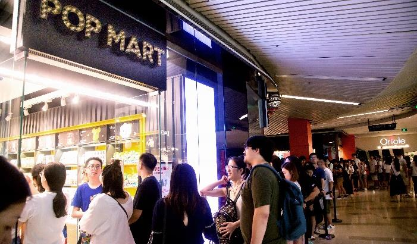
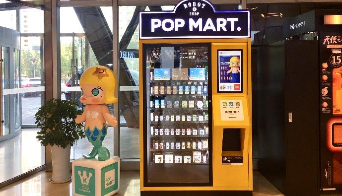

# 泡泡玛特新三板时期2017年年度报告（简体中文）

> 披露日期：2018-04-27。来源：[东方财富所存公司公告原文](https://pdf.dfcfw.com/pdf/H2_AN201804271132230842_1.pdf)。
> [原始PDF](../新三板时期/2017年年度报告.pdf) · [历年财报索引](../泡泡玛特历年财报索引.md)
> 转换说明：保留中文正文、数字、单位和注释，仅做繁简转换及重复英文去除。外文专名、代码和网址照录；复杂表格用等宽文本保留列位置，插图保留原图。

## 原PDF第1页

[对照原PDF第1页](../新三板时期/2017年年度报告.pdf#page=1)

公告编号：2018-020

泡泡玛特

NEEQ : 870578

北京泡泡玛特文化创意股份有限公司

Beijing Pop Mart Cultural & Creative Corp.,

Ltd.

年度报告

2017


## 原PDF第2页

[对照原PDF第2页](../新三板时期/2017年年度报告.pdf#page=2)

公司年度大事记

```text
    报告期内，公司加速线下门店的战略部署，先       报告期内，公司成功举办了北京国际潮流玩具
后在北京、上海、深圳等城市开设 20 家线下门店， 展（BTS）  ，本次展会是亚洲地区规模最大的潮流玩
截止报告期末公司共有 51 家门店。              具展，超过 100 个品牌参展、观展人数超过 20000
```

人次、近百家媒体对展会进行了报道。

报告期内，公司新增机器人商店业务，其低成  报告期内，公司葩趣 APP 实现重大版本更新，本、高收入、可复制化的模式已逐渐成为公司的重 2017 年 11 月上线葩趣商城功能，通过社群效应为要业绩增长点之一，截止报告期末 POP MART 机器葩趣带来更多营业收入。人商店已遍布全国 43 个投放点，其销售也一路攀升。

1







## 原PDF第3页

[对照原PDF第3页](../新三板时期/2017年年度报告.pdf#page=3)

目录

```text
第一节         声明与提示 .................................................................................................................... 4
第二节         公司概况 ........................................................................................................................ 6
第三节         会计数据和财务指标摘要 ............................................................................................ 8
第四节         管理层讨论与分析 ...................................................................................................... 10
第五节         重要事项 ...................................................................................................................... 20
第六节         股本变动及股东情况 .................................................................................................. 23
第七节         融资及利润分配情况 .................................................................................................. 25
第八节         董事、监事、高级管理人员及员工情况 .................................................................. 26
第九节         行业信息 ...................................................................................................................... 29
第十节         公司治理及内部控制 .................................................................................................. 29
第十一节          财务报告 ................................................................................................................... 35
```

2

## 原PDF第4页

[对照原PDF第4页](../新三板时期/2017年年度报告.pdf#page=4)

释义

```text
             释义项目                                            释义
公司、本公司、股份公司、泡泡玛特      指    北京泡泡玛特文化创意股份有限公司
金鹰泡泡、南京泡泡                    指    南京金鹰泡泡玛特商贸有限公司，即公司的控股子公
                                            司
葩趣科技                              指    北京葩趣科技有限公司，即公司的全资子公司
天津泡泡                              指    天津泡泡玛特文化传播有限公司，即公司的全资子公
                                            司
泡泡投资                              指    北京泡泡玛特投资企业（有限合伙）
金鹰集团                              指    金鹰国际商贸集团（中国）有限公司
股东大会                              指    北京泡泡玛特文化创意股份有限公司股东大会
董事会                                指    北京泡泡玛特文化创意股份有限公司董事会
监事会                                指    北京泡泡玛特文化创意股份有限公司监事会
三会                                  指    股东大会、董事会、监事会
“三会”议事规则                        指    《股东大会议事规则》、《董事会议事规则》、《监事会
                                            议事规则》
公司章程                              指    《北京泡泡玛特文化创意股份有限公司章程》
高级管理人员                          指    公司总经理、财务总监
IP                                    指    Intellectual Property，知识产权，是一种无形的财
                                            产权，也称智力成果权
零售                                  指    零售环节属于直接向消费者提供商品及服务的环节，
```

零售环节位于商品流通终端，是流通过程与消费领域的结合点，也是商品流通的最后关口，当商品经过零

```text
                                            售送达消费者手中，商品运动也就最后终止
BTS                                   指    北京国际潮流玩具展
机器人商店                            指    POP MART 自动售卖机
主办券商、中信建投证券                指    中信建投证券股份有限公司
会计师、申报会计师                    指    立信会计师事务所（特殊普通合伙）
全国股份转让系统公司                  指    全国中小企业股份转让系统有限责任公司
《公司法》                            指    《中华人民共和国公司法》
《证券法》                            指    《中华人民共和国证券法》
报告期                                指    2017 年 1 月 1 日-2017 年 12 月 31 日
元、万元                              指    人民币元、人民币万元
```

3

## 原PDF第5页

[对照原PDF第5页](../新三板时期/2017年年度报告.pdf#page=5)

第一节  声明与提示

【声明】公司董事会及其董事、监事会及其监事、公司高级管理人员保证本报告所载资料不存在任何虚

假记载、误导性陈述或者重大遗漏，并对其内容的真实性、准确性和完整性承担个别及连带责任。

公司负责人王宁、主管会计工作负责人杨镜冰及会计机构负责人（会计主管人员）杨镜冰保证年度

报告中财务报告的真实、准确、完整。

本年度报告涉及未来计划等前瞻性陈述，不构成公司对投资者的实质承诺，投资者及相关人士均应

对此保持足够的风险认识，并且应当理解计划、预测与承诺之间的差异。

```text
                                  事项                                         是或否
是否存在董事、监事、高级管理人员对年度报告内容异议事项或无法保证其真实、准   □是 √否
确、完整
是否存在未出席董事会审议年度报告的董事                                       □是 √否
是否存在豁免披露事项                                                         □是 √否
```

【重要风险提示表】重要风险事项名称  重要风险事项简要描述零售百货企业的发展一方面要通过提高现有门店的经营管理水平和现有门店每平方米的使用效率，从而促进经营业绩的内涵式增长；另一方面通常会选择新设门店来扩大经营规模，从而实现规模效益的外延式扩张。在外延式扩张中，门店的选址极为重要，需要综合考虑目标消费群体的构成、居民消新开门店选址的风险  费支付能力、预期客流量、交通便利条件、商业辐射能力、可选用的门店面积和附近已有或潜在的商业竞争程度，以及是否能以合适的价格购买或租赁经营场地等多种因素。门店选址一旦失当，不仅会使既定的目标市场地位难以实现，而且也会因开店前期产生的装修费等资本性支出和筹办费不能收回等因素而给公司带来较大的经营损失。公司作为时尚百货的连锁零售企业，经营区域相对集中，51 家门店中，33 家门店分布在北区，18 家门店分布在东区。受宏观经济环境、人均收入、竞争情况等因素的影响，各区域经营区域相对集中的风险门店呈现不同的发展趋势。未来，如果公司集中销售地区的经济发展速度、消费水平及市场规模等发生不利变化，可能会对公司带来不利影响。截至报告期末，公司共有 51 家门店正在经营之中，虽然公司拥有较强的管理能力与较完善的管理制度体系，但未来随公司管理能力不能支持业务拓展的风险  着公司规模不断扩大，将对公司资源配置能力以及日常管理能力提出更高的要求，如果公司管理水平的提升不能支持公司业务拓展的需要，则可能对公司日常运营和发展造成不利影响。

4

## 原PDF第6页

[对照原PDF第6页](../新三板时期/2017年年度报告.pdf#page=6)

2017 年、 2016 年、 2015 年，公司的存货周转率分别为 5.47次、3.84 次和 4.04 次，而存货余额分别为 17,176,709.26 元、12,454,081.73 元和 10,657,358.94 元。存货周转率虽然目前呈稳定趋势发展，但公司以自营为主的连锁经营模式决定了公公司存货周转率降低的风险司库存量较高。加之，公司连锁门店数量较多并处于扩张阶段，存货管理与配送难度会不断加大，若届时存货周转率降低，存货周转速度变慢，导致资金占用水平偏高，存货积压，企业的变现能力以及资金使用效率可能会受到一定的负面影响。本期重大风险是否发生重大变化：  是

报告期内，公司通过签约整合多个潮流玩具 IP 品牌，不断推出自主研发的潮流玩具 IP 商品，相关潮流玩具 IP 商品已成为公司重要收入增长点。因此，即使出现个别已签约日本品牌终止授权的情况，也不会对公司经营造成重大风险，此风险事项不适用。

5

## 原PDF第7页

[对照原PDF第7页](../新三板时期/2017年年度报告.pdf#page=7)

```text
                                  第二节      公司概况
一、    基本信息
公司中文全称           北京泡泡玛特文化创意股份有限公司
英文名称及缩写         Beijing Pop Mart Cultural Creative Corp.,Ltd.
证券简称               泡泡玛特
证券代码               870578
法定代表人             王宁
办公地址               北京市朝阳区阜通东大街 1 号院 3 号楼 3 单元 23 层 132707
二、    联系方式
董事会秘书或信息披露事务负责人    司德
职务                              信息披露负责人
电话                              010-57076701
传真                              010-57076701-8044
电子邮箱                          side@popmart.com
公司网址                          http://www.popmart.com
联系地址及邮政编码                北京市朝阳区阜通东大街 1 号院 3 号楼 3 单元 23 层 132707；邮
                                  编 100102
公司指定信息披露平台的网址        www.neeq.com.cn
公司年度报告备置地                董事会办公室
三、    企业信息
股票公开转让场所                  全国中小企业股份转让系统
成立时间                          2010 年 10 月 20 日
挂牌时间                          2017 年 1 月 25 日
分层情况                          基础层
行业（挂牌公司管理型行业分类）    F 批发和零售业-F52 零售业-F521 综合零售-F5211 百货零售
主要产品与服务项目                    泡泡玛特是集潮流商品零售、艺术家经纪、新媒体娱乐化平
```

台和大型展会举办于一体的 IP 综合运营服务集团。公司签约合作多个国内外知名潮流玩具 IP，对 IP 资源进行整合，建立完善的供应链体系，不断拓宽线上线下销售渠道，完善公司的零售渠道，并自主开发 IP 衍生品拓展授权市场。通过子公司葩趣科技研发的葩趣 APP 创建线上社群，并基于这一社区借助 IP 的虚拟化、游戏化，打造 IP 娱乐化线上平台。公司主办的国际潮流玩具展是亚洲

```text
                                  地区最有影响力的大型专业潮玩展会之一。
普通股股票转让方式                协议转让
普通股总股本（股）                25,495,047
优先股总股本（股）                0
做市商数量                        0
```

6

## 原PDF第8页

[对照原PDF第8页](../新三板时期/2017年年度报告.pdf#page=8)

```text
控股股东                          王宁
实际控制人                        王宁、杨涛
四、    注册情况
              项目                             内容                   报告期内是否变更
统一社会信用代码                  911101055636846881             否
注册地址                          北京市朝阳区阜通东大街 1 号院 3  否
                                  号楼 3 单元 23 层 132707
注册资本                          2549.5047 万元                 否
```

```text
五、    中介机构
主办券商                            中信建投
主办券商办公地址                    北京市朝阳区安立路 66 号 4 号楼
报告期内主办券商是否发生变化        否
会计师事务所                        立信会计师事务所（特殊普通合伙）
签字注册会计师姓名                  张福建、楼敏
会计师事务所办公地址                上海市黄浦区南京东路 61 号四楼
六、    报告期后更新情况
```

√适用 □不适用根据《全国中小企业股份转让系统股票转让方式确定及变更指引》  ，公司股票转让方式自 2018 年 1月 15 日起由协议转让方式变更为集合竞价转让方式。2018 年 1 月 15 日公司办公地址搬迁至北京市朝阳区阜通东大街 1 号院 3 号楼 25 层 3 单元 132901，联系方式变更为 010-64726326。报告期内公司启动了 2017 年第一次股票发行，2018 年 3 月 22 日公司完成新增股份登记，总股本变更为 2695.1711 万股。截至报告披露日，公司已完成注册资本及注册地址的工商变更相关工作。2018 年 1 月 18 日，  公司召开 2018 年第一次临时股东大会审议通过  《关于变更会计师事务所的议案》，公司原聘请北京兴华会计师事务所（特殊普通合伙）为公司审计机构。依据公司经营发展需要,公司决定更换会计师事务所,聘请立信会计师事务所（特殊普通合伙）为公司审计机构。

7

## 原PDF第9页

[对照原PDF第9页](../新三板时期/2017年年度报告.pdf#page=9)

```text
                        第三节       会计数据和财务指标摘要
一、    盈利能力
                                                                                   单位：元
                                           本期               上年同期          增减比例
营业收入                              180,095,912.85        88,118,495.91        104.38%
毛利率%                                   55.01%               49.58%               -
归属于挂牌公司股东的净利润             8,249,356.57        -28,890,460.29       -128.55%
归属于挂牌公司股东的扣除非经常性       8,020,456.51        -12,332,451.74       -165.04%
损益后的净利润
加权平均净资产收益率% （依据归属于        10.66%               -70.22%              -
挂牌公司股东的净利润计算）
加权平均净资产收益率% （归属于挂牌        10.31%               -29.98%              -
公司股东的扣除非经常性损益后的净
利润计算）
基本每股收益                               0.31                 -1.22           -125.41%
二、    偿债能力
                                                                                   单位：元
                                         本期期末             上年期末          增减比例
资产总计                              99,099,629.73         78,027,886.19        27.01%
负债总计                              20,712,319.69         7,575,918.07         173.40%
归属于挂牌公司股东的净资产            71,710,986.91         63,461,630.34        13.00%
归属于挂牌公司股东的每股净资产             2.81                 2.49             13.00%
资产负债率%（母公司）                     34.59%                8.15%               -
资产负债率%（合并）                       20.90%                9.71%               -
流动比率                                   3.76                 8.33                -
```

利息保障倍数  -  -  -

```text
三、    营运情况
                                                                                   单位：元
                                           本期               上年同期          增减比例
经营活动产生的现金流量净额            -1,940,310.06         -9,058,268.34           -
应收账款周转率                            35.36                 32.40               -
存货周转率                                 5.47                 3.84                -
```

8

## 原PDF第10页

[对照原PDF第10页](../新三板时期/2017年年度报告.pdf#page=10)

```text
四、    成长情况
                                           本期               上年同期          增减比例
总资产增长率%                             27.01%               41.39%               -
营业收入增长率%                          104.38%               94.20%               -
净利润增长率%                            -126.42%              87.92%               -
五、    股本情况
                                                                                   单位：股
                                         本期期末             上年期末          增减比例
普通股总股本                            25,495,047           25,495,047             0
```

计入权益的优先股数量  -  -  -计入负债的优先股数量  -  -  -

```text
六、    非经常性损益
                                                                                   单位：元
                      项目                                           金额
非流动资产处置损益                                                -96,155.62
计入当期损益的政府补助（与企业业务密切相关，按照                   8,568.96
国家统一标准定额或定量享受的政府补助除外）
委托他人投资或管理资产的损益                                      437,725.68
除上述各项之外的其他营业外收入和支出                               -741.70
                非经常性损益合计                                  349,397.32
所得税影响数                                                      87,349.33
少数股东权益影响额（税后）                                        33,147.93
                非经常性损益净额                                  228,900.06
七、    因会计政策变更及会计差错更正等追溯调整或重述情况
```

√适用 □不适用

```text
                                                                                   单位：元
                          上年期末（上年同期）               上上年期末（上上年同期）
       科目
                      调整重述前        调整重述后         调整重述前         调整重述后
资产处置收益              0             -4,560.01               -                 -
营业外支出            115,277.13        110,717.12              -                 -
```

9

## 原PDF第11页

[对照原PDF第11页](../新三板时期/2017年年度报告.pdf#page=11)

```text
                             第四节      管理层讨论与分析
一、    业务概要
```

商业模式根据中国证监会 2012 年修订的《上市公司行业分类指引》，公司所处行业属于“F 批发和零售业-F52零售业-F521 综合零售-F5211 百货零售”。泡泡玛特是集潮流商品零售、艺术家经纪、新媒体娱乐化平台和大型展会举办于一体的 IP 综合运营服务集团。公司签约合作多个国内外知名潮流玩具 IP，对 IP 资源进行整合，建立完善的供应链体系，不断拓宽线上线下销售渠道，完善公司的零售渠道，并自主开发 IP 衍生品拓展授权市场。通过子公司葩趣科技研发的葩趣 APP 创建线上社群，并基于这一社区借助 IP 的虚拟化、游戏化，打造 IP 娱乐化线上平台。公司主办的国际潮流玩具展是亚洲地区最有影响力的大型专业潮玩展会之一。公司的关键资源为公司签署的独家 IP 资源，截止报告期末公司新增多个 IP 品牌形象的签约，包括“Satyr”、“妹头”等。客户类型：公司主要从事零售业务，自营模式和网络销售模式下，公司直接面向终端消费者，故客户主要为个人消费者，较为分散；联营模式下，公司主要与金鹰集团采取联营模式，故公司客户主要为金鹰集团。除此之外，还有部分有定制及团购需求的企业客户。公司的盈利模式分为设计模式、采购模式、销售模式三类，具体盈利模式如下：1、设计模式公司设计部门根据目标消费群体的需求，结合分析市场调研情况以及产品生产等因素，对签约合作IP 进行设计及生产制作，最终投入市场进行推广及销售。2、采购模式公司的采购模式分为经销与代销两种采购模式。经销模式下，公司向品牌商直接采购商品，并使用订单方式管理，经销模式下的采购约占总采购金额的 88%左右；代销模式下，供应商收到代销清单时视为实现产品销售，代销模式的采购金额约占总采购金额的 12%左右。3、销售模式销售模式分为自营模式、联营模式、网络销售三类，其中泡泡玛特的销售模式主要为自营模式，南京泡泡的销售模式包括自营模式和联营模式，葩趣科技的销售模式为自营模式。自营模式下公司的利润来源主要是自有产品的销售及采购商品的进销差价；联营模式是公司在商场设立店面，与商场联合经营，顾客购买货品后，由商场收取货款，商场每月按公司门店上月销售额收取一定比例扣点后与公司进行结算，所收取货款在扣除商场按照商品销售收入一定比例计算的分成后，返款给公司；网络销售主要是通过天猫进行产品展示、在线交易，网站硬件、软件及服务由公司自行管理，销售货款先支付到网络销售平台，由网络销售平台按照条款约定扣除一定比例的销售额后，再返款给公司，收到款项后发货给顾客，完成商品销售。报告期内，公司商业模式主营业务未发生变化。

```text
报告期内变化情况：
                           事项                                          是或否
所处行业是否发生变化                                                   □是 √否
主营业务是否发生变化                                                   □是 √否
主要产品或服务是否发生变化                                             □是 √否
客户类型是否发生变化                                                   □是 √否
关键资源是否发生变化                                                   □是 √否
```

10

## 原PDF第12页

[对照原PDF第12页](../新三板时期/2017年年度报告.pdf#page=12)

```text
销售渠道是否发生变化                                                   □是 √否
收入来源是否发生变化                                                   □是 √否
商业模式是否发生变化                                                   □是 √否
二、    经营情况回顾
(一)    经营计划
```

2017 年公司经营情况良好，各项财务指标均达到持续增长，报告期内公司营业收入再创新高，经审计后的营业收入达到 18,009.59 万元，同比增长 104.38%；企业净利润 793.53 万元，同比下降 126.42%。截至报告期末公司总资产 9,909.96 万元，净资产 7,838.73 万元。1、销售情况2017 年公司销售收入 18,009.59 万元，同比增长 104.38%。2、融资情况2017 年 12 月，公司以 27.46 元/股的价格发行股份 145.6664 万股，本次股票发行募集资金共计40,000,000 元。3、取得 IP 情况2017 年 3 月，公司与 Seulgi Lee 成功就“Satyr”品牌形象达成战略合作，成为该形象的全球重要战略合作伙伴。2017 年 4 月，公司与香港 IXTEE Production 成功就“妹头”系列产品达成合作，成为该系列公仔在中国大陆地区独家代理机构。2017 年 8 月，公司获得利鸥品牌策划（上海）有限公司旗下“Gudetama”、“Hellokitty”的形象使用授权，将为其开发手办公仔等商品。2017 年 11 月，公司获得皮乐企业管理（上海）有限公司旗下“火影忍者疾风传”的形象使用授权，将为其开发手办公仔等商品。4、开设店铺情况2017 年公司新增门店 18 家，快闪店 2 家，截至报告期末合计在营门店 51 家。5、展会情况2017 年 9 月公司成功举办了北京国际潮流玩具展（BTS），本次展会是亚洲地区规模最大的潮流玩具展，超过 100 个品牌参展、观展人数超过 20000 人次、近百家媒体对展会进行了报道。6、机器人商店2017 年公司新增机器人商店业务，其低成本、高收入、可复制化的模式已逐渐成为公司的重要业绩增长点之一，截止 2017 年末 POP MART 机器人商店已遍布全国 43 个投放点，其销售也一路攀升，实现营业收入 543.55 万元，利润 201.02 万元。7、人员情况2017 年公司员工规模逐渐壮大，截至报告期末公司设计人员共计 29 人，企业员工总数达到 407 人。8、公司持续经营情况通过聚焦潮流玩具市场，逐渐提高品牌辨识度，取得独一无二的市场竞争力，在供应链条中拥有更多的话语权和主动性。公司独家 IP 资源逐渐增多，核心部门管理能力的不断增强、销售渠道逐渐拓宽，公司的业务规模将逐渐增大，自我盈利能力将不断增强，发展前景广阔，具有较强的持续经营能力。

11

## 原PDF第13页

[对照原PDF第13页](../新三板时期/2017年年度报告.pdf#page=13)

(二)  行业情况

报告期内,中国零售业呈现出销售规模增速加快、企业盈利能力增强、主要业态经营回暖的新特点。根据商务部发布的典型企业分业态数据显示，2017 年，专卖店、专业店、超市和百货店销售额增速分别为 8.3%、6.2%、3.8%和 2.4%，较上年同期分别加快 6.6、3.3、1.9 和 2.7 个百分点。此外，实体零售创新转型丰富多样，发展新业态、搭建全渠道、重构供应链、推进渠道下沉成为实体零售转型发展的重要方式。2018 年，在宏观经济稳增长、抗风险的基调下，零售企业创新转型不断升级，实体店铺资源将重新成为线上线下企业竞逐的焦点，实体零售回暖趋势有望增强。

```text
(三)    财务分析
1.  资产负债结构分析
                                                                                   单位：元
                         本期期末                     上年期末
                                                                          本期期末与上年期
     项目                       占总资产的                   占总资产的
                    金额                         金额                      末金额变动比例
                                   比重                         比重
货币资金       15,795,258.67      15.94%     26,353,998.41     33.78%          -40.07%
应收账款        6,733,440.88      6.79%      3,061,918.96      3.92%           119.91%
存货           17,176,709.26      17.33%     12,454,081.73     15.96%          37.92%
长期股权投资                        -                            -                -
固定资产        6,727,593.81      6.79%      1,811,575.81      2.29%           271.37%
```

在建工程  -  -  -短期借款  -  -  -

```text
长期借款                            -                            -                -
预付账款       21,418,074.76      21.61%     6,319,706.60      8.10%           238.91%
资产总计       99,099,629.73        -        78,027,886.19       -             27.01%
```

资产负债项目重大变动原因：1、货币资金：报告期内，公司货币资金余额较期初减少 1,055.87 万元，下降 40.07%，主要原因是新开门店、新增人员导致的现金流出。2、预付账款：报告期内，公司预付账款较期初增加 1,509.84 万元，上升 238.91%，主要原因是门店数量进一步增多，预付租金增加；同时增加预付 IP 产品（MOLLY）产品设计费。3、应收账款：报告期内，公司应收账款较期初增加 367.15 万元，主要是新增联营店铺产生应收账款。4、固定资产：报告期内，公司固定资产较期初增加 491.60 万元，上升 271.37%，主要原因是门店数量进一步增多，门店使用设备增多；另一方面增加了 MOLLY 产品的模具。5、资产总计：报告期内，公司资产总计较期初增加 2,107.17 万元，上升 27.01%，主要原因是预付账款及固定资产、存货增加较多。

2. 营业情况分析

(1) 利润构成

单位：元

12

## 原PDF第14页

[对照原PDF第14页](../新三板时期/2017年年度报告.pdf#page=14)

```text
                           本期                        上年同期
                                                                            本期与上年同期
    项目                        占营业收入                    占营业收入
                    金额                          金额                       金额变动比例
                                  的比重                        的比重
营业收入       180,095,912.85       -        88,118,495.91        -            104.38%
营业成本       81,018,149.15      44.99%     44,425,801.14      50.42%          82.37%
毛利率%            55.01%           -            49.58%           -               -
管理费用       20,049,446.50      11.13%     31,505,562.17      35.75%         -36.36%
销售费用       67,690,749.04      37.59%     40,167,017.22      45.58%          68.52%
财务费用         742,272.93       0.41%        410,072.98       0.47%           81.01%
营业利润        8,135,085.77      4.52%      -30,161,085.89       -               -
营业外收入       22,806.92        0.01%        38,508.64        0.04%          -40.77%
营业外支出       23,548.62        0.01%        110,717.12       0.13%          -78.73%
净利润          7,935,341.92      4.41%      -30,030,184.57       -               -
```

项目重大变动原因：

1、营业收入报告期内，营业收入 18,009.59 万元，同比上升 104.38%。主要变动原因：公司经营的相关潮流玩具品类销售较快增长，带动单店销售稳步提升；同时报告期内公司新增线下门店 18 家,新增快闪店 2 家，截至目前公司共有 51 家门店，门店的迅速扩张使销售收入大幅提升；2017 年新增机器人商店业务和展会业务，分别实现营业收入 543.55 万元、672.88 万元。2、营业成本报告期内，营业成本 8,101.81 万元，同比上升 82.37%，低于营业收入增长率。主要变动原因：是因为报告期内公司新增 20 家直营店，门店的迅速扩张使产品销售数量大幅增长。2017 年营业收入大幅度增长影响，同时商品毛利率有所提升，使营业成本上升比例小于营业收入。3、毛利率报告期内，公司顺应潮流玩具发展趋势，不断引进优秀 IP 产品，积极调整品类结构，使商品毛利率同比有较大增长；同时线上毛利额 580.35 万元，毛利率较高。4、管理费用报告期内，发生管理费用 2,004.94 万元，同比下降 36.36%。主要原因 2016 年高管股权激励产生股份支付 1,650 万元，扣除这一因素后同比上升 33.66%，主要原因是总部人员增加及人均人力成本上升。5、销售费用报告期内，发生销售费用 6,769.07 万元，同比上升 68.52%。主要原因是 2017 年新增 20 家门店，门店数量同比大幅度增加影响租赁费、装修费摊销、工资等相关费用同比增长较大。6、财务费用报告期内，发生财务费用 74.23 万元，同比上升 81.01%。主要原因是随着销售规模的大幅度增长，刷卡手续费增加较多。

7、净利润报告期内，盈利 793.53 万元，同比增加 3,796.55 万元。主要原因是 2016 年股权激励增加管理费用 1,650 万元，影响公司亏损较大。归属于挂牌公司股东的扣除非经常性损益后盈利 798.73 万元，同比盈利 2,031.98 万元。

(2) 收入构成

```text
                                                                           单位：元
项目                 本期金额                上期金额               变动比例
```

13

## 原PDF第15页

[对照原PDF第15页](../新三板时期/2017年年度报告.pdf#page=15)

```text
主营业务收入              178,629,009.55          87,726,265.12              103.62%
其他业务收入               1,466,903.30             392,230.79               273.99%
主营业务成本               80,920,496.70          44,360,384.13              82.42%
其他业务成本                 97,652.45              65,417.01                49.28%
```

按产品分类分析：

```text
                                                                                   单位：元
   类别/项目        本期收入金额      占营业收入比例%      上期收入金额     占营业收入比例%
零售业务           156,950,506.99          87.15%         81,229,165.36         92.18%
电商业务            9,514,200.65            5.28%          3,537,971.21          4.01%
定制业务                  -                 0.00%           579,630.17           0.66%
机器人商店业务      5,435,474.09            3.02%               -                  -
展会业务            6,728,827.82            3.74%
其他收入            1,466,903.30            0.81%          2,771,729.17          3.15%
合计               180,095,912.85          100.00%        88,118,495.91         100.00%
```

按区域分类分析：

√适用 □不适用

```text
                                                                                   单位：元
   类别/项目        本期收入金额      占营业收入比例%      上期收入金额     占营业收入比例%
华北地区           114,072,190.94          63.34%         52,729,565.60         59.84%
东北地区            7,804,619.20            4.33%          5,546,373.30          6.29%
华东地区            50,001,038.82          27.76%         29,842,557.01         33.87%
华南地区            3,821,184.54            2.12%               -                  -
西南地区            4,396,879.35            2.44%               -                  -
合计               180,095,912.85          100.00%        88,118,495.91         100.00%
```

收入构成变动的原因：

1、按产品分类分析：报告期内公司布局机器人商店和展会业务，分别实现营业收入 544 万元、673 万元；同时电商业务收入实现增长额 598 万元。2、按区域分类分析：较 2016 年，公司分别在华南地区、西南地区新开 3 家、4 家门店，实现营业收入 382 万元、440 万元。

(3) 主要客户情况

```text
                                                                                   单位：元
序号                 客户                    销售金额      年度销售占比   是否存在关联关系
  1   金鹰国际商贸集团（中国）有限公司     19,049,770.70       9.11%             是
      及其控股子公司
  2   广州市趣智屋商贸有限公司              898,451.70         0.43%             否
  3   Kennyswork   Company Limited          592,308.28         0.28%             否
  4   青岛海信东海商贸有限公司              574,588.13         0.27%             否
```

14

## 原PDF第16页

[对照原PDF第16页](../新三板时期/2017年年度报告.pdf#page=16)

```text
5    北京博睿思泰贸易有限公司              490,848.10        0.23%              否
                合计                       21,605,966.91     10.32%             -
```

(4) 主要供应商情况

```text
                                                                                   单位：元
序号                供应商                   采购金额      年度采购占比   是否存在关联关系
  1   永正文化玩具创意（深圳）有限公司     13,391,821.93      15.62%             否
  2   多丽梦（深圳）国际贸易有限公司       16,878,478.04      19.69%             否
  3   艾丽斯卡（深圳）商贸有限公司         4,514,824.14        5.27%             否
  4   广东振丰科教玩具有限公司             1,941,593.82        2.26%             否
  5   迪克斯玩具礼品（上海）有限公司       1,668,207.83        1.95%             否
                  合计                     38,394,925.76      44.79%              -
3.  现金流量状况
                                                                                   单位：元
            项目                        本期金额                 上期金额         变动比例
 经营活动产生的现金流量净额          -1,940,310.06             -9,058,268.34          -
 投资活动产生的现金流量净额          -8,618,429.68             -9,053,079.47          -
 筹资活动产生的现金流量净额                                    33,676,003.00      -100.00%
```

现金流量分析：报告期内，经营活动产生的现金流量净额-194.03 万元，其中经营活动现金流入 20,910.96 万元，主要是销售商品、提供劳务收到的现金；经营活动现金流出 21,104.99 万元，主要是购买商品、接受劳务支付的现金 10,860.78 万元，支付给职工以及为职工支付的现金 3,253.25 万元。投资活动产生的现金流量净额-861.84 万元，其中投资活动现金流入 6,562.77 万元，主要是银行理财收到的投资现金及收回理财产品本金；投资活动现金流出 7,424.62 万元，主要是购买银行理财产品支付的以及门店、总部资本性支出的现金。公司现金流量净额与净利润差异较大，主要因为报告期内，投资活动产生了较大金额的现金负流量。

(四)  投资状况分析

1、主要控股子公司、参股公司情况报告期内，公司新增 2 家一级子公司，4 家二级子公司。截止报告期末，公司拥有 5 家一级子公司，4 家二级子公司。

1、一级子公司情况公司控股子公司南京金鹰泡泡玛特商贸有限公司于 2014 年 6 月 25 日成立，注册资本 2,000 万元，公司以现金出资设立南京泡泡并持有股权比例为 52%；公司全资子公司北京葩趣科技有限公司于 2016 年 4 月 21 日成立，注册资本 100 万元，占比 100%；公司全资子公司天津泡泡玛特文化传播有限公司于 2016 年 11 月 29 日设立，注册资本 500 万元，占比 100%；公司全资子公司上海葩趣贸易有限公司于 2017 年 9 月 21 日设立，注册资本 200 万元，占比 100%；公司全资子公司北京泡泡玛特商贸有限公司于 2017 年 10 月 11 日设立，注册资本 500 万元，占比100%；

2、二级子公司情况

15

## 原PDF第17页

[对照原PDF第17页](../新三板时期/2017年年度报告.pdf#page=17)

深圳泡泡玛特贸易有限公司于 2017 年 10 月 31 日成立，注册资本 100 万元，由一级子公司北京泡泡玛特商贸以现金出资设立并持有 100%股权。北京葩趣贸易有限公司于 2017 年 12 月 29 日成立，注册资本 100 万元，由一级子公司北京泡泡玛特商贸以现金出资设立并持有 100%股权。成都泡泡玛特贸易有限公司于 2017 年 11 月 22 日成立，注册资本 100 万元，由一级子公司北京泡泡玛特商贸以现金出资设立并持有 100%股权。重庆葩趣贸易有限公司于 2017 年 11 月 23 日成立，注册资本 100 万元，由一级子公司北京泡泡玛特商贸以现金出资设立并持有 100%股权。

2、委托理财及衍生品投资情况报告期内，公司委托理财实现到账收益 32.83 万元。截至报告期末，公司持有理财产品 100 万元。

```text
(五)    非标准审计意见说明
□适用 √不适用
(六)    会计政策、会计估计变更或重大会计差错更正
```

√适用 □不适用

2017 年 12 月 27 日，公司召开第一届董事会第十次会议，审议通过《关于公司会计政策变更的议案》，

为了更加客观地反映公司的财务状况和经营成果、反映应收款项的实际回收情况，结合公司实际情况，

经过与 2017 年度审计机构沟通，公司决定对相应的会计政策进行变更，对公司其他应收款坏帐准备计

提作出调整，对非合并关联方企业之间的往来款项、备用金、押金、保证金计提坏账准备。

内容详见公司于 2017 年 12 月 27 日在全国中小企业股份转让系统官方网站（www.neeq.com.cn）披

露的《北京泡泡玛特文化创意股份有限公司会计政策变更的公告》（公告编号：2017-050）。

（一）会计政策变更

执行《企业会计准则第 42 号——持有待售的非流动资产、处置组和终止经营》、《企业会计准则

第 16 号——政府补助》和《财政部关于修订印发一般企业财务报表格式的通知》。

财政部于 2017 年度发布了  《企业会计准则第 42 号——持有待售的非流动资产、  处置组和终止经营》，

自 2017 年 5 月 28 日起施行，对于施行日存在的持有待售的非流动资产、处置组和终止经营，要求采用

未来适用法处理。

财政部于 2017 年度修订了《企业会计准则第 16 号——政府补助》，修订后的准则自 2017 年 6 月

12 日起施行，对于 2017 年 1 月 1 日存在的政府补助，要求采用未来适用法处理；对于 2017 年 1 月 1 日

至施行日新增的政府补助，也要求按照修订后的准则进行调整。

财政部于 2017 年度发布了《财政部关于修订印发一般企业财务报表格式的通知》，对一般企业财

务报表格式进行了修订，适用于 2017 年度及以后期间的财务报表。

```text
   本公司执行上述三项规定的主要影响如下：
  会计政策变更的内容和原因              审批程序             受影响的报表项目名称和金额
（1）在利润表中分别列示“持    按财政部《关于修订印发一般企  列示持续经营净利润本年金额
续经营净利润”和“终止经营净    业财务报表格式的通知》（财会  7,935,341.92 元；列示终止经营
```

16

## 原PDF第18页

[对照原PDF第18页](../新三板时期/2017年年度报告.pdf#page=18)

```text
利润”  。比较数据相应调整。     [2017]30 号）执行               净利润本年金额 0.00 元。列示持
```

续经营净利润上年金额-30,030,184.57 元；列示终止经营净利润上年金额 0.00 元。

```text
（2）与本公司日常活动相关的
                              按财政部《企业会计准则第 16
政府补助，计入其他收益，不再
                              号——政府补助》  （财会[2017]15  其他收益：8,568.96 元。
计入营业外收入。比较数据不调
                              号）执行
整。
（3）在利润表中新增“资产处                                  本年度营业外支出减少
置收益”项目，将部分原列示为按财政部《关于修订印发一般企     96,155.62 元，重分类至资产处置
“营业外收入”的资产处置损益业财务报表格式的通知》（财会      收益。上年度营业外支出减少
重分类至“资产处置收益”项目。 [2017]30 号）执行              4,560.01 元，重分类至资产处置
比较数据相应调整。                                          收益。
   （二）会计估计变更
  会计估计变更的内容和原因     审批程序      开始适用时点     受影响的报表项目名称和金额
```

2017 年 12 月 27 日北京泡泡玛特文化创意股份有限公司董事会

```text
决议：公司原坏账准备计提方法
是无风险应收款项（关联方、备                                    本年度应收账款坏账准备增加
用金、押金、保证金）不计提坏                                    223,869.24 元；其他应收款坏账
账，现根据公司款项实际可收回                                    准备增加 1,126,635.21 元；资产
                                 董事会     2017 年 12 月 27 日
风险情况判断，自 2017 年 12 月                                  减值损失增加 1,350,504.45；递
27 日起，除合并范围内关联方不                                   延所得税资产增加 337,626.11；
计提坏账准备外，其余应收款项                                    所得税费用减少 337,626.11。
```

按照账龄分析法计提坏账。此会计估计变更适用于本公司控股的下属子公司。

（三）前期重大差错更正本公司在报告期无前期重大差错更正事项

(七)  合并报表范围的变化情况

√适用 □不适用公司 2017 年年度财务报告合并报表范围新增 2 个一级全资子公司和 4 个二级全资子公司，与上期相比，公司合并报表范围增加了上海葩趣贸易有限公司、北京泡泡玛特商贸有限公司、深圳泡泡玛特贸易有限公司、北京葩趣贸易有限公司、成都泡泡玛特贸易有限公司、重庆葩趣贸易有限公司。

(八)  企业社会责任

报告期内，公司诚信经营、按时足额纳税、积极提供就业岗位，并严格保障员工的合法权益。

三、  持续经营评价

1、公司业务发展方向明确，市场前景广阔，竞争优势明显。

17

## 原PDF第19页

[对照原PDF第19页](../新三板时期/2017年年度报告.pdf#page=19)

通过聚焦潮流玩具市场，逐渐提高品牌辨识度，取得独一无二的市场竞争力，在供应链条中拥有更多的话语权和主动性。凭借对年轻人兴趣及消费心理的深度观察，使公司能够及时顺应二次元等新文化潮流崛起，享受中国消费升级带来的红利。随着公司战略对潮流玩具 IP 的有所侧重，以香港知名潮流玩具品牌“Molly”为例，公司与其签订了长期的独家销售以及独家生产的合约，2017 年公司共推出 7 个系列的 Molly 盲盒产品及多款限定品，实现销售收入 4,374.52 万元。2015 年至今，经过谈判，公司与超过 20 个世界知名的潮流玩具品牌建立了深度合作。截至报告期末，公司独家 IP 资源逐渐增多，核心部门管理能力的不断增强、销售渠道逐渐拓宽，公司的业务规模将逐渐增大，自我盈利能力将不断增强，发展前景广阔，具有较强的持续经营能力。2、营销的线上线下立体化融合公司致力于满足顾客的个性化需求，通过线上社群、线下实体营销渠道同时搭建的方式，将线上线下营销手段进行立体化融合，以实现零售业效率的大幅度提高。2017 年公司新增机器人商店业务，其低成本、高收入、可复制化的模式已逐渐成为公司的重要业绩增长点之一，截止 2017 年末 POP MART 机器人商店已遍布全国 43 个投放点，其销售也一路攀升，实现营业收入 543.55 万元，利润 201.02 万元。3、产品开发给公司带来新的发展2016 年公司设立全资子公司葩趣科技，基于对潮流玩具市场的理解以及对粉丝的研究，公司投资开发了潮流玩具社群平台葩趣 APP。子公司专注于葩趣 APP 的研发工作，通过线上社区挖掘潮流玩具 IP 的虚拟价值，打造潮流玩具粉丝专属互动平台，扩大品牌影响力、维护品牌粉丝、提升购买乐趣；通过葩趣 APP，潮流玩具粉丝可以获得最新潮流玩具咨询，结识其他潮流玩具玩家，买卖交换潮流玩具，进而增加粉丝对公司产品的了解、喜爱与粘性,推动公司实现零售娱乐化的战略规划。2017 年葩趣 APP 进行重大版本更新，加强了社交和社区属性，增加了圈子、社群管理、帖子分类等多项社交属性的功能，让葩趣呈现的内容更加专业化，用户的互动意愿更加强烈，改版后用户数量增加400%，用户日均活跃度增加 800%，新增用户呈现稳定的上升趋势，逐步成为国内最专业的潮流玩具社区2017 年 11 月，上线葩趣商城功能，通过社群的效应为葩趣带来更多经济效益。其中抽号购买等功能，解决了玩家购买限定品的公平性，受到粉丝一致好评。2018 年，葩趣还将会针对潮流玩具的特点在葩趣商城上线预售功能和拍卖功能，同时强化社群服务特点，强化平台效应，还将上线卡牌搜集等娱乐化功能，强调零售后的娱乐化概念。葩趣 APP 上线二手市场的功能，为玩家搭建方便的二手买卖信息平台。同时第一款潮玩 IP 的手游也将上线，进行潮玩 IP的虚拟化价值探索。4、公司营业收入可持续性较好且增长趋势明显2017 年，公司实现营业收入 18,009.59 万元，同比上升 104.38%；净利润 793.53 万元，同比下降126.42%；归属于挂牌公司股东的扣除非经常性损益后的净利润 802.05 万元，同比盈利 2,035.29 万元。公司报告期内主营业务突出，且主营业务收入与公司发展相匹配，同时公司于 2015 年末开始转型潮流玩具 IP 店，2017 年公司新增门店 18 家，新增快闪店 2 家，营业收入增长趋势明显，2017 年营业收入较 2016 年营业收入有较大提升。公司业务发展不受产业政策限制，符合国民消费升级的需求。公司报告期末净资产额不为负数，且期内显示出良好的融资能力。公司具有稳定的市场，目标客户质量和忠诚度较高。公司所处的行业长期发展趋势良好，细分市场前景广阔，公司竞争优势明显，具有多元化、综合化业务发展潜力。综上所述，公司可持续经营能力良好。

四、  未来展望

是否自愿披露

18

## 原PDF第20页

[对照原PDF第20页](../新三板时期/2017年年度报告.pdf#page=20)

```text
□是 √否
五、    风险因素
(一)    持续到本年度的风险因素
```

1、新开门店选址的风险零售百货企业的发展一方面要通过提高现有门店的经营管理水平和现有门店每平方米的使用效率，从而促进经营业绩的内涵式增长；另一方面通常会选择新设门店来扩大经营规模，从而实现规模效益的外延式扩张。在外延式扩张中，门店的选址极为重要，需要综合考虑目标消费群体的构成、居民消费支付能力、预期客流量、交通便利条件、商业辐射能力、可选用的门店面积和附近已有或潜在的商业竞争程度，以及是否能以合适的价格购买或租赁经营场地等多种因素。门店选址一旦失当，不仅会使既定的目标市场地位难以实现，而且也会因开店前期产生的装修费等资本性支出和筹办费不能收回等因素而给公司带来较大的经营损失。应对措施：公司建立了一套动态的选址评估体系及流程以提高开店成功率，即随着市场环境变化，通过大数据、城市级别、地理位置等方面进行多方位分析，以避险选址失误带来的风险。2、经营区域相对集中的风险公司作为时尚百货的连锁零售企业，经营区域相对集中，51 家门店中，33 家门店分布在北区，18家门店分布在东区。受宏观经济环境、人均收入、竞争情况等因素的影响，各区域门店呈现不同的发展趋势。未来，如果公司集中销售地区的经济发展速度、消费水平及市场规模等发生不利变化，可能会对公司带来不利影响。应对措施：公司未来将根据市场需求，继续在北京、上海等一线城市以开设店铺的方式扩大公司规模，目前随店铺数量的逐渐增多，各店铺同比依旧保持较好的增长趋势，公司计划未来也将要进入广州、深圳等更多的经济较发达城市。3、公司管理能力不能支持业务拓展的风险截至报告期末，公司共有 51 家门店正在经营之中，虽然公司拥有较强的管理能力与较完善的管理制度体系，但未来随着公司规模不断扩大，将对公司资源配置能力以及日常管理能力提出更高的要求，如果公司管理水平的提升不能支持公司业务拓展的需要，则可能对公司日常运营和发展造成不利影响。应对措施：随着公司规模的扩大，公司也将定期或不定期的对公司管理人员进行培训，同时，根据不同时期公司的发展需求，也将不断引进优秀人才，提升管理能力，应对公司在发展过程中面临的挑战。4、公司存货周转率降低的风险2017 年、2016 年、2015 年，公司的存货周转率分别为 5.47 次、3.84 次和 4.04 次，而存货余额分别为 17,176,709.26 元、12,454,081.73 元和 10,657,358.94 元。存货周转率虽然目前呈稳定趋势发展，但公司以自营为主的连锁经营模式决定了公司库存量较高。加之，公司连锁门店数量较多并处于扩张阶段，存货管理与配送难度会不断加大，若届时存货周转率降低，存货周转速度变慢，导致资金占用水平偏高，存货积压，企业的变现能力以及资金使用效率可能会受到一定的负面影响。应对措施：公司针对采买总量进行严格把控，并针对不同级别店铺的库存以及南北区两仓的存储总量，通过面积业绩双维度的测算得出合理的存货指标，使库存在总量以及结构方面都得到改善。

(二)  报告期内新增的风险因素

无

19

## 原PDF第21页

[对照原PDF第21页](../新三板时期/2017年年度报告.pdf#page=21)

```text
                                  第五节      重要事项
一、    重要事项索引
                         事项                                是或否             索引
是否存在重大诉讼、仲裁事项                                 □是 √否
是否存在对外担保事项                                       □是 √否
是否存在股东及其关联方占用或转移公司资金、资产的情况       □是 √否
是否对外提供借款                                           □是 √否
是否存在日常性关联交易事项                                 √是 □否           五.二.(一)
是否存在偶发性关联交易事项                                 √是 □否           五.二.(二)
是否存在经股东大会审议过的收购、出售资产、对外投资事项     □是 √否
或者本年度发生的企业合并事项
是否存在股权激励事项                                       √是 □否           五.二.(三)
是否存在已披露的承诺事项                                   √是 □否           五.二.(四)
是否存在资产被查封、扣押、冻结或者被抵押、质押的情况       □是 √否
是否存在被调查处罚的事项                                   √是 □否           五.二.(五)
是否存在失信情况                                           □是 √否
是否存在自愿披露的其他重要事项                             □是 √否
二、    重要事项详情（如事项存在选择以下表格填列）
(一)    报告期内公司发生的日常性关联交易情况
                                                                                   单位：元
                       具体事项类型                             预计金额        发生金额
1．购买原材料、燃料、动力                                          -               -
2．销售产品、商品、提供或者接受劳务委托，委托或者受托销售      18,460,000      12,570,000
3．投资（含共同投资、委托理财、委托贷款）                          -               -
4．财务资助（挂牌公司接受的）                                      -               -
5．公司章程中约定适用于本公司的日常关联交易类型                    -               -
6．其他                                                            -               -
                           总计                                18,460,000      12,570,000
注：2017 年日常性关联交易的发生金额系公司与关联方联营模式下结算货款的相关金额。
(二)    报告期内公司发生的偶发性关联交易情况
                                                                                   单位：元
                                                是否履行必   临时报告披露时
      关联方         交易内容       交易金额                                  临时报告编号
                                                要决策程序         间
金鹰集团             商品销售     1,370,000.00      是      2017 年 4 月 25 日  2017-009
金鹰集团控制的子     商品销售     2,820,000.00      是      2017 年 4 月 25 日  2017-009
公司
金鹰集团               租金       1,068,049.98      是      2018 年 4 月 26 日  2018-022
```

20

## 原PDF第22页

[对照原PDF第22页](../新三板时期/2017年年度报告.pdf#page=22)

```text
金鹰集团控制的子       租金       1,847,301.94      是      2018 年 4 月 26 日  2018-022
公司
南京金鹰国际贸易     商品销售     1,456,016.89      是      2018 年 4 月 26 日  2018-022
有限公司
       总计              -        8,561,368.81      -               -               -
```

偶发性关联交易的必要性、持续性以及对公司生产经营的影响：上述为联营代收性质的关联交易。2017 年 4 月 24 日，公司召开第一届董事会第六次会议，审议通过了《关于补充确认关联交易的议案》  ，并披露《关于补充确认关联交易的公告》  （公告编号：2017-009）  ，2017 年 5 月 17 日，公司召开 2016 年年度股东大会，审议通过了《关于补充确认关联交易的议案》。因子公司南京泡泡采取联营的模式销售，在关联方金鹰集团的商场设立店面，与商场联合经营,顾客购买货品后，由商场收取货款，商场每月按子公司门店上月销售额收取一定比例扣点后与公司进行结算，所收取货款在扣除商场按照商品销售收入一定比例计算的分成后，返款给子公司。偶发性关联交易的产生系公司日常经营所需，该业务因公司正常经营过程产生的，未来仍将继续发生，故不会对公司生产经营产生不利影响。因公司管理层对关联交易的认定与审计机构的角度不同，审计报告中对于报告期内关联交易的情况依照提供劳务、销售商品进行计算，具体情况如下：

（1）提供劳务情况南京泡泡与金鹰集团及其控制的子公司进行联营合作，金鹰集团根据联营门店销售额收取 10%-25%的租金费用， 并与南京泡泡每月按照扣除租金费用的净额结算，本报告期内金鹰集团收取租金

```text
2,915,351.92 元。
            关联方名称                     交易内容                     交易金额
             金鹰集团                        租金                     1,068,049.98
       金鹰集团控制的子公司                  租金                     1,847,301.94
                            合计                                      2,915,351.92
    （2）出售商品情况表
            关联方名称                     交易内容                     交易金额
     南京金鹰国际贸易有限公司              出售商品                   1,456,016.89
```

2018 年 4 月 26 日，公司召开第一届董事会第十三次会议，审议通过了《关于补充确认 2017 年关联交易的议案》，对上述关联交易内容进行补充审议，并披露《关于补充确认 2017 年关联交易的公告》  （公告编号：2018-022）  ，此议案尚需提交 2017 年年度股东大会审议。

(三)  股权激励情况

2017 年 11 月 2 日公司召开第一届董事会第九次会议，审议通过《关于＜北京泡泡玛特文化创意股份有限公司股权激励方案＞的议案》，本次股权激励对象由公司董事会提名，包括公司 1 名监事及 6 名董事会认为对公司发展做出重大贡献的人员，本次股权激励的股份来自王宁、杨涛、肖杨通过北京泡泡玛特投资企业（有限合伙）间接持有公司的股份。2017 年 11 月 17 日公司召开 2017 年第三次临时股东大会，审议通过《关于＜北京泡泡玛特文化创意股份有限公司股权激励方案＞的议案》，并授权董事会全权办理公司本次股权激励有关事宜。截止 2017 年 12 月 29 日本次股权激励已实施完毕，北京泡泡玛特投资企业（有限合伙）取得变更后营业执照。

21

## 原PDF第23页

[对照原PDF第23页](../新三板时期/2017年年度报告.pdf#page=23)

(四)  承诺事项的履行情况

报告期内，公司控股股东、实际控制人、公司董事、监事、高级管理人员对如下承诺严格执行，未有任何违背承诺的事项：1、公司发起人出具承诺，承诺将按照《公司法》、《全国中小企业股份转让系统业务规则》规定履行股份锁定义务；公司董事、监事、高级管理人员出具承诺，承诺将按照《公司法》、  《公司章程》规定履行股份锁定义务。2、公司控股股东、实际控制人王宁和杨涛分别以书面形式向本公司出具了《关于规范关联交易的承诺函》。3、为了避免同业竞争，公司控股股东、实际控制人王宁、杨涛以书面形式向公司出具了《避免同业竞争承诺函》。4、公司的董事、监事、高级管理人员，向公司出具了《关于避免同业竞争的承诺函》。5、公司核心技术人员签署了《竞业禁止声明》，对于竞业禁止做出相关承诺。6、董事、监事及高级管理人员分别以书面形式签署了《董事、监事、高级管理人员声明及承诺书》。7、2017 年 12 月公司启动 2017 年第一次股票发行，因公司现有章程对股东优先认购权没有规定，故公司现有股东均于 2017 年 12 月 26 日签署承诺声明同意无条件放弃对本次股票发行的优先认购权，且承诺在本次股票发行通过董事会决议日至股份认购完成期间不进行股权转让。8、公司在册股东宁波华强睿哲投资合伙企业（有限合伙）作为公司 2017 年第一次股票发行对象，向公司出具了承诺，承诺除与在册股东宁波华强睿明投资合伙企业（有限合伙）存在关联关系外，不存在与公司的其他在册股东、控股股东、实际控制人及其董事、监事、高级管理人员存在关联关系的情形；承诺未与公司及公司的股东或实际控制人签署可能引起公司股权发生重大变更的包含股东特殊权利对赌协议或任何包含对赌条款的协议、合同、备忘录等文件，亦不存在通过口头、书面等任何形式就本次发行进行业绩承诺、估值调整、股份回购、优先权等任何补充约定。以上承诺在报告期内均严格履行，未有任何违背。

(五)  调查处罚事项

2017 年 11 月 17 日，公司收到北京市工商行政管理局朝阳分局于 2017 年 8 月 29 日出具的《行政处罚决定书》（京工商朝处字\[2017\]第 1418 号）。公司的 Molly 生肖系列公仔在发售当天销售超过 5000件，因此在相关商品的销售页面标注“日销 5000+”，虽然情况属实，但工商行政管理局朝阳分局认为公司发布商品的销售状况信息未注明数据统计出处与时间，容易造成误导，对购买行为有实质性影响，罚款玖佰元人民币。公司收到工商行政管理局朝阳分局通知后，立即采取相关措施，派公司电商部分负责人前往面谈并及时删除在相关商品销售页面的图片，确保此类情况不再发生。公司在收到《行政处罚决定书》后，已在规定期限内缴纳了罚款。公司已根据工商行政管理局朝阳分局核查的问题进行整改并按期缴纳罚款，目前公司天猫店铺经营正常，该行政处罚并未对公司生产经营产生重大不利影响。

22

## 原PDF第24页

[对照原PDF第24页](../新三板时期/2017年年度报告.pdf#page=24)

```text
                           第六节      股本变动及股东情况
一、    普通股股本情况
(一)    普通股股本结构
                                                                                   单位：股
                                           期初                                期末
            股份性质                                       本期变动
                                      数量      比例%                     数量      比例%
         无限售股份总数            1,916,100    7.52%     12,519,482  14,435,582    56.62%
无限售   其中：控股股东、实际控制      0          0%      4,032,000    4,032,000    15.81%
条件股   人
  份           董事、监事、高管        0          0%      4,424,500    4,424,500    17.35%
               核心员工                0          0%          0            0          0%
         有限售股份总数            23,578,947   92.48%   -12,519,482  11,059,465    43.38%
有限售   其中：控股股东、实际控制  12,128,000   47.57%    3,032,000    9,096,000    35.68%
条件股   人
  份           董事、监事、高管    13,698,000   53.73%    -3,424,500  10,273,500    40.30%
               核心员工                0          0%          0            0          0%
                总股本             25,495,047     -           0       25,495,047      -
            普通股股东人数                                    16
(二)    普通股前五名或持股 10%及以上股东情况
                                                                                   单位：股
                                                                    期末持有    期末持有无
 序                   期初持股                期末持股    期末持
        股东名称                  持股变动                          限售股份    限售股份数
 号                      数                      数       股比例%
                                                                      数量          量
1     王宁           12,128,000  1,000,000   13,128,000   51.49%    9,096,000   4,032,000
2     金鹰国际商贸   4,646,667   -2,097,000   2,549,667   10.00%        0       2,549,667
      集团（中国）
      有限公司
3     北京泡泡玛特   1,178,947   1,097,000    2,275,947    8.93%     785,965    1,489,982
      投资企业（有
      限合伙）
4     麦刚           1,570,000        0       1,570,000    6.16%    1,177,500    392,500
5     北京启赋创业   1,121,400        0       1,121,400    4.40%        0       1,121,400
      投资中心（有
      限合伙）
       合计          20,645,014       0      20,645,014   80.98%   11,059,465   9,585,549
```

普通股前五名或持股 10%及以上股东间相互关系说明：股东王宁为股东北京泡泡玛特投资企业（有限合伙）执行事务合伙人。

23

## 原PDF第25页

[对照原PDF第25页](../新三板时期/2017年年度报告.pdf#page=25)

```text
二、    优先股股本基本情况
□适用 √不适用
三、    控股股东、实际控制人情况
(一)    控股股东情况
```

王宁，董事长、总经理,中国国籍,无境外永久居留权,1987 年生,硕士学历。2014 年 6 月至 2017 年4 月,就读于北京大学光华管理学院,主修工商管理硕士，取得硕士学位。2010 年 10 月至 2016 年 7 月,任北京泡泡玛特贸易有限公司董事、总经理;2016 年 7 月至今,任北京泡泡玛特文化创意股份有限公司董事长、总经理。王宁持有公司 13,128,000 股，占公司总股本的 51.49%；通过北京泡泡玛特投资企业（有限合伙）间接持有公司股份 566,968 股，占公司总股本的 2.22%；通过天津葩趣科技中心（有限合伙）间接持有公司股份 886,144 股，占公司总股本的 3.48%。合计持有公司 14,581,112 股，占公司总股本的 57.19%，为公司的第一大股东，故认定为公司的控股股东。报告期内公司控股股东无变动。

(二)  实际控制人情况

王宁、杨涛为夫妻关系，二人合计持有公司 15,177,239 股，占公司总股本 59.53%，实际控制着公司的经营管理，故认定王宁、杨涛夫妻二人为公司实际控制人。王宁先生，具体情况详见“第六节股本变动及股东情况”之“三、控股股东、实际控制人情况（一）控股股东情况”。杨涛女士，董事，中国国籍，无境外永久居留权，1987 年生，研究生学历。2005 年 9 月至 2009 年6 月，就读于郑州大学西亚斯国际学院，主修商务英语，取得学士学位；2009 年 9 月至 2010 年 11 月，就读于香港浸会大学，取得大众传媒管理硕士学位。2010 年至 2016 年 7 月，任北京泡泡玛特贸易有限公司商品总监；2016 年 7 月至今，任北京泡泡玛特文化创意股份有限公司董事、商品中心副总经理。报告期内公司实际控制人无变动。

24

## 原PDF第26页

[对照原PDF第26页](../新三板时期/2017年年度报告.pdf#page=26)

```text
                           第七节      融资及利润分配情况
一、    最近两个会计年度内普通股股票发行情况
```

□适用 √不适用

```text
二、    存续至本期的优先股股票相关情况
□适用 √不适用
三、    债券融资情况
```

□适用 √不适用

债券违约情况

□适用 √不适用公开发行债券的特殊披露要求□适用 √不适用

四、  间接融资情况

□适用 √不适用

违约情况

```text
□适用 √不适用
五、    利润分配情况
(一)    报告期内的利润分配情况
□适用 √不适用
(二)    利润分配预案
```

□适用 √不适用

25

## 原PDF第27页

[对照原PDF第27页](../新三板时期/2017年年度报告.pdf#page=27)

```text
                第八节       董事、监事、高级管理人员及员工情况
一、    董事、监事、高级管理人员情况
(一)    基本情况
                                                                          是否在公司领取薪
  姓名          职务       性别   年龄      学历            任期
                                                                                 酬
  王宁     董事长、  总经理  男    31       硕士     2016.7.3-2019.7.2           是
  麦刚          董事        男     44       硕士     2016.7.3-2019.7.2           否
  杨涛          董事        女     31       硕士     2016.7.3-2019.7.2           是
  刘冉          董事        女     30       本科     2016.7.3-2019.7.2           是
 宣毅郎         董事        男     30       本科     2016.7.3-2019.7.2           是
  苏凯          董事        男     41       硕士     2016.7.3-2019.7.2           否
 周丽霞         董事        女     49       硕士     2016.7.3-2019.7.2           否
  屠铮          董事        男     40       硕士     2017.9.11-2019.7.2          否
  司德       监事会主席     男     30       硕士     2016.7.3-2019.7.2           是
 傅文文         监事        女     38       本科     2016.7.3-2019.7.2           是
 杨晓宽         监事        男     35       本科     2016.7.3-2019.7.2           是
 杨镜冰       财务总监      男     39       硕士     2017.8.9-2019.7.2           是
                              董事会人数：                                                8
                              监事会人数：                                                3
                           高级管理人员人数：                                             2
```

注释：报告期后，2018 年 1 月 18 日，公司召开 2018 年第一次临时股东大会审议并聘任胡健为公司第一届董事会董事，任期自聘任起至 2019 年 7 月 2 日。董事、监事、高级管理人员相互间关系及与控股股东、实际控制人间关系：王宁与杨涛为夫妻关系，其他公司董事、监事、高级管理人员之间不存在关联关系。

```text
(二)    持股情况
                                                                                   单位：股
                             期初持普通               期末持普通   期末普通股   期末持有股
   姓名          职务                      数量变动
                               股股数                    股股数     持股比例%   票期权数量
   王宁     董事长、总经理   12,128,000   1,000,000   13,128,000     51.49%          0
   麦刚          董事        1,570,000        0        1,570,000      6.16%          0
   合计            -         13,698,000   1,000,000   14,698,000     57.65%          0
(三)    变动情况
                                  董事长是否发生变动                        □是 √否
                                  总经理是否发生变动                        □是 √否
   信息统计
                                董事会秘书是否发生变动                      □是 √否
                                 财务总监是否发生变动                       √是 □否
```

26

## 原PDF第28页

[对照原PDF第28页](../新三板时期/2017年年度报告.pdf#page=28)

```text
                            变动类型（新任、
 姓名          期初职务                             期末职务             变动原因
                              换届、离任）
 程富            董事              离任                无                个人原因
党小鹏        财务负责人           离任                无                个人原因
杨镜冰            无               新任             财务总监             选举产生
 屠铮             无               新任               董事               选举产生
 肖杨            董事              离任             拓展总监             个人原因
```

本年新任董事、监事、高级管理人员简要职业经历：杨镜冰，1979 年 3 月 27 日出生，中国籍，无境外居留权，硕士研究生学历，中级职称。1998 年 9月至 2002 年 6 月就读于上海财经大学，主修法学、会计学专业，取得双学士学位；2014 年 9 月至 2016年 6 月就读于北京大学光华管理学院，主修工商管理硕士，取得硕士学位。2002 年 7 月至 2009 年 2 月就职于北京金隅嘉业公司房地产开发有限公司，任财务主管职务；2009 年 3 月至 2017 年 7 月就职于北京金隅大成开发有限公司，历任财务经理、总经理助理、财务总监职务。屠铮，1978 年 03 月 27 日出生，中国籍，无境外居留权，硕士学历。1996 年 9 月至 2000 年 6 月就读于浙江大学，取得学士学位，2001 年 8 月至 2003 年 7 月就读于芝加哥大学，主修公共政策专业，取得硕士学位；2005 年 4 月至 2005 年 12 月，就职于中国风险投资研究院；2006 年 3 月至 2007 年 1 月，就职于兰馨亚洲；2007 年 5 月至 2015 年 5 月就职于达晨创投公司，任华东副总经理兼浙江总经理职务；2015 年 5 月至今就职于深圳市启赋资本管理有限公司，任合伙人职务。

```text
二、    员工情况
(一)    在职员工（公司及控股子公司）基本情况
          按工作性质分类                     期初人数                    期末人数
店铺员工（不含兼职）                            149                     245
管理人员（各部门负责人）                        27                      27
财务人员                                         9                       9
行政人员                                         5                       5
其他辅助人员（办公室、物流其他人员）            48                      121
             员工总计                           238                     407
         按教育程度分类                     期初人数                     期末人数
              博士                              0                            0
              硕士                              2                            7
              本科                             63                           104
              专科                             72                           130
            专科以下                           101                          166
            员工总计                           238                          407
```

员工薪酬政策、培训计划以及需公司承担费用的离退休职工人数等情况：1、人员引进公司奉行“以人为本，人尽其才，才尽其用，结合优秀人才与企业共同成长”的人才观。报告期内，

27

## 原PDF第29页

[对照原PDF第29页](../新三板时期/2017年年度报告.pdf#page=29)

公司各类人才的主要来源有以下途径：

（1）自主培养：公司建立了一整套店铺零售人员培训体系，基于工作任务和能力提升，通过课堂培训、店铺实操等方式，培养匹配公司战略发展的运营骨干与管理人员。

（2）社会招聘：根据公司战略发展需要，通过猎头、网络及内部推荐等方式，适时引进行业内优秀的中高级管理人才，提升了团队的管理水平与运营能力。2、薪酬政策公司结合经营业绩与外部环境、行业水平等市场因素，遵循优质优薪、高绩效高激励的原则，针对不同地区、不同发展序列建立了对内公平、对外具有竞争力的薪酬体系和政策，使用薪资级距表定薪，同时结合入职年限、工作表现、贡献程度等进行定期调整，同时针对核心关键人员实施了相应的股权激励。公司将绩效考核结果与薪酬体系挂钩，通过绩效考核体系，将员工个体行为和组织目标相互关联，跟踪行动计划和绩效结果，帮助员工正确认识自己的绩效表现，明确自身的绩效提升目标，促进绩效改进和持续发展，关注考核指标全面性、难度的平衡，确保考核结果公平、公正，考核结果为利益合理分配、人员晋升任用、后备人才培养等提供可靠依据，实现公司和员工的共赢。3、公司培训为公司发展提供持续的人才保障，满足公司发展和员工自我发展的需要，提高公司员工整体素质，结合优秀人才与企业共同成长，本着关注需求，系统规划，讲求实效，公司创造培训机会与员工自我提升相结合的基本原则，结合公司职位发展序列，准确定位，适才适岗，对有潜力的员工进行重点培养和晋升，建立和谐的雇佣关系，让员工在体会工作乐趣的同时，与公司共同成长，共同进步，建立了具有自身特色的员工培养与发展体系。包括入职培训、岗前培训、业务素质培训、专业技能培训、领导力提升培训等。4、报告期内，不存在需公司承担费用的离退休员工。

(二)  核心人员（公司及控股子公司）基本情况

核心员工：

□适用 √不适用

其他对公司有重大影响的人员（非董事、监事、高级管理人员）：□适用 √不适用

核心人员的变动情况：报告期内公司核心技术人员无变动。

28

## 原PDF第30页

[对照原PDF第30页](../新三板时期/2017年年度报告.pdf#page=30)

第九节  行业信息

是否自愿披露

□是 √否

```text
                           第十节      公司治理及内部控制
                                    事项                                          是或否
年度内是否建立新的公司治理制度                                                  √是 □否
董事会是否设置专门委员会                                                        □是 √否
董事会是否设置独立董事                                                          □是 √否
投资机构是否派驻董事                                                            √是 □否
监事会对本年监督事项是否存在异议                                                □是 √否
管理层是否引入职业经理人                                                        □是 √否
会计核算体系、财务管理、风险控制及其他重大内部管理制度本年是否发现重大缺陷      □是 √否
是否建立年度报告重大差错责任追究制度                                            √是 □否
一、    公司治理
(一)    制度与评估
```

1、 公司治理基本状况报告期内公司议事以及表决程序严格按照《公司法》  、《证券法》、  《非上市公众公司监督管理办法》、《公司章程》等相关法律法规以及全国股转系统制定的相关业务规则的要求，未出现违法、违规现象，相关负责人都已做到确实履行应尽的职责和义务。报告期内，公司建立了《年报信息披露重大差错责任追究制度》、  《募集资金管理制度》、  《利润分配管理制度》  、  《承诺管理制度》，且相关的内容条款符合现行法律法规的要求。

2、 公司治理机制是否给所有股东提供合适的保护和平等权利的评估意见公司的《公司章程》  、  《股东大会议事规则》、  《董事会议事规则》、  《监事会议事规则》等一系列内部管理制度，建立健全了公司法人治理机制，能给股东提供合适的保护并保证股东充分行使知情权、参与权、质询权和表决权等权利。《信息披露管理制度》、《投资者关系管理制度》对信息披露和投资者关系管理进行了规定。公司投资者关系管理工作由公司董事会统一领导，在全面深入了解公司运作和管理、经营状况、发展战略等情况下，负责策划、安排和组织各类投资者关系管理活动。公司信息披露负责人负责协调和组织公司信息披露事宜，参加公司所有涉及信息披露的有关会议，及时知晓公司重大经营决策及有关信息资料，并向投资者披露，同时应保证公司信息披露的及时性、合法性、真实性和完整性。公司通过全国中小企业股份转让系统信息披露平台与公司官方网站，及时按照相关法律法规的要求充分进行信息披露，保护投资者权益。

29

## 原PDF第31页

[对照原PDF第31页](../新三板时期/2017年年度报告.pdf#page=31)

3、 公司重大决策是否履行规定程序的评估意见公司 2017 年度重要的人事变动、对外投资、融资等事项均按照公司的相关制度执行，公司的重大决策均按照《公司章程》及有关制度规定的程序和规则进行。

4、 公司章程的修改情况2017 年 5 月 17 日，公司召开 2017 年年度股东大会，审议通过《关于修改北京泡泡玛特文化创意股份有限公司＜公司章程＞的议案》。原《公司章程》第十三条现修订为：经营范围：组织文化艺术交流活动（不含演出）；销售工艺品、花卉、文具用品、计算机、软件及辅助设备、服装、装饰、鞋帽、箱包、日用品、电子产品、照相器材、钟表眼镜、饰品、化妆品、玩具；软件开发；出版物零售；从事互联网文化活动；出租商业用房；包装服务（不含气体包装）  ；企业管理咨询；企业策划；产品设计；货物进出口、技术进出口、代理进出口；餐饮服务（限分支机构经营）  ；销售食品。  （企业依法自主选择经营项目，开展经营活动；依法须经批准的项目，经相关部门批准后依批准的内容开展经营活动；不得从事本市产业政策禁止和限制类项目的经营活动。  ）  （以工商局核定为准）2017 年 9 月 11 日，公司召开 2017 年第二次临时股东大会，审议通过《关于修改北京泡泡玛特文化创意股份有限公司＜公司章程＞的议案》。原《公司章程》第十三条现修订为：组织文化艺术交流活动（不含演出）；销售工艺品、花卉、文具用品、计算机、软件及辅助设备、服装、装饰、鞋帽、箱包、日用品、电子产品、照相器材、钟表眼镜、饰品、化妆品、玩具；出租商业用房；包装服务（不含气体包装）；企业管理咨询；企业策划；产品设计；货物进出口、技术进出口、代理进出口；软件开发；餐饮服务（限分支机构经营）；销售食品；从事互联网文化活动；出版物零售，技术开发、技术咨询、技术服务、技术转让。（企业依法自主选择经营项目，开展经营活动；从事互联网文化活动、出版物零售以及依法须经批准的项目，经相关部门批准后依批准的内容开展经营活动；不得从事本市产业政策禁止和限制类项目的经营活动。）  （以工商局核定为准）

```text
(二)    三会运作情况
1、 三会召开情况
        会议类型          报告期内会议召开的次数        经审议的重大事项（简要描述）
董事会                               6            2017 年，董事会共召开了 6 次会议，审议通过
```

的事项具体如下：第一届董事会第五次会议审议通过：1、《关于使用闲置资金购买理财产品的议案》  ；2、  《关于提请召开公司 2017 年第一次临时股东大会的议案》。第一届董事会第六次会议审议通过：1、  《关于公司 2016 年年度报告及摘要的议案》；2、《关于公司 2016 年度董事会工作报告的议案》；3、《关于公司 2016 年度总经理工作报告的议案》  ；4、  《关于公司 2016 年度财务决算报告的议案》；5、  《关于公司 2017 年度财务预算方案的议案》；6、  《关于公司 2016 年度利润分配方案的议案》；

30

## 原PDF第32页

[对照原PDF第32页](../新三板时期/2017年年度报告.pdf#page=32)

7、  《关于续聘公司 2017 年度审计机构的议案》；8、《关于补充确认关联交易的议案》  ；9、《关于预计 2017 年度日常性关联交易的议案》  ；10、  《关于修改＜公司章程＞的议案》  ；11、  《关于制定＜年报信息披露重大差错责任追究制度＞的议案》  ；12、  《关于提议召开公司 2016 年年度股东大会的议案》  ；第一届董事会第七次会议审议通过：1、《关于任命杨镜冰先生为公司财务总监的议案》；第一届董事会第八次会议审议通过：1、《关于公司 2017 年半年度报告的议案》  ；2、《关于修改＜公司章程＞的议案》  ；3、《关于任命屠铮先生为公司第一届董事会董事的议案》  ；4、  《关于提议召开公司 2017 年第二次临时股东大会的议案》；第一届董事会第九次会议审议通过：1、《关于＜北京泡泡玛特文化创意股份有限公司股权激励方案＞的议案》  ；2、《关于提请股东大会授权董事会全权办理本次股权激励相关事宜的议案》；3、  《关于提议召开公司 2017 年第三次临时股东大会的议案》；第一届董事会第十次会议审议通过：1、《关于＜北京泡泡玛特文化创意股份有限公司 2017 年第一次股票发行方案＞的议案》  ；2、《关于签署附生效条件的＜股票发行认购协议＞的议案》；3、《关于设立募集资金专项账户并签署＜三方监管协议＞的议案》  ；4、《关于制定＜北京泡泡玛特文化创意股份有限公司募集资金管理制度＞的议案》  ；5、《关于提请股东大会授权董事会全权办理本次股票发行有关事宜的议案》；6、《关于修改＜公司章程＞的议案》  ；7、《关于制定＜北京泡泡玛特文化创意股份有限公司利润分配管理制度＞的议案》  ；8、《关于制定＜北京泡泡玛特文化创意股份有限公司承诺管理制度＞的议案》  ；9、《关于提名胡健为公司第一届董事会董事的议案》  ；

31

## 原PDF第33页

[对照原PDF第33页](../新三板时期/2017年年度报告.pdf#page=33)

10、  《关于变更会计师事务所的议案》  ；11、  《关于公司会计政策变更的议案》  ；12、  《关于提议召开公司 2018 年第一次临时股

```text
                                                   东大会的议案》  ；
监事会                               4             2017 年，监事会共召开了 4 次会议，审议通过
```

的事项具体如下：第一届监事会第二次会议审议通过：1、  《关于公司 2016 年年度报告及摘要的议案》；2、《关于公司 2016 年度监事会工作报告的议案》  ；3、  《关于公司 2016 年度财务决算报告的议案》；4、  《关于公司 2017 年度财务预算方案的议案》；5、  《关于公司 2016 年度利润分配方案的议案》；6、  《关于续聘公司 2017 年度审计机构的议案》；第一届监事会第三次会议审议通过：1、《关于公司 2017 年半年度报告的议案》  ；第一届监事会第四次会议审议通过：1、《关于＜北京泡泡玛特文化创意股份有限公司股权激励方案＞的议案》  ；第一届监事会第五次会议审议通过：

```text
                                                   1、《关于公司会计政策变更的议案》  ；
股东大会                             4             2017 年，股东大会共召开了 4 次会议，审议通
```

过的事项具体如下：2017 年第一次临时股东大会审议通过：1、《关于使用闲置资金购买理财产品的议案》；2016 年年度股东大会审议通过：1、  《关于公司 2016 年年度报告及摘要的议案》；2、《关于公司 2016 年度董事会工作报告的议案》  ；3、《关于公司 2016 年度监事会工作报告的议案》  ；4、《关于公司 2016 年财务决算报告的议案》  ；5、《关于公司 2017 年财务预算方案的议案》  ；6、  《关于公司 2016 年度利润分配方案的议案》；7、  《关于续聘公司 2017 年度审计机构的议案》；8、《关于补充确认关联交易的议案》  ；9、《关于预计 2017 年度日常性关联交易的议案》  ；10、  《关于修改＜公司章程＞的议案》  ；2017 年第二次临时股东大会审议通过：1、《关于修改＜公司章程＞的议案》  ；2、《关于任命屠铮先生为公司第一届董事会董事的议案》  ；2017 年第三次临时股东大会审议通过：

32

## 原PDF第34页

[对照原PDF第34页](../新三板时期/2017年年度报告.pdf#page=34)

1、《关于＜北京泡泡玛特文化创意股份有限公司股权激励方案＞的议案》  ；2、《关于提请股东大会授权董事会全权办理本次股权激励相关事宜的议案》；

2、 三会的召集、召开、表决程序是否符合法律法规要求的评估意见报告期内，公司履行各项重大决策的程序均严格按照《公司法》、  《证券法》、  《公司章程》和《非上市公众公司监督管理办法》等相关法律法规所规定而进行。公司重大决策事项程序合规、合法，决策有效。

(三)  公司治理改进情况

报告期内，公司建立了《年报信息披露重大差错责任追究制度》、  《募集资金管理制度》、  《利润分配管理制度》  、  《承诺管理制度》。根据实际工作的需要，修订了《公司章程》（2 次）。前述制度的制定实施和修订完善，为公司进一步搭建科学的治理架构、提高公司治理水平奠定了良好的规章制度基础。报告期内，公司三会运行良好，董事、监事及高级管理人员能够各司其职。公司重大生产经营决策、投资决策及财务决策均按照《公司章程》及有关内控制度规定的程序和规则进行，截至报告期末，上述机构和人员依法运作，未出现违法、违规现象，能够切实履行应尽的职责和义务，公司治理的实际状况符合相关法规的要求。在报告期内公司管理层未引入职业经理人。

(四)  投资者关系管理情况

报告期内，公司严格按照《公司法》  、《证券法》、《公司章程》、《投资者关系管理制度》、《信息披露管理制度》的规定，确保公司投资人或潜在投资人能及时、准确的获取本公司对外披露的信息。公司还设立了信息披露负责人、董事会办公室等专人负责投资者关系管理，通过电话、电子邮件、当面交流等方式进行投资者互动交流，以确保和公司的投资人及潜在投资者之间形成畅通有效的沟通联系。

```text
二、    内部控制
(一)    监事会就年度内监督事项的意见
```

监事会在报告期内的监督活动中未发现公司存在重大风险事项，对报告期内的监督事项无异议。

(二)  公司保持独立性、自主经营能力的说明

1、业务独立情况公司是一家集 IP 商品零售、IP 授权衍生和 IP 娱乐化于一体的 IP 综合运营服务集团，报告期内公司不断完善法人治理结构，拥有独立的经营决策权和实施权，独立于控股股东、实际控制人及其控制的其他企业，能够独立面向市场。公司股东在业务上与公司之间均不存在竞争关系，且公司实际控制人已签署承诺书，承诺不经营与公司可能发生同业竞争的业务。2、资产独立情况公司系由北京泡泡玛特贸易有限公司整体变更设立，有限公司的资产和人员全部进入股份公司。整体变更后，公司依法办理相关资产和产权的变更登记，公司具备与经营有关的上下游资源，拥有与经营有关的房产、办公设备等资产的所有权或使用权，具有独立的运营体系。

33

## 原PDF第35页

[对照原PDF第35页](../新三板时期/2017年年度报告.pdf#page=35)

报告期内，公司不存在资产、资金被控股股东、实际控制人及其控制的其他企业占用而损害公司利益的情况。

3、人员独立情况公司已经按照国家有关规定建立了独立的劳动、人事和分配制度，目前公司财务资产部负责进行劳动、人事和工资管理。公司的董事、监事、高级管理人员均依照《公司法》、《公司章程》等有关规定产生，不存在股东超越公司董事会和股东大会作出人事任免决定的情况。本公司总经理、财务总监专职在公司工作并领取报酬，不存在在控股股东、实际控制人及其控制的其他企业兼任除董事之外其他职务及领取薪酬的情形。公司财务人员不存在在控股股东、实际控制人及其控制的其他企业兼职的情形。4、财务独立情况公司设立了独立的财务部门，配备了专职的财务人员并进行了适当的分工授权，拥有比较完善的财务管理制度与会计核算体系并依法独立纳税。公司已开立了独立的银行基本账户，不存在与控股股东、实际控制人及其控制的其他企业共用银行账户的情况。公司根据经营需要独立作出财务决策，财务上与控股股东、实际控制人及其控制的其他企业相互独立。子公司设置了财务部门并配备相应的会计人员作为会计工作的承担者和实施者，参照公司制定了相应的财务制度并进行了适当的分工授权，拥有较完善的财务管理制度与会计核算体系；按照《中华人民共和国会计法》和《会计基础工作规范》的规定建立会计账册；根据实际发生的交易和事项，按照《企业会计准则》及其他相关规定,及时收集会计信息、编制会计凭证和编制财务报告；要求会计人员遵守职业道德,不断提高业务技能和执业水平。因此,公司会计核算规范符合现行会计基础规范要求。根据子公司目前的业务规模,财务部门设置了会计和出纳两个不同的岗位,分别由不同的人员担任,各司其职,相互制约。出纳人员主要负责公司资金管理、编制银行日记账和现金日记账、定期与银行对账、每日盘点现金等会计人员主要负责编制会计凭证及银行存款余额调节表、录入明细账和总账、与供应商以及客户对账、审核费用报销单据、申报纳税、定期对存货与固定资产的监盘与核对、每月编制财务报表等；公司使用财务电算化软件,已依法建账，按规定填制会计凭证、登记会计账簿、编制财务报告。目前子公司会计核算相对单一,公司现有财务核算力量能够满足当前财务核算的需要。5、机构独立情况公司具有健全的组织结构，已建立了股东大会、董事会、监事会等完备的法人治理结构。公司具有完备的内部管理制度，设有财务部、运营部、设计部、人事行政部等职能管理部门。公司内部经营管理机构健全，能够独立行使经营管理职权，与控股股东、实际控制人及其控制的其他企业间不存在机构混同的情形。

(三)  对重大内部管理制度的评价

报告期内，公司在现有健全的、完善的会计核算体系、财务管理和风险控制等重大内部控制管理制度的基础上，能够有效的执行相关内部管理制度的规定，不断适应公司当前发展需要。同时公司将根据发展情况，不断对会计核算体系、财务管理和风险控制等重大内部控制管理制度进行修订和完善，保障公司健康平稳运行。

(四)  年度报告差错责任追究制度相关情况

报告期内，公司制定《年报信息披露重大差错责任追究制度》，并执行良好，未发生年度报告的重大差错事项，公司信息披露负责人及公司管理层严格遵守公司《信息披露管理制度》，未发生重大会计差错更正，重大遗漏信息等情况。

34

## 原PDF第36页

[对照原PDF第36页](../新三板时期/2017年年度报告.pdf#page=36)

第十一节财务报告

```text
一、    审计报告
是否审计                     是
审计意见                     无保留意见
审计报告中的特别段落         无
审计报告编号                 信会师报字[2018]第 ZB10738 号
审计机构名称                 立信会计师事务所（特殊普通合伙）
审计机构地址                 上海市黄浦区南京东路 61 号四楼
审计报告日期                 2018 年 4 月 26 日
注册会计师姓名               张福建、楼敏
会计师事务所是否变更         是
```

审计报告

信会师报字\[2018\]第 ZB10738 号

北京泡泡玛特文化创意股份有限公司全体股东：

一、审计意见

我们审计了北京泡泡玛特文化创意股份有限公司（以下简称泡泡玛特）财务报表，包括 2017 年 12

月 31 日的合并及母公司资产负债表，2017 年度的合并及母公司利润表、合并及母公司现金流量表、合

并及母公司股东权益变动表以及相关财务报表附注。

我们认为，后附的财务报表在所有重大方面按照企业会计准则的规定编制，公允反映了泡泡玛特

2017 年 12 月 31 日的合并及母公司财务状况以及 2017 年度的合并及母公司经营成果和现金流量。

二、形成审计意见的基础

我们按照中国注册会计师审计准则的规定执行了审计工作。审计报告的“注册会计师对财务报表

审计的责任”部分进一步阐述了我们在这些准则下的责任。按照中国注册会计师职业道德守则，我们独

立于泡泡玛特，并履行了职业道德方面的其他责任。我们相信，我们获取的审计证据是充分、适当的，

为发表审计意见提供了基础。

三、其他信息

泡泡玛特管理层（以下简称管理层）对其他信息负责。其他信息包括中包括 2017 年年度报告中涵

盖的信息，但不包括财务报表和我们的审计报告。

我们对财务报表发表的审计意见不涵盖其他信息，我们也不对其他信息发表任何形式的鉴证结论。

结合我们对财务报表的审计，我们的责任是阅读其他信息，在此过程中，考虑其他信息是否与财

务报表或我们在审计过程中了解到的情况存在重大不一致或者似乎存在重大错报。

基于我们已执行的工作，如果我们确定其他信息存在重大错报，我们应当报告该事实。在这方面，

35

## 原PDF第37页

[对照原PDF第37页](../新三板时期/2017年年度报告.pdf#page=37)

我们无任何事项需要报告。

四、管理层和治理层对财务报表的责任

泡泡玛特管理层（以下简称管理层）负责按照企业会计准则的规定编制财务报表，使其实现公允

反映，并设计、执行和维护必要的内部控制，以使财务报表不存在由于舞弊或错误导致的重大错报。

在编制财务报表时，管理层负责评估泡泡玛特的持续经营能力，披露与持续经营相关的事项（如

适用）  ，并运用持续经营假设，除非计划进行清算、终止运营或别无其他现实的选择。

治理层负责监督泡泡玛特的财务报告过程。

五、注册会计师对财务报表审计的责任

我们的目标是对财务报表整体是否不存在由于舞弊或错误导致的重大错报获取合理保证，并出具

包含审计意见的审计报告。合理保证是高水平的保证，但并不能保证按照审计准则执行的审计在某一重

大错报存在时总能发现。错报可能由于舞弊或错误导致，如果合理预期错报单独或汇总起来可能影响财

务报表使用者依据财务报表作出的经济决策，则通常认为错报是重大的。

在按照审计准则执行审计工作的过程中，我们运用职业判断，并保持职业怀疑。同时，我们也执

行以下工作：

（1）识别和评估由于舞弊或错误导致的财务报表重大错报风险，设计和实施审计程序以应对这些

风险，并获取充分、适当的审计证据，作为发表审计意见的基础。由于舞弊可能涉及串通、伪造、故意

遗漏、虚假陈述或凌驾于内部控制之上，未能发现由于舞弊导致的重大错报的风险高于未能发现由于错

误导致的重大错报的风险。

（2）了解与审计相关的内部控制，以设计恰当的审计程序，但目的并非对内部控制的有效性发表

意见。

（3）评价管理层选用会计政策的恰当性和作出会计估计及相关披露的合理性。

（4）对管理层使用持续经营假设的恰当性得出结论。同时，根据获取的审计证据，就可能导致对

泡泡玛特持续经营能力产生重大疑虑的事项或情况是否存在重大不确定性得出结论。如果我们得出结论

认为存在重大不确定性，审计准则要求我们在审计报告中提请报表使用者注意财务报表中的相关披露；

如果披露不充分，我们应当发表非无保留意见。我们的结论基于截至审计报告日可获得的信息。然而，

未来的事项或情况可能导致泡泡玛特不能持续经营。

（5）评价财务报表的总体列报、结构和内容（包括披露）  ，并评价财务报表是否公允反映相关交

易和事项。

（6）就泡泡玛特中实体或业务活动的财务信息获取充分、适当的审计证据，以对财务报表发表审

计意见。我们负责指导、监督和执行集团审计，并对审计意见承担全部责任。

我们与治理层就计划的审计范围、时间安排和重大审计发现等事项进行沟通，包括沟通我们在审

计中识别出的值得关注的内部控制缺陷。

36

## 原PDF第38页

[对照原PDF第38页](../新三板时期/2017年年度报告.pdf#page=38)

立信会计师事务所  中国注册会计师：张福建

（特殊普通合伙）

中国注册会计师：楼敏

```text
          中国•上海                                  二〇一八年四月二十六日
二、    财务报表
(一)    合并资产负债表
                                                                                   单位：元
           项目                   附注                期末余额               期初余额
流动资产：
货币资金                         五、  （一）      15,795,258.67          26,353,998.41
```

结算备付金

拆出资金以公允价值计量且其变动计入当期损益的金融资产

衍生金融资产

```text
应收票据
应收账款                         五、  （二）       6,733,440.88           3,061,918.96
预付款项                         五、  （三）      21,418,074.76           6,319,706.60
```

应收保费

应收分保账款

应收分保合同准备金

应收利息

```text
应收股利
其他应收款                       五、  （四）      15,074,225.72           7,731,543.08
买入返售金融资产
存货                             五、  （五）      17,176,709.26          12,454,081.73
持有待售资产
一年内到期的非流动资产
其他流动资产                     五、  （六）       1,635,734.70           7,216,412.32
       流动资产合计                                77,833,443.99          63,137,661.10
```

非流动资产：  -  -发放贷款及垫款

可供出售金融资产

持有至到期投资

长期应收款

37

## 原PDF第39页

[对照原PDF第39页](../新三板时期/2017年年度报告.pdf#page=39)

长期股权投资

```text
投资性房地产
固定资产                         五、  （七）       6,727,593.81           1,811,575.81
```

在建工程

工程物资

固定资产清理

生产性生物资产

```text
油气资产
无形资产                         五、  （八）       1,231,341.58            118,014.26
开发支出
商誉                             五、  （九）       3,639,426.99           3,751,526.99
长期待摊费用                     五、  （十）       9,295,622.88           8,957,408.25
递延所得税资产                  五、  （十一）       372,200.48             251,699.78
其他非流动资产
      非流动资产合计                               21,266,185.74          14,890,225.09
         资产总计                                  99,099,629.73          78,027,886.19
```

流动负债：

短期借款

向中央银行借款

吸收存款及同业存放

拆入资金以公允价值计量且其变动计入当期损益的金融负债

衍生金融负债

```text
应付票据
应付账款                         五、  （十二）     6,833,445.50           3,290,424.94
预收款项                         五、  （十三）     2,108,672.05            41,947.27
卖出回购金融资产款
应付手续费及佣金
应付职工薪酬                     五、  （十四）     4,437,114.52           2,444,994.09
应交税费                         五、  （十五）     4,052,550.02            685,492.40
应付利息
应付股利
其他应付款                       五、  （十六）     3,228,992.55           1,113,059.37
```

应付分保账款

保险合同准备金

代理买卖证券款

代理承销证券款

持有待售负债

```text
一年内到期的非流动负债
其他流动负债                     五、  （十七）      51,545.05
       流动负债合计                                20,712,319.69           7,575,918.07
```

非流动负债：  -  -

38

## 原PDF第40页

[对照原PDF第40页](../新三板时期/2017年年度报告.pdf#page=40)

长期借款

应付债券

其中：优先股

永续债

长期应付款

长期应付职工薪酬

专项应付款

预计负债

递延收益

递延所得税负债

其他非流动负债

```text
      非流动负债合计
         负债合计                                  20,712,319.69           7,575,918.07
所有者权益（或股东权益）  ：
股本                             五、  （十八）    25,495,047.00          25,495,047.00
```

其他权益工具

其中：优先股

```text
      永续债
资本公积                         五、  （十九）    50,258,627.15          50,258,627.15
```

减：库存股

其他综合收益

专项储备

盈余公积

```text
一般风险准备
未分配利润                       五、  （二十）    -4,042,687.24          -12,292,043.81
归属于母公司所有者权益合计                         71,710,986.91          63,461,630.34
少数股东权益                                        6,676,323.13           6,990,337.78
      所有者权益合计                               78,387,310.04          70,451,968.12
   负债和所有者权益总计                            99,099,629.73          78,027,886.19
法定代表人：王宁            主管会计工作负责人：杨镜冰              会计机构负责人：杨镜冰
(二)    母公司资产负债表
                                                                                   单位：元
           项目                   附注                期末余额               期初余额
流动资产：
货币资金                                           12,836,336.62          24,339,379.25
```

以公允价值计量且其变动计入当期损益的金融资产

衍生金融资产

```text
应收票据
应收账款                        十二、  （一）     28,498,515.93           2,894,815.08
预付款项                                           19,657,718.92           6,281,758.39
```

39

## 原PDF第41页

[对照原PDF第41页](../新三板时期/2017年年度报告.pdf#page=41)

应收利息

```text
应收股利
其他应收款                      十二、  （二）     12,688,483.31           6,384,818.83
存货                                               17,176,709.26           7,053,153.38
持有待售资产
一年内到期的非流动资产
其他流动资产                                         142,526.75            5,017,527.06
       流动资产合计                                91,000,290.79          51,971,451.99
```

非流动资产：

可供出售金融资产

持有至到期投资

```text
长期应收款
长期股权投资                   十二 、（三）       20,126,500.00          15,126,500.00
投资性房地产
固定资产                                            3,275,222.79           1,491,330.14
```

在建工程

工程物资

固定资产清理

生产性生物资产

```text
油气资产
无形资产                                            1,200,942.06            118,014.26
开发支出
商誉
长期待摊费用                                        2,984,506.12           5,220,105.90
递延所得税资产                                       214,810.86             140,908.63
其他非流动资产
      非流动资产合计                               27,801,981.83          22,096,858.93
         资产总计                                  118,802,272.62         74,068,310.92
```

流动负债：

短期借款以公允价值计量且其变动计入当期损益的金融负债

衍生金融负债

```text
应付票据
应付账款                                           13,862,112.70           3,279,730.99
预收款项                                            1,906,635.62            31,609.40
应付职工薪酬                                        2,064,487.59           1,505,678.86
应交税费                                            2,765,010.24            617,865.54
应付利息
应付股利
其他应付款                                         20,500,412.58            600,674.86
```

持有待售负债

一年内到期的非流动负债

40

## 原PDF第42页

[对照原PDF第42页](../新三板时期/2017年年度报告.pdf#page=42)

```text
其他流动负债
       流动负债合计                                41,098,658.73           6,035,559.65
```

非流动负债：  -  -长期借款

应付债券

其中：优先股

永续债

长期应付款

长期应付职工薪酬

专项应付款

预计负债

递延收益

递延所得税负债

其他非流动负债

```text
      非流动负债合计
         负债合计                                  41,098,658.73           6,035,559.65
所有者权益：
股本                                               25,495,047.00          25,495,047.00
```

其他权益工具

其中：优先股

```text
      永续债
资本公积                                           50,258,627.15          50,258,627.15
```

减：库存股

其他综合收益

专项储备

盈余公积

```text
一般风险准备
未分配利润                                          1,949,939.74          -7,720,922.88
      所有者权益合计                               77,703,613.89          68,032,751.27
   负债和所有者权益合计                            118,802,272.62         74,068,310.92
(三)    合并利润表
                                                                                   单位：元
                  项目                      附注          本期金额            上期金额
一、营业总收入                                         180,095,912.85       88,118,495.91
其中：营业收入                            五、  （二十一）  180,095,912.85  88,118,495.91
```

利息收入

已赚保费

```text
      手续费及佣金收入
                                                        172,310,966.10     118,418,536.77
二、营业总成本
其中：营业成本                            五、  （二十一）  81,018,149.15   44,425,801.14
```

41

## 原PDF第43页

[对照原PDF第43页](../新三板时期/2017年年度报告.pdf#page=43)

利息支出

手续费及佣金支出

退保金

赔付支出净额

提取保险合同准备金净额

保单红利支出

```text
      分保费用
      税金及附加                          五、  （二十二）  1,819,389.19     777,918.15
      销售费用                            五、  （二十三）  67,690,749.04   40,167,017.22
      管理费用                            五、  （二十四）  20,049,446.50   31,505,562.17
      财务费用                            五、  （二十五）  742,272.93       410,072.98
      资产减值损失                        五、  （二十六）  990,959.29      1,132,165.11
加：公允价值变动收益（损失以“－”号填列）
    投资收益（损失以“－”号填列）          五、  （二十七）  437,725.68       143,514.98
    其中：对联营企业和合营企业的投资收益
    汇兑收益（损失以“-”号填列）
    资产处置收益（损失以“-”号填列）       五、  （二十八）  -96,155.62        -4,560.01
    其他收益                              五、  （二十九）  8,568.96
三、营业利润（亏损以“－”号填列）                        8,135,085.77       -30,161,085.89
加：营业外收入                            五、  （三十）  22,806.92           38,508.64
减：营业外支出                            五、  （三十一）  23,548.62        110,717.12
四、利润总额（亏损总额以“－”号填列）                    8,134,344.07       -30,233,294.37
减：所得税费用                            五、  （三十二）  199,002.15       -203,109.80
五、净利润（净亏损以“－”号填列）                        7,935,341.92       -30,030,184.57
其中：被合并方在合并前实现的净利润
(一)按经营持续性分类：                        -               -                   -
  1.持续经营净利润                                      7,935,341.92       -30,030,184.57
  2.终止经营净利润
(二)按所有权归属分类：                        -               -                   -
  1.少数股东损益                                         -314,014.65        -1,139,724.28
  2.归属于母公司所有者的净利润                          8,249,356.57       -28,890,460.29
```

六、其他综合收益的税后净额归属于母公司所有者的其他综合收益的税后净额

（一）以后不能重分类进损益的其他综合收益1.重新计量设定受益计划净负债或净资产的变动2.权益法下在被投资单位不能重分类进损益的其他综合收益中享有的份额

（二）以后将重分类进损益的其他综合收益1.权益法下在被投资单位以后将重分类进损益的其他综合收益中享有的份额2.可供出售金融资产公允价值变动损益

42

## 原PDF第44页

[对照原PDF第44页](../新三板时期/2017年年度报告.pdf#page=44)

3.持有至到期投资重分类为可供出售金融资产损益4.现金流量套期损益的有效部分5.外币财务报表折算差额6.其他

```text
归属于少数股东的其他综合收益的税后净额
七、综合收益总额                                        7,935,341.92       -30,030,184.57
归属于母公司所有者的综合收益总额                        8,249,356.57       -28,890,460.29
归属于少数股东的综合收益总额                             -314,014.65        -1,139,724.28
八、每股收益：
（一）基本每股收益                                          0.31                -1.22
（二）稀释每股收益                                          0.31                -1.22
法定代表人：王宁            主管会计工作负责人：杨镜冰             会计机构负责人：杨镜冰
(四)    母公司利润表
                                                                                   单位：元
                  项目                      附注          本期金额            上期金额
一、营业收入                              十二、（四）  143,537,384.99      80,435,724.38
减：营业成本                              十二、（四）  81,969,079.69       48,412,653.07
    税金及附加                                          1,198,538.26         563,862.99
    销售费用                                            35,514,261.63       26,952,862.39
    管理费用                                            14,723,691.84       29,244,273.66
    财务费用                                             326,621.94          291,524.24
    资产减值损失                                         295,490.81          497,642.97
加：公允价值变动收益（损失以“－”号填列）
    投资收益（损失以“－”号填列）          十二、（五）   328,328.89          143,514.98
    其中：对联营企业和合营企业的投资收益
    资产处置收益（损失以“-”号填列）                      -73,246.12           -4,560.01
    其他收益
二、营业利润（亏损以“－”号填列）                        9,764,783.59       -25,388,139.97
加：营业外收入                                            22,760.90           31,592.02
减：营业外支出                                            17,913.83           54,263.13
三、利润总额（亏损总额以“－”号填列）                    9,769,630.66       -25,410,811.08
减：所得税费用                                            98,768.04          -122,017.15
四、净利润（净亏损以“－”号填列）                        9,670,862.62       -25,288,793.93
（一）持续经营净利润                                    9,670,862.62       -25,288,793.93
```

（二）终止经营净利润

五、其他综合收益的税后净额

（一）以后不能重分类进损益的其他综合收益1.重新计量设定受益计划净负债或净资产的变动2.权益法下在被投资单位不能重分类进损

43

## 原PDF第45页

[对照原PDF第45页](../新三板时期/2017年年度报告.pdf#page=45)

益的其他综合收益中享有的份额

（二）以后将重分类进损益的其他综合收益1.权益法下在被投资单位以后将重分类进损益的其他综合收益中享有的份额2.可供出售金融资产公允价值变动损益3.持有至到期投资重分类为可供出售金融资产损益4.现金流量套期损益的有效部分5.外币财务报表折算差额

```text
  6.其他
六、综合收益总额                                        9,670,862.62       -25,288,793.93
```

七、每股收益：  -  -

（一）基本每股收益

（二）稀释每股收益

```text
(五)    合并现金流量表
                                                                                   单位：元
                  项目                      附注          本期金额            上期金额
一、经营活动产生的现金流量：
销售商品、提供劳务收到的现金                           206,364,908.69       92,548,050.07
```

客户存款和同业存放款项净增加额向中央银行借款净增加额向其他金融机构拆入资金净增加额收到原保险合同保费取得的现金收到再保险业务现金净额保户储金及投资款净增加额处置以公允价值计量且其变动计入当期损益的金融资产净增加额收取利息、手续费及佣金的现金拆入资金净增加额

回购业务资金净增加额

```text
收到的税费返还
收到其他与经营活动有关的现金              五、  （三十三）  2,744,698.46
          经营活动现金流入小计                         209,109,607.15       92,548,050.07
购买商品、接受劳务支付的现金                           108,607,779.49       46,085,294.13
```

客户贷款及垫款净增加额存放中央银行和同业款项净增加额支付原保险合同赔付款项的现金支付利息、手续费及佣金的现金

```text
支付保单红利的现金
支付给职工以及为职工支付的现金                          32,532,461.02       21,242,592.96
支付的各项税费                                          14,058,980.31       7,737,325.77
```

44

## 原PDF第46页

[对照原PDF第46页](../新三板时期/2017年年度报告.pdf#page=46)

```text
支付其他与经营活动有关的现金              五、  （三十三）  55,850,696.39   26,541,105.55
          经营活动现金流出小计                         211,049,917.21      101,606,318.41
       经营活动产生的现金流量净额                       -1,940,310.06       -9,058,268.34
二、投资活动产生的现金流量：
收回投资收到的现金                                      65,190,000.00
取得投资收益收到的现金                                   437,725.68          143,514.98
处置固定资产、无形资产和其他长期资产收回                                      4,560.01
的现金净额
处置子公司及其他营业单位收到的现金净额
收到其他与投资活动有关的现金                                                7,000,000.00
          投资活动现金流入小计                          65,627,725.68       7,148,074.99
购建固定资产、无形资产和其他长期资产支付                15,076,155.36       7,181,154.46
的现金
投资支付的现金                                          59,170,000.00
质押贷款净增加额
取得子公司及其他营业单位支付的现金净额
支付其他与投资活动有关的现金                                                9,020,000.00
          投资活动现金流出小计                          74,246,155.36       16,201,154.46
       投资活动产生的现金流量净额                       -8,618,429.68       -9,053,079.47
三、筹资活动产生的现金流量：
吸收投资收到的现金                                                          33,676,003.00
```

其中：子公司吸收少数股东投资收到的现金取得借款收到的现金

发行债券收到的现金收到其他与筹资活动有关的现金筹资活动现金流入小计  33,676,003.00偿还债务支付的现金分配股利、利润或偿付利息支付的现金其中：子公司支付给少数股东的股利、利润支付其他与筹资活动有关的现金

```text
          筹资活动现金流出小计
       筹资活动产生的现金流量净额                                           33,676,003.00
四、汇率变动对现金及现金等价物的影响
五、现金及现金等价物净增加额                           -10,558,739.74       15,564,655.19
加：期初现金及现金等价物余额                            26,353,998.41       10,789,343.22
六、期末现金及现金等价物余额                            15,795,258.67       26,353,998.41
法定代表人：王宁            主管会计工作负责人：杨镜冰            会计机构负责人：杨镜冰
(六)    母公司现金流量表
                                                                                   单位：元
                  项目                      附注          本期金额            上期金额
```

一、经营活动产生的现金流量：

45

## 原PDF第47页

[对照原PDF第47页](../新三板时期/2017年年度报告.pdf#page=47)

```text
销售商品、提供劳务收到的现金                           163,214,256.31      82,241,259.63
收到的税费返还
收到其他与经营活动有关的现金                            2,549,557.33
         经营活动现金流入小计                          165,763,813.64      82,241,259.63
购买商品、接受劳务支付的现金                           108,585,242.38      50,775,552.57
支付给职工以及为职工支付的现金                          16,996,786.58      13,511,968.44
支付的各项税费                                          9,298,219.75        5,192,103.80
支付其他与经营活动有关的现金                            41,791,949.51      20,843,636.14
         经营活动现金流出小计                          176,672,198.22      90,323,260.95
      经营活动产生的现金流量净额                       -10,908,384.58      -8,082,001.32
二、投资活动产生的现金流量：
收回投资收到的现金                                      42,000,000.00
取得投资收益收到的现金                                   328,328.89          143,514.98
处置固定资产、无形资产和其他长期资产收                                        4,560.01
回的现金净额
处置子公司及其他营业单位收到的现金净额
收到其他与投资活动有关的现金                                                7,000,000.00
         投资活动现金流入小计                           42,328,328.89       7,148,074.99
购建固定资产、无形资产和其他长期资产支                  5,922,986.94        4,114,624.27
付的现金
投资支付的现金                                          37,000,000.00
取得子公司及其他营业单位支付的现金净额                                      1,000,000.00
支付其他与投资活动有关的现金                                                7,000,000.00
         投资活动现金流出小计                           42,922,986.94      12,114,624.27
      投资活动产生的现金流量净额                         -594,658.05       -4,966,549.28
三、筹资活动产生的现金流量：
吸收投资收到的现金                                                         33,676,003.00
```

取得借款收到的现金

发行债券收到的现金收到其他与筹资活动有关的现金筹资活动现金流入小计  33,676,003.00偿还债务支付的现金分配股利、利润或偿付利息支付的现金支付其他与筹资活动有关的现金

```text
         筹资活动现金流出小计
      筹资活动产生的现金流量净额                                           33,676,003.00
四、汇率变动对现金及现金等价物的影响
五、现金及现金等价物净增加额                           -11,503,042.63      20,627,452.40
加：期初现金及现金等价物余额                            24,339,379.25       3,711,926.85
六、期末现金及现金等价物余额                            12,836,336.62      24,339,379.25
```

46

## 原PDF第48页

[对照原PDF第48页](../新三板时期/2017年年度报告.pdf#page=48)

(七)  合并股东权益变动表

单位：元

本期

```text
                                                              归属于母公司所有者权益
                                             其他权益工具                           其              一
                                                                                    他   专    盈   般
          项目                                                               减：
                                            优    永             资本               综   项    余   风                      少数股东权益      所有者权益
                                股本                   其                    库存                          未分配利润
                                            先    续             公积               合   储    公   险
                                                       他                     股
                                            股    债                                收   备    积   准
                                                                                    益              备
一、上年期末余额          25,495,047.00                     50,258,627.15                               -12,292,043.81 6,990,337.78        70,451,968.12
```

加：会计政策变更

前期差错更正

同一控制下企业合并

```text
   其他
二、本年期初余额       25,495,047.00                50,258,627.15                          -12,292,043.81 6,990,337.78   70,451,968.12
三、本期增减变动金额（减                                                                    8,249,356.57   -314,014.65    7,935,341.92
少以“－”号填列）
（一）综合收益总额                                                                          8,249,356.57   -314,014.65    7,935,341.92
```

（二）所有者投入和减少资本

1．股东投入的普通股2．其他权益工具持有者投入资本

47

## 原PDF第49页

[对照原PDF第49页](../新三板时期/2017年年度报告.pdf#page=49)

3．股份支付计入所有者权益的金额

4．其他

（三）利润分配

1．提取盈余公积

2．提取一般风险准备3．对所有者（或股东）的分配

4．其他

（四）所有者权益内部结转1．资本公积转增资本（或股本）2．盈余公积转增资本（或股本）

3．盈余公积弥补亏损

4．其他

（五）专项储备

1．本期提取

2．本期使用

```text
（六）其他
四、本年期末余额          25,495,047.00                     50,258,627.15                                -4,042,687.24     6,676,323.13    78,387,310.04
                                                                                        上期
          项目                                               归属于母公司所有者权益
                                                                                                                          少数股东权益       所有者权益
                               股本         其他权益工具        资本         减：  其   专   盈  一      未分配利润
```

48

## 原PDF第50页

[对照原PDF第50页](../新三板时期/2017年年度报告.pdf#page=50)

```text
                                                        公积       库存  他  项  余  般
                                      优  永                        股  综   储  公  风
                                               其
                                      先  续                            合   备  积  险
                                               他
                                      股  债                            收           准
                                                                        益           备
一、上年期末余额       22,400,000.00               40,000,000.00                         -20,229,170.37  8,130,062.06    50,300,891.69
```

加：会计政策变更

前期差错更正

同一控制下企业合并

```text
   其他
二、本年期初余额       22,400,000.00               40,000,000.00                         -20,229,170.37  8,130,062.06    50,300,891.69
三、本期增减变动金额（减  3,095,047.00             10,258,627.15                          7,937,126.56   -1,139,724.28   20,151,076.43
少以“－”号填列）
（一）综合收益总额                                                                       -28,890,460.29  -1,139,724.28  -30,030,184.57
（二）所有者投入和减少资  3,095,047.00             47,086,214.00                                                         50,181,261.00
本
1．股东投入的普通股    3,095,047.00                30,580,956.00                                                         33,676,003.00
2．其他权益工具持有者投
入资本
3．股份支付计入所有者权                            16,505,258.00                                                         16,505,258.00
```

益的金额

4．其他

（三）利润分配

1．提取盈余公积

2．提取一般风险准备

49

## 原PDF第51页

[对照原PDF第51页](../新三板时期/2017年年度报告.pdf#page=51)

3．对所有者（或股东）的分配

```text
4．其他
（四）所有者权益内部结转                              -36,827,586.85                           36,827,586.85
```

1．资本公积转增资本（或股本）2．盈余公积转增资本（或股本）

```text
3．盈余公积弥补亏损
4．其他                                               -36,827,586.85                           36,827,586.85
```

（五）专项储备

1．本期提取

2．本期使用

```text
（六）其他
四、本年期末余额       25,495,047.00               50,258,627.15                         -12,292,043.81  6,990,337.78    70,451,968.12
法定代表人：王宁                                   主管会计工作负责人：杨镜冰                              会计机构负责人：杨镜冰
(八)    母公司股东权益变动表
```

单位：元

```text
                                                                                        本期
                                              其他权益工具                               其他
          项目                                                                  减：库           专项     盈余   一般风
                               股本        优先   永续            资本公积               综合                               未分配利润      所有者权益合计
                                                        其他                     存股            储备     公积   险准备
                                            股     债                                    收益
一、上年期末余额          25,495,047.00                        50,258,627.15                                              -7,720,922.88    68,032,751.27
```

加：会计政策变更

50

## 原PDF第52页

[对照原PDF第52页](../新三板时期/2017年年度报告.pdf#page=52)

前期差错更正

```text
   其他
二、本年期初余额      25,495,047.00                    50,258,627.15                                      -7,720,922.88  68,032,751.27
三、本期增减变动金额（减                                                                                  9,670,862.62    9,670,862.62
少以“－”号填列）
（一）综合收益总额                                                                                        9,670,862.62    9,670,862.62
```

（二）所有者投入和减少资本

1．股东投入的普通股2．其他权益工具持有者投入资本3．股份支付计入所有者权益的金额

4．其他

（三）利润分配

1．提取盈余公积

2．提取一般风险准备3．对所有者（或股东）的分配

4．其他

（四）所有者权益内部结转1．资本公积转增资本（或股本）2．盈余公积转增资本（或股本）

51

## 原PDF第53页

[对照原PDF第53页](../新三板时期/2017年年度报告.pdf#page=53)

3．盈余公积弥补亏损

4．其他

（五）专项储备

1．本期提取

2．本期使用

```text
（六）其他
四、本年期末余额      25,495,047.00                    50,258,627.15                                      1,949,939.74   77,703,613.89
```

上期

```text
                                             其他权益工具
                                                                                        其他
         项目                               优    永                            减：库          专项    盈余   一般风
                               股本                     其       资本公积               综合                               未分配利润      所有者权益合计
                                            先    续                             存股           储备    公积   险准备
                                                        他                              收益
                                            股    债
一、上年期末余额         22,400,000.00                        40,000,000.00                                             -19,259,715.80     43,140,284.20
```

加：会计政策变更

前期差错更正

```text
   其他
二、本年期初余额      22,400,000.00                   40,000,000.00                                     -19,259,715.80   43,140,284.20
三、本期增减变动金额（减  3,095,047.00                10,258,627.15                                     11,538,792.92    24,892,467.07
少以“－”号填列）
（一）综合收益总额                                                                                      -25,288,793.93  -25,288,793.93
（二）所有者投入和减少  3,095,047.00                  47,086,214.00                                                      50,181,261.00
资本
1．股东投入的普通股   3,095,047.00                    30,580,956.00                                                      33,676,003.00
```

2．其他权益工具持有者投

52

## 原PDF第54页

[对照原PDF第54页](../新三板时期/2017年年度报告.pdf#page=54)

```text
入资本
3．股份支付计入所有者权                               16,505,258.00                                                      16,505,258.00
```

益的金额

4．其他

（三）利润分配

1．提取盈余公积

2．提取一般风险准备3．对所有者（或股东）的分配

```text
4．其他
（四）所有者权益内部结                                   -36,827,586.85                                        36,827,586.85
```

转1．资本公积转增资本（或股本）2．盈余公积转增资本（或股本）

```text
3．盈余公积弥补亏损
4．其他                                                  -36,827,586.85                                        36,827,586.85
```

（五）专项储备

1．本期提取

2．本期使用

```text
（六）其他
四、本年期末余额      25,495,047.00                   50,258,627.15                                     -7,720,922.88    68,032,751.27
```

53

## 原PDF第55页

[对照原PDF第55页](../新三板时期/2017年年度报告.pdf#page=55)

北京泡泡玛特文化创意股份有限公司二〇一七年度财务报表附注（除特殊注明外，金额单位均为人民币元）

```text
一、   公司基本情况
(一)   公司概况
```

北京泡泡玛特贸易有限公司于 2010 年 10 月 20 日由自然人王宁独资设立，北京市工商

行政管理局朝阳分局向本公司核发了 110105013293223 号《企业法人营业执照》，初始注册

资本为 50 万元人民币。

2016 年度公司进行股份制改制，2016 年 7 月 5 日公司名称变更为北京泡泡玛特文化创

意股份有限公司  （以下简称  “本公司”  或  “公司”），  统一社会信用代码为 911101055636846881，

经过增资扩股后，截至 2017 年 12 月 31 日，本公司累计发行股本总数 2,549.5047 万股，注

册资本为 2,549.5047 元人民币。本公司主要经营活动为：公司主营玩具娱乐、家居生活、数

码影音、办公文具、时尚箱包、潮流饰品、美容美妆、食品糖果等产品。旗下除了拥有多个

知名自主品牌，买手旅居世界各地，洞悉时尚潮流，从欧美、日本、韩国、香港等地独家引

进众多一线潮流品牌。

本公司的实际控制人为王宁。

本财务报表业经公司全体董事 2018 年 4 月 26 日批准报出。

(二)  合并财务报表范围

截至 2017 年 12 月 31 日止，本公司合并财务报表范围内子公司如下：

子公司名称

天津泡泡玛特文化传播有限公司

北京葩趣科技有限公司

上海葩趣贸易有限公司

南京金鹰泡泡玛特商贸有限公司

北京泡泡玛特商贸有限公司

深圳泡泡玛特贸易有限公司

北京葩趣贸易有限公司

成都泡泡玛特贸易有限公司

重庆葩趣贸易有限公司

本期合并财务报表范围及其变化情况详见本附注“六、合并范围的变更”和“七、在其

```text
他主体中的权益”。
二、   财务报表的编制基础
(一)   编制基础
```

54

## 原PDF第56页

[对照原PDF第56页](../新三板时期/2017年年度报告.pdf#page=56)

公司以持续经营为基础，根据实际发生的交易和事项，按照财政部颁布的《企业会计准

则——基本准则》和各项具体会计准则、企业会计准则应用指南、企业会计准则解释及其他

相关规定（以下合称“企业会计准则”）  ，以及中国证券监督管理委员会《公开发行证券的

```text
公司信息披露编报规则第 15 号——财务报告的一般规定》的披露规定编制财务报表。
(二)   持续经营
    本公司以持续经营为基础编制财务报表。
三、   重要会计政策及会计估计
(一)   遵循企业会计准则的声明
```

公司所编制的财务报表符合企业会计准则的要求，真实、完整地反映了报告期公司的财

```text
务状况、经营成果、现金流量等有关信息。
(二)   会计期间
    自公历 1 月 1 日至 12 月 31 日止为一个会计年度。
(三)   营业周期
    本公司营业周期为 12 个月。
(四)   记账本位币
    本公司采用人民币为记账本位币。
(五)   同一控制下和非同一控制下企业合并的会计处理方法
```

同一控制下企业合并：本公司在企业合并中取得的资产和负债，按照合并日被合并方资

产、负债（包括最终控制方收购被合并方而形成的商誉）在最终控制方合并财务报表中的账

面价值计量。在合并中取得的净资产账面价值与支付的合并对价账面价值（或发行股份面值

总额）的差额，调整资本公积中的股本溢价，资本公积中的股本溢价不足冲减的，调整留存

收益。

非同一控制下企业合并：本公司在购买日对作为企业合并对价付出的资产、发生或承担

的负债按照公允价值计量，公允价值与其账面价值的差额，计入当期损益。本公司对合并成

本大于合并中取得的被购买方可辨认净资产公允价值份额的差额，确认为商誉；合并成本小

于合并中取得的被购买方可辨认净资产公允价值份额的差额，经复核后，计入当期损益。

为企业合并发生的审计、法律服务、评估咨询等中介费用以及其他直接相关费用，于发

```text
生时计入当期损益；为企业合并而发行权益性证券的交易费用，冲减权益。
(六)   合并财务报表的编制方法
       1、  合并范围
```

本公司合并财务报表的合并范围以控制为基础确定，所有子公司（包括本公司所控制的

被投资方可分割的部分）均纳入合并财务报表。

2、  合并程序

本公司以自身和各子公司的财务报表为基础，根据其他有关资料，编制合并财务报表。

55

## 原PDF第57页

[对照原PDF第57页](../新三板时期/2017年年度报告.pdf#page=57)

本公司编制合并财务报表，将整个企业集团视为一个会计主体，依据相关企业会计准则的确

认、计量和列报要求，按照统一的会计政策，反映本企业集团整体财务状况、经营成果和现

金流量。

所有纳入合并财务报表合并范围的子公司所采用的会计政策、会计期间与本公司一致，

如子公司采用的会计政策、会计期间与本公司不一致的，在编制合并财务报表时，按本公司

的会计政策、会计期间进行必要的调整。对于非同一控制下企业合并取得的子公司，以购买

日可辨认净资产公允价值为基础对其财务报表进行调整。对于同一控制下企业合并取得的子

公司，以其资产、负债（包括最终控制方收购该子公司而形成的商誉）在最终控制方财务报

表中的账面价值为基础对其财务报表进行调整。

子公司所有者权益、当期净损益和当期综合收益中属于少数股东的份额分别在合并资产

负债表中所有者权益项目下、合并利润表中净利润项目下和综合收益总额项目下单独列示。

子公司少数股东分担的当期亏损超过了少数股东在该子公司期初所有者权益中所享有份额

而形成的余额，冲减少数股东权益。

（1）增加子公司或业务

在报告期内，若因同一控制下企业合并增加子公司或业务的，则调整合并资产负债表的

期初数；将子公司或业务合并当期期初至报告期末的收入、费用、利润纳入合并利润表；将

子公司或业务合并当期期初至报告期末的现金流量纳入合并现金流量表，同时对比较报表的

相关项目进行调整，视同合并后的报告主体自最终控制方开始控制时点起一直存在。

因追加投资等原因能够对同一控制下的被投资方实施控制的，视同参与合并的各方在最

终控制方开始控制时即以目前的状态存在进行调整。在取得被合并方控制权之前持有的股权

投资，在取得原股权之日与合并方和被合并方同处于同一控制之日孰晚日起至合并日之间已

确认有关损益、其他综合收益以及其他净资产变动，分别冲减比较报表期间的期初留存收益

或当期损益。

在报告期内，若因非同一控制下企业合并增加子公司或业务的，则不调整合并资产负债

表期初数；将该子公司或业务自购买日至报告期末的收入、费用、利润纳入合并利润表；该

子公司或业务自购买日至报告期末的现金流量纳入合并现金流量表。

因追加投资等原因能够对非同一控制下的被投资方实施控制的，对于购买日之前持有的

被购买方的股权，本公司按照该股权在购买日的公允价值进行重新计量，公允价值与其账面

价值的差额计入当期投资收益。购买日之前持有的被购买方的股权涉及权益法核算下的其他

综合收益以及除净损益、其他综合收益和利润分配之外的其他所有者权益变动的，与其相关

的其他综合收益、其他所有者权益变动转为购买日所属当期投资收益，由于被投资方重新计

量设定受益计划净负债或净资产变动而产生的其他综合收益除外。

（2）处置子公司或业务

①一般处理方法

56

## 原PDF第58页

[对照原PDF第58页](../新三板时期/2017年年度报告.pdf#page=58)

在报告期内，本公司处置子公司或业务，则该子公司或业务期初至处置日的收入、费用、

利润纳入合并利润表；该子公司或业务期初至处置日的现金流量纳入合并现金流量表。

因处置部分股权投资或其他原因丧失了对被投资方控制权时，对于处置后的剩余股权投

资，本公司按照其在丧失控制权日的公允价值进行重新计量。处置股权取得的对价与剩余股

权公允价值之和，减去按原持股比例计算应享有原有子公司自购买日或合并日开始持续计算

的净资产的份额与商誉之和的差额，计入丧失控制权当期的投资收益。与原有子公司股权投

资相关的其他综合收益或除净损益、其他综合收益及利润分配之外的其他所有者权益变动，

在丧失控制权时转为当期投资收益，由于被投资方重新计量设定受益计划净负债或净资产变

动而产生的其他综合收益除外。

因其他投资方对子公司增资而导致本公司持股比例下降从而丧失控制权的，按照上述原

则进行会计处理。

②分步处置子公司

通过多次交易分步处置对子公司股权投资直至丧失控制权的，处置对子公司股权投资的

各项交易的条款、条件以及经济影响符合以下一种或多种情况，通常表明应将多次交易事项

作为一揽子交易进行会计处理：

ⅰ．这些交易是同时或者在考虑了彼此影响的情况下订立的；

ⅱ．这些交易整体才能达成一项完整的商业结果；

ⅲ．一项交易的发生取决于其他至少一项交易的发生；

ⅳ．一项交易单独看是不经济的，但是和其他交易一并考虑时是经济的。

处置对子公司股权投资直至丧失控制权的各项交易属于一揽子交易的，本公司将各项交

易作为一项处置子公司并丧失控制权的交易进行会计处理；但是，在丧失控制权之前每一次

处置价款与处置投资对应的享有该子公司净资产份额的差额，在合并财务报表中确认为其他

综合收益，在丧失控制权时一并转入丧失控制权当期的损益。

处置对子公司股权投资直至丧失控制权的各项交易不属于一揽子交易的，在丧失控制权

之前，按不丧失控制权的情况下部分处置对子公司的股权投资的相关政策进行会计处理；在

丧失控制权时，按处置子公司一般处理方法进行会计处理。

（3）购买子公司少数股权

本公司因购买少数股权新取得的长期股权投资与按照新增持股比例计算应享有子公司

自购买日（或合并日）开始持续计算的净资产份额之间的差额，调整合并资产负债表中的资

本公积中的股本溢价，资本公积中的股本溢价不足冲减的，调整留存收益。

（4）不丧失控制权的情况下部分处置对子公司的股权投资

在不丧失控制权的情况下因部分处置对子公司的长期股权投资而取得的处置价款与处

置长期股权投资相对应享有子公司自购买日或合并日开始持续计算的净资产份额之间的差

额，调整合并资产负债表中的资本公积中的股本溢价，资本公积中的股本溢价不足冲减的，

57

## 原PDF第59页

[对照原PDF第59页](../新三板时期/2017年年度报告.pdf#page=59)

调整留存收益。

(七)  合营安排分类及会计处理方法

合营安排分为共同经营和合营企业。

当本公司是合营安排的合营方，享有该安排相关资产且承担该安排相关负债时，为共同

经营。

本公司确认与共同经营中利益份额相关的下列项目，并按照相关企业会计准则的规定进

行会计处理：

（1）确认本公司单独所持有的资产，以及按本公司份额确认共同持有的资产；

（2）确认本公司单独所承担的负债，以及按本公司份额确认共同承担的负债；

（3）确认出售本公司享有的共同经营产出份额所产生的收入；

（4）按本公司份额确认共同经营因出售产出所产生的收入；

（5）确认单独所发生的费用，以及按本公司份额确认共同经营发生的费用。

(八)  现金及现金等价物的确定标准

在编制现金流量表时，将本公司库存现金以及可以随时用于支付的存款确认为现金。将

同时具备期限短（从购买日起三个月内到期）  、流动性强、易于转换为已知现金、价值变动

```text
风险很小四个条件的投资，确定为现金等价物。
(九)   外币业务和外币报表折算
       1、  外币业务
```

外币业务采用交易发生日的即期汇率作为折算汇率将外币金额折合成人民币记账。

资产负债表日外币货币性项目余额按资产负债表日即期汇率折算，由此产生的汇兑差额，

除属于与购建符合资本化条件的资产相关的外币专门借款产生的汇兑差额按照借款费用资

本化的原则处理外，均计入当期损益。

2、  外币财务报表的折算

资产负债表中的资产和负债项目，采用资产负债表日的即期汇率折算；所有者权益项目

除“未分配利润”项目外，其他项目采用发生时的即期汇率折算。利润表中的收入和费用项目，

采用交易发生日的即期汇率折算。

处置境外经营时，将与该境外经营相关的外币财务报表折算差额，自所有者权益项目转

```text
入处置当期损益。
(十)   金融工具
    金融工具包括金融资产、金融负债和权益工具。
       1、  金融工具的分类
```

金融资产和金融负债于初始确认时分类为：以公允价值计量且其变动计入当期损益的金

融资产或金融负债，包括交易性金融资产或金融负债和直接指定为以公允价值计量且其变动

计入当期损益的金融资产或金融负债；持有至到期投资；应收款项；可供出售金融资产；其

58

## 原PDF第60页

[对照原PDF第60页](../新三板时期/2017年年度报告.pdf#page=60)

他金融负债等。

2、  金融工具的确认依据和计量方法

（1）以公允价值计量且其变动计入当期损益的金融资产（金融负债）

取得时以公允价值（扣除已宣告但尚未发放的现金股利或已到付息期但尚未领取的债券

利息）作为初始确认金额，相关的交易费用计入当期损益。

持有期间将取得的利息或现金股利确认为投资收益，期末将公允价值变动计入当期损益。

处置时，其公允价值与初始入账金额之间的差额确认为投资收益，同时调整公允价值变

动损益。

（2）持有至到期投资

取得时按公允价值（扣除已到付息期但尚未领取的债券利息）和相关交易费用之和作为

初始确认金额。

持有期间按照摊余成本和实际利率计算确认利息收入，计入投资收益。实际利率在取得

时确定，在该预期存续期间或适用的更短期间内保持不变。

处置时，将所取得价款与该投资账面价值之间的差额计入投资收益。

（3）应收款项

公司对外销售商品或提供劳务形成的应收债权，以及公司持有的其他企业的不包括在活

跃市场上有报价的债务工具的债权，包括应收账款、其他应收款等，以向购货方应收的合同

或协议价款作为初始确认金额；具有融资性质的，按其现值进行初始确认。

收回或处置时，将取得的价款与该应收款项账面价值之间的差额计入当期损益。

（4）可供出售金融资产

取得时按公允价值（扣除已宣告但尚未发放的现金股利或已到付息期但尚未领取的债券

利息）和相关交易费用之和作为初始确认金额。

持有期间将取得的利息或现金股利确认为投资收益。期末以公允价值计量且将公允价值

变动计入其他综合收益。但是，在活跃市场中没有报价且其公允价值不能可靠计量的权益工

具投资，以及与该权益工具挂钩并须通过交付该权益工具结算的衍生金融资产，按照成本计

量。

处置时，将取得的价款与该金融资产账面价值之间的差额，计入投资损益；同时，将原

直接计入其他综合收益的公允价值变动累计额对应处置部分的金额转出，计入当期损益。

（5）其他金融负债

按其公允价值和相关交易费用之和作为初始确认金额。采用摊余成本进行后续计量。

3、  金融资产转移的确认依据和计量方法

公司发生金融资产转移时，如已将金融资产所有权上几乎所有的风险和报酬转移给转入

方，则终止确认该金融资产；如保留了金融资产所有权上几乎所有的风险和报酬的，则不终

止确认该金融资产。

59

## 原PDF第61页

[对照原PDF第61页](../新三板时期/2017年年度报告.pdf#page=61)

在判断金融资产转移是否满足上述金融资产终止确认条件时，采用实质重于形式的原则。

公司将金融资产转移区分为金融资产整体转移和部分转移。金融资产整体转移满足终止确认

条件的，将下列两项金额的差额计入当期损益：

（1）所转移金融资产的账面价值；

（2）因转移而收到的对价，与原直接计入所有者权益的公允价值变动累计额（涉及转

移的金融资产为可供出售金融资产的情形）之和。

金融资产部分转移满足终止确认条件的，将所转移金融资产整体的账面价值，在终止确

认部分和未终止确认部分之间，按照各自的相对公允价值进行分摊，并将下列两项金额的差

额计入当期损益：

（1）终止确认部分的账面价值；

（2）终止确认部分的对价，与原直接计入所有者权益的公允价值变动累计额中对应终

止确认部分的金额（涉及转移的金融资产为可供出售金融资产的情形）之和。

金融资产转移不满足终止确认条件的，继续确认该金融资产，所收到的对价确认为一项

金融负债。

4、  金融负债终止确认条件

金融负债的现时义务全部或部分已经解除的，则终止确认该金融负债或其一部分；本公

司若与债权人签定协议，以承担新金融负债方式替换现存金融负债，且新金融负债与现存金

融负债的合同条款实质上不同的，则终止确认现存金融负债，并同时确认新金融负债。

对现存金融负债全部或部分合同条款作出实质性修改的，则终止确认现存金融负债或其

一部分，同时将修改条款后的金融负债确认为一项新金融负债。

金融负债全部或部分终止确认时，终止确认的金融负债账面价值与支付对价（包括转出

的非现金资产或承担的新金融负债）之间的差额，计入当期损益。

本公司若回购部分金融负债的，在回购日按照继续确认部分与终止确认部分的相对公允

价值，将该金融负债整体的账面价值进行分配。分配给终止确认部分的账面价值与支付的对

价（包括转出的非现金资产或承担的新金融负债）之间的差额，计入当期损益。

5、  金融资产和金融负债的公允价值的确定方法

存在活跃市场的金融工具，以活跃市场中的报价确定其公允价值。不存在活跃市场的金

融工具，采用估值技术确定其公允价值。在估值时，本公司采用在当前情况下适用并且有足

够可利用数据和其他信息支持的估值技术，选择与市场参与者在相关资产或负债的交易中所

考虑的资产或负债特征相一致的输入值，并优先使用相关可观察输入值。只有在相关可观察

输入值无法取得或取得不切实可行的情况下，才使用不可观察输入值。

6、  金融资产（不含应收款项）减值的测试方法及会计处理方法

除以公允价值计量且其变动计入当期损益的金融资产外，本公司于资产负债表日对金融

资产的账面价值进行检查，如果有客观证据表明某项金融资产发生减值的，计提减值准备。

60

## 原PDF第62页

[对照原PDF第62页](../新三板时期/2017年年度报告.pdf#page=62)

（1）可供出售金融资产的减值准备：

期末如果可供出售金融资产的公允价值发生严重下降，或在综合考虑各种相关因素后，

预期这种下降趋势属于非暂时性的，就认定其已发生减值，将原直接计入所有者权益的公允

价值下降形成的累计损失一并转出，确认减值损失。

对于已确认减值损失的可供出售债务工具，在随后的会计期间公允价值已上升且客观上

与确认原减值损失确认后发生的事项有关的，原确认的减值损失予以转回，计入当期损益。

可供出售权益工具投资发生的减值损失，不通过损益转回。

（2）持有至到期投资的减值准备：

持有至到期投资减值损失的计量比照应收款项减值损失计量方法处理。

(十一) 应收款项坏账准备

1、  单项金额重大并单独计提坏账准备的应收款项：

期末对于单项金额重大的应收款项（包括应收账款、其他应收款）单单项金额重大的判独进行减值测试。如有客观证据表明其发生了减值的，根据其未来现断依据或金额标金流量现值低于其账面价值的差额，确认减值损失，计提坏账准备。准：单项金额重大是指：余额超 100 万（含 100 万）单项金额重大并单根据其未来现金流量现值低于其账面价值的差额，确认减值损失，计项计提坏账准备的

提坏账准备。

计提方法：

2、  按信用风险特征组合计提坏账准备应收款项：

对于单项金额非重大的应收款项，与经单独测试后未减值的应收款项一起按信用风险特

征划分为若干组合，根据以前年度与之相同或相类似的、具有类似信用风险特征的应收账款

组合的实际损失率为基础，结合现时情况确定本期各项组合计提坏账准备的比例，据此计算

本期应计提的坏账准备。

```text
按信用风险特征组合计提坏账准备的计提方法
                 组合名称                             坏账计提方法
组合 1：对单项金额重大单独测试未发生减值的应
收款项会同单项金额不重大且不属于组合 2 的应  账龄分析法
收款项，以账龄作为信用风险特征组合
组合 2：与合并范围内关联方发生的应收款项。   不提取坏账准备
```

组合中，采用账龄分析法计提坏账准备的：

```text
              账龄                    应收账款计提比例(%)           其他应收款计提比例(%)
1 年以内（含 1 年）                5.00                           5.00
1－2 年                            10.00                          10.00
2－3 年                            20.00                          20.00
3－4 年                            50.00                          50.00
```

61

## 原PDF第63页

[对照原PDF第63页](../新三板时期/2017年年度报告.pdf#page=63)

```text
                  账龄                  应收账款计提比例(%)        其他应收款计提比例(%)
     4－5 年                         80.00                       80.00
     5 年以上                        100.00                      100.00
         3、    单项金额不重大但单独计提坏账准备的应收款项：
单项计提坏账准备的理由           客户公司财务状况恶化、涉及诉讼且金额不属于重大的应收款
                                 项。
坏账准备的计提方法               单独进行减值测试，按预计未来现金流量现值低于其账面价值
                                 的差额计提坏账准备，计入当期损益。
```

```text
(十二) 存货
       1、  存货的分类
    存货分类为：原材料、库存商品等
       2、  发出存货的计价方法
    存货发出时按加权平均法计价。
       3、  不同类别存货可变现净值的确定依据
```

产成品、库存商品和用于出售的材料等直接用于出售的商品存货，在正常生产经营过程

中，以该存货的估计售价减去估计的销售费用和相关税费后的金额，确定其可变现净值；需

要经过加工的材料存货，在正常生产经营过程中，以所生产的产成品的估计售价减去至完工

时估计将要发生的成本、估计的销售费用和相关税费后的金额，确定其可变现净值；为执行

销售合同或者劳务合同而持有的存货，其可变现净值以合同价格为基础计算，若持有存货的

数量多于销售合同订购数量的，超出部分的存货的可变现净值以一般销售价格为基础计算。

期末按照单个存货项目计提存货跌价准备；但对于数量繁多、单价较低的存货，按照存

货类别计提存货跌价准备；与在同一地区生产和销售的产品系列相关、具有相同或类似最终

用途或目的，且难以与其他项目分开计量的存货，则合并计提存货跌价准备。

除有明确证据表明资产负债表日市场价格异常外，存货项目的可变现净值以资产负债表

日市场价格为基础确定。

```text
本期期末存货项目的可变现净值以资产负债表日市场价格为基础确定。
   4、  存货的盘存制度
采用永续盘存制。
   5、  低值易耗品和包装物的摊销方法
```

（1）低值易耗品采用一次转销法；

（2）包装物采用一次转销法。

(十三) 持有待售资产

62

## 原PDF第64页

[对照原PDF第64页](../新三板时期/2017年年度报告.pdf#page=64)

本公司将同时满足下列条件的非流动资产或处置组划分为持有待售类别：

（1）根据类似交易中出售此类资产或处置组的惯例，在当前状况下即可立即出售；

（2）出售极可能发生，即本公司已经就一项出售计划作出决议且获得确定的购买承诺，

预计出售将在一年内完成。有关规定要求本公司相关权力机构或者监管部门批准后方可出售

的，已经获得批准。

(十四) 长期股权投资

1、  共同控制、重大影响的判断标准

共同控制，是指按照相关约定对某项安排所共有的控制，并且该安排的相关活动必须经

过分享控制权的参与方一致同意后才能决策。本公司与其他合营方一同对被投资单位实施共

同控制且对被投资单位净资产享有权利的，被投资单位为本公司的合营企业。

重大影响，是指对一个企业的财务和经营决策有参与决策的权力，但并不能够控制或者

与其他方一起共同控制这些政策的制定。本公司能够对被投资单位施加重大影响的，被投资

单位为本公司联营企业。

2、  初始投资成本的确定

（1）企业合并形成的长期股权投资

同一控制下的企业合并：公司以支付现金、转让非现金资产或承担债务方式以及以发行

权益性证券作为合并对价的，在合并日按照取得被合并方所有者权益在最终控制方合并财务

报表中的账面价值的份额作为长期股权投资的初始投资成本。因追加投资等原因能够对同一

控制下的被投资单位实施控制的，在合并日根据合并后应享有被合并方净资产在最终控制方

合并财务报表中的账面价值的份额，确定长期股权投资的初始投资成本。合并日长期股权投

资的初始投资成本，与达到合并前的长期股权投资账面价值加上合并日进一步取得股份新支

付对价的账面价值之和的差额，调整股本溢价，股本溢价不足冲减的，冲减留存收益。

非同一控制下的企业合并：公司按照购买日确定的合并成本作为长期股权投资的初始投

资成本。因追加投资等原因能够对非同一控制下的被投资单位实施控制的，按照原持有的股

权投资账面价值加上新增投资成本之和，作为改按成本法核算的初始投资成本。

（2）其他方式取得的长期股权投资

以支付现金方式取得的长期股权投资，按照实际支付的购买价款作为初始投资成本。

以发行权益性证券取得的长期股权投资，按照发行权益性证券的公允价值作为初始投资

成本。

在非货币性资产交换具备商业实质和换入资产或换出资产的公允价值能够可靠计量的

前提下，非货币性资产交换换入的长期股权投资以换出资产的公允价值和应支付的相关税费

确定其初始投资成本，除非有确凿证据表明换入资产的公允价值更加可靠；不满足上述前提

的非货币性资产交换，以换出资产的账面价值和应支付的相关税费作为换入长期股权投资的

初始投资成本。

63

## 原PDF第65页

[对照原PDF第65页](../新三板时期/2017年年度报告.pdf#page=65)

通过债务重组取得的长期股权投资，其初始投资成本按照公允价值为基础确定。

3、  后续计量及损益确认方法

（1）成本法核算的长期股权投资

公司对子公司的长期股权投资，采用成本法核算。除取得投资时实际支付的价款或对价

中包含的已宣告但尚未发放的现金股利或利润外，公司按照享有被投资单位宣告发放的现金

股利或利润确认当期投资收益。

（2）权益法核算的长期股权投资

对联营企业和合营企业的长期股权投资，采用权益法核算。初始投资成本大于投资时应

享有被投资单位可辨认净资产公允价值份额的差额，不调整长期股权投资的初始投资成本；

初始投资成本小于投资时应享有被投资单位可辨认净资产公允价值份额的差额，计入当期损

益。

公司按照应享有或应分担的被投资单位实现的净损益和其他综合收益的份额，分别确认

投资收益和其他综合收益，同时调整长期股权投资的账面价值；按照被投资单位宣告分派的

利润或现金股利计算应享有的部分，相应减少长期股权投资的账面价值；对于被投资单位除

净损益、其他综合收益和利润分配以外所有者权益的其他变动，调整长期股权投资的账面价

值并计入所有者权益。

在确认应享有被投资单位净损益的份额时，以取得投资时被投资单位可辨认净资产的公

允价值为基础，并按照公司的会计政策及会计期间，对被投资单位的净利润进行调整后确认。

在持有投资期间，被投资单位编制合并财务报表的，以合并财务报表中的净利润、其他综合

收益和其他所有者权益变动中归属于被投资单位的金额为基础进行核算。

公司与联营企业、合营企业之间发生的未实现内部交易损益按照应享有的比例计算归属

于公司的部分，予以抵销，在此基础上确认投资收益。与被投资单位发生的未实现内部交易

损失，属于资产减值损失的，全额确认。公司与联营企业、合营企业之间发生投出或出售资

产的交易，该资产构成业务的，按照本附注“三、  （五）同一控制下和非同一控制下企业合

并的会计处理方法”和“三、  （六）合并财务报表的编制方法”中披露的相关政策进行会计

处理。

在公司确认应分担被投资单位发生的亏损时，按照以下顺序进行处理：首先，冲减长期

股权投资的账面价值。其次，长期股权投资的账面价值不足以冲减的，以其他实质上构成对

被投资单位净投资的长期权益账面价值为限继续确认投资损失，冲减长期应收项目等的账面

价值。最后，经过上述处理，按照投资合同或协议约定企业仍承担额外义务的，按预计承担

的义务确认预计负债，计入当期投资损失。

（3）长期股权投资的处置

处置长期股权投资，其账面价值与实际取得价款的差额，计入当期损益。

采用权益法核算的长期股权投资，在处置该项投资时，采用与被投资单位直接处置相关

64

## 原PDF第66页

[对照原PDF第66页](../新三板时期/2017年年度报告.pdf#page=66)

资产或负债相同的基础，按相应比例对原计入其他综合收益的部分进行会计处理。因被投资

单位除净损益、其他综合收益和利润分配以外的其他所有者权益变动而确认的所有者权益，

按比例结转入当期损益，由于被投资方重新计量设定受益计划净负债或净资产变动而产生的

其他综合收益除外。

因处置部分股权投资等原因丧失了对被投资单位的共同控制或重大影响的，处置后的剩

余股权改按金融工具确认和计量准则核算，其在丧失共同控制或重大影响之日的公允价值与

账面价值之间的差额计入当期损益。原股权投资因采用权益法核算而确认的其他综合收益，

在终止采用权益法核算时采用与被投资单位直接处置相关资产或负债相同的基础进行会计

处理。因被投资方除净损益、其他综合收益和利润分配以外的其他所有者权益变动而确认的

所有者权益，在终止采用权益法核算时全部转入当期损益。

因处置部分股权投资、因其他投资方对子公司增资而导致本公司持股比例下降等原因丧

失了对被投资单位控制权的，在编制个别财务报表时，剩余股权能够对被投资单位实施共同

控制或重大影响的，改按权益法核算，并对该剩余股权视同自取得时即采用权益法核算进行

调整；剩余股权不能对被投资单位实施共同控制或施加重大影响的，改按金融工具确认和计

量准则的有关规定进行会计处理，其在丧失控制之日的公允价值与账面价值间的差额计入当

期损益。

处置的股权是因追加投资等原因通过企业合并取得的，在编制个别财务报表时，处置后

的剩余股权采用成本法或权益法核算的，购买日之前持有的股权投资因采用权益法核算而确

认的其他综合收益和其他所有者权益按比例结转；处置后的剩余股权改按金融工具确认和计

量准则进行会计处理的，其他综合收益和其他所有者权益全部结转。

(十五) 固定资产

1、  固定资产确认条件

固定资产指为生产商品、提供劳务、出租或经营管理而持有，并且使用寿命超过一个会

计年度的有形资产。固定资产在同时满足下列条件时予以确认：

（1）与该固定资产有关的经济利益很可能流入企业；

（2）该固定资产的成本能够可靠地计量。

2、  折旧方法

固定资产折旧采用年限平均法分类计提，根据固定资产类别、预计使用寿命和预计净残

值率确定折旧率。如固定资产各组成部分的使用寿命不同或者以不同方式为企业提供经济利

益，则选择不同折旧率或折旧方法，分别计提折旧。

融资租赁方式租入的固定资产，能合理确定租赁期届满时将会取得租赁资产所有权的，

在租赁资产尚可使用年限内计提折旧；无法合理确定租赁期届满时能够取得租赁资产所有权

的，在租赁期与租赁资产尚可使用年限两者中较短的期间内计提折旧。

各类固定资产折旧方法、折旧年限、残值率和年折旧率如下：

65

## 原PDF第67页

[对照原PDF第67页](../新三板时期/2017年年度报告.pdf#page=67)

```text
       类别             折旧方法     折旧年限（年）  残值率（%）   年折旧率（%）
办公家具                年限平均法          5            5.00           19.00
电子设备                年限平均法          5            5.00           19.00
运输设备                年限平均法          5            10.00          18.00
其他                    年限平均法         4-5           5.00        19.00-23.75
  3、    融资租入固定资产的认定依据、计价方法
```

公司与租赁方所签订的租赁协议条款中规定了下列条件之一的，确认为融资租入资产：

（1）租赁期满后租赁资产的所有权归属于本公司；

（2）公司具有购买资产的选择权，购买价款远低于行使选择权时该资产的公允价值；

（3）租赁期占所租赁资产使用寿命的大部分；

（4）租赁开始日的最低租赁付款额现值，与该资产的公允价值不存在较大的差异。

公司在承租开始日，将租赁资产公允价值与最低租赁付款额现值两者中较低者作为租入

资产的入账价值，将最低租赁付款额作为长期应付款的入账价值，其差额作为未确认的融资

费。

(十六) 在建工程

在建工程项目按建造该项资产达到预定可使用状态前所发生的必要支出，作为固定资产

的入账价值。所建造的固定资产在工程已达到预定可使用状态，但尚未办理竣工决算的，自

达到预定可使用状态之日起，根据工程预算、造价或者工程实际成本等，按估计的价值转入

固定资产，并按本公司固定资产折旧政策计提固定资产的折旧，待办理竣工决算后，再按实

际成本调整原来的暂估价值，但不调整原已计提的折旧额。

(十七) 借款费用

1、  借款费用资本化的确认原则

借款费用，包括借款利息、折价或者溢价的摊销、辅助费用以及因外币借款而发生的汇

兑差额等。

公司发生的借款费用，可直接归属于符合资本化条件的资产的购建或者生产的，予以资

本化，计入相关资产成本；其他借款费用，在发生时根据其发生额确认为费用，计入当期损

益。

符合资本化条件的资产，是指需要经过相当长时间的购建或者生产活动才能达到预定可

使用或者可销售状态的固定资产、投资性房地产和存货等资产。

借款费用同时满足下列条件时开始资本化：

（1）资产支出已经发生，资产支出包括为购建或者生产符合资本化条件的资产而以支

付现金、转移非现金资产或者承担带息债务形式发生的支出；

66

## 原PDF第68页

[对照原PDF第68页](../新三板时期/2017年年度报告.pdf#page=68)

（2）借款费用已经发生；

（3）为使资产达到预定可使用或者可销售状态所必要的购建或者生产活动已经开始。

2、  借款费用资本化期间

资本化期间，指从借款费用开始资本化时点到停止资本化时点的期间，借款费用暂停资

本化的期间不包括在内。

当购建或者生产符合资本化条件的资产达到预定可使用或者可销售状态时，借款费用停

止资本化。

当购建或者生产符合资本化条件的资产中部分项目分别完工且可单独使用时，该部分资

产借款费用停止资本化。

购建或者生产的资产的各部分分别完工，但必须等到整体完工后才可使用或可对外销售

的，在该资产整体完工时停止借款费用资本化。

3、  暂停资本化期间

符合资本化条件的资产在购建或生产过程中发生的非正常中断、且中断时间连续超过 3

个月的，则借款费用暂停资本化；该项中断如是所购建或生产的符合资本化条件的资产达到

预定可使用状态或者可销售状态必要的程序，则借款费用继续资本化。在中断期间发生的借

款费用确认为当期损益，直至资产的购建或者生产活动重新开始后借款费用继续资本化。

4、  借款费用资本化率、资本化金额的计算方法

对于为购建或者生产符合资本化条件的资产而借入的专门借款，以专门借款当期实际发

生的借款费用，减去尚未动用的借款资金存入银行取得的利息收入或进行暂时性投资取得的

投资收益后的金额，来确定借款费用的资本化金额。

对于为购建或者生产符合资本化条件的资产而占用的一般借款，根据累计资产支出超过

专门借款部分的资产支出加权平均数乘以所占用一般借款的资本化率，计算确定一般借款应

予资本化的借款费用金额。资本化率根据一般借款加权平均利率计算确定。

(十八) 无形资产

1、  无形资产的计价方法

（1）公司取得无形资产时按成本进行初始计量；

外购无形资产的成本，包括购买价款、相关税费以及直接归属于使该项资产达到预定用

途所发生的其他支出。购买无形资产的价款超过正常信用条件延期支付，实质上具有融资性

质的，无形资产的成本以购买价款的现值为基础确定。

债务重组取得债务人用以抵债的无形资产，以该无形资产的公允价值为基础确定其入账

价值，并将重组债务的账面价值与该用以抵债的无形资产公允价值之间的差额，计入当期损

益。

在非货币性资产交换具备商业实质且换入资产或换出资产的公允价值能够可靠计量的

前提下，非货币性资产交换换入的无形资产以换出资产的公允价值为基础确定其入账价值，

67

## 原PDF第69页

[对照原PDF第69页](../新三板时期/2017年年度报告.pdf#page=69)

除非有确凿证据表明换入资产的公允价值更加可靠；不满足上述前提的非货币性资产交换，

以换出资产的账面价值和应支付的相关税费作为换入无形资产的成本，不确认损益。

（2）后续计量

在取得无形资产时分析判断其使用寿命。

对于使用寿命有限的无形资产，在为企业带来经济利益的期限内按直线法摊销；无法预

```text
见无形资产为企业带来经济利益期限的，视为使用寿命不确定的无形资产，不予摊销。
       2、  使用寿命有限的无形资产的使用寿命估计情况：
               项目                 预计使用寿命              依据
   软件                          5 年              合同等
```

每年度终了，对使用寿命有限的无形资产的使用寿命及摊销方法进行复核。

经复核，本年期末无形资产的使用寿命及摊销方法与以前估计未有不同。

3、  划分研究阶段和开发阶段的具体标准

公司内部研究开发项目的支出分为研究阶段支出和开发阶段支出。

研究阶段：为获取并理解新的科学或技术知识等而进行的独创性的有计划调查、研究活

动的阶段。

开发阶段：在进行商业性生产或使用前，将研究成果或其他知识应用于某项计划或设计，

以生产出新的或具有实质性改进的材料、装置、产品等活动的阶段。

4、  开发阶段支出资本化的具体条件

内部研究开发项目开发阶段的支出，同时满足下列条件时确认为无形资产：

（1）完成该无形资产以使其能够使用或出售在技术上具有可行性；

（2）具有完成该无形资产并使用或出售的意图；

（3）无形资产产生经济利益的方式，包括能够证明运用该无形资产生产的产品存在市

场或无形资产自身存在市场，无形资产将在内部使用的，能够证明其有用性；

（4）有足够的技术、财务资源和其他资源支持，以完成该无形资产的开发，并有能力

使用或出售该无形资产；

（5）归属于该无形资产开发阶段的支出能够可靠地计量。

开发阶段的支出，若不满足上列条件的，于发生时计入当期损益。研究阶段的支出，在

发生时计入当期损益。

(十九) 长期资产减值

长期股权投资、固定资产、在建工程、使用寿命有限的无形资产等长期资产，于资产负

债表日存在减值迹象的，进行减值测试。减值测试结果表明资产的可收回金额低于其账面价

值的，按其差额计提减值准备并计入减值损失。可收回金额为资产的公允价值减去处置费用

68

## 原PDF第70页

[对照原PDF第70页](../新三板时期/2017年年度报告.pdf#page=70)

后的净额与资产预计未来现金流量的现值两者之间的较高者。资产减值准备按单项资产为基

础计算并确认，如果难以对单项资产的可收回金额进行估计的，以该资产所属的资产组确定

资产组的可收回金额。资产组是能够独立产生现金流入的最小资产组合。

商誉和使用寿命不确定的无形资产至少在每年年度终了进行减值测试。

本公司进行商誉减值测试，对于因企业合并形成的商誉的账面价值，自购买日起按照合

理的方法分摊至相关的资产组；难以分摊至相关的资产组的，将其分摊至相关的资产组组合。

在将商誉的账面价值分摊至相关的资产组或者资产组组合时，按照各资产组或者资产组组合

的公允价值占相关资产组或者资产组组合公允价值总额的比例进行分摊。公允价值难以可靠

计量的，按照各资产组或者资产组组合的账面价值占相关资产组或者资产组组合账面价值总

额的比例进行分摊。

在对包含商誉的相关资产组或者资产组组合进行减值测试时，如与商誉相关的资产组或

者资产组组合存在减值迹象的，先对不包含商誉的资产组或者资产组组合进行减值测试，计

算可收回金额，并与相关账面价值相比较，确认相应的减值损失。再对包含商誉的资产组或

者资产组组合进行减值测试，比较这些相关资产组或者资产组组合的账面价值（包括所分摊

的商誉的账面价值部分）与其可收回金额，如相关资产组或者资产组组合的可收回金额低于

其账面价值的，确认商誉的减值损失。

上述资产减值损失一经确认，在以后会计期间不予转回。

(二十) 长期待摊费用

长期待摊费用为已经发生但应由本期和以后各期负担的分摊期限在一年以上的各项费

用。本公司长期待摊费用包括经营租入固定资产改良支出。

1、  摊销方法

长期待摊费用在受益期内平均摊销

(二十一) 职工薪酬

1、  短期薪酬的会计处理方法

本公司在职工为本公司提供服务的会计期间，将实际发生的短期薪酬确认为负债，并计

入当期损益或相关资产成本。

本公司为职工缴纳的社会保险费和住房公积金，以及按规定提取的工会经费和职工教育

经费，在职工为本公司提供服务的会计期间，根据规定的计提基础和计提比例计算确定相应

的职工薪酬金额。

职工福利费为非货币性福利的，如能够可靠计量的，按照公允价值计量。

2、  离职后福利的会计处理方法

（1）设定提存计划

本公司按当地政府的相关规定为职工缴纳基本养老保险和失业保险，在职工为本公司提

供服务的会计期间，按以当地规定的缴纳基数和比例计算应缴纳金额，确认为负债，并计入

69

## 原PDF第71页

[对照原PDF第71页](../新三板时期/2017年年度报告.pdf#page=71)

当期损益或相关资产成本。

除基本养老保险外，本公司还依据国家企业年金制度的相关政策建立了企业年金缴费制

度（补充养老保险）/企业年金计划。本公司按职工工资总额的一定比例向当地社会保险机

构缴费/年金计划缴费，相应支出计入当期损益或相关资产成本。

（2）设定受益计划

本公司根据预期累计福利单位法确定的公式将设定受益计划产生的福利义务归属于职

工提供服务的期间，并计入当期损益或相关资产成本。

设定受益计划义务现值减去设定受益计划资产公允价值所形成的赤字或盈余确认为一

项设定受益计划净负债或净资产。设定受益计划存在盈余的，本公司以设定受益计划的盈余

和资产上限两项的孰低者计量设定受益计划净资产。

所有设定受益计划义务，包括预期在职工提供服务的年度报告期间结束后的十二个月内

支付的义务，根据资产负债表日与设定受益计划义务期限和币种相匹配的国债或活跃市场上

的高质量公司债券的市场收益率予以折现。

设定受益计划产生的服务成本和设定受益计划净负债或净资产的利息净额计入当期损

益或相关资产成本；重新计量设定受益计划净负债或净资产所产生的变动计入其他综合收益，

并且在后续会计期间不转回至损益，在原设定受益计划终止时在权益范围内将原计入其他综

合收益的部分全部结转至未分配利润。

在设定受益计划结算时，按在结算日确定的设定受益计划义务现值和结算价格两者的差

额，确认结算利得或损失。

3、  辞退福利的会计处理方法

本公司在不能单方面撤回因解除劳动关系计划或裁减建议所提供的辞退福利时，或确认

与涉及支付辞退福利的重组相关的成本或费用时（两者孰早）  ，确认辞退福利产生的职工薪

酬负债，并计入当期损益。

4、  其他长期职工福利的会计处理方法

其他长期职工福利，符合设定提存计划条件的，根据上述 2、处理。不符合设定提存计

划的，适用关于设定受益计划的有关规定，确认和计量其他长期职工福利净负债或净资产。

在报告期末，将其他长期职工福利中的服务成本、净负债或净资产的利息净额、重新计量其

他长期职工福利净负债或净资产所产生的变动的总净额计入当期损益或相关资产成本。

(二十二) 预计负债

1、  预计负债的确认标准

与诉讼、债务担保、亏损合同、重组事项等或有事项相关的义务同时满足下列条件时，

本公司确认为预计负债：

（1）该义务是本公司承担的现时义务；

（2）履行该义务很可能导致经济利益流出本公司；

70

## 原PDF第72页

[对照原PDF第72页](../新三板时期/2017年年度报告.pdf#page=72)

（3）该义务的金额能够可靠地计量。

2、  各类预计负债的计量方法

本公司预计负债按履行相关现时义务所需的支出的最佳估计数进行初始计量。

本公司在确定最佳估计数时，综合考虑与或有事项有关的风险、不确定性和货币时间价

值等因素。对于货币时间价值影响重大的，通过对相关未来现金流出进行折现后确定最佳估

计数。

最佳估计数分别以下情况处理：

所需支出存在一个连续范围（或区间），且该范围内各种结果发生的可能性相同的，则

最佳估计数按照该范围的中间值即上下限金额的平均数确定。

所需支出不存在一个连续范围（或区间）  ，或虽然存在一个连续范围但该范围内各种结

果发生的可能性不相同的，如或有事项涉及单个项目的，则最佳估计数按照最可能发生金额

确定；如或有事项涉及多个项目的，则最佳估计数按各种可能结果及相关概率计算确定。

本公司清偿预计负债所需支出全部或部分预期由第三方补偿的，补偿金额在基本确定能

够收到时，作为资产单独确认，确认的补偿金额不超过预计负债的账面价值。

(二十三) 股份支付

本公司的股份支付是为了获取职工\[或其他方\]提供服务而授予权益工具或者承担以权

益工具为基础确定的负债的交易。本公司的股份支付分为以权益结算的股份支付和以现金结

算的股份支付。

1、  以权益结算的股份支付及权益工具

以权益结算的股份支付换取职工提供服务的，以授予职工权益工具的公允价值计量。本

公司以限制性股票进行股份支付的，职工出资认购股票，股票在达到解锁条件并解锁前不得

上市流通或转让；如果最终股权激励计划规定的解锁条件未能达到，则本公司按照事先约定

的价格回购股票。本公司取得职工认购限制性股票支付的款项时，按照取得的认股款确认股

本和资本公积（股本溢价）  ，同时就回购义务全额确认一项负债并确认库存股。在等待期内

每个资产负债表日，本公司根据最新取得的\[可行权职工人数变动\] 、\[是否达到规定业绩条

件\]等后续信息对可行权权益工具数量作出最佳估计，以此为基础，按照授予日的公允价值，

将当期取得的服务计入相关成本或费用，相应增加资本公积。在可行权日之后不再对已确认

的相关成本或费用和所有者权益总额进行调整。但授予后立即可行权的，在授予日按照公允

价值计入相关成本或费用，相应增加资本公积。

对于最终未能行权的股份支付，不确认成本或费用，除非行权条件是市场条件或非可行

权条件，此时无论是否满足市场条件或非可行权条件，只要满足所有可行权条件中的非市场

条件，即视为可行权。

如果修改了以权益结算的股份支付的条款，至少按照未修改条款的情况确认取得的服务。

此外，任何增加所授予权益工具公允价值的修改，或在修改日对职工有利的变更，均确认取

71

## 原PDF第73页

[对照原PDF第73页](../新三板时期/2017年年度报告.pdf#page=73)

得服务的增加。

如果取消了以权益结算的股份支付，则于取消日作为加速行权处理，立即确认尚未确认

的金额。职工或其他方能够选择满足非可行权条件但在等待期内未满足的，作为取消以权益

结算的股份支付处理。但是，如果授予新的权益工具，并在新权益工具授予日认定所授予的

新权益工具是用于替代被取消的权益工具的，则以与处理原权益工具条款和条件修改相同的

方式，对所授予的替代权益工具进行处理。

2、  以现金结算的股份支付及权益工具

以现金结算的股份支付，按照本公司承担的以股份或其他权益工具为基础计算确定的负

债的公允价值计量。授予后立即可行权的，在授予日以承担负债的公允价值计入成本或费用，

相应增加负债；完成等待期内的服务或达到规定业绩条件才可行权的，在等待期内以对可行

权情况的最佳估计为基础，按照承担负债的公允价值，将当期取得的服务计入相关成本或费

用，增加相应负债。在相关负债结算前的每个资产负债表日以及结算日，对负债的公允价值

重新计量，其变动计入当期损益。

(二十四) 收入

1、  销售商品收入确认的一般原则：

（1）本公司已将商品所有权上的主要风险和报酬转移给购货方；

（2）本公司既没有保留通常与所有权相联系的继续管理权，也没有对已售出的商品实

施有效控制；

（3）收入的金额能够可靠地计量；

（4）相关的经济利益很可能流入本公司；

（5）相关的、已发生或将发生的成本能够可靠地计量。

2、  具体原则

①销售业务

公司确认销售收入实现的基本原则为：公司已将商品所有权上的主要风险和报酬转移给

购买方；既没有保留与所有权相联系的继续管理权，也没有对已售出的商品实施有效控制；

收入的金额能够可靠地计量；相关的经济利益很可能流入企业；相关的已发生或将发生的成

本能够可靠地计量。

具体判断标准为：A、批发销售模式：在商品实际发出，经客户验收确认；B、直营销

售模式：商品交付给消费者，收到货款或得到收取货款的依据，；C、联营销售模式：商品

交付给消费者,公司按照联营合同约定结算比例确计算确认收入。 D：公司按照约定邮寄货物、

客户最终收货验收合格时确认销售收入。E:定制销售：公司按照约定提交货物、客户最终收

货验收合格时确认销售收入。

②2B 企业吉祥物及衍生品产品设计

具体判断标准为：公司按照约定提交设计图纸、客户最终验收确认时确认销售收入。零

72

## 原PDF第74页

[对照原PDF第74页](../新三板时期/2017年年度报告.pdf#page=74)

售业务开具发票率不高，积分兑换发票也不用开具，电子商务的增值税已在报表统计，目前

销售产品税率为 17%，2B 企业吉祥物及衍生品产品设计收入增值税率为 6% 。

(二十五) 政府补助

1、  类型

政府补助，是本公司从政府无偿取得的货币性资产与非货币性资产。分为与资产相关的

政府补助和与收益相关的政府补助。

与资产相关的政府补助，是指本公司取得的、用于购建或以其他方式形成长期资产的政

府补助。与收益相关的政府补助，是指除与资产相关的政府补助之外的政府补助。

本公司将政府补助划分为与资产相关的具体标准为：政府补助文件明确约定补助款项用

于购建资产的，将其确认为与资产相关的政府补助。

本公司将政府补助划分为与收益相关的具体标准为：政府补助文件未明确约定补助款项

用于购建资产的，将其确认为与收益相关的政府补助。

2、  确认时点

有确凿证据表明企业能够符合财政扶持政策规定的相关条件且预计能够收到财政扶持

资金时，按应收的金额确认政府补助。

无确凿证据表明企业预计能够收到财政扶持资金时，按照符合财政扶持政策规定的相关

条件并且实际收到财政扶持资金时，确认政府补助。

3、  会计处理

与资产相关的政府补助，冲减相关资产账面价值或确认为递延收益。确认为递延收益的，

在相关资产使用寿命内按照合理、系统的方法分期计入当期损益（与本公司日常活动相关的，

计入其他收益；与本公司日常活动无关的，计入营业外收入）  ；

与收益相关的政府补助，用于补偿本公司以后期间的相关成本费用或损失的，确认为递

延收益，并在确认相关成本费用或损失的期间，计入当期损益（与本公司日常活动相关的，

计入其他收益；与本公司日常活动无关的，计入营业外收入）或冲减相关成本费用或损失；

用于补偿本公司已发生的相关成本费用或损失的，直接计入当期损益（与本公司日常活动相

关的，计入其他收益；与本公司日常活动无关的，计入营业外收入）或冲减相关成本费用或

损失。

本公司取得的政策性优惠贷款贴息，区分以下两种情况，分别进行会计处理：

（1）财政将贴息资金拨付给贷款银行，由贷款银行以政策性优惠利率向本公司提供贷

款的，本公司以实际收到的借款金额作为借款的入账价值，按照借款本金和该政策性优惠利

率计算相关借款费用。

（2）财政将贴息资金直接拨付给本公司的，本公司将对应的贴息冲减相关借款费用。

(二十六) 递延所得税资产和递延所得税负债

对于可抵扣暂时性差异确认递延所得税资产，以未来期间很可能取得的用来抵扣可抵扣

73

## 原PDF第75页

[对照原PDF第75页](../新三板时期/2017年年度报告.pdf#page=75)

暂时性差异的应纳税所得额为限。对于能够结转以后年度的可抵扣亏损和税款抵减，以很可

能获得用来抵扣可抵扣亏损和税款抵减的未来应纳税所得额为限，确认相应的递延所得税资

产。

对于应纳税暂时性差异，除特殊情况外，确认递延所得税负债。

不确认递延所得税资产或递延所得税负债的特殊情况包括：商誉的初始确认；除企业合

并以外的发生时既不影响会计利润也不影响应纳税所得额（或可抵扣亏损）的其他交易或事

项。

当拥有以净额结算的法定权利，且意图以净额结算或取得资产、清偿负债同时进行时，

当期所得税资产及当期所得税负债以抵销后的净额列报。

当拥有以净额结算当期所得税资产及当期所得税负债的法定权利，且递延所得税资产及

递延所得税负债是与同一税收征管部门对同一纳税主体征收的所得税相关或者是对不同的

纳税主体相关，但在未来每一具有重要性的递延所得税资产及负债转回的期间内，涉及的纳

税主体意图以净额结算当期所得税资产和负债或是同时取得资产、清偿负债时，递延所得税

资产及递延所得税负债以抵销后的净额列报。

(二十七) 租赁

1、  经营租赁会计处理

（1）公司租入资产所支付的租赁费，在不扣除免租期的整个租赁期内，按直线法进行

分摊，计入当期费用。公司支付的与租赁交易相关的初始直接费用，计入当期费用。

资产出租方承担了应由公司承担的与租赁相关的费用时，公司将该部分费用从租金总额

中扣除，按扣除后的租金费用在租赁期内分摊，计入当期费用。

（2）公司出租资产所收取的租赁费，在不扣除免租期的整个租赁期内，按直线法进行

分摊，确认为租赁相关收入。公司支付的与租赁交易相关的初始直接费用，计入当期费用；

如金额较大的，则予以资本化，在整个租赁期间内按照与租赁相关收入确认相同的基础分期

计入当期收益。

公司承担了应由承租方承担的与租赁相关的费用时，公司将该部分费用从租金收入总额

中扣除，按扣除后的租金费用在租赁期内分配。

2、  融资租赁会计处理

（1）融资租入资产：公司在承租开始日，将租赁资产公允价值与最低租赁付款额现值

两者中较低者作为租入资产的入账价值，将最低租赁付款额作为长期应付款的入账价值，其

差额作为未确认的融资费用。公司采用实际利率法对未确认的融资费用，在资产租赁期间内

摊销，计入财务费用。公司发生的初始直接费用，计入租入资产价值。

（2）融资租出资产：公司在租赁开始日，将应收融资租赁款，未担保余值之和与其现

值的差额确认为未实现融资收益，在将来收到租金的各期间内确认为租赁收入。公司发生的

与出租交易相关的初始直接费用，计入应收融资租赁款的初始计量中，并减少租赁期内确认

74

## 原PDF第76页

[对照原PDF第76页](../新三板时期/2017年年度报告.pdf#page=76)

的收益金额。

(二十八) 终止经营

终止经营是满足下列条件之一的、能够单独区分的组成部分，且该组成部分已被本公司

处置或被本公司划归为持有待售类别：

（1）该组成部分代表一项独立的主要业务或一个单独的主要经营地区；

（2）该组成部分是拟对一项独立的主要业务或一个单独的主要经营地区进行处置的一

项相关联计划的一部分；

（3）该组成部分是专为转售而取得的子公司。

(二十九) 重要会计政策和会计估计的变更

1、  重要会计政策变更

执行《企业会计准则第 42 号——持有待售的非流动资产、处置组和终止经营》、《企

业会计准则第 16 号——政府补助》和《财政部关于修订印发一般企业财务报表格式的通知》。

财政部于 2017 年度发布了《企业会计准则第 42 号——持有待售的非流动资产、处置组

和终止经营》，自 2017 年 5 月 28 日起施行，对于施行日存在的持有待售的非流动资产、处

置组和终止经营，要求采用未来适用法处理。

财政部于 2017 年度修订了《企业会计准则第 16 号——政府补助》，修订后的准则自

2017 年 6 月 12 日起施行，对于 2017 年 1 月 1 日存在的政府补助，要求采用未来适用法处

理；对于 2017 年 1 月 1 日至施行日新增的政府补助，也要求按照修订后的准则进行调整。

财政部于 2017 年度发布了《财政部关于修订印发一般企业财务报表格式的通知》，对

一般企业财务报表格式进行了修订，适用于 2017 年度及以后期间的财务报表。

本公司执行上述三项规定的主要影响如下：

```text
     会计政策变更的内容和原因             审批程序        受影响的报表项目名称和金额
                                                          列示持续经营净利润本年金额
                                     按财政部《关于修订   7,935,341.92 元；列示终止经营
（1）在利润表中分别列示“持续经营净
                                     印发一般企业财务报   净利润本年金额 0.00 元。列示
利润”和“终止经营净利润”。比较数据
                                     表格式的通知》  （财会  持续经营净利润上年金额
相应调整。
                                     [2017]30 号）执行    -30,030,184.57 元；列示终止经
```

营净利润上年金额 0.00 元。

按财政部《企业会计

```text
（2）与本公司日常活动相关的政府补
                                    准则第 16 号——政
助，计入其他收益，不再计入营业外收                     其他收益：8,568.96 元。
                                    府补助 》（ 财会
入。比较数据不调整。
                                    [2017]15 号）执行
（3）在利润表中新增“资产处置收益”   按财政部《关于修订  本年度营业外支出减少
```

75

## 原PDF第77页

[对照原PDF第77页](../新三板时期/2017年年度报告.pdf#page=77)

```text
     会计政策变更的内容和原因             审批程序        受影响的报表项目名称和金额
项目，将部分原列示为“营业外收入”     印发一般企业财务报   96,155.62 元，重分类至资产处
的资产处置损益重分类至“资产处置收    表格式的通知》  （财会  置收益。上年度营业外支出减
益”项目。比较数据相应调整。          [2017]30 号）执行    少 4,560.01 元，重分类至资产
```

处置收益。

```text
   2、   重要会计估计变更
                                审批                   受影响的报表项目名称和金
会计估计变更的内容和原因               开始适用时点
                                程序                              额
```

2017 年 12 月 27 日北京泡泡玛特文化

创意股份有限公司董事会决议：公司原本年度应收账款坏账准备增坏账准备计提方法是无风险应收款项加 223,869.24 元；其他应收款

```text
（关联方、备用金、押金、保证金）不
                                                               坏账准备增加 1,126,635.21
计提坏账，现根据公司款项实际可收回    董事     2017 年 12 月
                                                               元；资产减值损失增加
风险情况判断，自 2017 年 12 月 27 日  会           27 日
                                                               1,350,504.45；递延所得税资
```

起，除合并范围内关联方不计提坏账准产增加 337,626.11；所得税费备外，其余应收款项按照账龄分析法计用减少 337,626.11。提坏账。此会计估计变更适用于本公司

控股的下属子公司。

```text
四、    税项
(一)    主要税种和税率
           税种                              计税依据                           税率
                        按税法规定计算的销售货物和应税劳务收入为基础计算
    增值税              销项税额，在扣除当期允许抵扣的进项税额后，差额部分      17%、6%
                        为应交增值税
    城市维护建设税      按实际缴纳的增值税及消费税计缴                                7%
    教育费附加          按实际缴纳的增值税及消费税计缴                                3%
    地方教育费附加      按实际缴纳的增值税及消费税计缴                                2%
    企业所得税          按应纳税所得额计缴                                           25%
五、    合并财务报表项目注释
(一)    货币资金
```

76

## 原PDF第78页

[对照原PDF第78页](../新三板时期/2017年年度报告.pdf#page=78)

```text
                 项目                            期末余额                   年初余额
库存现金                                               506,844.17                   235,546.68
银行存款                                             12,523,319.65               25,380,649.74
其他货币资金                                          2,765,094.85                  737,801.99
                 合计                                15,795,258.67               26,353,998.41
```

其中：存放在境外的款项总额

注：无因抵押、质押或冻结等对使用有限制，以及存放在境外且资金收回受到限制

的款项。

77

## 原PDF第79页

[对照原PDF第79页](../新三板时期/2017年年度报告.pdf#page=79)

```text
(二)    应收账款
        1、   应收账款分类披露
                                                       期末余额                                                      年初余额
                                    账面余额                坏账准备                              账面余额               坏账准备
             类别
                                               比例                计提比     账面价值                      比例                 计提比     账面价值
                                  金额                   金额                                   金额                   金额
                                              （%）               例（%）                                  （%）                例（%）
```

单项金额重大并单独计提

坏账准备的应收账款

按信用风险特征组合计提

```text
坏账准备的应收账款
其中：组合 1                    6,877,562.61    97.18   343,882.42     100.00     6,533,680.19       929,212.67     29.89     46,460.63     100.00       882,752.04
       组合 2                     199,760.69     2.82                               199,760.69     2,179,166.92     70.11                               2,179,166.92
```

单项金额不重大但单独计

```text
提坏账准备的应收账款
          合计                  7,077,323.30   100.00   343,882.42     100.00     6,733,440.88     3,108,379.59    100.00     46,460.63     100.00      3,061,918.96
```

78

## 原PDF第80页

[对照原PDF第80页](../新三板时期/2017年年度报告.pdf#page=80)

组合中，按账龄分析法计提坏账准备的应收账款：

```text
                                                           期末余额
              账龄
                                        应收账款              坏账准备        计提比例（%）
1 年以内                                   6,877,476.61          343,873.82              5.00
1 至 2 年                                        86.00                 8.60             10.00
2 至 3 年                                                                               20.00
3 至 4 年                                                                               50.00
4 至 5 年                                                                               80.00
5 年以上                                                                               100.00
              合计                         6,877,562.61          343,882.42
    2、    本期计提、转回或收回的坏账准备情况
 本期计提坏账准备金额 297,421.79 元。
    3、    本期无实际核销的应收账款情况
    4、    按欠款方归集的期末余额前五名的应收账款情况
```

```text
                                                                   期末余额
                   单位名称                                       占应收账款合
                                                  应收账款                            坏账准备
                                                                 计数的比例(%)
     南京金鹰新街口百货店                          1,284,986.51            18.16         64,249.33
     南京金鹰国际贸易有限公司                        909,784.27            12.85         45,489.21
     徐州金鹰彭城广场店百货店                        549,994.38             7.77         27,499.72
     南京金鹰购物中心珠江路店百货店                  513,377.94             7.25         25,668.90
     Kennyswork Company Limited                      478,893.88             6.77         23,944.69
                      合计                         3,737,036.98            52.80        186,851.85
(三)     预付款项
         1、    预付款项按账龄列示
                                       期末余额                             年初余额
            账龄
                               账面余额           比例(%)           账面余额           比例(%)
     1 年以内                   19,568,973.77           91.37         5,620,819.91           88.94
```

79

## 原PDF第81页

[对照原PDF第81页](../新三板时期/2017年年度报告.pdf#page=81)

```text
                               期末余额                          年初余额
      账龄
                        账面余额         比例(%)         账面余额          比例(%)
1 至 2 年                 1,849,100.99         8.63          698,886.69         11.06
```

2 至 3 年

```text
3 年以上
       合计                21,418,074.76         100.00          6,319,706.60        100.00
```

账龄超过一年且金额重大的预付款项为 589,854.55 元，主要为预付项目设计费款项，因

为项目尚未结束原因，该款项尚未结算。

2、  按预付对象归集的期末余额前五名的预付款情况

```text
                                                                      占预付款项期末余额合
                预付对象                           期末余额
                                                                        计数的比例（%）
KennysworkCompanyLimited                               3,657,753.97                     17.08
艾丽斯卡（深圳）商贸有限公司                           1,872,408.97                      8.74
多丽梦（深圳）国际贸易有限公司                         1,579,220.33                      7.37
陶旭                                                   1,045,015.00                      4.88
北京博睿思泰贸易有限公司                                 867,897.68                      4.05
                  合计                                 9,022,295.95                     42.12
```

80

## 原PDF第82页

[对照原PDF第82页](../新三板时期/2017年年度报告.pdf#page=82)

```text
(四)    其他应收款
        1、   其他应收款分类披露：
                                                       期末余额                                                      年初余额
                                   账面余额                坏账准备                               账面余额               坏账准备
             种类
                                             比例                  计提比      账面价值                    比例                   计提比     账面价值
                                 金额                   金额                                    金额                  金额
                                            （%）                  例（%）                                （%）                  例（%）
```

单项金额重大并单独计提

坏账准备的其他应收款

按信用风险特征组合计提

```text
坏账准备的其他应收款
其中：组合 1                 16,219,027.03   100.00    1,144,801.31    100.00     15,074,225.72    1,733,177.06    20.88      101,225.15     17.74     1,631,951.91
       组合 2                                                                                      6,099,591.17    73.47                               6,099,591.17
单项金额不重大但单独计
                                                                                                     469,383.92     5.65      469,383.92     82.26
提坏账准备的其他应收款
          合计               16,219,027.03   100.00    1,144,801.31    100.00     15,074,225.72    8,302,152.15   100.00      570,609.07    100.00     7,731,543.08
```

81

## 原PDF第83页

[对照原PDF第83页](../新三板时期/2017年年度报告.pdf#page=83)

组合中，按账龄分析法计提坏账准备的其他应收款：

```text
                                                       期末余额
         账龄
                              其他应收款              坏账准备             计提比例（%）
1 年以内                         10,776,417.23             538,820.88                     5.00
1 至 2 年                         4,825,415.20             482,541.51                    10.00
2 至 3 年                           617,194.60             123,438.92                    20.00
3 至 4 年                                                                                50.00
4 至 5 年                                                                                80.00
5 年以上                                                                                100.00
         合计                    16,219,027.03            1,144,801.31
    2、    本期计提、转回或收回的坏账准备情况
 本期计提坏账准备金额 574,192.24 元。
    3、    本期无实际核销的其他应收款情况
    4、    其他应收款按款项性质分类情况
         款项性质                     期末账面余额                      年初账面余额
保证金                                          11,481,951.93                     6,910,927.82
押金                                             1,031,382.11                       659,225.60
备用金                                           1,994,745.37                       159,098.43
其他往来款                                       1,710,947.62                       572,900.30
           合计                                 16,219,027.03                     8,302,152.15
    5、    按欠款方归集的期末余额前五名的其他应收款情况
```

```text
                                                               占其他应收
                                                               款期末余额     坏账准备期
      单位名称          款项性质      期末余额        账龄
                                                               合计数的比       末余额
                                                                  例(%)
北京新东安有限公司      保证金         922,286.00   2 年以内           5.69      91,978.60
于添                    备用金         690,164.21   1 年以内           4.26      34,508.21
上海港汇房地产开发                                                     3.74
                        保证金         606,726.00   2 年以内                     57,846.40
有限公司
```

82

## 原PDF第84页

[对照原PDF第84页](../新三板时期/2017年年度报告.pdf#page=84)

```text
                                                                         占其他应收
                                                                         款期末余额     坏账准备期
            单位名称           款项性质       期末余额        账龄
                                                                         合计数的比        末余额
                                                                            例(%)
     上海华屹数码科技有
                              保证金           585,000.00   1 年以内             3.61      29,250.00
     限公司
     大悦城（天津）有限公
                              保证金           428,608.00   1 年以内             2.64      21,430.40
     司
              合计                           3,232,784.21                       19.94     235,013.61
(五)     存货
         1、    存货分类
                                    期末余额                                 年初余额
         项目
                       账面余额     跌价准备      账面价值      账面余额     跌价准备      账面价值
     原材料             178,984.50    7,245.26     171,739.24    147,210.13                 147,210.13
     库存商品        17,004,970.02              17,004,970.02  12,306,871.60              12,306,871.60
         合计        17,183,954.52    7,245.26  17,176,709.26  12,454,081.73              12,454,081.73
         2、    存货跌价准备
                                           本期增加金额             本期减少金额
          项目           年初余额                                                         期末余额
                                           计提         其他    转回或转销      其他
     原材料
                                             7,245.26                                         7,245.26
          合计
                                             7,245.26                                         7,245.26
(六)     其他流动资产
                        项目                               期末余额                  年初余额
     理财产品                                                  1,000,000.00              7,020,000.00
     待抵扣进项税                                                633,029.79                196,412.32
     多缴纳的附加税                                                2,704.91
                        合计                                   1,635,734.70              7,216,412.32
```

83

## 原PDF第85页

[对照原PDF第85页](../新三板时期/2017年年度报告.pdf#page=85)

```text
(七)    固定资产
        1、   固定资产情况
      项目         电子设备        办公家具      运输设备         其他           合计
```

1．账面原值

```text
（1）年初余
                     754,501.74      697,604.10       57,948.72       812,992.94     2,323,047.50
额
（2）本期增
                     628,325.51      162,154.05                     5,132,384.72     5,922,864.28
加金额
      —购置          628,325.51      162,154.05                     5,132,384.72     5,922,864.28
（3）本期减
                      65,991.28      308,250.34                       101,100.00       475,341.62
少金额
      —处置
                      65,991.28      308,250.34                       101,100.00       475,341.62
或报废
（4）期末余
                   1,316,835.97      551,507.81       57,948.72     5,844,277.66     7,770,570.16
额
```

2．累计折旧

```text
（1）年初余
                     253,409.10      164,381.35       19,992.31        73,688.93       511,471.69
额
（2）本期增
                     209,131.40       116,475.54      10,430.77       359,696.25       695,733.96
加金额
      —计提          209,131.40       116,475.54      10,430.77       359,696.25       695,733.96
（3）本期减
                      31,183.25      101,199.55                        31,846.50       164,229.30
少金额
      —处置
                      31,183.25      101,199.55                        31,846.50       164,229.30
或报废
（4）期末余
                     431,357.25      179,657.34       30,423.08       401,538.68     1,042,976.35
额
```

3．减值准备

（1）年初余

额

（2）本期增

加金额

—计提

84

## 原PDF第86页

[对照原PDF第86页](../新三板时期/2017年年度报告.pdf#page=86)

```text
项目         电子设备        办公家具      运输设备         其他           合计
```

（3）本期减

少金额

—处置

或报废

（4）期末余

额

4．账面价值

```text
   （1）期末账
                        885,478.72       371,850.47      27,525.64      5,442,738.98     6,727,593.81
   面价值
   （2）年初账
                        501,092.64       533,222.75      37,956.41        739,304.01     1,811,575.81
   面价值
         2、    本报告期无暂时闲置的固定资产
         3、    本报告期无通过融资租赁租入的固定资产情况
         4、    本报告期无通过经营租赁租出的固定资产情况
         5、    本报告期无未办妥产权证书的固定资产情况
(八)     无形资产
         1、    无形资产情况
                 项目            土地使用权        专利权          软件              合计
         1．账面原值
         （1）年初余额                                               148,057.60       148,057.60
         （2）本期增加金额                                         1,169,792.40      1,169,792.40
              —购置                                                1,169,792.40      1,169,792.40
```

（3）本期减少金额

```text
      —处置
（4）期末余额                                                        1,317,850.00         1,317,850.00
2．累计摊销
（1）年初余额                                                           30,043.34            30,043.34
（2）本期增加金额                                                       56,465.08            56,465.08
      —计提                                                             56,465.08            56,465.08
```

（3）本期减少金额

—处置

85

## 原PDF第87页

[对照原PDF第87页](../新三板时期/2017年年度报告.pdf#page=87)

```text
        项目               土地使用权         专利权             软件                合计
（4）期末余额                                                       86,508.42          86,508.42
```

3．减值准备

（1）年初余额

（2）本期增加金额

—计提

（3）本期减少金额

—处置

（4）期末余额

```text
4．账面价值
（1）期末账面价值                                                    1,231,341.58         1,231,341.58
（2）年初账面价值                                                      118,014.26          118,014.26
```

86

## 原PDF第88页

[对照原PDF第88页](../新三板时期/2017年年度报告.pdf#page=88)

```text
(九)     商誉
         1、     商誉账面原值
      被投资单位名称或                            本期增加                 本期减少
                            年初余额                                                           期末余额
       形成商誉的事项                     企业合并形成的    ……          处置        ……
     南京金鹰泡泡玛特
                             4,349,478.21                                                      4,349,478.21
     商贸有限公司
            合计             4,349,478.21                                                      4,349,478.21
         2、     商誉减值准备
      被投资单位名称或                            本期增加                 本期减少
                            年初余额                                                           期末余额
       形成商誉的事项                          计提         ……           处置        ……
     南京金鹰泡泡玛特
                              597,951.22       112,100.00                                       710,051.22
     商贸有限公司
            合计              597,951.22       112,100.00                                       710,051.22
(十)     长期待摊费用
          项目          年初余额       本期增加金额      本期摊销金额     其他减少金额        期末余额
     装修费             8,957,408.25     7,835,467.53      7,497,252.90                      9,295,622.88
          合计          8,957,408.25     7,835,467.53      7,497,252.90                      9,295,622.88
```

```text
(十一) 递延所得税资产和递延所得税负债
        1、   未经抵销的递延所得税资产
                                     期末余额                        年初余额
            项目          可抵扣暂时性差   递延所得税资    可抵扣暂时性差   递延所得税资
                                异              产               异              产
    坏账准备                  1,488,801.92     372,200.48     1,006,799.12     251,699.78
            合计              1,488,801.92     372,200.48     1,006,799.12     251,699.78
```

(十二) 应付账款

1、  应付账款列示：

87

## 原PDF第89页

[对照原PDF第89页](../新三板时期/2017年年度报告.pdf#page=89)

```text
                账龄                            期末余额                    年初余额
1 年以内                                              6,149,883.86                2,952,423.59
1-2 年                                                 683,561.64                   338,001.35
                合计                                  6,833,445.50                3,290,424.94
    2、    账龄超过一年的重要应付账款：
```

无账龄超过一年的重要应付账款

```text
        3、按欠款方归集的期末余额前五名的应付账款情况
                                                          占期末应付账款合计
           单位名称                     期末余额                                   账龄
                                                            数的比例（%）
HOW 2 WORKS PRODUCTION HOUSE                 579,367.66                 8.48      1 年以内
永正文化玩具创意（深圳）有限公
                                             489,933.15                 7.17      1 年以内
司
南京骐镁服装有限公司                         413,529.46                 6.05      1 年以内
深圳市西萌玩具有限公司                       282,765.65                 4.14      1 年以内
振光商贸（上海）有限公司                     250,268.17                 3.66      1 年以内
            合计                           2,015,864.09                29.50         /
```

```text
(十三) 预收款项
         1、   预收款项列示
                    项目                            期末余额                   年初余额
    1 年以内                                             2,107,730.05                   37,550.06
    1-2 年                                                     942.00                    4,397.21
                    合计                                 2,108,672.05                   41,947.27
         2、   本报告期无账龄超过一年的重要预收款项
(十四) 应付职工薪酬
         1、   应付职工薪酬列示
               项目                年初余额         本期增加         本期减少        期末余额
    短期薪酬                       2,424,018.68    31,791,717.26   29,810,788.58     4,404,947.36
    离职后福利-设定提存计划           20,975.41     2,998,230.16    2,987,038.41        32,167.16
```

辞退福利

一年内到期的其他福利

88

## 原PDF第90页

[对照原PDF第90页](../新三板时期/2017年年度报告.pdf#page=90)

```text
           项目                 年初余额         本期增加         本期减少         期末余额
           合计                 2,444,994.09    34,789,947.42    32,797,826.99     4,437,114.52
    2、    短期薪酬列示
           项目                 年初余额         本期增加         本期减少         期末余额
（1）工资、奖金、津贴和
                                2,413,511.10    29,249,203.37    27,269,871.18     4,392,843.29
补贴
（2）职工福利费
（3）社会保险费                     3,520.20     1,755,307.82     1,756,389.33         2,438.69
 其中：医疗保险费                   2,618.44     1,577,855.97     1,578,937.48         1,536.93
        工伤保险费                    901.76        61,791.02        61,791.02           901.76
        生育保险费                                 115,660.83       115,660.83
（4）住房公积金                     1,383.00       780,137.08       778,763.08         2,757.00
（5）工会经费和职工教育
                                    5,604.38         7,068.99         5,764.99         6,908.38
经费
```

（6）短期带薪缺勤

```text
（7）短期利润分享计划
           合计                 2,424,018.68    31,791,717.26    29,810,788.58     4,404,947.36
    3、    设定提存计划列示
           项目                 年初余额         本期增加         本期减少         期末余额
基本养老保险                       20,051.63     2,881,632.14     2,870,526.20        31,157.57
失业保险费                            923.78       116,598.02       116,512.21         1,009.59
企业年金缴费
           合计                    20,975.41     2,998,230.16     2,987,038.41        32,167.16
```

(十五) 应交税费

```text
             税费项目                         期末余额                  年初余额
增值税                                             3,143,048.93                505,084.78
企业所得税                                          347,859.32                  39,690.35
```

89

## 原PDF第91页

[对照原PDF第91页](../新三板时期/2017年年度报告.pdf#page=91)

```text
              税费项目                         期末余额                    年初余额
个人所得税                                            140,649.35                   79,748.20
城市维护建设税                                        245,578.32                   35,355.93
教育费附加                                            174,874.97                   25,255.24
残疾人就业基金                                                                        357.90
印花税                                                    539.13
                合计                                 4,052,550.02                 685,492.40
```

```text
(十六) 其他应付款
         1、    按款项性质列示其他应付款
                     项目                           期末余额                     年初余额
    往来款                                                 553,263.00                   317,516.19
    工程款                                                 969,474.90                   191,138.00
    押金                                                   109,854.65                   516,795.31
    保证金                                                1,596,400.00
    其他                                                                                 87,609.87
                     合计                                 3,228,992.55                1,113,059.37
         2、    本报告期无账龄超过一年的重要其他应付款
```

(十七) 其他流动负债

```text
               项目                        期末余额                  年初余额
递延收益                                           51,545.05
               合计                                51,545.05
```

(十八) 股本

本期变动增（+）减（－）

```text
                                     公积
项目      年初余额     发行                                              期末余额
                              送股   金转       其他         小计
                       新股
```

股

90

## 原PDF第92页

[对照原PDF第92页](../新三板时期/2017年年度报告.pdf#page=92)

本期变动增（+）减（－）

```text
                                            公积
  项目       年初余额       发行                                                    期末余额
                                    送股    金转        其他           小计
                            新股
                                             股
王宁       12,128,000.00                             1,000,000.00   1,000,000.00  13,128,000.00
```

金鹰国

```text
际商贸
集团（中     4,646,667.00                           -2,097,000.00   -2,097,000.00   2,549,667.00
```

国）有限

```text
公司
麦刚         1,570,000.00                                                           1,570,000.00
```

北京墨

池山创

业投资1,200,600.00  1,200,600.00管理中

心（有限

合伙）

北京启

```text
赋创业
投资中       1,121,400.00                                                           1,121,400.00
```

心（有限

合伙）

北京金

```text
慧丰倍
盈投资        533,333.00                                                            533,333.00
```

企业（有

限合伙）

北京中

青合睿

创业投266,667.00  266,667.00资合伙

企业（有

```text
限合伙）
北京凤        266,667.00                                                            266,667.00
```

91

## 原PDF第93页

[对照原PDF第93页](../新三板时期/2017年年度报告.pdf#page=93)

本期变动增（+）减（－）

```text
                                     公积
项目      年初余额     发行                                              期末余额
                              送股   金转       其他         小计
                       新股
```

股

博汇鑫

投资中

心（有限

合伙）

深圳市

精舍科

技投资200,000.00  200,000.00合伙企

业（有限

合伙）

广州市

启赋聚

```text
通创业
投资合        333,333.00                                                            333,333.00
```

伙企业

（ 有限

合伙）

北京国

睿中青

创业投133,333.00  133,333.00资管理

有限公

司

北京泡

```text
泡玛特
投资企       1,178,947.00                            1,097,000.00    1,097,000.00   2,275,947.00
```

业（有限

合伙）

上海华589,600.00  589,600.00强投资

92

## 原PDF第94页

[对照原PDF第94页](../新三板时期/2017年年度报告.pdf#page=94)

本期变动增（+）减（－）

```text
                                     公积
项目      年初余额     发行                                              期末余额
                              送股   金转       其他         小计
                       新股
```

股

有限公

司

浙江中

赢股权

投资基589,600.00  589,600.00金管理

有限公

司

珠海横

琴合享

创新投265,300.00  265,300.00资合伙

企业（有

限合伙）

宁波梅

山保税

港区愿176,800.00  176,800.00创合伙

企业（有

限合伙）

宁波金

慧丰泰

盈投资294,800.00  294,800.00合伙企

业（有限

```text
合伙）
合计       25,495,047.00                                                          25,495,047.00
```

(十九) 资本公积

93

## 原PDF第95页

[对照原PDF第95页](../新三板时期/2017年年度报告.pdf#page=95)

```text
        项目             年初余额        本期增加        本期减少        期末余额
资本溢价（股本溢价）    50,258,627.15                                    50,258,627.15
        合计            50,258,627.15                                    50,258,627.15
```

(二十) 未分配利润

```text
                     项目                                  本期                    上期
调整前上期末未分配利润                                    -12,292,043.81           -20,229,170.37
调整年初未分配利润合计数（调增+，调减－）
调整后年初未分配利润                                      -12,292,043.81           -20,229,170.37
加：本期归属于母公司所有者的净利润                          8,249,356.57           -28,890,460.29
```

减：提取法定盈余公积

提取任意盈余公积

提取一般风险准备

```text
    应付普通股股利
    转作股本的普通股股利                                                     -36,827,586.85
期末未分配利润                                         -4,042,687.24         -12,292,043.81
```

(二十一) 营业收入和营业成本

```text
                             本期发生额                               上期发生额
    项目
                      收入                成本                 收入                成本
主营业务           178,629,009.55         80,920,496.7       87,726,265.12       44,360,384.13
其他业务             1,466,903.30            97,652.45          392,230.79           65,417.01
    合计           180,095,912.85        81,018,149.15       88,118,495.91       44,425,801.14
```

(二十二) 税金及附加

```text
                 项目                          本期发生额                  上期发生额
城市维护建设税                                        1,048,393.95                  446,928.68
教育费附加                                              749,035.12                  319,284.76
印花税                                                   16,729.18                    9,049.30
防洪基金                                                  5,230.94                    2,655.41
```

94

## 原PDF第96页

[对照原PDF第96页](../新三板时期/2017年年度报告.pdf#page=96)

```text
项目                         本期发生额                 上期发生额
合计                               1,819,389.19                 777,918.15
```

(二十三) 销售费用

```text
                项目                           本期发生额                  上期发生额
租赁费                                               23,712,229.43               14,288,730.86
职工薪酬                                             22,961,717.61               13,215,615.48
长期待摊费                                            7,558,645.73                5,793,502.25
物业管理费                                            3,394,374.91                2,947,750.94
水电费                                                 921,928.37                   838,816.49
业务招待费                                             150,611.30                    28,762.34
广告宣传费                                            1,444,641.67                  513,528.66
劳保费                                                    4,271.04                   27,154.40
交通差旅费                                             712,068.36                   353,311.83
修理费                                                 536,305.57                   162,097.49
折旧费                                                 223,656.21                   215,817.36
办公费                                                1,109,294.13                  298,230.90
商品损耗                                               132,642.18                   412,219.40
服务费                                                1,548,838.97                  132,689.07
运杂费                                                1,086,010.80                  455,539.14
邮电费                                                 458,273.28                   243,344.32
展位装修费                                            1,212,506.54
其他                                                   522,732.94                   239,906.29
                合计                                 67,690,749.04               40,167,017.22
```

(二十四) 管理费用

```text
                 项目                           本期发生额                 上期发生额
股权激励                                                                         16,505,258.00
职工薪酬                                             11,197,387.20                8,634,547.05
业务招待费                                              188,922.29                  141,241.60
办公费                                                  770,794.47                  426,602.77
```

95

## 原PDF第97页

[对照原PDF第97页](../新三板时期/2017年年度报告.pdf#page=97)

```text
                 项目                           本期发生额                 上期发生额
交通差旅费                                            1,119,357.73                  754,366.82
水电费                                                  292,535.19                   78,009.21
折旧费                                                  499,656.57                  153,223.63
物业管理费                                              380,955.42                  326,211.32
租赁费                                                2,812,860.73                1,974,627.63
邮电费                                                  254,675.78                  158,190.96
低值易耗品                                               64,965.24                    1,656.41
运杂费                                                  161,700.31                  160,649.99
商品损耗                                                 59,680.20                    1,604.00
中介费                                                1,754,384.03                1,786,681.69
其他                                                    491,571.34                  402,691.09
                 合计                                20,049,446.50               31,505,562.17
```

(二十五) 财务费用

```text
                类别                           本期发生额                  上期发生额
利息支出
减：利息收入                                            16,297.78                    44,965.60
汇兑损益
其他                                                   758,570.71                   365,107.38
                合计                                   742,272.93                   410,072.98
```

(二十六) 资产减值损失

```text
                项目                           本期发生额                  上期发生额
坏账损失                                               871,614.03                   534,213.89
存货跌价损失                                              7,245.26
商誉减值损失                                           112,100.00                   597,951.22
                合计                                   990,959.29                 1,132,165.11
```

(二十七) 投资收益

96

## 原PDF第98页

[对照原PDF第98页](../新三板时期/2017年年度报告.pdf#page=98)

```text
项目                           本期发生额         上期发生额
```

权益法核算的长期股权投资收益

处置长期股权投资产生的投资收益

以公允价值计量且其变动计入当期损益的金融资产在

持有期间的投资收益

处置以公允价值计量且其变动计入当期损益的金融资

产取得的投资收益

持有至到期投资在持有期间的投资收益

可供出售金融资产在持有期间的投资收益

处置可供出售金融资产取得的投资收益

丧失控制权后，剩余股权按公允价值重新计量产生的利

得

```text
处置构成业务的处置组产生的投资收益
其他                                                           437,725.68           143,514.98
                        合计                                   437,725.68           143,514.98
```

(二十八) 资产处置收益

```text
        项目                本期发生额           上期发生额        计入当期非经常性损益的金额
固定资产处置                     -96,155.62                                            -96,155.62
无形资产处置                                            -4,560.01
        合计                     -96,155.62             -4,560.01                      -96,155.62
```

(二十九) 其他收益

```text
      补助项目             本期发生额          上期发生额       与资产相关/与收益相关
稳岗补贴                          6,308.34                      与收益相关
税务局手续费返点                  2,260.62                      与收益相关
        合计                      8,568.96
```

(三十) 营业外收入

97

## 原PDF第99页

[对照原PDF第99页](../新三板时期/2017年年度报告.pdf#page=99)

```text
                                                         计入当期非经常性
项目                 本期发生额         上期发生额
                                                            损益的金额
```

债务重组利得

接受捐赠

政府补助

```text
盘盈利得
其他                                      22,806.92             38,508.64             22,806.92
            合计                          22,806.92             38,508.64             22,806.92
```

(三十一) 营业外支出

```text
                                                         计入当期非经常性
项目                 本期发生额         上期发生额
                                                            损益的金额
```

债务重组损失

对外捐赠

非常损失

盘亏损失

```text
非流动资产毁损报废损失
其他                                       23,548.62           110,717.12             23,548.62
             合计                          23,548.62           110,717.12             23,548.62
```

```text
(三十二) 所得税费用
        1、   所得税费用表
                   项目                       本期发生额                上期发生额
    当期所得税费用                                    319,502.85                27,876.02
    递延所得税费用                                   -120,500.70               -230,985.82
                   合计                               199,002.15               -203,109.80
        2、   会计利润与所得税费用调整过程
                                项目                                    本期发生额
    利润总额                                                                  8,134,344.07
```

98

## 原PDF第100页

[对照原PDF第100页](../新三板时期/2017年年度报告.pdf#page=100)

```text
                             项目                                     本期发生额
按法定[或适用]税率计算的所得税费用                                         2,033,586.02
```

子公司适用不同税率的影响

调整以前期间所得税的影响

```text
非应税收入的影响
不可抵扣的成本、费用和损失的影响                                          1,659,241.29
使用前期未确认递延所得税资产的可抵扣亏损的影响                           -3,493,825.16
本期未确认递延所得税资产的可抵扣暂时性差异或可抵扣亏损的影响
所得税费用                                                                 199,002.15
```

```text
(三十三) 现金流量表项目
        1、   收到的其他与经营活动有关的现金
                     项目                         本期发生额             上期发生额
    政府补助                                              8,568.96
    利息收入                                             16,297.78
    往来款及其他                                       2,719,831.72
                     合计                              2,744,698.46
        2、   支付的其他与经营活动有关的现金
                      项目                         本期发生额            上期发生额
    日常费用支付的现金                                48,766,531.01          26,187,461.42
    银行手续费支出等                                     758,570.71            353,644.13
    往来款及其他                                       6,325,594.67
                      合计                            55,850,696.39          26,541,105.55
```

```text
(三十四) 现金流量表补充资料
        1、   现金流量表补充资料
                       补充资料                          本期金额           上期金额
    1、将净利润调节为经营活动现金流量
    净利润                                                 7,935,341.92     -30,030,184.57
```

99

## 原PDF第101页

[对照原PDF第101页](../新三板时期/2017年年度报告.pdf#page=101)

```text
                     补充资料                             本期金额              上期金额
加：资产减值准备                                              990,959.29          1,132,165.11
    固定资产折旧                                              695,733.96            339,572.68
    无形资产摊销                                               56,465.08             29,923.91
    长期待摊费用摊销                                        7,497,252.90          5,899,797.72
    处置固定资产、无形资产和其他长期资产的损失
                                                               96,155.62             -4,560.01
（收益以“－”号填列）
```

固定资产报废损失（收益以“－”号填列）

公允价值变动损失（收益以“－”号填列）

```text
     财务费用（收益以“－”号填列）
     投资损失（收益以“－”号填列）                              -437,725.68           -143,514.98
     递延所得税资产减少（增加以“－”号填列）                    -120,500.70           -230,985.82
     递延所得税负债增加（减少以“－”号填列）
     存货的减少（增加以“－”号填列）                          -4,729,872.79         -1,796,722.79
     经营性应收项目的减少（增加以“－”号填列）               -85,250,453.03         -4,599,361.00
     经营性应付项目的增加（减少以“－”号填列）                71,326,333.37          3,840,343.41
     其他                                                                          16,505,258.00
经营活动产生的现金流量净额                                   -1,940,310.06         -9,058,268.34
```

2、不涉及现金收支的重大投资和筹资活动债务转为资本

一年内到期的可转换公司债券

融资租入固定资产

```text
3、现金及现金等价物净变动情况
现金的期末余额                                               15,795,258.67        26,353,998.41
减：现金的期初余额                                           26,353,998.41        10,789,343.22
```

加：现金等价物的期末余额

```text
减：现金等价物的期初余额
现金及现金等价物净增加额                             -10,558,739.74      15,564,655.19
    2、   现金和现金等价物的构成
                    项目                            期末余额            年初余额
一、现金                                             15,795,258.67       26,353,998.41
```

100

## 原PDF第102页

[对照原PDF第102页](../新三板时期/2017年年度报告.pdf#page=102)

```text
                      项目                               期末余额              年初余额
其中：库存现金                                               506,844.17             235,546.68
       可随时用于支付的银行存款                            12,523,319.65         25,380,649.74
       可随时用于支付的其他货币资金                         2,765,094.85            737,801.99
```

可用于支付的存放中央银行款项

存放同业款项

拆放同业款项

二、现金等价物

```text
其中：三个月内到期的债券投资
三、期末现金及现金等价物余额                            15,795,258.67        26,353,998.41
```

其中：母公司或集团内子公司使用受限制的现金和

现金等价物

```text
六、   合并范围的变更
       (一)   其他原因的合并范围变动
```

公司本报告期新设子公司包括：上海葩趣贸易有限公司、北京泡泡玛特商贸有限公司、

深圳泡泡玛特贸易有限公司、北京葩趣贸易有限公司、成都泡泡玛特贸易有限公司、重庆

```text
葩趣贸易有限公司。
七、    在其他主体中的权益
(一)    在子公司中的权益
        1、   企业集团的构成
                              主要经                         持股比例(%)     取得方
        子公司名称                      注册地   业务性质
                               营地                         直接     间接      式
南京金鹰泡泡玛特商贸有限公
                             南京市    南京市    商品销售    52               购买
司
天津泡泡玛特文化传播有限公
                             天津市    天津市    商品销售    100              设立
司
上海葩趣贸易有限公司         上海市    上海市    商品销售    100              设立
北京葩趣科技有限公司         北京市    北京市    技术开发    100              设立
北京泡泡玛特商贸有限公司     北京市    北京市    商品销售    100              设立
深圳泡泡玛特贸易有限公司     深圳市    深圳市    商品销售            100      设立
北京葩趣贸易有限公司         北京市    北京市    商品销售            100      设立
成都泡泡玛特贸易有限公司     成都市    成都市    商品销售            100      设立
```

101

## 原PDF第103页

[对照原PDF第103页](../新三板时期/2017年年度报告.pdf#page=103)

```text
                              主要经                         持股比例(%)     取得方
        子公司名称                      注册地   业务性质
                               营地                         直接     间接      式
重庆葩趣贸易有限公司         重庆市    重庆市    商品销售            100      设立
        2、   重要的非全资子公司
```

```text
                      少数
                                               本期向少数股
                      股东   本期归属于少数                    期末少数股东
子公司名称                                     东宣告分派的
                      持股     股东的损益                        权益余额
                                                   股利
```

比例

```text
南京金鹰泡泡玛特商贸有限公
                                    48%         -314,014.65                        6,676,323.13
司
```

102

## 原PDF第104页

[对照原PDF第104页](../新三板时期/2017年年度报告.pdf#page=104)

```text
     3、    重要非全资子公司的主要财务信息
                                                            期末余额                                                                       年初余额
         子公司名称                                                               非流动                                                                         非流动
                            流动资产     非流动资产     资产合计     流动负债                负债合计      流动资产    非流动资产     资产合计      流动负债               负债合计
                                                                                   负债                                                                           负债
     南京金鹰泡泡玛特商
                          16,522,338.70  3,855,779.86  20,378,118.56  6,469,112.05          6,469,112.05  13,503,672.77  4,167,921.00  17,671,593.77  3,108,390.07        3,108,390.07
     贸有限公司
                                                            本期发生额                                                                 上期发生额
        子公司名称                                                                    经营活动现金流                                                             经营活动现金流
                                 营业收入            净利润          综合收益总额                           营业收入            净利润         综合收益总额
                                                                                            量                                                                         量
南京金鹰泡泡玛特商贸有限公
                                  50,001,038.82       -654,197.19        -654,197.19       1,455,907.85      29,842,557.01      -2,374,425.58     -2,374,425.58       -222,754.76
司
```

103

## 原PDF第105页

[对照原PDF第105页](../新三板时期/2017年年度报告.pdf#page=105)

```text
八、    关联方及关联交易
(一)    本公司的母公司情况
     企业并无母公司，王宁为公司的最大股东和实际控制人。
(二)    本公司的子公司情况
     本公司子公司的情况详见本附注“七、在其他主体中的权益”。
(三)    其他关联方情况
                    其他关联方名称                         其他关联方与本公司的关系
    金鹰国际商贸集团（中国）有限公司                 本公司主要投资者
    南京金鹰国际贸易有限公司                         本公司主要投资者个人控制的其他企业
    徐州金鹰国际实业有限公司                         本公司主要投资者个人控制的其他企业
    盐城金鹰国际购物中心有限公司                     本公司主要投资者个人控制的其他企业
    南京金鹰珠江路购物中心有限公司                   本公司主要投资者个人控制的其他企业
    昆山金鹰国际购物中心有限公司                     本公司主要投资者个人控制的其他企业
    丹阳金鹰国际购物中心有限公司                     本公司主要投资者个人控制的其他企业
    盐城金鹰聚龙湖购物中心有限公司                   本公司主要投资者个人控制的其他企业
    南通金鹰圆融购物中心有限公司                     本公司主要投资者个人控制的其他企业
    南京江宁金鹰购物中心有限公司                     本公司主要投资者个人控制的其他企业
    泰州金鹰商贸有限公司                             本公司主要投资者个人控制的其他企业
    宿迁金鹰国际购物中心有限公司                     本公司主要投资者个人控制的其他企业
    西安金鹰国际购物中心有限公司                     本公司主要投资者个人控制的其他企业
    马鞍山金鹰国际购物中心有限公司                   本公司主要投资者个人控制的其他企业
(四)    关联交易情况
        1、   购销商品、提供和接受劳务的关联交易
```

（1）  、提供劳务情况

南京金鹰泡泡玛特商贸有限公司（以下称“南京泡泡玛特”）与金鹰国际商贸集团（中

国）有限公司（以下称“金鹰国际”  ）等公司进行联营合作，金鹰国际根据联营门店销售额

收取 10%-25%的租金费用，并与南京金鹰泡泡玛特商贸有限公司每月按照扣除租金费用的

净额结算，  本报告期内金鹰国际代收货款金额合计为 20,509,105.73 元，  收取租金 2,915,351.92

元，期末尚未支付南京泡泡玛特的金额为 4,525,424.68 元，南京泡泡玛特计提坏账准备

226,275.56 元。

（2）  、出售商品情况表

104

## 原PDF第106页

[对照原PDF第106页](../新三板时期/2017年年度报告.pdf#page=106)

```text
                   关联方                 关联交易内容     本期发生额       上期发生额
    南京金鹰国际贸易有限公司             出售商品            1,456,016.89
        2、   关键管理人员薪酬
                   项目                       本期发生额                上期发生额
    关键管理人员薪酬                                2,316,760.00              2,087,600.00
九、    政府补助
(一)    与收益相关的政府补助
                                      计入当期损益或冲减相关成本费    计入当期损益或冲减
          种类             金额               用损失的金额            相关成本费用损失的
                                        本期发生额      上期发生额           项目
    稳岗补贴                 6,308.34        6,308.34                其他收益
    税务局手续费返点         2,260.62        2,260.62                其他收益
十、    承诺及或有事项
        (一)    重要承诺事项
```

2017 年 11 月 2 日，公司董事会审议并通过了股权激励方案，本方案的激励对象为公司

高级管理人员（主管级别及以上）以及董事会认为需要激励的中层管理人员，本次拟用于激

励的股份来自王宁、杨涛、肖杨通过北京泡泡玛特投资企业（有限合伙）间接持有公司的股

份，本次股权激励方案经公司股东大会批准之后，于 2018 年开始实施。

各激励对象或受的激励股权授予后即进行锁定，自 2018 年起满 36 个月后激励对象可按

激励方案规定进行解锁，锁定期后 36 个月之后为解锁期，激励对象或受的激励股权在解锁

前不得用于出售、交换、担保或偿还债务，或就处置激励股份订立任何口头或书面协议。

(二)  或有事项

本公司无需要披露的或有事项。

十一、 资产负债表日后事项

（一）利润分配方案

2018 年 4 月 26 日，本公司召开第一届董事会第十三次会议，会议审议通过了

《关于公司 2017 年度利润分配方案的议案》，根据分配方案，公司拟定 2017 年度不

以未分配利润进行分配、不送红股、也不以资本公积金转增股本，未分配利润结转

至下一年。本次利润分配方案须经公司 2017 年年度股东大会审议批准后实施。

105

## 原PDF第107页

[对照原PDF第107页](../新三板时期/2017年年度报告.pdf#page=107)

截至 2018 年 4 月 26 日，除以上事项外，不存在其他应披露的资产负债表日后非调

整事项。

106

## 原PDF第108页

[对照原PDF第108页](../新三板时期/2017年年度报告.pdf#page=108)

```text
十二、 母公司财务报表主要项目注释
(一)    应收账款
        1、   应收账款分类披露
                                                       期末余额                                                      年初余额
                                   账面余额                 坏账准备                               账面余额               坏账准备
             类别
                                             比例                    计提比     账面价值                    比例                  计提比     账面价值
                                 金额                    金额                                    金额                   金额
                                            （%）                   例（%）                                 （%）                 例（%）
```

单项金额重大并单独计提

坏账准备的应收账款

按信用风险特征组合计提

```text
坏账准备的应收账款
其中：组合 1                   1,810,467.08    6.33         90,523.35    100.00    1,719,943.73       784,595.23    26.74       39,229.76    100.00      745,365.47
       组合 2                26,778,572.20    93.67                               26,778,572.20      2,149,449.61   73.26                              2,149,449.61
```

单项金额不重大但单独计

```text
提坏账准备的应收账款
          合计                28,589,039.28   100.00        90,523.35     100.00   28,498,515.93      2,934,044.84   100.00       39,229.76    100.00     2,894,815.08
```

107

## 原PDF第109页

[对照原PDF第109页](../新三板时期/2017年年度报告.pdf#page=109)

组合中，按账龄分析法计提坏账准备的应收账款：

```text
                                                              期末余额
                账龄                                                               计提比例
                                             应收账款             坏账准备
                                                                                    （%）
1 年以内                                        1,810,467.08          90,523.35           5.00
1 至 2 年                                                                               10.00
2 至 3 年                                                                               20.00
3 至 4 年                                                                               50.00
4 至 5 年                                                                               80.00
5 年以上                                                                               100.00
                合计                            1,810,467.08          90,523.35
    2、    本期计提、收回或转回应收账款情况
 本期计提坏账准备金额 51,293.59 元。
    3、    按欠款方归集的期末余额前五名的应收款情况
```

```text
                                                            期末余额
            单位名称                                     占应收账款合计
                                         应收账款                               坏账准备
                                                           数的比例(%)
天津泡泡玛特文化传播有限公司             19,290,424.06             67.47
南京金鹰泡泡玛特商贸有限公司              4,803,257.42             16.80
上海葩趣贸易有限公司                      2,684,890.73               9.39
Kennyswork Company Limited                  478,893.88               1.68            23,944.69
梦想城堡（天津）电子商务有限公
                                            300,000.00               1.05            15,000.00
司
               合计                      27,557,466.09             96.39             38,944.69
```

108

## 原PDF第110页

[对照原PDF第110页](../新三板时期/2017年年度报告.pdf#page=110)

```text
(二)    其他应收款
        1、   其他应收款分类披露：
                                                       期末余额                                                       年初余额
                                   账面余额                 坏账准备                               账面余额                坏账准备
             类别
                                            比例                     计提比     账面价值                     比例                 计提比例    账面价值
                                 金额                    金额                                    金额                   金额
                                            （%）                   例（%）                                 （%）                  （%）
```

单项金额重大并单独计提

坏账准备的其他应收款

按信用风险特征组合计提

```text
坏账准备的其他应收款
其中：组合 1                 9,549,337.43     70.95       768,601.98     100.00    8,779,235.45       928,301.75     13.44      55,020.84      10.49     873,280.91
       组合 2                3,907,747.86     29.05                                3,909,247.86      5,511,537.92    79.77                              5,511,537.92
单项金额不重大但单独计
                                                                                                      469,383.92      6.79     469,383.92      89.51
提坏账准备的其他应收款
          合计              13,457,085.29    100.00       768,601.98     100.00   12,688,483.31      6,909,223.59   100.00     524,404.76     100.00    6,384,818.83
```

109

## 原PDF第111页

[对照原PDF第111页](../新三板时期/2017年年度报告.pdf#page=111)

组合中，按账龄分析法计提坏账准备的其他应收款：

```text
                                                            期末余额
              账龄
                                          其他应收款             坏账准备       计提比例（%）
1 年以内                                        4,832,226.69       241,611.35             5.00
1 至 2 年                                       4,164,315.14       416,431.51            10.00
2 至 3 年                                         552,795.60       110,559.12            20.00
3 至 4 年                                                                                50.00
4 至 5 年                                                                                80.00
5 年以上                                                                                100.00
              合计                              9,549,337.43       768,601.98
    2、    本期计提、收回或转回坏账准备情况
 本期计提坏账准备金额 244,197.22 元。
    3、    其他应收款按款项性质分类情况
             款项性质                        期末账面余额                 年初账面余额
保证金                                               5,799,225.30                 4,472,400.34
备用金                                               1,855,948.15                   113,743.59
往来款                                               5,043,942.24                 1,663,854.06
押金                                                  757,969.60                    659,225.60
               合计                                 13,457,085.29                 6,909,223.59
    4、    按欠款方归集的期末余额前五名的其他应收款情况：
```

```text
                                                            占其他应收
                                                                        坏账准备期末
      单位名称          款项性质      期末余额      账龄    款合计数的
                                                                            余额
                                                             比例(%)
                                                    1 年以
北京葩趣科技有限公司   往来款          2,338,859.29              17.38
                                                    内
天津泡泡玛特文化传播                                1 年以
                       往来款          1,179,115.63               8.76
有限公司                                            内
                                                    2 年以
北京新东安有限公司     保证金           922,286.00                6.85       91,978.60
                                                    内
```

110

## 原PDF第112页

[对照原PDF第112页](../新三板时期/2017年年度报告.pdf#page=112)

```text
                                                                            占其他应收
                                                                                           坏账准备期末
            单位名称             款项性质         期末余额         账龄     款合计数的
                                                                                                余额
                                                                              比例(%)
                                                                  1 年以
     于添                       备用金               690,164.21                     5.13        34,508.21
                                                                  内
                                                                  2 年以
     北京麟联置业有限公司       保证金               370,200.00                     2.75        34,800.00
                                                                  内
               合计                                5,500,625.13                    40.87       161,286.81
(三)     长期股权投资
                                          期末余额                                 年初余额
            项目
                             账面余额     减值准备     账面价值       账面余额     减值准备     账面价值
     对子公司投资          20,126,500.00              20,126,500.00  15,126,500.00            15,126,500.00
            合计           20,126,500.00              20,126,500.00  15,126,500.00            15,126,500.00
         1、     对子公司投资
                                                                                     本期计提    减值准备
          被投资单位         年初余额       本期增加      本期减少      期末余额
                                                                                     减值准备    期末余额
     南京金鹰泡泡玛特商
                            14,126,500.00                              14,126,500.00
     贸有限公司
     北京葩趣科技有限公
                             1,000,000.00                               1,000,000.00
     司
     天津泡泡玛特文化传
                                           5,000,000.00                 5,000,000.00
     播有限公司
             合计           15,126,500.00  5,000,000.00                20,126,500.00
(四)     营业收入和营业成本
                                        本期发生额                               上期发生额
            项目
                                 收入                 成本                收入                成本
     主营业务                142,180,264.99        81,871,824.78        80,043,493.59       48,347,236.06
```

111

## 原PDF第113页

[对照原PDF第113页](../新三板时期/2017年年度报告.pdf#page=113)

```text
                                     本期发生额                            上期发生额
           项目
                               收入               成本               收入               成本
    其他业务                  1,357,120.00          97,254.91        392,230.79           65,417.01
           合计            143,537,384.99       81,969,079.69      80,435,724.38      48,412,653.07
(五)     投资收益
                            项目                               本期发生额            上期发生额
```

成本法核算的长期股权投资收益

权益法核算的长期股权投资收益

处置长期股权投资产生的投资收益

以公允价值计量且其变动计入当期损益的金融资产在

持有期间的投资收益

处置以公允价值计量且其变动计入当期损益的金融资

产取得的投资收益

持有至到期投资在持有期间的投资收益

可供出售金融资产在持有期间的投资收益

处置可供出售金融资产取得的投资收益

丧失控制权后，剩余股权按公允价值重新计量产生的

利得

```text
处置构成业务的处置组产生的投资收益
其他                                                            328,328.89          143,514.98
                       合计                                     328,328.89          143,514.98
```

```text
十三、 补充资料
(一)   当期非经常性损益明细表
                      项目                            金额               说明
    非流动资产处置损益                                   -96,155.62
```

越权审批或无正式批准文件的税收返还、减免

计入当期损益的政府补助（与企业业务密切相关，

按照国家统一标准定额或定量享受的政府补助除  8,568.96

外）

112

## 原PDF第114页

[对照原PDF第114页](../新三板时期/2017年年度报告.pdf#page=114)

```text
项目                                   金额                   说明
```

计入当期损益的对非金融企业收取的资金占用费

企业取得子公司、联营企业及合营企业的投资成本

小于取得投资时应享有被投资单位可辨认净资产

公允价值产生的收益

非货币性资产交换损益

委托他人投资或管理资产的损益  437,725.68

因不可抗力因素，如遭受自然灾害而计提的各项资

产减值准备

债务重组损益

企业重组费用，如安置职工的支出、整合费用等

交易价格显失公允的交易产生的超过公允价值部

分的损益

同一控制下企业合并产生的子公司期初至合并日

的当期净损益

与公司正常经营业务无关的或有事项产生的损益

除同公司正常经营业务相关的有效套期保值业务

外，持有交易性金融资产、交易性金融负债产生的

公允价值变动损益，以及处置交易性金融资产、交

易性金融负债和可供出售金融资产取得的投资收

益

单独进行减值测试的应收款项减值准备转回

对外委托贷款取得的损益

采用公允价值模式进行后续计量的投资性房地产

公允价值变动产生的损益

根据税收、会计等法律、法规的要求对当期损益进

行一次性调整对当期损益的影响

```text
受托经营取得的托管费收入
除上述各项之外的其他营业外收入和支出                        -741.70
其他符合非经常性损益定义的损益项目
所得税影响额                                              -87,349.33
少数股东权益影响额                                        -33,147.93
                    合计                                 228,900.06
```

113

## 原PDF第115页

[对照原PDF第115页](../新三板时期/2017年年度报告.pdf#page=115)

```text
(二)    净资产收益率及每股收益：
                                         加权平均净资产收          每股收益（元）
                报告期利润
                                            益率（%）        基本每股收益   稀释每股收益
    归属于公司普通股股东的净利润                     10.66            0.31           0.31
    扣除非经常性损益后归属于公司普通
                                                     10.31            0.30           0.30
    股股东的净利润
```

北京泡泡玛特文化创意股份有限公司（加盖公章）

二〇一八年四月二十六日

114

## 原PDF第116页

[对照原PDF第116页](../新三板时期/2017年年度报告.pdf#page=116)

附：

备查文件目录

（一）载有公司负责人、主管会计工作负责人、会计机构负责人（会计主管人员）签名并盖章的财务报表。

（二）载有会计师事务所盖章、注册会计师签名并盖章的审计报告原件。

（三）年度内在指定信息披露平台上公开披露过的所有公司文件的正本及公告的原稿。

文件备置地址：

董事会办公室

115
